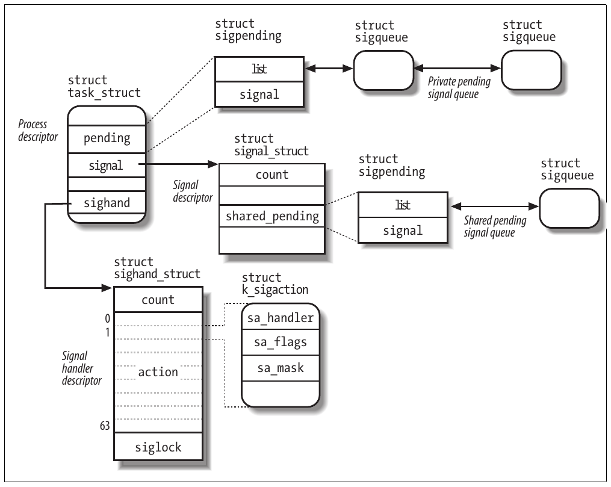
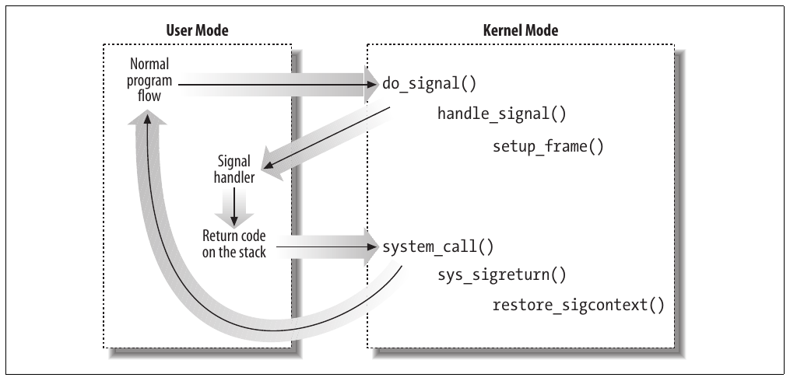
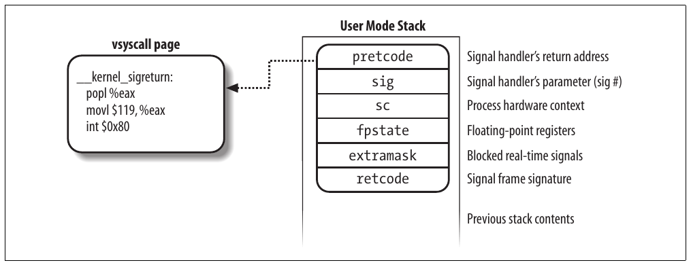

CHƯƠNG 11 Chương 11‘

# Chương 11. Signal


Signal được các hệ thống Unix đầu tiên đưa vào để cho phép tương tác giữa các User Mode process; kernel cũng dùng chúng để thông báo sự kiện hệ thống cho process. Signal đã tồn tại 30 năm với chỉ những thay đổi nhỏ.

Các phần đầu chương này xem xét chi tiết cách Linux kernel xử lý signal, sau đó chúng ta bàn về system call cho phép process trao đổi signal.

## Vai trò của signal

Signal là thông điệp rất ngắn có thể gửi đến process hoặc nhóm process. Thông tin duy nhất cung cấp cho process thường là số xác định signal; standard signal không có chỗ cho argument, thông điệp hoặc thông tin đi kèm khác.

Một tập macro có tên bắt đầu bằng tiền tố `SIG` được dùng để xác định signal; chúng ta đã nhắc đến chúng vài lần trong các chương trước. Ví dụ, macro `SIGCHLD` được đề cập trong phần “The clone(), fork(), and vfork() System Calls” ở Chương 3. Macro này, mở rộng thành giá trị 17 trong Linux, cho identifier của signal gửi đến parent process khi child dừng hoặc kết thúc. Macro `SIGSEGV`, mở rộng thành giá trị 11, được đề cập trong phần “Page Fault Exception Handler” ở Chương 9; nó cho identifier của signal gửi đến process khi process thực hiện memory reference không hợp lệ.

Signal có hai mục đích chính:

- Cho process biết một sự kiện cụ thể đã xảy ra

- Khiến process thực thi signal handler function có trong code của nó

Tất nhiên, hai mục đích không loại trừ nhau, vì process thường phải phản ứng với một sự kiện bằng cách thực thi routine cụ thể.

Bảng 11-1 liệt kê 31 signal đầu do Linux 2.6 xử lý cho kiến trúc 80×86 (một số signal number, như những số gắn với `SIGCHLD` hoặc `SIGSTOP`, phụ thuộc kiến trúc; hơn nữa, một số signal như `SIGSTKFLT` chỉ được định nghĩa cho kiến trúc cụ thể). Ý nghĩa default action được mô tả trong phần tiếp theo.

Bảng 11-1. 31 signal đầu trong Linux/i386

| \# | Tên signal | Default action | Giải thích | POSIX |
|---|---|---|---|---|
| 1 | `SIGHUP` | Terminate | Ngắt controlling terminal hoặc process | Có |
| 2 | `SIGINT` | Terminate | Interrupt từ bàn phím | Có |
| 3 | `SIGQUIT` | Dump | Thoát từ bàn phím | Có |
| 4 | `SIGILL` | Dump | Instruction không hợp lệ | Có |
| 5 | `SIGTRAP` | Dump | Breakpoint để debug | Không |
| 6 | `SIGABRT` | Dump | Kết thúc bất thường | Có |
| 6 | `SIGIOT` | Dump | Tương đương `SIGABRT` | Không |
| 7 | `SIGBUS` | Dump | Bus error | Không |
| 8 | `SIGFPE` | Dump | Floating-point exception | Có |
| 9 | `SIGKILL` | Terminate | Buộc process kết thúc | Có |
| 10 | `SIGUSR1` | Terminate | Dành cho process sử dụng | Có |
| 11 | `SIGSEGV` | Dump | Memory reference không hợp lệ | Có |
| 12 | `SIGUSR2` | Terminate | Dành cho process sử dụng | Có |
| 13 | `SIGPIPE` | Terminate | Ghi vào pipe không có bên đọc | Có |
| 14 | `SIGALRM` | Terminate | Real-timer clock | Có |
| 15 | `SIGTERM` | Terminate | Kết thúc process | Có |
| 16 | `SIGSTKFLT` | Terminate | Lỗi stack của coprocessor | Không |
| 17 | `SIGCHLD` | Ignore | Child process dừng hoặc kết thúc, hoặc nhận signal nếu được trace | Có |
| 18 | `SIGCONT` | Continue | Tiếp tục thực thi nếu đã dừng | Có |
| 19 | `SIGSTOP` | Stop | Dừng thực thi process | Có |
| 20 | `SIGTSTP` | Stop | Dừng process theo yêu cầu từ tty | Có |
| 21 | `SIGTTIN` | Stop | Background process yêu cầu input | Có |
| 22 | `SIGTTOU` | Stop | Background process yêu cầu output | Có |
| 23 | `SIGURG` | Ignore | Điều kiện khẩn cấp trên socket | Không |
| 24 | `SIGXCPU` | Dump | Vượt giới hạn CPU time | Không |
| 25 | `SIGXFSZ` | Dump | Vượt giới hạn file size | Không |
| 26 | `SIGVTALRM` | Terminate | Virtual timer clock | Không |
| 27 | `SIGPROF` | Terminate | Profile timer clock | Không |
| 28 | `SIGWINCH` | Ignore | Thay đổi kích thước window | Không |
| 29 | `SIGIO` | Terminate | Hiện có thể thực hiện I/O | Không |
| 29 | `SIGPOLL` | Terminate | Tương đương `SIGIO` | Không |
| 30 | `SIGPWR` | Terminate | Lỗi nguồn điện | Không |
| 31 | `SIGSYS` | Dump | System call sai | Không |
| 31 | `SIGUNUSED` | Dump | Tương đương `SIGSYS` | Không |

Ngoài regular signal trong bảng này, chuẩn POSIX đưa vào lớp signal mới gọi là real-time signal; signal number của chúng từ 32 đến 64 trên Linux. Khác biệt chính với regular signal là chúng luôn được đưa vào queue để nhiều signal gửi đi đều được nhận. Ngược lại, regular signal cùng loại không được đưa vào queue: nếu regular signal được gửi nhiều lần liên tiếp, chỉ một signal được chuyển đến process nhận. Dù Linux kernel không dùng real-time signal, nó hỗ trợ đầy đủ chuẩn POSIX thông qua một số system call chuyên biệt.

Một số system call cho phép lập trình viên gửi signal và xác định cách process phản ứng với signal nhận được. Bảng 11-2 tóm tắt các call này; hành vi của chúng được mô tả chi tiết trong phần “System Calls Related to Signal Handling” phía sau.

Bảng 11-2. Các system call quan trọng nhất liên quan đến signal

| System call | Mô tả |
|---|---|
| `kill()` | Gửi signal đến thread group |
| `tkill()` | Gửi signal đến process |
| `tgkill()` | Gửi signal đến process trong thread group cụ thể |
| `sigaction()` | Thay đổi action gắn với signal |
| `signal()` | Tương tự `sigaction()` |
| `sigpending()` | Kiểm tra có pending signal không |
| `sigprocmask()` | Sửa tập blocked signal |
| `sigsuspend()` | Đợi signal |
| `rt_sigaction()` | Thay đổi action gắn với real-time signal |
| `rt_sigpending()` | Kiểm tra có pending real-time signal không |
| `rt_sigprocmask()` | Sửa tập blocked real-time signal |
| `rt_sigqueueinfo()` | Gửi real-time signal đến thread group |
| `rt_sigsuspend()` | Đợi real-time signal |
| `rt_sigtimedwait()` | Tương tự `rt_sigsuspend()` |

Đặc điểm quan trọng của signal là có thể gửi chúng bất cứ lúc nào đến process có trạng thái thường không thể đoán trước. Kernel phải lưu signal gửi đến process hiện không thực thi cho đến khi process tiếp tục thực thi. Block signal (mô tả phía sau) đòi hỏi trì hoãn chuyển giao signal cho đến khi được unblock, làm trầm trọng thêm vấn đề signal phát sinh trước khi có thể được chuyển giao.

Do đó, kernel phân biệt hai giai đoạn liên quan đến truyền signal:

Signal generation

Kernel cập nhật data structure của process đích để biểu thị một signal mới đã được gửi.

Signal delivery

Kernel buộc process đích phản ứng với signal bằng cách thay đổi execution state, bắt đầu thực thi signal handler được chỉ định, hoặc cả hai.

Mỗi signal được tạo có thể được chuyển giao tối đa một lần. Signal là resource tiêu hao: khi đã được chuyển giao, mọi thông tin trong process descriptor tham chiếu đến sự tồn tại trước đó của chúng bị xóa.

Signal đã được tạo nhưng chưa chuyển giao gọi là pending signal. Tại mỗi thời điểm, chỉ có thể tồn tại một pending signal thuộc một loại nhất định cho một process; pending signal bổ sung cùng loại đến cùng process không được đưa vào queue mà chỉ bị loại bỏ. Tuy nhiên, real-time signal khác: có thể có nhiều pending signal cùng loại.

Nói chung, signal có thể pending trong khoảng thời gian không thể đoán trước. Phải xét các yếu tố sau:

- Signal thường chỉ được chuyển giao cho process hiện đang chạy (tức process `current`).

- Process có thể chọn block signal thuộc một loại nhất định (xem phần “Modifying the Set of Blocked Signals” phía sau). Trong trường hợp này, process không nhận signal cho đến khi gỡ block.

- Khi process thực thi signal-handler function, nó thường mask signal tương ứng—tức tự động block signal cho đến khi handler kết thúc. Do đó, signal handler không thể bị gián đoạn bởi một lần xuất hiện khác của signal đang xử lý, và function không cần reentrant.

Dù khái niệm signal trực quan, cách kernel triển khai khá phức tạp. Kernel phải:

- Ghi nhớ signal nào bị mỗi process block.

- Khi chuyển từ Kernel Mode sang User Mode, kiểm tra signal cho process đã đến chưa. Điều này xảy ra tại gần như mọi timer interrupt (khoảng mỗi millisecond).

- Xác định có thể ignore signal không. Điều này xảy ra khi tất cả điều kiện sau được đáp ứng:

— Process đích không được process khác trace (flag `PT_PTRACED` trong field `ptrace` của process descriptor bằng 0).[^1] — Signal không bị process đích block.

— Signal đang được process đích ignore (vì process đã ignore tường minh hoặc vì process không thay đổi default action của signal và action đó là “ignore”).

- Xử lý signal, có thể đòi hỏi chuyển process sang handler function tại bất cứ điểm nào trong thực thi và khôi phục execution context gốc sau khi function trả về.

Hơn nữa, Linux phải tính đến signal semantics khác nhau của BSD và System V; ngoài ra phải tuân thủ các yêu cầu POSIX khá rườm rà.

### Action thực hiện khi chuyển giao signal

Có ba cách process phản ứng với signal:

1\. Ignore signal một cách tường minh.

2\. Thực hiện default action gắn với signal (xem Bảng 11-1). Action này, được kernel định nghĩa trước, phụ thuộc loại signal và có thể là một trong các action sau:

Terminate

Process bị kết thúc (kill).

Dump

Process bị kết thúc (kill) và, nếu có thể, file `core` chứa execution context được tạo; có thể dùng file này cho mục đích debug.

Ignore

Signal bị ignore.

Stop

Process bị dừng—tức đưa vào state `TASK_STOPPED` (xem phần “Process State” trong Chương 3).

Continue

Nếu process đã dừng (`TASK_STOPPED`), nó được đưa vào state `TASK_RUNNING`.

3\. Catch signal bằng cách gọi signal-handler function tương ứng.

Lưu ý block signal khác với ignore signal. Signal không được chuyển giao chừng nào còn bị block; nó chỉ được chuyển giao sau khi unblock. Signal bị ignore luôn được chuyển giao, và không có action tiếp theo.

Không thể ignore, catch hoặc block các signal `SIGKILL` và `SIGSTOP`, và default action của chúng phải luôn được thực hiện. Do đó, `SIGKILL` và `SIGSTOP` cho phép người dùng có privilege thích hợp lần lượt kết thúc và dừng mọi process,[^2] bất kể biện pháp phòng vệ của chương trình mà process đang thực thi.

Signal là fatal đối với process nếu việc chuyển giao signal khiến kernel kill process. Signal `SIGKILL` luôn fatal; hơn nữa, mỗi signal có default action “Terminate” mà process không catch cũng fatal với process đó. Tuy nhiên, lưu ý signal được process catch và có signal-handler function tương ứng kết thúc process không phải fatal, vì process chọn tự kết thúc thay vì bị kernel kill.

### POSIX signal và ứng dụng multithreaded

Chuẩn POSIX 1003.1 có một số yêu cầu nghiêm ngặt cho signal handling của ứng dụng multithreaded:

- Mọi thread của ứng dụng multithreaded phải chia sẻ signal handler; tuy nhiên, mỗi thread phải có mask pending signal và blocked signal riêng.

- Các POSIX library function `kill()` và `sigqueue()` (xem phần “System Calls Related to Signal Handling” phía sau) phải gửi signal đến toàn bộ ứng dụng multithreaded, không phải thread cụ thể. Điều tương tự áp dụng cho mọi signal (như `SIGCHLD`, `SIGINT`, hoặc `SIGQUIT`) do kernel tạo.

- Mỗi signal gửi đến ứng dụng multithreaded sẽ được chuyển giao cho đúng một thread, được kernel chọn tùy ý trong những thread không block signal đó.

- Nếu fatal signal được gửi đến ứng dụng multithreaded, kernel sẽ kill mọi thread của ứng dụng—không chỉ thread đã được chuyển giao signal.

Để tuân thủ chuẩn POSIX, kernel Linux 2.6 triển khai ứng dụng multithreaded bằng tập lightweight process thuộc cùng thread group (xem phần “Processes, Lightweight Processes, and Threads” trong Chương 3).

Trong chương này, thuật ngữ “thread group” chỉ bất kỳ thread group nào, ngay cả khi chỉ gồm một process (thông thường). Ví dụ, khi nói `kill()` có thể gửi signal đến thread group, chúng ta ngụ ý system call này cũng có thể gửi signal đến process thông thường. Chúng ta sẽ dùng thuật ngữ “process” để chỉ process thông thường hoặc lightweight process—tức thành viên cụ thể của thread group.

Hơn nữa, pending signal là private nếu được gửi đến process cụ thể; là shared nếu được gửi đến toàn bộ thread group.

### Data structure gắn với signal

Với mỗi process trong hệ thống, kernel phải theo dõi signal nào hiện pending hoặc bị mask; kernel còn phải theo dõi cách mỗi thread group xử lý từng signal. Để làm vậy, kernel dùng một số data structure truy cập được từ process descriptor. Những data structure quan trọng nhất được trình bày trong Hình 11-1.



Hình 11-1. Các data structure quan trọng nhất liên quan đến signal handling

Các field của process descriptor liên quan đến signal handling được liệt kê trong Bảng 11-3.

Bảng 11-3. Field của process descriptor liên quan đến signal handling

| Kiểu | Tên | Mô tả |
|---|---|---|
| `struct signal_struct *` | `signal` | Pointer đến signal descriptor của process |
| `struct sighand_struct *` | `sighand` | Pointer đến signal handler descriptor của process |
| `sigset_t` | `blocked` | Mask của blocked signal |
| `sigset_t` | `real_blocked` | Mask tạm thời của blocked signal (được system call `rt_sigtimedwait()` dùng) |
| `struct sigpending` | `pending` | Data structure lưu private pending signal |
| `unsigned long` | `sas_ss_sp` | Địa chỉ alternative signal handler stack |
| `size_t` | `sas_ss_size` | Kích thước alternative signal handler stack |
| `int (*) (void *)` | `notifier` | Pointer đến function được device driver dùng để block một số signal của process |
| `void *` | `notifier_data` | Pointer đến dữ liệu mà notifier function có thể dùng (field trước trong bảng) |
| `sigset_t *` | `notifier_mask` | Bit mask của signal bị device driver block thông qua notifier function |

Field `blocked` lưu các signal hiện được process mask. Nó là array bit `sigset_t`, một bit cho mỗi loại signal:

```c
typedef struct {
    unsigned long sig[2];
} sigset_t;
```

Vì mỗi số `unsigned long` gồm 32 bit, số signal tối đa có thể khai báo trong Linux là 64 (macro `_NSIG` chỉ định giá trị này). Không signal nào có number 0, nên signal number bằng index của bit tương ứng trong biến `sigset_t` cộng một. Số từ 1 đến 31 tương ứng các signal trong Bảng 11-1, còn số từ 32 đến 64 tương ứng real-time signal.

#### Signal descriptor và signal handler descriptor

Field `signal` của process descriptor trỏ đến signal descriptor, structure `signal_struct` theo dõi shared pending signal. Thực tế, signal descriptor còn chứa các field không hoàn toàn liên quan đến signal handling, như array per-process resource limit `rlim` (xem phần “Process Resource Limits” trong Chương 3), hoặc các field `pgrp` và `session`, lần lượt lưu PID của group leader và session leader của process (xem phần “Relationships Among Processes” trong Chương 3). Thực tế, như đã đề cập trong phần “The clone(), fork(), and vfork() System Calls” ở Chương 3, signal descriptor được mọi process thuộc cùng thread group chia sẻ—tức mọi process được tạo bằng cách gọi system call `clone()` với flag `CLONE_THREAD` set—nên signal descriptor chứa các field phải giống nhau với mỗi process trong cùng thread group.

Các field của signal descriptor ít nhiều liên quan đến signal handling được trình bày trong Bảng 11-4.

Bảng 11-4. Các field của signal descriptor liên quan đến signal handling

| Kiểu | Tên | Mô tả |
|---|---|---|
| `atomic_t` | `count` | Usage counter của signal descriptor |
| `atomic_t` | `live` | Số process còn sống trong thread group |
| `wait_queue_head_t` | `wait_chldexit` | Wait queue cho process đang sleep trong system call `wait4()` |
| `struct task_struct *` | `curr_target` | Descriptor của process gần nhất trong thread group đã nhận signal |
| `struct sigpending` | `shared_pending` | Data structure lưu shared pending signal |
| `int` | `group_exit_code` | Process termination code cho thread group |
| `struct task_struct *` | `group_exit_task` | Dùng khi kill toàn bộ thread group |
| `int` | `notify_count` | Dùng khi kill toàn bộ thread group |
| `int` | `group_stop_count` | Dùng khi dừng toàn bộ thread group |
| `unsigned int` | `flags` | Flag dùng khi chuyển giao signal thay đổi trạng thái process |

Ngoài signal descriptor, mỗi process còn tham chiếu signal handler descriptor, là structure `sighand_struct` mô tả cách thread group phải xử lý mỗi signal. Các field được trình bày trong Bảng 11-5.

Bảng 11-5. Các field của signal handler descriptor

| Kiểu | Tên | Mô tả |
|---|---|---|
| `atomic_t` | `count` | Usage counter của signal handler descriptor |
| `struct k_sigaction [64]` | `action` | Array structure chỉ định action cần thực hiện khi chuyển giao signal |
| `spinlock_t` | `siglock` | Spin lock bảo vệ cả signal descriptor lẫn signal handler descriptor |

Như đã đề cập trong phần “The clone(), fork(), and vfork() System Calls” ở Chương 3, nhiều process có thể chia sẻ signal handler descriptor bằng cách gọi system call `clone()` với flag `CLONE_SIGHAND` set; field `count` trong descriptor này chỉ định số process chia sẻ structure. Trong ứng dụng POSIX multithreaded, mọi lightweight process trong thread group tham chiếu cùng signal descriptor và cùng signal handler descriptor.

##### Data structure sigaction

Một số kiến trúc gán cho signal các thuộc tính chỉ kernel thấy được. Do đó, thuộc tính của signal được lưu trong structure `k_sigaction`, chứa cả thuộc tính ẩn với User Mode process lẫn structure `sigaction` quen thuộc hơn chứa mọi thuộc tính User Mode process thấy được. Thực tế, trên nền tảng 80×86, User Mode process thấy được mọi thuộc tính signal.

Do đó, structure `k_sigaction` đơn giản chỉ còn một structure `sa` kiểu `sigaction`, chứa các field sau:[^3]

`sa_handler`

Field này chỉ định loại action cần thực hiện; giá trị có thể là pointer đến signal handler, `SIG_DFL` (tức giá trị 0) để chỉ định thực hiện default action, hoặc `SIG_IGN` (tức giá trị 1) để chỉ định ignore signal.

`sa_flags`

Tập flag này chỉ định cách phải xử lý signal; một số được liệt kê trong Bảng 11-6.<sup>†</sup>

`sa_mask`

Biến `sigset_t` này chỉ định các signal cần mask khi chạy signal handler.

Bảng 11-6. Flag chỉ định cách xử lý signal

| Tên flag | Mô tả |
|---|---|
| `SA_NOCLDSTOP` | Chỉ áp dụng cho `SIGCHLD`; không gửi `SIGCHLD` đến parent khi process dừng |
| `SA_NOCLDWAIT` | Chỉ áp dụng cho `SIGCHLD`; không tạo zombie khi process kết thúc |
| `SA_SIGINFO` | Cung cấp thông tin bổ sung cho signal handler (xem phần “Changing a Signal Action” phía sau) |
| `SA_ONSTACK` | Dùng alternative stack cho signal handler (xem phần “Catching the Signal” phía sau) |
| `SA_RESTART` | Tự động khởi động lại system call bị gián đoạn (xem phần “Reexecution of System Calls” phía sau) |
| `SA_NODEFER, SA_NOMASK` | Không mask signal khi thực thi signal handler |
| `SA_RESETHAND, SA_ONESHOT` | Đặt lại default action sau khi thực thi signal handler |

##### Pending signal queue

Như đã thấy trong Bảng 11-2 ở phần trước của chương, có nhiều system call có thể tạo signal: một số—`kill()` và `rt_sigqueueinfo()`—gửi signal đến toàn bộ thread group, còn số khác—`tkill()` và `tgkill()`—gửi signal đến process cụ thể.

Do đó, để theo dõi signal nào hiện pending, kernel gắn hai pending signal queue với mỗi process:

- Shared pending signal queue, có gốc tại field `shared_pending` của signal descriptor, lưu pending signal của toàn bộ thread group.

- Private pending signal queue, có gốc tại field `pending` của process descriptor, lưu pending signal của process (lightweight) cụ thể.

Pending signal queue gồm data structure `sigpending`, được định nghĩa như sau:

```c
struct sigpending {
    struct list_head list;
    sigset_t signal;
}
```

Field `signal` là bit mask chỉ định pending signal, còn field `list` là đầu doubly linked list chứa data structure `sigqueue`; các field của structure này được trình bày trong Bảng 11-7.

Bảng 11-7. Các field của data structure sigqueue

| Kiểu | Tên | Mô tả |
|---|---|---|
| `struct list_head` | `list` | Liên kết cho list của pending signal queue |
| `spinlock_t *` | `lock` | Pointer đến field `siglock` trong signal handler descriptor tương ứng với pending signal |
| `int` | `flags` | Flag của data structure `sigqueue` |
| `siginfo_t` | `info` | Mô tả sự kiện làm phát sinh signal |
| `struct user_struct *` | `user` | Pointer đến per-user data structure của owner của process (xem phần “The clone(), fork(), and vfork() System Calls” trong Chương 3) |

Data structure `siginfo_t` có kích thước 128 byte, lưu thông tin về một lần xuất hiện của signal cụ thể; nó chứa các field sau:

`si_signo`

Signal number

`si_errno`

Error code của instruction khiến signal phát sinh, hoặc 0 nếu không có lỗi

`si_code`

Code xác định bên tạo signal (xem Bảng 11-8)

Bảng 11-8. Các signal sender code quan trọng nhất

| Tên code | Bên gửi |
|---|---|
| `SI_USER` | `kill()` và `raise()` (xem phần “System Calls Related to Signal Handling” phía sau) |
| `SI_KERNEL` | Kernel function tổng quát |
| `SI_QUEUE` | `sigqueue()` (xem phần “System Calls Related to Signal Handling” phía sau) |
| `SI_TIMER` | Timer hết hạn |
| `SI_ASYNCIO` | Hoàn tất asynchronous I/O |
| `SI_TKILL` | `tkill()` và `tgkill()` (xem phần “System Calls Related to Signal Handling” phía sau) |

`_sifields`

Union lưu thông tin phụ thuộc loại signal. Ví dụ, data structure `siginfo_t` tương ứng với một lần xuất hiện signal `SIGKILL` ghi PID và UID của sender process tại đây; ngược lại, data structure tương ứng với một lần xuất hiện signal `SIGSEGV` lưu memory address mà việc truy cập khiến signal phát sinh.

### Thao tác trên data structure của signal

Kernel dùng một số function và macro để xử lý signal. Trong mô tả sau, `set` là pointer đến biến `sigset_t`, `nsig` là number của signal, và `mask` là bit mask `unsigned long`.

`sigemptyset(set)` và `sigfillset(set)`

Lần lượt đặt các bit trong biến `sigset_t` thành 0 hoặc 1.

`sigaddset(set,nsig)` và `sigdelset(set,nsig)`

Lần lượt đặt bit của biến `sigset_t` tương ứng với signal `nsig` thành 1 hoặc 0. Trong thực tế, `sigaddset()` rút gọn thành:

```c
set->sig[(nsig - 1) / 32] |= 1UL << ((nsig - 1) % 32);
```

và `sigdelset()` thành:

```c
set->sig[(nsig - 1) / 32] &= ~(1UL << ((nsig - 1) % 32));
```

`sigaddsetmask(set,mask)` và `sigdelsetmask(set,mask)`

Lần lượt đặt tất cả bit của biến `sigset_t` có bit tương ứng trong `mask` bật thành 1 hoặc 0. Chỉ có thể dùng với signal từ 1 đến 32. Các function tương ứng rút gọn thành:

```c
set->sig[0] |= mask;
```

và thành:

```c
set->sig[0] &= ~mask;
```

`sigismember(set,nsig)`

Trả về giá trị bit của biến `sigset_t` tương ứng với signal `nsig`. Trong thực tế, function này rút gọn thành:

```c
return 1 & (set->sig[(nsig-1) / 32] >> ((nsig-1) % 32));
```

`sigmask(nsig)`

Cho bit index của signal `nsig`. Nói cách khác, nếu kernel cần set, clear hoặc kiểm tra bit trong phần tử `sigset_t` tương ứng với signal cụ thể, nó có thể suy ra bit thích hợp qua macro này.

`sigandsets(d,s1,s2)`, `sigorsets(d,s1,s2)`, và `signandsets(d,s1,s2)`

Lần lượt thực hiện logical AND, logical OR và logical NAND giữa các biến `sigset_t` mà `s1` và `s2` trỏ đến; kết quả được lưu trong biến `sigset_t` mà `d` trỏ đến.

`sigtestsetmask(set,mask)`

Trả về giá trị 1 nếu bất kỳ bit nào trong biến `sigset_t` tương ứng với bit được set thành 1 trong `mask` được set; ngược lại trả về 0. Chỉ có thể dùng với signal có number từ 1 đến 32.

`siginitset(set,mask)`

Khởi tạo các bit thấp của biến `sigset_t` tương ứng với signal từ 1 đến 32 bằng các bit trong `mask`, và clear các bit tương ứng với signal từ 33 đến 63.

`siginitsetinv(set,mask)`

Khởi tạo các bit thấp của biến `sigset_t` tương ứng với signal từ 1 đến 32 bằng phần bù của các bit trong `mask`, và set các bit tương ứng với signal từ 33 đến 63.

`signal_pending(p)`

Trả về giá trị 1 (true) nếu process được process descriptor `*p` xác định có pending signal không bị block, và trả về giá trị 0 (false) nếu không. Function được triển khai bằng kiểm tra đơn giản flag `TIF_SIGPENDING` của process.

`recalc_sigpending_tsk(t)` và `recalc_sigpending()`

Function đầu kiểm tra có pending signal cho process được process descriptor tại `*t` xác định (bằng cách xem field `t->pending->signal`) hoặc cho thread group mà process thuộc về (bằng cách xem field `t-> signal->shared_pending->signal`) hay không. Sau đó, function đặt flag `TIF_SIGPENDING` trong `t->thread_info->flags` tương ứng. Function `recalc_sigpending()` tương đương `recalc_sigpending_tsk(current)`.

`rm_from_queue(mask,q)`

Loại khỏi pending signal queue `q` các pending signal tương ứng với bit mask `mask`.

`flush_sigqueue(q)`

Loại mọi pending signal khỏi pending signal queue `q`.

`flush_signals(t)`

Xóa mọi signal gửi đến process được process descriptor tại `*t` xác định. Việc này được thực hiện bằng cách clear flag `TIF_SIGPENDING` trong `t->thread_info->flags` và gọi `flush_sigqueue()` hai lần trên các queue `t->pending` và `t->signal->shared_pending`.

## Tạo signal

Nhiều kernel function tạo signal: chúng hoàn thành giai đoạn đầu của signal handling—mô tả trước đó trong phần “The Role of Signals”—bằng cách cập nhật một hoặc nhiều process descriptor khi cần. Chúng không trực tiếp thực hiện giai đoạn thứ hai là chuyển giao signal nhưng, tùy loại signal và trạng thái process đích, có thể đánh thức một số process và buộc chúng nhận signal.

Khi signal được gửi đến process, từ kernel hoặc process khác, kernel tạo signal bằng cách gọi một trong các function liệt kê trong Bảng 11-9.

Bảng 11-9. Kernel function tạo signal cho process

| Tên | Mô tả |
|---|---|
| `send_sig()` | Gửi signal đến một process |
| `send_sig_info()` | Giống `send_sig()`, có thông tin mở rộng trong structure `siginfo_t` |
| `force_sig()` | Gửi signal mà process không thể ignore tường minh hoặc block |
| `force_sig_info()` | Giống `force_sig()`, có thông tin mở rộng trong structure `siginfo_t` |
| `force_sig_specific()` | Giống `force_sig()`, nhưng được tối ưu cho signal `SIGSTOP` và `SIGKILL` |
| `sys_tkill()` | System call handler của `tkill()` (xem phần “System Calls Related to Signal Handling” phía sau) |
| `sys_tgkill()` | System call handler của `tgkill()` |

Mọi function trong Bảng 11-9 cuối cùng gọi function `specific_send_sig_info()` mô tả trong phần tiếp theo.

Khi signal được gửi đến toàn bộ thread group, từ kernel hoặc process khác, kernel tạo signal bằng cách gọi một trong các function liệt kê trong Bảng 11-10.

Bảng 11-10. Kernel function tạo signal cho thread group

| Tên | Mô tả |
|---|---|
| `send_group_sig_info()` | Gửi signal đến một thread group xác định bởi process descriptor của một thành viên |
| `kill_pg()` | Gửi signal đến mọi thread group trong process group (xem phần “Process Management” trong Chương 1) |
| `kill_pg_info()` | Giống `kill_pg()`, có thông tin mở rộng trong structure `siginfo_t` |
| `kill_proc()` | Gửi signal đến một thread group xác định bởi PID của một thành viên |
| `kill_proc_info()` | Giống `kill_proc()`, có thông tin mở rộng trong structure `siginfo_t` |
| `sys_kill()` | System call handler của `kill()` (xem phần “System Calls Related to Signal Handling” phía sau) |
| `sys_rt_sigqueueinfo()` | System call handler của `rt_sigqueueinfo()` |

Mọi function trong Bảng 11-10 cuối cùng gọi function `group_send_sig_info()`, được mô tả trong phần “The group\_send\_sig\_info() Function” phía sau.

### Function specific\_send\_sig\_info()

Function `specific_send_sig_info()` gửi signal đến process cụ thể. Nó nhận ba parameter:

`sig`

Signal number.

`info`

Địa chỉ của table `siginfo_t` hoặc một trong ba giá trị đặc biệt: 0 nghĩa là signal được User Mode process gửi, 1 nghĩa là được kernel gửi, và 2 nghĩa là được kernel gửi và signal là `SIGSTOP` hoặc `SIGKILL`.

`t`

Pointer đến descriptor của process đích.

Phải gọi function `specific_send_sig_info()` khi local interrupt bị disable và đã lấy spin lock `t->sighand->siglock`. Function thực hiện các bước sau:

1\. Kiểm tra process có ignore signal không; nếu có, trả về 0 (không tạo signal). Signal bị ignore khi đáp ứng cả ba điều kiện ignore signal, tức:

  - Process không được trace (flag `PT_PTRACED` trong `t->ptrace` clear).

  - Signal không bị block (`sigismember(&t->blocked, sig)` trả về 0).

  - Signal bị ignore tường minh (field `sa_handler` của `t->sighand-> action[sig-1]` bằng `SIG_IGN`) hoặc ngầm định (field `sa_handler` bằng `SIG_DFL` và signal là `SIGCONT`, `SIGCHLD`, `SIGWINCH`, hoặc `SIGURG`).

2\. Kiểm tra signal có phải non-real-time (`sig<32`) và một lần xuất hiện khác của cùng signal đã pending trong private pending signal queue của process (`sigismember(&t->pending.signal,sig)` trả về 1) không: nếu có, không cần làm gì, nên trả về 0.

3\. Gọi `send_signal(sig, info, t, &t->pending)` để thêm signal vào tập pending signal của process; function này được mô tả chi tiết trong phần tiếp theo.

4\. Nếu `send_signal()` kết thúc thành công và signal không bị block (`sigismember(&t->blocked,sig)` trả về 0), gọi function `signal_wake_up()` để thông báo cho process về pending signal mới. Đến lượt function này thực hiện các bước sau:

a. Set các flag `TIF_SIGPENDING` trong `t->thread_info->flags`.

b. Gọi `try_to_wake_up()`—xem phần “The try\_to\_wake\_up() Function” trong Chương 7—để đánh thức process nếu nó ở state `TASK_INTERRUPTIBLE`, hoặc ở state `TASK_STOPPED` và signal là `SIGKILL`.

c. Nếu `try_to_wake_up()` trả về 0, process đã runnable: khi đó kiểm tra process có đang chạy trên CPU khác không và, nếu có, gửi interprocessor interrupt đến CPU đó để buộc reschedule process hiện tại (xem phần “Interprocessor Interrupt Handling” trong Chương 4). Vì mỗi process kiểm tra sự tồn tại của pending signal khi trở về từ function `schedule()`, interprocessor interrupt đảm bảo process đích nhanh chóng nhận thấy pending signal mới.

5\. Trả về 1 (đã tạo signal thành công).

### Function send\_signal()

Function `send_signal()` chèn phần tử mới vào pending signal queue. Các parameter nó nhận là signal number `sig`, địa chỉ `info` của data structure `siginfo_t` (hoặc special code, xem mô tả `specific_send_sig_info()` trong phần trước), địa chỉ `t` của descriptor của process đích, và địa chỉ `signals` của pending signal queue.

Function thực hiện các bước sau:

1\. Nếu giá trị `info` là 2, signal là `SIGKILL` hoặc `SIGSTOP` và được kernel tạo qua function `force_sig_specific()`: trong trường hợp này, nhảy đến bước 9. Kernel áp dụng ngay action tương ứng các signal này, nên function có thể bỏ qua việc thêm signal vào pending signal queue.

2\. Nếu số pending signal của owner của process (`t->user->sigpending`) nhỏ hơn resource limit của process hiện tại `(t->signal->rlim[RLIMIT_SIGPENDING].rlim_cur`), function cấp phát data structure `sigqueue` cho lần xuất hiện mới của signal:

```c
q = kmem_cache_alloc(sigqueue_cachep, GFP_ATOMIC);
```

3\. Nếu số pending signal của owner của process quá cao hoặc cấp phát memory ở bước trước thất bại, nhảy đến bước 9.

4\. Tăng số pending signal của owner (`t->user->sigpending`) và reference counter của per-user data structure mà `t->user` trỏ đến.

5\. Thêm data structure `sigqueue` vào pending signal queue `signals`:

```c
list_add_tail(&q->list, &signals->list);
```

6\. Điền table `siginfo_t` bên trong data structure `sigqueue`:

```c
if ((unsigned long)info == 0) {
    q->info.si_signo = sig;
    q->info.si_errno = 0;
    q->info.si_code = SI_USER;
    q->info._sifields._kill._pid = current->pid;
    q->info._sifields._kill._uid = current->uid;
} else if ((unsigned long)info == 1) {
    q->info.si_signo = sig;
    q->info.si_errno = 0;
    q->info.si_code = SI_KERNEL;
    q->info._sifields._kill._pid = 0;
    q->info._sifields._kill._uid = 0;
} else
    copy_siginfo(&q->info, info);
```

Function `copy_siginfo()` sao chép table `siginfo_t` do bên gọi truyền.

7\. Set bit tương ứng với signal trong bit mask của queue:

```c
sigaddset(&signals->signal, sig);
```

8\. Trả về 0: đã nối signal thành công vào pending signal queue.

9\. Tại đây, không thêm phần tử vào signal pending queue vì đã có quá nhiều pending signal, hoặc không có memory trống cho data structure `sigqueue`, hoặc kernel áp dụng ngay signal. Nếu signal là real-time và được gửi qua kernel function được yêu cầu tường minh phải đưa nó vào queue, function trả về error code `-EAGAIN`:

```c
if (sig>=32 && info && (unsigned long) info != 1 &&
    info->si_code != SI_USER)
    return -EAGAIN;
```

10\. Set bit tương ứng với signal trong bit mask của queue:

```c
sigaddset(&signals->signal, sig);
```

11\. Trả về 0: dù signal chưa được nối vào queue, bit tương ứng đã được set trong bit mask của pending signal.

Cần cho process đích nhận signal ngay cả khi pending signal queue không có chỗ cho phần tử tương ứng. Ví dụ, giả sử process đang tiêu thụ quá nhiều memory. Kernel phải đảm bảo system call `kill()` thành công ngay cả khi không có memory trống; nếu không, system administrator không có cơ hội khôi phục hệ thống bằng cách kết thúc process gây vấn đề.

### Function group\_send\_sig\_info()

Function `group_send_sig_info()` gửi signal đến toàn bộ thread group. Nó nhận ba parameter: signal number `sig`, địa chỉ `info` của table `siginfo_t`—hoặc các giá trị đặc biệt 0, 1, hoặc 2 như giải thích trong phần “The specific\_send\_sig\_info() Function” trước đó—và địa chỉ `p` của process descriptor.

Function về cơ bản thực hiện các bước sau:

1\. Kiểm tra parameter `sig` đúng:

```c
if (sig < 0 || sig > 64)
    return -EINVAL;
```

2\. Nếu signal được User Mode process gửi, kiểm tra thao tác có được phép không. Signal chỉ được chuyển giao nếu ít nhất một điều kiện sau đúng:

  - Owner của sending process có capability thích hợp (thông thường, điều này chỉ nghĩa là signal do system administrator gửi; xem Chương 20).

  - Signal là `SIGCONT` và process đích ở cùng login session với sending process.

  - Cả hai process thuộc cùng user.

Nếu User Mode process không được phép gửi signal, function trả về giá trị `-EPERM`.

3\. Nếu parameter `sig` có giá trị 0, trả về ngay mà không tạo signal:

```c
if (!sig || !p->sighand)
    return 0;
```

Vì 0 không phải signal number hợp lệ, nó được dùng để cho sending process kiểm tra có privilege cần thiết để gửi signal đến thread group đích không. Function cũng trả về nếu process đích đang bị kill, xác định bằng cách kiểm tra signal handler descriptor của nó đã được giải phóng chưa.

4\. Lấy spin lock `p->sighand->siglock` và disable local interrupt.

5\. Gọi function `handle_stop_signal()`, kiểm tra một số loại signal có thể hủy pending signal khác của thread group đích. Function sau thực hiện các bước sau:

a. Nếu thread group đang bị kill (flag `SIGNAL_GROUP_EXIT` trong field `flags` của signal descriptor set), trả về.

b. Nếu `sig` là signal `SIGSTOP`, `SIGTSTP`, `SIGTTIN`, hoặc `SIGTTOU`, function gọi function `rm_from_queue()` để loại signal `SIGCONT` khỏi shared pending signal queue `p->signal->shared_pending` và private queue của mọi thành viên thread group.

c. Nếu `sig` là `SIGCONT`, gọi function `rm_from_queue()` để loại mọi signal `SIGSTOP`, `SIGTSTP`, `SIGTTIN`, và `SIGTTOU` khỏi shared pending signal queue `p->signal->shared_pending`; sau đó loại cùng các signal khỏi private pending signal queue của process thuộc thread group, và đánh thức chúng:

```c
rm_from_queue(0x003c0000, &p->signal->shared_pending);
t = p;
do {
    rm_from_queue(0x003c0000, &t->pending);
    try_to_wake_up(t, TASK_STOPPED, 0);
    t = next_thread(t);
} while (t != p);
```

Mask `0x003c0000` chọn bốn stop signal. Tại mỗi lượt lặp, macro `next_thread` trả về địa chỉ descriptor của một lightweight process khác trong thread group (xem phần “Relationships Among Processes” trong Chương 3).[^4]

6\. Kiểm tra thread group có ignore signal không; nếu có, trả về giá trị 0 (thành công). Signal bị ignore khi cả ba điều kiện ignore signal được đề cập trong phần “The Role of Signals” trước đó được đáp ứng (xem thêm bước 1 trong phần “The specific\_send\_sig\_info() Function” trước đó).

7\. Kiểm tra signal có phải non-real-time và một lần xuất hiện khác của cùng signal đã pending trong shared pending signal queue của thread group không: nếu có, không cần làm gì, nên trả về giá trị 0 (thành công):

```c
if (sig<32 && sigismember(&p->signal->shared_pending.signal,sig))
    return 0;
```

8\. Gọi `send_signal()` để nối signal vào shared pending signal queue (xem phần “The send\_signal() Function” trước đó). Nếu `send_signal()` trả về error code khác không, kết thúc và trả về cùng giá trị.

9\. Gọi function `__group_complete_signal()` để đánh thức một lightweight process trong thread group (xem bên dưới).

10\. Nhả spin lock `p->sighand->siglock` và enable local interrupt.

11\. Trả về 0 (thành công).

Function `__group_complete_signal()` quét các process trong thread group, tìm process có thể nhận signal mới. Có thể chọn process nếu đáp ứng tất cả điều kiện sau:

- Process không block signal.

- Process không ở state `EXIT_ZOMBIE`, `EXIT_DEAD`, `TASK_TRACED`, hoặc `TASK_STOPPED` (ngoại lệ là process có thể ở state `TASK_TRACED` hoặc `TASK_STOPPED` nếu signal là `SIGKILL`).

- Process không đang bị kill—tức flag `PF_EXITING` của nó không được set.

- Process hiện đang thực thi trên CPU, hoặc flag `TIF_SIGPENDING` của nó chưa được set. (Thực tế, không có ích khi đánh thức process có pending signal: nói chung, kernel control path đã set flag `TIF_SIGPENDING` đã thực hiện thao tác này. Mặt khác, nếu process hiện đang thực thi, cần thông báo cho nó về pending signal mới.)

Thread group có thể chứa nhiều process đáp ứng các điều kiện trên. Function chọn một process như sau:

- Nếu process được `p` xác định—địa chỉ descriptor truyền làm parameter của function `group_send_sig_info()`—đáp ứng mọi quy tắc trước đó và do đó có thể nhận signal, function chọn process đó.

- Ngược lại, function tìm process phù hợp bằng cách quét thành viên thread group, bắt đầu từ process nhận signal gần nhất của thread group (`p->signal->curr_target`).

Nếu `__group_complete_signal()` tìm được process phù hợp, nó thiết lập việc chuyển giao signal cho process đã chọn. Trước tiên, function kiểm tra signal có fatal không: trong trường hợp này, toàn bộ thread group bị kill bằng cách gửi signal `SIGKILL` đến từng lightweight process trong group. Ngược lại, nếu signal không fatal, function gọi function `signal_wake_up()` để thông báo cho process đã chọn rằng có pending signal mới (xem bước 4 trong phần “The specific\_send\_sig\_info() Function” trước đó).

## Chuyển giao signal

Chúng ta giả định kernel đã nhận thấy signal đến và gọi một function đề cập trong các phần trước để chuẩn bị process descriptor của process sẽ nhận signal. Nhưng nếu process đó không đang chạy trên CPU lúc ấy, kernel đã trì hoãn nhiệm vụ chuyển giao signal. Giờ chúng ta xét các hoạt động kernel thực hiện để đảm bảo pending signal của process được xử lý.

Như đã đề cập trong phần “Returning from Interrupts and Exceptions” ở Chương 4, kernel kiểm tra giá trị flag `TIF_SIGPENDING` của process trước khi cho phép process tiếp tục thực thi trong User Mode. Do đó, kernel kiểm tra sự tồn tại của pending signal mỗi khi xử lý xong interrupt hoặc exception.

Để xử lý pending signal không bị block, kernel gọi function `do_signal()`, nhận hai parameter:

`regs`

Địa chỉ vùng stack lưu nội dung User Mode register của process hiện tại.

`oldset`

Địa chỉ biến mà function phải lưu bit mask array của blocked signal. Nó là `NULL` nếu không cần lưu bit mask array.

Mô tả function `do_signal()` của chúng ta sẽ tập trung vào cơ chế tổng quát chuyển giao signal; code thực tế chứa rất nhiều chi tiết xử lý race condition và trường hợp đặc biệt khác—như đóng băng hệ thống, tạo core dump, dừng và kill toàn bộ thread group, v.v. Chúng ta sẽ bỏ qua toàn bộ các chi tiết này.

Như đã đề cập, function `do_signal()` thường chỉ được gọi khi CPU sắp trở về User Mode. Vì lý do đó, nếu interrupt handler gọi `do_signal()`, function chỉ trả về:

```c
if ((regs->xcs & 3) != 3)
    return 1;
```

Nếu parameter `oldset` là `NULL`, function khởi tạo nó bằng địa chỉ field `current->blocked`:

```c
if (!oldset)
    oldset = ¤t->blocked;
```

Phần cốt lõi của function `do_signal()` gồm vòng lặp gọi lặp lại function `dequeue_signal()` cho đến khi không còn pending signal không bị block trong cả private lẫn shared pending signal queue. Return code của `dequeue_signal()` được lưu trong local variable `signr`. Nếu giá trị là 0, nghĩa là đã xử lý mọi pending signal và `do_signal()` có thể kết thúc. Chừng nào trả về giá trị khác không, vẫn có pending signal đợi xử lý. `dequeue_signal()` được gọi lại sau khi `do_signal()` xử lý signal hiện tại.

`dequeue_signal()` xét trước mọi signal trong private pending signal queue, bắt đầu từ signal có number nhỏ nhất, rồi đến signal trong shared queue. Nó cập nhật data structure để chỉ rõ signal không còn pending và trả về number của signal. Nhiệm vụ này gồm clear bit tương ứng trong `current-> pending.signal` hoặc `current->signal->shared_pending.signal`, và gọi `recalc_sigpending()` để cập nhật giá trị flag `TIF_SIGPENDING`.

Hãy xem cách function `do_signal()` xử lý mỗi pending signal có number do `dequeue_signal()` trả về. Trước tiên, nó kiểm tra receiver process `current` có đang được process khác giám sát không; trong trường hợp này, `do_signal()` gọi `do_notify_parent_cldstop()` và `schedule()` để thông báo cho monitoring process về signal handling.

Sau đó, `do_signal()` nạp vào local variable `ka` địa chỉ data structure `k_sigaction` của signal cần xử lý:

```c
ka = ¤t->sig->action[signr-1];
```

Tùy nội dung, có thể thực hiện ba loại action: ignore signal, thực hiện default action, hoặc thực thi signal handler.

Khi signal được chuyển giao bị ignore tường minh, function `do_signal()` chỉ tiếp tục lượt lặp mới và do đó xét pending signal khác:

```c
if (ka->sa.sa_handler == SIG_IGN)
    continue;
```

Trong hai phần tiếp theo, chúng ta sẽ mô tả cách thực hiện default action và signal handler.

### Thực hiện default action cho signal

Nếu `ka->sa.sa_handler` bằng `SIG_DFL`, `do_signal()` phải thực hiện default action của signal. Ngoại lệ duy nhất là khi receiving process là init, khi đó signal bị loại bỏ như mô tả trong phần “Actions Performed upon Delivering a Signal” trước đó:

```c
if (current->pid == 1)
    continue;
```

Với process khác, signal có default action “ignore” cũng dễ xử lý:

```c
if (signr==SIGCONT || signr==SIGCHLD ||
        signr==SIGWINCH || signr==SIGURG)
    continue;
```

Signal có default action “stop” có thể dừng mọi process trong thread group. Để làm vậy, `do_signal()` đặt state của chúng thành `TASK_STOPPED` rồi gọi function `schedule()` (xem phần “The schedule() Function” trong Chương 7):

```c
if (signr==SIGSTOP || signr==SIGTSTP ||
        signr==SIGTTIN || signr==SIGTTOU) {
    if (signr != SIGSTOP &&
           is_orphaned_pgrp(current->signal->pgrp))
        continue;
    do_signal_stop(signr);
}
```

Khác biệt giữa `SIGSTOP` và các signal khác khá tinh tế: `SIGSTOP` luôn dừng thread group, còn các signal khác chỉ dừng thread group nếu không nằm trong “orphaned process group”. Chuẩn POSIX quy định process group không orphaned chừng nào có một process trong group có parent ở process group khác nhưng cùng session. Vì vậy, nếu parent process kết thúc nhưng user khởi chạy process vẫn đăng nhập, process group không orphaned.

Function `do_signal_stop()` kiểm tra `current` có phải process đầu tiên bị dừng trong thread group không. Nếu có, kích hoạt “group stop”: về cơ bản, function đặt field `group_stop_count` trong signal descriptor thành giá trị dương, và đánh thức mỗi process trong thread group. Đến lượt mỗi process xem field này để nhận ra group stop đang diễn ra, thay state thành `TASK_STOPPED`, và gọi `schedule()`. Function `do_signal_stop()` còn gửi signal `SIGCHLD` đến parent process của thread group leader, trừ khi parent đã set flag `SA_NOCLDSTOP` của `SIGCHLD`.

Signal có default action “dump” có thể tạo file `core` trong working directory của process; file này liệt kê nội dung đầy đủ của address space và CPU register của process. Sau khi `do_signal()` tạo core file, nó kill thread group. Default action của 18 signal còn lại là “terminate”, chỉ gồm kill thread group. Để kill toàn bộ thread group, function gọi `do_group_exit()`, thực hiện thủ tục “group exit” sạch (xem phần “Process Termination” trong Chương 3).

### Catch signal

Nếu đã thiết lập handler cho signal, function `do_signal()` phải đảm bảo thực thi handler. Nó làm vậy bằng cách gọi `handle_signal()`:

```c
handle_signal(signr, &info, &ka, oldset, regs);
if (ka->sa.sa_flags & SA_ONESHOT)
    ka->sa.sa_handler = SIG_DFL;
return 1;
```

Nếu signal nhận được có flag `SA_ONESHOT` set, phải đặt lại default action để những lần xuất hiện tiếp theo của cùng signal không kích hoạt thực thi signal handler nữa. Lưu ý `do_signal()` trả về sau khi xử lý một signal duy nhất. Pending signal khác sẽ không được xét đến lần gọi `do_signal()` tiếp theo. Cách này đảm bảo real-time signal được xử lý đúng thứ tự.

Thực thi signal handler là nhiệm vụ khá phức tạp vì cần điều phối stack cẩn thận khi chuyển giữa User Mode và Kernel Mode. Chúng ta giải thích chính xác những gì liên quan ở đây:

Signal handler là function do User Mode process định nghĩa và nằm trong User Mode code segment. Function `handle_signal()` chạy trong Kernel Mode còn signal handler chạy trong User Mode; điều này nghĩa là process hiện tại phải thực thi signal handler trong User Mode trước khi được phép tiếp tục thực thi “bình thường”. Hơn nữa, khi kernel cố tiếp tục thực thi bình thường process, Kernel Mode stack không còn chứa hardware context của chương trình bị gián đoạn, vì Kernel Mode stack được làm rỗng tại mỗi lần chuyển từ User Mode sang Kernel Mode.

Điểm phức tạp bổ sung là signal handler có thể gọi system call. Trong trường hợp này, sau khi service routine thực thi, quyền điều khiển phải trả về signal handler thay vì luồng code bình thường của chương trình bị gián đoạn.

Giải pháp Linux dùng là sao chép hardware context lưu trong Kernel Mode stack lên User Mode stack của process hiện tại. User Mode stack còn được sửa sao cho khi signal handler kết thúc, system call `sigreturn()` tự động được gọi để sao chép hardware context trở lại Kernel Mode stack và khôi phục nội dung gốc của User Mode stack.

Hình 11-2 minh họa luồng thực thi các function liên quan đến catch signal. Signal không bị block được gửi đến process. Khi interrupt hoặc exception xảy ra, process chuyển sang Kernel Mode. Ngay trước khi trở về User Mode, kernel thực thi function `do_signal()`, đến lượt function này xử lý signal (bằng cách gọi `handle_signal()`) và thiết lập User Mode stack (bằng cách gọi `setup_frame()` hoặc `setup_rt_frame()`). Khi process chuyển lại sang User Mode, nó bắt đầu thực thi signal handler vì địa chỉ đầu handler đã được đặt vào program counter. Khi function đó kết thúc, return code do function `setup_frame()` hoặc `setup_rt_frame()` đặt trên User Mode stack được thực thi. Code này gọi system call `sigreturn()` hoặc `rt_sigreturn()`; service routine tương ứng sao chép hardware context của chương trình bình thường vào Kernel Mode stack và khôi phục User Mode stack về trạng thái gốc (bằng cách gọi `restore_sigcontext()`). Vì vậy, khi system call kết thúc, chương trình bình thường có thể tiếp tục thực thi.



Hình 11-2. Catch signal

Giờ hãy xem chi tiết cách thực hiện cơ chế này.

#### Thiết lập frame

Để thiết lập đúng User Mode stack của process, function `handle_signal()` gọi `setup_frame()` (cho signal không cần table `siginfo_t`; xem phần “System Calls Related to Signal Handling” ở phần sau chương này) hoặc `setup_rt_frame()` (cho signal cần table `siginfo_t`). Để chọn giữa hai function, kernel kiểm tra giá trị flag `SA_SIGINFO` trong field `sa_flags` của table `sigaction` gắn với signal.

Function `setup_frame()` nhận bốn parameter có ý nghĩa sau:

`sig`

Signal number

`ka`

Địa chỉ table `k_sigaction` gắn với signal

`oldset`

Địa chỉ bit mask array của blocked signal `regs` Địa chỉ trong vùng Kernel Mode stack lưu nội dung User Mode register

Function `setup_frame()` push lên User Mode stack một data structure gọi là frame, chứa thông tin cần để xử lý signal và đảm bảo trở về function `sys_sigreturn()` đúng. Frame là table `sigframe` chứa các field sau (xem Hình 11-3):

`pretcode`

Return address của signal handler function; trỏ đến code tại label `__kernel_sigreturn` (xem bên dưới).

`sig`

Signal number; đây là parameter mà signal handler yêu cầu.

`sc`

`S`tructure kiểu `sigcontext` chứa hardware context của User Mode process ngay trước khi chuyển sang Kernel Mode (thông tin này được sao chép từ Kernel Mode stack của `current`). Nó còn chứa bit array chỉ định blocked regular signal của process.

`fpstate`

Structure kiểu `_fpstate` có thể được dùng để lưu floating point register của User Mode process (xem phần “Saving and Loading the FPU, MMX, and XMM Registers” trong Chương 3).

`extramask`

Bit array chỉ định blocked real-time signal.

`retcode`

Code 8 byte thực hiện system call `sigreturn()`. Trong các phiên bản Linux trước, code này thực sự được thực thi để trở về từ signal handler; tuy nhiên trong Linux 2.6, nó chỉ được dùng làm signature để debugger nhận ra signal stack frame.



Hình 11-3. Frame trên User Mode stack

Function `setup_frame()` bắt đầu bằng cách gọi `get_sigframe()` để tính memory location đầu của frame. Memory location đó thường[^5] nằm trong User Mode stack, nên function trả về giá trị:

```c
(regs->esp - sizeof(struct sigframe)) & 0xfffffff8
```

Vì stack mở rộng về địa chỉ thấp hơn, địa chỉ đầu frame được lấy bằng cách trừ kích thước frame khỏi địa chỉ đỉnh stack hiện tại và căn chỉnh kết quả theo bội số của 8.

Sau đó, địa chỉ trả về được kiểm tra bằng macro `access_ok`; nếu hợp lệ, function gọi lặp lại `__put_user()` để điền mọi field của frame. Field `pretcode` trong frame được khởi tạo thành `&__kernel_sigreturn`, địa chỉ một đoạn glue code trong vsyscall page (xem phần “Issuing a System Call via the sysenter Instruction” trong Chương 10).

Khi hoàn tất, function sửa vùng `regs` của Kernel Mode stack, qua đó đảm bảo quyền điều khiển được chuyển cho signal handler khi `current` tiếp tục thực thi trong User Mode:

```c
regs->esp = (unsigned long) frame;
regs->eip = (unsigned long) ka->sa.sa_handler;
regs->eax = (unsigned long) sig;
regs->edx = regs->ecx = 0;
regs->xds = regs->xes = regs->xss = __USER_DS;
regs->xcs = __USER_CS;
```

Function `setup_frame()` kết thúc bằng cách đặt lại các segmentation register đã lưu trên Kernel Mode stack về giá trị mặc định. Giờ thông tin signal handler cần nằm trên đỉnh User Mode stack.

Function `setup_rt_frame()` giống `setup_frame()`, nhưng đặt trên User Mode stack một extended frame (lưu trong data structure `rt_sigframe`) còn chứa nội dung table `siginfo_t` gắn với signal. Hơn nữa, function này đặt field `pretcode` để trỏ đến code `__kernel_rt_sigreturn` trong vsyscall page.

##### Đánh giá signal flag

Sau khi thiết lập User Mode stack, function `handle_signal()` kiểm tra giá trị các flag gắn với signal. Nếu signal không có flag `SA_NODEFER` set, phải block các signal trong field `sa_mask` của table `sigaction` trong khi thực thi signal handler:

```c
if (!(ka->sa.sa_flags & SA_NODEFER)) {
    spin_lock_irq(¤t->sighand->siglock);
    sigorsets(¤t->blocked, ¤t->blocked, &ka->sa.sa_mask);
    sigaddset(¤t->blocked, sig);
    recalc_sigpending(current);
    spin_unlock_irq(¤t->sighand->siglock);
}
```

Như mô tả trước đó, function `recalc_sigpending()` kiểm tra process có pending signal không bị block không và đặt flag `TIF_SIGPENDING` tương ứng.

Sau đó, function trở về `do_signal()`, function này cũng trả về ngay.

##### Bắt đầu signal handler

Khi `do_signal()` trả về, process hiện tại tiếp tục thực thi trong User Mode. Nhờ chuẩn bị của `setup_frame()` mô tả trước đó, register `eip` trỏ đến instruction đầu của signal handler, còn `esp` trỏ đến memory location đầu của frame đã được push lên đỉnh User Mode stack. Kết quả là signal handler được thực thi.

##### Kết thúc signal handler

Khi signal handler kết thúc, return address trên đỉnh stack trỏ đến code trong vsyscall page được field `pretcode` của frame tham chiếu:

```c
__kernel_sigreturn:
  popl %eax
  movl $__NR_sigreturn, %eax
  int $0x80
```

Do đó, signal number (tức field `sig` của frame) được loại khỏi stack; sau đó system call `sigreturn()` được gọi.

Function `sys_sigreturn()` tính địa chỉ của data structure `pt_regs` tên `regs`, chứa hardware context của User Mode process (xem phần “Parameter Passing” trong Chương 10). Từ giá trị lưu trong field `esp`, nó có thể suy ra và kiểm tra địa chỉ frame trong User Mode stack:

```c
frame = (struct sigframe *)(regs.esp - 8);
if (verify_area(VERIFY_READ, frame, sizeof(*frame)) {
    force_sig(SIGSEGV, current);
    return 0;
}
```

Sau đó, function sao chép bit array của các signal bị block trước khi gọi signal handler từ field `sc` của frame vào field `blocked` của `current`. Kết quả là mọi signal đã bị mask để thực thi signal handler được unblock. Sau đó function `recalc_sigpending()` được gọi.

Tại đây, function `sys_sigreturn()` phải sao chép process hardware context từ field `sc` của frame vào Kernel Mode stack và loại frame khỏi User Mode stack; nó thực hiện hai nhiệm vụ bằng cách gọi function `restore_sigcontext()`.

Nếu signal được gửi bằng system call như `rt_sigqueueinfo()` yêu cầu table `siginfo_t` gắn với signal, cơ chế tương tự. Field `pretcode` của extended frame trỏ đến code `__kernel_rt_sigreturn` trong vsyscall page, đến lượt code này gọi system call `rt_sigreturn()`; service routine `sys_rt_sigreturn()` tương ứng sao chép process hardware context từ extended frame vào Kernel Mode stack và khôi phục nội dung User Mode stack gốc bằng cách loại extended frame khỏi nó.

### Thực thi lại system call

Kernel không phải lúc nào cũng đáp ứng ngay yêu cầu gắn với system call; khi điều này xảy ra, process thực hiện system call được đưa vào state `TASK_INTERRUPTIBLE` hoặc `TASK_UNINTERRUPTIBLE`.

Nếu process được đưa vào state `TASK_INTERRUPTIBLE` và process khác gửi signal đến nó, kernel đưa nó vào state `TASK_RUNNING` mà chưa hoàn thành system call (xem phần “Returning from Interrupts and Exceptions” trong Chương 4). Signal được chuyển giao cho process khi chuyển trở lại User Mode. Khi điều này xảy ra, system call service routine không hoàn thành công việc mà trả về error code `EINTR`, `ERESTARTNOHAND`, `ERESTART_RESTARTBLOCK`, `ERESTARTSYS`, hoặc `ERESTARTNOINTR`.

Trong thực tế, error code duy nhất mà User Mode process có thể nhận trong tình huống này là `EINTR`, nghĩa là system call chưa hoàn thành. (Lập trình viên ứng dụng có thể kiểm tra code này và quyết định có gọi lại system call không.) Các error code còn lại được kernel dùng nội bộ để chỉ định system call có thể được tự động thực thi lại sau khi signal handler kết thúc không.

Bảng 11-11 liệt kê error code liên quan đến system call chưa hoàn tất và tác động với mỗi trong ba signal action có thể. Các thuật ngữ xuất hiện trong entry được định nghĩa trong danh sách sau:

Terminate

System call sẽ không tự động được thực thi lại; process sẽ tiếp tục thực thi trong User Mode tại instruction sau `int $0x80` hoặc `sysenter` và register `eax` sẽ chứa giá trị `-EINTR`.

Reexecute

Kernel buộc User Mode process nạp lại register `eax` bằng system call number và thực thi lại instruction `int $0x80` hoặc `sysenter`; process không biết về việc thực thi lại và error code không được truyền cho nó.

Depends

System call chỉ được thực thi lại nếu flag `SA_RESTART` của signal được chuyển giao được set; ngược lại, system call kết thúc với error code `-EINTR`.

Bảng 11-11. Thực thi lại system call

| Signal action | Error code và tác động lên thực thi system call EINTR | ERESTARTSYS | ERESTARTNOHAND ERESTART\_RESTARTBLOCK<sup>a</sup> | ERESTARTNOINTR |
|---|---|---|---|---|
| Default | Terminate | Reexecute | Reexecute | Reexecute |
| Ignore | Terminate | Reexecute | Reexecute | Reexecute |
| Catch | Terminate | Depends | Terminate | Reexecute |

<sup>a</sup> Các error code `ERESTARTNOHAND` và `ERESTART_RESTARTBLOCK` khác nhau ở cơ chế dùng để khởi động lại system call (xem bên dưới).

Khi chuyển giao signal, kernel phải chắc chắn process thực sự đã gọi system call trước khi cố thực thi lại. Đây là nơi field `orig_eax` của hardware context `regs` đóng vai trò thiết yếu. Hãy nhớ lại cách field này được khởi tạo khi interrupt handler hoặc exception handler bắt đầu:

Interrupt

Field chứa IRQ number gắn với interrupt trừ 256 (xem phần “Saving the registers for the interrupt handler” trong Chương 4).

Exception `0x80` (cả `sysenter`)

Field chứa system call number (xem phần “Entering and Exiting a System Call” trong Chương 10).

Exception khác

Field chứa giá trị –1 (xem phần “Saving the Registers for the Exception Handler” trong Chương 4).

Do đó, giá trị không âm trong field `orig_eax` nghĩa là signal đã đánh thức process `TASK_INTERRUPTIBLE` đang sleep trong system call. Service routine nhận ra system call bị gián đoạn, nên trả về một error code đã đề cập.

#### Khởi động lại system call bị gián đoạn bởi signal không được catch

Nếu signal bị ignore tường minh hoặc default action của nó được áp dụng, `do_signal()` phân tích error code của system call để quyết định system call chưa hoàn tất có phải tự động thực thi lại không, như chỉ định trong Bảng 11-11. Nếu phải khởi động lại, function sửa hardware context `regs` để khi process trở lại User Mode, `eip` trỏ đến instruction `int $0x80` hoặc instruction `sysenter`, và `eax` chứa system call number:

```c
if (regs->orig_eax >= 0) {
    if (regs->eax == -ERESTARTNOHAND || regs->eax == -ERESTARTSYS ||
          regs->eax == -ERESTARTNOINTR) {
        regs->eax = regs->orig_eax;
        regs->eip -= 2;
    }
    if (regs->eax == -ERESTART_RESTARTBLOCK) {
        regs->eax = __NR_restart_syscall;
        regs->eip -= 2;
    }
}
```

Field `regs->eax` được điền return code của system call service routine (xem phần “Entering and Exiting a System Call” trong Chương 10). Lưu ý cả instruction `int $0x80` và `sysreturn` đều dài hai byte nên function trừ 2 khỏi `eip` để đặt nó đến instruction kích hoạt system call.

Error code `ERESTART_RESTARTBLOCK` đặc biệt, vì register `eax` được đặt thành number của system call `restart_syscall()`; do đó, User Mode process không khởi động lại cùng system call bị signal gián đoạn. Error code này chỉ được dùng bởi system call liên quan đến thời gian mà khi khởi động lại cần điều chỉnh User Mode parameter. Ví dụ điển hình là system call `nanosleep()` (xem phần “An Application of Dynamic Timers: the nanosleep() System Call” trong Chương 6): giả sử process gọi nó để tạm dừng thực thi 20 millisecond, và signal xảy ra sau 10 millisecond. Nếu system call được khởi động lại như thường, tổng thời gian trễ sẽ vượt 30 millisecond.

Thay vào đó, service routine của system call `nanosleep()` điền field `restart_block` trong structure `thread_info` của `current` bằng địa chỉ service routine đặc biệt dùng khi khởi động lại, và trả về `-ERESTART_RESTARTBLOCK` nếu bị gián đoạn. Service routine `sys_restart_syscall()` chỉ thực thi service routine đặc biệt của `nanosleep()`, điều chỉnh thời gian trễ để tính đến thời gian đã trôi qua giữa lúc gọi system call gốc và lúc khởi động lại.

##### Khởi động lại system call đối với signal được catch

Nếu signal được catch, `handle_signal()` phân tích error code và, có thể, flag `SA_RESTART` của table `sigaction` để quyết định system call chưa hoàn tất có phải thực thi lại không:

```c
if (regs->orig_eax >= 0) {
    switch (regs->eax) {
        case -ERESTART_RESTARTBLOCK:
        case -ERESTARTNOHAND:
            regs->eax = -EINTR;
            break;
        case -ERESTARTSYS:
            if (!(ka->sa.sa_flags & SA_RESTART)) {
                regs->eax = -EINTR;
                break;
            }
        /* fallthrough */
        case -ERESTARTNOINTR:
            regs->eax = regs->orig_eax;
            regs->eip -= 2;
    }
}
```

Nếu phải khởi động lại system call, `handle_signal()` thực hiện chính xác như `do_signal()`; ngược lại, trả error code `–EINTR` cho User Mode process.

## System call liên quan đến signal handling

Như đã nêu trong phần mở đầu chương, chương trình chạy trong User Mode được phép gửi và nhận signal. Điều này nghĩa là phải định nghĩa tập system call cho phép những thao tác này. Đáng tiếc, vì lý do lịch sử, có nhiều system call về cơ bản phục vụ cùng mục đích. Kết quả là một số system call không bao giờ được gọi. Ví dụ, `sys_sigaction()` và `sys_rt_sigaction()` gần như giống nhau, nên wrapper function `sigaction()` trong C library cuối cùng gọi `sys_rt_sigaction()` thay vì `sys_sigaction()`. Chúng ta sẽ mô tả một số system call quan trọng nhất trong các phần sau.

### System call kill()

System call `kill(pid,sig)` thường được dùng để gửi signal đến process thông thường hoặc ứng dụng multithreaded; service routine tương ứng là function `sys_kill()`. Integer parameter `pid` có nhiều ý nghĩa, tùy giá trị số:

pid \> 0

Signal `sig` được gửi đến thread group của process có PID bằng `pid`. pid = 0 Signal `sig` được gửi đến mọi thread group của các process trong cùng process group với calling process.

pid = –1

Signal được gửi đến mọi process, ngoại trừ swapper (PID 0), init (PID 1), và `current`.

pid \< –1

Signal được gửi đến mọi thread group của các process trong process group –pid.

Function `sys_kill()` thiết lập table `siginfo_t` tối thiểu cho signal, rồi gọi `kill_something_info()`:

```c
info.si_signo = sig;
info.si_errno = 0;
info.si_code = SI_USER;
info._sifields._kill._pid = current->tgid;
info._sifields._kill._uid = current->uid;
return kill_something_info(sig, &info, pid);
```

Đến lượt function `kill_something_info()` gọi `kill_proc_info()` (để gửi signal đến một thread group qua `group_send_sig_info()`), hoặc `kill_pg_info()` (để quét mọi process trong process group đích và gọi `send_sig_info()` cho từng process), hoặc gọi lặp lại `group_send_sig_info()` cho từng process trong hệ thống (nếu `pid` là `-1`).

System call `kill()` có thể gửi mọi signal, ngay cả real-time signal có number từ 32 đến 64. Tuy nhiên, như đã thấy trong phần “Generating a Signal” trước đó, system call `kill()` không đảm bảo phần tử mới được thêm vào pending signal queue của process đích, nên có thể mất nhiều instance của pending signal. Nên gửi real-time signal bằng system call như `rt_sigqueueinfo()` (xem phần “System Calls for Real-Time Signals” phía sau).

Các biến thể Unix System V và BSD còn có system call `killpg()`, có thể gửi tường minh signal đến nhóm process. Trong Linux, function được triển khai làm library function dùng system call `kill()`. Biến thể khác là `raise()`, gửi signal đến process hiện tại (tức process thực thi function). Trong Linux, `raise()` được triển khai làm library function.

### System call tkill() và tgkill()

Các system call `tkill()` và `tgkill()` gửi signal đến process cụ thể trong thread group. Function `pthread_kill()` của mọi pthread library tuân thủ POSIX gọi một trong hai để gửi signal đến lightweight process cụ thể.

System call `tkill()` cần hai parameter: PID `pid` của process cần gửi signal và signal number `sig`. Service routine `sys_tkill()` điền table `siginfo`, lấy địa chỉ process descriptor, thực hiện một số permission check (như ở bước 2 trong phần “The group\_send\_sig\_info() Function”), và gọi `specific_send_sig_info()` để gửi signal.

System call `tgkill()` khác `tkill()` vì có parameter thứ ba: thread group ID (`tgid`) của thread group chứa process cần gửi signal. Service routine `sys_tgkill()` thực hiện chính xác các thao tác như `sys_tkill()`, nhưng còn kiểm tra process cần gửi signal thực sự thuộc thread group `tgid`. Kiểm tra bổ sung này giải quyết race condition xảy ra khi signal được gửi đến process đang bị kill: nếu ứng dụng multithreaded khác tạo lightweight process đủ nhanh, signal có thể được chuyển giao nhầm process. System call `tgkill()` giải quyết vấn đề vì thread group ID không bao giờ thay đổi trong suốt thời gian tồn tại của ứng dụng multithreaded.

### Thay đổi signal action

System call `sigaction(sig,act,oact)` cho phép user chỉ định action cho signal; tất nhiên, nếu không định nghĩa signal action, kernel thực hiện default action gắn với signal được chuyển giao.

Service routine `sys_sigaction()` tương ứng nhận hai parameter: signal number `sig` và table `act` kiểu `old_sigaction` chỉ định action mới.

Có thể dùng output parameter tùy chọn thứ ba `oact` để lấy action trước đó gắn với signal. (Data structure `old_sigaction` chứa cùng field với structure `sigaction` mô tả trong phần “Data Structures Associated with Signals” trước đó, nhưng thứ tự khác.)

Trước tiên, function kiểm tra địa chỉ `act` hợp lệ không. Sau đó, nó điền các field `sa_handler`, `sa_flags`, và `sa_mask` của local variable `new_ka` kiểu `k_sigaction` bằng các field tương ứng của `*act`:

```c
__get_user(new_ka.sa.sa_handler, &act->sa_handler);
__get_user(new_ka.sa.sa_flags, &act->sa_flags);
__get_user(mask, &act->sa_mask);
siginitset(&new_ka.sa.sa_mask, mask);
```

Function gọi `do_sigaction()` để sao chép table `new_ka` mới vào entry ở vị trí `sig-1` của `current->sig->action (`number của signal lớn hơn vị trí trong array một đơn vị vì không có signal không):

```c
k = ¤t->sig->action[sig-1];
if (act) {
    *k = *act;
    sigdelsetmask(&k->sa.sa_mask, sigmask(SIGKILL) | sigmask(SIGSTOP));
    if (k->sa.sa_handler == SIG_IGN || (k->sa.sa_handler == SIG_DFL &&
     (sig==SIGCONT || sig==SIGCHLD || sig==SIGWINCH || sig==SIGURG))) {
        rm_from_queue(sigmask(sig), ¤t->signal->shared_pending);
        t = current;
        do {
            rm_from_queue(sigmask(sig), ¤t->pending);
            recalc_sigpending_tsk(t);
            t = next_thread(t);
        } while (t != current);
    }
}
```

Chuẩn POSIX yêu cầu đặt signal action thành `SIG_IGN` hoặc `SIG_DFL` khi default action là “ignore” phải khiến mọi pending signal cùng loại bị loại bỏ. Hơn nữa, lưu ý bất kể signal nào được yêu cầu mask cho signal handler, `SIGKILL` và `SIGSTOP` không bao giờ bị mask.

System call `sigaction()` còn cho phép user khởi tạo field `sa_flags` trong table `sigaction`. Chúng ta đã liệt kê giá trị cho phép của field và ý nghĩa liên quan trong Bảng 11-6 (ở phần trước chương này).

Các biến thể System V Unix cũ cung cấp system call `signal()`, vẫn được lập trình viên dùng rộng rãi. C library gần đây triển khai `signal()` bằng `rt_sigaction()`. Tuy nhiên, Linux vẫn hỗ trợ C library cũ và cung cấp service routine `sys_signal()`:

```c
new_sa.sa.sa_handler = handler;
new_sa.sa.sa_flags = SA_ONESHOT | SA_NOMASK;
ret = do_sigaction(sig, &new_sa, &old_sa);
return ret ? ret : (unsigned long)old_sa.sa.sa_handler;
```

### Kiểm tra pending blocked signal

System call `sigpending()` cho phép process kiểm tra tập pending blocked signal—tức signal phát sinh trong khi bị block. Service routine `sys_sigpending()` tương ứng nhận một parameter `set`, là địa chỉ user variable mà array bit phải được sao chép vào:

```c
sigorsets(&pending, ¤t->pending.signal,
                    ¤t->signal->shared_pending.signal);
sigandsets(&pending, ¤t->blocked, &pending);
copy_to_user(set, &pending, 4);
```

### Sửa tập blocked signal

System call `sigprocmask()` cho phép process sửa tập blocked signal; nó chỉ áp dụng cho regular signal (non-real-time). Service routine `sys_sigprocmask()` tương ứng nhận ba parameter:

`oset`

Pointer trong process address space đến bit array cần lưu bit mask trước đó.

`set`

Pointer trong process address space đến bit array chứa bit mask mới.

`how`

Flag có thể có một trong các giá trị sau:

`SIG_BLOCK`

Bit mask array `*set` chỉ định signal cần thêm vào bit mask array của blocked signal.

`SIG_UNBLOCK`

Bit mask array `*set` chỉ định signal cần loại khỏi bit mask array của blocked signal.

`SIG_SETMASK`

Bit mask array `*set` chỉ định bit mask array mới của blocked signal.

Function gọi `copy_from_user()` để sao chép giá trị được parameter `set` trỏ đến vào local variable `new_set`, và sao chép bit mask array của standard blocked signal của `current` vào local variable `old_set`. Sau đó, nó thao tác trên hai biến này theo flag `how`:

```c
if (copy_from_user(&new_set, set, sizeof(*set)))
    return -EFAULT;
new_set &= ~(sigmask(SIGKILL)|sigmask(SIGSTOP));
old_set = current->blocked.sig[0];
if (how == SIG_BLOCK)
    sigaddsetmask(¤t->blocked, new_set);
else if (how == SIG_UNBLOCK)
    sigdelsetmask(¤t->blocked, new_set);
else if (how == SIG_SETMASK)
    current->blocked.sig[0] = new_set;
else
    return -EINVAL;
recalc_sigpending(current);
if (oset && copy_to_user(oset, &old_set, sizeof(*oset)))
        return -EFAULT;
return 0;
```

### Tạm dừng process

System call `sigsuspend()` đưa process vào state `TASK_INTERRUPTIBLE`, sau khi block các standard signal do bit mask array mà parameter `mask` trỏ đến chỉ định. Process chỉ thức dậy khi signal không bị ignore và không bị block được gửi đến nó.

Service routine `sys_sigsuspend()` tương ứng thực thi các statement sau:

```c
mask &= ~(sigmask(SIGKILL) | sigmask(SIGSTOP));
saveset = current->blocked;
siginitset(¤t->blocked, mask);
recalc_sigpending(current);
regs->eax = -EINTR;
while (1) {
    current->state = TASK_INTERRUPTIBLE;
    schedule( );
    if (do_signal(regs, &saveset))
        return -EINTR;
}
```

Function `schedule()` chọn process khác để chạy. Khi process đã gọi system call `sigsuspend()` được thực thi lại, `sys_sigsuspend()` gọi function `do_signal()` để chuyển giao signal đã đánh thức process. Nếu function đó trả về giá trị 1, signal không bị ignore. Do đó system call kết thúc bằng cách trả về error code `-EINTR`.

System call `sigsuspend()` có vẻ dư thừa, vì thực thi kết hợp `sigprocmask()` và `sleep()` dường như cho cùng kết quả. Nhưng điều này không đúng: vì process có thể chạy xen kẽ bất cứ lúc nào, cần nhớ rằng gọi một system call thực hiện action A rồi system call khác thực hiện action B không tương đương gọi một system call duy nhất thực hiện action A rồi action B.

Trong trường hợp cụ thể này, `sigprocmask()` có thể unblock signal được chuyển giao trước khi gọi `sleep()`. Nếu điều này xảy ra, process có thể ở state `TASK_INTERRUPTIBLE` mãi mãi, đợi signal đã được chuyển giao. Mặt khác, system call `sigsuspend()` không cho phép gửi signal sau khi unblock và trước lời gọi `schedule()`, vì process khác không thể lấy CPU trong khoảng thời gian đó.

### System call cho real-time signal

Vì các system call đã xét chỉ áp dụng cho standard signal, phải đưa vào system call bổ sung để cho phép User Mode process xử lý real-time signal.

Một số system call cho real-time signal (`rt_sigaction()`, `rt_sigpending()`, `rt_sigprocmask()`, và `rt_sigsuspend()`) giống những call mô tả trước đó và sẽ không được bàn thêm. Vì cùng lý do, chúng ta không bàn về hai system call khác xử lý queue real-time signal:

`rt_sigqueueinfo()`

Gửi real-time signal để thêm vào shared pending signal queue của process đích. Thường được gọi qua standard library function `sigqueue()`.

`rt_sigtimedwait()`

Lấy blocked pending signal khỏi queue mà không chuyển giao và trả signal number cho bên gọi; nếu không có blocked signal đang pending, tạm dừng process hiện tại trong khoảng thời gian cố định. Thường được gọi qua các standard library function `sigwaitinfo()` và `sigtimedwait()`.

[^1]: Nếu process nhận signal trong khi được trace, kernel dừng process và thông báo cho tracing process bằng cách gửi signal `SIGCHLD` đến nó. Đến lượt tracing process có thể tiếp tục thực thi traced process bằng signal `SIGCONT`.

[^2]: Có hai ngoại lệ: không thể gửi signal đến process 0 (swapper), và signal gửi đến process 1 (init) luôn bị loại bỏ trừ khi được catch. Do đó, process 0 không bao giờ kết thúc, còn process 1 chỉ kết thúc khi chương trình init kết thúc.

[^3]: Structure `sigaction` mà User Mode application dùng để truyền parameter cho các system call `signal()` và `sigaction()` hơi khác structure kernel dùng, dù về cơ bản lưu cùng thông tin. † Vì lý do lịch sử, các flag này có cùng tiền tố “`SA_`” với flag của descriptor `irqaction` (xem Bảng 4-7 trong Chương 4); tuy nhiên không có quan hệ giữa hai tập flag.

[^4]: Code thực tế phức tạp hơn đoạn vừa trình bày, vì `handle_stop_signal()` còn xử lý trường hợp bất thường signal `SIGCONT` được catch, cũng như race condition do signal `SIGCONT` xảy ra trong khi mọi process trong thread group đang bị dừng.

[^5]: Linux cho phép process chỉ định alternative stack cho signal handler bằng cách gọi system call `signaltstack()`; chuẩn X/Open cũng yêu cầu tính năng này. Khi có alternative stack, function `get_sigframe()` trả về địa chỉ trong stack đó. Chúng ta không bàn thêm tính năng này vì về khái niệm tương tự signal handling thông thường.
