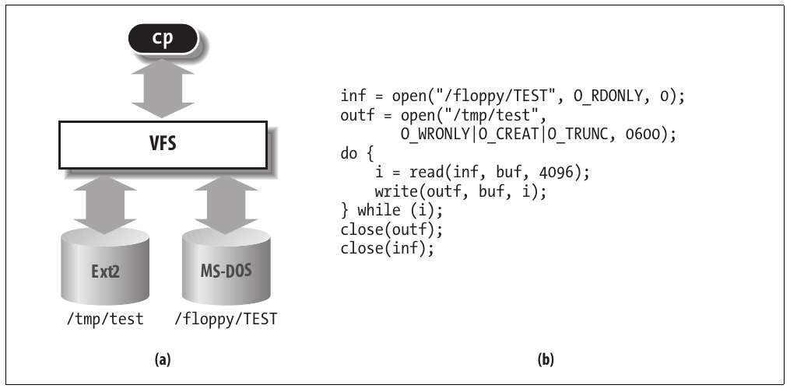
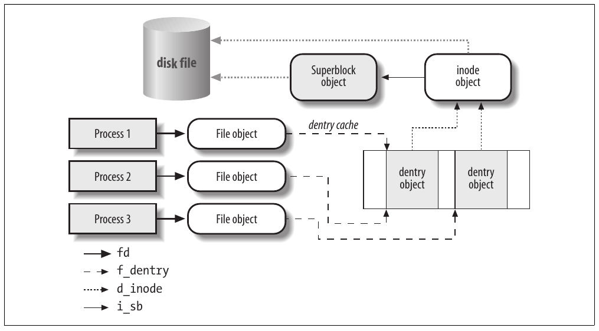
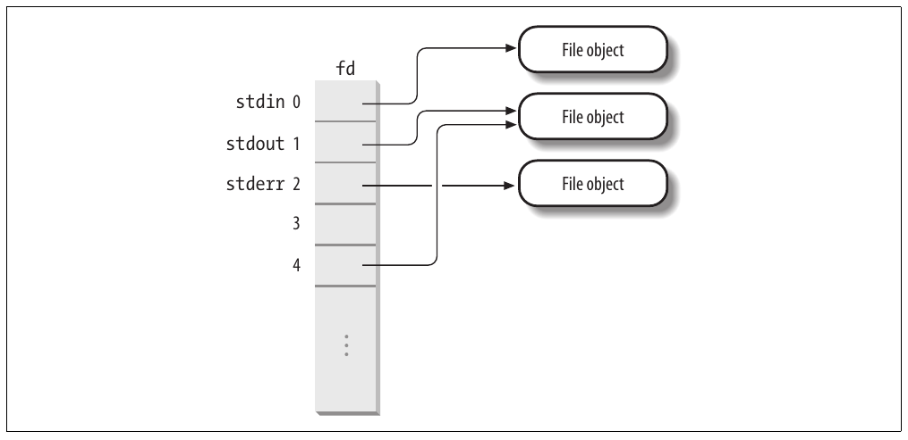

CHƯƠNG 12 Chương 12

# Chương 12. Virtual Filesystem


Một trong những chìa khóa thành công của Linux là khả năng cùng tồn tại thuận lợi với hệ thống khác. Bạn có thể mount một cách trong suốt disk hoặc partition chứa định dạng file do Windows, các hệ thống Unix khác, hoặc thậm chí hệ thống có thị phần rất nhỏ như Amiga sử dụng. Linux hỗ trợ nhiều loại filesystem theo cùng cách các biến thể Unix khác làm, qua khái niệm gọi là Virtual Filesystem.

Ý tưởng của Virtual Filesystem là đưa nhiều thông tin vào kernel để biểu diễn nhiều loại filesystem khác nhau; có field hoặc function hỗ trợ mỗi operation do tất cả filesystem thực mà Linux hỗ trợ cung cấp. Với mỗi function đọc, ghi hoặc function khác được gọi, kernel thay bằng function thực tế hỗ trợ native Linux filesystem, NTFS filesystem, hoặc bất cứ filesystem nào chứa file.

Chương này bàn về mục tiêu, cấu trúc và cách triển khai Virtual Filesystem của Linux. Nó tập trung vào ba trong năm loại file Unix chuẩn—cụ thể là regular file, directory và symbolic link. Device file được trình bày trong Chương 13, còn pipe được bàn trong Chương 19. Để cho thấy filesystem thực hoạt động thế nào, Chương 18 trình bày Second Extended Filesystem có trên gần như mọi hệ thống Linux.

## Vai trò của Virtual Filesystem (VFS)

Virtual Filesystem (còn gọi là Virtual Filesystem Switch hoặc VFS) là software layer của kernel xử lý mọi system call liên quan đến filesystem Unix chuẩn. Thế mạnh chính là cung cấp interface chung cho nhiều loại filesystem.

Ví dụ, giả sử user thực hiện shell command:

```c
$ cp /floppy/TEST /tmp/test
```

trong đó /floppy là mount point của diskette MS-DOS và /tmp là directory Second Extended Filesystem (Ext2) thông thường. VFS là abstraction layer giữa application program và các cách triển khai filesystem (xem Hình 12-1(a)). Do đó, chương trình cp không cần biết loại filesystem của /floppy/TEST và /tmp/test. Thay vào đó, cp tương tác với VFS qua các system call tổng quát quen thuộc với bất kỳ ai đã lập trình Unix (xem phần “File-Handling System Calls” trong Chương 1); code do cp thực thi được trình bày trong Hình 12-1(b).



Hình 12-1. Vai trò của VFS trong thao tác sao chép file đơn giản

Filesystem được VFS hỗ trợ có thể được nhóm thành ba lớp chính:

Disk-based filesystem

Chúng quản lý memory space khả dụng trong local disk hoặc device khác mô phỏng disk (như USB flash drive). Một số disk-based filesystem nổi tiếng được VFS hỗ trợ là:

  - Filesystem cho Linux như Second Extended Filesystem (Ext2) được dùng rộng rãi, Third Extended Filesystem (Ext3) mới hơn, và Reiser Filesystems (ReiserFS)[^1]

  - Filesystem cho biến thể Unix như sysv filesystem (System V, Coherent, Xenix), UFS (BSD, Solaris, NEXTSTEP), MINIX filesystem, và VERITAS VxFS (SCO UnixWare)

  - Filesystem của Microsoft như MS-DOS, VFAT (Windows 95 và các bản sau), và NTFS (Windows NT 4 và các bản sau)

  - ISO9660 CD-ROM filesystem (trước đây là High Sierra Filesystem) và Universal Disk Format (UDF) DVD filesystem

  - Filesystem độc quyền khác như OS/2 (HPFS) của IBM, Macintosh (HFS) của Apple, Fast Filesystem (AFFS) của Amiga, và Acorn Disk Filing System (ADFS)

  - Journaling filesystem bổ sung bắt nguồn từ hệ thống khác Linux như JFS của IBM và XFS của SGI

Network filesystem

Chúng cho phép truy cập dễ dàng file trong filesystem thuộc máy tính khác trên network. Một số network filesystem nổi tiếng được VFS hỗ trợ là NFS, Coda, AFS (Andrew filesystem), CIFS (Common Internet File System, dùng trong Microsoft Windows), và NCP (NetWare Core Protocol của Novell).

Special filesystem

Chúng không quản lý disk space cục bộ hay từ xa. Filesystem /proc là ví dụ điển hình của special filesystem (xem phần “Special Filesystems” phía sau).

Trong sách này, chúng tôi chỉ mô tả chi tiết filesystem Ext2 và Ext3 (xem Chương 18); không trình bày filesystem khác vì giới hạn dung lượng.

Như đã đề cập trong phần “An Overview of the Unix Filesystem” ở Chương 1, directory Unix tạo thành tree có root là directory /. Root directory nằm trong root filesystem, trong Linux thường có loại Ext2 hoặc Ext3. Mọi filesystem khác có thể được “mount” trên subdirectory của root filesystem.[^2]

Disk-based filesystem thường được lưu trong hardware block device như hard disk, floppy, hoặc CD-ROM. Tính năng hữu ích của VFS Linux cho phép xử lý virtual block device như /dev/loop0, có thể dùng để mount filesystem lưu trong regular file. Một ứng dụng khả dĩ là user bảo vệ filesystem riêng bằng cách lưu phiên bản mã hóa của nó trong regular file.

Virtual Filesystem đầu tiên có trong SunOS của Sun Microsystems năm 1986. Từ đó, hầu hết Unix filesystem có VFS. Tuy nhiên, VFS Linux hỗ trợ phạm vi filesystem rộng nhất.

### Common file model

Ý tưởng then chốt của VFS là đưa vào common file model có khả năng biểu diễn mọi filesystem được hỗ trợ. Model này phản ánh chặt chẽ file model do Unix filesystem truyền thống cung cấp. Điều này không đáng ngạc nhiên vì Linux muốn chạy native filesystem với overhead tối thiểu. Tuy nhiên, mỗi cách triển khai filesystem cụ thể phải chuyển cách tổ chức vật lý của nó sang common file model của VFS.

Ví dụ, trong common file model, mỗi directory được xem là file chứa list file và directory khác. Tuy nhiên, một số disk-based filesystem không phải Unix dùng File Allocation Table (FAT), lưu vị trí mỗi file trong directory tree. Trong các filesystem này, directory không phải file. Để tuân theo common file model của VFS, cách Linux triển khai các filesystem dựa trên FAT phải có thể tạo ngay khi cần các file tương ứng với directory. Những file đó chỉ tồn tại dưới dạng object trong kernel memory.

Cốt yếu hơn, Linux kernel không thể hardcode function cụ thể để xử lý operation như `read()` hoặc `ioctl()`. Thay vào đó, phải dùng pointer cho mỗi operation; pointer được đặt trỏ đến function thích hợp cho filesystem cụ thể đang được truy cập.

Hãy minh họa khái niệm này bằng cách cho thấy kernel chuyển `read()` trong Hình 12-1 thành lời gọi đặc thù MS-DOS filesystem như thế nào. Lời gọi `read()` của ứng dụng khiến kernel gọi service routine `sys_read()` tương ứng, như mọi system call khác. File được biểu diễn bằng data structure `file` trong kernel memory, như sẽ thấy phía sau chương này. Data structure này chứa field tên `f_op` chứa pointer đến function đặc thù file MS-DOS, gồm function đọc file. `sys_read()` tìm pointer đến function này và gọi nó. Do đó, `read()` của ứng dụng được chuyển thành lời gọi khá gián tiếp:

```c
file->f_op->read(...);
```

Tương tự, operation `write()` kích hoạt thực thi Ext2 write function thích hợp gắn với output file. Tóm lại, kernel chịu trách nhiệm gán tập pointer đúng cho biến `file` gắn với mỗi open file, rồi gọi lời gọi đặc thù từng filesystem mà field `f_op` trỏ đến.

Có thể xem common file model là object-oriented, trong đó object là cấu trúc software định nghĩa cả data structure lẫn method thao tác trên nó. Vì lý do hiệu quả, Linux không được viết bằng ngôn ngữ object-oriented như C++. Do đó, object được triển khai bằng C data structure thông thường với một số field trỏ đến function tương ứng method của object.

Common file model gồm các loại object sau:

Superblock object

Lưu thông tin về mounted filesystem. Với disk-based filesystem, object này thường tương ứng filesystem control block lưu trên disk.

Inode object

Lưu thông tin chung về file cụ thể. Với disk-based filesystem, object này thường tương ứng file control block lưu trên disk. Mỗi inode object gắn với inode number, xác định duy nhất file trong filesystem.

File object

Lưu thông tin về tương tác giữa open file và process. Thông tin này chỉ tồn tại trong kernel memory trong khoảng thời gian process mở file.

Dentry object

Lưu thông tin liên kết directory entry (tức tên cụ thể của file) với file tương ứng. Mỗi disk-based filesystem lưu thông tin này trên disk theo cách riêng.

Hình 12-2 minh họa bằng ví dụ đơn giản cách process tương tác với file. Ba process khác nhau đã mở cùng file, hai process dùng cùng hard link. Trong trường hợp này, mỗi trong ba process dùng file object riêng, còn chỉ cần hai dentry object—một cho mỗi hard link. Cả hai dentry object tham chiếu cùng inode object, xác định superblock object và, cùng object này, xác định disk file chung.



Hình 12-2. Tương tác giữa process và VFS object

Ngoài cung cấp interface chung cho mọi cách triển khai filesystem, VFS còn có vai trò quan trọng liên quan đến hiệu năng hệ thống. Các dentry object dùng gần đây nhất nằm trong disk cache tên dentry cache, tăng tốc chuyển từ file pathname sang inode của pathname component cuối.

Nói chung, disk cache là cơ chế software cho phép kernel giữ trong RAM một số thông tin thường lưu trên disk, để các truy cập tiếp theo đến dữ liệu được đáp ứng nhanh mà không phải truy cập chậm vào chính disk.

Lưu ý disk cache khác hardware cache hoặc memory cache thế nào; cả hai loại sau không liên quan đến disk hay device khác. Hardware cache là static RAM nhanh giúp tăng tốc yêu cầu đến dynamic RAM chậm hơn (xem phần “Hardware Cache” trong Chương 2). Memory cache là cơ chế software được đưa vào để bỏ qua Kernel Memory Allocator (xem phần “The Slab Allocator” trong Chương 8).

Ngoài dentry cache và inode cache, Linux dùng các disk cache khác. Loại quan trọng nhất, gọi là page cache, được mô tả chi tiết trong Chương 15.

### System call do VFS xử lý

Bảng 12-1 minh họa VFS system call liên quan đến filesystem, regular file, directory và symbolic link. Một số system call khác do VFS xử lý, như `ioperm()`, `ioctl()`, `pipe()`, và `mknod()`, liên quan đến device file và pipe. Chúng được bàn trong các chương sau. Nhóm system call cuối do VFS xử lý, như `socket()`, `connect()`, và `bind()`, liên quan đến socket và được dùng để triển khai networking. Một số kernel service routine tương ứng system call trong Bảng 12-1 được bàn trong chương này hoặc Chương 18.

Bảng 12-1. Một số system call do VFS xử lý

| Tên system call | Mô tả |
|---|---|
| `mount() umount() umount2()` | Mount/unmount filesystem |
| `sysfs()` | Lấy thông tin filesystem |
| `statfs() fstatfs() statfs64() fstatfs64() ustat()` | Lấy thống kê filesystem |
| `chroot() pivot_root()` | Thay đổi root directory |
| `chdir() fchdir() getcwd()` | Thao tác current directory |
| `mkdir() rmdir()` | Tạo và hủy directory |
| `getdents() getdents64() readdir() link() unlink() rename() lookup_dcookie()` | Thao tác directory entry |
| `readlink() symlink()` | Thao tác soft link |
| `chown() fchown() lchown() chown16() fchown16() lchown16()` | Sửa file owner |
| `chmod() fchmod() utime()` | Sửa thuộc tính file |
| `stat() fstat() lstat() access() oldstat() oldfstat() oldlstat() stat64() lstat64() fstat64()` | Đọc trạng thái file |
| `open() close() creat() umask()` | Mở, đóng và tạo file |
| `dup() dup2() fcntl() fcntl64()` | Thao tác file descriptor |
| `select() poll()` | Đợi sự kiện trên tập file descriptor |
| `truncate() ftruncate() truncate64() ftruncate64()` | Thay đổi file size |
| `lseek() _llseek()` | Thay đổi file pointer |
| `read() write() readv() writev() sendfile() sendfile64() readahead()` | Thực hiện file I/O operation |
| `io_setup() io_submit() io_getevents() io_cancel() io_destroy()` | Asynchronous I/O (cho phép nhiều yêu cầu đọc và ghi đang chờ hoàn tất) |
| `pread64() pwrite64()` | Seek file và truy cập file |
| `mmap() mmap2() munmap() madvise() mincore() remap_file_pages()` | Xử lý file memory mapping |
| `fdatasync() fsync() sync() msync()` | Đồng bộ dữ liệu file |
| `flock()` | Thao tác file lock |
| `setxattr() lsetxattr() fsetxattr() getxattr() lgetxattr() fgetxattr() listxattr() llistxattr() flistxattr() removexattr() lremovexattr() fremovexattr()` | Thao tác extended attribute của file |

Chúng ta đã nói VFS là lớp giữa application program và filesystem cụ thể. Tuy nhiên, trong một số trường hợp, VFS có thể tự thực hiện file operation mà không gọi lower-level procedure. Ví dụ, khi process đóng open file, thường không cần đụng đến file trên disk, nên VFS chỉ giải phóng file object tương ứng. Tương tự, khi system call `lseek()` sửa file pointer, là thuộc tính liên quan đến tương tác giữa opened file và process, VFS chỉ cần sửa file object tương ứng mà không truy cập file trên disk, nên không phải gọi procedure của filesystem cụ thể. Theo nghĩa nào đó, có thể xem VFS là filesystem “tổng quát” dựa vào filesystem cụ thể khi cần.

## Data structure của VFS

Mỗi VFS object được lưu trong data structure phù hợp, chứa cả thuộc tính object lẫn pointer đến table method của object. Kernel có thể thay đổi động method của object và do đó thiết lập hành vi chuyên biệt cho object. Các phần sau giải thích chi tiết VFS object và quan hệ giữa chúng.

### Superblock object

Superblock object gồm structure `super_block` có các field mô tả trong Bảng 12-2.

Bảng 12-2. Các field của superblock object

| Kiểu | Field | Mô tả |
|---|---|---|
| `struct list_head` | `s_list` | Pointer cho superblock list |
| `dev_t` | `s_dev` | Device identifier |
| `unsigned long` | `s_blocksize` | Block size tính bằng byte |
| `unsigned long` | `s_old_blocksize` | Block size tính bằng byte do block device driver bên dưới báo cáo |
| `unsigned char` | `s_blocksize_bits` | Block size theo số bit |
| `unsigned char` | `s_dirt` | Flag đã sửa đổi (dirty) |
| `unsigned long long` | `s_maxbytes` | Kích thước file tối đa |
| `struct file_system_type *` | `s_type` | Loại filesystem |
| `struct super_operations *` | `s_op` | Superblock method |
| `struct dquot_operations *` | `dq_op` | Method xử lý disk quota |
| `struct quotactl_ops *` | `s_qcop` | Method quản trị disk quota |
| `struct export_operations *` | `s_export_op` | Export operation do network filesystem dùng |
| `unsigned long` | `s_flags` | Mount flag |
| `unsigned long` | `s_magic` | Filesystem magic number |
| `struct dentry *` | `s_root` | Dentry object của root directory của filesystem |
| `struct rw_semaphore` | `s_umount` | Semaphore dùng cho unmount |
| `struct semaphore` | `s_lock` | Superblock semaphore |
| `int` | `s_count` | Reference counter |
| `int` | `s_syncing` | Flag cho biết inode của superblock đang được đồng bộ |
| `int` | `s_need_sync_fs` | Flag dùng khi đồng bộ mounted filesystem của superblock |
| `atomic_t` | `s_active` | Reference counter phụ |
| `void *` | `s_security` | Pointer đến superblock security structure |
| `struct xattr_handler **` | `s_xattr` | Pointer đến superblock extended attribute structure |
| `struct list_head` | `s_inodes` | List mọi inode |
| `struct list_head` | `s_dirty` | List inode đã sửa đổi |
| `struct list_head` | `s_io` | List inode đợi ghi vào disk |
| `struct hlist_head` | `s_anon` | List anonymous dentry để xử lý remote network filesystem |
| `struct list_head` | `s_files` | List file object |
| `struct block_device *` | `s_bdev` | Pointer đến block device driver descriptor |
| `struct list_head` | `s_instances` | Pointer cho list superblock object của loại filesystem cho trước (xem phần “Filesystem Type Registration” phía sau) |
| `struct quota_info` | `s_dquot` | Descriptor cho disk quota |
| `int` | `s_frozen` | Flag dùng khi freeze filesystem (buộc về trạng thái nhất quán) |
| `wait_queue_head_t` | `s_wait_unfrozen` | Wait queue nơi process sleep cho đến khi filesystem được unfreeze |
| `char[]` | `s_id` | Tên block device chứa superblock |
| `void *` | `s_fs_info` | Pointer đến thông tin superblock của filesystem cụ thể |
| `struct semaphore` | `s_vfs_rename_sem` | Semaphore VFS dùng khi đổi tên file qua các directory |
| `u32` | `s_time_gran` | Độ phân giải timestamp (nanosecond) |

Mọi superblock object được nối trong circular doubly linked list. Phần tử đầu list được biến `super_blocks` biểu diễn, còn field `s_list` của superblock object lưu pointer đến phần tử liền kề trong list. Spin lock `sb_lock` bảo vệ list khỏi truy cập đồng thời trên hệ thống multiprocessor.

Field `s_fs_info` trỏ đến thông tin superblock thuộc filesystem cụ thể; ví dụ, như sẽ thấy phía sau trong Chương 18, nếu superblock object tham chiếu Ext2 filesystem, field trỏ đến structure `ext2_sb_info`, chứa disk allocation bit mask và dữ liệu khác không liên quan đến common file model của VFS.

Nói chung, dữ liệu được field `s_fs_info` trỏ đến là thông tin từ disk được sao chép trong memory vì lý do hiệu quả. Mỗi disk-based filesystem cần truy cập và cập nhật allocation bitmap để cấp phát hoặc giải phóng disk block. VFS cho phép các filesystem này thao tác trực tiếp trên field `s_fs_info` của superblock trong memory mà không truy cập disk.

Tuy nhiên, cách này dẫn đến vấn đề mới: VFS superblock có thể không còn đồng bộ với superblock tương ứng trên disk. Do đó cần đưa vào flag `s_dirt`, chỉ định superblock có dirty không—tức dữ liệu trên disk có cần cập nhật không. Thiếu đồng bộ dẫn đến vấn đề filesystem hỏng quen thuộc khi mất điện mà user không có cơ hội shutdown hệ thống sạch. Như sẽ thấy trong phần “Writing Dirty Pages to Disk” ở Chương 15, Linux giảm thiểu vấn đề bằng cách định kỳ sao chép mọi dirty superblock vào disk.

Method gắn với superblock gọi là superblock operation. Chúng được structure `super_operations` mô tả, có địa chỉ nằm trong field `s_op`.

Mỗi filesystem cụ thể có thể định nghĩa superblock operation riêng. Khi VFS cần gọi một operation, chẳng hạn `read_inode()`, nó thực thi:

```c
sb->s_op->read_inode(inode);
```

trong đó `sb` lưu địa chỉ superblock object liên quan. Field `read_inode` của table `super_operations` chứa địa chỉ function phù hợp, do đó được gọi trực tiếp.

Hãy mô tả ngắn gọn superblock operation, triển khai higher-level operation như xóa file hoặc mount disk. Chúng được liệt kê theo thứ tự xuất hiện trong table `super_operations`:

`alloc_inode(sb)`

Cấp phát chỗ cho inode object, gồm chỗ cần cho dữ liệu riêng của filesystem.

`destroy_inode(inode)`

Hủy inode object, gồm dữ liệu riêng của filesystem.

`read_inode(inode)`

Điền các field của inode object truyền làm parameter bằng dữ liệu trên disk; field `i_ino` của inode object xác định filesystem inode cụ thể cần đọc trên disk.

`dirty_inode(inode)`

Được gọi khi inode được đánh dấu đã sửa đổi (dirty). Filesystem như ReiserFS và Ext3 dùng để cập nhật filesystem journal trên disk.

`write_inode(inode, flag)`

Cập nhật filesystem inode bằng nội dung inode object truyền làm parameter; field `i_ino` của inode object xác định filesystem inode liên quan trên disk. Parameter `flag` cho biết I/O operation có phải synchronous không.

`put_inode(inode)`

Được gọi khi inode được giải phóng—reference counter giảm—để thực hiện operation riêng của filesystem.

`drop_inode(inode)`

Được gọi khi inode sắp bị hủy—tức user cuối cùng giải phóng inode; filesystem triển khai method này thường dùng `generic_drop_inode()`. Function này loại mọi tham chiếu đến inode khỏi VFS data structure và, nếu inode không còn xuất hiện trong directory nào, gọi superblock method `delete_inode` để xóa inode khỏi filesystem.

`delete_inode(inode)`

Được gọi khi phải hủy inode. Xóa VFS inode trong memory và dữ liệu, metadata của file trên disk.

`put_super(super)`

Giải phóng superblock object truyền làm parameter (vì filesystem tương ứng được unmount).

`write_super(super)`

Cập nhật filesystem superblock bằng nội dung object được chỉ định.

`sync_fs(sb, wait)`

Được gọi khi flush filesystem để cập nhật data structure riêng của filesystem trên disk (được journaling filesystem dùng).

`write_super_lockfs(super)`

Block thay đổi filesystem và cập nhật superblock bằng nội dung object được chỉ định. Method này được gọi khi filesystem bị freeze, ví dụ bởi Logical Volume Manager (LVM) driver.

`unlockfs(super)`

Hoàn tác việc block cập nhật filesystem do superblock method `write_super_lockfs` thực hiện.

`statfs(super, buf)`

Trả về thống kê filesystem bằng cách điền buffer `buf`.

`remount_fs(super, flags, data)`

Remount filesystem với option mới (được gọi khi cần thay đổi mount option).

`clear_inode(inode)`

Được gọi khi disk inode đang bị hủy để thực hiện operation riêng của filesystem.

`umount_begin(super)`

Hủy mount operation vì unmount operation tương ứng đã bắt đầu (chỉ được network filesystem dùng).

`show_options(seq_file, vfsmount)`

Dùng để hiển thị option riêng của filesystem

`quota_read(super, type, data, size, offset)`

Được quota system dùng để đọc dữ liệu từ file chỉ định giới hạn cho filesystem này.[^3]

`quota_write(super, type, data, size, offset)`

Được quota system dùng để ghi dữ liệu vào file chỉ định giới hạn cho filesystem này.

Các method trên khả dụng cho mọi loại filesystem có thể. Tuy nhiên, chỉ một tập con áp dụng cho từng filesystem cụ thể; field tương ứng method chưa triển khai được đặt thành `NULL`. Lưu ý không định nghĩa method `get_super` để đọc superblock—kernel làm sao gọi method của object chưa đọc từ disk? Chúng ta sẽ thấy method `get_sb` tương đương trong object khác mô tả loại filesystem (xem phần “Filesystem Type Registration” phía sau).

### Inode object

Mọi thông tin filesystem cần để xử lý file nằm trong data structure gọi là inode. Filename là nhãn được gán tùy ý có thể thay đổi, nhưng inode là duy nhất cho file và không đổi chừng nào file còn tồn tại. Inode object trong memory gồm structure `inode` có các field mô tả trong Bảng 12-3.

Bảng 12-3. Các field của inode object

| Kiểu | Field | Mô tả |
|---|---|---|
| `struct hlist_node` | `i_hash` | Pointer cho hash list |
| `struct list_head` | `i_list` | Pointer cho list mô tả state hiện tại của inode |
| `struct list_head` | `i_sb_list` | Pointer cho list inode của superblock |
| `struct list_head` | `i_dentry` | Đầu list dentry object tham chiếu inode này |
| `unsigned long` | `i_ino` | Inode number |
| `atomic_t` | `i_count` | Usage counter |
| `umode_t` | `i_mode` | Loại file và access right |
| `unsigned int` | `i_nlink` | Số hard link |
| `uid_t` | `i_uid` | Owner identifier |
| `gid_t` | `i_gid` | Group identifier |
| `dev_t` | `i_rdev` | Real device identifier |
| `loff_t` | `i_size` | Độ dài file tính bằng byte |
| `struct timespec` | `i_atime` | Thời điểm truy cập file gần nhất |
| `struct timespec` | `i_mtime` | Thời điểm ghi file gần nhất |
| `struct timespec` | `i_ctime` | Thời điểm thay đổi inode gần nhất |
| `unsigned int` | `i_blkbits` | Block size theo số bit |
| `unsigned long` | `i_blksize` | Block size tính bằng byte |
| `unsigned long` | `i_version` | Version number, tự động tăng sau mỗi lần dùng |
| `unsigned long` | `i_blocks` | Số block của file |
| `unsigned short` | `i_bytes` | Số byte trong block cuối của file |
| `unsigned char` | `i_sock` | Khác không nếu file là socket |
| `spinlock_t` | `i_lock` | Spin lock bảo vệ một số field của inode |
| `struct semaphore` | `i_sem` | Inode semaphore |
| `struct rw_semaphore` | `i_alloc_sem` | Read/write semaphore bảo vệ khỏi race condition trong direct I/O file operation |
| `struct inode_operations *` | `i_op` | Inode operation |
| `struct file_operations *` | `i_fop` | File operation mặc định |
| `struct super_block *` | `i_sb` | Pointer đến superblock object |
| `struct file_lock *` | `i_flock` | Pointer đến file lock list |
| `struct address_space *` | `i_mapping` | Pointer đến object `address_space` (xem Chương 15) |
| `struct address_space` | `i_data` | Object `address_space` của file |
| `struct dquot * []` | `i_dquot` | Disk quota của inode |
| `struct list_head` | `i_devices` | Pointer cho list inode liên quan đến character hoặc block device cụ thể (xem Chương 13) |
| `struct pipe_inode_info *` | `i_pipe` | Dùng nếu file là pipe (xem Chương 19) |
| `struct block_device *` | `i_bdev` | Pointer đến block device driver |
| `struct cdev *` | `i_cdev` | Pointer đến character device driver |
| `int` | `i_cindex` | Index của device file trong nhóm minor number |
| `__u32` | `i_generation` | Version number của inode (được một số filesystem dùng) |
| `unsigned long` | `i_dnotify_mask` | Bit mask của directory notify event |
| `struct dnotify_struct *` | `i_dnotify` | Dùng cho directory notification |
| `unsigned long` | `i_state` | State flag của inode |
| `unsigned long` | `dirtied_when` | Thời điểm inode thành dirty (tính bằng tick) |
| `unsigned int` | `i_flags` | Filesystem mount flag |
| `atomic_t` | `i_writecount` | Usage counter cho process ghi |
| `void *` | `i_security` | Pointer đến security structure của inode |
| `void *` | `u.generic_ip` | Pointer đến private data |
| `seqcount_t` | `i_size_seqcount` | Sequence counter dùng trong hệ thống SMP để lấy giá trị nhất quán cho `i_size` |

Mỗi inode object sao chép một phần dữ liệu trong disk inode—ví dụ số block cấp phát cho file. Khi giá trị field `i_state` bằng `I_DIRTY_SYNC`, `I_DIRTY_DATASYNC`, hoặc `I_DIRTY_PAGES`, inode là dirty—tức phải cập nhật disk inode tương ứng. Có thể dùng macro `I_DIRTY` để kiểm tra giá trị cả ba flag cùng lúc (xem chi tiết phía sau). Giá trị khác của field `i_state` là `I_LOCK` (inode object tham gia I/O transfer), `I_FREEING` (inode object đang được giải phóng), `I_CLEAR` (nội dung inode object không còn ý nghĩa), và `I_NEW` (inode object đã được cấp phát nhưng chưa điền dữ liệu đọc từ disk inode).

Mỗi inode object luôn xuất hiện trong một circular doubly linked list sau (trong mọi trường hợp, pointer đến phần tử liền kề được lưu trong field `i_list`):

- List valid unused inode, thường là inode phản ánh disk inode hợp lệ và hiện không được process nào dùng. Các inode này không dirty và field `i_count` được đặt thành 0. Phần tử đầu và cuối list lần lượt được các field `next` và `prev` của biến `inode_unused` tham chiếu. List này đóng vai trò disk cache.

- List in-use inode, tức inode phản ánh disk inode hợp lệ và được process nào đó dùng. Các inode này không dirty và field `i_count` dương. Phần tử đầu và cuối được biến `inode_in_use` tham chiếu.

- List dirty inode. Phần tử đầu và cuối được field `s_dirty` của superblock object tương ứng tham chiếu.

Mỗi list vừa nêu liên kết các field `i_list` của inode object thích hợp.

Hơn nữa, mỗi inode object còn nằm trong per-filesystem doubly linked circular list có đầu tại field `s_inodes` của superblock object; field `i_sb_list` của inode object lưu pointer đến phần tử liền kề trong list này.

Cuối cùng, inode object còn nằm trong hash table tên `inode_hashtable`. Hash table tăng tốc tìm inode object khi kernel biết cả inode number lẫn địa chỉ superblock object tương ứng filesystem chứa file. Vì hashing có thể gây collision, inode object có field `i_hash` chứa backward pointer và forward pointer đến inode khác hash vào cùng vị trí; field này tạo doubly linked list của các inode đó.

Method gắn với inode object còn gọi là inode operation. Chúng được structure `inode_operations` mô tả, có địa chỉ nằm trong field `i_op`. Sau đây là inode operation theo thứ tự xuất hiện trong table `inode_operations`:

`create(dir, dentry, mode, nameidata)`

Tạo disk inode mới cho regular file gắn với dentry object trong một directory.

`lookup(dir, dentry, nameidata)`

Tìm trong directory inode tương ứng filename nằm trong dentry object.

`link(old_dentry, dir, new_dentry)`

Tạo hard link mới tham chiếu file do `old_dentry` chỉ định trong directory `dir`; hard link mới có tên do `new_dentry` chỉ định.

`unlink(dir, dentry)`

Loại hard link của file do dentry object chỉ định khỏi directory.

`symlink(dir, dentry, symname)`

Tạo inode mới cho symbolic link gắn với dentry object trong một directory.

`mkdir(dir, dentry, mode)`

Tạo inode mới cho directory gắn với dentry object trong một directory.

`rmdir(dir, dentry)`

Loại khỏi directory subdirectory có tên nằm trong dentry object.

`mknod(dir, dentry, mode, rdev)`

Tạo disk inode mới cho special file gắn với dentry object trong một directory. Các parameter `mode` và `rdev` lần lượt chỉ định loại file và major number, minor number của device.

`rename(old_dir, old_dentry, new_dir, new_dentry)`

Di chuyển file do `old_entry` xác định từ directory `old_dir` sang `new_dir`. Filename mới nằm trong dentry object mà `new_dentry` trỏ đến.

`readlink(dentry, buffer, buflen)`

Sao chép vào User Mode memory area do `buffer` chỉ định file pathname tương ứng symbolic link do dentry chỉ định.

`follow_link(inode, nameidata)`

Phân giải symbolic link do inode object chỉ định; nếu symbolic link là relative pathname, lookup operation bắt đầu từ directory chỉ định trong parameter thứ hai.

`put_link(dentry, nameidata)`

Giải phóng mọi data structure tạm do method `follow_link` cấp phát để phân giải symbolic link.

`truncate(inode)`

Sửa kích thước file gắn với inode. Trước khi gọi method này, cần đặt field `i_size` của inode object thành kích thước mới được yêu cầu.

`permission(inode, mask, nameidata)`

Kiểm tra access mode được chỉ định có được phép với file gắn với `inode` không.

`setattr(dentry, iattr)`

Thông báo “change event” sau khi đụng đến thuộc tính inode.

`getattr(mnt, dentry, kstat)`

Được một số filesystem dùng để đọc thuộc tính inode.

`setxattr(dentry, name, value, size, flags)`

Đặt “extended attribute” của inode (extended attribute được lưu trên disk block bên ngoài mọi inode).

`getxattr(dentry, name, buffer, size)`

Lấy extended attribute của inode.

`listxattr(dentry, buffer, size)`

Lấy toàn bộ list tên extended attribute.

`removexattr(dentry, name)`

Loại extended attribute của inode.

Các method vừa liệt kê khả dụng cho mọi inode và loại filesystem có thể. Tuy nhiên, chỉ một tập con áp dụng cho inode và filesystem cụ thể; field tương ứng method chưa triển khai được đặt thành `NULL`.

### File object

File object mô tả cách process tương tác với file đã mở. Object được tạo khi mở file và gồm structure `file`, có các field mô tả trong Bảng 12-4. Lưu ý file object không có image tương ứng trên disk, nên structure `file` không có field “dirty” để chỉ định file object đã bị sửa.

Bảng 12-4. Các field của file object

| Kiểu | Field | Mô tả |
|---|---|---|
| `struct list_head` | `f_list` | Pointer cho generic file object list |
| `struct dentry *` | `f_dentry` | Dentry object gắn với file |
| `struct vfsmount *` | `f_vfsmnt` | Mounted filesystem chứa file |
| `struct file_operations *` | `f_op` | Pointer đến file operation table |
| `atomic_t` | `f_count` | Reference counter của file object |
| `unsigned int` | `f_flags` | Flag được chỉ định khi mở file |
| `mode_t` | `f_mode` | Access mode của process |
| `int` | `f_error` | Error code cho network write operation |
| `loff_t` | `f_pos` | File offset hiện tại (file pointer) |
| `struct fown_struct` | `f_owner` | Dữ liệu cho I/O event notification qua signal |
| `unsigned int` | `f_uid` | UID của user |
| `unsigned int` | `f_gid` | User group ID |
| `struct file_ra_state` | `f_ra` | File read-ahead state (xem Chương 16) |
| `size_t` | `f_maxcount` | Số byte tối đa có thể đọc hoặc ghi bằng một operation (hiện đặt thành 231–1) |
| `unsigned long` | `f_version` | Version number, tự động tăng sau mỗi lần dùng |
| `void *` | `f_security` | Pointer đến security structure của file object |
| `void *` | `private_data` | Pointer đến dữ liệu riêng của filesystem hoặc device driver |
| `struct list_head` | `f_ep_links` | Đầu list event poll waiter cho file này |
| `spinlock_t` | `f_ep_lock` | Spin lock bảo vệ list `f_ep_links` |
| `struct address_space *` | `f_mapping` | Pointer đến address space object của file (xem Chương 15) |

Thông tin chính lưu trong file object là file pointer—vị trí hiện tại trong file mà operation tiếp theo sẽ diễn ra từ đó. Vì nhiều process có thể truy cập đồng thời cùng file, file pointer phải giữ trong file object thay vì inode object.

File object được cấp phát qua slab cache tên filp, có địa chỉ descriptor lưu trong biến `filp_cachep`. Vì số file object có thể cấp phát bị giới hạn, biến `files_stat` chỉ định trong field `max_files` số file object tối đa có thể cấp phát—tức số file tối đa có thể truy cập cùng lúc trong hệ thống.[^4]

File object “đang dùng” được tập hợp trong một số list có gốc tại superblock của filesystem sở hữu. Mỗi superblock object lưu trong field `s_files` đầu list file object; do đó file object của file thuộc filesystem khác nhau nằm trong list khác nhau. Pointer đến phần tử trước và sau trong list được lưu trong field `f_list` của file object. Spin lock `files_lock` bảo vệ các list `s_files` của superblock khỏi truy cập đồng thời trên hệ thống multiprocessor.

Field `f_count` của file object là reference counter: đếm số process dùng file object (nhớ rằng lightweight process được tạo với flag `CLONE_FILES` chia sẻ table xác định open file, nên dùng cùng file object). Counter còn tăng khi chính kernel dùng file object—ví dụ khi object được chèn vào list, hoặc khi system call `dup()` được thực hiện.

Khi VFS phải mở file thay mặt process, nó gọi function `get_empty_filp()` để cấp phát file object mới. Function gọi `kmem_cache_alloc()` để lấy file object trống từ filp cache, rồi khởi tạo các field của object như sau:

```c
memset(f, 0, sizeof(*f));
INIT_LIST_HEAD(&f->f_ep_links);
spin_lock_init(&f->f_ep_lock);
atomic_set(&f->f_count, 1);
f->f_uid = current->fsuid;
f->f_gid = current->fsgid;
f->f_owner.lock = RW_LOCK_UNLOCKED;
INIT_LIST_HEAD(&f->f_list);
f->f_maxcount = INT_MAX;
```

Như giải thích trước đó trong phần “The Common File Model”, mỗi filesystem chứa tập file operation riêng thực hiện hoạt động như đọc và ghi file. Khi kernel load inode từ disk vào memory, nó lưu pointer đến các file operation này trong structure `file_operations` có địa chỉ nằm trong field `i_fop` của inode object. Khi process mở file, VFS khởi tạo field `f_op` của file object mới bằng địa chỉ lưu trong inode để các lời gọi file operation sau có thể dùng những function này. Nếu cần, VFS có thể sửa tập file operation sau đó bằng cách lưu giá trị mới vào `f_op`.

Danh sách sau mô tả file operation theo thứ tự xuất hiện trong table `file_operations`:

`llseek(file, offset, origin)`

Cập nhật file pointer.

`read(file, buf, count, offset)`

Đọc `count` byte từ file bắt đầu tại vị trí `*offset`; sau đó tăng giá trị `*offset` (thường tương ứng file pointer).

`aio_read(req, buf, len, pos)`

Bắt đầu asynchronous I/O operation để đọc `len` byte vào `buf` từ vị trí file `pos` (được đưa vào để hỗ trợ system call `io_submit()`).

`write(file, buf, count, offset)`

Ghi `count` byte vào file bắt đầu tại vị trí `*offset`; sau đó tăng giá trị `*offset` (thường tương ứng file pointer).

`aio_write(req, buf, len, pos)`

Bắt đầu asynchronous I/O operation để ghi `len` byte từ `buf` đến vị trí file `pos`.

`readdir(dir, dirent, filldir)`

Trả về directory entry tiếp theo của directory trong `dirent`; parameter `filldir` chứa địa chỉ auxiliary function trích xuất field trong directory entry.

`poll(file, poll_table)`

Kiểm tra có hoạt động trên file không và sleep đến khi có điều gì xảy ra trên file.

`ioctl(inode, file, cmd, arg)`

Gửi command đến hardware device bên dưới. Method này chỉ áp dụng cho device file.

`unlocked_ioctl(file, cmd, arg)`

Giống method `ioctl`, nhưng không lấy big kernel lock (xem phần “The Big Kernel Lock” trong Chương 5). Dự kiến mọi device driver và filesystem sẽ triển khai method mới này thay cho method `ioctl`.

`compat_ioctl(file, cmd, arg)`

Method dùng để triển khai system call `ioctl()` 32-bit bằng kernel 64-bit.

`mmap(file, vma)`

Thực hiện memory mapping file vào process address space (xem phần “Memory Mapping” trong Chương 16).

`open(inode, file)`

Mở file bằng cách tạo file object mới và liên kết với inode object tương ứng (xem phần “The open() System Call” ở phần sau chương này).

`flush(file)`

Được gọi khi đóng tham chiếu đến open file. Mục đích thực tế của method phụ thuộc filesystem.

`release(inode, file)`

Giải phóng file object. Được gọi khi đóng tham chiếu cuối đến open file—tức field `f_count` của file object thành 0.

`fsync(file, dentry, flag)`

Flush file bằng cách ghi mọi dữ liệu đã cache vào disk.

`aio_fsync(req, flag)`

Bắt đầu asynchronous I/O flush operation.

`fasync(fd, file, on)`

Enable hoặc disable I/O event notification bằng signal.

`lock(file, cmd, file_lock)`

Áp dụng lock cho file (xem phần “File Locking” ở phần sau chương này).

`readv(file, vector, count, offset)`

Đọc byte từ file và đặt kết quả trong buffer do `vector` mô tả; số buffer được `count` chỉ định.

`writev(file, vector, count, offset)`

Ghi byte vào file từ buffer do `vector` mô tả; số buffer được `count` chỉ định.

`sendfile(in_file, offset, count, file_send_actor, out_file)`

Truyền dữ liệu từ `in_file` đến `out_file` (được đưa vào để hỗ trợ system call `sendfile()`).

`sendpage(file, page, offset, size, pointer, fill)`

Truyền dữ liệu từ `file` đến `page` của page cache; đây là low-level method do `sendfile()` và networking code cho socket dùng.

`get_unmapped_area(file, addr, len, offset, flags)`

Lấy dải địa chỉ chưa dùng để map file.

`check_flags(flags)`

Method được service routine của system call `fcntl()` gọi để kiểm tra bổ sung khi đặt status flag của file (command `F_SETFL`). Hiện chỉ được NFS network filesystem dùng.

`dir_notify(file, arg)`

Method được service routine của system call `fcntl()` gọi khi thiết lập directory change notification (command `F_NOTIFY`). Hiện chỉ được Common Internet File System (CIFS) network filesystem dùng.

`flock(file, flag, lock)`

Dùng để tùy chỉnh hành vi system call `flock()`. Không Linux filesystem chính thức nào dùng method này.

Các method vừa mô tả khả dụng cho mọi loại file có thể. Tuy nhiên, chỉ một tập con áp dụng cho loại file cụ thể; field tương ứng method chưa triển khai được đặt thành `NULL`.

### Dentry object

Chúng ta đã đề cập trong phần “The Common File Model” rằng VFS xem mỗi directory là file chứa list file và directory khác. Trong Chương 18, chúng ta sẽ bàn cách triển khai directory trên filesystem cụ thể. Tuy nhiên, khi directory entry được đọc vào memory, VFS biến đổi nó thành dentry object dựa trên structure `dentry`, có các field mô tả trong Bảng 12-5. Kernel tạo dentry object cho mỗi component của pathname mà process tra cứu; dentry object liên kết component với inode tương ứng. Ví dụ, khi tra cứu pathname /tmp/test, kernel tạo dentry object cho root directory /, dentry object thứ hai cho entry tmp của root directory, và dentry object thứ ba cho entry test của directory /tmp.

Lưu ý dentry object không có image tương ứng trên disk, nên structure `dentry` không có field chỉ định object đã bị sửa. Dentry object được lưu trong slab allocator cache có descriptor là `dentry_cache`; do đó dentry object được tạo và hủy bằng cách gọi `kmem_cache_alloc()` và `kmem_cache_free()`.

Bảng 12-5. Các field của dentry object

| Kiểu | Field | Mô tả |
|---|---|---|
| `atomic_t` | `d_count` | Usage counter của dentry object |
| `unsigned int` | `d_flags` | Dentry cache flag |
| `spinlock_t` | `d_lock` | Spin lock bảo vệ dentry object |
| `struct inode *` | `d_inode` | Inode gắn với filename |
| `struct dentry *` | `d_parent` | Dentry object của parent directory |
| `struct qstr` | `d_name` | Filename |
| `struct list_head` | `d_lru` | Pointer cho list unused dentry |
| `struct list_head` | `d_child` | Với directory, pointer cho list directory dentry trong cùng parent directory |
| `struct list_head` | `d_subdirs` | Với directory, đầu list subdirectory dentry |
| `struct list_head` | `d_alias` | Pointer cho list dentry gắn với cùng inode (alias) |
| `unsigned long` | `d_time` | Được method `d_revalidate` dùng |
| `struct dentry_operations*` | `d_op` | Dentry method |
| `struct super_block *` | `d_sb` | Superblock object của file |
| `void *` | `d_fsdata` | Dữ liệu phụ thuộc filesystem |
| `struct rcu_head` | `d_rcu` | RCU descriptor dùng khi reclaim dentry object (xem phần “Read-Copy Update (RCU)” trong Chương 5) |
| `struct dcookie_struct *` | `d_cookie` | Pointer đến structure do kernel profiler dùng |
| `struct hlist_node` | `d_hash` | Pointer cho list trong hash table entry |
| `int` | `d_mounted` | Với directory, counter cho số filesystem được mount trên dentry này |
| `unsigned char[]` | `d_iname` | Chỗ cho filename ngắn |

Mỗi dentry object có thể ở một trong bốn state:

Free

Dentry object không chứa thông tin hợp lệ và không được VFS dùng. Memory area tương ứng do slab allocator xử lý.

Unused

Dentry object hiện không được kernel dùng. Usage counter `d_count` của object là 0, nhưng field `d_inode` vẫn trỏ đến inode gắn với nó. Dentry object chứa thông tin hợp lệ, nhưng có thể loại nội dung nếu cần reclaim memory.

In use

Dentry object hiện được kernel dùng. Usage counter `d_count` dương, và field `d_inode` trỏ đến inode object gắn với nó. Dentry object chứa thông tin hợp lệ và không thể loại bỏ.

Negative

Inode gắn với dentry không tồn tại, vì disk inode tương ứng đã bị xóa hoặc dentry object được tạo khi phân giải pathname của file không tồn tại. Field `d_inode` của dentry object được đặt thành `NULL`, nhưng object vẫn ở trong dentry cache để các lookup operation sau với cùng file pathname được phân giải nhanh. Thuật ngữ “negative” hơi gây hiểu nhầm, vì không liên quan giá trị âm.

Method gắn với dentry object gọi là dentry operation; chúng được structure `dentry_operations` mô tả, có địa chỉ lưu trong field `d_op`. Dù một số filesystem định nghĩa dentry method riêng, các field thường là `NULL` và VFS thay bằng function mặc định. Sau đây là method theo thứ tự xuất hiện trong table `dentry_operations`:

`d_revalidate(dentry, nameidata)`

Xác định dentry object còn hợp lệ không trước khi dùng để phân giải file pathname. VFS function mặc định không làm gì, dù network filesystem có thể chỉ định function riêng.

`d_hash(dentry, name)`

Tạo hash value; function này là hash function riêng của filesystem cho dentry hash table. Parameter `dentry` xác định directory chứa component. Parameter `name` trỏ đến structure chứa cả pathname component cần tra cứu lẫn giá trị do hash function tạo.

`d_compare(dir, name1, name2)`

So sánh hai filename; `name1` phải thuộc directory do `dir` tham chiếu. VFS function mặc định là phép so khớp string thông thường. Tuy nhiên, mỗi filesystem có thể triển khai method theo cách riêng. Ví dụ, MS-DOS không phân biệt chữ hoa và chữ thường.

`d_delete(dentry)`

Được gọi khi xóa tham chiếu cuối đến dentry object (`d_count` thành 0). VFS function mặc định không làm gì.

`d_release(dentry)`

Được gọi khi dentry object sắp được giải phóng (trả về slab allocator). VFS function mặc định không làm gì.

`d_iput(dentry, ino)`

Được gọi khi dentry object thành “negative”—tức mất inode. VFS function mặc định gọi `iput()` để giải phóng inode object.

### Dentry cache

Vì đọc directory entry từ disk và xây dựng dentry object tương ứng tốn thời gian đáng kể, nên hợp lý khi giữ trong memory dentry object đã dùng xong nhưng có thể cần sau này. Ví dụ, người dùng thường chỉnh sửa file rồi compile, hoặc chỉnh sửa rồi in, hoặc sao chép rồi chỉnh sửa bản sao. Trong những trường hợp này, cần truy cập lặp lại cùng file.

Để tối đa hiệu quả xử lý dentry, Linux dùng dentry cache gồm hai loại data structure:

- Tập dentry object ở state in-use, unused hoặc negative.

- Hash table để suy ra nhanh dentry object gắn với filename và directory cho trước. Như thường lệ, nếu object cần thiết không có trong dentry cache, search function trả về giá trị null.

Dentry cache còn đóng vai trò điều khiển inode cache. Inode trong kernel memory gắn với unused dentry không bị loại bỏ vì dentry cache vẫn dùng chúng. Do đó, inode object được giữ trong RAM và có thể được tham chiếu nhanh qua dentry tương ứng.

Mọi “unused” dentry nằm trong doubly linked “Least Recently Used” list sắp theo thời điểm chèn. Nói cách khác, dentry object được giải phóng gần nhất được đặt đầu list, nên dentry object ít được dùng gần đây nhất luôn gần cuối list. Khi cần thu nhỏ dentry cache, kernel loại phần tử từ đuôi list để giữ object dùng gần đây nhất. Địa chỉ phần tử đầu và cuối LRU list lưu trong các field `next` và `prev` của biến `dentry_unused` kiểu `list_head`. Field `d_lru` của dentry object chứa pointer đến dentry liền kề trong list.

Mỗi dentry object “in use” được chèn vào doubly linked list do field `i_dentry` của inode object tương ứng chỉ định (vì mỗi inode có thể gắn với nhiều hard link nên cần list). Field `d_alias` của dentry object lưu địa chỉ phần tử liền kề trong list. Cả hai field có kiểu `struct list_head`.

Dentry object “in use” có thể thành “negative” khi hard link cuối đến file tương ứng bị xóa. Trong trường hợp này, dentry object được chuyển vào LRU list unused dentry. Mỗi khi kernel thu nhỏ dentry cache, negative dentry dịch về đuôi LRU list để được giải phóng dần (xem phần “Reclaiming Pages of Shrinkable Disk Caches” trong Chương 17).

Hash table được triển khai bằng array `dentry_hashtable`. Mỗi phần tử là pointer đến list dentry hash vào cùng hash table value. Kích thước array thường phụ thuộc lượng RAM lắp trong hệ thống; mặc định là 256 entry mỗi megabyte RAM. Field `d_hash` của dentry object chứa pointer đến phần tử liền kề trong list gắn với một hash value. Hash function tạo giá trị từ cả dentry object của directory lẫn filename.

Spin lock `dcache_lock` bảo vệ data structure của dentry cache khỏi truy cập đồng thời trên hệ thống multiprocessor. Function `d_lookup()` tìm trong hash table với parent dentry object và filename cho trước; để tránh race condition, nó dùng seqlock (xem phần “Seqlocks” trong Chương 5). Function `__d_lookup()` tương tự nhưng giả định không thể xảy ra race condition nên không dùng seqlock.

### File gắn với process

Chúng ta đã đề cập trong phần “An Overview of the Unix Filesystem” ở Chương 1 rằng mỗi process có current working directory và root directory riêng. Đây chỉ là hai ví dụ về dữ liệu kernel phải duy trì để biểu diễn tương tác giữa process và filesystem. Toàn bộ data structure kiểu `fs_struct` được dùng cho mục đích đó (xem Bảng 12-6), và mỗi process descriptor có field `fs` trỏ đến structure `fs_struct` của process.

Bảng 12-6. Các field của structure fs\_struct

| Kiểu | Field | Mô tả |
|---|---|---|
| `atomic_t` | `count` | Số process chia sẻ table này |
| `rwlock_t` | `lock` | Read/write spin lock cho các field của table |
| `int` | `umask` | Bit mask dùng khi mở file để đặt file permission |
| `struct dentry *` | `root` | Dentry của root directory |
| `struct dentry *` | `pwd` | Dentry của current working directory |
| `struct dentry *` | `altroot` | Dentry của emulated root directory (luôn là `NULL` với kiến trúc 80×86) |
| `struct vfsmount *` | `rootmnt` | Mounted filesystem object của root directory |
| `struct vfsmount *` | `pwdmnt` | Mounted filesystem object của current working directory |
| `struct vfsmount *` | `altrootmnt` | Mounted filesystem object của emulated root directory (luôn là `NULL` với kiến trúc 80×86) |

Table thứ hai, có địa chỉ nằm trong field `files` của process descriptor, chỉ định file nào hiện được process mở. Nó là structure `files_struct` có các field minh họa trong Bảng 12-7.

Bảng 12-7. Các field của structure files\_struct

| Kiểu | Field | Mô tả |
|---|---|---|
| `atomic_t` | `count` | Số process chia sẻ table này |
| `rwlock_t` | `file_lock` | Read/write spin lock cho các field của table |
| `int` | `max_fds` | Số file object tối đa hiện tại |
| `int` | `max_fdset` | Số file descriptor tối đa hiện tại |
| `int` | `next_fd` | File descriptor lớn nhất từng cấp phát cộng 1 |
| `struct file **` | `fd` | Pointer đến array file object pointer |
| `fd_set *` | `close_on_exec` | Pointer đến file descriptor cần đóng khi `exec()` |
| `fd_set *` | `open_fds` | Pointer đến open file descriptor |
| `fd_set` | `close_on_exec_init` | Tập file descriptor ban đầu cần đóng khi `exec()` |
| `fd_set` | `open_fds_init` | Tập file descriptor ban đầu |
| `struct file *[]` | `fd_array` | Array file object pointer ban đầu |

Field `fd` trỏ đến array pointer đến file object. Kích thước array lưu trong field `max_fds`. Thường `fd` trỏ đến field `fd_array` của structure `files_struct`, chứa 32 file object pointer. Nếu process mở hơn 32 file, kernel cấp phát array file pointer mới lớn hơn và lưu địa chỉ vào các field `fd`; nó cũng cập nhật field `max_fds`.

Với mỗi file có entry trong array `fd`, array index là file descriptor. Thường phần tử đầu (index 0) của array gắn với standard input của process, phần tử thứ hai với standard output, và thứ ba với standard error (xem Hình 12-3). Unix process dùng file descriptor làm file identifier chính. Lưu ý nhờ các system call `dup()`, `dup2()`, và `fcntl()`, hai file descriptor có thể tham chiếu cùng opened file—tức hai phần tử array có thể trỏ đến cùng file object. User thấy điều này thường xuyên khi dùng cấu trúc shell như `2>&1` để redirect standard error sang standard output.

Process không thể dùng hơn `NR_OPEN` (thường 1.048.576) file descriptor. Kernel còn áp dụng giới hạn động cho số file descriptor tối đa trong structure `signal->rlim[RLIMIT_NOFILE]` của process descriptor; giá trị này thường là 1.024, nhưng có thể tăng nếu process có root privilege.

Field `open_fds` ban đầu chứa địa chỉ field `open_fds_init`, là bitmap xác định file descriptor của file hiện mở. Field `max_fdset` lưu số bit trong bitmap. Vì data structure `fd_set` chứa 1.024 bit, thường không cần mở rộng kích thước bitmap. Tuy nhiên, kernel có thể mở rộng động kích thước bitmap nếu cần, tương tự trường hợp array file object.



Hình 12-3. Array fd

Kernel cung cấp function `fget()` được gọi khi kernel bắt đầu dùng file object. Function này nhận parameter là file descriptor `fd`. Nó trả về địa chỉ trong `current->files->fd[fd]` (tức địa chỉ file object tương ứng), hoặc `NULL` nếu không file nào tương ứng `fd`. Trong trường hợp đầu, `fget()` tăng usage counter `f_count` của file object thêm 1.

Kernel còn cung cấp function `fput()` được gọi khi kernel control path dùng xong file object. Function này nhận parameter là địa chỉ file object và giảm usage counter `f_count`. Hơn nữa, nếu field này thành 0, function gọi method `release` của file operation (nếu được định nghĩa), giảm field `i_writecount` trong inode object (nếu file được mở để ghi), loại file object khỏi list của superblock, trả file object về slab allocator, và giảm usage counter của dentry object liên quan và filesystem descriptor (xem phần “Filesystem Mounting” phía sau).

Các function `fget_light()` và `fput_light()` là phiên bản nhanh hơn của `fget()` và `fput()`: kernel dùng khi có thể an toàn giả định process hiện tại đã sở hữu file object—tức process đã tăng reference counter của file object trước đó. Ví dụ, chúng được service routine của system call nhận file descriptor làm argument dùng, vì reference counter của file object đã được system call `open()` trước đó tăng.

## Loại filesystem

Linux kernel hỗ trợ nhiều loại filesystem khác nhau. Sau đây, chúng ta giới thiệu vài loại filesystem đặc biệt đóng vai trò quan trọng trong thiết kế nội bộ Linux kernel.

Tiếp theo, chúng ta sẽ bàn về filesystem registration—tức thao tác cơ bản phải thực hiện, thường trong system initialization, trước khi dùng loại filesystem. Khi filesystem được đăng ký, function riêng của nó khả dụng cho kernel, để loại filesystem đó có thể được mount trên directory tree của hệ thống.

### Special filesystem

Trong khi network và disk-based filesystem cho phép user xử lý thông tin lưu bên ngoài kernel, special filesystem có thể cung cấp cách dễ dàng cho system program và administrator thao tác data structure của kernel và triển khai tính năng đặc biệt của hệ điều hành. Bảng 12-8 liệt kê special filesystem phổ biến nhất trong Linux; với mỗi loại, bảng cho mount point đề xuất và mô tả ngắn.

Lưu ý một số filesystem không có mount point cố định (từ khóa “any” trong bảng). User có thể tự do mount và dùng chúng. Hơn nữa, một số special filesystem khác hoàn toàn không có mount point (từ khóa “none” trong bảng). Chúng không dành cho tương tác user, nhưng kernel có thể dùng để dễ tái sử dụng một phần code của VFS layer; ví dụ, chúng ta sẽ thấy trong Chương 19 rằng nhờ special filesystem pipefs, pipe có thể được xử lý giống FIFO file.

Bảng 12-8. Special filesystem phổ biến nhất

| Tên | Mount point | Mô tả |
|---|---|---|
| bdev | none | Block device (xem Chương 13) |
| binfmt\_misc | any | Định dạng executable khác nhau (xem Chương 20) |
| devpts | /dev/pts | Hỗ trợ pseudoterminal (chuẩn Unix98 của Open Group) |
| eventpollfs | none | Được cơ chế event polling hiệu quả dùng |
| futexfs | none | Được cơ chế futex (Fast Userspace Locking) dùng |
| pipefs | none | Pipe (xem Chương 19) |
| proc | /proc | Điểm truy cập chung đến kernel data structure |
| rootfs | none | Cung cấp root directory rỗng cho giai đoạn bootstrap |
| shm | none | IPC-shared memory region (xem Chương 19) |
| mqueue | any | Dùng để triển khai POSIX message queue (xem Chương 19) |
| sockfs | none | Socket |
| sysfs | /sys | Điểm truy cập chung đến dữ liệu hệ thống (xem Chương 13) |
| tmpfs | any | File tạm (giữ trong RAM trừ khi swap) |
| usbfs | /proc/bus/usb | USB device |

Special filesystem không gắn với physical block device. Tuy nhiên, kernel gán cho mỗi mounted special filesystem một fictitious block device có major number bằng 0 và minor number tùy ý (khác nhau với mỗi special filesystem). Function `set_anon_super()` được dùng để khởi tạo superblock của special filesystem; về cơ bản, function lấy minor number chưa dùng `dev` và đặt field `s_dev` của superblock mới với major number 0 và minor number `dev`. Function khác tên `kill_anon_super()` loại superblock của special filesystem. Biến `unnamed_dev_idr` chứa pointer đến auxiliary structure ghi lại minor number hiện dùng. Dù một số người thiết kế kernel không thích fictitious block device identifier, chúng giúp kernel xử lý special filesystem và regular filesystem thống nhất.

Chúng ta sẽ thấy ví dụ thực tế cách kernel định nghĩa và khởi tạo special filesystem trong phần “Mounting a Generic Filesystem” phía sau.

### Đăng ký loại filesystem

User thường cấu hình Linux nhận diện mọi filesystem cần thiết khi compile kernel cho hệ thống. Nhưng code cho filesystem thực tế có thể nằm trong kernel image hoặc được dynamic load làm module (xem Phụ lục B). VFS phải theo dõi mọi loại filesystem có code hiện nằm trong kernel. Nó làm vậy bằng cách thực hiện filesystem type registration.

Mỗi filesystem đã đăng ký được biểu diễn bằng object `file_system_type` có các field minh họa trong Bảng 12-9.

Bảng 12-9. Các field của object file\_system\_type

| Kiểu | Field | Mô tả |
|---|---|---|
| `const char *` | `name` | Tên filesystem |
| `int` | `fs_flags` | Flag loại filesystem |
| `struct super_block * (*)()` | `get_sb` | Method đọc superblock |
| `void (*)()` | `kill_sb` | Method loại superblock |
| `struct module *` | `owner` | Pointer đến module triển khai filesystem (xem Phụ lục B) |
| `struct file_system_type *` | `next` | Pointer đến phần tử tiếp theo trong list loại filesystem |
| `struct list_head` | `fs_supers` | Đầu list superblock object có cùng loại filesystem |

Mọi filesystem-type object được chèn vào singly linked list. Biến `file_systems` trỏ đến phần tử đầu, còn field `next` của structure trỏ đến phần tử tiếp theo trong list. Read/write spin lock `file_systems_lock` bảo vệ toàn list khỏi truy cập đồng thời.

Field `fs_supers` biểu diễn đầu (phần tử giả đầu tiên) của list superblock object tương ứng mounted filesystem thuộc loại cho trước. Backward link và forward link của phần tử list được lưu trong field `s_instances` của superblock object.

Field `get_sb` trỏ đến function phụ thuộc loại filesystem cấp phát superblock object mới và khởi tạo nó (bằng cách đọc disk nếu cần). Field `kill_sb` trỏ đến function hủy superblock.

Field `fs_flags` lưu một số flag, liệt kê trong Bảng 12-10.

Bảng 12-10. Flag loại filesystem

| Tên | Mô tả |
|---|---|
| `FS_REQUIRES_DEV` | Mọi filesystem loại này phải nằm trên physical disk device. |
| `FS_BINARY_MOUNTDATA` | Filesystem dùng binary mount data. |
| `FS_REVAL_DOT` | Luôn revalidate path “.” và “..” trong dentry cache (cho network filesystem). |
| `FS_ODD_RENAME` | Operation “rename” là operation “move” (cho network filesystem). |

Trong system initialization, function `register_filesystem()` được gọi cho mỗi filesystem chỉ định lúc compile; function chèn object `file_system_type` tương ứng vào filesystem-type list.

Function `register_filesystem()` còn được gọi khi load module triển khai filesystem. Trong trường hợp này, filesystem cũng có thể được hủy đăng ký (bằng cách gọi function `unregister_filesystem()`) khi unload module.

Function `get_fs_type()`, nhận tên filesystem làm parameter, quét list filesystem đã đăng ký bằng cách xem field `name` của descriptor, và trả về pointer đến object `file_system_type` tương ứng nếu có.

## Xử lý filesystem

Như mọi hệ thống Unix truyền thống, Linux dùng root filesystem của hệ thống: là filesystem được kernel trực tiếp mount trong giai đoạn boot và chứa system initialization script cùng system program thiết yếu nhất.

Filesystem khác có thể được mount—bằng initialization script hoặc trực tiếp bởi user—trên directory của filesystem đã mount. Là tree directory, mỗi filesystem có root directory riêng. Directory mà filesystem được mount trên đó gọi là mount point. Mounted filesystem là child của mounted filesystem chứa mount point directory. Ví dụ, virtual filesystem /proc là child của root filesystem hệ thống (và root filesystem hệ thống là parent của /proc). Root directory của mounted filesystem che nội dung mount point directory của parent filesystem, cũng như toàn subtree của parent filesystem dưới mount point.[^5]

### Namespace

Trong hệ thống Unix truyền thống, chỉ có một tree mounted filesystem: bắt đầu từ root filesystem hệ thống, mỗi process có khả năng truy cập mọi file trong mounted filesystem bằng cách chỉ định pathname thích hợp. Về mặt này, Linux 2.6 tinh tế hơn: mỗi process có thể có tree mounted filesystem riêng—gọi là namespace của process.

Thông thường phần lớn process chia sẻ cùng namespace, là tree mounted filesystem có gốc tại root filesystem hệ thống và được init process dùng. Tuy nhiên, process nhận namespace mới nếu được tạo bằng system call `clone()` với flag `CLONE_NEWNS` set (xem phần “The clone(), fork(), and vfork() System Calls” trong Chương 3). Sau đó namespace mới được child process kế thừa nếu parent tạo chúng không có flag `CLONE_NEWNS`.

Khi process mount—hoặc unmount—filesystem, nó chỉ sửa namespace của mình. Do đó, thay đổi thấy được với mọi process chia sẻ cùng namespace và chỉ chúng. Process thậm chí có thể đổi root filesystem của namespace bằng system call riêng của Linux `pivot_root()`.

Namespace của process được biểu diễn bằng structure `namespace` mà field `namespace` của process descriptor trỏ đến. Các field của structure `namespace` được trình bày trong Bảng 12-11.

Bảng 12-11. Các field của structure namespace

| Kiểu | Field | Mô tả |
|---|---|---|
| `atomic_t` | `count` | Usage counter (bao nhiêu process chia sẻ namespace) |
| `struct vfsmount *` | `root` | Mounted filesystem descriptor cho root directory của namespace |
| `struct list_head` | `list` | Đầu list mọi mounted filesystem descriptor |
| `struct rw_semaphore` | `sem` | Read/write semaphore bảo vệ structure này |

Field `list` là đầu doubly linked circular list tập hợp mọi mounted filesystem thuộc namespace. Field `root` chỉ định mounted filesystem biểu diễn root của tree mounted filesystem của namespace này. Như sẽ thấy trong phần tiếp theo, mounted filesystem được biểu diễn bằng structure `vfsmount`.

### Mount filesystem

Trong phần lớn kernel kiểu Unix truyền thống, mỗi filesystem chỉ có thể được mount một lần. Giả sử Ext2 filesystem lưu trong floppy disk /dev/fd0 được mount trên /flp bằng command:

```c
mount -t ext2 /dev/fd0 /flp
```

Cho đến khi filesystem được unmount bằng command `umount`, mọi mount command khác thao tác trên /dev/fd0 đều thất bại.

Tuy nhiên, Linux khác: có thể mount cùng filesystem nhiều lần. Tất nhiên, nếu filesystem được mount n lần, root directory của nó có thể được truy cập qua n mount point, một cho mỗi mount operation. Dù có thể truy cập cùng filesystem qua mount point khác nhau, nó thực sự duy nhất. Do đó, chỉ có một superblock object cho tất cả, bất kể đã mount bao nhiêu lần.

Mounted filesystem tạo thành hierarchy: mount point của filesystem có thể là directory của filesystem thứ hai, đến lượt nó đã được mount trên filesystem thứ ba, v.v.[^6]

Cũng có thể chồng nhiều mount trên một mount point. Mỗi mount mới trên cùng mount point che filesystem đã mount trước, dù process đang dùng file và directory dưới mount cũ vẫn có thể tiếp tục dùng. Khi loại mount trên cùng, mount thấp hơn kế tiếp lại hiển thị.

Như bạn có thể hình dung, theo dõi mounted filesystem có thể nhanh chóng thành ác mộng. Với mỗi mount operation, kernel phải lưu trong memory mount point và mount flag, cũng như quan hệ giữa filesystem cần mount và mounted filesystem khác. Thông tin này được lưu trong mounted filesystem descriptor kiểu `vfsmount`. Các field của descriptor được trình bày trong Bảng 12-12.

Bảng 12-12. Các field của data structure vfsmount

| Kiểu | Field | Mô tả |
|---|---|---|
| `struct list_head` | `mnt_hash` | Pointer cho hash table list. |
| `struct vfsmount *` | `mnt_parent` | Trỏ đến parent filesystem mà filesystem này được mount trên đó. |
| `struct dentry *` | `mnt_mountpoint` | Trỏ đến `dentry` của mount point directory nơi filesystem được mount. |
| `struct dentry *` | `mnt_root` | Trỏ đến `dentry` của root directory của filesystem này. |
| `struct super_block *` | `mnt_sb` | Trỏ đến superblock object của filesystem này. |
| `struct list_head` | `mnt_mounts` | Đầu list chứa mọi filesystem descriptor được mount trên directory của filesystem này. |
| `struct list_head` | `mnt_child` | Pointer cho list `mnt_mounts` của mounted filesystem descriptor. |
| `atomic_t` | `mnt_count` | Usage counter (tăng để cấm unmount filesystem). |
| `int` | `mnt_flags` | Flag. |
| `int` | `mnt_expiry_mark` | Flag đặt thành true nếu filesystem được đánh dấu expired (filesystem có thể tự động unmount nếu flag set và không ai dùng). |
| `char *` | `mnt_devname` | Device filename. |
| `struct list_head` | `mnt_list` | Pointer cho list mounted filesystem descriptor của namespace. |
| `struct list_head` | `mnt_fslink` | Pointer cho expire list riêng của filesystem. |
| `struct namespace *` | `mnt_namespace` | Pointer đến namespace của process đã mount filesystem. |

Data structure `vfsmount` được giữ trong một số doubly linked circular list:

- Hash table đánh index bằng địa chỉ descriptor `vfsmount` của parent filesystem và địa chỉ dentry object của mount point directory. Hash table lưu trong array `mount_hashtable`, có kích thước phụ thuộc lượng RAM trong hệ thống. Mỗi phần tử table là đầu circular doubly linked list lưu mọi descriptor có cùng hash value. Field `mnt_hash` của descriptor chứa pointer đến phần tử liền kề trong list này.

- Với mỗi namespace, một circular doubly linked list chứa mọi mounted filesystem descriptor thuộc namespace. Field `list` của structure `namespace` lưu đầu list, còn field `mnt_list` của descriptor `vfsmount` chứa pointer đến phần tử liền kề trong list.

- Với mỗi mounted filesystem, một circular doubly linked list chứa mọi child mounted filesystem. Đầu mỗi list lưu trong field `mnt_mounts` của mounted filesystem descriptor; hơn nữa, field `mnt_child` của descriptor lưu pointer đến phần tử liền kề trong list.

Spin lock `vfsmount_lock` bảo vệ list mounted filesystem object khỏi truy cập đồng thời.

Field `mnt_flags` của descriptor lưu giá trị một số flag chỉ định cách xử lý một số loại file trong mounted filesystem. Những flag này, có thể được đặt qua option của mount command, được liệt kê trong Bảng 12-13.

Bảng 12-13. Mounted filesystem flag

| Tên | Mô tả |
|---|---|
| `MNT_NOSUID` | Cấm flag `setuid` và `setgid` trong mounted filesystem |
| `MNT_NODEV` | Cấm truy cập device file trong mounted filesystem |
| `MNT_NOEXEC` | Không cho thực thi chương trình trong mounted filesystem |

Sau đây là một số function xử lý mounted filesystem descriptor:

`alloc_vfsmnt(name)`

Cấp phát và khởi tạo mounted filesystem descriptor

`free_vfsmnt(mnt)`

Giải phóng mounted filesystem descriptor được `mnt` trỏ đến

`lookup_mnt(mnt, dentry)`

Tra cứu descriptor trong hash table và trả về địa chỉ

### Mount generic filesystem

Giờ chúng ta sẽ mô tả action kernel thực hiện để mount filesystem. Bắt đầu bằng cách xét filesystem sẽ được mount trên directory của filesystem đã mount (trong thảo luận này, chúng ta gọi filesystem mới là “generic”).

System call `mount()` được dùng để mount generic filesystem; service routine `sys_mount()` nhận các parameter sau:

- Pathname của device file chứa filesystem, hoặc `NULL` nếu không cần (ví dụ khi filesystem cần mount dựa trên network)

- Pathname của directory mà filesystem sẽ được mount trên đó (mount point)

- Loại filesystem, phải là tên filesystem đã đăng ký

- Mount flag (giá trị cho phép được liệt kê trong Bảng 12-14)

- Pointer đến data structure phụ thuộc filesystem (có thể là `NULL`)

Bảng 12-14. Flag do system call mount() dùng

| Macro | Mô tả |
|---|---|
| `MS_RDONLY` | Chỉ có thể đọc file |
| `MS_NOSUID` | Cấm flag `setuid` và `setgid` |
| `MS_NODEV` | Cấm truy cập device file |
| `MS_NOEXEC` | Không cho thực thi chương trình |
| `MS_SYNCHRONOUS` | Write operation trên file và directory có hiệu lực ngay |
| `MS_REMOUNT` | Remount filesystem và thay đổi mount flag |
| `MS_MANDLOCK` | Cho phép mandatory locking |
| `MS_DIRSYNC` | Write operation trên directory có hiệu lực ngay |
| `MS_NOATIME` | Không cập nhật file access time |
| `MS_NODIRATIME` | Không cập nhật directory access time |
| `MS_BIND` | Tạo “bind mount”, cho phép hiển thị file hoặc directory tại điểm khác trong system directory tree (option `--bind` của mount command) |
| `MS_MOVE` | Di chuyển atomic mounted filesystem đến mount point khác (option `--move` của mount command) |
| `MS_REC` | Tạo đệ quy “bind mount” cho directory subtree |
| `MS_VERBOSE` | Tạo kernel message khi có mount error |

Function `sys_mount()` sao chép giá trị parameter vào kernel buffer tạm, lấy big kernel lock và gọi function `do_mount()`. Khi `do_mount()` trả về, service routine nhả big kernel lock và giải phóng kernel buffer tạm.

Function `do_mount()` đảm nhiệm mount operation thực tế bằng cách thực hiện các operation sau:

1\. Nếu một số mount flag `MS_NOSUID`, `MS_NODEV`, hoặc `MS_NOEXEC` được set, clear chúng và set flag tương ứng (`MNT_NOSUID`, `MNT_NODEV`, `MNT_NOEXEC`) trong mounted filesystem object.

2\. Tra cứu pathname của mount point bằng cách gọi `path_lookup()`; function này lưu kết quả pathname lookup trong local variable `nd` kiểu `nameidata` (xem phần “Pathname Lookup” phía sau). 3. Kiểm tra mount flag để xác định cần làm gì. Cụ thể:

a. Nếu flag `MS_REMOUNT` được chỉ định, mục đích thường là thay đổi mount flag trong field `s_flags` của superblock object và mounted filesystem flag trong field `mnt_flags` của mounted filesystem object. Function `do_remount()` thực hiện thay đổi này. b. Ngược lại, kiểm tra flag `MS_BIND`. Nếu được chỉ định, user đang yêu cầu hiển thị file hoặc directory tại điểm khác trong system directory tree.

c. Ngược lại, kiểm tra flag `MS_MOVE`. Nếu được chỉ định, user đang yêu cầu thay đổi mount point của filesystem đã mount. Function `do_move_mount()` thực hiện atomic.

d. Ngược lại, gọi `do_new_mount()`. Đây là trường hợp phổ biến nhất. Nó được kích hoạt khi user yêu cầu mount special filesystem hoặc regular filesystem lưu trong disk partition. `do_new_mount()` gọi function `do_kern_mount()`, truyền loại filesystem, mount flag và block device name. Function này, đảm nhiệm mount operation thực tế và trả về địa chỉ mounted filesystem descriptor mới, được mô tả bên dưới. Tiếp theo, `do_new_mount()` gọi `do_add_mount()`, về cơ bản thực hiện các action sau:

1\. Lấy semaphore `namespace->sem` của process hiện tại để ghi, vì function sắp sửa namespace.

2\. Function `do_kern_mount()` có thể cho process hiện tại sleep; trong lúc đó process khác có thể mount filesystem trên chính mount point của chúng ta hoặc thậm chí thay root filesystem (`current-> namespace->root`). Kiểm tra filesystem mount gần nhất trên mount point này vẫn tham chiếu namespace của `current`; nếu không, nhả read/write semaphore và trả về error code.

3\. Nếu filesystem cần mount đã được mount trên mount point chỉ định làm parameter của system call, hoặc mount point là symbolic link, nhả read/write semaphore và trả về error code.

4\. Khởi tạo flag trong field `mnt_flags` của mounted filesystem object mới do `do_kern_mount()` cấp phát.

5\. Gọi `graft_tree()` để chèn mounted filesystem object mới vào namespace list, hash table và children list của parent mounted filesystem.

6\. Nhả read/write semaphore `namespace->sem` và trả về.

4\. Gọi `path_release()` để kết thúc pathname lookup của mount point (xem phần “Pathname Lookup” phía sau) và trả về 0.

#### Function do\_kern\_mount()

Cốt lõi của mount operation là function `do_kern_mount()`, kiểm tra filesystem type flag để xác định cách thực hiện mount operation. Function nhận các parameter sau:

`fstype`

Tên loại filesystem cần mount

`flags`

Mount flag (xem Bảng 12-14)

`name`

Pathname của block device lưu filesystem (hoặc tên loại filesystem với special filesystem) `data` Pointer đến dữ liệu bổ sung cần truyền cho method `read_super` của filesystem

Function đảm nhiệm mount operation thực tế bằng cách thực hiện về cơ bản các operation sau:

1\. Gọi `get_fs_type()` để tìm trong list loại filesystem tên lưu trong parameter `fstype`; `get_fs_type()` trả vào local variable `type` địa chỉ descriptor `file_system_type` tương ứng. 2. Gọi `alloc_vfsmnt()` để cấp phát mounted filesystem descriptor mới và lưu địa chỉ vào local variable `mnt`.

3\. Gọi function phụ thuộc filesystem `type->get_sb()` để cấp phát superblock mới và khởi tạo nó (xem bên dưới).

4\. Khởi tạo field `mnt->mnt_sb` bằng địa chỉ superblock object mới.

5\. Khởi tạo field `mnt->mnt_root` bằng địa chỉ dentry object tương ứng root directory của filesystem, và tăng usage counter của dentry object.

6\. Khởi tạo field `mnt->mnt_parent` bằng giá trị trong `mnt` (với generic filesystem, giá trị đúng của `mnt_parent` sẽ được đặt khi `graft_tree()` chèn mounted filesystem descriptor vào list thích hợp; xem bước 3d5 của `do_mount()`). 7. Khởi tạo field `mnt->mnt_namespace` bằng giá trị trong `current->namespace`.

8\. Nhả read/write semaphore `s_umount` của superblock object (được lấy khi cấp phát object ở bước 3).

9\. Trả về địa chỉ `mnt` của mounted filesystem object.

##### Cấp phát superblock object

Method `get_sb` của filesystem object thường được triển khai bằng function một dòng. Ví dụ, trong Ext2 filesystem, method được triển khai như sau:

```c
struct super_block * ext2_get_sb(struct file_system_type *type,
                        int flags, const char *dev_name, void *data)
{
    return get_sb_bdev(type, flags, dev_name, data, ext2_fill_super);
}
```

VFS function `get_sb_bdev()` cấp phát và khởi tạo superblock mới phù hợp disk-based filesystem; nó nhận địa chỉ function `ext2_fill_super()`, đọc disk superblock từ Ext2 disk partition.

Để cấp phát superblock phù hợp special filesystem, VFS còn cung cấp function `get_sb_pseudo()` (cho special filesystem không có mount point như pipefs), function `get_sb_single()` (cho special filesystem có một mount point như sysfs), và function `get_sb_nodev()` (cho special filesystem có thể mount nhiều lần như tmpfs; xem bên dưới).

Các operation quan trọng nhất do `get_sb_bdev()` thực hiện như sau:

1\. Gọi `open_bdev_excl()` để mở block device có device filename `dev_name` (xem phần “Character Device Drivers” trong Chương 13). 2. Gọi `sget()` để tìm trong list superblock object của filesystem (`type-> fs_supers`, xem phần “Filesystem Type Registration” trước đó). Nếu đã có superblock liên quan block device, function trả về địa chỉ. Ngược lại, cấp phát và khởi tạo superblock object mới, chèn vào filesystem list và global list superblock, rồi trả về địa chỉ.

3\. Nếu superblock không mới (không được cấp phát ở bước trước vì filesystem đã mount), nhảy đến bước 6.

4\. Sao chép giá trị parameter `flags` vào field `s_flags` của superblock và đặt các field `s_id`, `s_old_blocksize`, và `s_blocksize` bằng giá trị thích hợp cho block device.

5\. Gọi function phụ thuộc filesystem truyền làm argument cuối cho `get_sb_bdev()` để truy cập thông tin superblock trên disk và điền các field khác của superblock object mới.

6\. Trả về địa chỉ superblock object mới.

### Mount root filesystem

Mount root filesystem là phần thiết yếu của system initialization. Đây là procedure khá phức tạp vì Linux kernel cho phép lưu root filesystem tại nhiều nơi khác nhau, như hard disk partition, floppy disk, remote filesystem chia sẻ qua NFS, hoặc thậm chí ramdisk (fictitious block device giữ trong RAM).

Để mô tả đơn giản, giả sử root filesystem được lưu trong partition của hard disk (dù sao cũng là trường hợp phổ biến nhất). Khi hệ thống boot, kernel tìm major number của disk chứa root filesystem trong biến `ROOT_DEV` (xem Phụ lục A). Có thể chỉ định root filesystem làm device file trong directory /dev khi compile kernel hoặc bằng cách truyền option “root” thích hợp cho initial bootstrap loader. Tương tự, mount flag của root filesystem lưu trong biến `root_mountflags`. User chỉ định các flag này bằng chương trình bên ngoài rdev trên kernel image đã compile hoặc truyền option rootflags thích hợp cho initial bootstrap loader (xem Phụ lục A).

Mount root filesystem là procedure hai giai đoạn, trình bày trong danh sách sau:

1\. Kernel mount special filesystem rootfs, chỉ cung cấp directory rỗng làm mount point ban đầu.

2\. Kernel mount root filesystem thực lên directory rỗng.

Tại sao kernel lại mount filesystem rootfs trước filesystem thực? Filesystem rootfs cho phép kernel dễ thay đổi root filesystem thực. Thực tế, trong một số trường hợp, kernel mount và unmount nhiều root filesystem lần lượt. Ví dụ, initial bootstrap CD của bản phân phối có thể load vào RAM kernel với tập driver tối thiểu, mount làm root một filesystem tối thiểu lưu trong ramdisk. Tiếp theo, chương trình trong root filesystem ban đầu này thăm dò hardware hệ thống (ví dụ xác định hard disk là EIDE, SCSI hay loại khác), load mọi kernel module cần thiết và remount root filesystem từ physical block device.

#### Giai đoạn 1: Mount filesystem rootfs

Giai đoạn đầu do các function `init_rootfs()` và `init_mount_tree()` thực hiện, được thực thi trong system initialization.

Function `init_rootfs()` đăng ký special filesystem type rootfs:

```c
struct file_system_type rootfs_fs_type = {
    .name = "rootfs";
    .get_sb = rootfs_get_sb;
    .kill_sb = kill_litter_super;
};
register_filesystem(&rootfs_fs_type);
```

Function `init_mount_tree()` thực hiện các operation sau:

1\. Gọi `do_kern_mount()`, truyền string `"rootfs"` làm filesystem type, và lưu địa chỉ mounted filesystem descriptor do function trả về vào local variable `mnt`. Như giải thích trong phần trước, `do_kern_mount()` cuối cùng gọi method `get_sb` của filesystem rootfs, tức function `rootfs_get_sb()`:

```c
struct superblock *rootfs_get_sb(struct file_system_type *fs_type,
                       int flags, const char *dev_name, void *data)
{
    return get_sb_nodev(fs_type, flags|MS_NOUSER, data,
                        ramfs_fill_super);
}
```

Đến lượt function `get_sb_nodev()` thực hiện các bước sau:

a. Gọi `sget()` để cấp phát superblock mới, truyền địa chỉ function `set_anon_super()` làm parameter (xem phần “Special Filesystems” trước đó). Kết quả là field `s_dev` của superblock được đặt thích hợp: major number 0, minor number khác các mounted special filesystem khác.

b. Sao chép giá trị parameter `flags` vào field `s_flags` của superblock.

c. Gọi `ramfs_fill_super()` để cấp phát inode object và dentry object tương ứng, và điền các field của superblock. Vì rootfs là special filesystem không có disk superblock, chỉ cần triển khai vài superblock operation.

d. Trả về địa chỉ superblock mới.

2\. Cấp phát object `namespace` cho namespace của process 0, và chèn mounted filesystem descriptor do `do_kern_mount()` trả về vào nó:

```c
namespace = kmalloc(sizeof(*namespace), GFP_KERNEL);
list_add(&mnt->mnt_list, &namespace->list);
namespace->root = mnt;
mnt->mnt_namespace = init_task.namespace = namespace;
```

3\. Đặt field `namespace` của mọi process khác trong hệ thống thành địa chỉ namespace object; còn khởi tạo usage counter `namespace->count`. (Mặc định, mọi process chia sẻ cùng namespace ban đầu.)

4\. Đặt root directory và current working directory của process 0 thành root filesystem.

##### Giai đoạn 2: Mount root filesystem thực

Giai đoạn thứ hai của mount operation cho root filesystem được kernel thực hiện gần cuối system initialization. Có nhiều cách mount root filesystem thực, tùy option chọn khi compile kernel và boot option do kernel loader truyền. Để ngắn gọn, chúng ta xét disk-based filesystem có device filename được truyền cho kernel qua boot parameter “root”. Chúng ta còn giả định không dùng initial special filesystem nào ngoài filesystem rootfs.

Function `prepare_namespace()` thực hiện các operation sau:

1\. Đặt biến `root_device_name` bằng device filename lấy từ boot parameter “root”. Còn đặt biến `ROOT_DEV` bằng major number và minor number của cùng device file.

2\. Gọi function `mount_root()`, đến lượt function này:

a. Gọi `sys_mknod()` (service routine của system call `mknod()`) để tạo device file /dev/root trong initial root filesystem rootfs, có major number và minor number như trong `ROOT_DEV`.

b. Cấp phát buffer và điền list filesystem type name. List này được truyền cho kernel trong boot parameter “rootfstype” hoặc được xây dựng bằng cách quét phần tử trong singly linked list loại filesystem.

c. Quét list filesystem type name xây dựng ở bước trước. Với mỗi tên, gọi `sys_mount()` để thử mount loại filesystem cho trước trên root device. Vì mỗi method riêng của filesystem dùng magic number khác nhau, mọi lời gọi `get_sb()` sẽ thất bại trừ lời gọi cố điền superblock bằng function của filesystem thực sự dùng trên root device. Filesystem được mount trên directory tên /root của filesystem rootfs.

d. Gọi `sys_chdir("/root")` để đổi current directory của process.

3\. Di chuyển mount point của mounted filesystem lên root directory của filesystem rootfs:

```c
sys_mount(".", "/", NULL, MS_MOVE, NULL);
sys_chroot(".");
```

Lưu ý special filesystem rootfs không bị unmount: chỉ bị che dưới disk-based root filesystem.

### Unmount filesystem

System call `umount()` được dùng để unmount filesystem. Service routine `sys_umount()` tương ứng nhận hai parameter: filename (mount point directory hoặc block device filename) và tập flag. Nó thực hiện các action sau:

1\. Gọi `path_lookup()` để tra cứu mount point pathname; function trả kết quả lookup operation trong local variable `nd` kiểu `nameidata` (xem phần tiếp theo). 2. Nếu directory kết quả không phải mount point của filesystem, đặt return code `retval` thành `-EINVAL` và nhảy đến bước 6. Kiểm tra này xác minh `nd->mnt->mnt_root` chứa địa chỉ dentry object được `nd. dentry` trỏ đến. 3. Nếu filesystem cần unmount chưa được mount trong namespace, đặt return code `retval` thành `-EINVAL` và nhảy đến bước 6. (Nhớ rằng một số special filesystem không có mount point.) Kiểm tra này gọi function `check_mnt()` trên `nd->mnt`. 4. Nếu user không có privilege cần để unmount filesystem, đặt return code `retval` thành `-EPERM` và nhảy đến bước 6.

5\. Gọi `do_umount()`, truyền các parameter `nd.mnt` (mounted filesystem object) và `flags` (tập flag). Function này thực hiện về cơ bản các operation sau:

a. Lấy địa chỉ superblock object `sb` từ field `mnt_sb` của mounted filesystem object.

b. Nếu user yêu cầu force unmount operation, ngắt mount operation đang diễn ra bằng cách gọi superblock operation `umount_begin`.

c. Nếu filesystem cần unmount là root filesystem và user không yêu cầu thực sự detach nó, gọi `do_remount_sb()` để remount root filesystem read-only và kết thúc.

d. Lấy read/write semaphore `namespace->sem` của process hiện tại để ghi, và lấy spin lock `vfsmount_lock`.

e. Nếu mounted filesystem không chứa mount point cho child mounted filesystem nào, hoặc nếu user yêu cầu forcibly detach filesystem, gọi `umount_tree()` để unmount filesystem (cùng mọi child filesystem).

f. Nhả spin lock `vfsmount_lock` và read/write semaphore `namespace->sem` của process hiện tại.

6\. Giảm usage counter của dentry object tương ứng root directory của filesystem và của mounted filesystem descriptor; các counter này đã được `path_lookup()` tăng.

7\. Trả về giá trị `retval`.

## Pathname lookup

Khi process phải thao tác trên file, nó truyền file pathname cho VFS system call như `open()`, `mkdir()`, `rename()`, hoặc `stat()`. Trong phần này, chúng ta minh họa cách VFS thực hiện pathname lookup, tức cách suy ra inode từ file pathname tương ứng.

Procedure chuẩn cho nhiệm vụ này gồm phân tích pathname và tách thành chuỗi filename. Mọi filename trừ tên cuối phải xác định directory.

Nếu ký tự đầu pathname là /, pathname là absolute, và tìm kiếm bắt đầu từ directory do `current->fs->root` xác định (process root directory). Ngược lại, pathname là relative, và tìm kiếm bắt đầu từ directory do `current->fs->pwd` xác định (process-current directory).

Khi có dentry, và do đó inode, của directory ban đầu, code kiểm tra entry khớp tên đầu để suy ra inode tương ứng. Sau đó directory file có inode đó được đọc từ disk và entry khớp tên thứ hai được kiểm tra để suy ra inode tương ứng. Procedure được lặp lại cho mỗi tên trong path.

Dentry cache tăng tốc đáng kể procedure vì giữ dentry object dùng gần đây nhất trong memory. Như đã thấy, mỗi object như vậy liên kết filename trong directory cụ thể với inode tương ứng. Do đó, trong nhiều trường hợp, phân tích pathname có thể tránh đọc directory trung gian từ disk.

Tuy nhiên, mọi thứ không đơn giản như có vẻ vì phải xét các tính năng Unix và VFS filesystem sau:

- Phải kiểm tra access right của mỗi directory để xác minh process được phép đọc nội dung directory.

- Filename có thể là symbolic link tương ứng pathname tùy ý; trong trường hợp này, phải mở rộng phân tích đến mọi component của pathname đó.

- Symbolic link có thể gây circular reference; kernel phải tính đến khả năng này và phá vòng lặp vô tận khi xảy ra.

- Filename có thể là mount point của mounted filesystem. Phải phát hiện tình huống này và tiếp tục lookup operation trong filesystem mới.

- Phải thực hiện pathname lookup trong namespace của process đã gọi system call. Cùng pathname do hai process có namespace khác nhau dùng có thể chỉ định file khác nhau.

Pathname lookup do function `path_lookup()` thực hiện, nhận ba parameter:

`name`

Pointer đến file pathname cần phân giải.

`flags`

Giá trị flag biểu diễn cách file được tra cứu sẽ được truy cập. Giá trị cho phép nằm trong Bảng 12-16 phía sau.

`nd`

Địa chỉ data structure `nameidata`, lưu kết quả lookup operation và có các field trình bày trong Bảng 12-15.

Khi `path_lookup()` trả về, structure `nameidata` được `nd` trỏ đến được điền dữ liệu liên quan đến pathname lookup operation.

Bảng 12-15. Các field của data structure nameidata

| Kiểu | Field | Mô tả |
|---|---|---|
| `struct dentry *` | `dentry` | Địa chỉ dentry object |
| `struct vfs_mount *` | `mnt` | Địa chỉ mounted filesystem object |
| `struct qstr` | `last` | Component cuối của pathname (dùng khi flag `LOOKUP_PARENT` set) |
| `unsigned int` | `flags` | Lookup flag |
| `int` | `last_type` | Loại component cuối của pathname (dùng khi flag `LOOKUP_PARENT` set) |
| `unsigned int` | `depth` | Mức lồng symbolic link hiện tại (xem bên dưới); phải nhỏ hơn 6 |
| `char[ ] *` | `saved_names` | Array pathname gắn với symbolic link lồng nhau |
| `union` | `intent` | Union một thành viên chỉ định cách truy cập file |

Các field `dentry` và `mnt` lần lượt trỏ đến dentry object và mounted filesystem object của component được phân giải cuối cùng trong pathname. Hai field này “mô tả” file được pathname cho trước xác định.

Vì dentry object và mounted filesystem object do function `path_lookup()` trả về trong structure `nameidata` biểu diễn kết quả lookup operation, không nên giải phóng hai object cho đến khi bên gọi `path_lookup()` dùng xong. Do đó, `path_lookup()` tăng usage counter của cả hai object. Nếu bên gọi muốn giải phóng chúng, nó gọi function `path_release()`, truyền địa chỉ structure `nameidata` làm parameter.

Field `flags` lưu giá trị một số flag dùng trong lookup operation; chúng được liệt kê trong Bảng 12-16. Bên gọi có thể đặt phần lớn flag trong parameter `flags` của `path_lookup()`.

Bảng 12-16. Flag của lookup operation

| Macro | Mô tả |
|---|---|
| `LOOKUP_FOLLOW` | Nếu component cuối là symbolic link, diễn giải (follow) nó |
| `LOOKUP_DIRECTORY` | Component cuối phải là directory |
| `LOOKUP_CONTINUE` | Vẫn còn filename cần kiểm tra trong pathname |
| `LOOKUP_PARENT` | Tra cứu directory chứa component cuối của pathname |
| `LOOKUP_NOALT` | Không xét emulated root directory (vô ích trong kiến trúc 80x86) |
| `LOOKUP_OPEN` | Mục đích là mở file |
| `LOOKUP_CREATE` | Mục đích là tạo file (nếu chưa tồn tại) |
| `LOOKUP_ACCESS` | Mục đích là kiểm tra permission của user với file |

Function `path_lookup()` thực hiện các bước sau:

1\. Khởi tạo một số field của parameter `nd` như sau:

a. Đặt field `last_type` thành `LAST_ROOT` (cần nếu pathname là dấu gạch chéo hoặc chuỗi dấu gạch chéo; xem phần “Parent Pathname Lookup” phía sau).

b. Đặt field `flags` thành giá trị parameter `flags`

c. Đặt field `depth` thành 0.

2\. Lấy read/write semaphore `current->fs->lock` của process hiện tại để đọc.

3\. Nếu ký tự đầu pathname là dấu gạch chéo (/), lookup operation phải bắt đầu từ root directory của `current`: function lấy địa chỉ mounted filesystem object (`current->fs->rootmnt`) và dentry object (`current->fs->root`) tương ứng, tăng usage counter của chúng, và lần lượt lưu địa chỉ trong `nd->mnt` và `nd->dentry`.

4\. Ngược lại, nếu ký tự đầu pathname không phải dấu gạch chéo, lookup operation phải bắt đầu từ current working directory của `current`: function lấy địa chỉ mounted filesystem object (`current->fs-> pwdmnt`) và dentry object (`current->fs->pwd`) tương ứng, tăng usage counter của chúng, và lần lượt lưu địa chỉ trong `nd->mnt` và `nd->dentry`.

5\. Nhả read/write semaphore `current->fs->lock` của process hiện tại.

6\. Đặt field `total_link_count` trong descriptor của process hiện tại thành 0 (xem phần “Lookup of Symbolic Links” phía sau).

7\. Gọi function `link_path_walk()` để đảm nhiệm lookup operation đang diễn ra:

```c
return link_path_walk(name, nd);
```

Giờ chúng ta sẵn sàng mô tả cốt lõi pathname lookup operation, cụ thể là function `link_path_walk()`. Nó nhận parameter là pointer `name` đến pathname cần phân giải và địa chỉ `nd` của data structure `nameidata`.

Để dễ hơn, trước tiên chúng ta mô tả `link_path_walk()` làm gì khi `LOOKUP_PARENT` không set và pathname không chứa symbolic link (standard pathname lookup). Tiếp theo, bàn trường hợp `LOOKUP_PARENT` set: loại lookup này cần khi tạo, xóa hoặc đổi tên directory entry, tức trong parent pathname lookup. Cuối cùng, giải thích cách function phân giải symbolic link.

### Standard pathname lookup

Khi flag `LOOKUP_PARENT` clear, `link_path_walk()` thực hiện các bước sau.

1\. Khởi tạo local variable `lookup_flags` bằng `nd->flags`.

2\. Bỏ qua mọi dấu gạch chéo (/) đầu trước component đầu tiên của pathname.

3\. Nếu pathname còn lại rỗng, trả về giá trị 0. Trong data structure `nameidata`, các field `dentry` và `mnt` trỏ đến object liên quan component được phân giải cuối cùng của pathname gốc.

4\. Nếu field `depth` của descriptor `nd` dương, set flag `LOOKUP_FOLLOW` trong local variable `lookup_flags` (xem phần “Lookup of Symbolic Links”).

5\. Thực hiện vòng lặp tách pathname truyền trong parameter `name` thành component (dấu gạch chéo trung gian được coi là dấu phân cách filename); với mỗi component tìm được, function:

a. Lấy địa chỉ inode object của component được phân giải cuối từ `nd->dentry->d_inode`. (Trong lượt lặp đầu, inode tham chiếu directory bắt đầu pathname lookup.)

b. Kiểm tra permission của component được phân giải cuối lưu trong inode có cho thực thi không (trong Unix, chỉ có thể duyệt directory nếu executable). Nếu inode có method `permission` tùy chỉnh, function thực thi nó; ngược lại, thực thi function `exec_permission_lite()`, kiểm tra access mode lưu trong inode field `i_mode` và privilege của process đang chạy. Trong cả hai trường hợp, nếu component được phân giải cuối không cho thực thi, `link_path_walk()` thoát vòng lặp và trả về error code.

c. Xét component tiếp theo cần phân giải. Từ tên component, function tính hash value 32-bit để dùng khi tìm trong dentry cache hash table.

d. Bỏ qua mọi dấu gạch chéo (/) theo sau dấu gạch chéo kết thúc tên component cần phân giải.

e. Nếu component cần phân giải là cuối cùng trong pathname gốc, nhảy đến bước 6.

f. Nếu tên component là “.” (một dấu chấm), tiếp tục component tiếp theo (“.” tham chiếu current directory nên không có tác dụng trong pathname).

g. Nếu tên component là “..” (hai dấu chấm), cố đi lên parent directory:

1\. Nếu directory được phân giải cuối là root directory của process (`nd->dentry` bằng `current->fs->root` và `nd->mnt` bằng `current->fs-> rootmnt`), không được đi lên: gọi `follow_mount()` trên component được phân giải cuối (xem bên dưới) và tiếp tục component tiếp theo.

2\. Nếu directory được phân giải cuối là root directory của filesystem `nd->mnt` (`nd->dentry` bằng `nd->mnt->mnt_root`) và filesystem `nd->mnt` không được mount trên filesystem khác (`nd->mnt` bằng `nd- >mnt->mnt_parent`), filesystem `nd->mnt` thường[^7] là root filesystem của namespace: trong trường hợp này không thể đi lên, nên gọi `follow_mount()` trên component được phân giải cuối (xem bên dưới) và tiếp tục component tiếp theo.

3\. Nếu directory được phân giải cuối là root directory của filesystem `nd->mnt` và filesystem `nd->mnt` được mount trên filesystem khác, cần filesystem switch. Vì vậy, function đặt `nd->dentry` thành `nd-> mnt->mnt_mountpoint`, và `nd->mnt` thành `nd->mnt->mnt_parent`, rồi bắt đầu lại bước 5g (nhớ rằng nhiều filesystem có thể được mount trên cùng mount point).

4\. Nếu directory được phân giải cuối không phải root directory của mounted filesystem, function chỉ cần đi lên parent directory: đặt `nd->dentry` thành `nd->dentry->d_parent`, gọi `follow_mount()` trên parent directory, và tiếp tục component tiếp theo.

Function `follow_mount()` kiểm tra `nd->dentry` có phải mount point cho filesystem nào không (`nd->dentry->d_mounted` lớn hơn không); trong trường hợp này, gọi `lookup_mnt()` để tìm root directory của mounted filesystem trong dentry cache, và cập nhật `nd->dentry` cùng `nd->mnt` bằng địa chỉ object tương ứng mounted filesystem; rồi lặp lại toàn bộ operation (có thể có nhiều filesystem mount trên cùng mount point). Về cơ bản, cần gọi function `follow_mount()` khi đi lên parent directory vì process có thể bắt đầu pathname lookup từ directory nằm trong filesystem bị filesystem khác mount trên parent directory che khuất.

h. Tên component không phải “.” hay “..”, nên function phải tra cứu trong dentry cache. Nếu low-level filesystem có dentry method `d_hash` tùy chỉnh, function gọi nó để sửa hash value đã tính ở bước 5c.

i. Set flag `LOOKUP_CONTINUE` trong `nd->flags` để biểu thị có component tiếp theo cần phân tích.

j. Gọi `do_lookup()` để suy ra dentry object gắn với parent directory cho trước (`nd->dentry`) và filename (pathname component đang phân giải). Về cơ bản, function gọi `__d_lookup()` trước để tìm dentry object của component trong dentry cache. Nếu không có object như vậy, `do_lookup()` gọi `real_lookup()`. Function sau đọc directory từ disk bằng cách thực thi method `lookup` của inode, tạo dentry object mới và chèn vào dentry cache, rồi tạo inode object mới và chèn vào inode cache.[^8] Cuối bước này, các field `dentry` và `mnt` của local variable `next` lần lượt trỏ đến dentry object và mounted filesystem object của component name cần phân giải trong lượt lặp này.

k. Gọi function `follow_mount()` để kiểm tra component vừa phân giải (`next.dentry`) có tham chiếu directory là mount point cho filesystem nào không (`next.dentry->d_mounted` lớn hơn không). `follow_mount()` cập nhật `next.dentry` và `next.mnt` để trỏ đến dentry object và mounted filesystem object của filesystem trên cùng được mount trên directory do pathname component này chỉ định (xem bước 5g).

l. Kiểm tra component vừa phân giải có tham chiếu symbolic link không (`next. dentry->d_inode` có method `follow_link` tùy chỉnh). Chúng ta sẽ xử lý trường hợp này trong phần “Lookup of Symbolic Links” phía sau.

m. Kiểm tra component vừa phân giải có tham chiếu directory không (`next.dentry- >d_inode` có method `lookup` tùy chỉnh). Nếu không, trả về lỗi `-ENOTDIR`, vì component nằm giữa pathname gốc.

n. Đặt `nd->dentry` thành `next.dentry` và `nd->mnt` thành `next.mnt`, rồi tiếp tục component tiếp theo của pathname.

6\. Giờ mọi component của pathname gốc đã được phân giải trừ component cuối. Clear flag `LOOKUP_CONTINUE` trong `nd->flags`.

7\. Nếu pathname có dấu gạch chéo cuối, set các flag `LOOKUP_FOLLOW` và `LOOKUP_DIRECTORY flags` trong local variable `lookup_flags` để buộc function phía sau diễn giải component cuối là directory name.

8\. Kiểm tra giá trị flag `LOOKUP_PARENT` trong biến `lookup_flags`. Sau đây, giả định flag đặt thành 0 và để trường hợp ngược lại sang phần tiếp theo.

9\. Nếu tên component cuối là “.” (một dấu chấm), kết thúc thực thi và trả về giá trị 0 (không lỗi). Trong structure `nameidata` mà `nd` trỏ đến, các field `dentry` và `mnt` tham chiếu object liên quan component áp cuối của pathname (mỗi component “.” không có tác dụng trong pathname).

10\. Nếu tên component cuối là “..” (hai dấu chấm), cố đi lên parent directory:

a. Nếu directory được phân giải cuối là root directory của process (`nd->dentry` bằng `current->fs->root` và `nd->mnt` bằng `current->fs->rootmnt`), gọi `follow_mount()` trên component áp cuối, kết thúc thực thi và trả về giá trị 0 (không lỗi). `nd->dentry` và `nd->mnt` tham chiếu object liên quan component áp cuối của pathname—tức root directory của process.

b. Nếu directory được phân giải cuối là root directory của filesystem `nd->mnt` (`nd->dentry` bằng `nd->mnt->mnt_root`) và filesystem `nd->mnt` không được mount trên filesystem khác (`nd->mnt` bằng `nd->mnt->mnt_parent`), không thể đi lên, nên gọi `follow_mount()` trên component áp cuối, kết thúc thực thi và trả về giá trị 0 (không lỗi). c. Nếu directory được phân giải cuối là root directory của filesystem `nd->mnt` và filesystem `nd->mnt` được mount trên filesystem khác, đặt `nd->dentry` thành `nd->mnt->mnt_mountpoint` và `nd->mnt` thành `nd->mnt->mnt_parent`, rồi bắt đầu lại bước 10.

d. Nếu directory được phân giải cuối không phải root directory của mounted filesystem, đặt `nd->dentry` thành `nd->dentry->d_parent`, gọi `follow_mount()` trên parent directory, kết thúc thực thi và trả về giá trị 0 (không lỗi). `nd->dentry` và `nd->mnt` tham chiếu object liên quan component đứng trước component áp cuối của pathname.

11\. Tên component cuối không phải “.” hay “..”, nên function phải tra cứu trong dentry cache. Nếu low-level filesystem có dentry method `d_hash` tùy chỉnh, function gọi nó để sửa hash value đã tính ở bước 5c.

12\. Gọi `do_lookup()` để suy ra dentry object gắn với parent directory và filename (xem bước 5j). Cuối bước này, local variable `next` chứa pointer đến cả dentry lẫn mounted filesystem descriptor liên quan component name cuối.

13\. Gọi `follow_mount()` để kiểm tra component cuối có phải mount point cho filesystem nào không và, nếu có, cập nhật local variable `next` bằng địa chỉ dentry object và mounted filesystem object liên quan root directory của mounted filesystem trên cùng.

14\. Kiểm tra flag `LOOKUP_FOLLOW` có set trong `lookup_flags` và inode object `next.dentry->d_inode` có method `follow_link` tùy chỉnh không. Nếu có, component là symbolic link phải diễn giải, như mô tả trong phần “Lookup of Symbolic Links” phía sau.

15\. Component không phải symbolic link hoặc không nên diễn giải symbolic link. Lần lượt đặt các field `nd->mnt` và `nd->dentry` bằng giá trị lưu trong `next.mnt` và `next.dentry`. Dentry object cuối là kết quả toàn bộ lookup operation.

16\. Kiểm tra `nd->dentry->d_inode` có là `NULL` không. Điều này xảy ra khi không inode nào gắn với dentry object, thường vì pathname tham chiếu file không tồn tại. Trong trường hợp này, function trả về error code `-ENOENT`.

17\. Có inode gắn với component cuối của pathname. Nếu flag `LOOKUP_DIRECTORY` set trong `lookup_flags`, kiểm tra inode có method `lookup` tùy chỉnh—tức là directory. Nếu không, function trả về error code `-ENOTDIR`.

18\. Trả về giá trị 0 (không lỗi). `nd->dentry` và `nd->mnt` tham chiếu component cuối của pathname.

### Parent pathname lookup

Trong nhiều trường hợp, đích thực của lookup operation không phải component cuối pathname mà là component áp cuối. Ví dụ, khi tạo file, component cuối biểu thị filename của file chưa tồn tại, và phần pathname còn lại chỉ định directory cần chèn link mới. Do đó, lookup operation nên lấy dentry object của component áp cuối. Ví dụ khác, unlink file xác định bằng pathname /foo/bar gồm loại bar khỏi directory foo. Vì vậy, kernel thực sự quan tâm truy cập directory foo hơn là bar.

Flag `LOOKUP_PARENT` được dùng khi lookup operation phải phân giải directory chứa component cuối pathname thay vì chính component cuối.

Khi flag `LOOKUP_PARENT` set, function `link_path_walk()` còn thiết lập các field `last` và `last_type` của data structure `nameidata`. Field `last` lưu tên component cuối pathname. Field `last_type` xác định loại component cuối; có thể đặt thành một giá trị trong Bảng 12-17.

Bảng 12-17. Giá trị field last\_type trong data structure nameidata

| Giá trị | Mô tả |
|---|---|
| `LAST_NORM` | Component cuối là regular filename |
| `LAST_ROOT` | Component cuối là “/ ” (tức toàn pathname là “/ ”) |
| `LAST_DOT` | Component cuối là “.” |
| `LAST_DOTDOT` | Component cuối là “..” |
| `LAST_BIND` | Component cuối là symbolic link vào special filesystem |

Flag `LAST_ROOT` là giá trị mặc định do `path_lookup()` đặt khi toàn bộ pathname lookup operation bắt đầu (xem mô tả đầu phần “Pathname Lookup”). Nếu pathname chỉ là “/ ”, kernel không thay đổi giá trị ban đầu của field `last_type`.

Các giá trị còn lại của field `last_type` do `link_path_walk()` đặt khi flag `LOOKUP_PARENT` set; trong trường hợp này, function thực hiện cùng các bước mô tả trong phần trước đến bước 8. Tuy nhiên, từ bước 8 trở đi, lookup operation cho component cuối pathname khác:

1\. Đặt `nd->last` thành tên component cuối.

2\. Khởi tạo `nd->last_type` thành `LAST_NORM`.

3\. Nếu tên component cuối là “.” (một dấu chấm), đặt `nd->last_type` thành `LAST_DOT`.

4\. Nếu tên component cuối là “..” (hai dấu chấm), đặt `nd->last_type` thành `LAST_DOTDOT`.

5\. Trả về giá trị 0 (không lỗi).

Như bạn thấy, component cuối hoàn toàn không được diễn giải. Vì vậy, khi function kết thúc, các field `dentry` và `mnt` của data structure `nameidata` trỏ đến object liên quan directory chứa component cuối.

### Tra cứu symbolic link

Nhớ rằng symbolic link là regular file lưu pathname của file khác. Pathname có thể chứa symbolic link và kernel phải phân giải chúng.

Ví dụ, nếu /foo/bar là symbolic link trỏ đến (chứa pathname)../dir, kernel phải phân giải pathname /foo/bar/file thành tham chiếu đến file /dir/file. Trong ví dụ này, kernel phải thực hiện hai lookup operation khác nhau. Operation đầu phân giải /foo/bar: khi kernel phát hiện bar là tên symbolic link, phải lấy nội dung và diễn giải như pathname khác. Pathname operation thứ hai bắt đầu từ directory đạt được bởi operation đầu và tiếp tục đến khi phân giải component cuối của symbolic link pathname. Tiếp theo, lookup operation gốc tiếp tục từ dentry đạt được trong operation thứ hai và với component theo sau symbolic link trong pathname gốc.

Để tình huống phức tạp hơn, pathname trong symbolic link có thể chứa symbolic link khác. Bạn có thể nghĩ kernel code phân giải symbolic link khó hiểu, nhưng không phải; code thực sự khá đơn giản vì dùng đệ quy.

Tuy nhiên, đệ quy không kiểm soát vốn nguy hiểm. Ví dụ, giả sử symbolic link trỏ đến chính nó. Tất nhiên, phân giải pathname chứa symbolic link như vậy có thể gây chuỗi lời gọi đệ quy vô tận, nhanh chóng dẫn đến kernel stack overflow. Field `link_count` trong descriptor của process hiện tại được dùng để tránh vấn đề: field tăng trước mỗi lần thực thi đệ quy và giảm ngay sau. Nếu thử lookup operation lồng thứ sáu, toàn bộ lookup operation kết thúc với error code. Do đó, mức lồng symbolic link tối đa là 5.

Hơn nữa, field `total_link_count` trong descriptor của process hiện tại theo dõi bao nhiêu symbolic link (kể cả không lồng nhau) đã được follow trong lookup operation gốc. Nếu counter đạt giá trị 40, lookup operation bị hủy. Không có counter này, user ác ý có thể tạo pathname bất thường chứa nhiều symbolic link liên tiếp khiến kernel mắc kẹt trong lookup operation rất dài.

Về cơ bản code hoạt động như sau: khi function `link_path_walk()` lấy dentry object gắn với component của pathname, nó kiểm tra inode object tương ứng có method `follow_link` tùy chỉnh không (xem bước 5l và bước 14 trong phần “Standard Pathname Lookup”). Nếu có, inode là symbolic link phải được diễn giải trước khi tiếp tục lookup operation của pathname gốc.

Trong trường hợp này, function `link_path_walk()` gọi `do_follow_link()`, truyền địa chỉ `dentry` của dentry object của symbolic link và địa chỉ `nd` của data structure `nameidata`. Đến lượt `do_follow_link()` thực hiện các bước sau:

1\. Kiểm tra `current->link_count` nhỏ hơn 5; nếu không, trả về error code `-ELOOP`.

2\. Kiểm tra `current->total_link_count` nhỏ hơn 40; nếu không, trả về error code `-ELOOP`.

3\. Gọi `cond_resched()` để thực hiện process switch nếu process hiện tại yêu cầu (flag `TIF_NEED_RESCHED` trong descriptor `thread_info` của process hiện tại set).

4\. Tăng `current->link_count`, `current->total_link_count`, và `nd->depth`.

5\. Cập nhật access time của inode object gắn với symbolic link cần phân giải.

6\. Gọi function phụ thuộc filesystem triển khai method `follow_link`, truyền các parameter `dentry` và `nd`. Function này trích xuất pathname lưu trong inode của symbolic link và lưu pathname vào entry thích hợp của array `nd->saved_names`.

7\. Gọi function `__vfs_follow_link()`, truyền địa chỉ `nd` và địa chỉ pathname trong array `nd->saved_names` (xem bên dưới).

8\. Nếu được định nghĩa, thực thi method `put_link` của inode object, qua đó giải phóng data structure tạm do method `follow_link` cấp phát.

9\. Giảm các field `current->link_count` và `nd->depth`.

10\. Trả về error code do function `__vfs_follow_link()` trả về (0 nếu không lỗi).

Đến lượt \_\_`vfs_follow_link()` thực hiện về cơ bản như sau:

1\. Kiểm tra ký tự đầu pathname lưu trong symbolic link có phải dấu gạch chéo không: trong trường hợp này đã tìm thấy absolute pathname, nên không cần giữ thông tin về path trước trong memory. Nếu có, gọi `path_release()` trên structure `nameidata`, qua đó giải phóng object kết quả các bước lookup trước; sau đó function đặt các field `dentry` và `mnt` của data structure `nameidata` thành root directory của process hiện tại.

2\. Gọi `link_path_walk()` để phân giải symbolic link pathname, truyền pathname và `nd` làm parameter.

3\. Trả về giá trị lấy từ `link_path_walk()`.

Khi `do_follow_link()` cuối cùng kết thúc, nó đã đặt field `dentry` của local variable `next` bằng địa chỉ dentry object mà symbolic link tham chiếu cho lần thực thi gốc của `link_path_walk()`. Sau đó function `link_path_walk()` có thể tiếp tục bước kế tiếp.

## Triển khai VFS system call

Để ngắn gọn, chúng ta không thể bàn cách triển khai mọi VFS system call trong Bảng 12-1. Tuy nhiên, phác thảo cách triển khai một vài system call có thể hữu ích để cho thấy data structure của VFS tương tác thế nào.

Hãy xét lại ví dụ đầu chương: user thực hiện shell command sao chép MS-DOS file /floppy/TEST sang Ext2 file /tmp/test. Command shell gọi chương trình bên ngoài như cp, mà chúng ta giả định thực thi đoạn code sau:

```c
inf = open("/floppy/TEST", O_RDONLY, 0);
outf = open("/tmp/test", O_WRONLY | O_CREAT | O_TRUNC, 0600);
do {
    len = read(inf, buf, 4096);
    write(outf, buf, len);
} while (len);
close(outf);
close(inf);
```

Thực tế, code của chương trình cp thực phức tạp hơn vì còn phải kiểm tra error code có thể được mỗi system call trả về. Trong ví dụ, chúng ta tập trung vào hành vi “bình thường” của copy operation.

### System call open()

System call `open()` được function `sys_open()` phục vụ, nhận các parameter là pathname `filename` của file cần mở, một số access mode flag `flags`, và permission bit mask `mode` nếu phải tạo file. Nếu system call thành công, trả về file descriptor—tức index gán cho file mới trong array pointer đến file object `current->files->fd`; ngược lại, trả về –1.

Trong ví dụ, `open()` được gọi hai lần; lần đầu để mở /floppy/TEST đọc (flag `O_RDONLY`) và lần hai để mở /tmp/test ghi (flag `O_WRONLY`). Nếu /tmp/test chưa tồn tại, nó được tạo (flag `O_CREAT`) với quyền đọc và ghi riêng cho owner (số octal `0600` trong parameter thứ ba).

Ngược lại, nếu file đã tồn tại, nó được ghi lại từ đầu (flag `O_TRUNC`). Bảng 12-18 liệt kê mọi flag của system call `open()`.

Bảng 12-18. Flag của system call open()

| Tên flag | Mô tả |
|---|---|
| `O_RDONLY` | Mở để đọc |
| `O_WRONLY` | Mở để ghi |
| `O_RDWR` | Mở để cả đọc và ghi |
| `O_CREAT` | Tạo file nếu chưa tồn tại |
| `O_EXCL` | Cùng `O_CREAT`, thất bại nếu file đã tồn tại |
| `O_NOCTTY` | Không bao giờ coi file là controlling terminal |
| `O_TRUNC` | Truncate file (loại toàn bộ nội dung hiện có) |
| `O_APPEND` | Luôn ghi tại cuối file |
| `O_NONBLOCK` | Không system call nào block trên file |
| `O_NDELAY` | Giống `O_NONBLOCK` |
| `O_SYNC` | Synchronous write (block đến khi physical write kết thúc) |
| `FASYNC` | I/O event notification qua signal |
| `O_DIRECT` | Direct I/O transfer (không kernel buffering) |
| `O_LARGEFILE` | File lớn (kích thước hơn 2 GB) |
| `O_DIRECTORY` | Thất bại nếu file không phải directory |
| `O_NOFOLLOW` | Không follow symbolic link ở cuối pathname |
| `O_NOATIME` | Không cập nhật last access time của inode |

Hãy mô tả hoạt động của function `sys_open()`. Nó thực hiện các bước sau:

1\. Gọi `getname()` để đọc file pathname từ process address space.

2\. Gọi `get_unused_fd()` để tìm slot trống trong `current->files->fd`. Index tương ứng (file descriptor mới) được lưu trong local variable `fd`.

3\. Gọi function `filp_open()`, truyền pathname, access mode flag và permission bit mask làm parameter. Đến lượt function này thực hiện các bước sau:

a. Sao chép access mode flag vào `namei_flags`, nhưng mã hóa các access mode flag `O_RDONLY`, `O_WRONLY`, và `O_RDWR` bằng định dạng đặc biệt: bit tại index 0 (thấp nhất) của `namei_flags` chỉ được set nếu truy cập file yêu cầu read privilege; tương tự, bit tại index 1 chỉ set nếu truy cập file yêu cầu write privilege. Lưu ý không thể chỉ định trong system call `open()` rằng truy cập file không cần read privilege lẫn write privilege; tuy nhiên, điều này có ý nghĩa trong pathname lookup operation liên quan symbolic link.

b. Gọi `open_namei()`, truyền pathname, access mode flag đã sửa và địa chỉ local data structure `nameidata`. Function thực hiện lookup operation như sau:

  - Nếu `O_CREAT` không set trong access mode flag, bắt đầu lookup operation với flag `LOOKUP_PARENT` không set và flag `LOOKUP_OPEN` set. Hơn nữa, flag `LOOKUP_FOLLOW` chỉ set nếu `O_NOFOLLOW` clear, còn flag `LOOKUP_DIRECTORY` chỉ set nếu flag `O_DIRECTORY` set.

  - Nếu `O_CREAT` set trong access mode flag, bắt đầu lookup operation với các flag `LOOKUP_PARENT`, `LOOKUP_OPEN`, và `LOOKUP_CREATE` set. Khi function `path_lookup()` trả về thành công, kiểm tra file được yêu cầu đã tồn tại chưa. Nếu chưa, cấp phát disk inode mới bằng cách gọi method `create` của parent inode.

Function `open_namei()` còn thực hiện một số security check trên file do lookup operation tìm được. Ví dụ, function kiểm tra inode gắn với dentry object tìm được thực sự tồn tại, có phải regular file không, và process hiện tại có được phép truy cập theo access mode flag không. Ngoài ra, nếu file được mở để ghi, function kiểm tra file không bị process khác lock.

c. Gọi function `dentry_open()`, truyền địa chỉ dentry object và mounted filesystem object do lookup operation tìm được, cùng access mode flag. Đến lượt function này:

1\. Cấp phát file object mới.

2\. Khởi tạo các field `f_flags` và `f_mode` của file object theo access mode flag truyền cho system call `open()`.

3\. Khởi tạo các field `f_dentry` và `f_vfsmnt` của file object theo địa chỉ dentry object và mounted filesystem object truyền làm parameter.

4\. Đặt field `f_op` thành nội dung field `i_fop` của inode object tương ứng. Điều này thiết lập mọi method cho file operation sau này.

5\. Chèn file object vào list opened file được field `s_files` của superblock của filesystem trỏ đến. 6. Nếu method `open` của file operation được định nghĩa, function gọi nó.

7\. Gọi `file_ra_state_init()` để khởi tạo read-ahead data structure (xem Chương 16).

8\. Nếu flag `O_DIRECT` set, kiểm tra có thể thực hiện direct I/O operation trên file không (xem Chương 16).

9\. Trả về địa chỉ file object.

d. Trả về địa chỉ file object.

4\. Đặt `current->files->fd[fd]` thành địa chỉ file object do `dentry_open()` trả về. 5. Trả về `fd`.

### System call read() và write()

Hãy trở lại code trong ví dụ cp. Các system call `open()` trả về hai file descriptor, được lưu trong các biến `inf` và `outf`. Sau đó chương trình bắt đầu vòng lặp: tại mỗi lượt, một phần file /floppy/TEST được sao chép vào local buffer (system call `read()`), rồi dữ liệu trong local buffer được ghi vào file /tmp/test (system call `write()`).

Các system call `read()` và `write()` khá giống nhau. Cả hai cần ba parameter: file descriptor `fd`, địa chỉ `buf` của memory area (buffer chứa dữ liệu cần truyền), và số `count` chỉ định bao nhiêu byte cần truyền. Tất nhiên, `read()` truyền dữ liệu từ file vào buffer, còn `write()` làm ngược lại. Cả hai system call trả về số byte đã truyền thành công hoặc –1 để báo tình trạng lỗi.

Giá trị trả về nhỏ hơn `count` không có nghĩa đã xảy ra lỗi. Kernel luôn được phép kết thúc system call ngay cả khi chưa truyền hết byte được yêu cầu, và user application phải kiểm tra giá trị trả về tương ứng rồi gọi lại system call nếu cần. Thường trả về giá trị nhỏ khi đọc từ pipe hoặc terminal device, khi đọc quá cuối file, hoặc khi system call bị signal gián đoạn. Có thể dễ nhận ra điều kiện end-of-file (EOF) bằng giá trị trả về không từ `read()`. Không nhầm điều kiện này với kết thúc bất thường do signal, vì nếu `read()` bị signal gián đoạn trước khi đọc dữ liệu thì xảy ra lỗi.

Read hoặc write operation luôn diễn ra tại file offset do file pointer hiện tại chỉ định (field `f_pos` của file object). Cả hai system call cập nhật file pointer bằng cách cộng số byte đã truyền.

Tóm lại, cả `sys_read()` (service routine của `read()`) lẫn `sys_write()` (service routine của `write()`) thực hiện gần như cùng các bước:

1\. Gọi `fget_light()` để suy ra từ `fd` địa chỉ `file` của file object tương ứng (xem phần “Files Associated with a Process” trước đó).

2\. Nếu flag trong `file->f_mode` không cho truy cập được yêu cầu (read hoặc write operation), trả về error code `-EBADF`.

3\. Nếu object `file` không có file operation `read()` hoặc `aio_read()` (`write()` hoặc `aio_write()`), trả về error code `-EINVAL`.

4\. Gọi `access_ok()` để kiểm tra sơ bộ các parameter `buf` và `count` (xem phần “Verifying the Parameters” trong Chương 10).

5\. Gọi `rw_verify_area()` để kiểm tra có mandatory lock xung đột cho phần file cần truy cập không. Nếu có, trả về error code hoặc cho process hiện tại sleep nếu lock được yêu cầu bằng command `F_SETLKW` (xem phần “File Locking” ở phần sau chương này).

6\. Nếu được định nghĩa, gọi method `file->f_op->read` hoặc `file->f_op->write`; ngược lại, gọi method `file->f_op->aio_read` hoặc `file- >f_op->aio_write` để truyền dữ liệu. Mọi method này, được bàn trong Chương 16, trả về số byte thực sự đã truyền. Như tác dụng phụ, file pointer được cập nhật thích hợp.

7\. Gọi `fput_light()` để giải phóng file object.

8\. Trả về số byte thực sự đã truyền.

### System call close()

Vòng lặp trong code ví dụ kết thúc khi system call `read()` trả về giá trị 0—tức khi mọi byte của /floppy/TEST đã được sao chép vào /tmp/test. Sau đó chương trình có thể đóng open file vì copy operation đã hoàn tất.

System call `close()` nhận parameter `fd`, là file descriptor của file cần đóng. Service routine `sys_close()` thực hiện các operation sau:

1\. Lấy địa chỉ file object lưu trong `current->files->fd[fd]`; nếu là `NULL`, trả về error code.

2\. Đặt `current->files->fd[fd]` thành `NULL`. Giải phóng file descriptor `fd` bằng cách clear bit tương ứng trong các field `open_fds` và `close_on_exec` của `current->files` (xem Chương 20 về flag Close on Execution). 3. Gọi `filp_close()`, thực hiện các operation sau:

a. Gọi method `flush` của file operation nếu được định nghĩa.

b. Giải phóng mọi mandatory lock trên file nếu có (xem phần tiếp theo).

c. Gọi `fput()` để giải phóng file object.

4\. Trả về 0 hoặc error code. Error code có thể do method `flush` hoặc lỗi trong write operation trước đó trên file gây ra.

## File locking

Khi nhiều process có thể truy cập file, vấn đề đồng bộ xảy ra. Điều gì xảy ra nếu hai process cố ghi tại cùng vị trí file? Hoặc điều gì xảy ra nếu process đọc từ vị trí file trong khi process khác đang ghi vào đó?

Trong hệ thống Unix truyền thống, truy cập đồng thời cùng vị trí file tạo kết quả không thể đoán trước. Tuy nhiên, hệ thống Unix cung cấp cơ chế cho phép process lock file region để dễ tránh truy cập đồng thời.

Chuẩn POSIX yêu cầu cơ chế file locking dựa trên system call `fcntl()`. Có thể lock region tùy ý của file (thậm chí một byte) hoặc lock toàn file (gồm dữ liệu được append trong tương lai). Vì process có thể chọn chỉ lock một phần file, nó cũng có thể giữ nhiều lock trên các phần khác nhau của file.

Loại lock này không ngăn process khác không biết về locking. Giống semaphore dùng bảo vệ critical region trong code, lock được xem là “advisory” vì không hoạt động trừ khi process khác hợp tác kiểm tra sự tồn tại của lock trước khi truy cập file. Do đó, lock POSIX được gọi là advisory lock.

Biến thể BSD truyền thống triển khai advisory locking qua system call `flock()`. Call này không cho process lock file region, chỉ toàn file. Biến thể System V truyền thống cung cấp library function `lockf()`, chỉ là interface đến `fcntl()`.

Quan trọng hơn, System V Release 3 đưa vào mandatory locking: kernel kiểm tra mọi lời gọi system call `open()`, `read()`, và `write()` không vi phạm mandatory lock trên file đang truy cập. Do đó, mandatory lock được áp dụng ngay cả giữa các process không hợp tác.[^9]

Dù dùng advisory hay mandatory lock, process có thể dùng cả shared read lock lẫn exclusive write lock. Nhiều process có thể có read lock trên một file region, nhưng chỉ một process có thể có write lock trên đó cùng lúc. Hơn nữa, không thể lấy write lock khi process khác sở hữu read lock cho cùng file region, và ngược lại.

### File locking của Linux

Linux hỗ trợ mọi loại file locking: advisory và mandatory lock, cùng các system call `fcntl()` và `flock()` (`lockf()` được triển khai làm standard library function).

Hành vi mong đợi của system call `flock()` trong mọi hệ điều hành kiểu Unix là chỉ tạo advisory lock, không xét mount flag `MS_MANDLOCK`. Tuy nhiên, trong Linux, một loại mandatory lock đặc biệt của `flock()` được dùng để hỗ trợ một số proprietary network filesystem. Nó gọi là share-mode mandatory lock; khi đặt, không process khác nào được mở file nếu xung đột access mode của lock. Không khuyến khích dùng tính năng này cho native Unix application vì source code kết quả sẽ không khả chuyển.

Một loại mandatory lock khác dựa trên `fcntl()` gọi là lease được đưa vào Linux. Khi process cố mở file được lease bảo vệ, nó bị block như thường. Tuy nhiên, process sở hữu lock nhận signal. Khi được thông báo, trước tiên nó nên cập nhật file để nội dung nhất quán, rồi giải phóng lock. Nếu owner không làm trong khoảng thời gian xác định (điều chỉnh bằng cách ghi số second vào /proc/sys/fs/lease-break-time, thường 45 second), kernel tự động loại lease và cho phép process bị block tiếp tục.

Process có thể lấy hoặc giải phóng advisory file lock trên file bằng hai cách:

- Thực hiện system call `flock()`. Hai parameter của system call là file descriptor `fd` và command chỉ định lock operation. Lock áp dụng cho toàn file.

- Dùng system call `fcntl()`. Ba parameter của system call là file descriptor `fd`, command chỉ định lock operation và pointer đến structure `flock` (xem Bảng 12-20). Một cặp field trong structure này cho phép process chỉ định phần file cần lock. Do đó process có thể giữ nhiều lock trên các phần khác nhau của cùng file.

Có thể dùng cả system call `fcntl()` lẫn `flock()` trên cùng file cùng lúc, nhưng file lock qua `fcntl()` không hiện là locked với `flock()`, và ngược lại. Điều này được thực hiện có chủ ý để tránh deadlock xảy ra khi ứng dụng dùng một loại lock dựa vào library dùng loại kia.

Xử lý mandatory file lock phức tạp hơn một chút. Sau đây là các bước cần làm:

1\. Mount filesystem cần mandatory locking bằng option `-o mand` trong mount command, đặt flag `MS_MANDLOCK` trong system call `mount()`. Mặc định disable mandatory locking.

2\. Đánh dấu file là ứng viên cho mandatory locking bằng cách set set-group bit (SGID) và clear group-execute permission bit. Vì set-group bit không có ý nghĩa khi group-execute bit off, kernel diễn giải kết hợp đó là gợi ý dùng mandatory lock thay advisory lock.

3\. Dùng system call `fcntl()` (xem bên dưới) để lấy hoặc giải phóng file lock.

Xử lý lease đơn giản hơn xử lý mandatory lock nhiều: chỉ cần gọi system call `fcntl()` với command `F_SETLEASE` hoặc `F_GETLEASE`. Có thể dùng lời gọi `fcntl()` khác với command `F_SETSIG` để đổi loại signal gửi cho process giữ lease.

Ngoài kiểm tra trong system call `read()` và `write()`, kernel xét sự tồn tại của mandatory lock khi phục vụ mọi system call có thể sửa nội dung file. Ví dụ, system call `open()` với flag `O_TRUNC` set thất bại nếu có bất kỳ mandatory lock nào cho file.

Phần sau mô tả data structure chính kernel dùng để xử lý file lock tạo qua system call `flock()` (lock `FL_FLOCK`) và system call `fcntl()` (lock `FL_POSIX`).

### Data structure cho file locking

Mọi loại lock Linux được biểu diễn bằng cùng data structure `file_lock` có các field trình bày trong Bảng 12-19.

Bảng 12-19. Các field của data structure file\_lock

| Kiểu | Field | Mô tả |
|---|---|---|
| `struct file_lock *` | `fl_next` | Phần tử tiếp theo trong list lock gắn với inode |
| `struct list_head` | `fl_link` | Pointer cho active hoặc blocked list |
| `struct list_head` | `fl_block` | Pointer cho waiter list của lock |
| `struct files_struct *` | `fl_owner` | `files_struct` của owner |
| `unsigned int` | `fl_pid` | PID của process owner |
| `wait_queue_head_t` | `fl_wait` | Wait queue của blocked process |
| `struct file *` | `fl_file` | Pointer đến file object |
| `unsigned char` | `fl_flags` | Lock flag |
| `unsigned char` | `fl_type` | Loại lock |
| `loff_t` | `fl_start` | Offset đầu của locked region |
| `loff_t` | `fl_end` | Offset cuối của locked region |
| `struct fasync_struct *` | `fl_fasync` | Dùng cho lease break notification |
| `unsigned long` | `fl_break_time` | Thời gian còn lại trước khi lease kết thúc |
| `struct file_lock_operations *` | `fl_ops` | Pointer đến file lock operation |
| `struct lock_manager_operations *` | `fl_mops` | Pointer đến lock manager operation |
| `union` | `fl_u` | Thông tin riêng của filesystem |

Mọi structure `lock_file` tham chiếu cùng file trên disk được tập hợp trong singly linked list, có phần tử đầu được field `i_flock` của inode object trỏ đến. Field `fl_next` của structure `lock_file` chỉ định phần tử tiếp theo trong list.

Khi process thực hiện blocking system call để yêu cầu exclusive lock trong khi có shared lock trên cùng file, không thể đáp ứng ngay lock request và phải tạm dừng process. Do đó process được chèn vào wait queue được field `fl_wait` của structure `file_lock` của blocked lock trỏ đến. Hai list được dùng để phân biệt lock request đã được đáp ứng (active lock) và request chưa thể đáp ứng ngay (blocked lock).

Mọi active lock được nối trong “global file lock list” có phần tử đầu lưu trong biến `file_lock_list`. Tương tự, mọi blocked lock được nối trong “blocked list” có phần tử đầu lưu trong biến `blocked_list`. Field `fl_link` được dùng để chèn structure `lock_file` vào một trong hai list này.

Cuối cùng nhưng không kém phần quan trọng, kernel phải theo dõi mọi blocked lock (“waiter”) gắn với active lock cho trước (“blocker”): đây là mục đích của list nối mọi waiter của một blocker cho trước. Field `fl_block` của blocker là đầu giả của list, còn các field `fl_block` của waiter lưu pointer đến phần tử liền kề trong list.

### Lock FL\_FLOCK

Lock `FL_FLOCK` luôn gắn với file object và do đó thuộc process đã mở file (hoặc mọi clone process chia sẻ cùng opened file). Khi lock được yêu cầu và cấp, kernel thay mọi lock khác mà process giữ trên cùng file object bằng lock mới. Điều này chỉ xảy ra khi process muốn đổi read lock đã sở hữu thành write lock hoặc ngược lại. Hơn nữa, khi file object được function `fput()` giải phóng, mọi lock `FL_FLOCK` tham chiếu file object đều bị hủy. Tuy nhiên, có thể có read lock `FL_FLOCK` khác do process khác đặt cho cùng file (inode), và chúng vẫn active.

System call `flock()` cho phép process áp dụng hoặc loại advisory lock trên open file. Nó nhận hai parameter: file descriptor `fd` của file cần thao tác và parameter `cmd` chỉ định lock operation. Parameter `cmd` là `LOCK_SH` yêu cầu shared lock để đọc, `LOCK_EX` yêu cầu exclusive lock để ghi, và `LOCK_UN` giải phóng lock.[^10]

Thông thường system call này block process hiện tại nếu không thể đáp ứng ngay yêu cầu, ví dụ nếu process yêu cầu exclusive lock trong khi process khác đã lấy cùng lock. Tuy nhiên, nếu flag `LOCK_NB` được truyền cùng operation `LOCK_SH` hoặc `LOCK_EX`, system call không block; nói cách khác, nếu không thể lấy lock ngay, system call trả về error code.

Khi service routine `sys_flock()` được gọi, nó thực hiện các bước sau:

1\. Kiểm tra `fd` là file descriptor hợp lệ; nếu không, trả về error code. Lấy địa chỉ `filp` của file object tương ứng.

2\. Kiểm tra process có read và/hoặc write permission trên open file; nếu không, trả về error code.

3\. Lấy object `file_lock` mới `lock` và khởi tạo thích hợp: field `fl_type` đặt theo giá trị parameter `cmd`, field `fl_file` đặt thành địa chỉ `filp` của file object, field `fl_flags` đặt thành `FL_FLOCK`, field `fl_pid` đặt thành `current->tgid`, và field `fl_end` đặt thành `-1` để biểu thị locking áp dụng toàn file (không phải một phần).

4\. Nếu parameter `cmd` không chứa bit `LOCK_NB`, thêm flag `FL_SLEEP` vào field `fl_flags`.

5\. Nếu file có file operation `flock`, routine gọi nó, truyền các parameter là file object pointer `filp`, flag (`F_SETLKW` hoặc `F_SETLK` tùy giá trị bit `LOCK_NB`), và địa chỉ object `file_lock` mới `lock`.

6\. Ngược lại, nếu file operation `flock` không được định nghĩa (trường hợp phổ biến), gọi `flock_lock_file_wait()` để thử thực hiện lock operation được yêu cầu. Truyền hai parameter: `filp`, file object pointer, và `lock`, địa chỉ object `file_lock` mới tạo ở bước 3.

7\. Nếu descriptor `file_lock` chưa được chèn vào active hoặc blocked list ở bước trước, routine giải phóng nó.

8\. Trả về 0 nếu thành công.

Function `flock_lock_file_wait()` thực hiện vòng lặp gồm các bước sau:

1\. Gọi `flock_lock_file()`, truyền các parameter là file object pointer `filp` và địa chỉ object `file_lock` mới `lock`. Đến lượt function này thực hiện các operation sau:

a. Tìm trong list mà `filp->f_dentry->d_inode->i_flock` trỏ đến. Nếu tìm thấy lock `FL_FLOCK` cho cùng file object, kiểm tra loại (`LOCK_SH` hoặc `LOCK_EX`): nếu bằng loại lock mới, trả về 0 (không cần làm gì). Ngược lại, function loại phần tử cũ khỏi list lock trên inode và global file lock list, đánh thức mọi process sleep trong wait queue của lock trong list `fl_block`, và giải phóng structure `file_lock`. b. Nếu process thực hiện unlock (`LOCK_UN`), không cần làm thêm: lock không tồn tại hoặc đã được giải phóng, nên trả về 0.

c. Nếu đã tìm thấy lock `FL_FLOCK` cho cùng file object—tức process đang đổi read lock đã sở hữu thành write lock (hoặc ngược lại)—cho process khác có độ ưu tiên cao hơn, cụ thể mọi process trước đó bị block trên file lock cũ, cơ hội chạy bằng cách gọi `cond_resched()`.

d. Tìm lại list lock trên inode để xác minh không lock `FL_FLOCK` hiện có nào xung đột lock được yêu cầu. Không được có write lock `FL_FLOCK` trong list, và hơn nữa, hoàn toàn không được có lock `FL_FLOCK` nếu process yêu cầu write lock.

e. Nếu không có lock xung đột, chèn structure `file_lock` mới vào lock list của inode và global file lock list, rồi trả về 0 (thành công).

f. Đã tìm thấy lock xung đột: nếu flag `FL_SLEEP` trong field `fl_flags` set, chèn lock mới (waiter lock) vào circular list của blocker lock và global blocked list.

g. Trả về error code `-EAGAIN`.

2\. Kiểm tra return code của `flock_lock_file()`:

a. Nếu return code là 0 (không lock xung đột), trả về 0 (thành công).

b. Có sự không tương thích. Nếu flag `FL_SLEEP` trong field `fl_flags` clear, giải phóng descriptor `lock file_lock` và trả về `-EAGAIN`.

c. Ngược lại, có sự không tương thích nhưng process có thể sleep: gọi `wait_event_interruptible()` để chèn process hiện tại vào wait queue `lock->fl_wait` và tạm dừng nó. Khi process được đánh thức (ngay sau khi blocker lock được giải phóng), nhảy đến bước 1 để thử lại operation.

### Lock FL\_POSIX

Lock `FL_POSIX` luôn gắn với process và inode; lock được tự động giải phóng khi process kết thúc hoặc khi đóng file descriptor (ngay cả khi process mở cùng file hai lần hoặc duplicate file descriptor). Hơn nữa, child không bao giờ kế thừa lock `FL_POSIX` qua `fork()`.

Khi dùng để lock file, system call `fcntl()` nhận ba parameter: file descriptor `fd` của file cần thao tác, parameter `cmd` chỉ định lock operation, và pointer `fl` đến data structure `flock`[^11] lưu trong User Mode process address space; các field được mô tả trong Bảng 12-20.

Bảng 12-20. Các field của data structure flock

| Kiểu | Field | Mô tả |
|---|---|---|
| `short` | `l_type` | `F_RDLOCK` (yêu cầu shared lock), `F_WRLOCK` (yêu cầu exclusive lock), `F_UNLOCK` (giải phóng lock) |
| `short` | `l_whence` | `SEEK_SET` (từ đầu file), `SEEK_CURRENT` (từ file pointer hiện tại), `SEEK_END` (từ cuối file) |
| `off_t` | `l_start` | Offset đầu của locked region tương đối với giá trị `l_whence` |
| `off_t` | `l_len` | Độ dài locked region (0 nghĩa là region chứa mọi write có thể sau cuối file hiện tại) |
| `pid_t` | `l_pid` | PID của owner |

Service routine `sys_fcntl()` có hành vi khác nhau tùy giá trị flag đặt trong parameter `cmd`:

`F_GETLK`

Xác định lock do structure `flock` mô tả có xung đột lock `FL_POSIX` mà process khác đã lấy không. Trong trường hợp này, structure `flock` bị ghi đè bằng thông tin về lock hiện có.

`F_SETLK`

Đặt lock do structure `flock` mô tả. Nếu không thể lấy lock, system call trả về error code.

`F_SETLKW`

Đặt lock do structure `flock` mô tả. Nếu không thể lấy lock, system call block; tức calling process được cho sleep cho đến khi lock khả dụng.

`F_GETLK64`, `F_SETLK64`, `F_SETLKW64`

Giống các mục trước, nhưng dùng data structure `flock64` thay `flock`.

Trước tiên service routine `sys_fcntl()` lấy file object tương ứng parameter `fd`, rồi gọi `fcntl_getlk()` hoặc `fcntl_setlk()`, tùy command truyền làm parameter (`F_GETBLK` cho function đầu, `F_SETLK` hoặc `F_SETLKW` cho function sau). Chúng ta chỉ xét trường hợp thứ hai.

Function `fcntl_setlk()` nhận ba parameter: pointer `filp` đến file object, command `cmd` (`F_SETLK` hoặc `F_SETLKW`), và pointer đến data structure `flock`. Các bước thực hiện như sau:

1\. Đọc structure được parameter `fl` trỏ đến vào local variable kiểu `flock`. 2. Kiểm tra lock có phải mandatory và file có shared memory mapping không (xem phần “Memory Mapping” trong Chương 16). Trong trường hợp này, function từ chối tạo lock và trả về error code `-EAGAIN`, vì file đã được process khác truy cập.

3\. Khởi tạo structure `file_lock` mới theo nội dung structure `flock` của user và file size lưu trong inode của file.

4\. Nếu command là `F_SETLKW`, function set flag `FL_SLEEP` trong field `fl_flags` của structure `file_lock`.

5\. Nếu field `l_type` trong structure `flock` bằng `F_RDLCK`, kiểm tra process có được phép đọc file không; tương tự, nếu `l_type` bằng `F_WRLCK`, kiểm tra process có được phép ghi file không. Nếu không, trả về error code.

6\. Gọi method `lock` của file operation nếu được định nghĩa. Thường với disk-based filesystem, method này không được định nghĩa.

7\. Gọi `__posix_lock_file()`, truyền địa chỉ inode object của file và địa chỉ object `file_lock` làm parameter. Đến lượt function này thực hiện các operation sau:

a. Gọi `posix_locks_conflict()` cho mỗi lock `FL_POSIX` trong lock list của inode. Function kiểm tra lock có xung đột lock được yêu cầu không. Về cơ bản, không được có write lock `FL_POSIX` cho cùng region trong inode list, và có thể hoàn toàn không được có lock `FL_POSIX` cho cùng region nếu process yêu cầu write lock. Tuy nhiên, lock thuộc cùng process không bao giờ xung đột; điều này cho phép process thay đặc điểm lock đã sở hữu.

b. Nếu tìm thấy lock xung đột, function kiểm tra `fcntl()` có được gọi với command `F_SETLKW` không. Nếu có, process hiện tại phải tạm dừng: gọi `posix_locks_deadlock()` để kiểm tra không tạo điều kiện deadlock giữa các process đợi lock `FL_POSIX`, rồi chèn lock mới (waiter lock) vào cả blocker list của lock xung đột (blocker lock) lẫn blocked list, và cuối cùng trả về error code. Ngược lại, nếu `fcntl()` được gọi với command `F_SETLK`, trả về error code.

c. Ngay khi lock list của inode không chứa lock xung đột, function kiểm tra mọi lock `FL_POSIX` của process hiện tại chồng lấn file region process hiện tại muốn lock, và gộp, tách các vùng liền kề khi cần. Ví dụ, nếu process yêu cầu write lock cho file region nằm trong region rộng hơn đang read-locked, read lock trước bị tách làm hai phần bao phủ vùng không chồng lấn, còn region giữa được write lock mới bảo vệ. Khi chồng lấn, lock mới hơn luôn thay lock cũ.

d. Chèn structure `file_lock` mới vào global file lock list và inode list.

e. Trả về giá trị 0 (thành công).

8\. Kiểm tra return code của `__posix_lock_file()`:

a. Nếu return code là 0 (không lock xung đột), trả về 0 (thành công).

b. Có sự không tương thích. Nếu flag `FL_SLEEP` trong field `fl_flags` clear, giải phóng descriptor `file_lock` mới và trả về `-EAGAIN`.

c. Ngược lại, nếu có sự không tương thích nhưng process có thể sleep, gọi `wait_event_interruptible()` để chèn process hiện tại vào wait queue `lock->fl_wait` và tạm dừng nó. Khi process được đánh thức (ngay sau khi blocker lock được giải phóng), nhảy đến bước 7 để thử lại operation.

[^1]: Dù các filesystem này ra đời nhờ Linux, chúng đã được port sang nhiều hệ điều hành khác.

[^2]: Khi filesystem được mount trên directory, nội dung directory trong parent filesystem không còn truy cập được, vì mọi pathname gồm mount point sẽ tham chiếu mounted filesystem. Tuy nhiên, nội dung directory gốc lại xuất hiện khi unmount filesystem. Tính năng hơi bất ngờ này của Unix filesystem được system administrator dùng để giấu file; họ chỉ mount filesystem trên directory chứa file cần giấu.

[^3]: Quota system định nghĩa cho mỗi user và/hoặc group giới hạn lượng không gian có thể dùng trên filesystem cho trước (xem system call `quotactl()`).

[^4]: Function `files_init()`, thực thi trong kernel initialization, đặt field `max_files` thành một phần mười RAM khả dụng tính bằng kilobyte, nhưng system administrator có thể điều chỉnh parameter bằng cách ghi vào file /proc/sys/fs/file-max. Hơn nữa, superuser luôn có thể lấy file object, ngay cả khi đã cấp phát `max_files` file object.

[^5]: Root directory của filesystem có thể khác root directory của process: như đã thấy trong phần “Files Associated with a Process” trước đó, root directory của process là directory tương ứng pathname “/ ”. Mặc định, root directory của process trùng root directory của root filesystem hệ thống (chính xác hơn là root directory của root filesystem trong namespace của process, mô tả trong phần tiếp theo), nhưng có thể thay bằng cách gọi system call `chroot()`.

[^6]: Khá bất ngờ, mount point của filesystem có thể là directory của chính filesystem đó, miễn đã được mount. Ví dụ: `mount -t ext2 /dev/fd0 /flp; touch /flp/foo mkdir /flp/mnt; mount -t ext2 /dev/fd0 /flp/mnt` Giờ file foo rỗng trên floppy filesystem có thể truy cập bằng cả /flp/foo lẫn /flp/mnt/foo.

[^7]: Trường hợp này cũng có thể xảy ra với network filesystem bị ngắt khỏi directory tree của namespace.

[^8]: Trong một số trường hợp, function có thể tìm thấy inode cần thiết đã ở trong inode cache. Điều này xảy ra khi pathname component là cuối cùng và không tham chiếu directory, file tương ứng có nhiều hard link, và cuối cùng file đã được truy cập gần đây qua hard link khác link dùng trong pathname này.

[^9]: Lạ thay, process vẫn có thể unlink (xóa) file ngay cả khi process khác sở hữu mandatory lock trên đó! Tình huống khó hiểu này có thể xảy ra vì khi process xóa hard link của file, nó không sửa nội dung file mà chỉ nội dung parent directory.

[^10]: Thực tế, system call `flock()` còn có thể thiết lập share-mode mandatory lock bằng cách chỉ định command `LOCK_MAND`. Tuy nhiên, chúng ta sẽ không bàn thêm trường hợp này.

[^11]: Linux còn định nghĩa structure `flock64`, dùng long integer 64-bit cho các field `offset` và `length`. Sau đây, chúng ta tập trung vào data structure `flock`, nhưng mô tả cũng đúng cho `flock64`.
