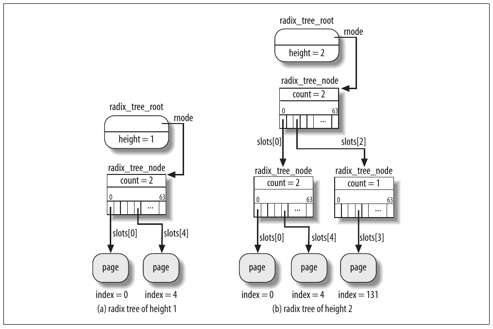
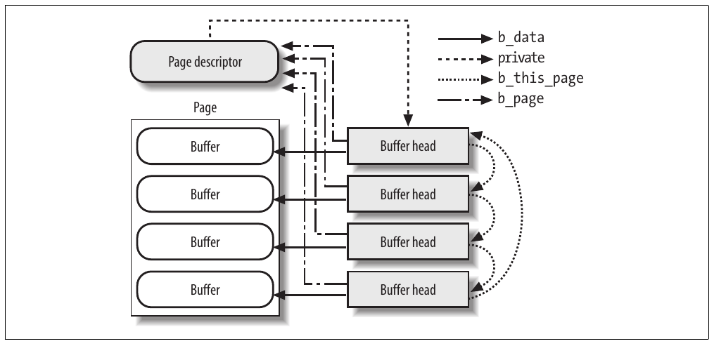

# Chương 15. Page cache


Như đã đề cập trong phần “The Common File Model” ở Chương 12, disk cache là cơ chế software cho phép hệ thống giữ trong RAM một số dữ liệu thường lưu trên disk, để truy cập tiếp theo đến dữ liệu được đáp ứng nhanh mà không truy cập disk.

Disk cache thiết yếu cho hiệu năng hệ thống vì truy cập lặp lại cùng disk data khá phổ biến. User Mode process tương tác với disk có quyền yêu cầu lặp lại đọc hoặc ghi cùng disk data. Hơn nữa, process khác nhau cũng có thể cần truy cập cùng disk data vào thời điểm khác nhau. Ví dụ, bạn có thể dùng command cp sao chép text file rồi gọi editor yêu thích để sửa. Để đáp ứng yêu cầu, command shell sẽ tạo hai process khác nhau truy cập cùng file vào thời điểm khác nhau.

Chúng ta đã gặp disk cache khác trong Chương 12: dentry cache, lưu dentry object biểu diễn filesystem pathname, và inode cache, lưu inode object biểu diễn disk inode. Tuy nhiên, lưu ý dentry object và inode object không đơn thuần là buffer lưu nội dung một số disk block; do đó dentry cache và inode cache khá đặc biệt trong vai trò disk cache.

Chương này bàn page cache, là disk cache thao tác trên toàn page dữ liệu. Chúng ta giới thiệu page cache trong phần đầu. Sau đó, trong phần “Storing Blocks in the Page Cache”, chúng ta bàn cách dùng page cache lấy từng block dữ liệu (ví dụ superblock và inode); tính năng này thiết yếu để tăng tốc VFS và disk-based filesystem. Tiếp theo, trong phần “Writing Dirty Pages to Disk”, chúng ta mô tả cách dirty page trong page cache được ghi lại disk. Cuối cùng, trong phần cuối “The sync(), fsync(), and fdatasync() System Calls”, chúng ta đề cập một số system call cho phép user flush nội dung page cache để cập nhật nội dung disk.

## Page cache

Page cache là disk cache chính Linux kernel dùng. Trong phần lớn trường hợp, kernel tham chiếu page cache khi đọc hoặc ghi disk. Page mới được thêm vào page cache để đáp ứng read request của User Mode process. Nếu page chưa có trong cache, entry mới được thêm và điền dữ liệu đọc từ disk. Nếu đủ free memory, page được giữ trong cache trong thời gian không xác định và có thể được process khác tái sử dụng mà không truy cập disk.

Tương tự, trước khi ghi page dữ liệu vào block device, kernel kiểm tra page tương ứng đã nằm trong cache chưa; nếu chưa, entry mới được thêm và điền dữ liệu cần ghi trên disk. I/O data transfer không bắt đầu ngay: cập nhật disk được trì hoãn vài second, cho process cơ hội sửa thêm dữ liệu cần ghi (nói cách khác, kernel triển khai deferred write operation).

Kernel code và kernel data structure không cần được đọc từ hay ghi vào disk.[^1] Do đó, page trong page cache có thể thuộc các loại sau:

- Page chứa dữ liệu regular file; trong Chương 16, chúng ta mô tả cách kernel xử lý read, write và memory mapping operation trên chúng.

- Page chứa directory; như sẽ thấy trong Chương 18, Linux xử lý directory rất giống regular file.

- Page chứa dữ liệu đọc trực tiếp từ block device file (bỏ qua filesystem layer); như bàn trong Chương 16, kernel xử lý chúng bằng cùng tập function cho page chứa dữ liệu regular file.

- Page chứa dữ liệu của User Mode process đã swap out lên disk. Như sẽ thấy trong Chương 17, kernel có thể buộc phải giữ trong page cache một số page có nội dung đã ghi trên swap area (regular file hoặc disk partition).

- Page thuộc file của special filesystem, như special filesystem shm dùng cho Interprocess Communication (IPC) shared memory region (xem Chương 19).

Như bạn thấy, mỗi page trong page cache chứa dữ liệu thuộc file nào đó. File này—chính xác hơn là inode của file—gọi là owner của page. (Như sẽ thấy trong Chương 17, page chứa swapped-out data có cùng owner ngay cả khi tham chiếu swap area khác nhau.) Gần như mọi file operation `read()` và `write()` dựa vào page cache. Ngoại lệ duy nhất xảy ra khi process mở file với flag `O_DIRECT` set: trong trường hợp này, page cache bị bỏ qua và I/O data transfer dùng buffer trong User Mode address space của process (xem phần “Direct I/O Transfers” trong Chương 16); một số database application dùng flag `O_DIRECT` để có thể dùng disk caching algorithm riêng.

Người thiết kế kernel triển khai page cache để đáp ứng hai yêu cầu chính:

- Tìm nhanh page cụ thể chứa dữ liệu liên quan owner cho trước. Để tận dụng tối đa page cache, tìm kiếm phải là operation rất nhanh.

- Theo dõi cách phải xử lý mỗi page trong cache khi đọc hoặc ghi nội dung. Ví dụ, đọc page từ regular file, block device file hoặc swap area phải thực hiện theo cách khác nhau, nên kernel phải chọn operation đúng tùy owner của page.

Tất nhiên, đơn vị thông tin giữ trong page cache là toàn page dữ liệu. Như sẽ thấy trong Chương 18, page không nhất thiết chứa disk block liền kề vật lý, nên không thể xác định bằng device number và block number. Thay vào đó, page trong page cache được xác định bằng owner và index trong dữ liệu của owner—thường là inode và offset trong file tương ứng.

### Object address\_space

Data structure cốt lõi của page cache là object `address_space`, data structure nhúng trong inode object sở hữu page.[^2] Nhiều page trong cache có thể tham chiếu cùng owner, nên có thể liên kết với cùng object `address_space`. Object này còn thiết lập link giữa page của owner và tập method thao tác trên các page.

Mỗi page descriptor có hai field tên `mapping` và `index`, liên kết page với page cache (xem phần “Page Descriptors” trong Chương 8). Field đầu trỏ đến object `address_space` của inode sở hữu page. Field thứ hai chỉ định offset theo đơn vị page-size trong “address space” của owner, tức vị trí dữ liệu của page trong disk image của owner. Hai field này được dùng khi tìm page trong page cache.

Khá bất ngờ, page cache có thể chứa nhiều bản sao cùng disk data mà không vấn đề. Ví dụ, cùng block dữ liệu 4-KB của regular file có thể được truy cập theo các cách:

- Đọc file; do đó dữ liệu nằm trong page thuộc inode của regular file.

- Đọc block từ device file (disk partition) chứa file; do đó dữ liệu nằm trong page thuộc master inode của block device file.

Vì vậy, cùng disk data xuất hiện trong hai page khác nhau được hai object `address_space` khác nhau tham chiếu.

Các field của object `address_space` được trình bày trong Bảng 15-1.

Bảng 15-1. Các field của object address\_space

| Kiểu | Field | Mô tả |
|---|---|---|
| `struct inode *` | `host` | Pointer đến inode chứa object này nếu có |
| `struct radix_tree_root` | `page_tree` | Root của radix tree xác định page của owner |
| `spinlock_t` | `tree_lock` | Spin lock bảo vệ radix tree |
| `unsigned int` | `i_mmap_writable` | Số shared memory mapping trong address space |
| `struct prio_tree_root` | `i_mmap` | Root của radix priority search tree (xem Chương 17) |
| `struct list_head` | `i_mmap_nonlinear` | List non-linear memory region trong address space |
| `spinlock_t` | `i_mmap_lock` | Spin lock bảo vệ radix priority search tree |
| `unsigned int` | `truncate_count` | Sequence counter dùng khi truncate file |
| `unsigned long` | `nrpages` | Tổng số page của owner |
| `unsigned long` | `writeback_index` | Page index của write-back operation cuối trên page của owner |
| `struct address_space_operations *` | `a_ops` | Method thao tác trên page của owner |
| `unsigned long` | `flags` | Error bit và memory allocator flag |
| `struct backing_dev_info *` | `backing_dev_info` | Pointer đến `backing_dev_info` của block device giữ dữ liệu owner này |
| `spinlock_t` | `private_lock` | Thường là spin lock dùng khi quản lý list `private_list` |
| `struct list head` | `private_list` | Thường là list dirty buffer của indirect block gắn với inode |
| `struct address_space *` | `assoc_mapping` | Thường là pointer đến object `address_space` của block device chứa indirect block |

Nếu owner của page trong page cache là file, object `address_space` được nhúng trong field `i_data` của VFS inode object. Field `i_mapping` của inode luôn trỏ đến object `address_space` của owner của page chứa dữ liệu inode. Field `host` của object `address_space` trỏ đến inode object chứa descriptor nhúng.

Do đó, nếu page thuộc file lưu trong Ext3 filesystem, owner của page là inode của file và object `address_space` tương ứng lưu trong field `i_data` của VFS inode object. Field `i_mapping` của inode trỏ đến field `i_data` của cùng inode, và field `host` của object `address_space` trỏ đến cùng inode.

Tuy nhiên, đôi khi mọi thứ phức tạp hơn. Nếu page chứa dữ liệu đọc từ block device file—tức lưu dữ liệu “raw” của block device—object `address_space` được nhúng trong “master” inode của file trong special filesystem bdev gắn với block device (inode này được field `bd_inode` của block device descriptor tham chiếu, xem phần “Block Devices” trong Chương 14). Do đó, field `i_mapping` của inode của block device file trỏ đến object `address_space` nhúng trong master inode; tương ứng, field `host` của object `address_space` trỏ đến master inode. Theo cách này, mọi page chứa dữ liệu đọc từ block device có cùng object `address_space`, ngay cả khi được truy cập qua block device file khác nhau.

Các field `i_mmap`, `i_mmap_writable`, `i_mmap_nonlinear`, và `i_mmap_lock` liên quan memory mapping và reverse mapping. Chúng ta sẽ bàn các chủ đề này trong Chương 16 và Chương 17.

Field `backing_dev_info` trỏ đến descriptor `backing_dev_info` gắn với block device lưu dữ liệu của owner. Như giải thích trong phần “Request Queue Descriptors” ở Chương 14, structure `backing_dev_info` thường được nhúng trong request queue descriptor của block device.

Field `private_list` là đầu generic list mà filesystem có thể tự do dùng cho mục đích riêng. Ví dụ, Ext2 filesystem dùng list này tập hợp dirty buffer của “indirect” block gắn với inode (xem phần “Data Blocks Addressing” trong Chương 18). Khi flush operation buộc inode được ghi vào disk, kernel còn flush mọi buffer trong list này. Hơn nữa, Ext2 filesystem lưu trong field `assoc_mapping` pointer đến object `address_space` của block device chứa indirect block; còn dùng spin lock `assoc_mapping->private_lock` bảo vệ list indirect block trên hệ thống multiprocessor.

Field thiết yếu của object `address_space` là `a_ops`, trỏ đến table kiểu `address_space_operations` chứa method định nghĩa cách xử lý page của owner. Các method được trình bày trong Bảng 15-2.

Bảng 15-2. Method của object address\_space

| Method | Mô tả |
|---|---|
| `writepage` | Write operation (từ page đến disk image của owner) |
| `readpage` | Read operation (từ disk image của owner đến page) |
| `sync_page` | Bắt đầu I/O data transfer của operation đã lên lịch trên page của owner |
| `writepages` | Ghi lại disk số dirty page cho trước của owner |
| `set_page_dirty` | Đặt page của owner thành dirty |
| `readpages` | Đọc list page của owner từ disk |
| `prepare_write` | Chuẩn bị write operation (do disk-based filesystem dùng) |
| `commit_write` | Hoàn tất write operation (do disk-based filesystem dùng) |
| `bmap` | Lấy logical block number từ file block index |
| `invalidatepage` | Invalidate page của owner (dùng khi truncate file) |
| `releasepage` | Được journaling filesystem dùng để chuẩn bị giải phóng page |
| `direct_IO` | Direct I/O transfer của page của owner (bỏ qua page cache) |

Method quan trọng nhất là `readpage`, `writepage`, `prepare_write`, và `commit_write`. Chúng ta bàn trong Chương 16. Trong phần lớn trường hợp, method liên kết owner inode object với low-level driver truy cập physical device. Ví dụ, function triển khai method `readpage` cho inode của regular file biết cách tìm vị trí trên physical disk device của block tương ứng mỗi page của file. Tuy nhiên, trong chương này không cần bàn thêm method của `address_space`.

### Radix tree

Trong Linux, file có thể rất lớn, thậm chí vài terabyte. Khi truy cập file lớn, page cache có thể đầy quá nhiều page của file đến mức quét tuần tự tất cả quá tốn thời gian. Để thực hiện page cache lookup hiệu quả, Linux 2.6 dùng tập search tree lớn, một cho mỗi object `address_space`.

Field `page_tree` của object `address_space` là root của radix tree, chứa pointer đến descriptor của page của owner. Với page index biểu thị vị trí page trong disk image của owner, kernel có thể lookup rất nhanh để xác định page cần thiết đã trong page cache chưa. Khi tra cứu page, kernel diễn giải index thành path trong radix tree và nhanh chóng đến vị trí page descriptor được—hoặc nên được—lưu. Nếu tìm thấy, kernel lấy descriptor của page từ radix tree; còn có thể nhanh chóng xác định page dirty không (tức cần flush disk) và I/O transfer cho dữ liệu của page hiện có đang diễn ra không.

Mỗi node của radix tree có thể có tối đa 64 pointer đến node khác hoặc page descriptor. Node ở cấp cuối lưu pointer đến page descriptor (leaf), còn node cấp cao hơn lưu pointer đến node khác (child). Mỗi node được biểu diễn bằng data structure `radix_tree_node`, chứa ba field: `slots` là array 64 pointer, `count` là counter số pointer trong node khác `NULL`, và `tags` là array flag hai thành phần sẽ bàn trong phần “The Tags of the Radix Tree” ở phần sau chương này. Root của tree được biểu diễn bằng data structure `radix_tree_root`, có ba field: `height` biểu thị chiều cao hiện tại của tree (số cấp không tính leaf), `gfp_mask` chỉ định flag dùng khi yêu cầu memory cho node mới, và `rnode` trỏ đến data structure `radix_tree_node` tương ứng node ở cấp 1 của tree (nếu có).

Hãy xét ví dụ đơn giản. Nếu không index nào lưu trong tree lớn hơn 63, tree height bằng một vì cả 64 leaf có thể đều lưu trong node ở cấp 1 (xem Hình 15-1(a)). Tuy nhiên, nếu page descriptor mới tương ứng index 131 phải lưu trong page cache, tree height tăng lên hai để radix tree xác định được index đến 4095 (xem Hình 15-1(b)).



Hình 15-1. Hai ví dụ radix tree

Bảng 15-3 cho page index lớn nhất và maximum file size tương ứng mỗi height của radix tree trên kiến trúc 32-bit. Trong trường hợp này, maximum height của radix tree là sáu, dù rất ít khả năng page cache của hệ thống dùng radix tree lớn đến vậy. Vì page index lưu trong biến 32-bit, khi tree height bằng sáu, node ở cấp cao nhất có tối đa bốn child.

Bảng 15-3. Index lớn nhất và maximum file size cho mỗi radix tree height

| Radix tree height | Index lớn nhất | Maximum file size |
|---|---|---|
| `0` | không có | 0 byte |
| `1` | 26 -1 = 63 | 256 kilobyte |
| `2` | 212 -1 = 4 095 | 16 megabyte |
| `3` | 218 -1 = 262 143 | 1 gigabyte |
| `4` | 224-1 = 16 777 215 | 64 gigabyte |
| `5` | 230 -1 = 1 073 741 823 | 4 terabyte |
| `6` | 232 -1 = 4 294 967 295 | 16 terabyte |

Cách tốt nhất hiểu page lookup là nhớ lại cách paging system dùng page table chuyển linear address thành physical address. Như bàn trong phần “Regular Paging” ở Chương 2, 20 bit cao nhất của linear address chia thành hai field dài 10 bit: field đầu là offset trong Page Directory, còn field thứ hai là offset trong Page Table được Page Directory entry thích hợp trỏ đến.

Radix tree dùng cách tương tự. Tương đương linear address là index của page. Tuy nhiên, số field cần xét trong index của page phụ thuộc height của radix tree. Nếu radix tree height 1, chỉ biểu diễn được index từ 0 đến 63, nên 6 bit thấp nhất của index của page được diễn giải là array index `slots` cho node duy nhất ở cấp 1. Nếu radix tree height 2, index biểu diễn được từ 0 đến 4095; do đó 12 bit thấp nhất của index của page chia thành 2 field, mỗi field 6 bit; field cao dùng làm array index cho node ở cấp 1, còn field thấp dùng làm array index cho node ở cấp 2. Procedure tương tự cho mọi height khác của radix tree. Nếu height bằng 6, 2 bit cao nhất của index của page là array index cho node ở cấp 1, 6 bit tiếp là array index cho node ở cấp 2, v.v. đến 6 bit thấp nhất là array index cho node ở cấp 6.

Nếu index lớn nhất của radix tree nhỏ hơn index của page cần thêm, kernel tăng tree height tương ứng; node trung gian của radix tree phụ thuộc giá trị page index (xem ví dụ Hình 15-1).

### Function xử lý page cache

High-level function cơ bản dùng page cache gồm tìm, thêm và loại page. Function khác dựa trên các function trước đảm bảo cache chứa phiên bản cập nhật của page cho trước.

#### Tìm page

Function `find_get_page()` nhận parameter là pointer đến object `address_space` và giá trị offset. Nó lấy spin lock của address space và gọi function `radix_tree_lookup()` để tìm leaf node của radix tree có offset yêu cầu. Đến lượt function này bắt đầu từ root node của tree và đi xuống theo bit của giá trị offset, như giải thích trong phần trước. Nếu gặp pointer `NULL`, function trả về `NULL`; ngược lại, trả về địa chỉ leaf node, tức pointer của page descriptor cần thiết. Nếu tìm thấy page yêu cầu, `find_get_page()` tăng usage counter, nhả spin lock và trả về địa chỉ; ngược lại, function nhả spin lock và trả về `NULL`.

Function `find_get_pages()` giống `find_get_page()` nhưng thực hiện page cache lookup cho nhóm page có index liên tiếp. Nó nhận parameter là pointer đến object `address_space`, offset trong address space nơi bắt đầu tìm, số page tối đa cần lấy, và pointer đến array page descriptor function phải điền. Để thực hiện lookup operation, `find_get_pages()` dựa vào function `radix_tree_gang_lookup()`, điền array pointer và trả về số page tìm được. Page trả về có index tăng dần, dù có thể có lỗ hổng index vì một số page không ở page cache.

Có một số function khác thực hiện search operation trên page cache. Ví dụ, function `find_lock_page()` giống `find_get_page()` nhưng tăng usage counter của page trả về và gọi `lock_page()` để set flag `PG_locked`—do đó khi function trả về, chỉ bên gọi được truy cập page. Đến lượt function `lock_page()` block process hiện tại nếu page đã locked. Để làm vậy, gọi function `__wait_on_bit_lock()` trên bit `PG_locked`. Function sau đưa process hiện tại vào state `TASK_UNINTERRUPTIBLE`, lưu process descriptor trong wait queue, thực thi method `sync_page` của object `address_space` để unplug request queue của block device chứa file, và cuối cùng gọi `schedule()` để tạm dừng process đến khi flag `PG_locked` của page clear. Để unlock page và đánh thức process sleep trong wait queue, kernel dùng function `unlock_page()`.

Function `find_trylock_page()` giống `find_lock_page()`, ngoại trừ không bao giờ block: nếu page yêu cầu đã locked, function trả về error code. Cuối cùng, function `find_or_create_page()` thực thi `find_lock_page()`; tuy nhiên, nếu không tìm thấy page, page mới được cấp phát và chèn vào page cache.

##### Thêm page

Function `add_to_page_cache()` chèn page descriptor mới vào page cache. Nó nhận parameter là địa chỉ `page` của page descriptor, địa chỉ `mapping` của object `address_space`, giá trị `offset` biểu diễn page index trong address space, và memory allocation flag `gfp_mask` dùng khi cấp phát node mới của radix tree. Function thực hiện các operation sau:

1\. Gọi `radix_tree_preload()`, disable kernel preemption và điền per-CPU variable `radix_tree_preloads` bằng vài structure `radix_tree_node` trống. Cấp phát structure `radix_tree_node` được thực hiện qua slab allocator cache `radix_tree_node_cachep`. Nếu `radix_tree_preload()` thất bại khi cấp phát trước structure `radix_tree_node`, function `add_to_page_cache()` kết thúc bằng cách trả về error code `-ENOMEM`. Ngược lại, nếu `radix_tree_preload()` thành công, `add_to_page_cache()` có thể chắc chắn việc chèn page descriptor mới không thất bại vì thiếu free memory, ít nhất với file kích thước đến 64 GB.

2\. Lấy spin lock `mapping->tree_lock`—lưu ý kernel preemption đã được `radix_tree_preload()` disable.

3\. Gọi `radix_tree_insert()` để chèn node mới vào tree. Function thực hiện các bước sau:

a. Gọi `radix_tree_maxindex()` để lấy maximum index có thể chèn vào radix tree với height hiện tại; nếu index của page mới không thể biểu diễn với height hiện tại, gọi `radix_tree_extend()` để tăng height của tree bằng cách thêm số node thích hợp (ví dụ khi áp dụng cho radix tree trong Hình 15-1(a), `radix_tree_extend()` sẽ thêm một node phía trên). Node mới được cấp phát bằng function `radix_tree_node_alloc()`, cố lấy structure `radix_tree_node` từ slab allocator cache hoặc, nếu cấp phát thất bại, từ pool structure cấp phát trước lưu trong `radix_tree_preloads`.

b. Bắt đầu từ root (`mapping->page_tree`), duyệt tree theo index `offset` của page đến khi đến leaf, như mô tả trong phần trước. Nếu cần, cấp phát node trung gian mới bằng cách gọi `radix_tree_node_alloc()`. c. Lưu địa chỉ page descriptor vào slot thích hợp của node cuối được duyệt trong radix tree, rồi trả về 0.

4\. Tăng usage counter `page->_count` của page descriptor.

5\. Vì page mới, nội dung không hợp lệ: function set flag `PG_locked` của page frame để bảo vệ page khỏi truy cập đồng thời từ kernel control path khác.

6\. Khởi tạo `page->mapping` và `page->index` bằng các parameter `mapping` và `offset`. 7. Tăng counter cached page trong address space (`mapping->nrpages`).

8\. Nhả spin lock của address space.

9\. Gọi `radix_tree_preload_end()` để reenable kernel preemption.

10\. Trả về 0 (thành công).

##### Loại page

Function `remove_from_page_cache()` loại page descriptor khỏi page cache. Thực hiện theo cách sau:

1\. Lấy spin lock `page->mapping->tree_lock` và disable interrupt.

2\. Gọi `radix_tree_delete()` để xóa node khỏi tree. Function này nhận parameter là địa chỉ root của tree (`page->mapping->page_tree`) và index của page cần loại, rồi thực hiện các bước sau: a. Bắt đầu từ root, duyệt tree theo index của page đến khi đến leaf, như mô tả trong phần trước. Trong khi đó, xây array structure `radix_tree_path` mô tả component của path từ root đến leaf tương ứng page cần xóa.

b. Bắt đầu vòng lặp trên node thu thập trong path array, từ node cuối chứa pointer đến page descriptor. Với mỗi node, đặt thành `NULL` phần tử slots array trỏ đến node tiếp theo (hoặc page descriptor) và giảm field `count`. Nếu `count` thành không, loại node khỏi tree và trả structure `radix_tree_node` về slab allocator cache, rồi tiếp tục vòng lặp với node trước trong path array; ngược lại, nếu `count` không thành không, tiếp tục bước kế tiếp.

c. Trả về pointer đến page descriptor đã loại khỏi tree.

3\. Đặt field `page->mapping` thành `NULL`.

4\. Giảm counter cached page `page->mapping->nrpages` một đơn vị.

5\. Nhả spin lock `page->mapping->tree_lock`, enable interrupt và kết thúc.

##### Cập nhật page

Function `read_cache_page()` đảm bảo cache chứa phiên bản cập nhật của page cho trước. Parameter là pointer `mapping` đến object `address_space`, giá trị offset `index` chỉ định page yêu cầu, pointer `filler` đến function đọc dữ liệu page từ disk (thường là function triển khai method `readpage` của address space), và pointer `data` truyền cho function `filler` (thường là `NULL`). Sau đây là mô tả đơn giản hóa những gì function làm:

1\. Gọi `find_get_page()` để kiểm tra page đã ở trong page cache chưa.

2\. Nếu page không ở page cache, thực hiện các bước con sau:

a. Gọi `alloc_pages()` để cấp phát page frame mới.

b. Gọi `add_to_page_cache()` để chèn page descriptor tương ứng vào page cache.

c. Gọi `lru_cache_add()` để chèn page vào inactive LRU list của zone (xem phần “The Least Recently Used (LRU) Lists” trong Chương 17).

3\. Tại đây page ở trong page cache. Gọi `mark_page_accessed()` để ghi nhận page đã được truy cập (xem phần “The Least Recently Used (LRU) Lists” trong Chương 17).

4\. Nếu page chưa up-to-date (flag `PG_uptodate` clear), gọi function `filler` để đọc page từ disk.

5\. Trả về địa chỉ page descriptor.

### Tag của radix tree

Như đã nêu, page cache không chỉ cho kernel lấy nhanh page chứa dữ liệu chỉ định của block device; cache còn cho kernel lấy nhanh page trong cache có state cho trước.

Ví dụ, giả sử kernel phải lấy mọi page trong cache thuộc owner cho trước và dirty, tức page có nội dung chưa ghi vào disk. Flag `PG_dirty` lưu trong page descriptor chỉ định page có dirty không; tuy nhiên, duyệt toàn radix tree để truy cập tuần tự mọi leaf—tức page descriptor—sẽ chậm không cần thiết nếu phần lớn page không dirty.

Thay vào đó, để cho tìm dirty page nhanh, mỗi node trung gian trong radix tree chứa dirty tag cho mỗi child node (hoặc leaf); flag này set khi và chỉ khi ít nhất một dirty tag của child node set. Dirty tag của node ở cấp cuối thường là bản sao flag `PG_dirty` của page descriptor. Theo cách này, khi kernel duyệt radix tree tìm dirty page, nó có thể bỏ qua mỗi subtree có root tại node trung gian có dirty tag clear: biết chắc mọi page descriptor lưu trong subtree không dirty.

Cùng ý tưởng áp dụng cho flag `PG_writeback`, biểu thị page hiện đang ghi lại disk. Do đó, mỗi node của radix tree lan truyền hai flag của page descriptor: `PG_dirty` và `PG_writeback` (xem phần “Page Descriptors” trong Chương 8). Để lưu, mỗi node chứa hai array 64 bit trong field `tags`. Array `tags[0]` (`PAGECACHE_TAG_DIRTY`) là dirty tag, còn array `tags[1]` (`PAGECACHE_TAG_WRITEBACK`) là writeback tag.

Function `radix_tree_tag_set()` được gọi khi set flag `PG_dirty` hoặc `PG_writeback` của cached page; nhận ba parameter: root của radix tree, index của page, và loại tag cần set (`PAGECACHE_TAG_DIRTY` hoặc `PAGECACHE_TAG_WRITEBACK`). Function bắt đầu từ root của tree và đi xuống leaf tương ứng index cho trước; với mỗi node trên path từ root đến leaf, function set tag gắn với pointer đến node tiếp theo trên path. Sau đó function trả về địa chỉ page descriptor. Kết quả là mỗi node trên path đi từ root xuống leaf được tag thích hợp.

Function `radix_tree_tag_clear()` được gọi khi clear flag `PG_dirty` hoặc `PG_writeback` của cached page; nhận cùng parameter như `radix_tree_tag_set()`. Function bắt đầu từ root của tree và đi xuống leaf, xây array structure `radix_tree_path` mô tả path. Sau đó function đi ngược từ leaf về root: clear tag của node ở cấp cuối, rồi kiểm tra mọi tag trong array của node hiện đã clear chưa; nếu có, clear tag thích hợp trong parent node ở cấp trên, kiểm tra mọi tag trong node đó đã clear chưa, v.v. Sau đó function trả về địa chỉ page descriptor.

Khi page descriptor bị loại khỏi radix tree, phải cập nhật tag thích hợp trong node thuộc path từ root đến leaf. Function `radix_tree_delete()` làm đúng điều này (dù chúng ta đã bỏ qua khi nói trong phần trước). Tuy nhiên, function `radix_tree_insert()` không cập nhật tag vì mỗi page descriptor chèn vào radix tree được giả định có các flag `PG_dirty` và `PG_writeback` clear. Nếu cần, kernel có thể gọi function `radix_tree_tag_set()` sau.

Function `radix_tree_tagged()` tận dụng array flag trong mọi node của tree để kiểm tra radix tree có chứa ít nhất một page ở state cho trước không. Function thực hiện khá đơn giản bằng code sau (`root` là pointer đến structure `radix_tree_root` của radix tree, và `tag` là flag cần kiểm tra):

```c
for (idx = 0; idx < 2; idx++) {
    if (root->rnode->tags[tag][idx])
        return 1;
}
return 0;
```

Vì có thể giả định tag của mọi node của radix tree được cập nhật đúng, `radix_tree_tagged()` chỉ cần kiểm tra tag của node ở cấp 1. Ví dụ dùng function này là khi xác định inode có chứa dirty page cần ghi disk không. Lưu ý mỗi lượt lặp function kiểm tra có bit nào trong 32 flag lưu trong `unsigned long` được set không.

Function `find_get_pages_tag()` giống `find_get_pages()` nhưng chỉ trả về page có tag theo parameter `tag`. Như sẽ thấy trong phần “Writing Dirty Pages to Disk”, function này thiết yếu để xác định nhanh mọi dirty page của inode.

## Lưu block trong page cache

Chúng ta đã thấy trong phần “Block Devices Handling” ở Chương 14 rằng VFS, mapping layer và các filesystem nhóm disk data thành logical unit gọi là “block”. Trong phiên bản Linux kernel cũ, có hai main disk cache khác nhau: page cache lưu toàn page disk data do truy cập nội dung disk file, và buffer cache dùng giữ trong memory nội dung block được VFS truy cập để quản lý disk-based filesystem.

Từ stable version 2.4.10, buffer cache không còn thực sự tồn tại. Thực tế, vì hiệu quả, block buffer không còn được cấp phát riêng; thay vào đó lưu trong dedicated page gọi là “buffer page”, giữ trong page cache.

Theo định nghĩa, buffer page là page dữ liệu gắn với descriptor bổ sung gọi là “buffer head”, có mục đích chính là tìm nhanh disk address của từng block trong page. Thực tế, vùng dữ liệu lưu trong page thuộc page cache không nhất thiết liền kề trên disk.

### Block buffer và buffer head

Mỗi block buffer có buffer head descriptor kiểu `buffer_head`. Descriptor chứa mọi thông tin kernel cần để biết cách xử lý block; do đó, trước khi thao tác mỗi block, kernel kiểm tra buffer head. Các field của buffer head liệt kê trong Bảng 15-4.

Bảng 15-4. Các field của buffer head

| Kiểu | Field | Mô tả |
|---|---|---|
| `unsigned long` | `b_state` | Buffer status flag |
| `struct buffer_head *` | `b_this_page` | Pointer đến phần tử tiếp theo trong list của buffer page |
| `struct page *` | `b_page` | Pointer đến descriptor của buffer page giữ block này |
| `atomic_t` | `b_count` | Block usage counter |
| `u32` | `b_size` | Block size |
| `sector_t` | `b_blocknr` | Block number tương đối block device (logical block number) |
| `char *` | `b_data` | Vị trí block trong buffer page |
| `struct block_device *` | `b_bdev` | Pointer đến block device descriptor |
| `bh_end_io_t *` | `b_end_io` | I/O completion method |
| `void *` | `b_private` | Pointer đến dữ liệu cho I/O completion method |
| `struct list_head` | `b_assoc_buffers` | Pointer cho list indirect block gắn với inode (xem phần “The address\_space Object” trước đó trong chương này) |

Hai field của buffer head mã hóa disk address của block: field `b_bdev` xác định block device—thường disk hoặc partition—chứa block (xem phần “Block Devices” trong Chương 14), còn field `b_blocknr` lưu logical block number, tức index của block trong disk hoặc partition.

Field `b_data` chỉ định vị trí block buffer trong buffer page. Thực tế, cách mã hóa vị trí phụ thuộc page có ở high memory không. Nếu page trong high memory, field `b_data` chứa offset của block buffer so với đầu page; ngược lại, `b_data` chứa linear address của block buffer.

Field `b_state` có thể lưu nhiều flag. Một số dùng chung được liệt kê trong Bảng 15-5. Mỗi filesystem còn có thể định nghĩa private buffer head flag riêng.

Bảng 15-5. Flag dùng chung của buffer head

| Flag | Mô tả |
|---|---|
| `BH_Uptodate` | Set nếu buffer chứa dữ liệu hợp lệ |
| `BH_Dirty` | Set nếu buffer dirty—tức chứa dữ liệu phải ghi vào block device |
| `BH_Lock` | Set nếu buffer locked, thường khi buffer tham gia disk transfer |
| `BH_Req` | Set nếu data transfer để khởi tạo buffer đã được yêu cầu |
| `BH_Mapped` | Set nếu buffer được map vào disk—tức các field `b_bdev` và `b_blocknr` của buffer head tương ứng có ý nghĩa |
| `BH_New` | Set nếu block tương ứng vừa được cấp phát và chưa từng được truy cập |
| `BH_Async_Read` | Set nếu buffer đang được đọc asynchronous |
| `BH_Async_Write` | Set nếu buffer đang được ghi asynchronous |
| `BH_Delay` | Set nếu buffer chưa được cấp phát trên disk |
| `BH_Boundary` | Set nếu block gửi sau block này sẽ không liền kề block này |
| `BH_Write_EIO` | Set nếu có I/O error khi ghi block này |
| `BH_Ordered` | Set nếu block phải ghi nghiêm ngặt sau các block gửi trước nó (do journaling filesystem dùng) |
| `BH_Eopnotsupp` | Set nếu block device driver không hỗ trợ operation được yêu cầu |

### Quản lý buffer head

Buffer head có slab allocator cache riêng, có descriptor `kmem_cache_s` lưu trong biến `bh_cachep`. Các function `alloc_buffer_head()` và `free_buffer_head()` lần lượt dùng lấy và giải phóng buffer head.

Field `b_count` của buffer head là usage counter cho block buffer tương ứng. Counter tăng ngay trước mỗi operation trên block buffer và giảm ngay sau. Block buffer giữ trong page cache được kiểm tra cả định kỳ lẫn khi free memory khan hiếm, và chỉ block buffer có usage counter không mới có thể được reclaim (xem Chương 17).

Khi kernel control path muốn truy cập block buffer, trước tiên nên tăng usage counter. Function tìm block trong page cache (`__getblk()`; xem phần “Searching Blocks in the Page Cache” ở phần sau chương này) tự động làm vậy, nên higher-level function thường không tăng usage counter của block buffer.

Khi kernel control path ngừng truy cập block buffer, nên gọi `__brelse()` hoặc `__bforget()` để giảm usage counter tương ứng. Khác biệt giữa hai function là \_\_`bforget()` còn loại block khỏi mọi list indirect block (field `b_assoc_buffers` của buffer head; xem phần trước “Block Buffers and Buffer Heads”) và đánh dấu buffer clean, qua đó buộc kernel quên mọi thay đổi trong buffer chưa ghi trên disk.

### Buffer page

Bất cứ khi nào kernel phải truy cập riêng block, nó tham chiếu buffer page giữ block buffer và kiểm tra buffer head tương ứng.

Sau đây là hai trường hợp phổ biến kernel tạo buffer page:

- Khi đọc hoặc ghi page của file không lưu trong disk block liên tiếp. Điều này xảy ra vì filesystem cấp phát block không liên tiếp cho file hoặc vì file chứa “lỗ hổng” (xem phần “File Holes” trong Chương 18).

- Khi truy cập một disk block (ví dụ khi đọc superblock hoặc inode block).

Trong trường hợp đầu, descriptor của buffer page được chèn vào radix tree của regular file. Buffer head được giữ vì lưu thông tin quý: block device và logical block number chỉ định vị trí dữ liệu trong disk. Chúng ta sẽ thấy cách kernel dùng loại buffer page này trong Chương 16.

Trong trường hợp thứ hai, descriptor của buffer page được chèn vào radix tree có root tại object `address_space` của inode trong special filesystem bdev gắn với block device (xem phần “The address\_space Object” trước đó trong chương này). Loại buffer page này phải đáp ứng ràng buộc chặt: mọi block buffer phải tham chiếu block liền kề của block device bên dưới.

Ví dụ hữu ích là khi VFS muốn đọc inode block 1.024 byte chứa inode của file cho trước. Thay vì cấp phát một buffer, kernel phải cấp phát toàn page lưu bốn buffer; các buffer sẽ chứa dữ liệu nhóm bốn block liền kề trên block device, gồm inode block được yêu cầu.

Trong chương này, chúng ta tập trung loại buffer page thứ hai, gọi là block device buffer page (đôi khi viết ngắn là blockdev’s page).

Mọi block buffer trong một buffer page phải có cùng kích thước; do đó trên kiến trúc 80×86, buffer page có thể chứa từ một đến tám buffer, tùy block size.

Khi page đóng vai trò buffer page, mọi buffer head gắn với block buffer được tập hợp trong singly linked circular list. Field `private` của descriptor của buffer page trỏ đến buffer head của block đầu trong page;[^3] mỗi buffer head lưu trong field `b_this_page` pointer đến buffer head tiếp theo trong list. Hơn nữa, mỗi buffer head lưu địa chỉ descriptor của buffer page trong field `b_page`. Hình 15-2 trình bày buffer page chứa bốn block buffer và buffer head tương ứng.



Hình 15-2. Buffer page chứa bốn buffer và buffer head của chúng

### Cấp phát block device buffer page

Kernel cấp phát block device buffer page mới khi phát hiện page cache không chứa page có buffer cho block cho trước (xem phần “Searching Blocks in the Page Cache” ở phần sau chương này). Cụ thể, lookup operation cho block có thể thất bại vì:

1\. Radix tree của block device không chứa page có dữ liệu của block: trong trường hợp này phải thêm page descriptor mới vào radix tree.

2\. Radix tree của block device chứa page có dữ liệu của block nhưng page này không phải buffer page: trong trường hợp này phải cấp phát buffer head mới và liên kết với page, qua đó biến thành block device buffer page.

3\. Radix tree của block device chứa buffer page có dữ liệu của block nhưng page đã chia thành block có kích thước khác block yêu cầu: trong trường hợp này phải giải phóng buffer head cũ, rồi cấp phát tập buffer head mới và liên kết với page.

Để thêm block device buffer page vào page cache, kernel gọi function `grow_buffers()`, nhận ba parameter xác định block:

- Địa chỉ `bdev` của descriptor `block_device`

- Logical block number `block`—vị trí block trong block device

- Block size `size`

Function thực hiện về cơ bản các action sau:

1\. Tính offset `index` của page dữ liệu trong block device chứa block yêu cầu.

2\. Gọi `grow_dev_page()` để tạo block device buffer page mới nếu cần. Đến lượt function này thực hiện các bước con sau:

a. Gọi `find_or_create_page()`, truyền object `address_space` của block device (`bdev->bd_inode->i_mapping`), page offset `index`, và flag `GFP_NOFS`. Như mô tả trong phần “Page Cache Handling Functions” trước đó, `find_or_create_page()` tìm page trong page cache và chèn page mới vào cache nếu cần.

b. Giờ page cần thiết trong page cache và function có địa chỉ descriptor. Function kiểm tra flag `PG_private`; nếu là `NULL`, page chưa phải buffer page (không có buffer head liên quan): nhảy đến bước 2e.

c. Page đã là buffer page. Lấy từ field `private` của descriptor địa chỉ `bh` của buffer head đầu và kiểm tra block size `bh->size` bằng kích thước block yêu cầu không; nếu có, page tìm thấy trong page cache là buffer page hợp lệ: nhảy đến bước 2g.

d. Page có block sai kích thước: gọi `try_to_free_buffers()` (xem phần tiếp theo) để giải phóng buffer head trước của buffer page.

e. Gọi function `alloc_page_buffers()` để cấp phát buffer head cho block kích thước yêu cầu trong page và chèn vào singly linked circular list do field `b_this_page` triển khai. Hơn nữa, function khởi tạo field `b_page` của buffer head bằng địa chỉ page descriptor, và field `b_data` bằng offset hoặc linear address của block buffer trong page.

f. Lưu địa chỉ buffer head đầu trong field `private`, set field `PG_private`, và tăng usage counter của page (block buffer trong page được tính là một page user).

g. Gọi function `init_page_buffers()` để khởi tạo các field `b_bdev`, `b_blocknr`, và `b_bstate` của buffer head liên kết page. Mọi block liền kề trên disk, nên logical block number liên tiếp và dễ suy ra từ `block`.

h. Trả về địa chỉ page descriptor.

3\. Unlock page (page đã được `find_or_create_page()` lock).

4\. Giảm usage counter của page (một lần nữa, counter đã được `find_or_create_page()` tăng). 5. Trả về 1 (thành công).

### Giải phóng block device buffer page

Như sẽ thấy trong Chương 17, block device buffer page được giải phóng khi kernel cố lấy thêm free memory. Rõ ràng không thể giải phóng buffer page nếu chứa dirty hoặc locked buffer. Để giải phóng buffer page, kernel gọi function `try_to_release_page()`, nhận địa chỉ `page` của page descriptor và thực hiện các action sau:[^4]

1\. Nếu flag `PG_writeback` của page set, trả về 0 (không thể giải phóng vì page đang ghi lại disk).

2\. Nếu được định nghĩa, gọi method `releasepage` của object `address_space` của block device. (Method thường không được định nghĩa cho block device.)

3\. Gọi function `try_to_free_buffers()` và trả về error code của nó.

Đến lượt function `try_to_free_buffers()` quét buffer head liên kết buffer page; thực hiện về cơ bản các action sau:

1\. Kiểm tra flag của mọi buffer head của buffer trong page. Nếu buffer head nào có flag `BH_Dirty` hoặc `BH_Locked` set, function kết thúc bằng cách trả về 0 (thất bại): không thể giải phóng buffer.

2\. Nếu buffer head nằm trong list indirect buffer (xem phần “Block Buffers and Buffer Heads” trước đó trong chương này), function loại khỏi list.

3\. Clear flag `PG_private` của page descriptor, đặt field `private` thành `NULL`, và giảm usage counter của page.

4\. Clear flag `PG_dirty` của page.

5\. Gọi lặp lại `free_buffer_head()` trên buffer head của page để giải phóng tất cả.

6\. Trả về 1 (thành công).

### Tìm block trong page cache

Khi kernel cần đọc hoặc ghi một block của physical device (ví dụ superblock), phải kiểm tra block buffer yêu cầu đã trong page cache chưa. Tìm trong page cache block buffer cho trước—chỉ định bằng địa chỉ `bdev` của block device descriptor và logical block number `nr`—là quá trình ba giai đoạn:

1\. Lấy pointer đến object `address_space` của block device chứa block (`bdev->bd_inode->i_mapping`).

2\. Lấy block size của device (`bdev->bd_block_size`) và tính index của page chứa block. Đây luôn là bit shift operation trên logical block number. Ví dụ, nếu block size 1.024 byte, mỗi buffer page chứa bốn block buffer, nên index của page là `nr/4`.

3\. Tìm buffer page trong radix tree của block device. Sau khi có page descriptor, kernel truy cập được buffer head mô tả status của block buffer trong page.

Tuy nhiên, chi tiết hơi phức tạp hơn. Để nâng hiệu năng hệ thống, kernel quản lý array `bh_lrus` gồm disk cache nhỏ, một cho mỗi CPU, gọi là Least Recently Used (LRU) block cache. Mỗi disk cache chứa tám pointer đến buffer head được CPU cho trước truy cập gần đây. Phần tử trong mỗi CPU array sắp sao cho pointer đến buffer head dùng gần đây nhất có index 0. Cùng buffer head có thể xuất hiện trên nhiều CPU array (nhưng không bao giờ hai lần trong cùng CPU array); với mỗi lần xuất hiện của buffer head trong LRU block cache, usage counter `b_count` của buffer head tăng một.

#### Function \_\_find\_get\_block()

Function `__find_get_block()` nhận parameter là địa chỉ `bdev` của descriptor `block_device`, block number `block`, và block size `size`, rồi trả về địa chỉ buffer head gắn với block buffer trong page cache, hoặc `NULL` nếu không có block buffer như vậy. Function thực hiện về cơ bản các action sau:

1\. Kiểm tra LRU block cache array của CPU đang thực thi có buffer head mà các field `b_bdev`, `b_blocknr`, và `b_size` lần lượt bằng `bdev`, `block`, và `size` không.

2\. Nếu buffer head trong LRU block cache, sắp lại phần tử array để đặt pointer đến buffer head vừa phát hiện vào vị trí đầu (index 0), tăng field `b_count`, rồi nhảy đến bước 8.

3\. Tại đây buffer head không ở LRU block cache: từ block number và block size suy ra page index tương đối block device như sau:

```c
 index = block >> (PAGE_SHIFT - bdev->bd_inode->i_blkbits);
```

4\. Gọi `find_get_page()` để tìm trong page cache descriptor của buffer page chứa block buffer yêu cầu. Function truyền parameter là pointer đến object `address_space` của block device (`bdev->bd_inode->i_mapping`) và page index để tìm trong page cache descriptor của buffer page chứa block buffer yêu cầu. Nếu không có page đó trong cache, trả về `NULL` (thất bại).

5\. Tại đây, function có địa chỉ descriptor cho buffer page: quét list buffer head liên kết buffer page để tìm block có logical block number bằng `block`.

6\. Giảm field `count` của page descriptor (đã được `find_get_page()` tăng).

7\. Chuyển mọi phần tử LRU block cache xuống một vị trí và chèn pointer đến buffer head của block yêu cầu vào vị trí đầu. Nếu buffer head bị đẩy khỏi LRU block cache, giảm usage counter `b_count` của nó.

8\. Gọi `mark_page_accessed()` để chuyển buffer page vào LRU list thích hợp nếu cần (xem phần “The Least Recently Used (LRU) Lists” trong Chương 17).

9\. Trả về buffer head pointer.

##### Function \_\_getblk()

Function `__getblk()` nhận cùng parameter như `__find_get_block()`, cụ thể địa chỉ `bdev` của descriptor `block_device`, block number `block`, và block size `size`, rồi trả về địa chỉ buffer head gắn với buffer. Function không bao giờ thất bại: ngay cả khi block hoàn toàn không tồn tại, `__getblk()` vẫn cấp phát block device buffer page và trả pointer đến buffer head đáng ra mô tả block. Lưu ý block buffer do `__getblk()` trả về không nhất thiết chứa dữ liệu hợp lệ—flag `BH_Uptodate` của buffer head có thể clear.

Function `__getblk()` thực hiện về cơ bản các bước sau:

1\. Gọi `__find_get_block()` để kiểm tra block đã trong page cache chưa. Nếu tìm thấy, function trả về địa chỉ buffer head.

2\. Ngược lại, gọi `grow_buffers()` để cấp phát buffer page mới cho block yêu cầu (xem phần “Allocating Block Device Buffer Pages” trước đó trong chương này).

3\. Nếu `grow_buffers()` thất bại cấp phát page đó, `__getblk()` cố reclaim memory bằng cách gọi `free_more_memory()` (xem Chương 17).

4\. Quay lại bước 1.

##### Function \_\_bread()

Function `__bread()` nhận cùng parameter như `__getblk()`, cụ thể địa chỉ `bdev` của descriptor `block_device`, block number `block`, và block size `size`, rồi trả về địa chỉ buffer head gắn với buffer. Khác `__getblk()`, function đọc block từ disk nếu cần trước khi trả buffer head. Function `__bread()` thực hiện các bước sau:

1\. Gọi `__getblk()` để tìm trong page cache buffer page gắn với block yêu cầu và lấy pointer đến buffer head tương ứng.

2\. Nếu block đã trong page cache và buffer chứa dữ liệu hợp lệ (flag `BH_Uptodate` set), trả về địa chỉ buffer head. 3. Ngược lại, tăng usage counter của buffer head.

4\. Đặt field `b_end_io` thành địa chỉ `end_buffer_read_sync()` (xem phần tiếp theo).

5\. Gọi `submit_bh()` để truyền buffer head đến generic block layer (xem phần tiếp theo).

6\. Gọi `wait_on_buffer()` để đưa process hiện tại vào wait queue đến khi read I/O operation hoàn tất, tức đến khi flag `BH_Lock` của buffer head clear.

7\. Trả về địa chỉ buffer head.

### Gửi buffer head đến generic block layer

Hai function `submit_bh()` và `ll_rw_block()` cho phép kernel bắt đầu I/O data transfer trên một hoặc nhiều buffer được buffer head mô tả.

#### Function submit\_bh()

Để truyền một buffer head đến generic block layer, và do đó yêu cầu truyền một block dữ liệu, kernel dùng function `submit_bh()`. Parameter là chiều data transfer (về cơ bản `READ` hoặc `WRITE`) và pointer `bh` đến buffer head mô tả block buffer.

Function `submit_bh()` giả định buffer head đã khởi tạo đầy đủ; cụ thể các field `b_bdev`, `b_blocknr`, và `b_size` phải được đặt đúng để xác định block trên disk chứa dữ liệu yêu cầu. Nếu block buffer thuộc block device buffer page, khởi tạo buffer head do `__find_get_block()` thực hiện, như mô tả phần trước. Tuy nhiên, như sẽ thấy trong chương sau, `submit_bh()` còn có thể được gọi trên block thuộc buffer page do regular file sở hữu.

Function `submit_bh()` gần như chỉ là glue function tạo bio request từ nội dung buffer head rồi gọi `generic_make_request()` (xem phần “Submitting a Request” trong Chương 14). Các bước chính như sau:

1\. Set flag `BH_Req` của buffer head để ghi nhận block đã được gửi ít nhất một lần; hơn nữa, nếu chiều data transfer là `WRITE`, clear flag `BH_Write_EIO`.

2\. Gọi `bio_alloc()` để cấp phát descriptor `bio` mới (xem phần “The Bio Structure” trong Chương 14).

3\. Khởi tạo các field của descriptor `bio` theo nội dung buffer head:

a. Đặt field `bi_sector` thành number của sector đầu trong block `(bh->b_blocknr * bh->b_size / 512)`; b. Đặt field `bi_bdev` bằng địa chỉ block device descriptor (`bh->b_bdev`); c. Đặt field `bi_size` bằng block size (`bh->b_size`);

d. Khởi tạo phần tử đầu array `bi_io_vec` để segment tương ứng block buffer: `bi_io_vec[0].bv_page` đặt thành `bh->b_page`, `bi_io_vec[0].bv_len` đặt thành `bh->b_size`, và `bi_io_vec[0].bv_offset` đặt thành offset của block buffer trong page như `bh->b_data` chỉ định;

e. Đặt `bi_vcnt` thành 1 (chỉ một segment trên bio) và `bi_idx` thành 0 (segment hiện tại cần truyền);

f. Đặt field `bi_end_io` thành địa chỉ `end_bio_bh_io_sync()`, và field `bi_private` thành địa chỉ buffer head; function sẽ được gọi khi data transfer kết thúc (xem bên dưới).

4\. Tăng reference counter của bio (thành bằng 2).

5\. Gọi `submit_bio()`, đặt flag `bi_rw` bằng chiều data transfer, cập nhật per-CPU variable `page_states` để theo dõi số sector đọc và ghi, rồi gọi function `generic_make_request()` trên descriptor `bio`.

6\. Giảm usage counter của bio; bio descriptor không được giải phóng vì hiện đã chèn vào queue của I/O scheduler.

7\. Trả về 0 (thành công).

Khi I/O data transfer trên bio kết thúc, kernel thực thi method `bi_end_io`, trong trường hợp cụ thể này là function `end_bio_bh_io_sync()`. Function sau về cơ bản lấy địa chỉ buffer head từ field `bi_private` của bio, rồi gọi method `b_end_io` của buffer head—đã được đặt đúng trước khi gọi `submit_bh()`—và cuối cùng gọi `bio_put()` để hủy structure `bio`.

##### Function ll\_rw\_block()

Đôi khi kernel phải kích hoạt data transfer nhiều data block cùng lúc, không nhất thiết liền kề vật lý. Function `ll_rw_block()` nhận parameter là chiều data transfer (về cơ bản `READ` hoặc `WRITE`), số block cần truyền, và array pointer đến buffer head mô tả block buffer tương ứng. Function lặp qua mọi buffer head; với mỗi buffer head thực hiện các action sau:

1\. Test và set flag `BH_Lock` của buffer head; nếu buffer đã locked, data transfer đã được kernel control path khác kích hoạt, nên chỉ bỏ qua buffer bằng cách nhảy đến bước 9.

2\. Tăng usage counter `b_count` của buffer head một đơn vị.

3\. Nếu chiều data transfer là `WRITE`, đặt method `b_end_io` của buffer head trỏ đến địa chỉ function `end_buffer_write_sync()`; ngược lại, đặt method `b_end_io` trỏ đến địa chỉ function `end_buffer_read_sync()`. 4. Nếu chiều data transfer là `WRITE`, test và clear flag `BH_Dirty` của buffer head. Nếu flag chưa set, không cần ghi block trên disk nên nhảy đến bước 7.

5\. Nếu chiều data transfer là `READ` hoặc `READA` (read-ahead), kiểm tra flag `BH_Uptodate` của buffer head có set không; nếu có, không cần đọc block từ disk nên nhảy đến bước 7.

6\. Tại đây phải đọc hoặc ghi block: gọi function `submit_bh()` để truyền buffer head cho generic block layer, rồi nhảy đến bước 9.

7\. Unlock buffer head bằng cách clear flag `BH_Lock`, và đánh thức mọi process đợi block được unlock.

8\. Giảm field `b_count` của buffer head.

9\. Nếu array còn buffer head khác cần xử lý, chọn cái tiếp theo và quay lại bước 1; ngược lại kết thúc.

Lưu ý nếu function `ll_rw_block()` truyền buffer head cho generic block layer, nó để buffer locked và reference counter tăng, để buffer không thể truy cập và không thể giải phóng đến khi data transfer hoàn tất. Kernel thực thi completion method `b_end_io` của buffer head khi data transfer cho block kết thúc. Giả định không có I/O error, các function `end_buffer_write_sync()` và `end_buffer_read_sync()` chỉ set field `BH_Uptodate` của buffer head, unlock buffer và giảm usage counter.

## Ghi dirty page vào disk

Như đã thấy, kernel liên tục điền page cache bằng page chứa dữ liệu block device. Mỗi khi process sửa dữ liệu, page tương ứng được đánh dấu dirty—tức flag `PG_dirty` set.

Hệ thống Unix cho phép deferred write dirty page vào block device vì cải thiện đáng kể hiệu năng hệ thống. Nhiều write operation trên page trong cache có thể được đáp ứng chỉ bằng một physical update chậm của disk sector tương ứng. Hơn nữa, write operation ít cấp thiết hơn read operation vì process thường không bị tạm dừng do ghi trì hoãn, nhưng thường bị tạm dừng do đọc trì hoãn. Nhờ deferred write, trung bình mỗi physical block device phục vụ nhiều read request hơn write request.

Dirty page có thể ở main memory đến thời điểm muộn nhất—tức system shutdown. Tuy nhiên, đẩy delayed-write strategy đến giới hạn có hai nhược điểm lớn:

- Nếu hardware hoặc power supply hỏng, không thể lấy lại nội dung RAM, nên mất nhiều cập nhật file đã thực hiện từ khi hệ thống boot.

- Kích thước page cache, và do đó RAM cần chứa, phải khổng lồ—ít nhất lớn bằng kích thước block device được truy cập.

Do đó, dirty page được flush (ghi) vào disk trong các điều kiện:

- Page cache quá đầy và cần thêm page, hoặc số dirty page quá lớn.

- Quá nhiều thời gian trôi qua từ khi page ở trạng thái dirty.

- Process yêu cầu flush mọi thay đổi pending của block device hoặc file cụ thể; thực hiện bằng cách gọi system call `sync()`, `fsync()`, hoặc `fdatasync()` (xem phần “The sync(), fsync(), and fdatasync() System Calls” ở phần sau chương này).

Buffer page tạo thêm điểm phức tạp. Buffer head gắn với mỗi buffer page cho phép kernel theo dõi status của từng block buffer. Flag `PG_dirty` của buffer page nên set nếu ít nhất một buffer head liên quan có flag `BH_Dirty` set. Khi kernel chọn dirty buffer page để flush, nó quét buffer head liên quan và thực sự chỉ ghi nội dung dirty block vào disk. Ngay khi kernel flush mọi dirty block trong buffer page vào disk, nó clear flag `PG_dirty` của page.

### Kernel thread pdflush

Phiên bản Linux trước dùng kernel thread tên bdflush để quét có hệ thống page cache tìm dirty page cần flush, và dùng kernel thread thứ hai tên kupdate để đảm bảo không page nào dirty quá lâu. Linux 2.6 thay cả hai bằng nhóm general purpose kernel thread tên pdflush.

Các kernel thread này có cấu trúc linh hoạt. Chúng nhận hai parameter: pointer đến function thread cần thực thi và parameter cho function. Số kernel thread pdflush trong hệ thống được điều chỉnh động: tạo thread mới khi quá ít và kill thread hiện có khi quá nhiều. Vì function do kernel thread này thực thi có thể block, tạo nhiều kernel thread pdflush thay một thread dẫn đến hiệu năng hệ thống tốt hơn.

Việc tạo và hủy tuân theo các quy tắc:

- Phải có ít nhất hai và tối đa tám kernel thread pdflush.

- Nếu không có pdflush idle trong second vừa qua, nên tạo pdflush mới.

- Nếu hơn một second trôi qua từ khi pdflush cuối thành idle, nên loại một pdflush.

Mỗi kernel thread pdflush có descriptor `pdflush_work` (xem Bảng 15-6). Descriptor của kernel thread pdflush idle được tập hợp trong list `pdflush_list`; spin lock `pdflush_lock` bảo vệ list khỏi truy cập đồng thời trên hệ thống multiprocessor. Biến `nr_pdflush_threads`[^5] lưu tổng số kernel thread pdflush (idle và busy). Cuối cùng, biến `last_empty_jifs` lưu thời điểm cuối (jiffies) từ khi list pdflush thread `pdflush_list` thành rỗng.

Bảng 15-6. Các field của descriptor pdflush\_work

| Kiểu | Field | Mô tả |
|---|---|---|
| `struct task_struct *` | `who` | Pointer đến kernel thread descriptor |
| `void(*)(unsigned long)` | `fn` | Callback function kernel thread cần thực thi |
| `unsigned long` | `arg0` | Argument cho callback function |
| `struct list head` | `list` | Link cho list `pdflush_list` |
| `unsigned long` | `when_i_went_to_sleep` | Thời điểm tính bằng jiffies khi kernel thread thành khả dụng |

Mỗi kernel thread pdflush thực thi function `__pdflush()`, về cơ bản lặp vô tận đến khi kernel thread kết thúc. Giả sử kernel thread pdflush idle; khi đó process sleep ở state `TASK_INTERRUPTIBLE`. Ngay khi kernel thread được đánh thức, `__pdflush()` truy cập descriptor `pdflush_work` và thực thi callback function lưu trong field `fn`, truyền argument lưu trong field `arg0`. Khi callback function kết thúc, `__pdflush()` kiểm tra giá trị biến `last_empty_jifs`: nếu không có kernel thread pdflush idle hơn một second và có ít hơn tám kernel thread pdflush, `__pdflush()` bắt đầu kernel thread khác. Ngược lại, nếu entry cuối trong list `pdflush_list` idle hơn một second và có hơn hai kernel thread pdflush, `__pdflush()` kết thúc: như giải thích trong phần “Kernel Threads” ở Chương 3, kernel thread tương ứng thực thi system call `_exit()` và do đó bị hủy. Ngược lại, `__pdflush()` chèn lại descriptor `pdflush_work` của kernel thread vào list `pdflush_list` và cho kernel thread sleep.

Function `pdflush_operation()` được dùng kích hoạt kernel thread pdflush idle. Function nhận hai parameter: pointer `fn` đến function cần thực thi và argument `arg0`; thực hiện các bước sau:

1\. Lấy từ list `pdflush_list` pointer `pdf` đến descriptor `pdflush_work` của kernel thread pdflush idle. Nếu list rỗng, trả về `-`1. Nếu list chỉ chứa một phần tử, đặt giá trị biến `last_empty_jifs` thành `jiffies`.

2\. Lưu trong `pdf->fn` và `pdf->arg0` các parameter `fn` và `arg0`.

3\. Gọi `wake_up_process()` để đánh thức kernel thread pdflush idle, tức `pdf->who`.

Loại công việc nào được giao cho kernel thread pdflush? Có một vài loại, tất cả liên quan flush dirty data. Cụ thể, pdflush thường thực thi một callback function sau:

- `background_writeout()`: duyệt có hệ thống page cache tìm dirty page cần flush (xem phần tiếp theo “Looking for Dirty Pages To Be Flushed”).

- `wb_kupdate()`: kiểm tra không page nào trong page cache dirty quá lâu (xem phần “Retrieving Old Dirty Pages” ở phần sau chương này).

### Tìm dirty page cần flush

Mỗi radix tree có thể chứa dirty page cần flush. Do đó lấy tất cả liên quan tìm kiếm toàn diện giữa mọi object `address_space` gắn với inode có image trên disk. Vì page cache có thể chứa số page lớn, quét toàn cache trong một lần có thể giữ CPU và disk bận lâu. Do đó, Linux dùng cơ chế tinh vi chia việc quét page cache thành nhiều lần thực thi.

Function `wakeup_bdflush()` nhận argument là số dirty page trong page cache nên flush; giá trị không nghĩa là mọi dirty page trong cache nên ghi lại disk. Function gọi `pdflush_operation()` để đánh thức kernel thread pdflush (xem phần trước) và giao thực thi callback function `background_writeout()`. Function sau thực sự lấy số dirty page chỉ định từ page cache và ghi lại disk.

Function `wakeup_bdflush()` được thực thi khi memory khan hiếm hoặc user yêu cầu flush operation tường minh. Cụ thể, function được gọi khi:

- User Mode process gọi system call `sync()` (xem phần “The sync(), fsync(), and fdatasync() System Calls” ở phần sau chương này).

- Function `grow_buffers()` thất bại cấp phát buffer page mới (xem phần “Allocating Block Device Buffer Pages” trước đó).

- Thuật toán page frame reclaiming gọi `free_more_memory()` hoặc `try_to_free_pages()` (xem Chương 17).

- Function `mempool_alloc()` thất bại cấp phát memory pool element mới (xem phần “Memory Pools” trong Chương 8).

Hơn nữa, kernel thread pdflush thực thi callback function `background_writeout()` được đánh thức bởi mọi process sửa nội dung page trong page cache và khiến tỷ lệ dirty page vượt dirty background threshold nào đó. Background threshold thường đặt thành 10% mọi page trong hệ thống, nhưng có thể điều chỉnh bằng cách ghi vào file /proc/sys/vm/dirty\_background\_ ratio.

Function `background_writeout()` dựa vào structure `writeback_control`, đóng vai trò công cụ giao tiếp hai chiều: một mặt chỉ cho auxiliary function tên `writeback_inodes()` cần làm gì; mặt khác lưu thống kê số page ghi vào disk. Các field quan trọng nhất của structure như sau:

`sync_mode`

Chỉ định synchronization mode: `WB_SYNC_ALL` nghĩa là nếu gặp locked inode, phải đợi thay vì chỉ bỏ qua; `WB_SYNC_HOLD` nghĩa là locked inode được đặt vào list để xét sau; và `WB_SYNC_NONE` nghĩa là chỉ bỏ qua locked inode.

`bdi`

Nếu khác `NULL`, trỏ đến structure `backing_dev_info`; trong trường hợp này chỉ flush dirty page thuộc block device bên dưới.

`older_than_this`

Nếu khác null, nghĩa là nên bỏ qua inode mới hơn giá trị chỉ định.

`nr_to_write`

Số dirty page còn cần ghi trong lần thực thi này.

`nonblocking`

Nếu flag này set, không thể block process.

Function `background_writeout()` nhận một parameter: `nr_pages`, số page tối thiểu nên flush vào disk. Nó thực hiện về cơ bản các bước sau:

1\. Đọc từ per-CPU variable `page_state` số page và dirty page hiện lưu trong page cache. Nếu tỷ lệ dirty page dưới ngưỡng cho trước và ít nhất `nr_pages` đã flush disk, function kết thúc. Giá trị ngưỡng thường đặt khoảng 40% số page trong hệ thống; có thể điều chỉnh bằng cách ghi vào file /proc/sys/vm/dirty\_ratio.

2\. Gọi `writeback_inodes()` để thử ghi 1.024 dirty page (xem bên dưới).

3\. Kiểm tra số page thực sự ghi và giảm số page còn cần ghi.

4\. Nếu đã ghi ít hơn 1.024 page hoặc có page bị bỏ qua, có lẽ request queue của block device congested: function cho process hiện tại sleep trong special wait queue 100 millisecond hoặc đến khi queue thành uncongested.

5\. Quay lại bước 1.

Function `writeback_inodes()` nhận một parameter, cụ thể pointer `wbc` đến descriptor `writeback_control`. Field `nr_to_write` của descriptor chứa số page cần flush disk. Khi function trả về, cùng field chứa số page còn cần flush; nếu mọi thứ suôn sẻ, field được đặt thành 0.

Giả sử `writeback_inodes()` được gọi với các pointer `wbc->bdi` và `wbc->older_than_this` đặt thành `NULL`, synchronization mode `WB_SYNC_NONE`, và flag `wbc- >nonblocking` set—đây là giá trị do `background_writeout()` đặt. Function quét list superblock có gốc tại biến `super_blocks` (xem phần “Superblock Objects” trong Chương 12). Việc quét kết thúc khi đã duyệt toàn list hoặc đạt số page mục tiêu cần flush. Với mỗi superblock `sb`, function thực hiện các bước sau:

1\. Kiểm tra list `sb->s_dirty` hoặc `sb->s_io` có rỗng không: list đầu tập hợp dirty inode của superblock, còn list thứ hai tập hợp inode đợi truyền vào disk (xem bên dưới). Nếu cả hai rỗng, inode trên filesystem này không có dirty page, nên function xét superblock tiếp theo trong list.

2\. Tại đây superblock có dirty inode. Gọi `sync_sb_inodes()` trên superblock `sb`. Function này:

a. Đưa mọi inode của `sb->s_dirty` vào list được `sb->s_io` trỏ đến và clear list dirty inode.

b. Lấy pointer `inode` tiếp theo từ `sb->s_io`. Nếu list rỗng, trả về.

c. Nếu inode bị làm dirty sau khi `sync_sb_inodes()` bắt đầu, bỏ qua dirty page của inode và trả về. Lưu ý một số dirty inode có thể còn trong list `sb->s_io`. d. Nếu process hiện tại là kernel thread pdflush, kiểm tra kernel thread pdflush khác chạy trên CPU khác đã đang cố flush dirty page cho file thuộc block device này chưa. Có thể làm bằng atomic test and set operation trên flag `BDI_pdflush` của `backing_dev_info` của inode. Về cơ bản, có hơn một kernel thread pdflush trên cùng request queue là vô ích (xem phần “The pdflush Kernel Threads” trước đó trong chương này).

e. Tăng usage counter của inode một đơn vị.

f. Gọi `__writeback_single_inode()` để ghi lại dirty buffer gắn với inode đã chọn:

1\. Nếu inode locked, chuyển `inode` vào list dirty inode (`inode- >i_sb->s_dirty`) và trả về 0. (Vì giả định field `wbc-> sync_mode` không phải `WB_SYNC_ALL`, function không block đợi inode unlock.) 2. Dùng method `writepages` của address space của inode, hoặc function `mpage_writepages()` nếu không có method đó, để ghi tối đa `wbc->nr_to_write` dirty page. Function này dùng function `find_get_pages_tag()` để lấy nhanh mọi dirty page trong address space của inode (xem phần “The Tags of the Radix Tree” trước đó trong chương này). Chi tiết được trình bày trong chương tiếp theo.

3\. Nếu inode dirty, dùng method `write_inode` của superblock để ghi inode vào disk. Function triển khai method này thường dựa vào `submit_bh()` để truyền một block dữ liệu (xem phần “Submitting Buffer Heads to the Generic Block Layer” trước đó trong chương này).

4\. Kiểm tra status của inode; theo đó chuyển inode lại list `sb->s_dirty` nếu page nào của inode vẫn dirty, hoặc vào list `inode_unused` nếu reference counter của inode không, hoặc vào list `inode_in_use` nếu không (xem phần “Inode Objects” trong Chương 12).

5\. Trả về error code của function gọi ở bước 2f2.

g. Trở lại function `sync_sb_inodes()`. Nếu process hiện tại là kernel thread pdflush, clear flag `BDI_pdflush` đã set ở bước 2d.

h. Nếu một số page bị bỏ qua trong inode vừa xử lý, inode chứa locked buffer: chuyển mọi inode còn trong list `sb->s_io` trở lại list `sb->s_dirty`: chúng sẽ được xét lại sau.

i. Giảm usage counter của inode một đơn vị.

j. Nếu `wbc->nr_to_write` lớn hơn 0, quay lại bước 2b để tìm dirty inode khác của cùng superblock. Ngược lại, function `sync_sb_inodes()` kết thúc.

3\. Trở lại function `writeback_inodes()`. Nếu `wbc->nr_to_write` lớn hơn không, nhảy đến bước 1 và tiếp tục superblock kế tiếp trong global list. Ngược lại trả về.

### Lấy dirty page cũ

Như đã nêu, kernel cố tránh nguy cơ starvation xảy ra khi một số page không được flush trong thời gian dài. Do đó, nếu page dirty trong khoảng thời gian định sẵn, kernel tường minh bắt đầu I/O data transfer ghi nội dung vào disk.

Công việc lấy dirty page cũ được giao cho kernel thread pdflush được đánh thức định kỳ. Trong kernel initialization, function `page_writeback_init()` thiết lập dynamic timer `wb_timer` để hết hạn sau `dirty_writeback_centisecs` phần trăm second (thường 500, nhưng có thể điều chỉnh bằng cách ghi vào file /proc/sys/vm/dirty\_writeback\_centisecs). Timer function gọi là `wb_timer_fn()`, về cơ bản gọi function `pdflush_operation()`, truyền địa chỉ callback function `wb_kupdate()`.

Function `wb_kupdate()` duyệt page cache tìm dirty inode “cũ”; thực hiện các bước sau:

1\. Gọi function `sync_supers()` để ghi dirty superblock vào disk (xem phần tiếp theo). Dù không hoàn toàn liên quan flush page trong page cache, lời gọi này đảm bảo không superblock nào dirty quá thời gian thường là năm second.

2\. Lưu trong field `older_than_this` của descriptor `writeback_control` pointer đến giá trị jiffies tương ứng thời điểm hiện tại trừ 30 second. Ba mươi second là thời gian dài nhất page được phép còn dirty.

3\. Xác định từ per-CPU variable `page_state` số dirty page ước lượng hiện trong page cache.

4\. Gọi lặp lại `writeback_inodes()` đến khi số page ghi vào disk đạt giá trị xác định ở bước trước, hoặc mọi page cũ hơn 30 second đã được ghi. Trong vòng lặp này function có thể sleep nếu request queue nào đó congested.

5\. Dùng `mod_timer()` để khởi động lại dynamic timer `wb_timer`: nó sẽ lại hết hạn sau `dirty_writeback_centisecs` phần trăm second từ lời gọi function này (hoặc một second kể từ bây giờ nếu lần thực thi này kéo dài quá lâu).

## System call sync(), fsync() và fdatasync()

Trong phần này, chúng ta xét ngắn gọn ba system call có cho user application để flush dirty buffer vào disk:

`sync()`

Cho process flush mọi dirty buffer vào disk

`fsync()`

Cho process flush mọi block thuộc open file cụ thể vào disk

`fdatasync()`

Rất giống `fsync()` nhưng không flush inode block của file

### System call sync()

Service routine `sys_sync()` của system call `sync()` gọi chuỗi auxiliary function:

```c
wakeup_bdflush(0);
sync_inodes(0);
sync_supers();
sync_filesystems(0);
sync_filesystems(1);
sync_inodes(1);
```

Như mô tả trong phần trước, `wakeup_bdflush()` bắt đầu kernel thread pdflush, flush vào disk mọi dirty page trong page cache.

Function `sync_inodes()` quét list superblock tìm dirty inode cần flush; nhận parameter `wait` chỉ định có phải đợi đến khi flush hoàn tất không. Function quét superblock của mọi filesystem hiện mount; với mỗi superblock chứa dirty inode, `sync_inodes()` trước tiên gọi `sync_sb_inodes()` để flush dirty page tương ứng (chúng ta đã mô tả function này trong phần “Looking for Dirty Pages To Be Flushed” trước đó), rồi gọi `sync_blockdev()` để tường minh flush dirty buffer page thuộc block device chứa superblock. Làm vậy vì superblock method `write_inode` của nhiều disk-based filesystem chỉ đánh dấu block buffer tương ứng disk inode là dirty; function `sync_blockdev()` đảm bảo cập nhật do `sync_sb_inodes()` thực hiện thực sự được ghi vào disk.

Function `sync_supers()` ghi dirty superblock vào disk nếu cần bằng superblock operation `write_super` thích hợp. Cuối cùng, `sync_filesystems()` thực thi superblock method `sync_fs` cho mọi writable filesystem. Method này chỉ là hook cung cấp cho filesystem nếu cần thực hiện operation đặc thù ở mỗi sync; chỉ journaling filesystem như Ext3 dùng method này (xem Chương 18).

Lưu ý `sync_inodes()` và `sync_filesystems()` được gọi hai lần, một lần với parameter `wait` bằng 0 và lần thứ hai bằng 1. Điều này có chủ ý: trước tiên nhanh chóng flush unlocked inode vào disk; tiếp theo đợi từng locked inode unlock và ghi xong từng inode.

### System call fsync() và fdatasync()

System call `fsync()` buộc kernel ghi vào disk mọi dirty buffer thuộc file do parameter file descriptor `fd` chỉ định (gồm buffer chứa inode nếu cần). Service routine tương ứng suy ra địa chỉ file object rồi gọi method `fsync`. Thường method này cuối cùng gọi function `__writeback_single_inode()` để ghi lại cả dirty page gắn với inode đã chọn lẫn chính inode (xem phần “Looking for Dirty Pages To Be Flushed” trước đó trong chương này).

System call `fdatasync()` rất giống `fsync()` nhưng chỉ ghi vào disk buffer chứa dữ liệu file, không phải buffer chứa inode information. Vì Linux 2.6 không có file method riêng cho `fdatasync()`, system call này dùng method `fsync` và do đó giống hệt `fsync()`.

[^1]: Đúng hơn là gần như không bao giờ: nếu muốn khôi phục toàn state hệ thống sau shutdown, bạn có thể thực hiện operation “suspend to disk” (hibernation), lưu nội dung toàn RAM trên swap partition. Chúng ta không bàn thêm trường hợp này.

[^2]: Ngoại lệ xảy ra với page đã swap out. Như sẽ thấy trong Chương 17, các page này có object `address_space` chung không nằm trong inode nào.

[^3]: Vì field `private` chứa dữ liệu hợp lệ, flag `PG_private` của page cũng set; do đó nếu page chứa disk data và flag `PG_private` set, page là buffer page. Tuy nhiên, lưu ý kernel component khác không liên quan block I/O subsystem dùng các field `private` và `PG_private` cho mục đích khác.

[^4]: Function `try_to_release_page()` còn có thể được gọi trên buffer page thuộc regular file.

[^5]: Có thể đọc giá trị biến này từ file /proc/sys/vm/nr\_pdflush\_threads.
