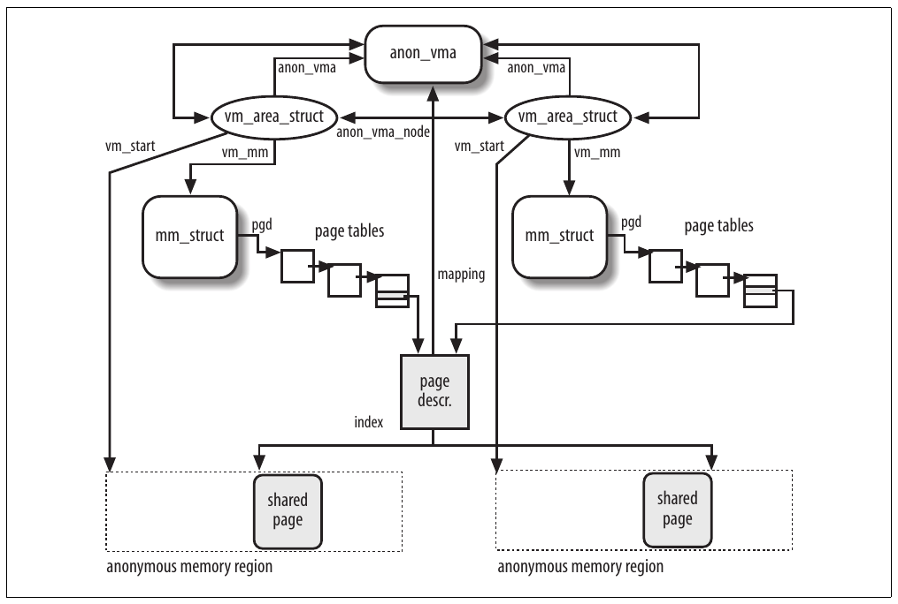
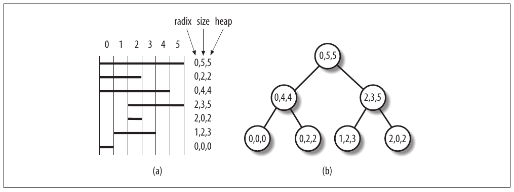
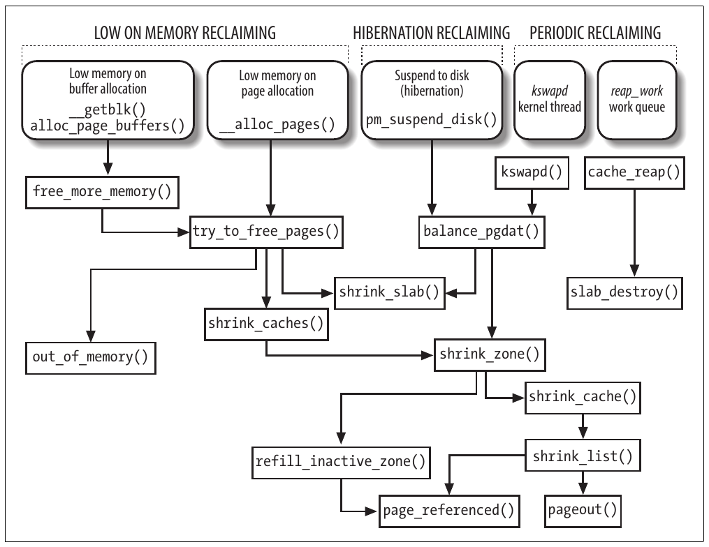
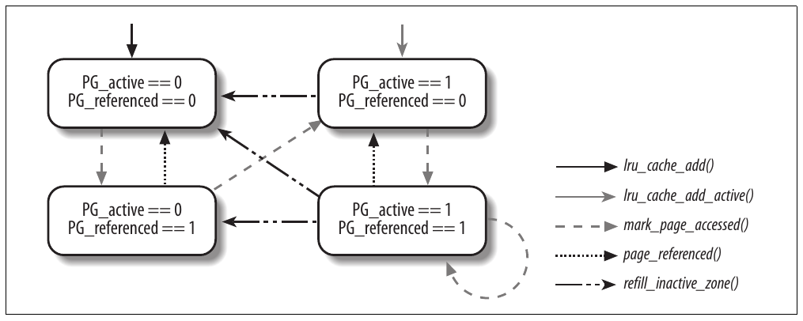
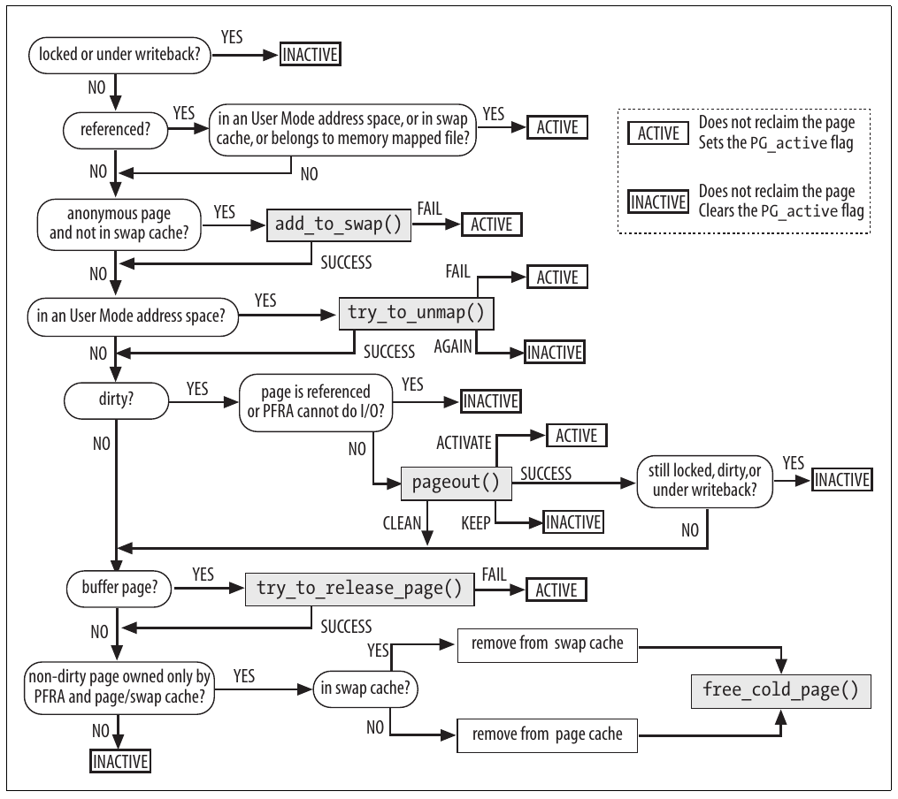
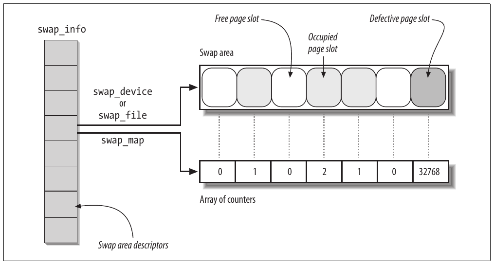
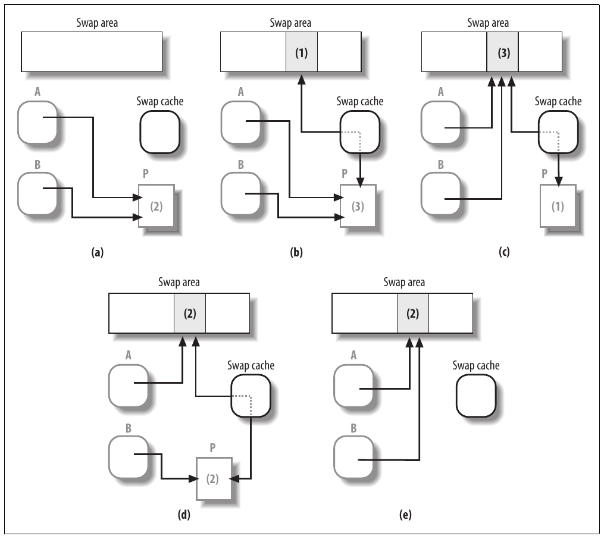

CHƯƠNG 17 Chương 17

# Chương 17. Thu hồi page frame


Trong các chương trước, chúng ta đã giải thích cách kernel xử lý dynamic memory bằng cách theo dõi các page frame trống và đang bận. Chúng ta cũng đã thảo luận cách mỗi process trong User Mode có address space riêng và được kernel đáp ứng các yêu cầu memory theo từng page, để các page frame có thể được cấp cho process vào thời điểm muộn nhất có thể. Cuối cùng nhưng không kém phần quan trọng, chúng ta đã trình bày cách kernel sử dụng dynamic memory để triển khai cả memory cache và disk cache.

Trong chương này, chúng ta hoàn tất phần mô tả virtual memory subsystem bằng việc thảo luận về page frame reclaiming. Chúng ta sẽ bắt đầu ở mục đầu tiên, “Thuật toán page frame reclaiming”, giải thích tại sao kernel cần thu hồi page frame và nó sử dụng chiến lược nào để đạt được điều đó. Sau đó, trong mục “Reverse Mapping”, chúng ta tạm chuyển sang một nội dung kỹ thuật để thảo luận về các data structure mà kernel sử dụng để nhanh chóng tìm tất cả Page Table entry trỏ đến cùng một page frame. Mục “Triển khai PFRA” dành cho thuật toán page frame reclaiming được Linux sử dụng. Mục chính cuối cùng, “Swapping”, gần như là một chương riêng: mục này trình bày swap subsystem, một thành phần kernel dùng để lưu các anonymous page (không ánh xạ dữ liệu của file) trên disk.

## Thuật toán page frame reclaiming

Một trong những khía cạnh thú vị của Linux là các kiểm tra được thực hiện trước khi cấp phát dynamic memory cho các User Mode process hoặc cho kernel khá sơ sài.

Chẳng hạn, không có kiểm tra nghiêm ngặt nào đối với tổng dung lượng RAM được cấp cho các process do cùng một user tạo ra (các giới hạn được đề cập trong mục “Giới hạn tài nguyên của process” ở Chương 3 chủ yếu tác động đến từng process riêng lẻ). Tương tự, không có giới hạn nào được đặt ra cho kích thước của nhiều disk cache và memory cache mà kernel sử dụng.

Việc thiếu các kiểm soát này là một lựa chọn thiết kế cho phép kernel sử dụng RAM hiện có theo cách tốt nhất có thể. Khi system load thấp, RAM chủ yếu chứa disk cache và số ít process đang chạy có thể hưởng lợi từ thông tin được lưu trong đó. Tuy nhiên, khi system load tăng lên, RAM chủ yếu chứa các page của process và các cache được thu nhỏ để nhường chỗ cho các process bổ sung.

Như đã thấy trong các chương trước, cả memory cache và disk cache đều lấy ngày càng nhiều page frame nhưng không bao giờ giải phóng chúng. Điều này hợp lý vì các hệ thống cache không biết liệu và khi nào các process sẽ tái sử dụng một phần dữ liệu được cache, do đó không thể xác định những phần cache cần được giải phóng. Hơn nữa, nhờ cơ chế demand paging được mô tả trong Chương 9, các User Mode process nhận được page frame trong khi tiếp tục thực thi; tuy nhiên, demand paging không có cách nào buộc các process giải phóng page frame khi chúng không còn được sử dụng.

Vì vậy, sớm hay muộn, toàn bộ memory trống sẽ được cấp cho các process và cache. Thuật toán page frame reclaiming của Linux kernel bổ sung lại các danh sách block trống của buddy system bằng cách “lấy cắp” page frame từ cả User Mode process và kernel cache.

Thực ra, page frame reclaiming phải được thực hiện trước khi toàn bộ memory trống bị sử dụng hết. Nếu không, kernel có thể dễ dàng bị mắc kẹt trong một chuỗi yêu cầu memory chết người dẫn đến system crash. Về cơ bản, để giải phóng một page frame, kernel phải ghi dữ liệu của nó xuống disk; tuy nhiên, để thực hiện thao tác này, kernel cần một page frame khác (chẳng hạn, để cấp phát các buffer head cho việc truyền dữ liệu I/O). Nếu không còn page frame trống, không page frame nào có thể được giải phóng.

Do đó, một trong những mục tiêu của page frame reclaiming là duy trì một lượng tối thiểu page frame trống để kernel có thể khôi phục an toàn từ tình trạng “thiếu memory”.

### Chọn một target page

Mục tiêu của thuật toán page frame reclaiming (PFRA) là chọn các page frame và làm cho chúng trở thành trống. Rõ ràng các page frame được PFRA chọn phải không trống, tức là chúng chưa được đưa vào một trong các mảng `free_area` mà buddy system sử dụng (xem mục “Thuật toán buddy system” trong Chương 8).

PFRA xử lý các page frame theo những cách khác nhau, tùy nội dung của chúng. Chúng ta có thể phân biệt unreclaimable page, swappable page, syncable page và discardable page. Các loại này được giải thích trong Bảng 17-1.

Bảng 17-1. Các loại page được PFRA xem xét

| Loại page | Mô tả | Thao tác thu hồi |
|---|---|---|
| Unreclaimable | Page trống (nằm trong các danh sách buddy system) Reserved page (có flag `PG_reserved` được đặt) Page được kernel cấp phát động Page trong Kernel Mode stack của các process Page tạm thời bị khóa (có flag `PG_locked` được đặt) Memory locked page (trong các memory region có flag `VM_LOCKED` được đặt) | (Không cho phép hoặc không cần thu hồi) |
| Swappable | Anonymous page trong User Mode address space Mapped page của tmpfs filesystem (ví dụ: page của IPC shared memory) | Lưu nội dung page vào một swap area |

Mapped page trong User Mode address space Đồng bộ page với Page nằm trong page cache và chứa dữ liệu của disk file Syncable bản sao của nó trên disk, nếu cần Page buffer của block device thiết Page của một số disk cache (ví dụ: inode cache) Page không được sử dụng nằm trong memory cache (ví dụ: slab allocator cache) Discardable Không cần làm gì Page không được sử dụng của dentry cache

Trong bảng trên, một page được gọi là mapped nếu nó ánh xạ một phần của file. Chẳng hạn, tất cả page trong User Mode address space thuộc file memory mapping đều là mapped, cũng như bất kỳ page nào khác nằm trong page cache. Trong hầu hết trường hợp, mapped page là syncable: để thu hồi page frame, kernel phải kiểm tra xem page có dirty hay không và, nếu cần, ghi nội dung page vào disk file tương ứng.

Ngược lại, một page được gọi là anonymous nếu nó thuộc một anonymous memory region của process (chẳng hạn, tất cả page trong User Mode heap hoặc stack của process đều là anonymous). Để thu hồi page frame, kernel phải lưu nội dung page vào một disk partition hoặc disk file chuyên dụng được gọi là “swap area” (xem mục “Swapping” ở phần sau); do đó, tất cả anonymous page đều là swappable.

Thông thường, page của các special filesystem không thể được thu hồi. Ngoại lệ duy nhất là page của tmpfs special filesystem, có thể được thu hồi bằng cách lưu chúng vào một swap area. Như sẽ thấy trong Chương 19, tmpfs special filesystem được cơ chế IPC shared memory sử dụng.

Khi PFRA phải thu hồi một page frame thuộc User Mode address space của process, nó phải xem xét page frame đó là shared hay non-shared. Một shared page frame thuộc nhiều User Mode address space, trong khi một non-shared page frame chỉ thuộc một address space. Lưu ý rằng một non-shared page frame có thể thuộc nhiều lightweight process tham chiếu đến cùng memory descriptor.

Shared page frame thường được tạo khi một process sinh process con; như giải thích trong mục “Copy On Write” ở Chương 9, các page table của process con được sao chép từ process cha, vì vậy cha và con dùng chung các page frame. Một trường hợp phổ biến khác xảy ra khi hai hoặc nhiều process truy cập cùng file thông qua một shared memory mapping (xem mục “Memory Mapping” trong Chương 16).[^1]

### Thiết kế PFRA

Mặc dù dễ xác định các page ứng viên để thu hồi memory—nói khái quát là bất kỳ page nào thuộc disk cache hoặc memory cache, hoặc User Mode address space của process—việc chọn các target page thích hợp có lẽ là vấn đề nhạy cảm nhất trong thiết kế kernel.

Thực tế, công việc khó nhất của một developer làm việc trên virtual memory subsystem là tìm một thuật toán bảo đảm hiệu năng chấp nhận được cho cả desktop machine (nơi các yêu cầu memory khá hạn chế nhưng khả năng phản hồi của hệ thống là thiết yếu) lẫn các máy cấp cao như database server lớn (nơi các yêu cầu memory thường rất lớn).

Đáng tiếc, tìm một thuật toán page frame reclaiming tốt là công việc khá thực nghiệm, với rất ít hỗ trợ từ lý thuyết. Tình huống này phần nào giống việc đánh giá các yếu tố quyết định dynamic priority của process: mục tiêu chính là điều chỉnh các tham số sao cho đạt hiệu năng hệ thống tốt, mà không đặt quá nhiều câu hỏi về lý do nó hoạt động tốt. Thường thì chỉ là “hãy thử cách này và xem điều gì xảy ra”. Một tác dụng phụ khó chịu của thiết kế thực nghiệm này là code thay đổi nhanh chóng. Vì lý do đó, chúng tôi không thể bảo đảm rằng thuật toán memory reclaiming sắp mô tả—thuật toán được dùng trong Linux 2.6.11—vào thời điểm bạn đọc chương này sẽ hoàn toàn giống thuật toán được phiên bản Linux 2.6 kernel mới nhất sử dụng. Tuy nhiên, các ý tưởng chung và các quy tắc heuristic chính được mô tả ở đây vẫn nên tiếp tục có giá trị.

Nhìn quá sát lá cây có thể khiến chúng ta bỏ lỡ cả khu rừng. Vì vậy, hãy trình bày một vài quy tắc chung mà PFRA áp dụng. Các quy tắc này được đưa vào những function sẽ được mô tả ở phần sau của chương này.

Giải phóng các page “vô hại” trước

Các page nằm trong disk cache và memory cache không được process nào tham chiếu nên được thu hồi trước các page thuộc User Mode address space của process; thực tế, trong trường hợp đầu tiên, việc page frame reclaiming có thể được thực hiện mà không sửa đổi bất kỳ Page Table entry nào. Như sẽ thấy trong mục “Các danh sách Least Recently Used (LRU)” ở phần sau của chương này, quy tắc này phần nào được điều chỉnh bằng cách đưa vào một “swap tendency factor”.

Cho phép thu hồi mọi page của một User Mode process

Ngoại trừ locked page, PFRA phải có khả năng lấy bất kỳ page nào của một User Mode process, kể cả anonymous page. Theo cách này, các process đã sleeping trong thời gian dài sẽ dần mất toàn bộ page frame của chúng.

Thu hồi một shared page frame bằng cách unmap đồng thời tất cả page table entry tham chiếu đến nó

Khi PFRA muốn giải phóng một page frame được nhiều process dùng chung, nó xóa tất cả page table entry tham chiếu đến shared page frame, rồi thu hồi page frame đó.

Chỉ thu hồi page “không được sử dụng”

PFRA sử dụng một thuật toán thay thế Least Recently Used (LRU) đơn giản hóa để phân loại page thành đang sử dụng và không được sử dụng.[^2] Nếu một page không được truy cập trong thời gian dài, xác suất nó được truy cập trong tương lai gần là thấp và có thể xem nó là “không được sử dụng”; ngược lại, nếu một page mới được truy cập gần đây, xác suất nó tiếp tục được truy cập là cao và phải xem nó là “đang sử dụng”. PFRA chỉ thu hồi page không được sử dụng. Đây chỉ là một ứng dụng khác của locality principle được đề cập trong mục “Hardware Cache” ở Chương 2.

Ý tưởng chính đằng sau thuật toán LRU là gắn với mỗi page trong RAM một counter lưu tuổi của page—tức khoảng thời gian đã trôi qua từ lần truy cập page gần nhất. Counter này cho phép PFRA chỉ thu hồi page cũ nhất của bất kỳ process nào. Một số computer platform cung cấp hỗ trợ tinh vi cho các thuật toán LRU;<sup>†</sup> đáng tiếc, các processor 80×86 không cung cấp tính năng hardware như vậy, do đó Linux kernel không thể dựa vào một page counter theo dõi tuổi của từng page. Để đối phó với hạn chế này, Linux tận dụng bit `Accessed` nằm trong mỗi Page Table entry, được hardware tự động đặt khi page được truy cập; hơn nữa, tuổi của một page được biểu diễn bằng vị trí của page descriptor trong một trong hai danh sách khác nhau (xem mục “Các danh sách Least Recently Used (LRU)” ở phần sau của chương này).

Do đó, thuật toán page frame reclaiming là sự kết hợp của nhiều heuristic:

- Lựa chọn cẩn thận thứ tự kiểm tra các cache.

- Sắp xếp các page dựa trên tuổi (page ít được sử dụng gần đây nhất cần được giải phóng trước page mới được truy cập gần đây).

- Phân biệt các page dựa trên trạng thái page (ví dụ, non-dirty page là ứng viên tốt hơn dirty page vì không phải ghi chúng xuống disk).

## Reverse Mapping

Như đã nêu trong mục trước, một trong các mục tiêu của PFRA là có thể giải phóng một shared page frame. Để làm điều đó, Linux 2.6 kernel có thể nhanh chóng tìm tất cả Page Table entry trỏ đến cùng page frame. Hoạt động này được gọi là reverse mapping.

Một giải pháp đơn giản cho reverse mapping là đưa vào mỗi page descriptor các field bổ sung để liên kết tất cả Page Table entry trỏ đến page frame gắn với page descriptor. Tuy nhiên, việc cập nhật các danh sách này sẽ làm tăng đáng kể kernel overhead; vì lý do đó, những giải pháp tinh vi hơn đã được xây dựng. Kỹ thuật được sử dụng trong Linux 2.6 có tên object-based reverse mapping. Về cơ bản, với bất kỳ User Mode page nào có thể thu hồi, kernel lưu các backward link đến mọi memory region trong hệ thống (các “object”) bao gồm chính page đó. Mỗi memory region descriptor lưu một pointer đến memory descriptor, rồi memory descriptor lại chứa một pointer đến Page Global Directory. Do đó, các backward link cho phép PFRA tìm tất cả Page Table entry tham chiếu đến một page cho trước. Vì số memory region descriptor ít hơn số page descriptor, việc cập nhật các backward link của một shared page tốn ít thời gian hơn. Hãy xem cách triển khai cơ chế này.

Trước hết, PFRA phải có cách xác định page cần thu hồi là shared hay non-shared, và là mapped hay anonymous. Để thực hiện điều này, kernel xem hai field của page descriptor: `_mapcount` và `mapping`.

Field `_mapcount` lưu số Page Table entry tham chiếu đến page frame. Counter bắt đầu từ `-`1: giá trị này có nghĩa không Page Table entry nào tham chiếu đến page frame. Vì vậy, nếu counter bằng zero thì page là non-shared, còn nếu lớn hơn zero thì page là shared. Function `page_mapcount()` nhận địa chỉ của một page descriptor và trả về giá trị `_mapcount` của nó cộng một (vì vậy, chẳng hạn, nó trả về một cho một non-shared page nằm trong User Mode address space của một process).

Field `mapping` của page descriptor xác định page là mapped hay anonymous như sau:

- Nếu field `mapping` là `NULL`, page thuộc swap cache (xem mục “Swap Cache” ở phần sau của chương này).

- Nếu field mapping khác `NULL` và least significant bit của nó là 1, điều đó có nghĩa page là anonymous và field `mapping` mã hóa pointer đến một `anon_vma` descriptor (xem mục tiếp theo, “Reverse Mapping cho Anonymous Page”).

- Nếu field `mapping` khác `NULL` và least significant bit của nó là 0, page là mapped; field `mapping` trỏ đến object `address_space` của file tương ứng (xem mục “Object address\_space” trong Chương 15).

Mỗi object `address_space` được Linux sử dụng đều được căn chỉnh trong RAM sao cho địa chỉ linear bắt đầu của nó là bội số của bốn. Do đó, least significant bit của field `mapping` có thể được dùng làm flag biểu thị field chứa pointer đến một object `address_space` hay một `anon_vma` descriptor. Đây là một thủ thuật lập trình không đẹp, nhưng kernel sử dụng rất nhiều page descriptor, do đó các data structure này nên nhỏ nhất có thể. Function `PageAnon()` nhận địa chỉ của một page descriptor làm tham số và trả về 1 nếu least significant bit của field `mapping` được đặt, ngược lại trả về 0.

Function `try_to_unmap()`, nhận một pointer đến page descriptor làm tham số, cố gắng xóa tất cả Page Table entry trỏ đến page frame gắn với page descriptor đó. Function trả về `SWAP_SUCCESS` (zero) nếu thành công trong việc loại bỏ mọi tham chiếu đến page frame khỏi tất cả Page Table entry, trả về `SWAP_AGAIN` (một) nếu một số tham chiếu không thể được loại bỏ, và trả về `SWAP_FAIL` (hai) khi có lỗi. Function này khá ngắn:

```c
int try_to_unmap(struct page *page)
{
    int ret;
    if (PageAnon(page))
        ret = try_to_unmap_anon(page);
    else
        ret = try_to_unmap_file(page);
    if (!page_mapped(page))
        ret = SWAP_SUCCESS;
    return ret;
}
```

Các function `try_to_unmap_anon()` và `try_to_unmap_file()` lần lượt xử lý anonymous page và mapped page. Các function này sẽ được mô tả trong các mục sắp tới.

### Reverse Mapping cho Anonymous Page

Anonymous page thường được nhiều process dùng chung. Trường hợp phổ biến nhất xảy ra khi fork một process mới: như giải thích trong mục “Copy On Write” ở Chương 9, tất cả page frame do process cha sở hữu—kể cả anonymous page—cũng được cấp cho process con. Một trường hợp khác (khá hiếm) xảy ra khi một process tạo memory region đồng thời chỉ định cả flag `MAP_ANONYMOUS` và `MAP_SHARED`: page của region đó sẽ được các process hậu duệ trong tương lai dùng chung.

Chiến lược liên kết tất cả anonymous page tham chiếu đến cùng page frame rất đơn giản: các anonymous memory region chứa page frame được tập hợp trong một doubly linked circular list. Lưu ý rằng ngay cả khi một anonymous memory region chứa nhiều page khác nhau, luôn chỉ có một reverse mapping list cho tất cả page frame trong region.

Khi kernel cấp page frame đầu tiên cho một anonymous region, nó tạo một data structure `anon_vma` mới, chỉ chứa hai field: `lock`, một spin lock để bảo vệ danh sách khỏi race condition, và `head`, đầu của doubly linked circular list các memory region descriptor. Sau đó, kernel chèn `vm_area_struct` descriptor của anonymous memory region vào danh sách của `anon_vma`; để làm điều đó, data structure `vm_area_struct` có hai field liên quan đến danh sách này: `anon_vma_node` lưu các pointer đến phần tử kế tiếp và trước đó trong danh sách, còn `anon_vma` trỏ đến data structure `anon_vma`. Cuối cùng, kernel lưu địa chỉ của data structure `anon_vma` vào field `mapping` của descriptor của anonymous page, như đã mô tả trước đó. Xem Hình 17-1.

Khi một page frame đã được một process tham chiếu được chèn vào một Page Table entry của process khác (chẳng hạn, do một system call `fork()`, xem mục “Các system call clone(), fork() và vfork()” trong Chương 3); kernel chỉ cần chèn anonymous memory region của process thứ hai vào doubly linked circular list của data structure `anon_vma` được field `anon_vma` của memory region của process thứ nhất trỏ đến. Do đó, bất kỳ danh sách nào của `anon_vma` thường đều chứa các memory region do những process khác nhau sở hữu.[^3]



Hình 17-1. Object-based reverse mapping cho anonymous page

Như minh họa trong Hình 17-1, danh sách của `anon_vma` cho phép kernel nhanh chóng tìm tất cả Page Table entry tham chiếu đến cùng anonymous page frame. Thực tế, mỗi region descriptor lưu trong field `vm_mm` địa chỉ của memory descriptor, rồi memory descriptor lại có field `pgd` chứa địa chỉ Page Global Directory của process. Sau đó có thể xác định Page Table entry bằng cách xem xét địa chỉ linear bắt đầu của anonymous page, dễ dàng lấy được từ memory region descriptor và field `index` của page descriptor.

#### Function try\_to\_unmap\_anon()

Khi thu hồi một anonymous page frame, PFRA phải quét tất cả memory region trong danh sách của `anon_vma` và kiểm tra cẩn thận xem mỗi region có thực sự chứa một anonymous page mà page frame bên dưới là target page frame hay không.

Công việc này được function `try_to_unmap_anon()` thực hiện; function nhận descriptor của target page frame làm tham số và về cơ bản thực hiện các bước sau:

1\. Giữ spin lock `lock` của data structure `anon_vma` được field `mapping` của page descriptor trỏ đến.

2\. Quét danh sách memory region descriptor của `anon_vma`; với mỗi memory region descriptor `vma` tìm thấy trong danh sách đó, gọi function `try_to_unmap_one()` và truyền `vma` cùng page descriptor làm tham số (xem bên dưới). Nếu vì lý do nào đó function này trả về giá trị `SWAP_FAIL`, hoặc nếu field `_mapcount` của page descriptor cho biết đã tìm thấy tất cả Page Table entry tham chiếu đến page frame, việc quét kết thúc trước khi tới cuối danh sách.

3\. Nhả spin lock đã giữ ở bước 1.

4\. Trả về giá trị được tính bởi lần gọi `try_to_unmap_one()` cuối cùng: `SWAP_AGAIN` (thành công một phần) hoặc `SWAP_FAIL` (thất bại).

##### Function try\_to\_unmap\_one()

Function `try_to_unmap_one()` được gọi lặp lại từ cả `try_to_unmap_anon()` lẫn `try_to_unmap_file()`. Nó hoạt động trên hai tham số: pointer `page` đến một target page descriptor và pointer `vma` đến một memory region descriptor. Về cơ bản, function thực hiện các hành động sau:

1\. Tính địa chỉ linear của page cần thu hồi từ địa chỉ linear bắt đầu của memory region (`vma->vm_start`), offset của memory region trong mapped file (`vma->vm_pgoff`) và offset của page bên trong mapped file (`page->index`). Với anonymous page, field `vma->vm_pgoff` bằng zero hoặc bằng `vm_start/PAGE_SIZE`; tương ứng, field `page->index` là index của page bên trong region hoặc là địa chỉ linear của page chia cho `PAGE_SIZE`.

2\. Nếu target page là anonymous, kiểm tra xem địa chỉ linear của nó có nằm trong memory region hay không; nếu không, kết thúc bằng cách trả về `SWAP_AGAIN`. (Như đã giải thích khi giới thiệu reverse mapping cho anonymous page, danh sách của `anon_vma` có thể chứa các memory region không chứa target page.)

3\. Lấy địa chỉ memory descriptor từ `vma->vm_mm`, rồi giữ spin lock `vma->vm_mm->page_table_lock` bảo vệ các page table. 4. Lần lượt gọi `pgd_offset()`, `pud_offset()`, `pmd_offset()` và `pte_offset_map()` để lấy địa chỉ của Page Table entry tương ứng với địa chỉ linear của target page.

5\. Thực hiện một số kiểm tra để xác minh rằng target page thực sự có thể thu hồi. Nếu bất kỳ kiểm tra nào sau đây thất bại, function nhảy đến bước 12 để kết thúc bằng cách trả về một error number thích hợp, là `SWAP_AGAIN` hoặc `SWAP_FAIL`:

a. Kiểm tra xem Page Table entry có trỏ đến target page hay không; nếu không, function trả về `SWAP_AGAIN`. Điều này có thể xảy ra trong các trường hợp sau:

  - Page Table entry tham chiếu đến một page frame được cấp bằng COW, nhưng anonymous memory region được `vma` xác định vẫn thuộc danh sách `anon_vma` của page frame ban đầu.

  - System call `mremap()` có thể remap các memory region và di chuyển các page vào User Mode address space bằng cách trực tiếp sửa đổi các page table entry. Trong trường hợp cụ thể này, object-based reverse mapping không hoạt động, vì field `index` của page descriptor không thể được dùng để xác định địa chỉ linear thực tế của page.

  - File memory mapping là non-linear (xem mục “Non-Linear Memory Mapping” trong Chương 16).

b. Kiểm tra xem memory region có bị khóa (`VM_LOCKED`) hoặc được dành riêng (`VM_RESERVED`) hay không; nếu có một trong những hạn chế này, function trả về `SWAP_FAIL`.

c. Kiểm tra xem bit `Accessed` bên trong Page Table entry có bị xóa hay không; nếu không, function xóa bit này và trả về `SWAP_FAIL`. Nếu bit `Accessed` được đặt, page được xem là đang sử dụng, do đó không nên thu hồi.

d. Kiểm tra xem page có thuộc swap cache (xem mục “Swap Cache” ở phần sau của chương này) và hiện đang được `get_user_pages()` xử lý (xem mục “Cấp phát một khoảng địa chỉ linear” trong Chương 9) hay không; trong trường hợp này, để tránh một race condition khó chịu, function trả về `SWAP_FAIL`.

6\. Page có thể được thu hồi: nếu bit `Dirty` trong Page Table entry được đặt, đặt flag `PG_dirty` của page.

7\. Xóa Page Table entry và flush các TLB tương ứng.

8\. Nếu page là anonymous, function chèn một swapped-out page identifier vào Page Table entry để các lần truy cập tiếp theo đến page này sẽ swap in page (xem mục “Swapping” ở phần sau của chương này). Hơn nữa, nó giảm counter của anonymous page được lưu trong field `anon_rss` của memory descriptor.

9\. Giảm counter của các page frame đã cấp cho process được lưu trong field `rss` của memory descriptor.

10\. Giảm field `_mapcount` của page descriptor, vì một tham chiếu đến page frame này trong các User Mode Page Table entry đã bị xóa.

11\. Giảm usage counter của page frame, được lưu trong field `_count` của page descriptor. Nếu counter trở thành âm, loại bỏ page descriptor khỏi active list hoặc inactive list (xem mục “Các danh sách Least Recently Used (LRU)” ở phần sau của chương này), rồi gọi `free_hot_page()` để giải phóng page frame (xem mục “Per-CPU Page Frame Cache” trong Chương 8).

12\. Gọi `pte_unmap()` để giải phóng temporary kernel mapping có thể đã được `pte_offset_map()` cấp phát ở bước 4 (xem mục “Kernel Mapping của High-Memory Page Frame” trong Chương 8).

13\. Nhả spin lock `vma->vm_mm->page_table_lock` đã giữ ở bước 3.

14\. Trả về error code thích hợp (`SWAP_AGAIN` nếu thành công).

### Reverse Mapping cho Mapped Page

Giống như với anonymous page, object-based reverse mapping cho mapped page dựa trên một ý tưởng đơn giản: luôn có thể lấy được các Page Table entry tham chiếu đến một page frame cho trước bằng cách truy cập descriptor của các memory region chứa mapped page tương ứng. Vì vậy, cốt lõi của reverse mapping là một data structure khéo léo tập hợp mọi memory region descriptor liên quan đến một page frame cho trước.

Trong mục trước, chúng ta đã thấy descriptor của các anonymous memory region được tập hợp trong doubly linked circular list; việc tìm tất cả page table entry tham chiếu đến một page frame cho trước cần quét tuyến tính các phần tử trong danh sách. Số shared anonymous page frame không bao giờ quá lớn, vì thế cách tiếp cận này hoạt động tốt.

Trái với anonymous page, mapped page thường được dùng chung, vì nhiều process khác nhau có thể dùng chung các page code. Chẳng hạn, hãy xét việc gần như mọi process trong hệ thống đều dùng chung các page chứa code của standard C library (xem mục “Library” trong Chương 20). Vì lý do này, Linux 2.6 dựa vào các search tree đặc biệt, được gọi là “priority search tree”, để nhanh chóng tìm tất cả memory region tham chiếu đến cùng page frame.

Có một priority search tree cho mỗi file; root của nó được lưu trong field `i_mmap` của object `address_space` được nhúng trong object `inode` của file. Luôn có thể nhanh chóng lấy root của search tree, vì field `mapping` trong descriptor của một mapped page trỏ đến object `address_space`.

#### Priority search tree

Priority search tree (PST) được Linux 2.6 sử dụng dựa trên một data structure do Edward McCreight giới thiệu năm 1985 để biểu diễn một tập các khoảng chồng lấn. Tree của McCreight là sự kết hợp giữa heap và balanced search tree, và được dùng để truy vấn tập khoảng—ví dụ, “những khoảng nào nằm trong một khoảng cho trước?” và “những khoảng nào giao với một khoảng cho trước?”—trong thời gian tỉ lệ thuận với chiều cao của tree và số khoảng trong câu trả lời.

Mỗi khoảng trong PST tương ứng với một node của tree, và được đặc trưng bởi hai index: radix index tương ứng với điểm bắt đầu của khoảng, và heap index tương ứng với điểm kết thúc. PST về cơ bản là một search tree trên radix index, với tính chất bổ sung giống heap là heap index của một node không bao giờ nhỏ hơn heap index của các node con.

Linux priority search tree khác data structure của McCreight ở hai khía cạnh quan trọng: thứ nhất, Linux tree không phải lúc nào cũng được giữ cân bằng (thuật toán cân bằng tốn kém cả về memory space lẫn execution time); thứ hai, Linux tree được điều chỉnh để lưu memory region thay cho các khoảng tuyến tính.

Mỗi memory region có thể được xem là một khoảng file page được xác định bởi vị trí ban đầu trong file (radix index) và vị trí cuối cùng (heap index). Tuy nhiên, các memory region có xu hướng bắt đầu từ cùng những page (thường là từ page index 0). Đáng tiếc, data structure ban đầu của McCreight không thể lưu các khoảng có cùng điểm bắt đầu. Như một giải pháp một phần, mỗi node của PST mang thêm một size index—ngoài radix index và heap index—tương ứng với kích thước memory region tính bằng page trừ một. Size index cho phép chương trình tìm kiếm phân biệt những memory region khác nhau bắt đầu ở cùng vị trí trong file.

Tuy nhiên, size index làm tăng đáng kể số node khác nhau có thể xuất hiện trong PST. Cụ thể, nếu có quá nhiều node có cùng radix index nhưng khác heap index, PST có thể không chứa được tất cả chúng. Để giải quyết vấn đề này, PST có thể chứa các overflow subtree có root tại các leaf của PST và chứa các node có chung một radix tree.

Hơn nữa, các process khác nhau có thể sở hữu các memory region ánh xạ chính xác cùng một phần của cùng file (hãy xét ví dụ standard C library đã đề cập ở trên). Khi đó, mọi node tương ứng với những memory region này đều có cùng radix index, heap index và size index. Khi kernel phải chèn vào PST một memory region có các index giống một node đã tồn tại, nó chèn memory region descriptor vào một doubly linked circular list có gốc tại PST node cũ hơn.

Hình 17-2 trình bày một ví dụ đơn giản về priority search tree. Phía trái hình minh họa bảy memory region bao phủ sáu page đầu tiên của một file; mỗi khoảng được gắn nhãn với radix index, size index và heap index. Phía phải hình vẽ PST tương ứng. Lưu ý rằng không node con nào có heap index lớn hơn heap index của node cha. Cũng hãy quan sát rằng radix index của node con trái của bất kỳ node nào không bao giờ lớn hơn radix index của node con phải; nếu các radix index bằng nhau, thứ tự được xác định bởi size index. Giả sử PFRA phải tìm mọi memory region chứa page tại index năm. Thuật toán tìm kiếm bắt đầu ở root (0,5,5): vì khoảng tương ứng chứa page, đây là memory region đầu tiên được tìm thấy. Sau đó thuật toán thăm node con trái (0,4,4) của root và so sánh heap index (bốn) với page index: vì heap index nhỏ hơn, khoảng này không chứa page; hơn nữa, nhờ tính chất giống heap của PST, không node con nào của node này có thể chứa page. Vì vậy thuật toán nhảy thẳng đến node con phải (2,3,5) của root. Khoảng tương ứng chứa page, nên nó được lấy ra. Sau đó thuật toán thăm các node con (1,2,3) và (2,0,2), nhưng phát hiện cả hai đều không chứa page.



Hình 17-2. Một ví dụ đơn giản về priority search tree

Do giới hạn dung lượng, chúng tôi không thể mô tả chi tiết các data structure và function triển khai Linux PST. Chúng tôi chỉ đề cập rằng một node của PST được biểu diễn bởi data structure `prio_tree_node`, được nhúng trong field `shared. prio_tree_node` của mỗi memory region descriptor. Data structure `shared.vm_set` được dùng—thay cho `shared.prio_tree_node`—để chèn memory region descriptor vào một duplicate list của PST node. Có thể chèn và loại bỏ PST node bằng cách thực thi các function `vma_prio_tree_insert()` và `vma_prio_tree_remove()`; cả hai đều nhận địa chỉ của memory region descriptor và địa chỉ PST root làm tham số. Có thể thực hiện truy vấn trên PST bằng macro `vma_prio_tree_foreach`, triển khai một vòng lặp qua tất cả memory region descriptor chứa ít nhất một page trong một khoảng địa chỉ linear được chỉ định.

##### Function try\_to\_unmap\_file()

Function `try_to_unmap_file()` được `try_to_unmap()` gọi để thực hiện reverse mapping của mapped page. Function này khá dễ mô tả khi memory mapping là linear (xem mục “Memory Mapping” trong Chương 16). Trong trường hợp này, nó thực hiện các hành động sau:

1\. Giữ spin lock `page->mapping->i_mmap_lock`.

2\. Áp dụng macro `vma_prio_tree_foreach()` cho priority search tree có root được lưu trong field `page->mapping->i_mmap`. Với mỗi descriptor `vm_area_struct` được macro tìm thấy, function gọi `try_to_unmap_one()` để cố gắng xóa Page Table entry của memory region chứa page (xem mục “Reverse Mapping cho Anonymous Page” ở phần trước). Nếu vì lý do nào đó function này trả về giá trị `SWAP_FAIL`, hoặc nếu field `_mapcount` của page descriptor cho biết đã tìm thấy tất cả Page Table entry tham chiếu đến page frame, việc quét kết thúc ngay lập tức.

3\. Nhả spin lock `page->mapping->i_mmap_lock`.

4\. Trả về `SWAP_AGAIN` hoặc `SWAP_FAIL` tùy theo tất cả page table entry đã được xóa hay chưa.

Nếu mapping là non-linear (xem mục “Non-Linear Memory Mapping” trong Chương 16), function `try_to_unmap_one()` có thể không xóa được một số Page Table entry, vì field `index` của page descriptor, như thường lệ lưu vị trí page trong file, không còn liên quan đến vị trí page trong memory region. Do đó, `try_to_unmap_one()` không thể xác định địa chỉ linear của page, nên không thể lấy địa chỉ Page Table entry.

Giải pháp duy nhất là tìm kiếm toàn bộ trong mọi non-linear memory region của file. Doubly linked list có gốc tại field `i_mmap_nonlinear` của object `address_space` của file `page->mapping` chứa descriptor của mọi non-linear memory region của file. Với mỗi memory region như vậy, `try_to_unmap_file()` gọi function `try_to_unmap_cluster()`, quét mọi Page Table entry tương ứng với các địa chỉ linear của memory region và cố gắng xóa chúng.

Vì việc tìm kiếm có thể khá tốn thời gian, chỉ thực hiện một lần quét giới hạn và một quy tắc heuristic xác định phần memory region cần quét: field `vm_private_data` của descriptor `vma_area_struct` giữ cursor hiện tại trong lần quét hiện tại. Điều này có nghĩa là trong một số trường hợp, `try_to_unmap_file()` có thể bỏ lỡ page cần unmap. Khi điều này xảy ra, `try_to_unmap()` phát hiện page vẫn được mapped và trả về `SWAP_AGAIN` thay vì `SWAP_SUCCESS`.

## Triển khai PFRA

Thuật toán page frame reclaiming phải xử lý nhiều loại page do User Mode process, disk cache và memory cache sở hữu; hơn nữa, nó phải tuân theo nhiều quy tắc heuristic. Vì vậy, không có gì ngạc nhiên khi PFRA gồm rất nhiều function. Hình 17-3 trình bày các function chính của PFRA; một mũi tên biểu thị việc gọi function, vì vậy chẳng hạn `try_to_free_pages()` gọi `shrink_caches()`, `shrink_slab()` và `out_of_memory()`.

Như bạn thấy, PFRA có nhiều “entry point”. Thực tế, page frame reclaiming được thực hiện chủ yếu trong ba trường hợp:

Thu hồi khi thiếu memory

Kernel phát hiện tình trạng “thiếu memory”.

Thu hồi khi hibernation

Kernel phải giải phóng memory vì nó đang vào trạng thái suspend-to-disk (chúng ta không thảo luận thêm trường hợp này).

Thu hồi định kỳ

Một kernel thread được kích hoạt định kỳ để thực hiện memory reclaiming nếu cần.



Hình 17-3. Các function chính của PFRA

Việc thu hồi khi thiếu memory được kích hoạt trong các trường hợp sau:

- Function `grow_buffers()`, được `__getblk()` gọi, không cấp phát được một buffer page mới (xem mục “Tìm block trong Page Cache” ở Chương 15).

- Function `alloc_page_buffers()`, được `create_empty_buffers()` gọi, không cấp phát được các temporary buffer head cho một page (xem mục “Đọc và ghi một file” ở Chương 16).

- Function `__alloc_pages()` không cấp phát được một nhóm page frame liên tiếp trong một danh sách memory zone cho trước (xem mục “Thuật toán buddy system” ở Chương 8).

Việc thu hồi định kỳ được hai loại kernel thread khác nhau kích hoạt:

- Các kernel thread kswapd, kiểm tra xem số page frame trống trong một memory zone có giảm xuống dưới watermark `pages_high` hay không (xem mục “Thu hồi định kỳ” ở phần sau).

- Các kernel thread events, là các worker thread của predefined work queue (xem mục “Work Queue” trong Chương 4); PFRA định kỳ lên lịch thực thi một task trong predefined work queue để thu hồi tất cả slab trống nằm trong các memory cache do slab allocator xử lý (xem mục “Slab Allocator” trong Chương 8).

Bây giờ chúng ta sẽ thảo luận chi tiết các thành phần khác nhau của thuật toán page frame reclaiming, bao gồm tất cả function được minh họa trong Hình 17-3.

### Các danh sách Least Recently Used (LRU)

Tất cả page thuộc User Mode address space của process hoặc page cache được nhóm vào hai danh sách gọi là active list và inactive list; chúng cũng được gọi chung là các LRU list. Danh sách thứ nhất có xu hướng chứa những page mới được truy cập gần đây, còn danh sách thứ hai có xu hướng chứa những page đã không được truy cập trong một thời gian. Rõ ràng, nên lấy page từ inactive list.

Active list và inactive list của page là các data structure cốt lõi của thuật toán page frame reclaiming. Đầu của hai doubly linked list này lần lượt được lưu trong các field `active_list` và `inactive_list` của mỗi `zone` descriptor (xem mục “Memory Zone” trong Chương 8). Các field `nr_active` và `nr_inactive` trong cùng descriptor lưu số page trong hai danh sách. Cuối cùng, field `lru_lock` là một spin lock bảo vệ hai danh sách khỏi truy cập đồng thời trong các hệ thống SMP.

Nếu một page thuộc một LRU list, flag `PG_lru` trong page descriptor của nó được đặt. Hơn nữa, nếu page thuộc active list thì flag `PG_active` được đặt, còn nếu thuộc inactive list thì flag `PG_active` bị xóa. Field `lru` của page descriptor lưu các pointer đến phần tử kế tiếp và trước đó trong LRU list.

Có nhiều auxiliary function để xử lý các LRU list:

`add_page_to_active_list()`

Thêm page vào đầu active list của zone và tăng field `nr_active` của zone descriptor.

`add_page_to_inactive_list()`

Thêm page vào đầu inactive list của zone và tăng field `nr_inactive` của zone descriptor.

`del_page_from_active_list()`

Loại bỏ page khỏi active list của zone và giảm field `nr_active` của zone descriptor.

`del_page_from_inactive_list()`

Loại bỏ page khỏi inactive list của zone và giảm field `nr_inactive` của zone descriptor.

`del_page_from_lru()`

Kiểm tra flag `PG_active` của một page; tùy kết quả, loại bỏ page khỏi active list hoặc inactive list, giảm field `nr_active` hoặc `nr_inactive` của zone descriptor, và xóa flag `PG_active` nếu cần.

`activate_page()`

Kiểm tra flag `PG_active`; nếu flag bị xóa (page nằm trong inactive list), chuyển page vào active list: gọi `del_page_from_inactive_list()`, rồi gọi `add_page_to_active_list()`, cuối cùng đặt flag `PG_active`. Spin lock `lru_lock` của zone được giữ trước khi di chuyển page.

`lru_cache_add()`

Nếu page chưa nằm trong một LRU list, đặt flag `PG_lru`, giữ spin lock `lru_lock` của zone, rồi gọi `add_page_to_inactive_list()` để chèn page vào inactive list của zone.

`lru_cache_add_active()`

Nếu page chưa nằm trong một LRU list, đặt các flag `PG_lru` và `PG_active`, giữ spin lock `lru_lock` của zone, rồi gọi `add_page_to_active_list()` để chèn page vào active list của zone.

Thực ra, hai function cuối, `lru_cache_add()` và `lru_cache_add_active()`, phức tạp hơn một chút. Thực tế, hai function không chuyển ngay page vào một LRU; thay vào đó, chúng tích lũy các page trong những temporary data structure kiểu `pagevec`, mỗi structure có thể chứa tối đa 14 page descriptor pointer. Các page chỉ thực sự được chuyển vào một LRU list khi một structure `pagevec` được điền đầy. Cơ chế này nâng cao hiệu năng hệ thống, vì LRU spin lock chỉ được giữ khi các LRU list thực sự được sửa đổi.

#### Di chuyển page giữa các LRU list

PFRA tập hợp các page mới được truy cập gần đây trong active list để không quét chúng khi tìm một page frame cần thu hồi. Ngược lại, PFRA tập hợp các page lâu không được truy cập trong inactive list. Tất nhiên, page cần chuyển từ inactive list sang active list và ngược lại, tùy chúng có đang được truy cập hay không.

Rõ ràng, hai trạng thái page (“active” và “inactive”) không đủ để mô tả mọi kiểu truy cập có thể xảy ra. Chẳng hạn, giả sử một logger process ghi dữ liệu vào một page mỗi giờ một lần. Mặc dù page “inactive” trong phần lớn thời gian, lần truy cập làm nó “active”, do đó ngăn việc thu hồi page frame tương ứng, dù nó sẽ không được truy cập trong suốt một giờ. Tất nhiên, không có giải pháp tổng quát cho vấn đề này, vì PFRA không thể dự đoán hành vi của User Mode process; tuy nhiên, có vẻ hợp lý khi page không thay đổi trạng thái với mỗi lần truy cập riêng lẻ.

Flag `PG_referenced` trong page descriptor được dùng để tăng gấp đôi số lần truy cập cần thiết để chuyển một page từ inactive list sang active list; nó cũng được dùng để tăng gấp đôi số lần “không truy cập” cần thiết để chuyển page từ active list sang inactive list (xem bên dưới). Chẳng hạn, giả sử một page trong inactive list có flag `PG_referenced` bằng 0. Lần truy cập page đầu tiên đặt giá trị flag thành 1, nhưng page vẫn ở inactive list. Lần truy cập page thứ hai thấy flag đã được đặt và khiến page được chuyển vào active list. Tuy nhiên, nếu lần truy cập thứ hai không xảy ra trong một khoảng thời gian nhất định sau lần đầu, thuật toán page frame reclaiming có thể reset flag `PG_referenced`.

Như minh họa trong Hình 17-4, PFRA dùng các function `mark_page_accessed()`, `page_referenced()` và `refill_inactive_zone()` để di chuyển page giữa các LRU list. Trong hình, LRU list chứa page được xác định bởi trạng thái flag `PG_active`.



Hình 17-4. Di chuyển page giữa các LRU list

##### Function mark\_page\_accessed()

Bất cứ khi nào kernel cần đánh dấu một page đã được truy cập, nó gọi function `mark_page_accessed()`. Điều này xảy ra mỗi khi kernel xác định rằng một page đang được User Mode process, filesystem layer hoặc device driver tham chiếu. Chẳng hạn, `mark_page_accessed()` được gọi trong các trường hợp sau:

- Khi nạp theo yêu cầu một anonymous page của process (được function `do_anonymous_page()` thực hiện; xem mục “Demand Paging” trong Chương 9).

- Khi nạp theo yêu cầu một page của memory mapped file (được function `filemap_nopage()` thực hiện; xem mục “Demand Paging cho Memory Mapping” trong Chương 16).

- Khi nạp theo yêu cầu một page của IPC shared memory region (được function `shmem_nopage()` thực hiện; xem mục “IPC Shared Memory” trong Chương 19).

- Khi đọc một page dữ liệu từ file (được function `do_generic_file_read()` thực hiện; xem mục “Đọc từ một file” trong Chương 16).

- Khi swap in một page (được function `do_swap_page()` thực hiện; xem mục “Swap in page” ở phần sau của chương này).

- Khi tra cứu một buffer page trong page cache (xem function `__find_get_block()` trong mục “Tìm block trong Page Cache” ở Chương 15).

Function `mark_page_accessed()` thực thi đoạn code sau:

```c
if (!PageActive(page) && PageReferenced(page) && PageLRU(page)) {
    activate_page(page);
    ClearPageReferenced(page);
} else if (!PageReferenced(page))
    SetPageReferenced(page);
```

Như minh họa trong Hình 17-4, function chỉ chuyển page từ inactive list sang active list nếu flag `PG_referenced` đã được đặt trước lần gọi.

##### Function page\_referenced()

Function `page_referenced()`, được gọi một lần cho mỗi page được PFRA quét, trả về 1 nếu flag `PG_referenced` hoặc một trong các bit `Accessed` trong các Page Table entry đã được đặt; ngược lại trả về 0. Function này trước hết kiểm tra flag `PG_referenced` của page descriptor; nếu flag được đặt, nó xóa flag đó. Tiếp theo, nó sử dụng cơ chế object-based reverse mapping để kiểm tra và xóa các bit `Accessed` trong mọi User Mode Page Table entry tham chiếu đến page frame. Để làm điều đó, function sử dụng ba ancillary function: `page_referenced_anon()`, `page_referenced_file()` và `page_referenced_one()`, tương tự các function `try_to_unmap_xxx()` được mô tả trong mục “Reverse Mapping” ở phần trước của chương này. Function `page_referenced()` cũng tuân theo swap token; xem mục “Swap Token” ở phần sau của chương này.

Function `page_referenced()` không bao giờ chuyển một page từ active list sang inactive list; công việc này do `refill_inactive_zone()` thực hiện. Trên thực tế, function này làm nhiều việc hơn việc chuyển page từ active list sang inactive list, vì vậy chúng ta sẽ mô tả nó chi tiết hơn.

##### Function refill\_inactive\_zone()

Như minh họa trong Hình 17-3, function `refill_inactive_zone()` được `shrink_zone()` gọi, thực hiện việc thu hồi page trong page cache và trong User Mode address space (xem mục “Thu hồi khi thiếu memory” ở phần sau của chương này). Function nhận hai tham số: pointer `zone` đến một memory zone descriptor và pointer `sc` đến một structure `scan_control`. Data structure thứ hai được PFRA sử dụng rộng rãi và chứa thông tin về thao tác thu hồi đang diễn ra; các field của nó được trình bày trong Bảng 17-2.

Bảng 17-2. Các field của descriptor scan\_control

| Kiểu | Field | Mô tả |
|---|---|---|
| `unsigned long` | `nr_to_scan` | Số lượng mục tiêu các page cần quét trong active list. |
| `unsigned long` | `nr_scanned` | Số inactive page được quét trong lần lặp hiện tại. |
| `unsigned long` | `nr_reclaimed` | Số page được thu hồi trong lần lặp hiện tại. |
| `unsigned long` | `nr_mapped` | Số page được tham chiếu trong User Mode address space. |
| `int` | `nr_to_reclaim` | Số lượng mục tiêu các page cần thu hồi. |
| `unsigned int` | `priority` | Priority của việc quét, trong khoảng từ 12 đến 0. Priority thấp hơn đồng nghĩa với việc quét nhiều page hơn. |
| `unsigned int` | `gfp_mask` | GFP mask được truyền từ function gọi. |
| `int` | `may_writepage` | Nếu được đặt, cho phép ghi dirty page xuống disk (chỉ dành cho laptop mode). |

Vai trò của `refill_inactive_zone()` rất quan trọng vì chuyển một page từ active list sang inactive list có nghĩa là làm page đó đủ điều kiện sớm hay muộn trở thành mục tiêu của PFRA. Nếu function quá tích cực, nó sẽ chuyển nhiều page từ active list sang inactive list; kết quả là PFRA sẽ thu hồi rất nhiều page frame và hiệu năng hệ thống sẽ bị ảnh hưởng. Ngược lại, nếu function quá chậm chạp, inactive list sẽ không được bổ sung đủ nhiều page không được sử dụng và PFRA sẽ không thu hồi được memory. Do đó, function triển khai hành vi thích nghi: ban đầu, mỗi lần được gọi nó quét một số ít page trong active list; tuy nhiên, nếu PFRA gặp khó khăn khi thu hồi page frame, `refill_inactive_zone()` liên tục tăng số active page được quét ở mỗi lần gọi. Hành vi này được điều khiển bởi giá trị field `priority` trong data structure `scan_control` (giá trị thấp hơn có nghĩa priority khẩn cấp hơn).

Một quy tắc heuristic khác điều chỉnh hành vi của function `refill_inactive_zone()`. Các LRU list chứa hai loại page: những page thuộc User Mode address space và những page nằm trong page cache nhưng không thuộc bất kỳ User Mode process nào. Như đã nêu trước đó, PFRA nên có xu hướng thu nhỏ page cache trong khi giữ trong RAM các page do User Mode process sở hữu. Tuy nhiên, không một “quy tắc vàng” cố định nào có thể mang lại hiệu năng tốt trong mọi tình huống, do đó function `refill_inactive_zone()` dựa vào một giá trị heuristic swap tendency: giá trị này xác định function sẽ di chuyển mọi loại page hay chỉ những page không thuộc User Mode address space.[^4] Giá trị swap tendency được function tính như sau:

swap tendency = mapped ratio / 2 + distress + swappiness

Giá trị mapped ratio là phần trăm page trong tất cả memory zone thuộc User Mode address space (`sc->nr_mapped`) so với tổng số page frame có thể cấp phát. Giá trị `mapped_ratio` cao có nghĩa dynamic memory chủ yếu được User Mode process sử dụng, còn giá trị thấp có nghĩa nó chủ yếu được page cache sử dụng.

Giá trị distress là thước đo mức độ hiệu quả của PFRA khi thu hồi page frame trong zone này; nó dựa trên scanning priority của zone trong lần chạy PFRA trước đó, được lưu trong field `prev_priority` của `zone` descriptor. Giá trị distress phụ thuộc vào priority trước đó của zone như sau:

Priority trước của zone 12...7 6 5 4 3 2 1 0 Giá trị distress 0 1 3 6 12 25 50 100

Cuối cùng, giá trị swappiness là một hằng số do user xác định, thường được đặt thành 60. System administrator có thể điều chỉnh giá trị này bằng cách ghi vào file /proc/sys/vm/swappiness hoặc thực hiện system call `sysctl()` thích hợp.

Page chỉ được thu hồi từ address space của process nếu swap tendency của zone lớn hơn hoặc bằng 100. Vì vậy, nếu system administrator đặt swappiness thành 0, PFRA không bao giờ thu hồi page trong User Mode address space trừ khi priority trước đó của zone bằng zero (một tình huống ít khả năng xảy ra); nếu administrator đặt swappiness thành 100, PFRA thu hồi page trong User Mode address space ở mọi lần gọi.

Sau đây là mô tả ngắn gọn những việc function `refill_inactive_zone()` thực hiện:

1\. Gọi `lru_add_drain()` để chuyển vào active list và inactive list mọi page vẫn nằm trong các data structure `pagevec`.

2\. Giữ spin lock `zone->lru_lock`.

3\. Thực hiện vòng lặp đầu tiên quét các page trong `zone->active_list`, bắt đầu từ cuối danh sách và đi ngược lại. Tiếp tục cho đến khi danh sách rỗng hoặc đã quét `sc->nr_to_scan` page. Với mỗi page được quét trong vòng lặp này, function tăng reference counter của nó thêm một, loại bỏ page descriptor khỏi `zone->active_list` và đặt nó vào một local list tạm thời `l_hold`. Tuy nhiên, nếu reference counter của page frame bằng zero, nó đưa page trở lại active list. Thực tế, page frame có reference counter bằng zero nên thuộc Buddy system của zone; tuy nhiên, để giải phóng một page frame, usage counter của nó được giảm trước, rồi page frame bị loại khỏi các LRU list và được chèn vào danh sách của buddy system. Do đó, có một khoảng thời gian nhỏ mà PFRA có thể thấy một page trống trong một LRU list.

4\. Cộng vào `zone->pages_scanned` số active page đã được quét.

5\. Trừ khỏi `zone->nr_active` số page đã được chuyển vào local list `l_hold`.

6\. Nhả spin lock `zone->lru_lock`.

7\. Tính giá trị swap tendency (xem ở trên).

8\. Thực hiện vòng lặp thứ hai trên các page trong local list `l_hold`. Mục tiêu của vòng lặp này là chia các page của `l_hold` thành hai local sublist gọi là `l_active` và `l_inactive`. Một page thuộc User Mode address space của một process—tức là page có `page->_mapcount` không âm—được thêm vào `l_active` nếu giá trị swap tendency nhỏ hơn 100, hoặc nếu page là anonymous nhưng không có swap area nào active, hoặc cuối cùng nếu function `page_referenced()` áp dụng cho page trả về giá trị dương, có nghĩa page mới được truy cập gần đây. Trong mọi trường hợp khác, page được thêm vào danh sách `l_inactive`.[^5]

9\. Giữ spin lock `zone->lru_lock`.

10\. Thực hiện vòng lặp thứ ba trên các page trong local list `l_inactive` để chuyển chúng vào danh sách `zone->inactive_list` và cập nhật field `zone->nr_inactive`. Khi làm điều này, giảm usage counter của các page frame đã di chuyển để hoàn tác các lần tăng ở bước 3.

11\. Thực hiện vòng lặp thứ tư và cuối cùng trên các page trong local list `l_active` để chuyển chúng vào danh sách `zone->active_list` và cập nhật field `zone->nr_active`. Khi làm điều này, giảm usage counter của các page frame đã di chuyển để hoàn tác các lần tăng ở bước 3.

12\. Nhả spin lock `zone->lru_lock` và trả về.

Cần lưu ý rằng `refill_inactive_zone()` chỉ kiểm tra flag `PG_referenced` cho các page thuộc User Mode address space (xem bước 8); trong trường hợp ngược lại, các page nằm ở cuối active list—do đó đã được truy cập từ một thời gian trước—và ít có khả năng được truy cập trong tương lai gần. Mặt khác, function không loại một page khỏi active list nếu nó do một User Mode process sở hữu và mới được sử dụng gần đây.

### Thu hồi khi thiếu memory

Việc thu hồi khi thiếu memory được kích hoạt khi một memory allocation thất bại. Như minh họa trong Hình 17-3, kernel gọi `free_more_memory()` khi cấp phát một VFS buffer hoặc buffer head, và gọi `try_to_free_pages()` khi cấp phát một hoặc nhiều page frame từ buddy system.

#### Function free\_more\_memory()

Function `free_more_memory()` thực hiện các hành động sau:

1\. Gọi `wakeup_bdflush()` để đánh thức một kernel thread pdflush và kích hoạt các thao tác ghi cho 1024 dirty page trong page cache (xem mục “Các kernel thread pdflush” trong Chương 15). Việc ghi dirty page xuống disk cuối cùng có thể khiến các page frame chứa buffer, buffer head và các VFS data structure khác có thể được giải phóng.

2\. Gọi service routine của system call `sched_yield()` để cho kernel thread pdflush cơ hội chạy.

3\. Bắt đầu một vòng lặp qua mọi memory node trong hệ thống (xem mục “Non-Uniform Memory Access (NUMA)” trong Chương 8). Với mỗi node, gọi function `try_to_free_pages()` và truyền cho nó danh sách các memory zone “low” (trong kiến trúc 80×86 là `ZONE_DMA` và `ZONE_NORMAL`; xem mục “Memory Zone” trong Chương 8).

##### Function try\_to\_free\_pages()

Function `try_to_free_pages()` nhận ba tham số:

`zones`

Danh sách memory zone mà page cần được thu hồi trong đó (xem mục “Memory Zone” trong Chương 8)

`gfp_mask`

Tập allocation flag đã được sử dụng bởi memory allocation thất bại (xem mục “Zoned Page Frame Allocator” trong Chương 8)

`order`

Không được sử dụng

Mục tiêu của function là giải phóng ít nhất 32 page frame bằng cách gọi lặp lại các function `shrink_caches()` và `shrink_slab()`, mỗi lần với priority cao hơn lần gọi trước. Các ancillary function nhận priority level—cũng như các tham số khác của thao tác quét đang diễn ra—trong một descriptor kiểu `scan_control` (xem Bảng 17-2 ở phần trước của chương này). Priority level ban đầu thấp nhất là 12, còn priority level cuối cùng cao nhất là 0. Nếu `try_to_free_pages()` không thu hồi được ít nhất 32 page frame trong một trong 13 lần gọi lặp lại `shrink_caches()` và `shrink_slab()`, PFRA đang gặp khó khăn nghiêm trọng và chỉ còn một phương án cuối cùng: kill một process để giải phóng toàn bộ page frame của nó. Thao tác này được function `out_of_memory()` thực hiện (xem mục “Out of Memory Killer” ở phần sau của chương này).

Function thực hiện các bước chính sau:

1\. Cấp phát và khởi tạo một descriptor `scan_control`. Cụ thể, lưu allocation mask `gfp_mask` vào field `gfp_mask`.

2\. Với mỗi zone trong các danh sách `zones`, đặt field `temp_priority` của zone descriptor thành priority ban đầu (12). Hơn nữa, tính tổng số page nằm trong các LRU list của các zone.

3\. Thực hiện vòng lặp tối đa 13 lần, từ priority 12 giảm xuống 0; trong mỗi lần lặp thực hiện các bước con sau:

a. Cập nhật một số field của descriptor `scan_control`. Cụ thể, lưu vào field `nr_mapped` tổng số page do User Mode process sở hữu, và vào field `priority` priority hiện tại của lần lặp này. Đồng thời, đặt các field `nr_scanned` và `nr_reclaimed` thành zero.

b. Gọi `shrink_caches()` với danh sách `zones` và địa chỉ descriptor `scan_control` làm đối số. Function này quét các inactive page của các zone (xem bên dưới).

c. Gọi `shrink_slab()` để thu hồi page từ các shrinkable kernel cache (xem mục “Thu hồi page của Shrinkable Disk Cache” ở phần sau của chương này).

d. Nếu field `current->reclaim_state` khác `NULL`, cộng vào field `nr_reclaimed` của descriptor `scan_control` số page được thu hồi từ các slab allocator cache; số này được lưu trong một data structure nhỏ được field của process descriptor trỏ đến. Function `__alloc_pages()` thiết lập field `current->reclaim_state` trước khi gọi function `try_to_free_pages()`, và xóa field ngay sau khi function kết thúc. (Điều lạ là function `free_more_memory()` không đặt field này.) e. Nếu đã đạt mục tiêu (field `nr_reclaimed` của descriptor `scan_control` lớn hơn hoặc bằng 32), thoát vòng lặp và nhảy đến bước 4.

f. Mục tiêu vẫn chưa đạt được. Nếu đến lúc này đã quét ít nhất 49 page, function gọi `wakeup_bdflush()` để kích hoạt một kernel thread pdflush và ghi một số dirty page trong page cache xuống disk (xem mục “Tìm Dirty Page cần Flush” trong Chương 15).

g. Nếu function đã thực hiện bốn lần lặp mà chưa đạt mục tiêu, gọi `blk_congestion_wait()` để suspend process hiện tại cho đến khi một request queue `WRITE` bất kỳ hết congestion hoặc cho đến khi time-out 100 ms hết hạn (xem mục “Request Descriptor” trong Chương 14).

4\. Đặt field `prev_priority` của mỗi zone descriptor thành priority level được dùng trong lần gọi `shrink_caches()` cuối cùng; nó được lưu trong field `temp_priority` của zone descriptor.

5\. Trả về 1 nếu thu hồi thành công, ngược lại trả về 0.

##### Function shrink\_caches()

Function `shrink_caches()` được `try_to_free_pages()` gọi. Nó hoạt động trên hai tham số: danh sách memory zone `zones` và địa chỉ `sc` của một descriptor `scan_control`.

Mục đích của function này chỉ là gọi function `shrink_zone()` trên từng zone trong danh sách `zones`. Tuy nhiên, trước khi gọi `shrink_zone()` trên một zone cho trước, `shrink_caches()` cập nhật field `temp_priority` của descriptor của zone bằng giá trị được lưu trong field `sc->priority`; đây là priority level hiện tại của thao tác quét. Hơn nữa, nếu giá trị priority của lần gọi PFRA trước cao hơn giá trị priority hiện tại—tức là page frame reclaiming trong zone này hiện khó thực hiện hơn—`shrink_caches()` sao chép priority level hiện tại vào field `prev_priority` của zone descriptor. Cuối cùng, `shrink_caches()` không gọi `shrink_zone()` trên một zone cho trước nếu flag `all_unreclaimable` trong zone descriptor được đặt và priority level hiện tại nhỏ hơn 12—tức là `shrink_caches()` không được gọi trong lần lặp đầu tiên của `try_to_free_pages()`. PFRA đặt flag `all_unreclaimable` khi quyết định rằng một zone chứa quá nhiều unreclaimable page đến mức quét các page của zone chỉ lãng phí thời gian.

##### Function shrink\_zone()

Function `shrink_zone()` hoạt động trên hai tham số: `zone`, một pointer đến descriptor `struct_zone`, và `sc`, một pointer đến descriptor `scan_control`. Mục tiêu của function này là thu hồi 32 page từ inactive list của zone; function cố đạt mục tiêu này bằng cách gọi lặp lại một auxiliary function có tên `shrink_cache()`, mỗi lần trên một phần lớn hơn của inactive list của zone. Hơn nữa, `shrink_zone()` bổ sung inactive list của zone bằng cách gọi lặp lại function `refill_inactive_zone()` được mô tả trong mục “Các danh sách Least Recently Used (LRU)” ở phần trước.

Các field `nr_scan_active` và `nr_scan_inactive` của zone descriptor có vai trò đặc biệt ở đây. Để hiệu quả, function làm việc theo từng batch 32 page. Vì vậy, nếu function chạy ở privilege level thấp (giá trị `sc->priority` cao) và một trong các LRU list không chứa đủ page, function bỏ qua việc quét danh sách đó. Tuy nhiên, số active page hoặc inactive page bị bỏ qua được ghi nhận trong `nr_scan_active` hoặc `nr_scan_inactive`, để các page bị bỏ qua được xem xét ở lần gọi function tiếp theo.

Cụ thể, function `shrink_zone()` thực hiện các bước sau:

1\. Tăng `zone->nr_scan_active` thêm một phần của tổng số phần tử trong active list (`zone->nr_active`). Mức tăng thực tế được xác định bởi priority level hiện tại và nằm trong khoảng từ `zone->nr_active`/2<sup>12</sup> đến `zone->nr_active`/2<sup>0</sup> (tức là toàn bộ số active page trong zone).

2\. Tăng `zone->nr_scan_inactive` thêm một phần của tổng số phần tử trong active list (`zone->nr_inactive`). Mức tăng thực tế được xác định bởi priority level hiện tại và nằm trong khoảng từ `zone->nr_inactive`/2<sup>12</sup> đến `zone->nr_inactive`. 3. Nếu field `zone->nr_scan_active` lớn hơn hoặc bằng 32, function sao chép giá trị của nó vào local variable `nr_active` và đặt field thành zero; ngược lại, đặt `nr_active` thành zero.

4\. Nếu field `zone->nr_scan_inactive` lớn hơn hoặc bằng 32, function sao chép giá trị của nó vào local variable `nr_inactive` và đặt field thành zero; ngược lại, đặt `nr_inactive` thành zero.

5\. Đặt field `sc->nr_to_reclaim` của descriptor `scan_control` thành 32.

6\. Nếu cả `nr_active` lẫn `nr_inactive` đều bằng 0, không có gì cần làm: function kết thúc. Đây là tình huống ít khả năng xảy ra khi các User Mode process không được cấp page frame nào.

7\. Nếu `nr_active` dương, bổ sung inactive list của zone:

```c
sc->nr_to_scan = min(nr_active, 32);
nr_active -= sc->nr_to_scan;
refill_inactive_zone(zone, sc);
```

8\. Nếu `nr_inactive` dương, cố gắng thu hồi tối đa 32 page từ inactive list:

```c
sc->nr_to_scan = min(nr_inactive, 32);
nr_inactive -= sc->nr_to_scan;
shrink_cache(zone, sc);
```

9\. Nếu `shrink_zone()` thu hồi thành công 32 page (`sc->nr_to_reclaim` hiện bằng zero hoặc âm), kết thúc. Nếu không, nhảy trở lại bước 6.

##### Function shrink\_cache()

Function `shrink_cache()` là một auxiliary function khác có mục đích chính là lấy từ inactive list của zone một nhóm page, đặt chúng vào một danh sách tạm thời và gọi function `shrink_list()` để thực sự thực hiện page frame reclaiming trên mỗi page trong danh sách đó. Function `shrink_cache()` hoạt động trên các tham số giống `shrink_zones()`, là `zone` và `sc`, và thực hiện các bước chính sau:

1\. Gọi `lru_add_drain()` để chuyển vào active list và inactive list mọi page vẫn nằm trong các data structure `pagevec` (xem mục “Các danh sách Least Recently Used (LRU)” ở phần trước của chương này).

2\. Giữ spin lock `zone->lru_lock`.

3\. Xem xét tối đa 32 page trong inactive list; với mỗi page, function tăng usage counter của nó, kiểm tra xem page có đang được giải phóng về buddy system hay không (xem thảo luận ở bước 3 của `refill_inactive_zone()`), rồi chuyển page từ inactive list của zone vào một local list.

4\. Giảm counter `zone->nr_inactive` theo số page bị loại khỏi inactive list.

5\. Tăng counter `zone->pages_scanned` theo số page thực sự được kiểm tra trong inactive list.

6\. Nhả spin lock `zone->lru_lock`.

7\. Gọi function `shrink_list()` và truyền cho nó (local list chứa) các page được tập hợp ở bước 3 phía trên. Function này được thảo luận bên dưới (chắc hẳn đúng như bạn đang chờ đợi).

8\. Giảm field `sc->nr_to_reclaim` theo số page thực sự được `shrink_list()` thu hồi.

9\. Giữ lại spin lock `zone->lru_lock`.

10\. Đưa trở lại inactive list hoặc active list tất cả page của local list mà `shrink_list()` không giải phóng được. Lưu ý rằng `shrink_list()` có thể đánh dấu một page là active bằng cách đặt flag `PG_active` của nó. Thao tác này được thực hiện theo batch các page bằng một data structure `pagevec` (xem mục “Các danh sách Least Recently Used (LRU)” ở phần trước của chương này).

11\. Nếu function đã quét ít nhất `sc->nr_to_scan` page và chưa thu hồi được số page mục tiêu (tức là `sc->nr_to_reclaim` vẫn dương), nhảy trở lại bước 3.

12\. Nhả spin lock `zone->lru_lock` và kết thúc.

##### Function shrink\_list()

Bây giờ chúng ta đã đến phần cốt lõi của page frame reclaiming. Trong khi mục đích của các function đã trình bày, từ `try_to_free_pages()` đến `shrink_cache()`, là chọn tập page ứng viên thích hợp để thu hồi, function `shrink_list()` thực sự cố gắng thu hồi các page được truyền làm tham số trong danh sách `page_list`. Tham số thứ hai, `sc`, là pointer thông thường đến một descriptor `scan_control`. Khi `shrink_list()` trả về, `page_list` chứa các page không thể giải phóng.

Function thực hiện các hành động sau:

1\. Nếu field `need_resched` của process hiện tại được đặt, gọi `schedule()`.

2\. Bắt đầu một vòng lặp qua mỗi page descriptor nằm trong danh sách `page_list`. Với mỗi phần tử danh sách, loại bỏ page descriptor khỏi danh sách và cố gắng thu hồi page frame; nếu vì lý do nào đó page frame không thể được giải phóng, chèn page descriptor vào một local list.

3\. Lúc này danh sách `page_list` rỗng: function chuyển các page descriptor từ local list trở lại danh sách `page_list`.

4\. Tăng field `sc->nr_reclaimed` theo số page frame được thu hồi ở bước 2, và trả về số đó.

Tất nhiên, phần thực sự thú vị trong `shrink_list()` là code cố gắng thu hồi một page frame. Flow diagram của code này được minh họa trong Hình 17-5.

Chỉ có ba kết quả có thể xảy ra cho mỗi page frame được `shrink_list()` xử lý:

- Page được giải phóng về buddy system của zone bằng cách gọi function `free_cold_page()` (xem mục “Per-CPU Page Frame Cache” trong Chương 8); do đó, page thực sự được thu hồi.

- Page không được thu hồi, vì vậy sẽ được chèn lại vào danh sách `page_list`; tuy nhiên, `shrink_list()` giả định rằng có thể thu hồi page trong tương lai gần. Do đó, function giữ flag `PG_active` trong page descriptor ở trạng thái bị xóa, để page được đưa trở lại inactive list của memory zone (xem bước 9 trong mô tả `shrink_cache()` phía trên). Sự kiện này tương ứng với các ô nhỏ mang nhãn “INACTIVE” trong Hình 17-5.

- Page không được thu hồi, vì vậy sẽ được chèn lại vào danh sách `page_list`; tuy nhiên, hoặc page đang được sử dụng tích cực, hoặc `shrink_list()` giả định rằng không thể thu hồi page trong tương lai có thể thấy trước. Do đó, function đặt flag `PG_active` trong page descriptor, để page được đưa vào active list của memory zone. Sự kiện này tương ứng với các ô nhỏ mang nhãn “ACTIVE” trong Hình 17-5.

Function `shrink_list()` không bao giờ cố thu hồi một page đang locked (flag `PG_locked` được đặt) hoặc đang writeback (flag `PG_writeback` được đặt). Để kiểm tra page có mới được tham chiếu gần đây hay không, `shrink_list()` gọi `page_referenced()`, đã được mô tả trong mục “Các danh sách Least Recently Used (LRU)” ở phần trước của chương này.



Hình 17-5. Logic thu hồi page của function shrink\_list()

Để thu hồi một anonymous page, page phải được thêm vào swap cache và phải dành riêng cho nó một slot mới trong swap area; xem mục “Swapping” ở phần sau của chương này để biết chi tiết.

Nếu page nằm trong User Mode address space của một process (field `_mapcount` trong page descriptor lớn hơn hoặc bằng zero), `shrink_list()` gọi function `try_to_unmap()` để tìm tất cả User Mode Page Table entry tham chiếu đến page frame (xem mục “Reverse Mapping” ở phần trước của chương này). Tất nhiên, việc thu hồi chỉ có thể tiếp tục nếu function này trả về `SWAP_SUCCESS`.

Nếu page là dirty, không thể thu hồi nó trừ khi được ghi xuống disk. Để làm điều đó, `shrink_list()` dựa vào function `pageout()`, được mô tả tiếp theo. Việc thu hồi page frame chỉ có thể tiếp tục nếu `pageout()` không phải thực hiện thao tác ghi, hoặc nếu thao tác ghi hoàn tất sớm.

Nếu page chứa VFS buffer, `shrink_list()` gọi `try_to_release_page()` để giải phóng các buffer head liên quan (xem mục “Giải phóng Block Device Buffer Page” trong Chương 15).

Cuối cùng, nếu mọi việc diễn ra suôn sẻ, `shrink_list()` kiểm tra reference counter của page: nếu bằng hai, page chỉ có hai owner: page cache (hoặc swap cache trong trường hợp anonymous page) và chính PFRA (reference counter được tăng ở bước 3 của `shrink_cache()`; xem phần trước). Trong trường hợp này, page có thể được thu hồi, với điều kiện nó vẫn không dirty. Để làm điều đó, trước hết page bị loại khỏi page cache hoặc swap cache, tùy theo giá trị flag `PG_swapcache` của page descriptor; sau đó, function `free_cold_page()` được thực thi.

##### Function pageout()

Function `pageout()` được `shrink_list()` gọi khi phải ghi một dirty page xuống disk. Về cơ bản, function thực hiện các thao tác sau:

1\. Kiểm tra page có nằm trong page cache hoặc swap cache hay không (xem mục “Swap Cache” ở phần sau của chương này). Hơn nữa, kiểm tra page có chỉ do page cache—hoặc swap cache—và PFRA sở hữu hay không. Trả về `PAGE_KEEP` nếu một kiểm tra thất bại (không có ý nghĩa khi ghi page xuống disk nếu `shrink_list()` không thể thu hồi nó).

2\. Kiểm tra method `writepage` của object `address_space` có được định nghĩa hay không; nếu không, trả về `PAGE_ACTIVATE`.

3\. Kiểm tra process hiện tại có thể gửi write request đến request queue của block device gắn với object `address_space` hay không. Về cơ bản, các kernel thread kswapd và pdflush luôn có thể gửi write request; các process thông thường chỉ có thể gửi write request nếu request queue không congestion, trừ khi field `current->backing_dev_info` trỏ đến data structure `backing_dev_info` của block device (xem bước 3 trong mô tả function `generic_file_aio_write_nolock()` ở mục “Ghi vào một file” trong Chương 16). 4. Kiểm tra page vẫn dirty hay không; nếu không, trả về `PAGE_CLEAN`.

5\. Thiết lập một descriptor `writeback_control` và gọi method `writepage` của object `address_space` để bắt đầu một thao tác write back (xem mục “Ghi Dirty Page xuống Disk” trong Chương 16).

6\. Nếu method `writepage` trả về một error code, function trả về `PAGE_ACTIVATE`. 7. Trả về `PAGE_SUCCESS`.

### Thu hồi page của Shrinkable Disk Cache

Từ các chương trước, chúng ta biết kernel dùng những disk cache khác ngoài page cache, chẳng hạn dentry cache và inode cache (xem mục “dentry Cache” trong Chương 12). Khi PFRA cố thu hồi page frame, nó cũng nên kiểm tra xem có thể thu nhỏ một số disk cache này hay không.

Mỗi disk cache được PFRA xem xét phải đăng ký một shrinker function tại thời điểm khởi tạo. Shrinker function nhận hai tham số: số lượng mục tiêu các page frame cần thu hồi và một tập GFP allocation flag; function thực hiện những việc cần thiết để thu hồi page từ disk cache, rồi trả về số reclaimable page còn lại trong cache.

Function `set_shrinker()` đăng ký một shrinker function với PFRA. Function này cấp phát một descriptor kiểu `shrinker`, lưu địa chỉ shrinker function vào descriptor, rồi chèn descriptor vào một global list có gốc tại global variable `shrinker_list`. Function `set_shrinker()` cũng khởi tạo field `seeks` của descriptor `shrinker`: nói một cách không chính thức, đây là tham số cho biết chi phí tái tạo một phần tử cache sau khi bị loại bỏ.

Trong Linux 2.6.11, chỉ có ít disk cache đăng ký với PFRA: ngoài dentry cache và inode cache, chỉ có disk quota layer, filesystem meta information block cache (chủ yếu dùng cho extended attribute của filesystem) và XFS journaling filesystem đăng ký shrinker function.

Function của PFRA thu hồi page từ các shrinkable disk cache có tên `shrink_slab()` (tên này hơi gây hiểu nhầm, vì function ít liên quan đến các slab allocator cache). Function này được `try_to_free_pages()` gọi, như giải thích trong mục “Thu hồi khi thiếu memory” ở phần trước, và được `balance_pgdat()` gọi, được mô tả trong mục “Thu hồi định kỳ” ở phần sau.

Function `shrink_slab()` cố cân bằng chi phí thu hồi từ shrinkable disk cache với chi phí thu hồi từ các LRU list (do `shrink_list()` thực hiện). Về cơ bản, function duyệt danh sách các descriptor `shrinker` để gọi các shrinker function và lấy tổng số reclaimable page trong các disk cache. Sau đó, function quét lại danh sách descriptor `shrinker`; với mỗi shrinkable disk cache, function tính theo heuristic một số lượng mục tiêu các page frame cần thu hồi—dựa trên số reclaimable page trong disk cache, chi phí tương đối để tái tạo một page trong disk cache và số page trong các LRU list—rồi gọi shrinker function để cố thu hồi các batch ít nhất 128 page.

Do giới hạn dung lượng, chúng tôi chỉ mô tả ngắn gọn các shrinker function của dentry cache và inode cache.

#### Thu hồi page frame từ dentry cache

Function `shrink_dcache_memory()` là shrinker function của dentry cache; nó tìm trong cache các dentry object không được sử dụng—tức các object không được process nào tham chiếu, xem mục “dentry Object” trong Chương 12—và giải phóng chúng.

Vì các object của dentry cache được cấp phát qua slab allocator, function `shrink_dcache_memory()` có thể khiến một số slab trở thành trống, do đó một số page frame được `cache_reap()` thu hồi (xem mục “Thu hồi định kỳ” ở phần sau của chương này). Hơn nữa, dentry cache đóng vai trò điều khiển inode cache. Vì vậy, khi một dentry object được giải phóng, các page lưu inode tương ứng có thể trở thành không được sử dụng và cuối cùng được giải phóng.

Function `shrink_dcache_memory()` nhận số page frame cần thu hồi và một GFP mask làm tham số. Nó bắt đầu bằng việc kiểm tra bit `__GFP_FS` trong GFP mask có bị xóa hay không; nếu có, function trả về `-`1, vì giải phóng một dentry có thể kích hoạt một thao tác trên disk-based filesystem. Page frame reclaiming thực sự được thực hiện bằng cách gọi `prune_dcache()`. Function này quét danh sách các dentry không được sử dụng—có đầu được lưu trong variable `dentry_unused`—cho đến khi đạt số object được giải phóng yêu cầu hoặc đã quét toàn bộ danh sách. Trên mỗi object không được tham chiếu gần đây, function:

1\. Loại bỏ dentry object khỏi dentry hash table, khỏi danh sách dentry object trong parent directory của nó và khỏi danh sách dentry object của owner inode.

2\. Giảm usage counter của inode của dentry bằng cách gọi dentry method `d_iput`, nếu được định nghĩa, hoặc function `iput()`.

3\. Gọi method `d_release` của dentry object nếu được định nghĩa.

4\. Gọi function `call_rcu()` để đăng ký một callback function sẽ loại bỏ dentry object (xem mục “Read-Copy Update (RCU)” trong Chương 5). Đến lượt mình, callback function sẽ gọi `kmem_cache_free()` để giải phóng object về slab allocator (xem mục “Giải phóng một Slab Object” trong Chương 8).

5\. Giảm usage counter của parent directory.

Cuối cùng, `shrink_dcache_memory()` trả về một giá trị dựa trên số dentry không được sử dụng vẫn nằm trong dentry cache. Chính xác hơn, giá trị trả về là số dentry không được sử dụng nhân 100 rồi chia cho nội dung global variable `sysctl_vfs_cache_pressure`. Mặc định, variable này bằng 100, vì vậy giá trị trả về về cơ bản là số dentry không được sử dụng. Tuy nhiên, system administrator có thể sửa variable bằng cách ghi vào /proc/sys/vm/vfs\_ cache\_pressure hoặc thực hiện một system call `sysctl()` thích hợp. Đặt variable này thành một giá trị nhỏ hơn 100 khiến `shrink_slab()` thu hồi ít page hơn từ dentry cache (và inode cache; xem mục tiếp theo) so với số page được thu hồi từ các LRU list; ngược lại, đặt variable thành một giá trị lớn hơn 100 khiến `shrink_slab()` thu hồi nhiều page hơn từ dentry cache và inode cache so với số page được thu hồi từ các LRU list.

##### Thu hồi page frame từ inode cache

Function `shrink_icache_memory()` được gọi để loại bỏ các inode object không được sử dụng khỏi inode cache; ở đây, “không được sử dụng” có nghĩa inode không còn dentry object điều khiển. Function này tương tự `shrink_dcache_memory()` được mô tả trước đó. Nó kiểm tra bit `__GFP_FS` trong tham số `gfp_mask`, rồi gọi function `prune_icache()`, cuối cùng trả về một giá trị dựa trên cả số inode không được sử dụng vẫn nằm trong inode cache và giá trị variable `sysctl_vfs_cache_pressure`, như trước đó.

Đến lượt mình, function `prune_icache()` quét danh sách `inode_unused` (xem mục “Inode Object” trong Chương 12); để giải phóng một inode, function giải phóng mọi private buffer gắn với inode, invalidate các clean page frame trong page cache tham chiếu đến inode và không còn được sử dụng, rồi sử dụng các function `clear_inode()` và `destroy_inode()` để hủy inode object.

### Thu hồi định kỳ

PFRA thực hiện thu hồi định kỳ bằng hai cơ chế khác nhau: các kernel thread kswapd, gọi `shrink_zone()` và `shrink_slab()` để thu hồi page từ các LRU list, và function `cache_reap`, được gọi định kỳ để thu hồi các slab không được sử dụng từ slab allocator.

#### Các kernel thread kswapd

Các kernel thread kswapd là một cơ chế kernel khác kích hoạt page frame reclaiming. Tại sao cần nó? Chẳng phải chỉ cần gọi `try_to_free_pages()` khi memory trống thực sự khan hiếm và một yêu cầu memory allocation khác được đưa ra là đủ sao?

Đáng tiếc, không phải như vậy. Một số yêu cầu memory allocation được thực hiện bởi interrupt handler và exception handler, vốn không thể block process hiện tại để chờ một page frame được giải phóng; hơn nữa, một số yêu cầu memory allocation được thực hiện bởi các kernel control path đã giữ quyền truy cập độc quyền đến tài nguyên quan trọng và do đó không thể kích hoạt truyền dữ liệu I/O. Trong trường hợp hiếm khi mọi yêu cầu memory allocation đều được thực hiện bởi những kernel control path kiểu này, kernel không bao giờ có thể giải phóng memory.

Các kernel thread kswapd cũng có tác động có lợi đến hiệu năng hệ thống bằng cách giữ memory trống trong khoảng thời gian mà máy lẽ ra sẽ idle; nhờ đó các process có thể nhận page nhanh hơn nhiều.

Có một kernel thread kswapd khác nhau cho mỗi memory node (xem mục “Non-Uniform Memory Access (NUMA)” trong Chương 8). Mỗi thread như vậy thường sleeping trong wait queue có đầu tại field `kswapd_wait` của node descriptor. Tuy nhiên, nếu `__alloc_pages()` phát hiện mọi memory zone phù hợp cho một memory allocation đều có số page frame trống dưới ngưỡng “cảnh báo”—về cơ bản là một giá trị dựa trên các field `pages_low` và `protection` của memory zone descriptor—function đánh thức các kernel thread kswapd của các memory node tương ứng (xem mục “Zone Allocator” trong Chương 8.) Về cơ bản, kernel bắt đầu thu hồi một số page frame để tránh các tình trạng “thiếu memory” nghiêm trọng hơn nhiều.

Như giải thích trong mục “Pool các Reserved Page Frame” ở Chương 8, mỗi zone descriptor cũng chứa một field `pages_min`—ngưỡng xác định số page frame trống tối thiểu luôn cần được duy trì—và một field `pages_high`—ngưỡng xác định số page frame trống “an toàn” mà trên đó cần dừng page frame reclaiming.

Kernel thread kswapd thực thi function `kswapd()`. Nó khởi tạo kernel thread bằng cách bind kernel thread với các CPU có thể truy cập memory node, lưu địa chỉ một descriptor `reclaim_state` vào field `current->reclaim_state` của process descriptor (xem bước 3d trong mô tả `try_to_free_pages()` ở phần trước của chương này), và đặt các flag `PF_MEMALLOC` và `PF_KSWAP` trong field `current->flags`—các flag này cho biết process đang thu hồi memory và được phép dùng toàn bộ memory trống hiện có khi làm công việc của mình. Mỗi lần kernel thread kswapd được đánh thức, function `kswapd()` về cơ bản thực hiện các bước sau:

1\. Gọi `finish_wait()` để loại kernel thread khỏi wait queue `kswapd_wait` của node (xem mục “Cách tổ chức các process” trong Chương 3).

2\. Gọi `balance_pgdat()` để thực hiện memory reclaiming trên memory node của kswapd (xem bên dưới).

3\. Gọi `prepare_to_wait()` để đặt process vào trạng thái `TASK_INTERRUPTIBLE` và đưa nó vào sleeping trong wait queue `kswapd_wait` của node.

4\. Gọi `schedule()` để nhường CPU cho một runnable process khác.

Đến lượt mình, function `balance_pgdat()` thực hiện các bước cơ bản sau:

1\. Thiết lập một descriptor `scan_control` (xem Bảng 17-2 ở phần trước của chương này).

2\. Đặt field `temp_priority` của mỗi zone descriptor trong memory node thành 12 (priority thấp nhất).

3\. Thực hiện vòng lặp tối đa 13 lần, từ priority 12 giảm xuống 0; trong mỗi lần lặp thực hiện các bước con sau:

a. Quét các memory zone để tìm zone cao nhất (từ `ZONE_DMA` đến `ZONE_HIGHMEM`) có số page frame trống không đủ. Mỗi kiểm tra được thực hiện bằng function `zone_watermark_ok()` được mô tả trong mục “Zone Allocator” ở Chương 8. Nếu tất cả zone đều có nhiều page frame trống, nhảy đến bước 4.

b. Quét lại các memory zone, đi từ `ZONE_DMA` đến zone tìm thấy ở bước 3a. Với mỗi zone, nếu cần thì cập nhật field `prev_priority` của zone descriptor bằng priority level hiện tại, rồi lần lượt gọi `shrink_zone()` để thu hồi page từ zone (xem mục “Thu hồi khi thiếu memory” ở phần trước). Tiếp theo, gọi `shrink_slab()` để thu hồi page từ các shrinkable disk cache (xem mục “Thu hồi page của Shrinkable Disk Cache” ở phần trước).

c. Nếu đã thu hồi ít nhất 32 page, thoát vòng lặp và nhảy đến bước 4.

4\. Cập nhật field `prev_priority` của mỗi zone descriptor bằng giá trị được lưu trong field `temp_priority` tương ứng.

5\. Nếu vẫn còn zone “thiếu memory”, gọi `schedule()` nếu field `need_resched` của process được đặt; khi được thực thi trở lại, nhảy về bước 1.

6\. Trả về số page đã thu hồi.

##### Function cache\_reap()

PFRA cũng phải thu hồi các page do slab allocator cache sở hữu (xem mục “Quản lý Memory Area” trong Chương 8). Để làm điều đó, nó dựa vào function `cache_reap()`, được lên lịch định kỳ—khoảng hai giây một lần—trong predefined work queue events (xem mục “Work Queue” trong Chương 4). Địa chỉ function `cache_reap()` được lưu trong field `func` của per-CPU variable `reap_work` kiểu `work_struct`.

Function `cache_reap()` về cơ bản thực hiện các bước sau:

1\. Cố giữ semaphore `cache_chain_sem`, bảo vệ danh sách slab cache descriptor; nếu semaphore đã bị giữ, gọi `schedule_delayed_work()` để lên lịch lần gọi function tiếp theo, rồi kết thúc. 2. Nếu không, quét các descriptor `kmem_cache_t` được tập hợp trong danh sách `cache_chain`. Với mỗi cache descriptor tìm thấy, function thực hiện các bước sau:

a. Nếu flag `SLAB_NO_REAP` trong cache descriptor được đặt, page frame reclaiming đã bị vô hiệu hóa, vì vậy tiếp tục với cache tiếp theo trong danh sách.

b. Drain slab local cache (xem mục “Local Cache của Free Slab Object” trong Chương 8); thao tác này có thể khiến các slab mới trở thành trống.

c. Mỗi cache có một “reap time” được lưu trong field `next_reap` của structure `kmem_list3` bên trong cache descriptor (xem mục “Cache Descriptor” trong Chương 8); nếu `jiffies` vẫn nhỏ hơn `next_reap`, tiếp tục với cache tiếp theo trong danh sách.

d. Đặt “reap time” tiếp theo trong field `next_reap` thành một giá trị cách thời điểm hiện tại bốn giây.

e. Trong multiprocessor system, function drain slab shared cache (xem mục “Local Cache của Free Slab Object” trong Chương 8); thao tác này có thể khiến các slab mới trở thành trống.

f. Nếu một slab mới vừa được thêm vào cache—tức là nếu flag `free_touched` của structure `kmem_list3` bên trong cache descriptor được đặt—bỏ qua cache này và tiếp tục với cache tiếp theo trong danh sách.

g. Tính số slab cần giải phóng theo một công thức heuristic. Về cơ bản, số này phụ thuộc vào giới hạn trên của free object trong cache và số object được đóng gói vào một slab.

h. Gọi lặp lại `slab_destroy()` trên các slab nằm trong danh sách slab trống của cache, cho đến khi danh sách rỗng hoặc đạt số lượng mục tiêu slab trống.

i. Gọi `cond_resched()` để kiểm tra flag `TIF_NEED_RESCHED` của process hiện tại và gọi `schedule()` nếu flag được đặt.

3\. Nhả semaphore `cache_chain_sem`.

4\. Gọi `schedule_delayed_work()` để lên lịch lần gọi function tiếp theo, rồi kết thúc.

### Out of Memory Killer

Bất chấp nỗ lực của PFRA nhằm giữ dự trữ page frame trống, áp lực lên virtual memory subsystem vẫn có thể cao đến mức toàn bộ memory hiện có bị cạn kiệt. Tình huống này có thể nhanh chóng làm đóng băng mọi hoạt động trong hệ thống: kernel liên tục cố giải phóng memory để đáp ứng một yêu cầu khẩn cấp, nhưng không thành công vì các swap area đã đầy và tất cả disk cache đều đã bị thu nhỏ. Kết quả là không process nào có thể tiếp tục thực thi, do đó cuối cùng cũng không process nào giải phóng các page frame mà nó sở hữu.

Để đối phó với tình huống nghiêm trọng này, PFRA sử dụng cái gọi là out of memory (OOM) killer, chọn một process trong hệ thống và đột ngột kill nó để giải phóng các page frame của nó. OOM killer giống một bác sĩ phẫu thuật cắt bỏ tay chân của một người để cứu mạng người đó: mất một chi không phải điều tốt đẹp, nhưng đôi khi không có cách nào tốt hơn.

Function `out_of_memory()` được `__alloc_pages()` gọi khi memory trống rất ít và PFRA chưa thu hồi thành công bất kỳ page frame nào (xem mục “Zone Allocator” trong Chương 8). Function gọi `select_bad_process()` để chọn một nạn nhân trong các process hiện có, rồi gọi `oom_kill_process()` để thực hiện sự hy sinh.

Tất nhiên, `select_bad_process()` không đơn thuần chọn ngẫu nhiên một process. Process được chọn cần thỏa mãn nhiều yêu cầu:

- Nạn nhân nên sở hữu nhiều page frame, để lượng memory có thể giải phóng là đáng kể. (Như một biện pháp đối phó các process “fork-bomb”, function cũng xét lượng memory bị tất cả process con do process cha sở hữu chiếm dụng.)

- Việc kill nạn nhân nên làm mất ít công việc—kill một batch process đã làm việc nhiều giờ hoặc nhiều ngày không phải ý hay.

- Nạn nhân nên là một process có static priority thấp—user có xu hướng gán priority thấp hơn cho các process ít quan trọng hơn.

- Nạn nhân không nên là một process có root privilege—chúng thường thực hiện các task quan trọng.

- Nạn nhân không nên trực tiếp truy cập hardware device (như X Window server), vì hardware có thể bị để lại trong trạng thái không thể dự đoán.

- Nạn nhân không thể là swapper (process 0), init (process 1) hoặc bất kỳ kernel thread nào khác.

Function `select_bad_process()` quét mọi process trong hệ thống, dùng một công thức thực nghiệm để tính từ các quy tắc trên một giá trị biểu thị mức độ phù hợp của việc chọn process đó, rồi trả về địa chỉ process descriptor của ứng viên “tốt nhất” để loại bỏ. Sau đó, function `out_of_memory()` gọi `oom_kill_process()` để gửi một signal chết người—thường là `SIGKILL`; xem Chương 11—đến một process con của process đó hoặc, nếu không thể, đến chính process đó. Function `oom_kill_process()` cũng kill tất cả clone dùng chung memory descriptor với nạn nhân được chọn.

### Swap Token

Như bạn có thể đã nhận ra khi đọc chương này, Linux VM subsystem—đặc biệt là PFRA—là một phần code phức tạp đến mức rất khó dự đoán hành vi của nó với workload tùy ý. Hơn nữa, có những trường hợp VM subsystem thể hiện hành vi bất thường. Một ví dụ là hiện tượng swap thrashing: về cơ bản, khi hệ thống thiếu memory trống, PFRA cố gắng hết sức giải phóng memory bằng cách ghi page xuống disk và lấy các page frame bên dưới từ một số process; tuy nhiên, đồng thời các process này muốn tiếp tục thực thi, nên chúng cố gắng truy cập các page của mình. Kết quả là kernel cấp cho các process các page frame vừa được PFRA giải phóng và đọc nội dung của chúng từ disk. Kết quả cuối cùng là page liên tục được ghi xuống rồi đọc trở lại từ disk; phần lớn thời gian dành cho việc truy cập disk, vì vậy không process nào tiến triển đáng kể đến lúc kết thúc.

Để giảm khả năng swap thrashing, một kỹ thuật do Jiang và Zhang đề xuất năm 2004 đã được triển khai trong kernel phiên bản 2.6.9: về cơ bản, một swap token được cấp cho một process duy nhất trong hệ thống; token miễn cho process khỏi page frame reclaiming, nhờ đó process có thể tiến triển đáng kể và hy vọng kết thúc ngay cả khi memory khan hiếm.

Swap token được triển khai bằng một memory descriptor pointer `swap_token_mm`. Khi một process sở hữu swap token, `swap_token_mm` được đặt thành địa chỉ memory descriptor của process.

Việc miễn khỏi page frame reclaiming được thực hiện theo cách đơn giản và thanh nhã. Như đã thấy trong mục “Các danh sách Least Recently Used (LRU)”, một page chỉ được chuyển từ active list sang inactive list nếu không được tham chiếu gần đây. Việc kiểm tra được function `page_referenced()` thực hiện; function này tuân theo swap token và trả về 1 (được tham chiếu) nếu page thuộc một memory region của process sở hữu swap token. Thực ra, trong hai trường hợp swap token không được xét: khi PFRA đang thực thi thay mặt process sở hữu swap token và khi PFRA đã đạt priority level khó khăn nhất trong page frame reclaiming (level 0).

Function `grab_swap_token()` xác định có nên cấp swap token cho process hiện tại hay không. Nó được gọi ở mỗi major page fault, cụ thể chỉ trong hai trường hợp:

- Khi function `filemap_nopage()` phát hiện page cần thiết không nằm trong page cache (xem mục “Demand Paging cho Memory Mapping” trong Chương 16).

- Khi function `do_swap_page()` đã đọc một page mới từ một swap area (xem mục “Swap in page” ở phần sau của chương này).

Function `grab_swap_token()` thực hiện một số kiểm tra trước khi cấp token. Cụ thể, token được cấp nếu tất cả điều kiện sau đều đúng:

- Đã trôi qua ít nhất hai giây kể từ lần gọi `grab_swap_token()` gần nhất.

- Process hiện đang giữ token không phát sinh major page fault kể từ lần thực thi `grab_swap_token()` gần nhất, hoặc đã giữ token ít nhất `swap_token_default_timeout` tick.

- Swap token chưa được cấp gần đây cho process hiện tại.

Thời gian giữ token lý tưởng nên khá dài, thậm chí ở mức hàng phút, vì mục tiêu là cho phép một process hoàn tất thực thi. Trong Linux 2.6.11, thời gian giữ token mặc định được đặt thành một giá trị rất thấp, cụ thể là một tick. Tuy nhiên, system administrator có thể điều chỉnh giá trị variable `swap_token_default_timeout` bằng cách ghi vào file /proc/sys/vm/swap\_token\_default\_timeout hoặc thực hiện một system call `sysctl()` thích hợp.

Khi một process bị kill, kernel kiểm tra xem process đó có đang giữ swap token hay không và, nếu có, giải phóng nó; việc này được function `mmput()` thực hiện (xem mục “Memory Descriptor” trong Chương 9).

## Swapping

Swapping được đưa vào để cung cấp bản sao lưu trên disk cho unmapped page. Từ thảo luận trước, chúng ta biết có ba loại page phải được swapping subsystem xử lý:

- Page thuộc anonymous memory region của process (User Mode stack hoặc heap)

- Dirty page thuộc private memory mapping của process

- Page thuộc IPC shared memory region (xem mục “IPC Shared Memory” trong Chương 19)

Giống demand paging, swapping phải trong suốt với chương trình. Nói cách khác, không cần chèn instruction đặc biệt liên quan đến swapping vào code. Để hiểu cách thực hiện điều này, hãy nhớ từ mục “Regular Paging” ở Chương 2 rằng mỗi Page Table entry chứa một flag `Present`. Kernel tận dụng flag này để báo rằng một page thuộc process address space đã được swap out. Ngoài flag đó, Linux còn tận dụng các bit còn lại của Page Table entry để lưu một “swapped-out page identifier” mã hóa vị trí của swapped-out page trên disk. Khi xảy ra Page Fault exception, exception handler tương ứng có thể phát hiện page không hiện diện trong RAM và gọi function swap in page bị thiếu từ disk.

Các tính năng chính của swapping subsystem có thể được tóm tắt như sau:

- Thiết lập các “swap area” trên disk để lưu page không có disk image.

- Quản lý không gian trên các swap area bằng cách cấp phát và giải phóng “page slot” khi cần.

- Cung cấp các function để cả “swap out” page từ RAM vào swap area lẫn “swap in” page từ swap area vào RAM.

- Sử dụng các “swapped-out page identifier” trong Page Table entry của những page hiện đang được swap out để theo dõi vị trí dữ liệu trong các swap area.

Tóm lại, swapping là tính năng hoàn thiện page frame reclaiming. Nếu muốn bảo đảm tất cả page frame mà một process nhận được, chứ không chỉ những frame chứa page có image trên disk, có thể được PFRA thu hồi tùy ý, phải sử dụng swapping. Tất nhiên, bạn có thể tắt swapping bằng lệnh swapoff; tuy nhiên, trong trường hợp này disk thrashing có khả năng xảy ra sớm hơn khi system load tăng.

Chúng ta cũng nên đề cập rằng swapping có thể được dùng để mở rộng memory address space mà các User Mode process thực sự sử dụng được. Thực tế, các swap area lớn cho phép kernel khởi chạy nhiều ứng dụng đòi hỏi cao có tổng yêu cầu memory vượt quá lượng physical RAM được lắp trong hệ thống. Tuy nhiên, giả lập RAM không giống RAM về hiệu năng. Mỗi lần process truy cập một page hiện đang được swap out lâu hơn nhiều bậc độ lớn so với truy cập một page trong RAM. Nói ngắn gọn, nếu hiệu năng rất quan trọng, chỉ nên dùng swapping như phương án cuối cùng; bổ sung RAM chip vẫn là giải pháp tốt nhất để đáp ứng nhu cầu tính toán ngày càng tăng.

### Swap Area

Các page được swap out khỏi memory được lưu trong một swap area, có thể được triển khai dưới dạng một disk partition riêng hoặc một file nằm trong partition lớn hơn. Có thể định nghĩa nhiều swap area khác nhau, tối đa số lượng được macro `MAX_SWAPFILES` chỉ định (thường được đặt thành 32).

Có nhiều swap area cho phép system administrator phân bố nhiều swap space trên nhiều disk để hardware có thể thao tác đồng thời trên chúng; nó cũng cho phép tăng swap space tại runtime mà không reboot hệ thống.

Mỗi swap area gồm một chuỗi page slot: các block 4.096 byte dùng để chứa một swapped-out page. Page slot đầu tiên của swap area được dùng để lưu bền vững một số thông tin về swap area; định dạng của nó được mô tả bởi union `swap_header` gồm hai structure, `info` và `magic`. Structure `magic` cung cấp một string đánh dấu rõ ràng một phần disk là swap area; nó chỉ gồm một field, `magic.magic`, chứa một “magic” string 10 ký tự. Về cơ bản, structure `magic` cho phép kernel xác định rõ ràng một file hoặc partition là swap area; nội dung string, cụ thể là “SWAPSPACE2”, luôn nằm ở cuối page slot đầu tiên.

Structure `info` gồm các field sau:

`bootbits`

Không được swapping algorithm sử dụng; field này tương ứng với 1.024 byte đầu tiên của swap area, có thể lưu partition data, disk label, v.v.

`version`

Phiên bản swapping algorithm.

`last_page`

Page slot cuối cùng thực sự có thể sử dụng.

`nr_badpages`

Số page slot bị lỗi.

`padding[125]`

Các padding byte.

`badpages[1]`

Tối đa 637 số chỉ định vị trí của các page slot bị lỗi.

#### Tạo và kích hoạt một swap area

Dữ liệu được lưu trong swap area có ý nghĩa chừng nào hệ thống còn bật. Khi hệ thống tắt, tất cả process bị kill, vì vậy dữ liệu do các process lưu trong swap area bị loại bỏ. Vì lý do này, swap area chứa rất ít thông tin điều khiển: về cơ bản là loại swap area và danh sách page slot bị lỗi. Thông tin điều khiển này dễ dàng nằm gọn trong một page 4 KB.

Thông thường, system administrator tạo một swap partition khi tạo các partition khác trên hệ thống Linux, rồi dùng lệnh mkswap để thiết lập vùng disk thành một swap area mới. Lệnh đó khởi tạo các field vừa mô tả trong page slot đầu tiên. Vì disk có thể có một số bad block, chương trình cũng kiểm tra mọi page slot khác để tìm các slot bị lỗi. Nhưng thực thi lệnh mkswap để swap area ở trạng thái inactive. Mỗi swap area có thể được kích hoạt trong một script file khi boot hệ thống hoặc được kích hoạt động sau khi hệ thống đã chạy.

Mỗi swap area gồm một hoặc nhiều swap extent, mỗi extent được biểu diễn bằng một descriptor `swap_extent`. Mỗi extent tương ứng với một nhóm page—hay chính xác hơn là page slot—nằm liền kề nhau về mặt vật lý trên disk. Vì vậy, descriptor `swap_extent` chứa index của page đầu tiên của extent trong swap area, độ dài extent tính bằng page và disk sector number bắt đầu của extent. Một danh sách có thứ tự các extent cấu thành swap area được tạo khi kích hoạt chính swap area đó. Một swap area lưu trong disk partition chỉ gồm một extent; ngược lại, một swap area lưu trong regular file có thể gồm nhiều extent, vì filesystem có thể không cấp phát toàn bộ file trong các block liên tiếp trên disk.

##### Cách phân bố page trong các swap area

Khi swap out, kernel cố lưu page vào các page slot liên tiếp để giảm thiểu disk seek time khi truy cập swap area; đây là một yếu tố quan trọng của swapping algorithm hiệu quả.

Tuy nhiên, nếu dùng nhiều hơn một swap area, mọi việc trở nên phức tạp hơn. Các swap area nhanh hơn—swap area được lưu trên disk nhanh hơn—nhận priority cao hơn. Khi tìm một slot trống, việc tìm kiếm bắt đầu trong swap area có priority cao nhất. Nếu có nhiều swap area như vậy, các swap area cùng priority được chọn luân phiên để tránh làm một area quá tải. Nếu không tìm thấy slot trống trong các swap area có priority cao nhất, việc tìm kiếm tiếp tục trong các swap area có priority cao kế tiếp, và cứ như vậy.

### Swap Area Descriptor

Mỗi active swap area có descriptor `swap_info_struct` riêng trong memory. Các field của descriptor được minh họa trong Bảng 17-3.

Bảng 17-3. Các field của swap area descriptor

| Kiểu | Field | Mô tả |
|---|---|---|
| `unsigned int` | `flags` | Các flag của swap area |
| `spinlock_t` | `sdev_lock` | Spin lock bảo vệ swap area |
| `struct file *` | `swap_file` | Pointer đến file object của regular file hoặc device file lưu swap area |
| `struct block_device *` | `bdev` | Descriptor của block device chứa swap area |
| `struct list head` | `extent_list` | Đầu danh sách các extent cấu thành swap area |
| `int` | `nr_extents` | Số extent cấu thành swap area |
| `struct swap_extent *` | `curr_swap_extent` | Pointer đến extent descriptor mới được sử dụng gần đây nhất |
| `unsigned int` | `old_block_size` | Natural block size của partition chứa swap area |
| `unsigned short *` | `swap_map` | Pointer đến một mảng counter, mỗi counter cho một page slot của swap area |
| `unsigned int` | `lowest_bit` | Page slot đầu tiên cần quét khi tìm một slot trống |
| `unsigned int` | `highest_bit` | Page slot cuối cùng cần quét khi tìm một slot trống |
| `unsigned int` | `cluster_next` | Page slot tiếp theo cần quét khi tìm một slot trống |
| `unsigned int` | `cluster_nr` | Số lần cấp phát page slot trống trước khi bắt đầu lại từ đầu |
| `int` | `prio` | Priority của swap area |
| `int` | `pages` | Số page slot có thể sử dụng |
| `unsigned long` | `max` | Kích thước swap area tính bằng page |
| `unsigned long` | `inuse_pages` | Số page slot được sử dụng trong swap area |
| `int` | `next` | Pointer đến swap area descriptor tiếp theo |

Field `flags` chứa ba subfield chồng lấn:

`SWP_USED`

1 nếu swap area active; 0 nếu inactive.

`SWP_WRITEOK`

1 nếu có thể ghi vào swap area; 0 nếu swap area là read-only (đang được kích hoạt hoặc vô hiệu hóa).

`SWP_ACTIVE`

Field 2 bit này thực ra là sự kết hợp của `SWP_USED` và `SWP_WRITEOK`; flag được đặt khi cả hai flag trước đều được đặt.

Field `swap_map` trỏ đến một mảng counter, mỗi counter cho một page slot của swap area. Nếu counter bằng 0, page slot trống; nếu dương, page slot chứa một swapped-out page. Về cơ bản, page slot counter biểu thị số process dùng chung swapped-out page. Nếu counter có giá trị `SWAP_MAP_MAX` (bằng 32.767), page được lưu trong page slot là “permanent” và không thể bị loại khỏi slot tương ứng. Nếu counter có giá trị `SWAP_MAP_BAD` (bằng 32.768), page slot được xem là bị lỗi và vì vậy không dùng được.[^6] Field `prio` là một signed integer biểu thị thứ tự mà swap subsystem nên xem xét từng swap area.

Field `sdev_lock` là một spin lock bảo vệ các data structure của swap area—chủ yếu là swap descriptor—khỏi truy cập đồng thời trong các hệ thống SMP.

Mảng `swap_info` chứa `MAX_SWAPFILES` swap area descriptor. Chỉ những area có flag `SWP_USED` được đặt mới được sử dụng, vì chúng là những area đã được kích hoạt. Hình 17-6 minh họa mảng `swap_info`, một swap area và mảng counter tương ứng.



Hình 17-6. Các data structure của swap area

Variable `nr_swapfiles` lưu index của phần tử mảng cuối cùng chứa, hoặc từng chứa, một swap area descriptor đã được sử dụng. Mặc dù có tên như vậy, variable không chứa số active swap area.

Descriptor của các active swap area cũng được chèn vào một danh sách sắp xếp theo priority của swap area. Danh sách được triển khai qua field `next` của swap area descriptor, lưu index của descriptor tiếp theo trong mảng `swap_info`. Việc dùng field làm index này khác với phần lớn field có tên `next`, thường là pointer.

Variable `swap_list`, kiểu `swap_list_t`, chứa các field sau:

`head`

Index trong mảng `swap_info` của phần tử danh sách đầu tiên.

`next`

Index trong mảng `swap_info` của descriptor của swap area tiếp theo được chọn để swap out page. Field này được dùng để triển khai thuật toán Round Robin giữa các swap area có priority cao nhất và còn slot trống.

Spin lock `swaplock` bảo vệ danh sách khỏi truy cập đồng thời trong multiprocessor system.

Field `max` của swap area descriptor lưu kích thước swap area tính bằng page, còn field `pages` lưu số page slot có thể sử dụng. Hai số này khác nhau vì `pages` không tính page slot đầu tiên và các page slot bị lỗi.

Cuối cùng, variable `nr_swap_pages` chứa số page slot khả dụng (trống và không bị lỗi) trong tất cả active swap area, còn variable `total_swap_pages` chứa tổng số page slot không bị lỗi.

### Swapped-Out Page Identifier

Một swapped-out page được xác định duy nhất khá đơn giản bằng cách chỉ định index của swap area trong mảng `swap_info` và page slot index bên trong swap area. Vì page đầu tiên (có index 0) của swap area được dành cho union `swap_header` đã thảo luận trước đó, page slot hữu ích đầu tiên có index 1. Định dạng của swapped-out page identifier được minh họa trong Hình 17-7.


Hình 17-7. Swapped-out page identifier

Function `swp_entry(type,offset)` tạo một swapped-out page identifier từ swap area index `type` và page slot index `offset`. Ngược lại, các function `swp_type` và `swp_offset` lần lượt trích xuất swap area index và page slot index từ một swapped-out page identifier.

Khi một page được swap out, identifier của nó được chèn làm entry của page trong Page Table để có thể tìm lại page khi cần. Lưu ý rằng least significant bit của identifier như vậy, tương ứng với flag `Present`, luôn bị xóa để biểu thị page hiện không nằm trong RAM. Tuy nhiên, ít nhất một trong 31 bit còn lại phải được đặt vì không page nào được lưu trong slot 0 của swap area 0. Do đó, có thể nhận biết ba trường hợp khác nhau từ giá trị của một Page Table entry:

Null entry

Page không thuộc process address space, hoặc page frame bên dưới chưa được cấp cho process (demand paging).

31 most significant bit đầu không phải tất cả đều bằng 0, bit cuối bằng 0

Page hiện đang được swap out.

Least significant bit bằng 1

Page nằm trong RAM.

Kích thước tối đa của một swap area được xác định bởi số bit khả dụng để xác định một slot. Trên kiến trúc 80×86, 24 bit khả dụng giới hạn kích thước swap area ở 2<sup>24</sup> slot (tức là 64 GB).

Vì một page có thể thuộc address space của nhiều process (xem mục “Reverse Mapping” ở phần trước), nó có thể được swap out khỏi address space của một process mà vẫn còn trong main memory; do đó, có thể swap out cùng page nhiều lần. Tất nhiên, về mặt vật lý một page chỉ được swap out và lưu một lần, nhưng mỗi lần cố swap out nó sau đó làm tăng counter `swap_map`.

Function `swap_duplicate()` thường được gọi khi cố swap out một page đã được swap out. Nó chỉ xác minh swapped-out page identifier được truyền làm tham số là hợp lệ và tăng counter `swap_map` tương ứng. Chính xác hơn, nó thực hiện các hành động sau:

1\. Dùng các function `swp_type` và `swp_offset` để trích xuất swap area number và page slot index từ tham số.

2\. Kiểm tra swap area number được xác định có active hay không; nếu không, trả về 0 (identifier không hợp lệ).

3\. Kiểm tra page slot có hợp lệ và không trống hay không (counter `swap_map` của nó lớn hơn 0 và nhỏ hơn `SWAP_MAP_BAD`); nếu không, trả về 0 (identifier không hợp lệ).

4\. Nếu không, swapped-out page identifier xác định một page hợp lệ. Tăng counter `swap_map` của page slot nếu nó chưa đạt giá trị `SWAP_MAP_MAX`. 5. Trả về 1 (identifier hợp lệ).

### Kích hoạt và vô hiệu hóa một Swap Area

Sau khi một swap area được khởi tạo, superuser (hay chính xác hơn, mọi user có capability `CAP_SYS_ADMIN`, như mô tả trong mục “Process Credential và Capability” ở Chương 20) có thể dùng các chương trình swapon và swapoff để lần lượt kích hoạt và vô hiệu hóa swap area. Các chương trình này dùng các system call `swapon()` và `swapoff()`; chúng ta sẽ phác thảo ngắn gọn các service routine tương ứng.

#### Service routine sys\_swapon()

Service routine `sys_swapon()` nhận các tham số sau:

`specialfile`

Tham số này trỏ đến pathname (trong User Mode address space) của device file (partition) hoặc plain file dùng để triển khai swap area.

`swap_flags`

Tham số này gồm một bit `SWAP_FLAG_PREFER` cùng 31 bit priority của swap area (các bit này chỉ có ý nghĩa nếu bit `SWAP_FLAG_PREFER` được bật).

Function kiểm tra các field của union `swap_header` được đặt trong slot đầu tiên khi swap area được tạo. Function thực hiện các bước chính sau:

1\. Kiểm tra process hiện tại có capability `CAP_SYS_ADMIN` hay không.

2\. Tìm trong `nr_swapfiles` thành phần đầu tiên của mảng swap area descriptor `swap_info` descriptor đầu tiên có flag `SWP_USED` bị xóa, có nghĩa swap area tương ứng đang inactive. Nếu tìm thấy một inactive swap area, đi đến bước 4.

3\. Array index của swap area mới bằng `nr_swapfiles`: kiểm tra số bit dành cho swap area index có đủ lớn để mã hóa index mới hay không; nếu không, trả về một error code; nếu có, tăng giá trị `nr_swapfiles` thêm một. 4. Đã tìm được index của một swap area chưa sử dụng: khởi tạo các field của descriptor; cụ thể, đặt `flags` thành `SWP_USED`, và đặt `lowest_bit` cùng `highest_bit` thành 0. 5. Nếu tham số `swap_flags` chỉ định một priority cho swap area mới, function đặt field `prio` của descriptor. Nếu không, khởi tạo field bằng priority thấp nhất trong tất cả active swap area trừ một (do đó giả định swap area được kích hoạt cuối cùng nằm trên block device chậm nhất). Nếu chưa có swap area nào khác active, function gán giá trị –1.

6\. Sao chép string được tham số `specialfile` trỏ đến từ User Mode address space.

7\. Gọi `filp_open()` để mở file được tham số `specialfile` chỉ định (xem mục “System Call open()” trong Chương 12).

8\. Lưu địa chỉ của file object do `filp_open()` trả về vào field `swap_file` của swap area descriptor.

9\. Bảo đảm swap area chưa được kích hoạt bằng cách xem các active swap area khác trong `swap_info`. Điều này được thực hiện bằng cách kiểm tra địa chỉ các object `address_space` được lưu trong field `swap_file->f_mapping` của các swap area descriptor. Nếu swap area đã active, trả về một error code.

10\. Nếu tham số `specialfile` xác định một block device file, thực hiện các bước con sau:

a. Gọi `bd_claim()` để đặt swapping subsystem làm holder của block device (xem mục “Block Device” trong Chương 14). Nếu block device đã có holder, trả về một error code.

b. Lưu địa chỉ descriptor `block_device` vào field `bdev` của swap area descriptor.

c. Lưu block size hiện tại của device vào field `old_block_size` của swap area descriptor, rồi đặt block size của device thành 4.096 byte (page size).

11\. Nếu tham số `specialfile` xác định một regular file, thực hiện các bước con sau:

a. Kiểm tra field `S_SWAPFILE` của field `i_flags` của inode của file. Nếu flag này được đặt, trả về một error code vì file đã được dùng làm swap area.

b. Lưu địa chỉ descriptor của block device chứa file vào field `bdev` của swap area descriptor.

12\. Đọc descriptor `swap_header` được lưu trong slot 0 của swap area. Để làm điều đó, gọi `read_cache_page()` với các tham số là object `address_space` được `swap_file->f_mapping` trỏ đến, page index 0, địa chỉ method `readpage` của file (được lưu trong `swap_file->f_mapping->a_ops->readpage`) và pointer đến file object `swap_file`. Chờ cho đến khi page được đọc vào memory.

13\. Kiểm tra magic string trong 10 ký tự cuối của page đầu tiên có bằng “SWAPSPACE2” hay không. Nếu không, trả về một error code.

14\. Khởi tạo các field `lowest_bit` và `highest_bit` của swap area descriptor theo kích thước swap area được lưu trong field `info.last_page` của union `swap_header`. 15. Gọi `vmalloc()` để tạo mảng counter gắn với swap area mới và lưu địa chỉ của nó vào field `swap_map` của swap descriptor. Khởi tạo các phần tử mảng thành 0 hoặc `SWAP_MAP_BAD`, tùy danh sách page slot bị lỗi được lưu trong field `info.bad_pages` của union `swap_header`.

16\. Tính số page slot hữu ích bằng cách truy cập các field `info.last_page` và `info.nr_badpages` trong page slot đầu tiên, rồi lưu vào field `pages` của swap area descriptor. Đồng thời đặt field `max` bằng tổng số page trong swap area.

17\. Xây dựng danh sách swap extent `extent_list` cho swap area mới (chỉ có một nếu swap area là disk partition), và đặt thích hợp các field `nr_extents` và `curr_swap_extent` trong swap area descriptor. 18. Đặt field `flags` của swap area descriptor thành `SWP_ACTIVE`.

19\. Cập nhật các global variable `nr_good_pages`, `nr_swap_pages` và `total_swap_pages`.

20\. Chèn swap area descriptor vào danh sách được variable `swap_list` trỏ đến.

21\. Trả về 0 (thành công).

##### Service routine sys\_swapoff()

Service routine `sys_swapoff()` vô hiệu hóa một swap area được tham số `specialfile` xác định. Nó phức tạp và tốn thời gian hơn nhiều so với `sys_swapon()`, vì partition cần vô hiệu hóa có thể vẫn chứa page thuộc nhiều process. Do đó, function buộc phải quét swap area và swap in tất cả page hiện có. Vì mỗi lần swap-in cần một page frame mới, nó có thể thất bại nếu không còn page frame trống. Trong trường hợp này, function trả về một error code. Tất cả điều này đạt được bằng cách thực hiện các bước chính sau:

1\. Kiểm tra process hiện tại có capability `CAP_SYS_ADMIN` hay không.

2\. Sao chép string được tham số `specialfile` trỏ đến vào kernel space.

3\. Gọi `filp_open()` để mở file được tham số `specialfile` tham chiếu; như thường lệ, function này trả về địa chỉ của một file object.

4\. Quét danh sách swap area descriptor `swap_list`, và so sánh địa chỉ file object do `filp_open()` trả về với các địa chỉ được lưu trong field `swap_file` của các active swap area descriptor. Nếu không có giá trị trùng khớp, một tham số không hợp lệ đã được truyền cho function, vì vậy nó trả về một error code.

5\. Gọi `cap_vm_enough_memory()` để kiểm tra có đủ page frame trống để swap in tất cả page được lưu trong swap area hay không. Nếu không, swap area không thể bị vô hiệu hóa; giải phóng file object và trả về một error code. Đây chỉ là kiểm tra sơ bộ, nhưng có thể giúp kernel tránh nhiều hoạt động disk vô ích. Khi thực hiện kiểm tra này, `cap_vm_enough_memory()` tính đến các page frame được cấp phát qua slab cache có flag `SLAB_RECLAIM_ACCOUNT` được đặt (xem mục “Kết nối Slab Allocator với Zoned Page Frame Allocator” trong Chương 8). Số page như vậy, được xem là reclaimable, được lưu trong variable `slab_reclaim_pages`.

6\. Loại bỏ swap area descriptor khỏi danh sách `swap_list`.

7\. Cập nhật các variable `nr_swap_pages` và `total_swap_pages` bằng cách trừ giá trị trong field `pages` của swap area descriptor.

8\. Xóa flag `SWP_WRITEOK` trong field `flags` của swap area descriptor; điều này cấm PFRA swap out thêm page vào swap area.

9\. Gọi `try_to_unuse()` (xem bên dưới) để lần lượt buộc tất cả page còn trong swap area vào RAM và cập nhật tương ứng các Page Table của những process dùng các page này. Trong khi thực thi function này, process hiện tại, đang thực thi lệnh swapoff, có flag `PF_SWAPOFF` được đặt. Đặt flag này chỉ có một hệ quả: trong trường hợp thiếu page frame nghiêm trọng, function `select_bad_process()` sẽ buộc phải chọn và kill process này! (Xem mục “Out of Memory Killer” ở phần trước của chương này.)

10\. Chờ đến khi block device driver chứa swap area được unplug (xem mục “Kích hoạt Block Device Driver” trong Chương 14). Theo cách này, các read request do `try_to_unuse()` gửi sẽ được driver xử lý trước khi swap area bị vô hiệu hóa.

11\. Nếu `try_to_unuse()` không cấp phát được tất cả page frame được yêu cầu, swap area không thể bị vô hiệu hóa. Do đó, function thực hiện các bước con sau:

a. Chèn lại swap area descriptor vào danh sách `swap_list` và đặt field `flags` của nó thành `SWP_WRITEOK`.

b. Khôi phục nội dung ban đầu của các variable `nr_swap_pages` và `total_swap_pages` bằng cách cộng giá trị trong field `pages` của swap area descriptor.

c. Gọi `filp_close()` để đóng file được mở ở bước 3 (xem mục “System Call close()” trong Chương 12), rồi trả về một error code.

12\. Nếu không, tất cả page slot được sử dụng đã được chuyển thành công vào RAM. Do đó, function thực hiện các bước con sau:

a. Giải phóng các memory area dùng để lưu mảng `swap_map` và các extent descriptor.

b. Nếu swap area được lưu trong một disk partition, khôi phục block size về giá trị ban đầu, được lưu trong field `old_block_size` của swap area descriptor; hơn nữa, gọi function `bd_release()` để swap subsystem không còn giữ block device (xem bước 10a trong mô tả `sys_swapon()`).

c. Nếu swap area được lưu trong một regular file, xóa flag `S_SWAPFILE` của inode của file.

d. Gọi `filp_close()` hai lần, lần đầu trên file object `swap_file`, lần thứ hai trên object do `filp_open()` trả về ở bước 3.

e. Trả về 0 (thành công).

##### Function try\_to\_unuse()

Function `try_to_unuse()` hoạt động trên một tham số index xác định swap area cần làm rỗng; nó swap in các page và cập nhật mọi Page Table của các process có page được swap out trong swap area này. Để làm điều đó, function thăm address space của tất cả kernel thread và process, bắt đầu từ memory descriptor `init_mm` được dùng làm marker. Đây là một function tốn thời gian, chủ yếu chạy với interrupt được bật. Do đó, việc đồng bộ với các process khác rất quan trọng.

Function `try_to_unuse()` quét mảng `swap_map` của swap area. Khi function tìm thấy một page slot đang được sử dụng, trước hết nó swap in page, rồi bắt đầu tìm các process tham chiếu đến page. Thứ tự hai thao tác này rất quan trọng để tránh race condition. Khi việc truyền dữ liệu I/O đang diễn ra, page bị khóa, vì vậy không process nào có thể truy cập nó. Khi việc truyền dữ liệu I/O hoàn tất, page lại bị `try_to_unuse()` khóa, vì vậy nó không thể bị một kernel control path khác swap out lần nữa. Race condition cũng được tránh vì mỗi process tra cứu page cache trước khi bắt đầu thao tác swap-in hoặc swap-out (xem mục “Swap Cache” ở phần sau). Cuối cùng, swap area được `try_to_unuse()` xem xét được đánh dấu là không ghi được (flag `SWP_WRITEOK` không được đặt), vì vậy không process nào có thể thực hiện swap-out trên page slot của area này.

Tuy nhiên, `try_to_unuse()` có thể buộc phải quét nhiều lần mảng usage counter `swap_map` của swap area. Đó là vì các memory region chứa tham chiếu đến swapped-out page có thể biến mất trong một lần quét rồi xuất hiện trở lại trong các process list.

Chẳng hạn, hãy nhớ mô tả function `do_munmap()` (trong mục “Giải phóng một khoảng địa chỉ linear” ở Chương 9): bất cứ khi nào process giải phóng một khoảng địa chỉ linear, `do_munmap()` loại khỏi process list tất cả memory region chứa các địa chỉ linear bị tác động; sau đó, function chèn lại vào process list các memory region chỉ được unmap một phần. `do_munmap()` lo việc giải phóng các swapped-out page thuộc khoảng địa chỉ linear được giải phóng. Một cách hợp lý, nó không giải phóng các swapped-out page thuộc những memory region phải được chèn lại vào process list.

Vì vậy, `try_to_unuse()` có thể không tìm được một process tham chiếu đến page slot cho trước vì memory region tương ứng tạm thời không nằm trong process list. Để xử lý điều này, `try_to_unuse()` tiếp tục quét mảng `swap_map` cho đến khi tất cả reference counter bằng null. Cuối cùng, những memory region ma tham chiếu đến swapped-out page sẽ xuất hiện trở lại trong process list, vì vậy `try_to_unuse()` sẽ giải phóng thành công tất cả page slot.

Bây giờ hãy mô tả các thao tác chính được `try_to_unuse()` thực thi. Nó thực hiện một vòng lặp liên tục trên các reference counter trong mảng `swap_map` của swap area được truyền làm tham số. Vòng lặp này bị ngắt và function trả về một error code nếu process hiện tại nhận một signal. Với mỗi reference counter, function thực hiện các bước sau:

1\. Nếu counter bằng 0 (không có page được lưu ở đó) hoặc bằng `SWAP_MAP_BAD`, tiếp tục với page slot tiếp theo.

2\. Nếu không, gọi function `read_swap_cache_async()` (xem mục “Swap in page” ở phần sau của chương này) để swap in page. Việc này gồm cấp phát một page frame mới nếu cần, điền vào nó dữ liệu được lưu trong page slot và đưa page vào swap cache.

3\. Chờ đến khi page mới được cập nhật đầy đủ từ disk rồi khóa nó.

4\. Trong khi function thực thi bước trước, process có thể đã bị suspend. Do đó, kiểm tra lại reference counter của page slot có bằng null hay không; nếu có, swap page này đã được một kernel control path khác giải phóng, vì vậy function tiếp tục với page slot tiếp theo.

5\. Gọi `unuse_process()` trên mỗi memory descriptor trong doubly linked list có đầu là `init_mm` (xem mục “Memory Descriptor” trong Chương 9). Function tốn thời gian này quét tất cả Page Table entry của process sở hữu memory descriptor, và thay mỗi lần xuất hiện của swapped-out page identifier bằng physical address của page frame. Để phản ánh việc chuyển này, function cũng giảm page slot counter trong mảng `swap_map` (trừ khi bằng `SWAP_MAP_MAX`) và tăng usage counter của page frame.

6\. Gọi `shmem_unuse()` để kiểm tra swapped-out page có được dùng làm tài nguyên IPC shared memory hay không và xử lý phù hợp trường hợp đó (xem mục “IPC Shared Memory” trong Chương 19).

7\. Kiểm tra giá trị reference counter của page. Nếu bằng `SWAP_MAP_MAX`, page slot là “permanent”. Để giải phóng nó, ép giá trị 1 vào reference counter.

8\. Swap cache cũng có thể sở hữu page (nó góp vào giá trị reference counter). Nếu page thuộc swap cache, gọi function `swap_writepage()` để flush nội dung xuống disk (nếu page dirty) và gọi `delete_from_swap_cache()` để loại page khỏi swap cache và giảm reference counter của nó.

9\. Đặt flag `PG_dirty` của page descriptor, mở khóa page frame và giảm reference counter của nó (để hoàn tác lần tăng ở bước 5).

10\. Kiểm tra field `need_resched` của process hiện tại; nếu được đặt, gọi `schedule()` để nhường CPU. Vô hiệu hóa một swap area là công việc dài, và kernel phải bảo đảm các process khác trong hệ thống vẫn tiếp tục thực thi. Function `try_to_unuse()` tiếp tục từ bước này khi process được scheduler chọn lại.

11\. Tiếp tục với page slot tiếp theo, bắt đầu ở bước 1.

Function tiếp tục cho đến khi mọi reference counter trong mảng `swap_map` bằng null. Hãy nhớ rằng ngay cả khi function bắt đầu kiểm tra page slot tiếp theo, reference counter của page slot trước vẫn có thể dương. Thực tế, một process “ma” vẫn có thể tham chiếu đến page, thường là vì một số memory region tạm thời bị loại khỏi process list được quét ở bước 5. Cuối cùng, `try_to_unuse()` bắt được mọi tham chiếu. Tuy nhiên, trong lúc đó, page không còn nằm trong swap cache, nó được mở khóa và một bản sao vẫn nằm trong page slot của swap area đang được vô hiệu hóa.

Người ta có thể nghĩ tình huống này dẫn đến mất dữ liệu. Chẳng hạn, giả sử một process “ma” truy cập page slot và bắt đầu swap in page. Vì page không còn nằm trong swap cache, process điền một page frame mới bằng dữ liệu đọc từ disk. Tuy nhiên, page frame này sẽ khác với các page frame do những process được cho là dùng chung page với process “ma” sở hữu.

Vấn đề này không phát sinh khi vô hiệu hóa một swap area, vì can thiệp từ process ma chỉ có thể xảy ra nếu một swapped-out page thuộc một private anonymous memory mapping.[^7] Trong trường hợp này, page frame được xử lý bằng cơ chế Copy On Write được mô tả trong Chương 9, vì vậy hoàn toàn hợp lệ khi cấp các page frame khác nhau cho các process tham chiếu đến page. Tuy nhiên, function `try_to_unuse()` đánh dấu page là “dirty” (bước 9); nếu không, function `shrink_list()` sau đó có thể loại page khỏi Page Table của một process mà không lưu nó trong một swap area khác (xem mục “Swap out page” ở phần sau).

### Cấp phát và giải phóng một Page Slot

Như sẽ thấy ở phần sau, khi giải phóng memory, kernel swap out nhiều page trong một khoảng thời gian ngắn. Vì vậy, điều quan trọng là cố lưu các page này vào các slot liên tiếp để giảm thiểu disk seek time khi truy cập swap area.

Một cách tiếp cận ban đầu cho thuật toán tìm slot trống có thể chọn một trong hai chiến lược đơn giản, khá cực đoan:

- Luôn bắt đầu từ đầu swap area. Cách này có thể làm tăng seek time trung bình trong các thao tác swap-out, vì các page slot trống có thể nằm rải rác cách xa nhau.

- Luôn bắt đầu từ page slot được cấp phát gần nhất. Cách này làm tăng seek time trung bình trong các thao tác swap-in nếu swap area phần lớn còn trống (như thường xảy ra), vì số ít page slot bị chiếm có thể nằm rải rác cách xa nhau.

Linux áp dụng một cách tiếp cận kết hợp. Nó luôn bắt đầu từ page slot được cấp phát gần nhất trừ khi xảy ra một trong các điều kiện sau:

- Đã đến cuối swap area.

- Đã cấp phát `SWAPFILE_CLUSTER` (thường là 256) page slot trống kể từ lần bắt đầu lại gần nhất từ đầu swap area.

Field `cluster_nr` trong descriptor `swap_info_struct` lưu số page slot trống đã cấp phát. Field này được reset thành 0 khi function bắt đầu lại việc cấp phát từ đầu swap area. Field `cluster_next` lưu index của page slot đầu tiên sẽ được kiểm tra trong lần cấp phát tiếp theo.[^8]

Để tăng tốc tìm page slot trống, kernel liên tục cập nhật các field `lowest_bit` và `highest_bit` của mỗi swap area descriptor. Các field này chỉ định page slot đầu tiên và cuối cùng có thể còn trống; nói cách khác, mọi page slot dưới `lowest_bit` và trên `highest_bit` đều được biết là đã bị chiếm.

#### Function scan\_swap\_map()

Function `scan_swap_map()` được dùng để tìm một page slot trống trong một swap area cho trước. Nó hoạt động trên một tham số duy nhất trỏ đến một swap area descriptor và trả về index của một page slot trống. Nó trả về 0 nếu swap area không chứa slot trống nào. Function thực hiện các bước sau:

1\. Trước hết cố dùng cluster hiện tại. Nếu field `cluster_nr` của swap area descriptor dương, quét mảng counter `swap_map` bắt đầu từ phần tử tại index `cluster_next` và tìm một null entry. Nếu tìm được null entry, giảm field `cluster_nr` và đi đến bước 4.

2\. Nếu đến được điểm này, hoặc field `cluster_nr` bằng null, hoặc việc tìm kiếm bắt đầu từ `cluster_next` không tìm thấy null entry trong mảng `swap_map`. Đã đến lúc thử giai đoạn thứ hai của cách tìm kiếm kết hợp. Function khởi tạo lại `cluster_nr` thành `SWAPFILE_CLUSTER` và bắt đầu quét lại mảng từ index `lowest_bit`, cố tìm một nhóm `SWAPFILE_CLUSTER` page slot trống. Nếu tìm được nhóm như vậy, đi đến bước 4.

3\. Không tồn tại nhóm `SWAPFILE_CLUSTER` page slot trống. Function bắt đầu quét lại mảng từ index `lowest_bit`, cố tìm một page slot trống duy nhất. Nếu không tìm được null entry, đặt field `lowest_bit` thành index tối đa trong mảng, field `highest_bit` thành 0, rồi trả về 0 (swap area đã đầy).

4\. Đã tìm được một null entry. Đặt giá trị 1 vào entry, giảm `nr_swap_pages`, cập nhật các field `lowest_bit` và `highest_bit` nếu cần, tăng field `inuse_pages` thêm một, và đặt field `cluster_next` thành index của page slot vừa cấp phát cộng 1.

5\. Trả về index của page slot đã cấp phát.

##### Function get\_swap\_page()

Function `get_swap_page()` được dùng để tìm một page slot trống bằng cách tìm kiếm tất cả active swap area. Function trả về swapped-out page identifier của một page slot mới được cấp phát, hoặc 0 nếu tất cả swap area đều đầy, và tính đến các priority khác nhau của các active swap area.

Hai lượt được thực hiện để giảm thiểu runtime khi dễ tìm được một page slot. Lượt đầu là một phần và chỉ áp dụng cho các area có cùng một priority; function tìm một slot trống trong các area đó theo cách Round Robin. Nếu không tìm được page slot trống, lượt thứ hai được thực hiện bắt đầu từ đầu swap area list; trong lượt thứ hai này, mọi swap area đều được kiểm tra. Chính xác hơn, function thực hiện các bước sau:

1\. Nếu `nr_swap_pages` bằng null hoặc không có active swap area, trả về 0.

2\. Bắt đầu bằng việc xem xét swap area được `swap_list.next` trỏ đến (hãy nhớ swap area list được sắp xếp theo priority giảm dần).

3\. Nếu swap area active, gọi `scan_swap_map()` để cấp phát một page slot trống. Nếu `scan_swap_map()` trả về một page slot index, công việc của function về cơ bản đã xong, nhưng nó phải chuẩn bị cho lần gọi tiếp theo. Vì vậy, cập nhật `swap_list.next` để trỏ đến swap area tiếp theo trong swap area list nếu area đó có cùng priority (do đó tiếp tục dùng các swap area này theo round-robin). Nếu swap area tiếp theo không cùng priority với area hiện tại, function đặt `swap_list. next` thành swap area đầu tiên trong danh sách (để lần tìm kiếm tiếp theo bắt đầu với các swap area có priority cao nhất). Function kết thúc bằng cách trả về swapped-out page identifier tương ứng với page slot vừa cấp phát.

4\. Hoặc swap area không ghi được, hoặc nó không có page slot trống. Nếu swap area tiếp theo trong swap area list có cùng priority với area hiện tại, function chọn area đó làm area hiện tại và đi đến bước 3.

5\. Tại điểm này, swap area tiếp theo trong swap area list có priority thấp hơn area trước. Bước tiếp theo tùy thuộc function đang thực hiện lượt nào trong hai lượt.

a. Nếu đây là lượt đầu (một phần), xem xét swap area đầu tiên trong danh sách và đi đến bước 3, do đó bắt đầu lượt thứ hai.

b. Nếu không, kiểm tra có phần tử tiếp theo trong danh sách hay không; nếu có, xem xét phần tử đó và đi đến bước 3.

6\. Tại điểm này, danh sách đã được quét hết trong lượt thứ hai và không tìm được page slot trống nào; trả về 0.

##### Function swap\_free()

Function `swap_free()` được gọi khi swap in một page để giảm counter `swap_map` tương ứng (xem Bảng 17-3). Khi counter đạt 0, page slot trở thành trống vì identifier của nó không còn nằm trong bất kỳ Page Table entry nào. Tuy nhiên, trong mục “Swap Cache” ở phần sau, chúng ta sẽ thấy swap cache cũng được tính là một owner của page slot.

Function hoạt động trên một tham số `entry` duy nhất chỉ định một swapped-out page identifier và thực hiện các bước sau:

1\. Suy ra swap area index và page slot index `offset` từ tham số `entry`, rồi lấy địa chỉ swap area descriptor.

2\. Kiểm tra swap area có active hay không và trả về ngay nếu không.

3\. Nếu counter `swap_map` tương ứng với page slot đang được giải phóng nhỏ hơn `SWAP_MAP_MAX`, function giảm counter đó. Hãy nhớ các entry có giá trị `SWAP_MAP_MAX` được xem là persistent (không thể xóa). 4. Nếu counter `swap_map` trở thành 0, function tăng giá trị `nr_swap_pages`, giảm field `inuse_pages` và cập nhật các field `lowest_bit` và `highest_bit` của swap area descriptor nếu cần.

### Swap Cache

Truyền page đến và từ một swap area là hoạt động có thể gây ra nhiều race condition. Cụ thể, swapping subsystem phải xử lý cẩn thận các trường hợp sau:

Nhiều swap-in

Hai process có thể đồng thời cố swap in cùng một shared anonymous page.

Swap-in và swap-out đồng thời

Một process có thể swap-in một page đang được PFRA swap out.

Swap cache được đưa vào để giải quyết các vấn đề đồng bộ kiểu này. Quy tắc cốt lõi là không ai được bắt đầu swap-in hoặc swap-out mà không kiểm tra xem swap cache đã chứa page bị tác động hay chưa. Nhờ swap cache, các thao tác swap đồng thời tác động đến cùng page luôn hoạt động trên cùng page frame; do đó, kernel có thể dựa an toàn vào flag `PG_locked` của page descriptor để tránh mọi race condition.

Ví dụ, xét hai process dùng chung một swapped-out page. Khi process thứ nhất cố truy cập page, kernel bắt đầu thao tác swap-in. Bước đầu tiên chính là kiểm tra page frame đã nằm trong swap cache hay chưa. Giả sử là chưa: khi đó, kernel cấp phát một page frame mới và chèn vào swap cache; tiếp theo, bắt đầu thao tác I/O để đọc nội dung page từ swap area. Trong khi đó, process thứ hai truy cập shared anonymous page. Như trên, kernel bắt đầu thao tác swap-in và kiểm tra page frame bị tác động đã nằm trong swap cache hay chưa. Lúc này nó đã nằm trong đó, vì vậy kernel chỉ cần truy cập page frame descriptor và đưa process hiện tại vào sleeping cho đến khi flag `PG_locked` bị xóa, tức là cho đến khi việc truyền dữ liệu I/O hoàn tất.

Swap cache cũng có vai trò quan trọng khi các thao tác swap-in và swap-out đồng thời xen lẫn nhau. Như giải thích trong mục “Thu hồi khi thiếu memory” ở phần trước của chương này, function `shrink_list()` chỉ bắt đầu swap out một anonymous page nếu `try_to_unmap()` loại bỏ thành công page frame khỏi các User Mode Page Table của tất cả process sở hữu page. Tuy nhiên, một trong các process đó có thể truy cập page và gây swap-in trong khi thao tác ghi swap-out vẫn đang diễn ra.

Trước khi được ghi xuống disk, mỗi page cần swap out được `shrink_list()` lưu trong swap cache. Xét một page P được hai process A và B dùng chung. Ban đầu, các Page Table entry của cả hai process chứa một tham chiếu đến page frame và page có hai owner; trường hợp này được minh họa trong Hình 17-8(a). Khi PFRA chọn page để thu hồi, `shrink_list()` chèn page frame vào swap cache. Như minh họa trong Hình 17-8(b), lúc này page frame có ba owner, còn page slot trong swap area chỉ được swap cache tham chiếu. Tiếp theo, PFRA gọi `try_to_unmap()` để loại bỏ các tham chiếu đến page frame khỏi Page Table của các process; khi function này kết thúc, page frame chỉ được swap cache tham chiếu, còn page slot được hai process và swap cache tham chiếu, như minh họa trong Hình 17-8(c). Giả sử trong khi nội dung page đang được ghi xuống disk, process B truy cập page—tức là cố truy cập một memory cell bằng địa chỉ linear bên trong page. Khi đó, page fault handler tìm page frame trong swap cache và đưa physical address của nó trở lại Page Table entry của process B, như minh họa trong Hình 17-8(d). Ngược lại, nếu thao tác swap-out kết thúc mà không có các thao tác swap-in đồng thời, function `shrink_list()` loại page frame khỏi swap cache và giải phóng page frame về Buddy system, như minh họa trong Hình 17-8(e).



Hình 17-8. Vai trò của swap cache

Bạn có thể xem swap cache là một vùng trung chuyển chứa page descriptor của các anonymous page hiện đang được swap-in hoặc swap out. Khi swap-in hoặc swap-out kết thúc (trong trường hợp shared anonymous page, swap-in hoặc swap-out phải đã được thực hiện trên mọi process dùng chung page), page descriptor của anonymous page có thể được loại khỏi swap cache.[^9]

#### Triển khai swap cache

Swap cache được triển khai bằng các data structure và procedure của page cache, được mô tả trong mục “Page Cache” ở Chương 15. Hãy nhớ cốt lõi của page cache là một tập radix tree cho phép thuật toán nhanh chóng suy ra địa chỉ page descriptor từ địa chỉ của một object `address_space` xác định owner của page, cũng như từ một giá trị offset.

Page trong swap cache được lưu như mọi page khác trong page cache, với cách xử lý đặc biệt sau:

- Field `mapping` của page descriptor được đặt thành `NULL`.

- Flag `PG_swapcache` của page descriptor được đặt.

- Field `private` lưu swapped-out page identifier gắn với page.

Hơn nữa, khi page được đưa vào swap cache, cả field `count` của page descriptor lẫn các page slot usage counter đều được tăng, vì swap cache sử dụng cả page frame và page slot.

Cuối cùng, một address space `swapper_space` duy nhất được dùng cho tất cả page trong swap cache, vì vậy một radix tree duy nhất được `swapper_space.page_tree` trỏ đến xác định các page trong swap cache. Field `nrpages` của address space `swapper_space` lưu số page nằm trong swap cache.

##### Các helper function của swap cache

Kernel sử dụng nhiều function để xử lý swap cache; chúng chủ yếu dựa trên các function được thảo luận trong mục “Page Cache” ở Chương 15. Ở phần sau, chúng ta sẽ trình bày cách các function cấp cao hơn gọi các function ở mức tương đối thấp này để swap in và swap out page khi cần.

Các function chính xử lý swap cache là:

`lookup_swap_cache()`

Tìm một page trong swap cache thông qua swapped-out page identifier của nó được truyền làm tham số và trả về địa chỉ page descriptor. Trả về 0 nếu page không hiện diện trong cache. Để tìm page cần thiết, gọi `radix_tree_lookup()` với các tham số là pointer đến `swapper_space.page_tree`—radix tree dùng cho các page trong swap cache—và swapped-out page identifier.

`add_to_swap_cache()`

Chèn một page vào swap cache. Về cơ bản, gọi `swap_duplicate()` để kiểm tra page slot được truyền làm tham số có hợp lệ hay không và tăng page slot usage counter; sau đó, gọi `radix_tree_insert()` để chèn page vào cache; cuối cùng, tăng reference counter của page và đặt các flag `PG_swapcache` và `PG_locked`.

`__add_to_swap_cache()`

Tương tự `add_to_swap_cache()`, ngoại trừ function không gọi `swap_duplicate()` trước khi chèn page frame vào swap cache.

`delete_from_swap_cache()`

Loại một page khỏi swap cache bằng cách gọi `radix_tree_delete()`, giảm usage counter tương ứng trong `swap_map` và giảm page reference counter.

`free_page_and_swap_cache()`

Loại một page khỏi swap cache nếu không có User Mode process nào ngoài `current` tham chiếu đến page slot tương ứng, và giảm usage counter của page.

`free_pages_and_swap_cache()`

Tương tự `free_page_and_swap_cache()`, nhưng hoạt động trên một tập page.

`free_swap_and_cache()`

Giải phóng một swap entry và kiểm tra page được entry tham chiếu có nằm trong swap cache hay không. Nếu không có User Mode process nào ngoài `current` tham chiếu đến page, hoặc hơn 50% swap entry đang bận, function loại page khỏi swap cache.

### Swap out page

Trong mục “Thu hồi khi thiếu memory” ở phần trước của chương này, chúng ta đã thấy cách PFRA xác định có nên swap out một anonymous page cho trước hay không. Trong mục này, chúng ta trình bày cách kernel thực hiện swap-out.

#### Chèn page frame vào swap cache

Bước đầu tiên của thao tác swap-out là chuẩn bị swap cache. Nếu function `shrink_list()` xác định một page là anonymous (function `PageAnon()` trả về 1) và swap cache không chứa page frame tương ứng (flag `PG_swapcache` trong page descriptor bị xóa), kernel gọi function `add_to_swap()`.

Function `add_to_swap()` cấp phát một page slot mới trong swap area và chèn một page frame—có địa chỉ page descriptor được truyền làm tham số—vào swap cache. Về cơ bản, function thực hiện các bước sau:

1\. Gọi `get_swap_page()` để cấp phát một page slot mới; xem mục “Cấp phát và giải phóng một Page Slot” ở phần trước của chương này. Trả về 0 khi thất bại (ví dụ, không tìm thấy page slot trống).

2\. Gọi `__add_to_page_cache()`, truyền page slot index, địa chỉ page descriptor và một số allocation flag.

3\. Đặt các flag `PG_uptodate` và `PG_dirty` trong page descriptor, để function `shrink_list()` buộc phải ghi page xuống disk (xem mục tiếp theo).

4\. Trả về 1 (thành công).

##### Cập nhật các Page Table entry

Khi `add_to_swap()` kết thúc, `shrink_list()` gọi `try_to_unmap()`, xác định địa chỉ của mỗi User Mode page table entry tham chiếu đến anonymous page và ghi vào đó một swapped-out page identifier; điều này được mô tả trong mục “Reverse Mapping cho Anonymous Page” ở phần trước của chương này.

##### Ghi page vào swap area

Hành động tiếp theo để hoàn tất swap-out là ghi nội dung page vào swap area. Việc truyền I/O này được function `shrink_list()` kích hoạt; function kiểm tra flag `PG_dirty` của page frame có được đặt hay không và do đó thực thi function `pageout()` (xem Hình 17-5 ở phần trước của chương này).

Như giải thích trong mục “Thu hồi khi thiếu memory” ở phần trước của chương này, function `pageout()` thiết lập một descriptor `writeback_control` và gọi method `writepage` của object `address_space` của page. Method `writepage` của object `swapper_state` được triển khai bởi function `swap_writepage()`.

Đến lượt mình, function `swap_writepage()` về cơ bản thực hiện các bước sau:

1\. Kiểm tra có ít nhất một User Mode process đang tham chiếu đến page hay không. Nếu không, loại page khỏi swap cache và trả về 0. Kiểm tra này cần thiết vì một process có thể chạy đua với PRFA và giải phóng page sau kiểm tra do `shrink_list()` thực hiện.

2\. Gọi `get_swap_bio()` để cấp phát và khởi tạo một descriptor `bio` (xem mục “Bio Structure” trong Chương 14). Function suy ra địa chỉ swap area descriptor từ swapped-out page identifier; sau đó, duyệt các swap extent list để xác định disk sector bắt đầu của page slot. Descriptor `bio` sẽ chứa một request cho một page dữ liệu duy nhất (page slot); completion method được đặt thành function `end_swap_bio_write()`.

3\. Đặt flag `PG_writeback` trong page descriptor và các writeback tag trong radix tree của swap cache (xem mục “Các tag của Radix Tree” trong Chương 15). Hơn nữa, function reset flag `PG_locked`.

4\. Gọi `submit_bio()`, truyền command `WRITE` và địa chỉ descriptor `bio`.

5\. Trả về 0.

Khi việc truyền dữ liệu I/O kết thúc, function `end_swap_bio_write()` được thực thi. Về cơ bản, function này đánh thức mọi process đang chờ đến khi flag `PG_writeback` của page bị xóa, xóa flag `PG_writeback` và các tag tương ứng trong radix tree, rồi giải phóng descriptor `bio` được dùng cho việc truyền I/O.

##### Loại page frame khỏi swap cache

Bước cuối cùng của thao tác swap-out lại được `shrink_list()` thực hiện: nếu xác minh không process nào cố truy cập page frame trong khi truyền dữ liệu I/O, về cơ bản nó gọi `delete_from_swap_cache()` để loại page frame khỏi swap cache. Vì swap cache là owner duy nhất của page, page frame được giải phóng về buddy system.

### Swap in page

Swap-in diễn ra khi một process cố định địa chỉ một page đã được swap out xuống disk. Page Fault exception handler kích hoạt thao tác swap-in khi xảy ra các điều kiện sau (xem mục “Xử lý một địa chỉ lỗi bên trong Address Space” trong Chương 9):

- Page chứa địa chỉ gây exception là page hợp lệ—tức là nó thuộc một memory region của process hiện tại.

- Page không hiện diện trong memory—tức là flag `Present` trong Page Table entry bị xóa.

- Page Table entry gắn với page khác null, nhưng bit `Dirty` bị xóa; điều này có nghĩa entry chứa một swapped-out page identifier (xem mục “Demand Paging” trong Chương 9).

Nếu tất cả điều kiện trên được thỏa mãn, `handle_pte_fault()` gọi một function khá tiện dụng `do_swap_page()` để swap in page cần thiết.

#### Function do\_swap\_page()

Function `do_swap_page()` hoạt động trên các tham số sau:

`mm`

Địa chỉ memory descriptor của process gây Page Fault exception

`vma`

Địa chỉ memory region descriptor của region chứa `address`

`address`

Địa chỉ linear gây exception

`page_table`

Địa chỉ Page Table entry ánh xạ `address`

`pmd`

Địa chỉ Page Middle Directory ánh xạ `address`

`orig_pte`

Nội dung Page Table entry ánh xạ `address`

`write_access`

Flag biểu thị lần truy cập được thử là đọc hay ghi

Khác với những function khác, `do_swap_page()` không bao giờ trả về 0. Nó trả về 1 nếu page đã nằm trong swap cache (minor fault), 2 nếu page được đọc từ swap area (major fault), và –1 nếu xảy ra lỗi khi thực hiện swap-in. Về cơ bản, nó thực thi các bước sau:

1\. Lấy swapped-out page identifier từ `orig_pte`. 2. Gọi `pte_unmap()` để giải phóng mọi temporary kernel mapping cho Page Table được function `handle_mm_fault()` tạo ra (xem mục “Xử lý một địa chỉ lỗi bên trong Address Space” trong Chương 9). Như giải thích trong mục “Kernel Mapping của High-Memory Page Frame” ở Chương 8, cần một kernel mapping để truy cập page table trong high memory.

3\. Nhả spin lock `page_table_lock` của memory descriptor (đã được caller function `handle_pte_fault()` giữ). 4. Gọi `lookup_swap_cache()` để kiểm tra swap cache đã chứa một page tương ứng với swapped-out page identifier hay chưa; nếu page đã nằm trong swap cache, nhảy đến bước 6.

5\. Gọi function `swapin_readahead()` để đọc từ swap area một nhóm tối đa 2n page, bao gồm page được yêu cầu. Giá trị n được lưu trong variable `page_cluster` và thường bằng 3.[^10] Mỗi page được đọc bằng cách gọi function `read_swap_cache_async()` (xem bên dưới). 6. Gọi `read_swap_cache_async()` một lần nữa để swap in chính xác page được process gây Page Fault truy cập. Bước này có vẻ dư thừa, nhưng thực ra không phải. Function `swapin_readahead()` có thể không đọc được page được yêu cầu—chẳng hạn, vì `page_cluster` được đặt thành 0 hoặc function cố đọc một nhóm page chứa một page slot trống hoặc page slot bị lỗi (`SWAP_MAP_BAD`). Mặt khác, nếu `swapin_readahead()` thành công, lần gọi `read_swap_cache_async()` này kết thúc nhanh vì tìm thấy page trong swap cache.

7\. Nếu bất chấp mọi nỗ lực, page được yêu cầu vẫn chưa được thêm vào swap cache, một kernel control path khác có thể đã swap in page được yêu cầu thay mặt cho một clone của process này. Trường hợp này được kiểm tra bằng cách tạm giữ spin lock `page_table_lock` và so sánh entry được `page_table` trỏ đến với `orig_pte`. Nếu chúng khác nhau, page đã được một kernel control path khác swap in, vì vậy function trả về 1 (minor fault); nếu không, trả về –1 (thất bại).

8\. Tại điểm này, chúng ta biết page nằm trong swap cache. Nếu page thực sự đã được swap in (major fault), function gọi `grab_swap_token()` để cố lấy swap token (xem mục “Swap Token” ở phần trước của chương này).

9\. Gọi `mark_page_accessed()` (xem mục “Các danh sách Least Recently Used (LRU)” ở phần trước) và khóa page.

10\. Giữ spin lock `page_table_lock`.

11\. Kiểm tra một kernel control path khác đã swap in page được yêu cầu thay mặt một clone của process này hay chưa. Trong trường hợp này, nhả spin lock `page_table_lock`, mở khóa page và trả về 1 (minor fault).

12\. Gọi `swap_free()` để giảm usage counter của page slot tương ứng với `entry`.

13\. Kiểm tra swap cache có đầy ít nhất 50 phần trăm hay không (`nr_swap_pages` nhỏ hơn một nửa `total_swap_pages`). Nếu có, kiểm tra page có chỉ do process gây fault (hoặc một clone của nó) sở hữu hay không; nếu đúng, loại page khỏi swap cache.

14\. Tăng field `rss` của memory descriptor của process.

15\. Cập nhật Page Table entry để process có thể tìm thấy page. Function thực hiện điều này bằng cách ghi physical address của page được yêu cầu và các protection bit tìm thấy trong field `vm_page_prot` của memory region vào Page Table entry được `page_table` định địa chỉ. Hơn nữa, nếu truy cập gây fault là ghi và process gây fault là owner duy nhất của page, function cũng đặt flag `Dirty` và flag `Read/Write` để tránh một Copy On Write fault vô ích.

16\. Mở khóa page.

17\. Gọi `page_add_anon_rmap()` để chèn anonymous page vào các data structure object-based reverse mapping (xem mục “Reverse Mapping cho Anonymous Page” ở phần trước của chương này.)

18\. Nếu tham số `write_access` bằng 1, function gọi `do_wp_page()` để tạo một bản sao page frame (xem mục “Copy On Write” trong Chương 9).

19\. Nhả spin lock `mm->page_table_lock` và trả về return code `ret`: 1 (minor fault) hoặc 2 (major fault).

##### Function read\_swap\_cache\_async()

Function `read_swap_cache_async()` được gọi bất cứ khi nào kernel phải swap in một page. Nó hoạt động trên ba tham số:

`entry`

Một swapped-out page identifier

`vma`

Một pointer đến memory region cần chứa page

`addr`

Địa chỉ linear của page

Như chúng ta biết, trước khi truy cập swap partition, function phải kiểm tra swap cache đã chứa page frame mong muốn hay chưa. Do đó, function về cơ bản thực thi các thao tác sau:

1\. Gọi `radix_tree_lookup()` để tìm trong radix tree của object `swapper_space` một page frame tại vị trí do swapped-out page identifier `entry` chỉ định. Nếu tìm thấy page, tăng reference counter của nó và trả về địa chỉ descriptor của nó.

2\. Page không nằm trong swap cache. Gọi `alloc_pages()` để cấp phát một page frame mới. Nếu không có page frame trống khả dụng, trả về 0 (cho biết hệ thống hết memory).

3\. Gọi `add_to_swap_cache()` để chèn page descriptor của page frame mới vào swap cache. Như đề cập trong mục “Các helper function của swap cache” ở phần trước, function này cũng khóa page.

4\. Bước trước có thể thất bại nếu `add_to_swap_cache()` tìm thấy một bản trùng của page trong swap cache. Chẳng hạn, process có thể block ở bước 2, do đó cho phép một process khác bắt đầu thao tác swap-in trên cùng page slot. Trong trường hợp này, giải phóng page frame được cấp phát ở bước 2 và bắt đầu lại từ bước 1.

5\. Gọi `lru_cache_add_active()` để chèn page vào LRU active list (xem mục “Các danh sách Least Recently Used (LRU)” ở phần trước của chương này).

6\. Page descriptor của page frame mới lúc này nằm trong swap cache. Gọi `swap_readpage()` để đọc nội dung page từ swap area. Function này khá giống `swap_writepage()` được mô tả trong mục “Swap out page” ở phần trước: nó xóa flag `PG_uptodate` của page descriptor, gọi `get_swap_bio()` để cấp phát và khởi tạo một descriptor `bio` cho việc truyền I/O, và gọi `submit_bio()` để gửi I/O request đến block subsystem layer. 7. Trả về địa chỉ page descriptor.

[^1]: Tuy nhiên, cần lưu ý rằng khi một process duy nhất truy cập file qua một shared memory mapping, các page tương ứng là non-shared theo cách nhìn của PFRA. Tương tự, một page thuộc private memory mapping có thể được PFRA xem là shared (chẳng hạn, vì hai process đọc cùng một phần file và không process nào sửa dữ liệu trong page).

[^2]: PFRA cũng có thể được xem là một thuật toán “used-once”, bắt nguồn từ thuật toán thay thế quản lý buffer 2Q do T. Johnson và D. Shasha đề xuất năm 1994. † Chẳng hạn, CPU của một số mainframe tự động cập nhật giá trị của một counter nằm trong mỗi page table entry để chỉ định tuổi của page tương ứng.

[^3]: Danh sách của một `anon_vma` cũng có thể chứa nhiều anonymous memory region liền kề do cùng một process sở hữu. Thông thường điều này xảy ra khi một anonymous memory region được system call `mprotect()` chia thành hai hoặc nhiều region.

[^4]: Tên “swap tendency” hơi gây hiểu nhầm, vì page trong User Mode address space có thể là swappable, syncable hoặc discardable. Tuy nhiên, giá trị swap tendency chắc chắn điều khiển lượng swapping được PFRA thực hiện, vì gần như mọi swappable page đều thuộc User Mode address space.

[^5]: Lưu ý rằng một page không thuộc address space của bất kỳ User Mode process nào được chuyển vào inactive list; tuy nhiên, vì flag `PG_referenced` của nó không bị xóa, lần truy cập đầu tiên đến page khiến function `mark_page_accessed()` chuyển page trở lại active list (xem Hình 17-4).

[^6]: Các page slot “permanent” bảo vệ khỏi overflow của counter `swap_map`. Không có chúng, các page slot hợp lệ có thể trở thành “bị lỗi” nếu được tham chiếu quá nhiều lần, do đó dẫn đến mất dữ liệu. Tuy nhiên, không ai thực sự kỳ vọng một page slot counter có thể đạt giá trị 32.768. Đây chỉ là cách tiếp cận “vừa thắt lưng vừa dây đeo quần”.

[^7]: Thực ra, page cũng có thể thuộc một IPC shared memory region; Chương 19 thảo luận trường hợp này.

[^8]: Như bạn có thể đã nhận thấy, tên các data structure của Linux không phải lúc nào cũng thích hợp. Trong trường hợp này, kernel không thực sự “cluster” các page slot của một swap area.

[^9]: Trong một số trường hợp, swap cache cũng cải thiện hiệu năng hệ thống: xét một server daemon phục vụ request bằng cách tạo các process con. Dưới system load nặng, một page có thể bị swap out khỏi process cha và sẽ không bao giờ được paged in cho process cha. Không có swap cache, mỗi process con được fork ra đều cần fault page đó vào từ swap area.

[^10]: System administrator có thể điều chỉnh giá trị này bằng cách ghi vào file /proc/sys/vm/page-cluster. Có thể vô hiệu hóa swap-in read-ahead bằng cách đặt `page_cluster` thành 0.
