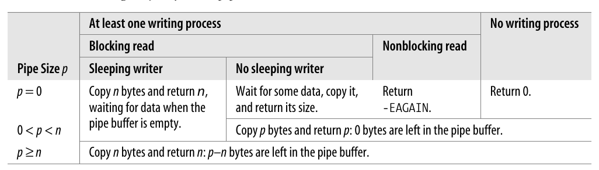
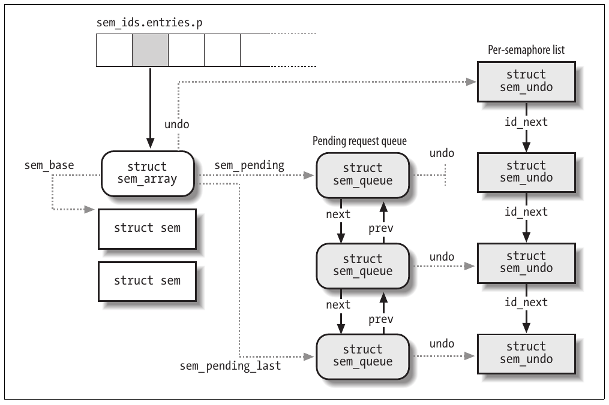
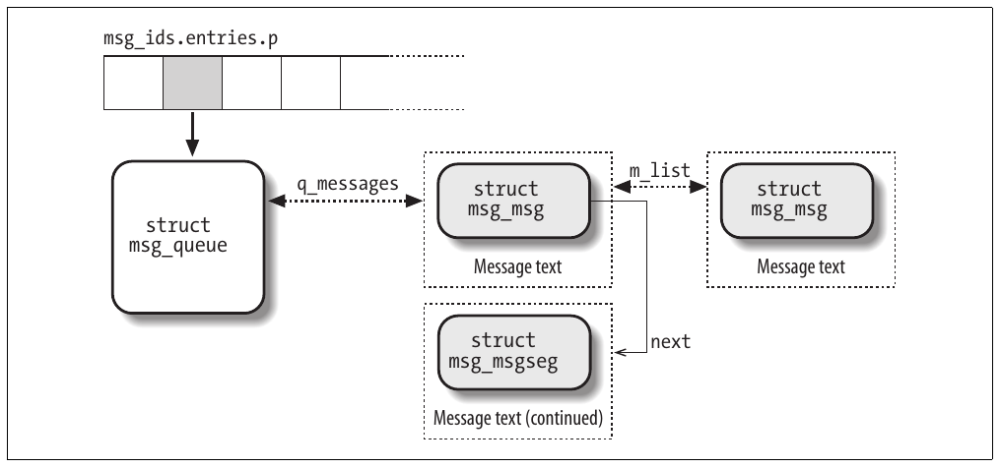
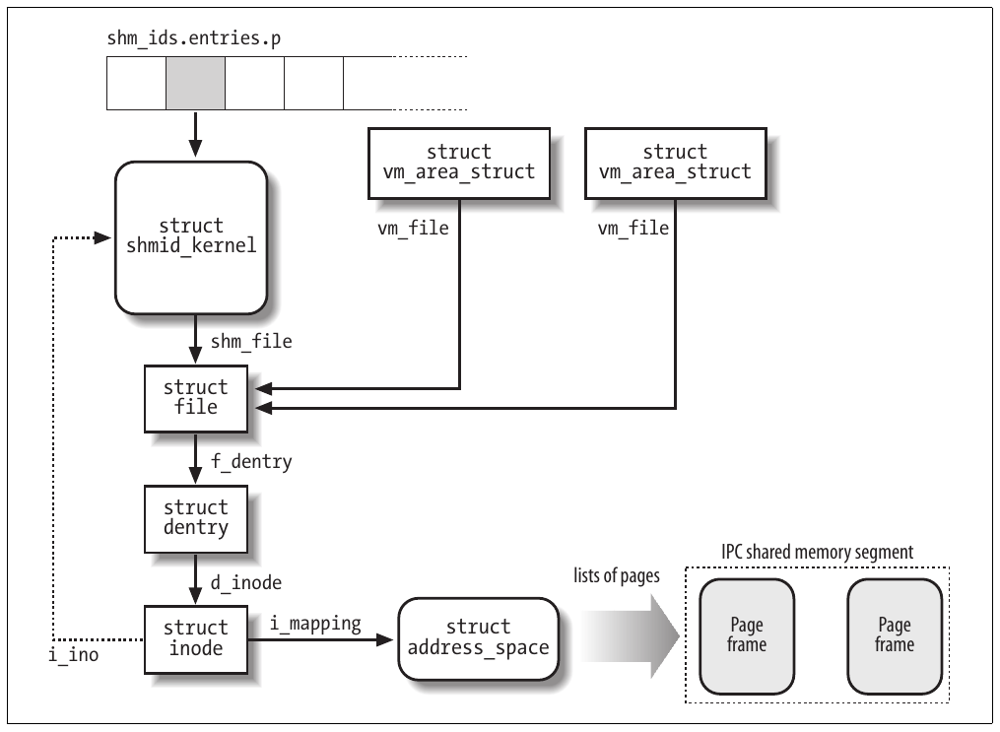

# Chương 19. Giao tiếp giữa các process


Chương này giải thích cách các process User Mode có thể đồng bộ hóa hoạt động và trao đổi dữ liệu. Chúng ta đã đề cập một số chủ đề đồng bộ hóa trong Chương 5, nhưng các thành phần tham gia ở đó là kernel control path, chứ không phải chương trình User Mode. Sau khi thảo luận chi tiết về quản lý I/O và filesystem, giờ đây chúng ta đã sẵn sàng mở rộng thảo luận sang các process User Mode. Các process này phải dựa vào kernel để hỗ trợ đồng bộ hóa và giao tiếp giữa các process.

Như đã thấy trong phần “File Locking trong Linux” ở Chương 12, có thể đạt được một hình thức đồng bộ hóa giữa các process User Mode bằng cách tạo một file (có thể rỗng) và dùng các VFS system call thích hợp để lock và unlock file đó. Mặc dù các process cũng có thể chia sẻ dữ liệu qua các file tạm được bảo vệ bằng lock, cách này tốn kém vì cần truy cập filesystem trên đĩa. Vì lý do này, mọi Unix kernel đều có một tập system call hỗ trợ giao tiếp giữa các process mà không tương tác với filesystem; ngoài ra, một số wrapper function đã được phát triển và đưa vào các thư viện thích hợp để đẩy nhanh cách các process gửi yêu cầu đồng bộ hóa đến kernel.

Như thường lệ, lập trình viên ứng dụng có nhiều nhu cầu khác nhau đòi hỏi các cơ chế giao tiếp khác nhau. Sau đây là các cơ chế cơ bản mà hệ thống Unix cung cấp để cho phép giao tiếp giữa các process:

Pipe và FIFO (named pipe)

Thích hợp nhất để triển khai tương tác producer/consumer giữa các process. Một số process đưa dữ liệu vào đầy pipe, trong khi các process khác lấy dữ liệu ra khỏi pipe. Chúng được trình bày trong các phần “Pipe” và “FIFO”.

Semaphore

Đúng như tên gọi, đây là phiên bản User Mode của các kernel semaphore được thảo luận trong phần “Semaphore” ở Chương 5. Chúng được mô tả trong phần “System V IPC”. Message Cho phép các process trao đổi message (các block dữ liệu ngắn) bằng cách đọc và ghi chúng trong các message queue được định nghĩa trước. Linux kernel cung cấp hai phiên bản message khác nhau: System V IPC message (được trình bày trong phần “System V IPC”) và POSIX message (được mô tả trong phần “POSIX Message Queue”).

Shared memory region

Cho phép các process trao đổi thông tin qua một block memory dùng chung. Trong các ứng dụng phải chia sẻ lượng dữ liệu lớn, đây có thể là hình thức giao tiếp giữa các process hiệu quả nhất. Chúng được mô tả trong phần “System V IPC”.

Socket

Cho phép các process trên các máy tính khác nhau trao đổi dữ liệu qua mạng. Socket cũng có thể được dùng làm công cụ giao tiếp cho các process nằm trên cùng một máy tính host; chẳng hạn, giao diện đồ họa X Window System dùng một socket để cho phép các chương trình client trao đổi dữ liệu với X server.

## Pipe

Pipe là cơ chế giao tiếp giữa các process được cung cấp trong mọi biến thể Unix. Pipe là luồng dữ liệu một chiều giữa các process: mọi dữ liệu mà một process ghi vào pipe đều được kernel chuyển đến một process khác, nhờ đó process này có thể đọc dữ liệu.

Trong các command shell Unix, có thể tạo pipe bằng toán tử `|`. Chẳng hạn, câu lệnh sau yêu cầu shell tạo hai process được nối với nhau bằng một pipe:

```c
$ ls | more
```

Standard output của process thứ nhất, thực thi chương trình ls, được chuyển hướng vào pipe; process thứ hai, thực thi chương trình more, đọc đầu vào từ pipe.

Lưu ý rằng cũng có thể thu được kết quả tương tự bằng cách thực hiện hai lệnh như sau:

```c
$ ls > temp
$ more < temp
```

Lệnh thứ nhất chuyển hướng đầu ra của ls vào một regular file; sau đó lệnh thứ hai buộc more đọc đầu vào từ cùng file đó. Tất nhiên, dùng pipe thay cho file tạm thường thuận tiện hơn vì những lý do sau:

- Câu lệnh shell ngắn và đơn giản hơn nhiều.

- Không cần tạo các regular file tạm rồi phải xóa chúng sau đó.

### Sử dụng pipe

Có thể xem pipe là các file đang mở không có image tương ứng trong các filesystem đã mount. Một process tạo pipe mới bằng system call `pipe()`, trả về một cặp file descriptor; sau đó process có thể truyền các descriptor này cho các process hậu duệ qua `fork()`, qua đó chia sẻ pipe với chúng. Các process có thể đọc từ pipe bằng system call `read()` với file descriptor thứ nhất; tương tự, chúng có thể ghi vào pipe bằng system call `write()` với file descriptor thứ hai.

POSIX chỉ định nghĩa half-duplex pipe, vì vậy dù system call `pipe()` trả về hai file descriptor, mỗi process phải đóng một descriptor trước khi dùng descriptor còn lại. Nếu cần luồng dữ liệu hai chiều, các process phải dùng hai pipe khác nhau bằng cách gọi `pipe()` hai lần.

Một số hệ thống Unix, chẳng hạn System V Release 4, triển khai full-duplex pipe. Trong full-duplex pipe, cả hai descriptor đều có thể được ghi và đọc, nên có hai kênh thông tin hai chiều. Linux áp dụng một cách tiếp cận khác nữa: các file descriptor của mỗi pipe vẫn là một chiều, nhưng không cần đóng một descriptor trước khi dùng descriptor còn lại.

Hãy trở lại ví dụ trước. Khi command shell diễn giải câu lệnh `ls|more`, về cơ bản nó thực hiện các hành động sau:

1\. Gọi system call `pipe()`; giả sử `pipe()` trả về các file descriptor 3 (kênh đọc của pipe) và 4 (kênh ghi).

2\. Gọi system call `fork()` hai lần.

3\. Gọi system call `close()` hai lần để giải phóng các file descriptor 3 và 4.

Child process thứ nhất, phải thực thi chương trình ls, thực hiện các thao tác sau:

1\. Gọi `dup2(4,1)` để sao chép file descriptor 4 sang file descriptor 1. Từ thời điểm này, file descriptor 1 tham chiếu kênh ghi của pipe.

2\. Gọi system call `close()` hai lần để giải phóng các file descriptor 3 và 4.

3\. Gọi system call `execve()` để thực thi chương trình ls (xem phần “Các hàm exec” trong Chương 20). Chương trình ghi đầu ra vào file có file descriptor 1 (standard output); tức là ghi vào pipe.

Child process thứ hai phải thực thi chương trình more; vì vậy, nó thực hiện các thao tác sau:

1\. Gọi `dup2(3,0)` để sao chép file descriptor 3 sang file descriptor 0. Từ thời điểm này, file descriptor 0 tham chiếu kênh đọc của pipe.

2\. Gọi system call `close()` hai lần để giải phóng các file descriptor 3 và 4.

3\. Gọi system call `execve()` để thực thi more. Theo mặc định, chương trình đó đọc đầu vào từ file có file descriptor 0 (standard input); tức là đọc từ pipe.

Trong ví dụ đơn giản này, pipe được đúng hai process sử dụng. Tuy nhiên, do cách triển khai của nó, một pipe có thể được số lượng process tùy ý sử dụng.[^1] Rõ ràng, nếu hai hoặc nhiều process đọc hay ghi cùng một pipe, chúng phải đồng bộ hóa rõ ràng các truy cập bằng file locking (xem phần “File Locking trong Linux” ở Chương 12) hoặc IPC semaphore (xem phần “IPC Semaphore” ở phía sau chương này).

Ngoài system call `pipe()`, nhiều hệ thống Unix cung cấp hai wrapper function tên là `popen()` và `pclose()` xử lý toàn bộ công việc phức tạp thường phải làm khi dùng pipe. Khi pipe đã được tạo bằng hàm `popen()`, có thể dùng nó với các hàm I/O cấp cao có trong thư viện C (`fprintf()`, `fscanf()`, v.v.

Trong Linux, `popen()` và `pclose()` nằm trong thư viện C. Hàm `popen()` nhận hai tham số: pathname `filename` của một executable file và chuỗi `type` chỉ định hướng truyền dữ liệu. Nó trả về con trỏ đến cấu trúc dữ liệu `FILE`. Về cơ bản, hàm `popen()` thực hiện các thao tác sau:

1\. Tạo pipe mới bằng system call `pipe()`.

2\. Fork một process mới, process này lần lượt thực hiện các thao tác sau:

a. Nếu `type` là `r`, nó nhân bản file descriptor gắn với kênh ghi của pipe thành file descriptor 1 (standard output); ngược lại, nếu `type` là `w`, nó nhân bản file descriptor gắn với kênh đọc của pipe thành file descriptor 0 (standard input).

b. Đóng các file descriptor do `pipe()` trả về.

c. Gọi system call `execve()` để thực thi chương trình được chỉ định bởi `filename`.

3\. Nếu `type` là `r`, đóng file descriptor gắn với kênh ghi của pipe; ngược lại, nếu `type` là `w`, đóng file descriptor gắn với kênh đọc của pipe.

4\. Trả về địa chỉ của file pointer `FILE` tham chiếu file descriptor nào của pipe vẫn còn mở.

Sau lời gọi `popen()`, parent và child có thể trao đổi thông tin qua pipe: parent có thể đọc (nếu `type` là `r`) hoặc ghi (nếu `type` là `w`) dữ liệu bằng con trỏ `FILE` mà hàm trả về. Chương trình do child process thực thi tương ứng ghi dữ liệu vào standard output hoặc đọc dữ liệu từ standard input.

Hàm `pclose()` (nhận file pointer do `popen()` trả về làm tham số) chỉ gọi system call `wait4()` và chờ process do `popen()` tạo ra kết thúc.

### Cấu trúc dữ liệu của pipe

Giờ chúng ta phải bắt đầu suy nghĩ lại ở cấp system call. Khi pipe được tạo, một process dùng các VFS system call `read()` và `write()` để truy cập nó. Vì vậy, với mỗi pipe, kernel tạo một inode object cùng hai file object—một để đọc và một để ghi. Khi process muốn đọc từ hoặc ghi vào pipe, nó phải dùng file descriptor thích hợp.

Khi inode object tham chiếu một pipe, field `i_pipe` của nó trỏ đến cấu trúc `pipe_inode_info` được thể hiện trong Bảng 19-1.

Bảng 19-1. Cấu trúc pipe\_inode\_info

| Kiểu | Field | Mô tả |
|---|---|---|
| `struct wait_queue *` | `wait` | Wait queue của pipe/FIFO |
| `unsigned int` | `nrbufs` | Số buffer chứa dữ liệu cần đọc |
| `unsigned int` | `curbuf` | Chỉ số của buffer đầu tiên chứa dữ liệu cần đọc |
| `struct pipe_buffer [16]` | `bufs` | Mảng các buffer descriptor của pipe |
| `struct page *` | `tmp_page` | Con trỏ đến một page frame được cache |
| `unsigned int` | `start` | Vị trí đọc trong pipe buffer hiện tại |
| `unsigned int` | `readers` | Flag cho (hoặc số lượng) process đọc |
| `unsigned int` | `writers` | Flag cho (hoặc số lượng) process ghi |
| `unsigned int` | `waiting_writers` | Số process ghi đang sleep trong wait queue |
| `unsigned int` | `r_counter` | Giống `readers`, nhưng được dùng khi chờ một process đọc từ FIFO |
| `unsigned int` | `w_counter` | Giống `writers`, nhưng được dùng khi chờ một process ghi vào FIFO |
| `struct fasync_struct *` | `fasync_readers` | Dùng để thông báo asynchronous I/O qua signal |
| `struct fasync_struct *` | `fasync_writers` | Dùng để thông báo asynchronous I/O qua signal |

Ngoài một inode và hai file object, mỗi pipe có tập pipe buffer riêng. Về cơ bản, pipe buffer là một page frame chứa dữ liệu đã ghi vào pipe nhưng chưa được đọc. Cho đến Linux 2.6.10, mỗi pipe chỉ có một pipe buffer. Tuy nhiên, trong kernel 2.6.11, việc buffering dữ liệu cho pipe (và FIFO) đã được sửa đổi đáng kể, và giờ mỗi pipe dùng 16 pipe buffer. Thay đổi này cải thiện đáng kể hiệu năng của các ứng dụng User Mode ghi những khối dữ liệu lớn vào pipe.

Field `bufs` của cấu trúc dữ liệu `pipe_inode_info` lưu một mảng gồm 16 object `pipe_buffer`, mỗi object mô tả một pipe buffer. Các field của object này được thể hiện trong Bảng 19-2.

Bảng 19-2. Các field của object pipe\_buffer

| Kiểu | Field | Mô tả |
|---|---|---|
| `struct page *` | `page` | Địa chỉ descriptor của page frame dành cho pipe buffer |
| `unsigned int` | `offset` | Vị trí hiện tại của dữ liệu có ý nghĩa bên trong page frame |
| `unsigned int` | `len` | Độ dài dữ liệu có ý nghĩa trong pipe buffer |
| `struct pipe_buf_operations *` | `ops` | Địa chỉ bảng các method liên quan đến pipe buffer (`NULL` nếu pipe buffer rỗng) |

Field `ops` trỏ đến bảng `anon_pipe_buf_ops` chứa các method của pipe buffer, là một cấu trúc dữ liệu kiểu `pipe_buf_operations`. Về cơ bản, bảng có ba method:

`map`

Được gọi trước khi truy cập dữ liệu trong pipe buffer. Nó chỉ gọi `kmap()` trên page frame của pipe buffer, phòng trường hợp pipe buffer được lưu trong high memory (xem phần “Kernel Mapping của High-Memory Page Frame” ở Chương 8).

`unmap`

Được gọi khi không còn truy cập dữ liệu trong pipe buffer. Nó gọi `kunmap()` trên page frame của pipe buffer.

`release`

Được gọi khi một pipe buffer đang được giải phóng. Method này triển khai một memory cache gồm một page: page frame được giải phóng không phải page frame lưu buffer, mà là page frame được cache do field `tmp_page` của cấu trúc dữ liệu `pipe_inode_info` trỏ đến (nếu không phải `NULL`). Page frame từng lưu buffer trở thành page frame được cache mới.

Có thể xem 16 pipe buffer là một circular buffer toàn cục: các process ghi liên tục thêm dữ liệu vào buffer lớn này, trong khi process đọc liên tục lấy dữ liệu ra. Số byte hiện được ghi trong tất cả pipe buffer nhưng chưa được đọc được gọi là kích thước pipe. Vì lý do hiệu quả, dữ liệu chưa đọc có thể trải trên nhiều pipe buffer chỉ được điền một phần: thực tế, mỗi thao tác ghi có thể sao chép dữ liệu vào một pipe buffer mới, rỗng nếu pipe buffer trước không đủ chỗ trống để lưu dữ liệu mới. Do đó, kernel phải theo dõi:

- Pipe buffer chứa byte tiếp theo cần đọc và offset tương ứng trong page frame. Chỉ số pipe buffer này được lưu trong field `curbuf` của cấu trúc dữ liệu `pipe_inode_info`, còn offset được lưu trong field `offset` của object `pipe_buffer` tương ứng.

- Pipe buffer rỗng đầu tiên. Có thể tính chỉ số của nó bằng cách cộng (modulo 16) chỉ số pipe buffer hiện tại, được lưu trong field `curbuf` của cấu trúc dữ liệu `pipe_inode_info`, với số pipe buffer có dữ liệu có ý nghĩa, được lưu trong field `nrbufs`.

Để tránh race condition trên các cấu trúc dữ liệu của pipe, kernel dùng semaphore `i_sem` có trong inode object.

#### Special filesystem pipefs

Pipe được triển khai dưới dạng một tập VFS object không có disk image tương ứng. Trong Linux 2.6, các VFS object này được tổ chức trong special filesystem pipefs để đẩy nhanh việc xử lý chúng (xem phần “Special Filesystem” ở Chương 12). Vì filesystem này không có mount point trong cây thư mục hệ thống, người dùng không bao giờ thấy nó. Tuy nhiên, nhờ pipefs, pipe được tích hợp hoàn toàn vào VFS layer, và kernel có thể xử lý chúng theo cùng cách như named pipe hay FIFO, vốn thực sự tồn tại dưới dạng file mà người dùng cuối nhận biết được (xem phần “FIFO” phía sau).

Hàm `init_pipe_fs()`, thường được thực thi trong quá trình khởi tạo kernel, đăng ký filesystem pipefs và mount nó (tham khảo thảo luận trong phần “Mount một Filesystem tổng quát” ở Chương 12):

```c
struct file_system_type pipe_fs_type;
pipe_fs_type.name = "pipefs";
pipe_fs_type.get_sb = pipefs_get_sb;
pipe_fs.kill_sb = kill_anon_super;
register_filesystem(&pipe_fs_type);
pipe_mnt = do_kern_mount("pipefs", 0, "pipefs", NULL);
```

Mounted filesystem object biểu diễn root directory của pipefs được lưu trong biến `pipe_mnt`.

### Tạo và hủy pipe

System call `pipe()` được phục vụ bởi hàm `sys_pipe()`, hàm này lần lượt gọi hàm `do_pipe()`. Để tạo pipe mới, `do_pipe()` thực hiện các thao tác sau:

1\. Gọi hàm `get_pipe_inode()`, cấp phát và khởi tạo một inode object cho pipe trong filesystem pipefs. Cụ thể, hàm này thực hiện các hành động sau:

a. Cấp phát một inode mới trong filesystem pipefs.

b. Cấp phát một cấu trúc dữ liệu `pipe_inode_info` và lưu địa chỉ của nó vào field `i_pipe` của inode. c. Đặt các field `curbuf` và `nrbufs` của cấu trúc `pipe_inode_info` bằng 0; đồng thời điền số 0 vào mọi field của các pipe buffer object trong mảng `bufs`.

d. Khởi tạo các field `r_counter` và `w_counter` của cấu trúc `pipe_inode_info` bằng 1.

e. Đặt các field `readers` và `writers` của cấu trúc `pipe_inode_info` bằng 1.

2\. Cấp phát một file object và một file descriptor cho kênh đọc của pipe, đặt field `f_flag` của file object bằng `O_RDONLY`, và khởi tạo field `f_op` bằng địa chỉ bảng `read_pipe_fops`.

3\. Cấp phát một file object và một file descriptor cho kênh ghi của pipe, đặt field `flag` của file object bằng `O_WRONLY`, và khởi tạo field `f_op` bằng địa chỉ bảng `write_pipe_fops`.

4\. Cấp phát một dentry object và dùng nó liên kết hai file object với inode object (xem phần “Mô hình file chung” ở Chương 12); sau đó chèn inode mới vào special filesystem pipefs.

5\. Trả về hai file descriptor cho process User Mode.

Process thực hiện system call `pipe()` ban đầu là process duy nhất có thể truy cập pipe mới, cả đọc lẫn ghi. Để biểu thị pipe có cả reader và writer, các field `readers` và `writers` của cấu trúc dữ liệu `pipe_inode_info` được khởi tạo bằng 1. Nói chung, mỗi field trong hai field này chỉ được đặt bằng 1 nếu file object tương ứng của pipe vẫn được một process mở; field được đặt bằng 0 nếu file object tương ứng đã được giải phóng, vì không còn process nào truy cập nó.

Fork một process mới không tăng giá trị các field `readers` và `writers`, nên chúng không bao giờ lớn hơn 1;[^2] tuy nhiên, việc này tăng giá trị usage counter của mọi file object mà parent process vẫn dùng (xem phần “Các System Call clone(), fork() và vfork()” ở Chương 3). Vì vậy, các object không được giải phóng ngay cả khi parent kết thúc, và pipe vẫn mở để các child sử dụng.

Mỗi khi một process gọi system call `close()` trên một file descriptor gắn với pipe, kernel thực thi hàm `fput()` trên file object tương ứng, làm giảm usage counter. Nếu counter trở thành 0, hàm gọi method `release` của file operations (xem các phần “System Call close()” và “Các file gắn với một process” ở Chương 12).

Tùy file gắn với kênh đọc hay ghi, method `release` được triển khai bởi `pipe_read_release()` hoặc `pipe_write_release()`; cả hai hàm đều gọi `pipe_release()`, đặt field `readers` hoặc field `writers` của cấu trúc `pipe_inode_info` bằng 0. Hàm kiểm tra xem cả hai field `readers` và `writers` có bằng 0 hay không; trong trường hợp này, nó gọi method `release` của mọi pipe buffer, qua đó giải phóng toàn bộ page frame của pipe về buddy system; ngoài ra, hàm giải phóng page frame được cache do field `tmp_page` trỏ đến. Ngược lại, nếu field `readers` hoặc field `writers` khác 0, hàm đánh thức các process đang sleep trong wait queue của pipe để chúng nhận biết thay đổi trạng thái pipe.

### Đọc từ pipe

Process muốn lấy dữ liệu từ pipe thực hiện system call `read()`, chỉ định file descriptor gắn với đầu đọc của pipe. Như được mô tả trong phần “Các System Call read() và write()” ở Chương 12, cuối cùng kernel gọi method `read` có trong file operation table gắn với file object thích hợp. Trong trường hợp pipe, entry cho read method trong bảng `read_pipe_fops` trỏ đến hàm `pipe_read()`.

Hàm `pipe_read()` khá phức tạp, vì tiêu chuẩn POSIX quy định một số yêu cầu đối với thao tác đọc của pipe. Bảng 19-3 tóm tắt hành vi mong đợi của system call `read()` yêu cầu n byte từ pipe có kích thước pipe (số byte trong các pipe buffer chưa được đọc) bằng p.

System call có thể block process hiện tại trong hai trường hợp:

- Pipe buffer rỗng khi system call bắt đầu.

- Pipe buffer không chứa đủ mọi byte được yêu cầu, và một process ghi trước đó đã bị đưa vào sleep trong khi chờ chỗ trống trong buffer.

Lưu ý rằng thao tác đọc có thể là nonblocking: trong trường hợp này, nó hoàn tất ngay khi mọi byte hiện có (kể cả không có byte nào) được sao chép vào user address space.[^3]

Cũng lưu ý rằng system call `read()` chỉ trả về giá trị 0 nếu pipe rỗng và hiện không có process nào dùng file object gắn với kênh ghi của pipe.

Bảng 19-3. Đọc n byte từ pipe

| Kích thước pipe p | Có ít nhất một process ghi Blocking read Writer đang sleep | Không có writer đang sleep | Nonblocking read | Không có process ghi |
|---|---|---|---|---|
| p = 0 0 \< p \< n | Sao chép n byte và trả về n, chờ dữ liệu khi pipe buffer rỗng. | Chờ một ít dữ liệu, sao chép dữ liệu đó và trả về kích thước của nó. Sao chép p byte và trả về p: còn 0 byte trong pipe buffer. | Trả về `-EAGAIN`. | Trả về 0. |
| p ≥ n | Sao chép n byte và trả về n: còn p–n byte trong pipe buffer. |  |  |  |



Hàm thực hiện các thao tác sau:

1\. Acquire semaphore `i_sem` của inode.

2\. Xác định kích thước pipe có bằng 0 hay không bằng cách đọc field `nrbufs` của cấu trúc `pipe_inode_info`; nếu field bằng 0, mọi pipe buffer đều rỗng. Trong trường hợp này, nó xác định hàm phải trả về hay process phải bị block để chờ đến khi process khác ghi dữ liệu vào pipe (xem Bảng 19-3). Loại thao tác I/O (blocking hay nonblocking) được chỉ định bởi flag `O_NONBLOCK` trong field `f_flags` của file object. Nếu process hiện tại phải bị block, hàm thực hiện các hành động sau:

a. Gọi `prepare_to_wait()` để thêm `current` vào wait queue của pipe (field `wait` của cấu trúc `pipe_inode_info`). b. Release inode semaphore.

c. Gọi `schedule()`.

d. Sau khi được đánh thức, gọi `finish_wait()` để xóa `current` khỏi wait queue, acquire lại inode semaphore `i_sem`, rồi quay lại bước 2.

3\. Lấy chỉ số pipe buffer hiện tại từ field `curbuf` của cấu trúc dữ liệu `pipe_inode_info`. 4. Thực thi method `map` của pipe buffer.

5\. Sao chép số byte được yêu cầu—hoặc số byte hiện có trong pipe buffer nếu nhỏ hơn—từ buffer của pipe vào user address space.

6\. Thực thi method `unmap` của pipe buffer.

7\. Cập nhật các field `offset` và `len` của object `pipe_buffer` tương ứng.

8\. Nếu pipe buffer đã được đọc hết (field `len` của object `pipe_buffer` giờ bằng 0), gọi method `release` của pipe buffer để giải phóng page frame tương ứng, đặt field `ops` trong object `pipe_buffer` bằng `NULL`, tăng chỉ số pipe buffer hiện tại lưu trong field `curbuf` của cấu trúc dữ liệu `pipe_inode_info`, và giảm counter các pipe buffer không rỗng trong field `nrbufs`.

9\. Nếu mọi byte được yêu cầu đã được sao chép, chuyển đến bước 12.

10\. Tại đây, chưa phải mọi byte được yêu cầu đều đã được sao chép vào address space User Mode. Nếu kích thước pipe lớn hơn 0 (field `nrbufs` của cấu trúc dữ liệu `pipe_inode_info` khác 0), quay lại bước 3.

11\. Không còn byte nào trong các pipe buffer. Nếu hiện có ít nhất một process ghi đang sleep (tức là field `waiting_writers` của cấu trúc dữ liệu `pipe_inode_info` lớn hơn 0), và thao tác đọc là blocking, gọi `wake_up_interruptible_sync()` để đánh thức mọi process đang sleep trên wait queue của pipe, rồi quay lại bước 2.

12\. Release semaphore `i_sem` của inode.

13\. Gọi `wake_up_interruptible_sync()` để đánh thức mọi writer process đang sleep trên wait queue của pipe.

14\. Trả về số byte đã sao chép vào user address space.

### Ghi vào pipe

Process muốn đưa dữ liệu vào pipe thực hiện system call `write()`, chỉ định file descriptor cho đầu ghi của pipe. Kernel đáp ứng yêu cầu bằng cách gọi method `write` của file object thích hợp; entry tương ứng trong bảng `write_pipe_fops` trỏ đến hàm `pipe_write()`.

Bảng 19-4 tóm tắt hành vi, do tiêu chuẩn POSIX quy định, của system call `write()` yêu cầu ghi n byte vào pipe có u byte chưa dùng trong buffer. Cụ thể, tiêu chuẩn yêu cầu các thao tác ghi liên quan đến số byte nhỏ phải được thực thi atomically. Chính xác hơn, nếu hai hoặc nhiều process đang đồng thời ghi vào pipe, mỗi thao tác ghi dưới 4.096 byte (kích thước pipe buffer) phải hoàn tất mà không bị xen kẽ với thao tác ghi của các process khác vào cùng pipe. Tuy nhiên, thao tác ghi trên 4.096 byte có thể là nonatomic và cũng có thể buộc process gọi vào sleep.

Bảng 19-4. Ghi n byte vào pipe

| Chỗ trống buffer hiện có u | Có ít nhất một process đọc Blocking write | Nonblocking write | Không có process đọc |
|---|---|---|---|
| u\<n≤ 4,096 | Chờ đến khi n–u byte được giải phóng, sao chép n byte và trả về n. | Trả về `-EAGAIN`. | Gửi signal `SIGPIPE` và trả về `-EPIPE`. |
| n\>4,096 | Sao chép n byte (chờ khi cần) và trả về n. | Nếu u\>0, sao chép u byte và trả về u; trả về `-EAGAIN`. |  |

u≥ n Sao chép n byte và trả về n.

Ngoài ra, mỗi thao tác ghi vào pipe phải thất bại nếu pipe không có process đọc (tức là field `readers` của inode object của pipe có giá trị 0). Trong trường hợp này, kernel gửi signal `SIGPIPE` đến process ghi và kết thúc system call `write()` với error code `-EPIPE`, thường dẫn đến thông báo quen thuộc “Broken pipe”.

Hàm `pipe_write()` thực hiện các thao tác sau:

1\. Acquire semaphore `i_sem` của inode.

2\. Kiểm tra pipe có ít nhất một process đọc hay không. Nếu không, gửi signal `SIGPIPE` đến process `current`, release inode semaphore và trả về giá trị `-EPIPE`.

3\. Xác định chỉ số pipe buffer được ghi cuối cùng bằng cách cộng các field `curbuf` và `nrbufs` của cấu trúc dữ liệu `pipe_inode_info` rồi trừ 1. Nếu pipe buffer này có đủ chỗ trống để lưu mọi byte cần ghi, sao chép dữ liệu vào nó:

a. Thực thi method `map` của pipe buffer.

b. Sao chép mọi byte vào pipe buffer.

c. Thực thi method `unmap` của pipe buffer.

d. Cập nhật field `len` của object `pipe_buffer` tương ứng.

e. Chuyển đến bước 11.

4\. Nếu field `nrbufs` của cấu trúc dữ liệu `pipe_inode_info` bằng 16, không có pipe buffer rỗng để lưu các byte (vẫn) cần ghi. Trong trường hợp này:

a. Nếu thao tác ghi là nonblocking, chuyển đến bước 11 để kết thúc bằng cách trả về error code `-EAGAIN`.

b. Nếu thao tác ghi là blocking, cộng 1 vào field `waiting_writers` của cấu trúc `pipe_inode_info`, gọi `prepare_to_wait()` để thêm `current` vào wait queue của pipe (field `wait` của cấu trúc `pipe_inode_info`), release inode semaphore, rồi gọi `schedule()`. Sau khi được đánh thức, gọi `finish_wait()` để xóa `current` khỏi wait queue, acquire lại inode semaphore, giảm field `waiting_writers`, rồi quay lại bước 4.

5\. Giờ có ít nhất một pipe buffer rỗng. Xác định chỉ số pipe buffer rỗng đầu tiên bằng cách cộng các field `curbuf` và `nrbufs` của cấu trúc dữ liệu `pipe_inode_info`.

6\. Cấp phát một page frame mới từ buddy system, trừ khi field `tmp_page` của cấu trúc dữ liệu `pipe_inode_info` khác `NULL`.

7\. Sao chép tối đa 4.096 byte từ address space User Mode vào page frame (tạm thời map nó trong linear address space Kernel Mode nếu cần).

8\. Cập nhật các field của object `pipe_buffer` gắn với pipe buffer bằng cách đặt field page bằng địa chỉ page frame descriptor, field `ops` bằng địa chỉ bảng `anon_pipe_buf_ops`, field `offset` bằng 0, và field `len` bằng số byte đã ghi.

9\. Tăng counter các pipe buffer không rỗng lưu trong field `nrbufs` của cấu trúc dữ liệu `pipe_inode_info`.

10\. Nếu chưa ghi hết mọi byte được yêu cầu, quay lại bước 4.

11\. Release inode semaphore.

12\. Đánh thức mọi reader process đang sleep trên wait queue của pipe.

13\. Trả về số byte đã ghi vào buffer của pipe (hoặc error code nếu không thể ghi).

## FIFO

Mặc dù pipe là cơ chế giao tiếp đơn giản, linh hoạt và hiệu quả, chúng có một nhược điểm chính—cụ thể là không có cách mở một pipe đã tồn tại. Điều này khiến hai process tùy ý không thể chia sẻ cùng một pipe, trừ khi pipe được tạo bởi một process tổ tiên chung.

Nhược điểm này đáng kể đối với nhiều chương trình ứng dụng. Chẳng hạn, xét một database engine server liên tục poll các client process muốn đưa ra truy vấn và gửi lại kết quả tra cứu database cho chúng. Mỗi tương tác giữa server và một client cụ thể có thể được xử lý bằng pipe. Tuy nhiên, client process thường được command shell tạo theo yêu cầu khi người dùng truy vấn database một cách rõ ràng; vì vậy server process và client process không dễ chia sẻ một pipe.

Để giải quyết những hạn chế đó, hệ thống Unix đưa ra một loại special file gọi là named pipe hay FIFO (viết tắt của “first in, first out”; byte đầu tiên ghi vào special file cũng là byte đầu tiên được đọc). Mỗi FIFO rất giống pipe: thay vì sở hữu các disk block trong filesystem, một FIFO đang mở gắn với một kernel buffer tạm thời lưu dữ liệu được hai hoặc nhiều process trao đổi.

Tuy nhiên, nhờ disk inode, mọi process đều có thể truy cập FIFO, vì filename của FIFO nằm trong cây thư mục hệ thống. Vì vậy, trong ví dụ của chúng ta, có thể dễ dàng thiết lập giao tiếp giữa server và client bằng FIFO thay cho pipe. Khi khởi động, server tạo một FIFO để các chương trình client đưa ra yêu cầu. Trước khi thiết lập kết nối, mỗi chương trình client tạo một FIFO khác để chương trình server ghi câu trả lời truy vấn vào, đồng thời đưa tên FIFO vào yêu cầu ban đầu gửi cho server.

Trong Linux 2.6, FIFO và pipe gần như giống hệt nhau và dùng cùng các cấu trúc `pipe_inode_info`. Thực tế, các file operation method `read` và `write` của FIFO được triển khai bằng chính các hàm `pipe_read()` và `pipe_write()` được mô tả trong các phần “Đọc từ pipe” và “Ghi vào pipe” trước đó. Thực ra, chỉ có hai khác biệt đáng kể:

- Các FIFO inode xuất hiện trong cây thư mục hệ thống thay vì trong special filesystem pipefs.

- FIFO là kênh giao tiếp hai chiều; tức là có thể mở FIFO ở chế độ read/write.

Vì vậy, để hoàn tất mô tả, chúng ta chỉ cần giải thích cách tạo và mở FIFO.

### Tạo và mở FIFO

Một process tạo FIFO bằng cách thực hiện system call `mknod()`[^4] (xem phần “Device File” ở Chương 13), truyền vào các tham số là pathname của FIFO mới và giá trị `S_IFIFO` (`0x10000`) được OR logic với permission bit mask của file mới. POSIX đưa ra hàm tên `mkfifo()` dành riêng cho việc tạo FIFO. Trong Linux, cũng như System V Release 4, lời gọi này được triển khai dưới dạng hàm thư viện C gọi `mknod()`.

Sau khi tạo, có thể truy cập FIFO qua các system call thông thường `open()`, `read()`, `write()` và `close()`, nhưng VFS xử lý nó theo cách đặc biệt, vì inode và file operations của FIFO được tùy biến và không phụ thuộc vào filesystem lưu FIFO.

Tiêu chuẩn POSIX quy định hành vi của system call `open()` trên FIFO; hành vi này chủ yếu phụ thuộc vào loại truy cập được yêu cầu, loại thao tác I/O (blocking hay nonblocking), và sự hiện diện của các process khác đang truy cập FIFO.

Một process có thể mở FIFO để đọc, ghi hoặc cả đọc lẫn ghi. Các file operations gắn với file object tương ứng được đặt thành các method đặc biệt cho ba trường hợp này.

Khi một process mở FIFO, VFS thực hiện các thao tác giống như với device file (xem phần “VFS xử lý Device File” ở Chương 13). Inode object gắn với FIFO đang mở được khởi tạo bởi superblock method `read_inode` phụ thuộc filesystem; method này luôn kiểm tra inode trên đĩa có biểu diễn một special file hay không và gọi hàm `init_special_inode()` nếu cần. Đến lượt mình, hàm này đặt field `i_fop` của inode object bằng địa chỉ bảng `def_fifo_fops`. Sau đó, kernel đặt file operation table của file object thành `def_fifo_fops`, rồi thực thi method `open` của nó, được triển khai bởi `fifo_open()`.

Hàm `fifo_open()` khởi tạo các cấu trúc dữ liệu riêng của FIFO; cụ thể, nó thực hiện các thao tác sau:

1\. Acquire inode semaphore `i_sem`.

2\. Kiểm tra field `i_pipe` của inode object; nếu là `NULL`, cấp phát và khởi tạo cấu trúc `pipe_inode_info` mới như trong các bước 1b–1e ở phần “Tạo và hủy pipe” trước đó.

3\. Tùy access mode được chỉ định làm tham số của system call `open()`, khởi tạo field `f_op` của file object bằng địa chỉ file operation table thích hợp (xem Bảng 19-5).

Bảng 19-5. File operations của FIFO

| Loại truy cập | File operations | Read method | Write method |
|---|---|---|---|
| Chỉ đọc | `read_fifo_fops` | `pipe_read()` | `bad_pipe_w()` |
| Chỉ ghi | `write_fifo_fops` | `bad_pipe_r()` | `pipe_write()` |
| Đọc/ghi | `rdwr_fifo_fops` | `pipe_read()` | `pipe_write()` |

4\. Nếu access mode là chỉ đọc hoặc đọc/ghi, cộng một vào các field `readers` và `r_counter` của cấu trúc `pipe_inode_info`. Ngoài ra, nếu access mode là chỉ đọc và không có process đọc nào khác, đánh thức mọi process ghi đang sleep trong wait queue.

5\. Nếu access mode là chỉ ghi hoặc đọc/ghi, cộng một vào các field `writers` và `w_counter` của cấu trúc `pipe_inode_info`. Ngoài ra, nếu access mode là chỉ ghi và không có process ghi nào khác, đánh thức mọi process đọc đang sleep trong wait queue.

6\. Nếu không có reader hoặc không có writer, quyết định hàm nên block hay kết thúc với error code (xem Bảng 19-6).

Bảng 19-6. Hành vi của hàm fifo\_open()

| Loại truy cập | Blocking | Nonblocking |
|---|---|---|
| Chỉ đọc, có writer | Trả về thành công | Trả về thành công |
| Chỉ đọc, không có writer | Chờ một writer | Trả về thành công |
| Chỉ ghi, có reader | Trả về thành công | Trả về thành công |
| Chỉ ghi, không có reader | Chờ một reader | Trả về `-ENXIO` |
| Đọc/ghi | Trả về thành công | Trả về thành công |

7\. Release inode semaphore và kết thúc, trả về 0 (thành công).

Ba file operation table chuyên biệt của FIFO khác nhau chủ yếu ở cách triển khai các method `read` và `write`. Nếu loại truy cập cho phép thao tác đọc, method `read` được triển khai bởi hàm `pipe_read()`. Ngược lại, nó được triển khai bởi `bad_pipe_r()`, chỉ trả về error code. Tương tự, nếu loại truy cập cho phép thao tác ghi, method `write` được triển khai bởi hàm `pipe_write()`; ngược lại, nó được triển khai bởi `bad_pipe_w()`, cũng trả về error code.

## System V IPC

IPC là viết tắt của Interprocess Communication và thường chỉ một tập cơ chế cho phép process User Mode thực hiện những việc sau:

- Đồng bộ hóa với các process khác bằng semaphore

- Gửi message đến các process khác hoặc nhận message từ chúng

- Chia sẻ một memory area với các process khác System V IPC lần đầu xuất hiện trong một biến thể Unix đang phát triển có tên “Columbus Unix” và sau đó được System III của AT\&T tiếp nhận. Hiện nó có trong hầu hết hệ thống Unix, bao gồm Linux.

Các cấu trúc dữ liệu IPC được tạo động khi process yêu cầu một IPC resource (semaphore, message queue hoặc shared memory region). IPC resource có tính persistent: trừ khi bị một process xóa một cách rõ ràng, nó được giữ trong memory và vẫn sẵn dùng cho đến khi hệ thống tắt. Mọi process đều có thể dùng một IPC resource, kể cả các process không có chung tổ tiên đã tạo resource đó.

Vì process có thể cần nhiều IPC resource cùng loại, mỗi resource mới được nhận diện bởi một IPC key 32-bit, tương tự file pathname trong cây thư mục hệ thống. Mỗi IPC resource cũng có một IPC identifier 32-bit, phần nào tương tự file descriptor gắn với file đang mở. IPC identifier được kernel gán cho IPC resource và là duy nhất trong hệ thống, còn IPC key có thể được lập trình viên tùy ý chọn.

Khi hai hoặc nhiều process muốn giao tiếp qua một IPC resource, tất cả đều tham chiếu IPC identifier của resource đó.

### Sử dụng IPC resource

IPC resource được tạo bằng cách gọi các hàm `semget()`, `msgget()` hoặc `shmget()`, tùy resource mới là semaphore, message queue hay shared memory region.

Mục tiêu chính của mỗi hàm trong ba hàm này là suy ra từ IPC key (được truyền làm tham số thứ nhất) IPC identifier tương ứng, sau đó process dùng nó để truy cập resource. Nếu chưa có IPC resource gắn với IPC key, một resource mới được tạo. Nếu mọi việc suôn sẻ, hàm trả về IPC identifier dương; ngược lại, nó trả về một error code trong Bảng 19-7.

Bảng 19-7. Các error code trả về khi yêu cầu IPC identifier

| Error code | Mô tả |
|---|---|
| `EACCESS` | Process không có quyền truy cập thích hợp |
| `EEXIST` | Process đã thử tạo IPC resource với key trùng một resource đã tồn tại |
| `EINVAL` | Đối số không hợp lệ trong tham số của `semget()`, `msgget()` hoặc `shmget()` |
| `ENOENT` | Không tồn tại IPC resource có key được yêu cầu và process không yêu cầu tạo nó |
| `ENOMEM` | Không còn chỗ lưu trữ cho IPC resource bổ sung |
| `ENOSPC` | Đã vượt giới hạn tối đa về số IPC resource |

Giả sử hai process độc lập muốn chia sẻ một IPC resource chung. Có thể đạt được điều này theo hai cách:

- Các process thống nhất một IPC key cố định, được định nghĩa trước. Đây là trường hợp đơn giản nhất và hoạt động khá tốt cho mọi ứng dụng phức tạp được triển khai bằng nhiều process. Tuy nhiên, có khả năng một chương trình khác không liên quan chọn cùng IPC key đó. Trong trường hợp này, các hàm IPC có thể được gọi thành công nhưng vẫn trả về IPC identifier của resource sai.[^5]

- Một process gọi hàm `semget()`, `msgget()` hoặc `shmget()`, chỉ định `IPC_PRIVATE` làm IPC key. Nhờ đó, một IPC resource mới được cấp phát, và process có thể truyền IPC identifier của nó cho process khác trong ứng dụng<sup>†</sup> hoặc tự fork process kia. Phương pháp này bảo đảm IPC resource không thể bị ứng dụng khác vô tình sử dụng.

Tham số cuối của các hàm `semget()`, `msgget()` và `shmget()` có thể chứa ba flag. `IPC_CREAT` quy định phải tạo IPC resource nếu nó chưa tồn tại; `IPC_EXCL` quy định hàm phải thất bại nếu resource đã tồn tại và flag `IPC_CREAT` được đặt; `IPC_NOWAIT` quy định process không bao giờ được block khi truy cập IPC resource (thường là khi lấy một message hoặc khi acquire semaphore).

Ngay cả khi process dùng các flag `IPC_CREAT` và `IPC_EXCL`, cũng không có cách bảo đảm truy cập độc quyền vào IPC resource, vì các process khác luôn có thể tham chiếu resource bằng IPC identifier của nó.

Để giảm thiểu nguy cơ tham chiếu nhầm resource, kernel không tái sử dụng IPC identifier ngay khi chúng được giải phóng. Thay vào đó, IPC identifier gán cho resource hầu như luôn lớn hơn identifier gán cho resource cùng loại được cấp phát trước đó. (Ngoại lệ duy nhất xảy ra khi IPC identifier 32-bit bị overflow.) Mỗi IPC identifier được tính bằng cách kết hợp một slot usage sequence number liên quan đến loại resource, một slot index tùy ý cho resource được cấp phát, và một giá trị tùy ý được chọn trong kernel lớn hơn số resource tối đa có thể cấp phát. Nếu chọn s biểu diễn slot usage sequence number, M biểu diễn cận trên số resource có thể cấp phát, và i biểu diễn slot index, với 0≤i\<M, ID của mỗi IPC resource được tính như sau:

IPC identifier = s×M + i

Trong Linux 2.6, giá trị M được đặt bằng 32.768 (macro `IPCMNI`). Slot usage sequence number s được khởi tạo bằng 0 và tăng 1 sau mỗi lần cấp phát resource. Khi s đạt ngưỡng định trước, phụ thuộc vào loại IPC resource, nó bắt đầu lại từ 0.

Mỗi loại IPC resource (semaphore, message queue và shared memory area) sở hữu một cấu trúc dữ liệu `ipc_ids`, có các field thể hiện trong Bảng 19-8.

Bảng 19-8. Các field của cấu trúc dữ liệu ipc\_ids

| Kiểu | Field | Mô tả |
|---|---|---|
| `int` | `in_use` | Số IPC resource đã cấp phát |
| `int` | `max_id` | Slot index lớn nhất đang được dùng |
| `unsigned short` | `seq` | Slot usage sequence number cho lần cấp phát tiếp theo |
| `unsigned short` | `seq_max` | Slot usage sequence number tối đa |
| `struct semaphore` | `sem` | Semaphore bảo vệ cấu trúc dữ liệu `ipc_ids` |
| `struct ipc_id_ary` | `nullentry` | Cấu trúc dữ liệu giả được field `entries` trỏ đến nếu không thể khởi tạo IPC resource này (thường không dùng) |
| `struct ipc_id_ary *` | `entries` | Con trỏ đến cấu trúc dữ liệu `ipc_id_ary` cho resource này |

Cấu trúc dữ liệu `ipc_id_ary` gồm hai field: `p` và `size`. Field `p` là một mảng con trỏ đến các cấu trúc dữ liệu `kern_ipc_perm`, mỗi cấu trúc dành cho một resource có thể cấp phát. Field `size` là kích thước mảng này. Ban đầu, mảng lưu lần lượt 1, 16 hoặc 128 con trỏ cho shared memory region, message queue và semaphore. Kernel tăng động kích thước mảng khi nó trở nên quá nhỏ. Tuy nhiên, có cận trên cho số resource thuộc mỗi loại nhất định. Quản trị viên hệ thống có thể thay đổi các cận này bằng cách ghi vào các file /proc/sys/kernel/sem, /proc/sys/kernel/msgmni và /proc/sys/kernel/shmmni tương ứng.

Mỗi cấu trúc dữ liệu `kern_ipc_perm` gắn với một IPC resource và chứa các field thể hiện trong Bảng 19-9. Các field `uid`, `gid`, `cuid` và `cgid` lần lượt lưu user identifier và group identifier của người tạo resource, cùng user identifier và group identifier của chủ sở hữu resource hiện tại. Bit mask `mode` có sáu flag, lưu quyền truy cập đọc và ghi của chủ sở hữu resource, group của resource và mọi người dùng khác. Quyền truy cập IPC tương tự quyền truy cập file được mô tả trong phần “Quyền truy cập và File Mode” ở Chương 1, ngoại trừ flag quyền Execute không được dùng.

Bảng 19-9. Các field trong cấu trúc kern\_ipc\_perm

| Kiểu | Field | Mô tả |
|---|---|---|
| `spinlock_t` | `lock` | Spin lock bảo vệ IPC resource descriptor |
| `int` | `deleted` | Flag được đặt nếu resource đã được giải phóng |
| `int` | `key` | IPC key |
| `unsigned int` | `uid` | User ID của chủ sở hữu |
| `unsigned int` | `gid` | Group ID của chủ sở hữu |
| `unsigned int` | `cuid` | User ID của người tạo |
| `unsigned int` | `cgid` | Group ID của người tạo |
| `unsigned short` | `mode` | Permission bit mask |
| `unsigned long` | `seq` | Slot usage sequence number |
| `void *` | `security` | Con trỏ đến một cấu trúc bảo mật (được SELinux dùng) |

Cấu trúc dữ liệu `kern_ipc_perm` cũng có field `key` (chứa IPC key của resource tương ứng) và field `seq` (lưu slot usage sequence number s dùng để tính IPC identifier của resource).

Có thể dùng các hàm `semctl()`, `msgctl()` và `shmctl()` để xử lý IPC resource. Subcommand `IPC_SET` cho phép process thay đổi user identifier và group identifier của chủ sở hữu cùng permission bit mask trong cấu trúc dữ liệu `ipc_perm`. Các subcommand `IPC_STAT` và `IPC_INFO` lấy một số thông tin liên quan đến resource. Cuối cùng, subcommand `IPC_RMID` giải phóng một IPC resource. Tùy loại IPC resource, còn có các subcommand chuyên biệt khác.[^6]

Sau khi IPC resource được tạo, process có thể thao tác trên resource bằng một số hàm chuyên biệt. Process có thể acquire hoặc release IPC semaphore bằng cách gọi hàm `semop()`. Khi process muốn gửi hoặc nhận IPC message, nó lần lượt dùng các hàm `msgsnd()` và `msgrcv()`. Cuối cùng, process lần lượt attach và detach một IPC shared memory region trong address space của nó bằng các hàm `shmat()` và `shmdt()`.

### System Call ipc()

Mọi hàm IPC phải được triển khai qua các Linux system call thích hợp. Thực ra, trong kiến trúc 80×86, chỉ có một IPC system call tên là `ipc()`. Khi process gọi một hàm IPC, chẳng hạn `msgget()`, nó thực sự gọi một wrapper function trong thư viện C. Đến lượt mình, hàm này gọi system call `ipc()` bằng cách truyền toàn bộ tham số của `msgget()` cùng subcommand code thích hợp—trong trường hợp này là `MSGGET`. Service routine `sys_ipc()` kiểm tra subcommand code và gọi hàm kernel triển khai dịch vụ được yêu cầu.

System call “multiplexer” `ipc()` là di sản từ các phiên bản Linux cũ, vốn đặt IPC code trong một dynamic module (xem Phụ lục B). Việc dành sẵn nhiều system call entry trong bảng `system_call` cho một kernel component có thể vắng mặt không hợp lý lắm, nên những người thiết kế kernel đã chọn cách tiếp cận multiplexer.

Ngày nay, System V IPC không còn có thể được biên dịch thành dynamic module, và không còn lý do chính đáng để dùng một IPC system call duy nhất. Thực tế, Linux cung cấp một system call cho mỗi hàm IPC trên kiến trúc Alpha của Hewlett-Packard và trên IA-64 của Intel.

### IPC Semaphore

IPC semaphore khá giống kernel semaphore được giới thiệu trong Chương 5; chúng là các counter dùng để cung cấp quyền truy cập có kiểm soát vào các cấu trúc dữ liệu dùng chung cho nhiều process.

Giá trị semaphore là số dương nếu resource được bảo vệ đang sẵn dùng, và là 0 nếu resource được bảo vệ hiện không sẵn dùng. Process muốn truy cập resource cố giảm giá trị semaphore; tuy nhiên, kernel block process cho đến khi thao tác trên semaphore cho ra giá trị dương. Khi process nhường resource được bảo vệ, nó tăng giá trị semaphore; nhờ đó, mọi process khác đang chờ semaphore được đánh thức.

Thực ra, xử lý IPC semaphore phức tạp hơn kernel semaphore vì hai lý do chính:

- Mỗi IPC semaphore là một tập gồm một hoặc nhiều giá trị semaphore, thay vì chỉ một giá trị như kernel semaphore. Điều này có nghĩa cùng một IPC resource có thể bảo vệ nhiều cấu trúc dữ liệu dùng chung độc lập. Số giá trị semaphore trong mỗi IPC semaphore phải được chỉ định làm tham số của hàm `semget()` khi resource được cấp phát. Từ đây, chúng ta gọi các counter bên trong IPC semaphore là primitive semaphore. Có giới hạn cả về số IPC semaphore resource (mặc định là 128) lẫn số primitive semaphore bên trong một IPC semaphore resource (mặc định là 250); tuy nhiên, quản trị viên hệ thống có thể dễ dàng sửa các giới hạn này bằng cách ghi vào file /proc/sys/kernel/sem.

- System V IPC semaphore cung cấp cơ chế fail-safe cho tình huống process kết thúc mà không thể hoàn tác các thao tác nó đã thực hiện trước đó trên semaphore. Khi process chọn dùng cơ chế này, các thao tác tương ứng được gọi là undoable semaphore operation. Khi process kết thúc, mọi IPC semaphore của nó có thể trở về các giá trị lẽ ra chúng có nếu process chưa từng bắt đầu các thao tác đó. Điều này có thể giúp ngăn các process khác dùng cùng semaphore bị block vô thời hạn do process kết thúc không hoàn tác thủ công các thao tác semaphore của nó.

Trước tiên, chúng ta phác thảo ngắn gọn các bước điển hình mà process muốn truy cập một hoặc nhiều resource được IPC semaphore bảo vệ thực hiện:

1\. Gọi wrapper function `semget()` để lấy IPC semaphore identifier, chỉ định tham số là IPC key của IPC semaphore bảo vệ các resource dùng chung. Nếu process muốn tạo IPC semaphore mới, nó cũng chỉ định flag `IPC_CREATE` hoặc `IPC_PRIVATE` và số primitive semaphore cần thiết (xem phần “Sử dụng IPC resource” trước đó trong chương này).

2\. Gọi wrapper function `semop()` để kiểm tra và giảm mọi giá trị primitive semaphore liên quan. Nếu mọi phép kiểm tra đều thành công, các phép giảm được thực hiện, hàm kết thúc và process được phép truy cập các resource được bảo vệ. Nếu một số semaphore đang được dùng, process thường bị suspend cho đến khi process khác giải phóng resource. Hàm nhận các tham số là IPC semaphore identifier, một mảng số nguyên chỉ định các thao tác cần thực hiện atomically trên primitive semaphore, và số thao tác như vậy. Tùy chọn, process có thể chỉ định flag `SEM_UNDO`, yêu cầu kernel đảo ngược các thao tác nếu process thoát mà không release các primitive semaphore.

3\. Khi nhường các resource được bảo vệ, gọi lại hàm `semop()` để tăng atomically mọi primitive semaphore liên quan.

4\. Tùy chọn, gọi wrapper function `semctl()`, chỉ định lệnh `IPC_RMID` để xóa IPC semaphore khỏi hệ thống.

Giờ chúng ta có thể thảo luận cách kernel triển khai IPC semaphore. Các cấu trúc dữ liệu liên quan được thể hiện trong Hình 19-1. Biến `sem_ids` lưu cấu trúc dữ liệu `ipc_ids` của loại IPC semaphore resource; cấu trúc dữ liệu `ipc_id_ary` tương ứng chứa một mảng con trỏ đến các cấu trúc dữ liệu `sem_array`, mỗi phần tử cho một IPC semaphore resource.



Hình 19-1. Các cấu trúc dữ liệu IPC semaphore

Về mặt hình thức, mảng lưu con trỏ đến các cấu trúc dữ liệu `kern_ipc_perm`, nhưng mỗi cấu trúc chỉ là field đầu tiên của cấu trúc dữ liệu `sem_array`. Mọi field của cấu trúc dữ liệu `sem_array` được thể hiện trong Bảng 19-10.

Bảng 19-10. Các field trong cấu trúc dữ liệu sem\_array

| Kiểu | Field | Mô tả |
|---|---|---|
| `struct kern_ipc_perm` | `sem_perm` | Cấu trúc dữ liệu `kern_ipc_perm` |
| `long` | `sem_otime` | Timestamp của lần `semop()` cuối |
| `long` | `sem_ctime` | Timestamp của lần thay đổi cuối |
| `struct sem *` | `sem_base` | Con trỏ đến cấu trúc `sem` đầu tiên |
| `struct sem_queue *` | `sem_pending` | Các thao tác đang chờ |
| `struct sem_queue **` | `sem_pending_last` | Thao tác đang chờ cuối cùng |
| `struct sem_undo *` | `undo` | Các yêu cầu undo |
| `unsigned long` | `sem_nsems` | Số semaphore trong mảng |

Field `sem_base` trỏ đến một mảng các cấu trúc dữ liệu `sem`, mỗi cấu trúc cho một IPC primitive semaphore. Cấu trúc dữ liệu này chỉ có hai field:

`semval`

Giá trị counter của semaphore.

`sempid`

PID của process cuối cùng truy cập semaphore. Process có thể truy vấn giá trị này qua wrapper function `semctl()`.

#### Undoable semaphore operation

Nếu process đột ngột bị abort, nó không thể hoàn tác các thao tác đã bắt đầu (chẳng hạn release các semaphore đã dành trước); vì vậy, bằng cách khai báo chúng là undoable, process cho phép kernel đưa semaphore về trạng thái nhất quán và cho phép các process khác tiếp tục. Process có thể yêu cầu các thao tác undoable bằng cách chỉ định flag `SEM_UNDO` trong hàm `semop()`.

Thông tin giúp kernel đảo ngược các thao tác undoable mà một process nhất định thực hiện trên một IPC semaphore resource nhất định được lưu trong cấu trúc dữ liệu `sem_undo`. Về cơ bản, nó chứa IPC identifier của semaphore và một mảng số nguyên biểu diễn các thay đổi đối với giá trị primitive semaphore do toàn bộ thao tác undoable mà process thực hiện gây ra.

Một ví dụ đơn giản có thể minh họa cách dùng các phần tử `sem_undo` như vậy. Xét process dùng một IPC semaphore resource chứa bốn primitive semaphore. Giả sử nó gọi hàm `semop()` để tăng counter thứ nhất thêm 1 và giảm counter thứ hai đi 2. Nếu nó chỉ định flag `SEM_UNDO`, số nguyên ở phần tử mảng thứ nhất trong cấu trúc dữ liệu `sem_undo` giảm 1, số nguyên ở phần tử thứ hai tăng 2, còn hai số nguyên kia không đổi. Các thao tác undoable tiếp theo trên IPC semaphore do cùng process thực hiện thay đổi tương ứng các số nguyên lưu trong cấu trúc `sem_undo`. Khi process thoát, mọi giá trị khác 0 trong mảng đó tương ứng với một hoặc nhiều thao tác chưa cân bằng trên primitive semaphore tương ứng; kernel đảo ngược các thao tác này bằng cách đơn giản cộng giá trị khác 0 vào counter của semaphore tương ứng. Nói cách khác, các thay đổi do process bị abort tạo ra được hoàn tác, trong khi những thay đổi do process khác tạo ra vẫn được phản ánh trong trạng thái semaphore.

Với mỗi process, kernel theo dõi mọi semaphore resource được xử lý bằng thao tác undoable để có thể rollback chúng nếu process thoát bất ngờ. Ngoài ra, với mỗi semaphore, kernel phải theo dõi mọi cấu trúc `sem_undo` của nó để nhanh chóng truy cập chúng mỗi khi process dùng `semctl()` để ép một giá trị cụ thể vào counter của primitive semaphore hoặc hủy một IPC semaphore resource.

Kernel có thể xử lý hiệu quả các tác vụ này nhờ hai danh sách, được gọi là danh sách per-process và per-semaphore. Danh sách thứ nhất theo dõi mọi semaphore được một process nhất định thao tác bằng các thao tác undoable. Danh sách thứ hai theo dõi mọi process đang tác động lên một semaphore nhất định bằng các thao tác undoable. Chính xác hơn:

- Danh sách per-process gồm mọi cấu trúc dữ liệu `sem_undo` tương ứng với các IPC semaphore mà process đã thực hiện thao tác undoable trên đó. Field `sysvsem.undo_list` của process descriptor trỏ đến cấu trúc dữ liệu kiểu `sem_undo_list`, cấu trúc này lại chứa con trỏ đến phần tử đầu tiên của danh sách; field `proc_next` của mỗi cấu trúc dữ liệu `sem_undo` trỏ đến phần tử tiếp theo trong danh sách. (Như đã đề cập trong phần “Các System Call clone(), fork() và vfork()” ở Chương 3, các clone process được tạo bằng cách truyền flag `CLONE_SYSVSEM` cho system call `clone()` chia sẻ cùng danh sách undoable semaphore operation, vì chúng chia sẻ cùng descriptor `sem_undo_list`.)

- Danh sách per-semaphore gồm mọi cấu trúc dữ liệu `sem_undo` tương ứng với các process đã thực hiện thao tác undoable trên semaphore. Field `undo` của cấu trúc dữ liệu `sem_array` trỏ đến phần tử đầu tiên của danh sách, còn field `id_next` của mỗi cấu trúc dữ liệu `sem_undo` trỏ đến phần tử tiếp theo trong danh sách.

Danh sách per-process được dùng khi process kết thúc. Hàm `exit_sem()`, được `do_exit()` gọi, duyệt danh sách và đảo ngược tác động của mọi thao tác chưa cân bằng đối với từng IPC semaphore mà process đã tác động. Ngược lại, danh sách per-semaphore chủ yếu được dùng khi process gọi hàm `semctl()` để ép một giá trị cụ thể vào primitive semaphore. Kernel đặt phần tử tương ứng bằng 0 trong các mảng của mọi cấu trúc dữ liệu `sem_undo` tham chiếu IPC semaphore resource đó, vì việc đảo ngược tác động của các thao tác undoable trước đó trên primitive semaphore ấy không còn ý nghĩa. Ngoài ra, danh sách per-semaphore cũng được dùng khi IPC semaphore bị hủy; mọi cấu trúc dữ liệu `sem_undo` liên quan được vô hiệu hóa bằng cách đặt field `semid` bằng –1.[^7]

##### Queue các yêu cầu đang chờ

Kernel gắn một queue các yêu cầu đang chờ với mỗi IPC semaphore để xác định các process đang chờ một (hoặc nhiều) semaphore trong mảng. Queue là một doubly linked list gồm các cấu trúc dữ liệu `sem_queue` có các field thể hiện trong Bảng 19-11. Yêu cầu đang chờ đầu tiên và cuối cùng trong queue lần lượt được tham chiếu bởi các field `sem_pending` và `sem_pending_last` của cấu trúc `sem_array`. Field cuối này cho phép xử lý danh sách dễ dàng như FIFO; các yêu cầu đang chờ mới được thêm vào cuối danh sách để được phục vụ sau. Các field quan trọng nhất của yêu cầu đang chờ là `nsops` (lưu số primitive semaphore liên quan đến thao tác đang chờ) và `sops` (trỏ đến mảng số nguyên mô tả từng thao tác semaphore). Field `sleeper` lưu địa chỉ descriptor của process đang sleep đã yêu cầu thao tác.

Bảng 19-11. Các field trong cấu trúc dữ liệu sem\_queue

| Kiểu | Field | Mô tả |
|---|---|---|
| `struct sem_queue *` | `next` | Con trỏ đến phần tử queue tiếp theo |
| `struct sem_queue **` | `prev` | Con trỏ đến phần tử queue trước đó |
| `struct task_struct *` | `sleeper` | Con trỏ đến process đang sleep đã yêu cầu thao tác semaphore |
| `struct sem_undo *` | `undo` | Con trỏ đến cấu trúc `sem_undo` |
| `int` | `pid` | Process identifier |
| `int` | `status` | Trạng thái hoàn tất thao tác |
| `struct sem_array *` | `sma` | Con trỏ đến IPC semaphore descriptor |
| `int` | `id` | Slot index của IPC semaphore resource |
| `struct sembuf *` | `sops` | Con trỏ đến mảng các thao tác đang chờ |
| `int` | `nsops` | Số thao tác đang chờ |
| `int` | `alter` | Flag biểu thị thao tác có sửa đổi mảng semaphore hay không |

Hình 19-1 minh họa một IPC semaphore có ba yêu cầu đang chờ. Yêu cầu thứ hai và thứ ba tham chiếu các thao tác undoable, nên field `undo` của cấu trúc dữ liệu `sem_queue` trỏ đến cấu trúc `sem_undo` tương ứng; yêu cầu đang chờ thứ nhất có field `NULL undo` vì thao tác tương ứng không phải undoable.

### IPC Message

Các process có thể giao tiếp với nhau bằng IPC message. Mỗi message do process tạo ra được gửi đến một IPC message queue, nơi nó ở lại cho đến khi process khác đọc.

Message gồm một header có kích thước cố định và text có độ dài thay đổi; nó có thể được gắn nhãn bằng một giá trị số nguyên (message type), cho phép process lấy có chọn lọc các message từ message queue của nó.[^8] Sau khi process đọc message từ IPC message queue, kernel hủy message đó; vì vậy, chỉ một process có thể nhận một message nhất định.

Để gửi message, process gọi hàm `msgsnd()`, truyền các tham số sau:

- IPC identifier của message queue đích

- Kích thước message text

- Địa chỉ một buffer User Mode chứa message type, theo ngay sau là message text

Để lấy message, process gọi hàm `msgrcv()`, truyền vào:

- IPC identifier của IPC message queue resource

- Con trỏ đến buffer User Mode mà message type và message text cần được sao chép vào

- Kích thước buffer này

- Giá trị t chỉ định message cần lấy

Nếu giá trị t là 0, message đầu tiên trong queue được trả về. Nếu t dương, message đầu tiên trong queue có type bằng t được trả về. Cuối cùng, nếu t âm, hàm trả về message đầu tiên có message type là giá trị thấp nhất nhỏ hơn hoặc bằng giá trị tuyệt đối của t.

Để tránh cạn kiệt resource, có một số giới hạn về số IPC message queue resource được phép (mặc định là 16), kích thước mỗi message (mặc định là 8.192 byte), và tổng kích thước tối đa của các message trong một queue (mặc định là 16.384 byte). Tuy nhiên, như thường lệ, quản trị viên hệ thống có thể điều chỉnh các giá trị này bằng cách ghi vào các file /proc/sys/kernel/msgmni, /proc/sys/kernel/msgmnb và /proc/sys/kernel/msgmax tương ứng.

Các cấu trúc dữ liệu gắn với IPC message queue được thể hiện trong Hình 19-2. Biến `msg_ids` lưu cấu trúc dữ liệu `ipc_ids` của loại IPC message queue resource; cấu trúc dữ liệu `ipc_id_ary` tương ứng chứa một mảng con trỏ đến các cấu trúc dữ liệu `shmid_kernel`—mỗi phần tử cho một IPC message queue resource. Về mặt hình thức, mảng lưu con trỏ đến các cấu trúc dữ liệu `kern_ipc_perm`, nhưng mỗi cấu trúc như vậy chỉ là field đầu tiên của cấu trúc dữ liệu `msg_queue`. Mọi field của cấu trúc dữ liệu `msg_queue` được thể hiện trong Bảng 19-12.



Hình 19-2. Các cấu trúc dữ liệu IPC message queue

Bảng 19-12. Cấu trúc dữ liệu msg\_queue

| Kiểu | Field | Mô tả |
|---|---|---|
| `struct kern_ipc_perm` | `q_perm` | Cấu trúc dữ liệu `kern_ipc_perm` |
| `long` | `q_stime` | Thời điểm `msgsnd()` cuối cùng |
| `long` | `q_rtime` | Thời điểm `msgrcv()` cuối cùng |
| `long` | `q_ctime` | Thời điểm thay đổi cuối cùng |
| `unsigned long` | `q_qcbytes` | Số byte trong queue |
| `unsigned long` | `q_qnum` | Số message trong queue |
| `unsigned long` | `q_qbytes` | Số byte tối đa trong queue |
| `int` | `q_lspid` | PID của lần `msgsnd()` cuối |
| `int` | `q_lrpid` | PID của lần `msgrcv()` cuối |
| `struct list_head` | `q_messages` | Danh sách message trong queue |
| `struct list_head` | `q_receivers` | Danh sách process nhận message |
| `struct list_head` | `q_senders` | Danh sách process gửi message |

Field quan trọng nhất là `q_messages`, biểu diễn head (tức phần tử giả đầu tiên) của một doubly linked circular list chứa mọi message hiện có trong queue.

Mỗi message được chia thành một hoặc nhiều page, được cấp phát động. Phần đầu page thứ nhất lưu message header, là cấu trúc dữ liệu kiểu `msg_msg`; các field của nó được liệt kê trong Bảng 19-13. Field `m_list` lưu con trỏ đến message trước và sau trong queue. Message text bắt đầu ngay sau descriptor `msg_msg`; nếu message dài hơn 4.072 byte (kích thước page trừ kích thước descriptor `msg_msg`), nó tiếp tục trên page khác, có địa chỉ được lưu trong field `next` của descriptor `msg_msg`. Page frame thứ hai bắt đầu bằng descriptor kiểu `msg_msgseg`, chỉ chứa một con trỏ `next` lưu địa chỉ của page thứ ba tùy chọn, và cứ thế tiếp tục.

Bảng 19-13. Cấu trúc dữ liệu msg\_msg

| Kiểu | Field | Mô tả |
|---|---|---|
| `struct list_head` | `m_list` | Các con trỏ cho danh sách message |
| `long` | `m_type` | Message type |
| `int` | `m_ts` | Kích thước message text |
| `struct msg_msgseg *` | `next` | Phần tiếp theo của message |
| `void *` | `security` | Con trỏ đến cấu trúc dữ liệu bảo mật (được SELinux dùng) |

Khi message queue đầy (đã đạt số message tối đa hoặc tổng kích thước tối đa), các process cố enqueue message mới có thể bị block. Field `q_senders` của cấu trúc dữ liệu `msg_queue` là head của danh sách chứa các con trỏ đến descriptor của mọi process gửi đang bị block.

Ngay cả process nhận cũng có thể bị block khi message queue rỗng (hoặc process chỉ định một loại message không có trong queue). Field `q_receivers` của cấu trúc dữ liệu `msg_queue` là head của danh sách các cấu trúc dữ liệu `msg_receiver`, mỗi cấu trúc cho một process nhận đang bị block. Về cơ bản, mỗi cấu trúc này chứa một con trỏ đến process descriptor, một con trỏ đến cấu trúc `msg_msg` của message, và type của message được yêu cầu.

### IPC Shared Memory

Cơ chế IPC hữu ích nhất là shared memory, cho phép hai hoặc nhiều process truy cập các cấu trúc dữ liệu chung bằng cách đặt chúng trong một IPC shared memory region. Mỗi process muốn truy cập các cấu trúc dữ liệu trong IPC shared memory region phải thêm vào address space của nó một memory region mới (xem phần “Memory Region” ở Chương 9), map các page frame gắn với IPC shared memory region. Sau đó, kernel có thể dễ dàng xử lý các page frame này qua demand paging (xem phần “Demand Paging” ở Chương 9).

Cũng như với semaphore và message queue, hàm `shmget()` được gọi để lấy IPC identifier của một shared memory region, tùy chọn tạo nó nếu chưa tồn tại.

Hàm `shmat()` được gọi để “attach” một IPC shared memory region vào process. Nó nhận tham số là identifier của IPC shared memory resource và cố thêm một shared memory region vào address space của process gọi. Process gọi có thể yêu cầu một linear address bắt đầu cụ thể cho memory region, nhưng địa chỉ thường không quan trọng, và mỗi process truy cập shared memory region có thể dùng một địa chỉ khác trong address space riêng của nó. `shmat()` giữ nguyên các Page Table của process. Phía sau, chúng ta mô tả kernel làm gì khi process cố truy cập page thuộc memory region mới.

Hàm `shmdt()` được gọi để “detach” một IPC shared memory region được chỉ định bằng IPC identifier—tức là xóa memory region tương ứng khỏi address space của process. Nhớ rằng IPC shared memory resource có tính persistent: ngay cả khi không process nào dùng nó, các page tương ứng không thể bị loại bỏ, mặc dù chúng có thể được swap out.

Cũng như các loại IPC resource khác, để tránh các process User Mode dùng memory quá mức, có một số giới hạn về số IPC shared memory region được phép (mặc định là 4.096), kích thước mỗi segment (mặc định là 32 megabyte), và tổng kích thước tối đa của mọi segment (mặc định là 8 gigabyte). Tuy nhiên, như thường lệ, quản trị viên hệ thống có thể điều chỉnh các giá trị này bằng cách ghi vào các file /proc/sys/kernel/shmmni, /proc/sys/kernel/shmmax và /proc/sys/kernel/shmall tương ứng.



Hình 19-3. Các cấu trúc dữ liệu IPC shared memory

Các cấu trúc dữ liệu gắn với IPC shared memory region được thể hiện trong Hình 19-3. Biến `shm_ids` lưu cấu trúc dữ liệu `ipc_ids` của loại IPC shared memory resource; cấu trúc dữ liệu `ipc_id_ary` tương ứng chứa một mảng con trỏ đến các cấu trúc dữ liệu `shmid_kernel`, mỗi phần tử cho một IPC shared memory resource. Về mặt hình thức, mảng lưu con trỏ đến các cấu trúc dữ liệu `kern_ipc_perm`, nhưng mỗi cấu trúc như vậy chỉ là field đầu tiên của cấu trúc dữ liệu `msg_queue`. Mọi field của cấu trúc dữ liệu `shmid_kernel` được thể hiện trong Bảng 19-14.

Bảng 19-14. Các field trong cấu trúc dữ liệu shmid\_kernel

| Kiểu | Field | Mô tả |
|---|---|---|
| `struct kern_ipc_perm` | `shm_perm` | Cấu trúc dữ liệu `kern_ipc_perm` |
| `struct file *` | `shm_file` | Special file của segment |
| `int` | `id` | Slot index của segment |
| `unsigned long` | `shm_nattch` | Số lần attach hiện tại |
| `unsigned long` | `shm_segsz` | Kích thước segment tính bằng byte |
| `long` | `shm_atim` | Thời điểm truy cập cuối |
| `long` | `shm_dtim` | Thời điểm detach cuối |
| `long` | `shm_ctim` | Thời điểm thay đổi cuối |
| `int` | `shm_cprid` | PID của process tạo |
| `int` | `shm_lprid` | PID của process truy cập cuối |
| `struct user_struct *` | `mlock_user` | Con trỏ đến descriptor `user_struct` của người dùng đã lock shared memory resource trong RAM (xem phần “Các System Call clone(), fork() và vfork()” ở Chương 3) |

Field quan trọng nhất là `shm_file`, lưu địa chỉ một file object. Điều này phản ánh sự tích hợp chặt chẽ của IPC shared memory với VFS layer trong Linux 2.6. Cụ thể, mỗi IPC shared memory region gắn với một file thuộc special filesystem shm (xem phần “Special Filesystem” ở Chương 12).

Vì filesystem shm không có mount point trong cây thư mục hệ thống, không người dùng nào có thể mở và truy cập các file của nó bằng VFS system call thông thường. Tuy nhiên, khi process “attach” một segment, kernel gọi `do_mmap()` và tạo một shared memory mapping mới của file trong address space của process. Vì vậy, các file thuộc special filesystem shm chỉ có một file object method là `mmap`, được triển khai bởi hàm `shm_mmap()`.

Như thể hiện trong Hình 19-3, memory region tương ứng với một IPC shared memory region được mô tả bởi object `vm_area_struct` (xem phần “Memory Mapping” ở Chương 16); field `vm_file` của nó trỏ ngược đến file object của file trong special filesystem, object này lần lượt tham chiếu một dentry object và một inode object. Inode number, được lưu trong field `i_ino` của inode, thực ra là slot index của IPC shared memory region, nên inode object gián tiếp tham chiếu descriptor `shmid_kernel`.

Như thường lệ với mọi shared memory mapping, các page frame được đưa vào page cache thông qua object `address_space`, được nhúng trong inode và được field `i_mapping` của inode tham chiếu (bạn cũng có thể tham khảo Hình 16-2); trong trường hợp page frame thuộc IPC shared memory region, các method của object `address_space` được lưu trong biến toàn cục `shmem_aops`.

#### Swap out các page của IPC shared memory region

Kernel phải cẩn thận khi swap out các page trong shared memory region, và vai trò của swap cache là thiết yếu (chủ đề này đã được thảo luận trong phần “Swap Cache” ở Chương 17).

Các page của IPC shared memory region là swappable—và không phải syncable (xem Bảng 17-1 ở Chương 17)—vì chúng map một special inode không có image trên đĩa. Vì vậy, để reclaim một page của IPC shared memory region, kernel phải ghi nó vào một swap area. Vì IPC shared memory region có tính persistent—tức là các page của nó phải được giữ lại ngay cả khi segment không được attach vào process nào—kernel không thể đơn giản loại bỏ các page này ngay cả khi không còn process nào dùng chúng.

Hãy xem PFRA thực hiện reclaim một page frame được IPC shared memory region dùng như thế nào. Mọi việc diễn ra như được mô tả trong phần “Reclaim khi thiếu Memory” ở Chương 17 cho đến khi page được `shrink_list()` xem xét. Vì hàm này không có kiểm tra đặc biệt nào cho page của IPC shared memory region, cuối cùng nó gọi hàm `try_to_unmap()` để xóa mọi tham chiếu đến page frame khỏi các address space User Mode; như được giải thích trong phần “Reverse Mapping” ở Chương 17, các page table entry tương ứng chỉ được clear.

Tiếp theo, hàm `shrink_list()` kiểm tra flag `PG_dirty` của page và gọi `pageout()`—các page frame của IPC shared memory region được đánh dấu dirty khi cấp phát, nên `pageout()` luôn được gọi. Đến lượt mình, hàm `pageout()` gọi method `writepage` của object `address_space` của file được map.

Hàm `shmem_writepage()`, triển khai method `writepage` cho các page của IPC shared memory region, về cơ bản cấp phát một page slot mới trong swap area và chuyển page từ page cache sang swap cache (chỉ cần thay đổi object `address_space` sở hữu page). Hàm cũng lưu swapped-out page identifier trong một cấu trúc `shmem_inode_info` chứa inode object của IPC memory region, đồng thời đặt lại flag `PG_dirty` của page. Như thể hiện trong Hình 17-5 ở Chương 17, hàm `shrink_list()` kiểm tra flag `PG_dirty` và ngắt thủ tục reclaim bằng cách để page trong inactive list.

Sớm hay muộn, page frame sẽ lại được PFRA xử lý. Một lần nữa, hàm `shrink_list()` cố flush page ra đĩa bằng cách gọi `pageout()`. Tuy nhiên, lần này page nằm trong swap cache, nên được object `address_space` của swapping subsystem, `swapper_space`, “sở hữu”. Method `writepage` tương ứng, `swap_writepage()`, thực sự khởi động thao tác ghi vào swap area (xem phần “Swap Out Page” ở Chương 17). Khi `pageout()` kết thúc, `shrink_list()` xác minh page giờ đã clean, xóa nó khỏi swap cache và giải phóng nó về buddy system.

##### Demand paging cho IPC shared memory region

Các page được `shmat()` thêm vào process là dummy page; hàm thêm một memory region mới vào address space của process nhưng không sửa các Page Table của process. Hơn nữa, như đã thấy, các page của IPC shared memory region có thể được swap out. Vì vậy, các page này được xử lý qua cơ chế demand paging.

Như chúng ta biết, Page Fault xảy ra khi process cố truy cập một vị trí của IPC shared memory region mà page frame bên dưới chưa được gán. Exception handler tương ứng xác định địa chỉ gây lỗi nằm trong process address space và Page Table entry tương ứng là null; do đó, nó gọi hàm `do_no_page()` (xem phần “Demand Paging” ở Chương 9). Đến lượt mình, hàm này kiểm tra method `nopage` cho memory region có được định nghĩa hay không. Method đó được gọi, và Page Table entry được đặt bằng địa chỉ mà nó trả về (xem thêm phần “Demand Paging cho Memory Mapping” ở Chương 16).

Các memory region dùng cho IPC shared memory luôn định nghĩa method `nopage`. Nó được triển khai bởi hàm `shmem_nopage()`, thực hiện các thao tác sau:

1\. Duyệt chuỗi con trỏ trong các VFS object và suy ra địa chỉ inode object của IPC shared memory resource (xem Hình 19-3).

2\. Tính logical page number trong segment từ field `vm_start` của memory region descriptor và địa chỉ được yêu cầu.

3\. Kiểm tra page đã có trong page cache hay chưa; nếu có, kết thúc bằng cách trả về địa chỉ descriptor của nó.

4\. Kiểm tra page có trong swap cache và có up-to-date hay không; nếu có, kết thúc bằng cách trả về địa chỉ descriptor của nó.

5\. Kiểm tra `shmem_inode_info` chứa inode object có lưu swapped-out page identifier cho logical page number hay không. Nếu có, thực hiện thao tác swap-in bằng cách gọi `read_swap_cache_async()` (xem phần “Swap In Page” ở Chương 17), chờ đến khi truyền dữ liệu hoàn tất, rồi kết thúc bằng cách trả về địa chỉ page descriptor.

6\. Ngược lại, page không được lưu trong swap area; do đó, hàm cấp phát một page mới từ buddy system, chèn nó vào page cache và trả về địa chỉ của nó.

Hàm `do_no_page()` đặt entry tương ứng với địa chỉ gây lỗi trong Page Table của process sao cho nó trỏ đến page frame được method trả về.

## POSIX Message Queue

Tiêu chuẩn POSIX (IEEE Std 1003.1-2001) định nghĩa một cơ chế IPC dựa trên message queue, thường được biết đến là POSIX message queue. Chúng rất giống message queue của System V IPC đã được xem xét trong phần “IPC Message” trước đó ở chương này. Tuy nhiên, POSIX message queue có một số ưu điểm so với các queue cũ:

- Interface dựa trên file đơn giản hơn nhiều cho ứng dụng

- Hỗ trợ native cho message priority (priority cuối cùng quyết định vị trí của message trong queue)

- Hỗ trợ native cho thông báo asynchronous khi message đến, qua signal hoặc tạo thread

- Timeout cho các thao tác gửi và nhận blocking

POSIX message queue được xử lý bằng một tập hàm thư viện được thể hiện trong Bảng 19-15.

Bảng 19-15. Các hàm thư viện cho POSIX message queue

| Tên hàm | Mô tả |
|---|---|
| `mq_open()` | Mở (tùy chọn tạo) một POSIX message queue |
| `mq_close()` | Đóng POSIX message queue (không hủy nó) |
| `mq_unlink()` | Hủy POSIX message queue |
| `mq_send()`, `mq_timedsend()` | Gửi message đến POSIX message queue; hàm sau định nghĩa giới hạn thời gian cho thao tác |
| `mq_receive()`, `mq_timedreceive()` | Lấy message từ POSIX message queue; hàm sau định nghĩa giới hạn thời gian cho thao tác |
| `mq_notify()` | Thiết lập cơ chế thông báo asynchronous khi message đến một POSIX message queue rỗng |
| `mq_getattr()`, `mq_setattr()` | Lần lượt lấy và đặt các thuộc tính của POSIX message queue (chủ yếu là các thao tác gửi và nhận nên là blocking hay nonblocking) |

Hãy xem một ứng dụng thường sử dụng các hàm này như thế nào. Bước đầu tiên, ứng dụng gọi hàm thư viện `mq_open()` để mở một POSIX message queue. Đối số thứ nhất của hàm là một chuỗi chỉ định tên queue; nó tương tự filename và thực sự phải bắt đầu bằng dấu gạch chéo (/). Hàm thư viện chấp nhận một tập con các flag của system call `open()`: `O_RDONLY`, `O_WRONLY`, `O_RDWR`, `O_CREAT`, `O_EXCL` và `O_NONBLOCK` (cho thao tác gửi và nhận nonblocking). Lưu ý ứng dụng có thể tạo một POSIX message queue mới bằng cách chỉ định flag `O_CREAT`. Hàm `mq_open()` trả về một descriptor cho queue—rất giống file descriptor do system call `open()` trả về.

Sau khi POSIX message queue được mở, ứng dụng có thể gửi và nhận message bằng các hàm thư viện `mq_send()` và `mq_receive()`, truyền vào queue descriptor do `mq_open()` trả về. Ứng dụng cũng có thể dùng `mq_timedsend()` và `mq_timedreceive()` để chỉ định thời gian tối đa nó sẽ chờ thao tác gửi hoặc nhận hoàn tất.

Thay vì block trong `mq_receive()`—hoặc liên tục poll message queue nếu flag `O_NONBLOCK` đã được chỉ định—ứng dụng cũng có thể thiết lập cơ chế thông báo asynchronous bằng cách thực thi hàm thư viện `mq_notify()`. Về cơ bản, ứng dụng có thể yêu cầu rằng khi message được chèn vào queue rỗng, hoặc một signal được gửi đến process đã chọn, hoặc một thread mới được tạo.

Cuối cùng, khi ứng dụng đã dùng xong message queue, nó gọi hàm thư viện `mq_close()`, truyền vào queue descriptor. Lưu ý hàm này không hủy queue, giống hệt như system call `close()` không xóa file. Để hủy queue, ứng dụng dùng hàm `mq_unlink()`.

Việc triển khai POSIX message queue trong Linux 2.6 đơn giản và trực tiếp. Một special filesystem tên mqueue (xem phần “Special Filesystem” ở Chương 12) đã được đưa vào, chứa một inode cho mỗi queue đang tồn tại. Kernel cung cấp một số system call tương ứng gần đúng với các hàm thư viện đã liệt kê trong Bảng 19-15: `mq_open()`, `mq_unlink()`, `mq_timedsend()`, `mq_timedreceive()`, `mq_notify()` và `mq_getsetattr()`. Các system call này tác động một cách trong suốt lên các file của filesystem mqueue, nên phần lớn công việc được VFS layer thực hiện. Chẳng hạn, lưu ý kernel không cung cấp hàm `mq_close()`: thực tế, queue descriptor trả về cho ứng dụng thực chất là file descriptor, vì vậy hàm thư viện `mq_close()` chỉ cần thực thi system call `close()` để làm việc của nó.

Special filesystem mqueue không nhất thiết phải được mount trên cây thư mục hệ thống. Tuy nhiên, nếu được mount, người dùng có thể tạo POSIX message queue bằng cách touch một file trong root directory của filesystem; người dùng cũng có thể lấy thông tin về queue bằng cách đọc file tương ứng. Cuối cùng, ứng dụng có thể dùng `select()` và `poll()` để được thông báo về các thay đổi trạng thái queue.

Mỗi queue được mô tả bởi descriptor `mqueue_inode_info`, chứa inode object gắn với file trong special filesystem mqueue. Khi một POSIX message queue system call nhận queue descriptor làm tham số, nó gọi hàm `fget()` của VFS để suy ra địa chỉ file object tương ứng; tiếp theo, system call lấy inode object của file trong filesystem mqueue, và cuối cùng là địa chỉ descriptor `mqueue_inode_info` chứa inode object đó.

Các message đang chờ trong queue được tập hợp trong một singly linked list có gốc tại descriptor `mqueue_inode_info`; mỗi message được biểu diễn bởi descriptor kiểu `msg_msg`—đúng cùng loại descriptor dùng cho message của System V IPC được mô tả trong phần “IPC Message” trước đó ở chương này.

[^1]: Vì hầu hết shell cung cấp pipe chỉ nối hai process, các ứng dụng cần pipe được hơn hai process sử dụng phải được viết code bằng một ngôn ngữ lập trình như C.

[^2]: Như chúng ta sẽ thấy, các field `readers` và `writers` đóng vai trò counter thay vì flag khi gắn với FIFO.

[^3]: Các thao tác nonblocking thường được yêu cầu bằng cách chỉ định flag `O_NONBLOCK` trong system call `open()`. Phương pháp này không dùng được cho pipe vì không thể mở chúng. Tuy nhiên, process có thể yêu cầu thao tác nonblocking trên pipe bằng cách thực hiện system call `fcntl()` trên file descriptor tương ứng.

[^4]: Thực tế, `mknod()` có thể được dùng để tạo gần như mọi loại file, chẳng hạn block device file và character device file, FIFO, và thậm chí regular file (tuy nhiên, nó không thể tạo directory hay socket).

[^5]: Hàm `ftok()` cố tạo một key mới từ file pathname và một project identifier 8-bit được truyền làm tham số. Tuy nhiên, nó không bảo đảm key number là duy nhất, vì có một xác suất nhỏ nó sẽ trả về cùng IPC key cho hai ứng dụng khác nhau dùng pathname và project identifier khác nhau. † Tất nhiên, điều này ngụ ý tồn tại một kênh giao tiếp khác giữa các process không dựa trên IPC.

[^6]: Một lỗi thiết kế IPC là process User Mode không thể tạo và khởi tạo IPC semaphore atomically, vì hai thao tác này được hai hàm IPC khác nhau thực hiện.

[^7]: Lưu ý chúng chỉ được vô hiệu hóa chứ không được giải phóng, vì việc xóa các cấu trúc dữ liệu khỏi danh sách per-process của mọi process sẽ quá tốn kém.

[^8]: Như chúng ta sẽ thấy, message queue được triển khai bằng linked list. Vì message có thể được lấy theo thứ tự khác với “first in, first out”, tên “message queue” không thích hợp. Tuy nhiên, message mới luôn được đặt ở cuối linked list.
