# Chương 2. Các data structure quan trọng


Một số data structure chủ chốt được tham chiếu xuyên suốt Linux networking code. Cả khi đọc sách này lẫn khi trực tiếp nghiên cứu source code, bạn đều cần hiểu các field trong những data structure đó. Tất nhiên, xem xét data structure từng field một kém thú vị hơn việc tìm hiểu function, nhưng đó là nền tảng quan trọng cần có. “Hãy cho tôi xem data của bạn”, kỹ sư phần mềm huyền thoại Frederick P. Brooks từng nói.

Chương này giới thiệu các data structure sau, đồng thời đề cập một số function và macro thao tác trên chúng:

`struct sk_buff`

Đây là nơi lưu packet. Structure này được mọi network layer sử dụng để lưu header của chúng, thông tin về user data (payload) và những thông tin khác cần dùng nội bộ để phối hợp hoạt động.

`struct net_device`

Mỗi network device được biểu diễn trong Linux kernel bằng data structure này, chứa thông tin về cả hardware lẫn software configuration của nó. Xem Chương 8 để biết chi tiết về thời điểm và cách cấp phát data structure `net_device`.

Một data structure quan trọng khác của Linux networking là `struct sock`, lưu networking information cho socket. Vì sách này không trình bày socket, tôi không đưa `sock` vào chương này.

## Socket buffer: Structure sk\_buff

Đây có lẽ là data structure quan trọng nhất trong Linux networking code, biểu diễn header cho data đã nhận hoặc sắp truyền. Được định nghĩa trong include file \<include/linux/skbuff.h\>, nó gồm rất nhiều variable nhằm đáp ứng mọi nhu cầu của mọi bên sử dụng.

Structure này đã thay đổi nhiều lần trong lịch sử kernel, vừa để thêm option mới vừa để tổ chức lại các field hiện có theo bố cục rõ ràng hơn. Có thể phân loại tương đối các field thành những nhóm sau:

- Bố cục

- Tổng quát

- Feature-specific

- Các function quản lý

Structure này được nhiều network layer sử dụng (MAC hoặc link protocol khác ở layer L2, IP ở L3, TCP hoặc UDP ở L4), và nhiều field của structure thay đổi khi nó được chuyển từ layer này sang layer khác. L4 thêm header trước khi chuyển nó cho L3; L3 lại thêm header của mình trước khi chuyển xuống L2. Thêm header hiệu quả hơn sao chép data từ layer này sang layer khác. Vì thêm không gian vào đầu buffer — nghĩa là thay đổi variable trỏ tới đó — là thao tác phức tạp, kernel cung cấp function `skb_reserve` (được mô tả ở phần sau chương này) để thực hiện. Do đó, một trong những việc đầu tiên mỗi protocol làm khi buffer đi xuống qua các layer là gọi `skb_reserve` để dành không gian cho header của protocol.[^1] Trong mục “Dành chỗ và căn chỉnh data: skb\_reserve, skb\_put, skb\_push và skb\_pull” ở phần sau, chúng ta sẽ xem ví dụ về cách kernel bảo đảm dành đủ không gian ở đầu buffer để mỗi layer thêm header riêng khi buffer đi qua các layer.

Khi buffer đi lên qua các network layer, header của layer trước không còn cần thiết. Chẳng hạn L2 header chỉ được dùng bởi device driver xử lý L2 protocol, nên L3 không quan tâm tới nó. Thay vì loại L2 header khỏi buffer, pointer tới đầu payload được dịch tiến tới đầu L3 header, cần ít CPU cycle hơn.

Phần còn lại của mục này giải thích nguyên tắc cơ bản về field có điều kiện (tùy chọn), rồi trình bày từng nhóm vừa liệt kê.

### Networking option và kernel structure

Như bạn có thể thấy khi lướt qua đặc tả TCP/IP hoặc cấu hình kernel, network code cung cấp rất nhiều option hữu ích nhưng không phải lúc nào cũng cần, chẳng hạn Firewall, Multicasting và các feature khác. Phần lớn option này yêu cầu thêm field trong kernel data structure. Vì vậy, `sk_buff` có rất nhiều chỉ thị C preprocessor `#ifdef`. Ví dụ, gần cuối định nghĩa `sk_buff`, bạn có thể tìm thấy:

```c
struct sk_buff {
    ... ... ...
#ifdef CONFIG_NET_SCHED
    __u32    tc_index;
#ifdef CONFIG_NET_CLS_ACT
    __u32    tc_verd;
    __u32    tc_classid;
#endif
#endif
}
```

Điều này cho thấy field `tc_index` chỉ là một phần của data structure nếu symbol `CONFIG_NET_SCHED` được định nghĩa tại compile time, nghĩa là option thích hợp (trong ví dụ này là “Device Drivers ➝ Networking support ➝ Networking options ➝ QoS and/ or fair queueing”) đã được administrator hoặc tiện ích cài đặt tự động enable bằng một phiên bản make config nào đó.

Ví dụ trước thực chất cho thấy hai option lồng nhau: các field dùng cho `CONFIG_NET_CLS_ACT` (packet classifier) chỉ được xem xét đưa vào khi có hỗ trợ “QoS and/or fair queueing”.

Nhân đây, lưu ý QoS option không thể được compile thành module. Lý do là phần lớn hệ quả của việc enable option không thể đảo ngược sau khi kernel đã compile. Nói chung, bất kỳ option nào làm thay đổi kernel data structure (chẳng hạn thêm field `tc_index` vào structure `sk_buff`) đều không thích hợp để compile thành module.

Bạn sẽ thường muốn biết compile option nào của make config hoặc các biến thể tương ứng với một symbol `#ifdef` cụ thể, để hiểu khi nào một block code được đưa vào kernel. Trong kernel 2.6, cách nhanh nhất để tìm mối liên hệ là tìm symbol trong các file kconfig rải khắp source tree (mỗi directory một file). Với kernel 2.4, bạn có thể xem file Documentation/Configure.help.

### Các field về bố cục

Một số field của `sk_buff` chỉ tồn tại để hỗ trợ tìm kiếm và tổ chức chính data structure. Kernel duy trì mọi structure `sk_buff` trong một doubly linked list. Nhưng cách tổ chức list này phức tạp hơn đôi chút so với doubly linked list truyền thống.

Giống mọi doubly linked list, list này được liên kết bằng các field `next` và `prev` trong mỗi structure `sk_buff`, trong đó `next` trỏ về phía trước và `prev` trỏ về phía sau. Nhưng list còn một yêu cầu khác: mỗi structure `sk_buff` phải tìm được head của toàn list nhanh chóng. Để đáp ứng yêu cầu này, một structure bổ sung kiểu `sk_buff_head` được chèn vào đầu list như một dummy element. Structure `sk_buff_head` có dạng:

```c
struct sk_buff_head {
    /* These two members must be first. */
    struct sk_buff    * next;
    struct sk_buff    * prev;
    __u32        qlen;
    spinlock_t    lock;
};
```

`qlen` biểu diễn số element trong list. `lock` được dùng để ngăn truy cập đồng thời vào list và được mô tả trong mục “Các function quản lý list” ở phần sau chương này.

Hai element đầu của cả `sk_buff` và `sk_buff_head` giống nhau: các pointer `next` và `prev`. Điều này cho phép hai structure cùng tồn tại trong một list, dù `sk_buff_head` nhỏ hơn rất nhiều so với `sk_buff`. Ngoài ra, có thể dùng cùng các function để thao tác trên cả `sk_buff` lẫn `sk_buff_head`.

Phức tạp hơn nữa, mỗi structure `sk_buff` chứa một pointer tới structure `sk_buff_head` duy nhất. Pointer này có tên field là `list`. Xem Hình 2-1 để dễ hình dung mối liên hệ giữa các data structure này.

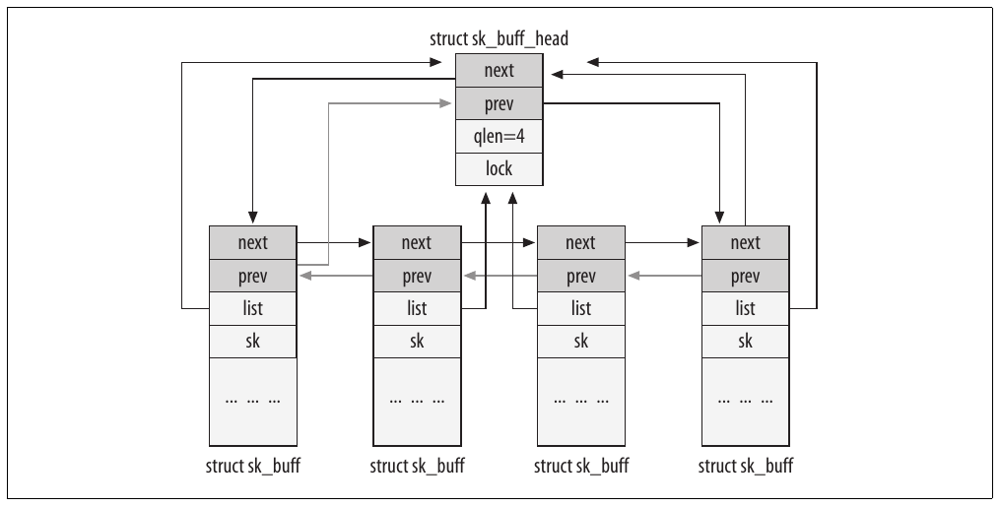

Hình 2-1. List các element sk\_buff

Sau đây là những field đáng chú ý khác của `sk_buff`:

`struct sock *sk`

Đây là pointer tới data structure `sock` của socket sở hữu buffer này. Pointer cần thiết khi data được tạo cục bộ hoặc được một local process nhận, vì data và thông tin socket-related được L4 (TCP hoặc UDP) cùng user application sử dụng. Khi buffer chỉ được forward (tức cả source lẫn destination đều không nằm trên máy cục bộ), pointer này là NULL.

`unsigned int len`

Đây là kích thước block data trong buffer. Độ dài này bao gồm cả data trong main buffer (tức buffer được `head` trỏ tới) lẫn data trong các fragment.[^2] Giá trị thay đổi khi buffer di chuyển từ network layer này sang network layer khác, vì header bị loại bỏ khi đi lên stack và được thêm khi đi xuống stack. `len` cũng tính cả protocol header, như Hình 2-8 trong mục “Dành chỗ và căn chỉnh data: skb\_reserve, skb\_put, skb\_push và skb\_pull”.

`unsigned int data_len`

Khác với `len`, `data_len` chỉ tính kích thước data trong các fragment.

`unsigned int mac_len`

Đây là kích thước MAC header.

`atomic_t users`

Đây là reference count, hay số thực thể đang dùng buffer `sk_buff` này. Mục đích chính của parameter là tránh giải phóng structure `sk_buff` khi vẫn còn bên sử dụng. Vì vậy, mỗi bên dùng buffer phải tăng và giảm field này khi cần. Counter chỉ tính các bên dùng data structure `sk_buff`; buffer chứa data thực tế được một field tương tự (`dataref`) quản lý, sẽ được giới thiệu ở phần sau chương này trong mục “Structure skb\_shared\_info và function skb\_shinfo”.

Đôi khi `users` được tăng và giảm trực tiếp bằng các function `atomic_inc` và `atomic_dec`, nhưng phần lớn thời gian nó được thao tác bằng `skb_get` và `kfree_skb`.

`unsigned int truesize`

Field này biểu diễn tổng kích thước buffer, bao gồm chính structure `sk_buff`. Ban đầu, function `alloc_skb` đặt nó thành `len+sizeof(sk_buff)` khi cấp phát buffer cho vùng data được yêu cầu dài `len` byte.

```c
struct sk_buff *alloc_skb(unsigned int size,int gfp_mask)
{
     ... ... ...
     skb->truesize = size + sizeof(struct sk_buff);
     ... ... ...
}
```

Field được cập nhật mỗi khi skb-\>len tăng.

`unsigned char *head`

`unsigned char *end`

`unsigned char *data`

`unsigned char *tail`

Các pointer này biểu diễn ranh giới buffer và data bên trong. Khi mỗi layer chuẩn bị buffer cho công việc của mình, nó có thể cấp phát thêm không gian cho header hoặc data. `head` và `end` trỏ tới đầu và cuối vùng được cấp phát cho buffer, còn `data` và `tail` trỏ tới đầu và cuối data thực tế. Xem Hình 2-2. Khi đó, layer có thể điền protocol header vào khoảng giữa `head` và `data`, hoặc data mới vào khoảng giữa `tail` và `end`. Trong mục “Cấp phát memory: alloc\_skb và dev\_alloc\_ skb” ở phần sau, bạn sẽ thấy buffer bên phải Hình 2-2 có một header bổ sung ở cuối.

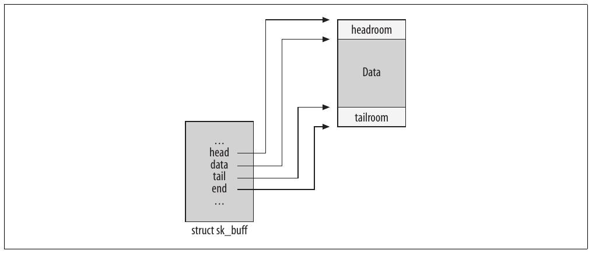

Hình 2-2. Các pointer head/end so với data/tail

`void (*destructor)(...)`

Function pointer này có thể được khởi tạo bằng routine thực hiện một hoạt động nào đó khi buffer bị loại bỏ. Khi buffer không thuộc socket nào, destructor thường không được khởi tạo. Khi buffer thuộc một socket, nó thường được đặt thành `sock_rfree` hoặc `sock_wfree` (lần lượt bởi các initialization function `skb_set_owner_r` và `skb_set_owner_w`). Hai routine `sock_xxx` được dùng để cập nhật lượng memory mà socket giữ trong các queue của nó.

### Các field tổng quát

Phần này trình bày phần lớn field của `sk_buff`, không gắn với kernel feature cụ thể:

`struct timeval stamp`

Field này thường chỉ có ý nghĩa với received packet. Nó là timestamp biểu diễn thời điểm packet được nhận hoặc (đôi khi) được schedule truyền. Nó được function `netif_rx` đặt bằng `net_timestamp`; device driver gọi function này sau mỗi lần nhận packet, và nó được mô tả trong Chương 21.

`struct net_device *dev`

Field này, có type (`net_device`) sẽ được mô tả chi tiết hơn ở phần sau chương, mô tả một network device. Vai trò device được `dev` biểu diễn phụ thuộc packet lưu trong buffer đang sắp truyền hay vừa được nhận.

Khi nhận packet, device driver cập nhật field này bằng pointer tới data structure biểu diễn receiving interface, như đoạn code sau từ `vortex_rx`, function được driver của dòng Ethernet card 3c59x gọi khi nhận frame (trong drivers/net/3c59x.c):

```c
static int vortex_rx(struct net_device *dev)
{
           ... ... ...
        skb->dev = dev;
           ... ... ...
        skb->protocol = eth_type_trans(skb, dev);
        netif_rx(skb); /* Pass the packet to the higher layer */
           ... ... ...
}
```

Khi một packet chuẩn bị được truyền, parameter này biểu diễn device mà packet sẽ được gửi ra qua đó. Code đặt giá trị này phức tạp hơn code nhận packet, nên tôi sẽ để phần thảo luận đến Chương 21 và Chương 35.

Một số network feature cho phép nhóm vài device lại để biểu diễn một virtual interface duy nhất (tức không gắn trực tiếp với hardware device), do virtual device driver phục vụ. Khi device driver được gọi, parameter `dev` trỏ tới data structure `net_device` của virtual device. Driver chọn một device cụ thể trong nhóm và thay parameter `dev` để trỏ tới data structure `net_device` của device đó. Vì vậy, trong các trường hợp này, pointer tới transmitting device có thể thay đổi trong quá trình xử lý packet.

`struct net_device *input_dev`

Đây là device mà packet đã được nhận từ đó. Nó là NULL pointer khi packet được tạo cục bộ. Với Ethernet device, field được khởi tạo trong `eth_type_trans` (xem Chương 10 và 13). Nó được Traffic Control sử dụng chủ yếu.

`struct net_device *real_dev`

Field này chỉ có ý nghĩa với virtual device và biểu diễn real device gắn với virtual device đó. Chẳng hạn, Bonding và VLAN interface dùng nó để nhớ ingress traffic của real device được nhận từ đâu.

`union {...} h`

`union {...} nh`

`union {...} mac`

Đây là các pointer tới protocol header của TCP/IP stack: `h` cho L4, `nh` cho L3 và `mac` cho L2. Mỗi field trỏ tới một union gồm nhiều structure, mỗi structure dành cho một protocol mà kernel hiểu ở layer đó. Ví dụ, `h` là union có một field cho header của mỗi L4 protocol mà kernel hiểu. Một member của mỗi union có tên `raw`, dùng để khởi tạo; mọi truy cập sau đó đều thông qua member protocol-specific.

Khi nhận data packet, function chịu trách nhiệm xử lý header layer n nhận buffer từ layer n-1 với `skb->data` trỏ tới đầu header layer n. Function xử lý layer n khởi tạo pointer thích hợp cho layer này (ví dụ `skb->nh` cho L3 handler) để lưu giữ field `skb->data`, vì nội dung pointer này sẽ mất khi xử lý ở layer tiếp theo, lúc `skb->data` được khởi tạo bằng offset khác trong buffer. Sau đó, function hoàn tất xử lý layer n và, trước khi chuyển packet cho handler layer n+1, cập nhật `skb->data` để trỏ tới cuối header layer n, cũng chính là đầu header layer n+1 (xem Hình 2-3).

Gửi packet đảo ngược quá trình này, với phần phức tạp bổ sung là thêm header mới ở mỗi layer.

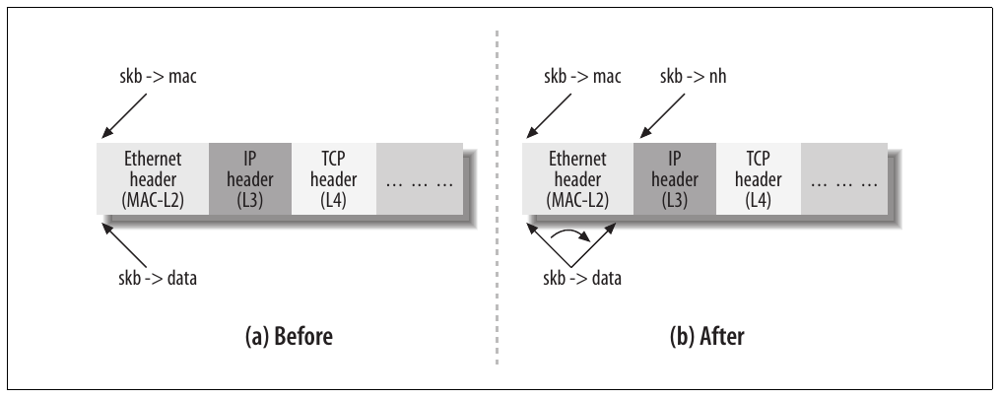

Hình 2-3. Khởi tạo pointer tới header khi chuyển từ layer hai sang layer ba

`struct dst_entry dst`

Field được routing subsystem sử dụng. Vì data structure khá phức tạp và yêu cầu hiểu cách các subsystem khác hoạt động, tôi sẽ hoãn mô tả tới Phần VII.

`char cb[40]`

Đây là “control buffer”, hay vùng lưu private information, do mỗi layer duy trì để dùng nội bộ. Nó được cấp phát tĩnh trong structure `sk_buff` (hiện có kích thước 40 byte), đủ lớn để chứa private data mà mỗi layer cần. Trong code của từng layer, truy cập được thực hiện qua macro để code dễ đọc hơn. Chẳng hạn TCP dùng vùng này để lưu data structure `tcp_skb_cb`, được định nghĩa trong include/net/tcp.h:

```c
struct tcp_skb_cb {
    ... ... ...
    __u32        seq;        /* Starting sequence number */
    __u32        end_seq;    /* SEQ + FIN + SYN + datalen*/
    __u32        when;       /* used to compute rtt's    */
    __u8         flags;      /* TCP header flags.        */
    ... ... ...
};
```

Và đây là macro mà TCP code dùng để truy cập structure. Macro đơn giản chỉ thực hiện một pointer cast:

```c
#define TCP_SKB_CB(__skb)    ((struct tcp_skb_cb *)&((__skb)->cb[0]))
```

Sau đây là ví dụ TCP subsystem điền structure khi nhận segment:

```c
int tcp_v4_rcv(struct sk_buff *skb)
{
        ... ... ...
        th = skb->h.th;
        TCP_SKB_CB(skb)->seq = ntohl(th->seq);
        TCP_SKB_CB(skb)->end_seq = (TCP_SKB_CB(skb)->seq + th->syn + th->fin +
                                    skb->len - th->doff * 4);
        TCP_SKB_CB(skb)->ack_seq = ntohl(th->ack_seq);
        TCP_SKB_CB(skb)->when = 0;
        TCP_SKB_CB(skb)->flags = skb->nh.iph->tos;
        TCP_SKB_CB(skb)->sacked = 0;
        ... ... ...
}
```

Để xem cách lấy các parameter trong buffer `cb`, hãy xem function `tcp_transmit_skb` trong net/ipv4/tcp\_output.c. TCP dùng function đó để đẩy data segment xuống IP layer nhằm truyền đi.

Trong Chương 22, bạn cũng sẽ thấy cách IPv4 dùng `cb` để lưu thông tin về IP fragmentation.

`unsigned int csum`

`unsigned char ip_summed`

Chúng biểu diễn checksum và status flag tương ứng. Cách sử dụng được mô tả trong Chương 19.

`unsigned char cloned`

Một flag `boolean` mà khi được đặt sẽ cho biết structure này là clone của buffer `sk_buff` khác. Xem mục “Clone và sao chép buffer” ở phần sau.

`unsigned char pkt_type`

Field phân loại frame dựa trên L2 destination address của nó. Các giá trị có thể có được liệt kê trong include/linux/if\_packet.h. Với Ethernet device, parameter được function `eth_type_trans` khởi tạo, được mô tả trong Chương 13.

Những giá trị chính có thể được gán gồm:

`PACKET_HOST`

Destination address của received frame là address của receiving interface; nói cách khác, packet đã tới đích.

`PACKET_MULTICAST`

Destination address của received frame là một trong những multicast address mà interface đã đăng ký.

`PACKET_BROADCAST`

Destination address của received frame là broadcast address của receiving interface.

`PACKET_OTHERHOST`

Destination address của received frame không thuộc các address gắn với interface (unicast, multicast và broadcast); do đó frame phải được forward nếu forwarding được enable, nếu không sẽ bị drop.

`PACKET_OUTGOING`

Packet đang được gửi ra ngoài; trong số các bên sử dụng flag này có Decnet protocol và function cung cấp cho mỗi network tap một bản sao outgoing packet (xem `dev_queue_xmit_nit` trong Chương 11).

`PACKET_LOOPBACK`

Packet đang được gửi tới loopback device. Nhờ flag này, khi xử lý loopback device, kernel có thể bỏ qua một số operation cần thiết với real device.

`PACKET_FASTROUTE`

Packet đang được route bằng Fastroute feature. Hỗ trợ Fastroute không còn trong kernel 2.6.

Chương 13 mô tả chi tiết cách đặt các giá trị đó dựa trên L2 destination address.

`__u32 priority`

Field chỉ Quality of Service (QoS) class của packet đang được truyền hoặc forward. Nếu packet được tạo cục bộ, socket layer định nghĩa giá trị `priority`. Ngược lại, nếu packet đang được forward, function `rt_tos2priority` (được gọi từ function `ip_forward`) định nghĩa giá trị field theo giá trị field Type of Service (ToS) trong chính IP header. Giá trị parameter này không liên quan tới DiffServ Code Point (DSCP) được mô tả trong Chương 18. Tôi sẽ thảo luận vai trò của nó trong mục “Function ip\_forward” ở Chương 20.

`unsigned short protocol`

Đây là protocol được dùng ở layer next-higher theo góc nhìn của device driver tại L2. Các protocol điển hình được liệt kê ở đây là IP, IPv6 và ARP; danh sách đầy đủ có trong include/linux/if\_ether.h. Vì mỗi protocol có function handler riêng để xử lý incoming packet, driver dùng field này để thông báo cho layer phía trên cần dùng handler nào. Mỗi driver gọi `netif_rx` để gọi handler cho network layer phía trên, nên field `protocol` phải được khởi tạo trước khi gọi function đó. Xem Chương 10 và 13 để biết thêm chi tiết.

`unsigned short security`

Đây là security level của packet. Field ban đầu được đưa vào để dùng với IPsec nhưng hiện không còn được sử dụng.

### Các field Feature-Specific

Linux kernel có tính modular, cho phép bạn chọn những gì đưa vào hoặc bỏ ra. Vì vậy, một số field chỉ được đưa vào data structure `sk_buff` nếu kernel được compile với hỗ trợ feature cụ thể như firewalling (Netfilter) hoặc QoS:

`unsigned long nfmark`

`__u32 nfcache`

`__u32 nfctinfo`

`struct nf_conntrack *nfct`

`unsigned int nfdebug`

`struct nf_bridge_info *nf_bridge`

Các parameter này được Netfilter (firewall code) sử dụng, cụ thể hơn là kernel option “Device Drivers ➝ Networking support ➝ Networking options ➝ Network packet filtering” cùng hai suboption “Network packet filtering debugging” và “Bridged IP/ARP packets filtering”.

`union {...} private`

Union này được High Performance Parallel Interface (HIPPI) sử dụng. Kernel option tương ứng là “Device Drivers ➝ Networking support ➝ Network device support ➝ HIPPI driver support”.

`__u32 tc_index`

`__u32 tc_verd`

`__u32 tc_classid`

Các parameter này được Traffic Control sử dụng, cụ thể hơn là kernel option “Device Drivers ➝ Networking support ➝ Networking options ➝ QoS and/or fair queueing” và suboption “Packet classifier API”.

`struct sec_path *sp`

Field này được IPsec protocol suite dùng để theo dõi các transformation.

### Các function quản lý

Kernel cung cấp nhiều function, thường rất ngắn và đơn giản, để thao tác trên element `sk_buff` hoặc list các element. Với Hình 2-4, tôi sẽ mô tả những function quan trọng nhất. Trước tiên, chúng ta xem các function dùng để cấp phát và giải phóng buffer, rồi những function thao tác pointer (tức `skb->data`) để dành không gian ở đầu hoặc cuối frame.

Nếu xem các file include/linux/skbuff.h và net/core/skbuff.c, bạn sẽ nhận thấy gần như mọi function đều có hai phiên bản, với tên dạng `do_something` và `__do_something`. Thông thường, function đầu là wrapper thêm sanity check hoặc locking mechanism quanh lời gọi function thứ hai. Dạng nội bộ `__do_something` nhìn chung không được gọi trực tiếp (trừ khi đáp ứng các điều kiện cụ thể — chẳng hạn yêu cầu về lock). Ngoại lệ thường là những function viết chưa tốt và cuối cùng sẽ được sửa.

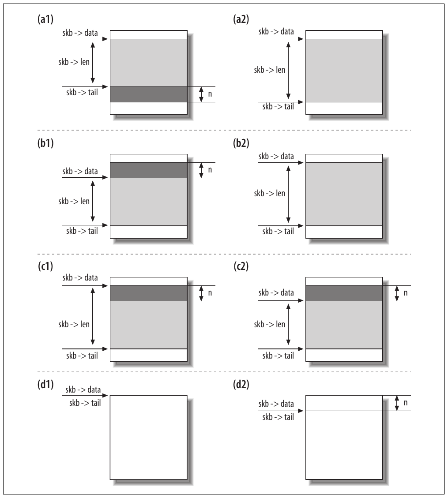

Hình 2-4. Trước và sau: (a)skb\_put, (b)skb\_push, (c)skb\_pull và (d)skb\_reserve

#### Cấp phát memory: alloc\_skb và dev\_alloc\_skb

`alloc_skb` là function chính để cấp phát buffer và được định nghĩa trong net/core/skbuff.c. Chúng ta đã thấy data buffer và header (data structure `sk_buff`) là hai thực thể khác nhau, nghĩa là tạo một buffer cần hai lần cấp phát memory (một cho buffer và một cho structure `sk_buff`).

`alloc_skb` lấy data structure `sk_buff` từ cache bằng cách gọi function `kmem_cache_alloc`, và lấy data buffer bằng cách gọi `kmalloc`, function này cũng dùng cached memory nếu có. Code (được đơn giản hóa đôi chút) như sau:

```c
    skb = kmem_cache_alloc(skbuff_head_cache, gfp_mask & ~__GFP_DMA);
    ... ... ...
    size = SKB_DATA_ALIGN(size);
    data = kmalloc(size + sizeof(struct skb_shared_info), gfp_mask);
```

Trước khi gọi `kmalloc`, parameter `size` được điều chỉnh bằng macro `SKB_DATA_ALIGN` để buộc căn chỉnh. Trước khi return, function khởi tạo một số parameter trong structure, tạo kết quả cuối như Hình 2-5.

Ở cuối memory block bên phải Hình 2-5, bạn có thể thấy padding area được thêm để buộc căn chỉnh. Block `skb_shared_info` chủ yếu dùng để xử lý IP fragment và được mô tả ở phần sau chương này. Những field bên trái hình đã được giải thích trước đó.

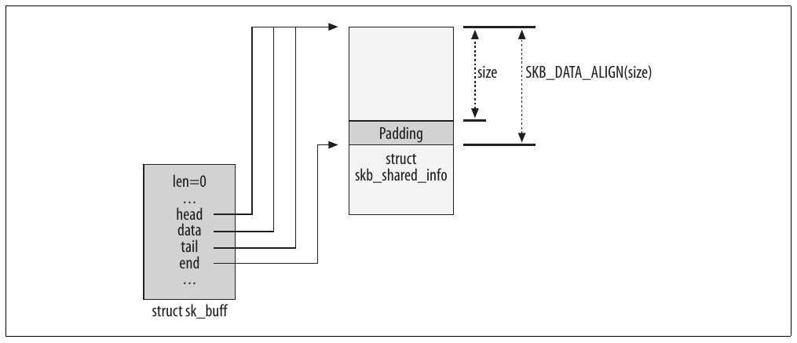

Hình 2-5. Function alloc\_skb

`dev_alloc_skb` là buffer allocation function dành cho device driver và dự kiến được thực thi trong interrupt mode. Nó đơn giản là wrapper quanh `alloc_skb`, thêm 16 byte vào kích thước yêu cầu nhằm tối ưu và yêu cầu atomic operation (`GFP_ATOMIC`) vì sẽ được gọi từ interrupt handler routine:

```c
static inline struct sk_buff *dev_alloc_skb(unsigned int length)
{
    return __dev_alloc_skb(length, GFP_ATOMIC);
}


static inline
struct sk_buff *__dev_alloc_skb(unsigned int length, int gfp_mask)
{
    struct sk_buff *skb = alloc_skb(length + 16, gfp_mask);
    if (likely(skb))
            skb_reserve(skb, 16);
    return skb;
}
```

Định nghĩa `__dev_alloc_skb` này là mặc định được dùng khi không có định nghĩa architecture-specific.

##### Giải phóng memory: kfree\_skb và dev\_kfree\_skb

Hai function này release buffer, trả nó về buffer pool (cache). `kfree_skb` vừa được gọi trực tiếp vừa được gọi qua wrapper `dev_kfree_skb`. Wrapper sau được định nghĩa để device driver sử dụng, có tên tương ứng với `dev_alloc_skb`, nhưng chỉ là macro đơn giản gọi `kfree_skb`. Function cơ bản này chỉ giải phóng buffer khi counter `skb->users` bằng 1 (khi không còn bên dùng buffer nào). Nếu không, function chỉ giảm counter. Vì vậy, nếu buffer có ba bên sử dụng, chỉ lần gọi thứ ba tới `dev_kfree_skb` hoặc `kfree_skb` mới giải phóng memory.

Flowchart trong Hình 2-6 cho thấy mọi bước liên quan việc giải phóng buffer. Như bạn sẽ thấy trong Chương 33, structure `sk_buff` có thể giữ một reference tới data structure `dst_entry`. Vì vậy, khi structure `sk_buff` được giải phóng, cũng phải gọi `dst_release` để giảm reference count trên data structure `dst_entry` tương ứng.

Khi function pointer `destructor` đã được khởi tạo, nó được gọi ở đây (xem mục “Các field về bố cục” ở phần trước chương này).

Chúng ta đã thấy một trường hợp đơn giản trong Hình 2-5: data structure `sk_buff` gắn với memory block khác lưu data thực tế. Tuy nhiên, data structure `skb_shared_info` ở cuối data block đó, như Hình 2-5, có thể giữ pointer tới các memory fragment khác. Xem ví dụ trong Chương 21. Khi có các fragment đó, `kfree_skb` cũng giải phóng memory của chúng. Cuối cùng, data structure `sk_buff` được trả về cache `skbuff_head_cache`.

##### Dành chỗ và căn chỉnh data: skb\_reserve, skb\_put, skb\_push và skb\_pull

`skb_reserve` dành một phần không gian (headroom) ở đầu buffer, thường dùng để cho phép chèn header hoặc buộc data căn chỉnh theo một ranh giới. Function dịch các pointer `data` và `tail` (được thảo luận ở mục “Các field về bố cục” phía trước), lần lượt đánh dấu đầu và cuối payload. Hình 2-4(d) cho thấy kết quả gọi `skb_reserve(skb,n)`. Function thường được gọi ngay sau khi cấp phát buffer, khi `data` và `tail` vẫn bằng nhau.

Nếu xem receive function của một Ethernet driver (chẳng hạn `vortex_rx` trong drivers/net/3c59x.c), bạn sẽ thấy tất cả đều dùng lệnh sau trước khi lưu bất kỳ data nào vào buffer vừa cấp phát:

```c
skb_reserve(skb, 2);    /* Align IP on 16 byte boundaries */
```

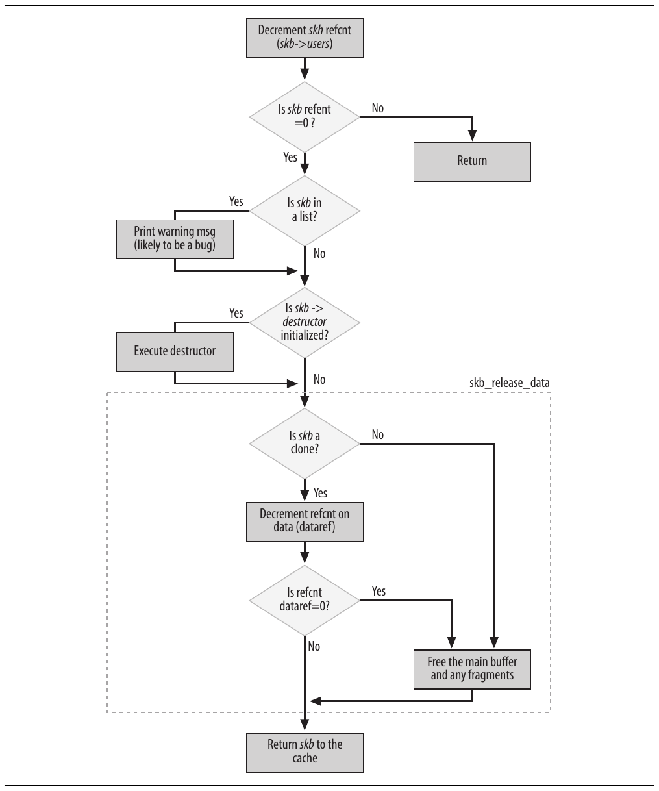

Hình 2-6. Function kfree\_skb

Vì biết mình sắp sao chép vào buffer một Ethernet frame có header dài 14 octet, argument `2` dịch đầu buffer đi 2 byte. Điều này giữ IP header, nằm ngay sau Ethernet header, được căn chỉnh theo ranh giới 16-byte tính từ đầu buffer, như Hình 2-7.

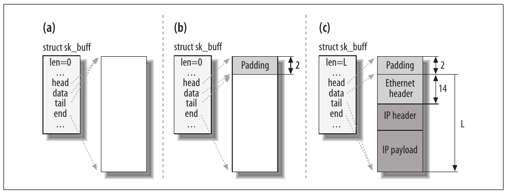

Hình 2-7. (a) trước skb\_reserve, (b) sau skb\_reserve và (c) sau khi sao chép frame vào buffer

Hình 2-8 cho thấy ví dụ dùng `skb_reserve` theo chiều ngược lại, trong quá trình truyền data.

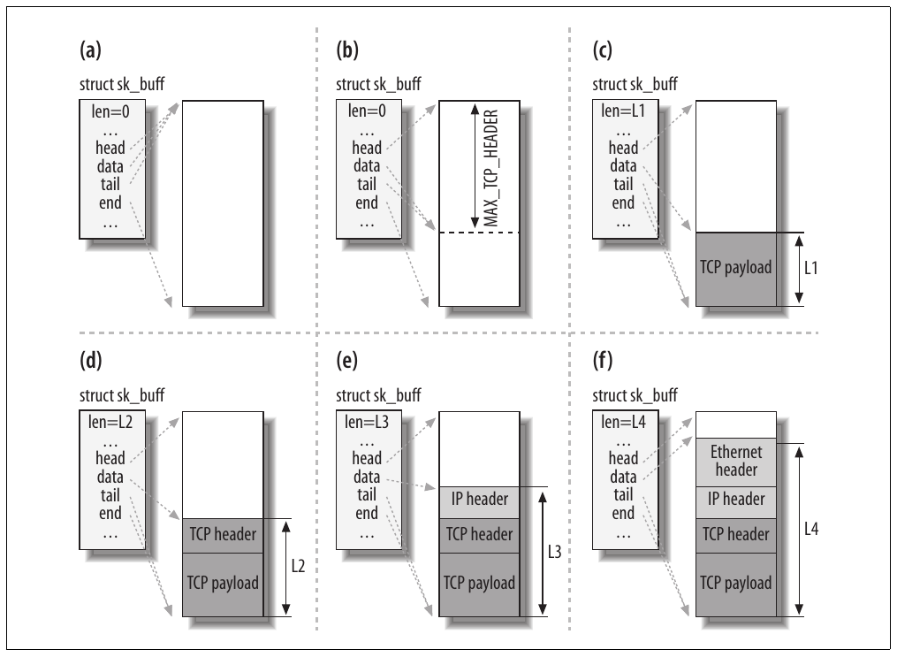

Hình 2-8. Buffer được điền khi đi qua stack từ TCP layer xuống link layer

1\. Khi TCP được yêu cầu truyền data, nó cấp phát buffer theo những tiêu chí nhất định (TCP Maximum Segment Size (mss), hỗ trợ scatter gather I/O, v.v.).

2\. TCP dành (bằng `skb_reserve`) đủ không gian ở đầu buffer để chứa mọi header của tất cả layer (TCP, IP, link layer). Parameter `MAX_TCP_HEADER` là tổng mọi header ở tất cả mức và được tính có xét những tình huống worst-case: vì TCP layer không biết interface type sẽ dùng để truyền, nó dành chỗ cho header lớn nhất có thể ở mỗi layer. Nó thậm chí tính cả khả năng có nhiều IP header (vì bạn có thể có nhiều IP header khi kernel được compile với hỗ trợ IP over IP).

3\. TCP payload được sao chép vào buffer. Lưu ý Hình 2-8 chỉ là ví dụ. TCP payload có thể được tổ chức khác; chẳng hạn được lưu thành fragment. Trong Chương 21, chúng ta sẽ xem hình dạng của fragmented buffer (cũng thường gọi là paged buffer).

4\. TCP layer thêm header của nó.

5\. TCP layer chuyển buffer cho IP layer, layer này cũng thêm header của mình.

6\. IP layer chuyển IP packet cho neighboring layer, layer này thêm link layer header.

Lưu ý khi buffer đi xuống network stack, mỗi protocol dịch `skb->data` xuống, sao chép header của mình vào và cập nhật `skb->len`. Tất cả được thực hiện bằng các function đã thấy trong Hình 2-4.

Lưu ý function `skb_reserve` không thực sự di chuyển gì vào hoặc bên trong data buffer; nó chỉ cập nhật hai pointer như Hình 2-4(d).

```c
static inline void skb_reserve(struct sk_buff *skb, unsigned int len)
{
    skb->data+=len;
    skb->tail+=len;
}
```

`skb_push` thêm một data block vào đầu buffer, còn `skb_put` thêm vào cuối. Giống `skb_reserve`, các function này không thực sự thêm data vào buffer; chúng chỉ dịch pointer tới đầu hoặc cuối buffer. Data mới phải được những function khác sao chép vào một cách tường minh. `skb_pull` loại một data block khỏi đầu buffer bằng cách dịch pointer `head` về phía trước. Hình 2-4 cho thấy cách các function này hoạt động.

##### Structure skb\_shared\_info và function skb\_shinfo

Như Hình 2-5, ở cuối data buffer có structure tên `skb_shared_info` giữ thông tin bổ sung về data block. Data structure nằm ngay sau pointer `end` đánh dấu cuối data. Sau đây là định nghĩa data structure:

```c
struct skb_shared_info {
    atomic_t        dataref;
    unsigned int    nr_frags;
    unsigned short  tso_size;
    unsigned short  tso_seqs;
    struct sk_buff  *frag_list;
    skb_frag_t      frags[MAX_SKB_FRAGS];
};
```

`dataref` biểu diễn số “người dùng” của data block và được mô tả trong mục tiếp theo, “Clone và sao chép buffer”. `nr_frags`, `frag_list` và `frags` được dùng để xử lý IP fragment, được mô tả trong Chương 21. Routine `skb_is_nonlinear` có thể kiểm tra buffer có bị phân mảnh hay không, còn `skb_linearize`[^3] có thể gộp fragment thành một buffer phẳng duy nhất. Gộp fragment cần sao chép, gây tổn thất hiệu năng.

Một số network interface card (NIC) có thể xử lý bằng hardware những công việc vốn do CPU thực hiện. Ví dụ phổ biến nhất là tính checksum L3 và L4. Một số NIC thậm chí duy trì state machine của L4 protocol. Với code được trình bày ở đây, chúng ta quan tâm TCP segmentation offload, trong đó NIC triển khai một phần TCP layer. `tso_size` và `tso_seqs` được feature này sử dụng.

Lưu ý không có field nào trong structure `sk_buff` trỏ tới data structure `skb_shared_info`. Để truy cập structure đó, function cần dùng macro `skb_shinfo`, chỉ đơn giản return pointer `end`:

```c
#define skb_shinfo(SKB)    ((struct skb_shared_info *)((SKB)->end))
```

Chẳng hạn câu lệnh sau cho thấy cách dùng macro để tăng một field của private block:

```c
skb_shinfo(skb)->nr_frags++;
```

##### Clone và sao chép buffer

Khi cùng buffer cần được các bên sử dụng khác nhau xử lý độc lập, và họ có thể cần thay đổi nội dung descriptor `sk_buff` (các pointer `h` và `nh` tới protocol header), kernel không cần tạo bản sao đầy đủ của cả structure `sk_buff` lẫn các data buffer tương ứng. Thay vào đó, để hiệu quả hơn, kernel có thể clone bản gốc: chỉ sao chép structure `sk_buff` và điều chỉnh reference count để tránh giải phóng shared data block quá sớm. Clone buffer được thực hiện bằng function `skb_clone`.

Ví dụ sử dụng cloning là khi ingress packet cần được chuyển tới nhiều bên nhận, chẳng hạn protocol handler và một hoặc nhiều network tap (xem Chương 21).

Clone `sk_buff` không được liên kết vào list nào và không có reference tới socket owner. Field `skb->cloned` được đặt thành 1 trong cả clone lẫn original buffer. `skb->users` được đặt thành 1 trong clone để lần cố loại bỏ đầu tiên thành công, và số reference (`dataref`) tới buffer chứa data được tăng (vì giờ có thêm một data structure `sk_buff` trỏ tới nó). Hình 2-9 cho thấy ví dụ cloned buffer.

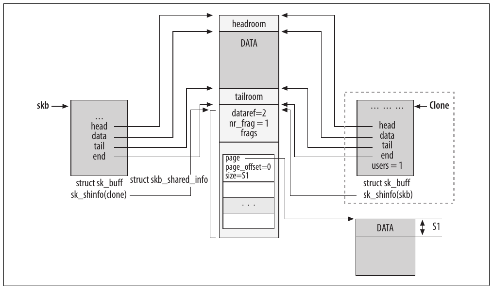

Hình 2-9. Function skb\_clone

Routine `skb_clone` có thể được dùng để kiểm tra trạng thái cloned của buffer `skb`.

Hình 2-9 cho thấy ví dụ fragmented buffer — tức buffer có một phần data lưu trong các data fragment được liên kết bằng array `frags`. Chúng ta sẽ xem cách dùng fragmented buffer trong Chương 21; hiện tại hãy tạm bỏ qua những chi tiết đó.

Routine `skb_share_check` có thể được dùng để kiểm tra reference count `skb->users` và clone buffer `skb` khi field `users` cho biết buffer được chia sẻ.

Khi buffer được clone, không thể sửa nội dung data block. Điều này nghĩa là code có thể truy cập data mà không cần locking. Tuy nhiên, khi function cần sửa không chỉ nội dung structure `sk_buff` mà cả data, nó cũng cần clone data block. Trong trường hợp này, lập trình viên có hai lựa chọn. Khi biết chỉ cần sửa nội dung data trong vùng giữa `skb->start` và `skb->end`, có thể dùng `pskb_copy` để chỉ clone vùng đó. Khi cho rằng có thể cần sửa cả nội dung fragment data block, phải dùng `skb_copy`. Kết quả của cả `pskb_copy` và `skb_copy` được thể hiện trong Hình 2-10. Trong Chương 21, bạn sẽ thấy data structure `skb_shared_info` cũng có thể chứa một list các structure `sk_buff` (liên kết với field tên `frag_list`). List đó được `pskb_copy` và `skb_copy` xử lý giống array `frags` (chi tiết này được lược khỏi Hình 2-10 để hình dễ đọc hơn).

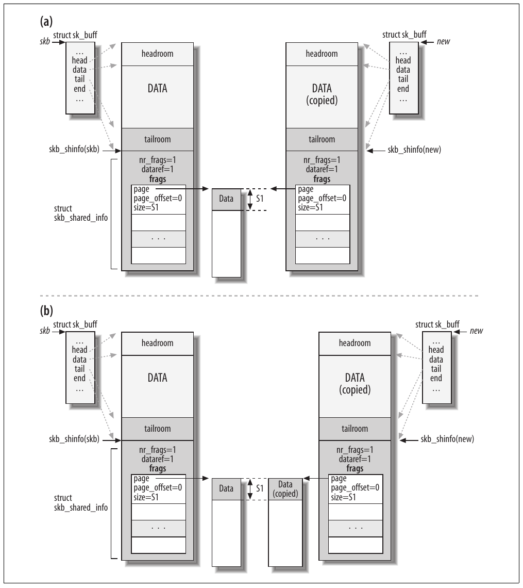

Hình 2-10. (a) Function pskb\_copy và (b) function skb\_copy

Có thể lúc này bạn chưa hiểu đầy đủ mọi chi tiết trong Hình 2-9 và 2-10. Ở phần sau của sách, đặc biệt sau khi đã đọc Phần V, mọi thứ sẽ rõ ràng hơn.

Trong khi thảo luận các chủ đề của sách, đôi khi tôi sẽ nhấn mạnh rằng một function cụ thể cần clone hoặc sao chép buffer. Khi quyết định tạo clone hay bản sao buffer, lập trình viên của mỗi subsystem không thể dự đoán liệu kernel component khác (hoặc người dùng khác của subsystem mình) có cần thông tin gốc trong buffer hay không. Kernel rất modular và thay đổi năng động, khó đoán, nên mỗi subsystem không biết subsystem khác có thể làm gì với buffer. Vì vậy, lập trình viên của mỗi subsystem chỉ theo dõi các sửa đổi mình thực hiện trên buffer và chú ý tạo bản sao trước khi sửa bất cứ thứ gì, phòng khi phần khác của kernel cần thông tin gốc.

##### Các function quản lý list

Các function này thao tác trên list các element `sk_buff`, còn gọi là queue. Để có danh sách function đầy đủ, xem \<include/linux/skbuff.h\> và \<net/core/skbuff.c\>. Một số function thường dùng nhất gồm:

`skb_queue_head_init`

Khởi tạo một `sk_buff_head` với queue element rỗng.

`skb_queue_head`, `skb_queue_tail`

Lần lượt thêm một buffer vào đầu hoặc cuối queue.

`skb_dequeue`, `skb_dequeue_tail`

Lần lượt dequeue một element từ đầu hoặc cuối. Function thứ hai có lẽ nên được gọi là `skb_dequeue_head` để nhất quán với tên của những queueing function khác.

`skb_queue_purge`

Làm rỗng queue.

`skb_queue_walk`

Lần lượt lặp qua từng element của queue.

Mọi function thuộc nhóm này phải được thực thi atomically — tức phải giữ spin lock do structure `sk_buff_head` cung cấp cho queue. Nếu không, chúng có thể bị gián đoạn bởi asynchronous event enqueue hoặc dequeue element khỏi queue, chẳng hạn function được timer hết hạn gọi, dẫn tới race condition.

Do đó, mỗi function được triển khai như sau:

```c
static inline function_name ( parameter_list )
{
        unsigned long flags;

        spin_lock_irqsave(...);
        __function_name ( parameter_list )
        spin_unlock_irqrestore(...);
}
```

Function gồm wrapper lấy lock, thực hiện công việc bằng cách gọi function có tên bắt đầu bằng hai dấu gạch dưới, rồi release lock.

## Structure net\_device

Data structure `net_device` lưu mọi thông tin riêng về một network device. Mỗi device đều có một structure như vậy, cả real device (như Ethernet NIC) lẫn virtual device (như bonding[^4] hoặc VLAN<sup>†</sup>). Trong phần này, tôi dùng các từ interface và device thay thế cho nhau, dù khác biệt giữa chúng quan trọng trong những ngữ cảnh khác.

Các structure `net_device` của mọi device được đưa vào global list do global variable `dev_base` trỏ tới. Data structure được định nghĩa trong include/linux/netdevice.h. Việc đăng ký network device được mô tả trong Chương 8. Trong chương đó, bạn có thể tìm chi tiết về cách thức và thời điểm khởi tạo phần lớn field của `net_device`.

Giống `sk_buff`, structure này khá lớn và gồm nhiều parameter feature-specific, cùng parameter thuộc nhiều layer khác nhau. Vì vậy, cách tổ chức tổng thể của structure có lẽ sẽ sớm thay đổi để tối ưu.

Network device có thể được phân thành các type như Ethernet card và Token Ring card. Một số field trong structure `net_device` có cùng giá trị cho mọi device cùng type, nhưng một số field phải được từng model device đặt khác nhau. Vì vậy, với gần như mỗi type, Linux cung cấp một function tổng quát khởi tạo các parameter có giá trị giống nhau trên mọi model. Mỗi device driver gọi function này bên cạnh việc đặt những field có giá trị riêng cho model của nó. Driver cũng có thể ghi đè field đã được kernel khởi tạo (chẳng hạn để cải thiện hiệu năng). Bạn có thể tìm thêm chi tiết trong Chương 8.

Có thể phân loại các field của structure `net_device` thành những nhóm sau:

- Cấu hình

- Thống kê

- Trạng thái device

- Quản lý list

- Quản lý traffic

- Riêng cho feature

- Chung

- Function pointer (hoặc VFT)

### Các định danh

Structure `net_device` gồm ba identifier, không nên nhầm lẫn:

`int ifindex`

Một ID duy nhất, được gán cho từng device khi đăng ký bằng lời gọi `dev_new_index`.

`int iflink`

Field này chủ yếu được các tunnel device (ảo) sử dụng và xác định real device sẽ được dùng để tới đầu bên kia tunnel.

`unsigned short dev_id`

Hiện được IPv6 sử dụng với các zSeries OSA NIC. Field dùng để phân biệt các virtual instance của cùng device có thể được nhiều OS chia sẻ đồng thời. Xem comment trong net/ipv6/addrconf.c.

### Cấu hình

Một số configuration field được kernel đặt giá trị mặc định tùy network device class, còn một số field để driver điền. Như đã nói, driver có thể thay đổi giá trị mặc định, và một số field thậm chí có thể được thay đổi lúc runtime bằng lệnh như `ifconfig` và `ip`. Thực tế, nhiều parameter — `base_addr`, `if_port`, `dma`, `and irq` — thường do người dùng đặt khi load module của device. Ngược lại, virtual device không dùng các parameter này.

`char name[IFNAMSIZ]`

Tên device (ví dụ eth0).

`unsigned long mem_start`

`unsigned long mem_end`

Các field này mô tả shared memory mà device dùng để giao tiếp với kernel. Chúng chỉ được khởi tạo và truy cập trong device driver; những layer cao hơn không cần quan tâm.

`unsigned long base_addr`

Điểm đầu của I/O memory được map tới memory riêng của device.

`unsigned int irq`

Interrupt number mà device dùng để giao tiếp với kernel. Nó có thể được nhiều device chia sẻ. Driver dùng function `request_irq` để cấp phát variable này và `free_irq` để giải phóng.

`unsigned char if_port`

Loại port đang được dùng cho interface này. Xem mục tiếp theo, “Interface type và port”.

`unsigned char dma`

DMA channel mà device sử dụng (nếu có). Để lấy và trả DMA channel từ kernel, file kernel/dma.c định nghĩa các function `request_dma` và `free_dma`. Để enable hoặc disable DMA channel sau khi lấy, các function `enable_dma` và `disable_dma` được cung cấp trong nhiều file include/asm- `architecture` (ví dụ include/asm-i386). Những routine này được ISA device sử dụng; Peripheral Component Interconnect (PCI) device không cần chúng vì dùng routine khác.

Không phải mọi device đều có DMA vì một số bus không sử dụng nó.

`unsigned short flags`

`unsigned short gflags`

`unsigned short priv_flags`

Một số bit trong field `flags` biểu diễn khả năng của network device (như `IFF_MULTICAST`), còn những bit khác biểu diễn trạng thái thay đổi (như `IFF_UP` hoặc `IFF_RUNNING`). Bạn có thể tìm danh sách đầy đủ các flag trong include/linux/if.h. Device driver thường đặt các capability khi khởi tạo, còn status flag được kernel quản lý để đáp ứng external event. Có thể xem thiết lập flag qua lệnh `ifconfig` quen thuộc:

```c
bash# ifconfig lo
lo          Link encap:Local Loopback
            inet addr:127.0.0.1  Mask:255.0.0.0
            UP LOOPBACK RUNNING  MTU:3924  Metric:1
            RX packets:198 errors:0 dropped:0 overruns:0 frame:0
            TX packets:198 errors:0 dropped:0 overruns:0 carrier:0
            collisions:0 txqueuelen:0
```

Trong ví dụ này, các từ `UP LOOPBACK RUNNING` tương ứng với các flag `IFF_UP`, `IFF_LOOPBACK` và `IFF_RUNNING`.

`priv_flags` lưu những flag không hiển thị cho user space. Hiện field được các virtual device VLAN và Bridge sử dụng. `gflags` gần như không bao giờ được dùng và tồn tại vì lý do tương thích. Có thể thay đổi flag thông qua function `dev_change_flags`.

`int features`

Một bitmap flag khác dùng để lưu một số capability khác của device. Việc data structure này có nhiều flag variable không phải dư thừa. Field `features` báo các capability của card khi giao tiếp với CPU, chẳng hạn card có thể DMA tới high memory hay tính checksum mọi packet bằng hardware hay không. Danh sách feature có thể có được định nghĩa ngay trong structure `net_device`. Device driver khởi tạo parameter này. Bạn có thể tìm danh sách feature `NETIF_F_XXX`, kèm comment hữu ích, trong định nghĩa data structure `net_device`.

`unsigned mtu`

MTU là viết tắt của Maximum Transmission Unit, biểu diễn kích thước frame tối đa mà device có thể xử lý. Bảng 2-1 cho thấy giá trị của những công nghệ network phổ biến nhất.

Bảng 2-1. Giá trị MTU của các device type khác nhau

| Loại device | MTU |
|---|---|
| PPP | 296 |
| SLIP | 296 |
| Ethernet | 1,500 |
| ISDN | 1,500 |
| PLIP | 1,500 (`ether_setup`) |
| Wavelan | 1,500 (`ether_setup`) |
| EtherChannel | 2,024 |
| FDDI | 4,352 |
| Token Ring 4 MB/s (IEEE 802.5) | 4,464 |
| Token Bus (IEEE 802.4) | 8,182 |
| Token Ring 16 MB/s (IBM) | 17,914 |
| Hyperchannel | 65,535 |

Ethernet MTU cần được làm rõ đôi chút. Đặc tả Ethernet frame định nghĩa kích thước payload tối đa là 1.500 byte. Đôi khi bạn thấy Ethernet MTU được định nghĩa là 1.518 hoặc 1.514: số đầu là kích thước tối đa của Ethernet frame gồm cả header, còn số sau gồm header nhưng không gồm frame check sequence (4 byte checksum).

Năm 1998, Alteon Networks (được Nortel Networks mua lại năm 2000) thúc đẩy sáng kiến tăng payload tối đa của Ethernet frame lên 9 KB. Đề xuất này sau đó được chính thức hóa bằng IETF Internet draft, nhưng IEEE chưa bao giờ chấp nhận. Frame có payload vượt 1.500 byte trong đặc tả IEEE thường được gọi là jumbo frame và dùng với Gigabit Ethernet để tăng throughput. Đó là vì frame lớn hơn nghĩa là cần ít frame hơn cho những lần truyền data lớn, ít interrupt hơn, do đó ít dùng CPU hơn, ít header overhead hơn, v.v.). Để tìm hiểu lợi ích của việc tăng Ethernet MTU và lý do IEEE không đồng ý chuẩn hóa phần mở rộng, bạn có thể đọc white paper “Use of Extended Frame Sizes in Ethernet Networks”, tìm được qua tìm kiếm Internet cũng như tại http://www.ietf.org/proceedings/01aug/I-D/draft-ietf-isis-ext-eth-01.txt.

`unsigned short type`

Nhóm device mà nó thuộc về (Ethernet, Frame Relay, v.v.). include/linux/if\_arp.h chứa danh sách đầy đủ các type có thể có.

`unsigned short hard_header_len`

Kích thước device header tính bằng octet. Chẳng hạn Ethernet header dài 14 octet. Độ dài mỗi device header được định nghĩa trong header file của device đó. Ví dụ, với Ethernet, `ETH_HLEN` được định nghĩa trong \<include/linux/if\_ether.h\>.

`unsigned char broadcast[MAX_ADDR_LEN]`

Link layer broadcast address.

`unsigned char dev_addr[MAX_ADDR_LEN]`

`unsigned char addr_len`

`dev_addr` là link layer address của device; đừng nhầm với L3 hoặc IP address. Độ dài address tính bằng octet do `addr_len` cung cấp. Giá trị `addr_len` phụ thuộc device type. Ethernet address dài sáu octet.

`int promiscuity`

Xem mục “Promiscuous mode” ở phần sau.

#### Interface type và port

Một số device có nhiều connector (kết hợp phổ biến nhất là BNC + RJ45) và cho phép người dùng chọn một trong số đó tùy nhu cầu. Parameter này dùng để đặt port type cho device. Khi configuration command không buộc device driver chọn port type cụ thể, nó chỉ chọn mặc định. Cũng có trường hợp một device driver xử lý được nhiều interface model; khi đó, interface có thể tìm port type cần dùng bằng cách thử tất cả theo thứ tự cụ thể. Đoạn code sau cho thấy device driver đặt interface mode tùy cấu hình thế nào:

```c
        switch (dev->if_port) {
        case IF_PORT_10BASE2:
            writeb((readb(addr) & 0xf8) | 1, addr);
            break;
        case IF_PORT_10BASET:
            writeb((readb(addr) & 0xf8), addr);
            break;
        }
```

##### Promiscuous mode

Một số công việc quản trị network yêu cầu hệ thống nhận mọi frame đi qua shared cable, không chỉ những frame gửi trực tiếp tới nó; device nhận mọi packet được gọi là đang ở promiscuous mode. Ví dụ, application kiểm tra hiệu năng hoặc vi phạm bảo mật trên local network segment cần mode này. Bridging code cũng dùng promiscuous mode (xem Phần IV). Cuối cùng, đáng tiếc là nó rõ ràng cũng có giá trị với bên nghe lén ác ý; vì vậy, data không an toàn trước người dùng khác trên local network trừ khi được mã hóa.

Structure `net_device` chứa counter tên `promiscuity` chỉ device đang ở promiscuous mode. Lý do dùng counter thay cho flag đơn giản là nhiều client có thể yêu cầu promiscuous mode; do đó mỗi client tăng counter khi vào mode và giảm khi rời mode. Device không rời promiscuous mode cho tới khi counter về không. Field thường được thao tác bằng cách gọi function `dev_set_promiscuity`.

Mỗi khi `promiscuity` khác không (chẳng hạn qua lời gọi `dev_set_promiscuity`), bit flag `IFF_PROMISC` của `flags` cũng được đặt và được các function cấu hình interface kiểm tra.

Đoạn code sau, lấy từ driver drivers/net/3c59x.c, cho thấy cách đặt các receive mode khác nhau dựa trên flag (bit) trong field `flags`:

```c
static void set_rx_mode(struct net_device *dev)
{
        int ioaddr = dev->base_addr;
        int new_mode;

        if (dev->flags & IFF_PROMISC) {
             if (corqscreq_debug > 3)
                        printk("%s: Setting promiscuous mode.\n", dev->name);
             new_mode = SetRxFilter | RxStation | RxMulticast | RxBroadcast | RxProm;
        } else if ((dev->mc_list)  ||  (dev->flags & IFF_ALLMULTI)) {
             new_mode = SetRxFilter | RxStation | RxMulticast | RxBroadcast;
        } else
             new_mode = SetRxFilter | RxStation | RxBroadcast;

        outw(new_mode, ioaddr + EL3_CMD);
}
```

Khi flag `IFF_PROMISC` được đặt, variable `new_mode` được khởi tạo để chấp nhận traffic gửi tới card (`RxStation`), multicast traffic (`RxMulticast`), broadcast traffic (`RxBroadcast`) và mọi traffic khác (`RxProm`). `EL3_CMD` là offset tới memory address `ioaddr`, biểu diễn nơi command cần được sao chép khi tương tác với device.

### Thống kê

Thay vì cung cấp một tập field để giữ thống kê, structure `net_device` chứa pointer có tên `priv`, được driver đặt để trỏ đến private data structure lưu thông tin về interface. Private data gồm các thống kê như số packet đã truyền và nhận, cùng số lỗi gặp phải.

Định dạng structure mà `priv` trỏ tới phụ thuộc cả device type lẫn model cụ thể: vì vậy các Ethernet card khác nhau có thể dùng private structure khác nhau. Tuy nhiên, gần như mọi structure đều có field kiểu `net_device_stats` (được định nghĩa trong include/linux/netdevice.h), chứa thống kê chung cho mọi network device và có thể lấy bằng method `get_stats` được mô tả ở phần sau.

Wireless device hoạt động khác wired device đến mức data structure `net_device_stats` không phù hợp với chúng. Thay vào đó, chúng cung cấp field kiểu `iw_statistics` có thể lấy bằng method tên `get_wireless_stats`, được mô tả ở phần sau.

Data structure mà `priv` trỏ tới đôi khi có tên phản ánh interface (ví dụ `vortex_private` cho dòng Vortex và Boomerang, còn gọi là họ 3c59x), đôi khi chỉ được gọi là `net_local`. Tuy vậy, các field trong `net_local` được mỗi device driver định nghĩa riêng.

Private data structure có thể phức tạp ít nhiều tùy capability của card và mức độ người viết device driver muốn dùng thống kê tinh vi cùng thiết kế phức tạp để tăng hiệu năng. Chẳng hạn, hãy so sánh structure `net_local` tổng quát do Ethernet card 3c507 dùng trong drivers/net/3c507.c với structure `vortex_private` rất chi tiết do Ethernet card 3c59x dùng trong drivers/net/3c59x.c. Tuy nhiên, cả hai đều có field kiểu `net_device_stats`.

Như bạn sẽ thấy trong Chương 8, private data structure đôi khi được nối vào chính structure `net_device` (chỉ cần một lần `malloc` cho cả hai), đôi khi được cấp phát thành block riêng.

### Trạng thái device

Để kiểm soát tương tác với NIC, mỗi device driver phải duy trì thông tin như timestamp và flag chỉ hành vi mà interface yêu cầu. Trên hệ thống symmetric multiprocessing (SMP), kernel còn phải bảo đảm xử lý đúng truy cập đồng thời từ các CPU khác nhau tới cùng device. Một số field của structure `net_device` dành cho những loại thông tin này:

`unsigned long state`

Một tập flag được network queuing subsystem sử dụng. Chúng được index bằng các constant trong enum `netdev_state_t`, định nghĩa trong include/linux/netdevice.h và định nghĩa constant như `__LINK_STATE_XOFF` cho từng bit. Từng bit được set và clear bằng các function tổng quát `set_bit` và `clear_bit`, thường gọi qua wrapper che giấu chi tiết bit được dùng. Ví dụ, để dừng device queue, subsystem gọi `netif_stop_queue`, có dạng sau:

```c
static inline void netif_stop_queue(struct net_device *dev)
{
    ...
    set_bit(__LINK_STATE_XOFF, &dev->state);
}
```

Traffic Control subsystem được giới thiệu ngắn gọn trong Chương 11.

`enum {...} reg_state`

Trạng thái đăng ký của device. Xem Chương 8.

`unsigned long trans_start`

Thời điểm (đo bằng jiffies) bắt đầu lần truyền frame cuối cùng. Device driver đặt field ngay trước khi bắt đầu truyền. Field dùng để phát hiện vấn đề ở card nếu nó không hoàn tất truyền sau một khoảng thời gian nhất định. Truyền quá lâu nghĩa là có điều gì đó không ổn; trong trường hợp đó, driver thường reset card.

`unsigned long last_rx`

Thời điểm (đo bằng jiffies) nhận packet cuối cùng. Hiện field không được dùng cho mục đích cụ thể nào, nhưng có sẵn khi cần.

`struct net_device *master`

Một số protocol cho phép nhóm các device lại và coi chúng như một device duy nhất. Các protocol này gồm EQL (Equalizer Load-balancer for serial network interfaces), Bonding (còn gọi là EtherChannel và trunking), và queuing discipline TEQL (true equalizer) của Traffic Control. Một device trong nhóm được bầu làm so-called master, giữ vai trò đặc biệt. Field là pointer tới data structure `net_device` của master device trong nhóm. Nếu interface không thuộc nhóm như vậy, pointer đơn giản là NULL.

`spinlock_t xmit_lock`

`int xmit_lock_owner`

Lock `The xmit_lock` được dùng để tuần tự hóa truy cập tới driver function `hard_start_xmit`. Điều này nghĩa là tại một thời điểm mỗi CPU chỉ có thể thực hiện một lần truyền trên một device cụ thể. `xmit_lock_owner` là ID của CPU giữ lock. Nó luôn là 0 trên single-processor system và –1 khi lock không được giữ trên SMP system. Cũng có thể truyền lockless khi device driver hỗ trợ. Xem Chương 11 cho cả trường hợp dùng lock lẫn lockless.

`void *atalk_ptr`

`void *ip_ptr`

`void *dn_ptr`

`void *ip6_ptr`

`void *ec_ptr`

`void *ax25_ptr`

Sáu field này là pointer tới các data structure riêng cho từng protocol, mỗi data structure chứa parameter được protocol đó dùng nội bộ. Ví dụ, `ip_ptr` trỏ tới data structure kiểu `in_device` (dù được khai báo là `void *`) chứa nhiều parameter IPv4-related, trong đó có list IP address được cấu hình trên interface (xem Chương 19). Những phần khác của sách mô tả field trong data structure của các protocol được trình bày. Phần lớn thời gian chỉ một field trong số này được dùng.

### Quản lý list

Data structure `net_device` được chèn vào global list và hai hash table, như mô tả trong Chương 8. Những field sau được dùng để thực hiện các công việc này:

`struct net_device *next`

Liên kết mỗi data structure `net_device` tới structure tiếp theo trong global list.

`struct hlist_node name_hlist`

`struct hlist_node index_hlist`

Liên kết structure `net_device` với list của bucket trong hai hash table.

### Multicast ở link layer

Multicast là cơ chế dùng để chuyển data tới nhiều bên nhận. Multicasting có thể có ở cả network layer L3 (tức IP) lẫn link layer L2 (tức Ethernet). Trong phần này, chúng ta quan tâm layer sau.

Chuyển multicast ở link layer có thể thực hiện bằng address đặc biệt hoặc control information trong link layer header. (Khi link layer protocol không hỗ trợ, có thể mô phỏng.) Ethernet hỗ trợ multicasting sẵn: trong Chương 13, chúng ta sẽ xem cách phân loại Ethernet address thành unicast, multicast hoặc broadcast.

Multicast address được phân biệt với dải address khác bằng một bit cụ thể. Điều này nghĩa là 50% address có thể có là multicast, và 50% của 2<sup>48</sup> là con số khổng lồ! Khi interface được yêu cầu tham gia nhiều multicast group (mỗi group được xác định bằng multicast address), đơn giản lắng nghe mọi multicast address có thể hiệu quả và nhanh hơn việc duy trì list dài rồi mất thời gian lọc ingress L2 multicast frame theo list. Một flag trong `flags` của data structure `net_device` cho biết device có nên lắng nghe mọi address hay không. Quyết định khi nào set hoặc clear flag này được điều khiển bằng field `allmulti` trình bày trong phần này.

Mỗi device giữ một instance của structure `dev_mc_list` cho từng link layer multicast address mà nó lắng nghe. Có thể thêm và xóa link layer multicast address lần lượt bằng các function `dev_mc_add` và `dev_mc_delete`. Những field liên quan trong structure net-device gồm:

`struct dev_mc_list *mc_list`

Pointer tới head của list các structure `dev_mc_list` của device này.

`int mc_count`

Số multicast address của device này, cũng là độ dài list mà `mc_list` trỏ tới.

`int allmulti`

Khi khác không, khiến device lắng nghe mọi multicast address. Giống `promiscuity` đã thảo luận ở phần trước chương này, `allmulti` là reference count thay vì Boolean đơn giản. Đó là vì nhiều cơ chế (chẳng hạn VLAN và bonding device) có thể độc lập yêu cầu lắng nghe mọi address. Khi variable chuyển từ 0 sang khác không, function `dev_set_allmulti` được gọi để chỉ thị interface lắng nghe mọi multicast address. Điều ngược lại xảy ra khi `allmulti` về 0.

### Quản lý traffic

Traffic Control subsystem của Linux đã phát triển rất nhiều và là một thế mạnh của Linux kernel. Kernel option tương ứng là “Device drivers ➝ Networking support ➝ Networking options ➝ QoS and/or fair queueing”. Những field liên quan trong structure net-device gồm:

`struct net_device *next_sched`

Được một software interrupt mô tả trong Chương 11 sử dụng.

`struct Qdisc *qdisc`

`struct Qdisc *qdisc_sleeping`

`struct Qdisc *qdisc_ingress`

`struct list_head qdisc_list`

Các field này dùng để quản lý ingress và egress packet queue cùng việc truy cập device từ các CPU khác nhau.

`spinlock_t queue_lock`

`spinlock_t ingress_lock`

Traffic Control subsystem định nghĩa một private egress queue cho mỗi network device. `queue_lock` dùng để tránh truy cập đồng thời vào queue đó (xem Chương 11). `ingress_lock` thực hiện tương tự cho ingress traffic.

`unsigned long tx_queue_len`

Độ dài transmission queue của device. Khi kernel có hỗ trợ Traffic Control, `tx_queue_len` có thể không được dùng (chỉ một vài queuing discipline sử dụng nó). Bảng 2-2 cho thấy các giá trị dùng cho những device type phổ biến nhất. Giá trị có thể điều chỉnh bằng sysfs filesystem (xem các directory /sys/class/net/`device_name/`).

Bảng 2-2. Giá trị tx\_queue\_len cho các device type khác nhau

| Loại device | tx\_queue\_len |
|---|---|
| Ethernet | 1,000 |
| Token Ring | 100 |
| EtherChannel | 100 |
| Fibre Channel | 100 |
| FDDI | 100 |
| TEQL (true link equalizer)<sup>a</sup> | 100 |
| ISDN | 30 |
| HIPPI | 25 |
| PLIP | 10 |
| SLIP | 10 |
| AX25 | 10 |
| EQL (Equalizer load balancer for serial network interfaces) | 5 |
| Generic PPP | 3 |
| Bonding | 0 |
| Loopback | 0 |
| Bridge | 0 |
| VLAN | 0 |

<sup>a</sup> TEQL là một queuing discipline bạn có thể cấu hình bằng Traffic Control (QoS layer).

Tùy queuing discipline đang dùng — chiến lược đưa incoming và outgoing packet vào queue — `tx_queue_len` có thể được sử dụng hoặc không. Nó thường được dùng khi queue type là FIFO (First In, First Out) hoặc một loại tương đối đơn giản khác.

Lưu ý mọi device có queue length bằng 0 đều là virtual device: chúng dựa vào real device tương ứng để thực hiện queueing (ngoại trừ loopback device không cần vì nằm nội bộ kernel và chuyển mọi traffic ngay lập tức).

### Riêng cho feature

Như đã thấy khi mô tả `sk_buff`, một số parameter chỉ được đưa vào định nghĩa `net_device` nếu những feature tương ứng đã được đưa vào kernel:[^5]

`struct divert_blk *divert`

Diverter là feature cho phép thay đổi source và destination address của incoming packet. Nhờ đó có thể reroute traffic mang đặc điểm do cấu hình chỉ định tới interface hoặc host khác. Để hoạt động đúng và có ý nghĩa, diverter cần feature khác như bridging. Data structure mà field này trỏ tới lưu parameter cần cho diverter feature. Kernel option tương ứng là “Device drivers ➝ Networking support ➝ Networking options ➝ Frame Diverter”.

`struct net_bridge_port *br_port`

Thông tin bổ sung cần khi device được cấu hình làm bridged port. Bridging code và Spanning Tree Protocol (STP) được trình bày trong Phần IV. Kernel option tương ứng là “Device drivers ➝ Networking support ➝ Networking options ➝ 802.1d Ethernet Bridging”. `void (*vlan_rx_register)(...) void (*vlan_rx_add_vid)(...) void (*vlan_rx_kill_vid)(...)` Ba function pointer này được VLAN code dùng để lần lượt đăng ký device có khả năng VLAN tagging (xem net/8021q/vlan.c), thêm VLAN vào device và xóa VLAN khỏi device. Kernel option tương ứng là “Device drivers ➝ Networking support ➝ Networking options ➝ 802.1Q VLAN Support”.

`int netpoll_rx`

`void (*poll_controller)(...)`

Được Netpoll feature tùy chọn sử dụng, được đề cập ngắn gọn trong Chương 10.

### Chung

Ngoài các field quản lý list của structure `net_device` đã thảo luận trước đó, một số field khác được dùng để quản lý structure và bảo đảm loại bỏ chúng khi không còn cần:

`atomic_t refcnt`

Reference count. Không thể hủy đăng ký device cho tới khi counter này về không (xem Chương 8).

`int watchdog_timeo`

`struct timer_list watchdog_timer`

Cùng với variable `tx_timeout` đã thảo luận, các field này triển khai timer được mô tả trong mục “Watchdog timer” ở Chương 11.

`int (*poll)(...)`

`struct list_head poll_list`

`int quota`

`int weight`

Được NAPI feature mô tả trong Chương 10 sử dụng.

`const struct iw_handler_def *wireless_handlers`

`struct iw_public_data *wireless_data`

Các parameter và function pointer bổ sung được wireless device sử dụng. Xem thêm `get_wireless_stats`.

`struct list_head todo_list`

Việc đăng ký và hủy đăng ký network device được thực hiện qua hai bước. `todo_list` dùng để xử lý bước thứ hai. Xem Chương 8.

`struct class_device class_dev`

Được generic kernel driver infrastructure mới sử dụng.

### Function pointer

Trong Chương 1, chúng ta đã thấy networking code sử dụng rất nhiều function pointer. Data structure `net_device` có khá nhiều function pointer. Những function đó chủ yếu dùng để:

- Truyền và nhận frame

- Thêm hoặc parse link layer header trên buffer

- Thay đổi một phần cấu hình

- Lấy thống kê

- Tương tác với một feature cụ thể

Một số function pointer đã được giới thiệu ở các phần trước khi mô tả những field dùng để thực hiện công việc cụ thể. Sau đây là những function pointer tổng quát:

`struct ethtool_ops *ethtool_ops`

Pointer tới một tập function pointer dùng để đặt hoặc lấy cấu hình các parameter khác nhau của device. Xem mục “Ethtool” trong Chương 8.

`int (*init)(...)`

`void (*uninit)(...)`

`void (*destructor)(...)`

`int (*open)(...)`

`int (*stop)(...)`

Dùng để khởi tạo, dọn dẹp, hủy, enable và disable device. Không phải lúc nào cũng dùng tất cả. Xem Chương 8.

`struct net_device_stats* (*get_stats)(...)`

`struct iw_statistics* (*get_wireless_stats)(...)`

Một số thống kê do device driver thu thập có thể hiển thị bằng application user-space như `ifconfig` và `ip`, còn những thống kê khác chỉ được kernel sử dụng và được thảo luận trong mục “Trạng thái device” ở phần trước chương này. Hai method này dùng để thu thập thống kê. `get_stats` hoạt động trên normal device, còn `get_wireless_stats` trên wireless device. Xem thêm mục “Thống kê” phía trước.

`int (*hard_start_xmit)(...)`

Dùng để truyền frame. Xem Chương 11.

`int (*hard_header)(...)`

`int (*rebuild_header)(...)`

`int (*hard_header_cache)(...)`

`void (*header_cache_update)(...)`

`int (*hard_header_parse)(...)`

`int (*neigh_setup)(...)`

Được neighboring layer sử dụng. Xem các mục “Method do device driver cung cấp” và “Khởi tạo neighbor” trong Chương 27.

`int (*do_ioctl)(...)`

`ioctl` là system call dùng để gửi command tới device (xem Chương 3). Method này được gọi để xử lý một số command `ioctl` (xem Chương 8).

`void (*set_multicast_list)(...)`

Trong mục “Multicast ở link layer”, chúng ta đã thấy `mc_list` và `mc_count` được dùng để quản lý list L2 multicast address. Method này dùng để yêu cầu device driver cấu hình device lắng nghe các address đó. Thông thường nó không được gọi trực tiếp mà qua wrapper như `dev_mc_upload` hoặc phiên bản lockless `__dev_mc_upload`. Khi device không thể cài list multicast address, nó chỉ đơn giản enable tất cả.

`int (*set_mac_address)(...)`

Thay đổi MAC address của device. Khi device không cung cấp khả năng này (như các virtual device Bridge), field được đặt thành NULL.

`int (*set_config)(...)`

Cấu hình parameter của driver, chẳng hạn các hardware parameter `irq`, `io_addr` và `if_port`. Parameter Higher-layer (như protocol address) do `do_ioctl` xử lý. Không nhiều device dùng method này, đặc biệt trong số device mới có khả năng triển khai probe function tốt hơn. Có thể tìm ví dụ hay kèm tài liệu trong `sis900_set_config` ở drivers/net/sis900.c.

`int (*change_mtu)(...)`

Thay đổi MTU của device (xem mô tả `mtu` trong mục “Cấu hình” ở phần trước). Thay đổi field không ảnh hưởng device driver mà chỉ buộc kernel software tuân thủ MTU mới và xử lý fragmentation tương ứng.

`void (*tx_timeout)(...)`

Method được gọi khi watchdog timer hết hạn, xác định liệu một lần truyền có mất thời gian lâu bất thường để hoàn tất hay không. Watchdog timer thậm chí không được khởi động nếu method này chưa được định nghĩa. Xem mục “Watchdog timer” trong Chương 11 để biết thêm thông tin.

`int (*accept_fastpath)(...)`

Fast switching (còn gọi là FASTROUTE) từng là kernel feature cho phép device driver route incoming traffic trong interrupt context bằng cache nhỏ (bỏ qua mọi software layer). Fast switching không còn được hỗ trợ từ kernel 2.6.8. Method này từng dùng để kiểm tra fastswitching feature có thể được dùng trên device hay không.

## Các file được đề cập trong chương

Hình 2-11 cho thấy các file chính được tham chiếu trong chương này. Những file còn lại sẽ được giới thiệu trong các chương tới.

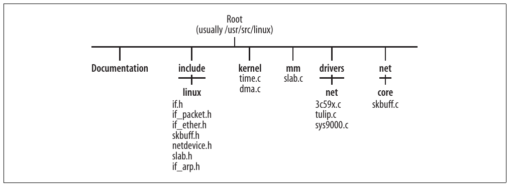

Hình 2-11. Các file được tham chiếu trong chương này

[^1]: `skb_reserve` còn được device driver dùng để căn chỉnh IP header của ingress frame. Xem Chương 10.

[^2]: Xem Chương 21 để tìm hiểu fragmented buffer.

[^3]: Xem ví dụ sử dụng trong mục “Function dev\_queue\_xmit” ở Chương 11.

[^4]: Bonding, còn gọi là EtherChannel (thuật ngữ Cisco) và trunking (thuật ngữ Sun), cho phép nhóm các interface lại và coi chúng như một interface duy nhất. Feature hữu ích khi hệ thống cần hỗ trợ kết nối point-to-point với bandwidth cao. Có thể đạt mức tăng tốc gần tuyến tính, trong đó throughput của virtual interface gần bằng tổng throughput của từng interface riêng. † VLAN là viết tắt của Virtual LAN. Dùng VLAN là cách thuận tiện để cô lập traffic sử dụng cùng L2 switch trong những broadcast domain khác nhau bằng tag bổ sung, gọi là VLAN tag, được thêm vào Ethernet frame. Bạn có thể tìm giới thiệu về VLAN và cách dùng với Linux tại http://www.linuxjournal.com/article/7268.

[^5]: Thực tế các field chỉ được đưa vào khi feature tương ứng là một phần của kernel. Xem ví dụ `br_port`.
