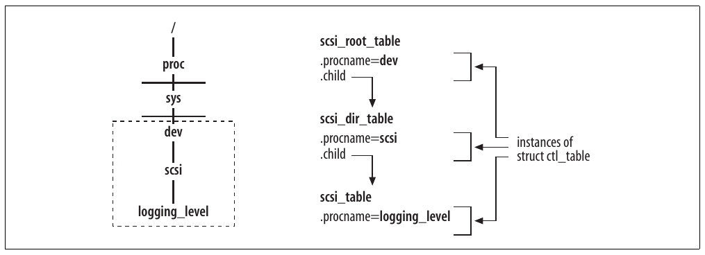
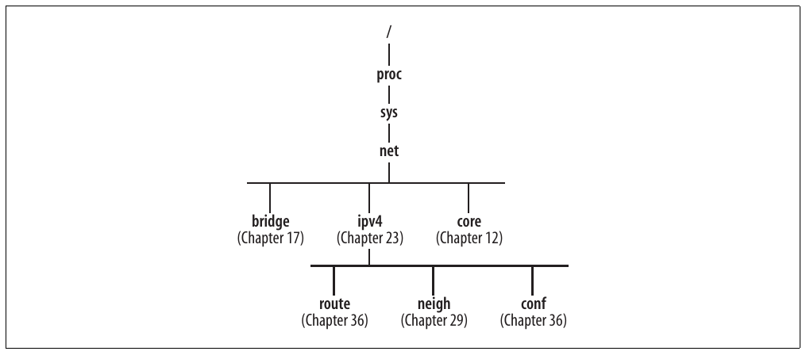
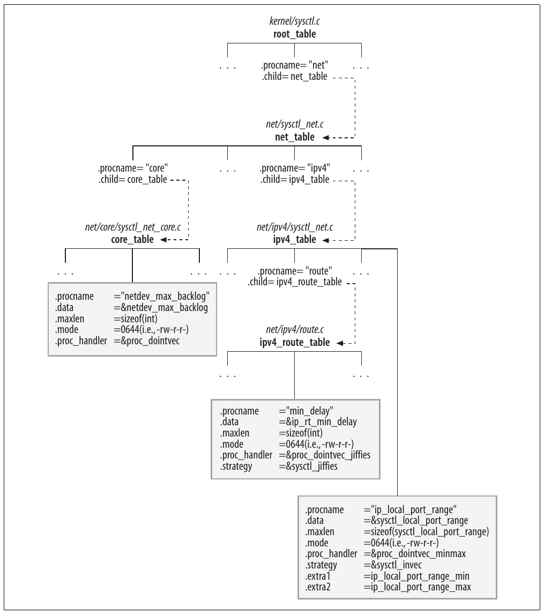
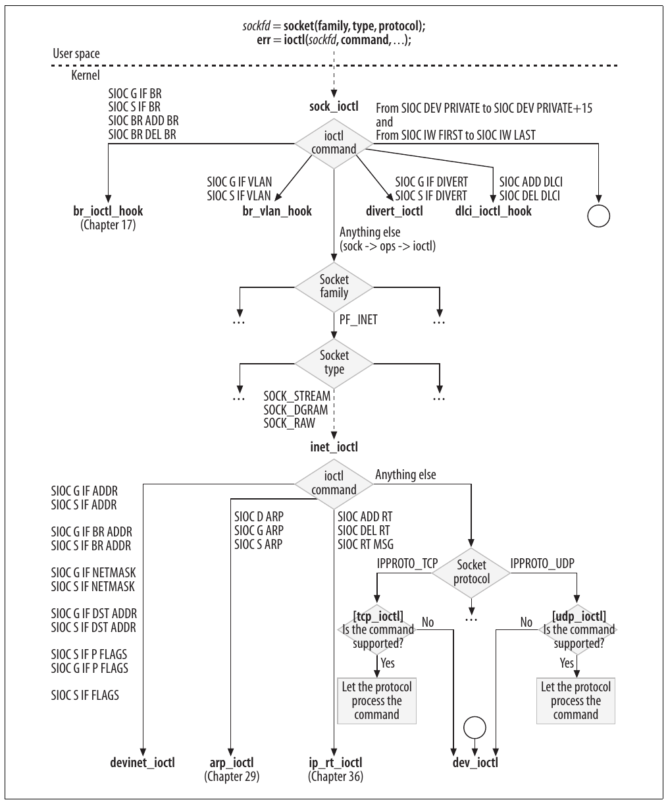

# Chương 3. Interface User-Space-to-Kernel


Trong chương này, tôi sẽ giới thiệu ngắn gọn những cơ chế chính mà application user-space có thể dùng để giao tiếp với kernel hoặc đọc thông tin do kernel export. Chúng ta sẽ không đi vào chi tiết triển khai, vì mỗi cơ chế xứng đáng có một chương riêng. Mục đích là cung cấp đủ chỉ dẫn tới code và tài liệu bên ngoài để bạn tìm hiểu sâu hơn nếu quan tâm. Ví dụ, qua chương này, bạn có thông tin cần thiết để tìm cách và vị trí thêm một directory cụ thể vào /proc, kernel handler xử lý một command `ioctl` cụ thể, cùng các function do Netlink cung cấp — hiện là interface được ưu tiên để cấu hình network từ user-space.

Chương này chỉ tập trung vào những cơ chế tôi sẽ thường đề cập trong sách khi nói về interface giữa configuration command user-space như ifconfig và route với kernel handler áp dụng cấu hình được yêu cầu. Để xem phân tích về các messaging system tổng quát dành cho intrakernel communication cũng như kernel-to-user-space communication, hãy tham khảo Understanding the Linux Kernel (O’Reilly).

Phần thảo luận từng feature trong sách kết thúc bằng một nhóm mục cho thấy cách configuration tool user-space và kernel giao tiếp. Thông tin trong chương này có thể giúp bạn hiểu những mục đó tốt hơn.

## Tổng quan

Kernel export thông tin nội bộ cho user space qua các interface khác nhau. Bên cạnh tập system call truyền thống mà application programmer có thể dùng để yêu cầu thông tin cụ thể, có ba interface đặc biệt, trong đó hai interface là virtual filesystem:

procfs (/proc filesystem) Đây là virtual filesystem, thường được mount tại /proc, cho phép kernel export thông tin nội bộ cho user space dưới dạng file. Các file không thực sự tồn tại trên disk, nhưng có thể đọc bằng cat hoặc more và ghi bằng shell redirector \>; thậm chí có thể gán permission như file thật. Vì vậy, kernel component tạo những file này có thể quy định ai được đọc hoặc ghi từng file. Không thể ghi vào directory (tức không người dùng nào có thể thêm hoặc xóa file hay directory trong bất kỳ directory nào của /proc).

Kernel mặc định đi kèm phần lớn (nếu không phải mọi) Linux distribution có hỗ trợ procfs. Không thể compile nó thành module. Kernel option tương ứng trong configuration menu là “Filesystems ➝ Pseudo filesystems ➝ /proc file system support”.

sysctl (directory /proc/sys) Interface này cho phép user space đọc và sửa giá trị kernel variable. Bạn không thể dùng nó với mọi kernel variable: kernel phải chỉ rõ variable nào hiển thị qua interface. Từ user space, có thể truy cập variable do sysctl export theo hai cách. Một là system call `sysctl` (xem man sysctl), hai là procfs. Khi hỗ trợ procfs, kernel thêm một directory đặc biệt (/proc/sys) vào /proc, chứa một file cho mỗi kernel variable được sysctl export.

Lệnh sysctl đi kèm package procps có thể dùng để cấu hình variable được export bằng sysctl interface. Lệnh giao tiếp với kernel bằng cách ghi vào /proc/sys.

Kernel mặc định đi kèm phần lớn (nếu không phải mọi) Linux distribution có hỗ trợ sysctl. Không thể compile nó thành module. Kernel option tương ứng trong configuration menu là “General setup ➝ Sysctl support”.

sysfs (/sys filesystem) procfs và sysctl đã bị lạm dụng qua nhiều năm, dẫn tới việc đưa vào filesystem mới hơn: sysfs. sysfs export nhiều thông tin theo cách rõ ràng và có tổ chức. Bạn có thể kỳ vọng một phần thông tin hiện được sysctl export sẽ chuyển sang sysfs.

sysfs chỉ có từ kernel 2.6 trở đi. Kernel mặc định đi kèm phần lớn (nếu không phải mọi) Linux distribution có hỗ trợ sysfs. Không thể compile nó thành module. Kernel option tương ứng trong configuration menu là “Filesystems ➝ Pseudo filesystems ➝ sysfs filesystem support (NEW)”. Option chỉ hiển thị nếu trước đó bạn enable option “General setup ➝ Configure standard kernel features (for small systems)”.

Bạn có thể tìm phân tích chi tiết về sysfs trong ấn bản mới nhất của sách Linux Device Drivers do O’Reilly xuất bản. Trong Chương 17, chúng ta sẽ xem cách bridging code sử dụng nó.

Bạn cũng dùng những interface sau để gửi command tới kernel, nhằm cấu hình một thứ hoặc dump cấu hình của thứ khác:

System call `ioctl`

System call `ioctl` (input/output control) hoạt động trên file, thường dùng để triển khai các operation mà special device cần nhưng filesystem call chuẩn không cung cấp. Cũng có thể truyền cho `ioctl` một socket descriptor do system call socket trả về, và networking code sử dụng nó theo cách đó. Interface này được các lệnh old-generation như ifconfig và route cùng những lệnh khác sử dụng.

Netlink socket

Đây là cơ chế mới nhất và được ưu tiên để networking application giao tiếp với kernel. Phần lớn command trong package IPROUTE2 sử dụng nó. Netlink có vai trò với Linux tương tự routing socket trong thế giới BSD.

Phần lớn network kernel feature có thể được cấu hình bằng interface Netlink hoặc `ioctl`, vì kernel hỗ trợ cả configuration tool mới (IPROUTE2) lẫn công cụ cũ (ifconfig, route, v.v.).

## procfs so với sysctl

Cả procfs lẫn sysctl đều export thông tin kernel-internal, nhưng procfs chủ yếu export data read-only, còn phần lớn thông tin sysctl cũng có thể ghi (nhưng chỉ superuser được ghi).

Với việc export data read-only, lựa chọn giữa procfs và sysctl phụ thuộc lượng thông tin cần export. File gắn với kernel variable hoặc data structure đơn giản được export bằng sysctl. Những file khác gắn với data structure phức tạp hơn và có thể cần định dạng đặc biệt được export bằng procfs. Ví dụ của nhóm sau là cache và thống kê.

### procfs

Phần lớn networking feature đăng ký một hoặc nhiều file trong /proc khi được khởi tạo, tại boot time hoặc module load time. Khi người dùng đọc file, kernel gián tiếp chạy một tập kernel function trả về loại output nào đó. Những file do networking code đăng ký nằm trong /proc/net.

Có thể tạo directory trong /proc bằng `proc_mkdir`. Có thể đăng ký và hủy đăng ký file trong /proc/net bằng `proc_net_fops_create` và `proc_net_remove`, định nghĩa trong include/linux/proc\_fs.h. Hai routine này là wrapper quanh generic API `create_proc_entry` và `remove_proc_entry`. Cụ thể, `proc_net_fops_create` đảm nhiệm tạo file (bằng `proc_net_create`) và khởi tạo các file operation handler của nó. Hãy xem ví dụ.

Đây là cách ARP protocol đăng ký file arp trong /proc/net:

```c
static struct file_operations arp_seq_fops = {
    .owner      = THIS_MODULE,
    .open       = arp_seq_open,
    .read       = seq_read,
    .llseek     = seq_lseek,
    .release    = seq_release_private,
};

static int __init arp_proc_init(void)
{
    if (!proc_net_fops_create("arp", S_IRUGO, &arp_seq_fops))
        return -ENOMEM;
    return 0;
}
```

Ba input parameter của `proc_net_fops_create` cho biết tên file là arp, file chỉ được gán read permission, và tập file operation handler là `arp_seq_ops`. Khi người dùng đọc file, việc dùng data structure `file_operations` cho phép procfs trả data cho người dùng theo từng phần. Điều này hữu ích khi data gồm một tập object cùng type. Chẳng hạn ARP cache được trả từng entry, routing table được trả từng route, v.v.

Routine được dùng để khởi tạo `open` (`arp_seq_open` trong ví dụ trước) thực hiện một bước khởi tạo quan trọng khác: đăng ký array function pointer gồm mọi routine mà procfs dùng để duyệt data cần trả cho người dùng: một routine bắt đầu dump, một routine chuyển sang item tiếp theo và một routine dump một item. Những routine đó tự lưu context information cần thiết (trong ví dụ này là đã dump bao nhiêu ARP cache), để nhớ dump đang ở đâu và tiếp tục từ đúng vị trí.

```c
static struct seq_operations arp_seq_ops = {
    .start   = clip_seq_start,
    .next    = neigh_seq_next,
    .stop    = neigh_seq_stop,
    .show    = clip_seq_show,
};

static int arp_seq_open(struct inode *inode, struct file *file)
{
    ...
    rc = seq_open(file, &arp_seq_ops);
    ...
}
```

### sysctl: Directory /proc/sys

Thứ người dùng thấy là file ở đâu đó dưới /proc/sys thực chất là kernel variable. Với mỗi variable, kernel có thể định nghĩa:

- Vị trí đặt trong /proc/sys. Variable gắn với cùng kernel component hoặc feature thường nằm trong cùng directory. Ví dụ, trong /proc/sys/net/ipv4, bạn có thể tìm các file IPv4-related.

- Tên đặt cho nó. Phần lớn thời gian, file đơn giản được đặt cùng tên với kernel variable tương ứng, nhưng đôi khi tên được đổi để thân thiện hơn với người dùng.

- Permission. Chẳng hạn file có thể cho mọi người đọc nhưng chỉ superuser được sửa.

Có thể đọc hoặc ghi nội dung variable được export trong /proc/sys bằng cách truy cập file tương ứng (miễn là bạn có permission cần thiết), hoặc trực tiếp hơn bằng system call sysctl.

Một số directory và file được định nghĩa tĩnh tại boot time; số khác được thêm lúc runtime. Ví dụ về event dẫn tới tạo directory hoặc file lúc runtime gồm:

- Khi kernel module triển khai feature mới hoặc protocol được load hay unload.

- Khi network device mới được đăng ký hoặc hủy đăng ký. Có những configuration parameter (và do đó các file trong /proc/sys) có một instance cho mỗi device. Ví dụ, các directory /proc/sys/net/ipv4/conf (thảo luận trong Chương 36) và /proc/sys/net/ipv4/neigh (thảo luận trong Chương 29) có một subdirectory cho mỗi network device đã đăng ký.

Cả file lẫn directory trong /proc/sys được định nghĩa bằng structure `ctl_table`. Structure `ctl_table` được đăng ký và hủy đăng ký bằng các function `register_sysctl_table` và `unregister_sysctl_table`, định nghĩa trong kernel/sysctl.c.

Sau đây là các field chủ chốt của `ctl_data`:

`const char *procname`

Tên file sẽ được dùng trong /proc/sys.

`int maxlen`

Kích thước kernel variable được export.

`mode_t mode`

Permission gán cho file hoặc directory tương ứng trong /proc/sys.

`ctl_table *child`

Dùng để xây dựng quan hệ parent-child giữa directory và file. Chúng ta sẽ xem ví dụ ở phần sau mục này.

`proc_handler`

Function thực hiện read hoặc write operation khi bạn đọc hoặc ghi file trong /proc/sys. Mọi `ctl_instances` gắn với file (tức leaf của tree) phải được khởi tạo `proc_handler`. Directory được kernel gán routine mặc định.

`strategy`

Function có thể tùy chọn khởi tạo bằng routine thực hiện định dạng bổ sung cho data trước khi hiển thị hoặc lưu. Nó được gọi khi file trong /proc/sys được truy cập bằng system call `sysctl`.

`extra1`

`extra2`

Hai parameter tùy chọn thường dùng để định nghĩa giá trị tối thiểu và tối đa của variable. Tôi sẽ thường gọi chúng là các parameter min/ max.

Tùy loại variable gắn với file, `proc_handler` và `strategy` được khởi tạo khác nhau. Ví dụ, `proc_dointvec` là routine `proc_handler` cần dùng khi kernel variable gồm một hoặc nhiều integer value. Bảng 3-1 và 3-2 liệt kê một số routine có thể dùng để lần lượt khởi tạo `proc_handler` và `strategy`. Mọi routine đều được định nghĩa và có comment đầy đủ trong kernel/sysctl.c.

Bảng 3-1. Các routine khởi tạo proc\_handler

| Function | Mô tả |
|---|---|
| `proc_dostring` | Đọc/ghi string. |
| `proc_dointvec` | Đọc/ghi array gồm một hoặc nhiều integer. |
| `proc_dointvec_minmax` | Tương tự `proc_dointvec`, nhưng bảo đảm input nằm trong khoảng min/max. Giá trị không tuân thủ khoảng bị từ chối. |
| `proc_dointvec_jiffies` | Đọc/ghi array integer. Kernel variable được biểu diễn bằng `jiffies` nhưng chuyển sang giây trước khi trả cho người dùng, và ngược lại. |
| `proc_dointvec_ms_jiffies` | Đọc/ghi array integer. Kernel variable được biểu diễn bằng `jiffies` nhưng chuyển sang millisecond trước khi trả cho người dùng, và ngược lại. |
| `proc_doulongvec_minmax` | Tương tự `proc_dointvec_minmax`, nhưng giá trị có kiểu long thay vì integer. |
| `proc_doulongvec_ms_jiffies_minmax` | Đọc/ghi array long. Kernel variable được biểu diễn bằng `jiffies` nhưng chuyển sang millisecond trước khi trả cho người dùng, và ngược lại. Kernel variable phải được gán giá trị trong khoảng min/max. |

Bảng 3-2. Các routine khởi tạo strategy

| Function | Mô tả |
|---|---|
| `sysctl_string` | Đọc/ghi string |
| `sysctl_intvec` | Đọc/ghi array integer và bảo đảm các giá trị tuân thủ khoảng min/max |
| `sysctl_jiffies` | Đọc/ghi giá trị biểu diễn bằng `jiffies` và chuyển sang giây |
| `sysctl_ms_jiffies` | Đọc/ghi giá trị biểu diễn bằng `jiffies` và chuyển sang millisecond |

Việc function `strategy` hoặc `proc_handler` được khởi tạo bằng routine là wrapper quanh một routine trong Bảng 3-1 hoặc 3-2 không hiếm. Wrapper có thể cần để thêm logic hoặc sanity check phụ thuộc ý nghĩa kernel variable tương ứng. Mục tiếp theo có một ví dụ.

Bất cứ khi nào xem procfs interface để cấu hình một feature được trình bày trong sách, tôi sẽ luôn đề cập function `proc_handler` cho đơn giản.

#### Ví dụ khởi tạo ctl\_table

Trước tiên, hãy xem cách khởi tạo structure `ctl_table` cho file và directory, rồi cách chúng thực sự được sử dụng.

Đây là phần khởi tạo instance `ctl_table` dùng cho file /proc/sys/net/ipv4/conf/default/forwarding, định nghĩa trong net/ipv4/devinet.c. Cách dùng được mô tả trong Chương 36.

```c
  {
      .ctl_name      = NET_IPV4_CONF_FORWARDING,
      .procname      = "forwarding",
      .data          = &ipv4_devconf.forwarding,
      .maxlen        = sizeof(int),
      .mode          = 0644,
      .proc_handler  = &devinet_sysctl_forward,
  }
```

Từ đoạn trích này, bạn chưa thể biết file sẽ được đặt ở đâu trong /proc/sys. Chúng ta sẽ sớm xem cách tìm thông tin đó. Code cho biết tên file là forwarding, kernel variable có giá trị được export qua file forwarding là `ipv4_devconf.forwarding` (field trong một structure phức tạp hơn), parameter được khai báo là integer, permission của file là 0644 (tức mọi người được đọc, chỉ superuser được ghi), và routine `proc_handler` được khởi tạo bằng `devinet_sysctl_forward`.

Bây giờ hãy xem ví dụ khai báo directory trong kernel/sysctl.c:

```c
  {
      .ctl_name    = CTL_NET,
      .procname    = "net",
      .mode        = 0555,
      .child       = net_table,
  }
```

Đây là instance `ctl_table` định nghĩa directory /proc/sys/net. Lần này không cần `proc_handler` (kernel cung cấp routine mặc định phù hợp nhu cầu mọi directory), thay vào đó có field `child`. `child` là pointer tới instance `ctl_table` khác, thực chất chỉ là head element của list các instance `ctl_table` (có một instance cho mỗi file hoặc subdirectory được tạo trong directory net).

##### Đăng ký file trong /proc/sys

Chúng ta đã thấy có thể đăng ký và hủy đăng ký file trong /proc/sys lần lượt bằng `register_sysctl_table` và `unregister_sysctl_table`. Registration function được ghi tài liệu đầy đủ trong source code, yêu cầu hai input parameter:

- Pointer tới một instance `ctl_table`

- Flag cho biết đặt element mới ở đâu trong list các instance `ctl_table` cùng directory: tại head (1) hoặc tail (0). Lưu ý input của `register_sysctl_table` không có reference tới vị trí trong filesystem /proc/sys nơi thêm `ctl_table` đầu vào. Lý do là mọi thao tác chèn đều vào directory /proc/sys. Nếu muốn đăng ký file trong một subdirectory của /proc/sys, bạn cần cung cấp full path bằng cách xây dựng tree (qua nhiều instance `ctl_table` liên kết bằng field `child`) và truyền cho `register_sysctl_table` instance `ctl_table` biểu diễn root của tree đã xây dựng. Những node nào trong tree chưa tồn tại sẽ được tạo.

Hãy xem hai ví dụ, bắt đầu bằng ví dụ đơn giản hơn. Đoạn code từ drivers/scsi/scsi\_sysctl.c cho thấy cách định nghĩa file logging\_level và đặt nó trong directory /proc/sys/dev/scsi/:

```c
static ctl_table scsi_table[] = {
    { .ctl_name     = DEV_SCSI_LOGGING_LEVEL,
      .procname     = "logging_level",
      .data         = &scsi_logging_level,
      .maxlen       = sizeof(scsi_logging_level),
      .mode         = 0644,
      .proc_handler = &proc_dointvec },
    { }
};

static ctl_table scsi_dir_table[] = {
    { .ctl_name    = DEV_SCSI,
      .procname    = "scsi",
      .mode        = 0555,
      .child       = scsi_table },
    { }
};

static ctl_table scsi_root_table[] = {
    { .ctl_name    = CTL_DEV,
      .procname    = "dev",
      .mode        = 0555,
      .child       = scsi_dir_table },
    { }
};

int __init scsi_init_sysctl(void)
{
    scsi_table_header = register_sysctl_table(scsi_root_table, 1) :
}
```

Lưu ý `register_sysctl_table` được truyền `scsi_root_table`, là root của tree `ctl_table` được định nghĩa trong code. Kết quả được thể hiện trong Hình 3-1.

Cũng lưu ý nếu sau đó muốn thêm file khác vào cùng directory — chẳng hạn abc — bạn cần định nghĩa tree tương tự (tức cùng hai instance `ctl_table` cho các directory dev và scsi, cộng một instance `ctl_table` mới cho file abc mới).

Để đơn giản hóa việc thêm file mới vào directory đã tồn tại, đôi khi developer định nghĩa một template rồi dùng lại mỗi khi cần thêm file vào cùng directory. Ưu điểm của template là các instance `ctl_table` dùng để đi qua directory (ví dụ `scsi_root_table` và `scsi_dir_table` trong ví dụ trước) chỉ cần khởi tạo một lần: sau đó, mỗi khi thêm file mới, bạn chỉ khởi tạo leaf node (tức file thực tế). Ví dụ, hãy xem cách neighboring subsystem định nghĩa `neigh_sysctl_template` và dùng nó với `neigh_sysctl_register` trong net/core/neighbour.c (xem thêm Chương 29).



Hình 3-1. Đăng ký file /proc/sys/dev/scsi/logging\_level

##### Các file và directory networking cốt lõi

Hình 3-2 cho thấy những directory chính mà networking code dùng trong /proc/sys. Với từng directory, hình chỉ rõ chương mô tả các file của nó.



Hình 3-2. Các directory cốt lõi trong /proc/sys/net

Dựa trên phần trước, hãy xem cách định nghĩa và đăng ký tree có root tại net lúc boot time.

Với mỗi directory trong Hình 3-2 và mỗi file trong các directory đó, có một instance `ctl_table`. Hình 3-3 cho thấy nơi định nghĩa instance `ctl_table` của phần lớn directory trong Hình 3-2 và các quan hệ child-parent giữa chúng. Không đưa vào tất cả directory để hình dễ đọc hơn.

Ba khung trong Hình 3-3 cho thấy ba ví dụ khởi tạo `ctl_table`. Lưu ý rằng:

- File netdev\_max\_backlog được gán routine `proc_handler` nhưng không có routine `strategy`. Vì `netdev_max_backlog` là integer, input của người dùng được đọc bằng `proc_dointvec`.

- File min\_delay được gán cả routine `proc_handler` lẫn `strategy`. Vì kernel variable `ip_rt_min_delay` được biểu diễn bằng `jiffies`, còn input và output của người dùng tính bằng giây, hai routine đảm nhiệm chuyển giây sang `jiffies`.

- File ip\_local\_port\_range là trường hợp thú vị. Nó cho phép người dùng cấu hình một khoảng, được định nghĩa bằng hai giá trị. Khoảng phải tuân thủ giá trị tối thiểu và tối đa. Vì vậy, các routine `strategy` và `proc_handler` được chọn có thể quản lý array integer value (trong trường hợp này là hai giá trị). Các giá trị `extra1` và `extra2` biểu diễn khoảng và được dùng để bảo đảm input của người dùng tuân thủ khoảng đó.

## ioctl

Ở đầu Hình 3-4, bạn có thể thấy cách thực hiện lời gọi `ioctl`. Hãy xem ví dụ liên quan ifconfig.

Trước đó chúng ta đã nói lệnh ifconfig dùng `ioctl` để giao tiếp với kernel. Ví dụ, khi system administrator gõ lệnh như ifconfig eth0 mtu 1250 để thay MTU của interface eth0, ifconfig mở socket, khởi tạo local data structure bằng thông tin nhận từ system administrator (`data` trong ví dụ) rồi truyền cho kernel bằng lời gọi `ioctl`. `SIOCSIFMTU` là command identifier.

```c
    struct ifreq data;
    fd = socket(PF_INET, SOCK_DGRAM, 0);
    < ... initialize "data" ...>
    err = ioctl(fd, SIOCSIFMTU, &data);
```

Command `ioctl` được kernel xử lý ở nhiều nơi khác nhau. Hình 3-4 cho thấy các command `ioctl` phổ biến nhất mà networking code dùng được `sock_ioctl` phân phối và chuyển tới đúng function handler như thế nào. Chúng ta sẽ không xem cách gọi `sock_ioctl` hay cách transport protocol như UDP và TCP đăng ký handler. Nếu muốn tìm hiểu sâu phần code này, bạn có thể dùng hình làm điểm bắt đầu. Với những routine được sách trình bày, hình cung cấp tham chiếu tới đúng chương.

Tên command `ioctl` trong hình được phân tích (tách thành các thành phần) để bạn tiện theo dõi. Ví dụ, command dùng để thêm route vào routing table, `SIOCADDRT`, được thể hiện thành SIOC ADD RT để nhấn mạnh hai thành phần đáng chú ý: ADD cho biết bạn đang thêm thứ gì đó, còn RT cho biết thứ được thêm là route. Phần lớn command theo cú pháp này. Thông thường, khi có thể vừa đọc vừa ghi một object type, tên command có thêm thành phần: G cho get hoặc S cho set. Hai command thêm và loại bỏ IP address khỏi interface, `SIOCGIFADDR` và `SIOCSIFADDR`, là ví dụ. `SIOCSIFMTU`, đã gặp trong ví dụ ifconfig trước, đặt (S) maximum transport unit (MTU) của interface (IF). `SIOCSIFMTU` do `dev_ioctl` xử lý không xuất hiện trong Hình 3-4.



Hình 3-3. Tạo các directory cốt lõi trong /proc/sys/net



Hình 3-4. Phân phối các command ioctl

Các command `ioctl` networking được liệt kê trong include/linux/sockios.h. Device driver có thể định nghĩa command mới (private) với code trong khoảng từ `SIOCDEVPRIVATE` tới `SIOCDEVPRIVATE`+15. Ví dụ, xem cách định nghĩa bốn private command dùng với tunnel device (ảo) trong include/linux/if\_tunnel.h. Tuy nhiên, dùng private command `ioctl` đã bị deprecated và không được khuyến khích.

Protocol cũng có thể định nghĩa private command trong khoảng từ `SIOCPROTOPRIVATE` tới `SIOCPROTOPRIVATE`+15.

## Netlink

Netlink socket, được mô tả đầy đủ trong RFC 3549, là interface được ưu tiên giữa user space và kernel để cấu hình IP networking. Netlink cũng có thể được dùng làm intrakernel messaging system cũng như giữa nhiều process user-space.

Với Netlink socket, bạn có thể dùng socket API chuẩn để mở, đóng, truyền và nhận trên socket. Hãy nhanh chóng xem lại prototype của system call `socket`:

```c
int socket(int domain, int type, int protocol)
```

Để biết chi tiết cách khởi tạo ba argument với TCP/IP socket (tức domain `PF_INET`), bạn có thể dùng lệnh man socket.

Giống mọi socket khác, khi mở Netlink socket, bạn cần cung cấp các argument `domain`, `type` và `protocol`. Netlink dùng protocol family (domain) mới `PF_NETLINK`, chỉ hỗ trợ type `SOCK_DGRAM` và định nghĩa nhiều protocol, mỗi protocol dùng cho component khác nhau (hoặc tập component) của networking stack. Ví dụ, protocol `NETLINK_ROUTE` được dùng cho phần lớn networking feature như routing và neighboring protocol, còn `NETLINK_FIREWALL` được dùng cho firewall (Netfilter). Các Netlink protocol được liệt kê trong enumeration list `NETLINK_XXX` ở include/linux/netlink.h.

Với Netlink socket, endpoint thường được nhận diện bằng ID của process đã mở socket (PID), trong đó giá trị đặc biệt 0 chỉ kernel. Một feature của Netlink là khả năng gửi cả unicast lẫn multicast message: destination endpoint address có thể là PID, multicast group ID hoặc kết hợp cả hai. Kernel định nghĩa các Netlink multicast group để gửi notification về loại event cụ thể, và user program có thể đăng ký group nếu quan tâm. Các group được liệt kê trong enumeration list `RTMGRP_XXX` ở include/linux/rtnetlink.h. Trong đó có các group `RTMGRP_IPV4_ROUTE` và `RTMGRP_NEIGH`, lần lượt dùng để thông báo thay đổi routing table và address mapping L3-to-L2. Chúng ta sẽ xem cách sử dụng hai group trong Phần VI và VII.

Một feature thú vị khác là khả năng gửi cả positive lẫn negative acknowledgment.

Một ưu điểm của Netlink so với interface user-kernel khác như `ioctl` là kernel có thể chủ động truyền thay vì chỉ trả thông tin để đáp ứng yêu cầu user-space.

## Tuần tự hóa các thay đổi cấu hình

Mỗi khi bạn áp dụng thay đổi cấu hình, handler xử lý thay đổi bên trong kernel acquire một semaphore (`rtnl_sem`), bảo đảm truy cập độc quyền tới các data structure lưu networking configuration. Điều này đúng bất kể cấu hình được áp dụng qua `ioctl` hay Netlink.
