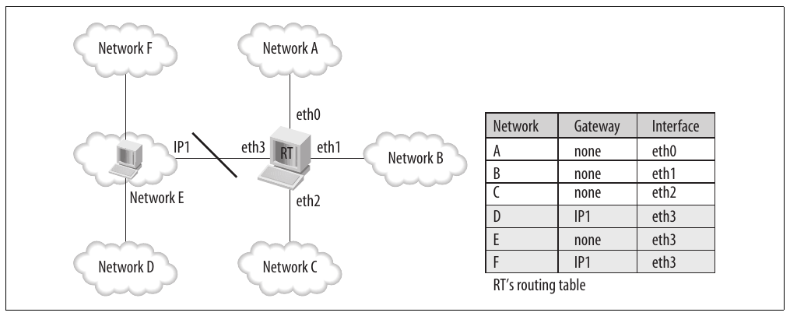
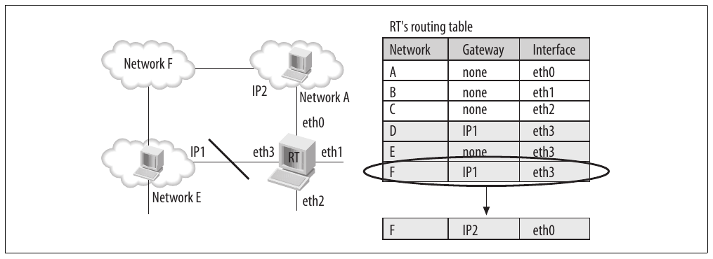
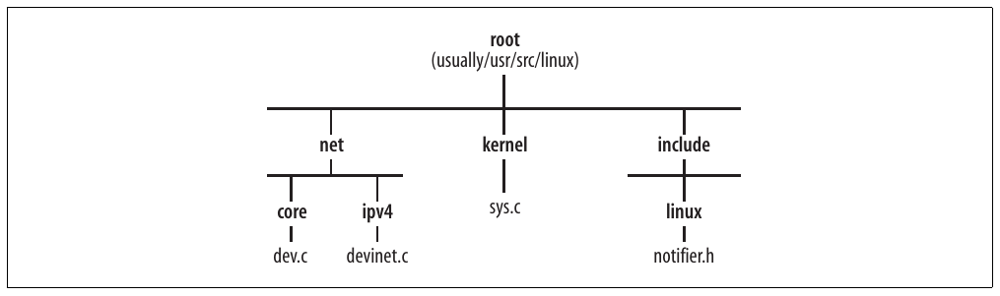

# Chương 4. Notification chain


Nhiều subsystem của kernel phụ thuộc chặt chẽ vào nhau, nên event do một subsystem phát hiện hoặc tạo ra có thể được các subsystem khác quan tâm. Để đáp ứng nhu cầu tương tác, Linux sử dụng so-called notification chain.

Trong chương này, chúng ta sẽ xem:

- Cách khai báo notification chain và những chain được networking code định nghĩa

- Cách kernel subsystem đăng ký với notification chain

- Cách kernel subsystem tạo notification trên chain

Lưu ý notification chain chỉ được dùng giữa các kernel subsystem. Notification giữa kernel và user space dựa vào cơ chế khác, chẳng hạn những cơ chế được giới thiệu trong Chương 3.

## Lý do cần notification chain

Giả sử chúng ta có Linux router trong Hình 4-1 với bốn interface. Hình cho thấy quan hệ giữa router và năm network, cùng phiên bản đơn giản hóa routing table của nó.

Hãy xem một số ví dụ trong topology ở Hình 4-1. Network A kết nối trực tiếp với RT trên interface eth0, còn network F không kết nối trực tiếp với RT, nhưng eth3 của RT kết nối trực tiếp với router khác có interface mang address IP1, và router thứ hai đó biết cách tới network F. Các trường hợp khác tương tự. Tóm lại, một số network kết nối trực tiếp, còn số khác cần sự hỗ trợ của một hoặc nhiều router bổ sung để tới được.

Để biết chi tiết cách routing code xử lý tình huống này, hãy tham khảo Phần VII. Trong chương này, chúng ta tập trung vào vai trò notification chain. Giả sử interface eth3 bị down do network bị đứt, command quản trị (như `ifconfig eth3 down`) hoặc hardware failure. Các network D, E và F sẽ không thể được RT truy cập (cũng như các hệ thống ở A, B và C dựa vào RT để kết nối) và phải bị loại khỏi routing table. Thứ gì sẽ báo cho routing subsystem về lỗi interface đó? Một notification chain.



Hình 4-1. Ví dụ Linux router

Hình 4-2 cho thấy ví dụ phức tạp hơn một chút, trong đó routing subsystem tương tác với dynamic routing protocol — các protocol có thể điều chỉnh routing table hoặc các routing table[^1] theo network topology, nhờ đó ứng phó với interface failure khi topology cho phép (tức khi có path dự phòng).



Hình 4-2. Ví dụ Linux router dùng dynamic routing protocol

Trong Hình 4-2, RT có thể tới network F qua cả network A lẫn network E. Ban đầu E được chọn vì cost nhỏ hơn,<sup>†</sup> nhưng giờ E không còn truy cập được, routing table phải cập nhật route tới network F để đi qua network A. Cơ sở cho quyết định có thể gồm local host event, như đăng ký và hủy đăng ký device, cùng các yếu tố phức tạp trong cấu hình router và routing protocol được dùng. Trong mọi trường hợp, routing subsystem quản lý các table phải được subsystem khác cung cấp thông tin liên quan, cho thấy nhu cầu notification chain.

## Tổng quan

Notification chain đơn giản là list các function cần thực thi khi một event cụ thể xảy ra. Mỗi function cho subsystem khác biết về event đã xảy ra bên trong hoặc được phát hiện bởi subsystem gọi function.

Do đó, mỗi notification chain có phía thụ động (notified) và phía chủ động (notifier), như trong mô hình so-called publish-and-subscribe:

- Notified là các subsystem yêu cầu được thông báo về event và cung cấp callback function để gọi.

- Notifier là subsystem gặp event và gọi callback function.

Các function được thực thi do những subsystem nhận notification chọn. Chủ sở hữu chain (subsystem tạo notification) không bao giờ quyết định function nào được thực thi. Chủ sở hữu chỉ định nghĩa list; bất kỳ kernel subsystem nào cũng có thể đăng ký callback function với chain để nhận notification.

Sử dụng notification chain giúp source code dễ viết và bảo trì hơn. Hãy hình dung một routine tổng quát có thể thông báo event cho subsystem bên ngoài thế nào nếu không dùng notification chain:

```c
If (subsystem_X_enabled) {
    do_something_1
}
if (subsystem_Y_enabled) {
    do_something_2
}
If (subsystem_Z_enabled) {
    do_something_3
}
... ... ...
```

Nói cách khác, cần đưa vào một mệnh đề điều kiện cho mỗi subsystem có thể quan tâm event, và maintainer của subsystem này phải thêm mệnh đề mới mỗi khi người khác thêm subsystem vào kernel.

Không maintainer nào được kỳ vọng phải theo dõi mọi subsystem được thêm vào kernel. Tuy nhiên, mỗi subsystem maintainer nên biết:

- Những loại event từ subsystem khác mà mình quan tâm

- Những loại event mình biết và các subsystem khác có thể quan tâm. Do đó, notification chain cho phép mỗi subsystem chia sẻ việc event xảy ra với các subsystem khác, mà không cần biết chúng là gì và tại sao chúng quan tâm.

## Định nghĩa chain

Các element của list trong notification chain có type `notifier_block`, được định nghĩa như sau:

```c
struct notifier_block
{
    int (*notifier_call)(struct notifier_block *self, unsigned long, void *);
    struct notifier_block *next;
    int priority;
};
```

`notifier_call` là function cần thực thi, `next` dùng để liên kết các element của list, còn `priority` biểu diễn priority của function. Function có priority cao hơn được thực thi trước. Nhưng thực tế, gần như mọi đăng ký đều bỏ `priority` khỏi định nghĩa `notifier_block`, nghĩa là nó nhận giá trị mặc định 0 và thứ tự thực thi cuối cùng chỉ phụ thuộc thứ tự đăng ký (tức thứ tự nửa ngẫu nhiên). Các return value của `notifier_call` được liệt kê trong mục “Thông báo event trên chain” sắp tới.

Tên phổ biến cho instance `notifier_block` là `xxx_chain`, `xxx_notifier_chain` và `xxx_notifier_list`.

## Đăng ký với chain

Khi kernel component quan tâm event của một notification chain, nó có thể đăng ký bằng function tổng quát `notifier_chain_register`. Kernel cũng cung cấp tập wrapper quanh `notifier_chain_register`, một số được thể hiện trong Bảng 4-1.

Bảng 4-1 liệt kê những API chính và wrapper tương ứng dùng để đăng ký và hủy đăng ký với ba chain `inetaddr_chain`, `inet6addr_chain` và `netdev_chain`.

Bảng 4-1. Những function chính và wrapper cho một số chain

| Thao tác | Function prototype |
|---|---|
| Đăng ký | `int notifier_chain_register(struct notifier_block **list, struct notifier_block *n)` |
|  | Wrappers |
|  | `inetaddr_chain register_inetaddr_notifier` |
|  | `inet6addr_chain register_inet6addr_notifier` |
|  | `netdev_chain register_netdevice_notifier` |
| Hủy đăng ký | `int notifier_chain_unregister(struct notifier_block **nl, struct notifier_block *n)` |
|  | Wrappers |
|  | `inetaddr_chain unregister_inetaddr_notifier` |
|  | `inet6addr_chain unregister_inet6addr_notifier` |
|  | `netdev_chain unregister_netdevice_notifier` |
| Gửi notification | `int notifier_call_chain(struct notifier_block **n, unsigned long val, void *v)` |

Với mỗi chain, các instance `notifier_block` được chèn vào list sắp xếp theo priority. Các element có cùng priority được sắp xếp theo thời điểm chèn: element mới vào tail.

Truy cập notification chain được bảo vệ bằng lock `notifier_lock`. Dùng một lock cho tất cả notification chain không phải hạn chế lớn và không ảnh hưởng hiệu năng, vì subsystem thường chỉ đăng ký function `notifier_call` tại boot time hoặc module load time, rồi từ đó truy cập list theo cách read-only (tức chia sẻ).

Vì function `notifier_chain_register` được gọi để chèn callback vào mọi list, nó yêu cầu chỉ định list bằng input parameter. Tuy nhiên, function hiếm khi được gọi trực tiếp; thay vào đó dùng generic wrapper.

```c
int notifier_chain_register(struct notifier_block **list, struct notifier_block *n)
{
    write_lock(&notifier_lock);
    while(*list)
    {
        if(n->priority > (*list)->priority)
            break;
        list= &((*list)->next);
    }
    n->next = *list;
    *list=n;
    write_unlock(&notifier_lock);
    return 0;
}
```

## Thông báo event trên chain

Notification được tạo bằng `notifier_call_chain`, định nghĩa trong kernel/sys.c. Function chỉ đơn giản gọi mọi callback routine đã đăng ký với chain theo thứ tự priority. Lưu ý callback routine thực thi trong context của process gọi `notifier_call_chain`. Tuy nhiên, có thể triển khai callback routine để enqueue notification ở đâu đó rồi wake up một process sẽ xem xét nó.

```c
int notifier_call_chain(struct notifier_block **n, unsigned long val, void *v)
{
    int ret = NOTIFY_DONE;
    struct notifier_block *nb = *n;

    while (nb)
    {
        ret = nb->notifier_call(nb, val, v);
        if (ret & NOTIFY_STOP_MASK)
        {
            return ret;
        }
        nb = nb->next;
    }
    return ret;
}
```

Sau đây là ý nghĩa ba input parameter:

`n`

Notification chain.

`val`

Event type. Bản thân chain xác định một nhóm event; `val` xác định rõ một event type (tức `NETDEV_REGISTER`).

`v`

Input parameter có thể được handler do các client khác nhau đăng ký sử dụng. Nó có thể được dùng theo nhiều cách tùy hoàn cảnh. Ví dụ, khi network device mới được đăng ký với kernel, notification tương ứng dùng `v` để xác định data structure `net_device`.

Callback routine được `notifier_call_chain` gọi có thể trả về bất kỳ giá trị `NOTIFY_XXX` nào định nghĩa trong include/linux/notifier.h:

`NOTIFY_OK`

Notification được xử lý đúng.

`NOTIFY_DONE`

Không quan tâm notification.[^2]

`NOTIFY_BAD`

Đã xảy ra lỗi. Dừng gọi callback routine cho event này.

`NOTIFY_STOP`

Routine được gọi đúng. Tuy nhiên, không cần gọi thêm callback nào cho event này.

`NOTIFY_STOP_MASK`

Flag được `notifier_call_chain` kiểm tra để biết nên dừng gọi callback routine hay tiếp tục. Cả `NOTIFY_BAD` và `NOTIFY_STOP` đều đưa flag này vào định nghĩa của chúng.

`notifier_call_chain` ghi nhận và trả về return value nhận từ callback routine cuối cùng được gọi. Điều này đúng bất kể mọi callback đã được gọi hay một callback ngắt vòng lặp do return value là `NOTIFY_BAD` hoặc `NOTIFY_STOP`.

Lưu ý `notifier_call_chain` có thể được gọi đồng thời cho cùng notification chain trên các CPU khác nhau. Callback function có trách nhiệm bảo đảm mutual exclusion và serialization khi cần.

## Notification chain cho các networking subsystem

Kernel định nghĩa ít nhất 10 notification chain khác nhau. Ở đây, chúng ta quan tâm các chain dùng để báo event đặc biệt quan trọng với networking code. Những chain chính gồm:

`inetaddr_chain`

Gửi notification về việc thêm, loại bỏ và thay đổi Internet Protocol Version 4 (IPv4) address trên local interface. Chương 23 mô tả khi nào các notification đó được tạo. Internet Protocol Version 6 (IPv6) dùng chain tương tự (`inet6addr_chain`).

`netdev_chain`

Gửi notification về trạng thái đăng ký network device. Chương 8 mô tả khi nào các notification đó được tạo.

Với những chain này và các chain khác mà networking subsystem sử dụng, mục đích và cách dùng được mô tả trong chương về notifier subsystem tương ứng.

Networking code cũng có thể đăng ký nhận notification do kernel component khác tạo. Ví dụ, một số NIC device driver đăng ký với chain `reboot_notifier_list`, cảnh báo khi hệ thống sắp reboot.

### Wrapper

Phần lớn notification chain có tập wrapper dùng để đăng ký và hủy đăng ký với chúng. Ví dụ, đây là wrapper dùng để đăng ký với `netdev_chain`:

```c
int register_netdevice_notifier(struct notifier_block *nb)
{
        return notifier_chain_register(&netdev_chain, nb);
}
```

Tên wrapper phổ biến gồm \[`un`\]`register_xxx_notifier`, `xxx_`\[`un`\]`register_notifier` và `xxx_`\[`un`\]`register`.

### Ví dụ

Đăng ký với notification chain thường diễn ra khi kernel component quan tâm được khởi tạo. Ví dụ, đoạn trích sau từ net/ipv4/fib\_ frontend.c cho thấy `ip_fib_init`, initialization routine được routing code sử dụng, mô tả trong mục “Khởi tạo routing subsystem” ở Chương 32:

```c
static struct notifier_block fib_inetaddr_notifier = {
    .notifier_call = fib_inetaddr_event,
};

static struct notifier_block fib_netdev_notifier = {
    .notifier_call = fib_netdev_event,
};

void __init ip_fib_init(void)
{
    ... ... ...
    register_netdevice_notifier(&fib_netdev_notifier);
    register_inetaddr_notifier(&fib_inetaddr_notifier);
}
```

Routing code đăng ký với cả hai chain được giới thiệu trong mục “Notification chain cho các networking subsystem” phía trước. Routing table chịu ảnh hưởng của cả thay đổi IP address cấu hình cục bộ lẫn thay đổi trạng thái đăng ký local device.

## Điều chỉnh qua /proc filesystem

Không có file nào trong /proc đáng quan tâm đối với nội dung chương này.

## Các function và variable được trình bày trong chương

Bảng 4-2 tóm tắt các function và data structure được giới thiệu trong chương.

Bảng 4-2. Function, macro và data structure dùng cho notification chain

| Tên function và macro | Mô tả |
|---|---|
| `notifier_chain_register` + wrapper `notifier_chain_unregister` + wrapper `notifier_call_chain` | Hai function đầu đăng ký và hủy đăng ký callback handler cho notification chain. Function thứ ba gửi mọi notification về event trong một nhóm cụ thể. |
| Data structure |  |
| `struct notifier_block` | Định nghĩa handler cho notification. Nó gồm callback function cần gọi. |

## Các file và directory được trình bày trong chương

Hình 4-3 liệt kê các file được tham chiếu trong chương.



Hình 4-3. Các file liên quan notification chain

[^1]: Có thể có nhiều routing table cùng lúc. Chúng ta sẽ trình bày feature này trong Chương 31. † Cost của link là một metric mà routing protocol có thể dùng để so sánh và lựa chọn link. Xem Chương 30.

[^2]: Return value này đôi khi được dùng không đúng thay cho `NOTIFY_OK`.
