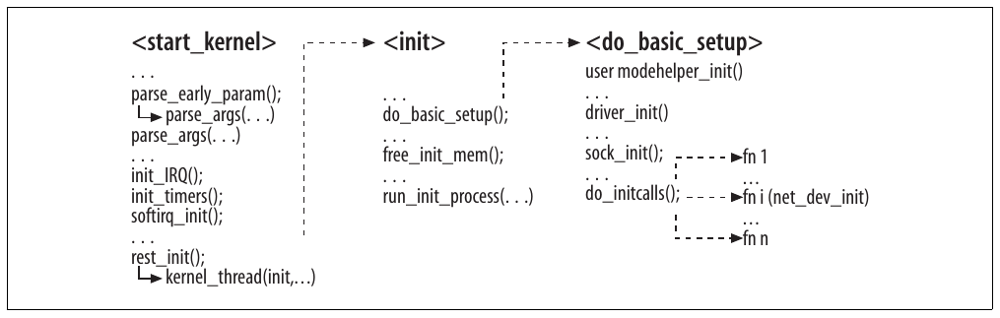
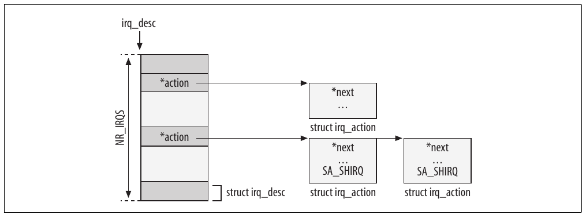
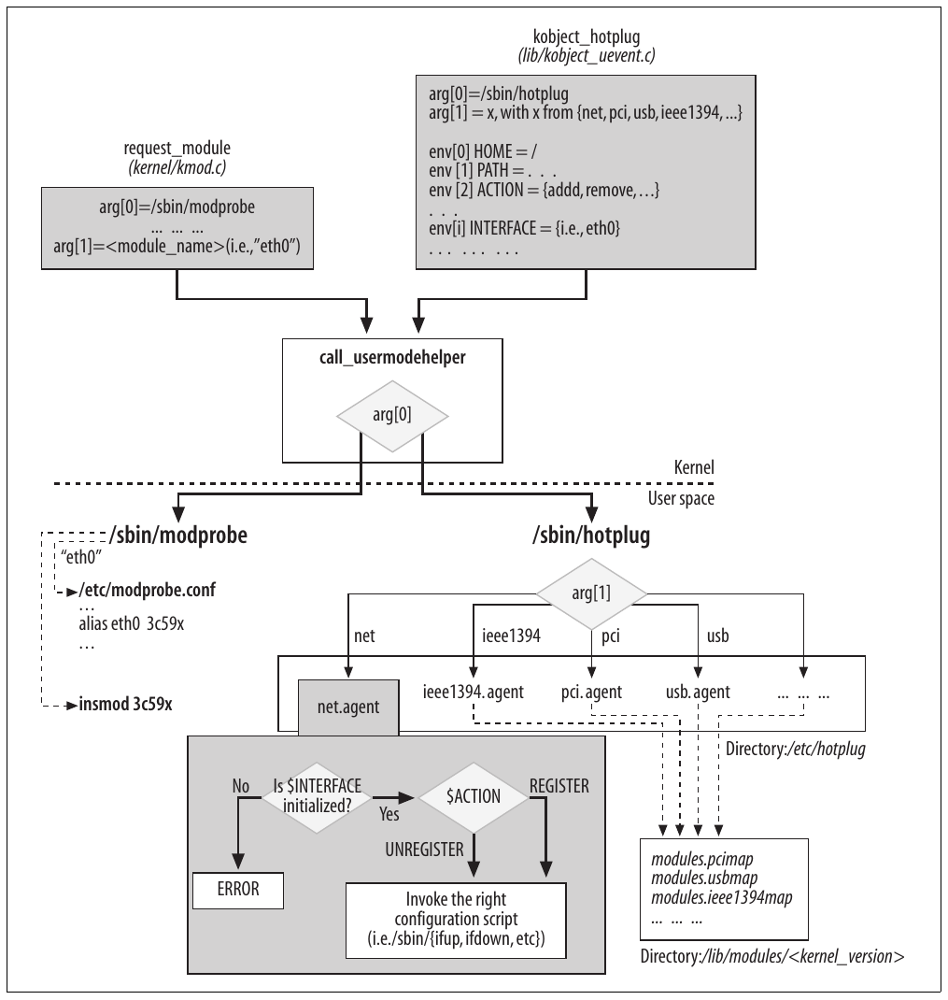
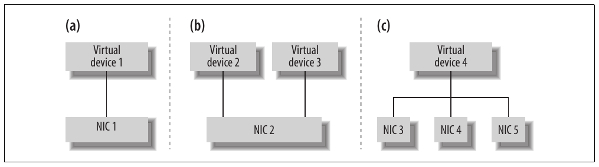
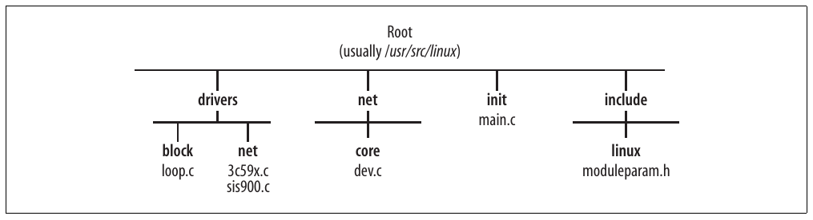

# Chương 5. Khởi tạo network device


Tính linh hoạt của hệ điều hành hiện đại làm quá trình khởi tạo phức tạp hơn. Trước hết, device driver có thể được load dưới dạng module hoặc component tĩnh của kernel. Hơn nữa, device có thể hiện diện tại boot time hoặc được cắm vào (và tháo ra) lúc runtime: loại sau, gọi là device hot-pluggable, gồm USB, PCI CardBus, IEEE 1394 (còn được Apple gọi là FireWire) và các loại khác. Chúng ta sẽ xem hot-plugging ảnh hưởng thế nào tới hoạt động trong cả kernel lẫn user space.

Trong chương đầu tiên này, chúng ta sẽ trình bày:

- Một phần khởi tạo core networking code.

- Khởi tạo NIC.

- Cách NIC dùng interrupt và cách cấp phát, giải phóng IRQ handler. Chúng ta cũng xem cách driver chia sẻ IRQ.

- Cách người dùng cung cấp configuration parameter cho device driver được load dưới dạng module.

- Tương tác giữa user space và kernel trong quá trình khởi tạo, cấu hình device. Chúng ta sẽ xem cách kernel chạy helper user-space để load đúng device driver cho NIC hoặc áp dụng cấu hình user-space. Cụ thể, chúng ta sẽ xem Hotplug feature.

- Khác biệt giữa virtual device và real device về cấu hình và tương tác với kernel.

## Tổng quan khởi tạo hệ thống

Cần biết nơi và cách khởi tạo những subsystem network-related chính, gồm device driver. Tuy nhiên, vì sách chỉ quan tâm khía cạnh networking của quá trình khởi tạo, tôi sẽ không trình bày device driver nói chung hay generic kernel service (ví dụ memory management). Để hiểu nền tảng đó, tôi khuyến nghị đọc Linux Device Drivers và Understanding the Linux Kernel, đều do O’Reilly xuất bản.

Hình 5-1 cho thấy ngắn gọn vị trí và trình tự khởi tạo một số kernel subsystem tại boot time (xem init/main.c).



Hình 5-1. Khởi tạo kernel

Khi boot, kernel thực thi `start_kernel`, khởi tạo nhiều subsystem, được thể hiện một phần trong Hình 5-1. Trước khi kết thúc, `start_kernel` gọi kernel thread `init`, đảm nhiệm các bước khởi tạo còn lại. Phần lớn hoạt động khởi tạo liên quan chương này nằm trong `do_basic_setup`.

Trong các công việc khởi tạo, chúng ta chủ yếu quan tâm ba việc:

Các option Boot-time

Hai lời gọi `parse_args`, một trực tiếp và một gián tiếp qua `parse_early_param`, xử lý configuration parameter mà boot loader như LILO hoặc GRUB truyền cho kernel tại boot time. Chúng ta sẽ xem cách xử lý trong mục “Các kernel option Boot-Time”.

Interrupt và timer

Hardware interrupt và software interrupt lần lượt được khởi tạo bằng `init_IRQ` và `softirq_init`. Interrupt được trình bày trong Chương 9. Trong chương này, chúng ta chỉ xem cách device driver đăng ký handler với IRQ và cách tổ chức IRQ handler trong memory. Timer cũng được khởi tạo sớm trong boot process để những công việc sau có thể sử dụng.

Các initialization routine

Kernel subsystem và device driver built-in được `do_initcalls` khởi tạo. `free_init_mem` giải phóng vùng memory chứa code không còn cần. Tối ưu hóa này thực hiện được nhờ cách gắn tag thông minh cho routine. Xem Chương 7 để biết thêm chi tiết.

`run_init_process` xác định process chạy đầu tiên trên hệ thống, parent của mọi process khác; nó có PID bằng 1 và không dừng cho tới khi hệ thống kết thúc hoạt động. Thông thường chương trình được chạy là init, thuộc package SysVinit. Tuy nhiên, administrator có thể chỉ định chương trình khác qua boot time option `init=`. Khi không có option đó, kernel thử thực thi lệnh init từ một tập vị trí well-known và panic nếu không tìm thấy. Người dùng cũng có thể cung cấp option boot-time để truyền cho init (xem mục “Các kernel option Boot-Time”).

## Đăng ký và khởi tạo device

Để sử dụng được network device, kernel phải nhận diện nó và gắn với driver đúng. Driver lưu trong private data structure mọi thông tin cần để điều khiển device và tương tác với các kernel component khác cần device đó. Công việc đăng ký và khởi tạo một phần do core kernel, một phần do device driver đảm nhiệm. Hãy xem các giai đoạn khởi tạo:

Khởi tạo hardware

Device driver phối hợp với generic bus layer (ví dụ PCI hoặc USB) để thực hiện. Đôi khi driver tự làm, đôi khi nhờ parameter do người dùng cung cấp, cấu hình các feature của từng device như IRQ và I/O address để có thể tương tác với kernel. Vì hoạt động này gần device driver hơn protocol và feature higher-layer, chúng ta sẽ không dành nhiều thời gian cho nó. Chúng ta sẽ xem một ví dụ về PCI layer.

Khởi tạo software

Trước khi dùng device, tùy network protocol được enable và cấu hình, người dùng có thể cần cung cấp configuration parameter khác, chẳng hạn IP address. Công việc này được trình bày trong những chương khác.

Khởi tạo feature

Linux kernel có nhiều networking option. Vì một số cần cấu hình per-device, boot sequence khởi tạo device phải xử lý chúng. Một ví dụ là Traffic Control, subsystem triển khai Quality of Service (QoS) và do đó quyết định cách packet được enqueue vào và dequeue khỏi egress queue của device (và, với một số hạn chế, cả enqueue vào và dequeue khỏi ingress queue).

Trong Chương 2, chúng ta đã thấy data structure `net_device` gồm tập function pointer mà kernel dùng để tương tác với device driver và kernel feature đặc biệt. Khởi tạo những function này một phần phụ thuộc device type (ví dụ Ethernet), một phần phụ thuộc hãng và model của device. Do Ethernet phổ biến, chương này tập trung khởi tạo Ethernet device (nhưng các device khác được xử lý rất tương tự).

Chương 8 đi sâu hơn về cách device driver đăng ký device với networking code.

## Mục tiêu cơ bản của khởi tạo NIC

Mỗi network device được biểu diễn trong Linux kernel bằng một instance của data structure `net_device`. Trong Chương 8, bạn sẽ thấy cách cấp phát data structure `net_device` và khởi tạo field, một phần bởi device driver và một phần bởi core kernel routine. Trong chương này, chúng ta tập trung cách device driver cấp phát resource cần để thiết lập giao tiếp device/kernel, chẳng hạn:

IRQ line

Như bạn sẽ thấy trong mục “Tương tác giữa device và kernel”, NIC cần được gán IRQ và dùng nó để thu hút sự chú ý của kernel khi cần. Tuy nhiên, virtual device không cần được gán IRQ: loopback device là ví dụ vì hoạt động hoàn toàn nội bộ (xem mục “Virtual device” ở phần sau).

Hai function dùng để yêu cầu và giải phóng IRQ line được giới thiệu trong mục “Hardware interrupt” ở phần sau. Như bạn sẽ thấy trong mục “Điều chỉnh qua /proc filesystem” phía sau, có thể dùng file /proc/interrupts để xem trạng thái các phép gán hiện tại.

Đăng ký I/O port và memory

Driver thường map một vùng memory của device (ví dụ configuration register) vào system memory để read/write operation của driver được thực hiện trực tiếp trên system memory address; điều này có thể đơn giản hóa code. I/O port và memory lần lượt được đăng ký và giải phóng bằng `request_region` và `release_region`.

## Tương tác giữa device và kernel

Gần như mọi device (gồm NIC) tương tác với kernel theo một trong hai cách:

Polling

Do phía kernel chủ động. Kernel kiểm tra device status định kỳ để biết device có điều gì cần báo hay không.

Interrupt

Do phía device chủ động. Device gửi hardware signal (bằng cách tạo interrupt) tới kernel khi cần kernel chú ý.

Trong Chương 9, bạn có thể tìm thảo luận chi tiết về các phương án thiết kế NIC driver cũng như software interrupt. Bạn cũng sẽ thấy Linux kết hợp polling và interrupt thế nào để tăng hiệu năng. Trong chương này, chúng ta chỉ xem trường hợp interrupt-based.

Tôi không đi sâu cách hardware báo interrupt, khác biệt giữa hardware exception và device interrupt, cách thiết kế driver và bus kernel infrastructure, v.v.; bạn có thể tham khảo Linux Device Drivers và Understanding the Linux Kernel về những chủ đề đó. Nhưng tôi sẽ tóm tắt interrupt để giúp bạn hiểu cách device driver khởi tạo và đăng ký những device mình phụ trách, đặc biệt chú ý khía cạnh networking.

### Hardware interrupt

Bạn không cần biết nền tảng low-level về cách xử lý hardware interrupt. Tuy nhiên, có những chi tiết đáng đề cập vì chúng giúp hiểu dễ hơn cách viết NIC device driver, và từ đó cách chúng tương tác với networking layer phía trên.

Mỗi interrupt chạy function gọi là interrupt handler, phải được viết phù hợp device và do đó được device driver cài đặt. Thông thường, khi đăng ký NIC, device driver yêu cầu và gán IRQ. Sau đó nó đăng ký và (nếu driver được unload) hủy đăng ký handler cho IRQ cụ thể bằng hai function architecture-dependent sau. Chúng được định nghĩa trong kernel/irq/manage.c và được ghi đè bởi function architecture-specific trong arch/`XXX`/kernel/irq.c, trong đó `XXX` là directory architecture-specific:

`int request_irq(unsigned int irq, void (*handler)(int, void*, struct`

`pt_regs*), unsigned long irqflags, const char * devname, void *dev_id)`

Function này đăng ký handler, trước hết bảo đảm interrupt được yêu cầu là hợp lệ và chưa được cấp phát cho device khác, trừ khi cả hai device hiểu shared IRQ (xem mục “Chia sẻ interrupt” ở phần sau).

`void free_irq(unsigned_int irq, void *dev_id)`

Với device được `dev_id` xác định, function này loại handler và disable IRQ line nếu không còn device nào đăng ký IRQ đó. Lưu ý để xác định handler, kernel cần cả IRQ number lẫn device identifier. Điều này đặc biệt quan trọng với shared IRQ, như giải thích trong mục “Chia sẻ interrupt” phía sau.

Khi nhận interrupt notification, kernel dùng IRQ number để tìm handler của driver rồi thực thi handler đó. Để tìm handler, kernel lưu liên hệ giữa IRQ number và function handler trong global table. Liên hệ có thể là one-to-one hoặc one-to-many, vì Linux kernel cho phép nhiều device dùng chung IRQ, một feature được mô tả trong mục “Chia sẻ interrupt” phía sau.

Trong các mục tiếp theo, bạn sẽ thấy ví dụ phổ biến về thông tin trao đổi giữa device và driver thông qua interrupt, và cách nhiều device có thể chia sẻ IRQ dưới những điều kiện nhất định.

#### Các interrupt type

Thông qua interrupt, NIC có thể báo cho driver nhiều điều khác nhau. Trong đó có:

Nhận frame

Đây là tình huống phổ biến và tiêu chuẩn nhất.

Truyền thất bại

Loại notification này chỉ được tạo trên Ethernet device sau khi feature exponential binary backoff đã thất bại (feature được NIC triển khai ở hardware level). Lưu ý driver không chuyển notification này lên network layer cao hơn; chúng sẽ biết thất bại qua cơ chế khác (timer timeout, negative ACK, v.v.).

DMA transfer đã hoàn tất thành công

Với một frame cần gửi, buffer giữ nó được driver giải phóng sau khi frame đã được đưa vào memory của NIC để truyền trên medium. Với synchronous transmission (không DMA), driver biết ngay khi frame đã được đưa vào NIC. Nhưng với DMA dùng asynchronous transmission, device driver cần chờ interrupt tường minh từ NIC. Bạn có thể tìm ví dụ cho từng trường hợp tại những chỗ `dev_kfree_skb`[^1] được gọi trong driver code drivers/net/3c59x.c (DMA) và drivers/net/3c509.c (non-DMA).

Device có đủ memory để xử lý lần truyền mới

NIC device driver thường disable truyền bằng cách dừng egress queue khi queue không còn đủ chỗ trống chứa frame có kích thước tối đa (ví dụ 1.536 byte cho Ethernet NIC). Queue sau đó được re-enabled khi có memory. Phần còn lại của mục này đi sâu trường hợp đó.

Trường hợp cuối trong danh sách trước mô tả cách giới hạn truyền tinh vi, có thể tăng hiệu quả nếu thực hiện đúng. Trong cơ chế này, device driver disable truyền vì thiếu không gian queueing, yêu cầu NIC phát interrupt khi memory khả dụng vượt một mức nhất định (thường là Maximum Transmission Unit, hay MTU, của device), rồi re-enables việc truyền khi interrupt tới.

Device driver cũng có thể disable egress queue trước lần truyền (để ngăn kernel tạo yêu cầu truyền khác trên device), và chỉ re-enable khi NIC còn đủ memory trống; nếu không, device yêu cầu interrupt cho phép tiếp tục truyền sau đó. Đây là ví dụ của logic này, lấy từ routine `el3_start_xmit` mà driver drivers/net/3c509.c cài làm function `hard_start_xmit`<sup>†</sup> trong structure `net_device`:

```c
static int
el3_start_xmit(struct sk_buff *skb, struct net_device *dev)
{
    ... ... ...
    netif_stop_queue (dev);
    ... ... ...
    if (inw(ioaddr + TX_FREE) > 1536)
        netif_start_queue(dev);
    else
        outw(SetTxThreshold + 1536, ioaddr + EL3_CMD);
    ... ... ...
}
```

Driver dừng device queue bằng `netif_stop_queue`, ngăn kernel gửi thêm yêu cầu truyền. Sau đó driver kiểm tra memory của device có đủ chỗ trống cho packet 1.536 byte hay không. Nếu đủ, driver khởi động queue để kernel lại được gửi yêu cầu truyền; nếu không, nó chỉ thị device (bằng cách ghi configuration register qua lời gọi `outw`) tạo interrupt khi điều kiện đó được đáp ứng. Interrupt handler sau đó re-enable device queue bằng `netif_start_queue` để kernel có thể bắt đầu truyền lại.

Các routine `netif_xxx_queue` được mô tả trong mục “Enable và disable truyền” ở Chương 11.

##### Chia sẻ interrupt

IRQ line là resource có giới hạn. Cách đơn giản để tăng số device mà hệ thống có thể hỗ trợ là cho nhiều device chia sẻ cùng IRQ. Thông thường, mỗi driver đăng ký handler riêng với kernel cho IRQ đó. Thay vì nhận interrupt notification, tìm đúng device và gọi handler của nó, kernel chỉ đơn giản gọi mọi handler của các device đã đăng ký cùng shared IRQ. Handler có trách nhiệm lọc các lời gọi không liên quan, chẳng hạn bằng cách đọc register trên device của mình.

Để một nhóm device chia sẻ IRQ line, tất cả phải có device driver xử lý được shared IRQ. Nói cách khác, mỗi lần device đăng ký IRQ line, nó cần nói rõ có hỗ trợ interrupt sharing hay không. Ví dụ, device đầu tiên đăng ký IRQ, với yêu cầu như “gán cho tôi IRQ n và dùng routine fn này làm handler”, cũng phải chỉ rõ có sẵn lòng chia sẻ IRQ với device khác không. Khi device driver khác cố đăng ký cùng IRQ number, nó bị từ chối nếu chính nó hoặc driver hiện được gán IRQ không thể chia sẻ IRQ.

##### Tổ chức mapping từ IRQ tới handler

Mapping từ IRQ tới handler được lưu trong một vector các list, mỗi IRQ có một list handler (xem Hình 5-2). List chỉ có nhiều hơn một element khi nhiều device dùng chung IRQ. Kích thước vector (tức số IRQ number có thể có) phụ thuộc architecture, có thể thay đổi từ 15 (trên x86) tới hơn 200. Nhờ interrupt sharing, hệ thống còn có thể hỗ trợ đồng thời nhiều device hơn nữa.

Mục “Hardware interrupt” đã giới thiệu hai function kernel cung cấp để lần lượt đăng ký và hủy đăng ký handler. Bây giờ hãy xem data structure lưu mapping.

Mapping được định nghĩa bằng data structure `irqaction`. Function `request_irq` giới thiệu trong mục “Hardware interrupt” phía trước là wrapper quanh `setup_irq`, nhận structure `irqaction` làm input và chèn vào global vector `irq_desc`. `irq_desc` được định nghĩa trong kernel/irq/handler.c và có thể bị ghi đè trong các file per-architecture arch/`XXX`/kernel/irq.c. `setup_irq` được định nghĩa trong kernel/irq/manage.c và có thể bị ghi đè trong các file per-architecture arch/`XXX`/kernel/irq.c.

Kernel function xử lý interrupt và chuyển chúng cho driver phụ thuộc architecture. Trên phần lớn architecture, nó được gọi là `handle_IRQ_event`.

Hình 5-2 cho thấy cách lưu instance `irqaction`: có một instance `irq_desc` cho mỗi IRQ có thể có và một instance `irqaction` cho mỗi IRQ handler đăng ký thành công. Vector các instance `irq_desc` cũng có tên `irq_desc`, và kích thước do symbol architecture-dependent `NR_IRQS` quy định.

Lưu ý khi có nhiều hơn một instance `irqaction` cho một IRQ number cụ thể (tức một element cụ thể của vector `irq_desc`), cần interrupt sharing (mỗi structure phải đặt flag `SA_SHIRQ`).



Hình 5-2. Tổ chức IRQ handler

Bây giờ hãy xem thông tin nào về IRQ handler được lưu trong các field của data structure `irqaction`:

`void (*handler)(int irq, void *dev_id, struct pt_regs *regs)`

Function do device driver cung cấp để xử lý interrupt notification: mỗi khi kernel nhận interrupt trên line `irq`, nó gọi `handler`. Sau đây là input parameter của function:

`int irq`

IRQ number tạo notification. Phần lớn thời gian, NIC device driver không dùng nó để thực hiện công việc; device ID đã đủ.

`void *dev_id`

Device identifier. Cùng driver có thể phụ trách nhiều device đồng thời, nên cần device ID để xử lý notification đúng.

`struct pt_regs *regs`

Structure dùng để lưu nội dung processor register tại thời điểm interrupt ngắt current process. Interrupt handler thường không dùng structure này.

`unsigned long flags`

Tập flag. Các giá trị `SA_XXX` có thể có được định nghĩa trong include/asm-XXX/signal.h. Sau đây là những giá trị chính từ file cho architecture x86:

`SA_SHIRQ`

Khi được đặt, device driver có thể xử lý shared IRQ.

`SA_SAMPLE_RANDOM`

Khi được đặt, device tự cung cấp làm nguồn random event. Điều này có thể giúp kernel tạo random number dùng nội bộ, được gọi là đóng góp vào system entropy. Nội dung được mô tả thêm trong mục “Khởi tạo device handling layer: net\_dev\_init” ở phần sau.

`SA_INTERRUPT`

Khi được đặt, handler chạy với interrupt bị disable trên local processor. Chỉ nên chỉ định cho handler hoàn tất rất nhanh. Xem một instance của `handle_IRQ_event` để có ví dụ (chẳng hạn /kernel/irq/handle.c).

Có các giá trị khác, nhưng chúng đã lỗi thời hoặc chỉ được architecture cụ thể sử dụng.

`void *dev_id`

Pointer tới data structure `net_device` gắn với device. Lý do khai báo `void *` là NIC không phải device duy nhất dùng IRQ. Vì các device type dùng data structure khác nhau để nhận diện và biểu diễn device instance, một generic type declaration được sử dụng.

`struct irqaction *next`

Mọi device dùng chung IRQ number được liên kết trong list bằng pointer này.

`const char *name`

Tên device. Bạn có thể đọc bằng cách dump nội dung /proc/interrupts.

## Các initialization option

Có thể truyền input parameter cho cả component built vào kernel lẫn component load dưới dạng module, để người dùng fine-tune chức năng do component triển khai, ghi đè giá trị mặc định compile sẵn hoặc thay đổi chúng giữa các lần boot hệ thống. Kernel cung cấp hai loại macro để định nghĩa option:

Module option (macro thuộc họ `module_param`)

Chúng định nghĩa option bạn có thể cung cấp khi load module. Khi component được build vào kernel, không thể cung cấp giá trị cho những option này tại kernel boot time. Tuy nhiên, từ khi có /sys filesystem, bạn có thể cấu hình option qua các file đó lúc runtime. /sys interface tương đối mới so với /proc interface. Mục “Module option” phía sau trình bày chi tiết hơn đôi chút.

Các kernel option Boot-time (macro thuộc họ `__setup`)

Chúng định nghĩa option bạn có thể cung cấp tại boot time bằng boot loader. Chúng chủ yếu được module mà người dùng có thể build vào kernel và kernel component không thể compile thành module sử dụng. Bạn sẽ thấy những macro đó trong mục “Các kernel option Boot-Time” ở Chương 7.

Điều thú vị là module có thể định nghĩa initialization option theo cả hai cách: một cách có hiệu lực khi module là built-in, cách kia khi module được load riêng. Điều này có thể hơi khó hiểu, đặc biệt vì các module khác nhau có thể định nghĩa parameter truyền vào cùng tên tại module load time mà không có nguy cơ name collision (tức parameter chỉ được truyền cho module đang load), nhưng nếu truyền parameter tại kernel boot time, bạn phải bảo đảm không có name collision giữa option của các module.

Chúng ta sẽ không đi sâu ưu và nhược điểm của hai cách. Bạn có thể xem driver drivers/block/loop.c để có ví dụ rõ ràng dùng cả `module_param` lẫn `__setup`.

## Module option

Kernel module định nghĩa parameter bằng macro như `module_param`; xem danh sách trong include/linux/moduleparam.h. `module_param` yêu cầu ba input parameter, như ví dụ sau từ drivers/net/sis900.c:

```c
...
module_param(multicast_filter_limit, int, 0444);
module_param(max_interrupt_work, int, 0444);
module_param(debug, int, 0444);
...
```

Input parameter thứ nhất là tên parameter cung cấp cho người dùng. Thứ hai là type của parameter (ví dụ integer), còn thứ ba biểu diễn permission gán cho file trong /sys mà parameter sẽ được export tới.

Đây là kết quả khi liệt kê directory của module trong /sys:

```c
[root@localhost src]# ls -la /sys/module/sis900/parameters/
total 0
drwxr-xr-x  2 root root    0 Apr  9 18:31 .
drwxr-xr-x  4 root root    0 Apr  9 18:31 ..
-r--r--r--  1 root root    0 Apr  9 18:31 debug
-r--r--r--  1 root root 4096 Apr  9 18:31 max_interrupt_work
-r--r--r--  1 root root 4096 Apr  9 18:31 multicast_filter_limit
[root@localhost src]#
```

Mỗi module được gán một directory trong /sys/modules. Subdirectory /sys/modules/ `module/parameters` chứa một file cho mỗi parameter do `module` export. Đoạn trích trước từ drivers/net/sis900.c cho thấy ba option mà ai cũng có thể đọc nhưng không ghi (không thể thay đổi).

Permission trên file /sys (và cả file /proc) được định nghĩa bằng cùng cú pháp với file thông thường, nên bạn có thể chỉ định quyền read, write và execute cho owner, group và những người còn lại. Ví dụ, giá trị 400 nghĩa là owner (root user) được đọc và không ai có quyền truy cập nào khác. Khi gán giá trị 0, không ai có permission nào và bạn thậm chí không thấy file trong /sys.

Nếu lập trình viên component muốn người dùng đọc được giá trị parameter, phải cấp ít nhất read permission. Cũng có thể cấp write permission để người dùng sửa giá trị. Tuy nhiên, lưu ý module export parameter không được thông báo khi file thay đổi, nên module phải có cơ chế phát hiện thay đổi hoặc có thể xử lý thay đổi.

Để biết mô tả chi tiết về /sys interface, hãy tham khảo Linux Device Drivers.

## Khởi tạo device handling layer: net\_dev\_init

Một phần quan trọng của khởi tạo networking code, gồm Traffic Control và per-CPU ingress queue, được `net_dev_init` trong net/core/dev.c thực hiện tại boot time:

```c
static int __init net_dev_init(void)
{
    ...
}
subsys_initcall(net_dev_init);
```

Xem Chương 7 để biết cách các macro `subsys_initcall` bảo đảm `net_dev_init` chạy trước khi bất kỳ NIC device driver nào đăng ký và tại sao điều này quan trọng. Bạn cũng sẽ thấy tại sao `net_dev_init` được gắn tag macro `__init`.

Hãy lần lượt xem những phần chính của `net_dev_init`:

- Các data structure per-CPU mà hai networking software interrupt (softirq) sử dụng được khởi tạo. Trong Chương 9, chúng ta sẽ xem softirq là gì và đi sâu cách networking code dùng softirq.

- Khi kernel được compile với hỗ trợ /proc filesystem (cấu hình mặc định), một số file được thêm vào /proc bằng `dev_proc_init` và `dev_mcast_init`. Xem mục “Điều chỉnh qua /proc filesystem” phía sau để biết thêm chi tiết.

- `netdev_sysfs_init` đăng ký class `net` với sysfs. Việc này tạo directory /sys/class/net, bên dưới có một subdirectory cho mỗi network device đã đăng ký. Các directory chứa nhiều file, một số trước đây nằm trong /proc.

- `net_random_init` khởi tạo vector per-CPU chứa seed sẽ dùng khi tạo random number bằng routine `net_random`. `net_random` được dùng trong nhiều ngữ cảnh, được mô tả ở phần sau mục này.

- Destination cache (DST) protocol-independent, mô tả trong Chương 33, được khởi tạo bằng `dst_init`.

- Protocol handler vector `ptype_base`, dùng để demultiplex ingress traffic, được khởi tạo. Xem Chương 13 để biết thêm chi tiết.

- Khi symbol `OFFLINE_SAMPLE` được định nghĩa, kernel thiết lập function chạy định kỳ để thu thập thống kê queue length của device. Trong trường hợp này, `net_dev_init` cần tạo timer chạy function thường xuyên. Xem mục “Queue length trung bình và tính toán Congestion-Level” trong Chương 10.

- Một callback handler được đăng ký với notification chain gửi notification về CPU hotplug event. Callback được dùng là `dev_cpu_callback`. Hiện event duy nhất được xử lý là CPU ngừng hoạt động. Khi nhận notification này, buffer trong ingress queue của CPU được dequeue và truyền cho `netif_rx`. Xem Chương 9 để biết thêm về ingress queue per-CPU.

Tạo random number là function hỗ trợ mà kernel thực hiện để ngẫu nhiên hóa một phần hoạt động của mình. Trong sách, bạn sẽ thấy nhiều networking subsystem dùng giá trị được tạo ngẫu nhiên. Chẳng hạn chúng thường thêm thành phần ngẫu nhiên vào timer delay, giảm khả năng các timer chạy đồng thời và tạo tải CPU do background processing. Ngẫu nhiên hóa cũng có thể chống cuộc tấn công Denial of Service (DoS) từ người cố đoán cách tổ chức data structure cụ thể.

Mức độ những con số do kernel tạo có thể được xem là thực sự ngẫu nhiên được gọi là system entropy. Nó được cải thiện nhờ đóng góp từ các kernel component có hoạt động mang khía cạnh bất định, và networking thường thuộc nhóm này. Hiện chỉ một số ít NIC device driver đóng góp vào system entropy (xem thảo luận trước về `SA_SAMPLE_RANDOM`). Một patch cho kernel 2.4 thêm compile time option để enable hoặc disable sự đóng góp system entropy của NIC. Tìm trên Web bằng keyword “SA\_SAMPLE\_NET\_RANDOM” và bạn sẽ thấy phiên bản hiện tại.

### Legacy code

Trong mục trước, tôi đã nói các macro `subsys_initcall` bảo đảm `net_dev_init` được thực thi trước khi bất kỳ device driver nào có cơ hội đăng ký device. Trước khi có cơ chế này, thứ tự thực thi được áp đặt theo cách khác, dùng cơ chế old-fashioned là flag one-time.

Global variable `dev_boot_phase` từng được dùng như Boolean flag để nhớ có cần thực thi `net_dev_init` hay không. Nó được khởi tạo bằng 1 (tức `net_dev_init` chưa được thực thi) và được `net_dev_init` clear. Mỗi khi device driver gọi `register_netdevice`, function kiểm tra giá trị `dev_boot_phase` và thực thi `net_dev_init` nếu flag được đặt, cho biết function chưa được thực thi.

Cơ chế này không còn cần thiết, vì không thể gọi `register_netdevice` trước `net_dev_init` nếu tag đúng cho các routine chủ chốt của device driver, như mô tả trong Chương 7. Tuy nhiên, để phát hiện gắn tag sai hoặc code lỗi, `net_dev_init` vẫn clear giá trị `dev_boot_phase`, còn `register_netdevice` dùng macro `BUG_ON` bảo đảm không bao giờ được gọi khi `dev_boot_phase` đang được đặt.[^2]

## Các helper User-Space

Có những trường hợp kernel gọi application user-space để xử lý event là hợp lý. Hai helper như vậy đặc biệt quan trọng:

/sbin/modprobe

Được gọi khi kernel cần load module. Helper thuộc package module-init-tools.

/sbin/hotplug

Được gọi khi kernel phát hiện device mới được cắm vào hoặc rút khỏi hệ thống. Công việc chính là load đúng device driver (module) dựa trên device identifier. Device được nhận diện bằng bus nơi cắm vào (ví dụ PCI) và ID tương ứng do bus specification định nghĩa.<sup>†</sup> Helper thuộc package hotplug.

Kernel cung cấp function tên `call_usermodehelper` để thực thi các helper user-space đó. Function cho phép caller truyền cho application số lượng tùy ý argument trong `arg[]` và environment variable trong `env[]`. Ví dụ, argument đầu `arg[0]` báo cho `call_usermodehelper` biết cần chạy helper user-space nào, và `arg[1]` có thể báo cho chính helper biết dùng configuration script nào (thường gọi là user-space agent). Chúng ta sẽ xem ví dụ trong mục “/sbin/hotplug” phía sau.

Hình 5-3 cho thấy cách hai kernel routine `request_module` và `kobject_hotplug` gọi `call_usermodehelper` để lần lượt gọi /sbin/modprobe và /sbin/hotplug. Hình cũng cho ví dụ cách khởi tạo `arg[]` và `envp[]` trong hai trường hợp. Các mục tiếp theo đi sâu hơn đôi chút về từng helper user-space.



Hình 5-3. Truyền event từ kernel tới user space

### kmod

`kmod` là kernel module loader cho phép kernel component yêu cầu load module. Kernel cung cấp nhiều routine, nhưng ở đây chúng ta chỉ xem `request_module`. Function khởi tạo `arg[1]` bằng tên module cần load. /sbin/modprobe dùng configuration file /etc/modprobe.conf để thực hiện nhiều việc, một trong số đó là xem tên module nhận từ kernel có thực chất là alias cho thứ khác hay không (xem Hình 5-3).

Sau đây là hai ví dụ event khiến kernel yêu cầu /sbin/modprobe load module:

- Khi administrator dùng ifconfig để cấu hình network card mà device driver chưa được load — ví dụ device eth0[^3] — kernel gửi yêu cầu tới /sbin/modprobe để load module có tên là string `"eth0"`. Nếu /etc/modprobe.conf chứa entry `"alias eth0 3c59x"`, /sbin/modprobe thử load module 3c59x.ko.

- Khi administrator cấu hình Traffic Control trên device bằng lệnh tc của package IPROUTE2, có thể tham chiếu queuing discipline hoặc classifier chưa có trong kernel. Trong trường hợp này, kernel gửi yêu cầu tới /sbin/modprobe để load module tương ứng.

Để biết thêm chi tiết về module và `kmod`, hãy tham khảo Linux Device Drivers.

### Hotplug

Hotplug được đưa vào Linux kernel để triển khai feature phổ biến với người dùng là Plug and Play (PnP). Feature cho phép kernel phát hiện cắm vào hoặc tháo ra device hot-pluggable và thông báo application user-space, cung cấp đủ chi tiết để application load driver tương ứng nếu cần và áp dụng cấu hình tương ứng nếu có.

Thực tế Hotplug cũng có thể xử lý device non-hot-pluggable tại boot time. Ý tưởng là không quan trọng device được hot-plugged vào hệ thống đang chạy hay đã được cắm tại boot time; helper user-space được thông báo trong cả hai trường hợp. Application user-space quyết định event có yêu cầu mình thực hiện hành động nào không.

Hệ thống Linux, như phần lớn hệ thống Unix, thực thi tập script tại boot time để khởi tạo peripheral, gồm network device. Cú pháp, tên và vị trí script thay đổi giữa các Linux distribution. (Ví dụ, distribution dùng mô hình System V init có một directory cho mỗi run level trong /etc/rc.d/, mỗi directory có configuration file riêng chỉ những gì cần khởi động. Distribution khác dựa trên mô hình BSD hoặc theo mô hình BSD trong compatibility mode với System V.) Vì vậy, notification cho device đã hiện diện tại boot time có thể bị bỏ qua vì cuối cùng script sẽ cấu hình device tương ứng.

Khi compile kernel module, object file được đặt mặc định trong directory /lib/modules/`kernel_version`/, trong đó `kernel_version` chẳng hạn là 2.6.12. Trong cùng directory có hai file đáng chú ý: modules.pcimap và modules. usbmap. Các file lần lượt chứa PCI ID[^4] và USB ID của những device được kernel hỗ trợ. Với mỗi device ID, chúng cũng có reference tới kernel module tương ứng. Khi helper user-space nhận notification về device hot-pluggable được cắm vào, nó dùng những file này để tìm đúng device driver.

Các file modules.`xxxmap` được điền từ ID vector do device driver cung cấp. Ví dụ, trong mục “Ví dụ đăng ký PCI NIC driver” ở Chương 6, bạn sẽ thấy cách Vortex driver khởi tạo instance `pci_device_id`. Vì driver dành cho PCI device, nội dung table đó được đưa vào file modules. pcimap.

Nếu quan tâm code mới nhất, bạn có thể tìm thêm thông tin tại http://linuxhotplug.sourceforge.net.

#### /sbin/hotplug

Helper user-space mặc định cho Hotplug là script<sup>†</sup> /sbin/hotplug, thuộc package Hotplug. Có thể cấu hình package bằng các file trong directory mặc định /etc/hotplug/ và /etc/hotplug.d/.

Function `kobject_hotplug` được kernel gọi để đáp ứng việc cắm vào và tháo ra device, cùng các event khác. `kobject_hotplug` khởi tạo `arg[0]` bằng /sbin/hotplug và `arg[1]` bằng agent cần dùng: /sbin/hotplug là script đơn giản ủy quyền xử lý event cho script khác (agent) dựa trên `arg[1]`.

Các helper agent user-space có thể phức tạp ít nhiều tùy mức tinh vi bạn muốn ở auto-configuration. Script được cung cấp cùng package Hotplug cố nhận diện Linux distribution và điều chỉnh hành động theo cú pháp, vị trí configuration file của distribution.

Hãy lấy networking, chủ đề sách này, làm ví dụ hotplugging. Khi NIC được thêm vào hoặc loại khỏi hệ thống, `kobject_hotplug` khởi tạo `arg[1]` bằng net, khiến /sbin/hotplug thực thi agent net.agent.

Khác các agent trong Hình 5-3, net.agent không biểu diễn medium hoặc bus type. Trong khi net agent dùng để cấu hình device, các agent khác dùng để load đúng module (device driver) dựa trên device identifier.

net.agent có nhiệm vụ áp dụng mọi cấu hình gắn với device mới, nên cần kernel cung cấp ít nhất device identifier. Trong ví dụ ở Hình 5-3, kernel truyền device identifier qua environment variable `INTERFACE`.

Để cấu hình device, trước hết phải tạo và đăng ký nó với kernel. Công việc thường do device driver tương ứng chủ động thực hiện, vì vậy driver phải được load trước. Ví dụ, thêm PCMCIA Ethernet card tạo nhiều lời gọi tới /sbin/hotplug, trong đó có:

- Một lời gọi dẫn tới thực thi /sbin/modprobe,[^5] đảm nhiệm load đúng module device driver. Trong trường hợp PCMCIA, agent pci.agent load driver (dùng action `ADD`).

- Một lời gọi cấu hình device mới. Agent net.agent thực hiện việc này (cũng dùng action `ADD`).

## Virtual device

Virtual device là abstraction được xây dựng trên một hoặc nhiều real device. Liên hệ giữa virtual device và real device có thể là many-to-many, như ba mô hình trong Hình 5-4. Cũng có thể xây dựng virtual device trên virtual device khác. Tuy nhiên, không phải mọi kết hợp đều có ý nghĩa hoặc được kernel hỗ trợ.



Hình 5-4. Các quan hệ có thể có giữa virtual device và real device

### Ví dụ về virtual device

Linux cho phép định nghĩa nhiều loại virtual device. Sau đây là vài ví dụ:

Bonding

Với feature này, virtual device gộp một nhóm physical device và khiến chúng hoạt động như một device duy nhất.

802.1Q

Đây là chuẩn IEEE mở rộng 802.3/Ethernet header bằng so-called VLAN header, cho phép tạo Virtual LAN.

Bridging

Bridge interface là biểu diễn ảo của bridge. Chi tiết ở Phần IV.

Aliasing interface

Ban đầu, mục đích chính của feature là cho phép một real Ethernet interface trải trên nhiều virtual interface (eth0:0, eth0:1, v.v.), mỗi interface có IP configuration riêng. Giờ đây, nhờ cải tiến networking code, không cần định nghĩa virtual interface mới để cấu hình nhiều IP address trên cùng NIC. Tuy nhiên, có những trường hợp (đặc biệt routing) việc có nhiều virtual NIC trên cùng NIC giúp thuận tiện hơn, có lẽ cho phép cấu hình đơn giản hơn. Chi tiết ở Chương 30.

True equalizer (TEQL)

Đây là queuing discipline có thể dùng với Traffic Control. Triển khai nó yêu cầu tạo special device. Ý tưởng đằng sau TEQL hơi giống Bonding.

Tunnel interface

Triển khai IP-over-IP tunneling (IPIP) và protocol Generalized Routing Encapsulation (GRE) dựa trên việc tạo virtual device.

Danh sách chưa đầy đủ. Ngoài ra, với tốc độ feature mới được đưa vào Linux kernel, bạn có thể kỳ vọng thấy virtual device mới được thêm vào kernel.

Device Bonding, bridging và 802.1Q là ví dụ của mô hình trong Hình 5-4(c). Aliasing interface là ví dụ của mô hình trong Hình 5-4(b). Mô hình trong Hình 5-4(a) có thể xem là trường hợp đặc biệt của hai mô hình còn lại.

### Tương tác với kernel network stack

Virtual device và real device tương tác với kernel hơi khác nhau. Ví dụ, chúng khác nhau ở các điểm sau:

Khởi tạo

Phần lớn virtual device được gán data structure `net_device`, giống real device. Thường phần lớn function pointer trong `net_device` của virtual device được khởi tạo bằng routine triển khai dưới dạng wrapper, phức tạp ít nhiều, quanh function pointer mà real device tương ứng sử dụng.

Tuy nhiên, không phải mọi virtual device đều được gán instance `net_device`. Aliasing device là ví dụ; chúng được triển khai như label đơn giản trên real device tương ứng (xem mục “Cấu hình Old-generation: aliasing interface” trong Chương 30).

Cấu hình

Thường có các công cụ user-space chuyên biệt để cấu hình virtual device, đặc biệt cho field high-level chỉ áp dụng với device đó và không thể cấu hình bằng công cụ chuẩn như ifconfig.

Interface bên ngoài

Mỗi virtual device thường export một file hoặc directory chứa vài file tới /proc filesystem. Thông tin được export qua những file đó phức tạp và chi tiết tới đâu phụ thuộc loại virtual device và thiết kế. Bạn sẽ thấy các file do từng virtual device dùng được liệt kê trong mục “Virtual device” của chương tương ứng (với những device được sách trình bày). File gắn với virtual device là file bổ sung, không thay thế file gắn với physical device. Aliasing device không có instance `net_device` riêng lại là ngoại lệ.

Truyền

Khi quan hệ giữa virtual device và real device không phải one-to-one, routine truyền có thể cần, bên cạnh các công việc khác, chọn real device để sử dụng.[^6] Vì QoS được áp dụng per-device, nhiều quan hệ giữa virtual device và real device tương ứng ảnh hưởng tới cấu hình Traffic Control.

Nhận

Vì virtual device là software object, chúng không cần tương tác với real resource trên hệ thống như đăng ký IRQ handler hoặc cấp phát I/O port và I/O memory. Traffic của chúng được nhận gián tiếp từ physical device thực hiện những việc đó. Nhận packet diễn ra khác nhau với từng virtual device type. Chẳng hạn, 802.1Q interface đăng ký Ethertype và chỉ được chuyển những packet do real device tương ứng nhận mang đúng protocol ID.<sup>†</sup> Ngược lại, bridge interface nhận mọi packet tới từ các device tương ứng (xem Chương 16).

Notification bên ngoài

Notification từ kernel component khác về event cụ thể xảy ra trong kernel<sup>‡</sup> được virtual device quan tâm như real device. Vì logic của virtual device được triển khai trên real device, real device không biết logic đó và do vậy không thể chuyển tiếp những notification này. Vì thế, notification cần tới trực tiếp virtual device. Lấy Bonding làm ví dụ: nếu một device trong nhóm bị down, các thuật toán phân phối traffic giữa thành viên trong nhóm phải được thông báo để không chọn device không còn khả dụng.

Khác với notification software-triggered này, notification hardware-triggered (ví dụ PCI power management) không thể tới trực tiếp virtual device vì không có hardware gắn với virtual device.

## Điều chỉnh qua /proc filesystem

Hình 5-5 cho thấy các file có thể dùng để điều chỉnh hoặc xem trạng thái configuration parameter liên quan những chủ đề của chương này.

Trong /proc/sys/kernel có các file modprobe và hotplug, cho phép thay đổi pathname của hai chương trình được giới thiệu trong mục “Các helper User-Space” phía trước.

Một số file trong /proc export giá trị trong internal data structure và configuration parameter, hữu ích để theo dõi resource do device driver cấp phát, đã đề cập trong mục “Mục tiêu cơ bản của khởi tạo NIC”. Với một số data structure, có command user-space để in nội dung theo định dạng user-friendly hơn. Ví dụ, lsmod liệt kê các module hiện được load, dùng /proc/modules làm nguồn thông tin.

Trong /proc/net, bạn có thể tìm các file do `net_dev_init` tạo qua `dev_proc_init` và `dev_mcast_init` (xem mục “Khởi tạo device handling layer: net\_ dev\_init” phía trước):

dev

Hiển thị một số thống kê nhận và truyền cho mỗi network device đã đăng ký với kernel, như số byte nhận hoặc truyền, số packet, lỗi, v.v.

dev\_mcast

Hiển thị giá trị một số parameter được IP multicast sử dụng cho mỗi network device đã đăng ký với kernel.

wireless

Tương tự dev, với mỗi wireless device, in giá trị một số parameter từ wireless block do virtual function `dev->get_wireless_stats` trả về. Lưu ý `dev->get_wireless_stats` chỉ trả về nội dung cho wireless device, vì chúng cấp phát data structure để giữ thống kê đó (và do vậy /proc/net/wireless chỉ có wireless device).

softnet\_stat

Export thống kê về software interrupt mà networking code dùng. Xem Chương 12.


Hình 5-5. Các file /proc liên quan routing subsystem

Có những directory đáng chú ý khác, gồm /proc/drivers, /proc/bus và /proc/irq; bạn có thể tham khảo Linux Device Drivers về chúng. Ngoài ra, kernel parameter dần được chuyển khỏi /proc sang directory tên /sys, nhưng tôi không mô tả hệ thống mới vì giới hạn dung lượng.

## Các function và variable được trình bày trong chương

Bảng 5-1 tóm tắt function, macro, variable và data structure được giới thiệu trong chương.

Bảng 5-1. Function, macro, variable và data structure liên quan khởi tạo hệ thống

| Tên function và macro | Mô tả |
|---|---|
| `request_irq free_irq` | Lần lượt đăng ký và giải phóng callback handler cho IRQ line. Đăng ký có thể độc quyền hoặc chia sẻ. |
| `request_region release_region` | Cấp phát và giải phóng I/O port cùng I/O memory. |
| `call_usermodehelper` | Gọi helper application user-space. |
| `module_param` | Macro dùng để định nghĩa configuration parameter cho module. |
| `net_dev_init` | Khởi tạo một phần networking code tại boot time. |
| Global variable |  |
| `dev_boot_phase` | Boolean flag được legacy code dùng để buộc thực thi `net_dev_init` trước khi NIC device driver đăng ký. |
| `irq_desc` | Pointer tới vector các IRQ descriptor. |
| Data structure |  |
| `struct irq_action` | Mỗi IRQ line được định nghĩa bằng một instance của structure này. Bên cạnh các field khác, nó có callback function. |
| `net_device` | Mô tả network device. |

## Các file và directory được trình bày trong chương

Hình 5-6 liệt kê các file và directory được tham chiếu trong chương.



Hình 5-6. Các file và directory được trình bày trong chương

[^1]: Chương 11 mô tả chi tiết function này. † Virtual function `hard_start_xmit` được mô tả trong Chương 11.

[^2]: Dùng các macro `BUG_ON` và `BUG_TRAP` là cơ chế phổ biến để bảo đảm những điều kiện cần thiết được đáp ứng tại các điểm cụ thể trong code, hữu ích khi chuyển từ thiết kế này sang thiết kế khác. † Xem ví dụ liên quan PCI trong mục “Đăng ký PCI NIC device driver” ở Chương 6.

[^3]: Lưu ý vì device driver chưa được load, eth0 cũng chưa tồn tại.

[^4]: Mục “Ví dụ đăng ký PCI NIC driver” trong Chương 6 mô tả ngắn gọn PCI device identifier. † Administrator có thể viết script riêng hoặc dùng script do những Linux distribution phổ biến nhất cung cấp.

[^5]: Khác /sbin/hotplug là shell script, /sbin/modprobe là binary executable file. Nếu muốn xem, hãy tải source code của package modutil.

[^6]: Xem Chương 11 để biết thêm về truyền packet nói chung và `dev_queue_xmit` nói riêng. † Chương 13 thảo luận demultiplexing ingress traffic dựa trên protocol identifier. ‡ Chương 4 định nghĩa notification chain và giải thích chúng có thể được dùng cho những loại notification nào.
