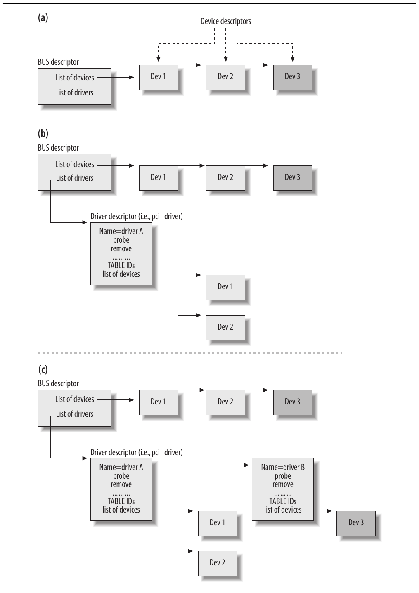
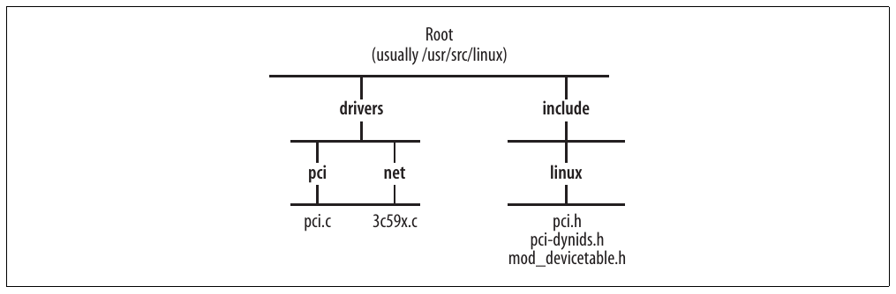

# Chương 6. PCI layer và network interface card


Do PCI bus phổ biến trên x86 cũng như các architecture khác, chúng ta sẽ dành vài trang cho nó để bạn hiểu cách kernel quản lý PCI device, đặc biệt network device. Chương này giúp bạn có ngữ cảnh cho code đăng ký device sẽ gặp trong Chương 8. Bạn cũng sẽ tìm hiểu đôi chút về cách PCI xử lý những kernel feature hữu ích như probing và power management. Để xem thảo luận in-depth về PCI, như thiết kế device driver, PCI bus feature và chi tiết triển khai, hãy tham khảo Linux Device Drivers, Understanding the Linux Kernel và các PCI specification.

PCI subsystem (còn gọi là PCI layer) trong kernel cung cấp mọi generic function được nhiều PCI device driver dùng chung. Subsystem này giảm đáng kể công việc của lập trình viên cho từng device, cho phép viết driver rõ ràng và giúp kernel dễ thu thập, duy trì thông tin device hơn, như accounting information và thống kê.

Trong chương này, chúng ta sẽ xem ý nghĩa một số data structure chủ chốt mà PCI layer dùng và cách một NIC device driver phổ biến khởi tạo chúng. Cuối chương, tôi sẽ nói đôi chút về các feature PCI power management và Wake-on-LAN.

## Các data structure được trình bày trong chương

Sau đây là một số data structure type chủ chốt mà PCI layer sử dụng. Còn nhiều type khác, nhưng những type sau đã đủ cho phần tổng quan trong sách. Type đầu được định nghĩa trong include/linux/mod\_devicetable.h, hai type còn lại trong include/linux/pci.h.

`pci_device_id`

Device identifier. Đây không phải local ID do Linux dùng, mà là ID được định nghĩa theo chuẩn PCI. Mục “Đăng ký PCI NIC device driver” phía sau trình bày định nghĩa ID, còn mục “Ví dụ đăng ký PCI NIC driver” phía sau đưa ra ví dụ.

`pci_dev`

Mỗi PCI device được gán một instance `pci_dev`, giống network device được gán instance `net_device`. Đây là structure mà kernel dùng để tham chiếu PCI device.

`pci_driver`

Định nghĩa interface giữa PCI layer và device driver. Structure chủ yếu gồm function pointer. Mọi PCI device đều dùng nó. Xem mục “Ví dụ đăng ký PCI NIC driver” phía sau để biết định nghĩa và ví dụ khởi tạo.

PCI device driver được định nghĩa bằng một instance của structure `pci_driver`. Sau đây là mô tả các field chính, đặc biệt chú ý trường hợp NIC device. Device driver khởi tạo function pointer để trỏ tới function thích hợp trong chính driver đó.

`char *name`

Tên driver.

`const struct pci_device_id *id_table`

Vector ID mà kernel dùng để gắn device với driver này. Mục “Ví dụ đăng ký PCI NIC driver” đưa ra ví dụ.

`int (*probe)(struct pci_dev *dev, const struct pci_device_id *id)`

Function được PCI layer gọi khi tìm thấy match giữa device ID đang cần tìm driver và `id_table` vừa đề cập. Function phải enable hardware, cấp phát structure `net_device`, khởi tạo và đăng ký device mới.[^1] Trong function này, driver cũng cấp phát mọi data structure bổ sung (ví dụ buffer ring dùng khi truyền hoặc nhận) có thể cần để hoạt động đúng.

`void (*remove)(struct pci_dev *dev)`

Function được PCI layer gọi khi driver bị hủy đăng ký khỏi kernel hoặc khi device hot-pluggable bị tháo ra. Đây là function tương ứng với `probe`, dùng để dọn dẹp mọi data structure và state.

Network device dùng function này để giải phóng I/O port và I/O memory đã cấp phát, hủy đăng ký device, giải phóng data structure `net_device` cùng mọi auxiliary data structure khác có thể đã được device driver cấp phát, thường trong function `probe`.

`int (*suspend)(struct pci_dev *dev, pm_message_t state)`

`int (*resume)(struct pci_dev *dev)`

Các function được PCI layer gọi lần lượt khi hệ thống vào suspend mode và khi resume. Xem mục “Power management và Wake-on-LAN” phía sau. `int (*enable_wake)(struct pci_dev *dev, u32 state, int enable)` Với function này, driver có thể enable hoặc disable khả năng device đánh thức hệ thống bằng cách tạo các Power Management Event signal cụ thể. Xem mục “Power management và Wake-on-LAN” phía sau.

`struct pci_dynids dynids`

Dynamic ID. Xem mục tiếp theo.

Xem ví dụ khởi tạo instance `pci_driver` trong mục “Ví dụ đăng ký PCI NIC driver” phía sau.

## Đăng ký PCI NIC device driver

PCI device được nhận diện duy nhất bằng tổ hợp parameter, gồm vendor, model, v.v. Kernel lưu các parameter trong data structure kiểu `pci_device_id`, được định nghĩa như sau:

```c
struct pci_device_id {
     unsigned int vendor, device;
     unsigned int subvendor, subdevice;
     unsigned int class, class_mask;
     unsigned long driver_data;
};
```

Phần lớn field đều self-explanatory. `vendor` và `device` thường đủ để xác định device. `subvendor` và `subdevice` hiếm khi cần, thường được đặt bằng wildcard value (`PCI_ANY_ID`). `class` và `class_mask` biểu diễn class mà device thuộc về; NETWORK là class bao gồm những device được thảo luận trong chương này. `driver_data` không thuộc PCI ID; đây là private parameter mà driver sử dụng.

Mỗi device driver đăng ký với kernel một vector các instance `pci_device_id` liệt kê ID của những device nó có thể xử lý.

PCI device driver lần lượt đăng ký và hủy đăng ký với kernel bằng `pci_register_driver` và `pci_unregister_driver`. Các function được định nghĩa trong drivers/pci/pci.c. Ngoài ra còn có `pci_module_init`, alias của `pci_register_driver`. Một số driver vẫn dùng `pci_module_init`, tên routine mà kernel cung cấp trong các phiên bản cũ trước khi có `pci_register_driver`.

`pci_register_driver` yêu cầu data structure `pci_driver` làm argument. Nhờ `pci_driver` với vector `id_table`, kernel biết driver xử lý được device nào, và nhờ mọi virtual function trong `pci_driver`, kernel có cơ chế tương tác với bất kỳ device nào được gắn với driver.

Một ưu điểm lớn của PCI là hỗ trợ probing gọn gàng để tìm IRQ và resource khác mà mỗi device cần. Có thể truyền input parameter cho module tại load time để chỉ cách cấu hình mọi device mà nó phụ trách, nhưng đôi khi (đặc biệt với bus như PCI), để driver tự kiểm tra device trên hệ thống và cấu hình những device mình phụ trách sẽ dễ hơn. Người dùng vẫn có thể quay lại cấu hình thủ công nếu cần.

/sys filesystem export thông tin về system bus (PCI, USB, v.v.), gồm các device và quan hệ giữa chúng. /sys cũng cho phép administrator định nghĩa ID mới cho device driver cụ thể, để ngoài static ID do driver đăng ký bằng structure `pci_driver` với vector `id_table`, kernel còn có thể dùng parameter user-configured.

Chúng ta sẽ không trình bày probing mechanism mà kernel dùng để tìm driver dựa trên device ID. Tuy nhiên, đáng lưu ý có hai loại probing:

Static

Với PCI ID của device, kernel có thể tìm đúng PCI driver (tức instance `pci_driver`) dựa trên các vector `id_table`. Đây được gọi là static probing.

Dynamic

Đây là lookup dựa trên ID do người dùng cấu hình thủ công, ít gặp nhưng đôi khi hữu ích, chẳng hạn khi debugging. Dynamic chỉ khả năng administrator thêm ID, không có nghĩa ID tự thay đổi.

Vì dynamic ID được cấu hình trên hệ thống đang chạy, chúng chỉ hữu ích khi kernel được compile với hỗ trợ Hotplug.

## Power management và Wake-on-LAN

PCI power management event được các function `suspend` và `resume` của data structure `pci_driver` xử lý. Ngoài xử lý PCI state bằng cách lần lượt lưu và khôi phục, các function cần thực hiện bước đặc biệt trong trường hợp NIC:

- `suspend` chủ yếu dừng egress queue của device để không cho phép truyền trên device.

- `resume` re-enables egress queue để device lại sẵn sàng truyền.

Wake-on-LAN (WOL) là feature cho phép NIC đánh thức hệ thống đang ở standby mode khi nhận loại frame cụ thể. WOL thường bị disable mặc định. Có thể bật và tắt feature bằng `pci_enable_wake`.

Khi WOL feature được giới thiệu lần đầu, chỉ một loại frame có thể đánh thức hệ thống: “Magic Packets”.[^2] Những frame đặc biệt này có hai đặc điểm chính:

- Destination MAC address thuộc receiving NIC (dù address là unicast, multicast hay broadcast).

- Ở một vị trí nào đó (bất kỳ) trong frame, một chuỗi 48 bit được đặt (tức FF:FF:FF: FF:FF:FF), tiếp theo là MAC address của NIC lặp liên tiếp ít nhất 16 lần.

Giờ cũng có thể cho phép những frame type khác đánh thức hệ thống. Một số device có thể enable hoặc disable WOL feature dựa trên parameter đặt tại module load time (xem ví dụ trong drivers/net/3c59x.c). Công cụ ethtool cho phép administrator cấu hình loại frame có thể đánh thức hệ thống. Một lựa chọn là ARP packet, như mô tả trong mục “Event Wake-on-LAN” ở Chương 28. Package net-utils có lệnh ether-wake dùng để tạo WOL Ethernet frame.

Mỗi khi device WOL-enabled nhận diện frame thuộc type được phép đánh thức hệ thống, nó tạo power management notification để thực hiện việc đó.

Để biết thêm về power management, xem mục “Tương tác với power management” ở phần sau Chương 8.

## Ví dụ đăng ký PCI NIC driver

Hãy dùng Intel PRO/100 Ethernet driver trong drivers/net/e100.c để minh họa đăng ký driver:

```c
#define INTEL_8255X_ETHERNET_DEVICE(device_id, ich) {\
     PCI_VENDOR_ID_INTEL, device_id, PCI_ANY_ID, PCI_ANY_ID, \
     PCI_CLASS_NETWORK_ETHERNET << 8, 0xFFFF00, ich }
static struct pci_device_id e100_id_table[] = {
     INTEL_8255X_ETHERNET_DEVICE(0x1029, 0),
     INTEL_8255X_ETHERNET_DEVICE(0x1030, 0),
     ...
}
```

Trong mục “Đăng ký PCI NIC device driver”, chúng ta đã thấy PCI NIC device driver đăng ký với kernel một vector các structure `pci_device_id` liệt kê device nó có thể xử lý. Ví dụ, `e100_id_table` là structure mà driver e100.c dùng. Lưu ý rằng:

- Field đầu (tương ứng `vendor` trong định nghĩa structure) có giá trị cố định `PCI_VENDOR_ID_INTEL`, được khởi tạo bằng vendor ID gán cho Intel.[^3]

- Field thứ ba và thứ tư (`subvendor` và `subdevice`) thường được khởi tạo bằng wildcard value `PCI_ANY_ID`, vì hai field đầu (`vendor` và `device`) đủ để xác định device.

- Nhiều device dùng macro `__devinitdata` trên table device để đánh dấu là initialization data, dù `e100_id_table` không làm vậy. Trong Chương 7, bạn sẽ thấy chính xác macro dùng để làm gì.

Module được `e100_init_module` khởi tạo, như macro `module_init` chỉ định.[^4] Khi kernel thực thi function tại boot time hoặc module loading time, nó gọi `pci_module_init`, function được giới thiệu trong mục “Đăng ký PCI NIC device driver”. Function đăng ký driver và gián tiếp đăng ký mọi NIC tương ứng, như mô tả ngắn gọn trong mục “Bức tranh tổng thể” phía sau.

Đoạn trích sau cho thấy những phần chính của e100 driver liên quan PCI layer interface:

```c
NAME "e100"

static int __devinit e100_probe(struct pci_dev *pdev,
     const struct pci_device_id *ent)
{
     ...
}
static void __devexit e100_remove(struct pci_dev *pdev)
{
     ...
}

#ifdef CONFIG_PM
static int e100_suspend(struct pci_dev *pdev, u32 state)
{
     ...
}
static int e100_resume(struct pci_dev *pdev)
{
     ...
}
#endif

static struct pci_driver e100_driver = {
     .name =         DRV_NAME,
     .id_table =     e100_id_table,
     .probe =        e100_probe,
     .remove =       __devexit_p(e100_remove),
#ifdef CONFIG_PM
     .suspend =      e100_suspend,
     .resume =       e100_resume,
#endif
};

static int __init e100_init_module(void)
{
     ...
     return pci_module_init(&e100_driver);
}

static void __exit e100_cleanup_module(void)
{
     pci_unregister_driver(&e100_driver);
}

module_init(e100_init_module);
module_exit(e100_cleanup_module);
```

Cũng lưu ý rằng:

- `suspend` và `resume` chỉ được khởi tạo khi kernel hỗ trợ power management, nên hai routine `e100_suspend` và `e100_resume` chỉ được đưa vào image khi điều kiện đó đúng.

- Field `remove` của `pci_driver` được gắn tag macro `__devexit_p`, còn `e100_remove` được gắn tag `__devexit`.

- `e100_probe` được gắn tag `__devinit`.

Trong Chương 7, bạn sẽ thấy các macro `__devXXX` đề cập trong danh sách được dùng để làm gì.

## Bức tranh tổng thể

Hãy kết hợp những gì đã xem trong các mục trước để biết điều gì xảy ra tại boot time trên hệ thống có PCI bus và một số PCI device.[^5]

Khi boot, hệ thống tạo một dạng database gắn mỗi bus với list các device được phát hiện sử dụng bus đó. Ví dụ, bên cạnh các parameter khác, descriptor của PCI bus có list PCI device được phát hiện. Như đã thấy trong mục “Đăng ký PCI NIC device driver”, mỗi PCI device được nhận diện duy nhất bằng một tập lớn field trong structure `pci_device_id`, dù thường chỉ cần một vài field. Chúng ta cũng đã thấy cách PCI device driver định nghĩa instance `pci_driver` và đăng ký với PCI layer bằng `pci_register_driver` (hoặc alias `pci_module_init`). Khi device driver được load, kernel đã xây dựng xong database:<sup>†</sup> hãy lấy ví dụ Hình 6-1(a) với ba PCI device và xem điều gì xảy ra khi device driver A và B được load.

Khi device driver A được load, nó đăng ký với PCI layer bằng cách gọi `pci_register_driver` và cung cấp instance `pci_driver`. Structure `pci_driver` có vector chứa ID của những PCI device nó có thể điều khiển. PCI layer dùng table đó để tìm device phù hợp trong list PCI device đã phát hiện. Qua đó, nó tạo device list của driver như Hình 6-1(b). Ngoài ra, với mỗi device phù hợp, PCI layer gọi function `probe` mà driver tương ứng cung cấp trong structure `pci_driver`. Function `probe` tạo và đăng ký network device tương ứng. Trong trường hợp này, device Dev3 cần device driver bổ sung tên B. Khi driver B cuối cùng đăng ký với kernel, Dev3 được gán cho nó. Hình 6-1(c) cho thấy kết quả load driver.



Hình 6-1. Gắn kết giữa bus và driver, giữa driver và device

Sau đó, khi driver được unload, routine `module_exit` của module gọi `pci_unregister_driver`. Nhờ database, PCI layer đi qua mọi device gắn với driver và gọi function `remove` của driver. Function này hủy đăng ký network device.

Bạn có thể tìm thêm chi tiết về hoạt động nội bộ của các function `probe` và `remove` trong Chương 8.

## Điều chỉnh qua /proc filesystem

Có thể dùng file /proc/pci để dump thông tin PCI device đã đăng ký. Lệnh lspci thuộc package pciutils cũng có thể in thông tin hữu ích về local PCI device, nhưng lấy thông tin từ /sys.

## Các function và variable được trình bày trong chương

Bảng 6-1 tóm tắt function, macro và data structure được giới thiệu trong chương.

Bảng 6-1. Function, macro và data structure liên quan xử lý PCI device

| Tên function và macro | Mô tả |
|---|---|
| `pci_register_driver` | Đăng ký, hủy đăng ký và khởi tạo PCI driver. |
| `pci_unregister_driver` |  |
| `pci_module_init` |  |
| Data structure |  |
| `struct pci_driver struct pci_device_id struct pci_dev` | Data structure đầu định nghĩa PCI driver (chủ yếu gồm virtual function callback). Data structure thứ hai lưu universal ID gắn với PCI device. Data structure cuối biểu diễn PCI device trong kernel space. |

## Các file và directory được trình bày trong chương

Hình 6-2 liệt kê các file và directory được tham chiếu trong chương. Hình không bao gồm mọi file mà các chủ đề trong chương sử dụng. Ví dụ, directory drivers/pci/ còn chứa nhiều file khác.



Hình 6-2. Các file và directory được trình bày trong chương

[^1]: Đăng ký NIC được trình bày trong Chương 8.

[^2]: WOL được AMD giới thiệu với tên “Magic Packet Technology”.

[^3]: Bạn có thể tìm danh sách cập nhật tại http://pciids.sourceforge.net.

[^4]: Xem Chương 7 để biết thêm về module initialization code.

[^5]: Các bus khác hoạt động tương tự. Hãy tham khảo Linux Device Drivers để biết chi tiết. † Điều này có thể không thực hiện được với mọi bus type.
