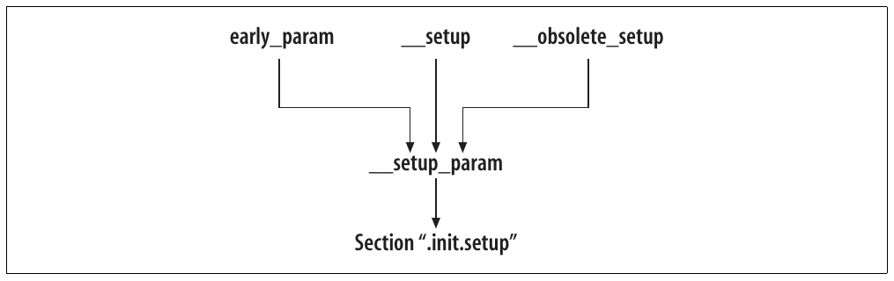
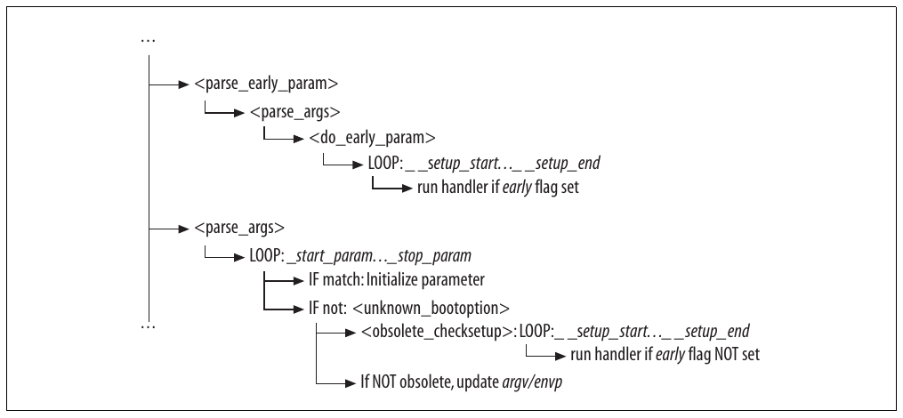
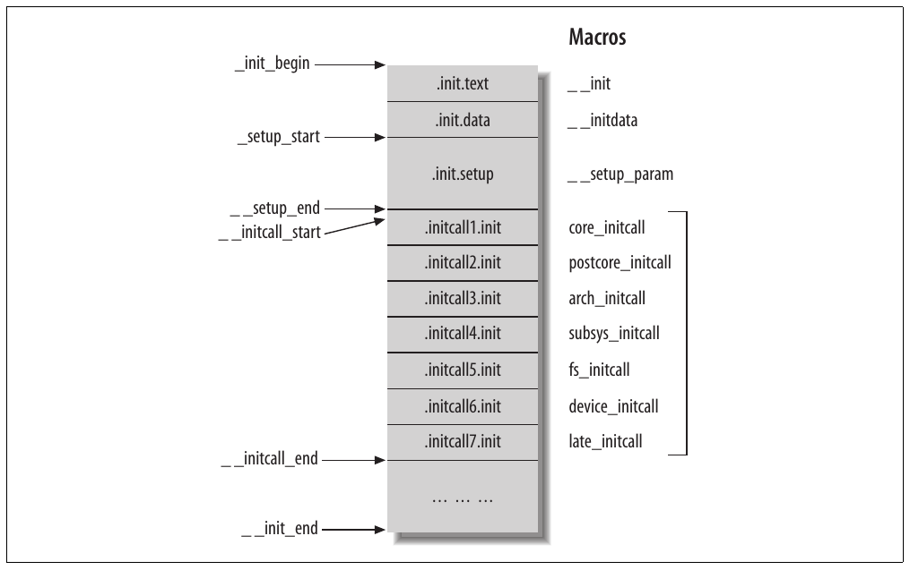
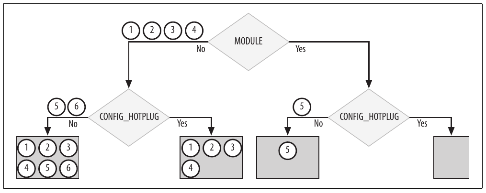
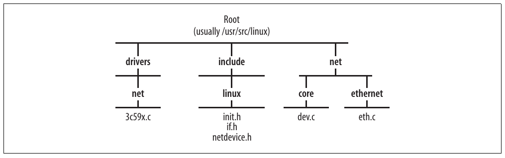

# Chương 7. Kernel infrastructure cho khởi tạo component


Để hiểu đầy đủ một kernel component, bạn phải biết không chỉ một tập routine thực hiện việc gì mà còn khi nào chúng được gọi và do ai gọi. Khởi tạo subsystem là một công việc cơ bản mà kernel xử lý theo mô hình riêng. Infrastructure này đáng tìm hiểu để giúp bạn hiểu cách khởi tạo các core component của networking stack, gồm NIC device driver.

Mục đích chương này là cho thấy cách kernel xử lý routine dùng để khởi tạo kernel component, cả component được đưa tĩnh vào kernel lẫn component được load dưới dạng kernel module, đặc biệt chú ý network device. Do đó, chúng ta sẽ xem:

- Cách đặt tên và nhận diện initialization function bằng macro đặc biệt

- Cách định nghĩa các macro này dựa trên kernel configuration để tối ưu memory usage và bảo đảm những bước khởi tạo được thực hiện đúng thứ tự

- Thời điểm và cách thực thi function

Chúng ta không trình bày mọi chi tiết của initialization infrastructure, nhưng bạn sẽ có đủ kiến thức tổng quan để dễ dàng tìm hiểu source code.

## Các kernel option Boot-Time

Linux cho phép người dùng truyền kernel configuration option cho boot loader, rồi boot loader truyền option tới kernel; người dùng có kinh nghiệm có thể dùng cơ chế này để fine-tune kernel tại boot time.[^1] Trong boot phase, như Hình 5-1 ở Chương 5, hai lời gọi `parse_args` xử lý configuration input boot-time.

Trong mục tiếp theo, chúng ta sẽ xem tại sao `parse_args` được gọi hai lần, với chi tiết trong mục “Phân tích Two-Pass” phía sau.

`parse_args` là routine phân tích input string có parameter dạng name\_ variable=value, tìm keyword cụ thể và gọi đúng handler. `parse_args` cũng được dùng khi load module để phân tích parameter command-line được cung cấp (nếu có).

Chúng ta không cần biết chi tiết cách `parse_args` triển khai việc phân tích, nhưng đáng xem cách kernel component đăng ký handler cho keyword và cách gọi handler. Để có bức tranh rõ ràng, chúng ta cần tìm hiểu:

- Cách kernel component đăng ký keyword cùng handler tương ứng sẽ thực thi khi keyword được cung cấp trong boot string.

- Cách kernel phân giải mối liên hệ giữa keyword và handler. Tôi sẽ trình bày tổng quan high-level về cách kernel phân tích input string.

- Cách networking device subsystem dùng feature này.

Mọi parsing code nằm trong kernel/params.c. Chúng ta sẽ lần lượt trình bày các điểm trong danh sách.

### Đăng ký keyword

Kernel component có thể đăng ký keyword và handler tương ứng bằng macro `__setup`, định nghĩa trong include/linux/init.h. Cú pháp như sau:

```c
__setup(string, function_handler)
```

trong đó `string` là keyword và `function_handler` là handler tương ứng. Ví dụ vừa rồi chỉ thị kernel thực thi `function_handler` khi input string boot-time chứa `string`. `string` phải kết thúc bằng ký tự = để `parse_args` dễ phân tích hơn. Mọi text sau dấu = được truyền làm input cho `function_handler`.

Sau đây là ví dụ từ net/core/dev.c, trong đó `netdev_boot_setup` được đăng ký làm handler cho keyword `netdev=`:

```c
__setup("netdev=", netdev_boot_setup);
```

Cùng handler có thể được gắn với nhiều keyword. Chẳng hạn net/ethernet/eth.c đăng ký cùng handler `netdev_boot_setup` cho keyword `ether=`.

Khi một đoạn code được compile thành module, macro `__setup` bị bỏ qua (tức được định nghĩa là no-op). Bạn có thể kiểm tra định nghĩa macro `__setup` trong include/linux/init.h thay đổi thế nào tùy code include file này có phải module hay không.

Lý do `start_kernel` gọi `parse_args` hai lần để phân tích boot configuration string là option boot-time thực chất chia thành hai nhóm, mỗi lời gọi xử lý một nhóm:

Default option

Phần lớn option thuộc nhóm này. Chúng được định nghĩa bằng macro `__setup` và được lời gọi `parse_args` thứ hai xử lý.

Early option

Một số option cần được xử lý sớm hơn những option khác trong kernel boot. Kernel cung cấp macro `early_param` để khai báo chúng thay cho `__setup`. Sau đó, `parse_early_params` đảm nhiệm xử lý. Khác biệt duy nhất giữa `early_param` và `__setup` là macro đầu đặt một flag đặc biệt để kernel phân biệt hai trường hợp. Flag thuộc data structure `obs_kernel_param` mà chúng ta sẽ xem trong mục “Memory section .init.setup”.

Cách xử lý option boot-time đã thay đổi với kernel 2.6, nhưng không phải mọi kernel code đã được cập nhật tương ứng. Trước những thay đổi mới nhất, chỉ có macro `__setup`. Vì vậy, legacy code đang chờ cập nhật hiện dùng macro `__obsolete_setup`. Khi người dùng truyền cho kernel option khai báo bằng macro `__obsolete_setup`, kernel in message cảnh báo option đã lỗi thời và chỉ ra file cùng dòng source code khai báo nó.

Hình 7-1 tóm tắt quan hệ giữa các macro: tất cả đều là wrapper quanh generic routine `__setup_param`.

Lưu ý input routine truyền cho `__setup` được đặt vào memory section `.init.setup`. Tác dụng sẽ rõ trong mục “Initialization routine Boot-Time”.



Hình 7-1. Macro setup\_param và các wrapper

### Phân tích Two-Pass

Vì option boot-time từng được xử lý khác trong những kernel version trước, và không phải tất cả đã được chuyển sang mô hình mới, kernel xử lý cả hai mô hình. Khi infrastructure mới không nhận ra keyword, nó yêu cầu infrastructure cũ xử lý. Nếu infrastructure cũ cũng thất bại, keyword và value được truyền cho process `init`, sẽ được gọi ở cuối kernel thread `init` qua `run_init_process` (Hình 5-1 trong Chương 5). Keyword và value được thêm vào parameter list `arg` hoặc environment variable list `envp`.

Mục trước giải thích rằng để early option được xử lý đúng thứ tự cần thiết, việc phân tích boot-string và gọi handler diễn ra qua hai lượt, như Hình 7-2 (hình là đoạn trích từ `start_kernel`, được giới thiệu trong Chương 5):

1\. Lượt đầu chỉ tìm option higher-priority phải xử lý sớm, được nhận diện bằng flag đặc biệt (`early`).

2\. Lượt thứ hai xử lý mọi option còn lại. Phần lớn option thuộc nhóm này. Mọi option theo mô hình cũ được xử lý trong lượt này.

Lượt thứ hai trước hết kiểm tra có match với option triển khai theo infrastructure mới hay không. Những option này được lưu trong data structure `kernel_param`, do macro `module_param` giới thiệu ở mục “Module option” trong Chương 5 điền vào. Cùng macro cũng bảo đảm mọi data structure đó được đặt vào memory section cụ thể (`__param`), giới hạn bởi các pointer `__start__ _param` và `__stop__ _param`.

Khi nhận ra một option như vậy, parameter tương ứng được khởi tạo bằng value cung cấp trong boot string. Khi option không match, `unknown_bootoption` thử xem nó có nên được handler của mô hình cũ xử lý hay không (Hình 7-2).



Hình 7-2. Phân tích option Two-pass

Option của mô hình cũ và mới được đặt vào hai memory area khác nhau:

`__setup_start` … `__setup_end`

Trong mục sau, chúng ta sẽ thấy vùng này được giải phóng ở cuối boot phase: sau khi kernel đã boot, những option này không còn cần. Người dùng không thể xem hoặc thay đổi chúng lúc runtime.

`__start__ _param` … `__stop__ _param`

Vùng này không được giải phóng. Nội dung được export tới /sys, nơi option được hiển thị cho người dùng.

Xem Chương 5 để biết thêm về module parameter.

Cũng lưu ý mọi option theo mô hình cũ, bất kể có đặt flag `early` hay không, đều được đặt vào memory area `__setup_start` … `__setup_end`.

### Memory section .init.setup

Hai input của macro `__setup` được giới thiệu ở mục trước được đặt vào data structure kiểu `obs_kernel_param`, định nghĩa trong include/linux/init.h:

```c
struct obs_kernel_param {
    const char *str;
    int (*setup_func)(char*);
    int early;
};
```

`str` là keyword, `setup_func` là handler và `early` là flag được giới thiệu trong mục “Phân tích Two-Pass”.

Macro `__setup_param` đặt mọi instance `obs_kernel_params` vào memory area riêng. Việc này chủ yếu vì hai lý do:

- Dễ duyệt qua mọi instance hơn — chẳng hạn khi lookup dựa trên keyword `str`. Chúng ta sẽ xem cách kernel dùng hai pointer `__setup_start` và `__setup_end`, lần lượt trỏ tới đầu và cuối vùng vừa đề cập (như Hình 7-3 phía sau), khi lookup keyword.

- Kernel có thể nhanh chóng giải phóng mọi data structure khi không còn cần. Chúng ta sẽ quay lại điểm này trong mục “Tối ưu memory”.

### Dùng boot option để cấu hình network device

Dựa trên những gì đã xem trong các mục trước, hãy xem cách networking code dùng boot option.

Trong mục “Đăng ký keyword”, chúng ta đã nói cả keyword `ether=` và `netdev=` đều đăng ký dùng cùng handler `netdev_boot_setup`. Khi được gọi để xử lý input parameter (tức string theo sau keyword phù hợp), handler lưu kết quả vào data structure kiểu `netdev_boot_setup`, định nghĩa trong include/linux/netdevice.h. Handler và data structure type tình cờ có cùng tên, nên hãy tránh nhầm lẫn.

```c
struct netdev_boot_setup {
    char name[IFNAMSIZ];
    struct ifmap map;
};
```

`name` là tên device, còn `ifmap`, định nghĩa trong include/linux/if.h, là data structure lưu input configuration:

```c
struct ifmap
{
    unsigned long mem_start;
    unsigned long mem_end;
    unsigned short base_addr;
    unsigned char irq;
    unsigned char dma;
    unsigned char port;
    /* 3 bytes spare */
};
```

Cùng keyword có thể được cung cấp nhiều lần (cho những device khác nhau) trong string boot-time, như ví dụ sau:

LILO: linux ether=5,0x260,eth0 ether=15,0x300,eth1

Tuy nhiên, số device tối đa có thể cấu hình tại boot time bằng cơ chế này là `NETDEV_BOOT_SETUP_MAX`, cũng là kích thước static array `dev_boot_setup` dùng để lưu cấu hình:

```c
static struct netdev_boot_setup dev_boot_setup[NETDEV_BOOT_SETUP_MAX];
```

`netdev_boot_setup` khá đơn giản: trích input parameter từ string, điền structure `ifmap`, rồi thêm structure đó vào array `dev_boot_setup` bằng `netdev_boot_setup_add`.

Ở cuối boot phase, networking code có thể dùng function `netdev_boot_setup_check` để kiểm tra một interface có gắn với cấu hình boot-time hay không. Lookup trên array `dev_boot_setup` dựa trên device name `dev- >name`:

```c
int netdev_boot_setup_check(struct net_device *dev)
{
    struct netdev_boot_setup *s = dev_boot_setup;
    int i;

    for (i = 0; i < NETDEV_BOOT_SETUP_MAX; i++) {
        if (s[i].name[0] != '\0' && s[i].name[0] != ' ' &&
            !strncmp(dev->name, s[i].name, strlen(s[i].name))) {
            dev->irq        = s[i].map.irq;
            dev->base_addr  = s[i].map.base_addr;
            dev->mem_start  = s[i].map.mem_start;
            dev->mem_end    = s[i].map.mem_end;
            return 1;
        }
    }
    return 0;
}
```

Device có capability, feature hoặc giới hạn đặc biệt có thể định nghĩa keyword và handler riêng nếu cần parameter bổ sung ngoài những parameter cơ bản do `ether=` và `netdev=` cung cấp (PLIP là một driver làm vậy).

## Module initialization code

Vì ví dụ trong các mục tiếp theo thường đề cập module, cần làm rõ một vài khái niệm ban đầu.

Kernel code có thể được link tĩnh vào main image hoặc load động dưới dạng module khi cần. Không phải mọi kernel component đều thích hợp để compile thành module. Device driver và phần mở rộng của chức năng cơ bản là ví dụ điển hình về kernel component thường được compile thành module. Bạn có thể tham khảo Linux Device Drivers để xem thảo luận chi tiết về ưu, nhược điểm của module và các cơ chế kernel dùng để load động khi cần, unload khi không còn cần.

Mỗi module phải cung cấp hai function đặc biệt, tên `init_module` và `cleanup_module`. Function đầu được gọi tại module load time để khởi tạo module. Function thứ hai được kernel gọi khi loại module để giải phóng mọi resource (gồm memory) đã cấp phát cho module sử dụng.

Kernel cung cấp hai macro `module_init` và `module_exit`, cho phép developer dùng tên tùy ý cho hai routine. Đoạn trích sau là ví dụ từ Ethernet driver drivers/net/3c59x.c:

```c
module_init(vortex_init);
module_exit(vortex_cleanup);
```

Trong mục “Tối ưu memory”, chúng ta sẽ xem cách định nghĩa hai macro và cách định nghĩa thay đổi theo kernel configuration. Phần lớn kernel dùng hai macro này, nhưng một số module vẫn dùng tên mặc định cũ `init_module` và `cleanup_module`. Trong phần còn lại của chương, tôi dùng `module_init` và `module_exit` để chỉ initialization function và cleanup function.

Trước hết, hãy xem cách viết module initialization code với kernel cũ, rồi cách mô hình kernel hiện tại dựa trên tập macro mới hoạt động.

### Mô hình cũ: Conditional code

Dù kernel component được compile thành module hay build tĩnh vào kernel, nó vẫn cần khởi tạo. Vì vậy, initialization code của kernel component có thể phải phân biệt hai trường hợp bằng chỉ thị có điều kiện cho compiler. Trong mô hình cũ, developer buộc phải dùng chỉ thị như `#ifdef` khắp nơi.

Đây là đoạn trích từ driver drivers/net/3c59x.c của kernel 2.2.14: lưu ý số lần sử dụng `#ifdef MODULE` và `#if defined (MODULE)`.

```c
...
#if defined(MODULE) && LINUX_VERSION_CODE > 0x20115
MODULE_AUTHOR("Donald Becker <becker@cesdis.gsfc.nasa.gov>");
MODULE_DESCRIPTION("3Com 3c590/3c900 series Vortex/Boomerang driver");
MODULE_PARM(debug, "i");
...
#endif
...
#ifdef MODULE
...
int init_module(void)
{
    ...
}
#else
int tc59x_probe(struct device *dev)
{
    ...
}
#endif  /* not MODULE */
...
static int vortex_scan(struct device *dev, struct pci_id_info pci_tbl[])
{
    ...
#if defined(CONFIG_PCI) || (defined(MODULE) && !defined(NO_PCI))
    ...
#ifdef MODULE
    if (compaq_ioaddr) {
        vortex_probe1(0, 0, dev, compaq_ioaddr, compaq_irq,
                compaq_device_id, cards_found++);
        dev = 0;
    }
#endif

    return cards_found ? 0 : -ENODEV;
}
...
#ifdef MODULE
void cleanup_module(void)
{
    ... ... ...
}
#endif
```

Đoạn trích cho thấy mô hình cũ cho phép lập trình viên chỉ định một số việc thực hiện khác nhau tùy code được compile thành module hay đưa tĩnh vào kernel image:

Initialization code được thực thi khác nhau

Đoạn trích cho thấy routine `cleanup_module` chỉ được định nghĩa (và do đó sử dụng) khi driver được compile thành module.

Các đoạn code có thể được đưa vào hoặc loại khỏi module

Ví dụ, `vortex_scan` chỉ gọi `vortex_probe1` khi driver được compile thành module.

Mô hình này khiến source code khó theo dõi hơn, do đó cũng khó debug hơn. Hơn nữa, cùng logic bị lặp trong mọi module.

### Mô hình mới: Gắn tag Macro-Based

Bây giờ hãy so sánh đoạn trích ở mục trước với phần tương ứng trong cùng file của kernel 2.6:

```c
static char version[] __devinitdata = DRV_NAME " ... ";

static struct vortex_chip_info {
    ...
} vortex_info_tbl[] __devinitdata = {
    {"3c590 Vortex 10Mbps",
    ... ... ...
}

static int __init vortex_init (void)
{
    ...
}
static void __exit vortex_cleanup (void)
{
    ...
}

module_init(vortex_init);
module_exit(vortex_cleanup);
```

Bạn có thể thấy không còn cần chỉ thị `#ifdef`.

Để loại sự rối rắm do conditional code và giúp code dễ đọc hơn, kernel developer đưa vào tập macro mà module developer hiện có thể dùng để viết initialization code rõ ràng hơn (phần lớn driver thích hợp để dùng những macro này). Đoạn trích vừa rồi dùng một số macro: `__init`, `__exit` và `__devinitdata`.

Các mục sau mô tả cách dùng và hoạt động của một số macro mới.

Các macro này cho phép kernel tự xác định cho mỗi module những phần code cần đưa vào kernel image, những phần cần loại bỏ vì không cần thiết, những phần chỉ được thực thi tại thời điểm khởi tạo, v.v. Nhờ vậy, từng lập trình viên không còn phải lặp lại cùng logic trong mỗi module.[^2] Rõ ràng, để các macro cho phép thay thế những conditional directive cũ như ví dụ ở phần trước, chúng phải cung cấp ít nhất hai khả năng sau:

- Định nghĩa routine cần thực thi khi kernel component mới được enable, do được đưa tĩnh vào kernel hoặc load lúc runtime dưới dạng module

- Định nghĩa thứ tự nào đó giữa initialization function để quan hệ phụ thuộc giữa các kernel component được tôn trọng và bảo đảm

## Gắn tag Macro-Based được tối ưu hóa

Linux kernel dùng nhiều macro khác nhau để đánh dấu function và data structure có đặc tính riêng: chẳng hạn đánh dấu initialization routine. Phần lớn macro được định nghĩa trong include/linux/init.h. Một số macro cũng chỉ thị linker đặt code hoặc data structure có đặc tính chung vào memory area riêng cụ thể (memory section). Nhờ đó, kernel dễ xử lý toàn bộ nhóm object (routine hoặc data structure) có chung đặc tính theo cách đơn giản. Chúng ta sẽ xem ví dụ trong mục “Tối ưu memory”.

Hình 7-3 cho thấy một số kernel memory section: bên trái là tên các pointer giới hạn đầu và cuối từng section (khi phù hợp).



Hình 7-3. Một số memory section được initialization code sử dụng

Bên phải là tên macro dùng để đặt data và code vào section tương ứng. Hình không bao gồm mọi memory section và macro tương ứng; chúng quá nhiều để liệt kê thuận tiện.

Bảng 7-1 và 7-2 lần lượt liệt kê một số macro dùng để gắn tag routine và data structure, kèm mô tả ngắn. Chúng ta không xem hết vì giới hạn dung lượng, nhưng sẽ nói đôi chút về các macro `xxx_initcall` trong mục “Các macro xxx\_initcall”, và `__init`, `__exit` trong mục “Các macro \_\_init và \_\_exit”.

Mục đích của phần này không phải mô tả cách build kernel image, xử lý module, v.v., mà chỉ đưa ra vài chỉ dẫn về lý do tồn tại các macro và cách hoạt động của những macro được device driver dùng phổ biến nhất.

Bảng 7-1. Macro cho routine

| Macro | Loại routine mà macro được dùng cho |
|---|---|
| `__init` | Initialization routine Boot-time: dành cho routine không còn cần ở cuối boot phase. |
|  | Có thể dùng thông tin này để loại routine trong một số điều kiện (xem mục “Tối ưu memory” phía sau). |
| `__exit` | Tương ứng với `__init`. Được gọi khi kernel component liên quan ngừng hoạt động. Thường dùng để đánh dấu function `module_exit`. |
|  | Có thể dùng thông tin này để loại routine trong một số điều kiện (xem mục “Tối ưu memory” phía sau). |
| `core_initcall` | Tập macro, liệt kê theo thứ tự priority giảm dần, dùng để gắn tag initialization routine cần |
| `postcore_initcall` | được thực thi tại boot time. Xem mục “Các macro xxx\_initcall” phía sau. |
| `arch_initcall` |  |
| `subsys_initcall` |  |
| `fs_initcall` |  |
| `device_initcall` |  |
| `late_initcall` |  |
| `__initcall` | Macro lỗi thời, được định nghĩa là alias của `device_initcall`. Xem mục “Legacy code” phía sau. |
| `__exitcalla` | Exit function One-shot, được gọi khi kernel component liên quan ngừng hoạt động. Cho tới nay, nó chỉ dùng để đánh dấu routine `module_exit`. Xem mục “Tối ưu memory” phía sau. |

<sup>a</sup> `__exitcall` và `__initcall` được định nghĩa dựa trên `__exit_call` và `__init_call`.

Bảng 7-2. Macro cho initialized data structure

| Macro | Loại data mà macro được dùng cho |
|---|---|
| `__initdata` | Initialized data structure chỉ dùng tại boot time. |
| `__exitdata` | Data structure chỉ được routine gắn tag `__exitcall` sử dụng. Do đó, nếu routine gắn tag `__exitcall` không được dùng, data gắn tag `__exitdata` cũng vậy. Vì thế, có thể áp dụng cùng kiểu tối ưu cho `__exitdata` và `__exitcall`. |

Trước khi đi sâu hơn một số macro trong Bảng 7-1 và 7-2, cần nhấn mạnh những điểm sau:

- Phần lớn macro đi thành cặp: một macro (hoặc một tập macro) đảm nhiệm khởi tạo, macro tương ứng (hoặc tập tương ứng) đảm nhiệm loại bỏ. Ví dụ, `__exit` tương ứng với `__init`; `__exitcalls` tương ứng với `__initcall`, v.v.

- Macro xử lý hai khía cạnh (một trong hai, không đồng thời cả hai): một là thời điểm thực thi routine (tức `__initcall`, `__exitcall`); hai là memory section đặt routine hoặc data structure (tức `__init`, `__exit`).

- Cùng routine có thể được gắn nhiều macro. Ví dụ, đoạn trích sau cho biết `pci_proc_init` chạy tại boot time (`__initcall`) và có thể được giải phóng sau khi thực thi (`__init`):

```c
static int __init pci_proc_init(void)
{
...
}

__initcall(pci_proc_init)
```

### Initialization macro cho device initialization routine

Bảng 7-3 liệt kê tập macro thường dùng để gắn tag routine mà device driver dùng để khởi tạo device, và có thể giúp tối ưu memory khi kernel không hỗ trợ Hotplug. Bạn có thể tìm ví dụ sử dụng trong mục “Ví dụ đăng ký PCI NIC driver” ở Chương 6. Trong mục “Các tối ưu khác” phía sau, bạn sẽ thấy khi nào macro trong Bảng 7-3 hỗ trợ tối ưu memory.

Bảng 7-3. Macro cho device initialization routine

| Tên | Mô tả |
|---|---|
| `__devinit` | Dùng để gắn tag routine khởi tạo device. |
|  | Ví dụ, với PCI driver, routine dùng để khởi tạo `pci_driver->probe` được gắn tag macro này. |
|  | Routine chỉ được routine khác gắn tag `__devinit` gọi thường cũng được gắn tag `__devinit`. |
| `__devexit` | Dùng để gắn tag routine cần gọi khi device bị loại bỏ. |
| `__devexit_p` | Dùng để khởi tạo pointer tới routine gắn tag `__devexit`. |
|  | `__devexit_p(fn)` trả về `fn` nếu kernel hỗ trợ cả module lẫn Hotplug, nếu không trả về NULL. Xem mục “Các tối ưu khác” phía sau. |
| `__devinitdata` | Dùng để gắn tag initialized data structure được các function phụ trách khởi tạo device sử dụng (tức function gắn tag `__devinit`), vì vậy có chung đặc tính với chúng. |
| `__devexitdata` | Giống `__devinitdata` nhưng gắn với `__devexit`. |

## Initialization routine Boot-Time

Phần lớn initialization routine có hai đặc tính đáng chú ý:

- Cần thực thi tại boot time, khi mọi kernel component được khởi tạo.

- Không còn cần sau khi đã thực thi.

Mục tiếp theo, “Các macro xxx\_initcall”, mô tả cơ chế chạy initialization routine tại boot time, có xét các đặc tính này cùng priority giữa những module. Mục “Tối ưu memory” phía sau cho thấy cách giải phóng routine và data structure không còn cần tại link time hoặc runtime bằng cách gắn tag thông minh.

### Các macro xxx\_initcall

Giai đoạn đầu kernel boot gồm hai nhóm khởi tạo chính:

- Khởi tạo các subsystem quan trọng và bắt buộc theo thứ tự cụ thể. Ví dụ, kernel không thể khởi tạo PCI device driver trước khi PCI layer đã được khởi tạo. Xem ví dụ khác trong mục “Ví dụ về quan hệ phụ thuộc giữa initialization routine” phía sau.

- Khởi tạo kernel component khác không cần thứ tự nghiêm ngặt: các routine cùng priority level có thể chạy theo bất kỳ thứ tự nào.

Phần đầu do code trước `do_initcalls` trong Hình 5-1 ở Chương 5 đảm nhiệm. Phần thứ hai do lời gọi `do_initcalls` gần cuối `do_basic_setup` trong cùng hình đảm nhiệm. Initialization routine của phần thứ hai được phân loại theo vai trò và priority. Kernel lần lượt thực thi chúng, bắt đầu từ routine đặt trong nhóm highest-priority (`core_initcall`). Address của những routine này, cần để gọi chúng, được đặt vào memory section `.initcallN.init` trong Hình 7-3 bằng cách gắn một macro `xxx_initcall` trong Bảng 7-1.

Vùng lưu address của routine gắn tag macro `xxx_initcall` được giới hạn bởi starting address (`__initcall_start`) và ending address (`__initcall_end`). Trong đoạn trích function `do_initcalls` sau, bạn có thể thấy nó chỉ lần lượt lấy function address từ vùng đó và thực thi function được trỏ tới:

```c
static void __init do_initcalls(void)
{
        initcall_t *call;
        int count = preempt_count( );

        for (call = __initcall_start; call < __initcall_end; call++) {
            ... ... ...
            (*call)( );
            ... ... ...
        }
        flush_scheduled_work( );
}
```

Routine do `do_initcalls` gọi không được thay đổi preemption status hoặc disable IRQ. Vì vậy, sau mỗi lần thực thi routine, `do_initcalls` kiểm tra routine có thay đổi gì không và điều chỉnh preemption cùng IRQ status nếu cần (không thể hiện trong đoạn trích trước).

Routine `xxx_initcall` có thể schedule công việc diễn ra sau đó. Nghĩa là công việc do routine xử lý có thể kết thúc asynchronously vào thời điểm chưa biết. Lời gọi `flush_scheduled_work` khiến `do_initcalls` chờ những công việc asynchronous đó hoàn tất trước khi return.

Lưu ý chính `do_initcalls` được đánh dấu `__init`: vì chỉ dùng một lần trong `do_basic_setup` ở boot phase, kernel có thể loại bỏ nó sau khi routine sau hoàn tất.

`__exitcall` tương ứng với `__initcall`. Nó không được dùng trực tiếp nhiều mà thường qua các macro khác được định nghĩa là alias, chẳng hạn `module_exit` đã giới thiệu trong mục “Module initialization code”.

#### Ví dụ routine \_\_initcall và \_\_exitcall: module

Trong mục “Module initialization code”, tôi đã nói các macro `module_init` và `module_exit` lần lượt được dùng để gắn tag routine thực thi khi module khởi tạo (tại boot time nếu build vào kernel hoặc tại runtime nếu load riêng) và khi unload.

Điều này khiến module rất thích hợp với các macro `__initcall` và `__exitcall`: với những gì vừa trình bày, định nghĩa sau trong include/linux/init.h của các macro `module_init` và `module_exit` không có gì bất ngờ:

```c
#ifndef MODULE
... ... ...
#define module_init(x)    __initcall(x);
#define module_exit(x)    __exitcall(x);

#else
... ... ...
#endif
```

`module_init` được định nghĩa là alias của `__initcall` với code link tĩnh vào kernel: input function được phân loại thành initialization routine boot-time.

`module_exit` theo cùng mô hình: khi code được build vào kernel, `module_exit` trở thành shutdown routine. Hiện shutdown routine không được gọi khi hệ thống ngừng hoạt động, nhưng code đã có để cho phép điều đó.[^3]

##### Ví dụ về quan hệ phụ thuộc giữa initialization routine

`net_dev_init` được giới thiệu trong Chương 5. Device driver đăng ký với kernel bằng routine `module_init`, routine này đăng ký device với networking code như mô tả trong mục “Bức tranh tổng thể” ở Chương 6. Cả `net_dev_init` lẫn các function `module_init` của driver built-in đều được `do_initcalls` gọi tại boot time. Vì vậy, kernel cần bảo đảm không có đăng ký device nào trước khi `net_dev_init` thực thi. Điều này được bảo đảm trong suốt bằng cách đánh dấu device driver initialization routine bằng macro `device_initcall` (hoặc alias `__initcall`), còn `net_dev_init` được đánh dấu `subsys_initcall`. Trong Hình 7-3, bạn có thể thấy routine `subsys_initcall` được thực thi trước routine `device_initcall` (các memory section được sắp theo priority).

##### Legacy code

Trước khi có tập macro `xxx_initcall`, chỉ một macro đánh dấu initialization function: `__initcall`. Chỉ dùng một macro tạo giới hạn lớn: không thể bảo đảm thứ tự thực thi chỉ bằng cách đánh dấu routine với macro. Trong nhiều trường hợp, giới hạn này không chấp nhận được do phụ thuộc giữa module và các cân nhắc khác. Vì vậy, không thể mở rộng sử dụng `__initcall` tới mọi initialization function.

`__initcall` trước đây chủ yếu được device driver dùng. Để tương thích ngược với code chưa cập nhật sang mô hình mới, nó vẫn tồn tại và chỉ được định nghĩa là alias của `device_initcall`.

Một giới hạn khác vẫn còn trong mô hình hiện tại là không thể cung cấp parameter cho initialization routine. Tuy nhiên, đây có vẻ không phải giới hạn quan trọng.

## Tối ưu memory

Khác với code và data user-space, kernel code và data nằm thường trực trong main memory, nên cần giảm lãng phí memory bằng mọi cách có thể. Initialization code thích hợp để tối ưu memory. Do bản chất của chúng, phần lớn initialization routine chỉ thực thi một lần hoặc không thực thi, tùy kernel configuration. Ví dụ:

- Routine `module_init` chỉ thực thi một lần khi module tương ứng được load. Khi module được đưa tĩnh vào kernel, kernel có thể giải phóng routine `module_init` ngay tại boot time sau khi chạy.

- Routine `module_exit` không bao giờ được thực thi khi module tương ứng được đưa tĩnh vào kernel. Vì vậy, trong trường hợp này không cần đưa routine `module_exit` vào kernel image (tức có thể loại bỏ tại link time).

Trường hợp đầu là tối ưu runtime, trường hợp thứ hai là tối ưu link-time.

Code và data chỉ dùng khi boot, không cần sau đó, được đặt vào một memory section trong Hình 7-3. Khi hoàn tất initialization phase, kernel có thể loại bỏ toàn bộ memory area đó. Việc này được thực hiện bằng lời gọi `free_init_mem`,[^4] như Hình 5-1 ở Chương 5. Các macro khác nhau được dùng để đặt code vào các memory section khác nhau trong Hình 7-3.

Nếu xem ví dụ trong mục “Mô hình mới: Gắn tag Macro-Based” phía trước, bạn thấy hai input routine của `module_init` và `module_exit` (thường) lần lượt được gắn tag `__init` và `__exit`: mục đích chính là tận dụng hai đặc tính đề cập ở đầu phần này.

### Các macro \_\_init và \_\_exit

Initialization routine được thực thi trong giai đoạn đầu của kernel được gắn tag macro `__init`.

Như đã nói trong mục trước, phần lớn input routine của `module_init` được gắn macro này. Ví dụ, phần lớn function trong Hình 5-1 ở Chương 5 (trước lời gọi `free_initmem`) được đánh dấu `__init`.

Như định nghĩa sau, macro `__init` đặt input routine vào memory section `.text.init`:

```c
#define __init    __attribute__ ((__section__ (".text.init")))
```

Section này là một memory area được `free_initmem` giải phóng tại runtime.

`__exit` tương ứng với `__init`. Routine dùng để shutdown module được đặt vào section `.text.exit`. Với module build vào kernel, section này có thể bị loại trực tiếp tại link time. Tuy nhiên, một số architecture loại nó tại runtime để xử lý cross-references. Lưu ý với module load riêng, cùng section đó có thể được loại tại load time khi kernel không hỗ trợ module unloading. (Có kernel option ngăn người dùng unload module.)

### Các section xxx\_initcall và \_\_exitcall

Những memory section mà kernel đặt address của routine gắn tag macro `xxx_initcall` và `__exitcall` cũng được loại bỏ:

- Các section `xxx_initcall` trong Hình 7-3 được `free_initmem` loại tại runtime.

- Section `.text.exit` dùng cho function `__exitcall` được loại tại link time vì hiện kernel không gọi routine `__exitcall` khi system shutdown (tức không dùng cơ chế tương tự `do_initcalls`).

### Các tối ưu khác

Ví dụ tối ưu khác gồm các macro trong Bảng 7-3:

`__devinit`

Khi kernel không được compile với hỗ trợ Hotplug, routine gắn tag `__devinit` không còn cần ở cuối boot phase (sau khi mọi device được khởi tạo). Vì vậy, khi không hỗ trợ Hotplug, `__devinit` trở thành alias của `__init`.

`__devexit`

Khi PCI driver được build vào kernel không hỗ trợ Hotplug, routine dùng để khởi tạo `pci_driver->remove`, được gắn tag `__devexit`, có thể loại bỏ vì không cần. Routine cũng có thể bị loại khi module được load riêng vào kernel không hỗ trợ module unloading.

`__devinitdata`

Khi không hỗ trợ Hotplug, data này cũng chỉ cần tại boot time. Thông thường, device driver dùng macro này để gắn tag banner string mà các function `pci_driver-> probe` in khi khởi tạo device. Ví dụ, các table `pci_device_id` được PCI driver gắn tag `__devinitdata`: sau khi hệ thống boot xong và không hỗ trợ Hotplug, kernel không còn cần table.

Phần này chỉ đưa vài ví dụ về loại bỏ code. Bạn có thể tìm hiểu thêm bằng cách duyệt source code, chẳng hạn bắt đầu từ những định nghĩa architecture-dependent của section /DISCARD/.

### Định nghĩa động của macro

Trong các mục trước, tôi đã giới thiệu một số macro như `__init` và các phiên bản `xxx_initcall`. Chúng ta cũng thấy routine truyền cho macro `module_init` được gắn tag bằng macro như `__initcall`. Vì phần lớn kernel component có thể compile thành module hoặc link tĩnh vào kernel, lựa chọn này thay đổi định nghĩa macro để áp dụng các tối ưu memory giới thiệu trong phần trước.

Cụ thể, như có thể thấy trong include/linux/init.h, định nghĩa macro trong Bảng 7-1 thay đổi tùy những symbol sau có được định nghĩa trong phạm vi file include include/linux/init.h hay không:

`CONFIG_MODULE`

Được định nghĩa khi kernel hỗ trợ loadable module (configuration option “Loadable module support”)

`MODULE`

Được định nghĩa khi kernel component chứa file được compile thành module `CONFIG_HOTPLUG` Được định nghĩa khi kernel được compile với “Support for hot-pluggable devices” (option trong menu “General setup”)

Trong khi `MODULE` có thể có giá trị khác nhau giữa các file, hai symbol còn lại là thuộc tính kernel-wide, nên được đặt hoặc không đặt nhất quán trong toàn kernel.

Trong các macro ở Bảng 7-1 và 7-2, xét từ góc độ khởi tạo NIC driver, chúng ta chủ yếu quan tâm: `__init`, `__exit`, `__initcall` và `__exitcall`. Tóm tắt thảo luận tới đây, Hình 7-4 cho thấy hiệu quả tiết kiệm memory của các macro vừa liệt kê, tùy các symbol `MODULE` và `CONFIG_HOTPLUG` có được định nghĩa hay không (giả sử kernel hỗ trợ loadable module — tức `CONFIG_MODULE` được định nghĩa). Như hình cho thấy, có nhiều tối ưu diễn ra khi kernel không hỗ trợ cả loadable module lẫn Hotplug so với khi hỗ trợ cả hai option: càng nhiều hạn chế, càng có nhiều tối ưu.



Hình 7-4. Tác dụng của macro trong Bảng 7-1, theo danh sách đánh số trong nội dung

Hãy lần lượt xem ý nghĩa các điểm 1 tới 6 trong Hình 7-4, ghi nhớ cấu trúc tổng quát của device driver trong mục “Mô hình mới: Gắn tag Macro-Based” phía trước và định nghĩa `__initcall`, `__exitcall` đã xem trong mục “Tối ưu memory”.

Sau đây là những tối ưu có thể áp dụng khi compile module thành một phần kernel:

1\. Routine `module_exit` sẽ không bao giờ được dùng; vì vậy, bằng cách gắn tag `__exit`, lập trình viên bảo đảm chúng không được đưa vào image tại link time.

2\. Routine `module_init` chỉ thực thi một lần tại boot time; vì vậy, bằng cách gắn tag `__init`, lập trình viên cho phép loại chúng sau khi thực thi.

3\. `module_init(fn)` trở thành alias của `__initcall(fn)`, bảo đảm `fn` được `do_initcalls` thực thi, như đã xem trong mục “Các macro xxx\_initcall”. 4. `module_exit(fn)` trở thành alias của `__exitcall(fn)`. Việc này đặt address của input function vào memory section `.exitcall.exit`, giúp kernel dễ chạy nó tại shutdown time, nhưng thực tế section bị loại tại link time.

Hãy lấy PCI device làm ví dụ và xem những tối ưu khác khi không hỗ trợ Hotplug. Chúng liên quan function `pci_driver->remove`, được gọi khi unload module, một lần cho mỗi device mà module đã đăng ký (xem mục “Bức tranh tổng thể” trong Chương 6).

5\. Bất kể `MODULE` có được định nghĩa hay không, khi kernel không hỗ trợ Hotplug thì không thể tháo device khỏi hệ thống đang chạy. Vì vậy, function `remove` sẽ không bao giờ được PCI layer gọi và có thể được khởi tạo thành NULL pointer. Macro `__devexit_p` biểu thị điều này.

6\. Khi kernel không hỗ trợ Hotplug hoặc module, module không cần routine của driver dùng để khởi tạo `pci_driver->remove`. Macro `__devexit` biểu thị điều này. Lưu ý điều này không đúng khi có hỗ trợ module. Vì người dùng được load và unload module, kernel cần routine `remove`.

Lưu ý điểm 5 là hệ quả của điểm 6: nếu không đưa routine vào kernel, bạn không thể tham chiếu nó (tức không thể khởi tạo function pointer tới routine đó).[^5]

## Điều chỉnh qua /proc filesystem

Không có file nào trong /proc đáng quan tâm đối với nội dung chương này.

## Các function và variable được trình bày trong chương

Bảng 7-4 tóm tắt function, macro, structure và variable được giới thiệu trong chương.

Bảng 7-4. Function, macro, variable và data structure được giới thiệu trong chương

| Tên function và macro | Mô tả |
|---|---|
| `__init`, `__exit`, `__initcall`, `__exitcall`, `__initdata`, `__exitdata`, `__devinit`, `__devexit`, `__devexit_p`, `__devinitdata`, `__devexitdata`, `xxx_initcall` | Macro dùng để gắn tag các đoạn code có đặc tính riêng. Có thể dùng tag để tối ưu kích thước kernel image, chẳng hạn loại code không cần. |
| `do_initcalls` | Thực thi tại boot time mọi function gắn tag macro `xxx_initcall`. |
| `init_module`, `cleanup_module`, `module_init`, `module_exit` | Hai tên đầu là function mỗi module cần cung cấp để lần lượt khởi tạo và loại module. Hai tên sau là macro cho phép người viết device driver dùng tên tùy ý cho hai routine trước đó. |
| `netdev_boot`, `setup_check`, `netdev_boot_setup_add` | Áp dụng cấu hình boot-time (nếu có) cho device cụ thể. |
| `module_param` | Định nghĩa module parameter tùy chọn có thể cung cấp khi load module. |
| Data structure |  |
| `kernel_param` | Lưu input của macro `module_param`. |
| `obs_kernel_param` | Lưu input của macro `__setup`. |
| `netdev_boot_setup`, `ifmap` | `netdev_boot_setup` lưu parameter boot-time cho các option `ether=` và `netdev=`. |
|  | `ifmap` là một field của `netdev_boot_setup`. |
| Variable |  |
| `dev_boot_setup` | Array các structure `netdev_boot_setup`. |
| `NETDEV_BOOT_SETUP_MAX` | Kích thước `dev_boot_setup`. |

## Các file và directory được trình bày trong chương

Hình 7-5 liệt kê các file và directory được tham chiếu trong chương.



Hình 7-5. Các file và directory được trình bày trong chương

[^1]: Bạn có thể tìm một số tài liệu và ví dụ sử dụng boot option trong Linux BootPrompt HOWTO.

[^2]: Lưu ý dùng các macro này không hoàn toàn loại bỏ chỉ thị có điều kiện. Kernel vẫn dùng chúng để phân tách các option mà người dùng có thể cấu hình khi compile kernel.

[^3]: User-Mode Linux là architecture duy nhất thực sự dùng shutdown routine. Nó không dùng macro `__exitcall`, mà định nghĩa macro riêng `__uml_exitcall`. Trang chủ dự án User-Mode Linux là http://user-mode-linux.sourceforge.net.

[^4]: Đây là memory mà những message boot-time dạng sau đề cập: “Freeing unused kernel memory: 120k freed”.

[^5]: Xem đoạn trích trong mục “Ví dụ đăng ký PCI NIC driver” ở Chương 6.
