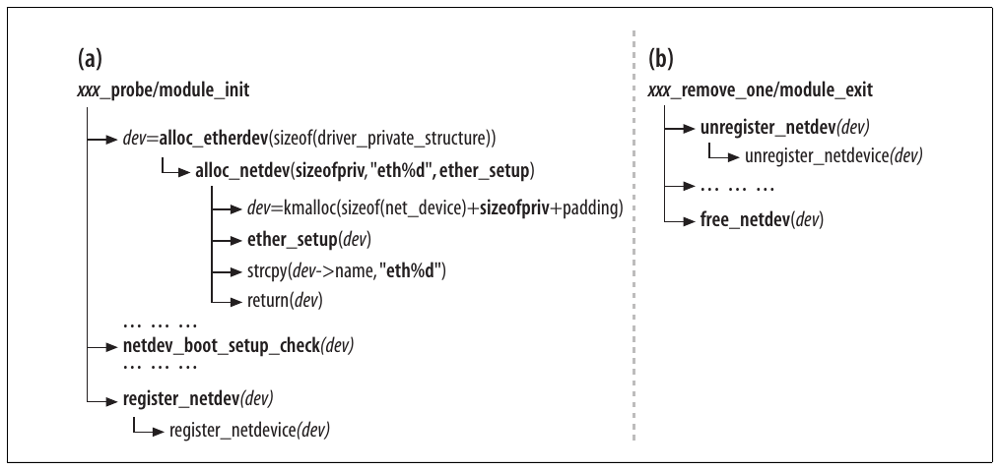
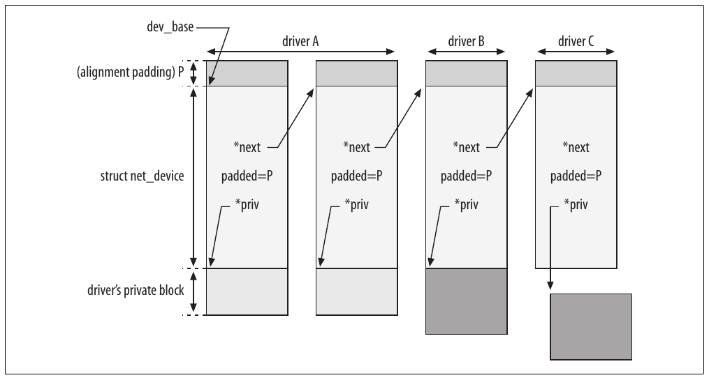
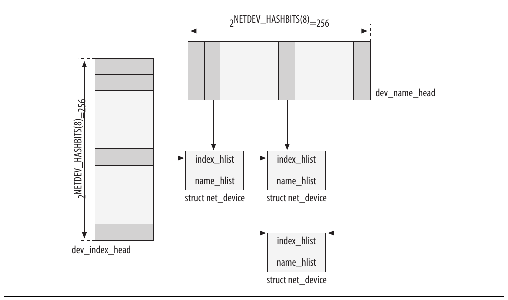
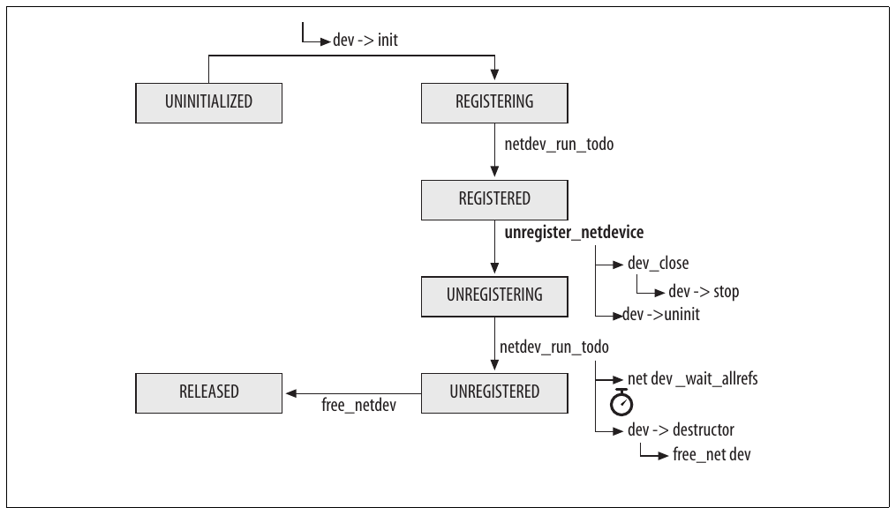
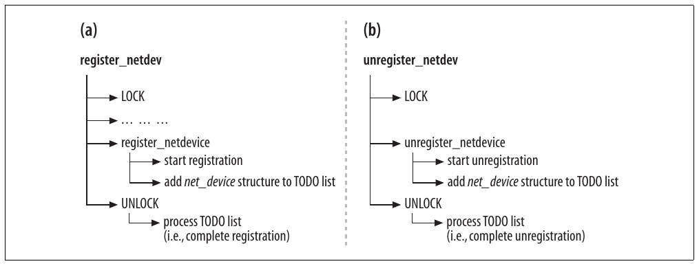
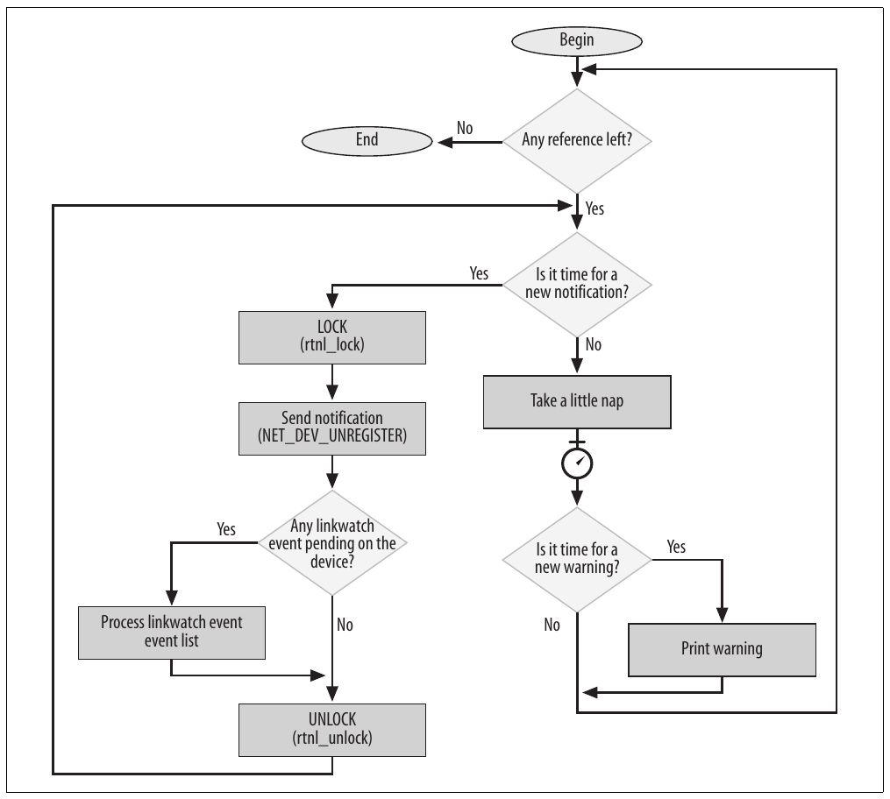
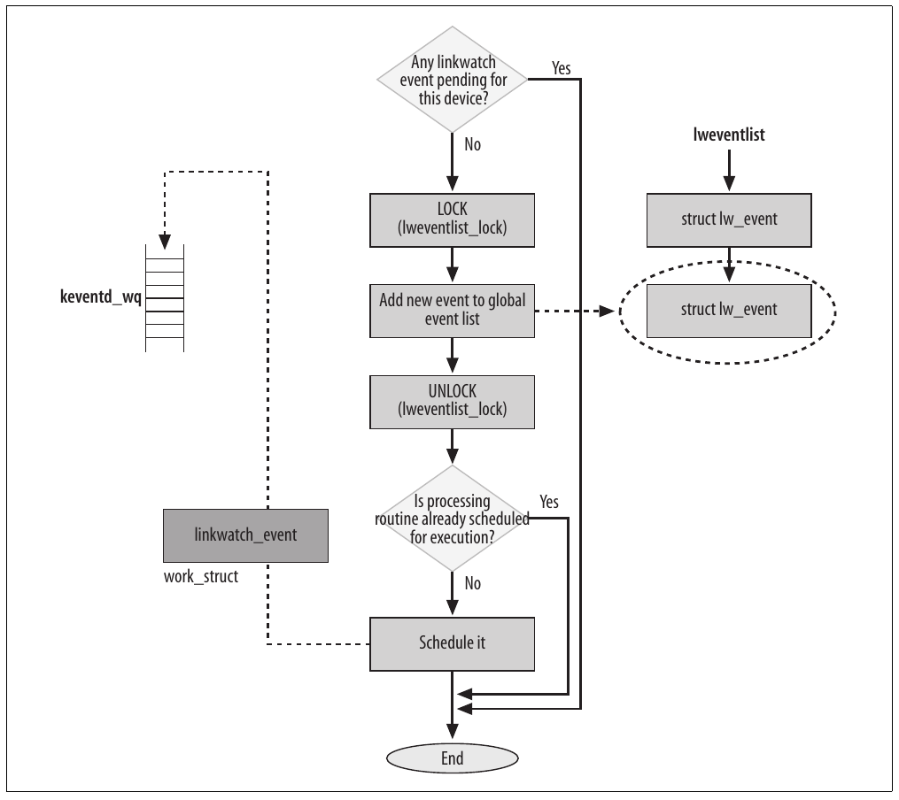
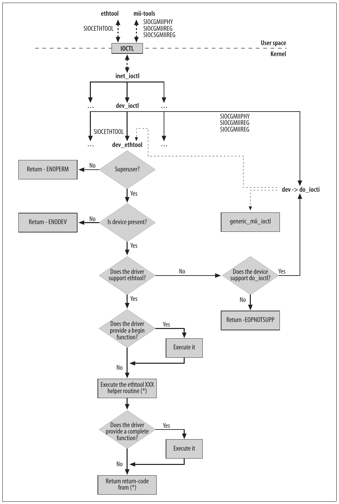
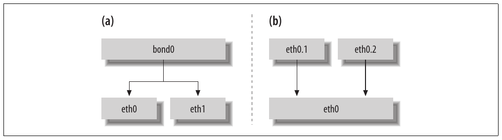
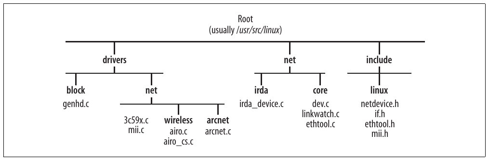

# Chương 8. Đăng ký và khởi tạo device


Trong Chương 5 và 6, chúng ta đã thấy cách kernel nhận diện NIC và quá trình khởi tạo mà kernel thực hiện để NIC có thể giao tiếp với device driver của chúng. Trong chương này, chúng ta sẽ thảo luận các giai đoạn khởi tạo bổ sung:

- Khi nào và bằng cách nào network device đăng ký với kernel

- Cách một network device đăng ký với network device database và được gán một instance của structure `net_device`

- Cách các structure `net_device` được tổ chức thành hash table và list để cho phép các kiểu lookup khác nhau

- Cách các instance `net_device` được khởi tạo, một phần bởi kernel core routine và một phần bởi device driver của chúng

- Sự khác biệt giữa virtual device và real device về việc đăng ký

Chương này không nhằm hướng dẫn cách viết NIC device driver. Đôi khi tôi đi sâu vào code của một NIC device driver, nhưng sẽ không trình bày toàn bộ thiết kế của một NIC device driver. Ở đây, chúng ta chỉ quan tâm đến việc đăng ký và interface giữa device driver với các feature như phát hiện thay đổi link state và power management. Tham khảo Linux Device Drivers (O’Reilly) để có phần thảo luận chi tiết về device driver.

Trước khi có thể sử dụng một NIC, data structure `net_device` tương ứng phải được khởi tạo, thêm vào network device database của kernel, cấu hình và enable. Cần phân biệt việc đăng ký và hủy đăng ký với enable và disable. Đây là hai khái niệm khác nhau:

- Việc đăng ký và hủy đăng ký, nếu loại trừ thao tác load device driver module, không phụ thuộc vào người dùng; kernel điều khiển chúng. Một device mới chỉ được đăng ký thì chưa hoạt động. Chúng ta sẽ xem khi nào device được đăng ký và hủy đăng ký trong các mục “Khi nào device được đăng ký” và “Khi nào device được hủy đăng ký”.

- Enable và disable device cần sự can thiệp của người dùng. Khi device đã được kernel đăng ký, người dùng có thể xem nó bằng các command, cấu hình và enable nó. Xem mục “Enable và disable network device” phía sau.

Hãy bắt đầu bằng việc xem các event nào kích hoạt việc đăng ký và hủy đăng ký network device.

## Khi nào device được đăng ký

Việc đăng ký network device diễn ra trong các tình huống sau:

Load device driver của NIC

Device driver của NIC được khởi tạo tại boot time nếu được build vào kernel, và tại runtime nếu được load dưới dạng module. Mỗi khi quá trình khởi tạo diễn ra, tất cả NIC do driver đó điều khiển đều được đăng ký.

Cắm network device hot-pluggable

Khi người dùng cắm NIC hot-pluggable, kernel thông báo cho driver của nó, rồi driver đăng ký device. (Để đơn giản, chúng ta giả sử device driver đã được load.)

Trong tình huống đầu tiên, mô hình đăng ký được áp dụng được mô tả trong mục “Khung đăng ký và hủy đăng ký NIC” phía sau. Mô hình áp dụng cho mọi bus type và không thay đổi dù registration routine cuối cùng được bus infrastructure hay module initialization code gọi. Ví dụ, trong Chương 6, chúng ta đã thấy cách load PCI device driver dẫn đến thực thi routine `pci_driver-> probe`, thường có tên như `xxx_probe`, do driver cung cấp và đảm nhiệm việc đăng ký device. Trong chương này, chúng ta sẽ xem cách triển khai các routine `probe` đó.

Việc đăng ký device dùng những bus type khác (USB, PCMCIA, v.v.) có chung khung này. Chúng ta sẽ không xem cách infrastructure của những bus đó cuối cùng gọi routine tương ứng với `probe`, như đã xem với PCI trong Chương 6. Những bus cũ có thể không tự động phát hiện được sự hiện diện của device và có thể yêu cầu device driver thực hiện bằng cách probe thủ công các memory address cụ thể, dùng default parameter hoặc parameter boot-time do người dùng cung cấp.[^1] Chúng ta cũng sẽ không xem xét trường hợp này.

## Khi nào device được hủy đăng ký

Hai điều kiện chính kích hoạt việc hủy đăng ký device:

Unload NIC device driver

Tất nhiên, chỉ có thể thực hiện việc này với driver được load dưới dạng module, không áp dụng cho driver được build vào kernel. Khi administrator unload device driver của NIC, mọi NIC tương ứng đều phải được hủy đăng ký.

Ví dụ, trong Chương 6, chúng ta đã thấy cách unload PCI device driver dẫn đến thực thi routine `pci_driver->remove` do driver cung cấp, thường có tên như `xxx_remove_one`, đảm nhiệm việc hủy đăng ký device. PCI layer gọi routine này một lần cho mỗi device được đăng ký với driver đang được unload. Trong chương này, chúng ta sẽ xem cách triển khai những routine đó.

Tháo network device hot-pluggable

Khi người dùng tháo NIC hot-pluggable khỏi hệ thống có kernel đang chạy hỗ trợ device hot-pluggable, network device được hủy đăng ký.

## Cấp phát các structure net\_device

Network device được định nghĩa bằng structure `net_device`. Vì chúng thường được đặt tên là `dev` trong kernel code, tôi thường dùng tên đó cho một `net_device` trong chương này. Các data structure này được cấp phát bằng `alloc_netdev`, định nghĩa trong net/core/dev.c, yêu cầu ba input parameter:

Kích thước private data structure

Trong mục “Tổ chức các structure net\_device”, chúng ta sẽ thấy device driver có thể mở rộng data structure `net_device` bằng một private data block để lưu các parameter của driver. Parameter này chỉ định kích thước block đó.

Tên device

Đây có thể là một phần của tên, được kernel hoàn thiện theo một cơ chế bảo đảm tên device là duy nhất.

Setup routine

Routine này được dùng để khởi tạo một phần các field của `net_device`. Xem các mục “Khởi tạo device” và “Khởi tạo device type: các function xxx\_setup” để biết thêm chi tiết.

Return value là pointer tới structure `net_device` được cấp phát, hoặc NULL nếu có lỗi.

Mỗi device được gán một tên phụ thuộc vào device type và, để bảo đảm duy nhất, chứa một số được gán tuần tự khi các device cùng type được đăng ký. Ví dụ, Ethernet device được gọi là eth0, eth1, v.v. Một device có thể có những tên khác nhau tùy thứ tự đăng ký các device. Chẳng hạn, nếu bạn có hai card do hai module khác nhau xử lý, tên device sẽ phụ thuộc vào thứ tự load hai module. Device Hot-pluggable đặc biệt dễ gặp những thay đổi tên ngoài dự kiến.

Vì configuration tool user-space tham chiếu tới tên device kernel-assigned, thứ tự đăng ký device rất quan trọng. Vì đây là chi tiết user-space, tôi sẽ không bàn thêm, ngoài việc nhắc rằng có những tool, như nameif thuộc package net-tools, cho phép gán tên cố định cho interface dựa trên MAC address.

Khi tên device truyền cho `alloc_netdev` có dạng `name%d` (ví dụ, “`eth%d`”), kernel hoàn thiện tên bằng function `dev_alloc_name`. Function này thay `%d` bằng số đầu tiên chưa được gán cho device type đó.

Kernel cũng cung cấp một tập wrapper quanh `alloc_netdev`, một số được liệt kê trong Bảng 8-1, có thể dùng để truyền cho `alloc_netdev` các parameter thích hợp cho một tập device type phổ biến.[^2] Ví dụ, `alloc_etherdev` được dùng cho Ethernet device, vì vậy tạo tên device có dạng string `eth` theo sau bởi một số duy nhất. Với argument thứ hai, nó chỉ định `ether_setup` làm setup routine, khởi tạo một phần structure `net_device` bằng những value chung cho mọi Ethernet device.

Bảng 8-1. Wrapper cho function alloc\_netdev

| Network device type | Tên wrapper | Định nghĩa wrapper |
|---|---|---|
| Ethernet | `alloc_etherdev` | `return alloc_netdev(sizeof_priv, "eth%d", ether_setup)`; |
| Fiber Distributed Data Interface | `alloc_fddidev` | `return alloc_netdev(sizeof_priv, "fddi%d", fddi_setup)`; |
| High Performace Parallel Interface | `alloc_hippi_dev` | `return alloc_netdev(sizeof_priv, "hip%d", hippi_setup)`; |
| Token Ring | `alloc_trdev` | `return alloc_netdev(sizeof_priv, "tr%d", tr_setup)`; |
| Fibre Channel | `alloc_fcdev` | `return alloc_netdev(sizeof_priv, "fc%d", fc_setup)`; |
| Infrared Data Association | `alloc_irdadev` | `return alloc_netdev(sizeof_priv, "irda%d", irda_device_setup)`; |

## Khung đăng ký và hủy đăng ký NIC

Hình 8-1(a) cho thấy cơ chế tổng quát để device driver của NIC đăng ký với networking code. Hình 8-1(b) cho thấy thao tác tương ứng khi hủy đăng ký. Mặc dù ví dụ dùng PCI Ethernet NIC, cơ chế vẫn giống với những device type khác; chỉ tên routine đảm nhiệm công việc hoặc cách gọi routine đó có thể thay đổi tùy cách triển khai bus code.



Hình 8-1. (a) Mô hình đăng ký device; (b) mô hình hủy đăng ký device

Function bắt đầu bằng cách cấp phát structure `net_device` với `alloc_etherdev`. `alloc_etherdev` cũng khởi tạo tất cả parameter chung cho mọi Ethernet device. Sau đó driver khởi tạo một phần khác của structure `net_device`, và kết thúc việc đăng ký device bằng lời gọi routine `register_netdev`.

Lưu ý rằng:

- Driver gọi wrapper thích hợp quanh `alloc_netdev` (`alloc_etherdev` trong ví dụ), và chỉ cung cấp kích thước private data block của mình. Một số wrapper được liệt kê trong Bảng 8-1.

- Wrapper gọi `alloc_netdev` bằng parameter do driver cung cấp và bổ sung hai parameter còn lại (tên device và initialization routine).

- Kích thước memory block do `alloc_netdev` cấp phát bao gồm structure `net_device`, private block của driver và một phần padding để buộc alignment. Xem Hình 8-2 phía sau trong chương.

- Một số driver gọi `netdev_boot_setup_check` để kiểm tra người dùng có cung cấp parameter boot-time nào khi load kernel hay không. Xem mục “Sử dụng boot option để cấu hình network device” trong Chương 7.

- Instance `net_device` mới được chèn vào device database bằng `register_netdevice` (xem mục “Đăng ký device” phía sau). Nhân đây, tôi dùng thuật ngữ database ở đây và những phần khác của sách theo nghĩa rộng, chỉ một tổ hợp data structure cung cấp cách truy cập thông tin thuận tiện theo nhu cầu của kernel.

Việc hủy đăng ký device, được biểu diễn ở dạng đơn giản trong Hình 8-1(b), luôn bao gồm lời gọi `unregister_netdevice` và `free_netdev`. Lời gọi `free_netdev` đôi khi được thực hiện trực tiếp, đôi khi gián tiếp qua function `dev->destructor`,[^3] như Hình 8-4 phía sau. Device driver cũng cần giải phóng mọi resource mà device sử dụng (IRQ, memory mapping, v.v.), nhưng chúng ta không quan tâm đến các chi tiết đó trong chương này.

## Khởi tạo device

Trong mục “Khi nào device được đăng ký”, chúng ta đã thấy những gì cần được khởi tạo để kernel giao tiếp với NIC. Trong phần còn lại của chương, chúng ta sẽ xem các tác vụ khởi tạo higher-level.

Structure `net_device` khá lớn. Các field của nó được khởi tạo theo từng nhóm bởi những routine khác nhau, mỗi routine phụ trách một tập con field khác nhau.<sup>†</sup> Cụ thể:

Device driver

Những parameter như IRQ, I/O memory và I/O port, có value phụ thuộc vào hardware configuration, do device driver đảm nhiệm. Xem Chương 5.

Device type

Việc khởi tạo các field chung cho mọi device thuộc cùng một họ device type do các routine `xxx_setup` đảm nhiệm. Ví dụ, Ethernet device dùng `ether_setup`. Xem mục “Khởi tạo device type: các function xxx\_setup”. Feature Các feature bắt buộc và tùy chọn cũng cần được khởi tạo. Ví dụ, queuing discipline (tức QoS) được khởi tạo trong `register_netdevice`, như mô tả trong mục “Function register\_netdevice”. Các feature khác có thể được khởi tạo khi những module tương ứng nhận thông báo về việc đăng ký device mới (xem mục “Thông báo trạng thái đăng ký device”).

Việc khởi tạo device type được thực hiện như một phần của quá trình khởi tạo device driver (tức `xxx_setup` được `xxx_probe` gọi), để driver có cơ hội ghi đè những khởi tạo mặc định của device type. Xem mục “Khởi tạo tùy chọn và các trường hợp đặc biệt” để có ví dụ.

Bảng 8-2 cho thấy các function pointer được những routine `xxx_setup` khởi tạo và phần dành cho device driver[^4] (`xxx_probe`): phần đặc thù device-type và phần đặc thù device-model. Lưu ý không phải mọi device driver đều tuân theo sự phân biệt trong Bảng 8-2. Ví dụ, có trường hợp function `xxx_setup` không khởi tạo function pointer nào (một ví dụ là `irda_device_setup in` net/irda/irda\_device.c) và trường hợp khởi tạo tất cả chúng (một ví dụ là `wifi_setup` trong drivers/net/wireless/airo.c).

Bảng 8-2. Function pointer của net\_device được xxx\_setup và xxx\_probe khởi tạo

| Thành phần khởi tạo | Tên function pointer |
|---|---|
| `xxx_setup` | `change_mtu set_mac_address rebuild_header hard_header hard_header_cache header_cache_update hard_header_parse` |
| Probe routine của device driver | `open stop hard_start_xmit tx_timeout watchdog_timeo get_stats get_wireless_stats set_multicast_list do_ioctl init uninit poll ethtool_ops` (đây thực ra là một array các routine) |

Bảng 8-3 tương tự Bảng 8-2, nhưng thay vì function pointer, bảng liệt kê một số field khác của `net_device`.

Bảng 8-3. Các field của net\_device được xxx\_setup và xxx\_probe khởi tạo

| Thành phần khởi tạo | Tên variable |
|---|---|
| `xxx_setup` | `type hard_header_len mtu addr_len tx_queue_len broadcast flags` |
| Probe routine của device driver | `base_addr irq if_port priv features` |

Để biết thêm chi tiết về ý nghĩa các field trong Bảng 8-2 và 8-3, tham khảo Chương 2.

### Khởi tạo bởi device driver

Các field `net_device` do device driver khởi tạo thường được function `xxx_probe` đảm nhiệm; function này được giới thiệu trong mục “Bức tranh tổng thể” ở Chương 6 và minh họa trong Hình 8-1(a).

Một số driver có thể xử lý những device model khác nhau; vì vậy, cùng các parameter có thể được khởi tạo khác nhau tùy device model và capability. Đoạn trích sau từ driver drivers/net/3c59x.c cho thấy function `hard_start_xmit`, sẽ được giới thiệu trong Chương 11, được khởi tạo khác nhau tùy capability của device:[^5]

```c
    if (vp->capabilities & CapBusMaster) {
        vp->full_bus_master_tx = 1;
            ... ... ...
    }
    ... ... ...
    if (vp->full_bus_master_tx) {
        dev->hard_start_xmit = boomerang_start_xmit;
            ... ... ...
    } else {
        dev->hard_start_xmit = vortex_start_xmit;
    }
```

### Khởi tạo device type: các function xxx\_setup

Với những network device type phổ biến nhất, có một function `xxx_setup` để khởi tạo các field trong structure `net_device` (cả parameter lẫn function pointer) chung cho mọi device cùng type, chẳng hạn tất cả Ethernet card.

Trong Bảng 8-1, bạn đã thấy các function `alloc_ xxxdev` truyền routine `xxx_setup` thích hợp cho `alloc_netdev` (làm input parameter thứ ba). Đây là routine `ether_setup`, tức routine `xxx_setup` dùng cho Ethernet device:

```c
void ether_setup(struct net_device *dev)
{
    dev->change_mtu           = eth_change_mtu;
    dev->hard_header          = eth_header;
    dev->rebuild_header       = eth_rebuild_header;
    dev->set_mac_address      = eth_mac_addr;
    dev->hard_header_cache    = eth_header_cache;
    dev->header_cache_update  = eth_header_cache_update;
    dev->hard_header_parse    = eth_header_parse;
    dev->type                 = ARPHRD_ETHER;
    dev->hard_header_len      = ETH_HLEN;
    dev->mtu                  = 1500;
    dev->addr_len             = ETH_ALEN;
    dev->tx_queue_len         = 1000;
    dev->flags                = IFF_BROADCAST|IFF_MULTICAST;

    memset(dev->broadcast,0xFF, ETH_ALEN);
}
```

Như bạn thấy, function này chỉ khởi tạo những field và function pointer có thể dùng chung cho mọi Ethernet card: MTU bằng 1.500, broadcast address link-layer là FF:FF:FF:FF:FF:FF, egress queue dài 1.000 packet,[^6] v.v.

Sử dụng generic allocation wrapper và routine `xxx_setup`, như trong Bảng 8-1, là cách tiếp cận phổ biến nhất. Tuy nhiên:

- Một số lớp device định nghĩa function `setup` nhưng không cung cấp generic wrapper tương tự những wrapper trong Bảng 8-1. Trong đó có device ARCNET<sup>†</sup> (xem `arcdev_setup` trong drivers/net/arcnet/arcnet.c) và device IrDA<sup>‡</sup> (xem `irda_device_setup` trong net/irda/irda\_device.c).

- Một routine `xxx_setup` tổng quát có thể được device không thuộc lớp được chỉ ra sử dụng. `ether_setup` là một ví dụ: device non-Ethernet cũng dùng nó. Khi phần lớn những khởi tạo của một routine `xxx_setup` cụ thể phù hợp nhu cầu device driver, driver có thể dùng routine `xxx_setup` đó và chỉ ghi đè những khởi tạo không thích hợp. Tuy nhiên, cách này không phổ biến.

- Ethernet driver có thể dùng khởi tạo mặc định do `ether_setup` cung cấp (được `alloc_etherdev` gọi gián tiếp) nhưng ghi đè một số khởi tạo. Ví dụ, driver 3c59x.c không dùng value `net_device->mtu` do `ether_setup` đặt mà ghi đè bằng một local variable. Variable này được khởi tạo cùng default value mà `ether_setup` sẽ đặt, nhưng driver có thể đặt value lớn hơn cho những NIC model hỗ trợ chúng.

### Khởi tạo tùy chọn và các trường hợp đặc biệt

Có trường hợp một số parameter `net_device` không được khởi tạo đơn giản vì chúng không có ý nghĩa với device type đó; function pointer hoặc value tương ứng không được khởi tạo và do đó được để là NULL.

Để tránh tham chiếu NULL pointer, kernel luôn bảo đảm các function pointer tùy chọn đã được khởi tạo trước khi gọi chúng,[^7] như ví dụ sau từ `register_netdevice`:

```c
if (dev->init && dev->init(dev) != 0) {
    ...
}
```

Cần lưu ý rằng các yếu tố bên ngoài cũng có thể thay đổi cách thức và vị trí khởi tạo các field trong Bảng 8-2 và 8-3. Một ví dụ liên quan đến field `net_device->mtu`. Virtual device thường kế thừa configuration parameter từ real device tương ứng, rồi điều chỉnh nếu cần. Ví dụ, virtual tunnel interface do protocol IP-over-IP tạo kế thừa `dev->mtu` từ real device tương ứng. (Điều này không tự động diễn ra; virtual device driver đảm nhiệm nó.) Tuy nhiên, do protocol IP-over-IP cần thêm IP header, MTU phải được giảm tương ứng (xem `ipip_tunnel_xmit` trong net/ipv4/ipip.c, giả định một Ethernet device bên dưới).

## Tổ chức các structure net\_device

Một số khía cạnh tinh tế hơn của structure `net_device` gồm:

- Trong mục “Cấp phát các structure net\_device”, chúng ta đã thấy khi `alloc_netdev` được gọi để cấp phát structure `net_device`, nó được truyền kích thước private data block của driver (kích thước phụ thuộc vào driver; một số thậm chí không dùng private data). `alloc_netdev` nối private data vào structure `net_device`. Hình 8-1 cho thấy cách truyền parameter đó và Hình 8-2 cho thấy ảnh hưởng lên việc cấp phát memory.

- Hình 8-2 cũng cho thấy quan hệ giữa data structure `net_device` và private data structure tùy chọn của driver. Thông thường, phần thứ hai được cấp phát cùng phần thứ nhất để chỉ cần một lời gọi `kmalloc`, nhưng cũng có trường hợp driver muốn tự cấp phát private block (xem driver C trong Hình 8-2).

- Như ví dụ trong Hình 8-2, kích thước private block của driver và nội dung của nó thay đổi không chỉ giữa các device type (ví dụ, Token Ring và Ethernet) mà cả giữa device cùng type (ví dụ, hai Ethernet card khác nhau).

- `dev_base` (được giới thiệu phía sau trong mục này) và pointer `next` trong `net_device` trỏ tới đầu structure `net_device`, không phải đầu block được cấp phát. Tuy nhiên, kích thước padding ban đầu được lưu trong `dev->padded`, cho phép kernel giải phóng toàn bộ memory block khi cần.

Các data structure `net_device` được chèn cả vào một global list, như Hình 8-2, và hai hash table, như Hình 8-3. Những structure khác nhau này cho phép kernel dễ dàng duyệt hoặc lookup database `net_device` theo yêu cầu. Chi tiết như sau:

`dev_base`

Global list chứa mọi instance `net_device` này cho phép kernel dễ dàng duyệt các device, chẳng hạn khi cần lấy một số thống kê, thay đổi cấu hình trên mọi device theo một user command, hoặc tìm device khớp các tiêu chí tìm kiếm đã cho.

Vì mỗi driver có định nghĩa private data structure riêng, global list các structure `net_device` có thể liên kết những phần tử có kích thước khác nhau (xem Hình 8-2).



Hình 8-2. Global list các device đã đăng ký

`dev_name_head`

Đây là hash table được index theo tên device. Ví dụ, nó hữu ích khi áp dụng thay đổi cấu hình qua interface `ioctl`. Configuration tool old-generation giao tiếp với kernel qua interface `ioctl` thường tham chiếu device bằng tên.

`dev_index_head`

Đây là hash table được index theo device ID `dev->ifindex`. Cross-references tới các structure `net_device` thường lưu device ID hoặc pointer tới structure `net_device`; `dev_index_head` hữu ích với trường hợp đầu. Ngoài ra, configuration tool new-generation ip (thuộc package IPROUTE2), giao tiếp với kernel qua Netlink socket, thường tham chiếu device bằng ID.



Hình 8-3. Các hash table dùng để tìm instance net\_device theo tên device và device index

### Lookup

Các lookup phổ biến nhất dựa trên tên device hoặc device ID. Hai kiểu lookup này được triển khai bởi `dev_get_by_name` và `dev_get_by_index`, dùng hai hash table đã thảo luận trong mục trước. Cũng có thể tìm instance `net_device` dựa trên device type, MAC address, v.v. Những kiểu lookup này dùng list `dev_base`.

Mọi lookup, trên cả list `dev_base` lẫn hai hash table, đều được lock `dev_base_lock` bảo vệ.

Tất cả lookup routine được định nghĩa trong net/core/dev.c.

## Device state

Structure `net_device` chứa các field khác nhau định nghĩa state hiện tại của device. Trong đó có:

`flags`

Bitmap dùng để lưu các flag khác nhau. Phần lớn biểu thị capability của device. Tuy nhiên, một flag, `IFF_UP`, được dùng để cho biết device đang được enable (up) hay disable (down). Bạn có thể tìm danh sách flag `IFF_XXX` trong include/linux/if.h. Xem thêm mục “Enable và disable network device”.

`reg_state`

State đăng ký device. Mục “Registration state” liệt kê những value có thể gán cho field này và khi nào value thay đổi.

`state`

Device state xét theo queuing discipline của nó. Xem mục “Queuing discipline state”.

Đôi khi bạn có thể thấy chút chồng lấn giữa những variable này. Ví dụ, mỗi khi `IFF_UP` được set trong `flags`, `__LINK_STATE_START` được set trong `state`, và ngược lại. Cả hai lần lượt được `dev_open` và `dev_close` set và clear. Tuy nhiên, phạm vi của chúng khác nhau, và đôi khi việc viết modular code có thể tạo ra chút chồng lấn.

### Queuing discipline state

Mỗi network device được gán một queuing discipline, được Traffic Control dùng để triển khai các cơ chế QoS. Field `state` của `net_device` là một trong những field của structure được Traffic Control sử dụng. `state` là bitmap và danh sách sau cho thấy những flag có thể được set. Chúng được định nghĩa trong include/linux/netdevice.h.

`__LINK_STATE_START`

Device đang up. Có thể kiểm tra flag này bằng `netif_running`. Xem mục “Enable và disable network device”.

`__LINK_STATE_PRESENT`

Device hiện diện. Flag này có vẻ thừa; nhưng hãy lưu ý rằng device hot-pluggable có thể được tháo tạm thời. Flag cũng lần lượt được clear và khôi phục khi hệ thống vào suspend mode rồi resume. Có thể kiểm tra flag bằng `netif_device_present`. Xem mục “Function register\_netdevice”.

`__LINK_STATE_NOCARRIER`

Không có carrier. Có thể kiểm tra flag bằng `netif_carrier_ok`. Xem mục “Phát hiện thay đổi link state”.

`__LINK_STATE_LINKWATCH_EVENT`

Link state của device đã thay đổi. Xem mục “Lập lịch và xử lý event thay đổi link state”.

`__LINK_STATE_XOFF`

`__LINK_STATE_SHED`

`__LINK_STATE_RX_SCHED`

Ba flag này được code quản lý ingress traffic và egress traffic trên device sử dụng. Chúng ta sẽ xem cách dùng chúng trong Phần III.

### Registration state

State của device xét theo việc đăng ký với network stack được lưu trong field `reg_state` của structure `net_device`. Các value `NETREG_XXX` mà field có thể nhận được định nghĩa trong include/linux/netdevice.h, bên trong định nghĩa structure `net_device`. Trong mục tiếp theo, chúng ta sẽ xem quan hệ giữa chúng. Sau đây là mô tả ngắn:

`NETREG_UNINITIALIZED`

Được định nghĩa là 0. Khi data structure `net_device` được cấp phát và nội dung được đặt về zero, value này biểu thị số 0 trong `dev->reg_state`.

`NETREG_REGISTERING`

Structure `net_device` đã được thêm vào các structure liệt kê trong mục “Tổ chức các structure net\_device” phía sau, nhưng kernel vẫn cần thêm entry vào filesystem /sys.

`NETREG_REGISTERED`

Device đã được đăng ký hoàn toàn.

`NETREG_UNREGISTERING`

Structure `net_device` đã được loại khỏi các structure liệt kê trong mục “Tổ chức các structure net\_device” phía sau.

`NETREG_UNREGISTERED`

Device đã được hủy đăng ký hoàn toàn (bao gồm xóa entry khỏi /sys), nhưng structure `net_device` chưa được giải phóng.

`NETREG_RELEASED`

Mọi reference tới structure `net_device` đã được giải phóng. Theo góc nhìn networking code, data structure có thể được giải phóng. Tuy nhiên, sysfs sẽ đảm nhiệm việc đó. Xem mục “Reference count”.

## Đăng ký và hủy đăng ký device

Network device lần lượt được đăng ký và hủy đăng ký với kernel bằng `register_netdev` và `unregister_netdev`. Đây là những wrapper đơn giản đảm nhiệm locking rồi lần lượt gọi routine `register_netdevice` và `unregister_netdevice`. Chúng ta đã giới thiệu ngắn gọn các function này trong Hình 8-1. Tất cả đều được định nghĩa trong net/core/dev.c.

Hình 8-4 cho thấy những registration state mà một `net_device` có thể được đặt vào, cùng vị trí tham gia của những routine nêu trên. Hình cũng cho thấy vị trí gọi các routine quan trọng khác. Tất cả sẽ được mô tả trong các mục sau. Đặc biệt, lưu ý rằng:

- Việc chuyển state có thể dùng các state trung gian giữa `NETREG_UNINITIALIZED` và `NETREG_REGISTERED`. Những chuyển tiếp này do `netdev_run_todo` xử lý, được mô tả trong mục “Tách thao tác: netdev\_run\_todo”.

- Hai virtual function của `net_device`, `init` và `uninit`, có thể được device driver dùng để lần lượt khởi tạo và dọn dẹp private data khi đăng ký và hủy đăng ký device. Chúng chủ yếu được virtual device dùng. Xem mục “Virtual device”.

- Việc hủy đăng ký device không thể hoàn tất cho đến khi mọi reference tới data structure `net_device` tương ứng được giải phóng: `netdev_wait_allrefs` không return cho đến khi điều kiện đó được đáp ứng. Xem mục “Reference count”.

- Cả việc đăng ký và hủy đăng ký device đều được `netdev_run_todo` hoàn tất. Trong mục “Tách thao tác: netdev\_run\_todo”, chúng ta sẽ xem cách `register_netdevice` và `unregister_netdevice` tương tác với `netdev_run_todo`.



Hình 8-4. Registration state machine của net\_device

### Tách thao tác: netdev\_run\_todo

`register_netdevice` đảm nhiệm một phần việc đăng ký rồi để `netdev_run_todo` hoàn tất. Ban đầu, khi nhìn code, có thể chưa rõ điều này diễn ra thế nào. Hãy xem cách hoạt động với sự trợ giúp của Hình 8-5(a).

Các thay đổi đối với structure `net_device` được Routing Netlink semaphore bảo vệ qua `rtnl_lock` và `rtnl_unlock`, vì vậy `register_netdev` acquire lock (semaphore) lúc bắt đầu và release trước khi return (chi tiết trong mục “Locking”). Khi `register_netdevice` xong việc, nó thêm structure `net_device` mới vào `net_todo_list` bằng `net_set_todo`. List đó chứa các device cần hoàn tất việc đăng ký (hoặc hủy đăng ký, như chúng ta sẽ thấy ngay sau đây). List không được xử lý bởi một kernel thread riêng hoặc periodic timer; `register_netdev` sẽ gián tiếp xử lý nó khi release lock.

Vì vậy, `rtnl_unlock` không chỉ release lock mà còn gọi `netdev_run_todo`.[^8] Function sau duyệt array `net_todo_list` và hoàn tất việc đăng ký mọi instance `net_device` trong đó.

Tại mỗi thời điểm, chỉ một CPU có thể chạy `net_run_todo`. Serialization được bảo đảm bằng mutex `net_todo_run_mutex`.

Việc hủy đăng ký device được xử lý hoàn toàn theo cùng cách (như Hình 8-5(b)).



Hình 8-5. Cấu trúc register\_netdev và unregister\_netdev

Chính xác những gì `netdev_run_todo` thực hiện để hoàn tất đăng ký hoặc hủy đăng ký device lần lượt được mô tả ở cuối các mục “Function register\_netdevice” và “Function unregister\_netdevice”.

Lưu ý rằng vì các tác vụ đăng ký và hủy đăng ký do `netdev_run_todo` xử lý không giữ lock, function này có thể sleep an toàn và để semaphore sẵn sàng cho nơi khác sử dụng. Bạn sẽ thấy một ví dụ về lợi ích này trong mục “Reference count”.

Với mô hình ở Hình 8-5, có vẻ kernel không thể có nhiều hơn một instance `net_device` trong `net_todo_list` khi `netdev_run_todo` được gọi. Làm sao có nhiều phần tử nếu `register_netdev` và `unregister_netdev` chỉ thêm một instance `net_device` vào list rồi xử lý list ngay khi release lock? Chẳng hạn, device driver có thể dùng vòng lặp như sau để hủy đăng ký mọi device của nó trong một lượt (ví dụ, xem `tun_cleanup` trong drivers/net/tun.c):

```c
rtnl_lock( );
loop for each device driven by this driver {
    ... ... ...
    unregister_netdevice(dev);
    ... ... ...
}
rtnl_unlock( );
```

Cách này tốt hơn cách tiếp cận sau, acquire và release lock rồi xử lý `net_todo_list` ở mỗi lần lặp:

```c
loop for each device driven by this driver {
    ... ... ...
    unregister_netdev(dev);
    ... ... ...
}
```

### Thông báo trạng thái đăng ký device

Cả kernel component lẫn application user-space có thể muốn biết khi nào network device được đăng ký, hủy đăng ký, down hoặc up. Thông báo về các event này được gửi qua hai kênh:

`netdev_chain`

Kernel component có thể đăng ký với notification chain này. Xem mục tiếp theo, “Notification chain netdev\_chain”.

Multicast group `RTMGRP_LINK` của Netlink

Application User-space, như monitoring tool hoặc routing protocol, có thể đăng ký với multicast group `RTMGRP_LINK` của RTnetlink. Xem mục “RTnetlink link notification”.

#### Notification chain netdev\_chain

Trong Chương 4, chúng ta đã thấy notification chain là gì và cách sử dụng. Tiến trình qua các giai đoạn đăng ký và hủy đăng ký device được báo cáo bằng notification chain `netdev_chain`. Chain này được định nghĩa trong net/core/dev.c, và kernel component quan tâm đến những event này lần lượt đăng ký và hủy đăng ký với chain bằng `register_netdevice_notifier` và `unregister_netdevice_notifier`.

Tất cả event `NETDEV_XXX` được báo cáo qua `netdev_chain` được liệt kê trong include/linux/notifier.h. Sau đây là những event đã gặp trong chương này, cùng điều kiện kích hoạt chúng:

`NETDEV_UP`

`NETDEV_GOING_DOWN`

`NETDEV_DOWN`

`NETDEV_UP` được gửi để báo cáo device đã được enable và được `dev_open` tạo ra.

`NETDEV_GOING_DOWN` được gửi khi device sắp được disable. `NETDEV_DOWN` được gửi khi device đã được disable. Cả hai đều do `dev_close` tạo ra.

Để biết thêm chi tiết về ba event này, xem mục “Enable và disable network device”.

`NETDEV_REGISTER`

Device đã được đăng ký. Event này do `register_netdevice` tạo ra. Xem mục “Function register\_netdevice”.

`NETDEV_UNREGISTER`

Device đã được hủy đăng ký. Event này do `unregister_netdevice` tạo ra. Xem mục “Function unregister\_netdevice”.

Và đây là những event còn lại:

`NETDEV_REBOOT`

Device đã khởi động lại do hardware failure. Hiện không được sử dụng.

`NETDEV_CHANGEADDR`

Hardware address (hoặc broadcast address tương ứng) của device đã thay đổi.

`NETDEV_CHANGENAME`

Device đã đổi tên.

`NETDEV_CHANGE`

Trạng thái hoặc cấu hình device đã thay đổi. Event này được dùng trong mọi trường hợp không thuộc `NETDEV_CHANGEADDR` và `NETDEV_CHANGENAME`. Hiện nó được dùng khi có thay đổi trong `dev->flags`.

Các notification `NETDEV_CHANGEXXX` thường được tạo để đáp lại thay đổi cấu hình từ người dùng.

Lưu ý rằng khi đăng ký với chain, `register_netdevice_notifier` cũng phát lại (chỉ cho bên vừa đăng ký) mọi notification `NETDEV_REGISTER` và `NETDEV_UP` trước đó đối với những device hiện được đăng ký trong hệ thống. Điều này giúp bên vừa đăng ký có cái nhìn rõ ràng về trạng thái hiện tại của các device đã đăng ký.

Khá nhiều kernel component đăng ký với `netdev_chain`. Trong đó có:

Routing

Chẳng hạn, routing subsystem dùng notification này để thêm hoặc xóa mọi routing entry tương ứng với device. Xem Chương 32.

Firewall

Ví dụ, nếu firewall đã buffer packet từ một device hiện đang down, nó phải drop packet hoặc thực hiện thao tác khác theo policy.

Protocol code (tức ARP, IP, v.v.)

Ví dụ, khi bạn thay đổi MAC address của local device, ARP table phải được cập nhật tương ứng. Xem các chương về protocol tương ứng để biết thêm chi tiết.

Virtual device

Xem mục “Virtual device”.

RTnetlink

Xem mục tiếp theo, “RTnetlink link notification”.

##### RTnetlink link notification

Notification được gửi tới Link multicast group `RTMGRP_LINK` bằng `rtmsg_ifinfo` khi có thay đổi trong state hoặc cấu hình device. Trong số đó có:

- Khi nhận notification trên notification chain `netdev_chain`. RTnetlink đăng ký với chain `netdev_chain` được giới thiệu trong mục trước và phát lại các notification nhận được.

- Khi device đang disable được enable hoặc ngược lại (xem `netdev_state_change`).

- Khi một flag trong `net_device->flags` thay đổi, ví dụ qua configuration command của người dùng (xem `dev_change_flags`).

netplugd là daemon thuộc package net-utils, lắng nghe các notification này và phản ứng theo configuration file của người dùng. Xem manpage netplugs để biết chi tiết.

## Đăng ký device

Việc đăng ký device, có mô hình cơ bản trong Hình 8-1(a), không đơn thuần là chèn structure `net_device` vào global list và hash table được giới thiệu trong mục “Tổ chức các structure net\_device”. Nó còn bao gồm khởi tạo một số parameter trong structure `net_device`, tạo broadcast notification để báo cho kernel component khác về việc đăng ký, cùng các tác vụ khác. Device được đăng ký bằng `register_netdev`, một wrapper đơn giản quanh `register_netdevice`. Wrapper chủ yếu đảm nhiệm locking và hoàn thiện tên như đã mô tả trong mục “Cấp phát các structure net\_device”. Lock bảo vệ list `dev_base` chứa những device đã đăng ký.

### Function register\_netdevice

Như mô tả trong Hình 8-5(a), `register_netdevice` bắt đầu đăng ký device và gọi `net_set_todo`, cuối cùng yêu cầu `netdev_run_todo` hoàn tất việc đăng ký.

Đây là những tác vụ chính do `register_netdevice` thực hiện:

- Khởi tạo một số field của `net_device`, bao gồm những field dùng cho locking được liệt kê trong mục “Locking”.

- Khi kernel hỗ trợ feature Divert, cấp phát configuration block mà feature cần và liên kết tới `dev->divert`. Việc này do `alloc_divert_blk` đảm nhiệm.

- Nếu device driver đã khởi tạo `dev->init`, thực thi function đó. Xem mục “Virtual device”.

- Gán cho device một identifier duy nhất bằng `dev_new_index`. Identifier được tạo bằng counter tăng mỗi khi thêm device mới vào hệ thống. Counter này là variable 32-bit, nên `dev_new_index` có một mệnh đề `if` để xử lý wraparound và một mệnh đề `if` khác để xử lý khả năng variable đạt value đã được gán.

- Nối `net_device` vào global list `dev_base` và chèn vào hai hash table được mô tả trong mục “Tổ chức các structure net\_device”. Dù thêm structure vào đầu `dev_base` sẽ nhanh hơn, kernel có cơ hội kiểm tra tên device trùng bằng cách duyệt toàn bộ list. Tên device được kiểm tra tính không hợp lệ bằng `dev_valid_name`.

- Kiểm tra các feature flag để tìm tổ hợp không hợp lệ. Ví dụ:

  - Scather/Gather-DMA không có tác dụng nếu không hỗ trợ L4 hardware checksumming, vì vậy bị disable trong tình huống đó.

  - TCP Segmentation Offload (TSO) yêu cầu Scather/Gather-DMA, vì vậy bị disable khi cơ chế sau không được hỗ trợ.

Xem Chương 19 để biết thêm chi tiết về L4 checksum.

- Set flag `__LINK_STATE_PRESENT` trong `dev->state` để device sẵn sàng cho hệ thống (có thể nhìn thấy và sử dụng). Ví dụ, flag được clear khi device hot-pluggable bị tháo hoặc khi hệ thống hỗ trợ power management vào suspend mode. Xem mục “Queuing discipline state”.

Việc khởi tạo flag này không kích hoạt thao tác nào; thay vào đó, value của nó được kiểm tra trong những trường hợp well-defined để lọc request không hợp lệ hoặc lấy device state.

- Khởi tạo queuing discipline của device, được Traffic Control dùng để triển khai QoS, bằng `dev_init_scheduler`. Queuing discipline định nghĩa cách egress packet được enqueue vào và dequeue khỏi egress queue, số packet có thể được queue trước khi bắt đầu drop chúng, v.v. Xem mục “Queuing Discipline Interface” trong Chương 11.

- Thông báo cho mọi subsystem quan tâm đến đăng ký device qua notification chain `netdev_chain`. Notification chain được mô tả trong Chương 4.

Khi `netdev_run_todo` được gọi để hoàn tất đăng ký, nó chỉ cập nhật `dev->reg_state` và đăng ký device trong filesystem sysfs.

Ngoài vấn đề cấp phát memory, việc đăng ký device chỉ có thể thất bại nếu tên device không hợp lệ hoặc bị trùng, hoặc khi `dev->init` thất bại vì lý do nào đó.

## Hủy đăng ký device

Để hủy đăng ký device, kernel và device driver tương ứng cần hoàn tác mọi thao tác đã thực hiện khi đăng ký, cùng những việc khác:

- Disable device bằng `dev_close`, được mô tả trong mục “Enable và disable network device”.

- Giải phóng mọi resource đã cấp phát (IRQ, I/O memory, I/O port, v.v.)

- Loại structure `net_device` khỏi global list `dev_base` và hai hash table được giới thiệu trong mục “Tổ chức các structure net\_device”.

- Khi mọi reference tới structure đã được giải phóng, giải phóng data structure `net_device`, private data structure của driver và mọi memory block khác liên kết với nó (xem Hình 8-2). Structure `net_device` được giải phóng bằng `free_netdev`. Khi kernel được compile với hỗ trợ sysfs, `free_netdev` để sysfs đảm nhiệm giải phóng structure.

- Xóa mọi file có thể đã được thêm vào filesystem /proc và /sys.

Lưu ý rằng mỗi khi có dependency giữa các device, việc hủy đăng ký một device có thể buộc hủy đăng ký tất cả (hoặc một phần) device còn lại. Xem mục “Virtual device” để có ví dụ.

Ba function pointer trong `net_device` (được biểu diễn bằng variable tên `dev`) tham gia khi hủy đăng ký device:

`dev->stop`

Function pointer này được device driver khởi tạo để trỏ tới một local routine của nó. Nó được `dev_stop` gọi khi disable device (xem mục “Enable và disable network device”). Những tác vụ thường được xử lý ở đây gồm dừng egress queue bằng `netif_stop_queue`,[^9] giải phóng hardware resource, dừng mọi timer do device driver sử dụng, v.v.

Virtual device không cần giải phóng hardware resource, nhưng có thể cần đảm nhiệm những vấn đề high-level khác. Xem mục “Virtual device”.

`dev->uninit`

Function pointer này cũng được device driver khởi tạo để trỏ tới một local routine của nó. Hiện chỉ một số ít tunneling virtual device khởi tạo nó; chúng trỏ nó tới routine chủ yếu đảm nhiệm reference count.

`dev->destructor`

Khi được dùng, pointer này thường được khởi tạo thành `free_netdev` hoặc một wrapper quanh function đó. Tuy nhiên, `destructor` không thường được khởi tạo; chỉ một số virtual device dùng nó. Phần lớn device driver gọi `free_netdev` trực tiếp sau `unregister_netdevice`.

Hình 8-4 cho thấy khi nào và theo thứ tự nào ba routine này được gọi.

### Function unregister\_netdevice

`unregister_netdevice` nhận một parameter, pointer tới structure `net_device` cần loại bỏ:

```c
int unregister_netdevice(struct net_device *dev)
```

Trong Chương 9, chúng ta sẽ xem chi tiết cách networking code dùng software interrupt (softirq) để xử lý truyền (`net_tx_action`) và nhận (`net_rx_action`) packet. Hiện tại, bạn có thể xem những function đó là interface giữa device driver và protocol upper-layer. Hai lời gọi `synchronize_net` được dùng để đồng bộ `unregister_netdevice` với receive engine (`net_rx_action`), để engine không truy cập data cũ sau khi data đã được `unregister_netdevice` cập nhật.

Các tác vụ khác do `unregister_netdevice` đảm nhiệm gồm:

- Nếu device chưa được disable, trước hết phải disable bằng `dev_close` (xem mục “Enable và disable network device”).

- Instance `net_device` sau đó được loại khỏi global list `dev_base` và hai hash table được giới thiệu trong mục “Tổ chức các structure net\_device”. Lưu ý điều này chưa đủ để ngăn kernel subsystem sử dụng device: chúng vẫn có thể giữ pointer tới data structure `net_device`. Vì vậy, `net_device` dùng reference count để theo dõi còn bao nhiêu reference tới structure (xem mục “Reference count”).

- Mọi instance queuing discipline tương ứng với device được hủy bằng `dev_shutdown`.

- Một notification `NETDEV_UNREGISTER` được gửi trên notification chain `netdev_chain` để báo cho các kernel component khác. Xem mục “Thông báo trạng thái đăng ký device”.

- User space phải được thông báo về việc hủy đăng ký. Chẳng hạn, trong hệ thống có hai NIC có thể dùng để truy cập Internet, notification này có thể được dùng để khởi động device phụ. Xem mục “Thông báo trạng thái đăng ký device”.

- Mọi data block liên kết với structure `net_device` được giải phóng. Ví dụ, multicast data `dev->mc_list` được loại bỏ bằng `dev_mc_discard`, Divert block được loại bỏ bằng `free_divert_blk`, v.v. Những block không được loại bỏ trực tiếp trong `unregister_netdevice` được kỳ vọng sẽ được loại bỏ bởi function handler xử lý các notification đề cập trong gạch đầu dòng trước.

- Mọi việc `dev->init` đã thực hiện trong `register_netdevice` được hoàn tác ở đây bằng `dev->uninit`.

- Feature như bonding cho phép nhóm một tập device lại và xem chúng như một virtual device duy nhất có đặc tính riêng. Trong những device đó, một device thường được chọn làm master vì giữ vai trò đặc biệt trong nhóm. Vì những lý do hiển nhiên, device đang bị loại bỏ phải giải phóng mọi reference tới master device: nếu `dev->master` còn non-NULL ở thời điểm này thì đó là bug. Tiếp tục ví dụ bonding, reference `dev->master` được clear nhờ các notification `NETDEV_UNREGISTER` đã gửi chỉ vài dòng code trước.

Cuối cùng, `net_set_todo` được gọi để `net_run_todo` hoàn tất hủy đăng ký, như mô tả trong mục “Tách thao tác: netdev\_run\_todo”, và reference count được giảm bằng `dev_put`. `net_run_todo` hủy đăng ký device khỏi sysfs, đổi `dev->reg_state` thành `NETREG_UNREGISTERED`, chờ đến khi hết mọi reference, và hoàn tất hủy đăng ký bằng lời gọi `dev->destructor`.

### Reference count

Structure `net_device` không thể được giải phóng cho đến khi mọi reference tới nó được giải phóng. Reference count của structure được giữ trong `dev->refcnt`, được cập nhật mỗi khi thêm hoặc bỏ reference, lần lượt bằng `dev_hold` và `dev_put`.

Khi device được đăng ký bằng `register_netdevice`, `dev->refcnt` được khởi tạo thành 1. Reference đầu tiên này vì thế được kernel code phụ trách network device database giữ. Reference này chỉ được giải phóng bằng lời gọi `unregister_netdevice`. Điều này có nghĩa `dev->refcnt` sẽ không bao giờ giảm về zero cho đến khi device cần được hủy đăng ký. Vì vậy, khác với kernel object khác được routine `xxx_put` giải phóng khi reference count giảm về zero, data structure `net_device` không được giải phóng cho đến khi bạn hủy đăng ký device khỏi kernel. Chúng ta đã thấy các điều kiện dẫn đến hủy đăng ký device trong mục ““Khi nào device được hủy đăng ký”.

Tóm lại, lời gọi `dev_put` ở cuối `unregister_netdevice` chưa đủ để một instance `net_device` đủ điều kiện bị xóa: kernel vẫn cần chờ mọi reference được giải phóng. Nhưng vì device không còn dùng được sau khi hủy đăng ký, kernel cần thông báo cho mọi bên giữ reference để chúng giải phóng reference. Việc này được thực hiện bằng cách gửi notification `NETDEV_UNREGISTER` tới notification chain `netdev_chain`. Điều này cũng có nghĩa bên giữ reference phải đăng ký với notification chain; nếu không, chúng không thể nhận những notification đó và thực hiện thao tác tương ứng.

Như đã đề cập trong mục “Tách thao tác: netdev\_run\_todo”, `unregister_netdevice` bắt đầu quá trình hủy đăng ký và để `netdev_run_todo` hoàn tất. `netdev_run_todo` gọi `netdev_wait_allrefs` để chờ vô thời hạn cho đến khi mọi reference tới structure `net_device` được giải phóng. Mục tiếp theo trình bày chi tiết bên trong `netdev_wait_allrefs`.

#### Function netdev\_wait\_allrefs

`netdev_wait_allrefs`, minh họa trong Hình 8-6, gồm một vòng lặp chỉ kết thúc khi value `dev->refcnt` giảm về zero. Mỗi giây nó gửi notification `NETDEV_UNREGISTER`, và mỗi 10 giây in cảnh báo ra console. Thời gian còn lại nó sleep. Function không bỏ cuộc cho đến khi mọi reference tới structure `net_device` đầu vào được giải phóng.

Hai trường hợp phổ biến đòi hỏi gửi nhiều hơn một notification là:

Một bug

Ví dụ, một đoạn code có thể giữ reference tới structure `net_device` nhưng không giải phóng chúng vì chưa đăng ký với notification chain `netdev_chain`, hoặc vì không xử lý notification đúng cách.

Một timer đang pending

Ví dụ, giả sử routine được thực thi khi một timer hết hạn cần truy cập data chứa reference tới structure `net_device`. Trong trường hợp này, bạn cần chờ timer hết hạn và hy vọng handler của nó giải phóng những reference đó.

Lưu ý rằng vì `netdev_run_todo` được `unregister_netdevice` khởi chạy khi release lock, như mô tả trong mục “Tách thao tác: netdev\_run\_todo”, nên bên bắt đầu hủy đăng ký, rất có thể là driver, sẽ sleep để chờ `netdev_run_todo` hoàn tất công việc.

Khi function gửi notification, nó cũng xử lý các event thay đổi link state đang pending. Event thay đổi link state được trình bày trong mục “Phát hiện thay đổi link state”. Ở đây, chỉ cần biết khi device đang được hủy đăng ký, kernel không cần làm gì khi nhận thông báo về event thay đổi link state trên device đó. Khi device state hiện tại cho biết device sắp bị loại bỏ, những event tương ứng với device đang bị loại bỏ được gắn với no-ops khi xử lý list event thay đổi link state, nên kết quả là event list được clear và chỉ event của device khác thực sự được xử lý. Đây chỉ là cách đơn giản để dọn khỏi link state change queue những event tương ứng với device sắp biến mất.

## Enable và disable network device

Khi đã được đăng ký, device sẵn sàng để sử dụng, nhưng sẽ chưa truyền và nhận traffic cho đến khi người dùng (hoặc application user-space) enable nó một cách tường minh. Request enable device do `dev_open`, định nghĩa trong net/core/dev.c, đảm nhiệm. Enable device gồm các tác vụ sau:

- Gọi `dev->open` nếu được định nghĩa. Không phải mọi device driver đều khởi tạo function này.

- Set flag `__LINK_STATE_START` trong `dev->state` để đánh dấu device đang up và hoạt động.



Hình 8-6. Function netdev\_wait\_allrefs

- Set flag `IFF_UP` trong `dev->flags` để đánh dấu device đang up.

- Gọi `dev_activate` để khởi tạo egress queuing discipline do Traffic Control sử dụng và khởi động watchdog timer.[^10] Nếu không có cấu hình Traffic Control từ người dùng, gán một queue First In, First Out (FIFO) mặc định.

- Gửi notification `NETDEV_UP` tới notification chain `netdev_chain` để báo cho kernel component quan tâm rằng device hiện đã được enable.

Trong khi device cần được enable tường minh, nó có thể được disable tường minh bằng user command hoặc ngầm định bởi event khác. Ví dụ, trước khi device được hủy đăng ký, nó được disable trước (xem mục “Hủy đăng ký device”). Network device được disable bằng `dev_close`. Disable device gồm các tác vụ sau:

- Gửi notification `NETDEV_GOING_DOWN` tới notification chain `netdev_chain` để báo cho kernel component quan tâm rằng device sắp được disable.

- Gọi `dev_deactivate` để disable egress queuing discipline, qua đó bảo đảm device không còn dùng để truyền được nữa, và dừng watchdog timer vì không còn cần nó.

- Clear flag `__LINK_STATE_START` trong `dev->state` để đánh dấu device đang down.

- Nếu một polling action đã được lập lịch để đọc ingress packet trên device, chờ action đó hoàn tất. Vì flag `__LINK_STATE_START` đã được clear, không có receive polling mới được lập lịch trên device, nhưng có thể một polling đã pending trước khi flag được clear. Xem Chương 10 để biết thêm chi tiết về receive polling.

- Gọi `dev->stop` nếu được định nghĩa. Không phải mọi device driver đều khởi tạo function này.

- Clear flag `IFF_UP` trong `dev->flags` để đánh dấu device đang down.

- Gửi notification `NETDEV_DOWN` tới notification chain `netdev_chain` để báo cho kernel component quan tâm rằng device hiện đã được disable.

## Cập nhật queuing discipline state của device

Trong mục “Queuing discipline state”, chúng ta đã thấy các flag có thể set trong `dev->state` để định nghĩa queuing discipline state của device. Trong mục này, chúng ta sẽ xem cách hai flag đó được dùng để xử lý power management và thay đổi link state.

### Tương tác với power management

Khi kernel hỗ trợ power management, NIC device driver có thể được thông báo khi hệ thống vào suspend mode, khi resume, v.v. Trong mục “Ví dụ đăng ký PCI NIC driver” ở Chương 6, chúng ta đã thấy cách các function pointer `suspend` và `resume` của structure `pci_driver` được khởi tạo tùy kernel có hỗ trợ power management hay không. Ví dụ, đây là cách device driver drivers/net/3c59x.c khởi tạo instance `pci_driver` của nó:

```c
static struct pci_driver vortex_driver = {
    .name        "3c59x",
    .probe        vortex_init_one,
    .remove        __devexit_p(vortex_remove_one),
    .id_table    vortex_pci_tbl,
#ifdef CONFIG_PM
    .suspend    vortex_suspend,
    .resume        vortex_resume,
#endif
};
```

Khi hệ thống vào suspend mode, các routine `suspend` do device driver cung cấp được thực thi để driver thực hiện thao tác tương ứng. Thay đổi power management state không ảnh hưởng registration status `dev->reg_state`, nhưng device state `dev->state` cần được thay đổi.

#### Suspend device

Khi device được suspend, device driver xử lý event, chẳng hạn bằng cách gọi routine của `pci_driver`, cụ thể là `suspend` đối với PCI device. Ngoài những thao tác driver-specific, mọi device driver phải thực hiện thêm một số thao tác:

- Clear flag `__LINK_STATE_PRESENT` khỏi `dev->state` vì device sẽ tạm thời không hoạt động.

- Nếu device đã được enable, disable egress queue bằng `netif_stop_queue`[^11] để ngăn device được dùng truyền thêm packet. Lưu ý device đã đăng ký không nhất thiết đã được enable: khi device được nhận diện, kernel gán nó cho device driver tương ứng và đăng ký; tuy nhiên, device sẽ chưa được enable (và vì thế chưa dùng được) cho đến khi có cấu hình tường minh từ người dùng yêu cầu.

Những tác vụ này được `netif_device_detach` triển khai ngắn gọn:

```c
static inline void netif_device_detach(struct net_device *dev)
{
    if (test_and_clear_bit(__LINK_STATE_PRESENT, &dev->state) &&
        netif_running(dev)) {
        netif_stop_queue(dev);
    }
}
```

##### Resume device

Khi device được resume, device driver xử lý event, chẳng hạn bằng cách gọi routine của `pci_driver`, cụ thể là `resume` đối với PCI device. Một lần nữa, có một số tác vụ chung cho mọi device driver:

- Set flag `__LINK_STATE_PRESENT` trong `dev->state` vì device hiện đã sẵn sàng trở lại.

- Nếu device đã được enable trước khi suspend, re-enable egress queue bằng `netif_wake_queue` và khởi động lại watchdog timer được Traffic Control dùng (xem mục “Watchdog timer” trong Chương 11).

Những tác vụ này được `netif_device_attach` triển khai:

```c
static inline void netif_device_attach(struct net_device *dev)
{
    if (!test_and_set_bit(__LINK_STATE_PRESENT, &dev->state) &&
        netif_running(dev)) {
        netif_wake_queue(dev);
        __netdev_watchdog_up(dev);
    }
}
```

### Phát hiện thay đổi link state

Khi NIC device driver phát hiện có hoặc không có carrier hay signal, do được NIC thông báo hoặc do chủ động kiểm tra bằng cách đọc configuration register trên NIC, nó có thể thông báo cho kernel lần lượt bằng `netif_carrier_on` và `netif_carrier_off`. Những routine này phải được gọi khi carrier status thay đổi; vì vậy, chúng không làm gì khi được gọi không thích hợp.

Sau đây là một số trường hợp phổ biến có thể dẫn đến thay đổi link state:

- Cable được cắm vào hoặc tháo khỏi NIC.

- Device ở đầu cable bên kia bị tắt nguồn hoặc disable. Ví dụ gồm hub, bridge, router và PC NIC.

Khi `netif_carrier_on` được device driver gọi sau khi phát hiện carrier trên một device của nó, function:

- Clear flag `__LINK_STATE_NOCARRIER` khỏi `dev->state`.

- Tạo event thay đổi link state và chuyển đi xử lý bằng `linkwatch_fire_event`. Xem mục “Lập lịch và xử lý event thay đổi link state”.

- Nếu device đã được enable, khởi động watchdog timer. Timer được Traffic Control dùng để phát hiện việc truyền thất bại và bị kẹt (khi đó timer timeout). Xem mục “Watchdog timer” trong Chương 11.

```c
static inline netif_carrier_on(struct net_device *dev)
{
    if (test_and_clear_bit(__LINK_STATE_NOCARRIER, &dev->state))
        linkwatch_fire_event(dev);
    if (netif_running(dev)
        __netdev_watchdog_up(dev);
}
```

Khi `netif_carrier_off` được device driver gọi sau khi phát hiện mất carrier trên một device của nó, function:

- Set flag `__LINK_STATE_NOCARRIER` trong `dev->state`.

- Tạo event thay đổi link state và chuyển đi xử lý bằng `linkwatch_fire_event`. Xem mục “Lập lịch và xử lý event thay đổi link state”.

Lưu ý cả hai routine đều tạo event thay đổi link state và chuyển đi xử lý bằng `linkwatch_fire_event`, được mô tả trong mục tiếp theo.

```c
static inline netif_carrier_off(struct net_device *dev)
{
    if (!test_and_set_bit(__LINK_STATE_NOCARRIER, &dev->state))
        linkwatch_fire_event(dev);
}
```

#### Lập lịch và xử lý event thay đổi link state

Event thay đổi link state được định nghĩa bằng structure `lw_event`. Đây là structure khá đơn giản: chỉ chứa pointer tới structure `net_device` tương ứng và một field khác dùng để liên kết structure vào global list các event thay đổi link state đang pending, `lweventlist`. List được lock `lweventlist_lock` bảo vệ.

Lưu ý structure `lw_event` không chứa parameter nào để phân biệt giữa phát hiện và mất carrier. Điều này là vì không cần phân biệt. Kernel chỉ cần biết link status đã thay đổi, nên reference tới device là đủ. Với mỗi device, sẽ không bao giờ có nhiều hơn một instance `lw_event` trong `lweventlist`, vì không có lý do ghi lại lịch sử hay theo dõi các thay đổi: link hoặc hoạt động hoặc không, nên link state là on hoặc off. Hai lần đổi state tương đương không thay đổi, ba lần tương đương một lần, v.v., nên event mới không được enqueue khi device đã có event thay đổi link state đang pending. Có thể phát hiện điều kiện này bằng cách kiểm tra flag `__LINK_STATE_LINKWATCH_PENDING` trong `dev->state`, như flowchart ở Hình 8-7.



Hình 8-7. Function linkwatch\_fire\_event

Khi data structure `lw_event` đã được khởi tạo bằng reference tới instance `net_device` thích hợp, được thêm vào list `lweventlist`, và flag `__LINK_STATE_LINKWATCH_PENDING` đã được set trong `dev->state`, `linkwatch_fire_event` cần khởi chạy routine thực sự xử lý các phần tử trong list `lweventlist`. Routine này, `linkwatch_event`, không được gọi trực tiếp. Nó được lập lịch thực thi bằng cách gửi request tới kernel thread `keventd_wq`: một data structure `work_struct` được khởi tạo bằng reference tới routine `linkwatch_event` và được gửi tới `keventd_wq`.

Để tránh processing routine `linkwatch_event` chạy quá thường xuyên, tần suất thực thi được giới hạn một lần mỗi giây.

`linkwatch_event` xử lý các phần tử trong list `lweventlist` bằng `linkwatch_run_queue`, dưới sự bảo vệ của lock `rtnl` được mô tả trong mục “Locking”. Việc xử lý instance `lw_event` chỉ gồm:

- Clear flag `__LINK_STATE_LINKWATCH_PENDING` trên `dev->state`.

- Gửi notification `NETDEV_CHANGE` trên notification chain `netdev_chain`

- Gửi notification `RTM_NEWLINK` tới RTnetlink group `RTMGRP_LINK`. Xem mục “RTnetlink link notification”.

Hai notification được gửi bằng `netdev_state_change`, nhưng chỉ khi device đã được enable (`dev->flags & IFF_UP`): không bên nào quan tâm đến thay đổi link state trên device đang disable.

##### Linkwatch flag

Code trong net/core/linkwatch.c định nghĩa hai flag có thể set trong global variable `linkwatch_flags`:

`LW_RUNNING`

Khi flag này được set, `linkwatch_event` đã được lập lịch thực thi. Flag được chính `linkwatch_event` clear.

`LW_SE_USED`

Vì `lweventlist` thường có nhiều nhất một phần tử, code tối ưu việc cấp phát data structure `lw_event` bằng cách cấp phát tĩnh một structure và luôn dùng nó làm phần tử đầu tiên của list. Chỉ khi kernel cần theo dõi nhiều hơn một event đang pending (event trên nhiều device), nó mới cấp phát thêm structure `lw_event`; nếu không, nó đơn giản tái sử dụng structure cũ.

## Cấu hình thông tin Device-Related

## từ user space

Có thể dùng những tool khác nhau để cấu hình hoặc dump trạng thái hiện tại của media parameter và hardware parameter cho network device. Trong đó có:

- ifconfig và mii-tool, thuộc package net-tools

- ethtool, thuộc package ethtool

- ip link, thuộc package IPROUTE2

Bạn có thể tham khảo manpage tương ứng để biết chi tiết cú pháp các command đó. Mục “Ethtool” mô tả interface giữa ethtool và kernel, còn mục “Media Independent Interface (MII)” mô tả interface giữa mii-tool và kernel. Các chương sau quay lại command ifconfig và ip cho cấu hình L3.

Hình 8-8 là tổng quan high-level về những gì chúng ta sẽ trình bày trong các mục này. Hình không cho thấy chi tiết locking. Chỉ cần biết cả `dev_ethtool` lẫn lời gọi `dev->do_ioctl` đều được routing Netlink lock bảo vệ (xem mục “Locking”).

### Ethtool

Mục này trình bày tổng quan ethtool cùng quan hệ với mii-tool và function pointer `do_ioctl` trong `net_device`.

Data structure `net_device` chứa pointer tới một VFT có type `ethtool_ops`. Structure sau là tập hợp các function pointer có thể được dùng để đọc và khởi tạo nhiều parameter trên structure `net_device`, hoặc kích hoạt một action (tức khởi động lại auto-negotiation).

Hiện không phải mọi device driver đều hỗ trợ feature này; và những driver hỗ trợ cũng không phải lúc nào hỗ trợ mọi function của nó. Việc khởi tạo `dev->ethtool_ops` thường được thực hiện trong routine `probe` đã giới thiệu ở đầu chương.

Interface giữa user space và những function này là system call `ioctl` cũ. Hình 8-8 cho thấy cách command user-space ethtool cuối cùng gọi `dev_ethtool` phía kernel. Hình cũng cho thấy khung của `dev_ethtool` và cách function này giao tiếp với generic Media Independent Interface Kernel library. Chúng ta sẽ đề cập điểm cuối trong mục “Media Independent Interface (MII)”.

Không đi quá sâu vào cách kernel dispatch command `ioctl` tới handler thích hợp, tôi chỉ nói rằng request trước hết tới `inet_ioctl`, routine này gọi `dev_ioctl`, cuối cùng gọi `dev_ethtool`. (Bạn có thể duyệt code và xem từng bước hoạt động; code khá rõ ràng.) `dev_ethtool` chạy trong khi giữ routing Netlink lock (xem mục “Locking”). Function bắt đầu bằng vài sanity check. Sau đó, dựa vào command type nhận từ user space qua data structure `ifreq`, nó gọi helper routine `ethtool_xxx` thích hợp, vốn là một wrapper đơn giản quanh virtual function `dev->ethtool_ops->xxx`. Vì driver hỗ trợ Ethtool không nhất thiết hỗ trợ mọi function `ethtool_ops`, helper routine có thể return –`EOPNOTSUPP` (không hỗ trợ operation). Điều này không được thể hiện trong Hình 8-8.



Hình 8-8. Interface ioctl cho cấu hình device

Cũng lưu ý rằng `dev_ethtool` gọi các function thuộc `ethtool_ops`, lần lượt là `begin` và `complete`, trước và sau khi thực thi support routine `ethtool_xxx`. Tuy nhiên, những function này là tùy chọn, nên chỉ được gọi nếu device driver cung cấp. Không nhiều driver dùng chúng, và driver cũng có thể chỉ dùng một function. Một số PCI NIC device driver dùng chúng để bật nguồn NIC trước khi gửi command (nếu NIC đang tắt nguồn), rồi tắt nguồn trở lại.

Khung của một helper routine `ethtool_xxx` khá đơn giản: chuyển data từ user space sang kernel space (hoặc ngược lại nếu là command “get”), và gọi một trong các function `ethtool_ops`.

#### Driver không hỗ trợ ethtool

Khi `dev_ethtool` được gọi để xử lý command cho device có driver không hỗ trợ Ethtool, nó thử để driver xử lý command qua function `dev->do_ioctl`. Có thể driver cũng không hỗ trợ function sau. Trong trường hợp đó, `dev_ethtool` return -`EOPNOTSUPP`.

`do_ioctl` cũng có thể gọi ngược lại `dev_ethtool` (như đường chấm trong Hình 8-8): chẳng hạn, virtual device thực hiện điều này khi chỉ muốn để device driver của real device tương ứng đảm nhiệm command (xem ví dụ `vlan_dev_ioctl` trong net/8021q/vlan\_dev.c).

### Media Independent Interface (MII)

MII là một đặc tả tiêu chuẩn IEEE mô tả interface giữa network controller chip và physical media chip. Với interface này, chẳng hạn người dùng có thể enable, disable và cấu hình auto-negotiation. Không phải mọi NIC đều có nó.

Tool thường dùng nhất để tương tác với MII trên Linux là mii-tools. Giống ethtool, tool này tương tác với kernel qua `ioctl`, như Hình 8-8. Kernel cung cấp một tập command `ioctl` để xử lý MII. Những command này chủ yếu gồm thao tác đọc và ghi các register cụ thể của NIC.

Như Hình 8-8, các command `ioctl` được truyền cho function `dev->do_ioctl` do device driver cung cấp. Function có thể xử lý chúng theo một trong hai cách:

- Chỉ nhận diện ba command `ioctl` MII và xử lý bằng device driver code. Đây là trường hợp phổ biến nhất.

- Dựa vào kernel MII library drivers/net/mii.c bằng cách xử lý input command với `generic_mii_ioctl`.

Cũng có thể, đặc biệt với virtual device, có những function `dev->do_ioctl` nhận diện và xử lý command khác ngoài MII command.

Sau đây là mô hình phổ biến cho function `dev->do_ioclt` của những driver dựa vào kernel MII library và không triển khai command đặc biệt:

```c
if (!netif_running(dev)) {
    return -EINVAL;
}
<lock private data structure>
err = generic_mii_ioctl(...);
<unlock private data structure>
return err;
```

Lưu ý trong Hình 8-8 rằng một command ethtool cuối cùng có thể gọi routine từ MII kernel library (ví dụ để khởi động lại auto-negotiation).

## Virtual device

Trong mục “Virtual device” ở Chương 5, chúng ta đã thấy virtual device khác real device về khởi tạo như thế nào. Về việc đăng ký, virtual device cũng cần được đăng ký và enable giống real device để có thể sử dụng. Tuy nhiên, có những khác biệt:

- Virtual device đôi khi gọi `register_netdevice` và `unregister_netdevice` thay vì các wrapper, và tự đảm nhiệm locking. Chúng có thể cần xử lý locking để giữ lock lâu hơn real device một chút. Với cách này, lock cũng có thể bị dùng sai và giữ lâu hơn cần thiết bằng việc bảo vệ thêm những đoạn code (ngoài `register_netdev`) vốn có thể được bảo vệ bằng cách khác.

- Real device không thể được hủy đăng ký (tức hủy bỏ) bằng user command; chúng chỉ có thể được disable. Real device được hủy đăng ký lúc driver của chúng được unload (tất nhiên, khi được load dưới dạng module). Ngược lại, virtual device cũng có thể được tạo và hủy đăng ký bằng user command. Khả năng này phụ thuộc thiết kế virtual device driver.

Trong các mục “Function register\_netdevice” và “Hủy đăng ký device”, chúng ta cũng đã thấy virtual device, khác phần lớn real device, dùng `dev->init`, `dev->uninit` và `dev->destructor`. Vì phần lớn virtual device triển khai một dạng logic có độ phức tạp ít nhiều trên real device, chúng dùng `dev->init` và `dev->uninit` để đảm nhiệm khởi tạo và dọn dẹp bổ sung. `dev->destructor` thường được khởi tạo thành `free_netdev` (như Hình 8-4), để driver không cần gọi trực tiếp function sau khi hủy đăng ký.

Trong mục “Khởi tạo device”, chúng ta đã thấy cách khởi tạo structure `net_device` được chia giữa routine `probe` của device driver và generic setup routine. Vì virtual device không có routine `probe`, cách phân loại trong Bảng 8-2 và 8-3 không áp dụng cho chúng.

Virtual device driver đăng ký với notification chain `netdev_chain` được mô tả trong mục “Thông báo trạng thái đăng ký device”, vì phần lớn virtual device được định nghĩa trên real device, nên thay đổi ở real device cũng ảnh hưởng virtual device. Hãy xem hai ví dụ:

Bonding

Bonding là virtual device cho phép gộp một tập interface và làm chúng trông như một interface duy nhất. Traffic có thể được phân phối giữa các interface bằng những thuật toán khác nhau, trong đó có round robin đơn giản. Hãy lấy ví dụ trong Hình 8-9(a). Khi eth0 down, bonding interface bond0 cần biết để tính đến điều này khi phân phối traffic giữa các real device. Nếu eth1 cũng down, bond0 sẽ phải được disable vì không còn real device nào hoạt động.

VLAN interface

Linux hỗ trợ protocol 802.1Q và cho phép định nghĩa Virtual LAN (VLAN) interface. Xét ví dụ trong Hình 8-9(b), nơi người dùng đã định nghĩa hai VLAN interface trên eth0. Khi eth0 down, tất cả virtual interface (VLAN) cũng phải down.



Hình 8-9. a) Bonding interface b) VLAN interface

## Locking

Trong mục “Tổ chức các structure net\_device”, chúng ta đã thấy list `dev_base` và hai hash table `dev_name_head` và `dev_name_index` được lock `dev_base_list` bảo vệ. Tuy nhiên, lock đó chỉ được dùng để serialize các truy cập list và table, không serialize những thay đổi nội dung data structure `net_device`. Thay đổi nội dung `net_device` do Routing Netlink semaphore (`rtnl_sem`) đảm nhiệm, được acquire và release lần lượt bằng `rtnl_lock` và `rtnl_unlock`.[^12] Semaphore này được dùng để serialize các thay đổi instance `net_device` từ:

Runtime event

Ví dụ, khi link state thay đổi (chẳng hạn network cable được cắm hoặc tháo), kernel cần thay đổi device state bằng cách sửa `dev->flags`.

Thay đổi cấu hình

Khi người dùng áp dụng thay đổi cấu hình bằng những command như ifconfig và route thuộc package net-tools, hoặc ip thuộc package IPROUTE2, kernel lần lượt được thông báo qua command `ioctl` và Netlink socket. Những routine được gọi qua các interface này phải dùng lock.

Data structure `net_device` chứa một số field dùng cho locking, trong đó có:

`ingress_lock`

`queue_lock`

Được Traffic Control dùng khi xử lý scheduling ingress traffic và egress traffic, tương ứng.

`xmit_lock`

`xmit_lock_owner`

Được dùng để đồng bộ các truy cập function `hard_start_xmit` của device driver.

Để biết thêm chi tiết về các lock này, tham khảo Chương 11.

## Tinh chỉnh qua filesystem /proc

Không có file nào trong /proc có thể dùng để tinh chỉnh tác vụ đăng ký và hủy đăng ký device.

## Function và variable được trình bày trong chương này

Bảng 8-4 tóm tắt các function, data structure và variable được giới thiệu trong chương này.

Bảng 8-4. Function, data structure và variable được giới thiệu trong chương này

| Tên function | Mô tả |
|---|---|
| `alloc_netdev alloc_xxxdev wrappers` | Cấp phát và khởi tạo một phần structure `net_device`. |
| `free_netdev` | Giải phóng structure `net_device`. |
| `dev_alloc_name` | Hoàn thiện tên device. |
| `register_netdevice`, `register_netdev unregister_netdevice`, `unregister_netdev` | Đăng ký và hủy đăng ký network device. Các API `xxx_netdev` là wrapper cho API `xxx_netdevice`. |
| `xxx_setup` | Các helper routine dùng để khởi tạo một phần structure `net_device`. Có một routine cho mỗi interface type phổ biến nhất. |
| `dev_hold dev_put` | Tăng và giảm reference count trên structure `net_device`. |
| `netif_carrier_on netif_carrier_off netif_carrier_ok` | Lần lượt được gọi khi carrier trên device được phát hiện, bị mất hoặc cần được đọc. |
| `netif_device_attach netif_device_detach` | Lần lượt được gọi khi device được cắm vào và tháo khỏi hệ thống. Cũng được gọi khi hệ thống vào suspend mode rồi resume. |
| `netif_start_queue netif_stop_queue netif_queue_stopped` | Lần lượt được gọi để khởi động, dừng và kiểm tra trạng thái egress queue của device. |
| `dev_ethtool` | Xử lý command `ioctl` từ command `ethtool` user-space. |
| Variable |  |
| `dev_base dev_name_head dev_index_head dev_base_lock` | `dev_base` là flat list các network device đã đăng ký. `dev_xxx_head` là hai hash table chứa structure `net_device`, được index theo tên và ID của device. Ba structure trước được lock `dev_base_lock` bảo vệ. |
| `lweventlist lweventlist_lock` | `lweventlist` là list các event `lw_event` đang pending. List được `lweventlist_lock` bảo vệ. |
| Data structure |  |
| `lw_event` | Event thay đổi link state. |

## File và directory được trình bày trong chương này

Hình 8-10 cho thấy vị trí các file và directory được đề cập trong chương này trong kernel source tree.



Hình 8-10. File và directory được trình bày trong chương này

[^1]: Ví dụ, xem `net_olddevs_init` trong drivers/net/Space.c. Function này, được gắn tag bằng macro `device_initcall` giới thiệu trong Chương 7, được thực thi tại boot time. Cùng function cũng đảm nhiệm việc đăng ký loopback device.

[^2]: Có những wrapper tương tự khác không tuân theo quy ước đặt tên `alloc_xxxdev`. Ngoài ra, một số device gọi `alloc_netdev` trực tiếp để đăng ký với kernel thay vì dùng wrapper.

[^3]: Chỉ device driver của một số ít virtual device dùng cách này (ví dụ, xem net/8021q/vlan.c). Hai lời gọi trong Hình 8-4 loại trừ lẫn nhau. † Một ngoại lệ thú vị là loopback device, có phần khởi tạo được hardcode trong định nghĩa `loopback_dev` ở drivers/net/loopback.c.

[^4]: Chương 2 chứa mô tả chi tiết mọi parameter của data structure `net_device`.

[^5]: Capability có thể được hardcode trong driver hoặc lấy bằng cách đọc register trên NIC.

[^6]: Đây là lựa chọn triển khai của Linux; không bắt nguồn từ đặc tả protocol nào. Tùy egress queuing discipline được cấu hình, value này có thể không được dùng. † ARCNET (Attached Resource Computer) là công nghệ LAN dựa trên thiết kế token bus (tương tự 802.4), đã tìm được môi trường phù hợp trong ngành tự động hóa công nghiệp nhờ hiệu năng xác định. Linux cung cấp một general layer cho ARCNET và một số device driver. ‡ IrDA (Infrared Data Association) là tiêu chuẩn giao tiếp không dây hồng ngoại.

[^7]: Trong Chương 1, bạn có thể tìm thêm chi tiết về cách dùng VFT.

[^8]: `rtnl_unlock` là wrapper quanh semaphore primitive `up`. Khi `up` được gọi trực tiếp, như trong `rtnetlink_rcv`, `netdev_run_todo` được gọi tường minh. Xem thêm mục “Locking”.

[^9]: Các routine `netif_xxx_queue` được mô tả trong Chương 11.

[^10]: Xem Chương 11 để biết thêm chi tiết về watchdog timer.

[^11]: Xem Chương 11 để biết thêm chi tiết về các routine dùng để khởi động, dừng và khởi động lại egress queue.

[^12]: Cũng có thể dùng routine khác để acquire và release semaphore. Xem include/linux/rtnetlink.h để biết thêm chi tiết.
