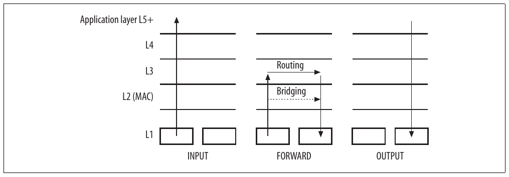
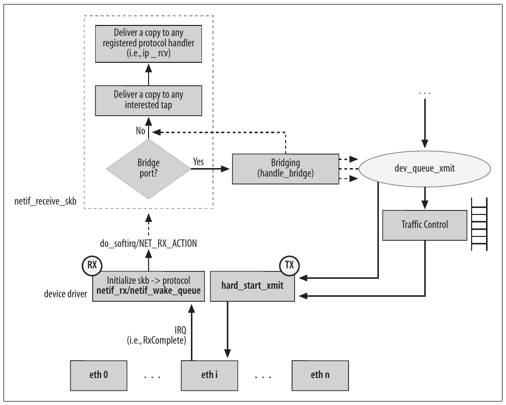
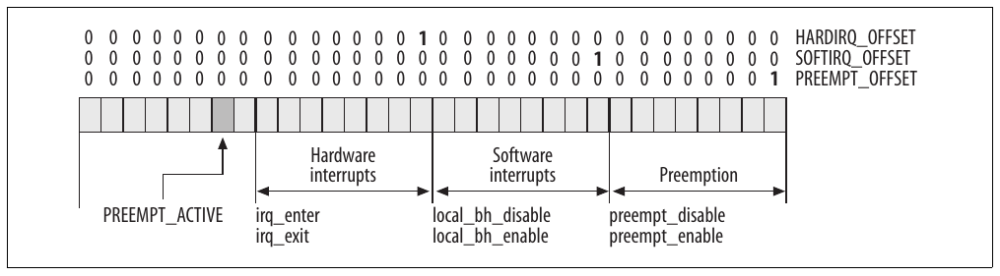
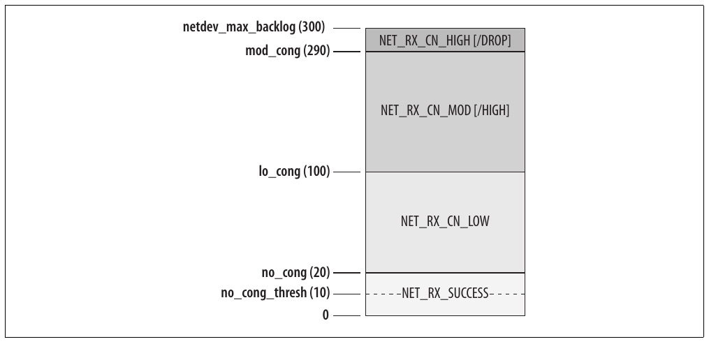

# Chương 9. Interrupt và network driver


Các chương trước đã trình bày tổng quan cách đảm nhiệm việc khởi tạo core component trong networking code. Phần còn lại của sách phân tích featureby-feature hoặc subsystem-by-subsystem về cách networking được triển khai, lý do các feature được đưa vào và, khi có ý nghĩa, cách chúng tương tác với nhau.

Chương này bắt đầu giải thích cách packet di chuyển giữa L2 hay driver layer và IP hay network layer được mô tả chi tiết trong Phần V. Tôi sẽ thường xuyên tham chiếu tới các data structure đã giới thiệu trong Chương 2 và 8, nên bạn hãy sẵn sàng quay lại các chương đó khi cần.

Ngay cả trước khi kernel sẵn sàng xử lý frame đến từ hoặc đi tới L2 layer, nó phải làm việc với hệ thống interrupt tinh tế và phức tạp được thiết lập để có thể xử lý hàng nghìn frame mỗi giây. Đó là chủ đề của chương này.

Một vài vấn đề chung khác ảnh hưởng đến phần thảo luận trong chương này:

- Khi Linux kernel được compile với hỗ trợ symmetric multiprocessing (SMP) và chạy trên hệ thống multiprocessor, code nhận và truyền packet tận dụng đầy đủ sức mạnh đó. Những data structure liên quan được thiết kế với mục tiêu này. Trong chương này, chúng ta sẽ xem cụ thể một khía cạnh hỗ trợ SMP: sự khác biệt giữa các softirq queue mới và backlog queue cũ.

- Khi nói về ingress path, tôi sẽ trình bày cả interface cũ, vẫn được phần lớn network driver sử dụng, lẫn interface mới có tên NAPI, có thể tăng đáng kể hiệu năng khi tải từ trung bình đến cao.

Trong chương này, bạn sẽ được giới thiệu tổng quan cả bottom half handler lẫn cơ chế đồng bộ kernel. Tuy nhiên, để có phần thảo luận chi tiết hơn, bạn có thể tham khảo hai cuốn sách khác của O’Reilly, Understanding the Linux Kernel và Linux Device Drivers.

## Quyết định và chiều traffic

Các đường packet đi qua network stack khác nhau đối với packet được nhận, truyền và forward (xem Hình 9-1). Sự khác biệt trong xử lý cũng phụ thuộc vào những feature được compile vào kernel và cách cấu hình chúng. Cuối cùng, những device tham gia cũng có thể tạo khác biệt vì các device khác nhau hỗ trợ feature khác nhau.



Hình 9-1. Các chiều traffic

Virtual device, như loopback interface (`lo`) quen thuộc, thường dùng đường tắt bên trong network stack. Những device này hoàn toàn là software. Chẳng hạn, loopback interface không tương ứng với hardware nào, nhưng bonding interface gián tiếp tương ứng với một hoặc nhiều network card. Vì vậy, một số virtual interface có thể bỏ qua một số hạn chế của hardware (như Maximum Transmission Unit, hay MTU), qua đó tăng hiệu năng.

Hình 9-2 cho thấy bức tranh tổng thể. Hình chắc chắn còn rất sơ lược; chẳng hạn, không thể hiện mọi điều kiện có thể dẫn đến drop frame.[^1] Hình có thêm chi tiết về ingress path; bạn có thể tìm sơ đồ chi tiết hơn về egress path trong Phần V, VI và VII. Chúng ta sẽ đi qua tất cả liên kết cần có trong sơ đồ trong phần còn lại của chương.

## Thông báo cho driver khi nhận frame

Trong Chương 5, tôi đã đề cập device và kernel có thể dùng hai kỹ thuật chính để trao đổi data: polling và interrupt. Tôi cũng đã nói kết hợp hai kỹ thuật là một lựa chọn hợp lệ. Mục này trình bày tổng quan ngắn về những cách phổ biến nhất để driver thông báo cho kernel về việc nhận frame, cùng ưu và nhược điểm chính của từng cách. Một số cách phụ thuộc vào việc device có feature cụ thể hay không (như timer chuyên dụng), và một số cần thay đổi driver, operating system hoặc cả hai.



Hình 9-2. Ingress path (nhận frame)

Về lý thuyết, phần thảo luận này có thể áp dụng cho mọi device type, nhưng mô tả phù hợp nhất những device như network card có thể tạo ra số lượng tương tác lớn (tức nhận frame).

### Polling

Với kỹ thuật này, kernel liên tục kiểm tra device có gì cần báo hay không. Chẳng hạn, nó có thể liên tục đọc một memory register trên device hoặc quay lại kiểm tra khi timer hết hạn. Như bạn có thể hình dung, cách này dễ lãng phí khá nhiều system resource và hiếm khi được dùng nếu operating system và device có thể dùng kỹ thuật khác như interrupt. Tuy vậy, có trường hợp polling là cách tốt nhất. Chúng ta sẽ quay lại điểm này sau.

### Interrupt

Ở đây, device driver thay mặt kernel chỉ thị device tạo hardware interrupt khi event cụ thể xảy ra. Kernel, bị interrupt khỏi những hoạt động khác, sau đó gọi handler do driver đăng ký để đáp ứng nhu cầu device. Khi event là nhận frame, handler enqueue frame vào đâu đó và thông báo cho kernel. Kỹ thuật khá phổ biến này vẫn là lựa chọn tốt nhất khi traffic load thấp. Đáng tiếc, hiệu năng không tốt khi traffic load cao: buộc tạo interrupt cho mỗi frame nhận được dễ khiến CPU dành toàn bộ thời gian chỉ để xử lý interrupt.

Code đảm nhiệm input frame được chia làm hai phần: trước hết driver copy frame vào input queue mà kernel có thể truy cập, rồi kernel xử lý nó (thường truyền cho handler chuyên xử lý protocol tương ứng như IP). Phần đầu được thực thi trong interrupt context và có thể preempt phần thứ hai. Điều này nghĩa là code tiếp nhận input frame và copy vào queue có priority cao hơn code thực sự xử lý frame.

Khi traffic load cao, interrupt code sẽ liên tục preempt processing code. Hậu quả rất rõ: đến một lúc input queue sẽ đầy, nhưng vì code có nhiệm vụ dequeue và xử lý frame không có cơ hội chạy do priority thấp hơn, hệ thống sụp đổ. Frame mới không thể được enqueue vì hết chỗ, còn frame cũ không thể được xử lý vì không có CPU dành cho chúng. Tình trạng này được gọi là receive-livelock trong tài liệu chuyên ngành.

Tóm lại, kỹ thuật này có ưu điểm latency rất thấp giữa lúc nhận frame và lúc xử lý, nhưng không hoạt động tốt khi tải cao. Phần lớn network driver dùng interrupt, và một phần lớn phía sau trong chương sẽ thảo luận cách chúng hoạt động.

### Xử lý nhiều frame trong một interrupt

Cách này được khá nhiều Linux device driver sử dụng. Khi interrupt được thông báo và driver handler thực thi, handler tiếp tục lấy frame xuống và enqueue vào kernel input queue, tới một số frame tối đa (hoặc một khoảng thời gian). Tất nhiên, có thể tiếp tục cho tới khi queue rỗng, nhưng hãy nhớ device driver cần hành xử có trách nhiệm. Chúng phải chia sẻ CPU với subsystem khác và IRQ line với device khác. Hành xử hợp lý đặc biệt quan trọng vì interrupt bị disable trong khi driver handler chạy.

Giới hạn lưu trữ cũng áp dụng, như ở mục trước. Mỗi device có lượng memory giới hạn, nên số frame nó lưu được cũng giới hạn. Nếu driver không xử lý kịp, buffer có thể đầy và frame mới (hoặc frame cũ, tùy policy của driver) có thể bị drop. Nếu device chịu tải liên tục xử lý frame đến cho tới khi queue rỗng, dạng starvation này có thể xảy ra với device khác.

Kỹ thuật này không yêu cầu thay đổi operating system; nó được triển khai hoàn toàn trong device driver.

Có thể có những biến thể khác của cách tiếp cận này. Thay vì giữ mọi interrupt bị disable và để driver enqueue frame cho kernel xử lý, driver có thể chỉ disable interrupt cho device có frame trong ingress queue và giao việc polling queue của driver cho một kernel handler. Đây chính là điều Linux thực hiện với interface mới NAPI. Tuy nhiên, khác cách mô tả trong mục này, NAPI yêu cầu thay đổi kernel.

### Interrupt Timer-Driven

Kỹ thuật này cải tiến những kỹ thuật trước. Thay vì để device thông báo bất đồng bộ cho driver về việc nhận frame, driver chỉ thị device tạo interrupt theo khoảng thời gian đều đặn. Handler sau đó kiểm tra có frame nào đến từ interrupt trước và xử lý tất cả trong một lượt. Tốt hơn nữa là để driver tạo interrupt định kỳ, nhưng chỉ khi có điều cần báo.

Tùy granularity của timer (được chính device triển khai bằng hardware; không phải kernel timer), frame device nhận sẽ chịu các mức latency khác nhau. Chẳng hạn, nếu device tạo interrupt mỗi 100 ms, thông báo nhận frame sẽ có độ trễ trung bình 50 ms và tối đa 100 ms. Độ trễ này có thể chấp nhận được hoặc không, tùy application chạy trên các network connection sử dụng device.[^2]

Granularity dành cho driver phụ thuộc vào những gì device cung cấp, vì timer được triển khai bằng hardware. Hiện chỉ một số ít device có capability này, nên không phải mọi driver trong Linux kernel đều có thể dùng giải pháp đó. Có thể mô phỏng capability này bằng cách disable interrupt của device và thay bằng kernel timer. Tuy nhiên, khi đó không có hardware hỗ trợ, và CPU không thể dành nhiều resource để xử lý timer như device, nên không thể lập lịch timer thường xuyên gần bằng. Cuối cùng, cách thay thế này sẽ trở thành một phương pháp polling.

### Kết hợp

Mỗi cách mô tả trong các mục trước có một số ưu và nhược điểm. Đôi khi có thể kết hợp chúng để đạt kết quả tốt hơn. Chúng ta đã nói khi tải thấp, mô hình thuần interrupt bảo đảm latency thấp, nhưng khi tải cao thì hiệu năng rất tệ. Ngược lại, interrupt timer-driven có thể gây latency quá lớn và lãng phí quá nhiều CPU time khi tải thấp, nhưng giúp giảm đáng kể CPU usage và giải quyết receive-livelock khi tải cao. Một cách kết hợp tốt là dùng kỹ thuật interrupt khi tải thấp và chuyển sang interrupt timer-driven khi tải cao. Chẳng hạn, driver tulip có trong Linux kernel có thể làm điều này (xem drivers/net/tulip/interrupt.c[^3]).

### Ví dụ

Một cách tiếp cận cân bằng để xử lý nhiều frame được thể hiện trong đoạn code sau, lấy từ Ethernet driver drivers/net/3c59x.c. Đây là những dòng chính trích từ `vortex_interrupt`, function được driver đăng ký làm interrupt handler cho device thuộc họ Vortex của 3Com:

```c
static irqreturn_t vortex_interrupt(int irq, void *dev_id, struct pt_regs *regs)
{
    int work_done = max_interrupt_work;
    ioaddr = dev->base_addr;
    ... ... ...
    status = inw(ioaddr + EL3_STATUS);
    do {
        ... ... ...
        if (status & RxComplete)
            vortex_rx(dev);
        if (--work_done < 0) {
            /* Disable all pending interrupts. */
            ... ... ...
            /* The timer will re-enable interrupts. */
            mod_timer(&vp->timer, jiffies + 1*HZ);
            break;
        }
        ... ... ...
    } while ((status = inw(ioaddr + EL3_STATUS)) & (IntLatch | RxComplete));
    ... ... ...
}
```

Driver khác theo cùng mô hình sẽ có đoạn rất tương tự. Chúng có thể đặt tên khác cho các symbol `EL3_STATUS` và `RxComplete`, và cách triển khai function xxx`_rx` có thể khác, nhưng khung sẽ rất gần với khung ở đây.

Trong `vortex_interrupt`, driver đọc từ device các nguyên nhân gây interrupt và lưu vào `status`. Network device có thể tạo interrupt vì những nguyên nhân khác nhau, và nhiều nguyên nhân có thể được nhóm vào một interrupt. Nếu `RxComplete` (symbol được driver này định nghĩa riêng để chỉ một frame mới đã được nhận) nằm trong số đó, code gọi `vortex_rx`.[^4] Trong khi thực thi, interrupt bị disable cho device. Tuy nhiên, driver có thể đọc hardware register trên card để biết trong thời gian đó có interrupt mới được phát ra hay không. Flag `IntLatch` là true khi có interrupt mới được phát ra (và được driver clear khi xử lý xong).

`vortex_interrupt` tiếp tục xử lý frame đến chừng nào register cho biết còn interrupt pending (`IntLatch`) và nguyên nhân là nhận frame (`RxComplete`). Điều này cũng nghĩa là chỉ nhiều lần xuất hiện interrupt `RxComplete` mới có thể được xử lý trong một lượt. Những interrupt type khác ít xuất hiện hơn nhiều có thể chờ.

Cuối cùng, đây là lúc sự hợp tác có trách nhiệm thể hiện: vòng lặp kết thúc nếu đạt số input frame tối đa có thể xử lý, được lưu trong `work_done`. Driver này dùng default value 32 và cho phép tinh chỉnh value đó khi load module.

## Interrupt handler

Phần lớn việc xử lý frame mà chúng ta thảo luận trong chương này diễn ra để đáp lại interrupt từ network hardware. Việc lập lịch function do interrupt kích hoạt là chủ đề phức tạp đáng nghiên cứu, dù không riêng networking. Vì vậy, trong mục này, chúng ta thảo luận những cách các network driver khác nhau xử lý interrupt và giới thiệu khái niệm bottom half cùng softirq.

Trong Chương 5, chúng ta đã thấy cách device driver đăng ký handler với IRQ number, nhưng chưa thấy hardware interrupt giao việc xử lý frame cho software interrupt handler như thế nào. Mục này sẽ mô tả cách xử lý interrupt request tương ứng với việc nhận frame cho tới khi protocol handler được thảo luận trong Chương 13 nhận packet. Chúng ta sẽ thấy quan hệ giữa hardware IRQ và software IRQ, cùng lý do cần nhóm sau. Chúng ta sẽ xem ngắn gọn cách kernel cũ xử lý interrupt rồi so sánh với cách mới đưa vào từ kernel version 2.4. Phần thảo luận này sẽ cho thấy ưu điểm của mô hình mới so với cũ, đặc biệt về hiệu năng.

Trước khi đi vào softirq, chúng ta cần giới thiệu ngắn khái niệm bottom half handler. Tuy nhiên, tôi sẽ không đi quá sâu vì chúng được trình bày trong những tài liệu khác, đặc biệt Understanding the Linux Kernel và Linux Device Drivers.

### Lý do cần bottom half handler

Mỗi khi CPU nhận interrupt notification, nó gọi handler tương ứng với interrupt đó, được nhận diện bằng một số. Trong khi handler thực thi, khi kernel code được gọi là ở interrupt context, interrupt bị disable cho CPU đang phục vụ interrupt. Điều này nghĩa là nếu CPU bận phục vụ một interrupt, nó không thể nhận interrupt khác, dù cùng type hay khác type.[^5] CPU cũng không thể thực thi process khác: nó hoàn toàn thuộc interrupt handler và không thể bị preempt.

Trong tình huống đơn giản nhất, đây là các event chính do interrupt khởi phát:

1\. Device tạo interrupt và hardware thông báo cho kernel.

2\. Nếu kernel không phục vụ interrupt khác (và interrupt không bị disable vì lý do khác), nó sẽ thấy notification.

3\. Kernel disable interrupt cho local CPU và thực thi handler tương ứng với interrupt type nhận được.

4\. Kernel thoát interrupt handler và re-enables interrupt cho local CPU.

Tóm lại, interrupt handler là nonpreemptible và non-reentrant. (Function được định nghĩa là non-reentrant khi không thể bị interrupt bởi một lần gọi khác của chính nó. Với interrupt handler, điều này đơn giản nghĩa là chúng được thực thi khi interrupt bị disable.) Lựa chọn thiết kế này giúp giảm khả năng race condition. Tuy nhiên, vì những gì CPU có thể làm bị hạn chế như vậy, thiết kế nonpreemptible có thể ảnh hưởng nghiêm trọng đến hiệu năng của kernel cũng như process đang chờ CPU phục vụ.

Vì vậy, công việc interrupt handler thực hiện cần nhanh nhất có thể. Lượng xử lý cần thiết trong interrupt context phụ thuộc vào event type. Chẳng hạn, keyboard có thể chỉ gửi interrupt mỗi lần nhấn phím, cần rất ít công sức để xử lý: handler chỉ cần lưu key code vào đâu đó và chạy nhiều nhất vài lần mỗi giây. Trong những trường hợp khác, thao tác cần để xử lý interrupt không đơn giản và có thể tốn nhiều CPU time. Ví dụ, network device có công việc tương đối phức tạp: cần cấp phát buffer (`sk_buff`), copy data nhận vào đó, khởi tạo một số parameter trong buffer structure (`protocol`) để báo cho protocol handler higher-layer biết loại data đến từ driver, v.v.

Đây là lúc khái niệm bottom half handler phát huy tác dụng. Ngay cả khi action do interrupt kích hoạt cần nhiều CPU time, phần lớn action này thường có thể chờ. Interrupt được phép preempt CPU ngay từ đầu vì nếu operating system để hardware chờ quá lâu, nó có thể mất data. Điều này rõ ràng đúng với streaming data real-time, nhưng cũng đúng với mọi hardware phải lưu data đến trong buffer fixed-size. Và nếu hardware mất data, thường không có cách lấy lại.

Ngược lại, nếu kernel hoặc process user-space phải bị trì hoãn hay preempt, sẽ không mất data (ngoại trừ hệ thống real-time, đòi hỏi cách xử lý process cũng như interrupt hoàn toàn khác). Từ những cân nhắc này, interrupt handler hiện đại được chia thành top half và bottom half. Top half gồm mọi việc phải thực thi trước khi nhường CPU để bảo toàn data. Bottom half chứa mọi việc có thể thực hiện thong thả hơn.

Có thể định nghĩa bottom half là một request bất đồng bộ để thực thi function cụ thể. Thông thường, khi muốn thực thi function, bạn không cần request gì, chỉ gọi nó. Khi interrupt đến, bạn có nhiều việc phải làm và không muốn làm ngay. Vì vậy, bạn gói phần lớn công việc vào một function rồi gửi dưới dạng bottom half.

Mô hình sau cho phép kernel giữ interrupt bị disable trong thời gian ngắn hơn nhiều so với mô hình đơn giản trước đó:

1\. Device gửi signal tới CPU để thông báo interrupt.

2\. CPU thực thi top half tương ứng, disable các interrupt notification tiếp theo cho đến khi handler này xong việc.

3\. Thông thường, top half thực hiện như sau:

a. Lưu ở đâu đó trong RAM mọi thông tin kernel sẽ cần sau này để xử lý interrupt event.

b. Đánh dấu một flag ở đâu đó (hoặc kích hoạt thứ gì bằng cơ chế kernel khác) để bảo đảm kernel biết về interrupt và dùng data handler đã lưu để hoàn tất xử lý event.

c. Trước khi kết thúc, re-enables interrupt notification cho local CPU.

4\. Vào lúc sau đó, khi kernel không còn việc cấp bách hơn, nó kiểm tra flag do interrupt handler set (báo có data cần xử lý) và gọi bottom half handler tương ứng. Nó cũng clear flag để sau này nhận ra khi interrupt handler set flag trở lại.

Theo thời gian, Linux developer đã thử những bottom half type khác nhau, tuân theo quy tắc khác nhau. Networking đóng vai trò lớn trong việc phát triển các cách triển khai mới vì cần latency thấp, tức thời gian tối thiểu từ lúc nhận frame tới lúc chuyển giao. Latency thấp quan trọng với network device driver hơn những device type khác vì số lượng tác vụ lớn liên quan đến nhận và truyền. Như mô tả trong mục “Interrupt” trước đó, để một số lượng lớn frame tích tụ trong khi chờ xử lý có thể gây thảm họa. Sound card là ví dụ khác về device cần phản hồi nhanh.

### Các giải pháp bottom half

Kernel cung cấp các cơ chế khác nhau để triển khai bottom half và trì hoãn công việc nói chung. Những cơ chế này chủ yếu khác nhau ở các điểm sau:

Running context

Kernel xem interrupt có running context khác process user-space hoặc kernel code khác. Khi function do bottom half thực thi có khả năng sleep, nó bị giới hạn trong những cơ chế được phép ở process context, khác với interrupt context.

Concurrency và locking

Khi một cơ chế có thể tận dụng SMP, điều này ảnh hưởng cách bảo đảm serialization (nếu cần) và cách locking ảnh hưởng khả năng mở rộng.

Trong chương này, chúng ta chỉ xem những cơ chế không cần process context, cụ thể là softirq và tasklet. Trong mục tiếp theo, chúng ta sẽ xem ngắn gọn ảnh hưởng của chúng tới concurrency và locking.

Khi cần trì hoãn thực thi một function có thể sleep, bạn cần dùng kernel thread chuyên dụng hoặc work queue. Work queue đơn giản là queue nơi bạn có thể enqueue request thực thi function, và kernel thread sẽ đảm nhiệm. Trong trường hợp này, function được thực thi trong context của kernel thread, nên được phép sleep. Vì networking code chủ yếu dùng softirq và tasklet, chúng ta sẽ không xem work queue.

### Concurrency và locking

Trước khi đi vào code mà network driver dùng để xử lý bottom half, chúng ta cần kiến thức nền về concurrency, chỉ những function có thể ảnh hưởng lẫn nhau vì được lập lịch trên CPU khác nhau hoặc vì một function bị kernel tạm dừng để chạy function khác. Các chủ đề liên quan là lock và disable interrupt. (Concurrency được thảo luận chi tiết trong cả Understanding the Linux Kernel lẫn Linux Device Drivers.) Chương này sẽ giới thiệu ba loại function khác nhau để xử lý interrupt: bottom half old-style, softirq và tasklet. Tất cả đều có thể được dùng để lập lịch thực thi function, nhưng có những khác biệt lớn. Về concurrency, có thể tóm tắt khác biệt như sau:

- Tại mỗi thời điểm chỉ một bottom half old-style có thể chạy, bất kể số CPU (kernel 2.2).

- Tại mỗi thời điểm chỉ một instance của mỗi tasklet có thể chạy. Các tasklet khác nhau có thể chạy đồng thời trên CPU khác nhau. Điều này nghĩa là với bất kỳ tasklet nào, không cần tự bảo đảm serialization vì kernel đã bảo đảm: không thể có nhiều instance cùng tasklet chạy đồng thời.

- Tại một thời điểm trên một CPU chỉ một instance của mỗi softirq có thể chạy. Tuy nhiên, cùng softirq có thể chạy đồng thời trên CPU khác nhau. Điều này nghĩa là với bất kỳ softirq nào, bạn cần bảo đảm các truy cập shared data từ CPU khác nhau dùng locking thích hợp. Để tăng khả năng chạy song song, softirq nên được thiết kế để chỉ truy cập data per-CPU nhiều nhất có thể, giảm đáng kể nhu cầu locking.

Vì vậy, ba feature này cần những cơ chế locking khác nhau. Mức concurrency cho phép càng cao, programmer càng phải thiết kế code thực thi cẩn thận, vì cả tính chính xác lẫn hiệu năng. Softirq hay tasklet là lựa chọn tốt nhất cho context cụ thể phụ thuộc cả yêu cầu locking lẫn concurrency. Trong phần lớn trường hợp, nên chọn tasklet. Nhưng do yêu cầu phản hồi chặt chẽ của các tác vụ nhận và truyền trong networking, softirq được ưu tiên trong hai trường hợp cụ thể đó. Chúng ta sẽ xem cách networking code dùng softirq phía sau trong chương.

Trong một số trường hợp, programmer phải disable hardware interrupt, software interrupt hoặc cả hai. Thảo luận chi tiết các context cần kiến thức nền về SMP, preemption trong Linux kernel và những vấn đề khác ngoài phạm vi sách. Tuy nhiên, để hiểu networking code, bạn cần biết ý nghĩa những function chính dùng để enable và disable interrupt. Bảng 9-1 tóm tắt những function cần trong chương này (bạn có thể tìm nhiều hơn trong kernel/softirq.c, include/asm-`XXX`/hardirq.h, include/asm-`XXX`/spinlock.h và include/linux/spinlock.h). Một số có thể được định nghĩa toàn cục, số khác theo từng architecture.

Bảng 9-1. Một số API liên quan đến software interrupt và hardware interrupt

| Function/macro | Mô tả |
|---|---|
| `in_interrupt` | `in_interrupt` return TRUE nếu CPU hiện đang phục vụ hardware interrupt hoặc software interrupt, hoặc preemption bị disable. |
| `in_softirq` | `in_softirq` return TRUE nếu CPU hiện đang phục vụ software interrupt. |
| `in_irq` | `in_irq` return TRUE nếu CPU hiện đang phục vụ hardware interrupt. |
|  | Trong mục “Preemption”, với sự trợ giúp của Hình 9-3, bạn có thể thấy cách triển khai ba routine này. |
| `softirq_pending` | Return TRUE nếu có ít nhất một softirq pending (tức đã được lập lịch thực thi) cho CPU có ID được truyền làm input argument. |
| `local_softirq_pending` | Return TRUE nếu có ít nhất một softirq pending cho local CPU. |
| `__raise_softirq_irqoff` | Set flag tương ứng với input softirq type để đánh dấu pending. |
| `raise_softirq_irqoff` | Đây là wrapper quanh `__raise_softirq_irqoff`, đồng thời đánh thức `ksoftirqd` khi `in_interrupt()` return FALSE. |
| `raise_softirq` | Đây là wrapper quanh `raise_softirq_irqoff`, disable hardware interrupt trước khi gọi và khôi phục về trạng thái ban đầu. |
| `__local_bh_enable` | `__local_bh_enable` enable bottom half (và do đó softirq/tasklet) trên |
| `local_bh_enable local_bh_disable` | local CPU, và `local_bh_enable` cũng gọi `invoke_softirq` nếu có softirq pending và `in_interrupt()` return FALSE. `local_bh_disable` disable bottom half trên local CPU. |
| `local_irq_disable` | Disable và enable interrupt trên local CPU. |
| `local_irq_enable` |  |
| `local_irq_save` | `local_irq_save` trước hết lưu trạng thái interrupt hiện tại trên local CPU và |
| `local_irq_restore` | sau đó disable chúng. `local_irq_restore` khôi phục trạng thái interrupt trên local CPU nhờ thông tin đã lưu trước đó bằng `local_irq_save`. |
| `spin_lock_bh spin_unlock_bh` | Lần lượt acquire và release spinlock. Cả hai function disable rồi re-enable bottom half và preemption trong khi thực hiện thao tác. |

### Preemption

Trong hệ thống time-sharing, kernel luôn có thể preempt user process tùy ý, nhưng chính kernel thường là nonpreemptive, nghĩa là một khi bắt đầu chạy, nó sẽ không bị interrupt cho tới khi sẵn sàng nhường quyền điều khiển. Kernel nonpreemptive đôi khi trì hoãn process high-priority đã sẵn sàng chạy vì đang thực thi system call cho process lower-priority. Để hỗ trợ phần mở rộng real-time và vì những lý do khác, Linux kernel được làm cho fully preemptible trong chu kỳ phát triển kernel 2.5. Với kernel feature mới này, system call và kernel task khác có thể bị kernel task có priority cao hơn preempt.

Vì trước đó đã có nhiều công việc loại bỏ critical section (code nonpreemptible) khỏi kernel để hỗ trợ cơ chế SMP locking, thêm full preemption không phải thay đổi lớn với kernel. Khi đã thêm preemption, developer chỉ cần định nghĩa tường minh nơi disable nó (trong hardware interrupt code và software interrupt code, trong chính scheduler, trong code được spin lock và read/ write lock bảo vệ, v.v.).

Tuy nhiên, có lúc preemption, cũng như interrupt, phải được disable. Trong mục này, tôi chỉ trình bày một số function liên quan đến preemption mà bạn có thể gặp khi duyệt code, rồi cho thấy ngắn gọn cách một số locking macro được cập nhật để xử lý preemption.

Các function sau điều khiển preemption:

`preempt_disable`

Disable preemption cho current task. Có thể gọi nhiều lần, tăng reference counter.

`preempt_enable`

`preempt_enable_no_resched`

Ngược với `preempt_disable`, cho phép enable preemption trở lại. `preempt_enable_no_resched` chỉ giảm reference counter, cho phép re-enabled preemption khi counter về zero. Ngoài ra, `preempt_enable` kiểm tra counter có bằng zero hay không và buộc gọi `schedule()` để cho phép bất kỳ task higher-priority nào chạy.

`preempt_check_resched`

Function này được `preempt_enable` gọi và tạo nên khác biệt với `preempt_enable_no_resched`.

Networking code không làm việc trực tiếp với những routine này. Tuy nhiên, `preempt_enable` và `preempt_disable` được gọi gián tiếp, chẳng hạn bởi locking primitive như `rcu_read_lock` và `rcu_read_unlock`, `spin_lock` và `spin_unlock`, v.v. Routine dùng để truy cập data structure per-CPU, như `get_cpu` và `get_cpu_var`, cũng disable preemption trước khi đọc data.

Một counter cho mỗi process, tên `preempt_count` và nhúng trong structure `thread_info`, cho biết process cụ thể có cho phép preemption hay không. Field có thể được đọc bằng `preempt_count()` và được thao tác gián tiếp qua các function `inc_preempt_count` và `dec_preempt_count` định nghĩa trong include/linux/preempt.h. Có những tình huống kernel không nên bị preempt, gồm khi đang phục vụ hardware cũng như khi dùng một trong những lời gọi vừa nêu để disable preemption. Vì vậy, `preempt_count` được chia thành ba thành phần. Mỗi byte là counter cho một điều kiện khác nhau đòi hỏi nonpreemption: hardware interrupt, software interrupt và nonpreemption nói chung. Layout của `preempt_count` được thể hiện trong Hình 9-3.



Hình 9-3. Cấu trúc preempt\_count

Ngoài mục đích từng byte, hình cho thấy những function chính thao tác lên nó. Byte high-order hiện chưa được dùng hết, nhưng bit có trọng số thấp thứ hai của nó được set trước khi gọi function `schedule` và báo cho function đó biết nó được gọi để preempt current task.[^6] Trong include/asm-xxx/hardirq.h, bạn có thể tìm một số macro giúp đọc và ghi `preempt_counter` dễ hơn; một số chứa những variable `XXX_OFFSET` thể hiện trong Hình 9-3, được các function trong hình dùng để tăng hoặc giảm đúng byte.

Dù có toàn bộ sự phức tạp này, mỗi khi cần kiểm tra current process có thể bị preempt hay không, kernel chỉ cần biết `preempt_count` có NULL hay không (lý do preemption bị disable thực sự không quan trọng).

### Handler Bottom-Half

Infrastructure cho bottom half phải giải quyết những nhu cầu sau:

- Phân loại bottom half vào type thích hợp

- Đăng ký mối liên hệ giữa bottom half type và handler của nó

- Lập lịch thực thi bottom half

- Thông báo cho kernel về sự hiện diện của các BH đã được lập lịch

Trước hết hãy xem cách kernel tới version 2.2 xử lý bottom half handler, rồi cách chúng được xử lý bằng softirq trong kernel 2.4 và 2.6.

#### Handler Bottom-half trong kernel 2.2

Mô hình 2.2 chia handler bottom-half thành nhiều type, được phân biệt bởi thời điểm và tần suất kernel kiểm tra và chạy chúng. Danh sách 2.2 như sau, lấy từ include/linux/interrupt.h. Trong sách này, chúng ta quan tâm nhất tới `NET_BH`.

```c
enum {
        TIMER_BH = 0,
        CONSOLE_BH,
        TQUEUE_BH,
        DIGI_BH,
        SERIAL_BH,
        RISCOM8_BH,
        SPECIALIX_BH,
        AURORA_BH,
        ESP_BH,
        NET_BH,
        SCSI_BH,
        IMMEDIATE_BH,
        KEYBOARD_BH,
        CYCLADES_BH,
        CM206_BH,
        JS_BH,
        MACSERIAL_BH,
        ISICOM_BH
};
```

Mỗi type bottom-half được liên kết với function handler bằng `init_bh`. Ví dụ, networking code khởi tạo type bottom-half `NET_BH` với handler `net_bh` trong `net_dev_init`, được trình bày trong Chương 5.

```c
__initfunc(int net_dev_init(void))
{
        ... ... ...
        init_bh(NET_BH, net_bh);
        ... ... ...
}
```

Function chính dùng để hủy đăng ký BH handler là `remove_bh`. (Cũng có function liên quan khác, như `enable_bh`/`disable_bh`, nhưng chúng ta không cần xem tất cả.)

Mỗi khi interrupt handler muốn kích hoạt thực thi bottom half handler, nó phải set flag tương ứng bằng `mark_bh`. Function này rất đơn giản: set một bit trong global bitmap `bh_active`, sẽ được kiểm tra ở một số nơi như chúng ta sắp thấy.

```c
extern inline void mark_bh(int nr)
 {
        set_bit(nr, &bh_active);
};
```

Chẳng hạn, bạn sẽ thấy phía sau trong chương rằng mỗi khi network device driver nhận thành công frame, nó báo cho kernel bằng lời gọi `netif_rx`. Function sau enqueue frame mới nhận vào ingress queue `backlog` (dùng chung bởi mọi CPU) và đánh dấu flag của handler bottom-half `NET_BH`.

```c
skb_queue_tail(&backlog, skb);
mark_bh(NET_BH);
return
```

Trong một số thao tác thường lệ, kernel kiểm tra có bottom half nào đã được lập lịch thực thi hay không. Nếu có, kernel chạy function `do_bottom_half` (hiện trong kernel/softirq.c) để thực thi. Việc kiểm tra được thực hiện trong:

`do_IRQ`

Mỗi khi kernel nhận thông báo bằng IRQ về hardware interrupt, nó gọi `do_IRQ` để thực thi handler tương ứng. Vì khá nhiều bottom half được interrupt handler lập lịch thực thi, còn gì cho latency thấp hơn gọi ngay ở cuối `do_IRQ`? Vì vậy, timer interrupt định kỳ hết hạn với tần số `HZ` biểu thị giới hạn trên của khoảng thời gian giữa hai lần thực thi liên tiếp `do_bottom_half`.

Return từ interrupt và exception (bao gồm system call)

Xem arch/`XXX`/kernel/entry.S để biết assembly code đảm nhiệm trường hợp này.

`schedule`

Function này quyết định việc tiếp theo thực thi trên CPU, kiểm tra có handler bottom-half pending hay không và ưu tiên chúng cao hơn task khác.

```c
asmlinkage void schedule(void)
{

        /* Do "administrative" work here while we don't hold any locks */
        if (bh_mask & bh_active)
                goto handle_bh;
handle_bh_back:
        ... ... ...
handle_bh:
        do_bottom_half( );
        goto handle_bh_back;
        ... ... ...
}
```

`run_bottom_half`, function được `do_bottom_half` dùng để thực thi interrupt handler pending, có dạng sau:

```c
        active = get_active_bhs( );
        clear_active_bhs(active);
        bh = bh_base;
        do {
                if (active & 1)
                        (*bh)( );
                bh++;
                active >>= 1;
        } while (active);
```

Thứ tự gọi các handler pending phụ thuộc vị trí flag tương ứng trong bitmap và hướng duyệt những flag đó (được `get_active_bhs` trả về). Nói cách khác, bottom half không chạy theo thứ tự first-come-firstserved. Và vì networking bottom half có thể mất nhiều thời gian, handler không may được dequeue cuối có thể chịu latency cao.

Bottom half trong kernel 2.2 trở về trước chịu hạn chế không được chạy đồng thời. Tại mỗi thời điểm chỉ một bottom half có thể chạy, bất kể số CPU.

##### Handler Bottom-half trong kernel 2.4 trở đi: sự xuất hiện của softirq

Về xử lý interrupt, cải tiến lớn nhất giữa kernel 2.2 và 2.4 là đưa vào software interrupt (softirq), có thể xem như phiên bản multithreaded của bottom half handler. Không chỉ nhiều softirq có thể chạy đồng thời, mà cùng softirq cũng có thể chạy đồng thời trên CPU khác nhau. Hạn chế concurrency duy nhất là tại một thời điểm chỉ một instance của mỗi softirq có thể chạy trên một CPU.

Mô hình softirq mới chỉ có sáu type (từ include/linux/interrupt.h):

```c
enum
{
    HI_SOFTIRQ=0,
    TIMER_SOFTIRQ,
    NET_TX_SOFTIRQ,
    NET_RX_SOFTIRQ,
    SCSI_SOFTIRQ,
    TASKLET_SOFTIRQ
};
```

Mọi type bottom-half `XXX_BH` trong mô hình cũ vẫn có cho driver cũ, nhưng đã được triển khai lại để chạy dưới dạng softirq type `HI_SOFTIRQ` (nghĩa là được ưu tiên hơn các softirq type khác). Hai type được networking code dùng, `NET_TX_SOFTIRQ` và `NET_RX_SOFTIRQ`, được giới thiệu trong mục “Cách networking code dùng softirq” phía sau. Mục tiếp theo sẽ giới thiệu tasklet.

Softirq, giống bottom half cũ, chạy khi interrupt được enable nên có thể bị tạm dừng bất cứ lúc nào để xử lý interrupt mới đến. Tuy nhiên, kernel không cho request softirq mới chạy trên CPU nếu một instance khác của softirq đó đã bị tạm dừng trên CPU ấy; điều này giảm mạnh lượng locking cần thiết. Mỗi softirq type có thể duy trì một array data structure type `softnet_data`, một structure cho mỗi CPU, để giữ state information về softirq hiện tại; chúng ta sẽ xem nội dung structure trong mục “Structure softnet\_data”. Vì các instance khác nhau của cùng softirq type có thể chạy đồng thời trên CPU khác nhau, function do softirq chạy vẫn cần lock các shared data structure khác để tránh race condition.

Những function dùng để đăng ký và lập lịch softirq handler, cùng logic của chúng, rất tương tự các function dùng với bottom half 2.2.

Softirq handler được đăng ký bằng function `open_softirq`, khác `init_bh` ở chỗ nhận thêm parameter để function handler có thể được truyền input data nếu cần. Tuy nhiên, hiện không softirq nào dùng parameter bổ sung đó, và đã có đề xuất bỏ nó. `open_softirq` chỉ copy input parameter vào global array `softirq_vec`, khai báo trong kernel/softirq.c, giữ liên kết giữa type và handler.

```c
static struct softirq_action softirq_vec[32] __cacheline_aligned_in_smp;

void open_softirq(int nr, void (*action)(struct softirq_action*), void *data)
{
    softirq_vec[nr].data = data;
    softirq_vec[nr].action = action;
}
```

Softirq có thể được lập lịch thực thi trên local CPU bằng những function sau:

`__raise_softirq_irqoff`

Function này, tương ứng với `mark_bh` trong 2.2, chỉ set bit flag tương ứng với softirq cần chạy. Sau đó, khi flag được kiểm tra, handler tương ứng sẽ được gọi.

`raise_softirq_irqoff`

Đây là wrapper quanh `__`raise\_softirq\_irqoff, đồng thời lập lịch thread `ksoftirqd` (thảo luận phía sau trong chương) nếu function không được gọi từ hardware interrupt context hoặc software interrupt context và preemption chưa bị disable. Nếu function được gọi từ interrupt context, không cần gọi thread vì, như chúng ta sẽ thấy, dù sao `do_softirq` cũng sẽ được gọi.

`raise_softirq`

Đây là wrapper quanh `raise_softirq_irqoff`, thực thi function sau khi hardware interrupt bị disable.

Code sau, lấy từ kernel 2.4.5,[^7] cho thấy mô hình được dùng trong giai đoạn đầu phát triển softirq. Nó rất giống mô hình 2.2 và gọi function `do_softirq`, tương ứng với function `do_bottom_half` của 2.2 đã thảo luận trong mục trước. `do_softirq` được gọi nếu có ít nhất một softirq đã được lập lịch thực thi:

```c
asmlinkage void schedule(void)
{

        /* Do "administrative" work here while we don't hold any locks */
        if (softirq_active(this_cpu) & softirq_mask(this_cpu))
                goto handle_softirq;
handle_softirq_back:
        ... ... ...
handle_softirq:
        do_softirq( );
        goto handle_softirq_back;
        ... ... ...
}
```

Khác biệt duy nhất giữa giai đoạn đầu softirq này và mô hình bottom-half 2.2 là phiên bản softirq phải kiểm tra flag theo từng per-CPU, vì mỗi CPU có bitmap softirq pending riêng.

Cách triển khai `do_softirq` cũng rất giống function tương ứng `do_bottom_half` trong 2.2. Kernel cũng gọi function tại một số điểm giống nhau, nhưng không hoàn toàn. Thay đổi chính là đưa vào kernel thread per-CPU mới, `ksoftirqd`.

Đây là những điểm chính mà `do_softirq` có thể được gọi:[^8]

`do_IRQ`

Khung của `do_IRQ`, được định nghĩa trong các file per-architecture arch/`arch- name/`kernel/irq.c, là:

```c
fastcall unsigned int do_IRQ(struct pt_regs * regs)
{
    irq_enter( );
    ... ... ...
    /* handle the IRQ number "irq" with the registered handler */
    ... ... ...
    irq_exit( );
    return 1;
}
```

Trong kernel 2.4, function cũng gọi `do_softirq`. Với phần lớn architecture trong 2.6, thay vào đó lời gọi `do_softirq` nằm bên trong `irq_exit`. Một số ít vẫn đặt trong `do_IRQ`.

Vì cho phép lời gọi lồng nhau tới `irq_enter`, `irq_exit` chỉ gọi `invoke_softirq` khi mọi điều kiện thông thường được đáp ứng (có softirq pending, v.v.) và reference count tương ứng với interrupt context đã về zero, cho biết kernel đang rời interrupt context.

Đây là định nghĩa tổng quát của `irq_exit` từ kernel/softirq.c, nhưng có architecture định nghĩa phiên bản riêng:

```c
void irq_exit(void)
{
    ...
    sub_preempt_count(IRQ_EXIT_OFFSET);
    if (!in_interrupt( ) && local_softirq_pending( ))
        invoke_softirq( );
    preempt_enable_no_resched( );
}
```

`smp_apic_timer_interrupt`, xử lý SMP timer trong arch/`XXX`/kernel/apic.c, cũng dùng `irq_enter`/`irq_exit`.

Return từ interrupt và exception (bao gồm system call)

Giống kernel 2.2.

`local_bh_enable`

Khi softirq được re-enabled trên CPU, những request pending (nếu có) được xử lý bằng lời gọi `do_softirq`.

Các kernel thread, `ksoftirqd_CPUn`

Để tránh softirq độc chiếm mọi CPU (dễ xảy ra trên network chịu tải nặng vì interrupt `NET_TX_SOFTIRQ` và `NET_RX_SOFTIRQ` có priority cao hơn user process), developer đưa vào tập thread per-CPU mới. Chúng có tên `ksoftirqd_CPU0`, `ksoftirqd_CPU1`, v.v., và có thể thấy bằng command ps. Chi tiết hơn về những thread này nằm trong mục “Kernel thread ksoftirqd”.

Tôi đã mô tả hành vi i386 nói chung; architecture khác có thể dùng quy ước đặt tên khác hoặc có thêm timer cũng gọi `do_softirq`.

Một nơi thú vị khác gọi `do_softirq` là bên trong `netif_rx_ni`, được mô tả ngắn gọn trong mục “Interface cũ giữa device driver và kernel: phần đầu của netif\_rx” ở Chương 10. Traffic generator tích hợp trong kernel (net/core/pktgen.c) cũng gọi `do_softirq`.

### Tasklet

Phần lớn bottom half kiểu kernel 2.2 đã được chuyển thành softirq hoặc tasklet. Tasklet là một function được interrupt hoặc task khác trì hoãn để thực thi sau. Tasklet được xây dựng trên softirq và thường được interrupt handler khởi phát. (Nhưng phần khác của kernel, như neighboring subsystem thảo luận trong Phần VI, cũng dùng tasklet).[^9]

Trong mục “Handler Bottom-half trong kernel 2.4 trở đi: sự xuất hiện của softirq”, chúng ta đã thấy danh sách softirq. `HI_SOFTIRQ` được dùng để triển khai tasklet high-priority, còn `TASKLET_SOFTIRQ` dành cho tasklet lower-priority. Mỗi lần phát request thực thi trì hoãn, một instance structure `tasklet_struct` được enqueue vào list do `HI_SOFTIRQ` xử lý hoặc list khác do `TASKLET_SOFTIRQ` xử lý.

Vì softirq được từng CPU xử lý độc lập, không có gì ngạc nhiên khi mỗi CPU có hai list `tasklet_structs` pending, một tương ứng với `HI_SOFTIRQ` và một với `TASKLET_SOFTIRQ`. Đây là định nghĩa của chúng từ kernel/softirq.c:

```c
static DEFINE_PER_CPU(struct tasklet_head tasklet_vec) = { NULL };
static DEFINE_PER_CPU(struct tasklet_head tasklet_hi_vec) = { NULL };
```

Thoạt nhìn, tasklet có vẻ giống bottom half cũ, nhưng thực ra có những khác biệt đáng kể:

- Không giới hạn số tasklet khác nhau, trong khi bottom half cũ bị giới hạn một type cho mỗi bit flag của `bh_base`.

- Tasklet cung cấp hai mức priority.

- Các tasklet khác nhau có thể chạy đồng thời trên CPU khác nhau.

- Tasklet, khác bottom half cũ và softirq, là dynamic và không cần khai báo tĩnh trong enumeration list `XXX_BH` hoặc `XXX_SOFTIRQ`.

Data structure `The tasklet_struct` được định nghĩa trong include/linux/interrupt.h như sau:

```c
struct tasklet_struct
{
    struct tasklet_struct *next;
    unsigned long state;
    atomic_t count;
    void (*func)(unsigned long);
    unsigned long data;
};
```

Sau đây là mô tả field-by-field:

`struct tasklet_struct *next`

Pointer dùng để liên kết các structure pending tương ứng với cùng CPU. Function `tasklet_hi_schedule` và `tasklet_schedule` thêm phần tử mới vào đầu list.

`unsigned long state`

Một bitmap flag có các value khả dĩ được biểu diễn bằng enum `TASKLET_STATE_XXX` liệt kê trong include/linux/interrupt.h:

`TASKLET_STATE_SCHED`

Tasklet đã được lập lịch thực thi, và data structure đã nằm trong list tương ứng với `HI_SOFTIRQ` hoặc `TASKLET_SOFTIRQ`, tùy priority được gán. Cùng tasklet không thể được lập lịch đồng thời trên CPU khác nhau. Nếu có request thực thi tasklet khác đến khi request đầu chưa bắt đầu thực thi, chúng sẽ bị bỏ qua. Vì với tasklet cụ thể chỉ có thể có một instance đang thực thi, không có lý do lập lịch thực thi nó nhiều lần.

`TASKLET_STATE_RUN`

Tasklet đang được thực thi. Flag này được dùng để ngăn nhiều instance của cùng tasklet thực thi đồng thời. Nó chỉ có ý nghĩa với hệ thống SMP. Flag được thao tác bằng ba locking function `tasklet_trylock`, `tasklet_unlock` và `tasklet_unlock_wait`.

`atomic_t count`

Có trường hợp bạn cần tạm disable rồi re-enable tasklet sau đó. Counter này thực hiện việc đó: value bằng zero nghĩa là tasklet bị disable (vì vậy không thể thực thi), còn nonzero nghĩa là tasklet được enable. Value được tăng và giảm bằng các function `tasklet[_hi]_enable` và `tasklet[_hi]_disable` mô tả phía sau trong mục này.

`void (*func)(unsigned long)`

`unsigned long data`

`func` là function cần thực thi, còn `data` là input tùy chọn có thể truyền cho `func`.

Sau đây là một số kernel function quan trọng xử lý tasklet, từ kernel/softirq.c và include/linux/interrupt.h:

`tasklet_init`

Điền các field của structure `tasklet_struct` bằng value `func` và `data` được cung cấp làm argument.

`tasklet_action`, `tasklet_hi_action`

Lần lượt thực thi tasklet low-priority và high-priority.

`tasklet_schedule`, `tasklet_hi_schedule`

Lần lượt lập lịch thực thi tasklet low-priority và high-priority. Chúng thêm structure `tasklet_struct` vào list tasklet pending tương ứng với local CPU, rồi lập lịch softirq tương ứng (`TASKLET_SOFTIRQ` hoặc `HI_SOFTIRQ`). Nếu tasklet đã được lập lịch (nhưng chưa chạy), những API này không làm gì (xem flag `TASKLET_STATE_SCHED`).

`tasklet_enable`, `tasklet_hi_enable`

Hai function này giống nhau và được dùng để enable tasklet.

`tasklet_disable`, `tasklet_disable_nosync`

Cả hai function disable tasklet và có thể dùng với tasklet low- và high-priority. `Tasklet_disable` là wrapper của `tasklet_disable_nosync`. Trong khi function sau return ngay (bất đồng bộ), function trước chỉ return khi tasklet đã kết thúc thực thi nếu trước đó đang chạy (đồng bộ).

`tasklet_enable`, `tasklet_hi_enable` và `tasklet_disable_nosync` thao tác value của field `count` để khai báo tasklet được enable hoặc disable. Cho phép lời gọi lồng nhau.

### Khởi tạo softirq

Trong khi khởi tạo kernel, `softirq_init` khởi tạo software IRQ layer với hai softirq general-purpose: `tasklet_action` và `tasklet_hi_action`, lần lượt tương ứng với `TASKLET_SOFTIRQ` và `HI_SOFTIRQ`.

```c
void __init softirq_init( )
{
    open_softirq(TASKLET_SOFTIRQ, tasklet_action, NULL);
    open_softirq(HI_SOFTIRQ, tasklet_hi_action, NULL);
}
```

Hai softirq được networking code sử dụng, `NET_RX_SOFTIRQ` và `NET_TX_SOFTIRQ`, được khởi tạo trong `net_dev_init`, một trong các networking initialization function (xem mục “Cách networking code dùng softirq”).

Những softirq khác liệt kê trong mục “Handler Bottom-half trong kernel 2.4 trở đi: sự xuất hiện của softirq” được đăng ký trong subsystem tương ứng (`SCSI_SOFTIRQ` trong drivers/scsi/scsi.c, `TIMER_SOFTIRQ` trong kernel/timer.c, v.v.).

`HI_SOFTIRQ` chủ yếu được sound card device driver sử dụng.[^10]

Những bên sử dụng `TASKLET_SOFTIRQ` gồm:

- Driver cho network interface card (không chỉ Ethernet)

- Nhiều device driver khác

- Media layer (USB, IEEE 1394, v.v.)

- Networking subsystem (Neighboring, ATM qdisc, v.v.)

### Xử lý softirq pending

Trong mục “Handler Bottom-half trong kernel 2.4 trở đi: sự xuất hiện của softirq”, chúng ta đã giải thích khi nào `do_softirq` được gọi để đảm nhiệm các softirq pending. Ở đây chúng ta sẽ xem bên trong function. Bạn sẽ nhận thấy nó giống function kernel 2.2 dùng, mô tả trong mục “Handler Bottom-half trong kernel 2.2”, đến mức nào.

`do_softirq` dừng và không làm gì nếu CPU hiện đang phục vụ hardware interrupt hoặc software interrupt. Function kiểm tra bằng cách gọi `in_interrupt`, tương đương `if (in_irq() || in_softirq())`.

Nếu `do_softirq` quyết định tiếp tục, nó lưu softirq pending trong `pending` bằng `local_softirq_pending`.

```c
#ifndef __ARCH_HAS_DO_SOFTIRQ

asmlinkage void do_softirq(void)
{
    if (in_interrupt( ))
        return;

    local_irq_save(flags);
    pending = local_softirq_pending( );
    if (pending)
        __do_softirq( );
    local_irq_restore;
}

EXPORT_SYMBOL(do_softirq);
#endif
```

Từ đoạn trích trước, có thể tưởng `do_softirq` chạy khi IRQ bị disable, nhưng không phải vậy. IRQ chỉ bị giữ disable khi thao tác bitmap softirq pending (tức truy cập structure `softnet_data`). Bạn sẽ sớm thấy `__do_softirq` re-enables IRQ bên trong khi chạy softirq handler.

#### Function \_\_do\_softirq

Cùng softirq type có thể được lập lịch nhiều lần trong khi `do_softirq` chạy. Vì IRQ được enable khi chạy softirq handler, bitmap softirq pending có thể được thao tác trong khi phục vụ interrupt, nên bất kỳ softirq handler nào đã được `__do_softirq` thực thi đều có thể được re-scheduled trong lúc chính `__do_softirq` thực thi.

Vì vậy, trước khi `__do_softirq` re-enables IRQ, nó lưu bitmap softirq pending hiện tại vào local variable `pending` và clear bitmap khỏi instance `softnet_data` tương ứng với local CPU bằng `local_softirq_pending()=0`. Sau đó, dựa vào `pending`, nó gọi mọi handler cần thiết.

Khi đã gọi mọi handler, `__do_softirq` kiểm tra trong thời gian đó có softirq nào được lập lịch trở lại hay không (request này disable IRQ). Nếu có ít nhất một softirq pending, nó lặp lại toàn bộ quá trình. Tuy nhiên, `__do_softirq` chỉ lặp tối đa `MAX_SOFTIRQ_RESTART` lần (thử nghiệm cho thấy 10 lần hoạt động tốt).

Việc dùng `MAX_SOFTIRQ_RESTART` là quyết định thiết kế để tránh một interrupt type, đặc biệt một luồng networking interrupt, khiến các interrupt khác bị starvation trên một CPU. Không có giới hạn trong \_\_`do_softirq`, starvation dễ xảy ra khi server chịu tải network traffic cao và số interrupt `NET_RX_SOFTIRQ` tăng vọt.

Hãy xem starvation có thể diễn ra thế nào. `do_IRQ` raise interrupt `NET_RX_SOFTIRQ`, khiến `do_softirq` được thực thi. `__do_softirq` clear flag `NET_RX_SOFTIRQ`, nhưng trước khi kết thúc sẽ bị interrupt bởi một interrupt set `NET_RX_SOFTIRQ` trở lại, cứ thế vô hạn.

Bây giờ hãy xem phần trung tâm của `__do_softirq` gọi softirq handler như thế nào. Mỗi lần phục vụ một softirq type, bit của nó được clear khỏi bản copy cục bộ các softirq active, `pending`. `h` được khởi tạo để trỏ tới global data structure `softirq_vec`, giữ liên kết giữa softirq type và function handler (chẳng hạn `NET_RX_SOFTIRQ` do `net_rx_action` xử lý). Vòng lặp kết thúc khi bitmap được clear.

Cuối cùng, nếu còn softirq pending không thể xử lý vì `do_softirq` phải return sau khi đã lặp công việc `MAX_SOFTIRQ_RESTART` lần, thread `ksoftirqd` được đánh thức và giao trách nhiệm xử lý sau. Vì `do_softirq` được gọi tại rất nhiều điểm trong kernel, thực tế có khả năng một lần gọi `do_softirq` sau sẽ xử lý những interrupt này trước khi thread `ksoftirqd` được lập lịch.

```c
#define MAX_SOFTIRQ_RESTART 10

asmlinkage void __do_softirq(void)
{
    struct softirq_action *h;
    __u32 pending;
    int max_restart = MAX_SOFTIRQ_RESTART;
    int cpu;

    pending = local_softirq_pending( );

    local_bh_disable( );
    cpu = smp_processor_id( );
restart:
    /* Reset the pending bitmask before enabling irqs */
    local_softirq_pending( ) = 0;

    local_irq_enable( );

    h = softirq_vec;

    do {
        if (pending & 1) {
            h->action(h);
            rcu_bh_qsctr_inc(cpu);
        }
        h++;
        pending >>= 1;
    } while (pending);

    local_irq_disable( );

    pending = local_softirq_pending( );
    if (pending && --max_restart)
        goto restart;

    if (pending)
        wakeup_softirqd( );

    __local_bh_enable( );
}
```

### Xử lý softirq Per-Architecture

Function `do_softirq` cung cấp trong kernel/softirq.c có thể được ghi đè bằng function khác do architecture code cung cấp (dù cuối cùng vẫn gọi `__do_softirq`). Điều này giải thích vì sao định nghĩa `do_softirq` trong kernel/softirq.c được bao quanh bằng kiểm tra `__ARCH_HAS_DO_SOFTIRQ` (xem mục trước).

Một số architecture, gồm i386 (xem arch/i386/kernel/irq.c), định nghĩa phiên bản `do_softirq` riêng. Các phiên bản theo architecture này được dùng khi architecture dùng stack 4 KB (thay vì 8 KB) và dùng 4 K còn lại để triển khai stacked handling cho cả hard IRQ lẫn softirq. Tham khảo Understanding the Linux Kernel để biết thêm chi tiết.

### Kernel thread ksoftirqd

Background kernel thread được giao kiểm tra softirq chưa được các function vừa mô tả thực thi, và thực thi nhiều softirq nhất có thể trước khi cần trả CPU cho hoạt động khác. Mỗi CPU có một kernel thread, tên `ksoftirqd_CPU0`, `ksoftirqd_CPU1`, v.v. Mục “Khởi chạy thread” mô tả cách khởi chạy chúng tại CPU boot time.

Function `ksoftirqd` tương ứng với các thread này khá đơn giản và được định nghĩa trong cùng file softirq.c:

```c
static int ksoftirqd(void * __bind_cpu)
{
    set_user_nice(current, 19);
    ...
    while (!kthread_should_stop( )) {
        if (!local_softirq_pending( ))
            schedule( );

        __set_current_state(TASK_RUNNING);

        while (local_softirq_pending( )) {
            /* Preempt disable stops cpu going offline.
               If already offline, we'll be on wrong CPU:
               don't process */
            preempt_disable( );
            if (cpu_is_offline((long)__bind_cpu))
                goto wait_to_die;
            do_softirq( );
            preempt_enable( );
            cond_resched( );
        }
        set_current_state(TASK_INTERRUPTIBLE);
    }
    __set_current_state(TASK_RUNNING);
    return 0;
    ...
}
```

Có một vài chi tiết nhỏ tôi muốn nhấn mạnh. Priority của process, còn gọi là nice priority, là số từ –20 (cao nhất) tới +19 (thấp nhất). Các thread `ksoftirqd` được gán priority thấp là 19. Điều này để softirq thường chạy như `NET_RX_SOFTIRQ` không thể chiếm hoàn toàn CPU, khiến gần như không còn resource cho process khác. Chúng ta đã thấy `do_softirq` có thể được gọi từ nhiều nơi trong code, nên priority thấp này không phải trở ngại. Khi bắt đầu, vòng lặp chỉ liên tục gọi `do_softirq` (luôn với preemption bị disable) cho tới khi một trong những điều kiện sau đúng:

- Không còn softirq pending để xử lý (`local_softirq_pending()` return FALSE).

Trong trường hợp này, function đặt thread state thành `TASK_INTERRUPTIBLE` và gọi `schedule()` để nhường CPU. Thread có thể được đánh thức bằng `wakeup_softirqd`, có thể được gọi từ cả chính `__do_softirq` lẫn `raise_softirq_irqoff`.

- Thread đã chạy quá lâu và được yêu cầu nhường CPU.

Trong số những việc khác, handler tương ứng với timer interrupt set flag `need_resched` để báo current process/thread đã dùng hết time slot. Trong trường hợp này, `ksoftirqd` nhường CPU, giữ state là `TASK_RUNNING` và sẽ sớm được resume.

#### Khởi chạy thread

Mỗi CPU có một thread `ksoftirqd`. Khi CPU đầu tiên của hệ thống online, thread đầu tiên được khởi chạy tại kernel boot time bên trong `do_pre_smp_initcalls`.[^11] Những thread `ksoftirqd` cho CPU khác khởi động tại boot time, và cho mọi CPU có thể được enable sau đó trên hệ thống hỗ trợ CPU hot-pluggable, được đảm nhiệm qua notification chain `cpu_chain`.

Notification chain đã được giới thiệu trong Chương 4. Chain `cpu_chain` báo cho các subsystem biết khi CPU up và hoạt động hoặc khi ngừng hoạt động. Softirq subsystem đăng ký với `cpu_chain` bằng `spawn_ksoftirqd`, được gọi từ function `do_pre_smp_initcalls` đã đề cập. Callback routine `cpu_callback` xử lý notification từ `cpu_chain` được dùng để khởi tạo data structure per-CPU cần thiết và khởi chạy thread `ksoftirqd` trên CPU.

Danh sách đầy đủ notification `CPU_XXX` nằm trong include/linux/notifier.h, nhưng chúng ta chỉ cần bốn loại trong ngữ cảnh chương này:

`CPU_UP_PREPARE`

Được tạo khi CPU bắt đầu khởi động, nhưng chưa sẵn sàng.

`CPU_ONLINE`

Được tạo khi CPU sẵn sàng.

`CPU_UP_CANCELLED`

`CPU_DEAD`

Hai message này chỉ được tạo khi kernel được compile với hỗ trợ CPU hot-pluggable. Message đầu được dùng khi một tác vụ do notification `CPU_UP_PREPARE` trước đó kích hoạt bị thất bại, vì vậy không cho CPU online. Message thứ hai được dùng khi CPU ngừng hoạt động.

`CPU_PREPARE_UP` tạo thread và bind vào CPU tương ứng, nhưng không đánh thức thread. `CPU_ONLINE` đánh thức thread. Khi CPU ngừng hoạt động, instance `ksoftirqd` tương ứng bị kill:

```c
static int __devinit cpu_callback(struct notifier_block *nfb, unsigned long action,
void *hcpu)
{
    ...
    switch(action) {
        ...
    }
    return NOTIFY_OK;
}

static struct notifier_block __devinitdata cpu_nfb = {
    .notifier_call = cpu_callback
};

__init int spawn_ksoftirqd(void)
{
    void *cpu = (void *)(long)smp_processor_id( );
    cpu_callback(&cpu_nfb, CPU_UP_PREPARE, cpu);
    cpu_callback(&cpu_nfb, CPU_ONLINE, cpu);
    register_cpu_notifier(&cpu_nfb);
    return 0;
}
```

Lưu ý `spawn_ksoftirqd` thực hiện hai lời gọi trực tiếp tới `cpu_callback` trước khi đăng ký với `cpu_chain` qua `register_cpu_notifier`. Điều này cần thiết vì CPU notification không được tạo cho CPU đầu tiên online.

### Xử lý tasklet

Hai handler cho tasklet low-priority (`TASKLET_SOFTIRQ`) và tasklet high-priority (`HI_SOFTIRQ`) giống nhau; chúng chỉ làm việc trên hai list khác nhau. Vì vậy, chúng ta chỉ mô tả một trong hai: `tasklet_action`, tương ứng với `TASKLET_SOFTIRQ`.

Tại mỗi thời điểm chỉ một instance của mỗi tasklet có thể chờ thực thi. Khi `tasklet_schedule` hoặc `tasklet_hi_schedule` lập lịch tasklet, function set bit `TASKLET_STATE_SCHED` đã mô tả trong mục “Tasklet”. Mọi nỗ lực lập lịch lại cùng tasklet sẽ bị bỏ qua vì `TASKLET_STATE_SCHED` đã được set. Bit chỉ được clear khi tasklet bắt đầu thực thi; vì vậy, trong hoặc sau khi thực thi, instance khác có thể được lập lịch.

Function `tasklet_action` bắt đầu bằng cách copy list tasklet đang chờ xử lý vào local variable, rồi clear global list.[^12] Đây là phần duy nhất của function được thực thi khi interrupt bị disable. Disable là cần thiết để tránh race condition với interrupt handler có thể thêm phần tử mới vào list trong khi `tasklet_action` truy cập.

Tới đây, function duyệt từng tasklet trong list. Với mỗi phần tử, nó gọi handler nếu cả hai điều sau đúng:

- Tasklet chưa chạy, nói cách khác `TASKLET_STATE_RUN` đang clear. (Function chạy `tasklet_trylock` để xem `TASKLET_STATE_RUN` đã được set chưa; nếu chưa, `tasklet_trylock` set bit.)

- Tasklet được enable (`count` bằng zero).

Phần function triển khai những hoạt động này như sau:

```c
    struct tasklet_struct *list;

    local_irq_disable( );
    list = __get_cpu_var(tasklet_vec).list;
    __get_cpu_var(tasklet_vec).list = NULL;
    local_irq_enable( );

    while (list) {
        struct tasklet_struct *t = list;

        list = list->next;

        if (tasklet_trylock(t)) {
            if (!atomic_read(&t->count)) {
```

Ở giai đoạn này, vì tasklet chưa đang thực thi và đã được lấy khỏi list tasklet pending, flag `TASKLET_STATE_SCHED` của nó phải được set:

```c
                if (!test_and_clear_bit(TASKLET_STATE_SCHED, &t->state))
                    BUG( );
                t->func(t->data);
                tasklet_unlock(t);
                continue;
            }
            tasklet_unlock(t);
        }
```

Nếu handler không thể thực thi, tasklet được đưa lại vào list và `TASKLET_SOFTIRQ` được lập lịch lại để đảm nhiệm mọi tasklet vì một trong hai lý do liệt kê trước đó mà chưa thể xử lý ngay:

```c
        local_irq_disable( );
        t->next = __get_cpu_var(tasklet_vec).list;
        __get_cpu_var(tasklet_vec).list = t;
        __raise_softirq_irqoff(TASKLET_SOFTIRQ);
        local_irq_enable( );
    }
}
```

### Cách networking code dùng softirq

Networking subsystem được gán hai softirq khác nhau. `NET_RX_SOFTIRQ` xử lý incoming traffic và `NET_TX_SOFTIRQ` xử lý outgoing traffic. Cả hai được đăng ký trong `net_dev_init` (mô tả trong Chương 5) qua các dòng sau:

```c
open_softirq(NET_TX_SOFTIRQ, net_tx_action, NULL);
open_softirq(NET_RX_SOFTIRQ, net_rx_action, NULL);
```

Vì các instance khác nhau của cùng softirq handler có thể chạy đồng thời trên CPU khác nhau (khác tasklet), networking code vừa có latency thấp vừa có khả năng mở rộng.

Cả hai networking softirq có priority cao hơn tasklet thông thường (`TASKLET_SOFTIRQ`) nhưng thấp hơn tasklet high-priority (`HI_SOFTIRQ`). Cách ưu tiên này bảo đảm những task high-priority khác có thể tiến hành kịp thời và phản hồi nhanh ngay cả khi hệ thống chịu network load cao.

Chi tiết bên trong hai handler được trình bày trong mục “Xử lý NET\_ RX\_SOFTIRQ: net\_rx\_action” ở Chương 10 và “Xử lý NET\_TX\_SOFTIRQ: net\_tx\_action” ở Chương 11.

## Structure softnet\_data

Trong Chương 10, chúng ta sẽ thấy mỗi CPU có queue riêng cho incoming frame. Vì mỗi CPU có data structure riêng để quản lý ingress traffic và egress traffic, không cần locking giữa các CPU khác nhau. Data structure cho queue này, `softnet_data`, được định nghĩa trong include/linux/netdevice.h như sau:

```c
struct softnet_data
{
    int            throttle;
    int            cng_level;
    int            avg_blog;
    struct sk_buff_head    input_pkt_queue;
    struct list_head       poll_list;
    struct net_device      *output_queue;
    struct sk_buff         *completion_queue;
    struct net_device      backlog_dev;
}
```

Structure chứa cả field dùng để nhận lẫn field dùng để truyền. Nói cách khác, cả softirq `NET_RX_SOFTIRQ` lẫn `NET_TX_SOFTIRQ` đều tham chiếu structure. Ingress frame được enqueue vào `input_pkt_queue`,[^13] còn egress frame được đặt vào các queue chuyên biệt do Traffic Control (QoS layer) xử lý thay vì do softirq và structure `softnet_data` xử lý; nhưng softirq vẫn được dùng để dọn buffer đã truyền sau đó, để tránh tác vụ này làm chậm việc truyền.

### Các field của softnet\_data

Sau đây là mô tả ngắn field-by-field của data structure này; chi tiết sẽ có trong các chương sau. Một số driver dùng NAPI interface, số khác chưa được cập nhật sang NAPI; cả hai loại đều dùng structure này, nhưng một số field được dành riêng cho driver non-NAPI.

`throttle`

`avg_blog`

`cng_level`

Ba parameter này được congestion management algorithm sử dụng và được mô tả thêm sau danh sách này, cũng như trong mục “Congestion management” ở Chương 10. Theo mặc định, cả ba được cập nhật mỗi khi nhận frame.

`input_pkt_queue`

Queue này, được khởi tạo trong `net_dev_init`, là nơi lưu incoming frame trước khi driver xử lý. Driver non-NAPI dùng nó; những driver đã nâng cấp sang NAPI dùng private queue riêng.

`backlog_dev`

Đây là toàn bộ embedded data structure (không chỉ pointer tới structure) có type `net_device`, biểu diễn device đã lập lịch `net_rx_action` thực thi trên CPU tương ứng. Field này được driver non-NAPI sử dụng. Tên là viết tắt của “backlog device”. Bạn sẽ thấy cách dùng trong mục “Interface cũ giữa device driver và kernel: phần đầu của netif\_rx” ở Chương 10.

`poll_list`

Đây là bidirectional list các device có input frame chờ xử lý. Chi tiết hơn có trong mục “Xử lý NET\_RX\_SOFTIRQ: net\_rx\_action” ở Chương 10.

`output_queue`

`completion_queue`

`output_queue` là list các device có thứ cần truyền, còn `completion_queue` là list các buffer đã được truyền thành công và do đó có thể giải phóng. Chi tiết hơn nằm trong mục “Xử lý NET\_TX\_SOFTIRQ: net\_tx\_action” ở Chương 11.

`throttle` được xem là Boolean variable có value true khi CPU quá tải và false trong trường hợp ngược lại. Value phụ thuộc số frame trong `input_pkt_queue`. Khi flag `throttle` được set, mọi input frame CPU này nhận đều bị drop, bất kể số frame trong queue.[^14]

`avg_blog` biểu thị weighted average value của độ dài queue `input_pkt_queue`; nó có thể từ 0 tới độ dài tối đa biểu diễn bởi `netdev_max_backlog`. `avg_blog` được dùng để tính `cng_level`.

`cng_level`, biểu thị congestion level, có thể nhận bất kỳ value nào trong Hình 9-4. Khi `avg_blog` chạm một threshold trong hình, `cng_level` đổi value. Định nghĩa enum value `NET_RX_XXX` nằm trong include/linux/netdevice.h, còn định nghĩa các congestion level `mod_cong`, `lo_cong` và `no_cong` nằm trong net/core/dev.c.<sup>†</sup> Các string trong ngoặc (`/DROP` và `/HIGH`) được giải thích trong mục “Congestion management” ở Chương 10. Mặc định, `avg_blog` và `cng_level` được tính lại với mỗi frame, nhưng có thể hoãn việc tính lại và gắn với timer để tránh tăng overhead quá nhiều.



Hình 9-4. Congestion level (NET\_RX\_XXX) dựa trên average backlog avg\_blog

`avg_blog` và `cng_level` tương ứng với CPU, nên áp dụng cho device non-NAPI dùng chung queue `input_pkt_queue` của mỗi CPU.

### Khởi tạo softnet\_data

Structure `softnet_data` của mỗi CPU được `net_dev_init` khởi tạo; function này chạy tại boot time và được mô tả trong Chương 5. Initialization code là:

```c
    for (i = 0; i < NR_CPUS; i++) {
        struct softnet_data *queue;

        queue = &per_cpu(softnet_data,i);
        skb_queue_head_init(&queue->input_pkt_queue);
        queue->throttle = 0;
        queue->cng_level = 0;
        queue->avg_blog = 10; /* arbitrary non-zero */
        queue->completion_queue = NULL;
        INIT_LIST_HEAD(&queue->poll_list);
        set_bit(__LINK_STATE_START, &queue->backlog_dev.state);
        queue->backlog_dev.weight = weight_p;
        queue->backlog_dev.poll = process_backlog;
        atomic_set(&queue->backlog_dev.refcnt, 1);
    }
```

`NR_CPUS` là số CPU tối đa Linux kernel có thể xử lý và `softnet_data` là vector các structure `struct softnet_data`.

Code cũng khởi tạo các field của softnet\_data.backlog\_dev, một structure type `net_device`, một device đặc biệt biểu diễn các device non-NAPI. Mục “Xử lý backlog: poll virtual function process\_backlog” ở Chương 10 mô tả cách device driver non-NAPI được xử lý trong suốt với interface `netif_rx` cũ.

[^1]: Frame có thể bị drop vì nhiều lý do: không có memory trong input queue, không có memory trong output queue (chỉ với frame được forward hoặc truyền), không có route tới đích, firewall policy, sanity check thất bại, v.v.

[^2]: Phần thảo luận này chủ yếu áp dụng cho Ethernet device, vốn đã không bảo đảm giới hạn trên của thời gian truyền (và do đó thời gian nhận) vì congestion algorithm chúng sử dụng.

[^3]: Đây không phải driver đơn giản. Bạn nên xem trước ba chương khác trong phần này của sách.

[^4]: `vortex_rx` được truyền device làm input parameter vì device driver có thể xử lý nhiều instance của cùng device type hoặc họ device. Vì vậy, khi được gọi, nó cần biết đang làm việc với device nào.

[^5]: Trong Chương 5, chúng ta đã thấy interrupt handler khai báo là slow handler được thực thi với interrupt được enable trên local CPU.

[^6]: Flag `PREEMPT_ACTIVE` được định nghĩa theo từng per-architecture. Hình cho thấy định nghĩa phổ biến nhất.

[^7]: Nó đã được loại bỏ trong 2.4.6.

[^8]: Cũng có thể gọi `invoke_softirq` thay vì trực tiếp `do_softirq`. Function trước có thể là alias của `do_softirq` hoặc helper routine của nó, `__do_softirq`, tùy symbol `__ARCHIRQ_EXIT_IRQS_DISABLED` có được định nghĩa hay không.

[^9]: Kernel cũng cung cấp work queue. Chúng ta sẽ không trình bày vì networking code không dùng nhiều. Tham khảo Understanding the Linux Kernel để có phần thảo luận về work queue.

[^10]: Trong kernel 2.4, mọi handler bottom-half của kernel version 2.2 được chuyển thành tasklet high-priority bằng cách định nghĩa function `mark_bh` làm wrapper quanh `tasklet_hi_schedule`.

[^11]: Xem Chương 7 để biết chi tiết cách kernel đảm nhiệm các khởi tạo cơ bản tại boot time.

[^12]: Chúng ta sẽ thấy một networking softirq handler (`net_tx_action`) thực hiện điều tương tự.

[^13]: Trong Chương 10, bạn sẽ thấy điều này không còn đúng với driver dùng NAPI.

[^14]: Driver dùng NAPI có thể không drop incoming traffic trong những điều kiện này. † Các value `NET_RX_XXX` cũng được dùng ngoài ngữ cảnh này, và còn có những value `NET_RX_XXX` khác không dùng ở đây. Value `no_cong_thresh` không được dùng; trước đây nó được `process_backlog` (mô tả trong Chương 10) dùng để đưa queue khỏi throttle state dưới một số điều kiện khi kernel vẫn hỗ trợ feature này (nay đã bỏ).
