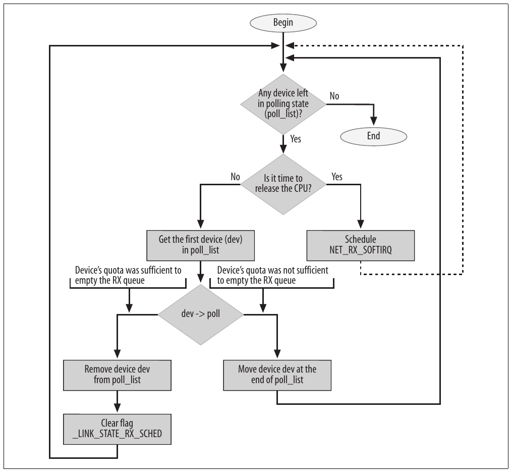
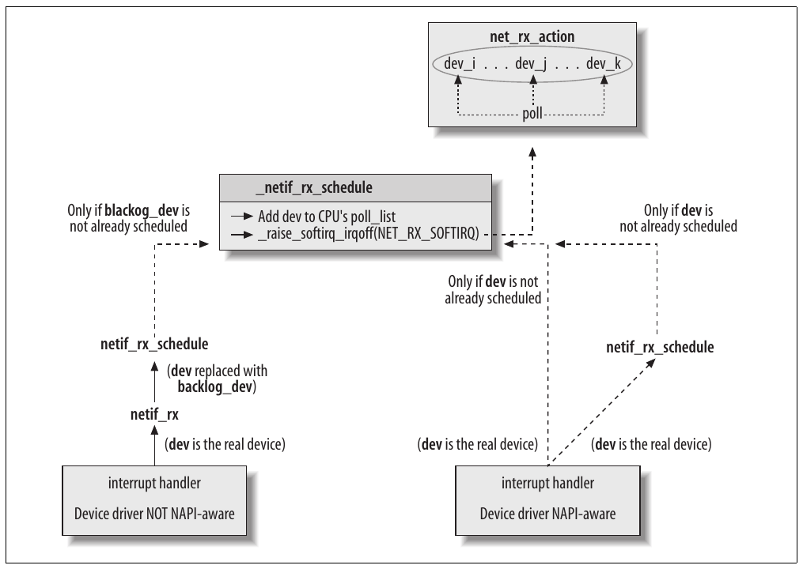
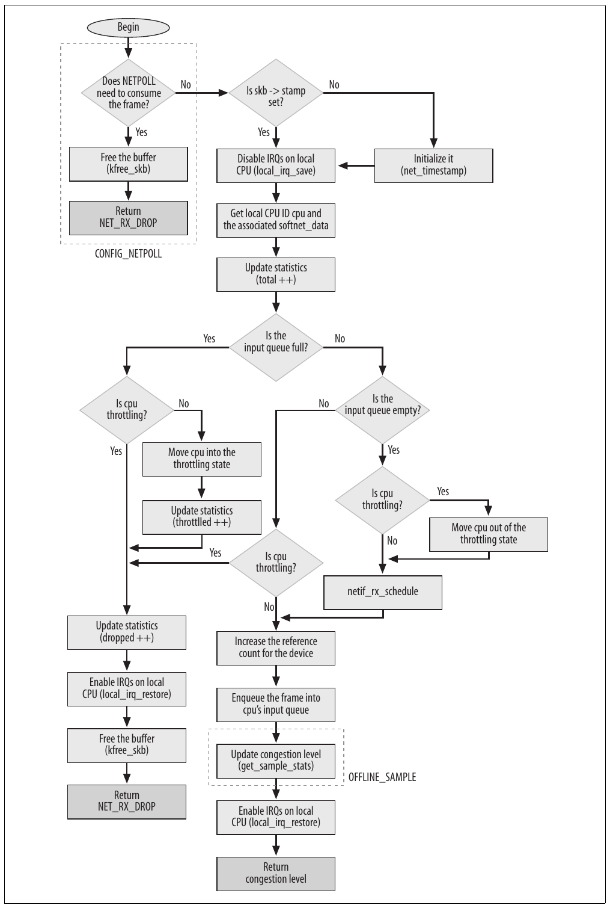
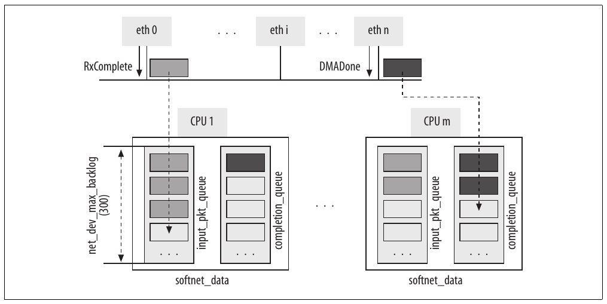
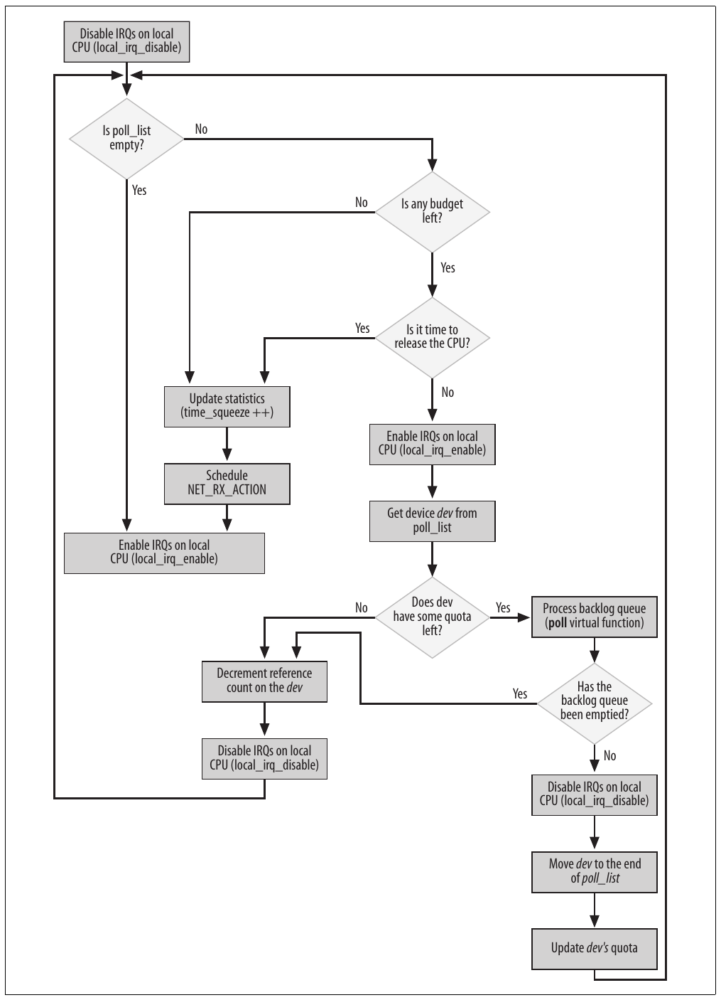
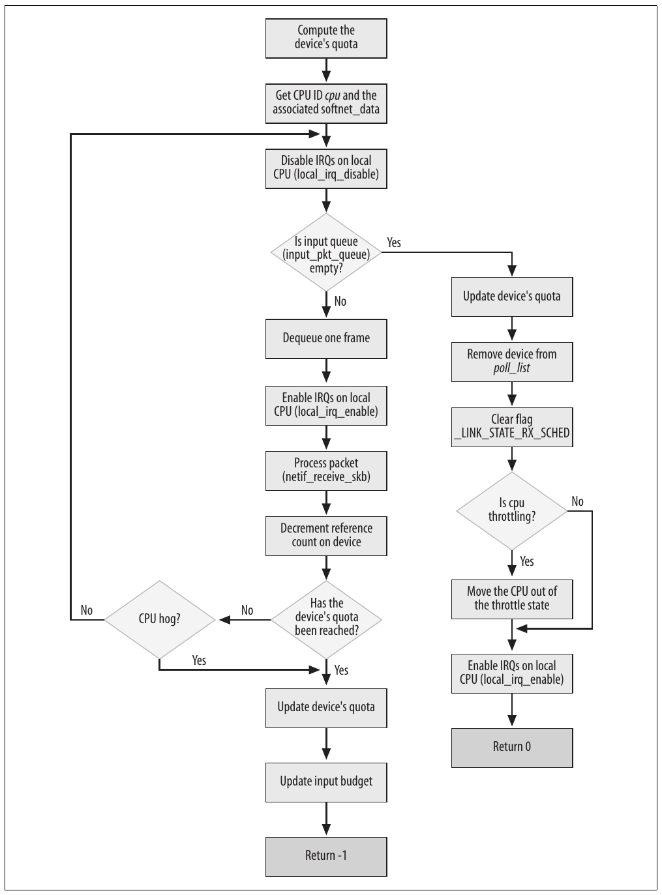
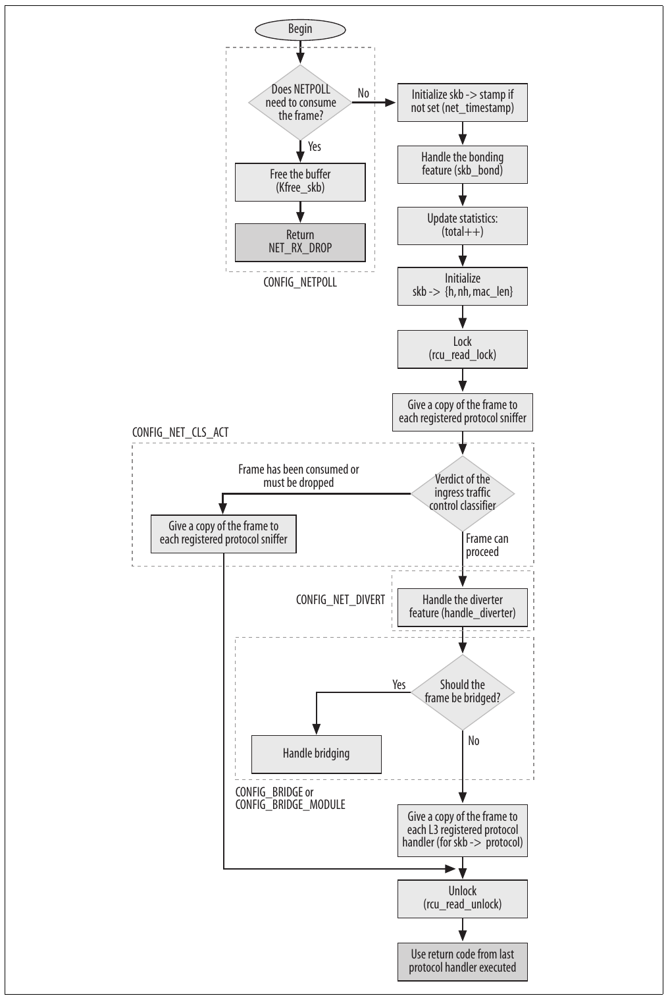

# Chương 10. Nhận frame


Trong chương trước, chúng ta đã thấy các function xử lý frame ở L2 layer được interrupt điều khiển. Trong chương này, chúng ta bắt đầu thảo luận việc nhận frame, trong đó hardware dùng interrupt để báo cho CPU biết có frame sẵn sàng.

Như Hình 9-2 trong Chương 9, CPU nhận interrupt thực thi function `do_IRQ`. IRQ number khiến handler thích hợp được gọi. Handler thường là function trong device driver được đăng ký khi khởi tạo device driver. IRQ function handler được thực thi trong interrupt mode, với các interrupt tiếp theo tạm thời bị disable.

Như thảo luận trong mục “Interrupt handler” ở Chương 9, interrupt handler thực hiện một số tác vụ tức thời và lập lịch những tác vụ khác trong bottom half để thực thi sau. Cụ thể, interrupt handler:

1\. Copy frame vào data structure `sk_buff`.[^1]

2\. Khởi tạo một số parameter của `sk_buff` để upper network layer sử dụng sau này (đặc biệt `skb->protocol`, nhận diện protocol handler higher-layer và sẽ đóng vai trò quan trọng trong Chương 13).

3\. Cập nhật một số parameter khác riêng cho device, chúng ta không xét trong chương này vì chúng không ảnh hưởng đường đi của frame bên trong network stack.

4\. Báo cho kernel về frame mới bằng cách lập lịch thực thi softirq `NET_RX_SOFTIRQ`.

Vì device có thể phát interrupt vì các lý do khác nhau (nhận frame mới, truyền frame hoàn tất thành công, v.v.), kernel được cung cấp một code cùng interrupt notification để device driver handler có thể xử lý interrupt dựa trên type.

## Tương tác với các feature khác

Khi đọc các routine được giới thiệu trong chương này, bạn sẽ thường thấy những đoạn code tương tác với kernel feature tùy chọn. Với feature được trình bày trong sách, tôi sẽ dẫn bạn tới chương tương ứng; với feature khác, tôi sẽ không dành nhiều thời gian cho code. Phần lớn flowchart trong chương cũng cho thấy nơi xử lý những feature tùy chọn đó trong routine.

Sau đây là những feature tùy chọn chúng ta sẽ gặp, cùng kernel symbol tương ứng:

802.1d Ethernet Bridging (CONFIG\_BRIDGE/CONFIG\_BRIDGE\_MODULE)

Bridging được mô tả trong Phần IV.

Netpoll (CONFIG\_NETPOLL)

Netpoll là generic framework để gửi và nhận frame bằng cách polling network interface card (NIC), loại bỏ nhu cầu dùng interrupt. Bất kỳ kernel feature nào hưởng lợi từ chức năng này đều có thể dùng Netpoll; một ví dụ nổi bật là Netconsole, ghi kernel message (tức string được in bằng `printk`) tới remote host qua UDP. Có thể bật Netconsole và các suboption từ menu make xconfig bằng option “Networking support ➝ Network console logging support”. Để dùng Netpoll, device phải hỗ trợ nó (khá nhiều device đã hỗ trợ).

Packet Action (CONFIG\_NET\_CLS\_ACT)

Với feature này, Traffic Control có thể phân loại và áp dụng action lên ingress traffic. Các action có thể gồm drop packet và consume packet. Để thấy option này và mọi suboption từ menu make xconfig, trước hết bạn cần chọn option “Networking support ➝ Networking options ➝ QoS and/or fair queueing ➝ Packet classifier API”.

## Enable và disable device

Device có thể được xem là enable khi flag `__LINK_STATE_START` được set trong `net_device->state`. Mục “Enable và disable device” ở Chương 8 trình bày chi tiết flag này. Flag thường được set khi mở device (`dev_open`) và clear khi đóng device (`dev_close`). Trong khi có flag dùng để enable và disable tường minh việc truyền của device (`__LINK_STATE_XOFF`), không có flag nào để enable và disable việc nhận. Khả năng đó được thực hiện bằng cách khác, tức disable device như mô tả trong Chương 8. Có thể kiểm tra trạng thái flag `__LINK_STATE_START` bằng function `netif_running`.

Một số function phía sau trong chương cung cấp wrapper đơn giản kiểm tra trạng thái thích hợp của những flag như `__LINK_STATE_START` để bảo đảm device sẵn sàng thực hiện yêu cầu sắp được đưa ra.

## Queue

Khi thảo luận hành vi L2, tôi thường nói về queue cho frame đang được nhận (ingress queue) và truyền (egress queue). Mỗi queue có pointer tới device tương ứng và các data structure `skb_buff` lưu ingress/ egress buffer. Chỉ một số ít device chuyên biệt hoạt động không cần queue; ví dụ là loopback device. Loopback device có thể không cần queue vì khi truyền packet ra loopback device, packet được chuyển giao ngay (cho local system) mà không cần queue trung gian. Hơn nữa, vì việc truyền trên loopback device không thể thất bại, không cần requeue packet để thử truyền lại.

Egress queue gắn trực tiếp với device; Traffic Control (Quality of Service, hay QoS layer) định nghĩa một queue cho mỗi device. Như sẽ thấy trong Chương 11, kernel theo dõi device đang chờ truyền frame, không theo dõi chính các frame. Chúng ta cũng sẽ thấy không phải mọi device thực sự dùng Traffic Control. Tình huống với ingress queue phức tạp hơn một chút, như sẽ thấy sau.

## Thông báo cho kernel về việc nhận frame: NAPI và netif\_rx

Trong version 2.5 (sau đó cũng được backport tới một revision cuối của 2.4), một API mới để xử lý ingress frame được đưa vào Linux kernel, được gọi là NAPI (vì chưa có tên hay hơn). Vì ít device đã được nâng cấp sang NAPI, có hai cách Linux driver có thể thông báo cho kernel về frame mới:

Thông qua function cũ `netif_rx`

Đây là cách các device theo kỹ thuật mô tả trong mục “Xử lý nhiều frame trong một interrupt” ở Chương 9 sử dụng. Phần lớn Linux device driver vẫn dùng cách này.

Thông qua cơ chế NAPI

Đây là cách các device theo kỹ thuật trong biến thể được giới thiệu ở cuối mục “Xử lý nhiều frame trong một interrupt” ở Chương 9 sử dụng. Cơ chế này mới trong Linux kernel và chỉ một số ít driver dùng. drivers/net/tg3.c là driver đầu tiên được chuyển sang NAPI.

Một số device driver cho phép chọn giữa hai interface type khi cấu hình kernel option bằng tool như make xconfig.

Đoạn code sau lấy từ `vortex_rx`, vẫn dùng function cũ `netif_rx`, và bạn có thể kỳ vọng phần lớn network device driver chưa dùng NAPI thực hiện tương tự:

```c
    skb = dev_alloc_skb(pkt_len + 5);
        ... ... ...
    if (skb != NULL) {
        skb->dev = dev;
        skb_reserve(skb, 2);    /* Align IP on 16 byte boundaries */
                ... ... ...
                /* copy the DATA into the sk_buff structure */
                ... ... ...
        skb->protocol = eth_type_trans(skb, dev);
        netif_rx(skb);
        dev->last_rx = jiffies;
            ... ... ...
    }
```

Trước hết, data structure `sk_buff` được cấp phát bằng `dev_alloc_skb` (xem Chương 2), rồi frame được copy vào đó. Lưu ý trước khi copy, code dành hai byte để align IP header tới boundary 16-byte. Mỗi network device driver gắn với một interface type cụ thể; chẳng hạn, Vortex device driver driver/net/3c59x.c gắn với một họ Ethernet card cụ thể. Vì vậy, driver biết độ dài link layer header và cách diễn giải nó. Với header length 16\*k+n, driver có thể buộc alignment tới boundary 16-byte bằng cách gọi `skb_reserve` với offset 16−n. Ethernet header dài 14 byte, nên k=0, n=14 và offset code yêu cầu là 2 (xem định nghĩa `NET_IP_ALIGN` và comment tương ứng trong include/linux/sk\_buff.h).

Cũng lưu ý ở giai đoạn này, driver không phân biệt các L3 protocol khác nhau. Nó align L3 header tới boundary 16-byte bất kể type. L3 protocol có lẽ là IP vì IP được dùng rộng rãi, nhưng tại đây không có bảo đảm; có thể là IPX của Netware hoặc thứ khác. Alignment hữu ích bất kể L3 protocol sẽ dùng.

`eth_type_trans`, dùng để trích protocol identifier `skb->protocol`, được mô tả trong Chương 13.[^2]

Tùy độ phức tạp thiết kế driver, block trên có thể được theo sau bởi những housekeeping task khác, nhưng chúng ta không quan tâm những chi tiết đó trong sách. Phần quan trọng nhất của function là thông báo cho kernel về việc nhận frame.

### Giới thiệu API mới (NAPI)

Mặc dù một số NIC device driver chưa được chuyển sang NAPI, infrastructure mới đã tích hợp vào kernel, và ngay cả interface giữa `netif_rx` với phần còn lại của kernel cũng phải tính đến NAPI. Thay vì giới thiệu cách cũ (thuần `netif_rx`) trước rồi nói về NAPI, chúng ta sẽ xem NAPI trước, sau đó cho thấy cách driver cũ giữ interface cũ (`netif_rx`) trong khi chia sẻ một số cơ chế infrastructure mới.

NAPI kết hợp interrupt với polling và cho hiệu năng cao hơn cách cũ khi traffic load cao bằng cách giảm đáng kể CPU load. Kernel developer đã backport infrastructure đó sang kernel 2.4.

Trong mô hình cũ, device driver tạo interrupt cho mỗi frame nó nhận. Khi traffic load cao, thời gian xử lý interrupt có thể gây lãng phí resource đáng kể.

Ý tưởng chính của NAPI đơn giản: thay vì dùng mô hình thuần interrupt-driven, nó kết hợp interrupt và polling. Nếu nhận frame mới khi kernel chưa xử lý xong frame trước, không cần driver tạo thêm interrupt: sẽ dễ hơn nếu để kernel tiếp tục xử lý mọi thứ trong device input queue (với interrupt bị disable cho device), rồi re-enable interrupt khi queue rỗng. Nhờ đó, driver có ưu điểm của cả interrupt lẫn polling:

- Asynchronous event, như nhận một hoặc nhiều frame, được chỉ báo bằng interrupt để kernel không phải liên tục kiểm tra ingress queue của device có rỗng hay không.

- Nếu kernel biết còn thứ gì trong ingress queue của device, không cần lãng phí thời gian xử lý interrupt notification. Polling đơn giản là đủ.

Từ góc nhìn xử lý của kernel, sau đây là một số ưu điểm của NAPI:

Giảm CPU load (vì có ít interrupt hơn)

Với cùng workload (tức số frame mỗi giây), CPU load thấp hơn khi dùng NAPI. Điều này đặc biệt đúng khi workload cao. Khi workload thấp, thực tế CPU usage có thể cao hơn đôi chút với NAPI, theo thử nghiệm do kernel developer đăng trên kernel mailing list.

Công bằng hơn khi xử lý device

Sau này chúng ta sẽ thấy cách device có thứ gì trong ingress queue được truy cập công bằng theo round-robin. Điều này bảo đảm device có ít traffic vẫn có latency chấp nhận được ngay cả khi device khác chịu tải lớn hơn nhiều.

### Các field net\_device được NAPI sử dụng

Trước khi xem cách triển khai và sử dụng NAPI, tôi cần mô tả một số field của data structure `net_device`, đề cập trong mục “Structure softnet\_data” ở Chương 9.

Bốn field mới được thêm vào structure này để softirq `NET_RX_SOFTIRQ` dùng khi làm việc với device có driver dùng NAPI interface. Device khác không dùng chúng, nhưng sẽ chia sẻ những field của structure `net_device` được nhúng trong structure `softnet_data` làm field `backlog_dev`.

`poll`

Virtual function dùng để dequeue buffer khỏi ingress queue của device. Queue là private queue với device dùng NAPI, còn với device khác là `softnet_data->input_pkt_queue`. Xem mục “Xử lý backlog: poll virtual function process\_backlog”.

`poll_list`

List các device có frame mới trong ingress queue chờ xử lý. Những device này được gọi là ở polling state. Đầu list là `softnet_data->poll_list`. Device trong list này có interrupt bị disable và hiện được kernel polling.

`quota`

`weight`

`quota` là integer biểu thị số buffer tối đa virtual function `poll` có thể dequeue trong một lượt. Value được tăng theo đơn vị `weight` và dùng để bảo đảm một mức công bằng giữa các device. Quota thấp hơn nghĩa là latency tiềm năng thấp hơn, do đó giảm nguy cơ khiến device khác bị starvation. Mặt khác, quota thấp làm tăng số lần chuyển giữa device, do đó tăng overhead tổng thể.

Với device gắn với driver non-NAPI, default value của `weight` là 64, lưu trong `weight_p` ở đầu net/core/dev.c. Có thể thay đổi value `weight_p` qua /proc.

Với device gắn với NAPI driver, default value do driver chọn. Value phổ biến nhất là 64, nhưng 16 và 32 cũng được dùng. Có thể tinh chỉnh value qua sysfs.

Với cả interface /proc lẫn sysfs, xem mục “Tinh chỉnh qua filesystem /proc và sysfs” ở Chương 12.

Mục “Interface driver cũ và mới” mô tả cách thức và thời điểm thêm phần tử vào `poll_list`, còn mục “Xử lý backlog: poll virtual function process\_backlog” mô tả khi nào method `poll` trích phần tử khỏi list và cách `quota` được cập nhật dựa trên value `weight`.

Device dùng NAPI khởi tạo bốn field này và các field `net_device` khác theo mô hình khởi tạo mô tả trong Chương 8. Với device giả `backlog_dev`, giới thiệu trong mục “Khởi tạo softnet\_data” ở Chương 9 và mô tả phía sau trong chương này, việc khởi tạo do `net_dev_init` đảm nhiệm (mô tả trong Chương 5).

### net\_rx\_action và NAPI

Hình 10-1 cho thấy điều xảy ra mỗi lần kernel poll incoming network traffic. Trong hình, bạn có thể thấy quan hệ giữa list `poll_list` chứa device ở polling state, virtual function `poll` và software interrupt handler `net_rx_action`. Các mục sau sẽ đi sâu từng khía cạnh sơ đồ, nhưng cần hiểu cách các phần tương tác trước khi chuyển sang source code.



Hình 10-1. Function net\_rx\_action và tổng quan NAPI

Chúng ta đã biết `net_rx_action` là function tương ứng với flag `NET_RX_SOFTIRQ`. Để đơn giản, giả sử sau giai đoạn hoạt động rất ít, một số device bắt đầu nhận frame và bằng cách nào đó kích hoạt thực thi `net_rx_action`; hiện tại cách chúng làm điều đó chưa quan trọng.

`net_rx_action` duyệt list device ở polling state và gọi virtual function `poll` tương ứng cho mỗi device để xử lý frame trong ingress queue. Tôi đã giải thích device trong list được xét theo round-robin, và có số frame tối đa chúng được xử lý mỗi lần method `poll` được gọi. Nếu không thể làm rỗng queue trong lượt của mình, chúng phải chờ lượt tiếp theo để tiếp tục. Điều này nghĩa là `net_rx_action` tiếp tục gọi method `poll` do device driver cung cấp cho device còn thứ gì trong ingress queue cho tới khi queue rỗng. Khi đó không còn cần polling và device driver có thể re-enable interrupt notification cho device. Cần nhấn mạnh interrupt chỉ bị disable cho device trong `poll_list`, chỉ áp dụng với device dùng NAPI và không chia sẻ `backlog_dev`.

`net_rx_action` giới hạn execution time và tự lập lịch thực thi lại khi vượt giới hạn execution time hoặc số frame xử lý đã cho; điều này bảo đảm `net_rx_action` hành xử công bằng với kernel task khác. Đồng thời, mỗi device giới hạn số frame được xử lý mỗi lần gọi method `poll` để công bằng với device khác. Khi device không thể làm rỗng ingress queue, nó phải chờ lần gọi method `poll` tiếp theo.

### Interface driver cũ và mới

Giờ đây, khi ý nghĩa các field NAPI-related của structure `net_device` và ý tưởng high-level của NAPI đã rõ, chúng ta có thể tới gần source code hơn.

Hình 10-2 cho thấy khác biệt giữa driver NAPI-aware và những driver khác về cách thông báo cho kernel rằng đã nhận frame mới.

Từ góc nhìn device driver, chỉ có hai khác biệt giữa NAPI và non-NAPI. Thứ nhất, NAPI driver phải cung cấp method `poll`, mô tả trong mục “Các field net\_device được NAPI sử dụng”. Khác biệt thứ hai là function được gọi để lập lịch frame: driver non-NAPI gọi `netif_rx`, còn NAPI driver gọi `__netif_rx_schedule`, định nghĩa trong include/linux/netdevice.h. (Kernel cung cấp wrapper function tên `netif_rx_schedule`, kiểm tra để bảo đảm device đang chạy và softirq chưa được lập lịch, rồi gọi `__netif_rx_schedule`. Những kiểm tra này được thực hiện bằng `netif_rx_schedule_prep`. Một số driver gọi `netif_rx_schedule`, số khác gọi tường minh `netif_rx_schedule_prep` rồi `__netif_rx_schedule` nếu cần).

Như Hình 10-2, cả hai loại driver enqueue input device vào polling list (`poll_list`), lập lịch thực thi software interrupt `NET_RX_SOFTIRQ`, nên cuối cùng đều được `net_rx_action` xử lý. Dù cả hai loại driver cuối cùng gọi `__netif_rx_schedule` (driver non-NAPI làm điều đó trong `netif_rx`), device NAPI có tiềm năng hiệu năng tốt hơn nhiều vì những lý do đã thấy trong mục “Thông báo cho driver khi nhận frame” ở Chương 9.



Hình 10-2. Driver NAPI-aware so với device non-NAPI-aware

Chi tiết quan trọng trong Hình 10-2 là structure `net_device` được truyền cho `__netif_rx_schedule` trong hai trường hợp. Device Non-NAPI dùng structure tích hợp trong structure `softnet_data` của CPU, còn device NAPI dùng structure `net_device` tham chiếu chính chúng.

### Thao tác poll\_list

Trong mục trước, chúng ta đã thấy mọi device (kể cả device giả `backlog_dev`) được thêm vào list `poll_list` bằng lời gọi `netif_rx_schedule` hoặc `__netif_rx_schedule`.

Thao tác ngược lại, loại device khỏi list, được thực hiện bằng `netif_rx_complete` hoặc `__netif_rx_complete` (function thứ hai giả định interrupt đã bị disable trên local CPU). Chúng ta sẽ xem khi nào hai routine này được gọi trong mục “Xử lý NET\_RX\_SOFTIRQ: net\_rx\_action”.

Device cũng có thể tạm disable và re-enable polling lần lượt bằng `netif_poll_disable` và `netif_poll_enable`. Điều này không nghĩa là device driver quyết định quay về mô hình interrupt-based. Chẳng hạn, polling có thể bị disable trên device khi device cần được device driver reset để áp dụng một dạng thay đổi hardware configuration.

Tôi đã nói `netif_rx_schedule` lọc request cho device đã nằm trong `poll_list` (tức có flag `__LINK_STATE_RX_SCHED` được set). Vì vậy, nếu driver set flag đó nhưng không thêm device vào `poll_list`, về cơ bản nó disable polling cho device: device sẽ không bao giờ được thêm vào `poll_list`. Đây là cách `netif_poll_disable` hoạt động: nếu `__LINK_STATE_RX_SCHED` chưa được set, nó chỉ set rồi return. Nếu không, nó chờ flag được clear rồi set.

```c
static inline void netif_poll_disable(struct net_device *dev)
{
    while (test_and_set_bit(__LINK_STATE_RX_SCHED, &dev->state)) {
        /* No hurry. */
        current->state = TASK_INTERRUPTIBLE:
        schedule_timeout(1);
    }
}
```

## Interface cũ giữa device driver và kernel:

## Phần đầu của netif\_rx

Function `netif_rx`, định nghĩa trong net/core/dev.c, thường được device driver gọi khi có input frame mới chờ xử lý;[^3] nhiệm vụ là lập lịch softirq sẽ sớm chạy để dequeue và xử lý frame. Hình 10-3 cho thấy những kiểm tra và luồng event của function. Hình gần như dài hơn code, nhưng hữu ích để hiểu cách `netif_rx` phản ứng với context của nó.

`netif_rx` thường được driver gọi trong interrupt context, nhưng có ngoại lệ, đặc biệt khi function được loopback device gọi. Vì vậy, `netif_rx` disable interrupt trên local CPU lúc bắt đầu và re-enables khi kết thúc.<sup>†</sup>

Khi xem code, cần nhớ các CPU khác nhau có thể chạy `netif_rx` đồng thời. Đây không phải vấn đề vì mỗi CPU gắn với private structure `softnet_data` duy trì state information. Trong số những thứ khác, structure `softnet_data` của CPU chứa private input queue (xem mục “Structure softnet\_data” ở Chương 9).



Hình 10-3. Function netif\_rx

Đây là prototype của function:

```c
int netif_rx(struct sk_buff *skb)
```

Input parameter duy nhất là buffer device nhận, còn output value là chỉ báo congestion level (bạn có thể tìm chi tiết trong mục “Congestion management”).

Các tác vụ chính của `netif_rx`, có flowchart chi tiết trong Hình 10-3, gồm:

- Khởi tạo một số field của data structure `sk_buff` (như thời điểm nhận frame).

- Lưu frame nhận được vào private input queue của CPU và thông báo cho kernel về frame bằng cách kích hoạt softirq tương ứng `NET_RX_SOFTIRQ`. Bước này chỉ diễn ra khi đáp ứng một số điều kiện, quan trọng nhất là có chỗ trong queue hay không.

- Cập nhật thống kê về congestion level.

Hình 10-4 cho thấy ví dụ hệ thống có nhiều CPU và device. Mỗi CPU có instance `softnet_data` riêng, chứa private input queue nơi `netif_rx` lưu ingress frame, và `completion_queue` nơi buffer được gửi tới khi không còn cần (xem mục “Xử lý NET\_TX\_ SOFTIRQ: net\_tx\_action” ở Chương 11). Hình cho thấy ví dụ CPU 1 nhận interrupt `RxComplete` từ eth0. Driver tương ứng lưu ingress frame vào queue của CPU 1. CPU m nhận interrupt `DMADone` từ ethn báo buffer đã truyền không còn cần và vì vậy có thể được chuyển tới queue `completion_queue`.[^4]

### Tác vụ ban đầu của netif\_rx

`netif_rx` bắt đầu bằng cách lưu thời điểm gọi function (cũng biểu thị thời điểm nhận frame) vào field `stamp` của buffer structure:

```c
   if (skb->stamp.tv_sec == 0)
           net_timestamp(&skb->stamp);
```

Lưu timestamp tốn CPU, vì vậy `net_timestamp` chỉ khởi tạo `skb-> stamp` nếu có ít nhất một bên sử dụng quan tâm field đó. Có thể báo sự quan tâm bằng lời gọi `net_enable_timestamp`.

Đừng nhầm phép gán này với phép gán device driver thực hiện ngay trước hoặc sau khi gọi `netif_rx`:

```c
  netif_rx(skb);
  dev->last_rx = jiffies;
```



Hình 10-4. Ingress queue của CPU

Device driver lưu trong structure `net_device` thời điểm nhận frame gần nhất, còn `netif_rx` lưu thời điểm nhận frame trong chính buffer. Vì vậy, một timestamp gắn với device, timestamp còn lại gắn với frame. Hơn nữa, hai timestamp dùng hai độ chính xác khác nhau. Device driver lưu timestamp của frame gần nhất theo `jiffies`, có độ chính xác 10 hoặc 1 ms trong kernel 2.6 tùy architecture (chẳng hạn, trước 2.6, i386 dùng value 10, nhưng từ 2.6 value là 1). Tuy nhiên, `netif_rx` lấy timestamp bằng cách gọi `get_fast_time`, trả về value chính xác hơn nhiều.

ID của local CPU được lấy bằng `smp_processor_id()` và lưu trong local variable `this_cpu`:

```c
  this_cpu = smp_processor_id( );
```

Cần local CPU ID để lấy data structure tương ứng với CPU đó trong vector per-CPU, như code sau trong `netif_rx`:

```c
  queue = &__get_cpu_var(softnet_data);
```

Dòng trước lưu vào `queue` một pointer tới structure `softnet_data` tương ứng với local CPU đang phục vụ interrupt do device driver gọi `netif_rx` kích hoạt.

Bây giờ, `netif_rx` cập nhật tổng số frame mà CPU đã nhận, bao gồm cả frame được chấp nhận lẫn frame bị loại bỏ, chẳng hạn vì queue không còn chỗ:

```c
    netdev_rx_stat[this_cpu].total++
```

Mỗi device driver cũng giữ thống kê, lưu trong private data structure mà `dev->priv` trỏ tới. Những thống kê này, gồm số frame nhận, số frame bị drop, v.v., được giữ theo per-device (xem Chương 2), còn thống kê do `netif_rx` cập nhật là theo per-CPU.

### Quản lý queue và lập lịch bottom half

Input queue được quản lý bởi `softnet_data->input_pkt_queue`. Mỗi input queue có độ dài tối đa do global variable `netdev_max_backlog` quy định, có value 300. Điều này nghĩa là mỗi CPU có thể có tới 300 frame trong input queue chờ xử lý, bất kể số device trong hệ thống.[^5]

Theo lẽ thường, value `netdev_max_backlog` nên phụ thuộc số device và tốc độ của chúng. Tuy nhiên, khó theo dõi điều này trong hệ thống SMP, nơi interrupt được phân phối động giữa CPU. Không rõ device nào sẽ giao tiếp với CPU nào. Vì vậy, value `netdev_max_backlog` được chọn bằng thử nghiệm. Trong tương lai, có thể hình dung nó được đặt động theo cách phản ánh type và số interface. Administrator hiện đã có thể cấu hình value, như mô tả trong mục “Tinh chỉnh qua filesystem /proc và sysfs” ở Chương 12. Vấn đề hiệu năng như sau: value lớn không cần thiết gây lãng phí memory, và hệ thống chậm có thể đơn giản không bao giờ xử lý kịp. Mặt khác, value quá nhỏ có thể giảm hiệu năng device vì một đợt traffic dồn dập có thể dẫn đến nhiều frame bị drop. Value tối ưu phụ thuộc nhiều vào vai trò hệ thống (host, server, router, v.v.).

Trong kernel trước, khi chưa có data structure per-CPU `softnet_data`, mọi device chia sẻ một input queue duy nhất tên `backlog`, cũng có kích thước 300 frame. Lợi ích chính với `softnet_data` không phải n CPU tạo chỗ cho n\*300 frame trên các queue, mà là không cần locking giữa CPU vì mỗi CPU có queue riêng.

Code sau điều khiển các điều kiện để `netif_rx` chèn frame mới vào queue và các điều kiện để lập lịch chạy queue:

```c
    if (queue->input_pkt_queue.qlen <= netdev_max_backlog) {
        if (queue->input_pkt_queue.qlen) {
            if (queue->throttle)
                goto drop;

enqueue:
            dev_hold(skb->dev);
            __skb_queue_tail(&queue->input_pkt_queue,skb);
#ifndef OFFLINE_SAMPLE
            get_sample_stats(this_cpu);
#endif
                   local_irq_restore(flags);
            return queue->cng_level;
        }

        if (queue->throttle)
            queue->throttle = 0;

        netif_rx_schedule(&queue->backlog_dev);
        goto enqueue;
    }

    ... ... ...

drop:
    __get_cpu_var(netdev_rx_stat).dropped++;
    local_irq_restore(flags);

    kfree_skb(skb);
    return NET_RX_DROP;
}
```

Mệnh đề `if` đầu tiên xác định còn chỗ hay không. Nếu queue đầy và mệnh đề cho kết quả false, CPU được đặt vào throttle state, nghĩa là đang quá tải input traffic và vì vậy drop mọi frame tiếp theo. Code thiết lập throttle không được thể hiện ở đây, nhưng có trong mục congestion management tiếp theo.

Tuy nhiên, việc queue còn chỗ chưa đủ để bảo đảm frame được chấp nhận. CPU có thể đã ở state “throttle”, được xác định bởi câu lệnh `if` thứ ba; trong trường hợp đó, frame bị drop.

Có thể gỡ throttle state khi queue rỗng. Đây là điều mệnh đề `if` thứ hai kiểm tra. Khi queue có data và CPU ở throttle state, frame bị drop. Nhưng khi queue rỗng và CPU ở throttle state (được một mệnh đề `if` trong nửa sau đoạn code kiểm tra), throttle state được gỡ bỏ.[^6]

Lời gọi `dev_hold(skb->dev)` tăng reference count cho device để device không thể bị loại bỏ cho đến khi buffer này được xử lý hoàn toàn. Việc giảm tương ứng, do `dev_put` thực hiện, diễn ra trong `net_rx_action`, sẽ được phân tích phía sau trong chương.

Nếu mọi kiểm tra đều đạt, buffer được enqueue vào input queue bằng `__skb_queue_tail(&queue->input_pkt_queue,skb)`, IRQ status được khôi phục cho CPU và function return.

Enqueue frame cực nhanh vì không copy memory, chỉ thao tác pointer. `input_pkt_queue` là list các pointer. `__skb_queue_tail` thêm pointer tới buffer mới vào list mà không copy buffer.

Software interrupt `NET_RX_SOFTIRQ` được lập lịch thực thi bằng `netif_rx_schedule`. Lưu ý `netif_rx_schedule` chỉ được gọi khi buffer mới được thêm vào queue rỗng. Lý do là nếu queue không rỗng, `NET_RX_SOFTIRQ` đã được lập lịch và không cần thực hiện lại.

Trong mục “Xử lý softirq pending” ở Chương 9, chúng ta đã thấy cách kernel đảm nhiệm software interrupt được lập lịch. Trong mục “Xử lý NET\_ RX\_SOFTIRQ: net\_rx\_action” sắp tới, chúng ta sẽ xem bên trong handler của softirq `NET_RX_SOFTIRQ`.

## Congestion management

Congestion management là thành phần quan trọng của tác vụ frame-processing đầu vào. CPU quá tải có thể trở nên không ổn định và đưa latency lớn vào hệ thống. Mục “Interrupt” ở Chương 9 giải thích vì sao interrupt do tải cao tạo ra có thể làm tê liệt hệ thống. Vì vậy, cần cơ chế congestion management để bảo đảm sự ổn định của hệ thống không bị ảnh hưởng khi network load cao. Các cách phổ biến để giảm CPU load khi traffic load cao gồm:

Giảm số interrupt nếu có thể

Điều này được thực hiện bằng cách viết driver xử lý nhiều frame với một interrupt (xem mục “Xử lý nhiều frame trong một interrupt” ở Chương 9), hoặc dùng NAPI.

Loại bỏ frame sớm nhất có thể trong ingress path

Nếu code biết frame sẽ bị higher layer drop, có thể tiết kiệm CPU time bằng cách drop frame sớm. Chẳng hạn, nếu device driver biết ingress queue đầy, nó có thể drop frame ngay thay vì chuyển cho kernel rồi để kernel drop.

Điểm thứ hai là nội dung chúng ta trình bày trong mục này.

Tối ưu tương tự áp dụng cho egress path: nếu device driver không có resource để nhận frame mới cần truyền (tức device hết memory), để kernel tiếp tục đẩy frame mới xuống driver để truyền sẽ lãng phí CPU time. Điểm này được thảo luận trong Chương 11, mục “Enable và disable việc truyền”.

Trong cả hai trường hợp nhận và truyền, kernel cung cấp tập function để set, clear và lấy trạng thái receive queue và transmit queue, cho phép device driver (khi nhận) và core kernel (khi truyền) thực hiện những tối ưu vừa đề cập.

Một chỉ báo tốt về congestion level là số frame đã nhận và đang chờ xử lý. Khi device driver dùng NAPI, driver có trách nhiệm triển khai mọi congestion control mechanism. Điều này là vì ingress frame được giữ trong memory của NIC hoặc receive ring do driver quản lý, và kernel không thể theo dõi traffic congestion. Ngược lại, khi device driver không dùng NAPI, frame được thêm vào queue per-CPU (`softnet_data-> input_pkt_queue`) và kernel theo dõi congestion level của queue. Trong mục này, chúng ta trình bày trường hợp sau.

Queue theory là chủ đề phức tạp và sách này không dành cho chi tiết toán học. Tôi chỉ dừng ở một điểm đơn giản: số frame hiện tại trong queue không nhất thiết biểu thị congestion level thực. Average queue length là chỉ dẫn tốt hơn về queue status. Theo dõi average giúp hệ thống không phân loại nhầm một đợt traffic dồn dập thành congestion. Trong Linux network stack, average queue length được báo cáo bởi hai field của structure `softnet_data`, `cng_level` và `avg_blog`, đã được giới thiệu trong “Structure softnet\_data” ở Chương 9.

Là average, `avg_blog` có thể lớn hơn hoặc nhỏ hơn độ dài `input_pkt_queue` tại bất kỳ thời điểm nào. Value trước biểu thị lịch sử gần đây, value sau biểu thị tình huống hiện tại. Vì vậy, chúng được dùng cho hai mục đích khác nhau:

- Theo mặc định, mỗi lần frame được enqueue vào `input_pkt_queue`, `avg_blog` được cập nhật, congestion level tương ứng được tính và lưu trong `cng_level`. Value sau được `netif_rx` dùng làm return value để device driver gọi function này nhận feedback về queue status và có thể thay đổi hành vi tương ứng.

- Số frame trong `input_pkt_queue` không thể vượt kích thước tối đa. Khi đạt kích thước đó, frame tiếp theo bị drop vì CPU rõ ràng quá tải.

Hãy quay lại việc tính toán và sử dụng congestion level. `avg_blog` và `cng_level` được cập nhật bên trong `get_sample_stats`, được `netif_rx` gọi.

Hiện tại, ít device driver dùng feedback từ `netif_rx`. Cách dùng phổ biến nhất là cập nhật thống kê cục bộ của device driver. Để xem cách dùng thú vị hơn, xem drivers/net/tulip/de2104x.c: khi `netif_rx` return `NET_RX_DROP`, local variable drop được đặt thành 1, khiến main loop bắt đầu drop frame trong receive ring thay vì xử lý.

Chừng nào ingress queue `input_pkt_queue` chưa đầy, device driver có trách nhiệm dùng feedback từ `netif_rx` để xử lý congestion. Khi tình hình xấu hơn và input queue đầy, kernel tham gia và dùng flag `softnet_data->throttle` để disable việc nhận frame cho CPU. (Hãy nhớ mỗi CPU có một structure `softnet_data`.)

### Congestion management trong netif\_rx

Hãy quay lại `netif_rx` và xem một số code đã lược khỏi mục trước trong chương. Hai đoạn trích sau chứa một phần code đã trình bày cùng code mới cho thấy khi nào CPU được đặt vào throttle state.

```c
    if (queue->input_pkt_queue.qlen <= netdev_max_backlog) {
        if (queue->input_pkt_queue.qlen) {
            if (queue->throttle)
                goto drop;
            ... ... ...
            return queue->cng_level;
        }
        ... ...    ...
    }

    if (!queue->throttle) {
        queue->throttle = 1;
        __get_cpu_var(netdev_rx_stat).throttled++;
    }
```

`softnet_data->throttle` được clear khi queue rỗng. Chính xác hơn, nó được `netif_rx` clear khi frame đầu tiên được enqueue vào queue rỗng. Điều này cũng có thể diễn ra trong `process_backlog`, như sẽ thấy trong mục “Xử lý backlog: poll virtual function process\_backlog”.

### Average queue length và tính Congestion-Level

Value của `avg_blog` và `cng_level` luôn được cập nhật trong `get_sample_stats`. Function sau có thể được gọi theo hai cách khác nhau:

- Mỗi lần nhận frame mới (`netif_rx`). Đây là mặc định.

- Bằng periodic timer. Để dùng kỹ thuật này, cần định nghĩa symbol `OFFLINE_SAMPLE`. Vì vậy trong `netif_rx`, việc thực thi `get_sample_stats` phụ thuộc định nghĩa symbol `OFFLINE_SAMPLE`. Mặc định nó bị disable.

Cách thứ nhất chạy `get_sample_stats` thường xuyên hơn cách thứ hai khi traffic load trung bình và cao.

Trong cả hai trường hợp, công thức tính `avg_blog` cần đơn giản và nhanh vì có thể được gọi thường xuyên. Công thức được dùng tính đến lịch sử gần đây và hiện tại:

```c
new_value_for_avg_blog = (old_value_of_avg_blog + current_value_of_queue_len) / 2
```

Việc gán trọng số bao nhiêu cho hiện tại và quá khứ không đơn giản. Công thức trước có thể thích ứng nhanh với thay đổi congestion level, vì quá khứ (value cũ) chỉ có trọng số 50%, còn hiện tại có 50% còn lại.

`get_sample_stats` cũng cập nhật `cng_level` dựa trên `avg_blog` qua mapping thể hiện trước đó trong Hình 9-4 ở Chương 9. Nếu symbol `RAND_LIE` được định nghĩa, function thực hiện thao tác bổ sung có thể quyết định ngẫu nhiên đặt `cng_level` cao hơn một mức. Điều chỉnh ngẫu nhiên này tốn thêm thời gian tính nhưng, khá lạ, có thể khiến kernel hoạt động tốt hơn trong một tình huống cụ thể.

Hãy nói thêm đôi chút về lợi ích của những lời nói dối ngẫu nhiên. Đừng nhầm hành vi này với Random Early Detection (RED).

Trong hệ thống chỉ có một interface, drop ngẫu nhiên frame đây đó khi không có congestion thực sự không có ý nghĩa; chỉ làm giảm throughput. Nhưng giả sử có nhiều interface chia sẻ input queue và một device có traffic load cao hơn nhiều so với những device khác. Vì device tham lam lấp đầy shared ingress queue nhanh hơn device khác, những device sau thường thấy ingress queue hết chỗ nên frame của chúng bị drop.[^7] Device tham lam cũng có một số frame bị drop, nhưng không tỷ lệ với tải của nó. Khi hệ thống nhiều interface gặp congestion, nên drop ingress frame trên mọi device theo tỷ lệ tải. Code `RAND_LIE` tăng phần nào tính công bằng trong ngữ cảnh này: drop ngẫu nhiên thêm frame cuối cùng sẽ drop theo tỷ lệ tải.

## Xử lý NET\_RX\_SOFTIRQ: net\_rx\_action

`net_rx_action` là function bottom-half dùng để xử lý incoming frame. Việc thực thi được kích hoạt mỗi khi driver thông báo cho kernel có input frame. Hình 10-5 cho thấy control flow qua function.

Frame có thể chờ `net_rx_action` xử lý ở hai nơi:

Một shared queue CPU-specific

Interrupt handler của device Non-NAPI, gọi `netif_rx`, đặt frame vào `softnet_data->input_pkt_queue` của CPU chạy interrupt handler.

Device memory

Method `poll` được NAPI driver dùng trích frame trực tiếp từ device (hoặc receive ring của device driver).

Mục “Interface driver cũ và mới” đã cho thấy cách kernel được thông báo cần chạy `net_rx_action` trong cả hai trường hợp.



Hình 10-5. Function net\_rx\_action

Công việc của `net_rx_action` khá đơn giản: duyệt list `poll_list` chứa device có thứ gì trong ingress queue và gọi virtual function `poll` tương ứng cho từng device cho tới khi đáp ứng một trong những điều kiện sau:

- Không còn device trong list.

- `net_rx_action` đã chạy quá lâu nên phải nhường CPU để không trở thành tác vụ độc chiếm CPU.

- Số frame đã được dequeue và xử lý đạt giới hạn trên cho trước (`budget`). `budget` được khởi tạo ở đầu function thành `netdev_max_backlog`, được định nghĩa trong net/core/dev.c là 300.

Như sẽ thấy trong mục tiếp theo, `net_rx_action` gọi virtual function `poll` của driver và phụ thuộc một phần vào function này để tuân thủ những giới hạn đó.

Kích thước queue, như đã thấy trong mục “Quản lý queue và lập lịch bottom half”, bị giới hạn bởi value `netdev_max_backlog`. Value này được xem là budget cho `net_rx_action`. Tuy nhiên, vì `net_rx_action` chạy khi interrupt được enable, frame mới có thể được thêm vào input queue của device trong khi `net_rx_action` chạy. Vì vậy, số frame sẵn sàng có thể lớn hơn `budget`, và `net_rx_action` phải có biện pháp bảo đảm không chạy quá lâu trong trường hợp đó.

Giờ chúng ta sẽ xem chi tiết `net_rx_action` làm gì bên trong:

```c
static void net_rx_action(struct softirq_action *h)
{
    struct softnet_data *queue = &__get_cpu_var(softnet_data);
    unsigned long start_time = jiffies;
    int budget = netdev_max_backlog;

    local_irq_disable( );
```

Nếu current device chưa dùng hết quota, nó có cơ hội dequeue buffer từ queue bằng virtual function `poll`:

```c
    while (!list_empty(&queue->poll_list)) {
        struct net_device *dev;

        if (budget <= 0 || jiffies - start_time > 1)
            goto softnet_break;

        local_irq_enable( );

        dev = list_entry(queue->poll_list.next, struct net_device, poll_list);
```

Nếu `dev->poll` return vì device quota không đủ lớn để dequeue mọi buffer trong ingress queue (khi đó return value khác zero), device được chuyển tới cuối `poll_list`:

```c
        if (dev->quota <= 0 || dev->poll(dev, &budget)) {
            local_irq_disable( );
            list_del(&dev->poll_list);
            list_add_tail(&dev->poll_list, &queue->poll_list);
            if (dev->quota < 0)
                dev->quota += dev->weight;
            else
                dev->quota = dev->weight;
        } else {
```

Ngược lại, khi `poll` làm rỗng ingress queue của device, `net_rx_action` không loại device khỏi `poll_list`: `poll` có trách nhiệm làm điều đó bằng lời gọi `netif_rx_complete` (cũng có thể gọi `__netif_rx_complete` nếu IRQ bị disable trên local CPU). Điều này sẽ được minh họa trong function `process_backlog` ở mục tiếp theo.

Hơn nữa, lưu ý `budget` được truyền bằng reference cho virtual function `poll`; vì function đó sẽ trả về budget mới phản ánh số frame đã xử lý. Main loop trong `net_rx_action` kiểm tra `budget` ở mỗi lượt để không vượt giới hạn tổng thể. Nói cách khác, `budget` cho phép `net_rx_action` và function `poll` phối hợp để giữ trong giới hạn.

```c
            dev_put(dev);
            local_irq_disable( );
        }
    }
out:
    local_irq_enable( );
    return;
```

Đoạn code cuối này được thực thi khi `net_rx_action` buộc phải return trong khi ingress queue còn buffer. Khi đó, softirq `NET_RX_SOFTIRQ` được lập lịch thực thi lại để `net_rx_action` được gọi sau và xử lý buffer còn lại:

```c
softnet_break:
    __get_cpu_var(netdev_rx_stat).time_squeeze++;
    __raise_softirq_irqoff(NET_RX_SOFTIRQ);
    goto out;
}
```

Lưu ý `net_rx_action` chỉ disable interrupt bằng `local_irq_disable` khi thao tác list `poll_list` chứa device cần poll (tức khi truy cập instance structure `softnet_data` của nó). Các lời gọi `netpoll_poll_lock` và `netpoll_poll_unlock` do feature NETPOLL dùng đã được lược bỏ. Nếu có thể truy cập kernel source code, xem net\_rx\_action trong net/core/dev.c để biết chi tiết.

### Xử lý backlog: poll virtual function process\_backlog

Virtual function `poll` của data structure `net_device`, được `net_rx_action` thực thi để xử lý backlog queue của device, mặc định được khởi tạo thành `process_backlog` trong `net_dev_init` đối với device không dùng NAPI.

Tính tới kernel 2.6.12, chỉ một số ít device driver dùng NAPI và khởi tạo `dev->poll` bằng pointer tới function riêng: Broadcom Tigon3 Ethernet driver trong drivers/net/tg3.c là driver đầu tiên áp dụng NAPI và là ví dụ tốt để xem. Trong mục này, chúng ta sẽ phân tích default handler `process_backlog` định nghĩa trong net/core/dev.c. Cách triển khai rất giống method `poll` của device driver dùng NAPI (chẳng hạn, có thể so sánh `process_backlog` với `tg3_poll`).

Tuy nhiên, vì `process_backlog` có thể đảm nhiệm nhiều device chia sẻ cùng ingress queue, có một khác biệt quan trọng cần tính đến. Khi `process_backlog` chạy, hardware interrupt được enable nên function có thể bị preempt. Vì vậy, các truy cập structure `softnet_data` luôn được bảo vệ bằng cách disable interrupt trên local CPU với `local_irq_disable`, đặc biệt những lời gọi `__skb_dequeue`. Device driver dùng NAPI không cần lock này:[^8] khi method `poll` của nó được gọi, hardware interrupt bị disable cho device. Hơn nữa, mỗi device có queue riêng.

Hãy xem các phần chính của `process_backlog`. Hình 10-6 cho thấy flowchart của nó.

Function bắt đầu bằng một số khởi tạo:

```c
static int process_backlog(struct net_device *backlog_dev, int *budget)
{
    int work = 0;
    int quota = min(backlog_dev->quota, *budget);
    struct softnet_data *queue = &__get_cpu_var(softnet_data);
    unsigned long start_time = jiffies;
```

Sau đó bắt đầu main loop, cố dequeue mọi buffer trong input queue và chỉ bị dừng nếu một trong những điều kiện sau được đáp ứng:

- Queue trở nên rỗng.

- Device quota đã dùng hết.

- Function đã chạy quá lâu.

Hai điều kiện cuối giống những điều kiện giới hạn `net_rx_action`. Vì `process_backlog` được gọi trong một vòng lặp của `net_rx_action`, function sau chỉ có thể tuân thủ giới hạn nếu `process_backlog` hợp tác. Vì vậy, `net_rx_action` truyền budget còn lại cho `process_backlog`, và function sau đặt quota bằng giá trị nhỏ hơn giữa input parameter đó (`budget`) và quota riêng.

`budget` được `net_rx_action` khởi tạo thành 300 lúc bắt đầu. Default value của backlog\_ dev-\>quota là 64 (và phần lớn device giữ mặc định). Hãy xét trường hợp nhiều device có queue đầy. Bốn device đầu tiên chạy trong function này nhận value `budget` lớn hơn internal quota 64 và có thể làm rỗng queue.



Hình 10-6. Function process\_backlog

Device tiếp theo có thể phải dừng sau khi gửi một phần queue. Tức số buffer do `process_backlog` dequeue phụ thuộc cả device configuration (`dev->quota`) lẫn traffic load trên device khác (`budget`). Điều này bảo đảm thêm phần công bằng giữa device.

```c
    for (;;) {
        struct sk_buff *skb;
        struct net_device *dev;

        local_irq_disable( );
        skb = __skb_dequeue(&queue->input_pkt_queue);
        if (!skb)
            goto job_done;
        local_irq_enable( );

        dev = skb->dev;

        netif_receive_skb(skb);

        dev_put(dev);

        work++;
        if (work >= quota || jiffies - start_time > 1)
            break;
```

`netif_receive_skb` là function xử lý frame; được mô tả trong mục tiếp theo. Nó được mọi virtual function `poll` sử dụng, cả NAPI lẫn non-NAPI.

Device quota được cập nhật dựa trên số buffer dequeue thành công. Như giải thích trước đó, input parameter `budget` cũng được cập nhật vì `net_rx_action` cần nó để theo dõi còn có thể tiếp tục làm bao nhiêu công việc:

```c
    backlog_dev->quota -= work;
    *budget -= work;
    return -1;
```

Main loop trình bày trước đó nhảy tới label `job_done` nếu input queue đã rỗng. Nếu function tới điểm này, throttle state có thể được clear (nếu đã set) và device có thể được loại khỏi `poll_list`. Flag `__LINK_STATE_RX_SCHED` cũng được clear vì device không còn gì trong input queue nên không cần lập lịch xử lý backlog.

```c
job_done:
    backlog_dev->quota -= work;
    *budget -= work;

    list_del(&backlog_dev->poll_list);
    smp_mb__before_clear_bit( );
    netif_poll_enable(backlog_dev);

    if (queue->throttle)
        queue->throttle = 0;
    local_irq_enable( );
    return 0;
}
```

Thực ra còn một khác biệt khác giữa `process_backlog` và method `poll` của NAPI driver. Hãy trở lại drivers/net/tg3.c làm ví dụ:

```c
    if (done) {
           spin_lock_irqsave(&tp->lock, flags);
        __netif_rx_complete(netdev);
        tg3_restart_ints(tp);
           spin_unlock_irqrestore(&tp->lock, flags);
    }
```

`done` ở đây tương ứng với `job_done` trong `process_backlog`, cùng nghĩa queue đã rỗng. Tại đây trong NAPI driver, function `__netif_rx_complete` (định nghĩa trong cùng file) loại device khỏi list `poll_list`, một tác vụ mà `process_backlog` thực hiện trực tiếp. Cuối cùng, NAPI driver re-enables interrupt cho device. Như đã nêu ở đầu mục, `process_backlog` chạy khi interrupt được enable.

### Xử lý ingress frame

Như đề cập trong mục trước, `netif_receive_skb` là helper function được virtual function `poll` dùng để xử lý ingress frame. Function được minh họa trong Hình 10-7.

Cả L2 và L3 đều cho phép nhiều protocol. Mỗi device driver gắn với hardware type cụ thể (ví dụ Ethernet), nên dễ diễn giải L2 header và trích thông tin cho biết L3 protocol nào đang được dùng, nếu có (xem Chương 13). Khi `net_rx_action` được gọi, L3 protocol identifier đã được device driver trích từ L2 header và lưu trong `skb->protocol`.

Ba tác vụ chính của `netif_receive_skb` là:

- Truyền một bản copy frame cho mỗi protocol tap, nếu có tap đang chạy

- Truyền một bản copy frame cho L3 protocol handler tương ứng với `skb->protocol`[^9]

- Đảm nhiệm những feature cần xử lý tại layer này, đặc biệt bridging (mô tả trong Phần IV)

Nếu không có protocol handler tương ứng với `skb->protocol` và không feature nào được xử lý trong `netif_receive_skb` (như bridging) consume frame, frame bị drop vì kernel không biết cách xử lý.

Trước khi chuyển input frame tới những protocol handler này, `netif_receive_skb` phải xử lý một số feature có thể thay đổi số phận frame.



Hình 10-7. Function netif\_receive\_skb

Bonding cho phép nhóm một tập interface và xem như một interface duy nhất. Nếu interface nhận frame thuộc một nhóm như vậy, reference tới receiving interface trong data structure `sk_buff` phải được đổi thành device giữ vai trò master trong nhóm trước khi `netif_receive_skb` chuyển packet cho L3 handler. Đây là mục đích của `skb_bond`.

```c
         skb_bond(skb);
```

Việc chuyển frame tới sniffer và protocol handler được trình bày chi tiết trong Chương 13.

Khi mọi protocol sniffer đã nhận bản copy packet và trước khi protocol handler thực nhận bản copy, phải xử lý feature Diverter, ingress Traffic Control và bridging (xem mục tiếp theo).

Khi cả bridging code lẫn ingress Traffic Control code đều không consume frame, frame được truyền tới L3 protocol handler (thường chỉ có một handler cho mỗi protocol, nhưng có thể đăng ký nhiều handler). Trong kernel version cũ, đây là phần xử lý duy nhất cần thiết. Kernel network stack càng được cải tiến và càng có thêm feature (trong layer này và layer khác), đường đi của packet qua network stack càng phức tạp.

Tại đây, phần nhận đã hoàn tất và L3 protocol handler sẽ quyết định làm gì với packet:

- Chuyển tới bên nhận (application) chạy trên workstation nhận.

- Drop chúng (chẳng hạn khi sanity check thất bại).

- Forward chúng.

Lựa chọn cuối phổ biến với router, nhưng không với workstation single-interface. Phần V và VI trình bày chi tiết hành vi L3.

Kernel xác định packet có được gửi tới local system hay không từ destination L3 address. Tôi sẽ hoãn thảo luận quá trình này tới Phần VII; hiện hãy mặc nhiên coi rằng bằng cách nào đó packet sẽ được chuyển tới upper layer (tức TCP, UDP, ICMP, v.v.) nếu được gửi tới local system, và tới `ip_forward` nếu không (xem Hình 9-2 ở Chương 9).

Đến đây kết thúc phần thảo luận dài về cách nhận frame hoạt động. Chương tiếp theo mô tả cách truyền frame. Đường đi thứ hai này gồm cả frame được tạo cục bộ lẫn frame nhận được cần forward.

#### Xử lý feature đặc biệt

`netif_receive_skb` kiểm tra có Netpoll client nào muốn consume frame hay không.

Traffic Control từ trước tới nay được dùng để triển khai QoS trên egress path. Tuy nhiên, với các kernel release gần đây, bạn cũng có thể cấu hình filter và action trên ingress traffic. Dựa trên cấu hình đó, `ing_filter` có thể quyết định input buffer cần bị drop hoặc được xử lý tiếp ở nơi khác (tức frame được consume).

Diverter cho phép kernel thay đổi L2 destination address của frame ban đầu được gửi tới host khác để chuyển hướng frame về local host. Có nhiều cách dùng feature này, như thảo luận tại http://diverter.sourceforge.net. Có thể cấu hình kernel để xác định tiêu chí Diverter dùng nhằm quyết định có chuyển hướng frame hay không. Những tiêu chí thường dùng cho Diverter gồm:

- Mọi IP packet (bất kể L3 protocol)

- Mọi TCP packet

- TCP packet có port number cụ thể

- Mọi UDP packet

- UDP packet có port number cụ thể

Lời gọi `handle_diverter` quyết định có thay đổi destination MAC address hay không. Ngoài thay đổi destination MAC address, `skb->pkt_type` phải được đổi thành `PACKET_HOST`.

Còn một L2 feature khác có thể ảnh hưởng số phận frame: Bridging. Bridging, tương ứng ở L2 với L3 routing, được trình bày trong Phần IV. Mỗi data structure `net_device` có pointer tới data structure type `net_bridge_port`, dùng để lưu thông tin bổ sung cần để biểu diễn bridge port. Value là NULL khi interface chưa enable bridging. Khi port được cấu hình làm bridge port, kernel chỉ xem L2 header. L3 information duy nhất kernel dùng trong tình huống này là thông tin liên quan tới firewalling.

Vì `net_rx_action` biểu thị ranh giới giữa device driver và L3 protocol handler, chính trong function này phải xử lý feature Bridging. Khi kernel hỗ trợ bridging, `handle_bridge` được khởi tạo thành function kiểm tra frame có cần chuyển cho bridging code hay không. Khi frame được chuyển cho bridging code và code đó consume frame, `handle_bridge` return 1. Trong mọi trường hợp khác, `handle_bridge` return 0 và `netif_receive_skb` sẽ tiếp tục xử lý frame `skb`.

```c
if (handle_bridge(skb, &pt_prev, &ret));
    goto out;
```

[^1]: Nếu device dùng DMA, khá phổ biến hiện nay, driver chỉ cần khởi tạo pointer (không có copy).

[^2]: Các device type khác nhau dùng function khác nhau; chẳng hạn, `eth_type_trans` được Ethernet device dùng, còn `tr_type_trans` được Token Ring interface dùng.

[^3]: Có ngoại lệ thú vị: khi CPU trong hệ thống SMP ngừng hoạt động, routine `dev_cpu_callback` lấy hết phần tử khỏi queue `input_pkt_queue` của instance `softnet_data` tương ứng. `dev_cpu_callback` là callback routine được `net_dev_init` đăng ký với `cpu_chain` giới thiệu trong Chương 9. † `netif_rx_ni` là function cùng họ với `netif_rx`, được dùng trong noninterrupt context. Trong những hệ thống dùng nó có TUN (Universal TUN/TAP) device driver trong drivers/net/tun.c.

[^4]: Cả `input_pkt_queue` lẫn `completion_queue` chỉ giữ pointer tới buffer, dù hình khiến chúng trông như thực sự lưu toàn bộ buffer.

[^5]: Điều này áp dụng cho device non-NAPI. Vì device NAPI dùng private queue, chúng có thể chọn độ dài tối đa mong muốn. Value phổ biến là 16, 32 và 64. Ethernet driver 10-Gigabit drivers/net/s2io.c dùng value lớn hơn (90).

[^6]: Trường hợp này thực tế hiếm vì `net_rx_action` có lẽ đã gỡ throttle state (gián tiếp qua `process_backlog`) trước đó. Chúng ta sẽ thấy điều này phía sau trong chương.

[^7]: Khi chia sẻ queue, bên sử dụng có trách nhiệm hành xử công bằng với bên khác, nhưng không phải lúc nào cũng được. NAPI không gặp vấn đề này vì mỗi device dùng NAPI có queue riêng. Tuy nhiên, driver non-NAPI vẫn dùng shared input queue `input_pkt_queue` phải chấp nhận khả năng quá tải do device khác.

[^8]: Vì mỗi CPU có instance `softnet_data` riêng, không cần locking bổ sung để xử lý SMP.

[^9]: Xem Chương 13 để biết thêm chi tiết về protocol handler.
