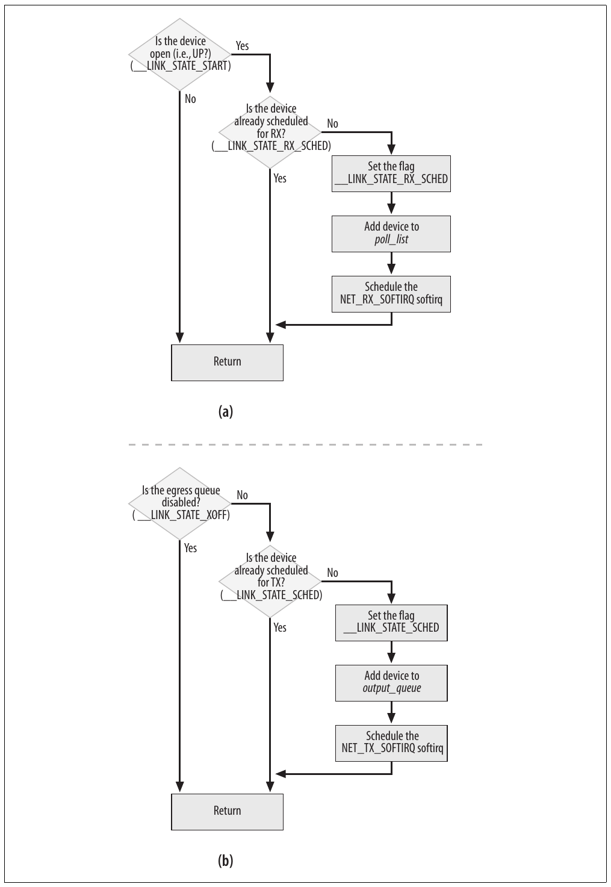
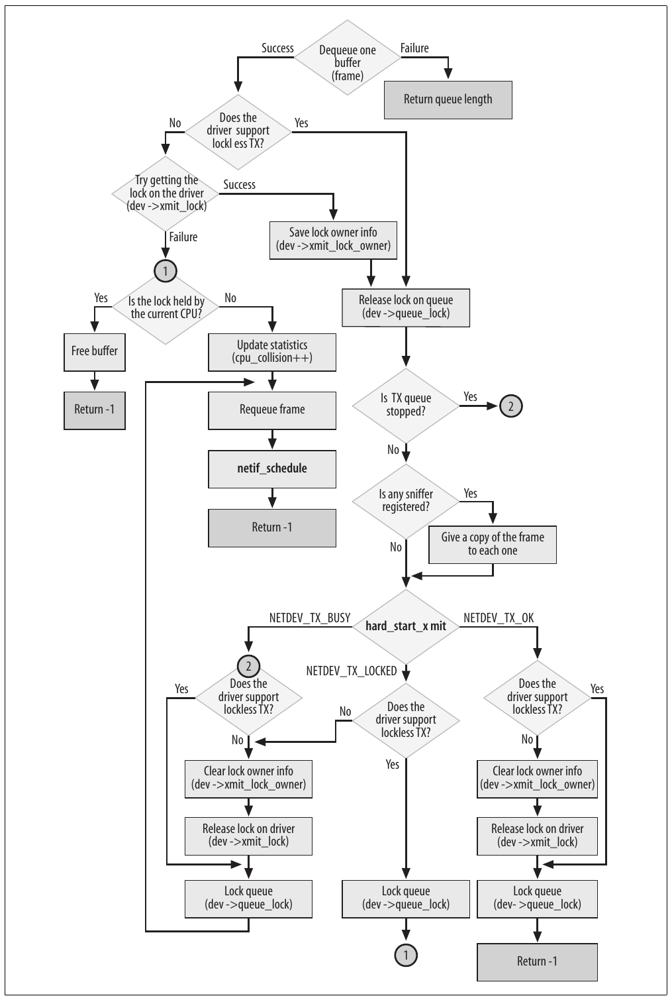
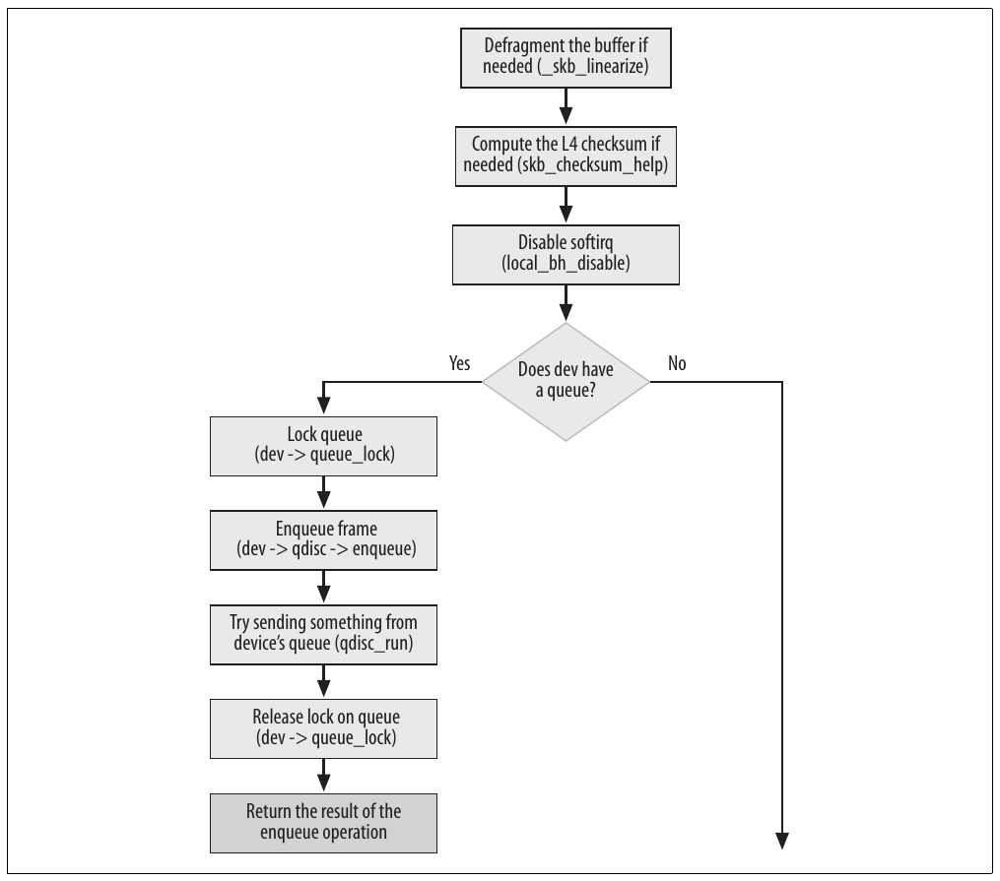
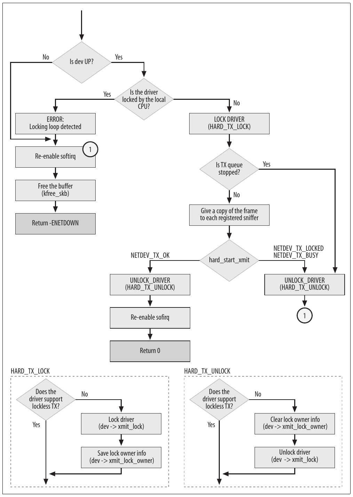
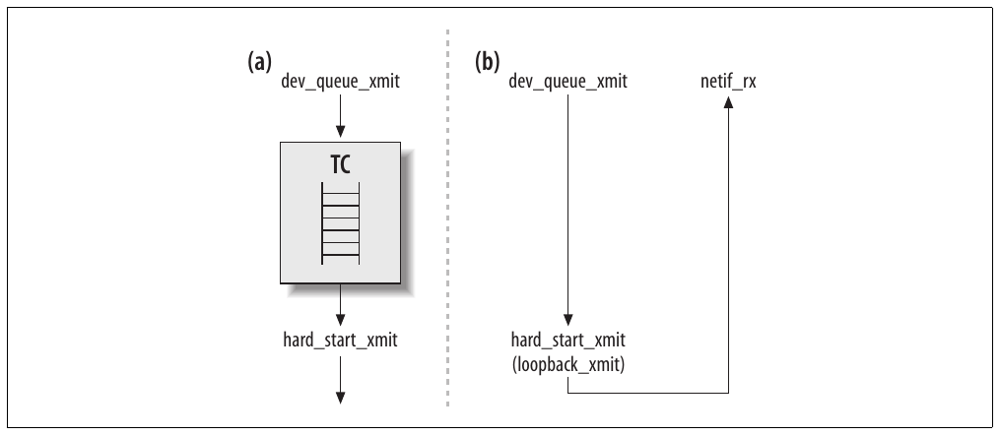

# Chương 11. Truyền frame


Transmission là thuật ngữ dùng cho frame rời khỏi hệ thống, vì được hệ thống gửi hoặc đang được forward. Trong chương này, chúng ta sẽ trình bày các tác vụ chính trong data path truyền frame:

- Enable và disable việc truyền frame cho device

- Lập lịch truyền cho device

- Chọn frame tiếp theo cần truyền trong số các frame chờ ở egress queue của device

- Chính quá trình truyền (chúng ta sẽ xem function chính)

Nhiều khía cạnh truyền đối xứng với quá trình nhận đã thảo luận trong Chương 10: `NET_TX_SOFTIRQ` tương ứng ở phía truyền với softirq `NET_RX_SOFTIRQ`, `net_tx_action` tương ứng với `net_rx_action`, v.v. Vì vậy, nếu đã nghiên cứu chương trước, bạn sẽ thấy dễ theo dõi chương này. Hình 11-1 so sánh logic lập lịch nhận và lập lịch truyền cho device. Sau đây là một số điểm tương đồng khác:

- `poll_list` là list các device được poll vì receive queue không rỗng. `output_queue` là list các device có thứ cần truyền. `poll_list` và `output_queue` là hai field của structure `softnet_data` giới thiệu trong Chương 9.

- Chỉ device đã mở (có flag `__LINK_STATE_START` được set) mới có thể được lập lịch nhận. Chỉ device có việc truyền được enable (có flag `__LINK_STATE_XOFF` được clear) mới có thể được lập lịch truyền.

- Khi device được lập lịch nhận, flag `__LINK_STATE_RX_SCHED` được set. Khi device được lập lịch truyền, flag `__LINK_STATE_SCHED` được set.

`dev_queue_xmit` giữ vai trò trên egress path giống `netif_rx` trên ingress path: mỗi function chuyển một frame giữa buffer của driver và queue của kernel. Function `net_tx_action` được gọi cả khi có device chờ truyền lẫn khi cần dọn dẹp buffer không còn cần. Cũng như có queue cho ingress traffic, có queue cho egress traffic. Egress queue, do Traffic Control (QoS layer) xử lý, thực tế phức tạp hơn nhiều so với ingress queue: trong khi ingress queue chỉ là First In, First Out (FIFO) thông thường, egress queue có thể phân cấp, được biểu diễn bằng cây queue. Dù Traffic Control cũng hỗ trợ ingress queueing, nó được dùng cho policing và management nhiều hơn là queueing thực sự: Traffic Control không dùng queue thực cho ingress traffic mà chỉ phân loại và áp dụng action.



Hình 11-1. Lập lịch device: (a) để nhận (RX); (b) để truyền (TX)

## Enable và disable việc truyền

Trong mục “Congestion management” ở Chương 10, chúng ta đã tìm hiểu một số điều kiện phải disable việc nhận frame, trên một device hoặc toàn cục. Điều tương tự cũng áp dụng cho truyền frame.

Trạng thái egress queue được biểu diễn bằng flag `__LINK_STATE_XOFF` trong `net_device->state`. Có thể thao tác và kiểm tra value bằng các function sau, định nghĩa trong include/linux/netdevice.h:[^1]

`netif_start_queue`

Enable việc truyền cho device. Function thường được gọi khi kích hoạt device và có thể được gọi lại sau nếu cần khởi động lại device đã dừng.

`netif_stop_queue`

Disable việc truyền cho device. Mọi nỗ lực truyền trên device đều bị từ chối. Phía sau trong mục này có ví dụ về trường hợp phổ biến sử dụng function.

`netif_queue_stopped`

Trả về trạng thái egress queue: enable hoặc disable. Function đơn giản là:

```c
static inline int netif_queue_stopped(const struct net_device *dev)
{
    return test_bit(__LINK_STATE_XOFF, &dev->state);
}
```

Chỉ device driver enable và disable việc truyền của device.

Vì sao dừng và khởi động queue khi device đã chạy? Một lý do là device có thể tạm dùng hết memory, khiến lần thử truyền thất bại. Trước đây, transmitting function (được giới thiệu sau trong mục “Function dev\_ queue\_xmit”) phải xử lý vấn đề này bằng cách đưa frame trở lại queue (requeue). Giờ nhờ flag `__LINK_STATE_XOFF`, có thể tránh phần xử lý bổ sung đó. Khi device driver nhận ra không đủ chỗ lưu frame kích thước tối đa (MTU), nó dừng egress queue bằng `netif_stop_queue`. Nhờ vậy, có thể tránh lãng phí resource cho những lần truyền tiếp theo mà kernel đã biết sẽ thất bại. Ví dụ sau về throttling đang hoạt động lấy từ `vortex_start_xmit` (method `hard_start_xmit` mà driver drivers/net/3c59x.c dùng):

```c
    outsl(ioaddr + TX_FIFO, skb->data, (skb->len + 3) >> 2);
    dev_kfree_skb (skb);
    if (inw(ioaddr + TxFree) > 1536) {
        netif_start_queue (dev);    /* AKPM: redundant? */
    } else {
        /* Interrupt us when the FIFO has room for max-sized packet. */
        netif_stop_queue(dev);
        outw(SetTxThreshold + (1536>>2), ioaddr + EL3_CMD);
    }
```

Ngay sau khi truyền bằng `outsl`, code kiểm tra còn chỗ cho frame kích thước tối đa (`1536`) không và dùng `netif_stop_queue` để dừng egress queue của device nếu không còn. Đây là kỹ thuật tương đối thô để tránh truyền thất bại do thiếu memory. Tất nhiên, truyền frame 300 byte sẽ thành công khi còn hơn 300 byte một chút; vì vậy, kiểm tra 1.536 byte có thể disable việc truyền không cần thiết. Code có thể dung hòa bằng value thấp hơn, như 500, nhưng cuối cùng lợi ích không lớn và vẫn có thể thất bại khi frame lớn hơn đến trong lúc việc truyền được enable.

Để bao quát mọi khả năng, code gọi `netif_start_queue` khi device có đủ memory. Comment `redundant`? trong code nói tới việc khởi động lại queue trên hai interrupt type. Driver yêu cầu khởi động lại queue khi device báo đã truyền xong và khi báo có đủ memory cho frame khác. Có lẽ queue sẽ được khởi động lại kịp thời nếu driver chỉ làm vậy trên một trong hai interrupt, nhưng không có bảo đảm. Vì vậy, request khởi động lại queue được phát trong cả hai tình huống.

Code cũng gửi command `SetTxThreshold` tới device, chỉ thị device tạo interrupt khi có một lượng memory nhất định sẵn sàng (trong trường hợp này là kích thước MTU).

Bạn có thể tự hỏi khi nào và cách nào queue được re-enabled trong tình huống trước. Với Vortex driver, nó yêu cầu device tạo interrupt khi có một lượng memory nhất định sẵn sàng (trong trường hợp này là kích thước MTU). Đây là đoạn code xử lý interrupt như vậy:

```c
static void vortex_interrupt(int irq, void *dev_id, struct pt_regs *regs)
{
           ... ... ...
        if (status & TxAvailable) {
            if (vortex_debug > 5)
                printk(KERN_DEBUG "    TX room bit was handled.\n");
            /* There's room in the FIFO for a full-sized packet. */
            outw(AckIntr | TxAvailable, ioaddr + EL3_CMD);
            netif_wake_queue (dev);
        }
           ... ... ...
}
```

Các bit của variable `status` biểu diễn lý do card tạo interrupt. Bit `TxAvailable` chỉ báo có chỗ trống, nên có thể đánh thức device an toàn (gọi là đánh thức queue, do `netif_wake_queue` thực hiện). Value như `EL3_CMD` đơn giản là offset tính từ `ioaddr` mà driver dùng để đọc hoặc ghi network card register đúng vị trí.

Lưu ý egress queue được re-enabled bằng `netif_wake_queue` thay vì `netif_start_queue`. Function mới đó, sẽ được xem chi tiết hơn sau, không chỉ enable egress queue mà còn yêu cầu kernel kiểm tra có thứ gì trong queue chờ truyền hay không. Lý do là trong thời gian queue bị disable, có thể đã có lần thử truyền. Khi đó, chúng thất bại và những frame không gửi được đã được đưa lại vào egress queue.

### Lập lịch truyền cho device

Khi mô tả ingress path, chúng ta đã thấy lúc device nhận frame, driver gọi một kernel function (function nào phụ thuộc driver có dùng NAPI hay không) thêm device vào polling list và lập lịch thực thi `NET_RX_SOFTIRQ`.

Điều rất tương tự xảy ra trên egress path. Để truyền frame, kernel cung cấp function `dev_queue_xmit`, sẽ được mô tả trong mục riêng phía sau. Function dequeue frame từ egress queue của device và đưa cho method `hard_start_xmit` của device. Tuy nhiên, `dev_queue_xmit` có thể không truyền được vì nhiều lý do, chẳng hạn egress queue của device bị disable như đã thấy trong mục trước, hoặc lock trên device queue đã bị giữ. Để xử lý trường hợp sau, kernel cung cấp function `__netif_schedule` lập lịch truyền cho device (phần nào giống việc `netif_rx_schedule` làm trên reception path). Function này không bao giờ được gọi trực tiếp mà qua hai wrapper trình bày phía sau trong mục.

Đây là định nghĩa function từ include/linux/netdevice.h:

```c
static inline void __netif_schedule(struct net_device *dev)
{
    if (!test_and_set_bit(__LINK_STATE_SCHED, &dev->state)) {
        unsigned long flags;
        struct softnet_data *sd;

        local_irq_save(flags);
           sd = &__get_cpu_var(softnet_data);
        dev->next_sched = sd->output_queue;
        sd->output_queue = dev;
        raise_softirq_irqoff(cpu, NET_TX_SOFTIRQ);
        local_irq_restore(flags);
    }
}
```

`__netif_schedule` hoàn thành hai tác vụ chính:

- Thêm device vào đầu list `output_queue`. List này tương ứng với list `poll_list` dùng phía nhận. Mỗi CPU có một `output_queue`, cũng như mỗi CPU có một `poll_list`. Tuy nhiên, `output_queue` được cả device NAPI lẫn non-NAPI dùng, còn `poll_list` chỉ dùng để xử lý device NAPI. Device trong list `output_queue` được liên kết bằng pointer `net_device->next_sched`. Bạn sẽ thấy cách dùng list trong mục “Xử lý NET\_ TX\_SOFTIRQ: net\_tx\_action”.

Trong mục “Structure softnet\_data” ở Chương 9, chúng ta đã thấy `output_queue` biểu diễn list các device có thứ cần gửi (vì thất bại ở những lần thử trước, như mô tả trong mục “Queuing discipline interface”) hoặc có egress queue được re-enabled sau một thời gian bị disable. Vì `__netif_schedule` có thể được gọi cả bên trong lẫn ngoài interrupt context, nó disable interrupt trong khi thêm input device vào list `output_queue`.

- Lập lịch thực thi softirq `NET_TX_SOFTIRQ`. `__LINK_STATE_SCHED` được dùng để đánh dấu device nằm trong list `output_queue` vì có thứ cần gửi. (`__LINK_STATE_SCHED` tương ứng với `__LINK_STATE_RX_SCHED` trên reception path.) Lưu ý nếu device đã được lập lịch truyền, `__netif_schedule` sẽ không làm gì.

Vì lập lịch truyền cho device khi việc truyền trên device bị disable không có ý nghĩa, kernel cung cấp hai function để dùng thay, cả hai là wrapper quanh `__netif_schedule`:

`netif_schedule`[^2]

Chỉ bảo đảm việc truyền được enable trên device trước khi lập lịch truyền:

```c
static inline void netif_schedule(struct net_device *dev)
{
    if (!test_bit(__LINK_STATE_XOFF, &dev->state))
        __netif_schedule(dev);
}
```

`netif_wake_queue`

Enable việc truyền cho device và, nếu trước đó việc truyền bị disable, lập lịch truyền cho device. Cần lập lịch vì có thể đã có lần thử truyền trong lúc device queue bị disable. Chúng ta đã thấy ví dụ sử dụng trong mục trước.

```c
static inline void netif_wake_queue(struct net_device *dev)
{
    ...
    if (test_and_clear_bit(__LINK_STATE_XOFF, &dev->state))
        __netif_schedule(dev);
}
```

`test_and_clear_bit` clear flag `__LINK_STATE_XOFF` nếu đã set và trả về value cũ.

Lưu ý lời gọi `netif_wake_queue` tương đương gọi cả `netif_start_queue` và `netif_schedule`. Tôi đã nói trong mục “Enable và disable việc truyền” rằng driver chịu trách nhiệm disable và enable việc truyền trên device, không phải function higher-layer. Thông thường, function high-level lập lịch truyền trên device, còn device driver disable và re-enable queue khi cần, như để xử lý thiếu memory. Vì vậy, không ngạc nhiên khi `netif_wake_queue` được device driver dùng, còn `netif_schedule` được dùng nơi khác (ví dụ bởi `net_tx_action`[^3] và Traffic Control).

Device driver dùng `netif_wake_queue` trong những trường hợp sau:

- Trong mục “Watchdog timer”, chúng ta sẽ thấy device driver dùng watchdog timer để phục hồi khi việc truyền bị treo. Trong tình huống đó, virtual function `net_device->tx_timeout` thường reset card. Trong khoảng thời gian device không dùng được, có thể có lần thử truyền khác, nên driver trước hết cần enable queue của device rồi lập lịch truyền. Điều tương tự áp dụng cho interrupt báo điều kiện lỗi (xem drivers/net/3c59x.c để có ví dụ).

- Khi (theo yêu cầu trước đó của chính driver) device báo cho driver có đủ memory để xử lý truyền frame kích thước nhất định, device có thể được đánh thức. Chúng ta đã thấy ví dụ trong mục trước liên quan interrupt `TxAvailable`. Một lần nữa, lý do dùng function này là trong thời gian driver disable queue, có thể đã có lần thử truyền. Cân nhắc tương tự áp dụng với interrupt type báo cho driver khi DMA transfer driver-to-card hoàn tất.

### Queuing discipline interface

Gần như mọi device dùng queue để lập lịch egress traffic, và kernel có thể dùng thuật toán gọi là queuing discipline để sắp xếp frame theo thứ tự truyền hiệu quả nhất. Dù thảo luận chi tiết Traffic Control và queuing discipline nằm ngoài phạm vi sách, trong mục này tôi sẽ trình bày tổng quan ngắn interface giữa device driver và transmission layer được thảo luận trong chương.

Mỗi Traffic Control queuing discipline có thể cung cấp các function pointer khác nhau để higher layer gọi nhằm hoàn thành tác vụ khác nhau. Trong những function quan trọng nhất có:

`enqueue`

Thêm phần tử vào queue

`dequeue`

Trích phần tử khỏi queue

`requeue`

Đưa phần tử đã được trích trở lại queue (ví dụ do truyền thất bại)

Mỗi khi device được lập lịch truyền, frame tiếp theo cần truyền được function `qdisc_run` chọn; function này gián tiếp gọi virtual function `dequeue` của queuing discipline tương ứng.

Một lần nữa, công việc thực sự do function khác, `qdisc_restart`, thực hiện. Function `qdisc_run`, định nghĩa trong include/linux/pkt\_sched.h, chỉ là wrapper lọc request cho device có egress queue bị disable:

```c
static inline void qdisc_run(struct net_device *dev)
{
    while (!netif_queue_stopped(dev) && qdisc_restart(dev) < 0)
        /* NOTHING */;
}
```

#### Function qdisc\_restart

Chúng ta đã thấy những trường hợp phổ biến device được lập lịch truyền. Đôi khi vì có thứ trong egress queue chờ truyền. Nhưng lúc khác device được lập lịch vì queue đã bị disable một thời gian, nên có thể còn thứ chờ trong queue từ lần thử truyền thất bại trước. Driver không biết thực sự có gì đến hay không; nó phải lập lịch device phòng khi có data chờ. Nếu thực tế không có data chờ, lời gọi method `dequeue` tiếp theo thất bại. Ngay cả khi có data chờ, lời gọi vẫn có thể thất bại vì queuing discipline phức tạp có thể quyết định không truyền data nào. Vì vậy, `qdisc_restart`, định nghĩa trong net/sched/sch\_generic.c, thực hiện action khác nhau dựa trên return value của method `dequeue`.

```c
int qdisc_restart(struct net_device *dev)
{
    struct Qdisc *q = dev->qdisc;
    struct sk_buff *skb;

    if ((skb = q->dequeue(q)) != NULL) {
```

Function `dequeue` được gọi ngay đầu. Giả sử thành công. Truyền frame cần acquire hai lock:

- Lock bảo vệ queue (`dev->queue_lock)`. Bên gọi `qdisc_restart` (`dev_queue_xmit`) acquire lock này.

- Lock trên transmit routine `hard_start_xmit` của driver (`dev->xmit_lock`). Function này quản lý lock. Khi device driver đã triển khai locking riêng, nó chỉ báo bằng cách set flag `NETIF_F_LLTX` (lockless transmission feature) trong `dev->features` để báo upper layer không cần acquire thêm lock `dev->xmit_lock`. Dùng `NETIF_F_LLTX` cho phép kernel tối ưu transmit data path bằng cách không acquire `dev->xmit_lock` khi không cần. Tất nhiên, không cần acquire lock nếu queue rỗng.

Lưu ý `qdisc_restart` không release `queue_lock` ngay sau khi dequeue buffer, vì function có thể phải requeue buffer ngay nếu không acquire được lock trên driver. Function release `queue_lock` khi đã có driver lock và acquire lại `queue_lock` trước khi return. Cuối cùng, `dev_queue_xmit` đảm nhiệm release lock.

Khi driver không hỗ trợ `NETIF_F_LLTX` và driver lock đã bị giữ (tức `spin_trylock` return 0), việc truyền thất bại. Nếu `qdisc_restart` không lấy được lock trên driver, nghĩa là CPU khác đang truyền qua cùng device. Tất cả những gì `qdisc_restart` có thể làm là đưa frame lại queue và lập lịch truyền lại cho device, vì không muốn chờ. Nếu function chạy trên cùng CPU đang giữ lock, đã phát hiện vòng lặp (tức bug trong code) và frame bị drop; nếu không, chỉ là collision.

```c
            if (!spin_trylock(&dev->xmit_lock)) {
            collision:
                ...
                goto requeue;
            }
            ...
requeue:
        q->ops->requeue(skb, q);
        netif_schedule(dev);
```

Khi acquire driver lock thành công, lock trên queue được release để CPU khác truy cập queue. Đôi khi không cần acquire driver lock vì `NETIF_F_LLTX` được set. Trong cả hai trường hợp, `qdisc_restart` sẵn sàng bắt đầu công việc thực sự.

```c
            if (!netif_queue_stopped(dev)) {
                int ret;
                if (netdev_nit)
                    dev_queue_xmit_nit(skb, dev);

                ret = dev->hard_start_xmit(skb, dev);
                if (ret == NETDEV_TX_OK) {
                    if (!nolock) {
                        dev->xmit_lock_owner = -1;
                        spin_unlock(&dev->xmit_lock);
                    }
                    spin_lock(&dev->queue_lock);
                    return -1;
                }
                if (ret == NETDEV_TX_LOCKED && nolock) {
                    spin_lock(&dev->queue_lock);
                    goto collision;
                }
            }
```

Trong mục trước, chúng ta đã thấy `qdisc_run` kiểm tra trạng thái egress queue bằng `netif_queue_stopped`, nhưng ở đây `qdisc_restart` kiểm tra lại. Kiểm tra thứ hai không thừa. Xét tình huống: khi `qdisc_run` gọi `netif_queue_stopped`, lock trên driver chưa được acquire. Đến lúc acquire lock, CPU khác có thể đã gửi thứ gì và card đã hết buffer space. Vì vậy, `netif_queue_stopped` có thể đã return FALSE trước đó nhưng giờ sẽ return TRUE.

`netdev_nit` biểu thị số protocol sniffer đã đăng ký. Nếu có, `dev_queue_xmit_nit` được dùng để chuyển bản copy frame cho từng sniffer. (Chúng ta đã thấy điều tương tự phía nhận trong `netif_receive_skb` ở Chương 10.)

Cuối cùng chúng ta tới lời gọi virtual function của device driver để truyền frame. Function do device driver cung cấp là `dev->hard_start_xmit`, được định nghĩa cho từng device lúc khởi tạo (xem Chương 8). Các value `NETDEV_TX_XXX` do routine `hard_start_xmit` trả về được liệt kê trong include/linux/netdevice.h. Đây là cách `qdisc_restart` xử lý:

`NETDEV_TX_OK`[^4]

Truyền thành công. Buffer chưa được giải phóng (chưa gọi `kfree_skb`). Trong mục “Xử lý NET\_TX\_SOFTIRQ: net\_tx\_ action”, chúng ta sẽ thấy driver không tự giải phóng buffer mà yêu cầu kernel thực hiện bằng softirq `NET_TX_SOFTIRQ`. Cách này xử lý memory hiệu quả hơn mỗi driver tự giải phóng.

`NETDEV_TX_BUSY`

Driver phát hiện NIC không còn đủ chỗ trong transmit buffer pool. Khi phát hiện điều kiện này, driver thường cũng gọi `netif_stop_queue` (xem mục “Enable và disable việc truyền”).

`NETDEV_TX_LOCKED`

Driver bị lock. Return value này chỉ được driver hỗ trợ `NETIF_F_LLTX` sử dụng.

Tóm lại, việc truyền thất bại và frame phải được đưa lại queue khi một trong những điều kiện sau đúng:

- Queue bị disable (`netif_queue_stopped(dev)` là true).

- CPU khác đang giữ lock trên driver.

- Driver thất bại (`hard_start_xmit` không return `NETDEV_TX_OK`).

Xem Hình 11-2 để biết chi tiết function `disc_restart`.

### Function dev\_queue\_xmit

Function này là interface tới device driver thực hiện việc truyền. Như Hình 9-2 ở Chương 9, `dev_queue_xmit` có thể dẫn tới thực thi transmit function `hard_start_xmit` của driver qua hai đường khác nhau:

Giao tiếp với Traffic Control (QoS layer)

Thực hiện qua function `qdisc_run` đã mô tả trong mục trước.

Gọi trực tiếp `hard_start_xmit`

Chỉ thực hiện với device không dùng Traffic Control infrastructure (tức virtual device).

Chúng ta sẽ sớm xem các trường hợp này, nhưng trước hết là những kiểm tra và tác vụ chung cho cả hai.

Khi `dev_queue_xmit` được gọi, mọi thông tin cần để truyền frame, như outgoing device, next hop và link layer address của nó, đều sẵn sàng. Phần VI và VII mô tả cách khởi tạo những parameter đó.

Hình 11-3(a) và 11-3(b) mô tả `dev_queue_xmit`.

`dev_queue_xmit` chỉ nhận structure `sk_buff` làm input. Structure chứa mọi thông tin function cần. Chẳng hạn, `skb->dev` là outgoing device, còn `skb->data` trỏ tới đầu payload có độ dài `skb->len`.

```c
int dev_queue_xmit(struct sk_buff *skb)
```

Các tác vụ chính của `dev_queue_xmit` là:

- Kiểm tra frame có gồm fragment và device có thể xử lý chúng qua scatter/gather DMA hay không; gộp fragment nếu device không có khả năng đó. Xem Chương 21 để có phần thảo luận về fragmented buffer.

- Bảo đảm L4 checksum (tức TCP/UDP) được tính, trừ khi device tính checksum bằng hardware. Xem Chương 18 để biết thêm chi tiết checksumming.

- Chọn frame cần truyền (frame được input `sk_buff` trỏ tới có thể không phải frame cần truyền vì phải tuân theo queue).

Trong code sau, data payload là list fragment khi `skb_shinfo(skb)-> frag_list` non-NULL; nếu không, payload là một block. Nếu có fragment, code kiểm tra device có hỗ trợ feature scatter/gather DMA không, và nếu không, tự gộp fragment vào một buffer. Function cũng phải gộp fragment nếu bất kỳ fragment nào được lưu trong memory area có address quá lớn để device định địa chỉ (tức nếu `illegal_highdma(dev, skb)` là true).[^5]

```c
    if (skb_shinfo(skb)->frag_list &&
        !(dev->features&NETIF_F_FRAGLIST) &&
        __skb_linearize(skb, GFP_ATOMIC)) {
        goto out_kfree_skb;
    }

    if (skb_shinfo(skb)->nr_frags &&
        (!(dev->features&NETIF_F_SG) || illegal_highdma(dev, skb)) &&
        __skb_linearize(skb, GFP_ATOMIC)) {
        goto out_kfree_skb;
    }
```

Việc defragment các fragment do `__skb_linearize` thực hiện, có thể thất bại vì một trong những lý do sau:

- Không cấp phát được buffer mới cần để lưu các fragment đã gộp.

- Buffer `sk_buff` được chia sẻ với subsystem khác (tức reference count lớn hơn một). Trong trường hợp này, macro `BUG()` được gọi, dẫn tới kernel panic.

L4 checksum có thể được tính bằng cả software lẫn hardware.<sup>†</sup> Không phải mọi network card có thể tính checksum bằng hardware; card có khả năng sẽ set bit flag tương ứng trong `net_device->features` lúc khởi tạo device. Điều này báo cho higher network layer không cần lo checksumming. Ngược lại, checksum phải được tính bằng software nếu:

- Không hỗ trợ hardware checksumming.

- Interface chỉ có thể dùng hardware checksumming cho TCP/UDP packet trên IP, nhưng packet đang truyền không dùng IP hoặc dùng L4 protocol khác trên IP.

Software checksum được tính bằng `skb_checksum_help`:

```c
    if (skb->ip_summed == CHECKSUM_HW &&
        (!(dev->features & (NETIF_F_HW_CSUM | NETIF_F_NO_CSUM)) &&
         (!(dev->features & NETIF_F_IP_CSUM) ||
          skb->protocol != htons(ETH_P_IP))))
        if (skb_checksum_help(skb, 0))
            goto out_kfree_skb;
```



Hình 11-2. Function qdisc\_restart



Hình 11-3(a). Function dev\_queue\_xmit

Khi checksum đã được xử lý, mọi header sẵn sàng; bước tiếp theo là quyết định frame cần truyền.

Tại đây, hành vi phụ thuộc device có dùng Traffic Control infrastructure và vì thế có queuing discipline được gán hay không. Đúng, điều này có thể gây bất ngờ. Function vừa xử lý một buffer (defragment và tính checksum nếu cần), nhưng tùy có dùng queuing discipline không, dùng loại nào và outgoing queue status, buffer này có thể không phải buffer thực sự được gửi tiếp theo.

#### Device có queue

Khi tồn tại, queuing discipline của device có thể được truy cập qua `dev->qdisc`. Input frame được enqueue bằng virtual function `enqueue`, rồi một frame được dequeue và truyền qua `qdisc_run`, mô tả chi tiết trong mục “Queuing discipline interface”.

```c
    local_bh_disable( );
```



THình 11-3(b). Function dev\_queue\_xmit

```c
    q = rcu_dereference(dev->qdisc);
    ...
    if (q->enqueue) {
        spin_lock(&dev->queue_lock);

        rc = q->enqueue(skb, q);

        qdisc_run(dev);

        spin_unlock_bh(&dev->queue_lock);
        rc = rc == NET_XMIT_BYPASS ? NET_XMIT_SUCCESS : rc;
        goto out;
    }
```

Lưu ý cả enqueue lẫn dequeue đều được lock `queue_lock` trên queue bảo vệ. Softirq cũng bị disable bằng `local_bh_disable`, đồng thời đảm nhiệm disable preemption theo yêu cầu của read-copy-update (RCU).

##### Device không có queue

Một số device, như loopback device, không có queue: mỗi khi frame được truyền, nó được chuyển giao ngay. (Nhưng vì không có nơi requeue, frame bị drop nếu có lỗi; không có cơ hội thứ hai.) Nếu xem `loopback_xmit` trong drivers/net/loopback.c, bạn sẽ thấy ở cuối lời gọi trực tiếp tới `netif_rx`, bỏ qua toàn bộ công việc queueing. Trong Chương 10, chúng ta đã thấy `netif_rx` là API được device driver non-NAPI gọi để đưa incoming frame vào input queue và báo cho higher layer về event. Vì loopback device không có input queue, transmit function hoàn thành hai tác vụ: truyền ở một phía và nhận ở phía kia, như Hình 11-4.



Hình 11-4. (a) Truyền trên device có queue; (b) truyền loopback

Phần cuối `dev_queue_xmit` dùng để xử lý device không có queuing discipline nên không có egress queue. Nó rất giống hành vi `qdisc_run` trình bày trong mục “Queuing discipline interface”. Tuy nhiên, có hai khác biệt khi không dùng queue:

- Khi truyền thất bại, driver không thể đưa buffer lại queue nào vì không có queue, nên buffer bị `dev_queue_xmit` drop. Nếu higher layer dùng reliable protocol như TCP, data cuối cùng sẽ được retransmit; nếu không, sẽ bị mất.

- Feature `NETIF_F_LLTX` giới thiệu trong mục “Function qdisc\_restart” được hai macro `HARD_TX_LOCK` và `HARD_TX_UNLOCK` đảm nhiệm. `HARD_TX_LOCK` dùng `spin_lock` thay vì `spin_trylock`: khi driver lock đã bị giữ, `dev_queue_xmit` spin để chờ release.

### Xử lý NET\_TX\_SOFTIRQ: net\_tx\_action

Trong Chương 10, chúng ta đã thấy function `net_rx_action` là handler tương ứng với software interrupt `NET_RX_SOFTIRQ`. Nó được device driver kích hoạt (và tự kích hoạt dưới một số điều kiện cụ thể), xử lý phần input frame processing được device driver hoãn tới “giai đoạn sau xử lý interrupt”. Nhờ vậy, code driver thực thi trong interrupt context chỉ làm những gì thực sự cần (copy data vào memory và báo kernel biết data tồn tại bằng cách tạo software interrupt), không buộc phần còn lại của hệ thống chờ lâu; sau đó, software interrupt đảm nhiệm phần frame processing có thể chờ.

`net_tx_action` hoạt động tương tự. Device có thể kích hoạt bằng `raise_softirq_irqoff(NET_TX_SOFTIRQ)` trong hai context khác nhau để hoàn thành hai tác vụ chính:

- Bởi `netif_wake_queue` khi việc truyền được enable trên device. Khi đó, nó bảo đảm frame chờ gửi thực sự được gửi khi mọi điều kiện cần được đáp ứng (chẳng hạn device có đủ memory).

- Bởi `dev_kfree_skb_irq` khi việc truyền hoàn tất và device driver dùng routine đó báo buffer tương ứng có thể được giải phóng. Khi đó, nó giải phóng các structure `sk_buff` tương ứng với buffer truyền thành công.

Lý do cho tác vụ thứ hai như sau. Chúng ta biết khi device driver code chạy trong interrupt context, nó cần nhanh nhất có thể. Giải phóng buffer có thể tốn thời gian nên được hoãn bằng cách yêu cầu softirq `net_tx_action` đảm nhiệm. Thay vì dùng `dev_kfree_skb`, device driver dùng `dev_kfree_skb_irq`. Trong khi function trước giải phóng `sk_buff` (thực tế là buffer trở về cache per-CPU), function sau chỉ thêm pointer tới buffer cần giải phóng vào list `completion_queue` của structure `softnet_data` tương ứng với CPU và để `net_tx_action` thực hiện công việc thực sự sau.

Hãy xem cách `net_tx_action` hoàn thành hai tác vụ.

Nó bắt đầu bằng cách giải phóng mọi buffer đã được thêm vào list `completion_queue` bởi lời gọi `dev_kfree_skb_irq` của device driver. Vì `net_tx_action` chạy ngoài interrupt context, device driver có thể thêm phần tử vào list bất cứ lúc nào, nên `net_tx_action` phải disable interrupt khi truy cập structure `softnet_data`. Để giữ interrupt bị disable ít nhất có thể, nó clear list bằng cách đặt `completion_queue` thành NULL và lưu pointer tới list trong local variable `clist`, không bên nào khác truy cập được (cũng lưu ý mỗi CPU có list riêng). Nhờ vậy, nó có thể duyệt list và giải phóng từng phần tử bằng `__kfree_skb`, trong khi driver tiếp tục thêm phần tử mới vào `completion_queue`.

```c
    if (sd->completion_queue) {
        struct sk_buff *clist;

        local_irq_disable( );
        clist = sd->completion_queue;
        sd->completion_queue = NULL;
        local_irq_enable( );

        while (clist != NULL) {
            struct sk_buff *skb = clist;
            clist = clist->next;

            BUG_TRAP(!atomic_read(&skb->users));
            __kfree_skb(skb);
        }
    }
```

Nửa sau function, truyền frame, hoạt động tương tự: dùng local variable để an toàn trước hardware interrupt. Lưu ý với mỗi device, trước khi truyền bất cứ thứ gì, function cần lấy lock trên queue của output device (`dev->queue_lock`). Nếu không lấy được lock (vì CPU khác giữ), nó chỉ lập lịch truyền lại cho device bằng `netif_schedule`.

```c
    if (sd->output_queue) {
        struct net_device *head;

        local_irq_disable( );
        head = sd->output_queue;
        sd->output_queue = NULL;
        local_irq_enable( );

        while (head) {
            struct net_device *dev = head;
            head = head->next_sched;

            smp_mb__before_clear_bit( );
            clear_bit(__LINK_STATE_SCHED, &dev->state);

            if (spin_trylock(&dev->queue_lock)) {
                qdisc_run(dev);
                spin_unlock(&dev->queue_lock);
            } else {
                netif_schedule(dev);
            }
        }
    }
```

Trong mục “Queuing discipline interface”, chúng ta đã thấy cách `qdisc_run` hoạt động. Device được xử lý tuần tự từ đầu list. Vì function `netif_schedule` (gọi `__netif_schedule` bên trong) thêm phần tử vào đầu list, device được phục vụ theo Last In, First Out (LIFO), có thể không công bằng dưới một số điều kiện.

Đến đây hoàn tất function `net_tx_action`; hãy xem một số context có thể gọi nó để giải phóng buffer. Một số function muốn giải phóng buffer có thể được gọi trong context khác nhau, bên trong hoặc ngoài interrupt context. Có wrapper để xử lý gọn những trường hợp này:

```c
static inline void dev_kfree_skb_any(struct sk_buff *skb)
{
    if (in_irq( ) || irqs_disabled( ))
        dev_kfree_skb_irq(skb);
    else
        dev_kfree_skb(skb);
}
```

Function `dev_kfree_skb_irq` chạy khi calling function ở interrupt context và có dạng:

```c
static inline void dev_kfree_skb_irq(struct sk_buff *skb)
{
    if (atomic_dec_and_test(&skb->users)) {
        struct softnet_data *sd;
        unsigned long flags;

        local_irq_save(flags);
           sd = &__get_cpu_var(softnet_data);
        skb->next = sd->completion_queue;
        sd->completion_queue = skb;
        raise_softirq_irqoff(NET_TX_SOFTIRQ);
        local_irq_restore(flags);
    }
}
```

Buffer chỉ có thể được giải phóng nếu không còn reference khác tới nó (tức `skb->users` bằng 0).

Hãy xem ví dụ về cách thực thi `net_tx_action` được kích hoạt bởi lời gọi gián tiếp `cpu_raise_softirq(cpu, NET_TX_SOFTIRQ)` từ device driver. (Có thể tìm ví dụ khác trong mục “Enable và disable việc truyền”.)

Trong số interrupt type được function `vortex_interrupt` trong drivers/net/3c59x.c đã giới thiệu xử lý, có interrupt do device phát để báo driver DMA transfer từ CPU tới device đã hoàn tất (`DMADone`). Vì buffer đã được chuyển tới device, structure `sk_buff` giờ có thể được giải phóng. Vì interrupt handler đang chạy trong interrupt context, driver gọi `dev_kfree_skb_irq`.

```c
if (status & DMADone) {
    if (inw(ioaddr + Wn7_MasterStatus) & 0x1000) {
        outw(0x1000, ioaddr + Wn7_MasterStatus); /* Ack the event. */
        pci_unmap_single(VORTEX_PCI(vp), vp->tx_skb_dma,
                 (vp->tx_skb->len + 3) & ~3, PCI_DMA_TODEVICE);
        dev_kfree_skb_irq(vp->tx_skb); /* Release the transferred buffer */
        if (inw(ioaddr + TxFree) > 1536) {
            netif_wake_queue(dev);
        } else { /* Interrupt when FIFO has room for max-sized packet. */
            outw(SetTxThreshold + (1536>>2), ioaddr + EL3_CMD);
            netif_stop_queue(dev);
        }
    }
}
```

#### Watchdog timer

Trong mục “Enable và disable việc truyền”, chúng ta đã thấy device driver có thể disable việc truyền khi đáp ứng một số điều kiện. Việc disable được kỳ vọng là tạm thời, nên nếu việc truyền không được re-enabled trong khoảng thời gian hợp lý, kernel giả định device gặp vấn đề và cần khởi động lại.

Điều này được thực hiện bằng timer per-device được khởi động với `dev_watchdog_up` khi device được kích hoạt bằng `dev_activate`. Timer định kỳ hết hạn, bảo đảm mọi thứ ổn với device rồi tự khởi động lại. Khi phát hiện vấn đề, vì egress queue của device bị disable (`netif_queue_stopped` return TRUE) và đã quá lâu từ lần truyền frame cuối, timer handler gọi routine do device driver đăng ký để reset NIC.

Đây là những field `net_device` dùng để triển khai cơ chế:

`trans_start`

Đây là timestamp được device driver khởi tạo khi bắt đầu lần truyền frame cuối.

`watchdog_timer`

Đây là timer do Traffic Control khởi động. Handler thực thi khi timer hết hạn là `dev_watchdog`, định nghĩa trong net/sched/sch\_generic.c.

`watchdog_timeo`

Đây là khoảng thời gian chờ, được device driver khởi tạo. Khi được đặt thành 0, `watchdog_timer` không được khởi động.

`tx_timeout`

Đây là routine do device driver cung cấp, sẽ được `dev_watchdog` gọi để reset device.

Khi timer hết hạn, kernel handler `dev_watchdog` thực hiện action bằng cách gọi function mà `tx_timeout` trỏ tới. Function sau thường reset card và khởi động lại interface scheduler bằng `netif_wake_queue`.

Value thích hợp cho `watchdog_timeo` phụ thuộc interface. Nếu driver không đặt, mặc định là 5 giây. Các parameter cần xét khi định nghĩa value là:

Khả năng transmission collision

Bằng zero với link point-to-point, nhưng có thể cao trên Ethernet link dùng chung, quá tải, cắm vào hub.

Tốc độ interface

Interface càng chậm, timeout nên càng lớn.

Value của `watchdog_timeo` thường được định nghĩa là bội số của variable `HZ`, biểu thị 1 giây. `HZ` là global variable có value phụ thuộc platform (được định nghĩa trong file architecture-dependent include/asm-XXX/param.h). Như Bảng 11-1, ngay cả device cùng type cũng có thể lấy timeout value khác nhau. Bảng chỉ liệt kê một số ví dụ, không phải danh sách đầy đủ.

Bảng 11-1. Transmission timeout được những network card phổ biến nhất sử dụng

| Device driver | watchdog\_timeo (timeout được dùng) |
|---|---|
| 3c501 | HZ |
| 3c505 | 10\*HZ |
| 3c509 | (400\*HZ)/1000 |
| 3c515 | (400\*HZ)/1000 |
| 3c523 | HZ |
| 3c527 | 5\*HZ |
| 3c59x | 5\*HZ |
| dl2k | 4\*HZ |
| Natsemi | 2\*HZ |
| Aironet 4500 | 8\*HZ |
| s2io (10Gbit) | 5\*HZ |
| 8390 | (20\*HZ)/100 |
| 8139too | 6\*HZ |
| b44 | 5\*HZ |
| tg3 | 5\*HZ |
| e100 | 2\*HZ |
| e1000 | 5\*HZ |
| SIS 900 | 4\*HZ |
| Tulip family | 4\*HZ |
| Intel EtherExpress 16 | 2\*HZ |
| SLIP | 20\*HZ |

Cơ chế watchdog timer do Traffic Control code cung cấp. Tuy nhiên, device driver nâng cao cũng có thể triển khai watchdog timer riêng. Xem drivers/net/e1000\_main.c để có ví dụ.

[^1]: Những flag khác trong danh sách được mô tả trong Chương 8 và 10.

[^2]: Để nhất quán, có lẽ `netif_tx_schedule` là tên tốt hơn.

[^3]: `net_tx_action` lập lịch truyền cho device khi không lấy được lock `dev->queue_lock` trên egress queue của device nên không truyền được.

[^4]: Các value `NETDEV_TX_XXX` được đưa vào tương đối gần đây trong kernel version 2.6.9. Trước đó, function `hard_start_xmit` chỉ return 0 khi thành công và 1 khi lỗi (ví dụ không còn chỗ trong memory NIC). Đến nay, chỉ một số driver được cập nhật để dùng value `NETDEV_TX_XXX` (chủ yếu những driver hỗ trợ `NETIF_F_LLTX`); tất cả driver khác vẫn dùng trực tiếp value 0 và 1.

[^5]: Một số device chỉ có thể dùng address 16-bit, giới hạn phần memory có thể định địa chỉ. † Thuật toán mỗi protocol dùng để tính checksum được phân tích trong chương tương ứng.
