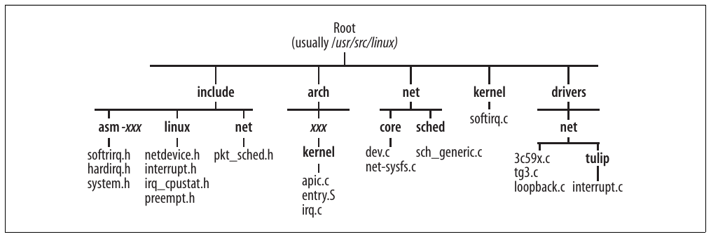

# Chương 12. Thông tin tổng quát và tài liệu tham khảo về interrupt


Chương này chứa một số loại thông tin tổng quát áp dụng cho nội dung đã trình bày trong ba chương trước về interrupt và xử lý frame.

## Thống kê

Thống kê về việc nhận frame được giữ trong array per-CPU `netdev_rx_stat`, có các phần tử type `netif_rx_stats` (xem include/linux/netdevice.h):

```c
struct netif_rx_stats netdev_rx_stat[NR_CPUS];

struct netif_rx_stats
{
        unsigned total;
        unsigned dropped;
        unsigned time_squeeze;
        unsigned throttled;
        unsigned fastroute_hit;
        unsigned fastroute_success;
        unsigned fastroute_defer;
        unsigned fastroute_deferred_out;
        unsigned fastroute_latency_reduction;
        unsigned cpu_collision;
} ___ _cacheline_aligned;
```

Các phần tử của `netif_rx_stats` là:

`total`

Tổng số ingress frame đã xử lý, bao gồm cả frame có thể bị loại bỏ. Value này được cập nhật trong cả `netif_rx` lẫn `netif_receive_skb`, nghĩa là (do nhầm lẫn) cùng frame được tính hai lần khi driver không dùng NAPI (tức dùng interface `netif_rx`; xem Hình 10-2 ở Chương 10).

`dropped`

Số frame bị drop vì được nhận khi CPU ở throttle state.

`time_squeeze`

Số lần `net_rx_action` phải return trong khi vẫn còn frame trong CPU ingress queue để tránh độc chiếm CPU. Xem mục “Xử lý NET\_RX\_SOFTIRQ: net\_rx\_action” ở Chương 10.

`throttled`

Số lần CPU chuyển vào throttle state. Value này được `netif_rx` tăng.

`fastroute_hit`

`fastroute_success`

`fastroute_defer`

`fastroute_latency_reduction`

`fastroute_deferred_out`

Các field trước đây được feature Fastroute sử dụng. Feature này đã bị loại bỏ trong kernel 2.6.8.

`cpu_collision`

Số lần CPU không lấy được lock trên device driver (chính xác hơn là trên `dev->xmit_lock`) vì lock đã được CPU khác giữ. Counter này được cập nhật trong `qdisc_restart`, chỉ xử lý truyền frame, không xử lý nhận. `cpu_collision` là thống kê duy nhất về truyền được đưa vào structure này.

Việc một số counter trên hiện chỉ được `netif_rx` cập nhật (chỉ được driver non-NAPI sử dụng) nghĩa là value của chúng không chính xác khi dùng NAPI driver.

Có thể xem nội dung vector `netdev_rx_stat` qua interface /proc. Xem mục tiếp theo.

Những thống kê khác được driver giữ trong private data structure (xem Chương 2), được protocol higher-layer và Traffic Control queuing discipline giữ. Có thể đọc một số value bằng application user-space như ifconfig, tc, ip hoặc netstat, và những value khác cũng được export qua /proc.

## Tinh chỉnh qua filesystem /proc và sysfs

Mọi file trong /proc/sys/net/core liệt kê ở Bảng 12-1 được định nghĩa trong net/core/sysctl\_ net\_core.c, nơi bạn có thể tìm mối liên hệ giữa file và kernel variable.

Bảng 12-1. Các file /proc/sys/net/core/ có thể dùng để tinh chỉnh việc nhận frame

| Tên file | Kernel variable<sup>a</sup> | Default value |
|---|---|---|
| netdev\_max\_backlog | `netdev_max_backlog` | 300 |
| mod\_cong | `mod_cong` | 290 |
| lo\_cong | `lo_cong` | 100 |
| no\_cong | `no_cong` | 20 |
| no\_cong\_thresh | `no_cong_thresh` | 10 |
| dev\_weight | `weight_p` | 64 |

<sup>a</sup> Tất cả variable này được định nghĩa trong net/core/dev.c.

Tôi muốn nhấn mạnh NAPI driver không cần field nào trong Bảng 12-1. NAPI driver được kỳ vọng khởi tạo `net_device->weight` bằng value cục bộ (của driver) thay vì `weight_p`. Nhưng chúng có thể dùng `weight_p` nếu muốn, đặc biệt vì thường dùng cùng default value 64. Từ kernel 2.6.12, value của `net_device` ở field `weight` có thể được tinh chỉnh tại runtime bằng sysfs qua các file per-device /sys/class/net/`device_name/weight`. File weight được tạo trong net/core/net-sysfs.c.

Có thể đọc thống kê thu thập bằng các structure `netdev_rx_stats` mô tả trong mục “Thống kê” qua file /proc/net/softnet\_stat (output ở dạng hexadecimal).

## Function và variable được trình bày trong phần này của sách

Bảng 12-2 tóm tắt các function, variable và data structure chính được giới thiệu hoặc tham chiếu trong ba chương trước. Có thể tìm thêm trong Bảng 9-1 ở Chương 9.

Bảng 12-2. Function, variable và data structure liên quan đến interrupt và xử lý frame

| Tên function | Mô tả |
|---|---|
| `netif_rx` | Enqueue input frame vào queue của CPU. Xem mục “Interface driver cũ và mới” ở Chương 10. |
| `netif_rx_schedule __netif_rx_schedule` | Lập lịch thực thi software interrupt `NET_RX_SOFTIRQ`. Xem mục “Interface driver cũ và mới” ở Chương 10. |
| `netif_rx_complete` | Được virtual function `net_device->poll` gọi khi function đó đã làm rỗng queue. |
| `netif_start_queue netif_stop_queue` | Lần lượt enable và disable việc truyền trên device. Xem mục “Enable và disable việc truyền” ở Chương 11. |
| `netif_queue_stopped` | Kiểm tra device có được enable để truyền hay không. |
| `netif_schedulea netif_wake_queue` | `netif_schedule` lập lịch truyền cho device. `netif_wake_queue` enable việc truyền trên device và lập lịch truyền cho device. Xem mục “Lập lịch truyền cho device” ở Chương 11. |
| `qdisc_run` | Dequeue frame khỏi egress queue của device và đẩy xuống device driver để truyền. Xem mục “Queuing discipline interface” ở Chương 11. |
| `process_backlog` | Virtual function `poll` được device driver non-NAPI sử dụng. Xem mục “Xử lý backlog: poll virtual function process\_backlog” ở Chương 10. |
| `netif_receive_skb` | Xử lý input frame bằng cách truyền tới protocol handler higher-layer. Xem mục “Xử lý ingress frame” ở Chương 10. |
| `dev_queue_xmit` | Function chính để truyền frame. Xem mục “Function dev\_queue\_xmit” ở Chương 11. |
| `dev_kfree_skb dev_kfree_skb_irq dev_kfree_skb_any` | Giải phóng structure `sk_buff`. Xem mục “Xử lý NET\_TX\_SOFTIRQ: net\_tx\_action” ở Chương 11. |
| `do_IRQ` | Đảm nhiệm hardware interrupt notification bằng cách gọi handler tương ứng. |
| `open_softirq raise_softirq, raise_softirq_irqoff` | Lần lượt đăng ký và lập lịch thực thi software interrupt. Xem mục “Handler Bottom-half trong kernel 2.4 trở đi: sự xuất hiện của softirq” ở Chương 9. |
| `do_softirq invoke_softirq` | Đảm nhiệm software interrupt pending bằng cách gọi handler tương ứng. Xem mục “Xử lý softirq pending” ở Chương 9. |
| `net_rx_action net_tx_action` | Lần lượt là handler cho software interrupt `NET_RX_SOFTIRQ` và `NET_TX_SOFTIRQ`. Xem mục “Cách networking code dùng softirq” ở Chương 9. |
| `tasklet_init` | Khởi tạo structure `tasklet_struct`. |
| `tasklet_action tasklet_hi_action` | Lần lượt là handler cho software interrupt `TASKLET_SOFTIRQ` và `HI_SOFTIRQ`. Xem mục “Tasklet” ở Chương 9. |
| `tasklet_enable, tasklet_hi_enable tasklet_disable, tasklet_disable_nosync` | Lần lượt enable và disable tasklet. Xem mục “Tasklet” ở Chương 9. |
| `tasklet_schedule tasklet_hi_schedule` | Lập lịch thực thi tasklet. Xem mục “Tasklet” ở Chương 9. |
| Variable |  |
| `mod_cong lo_cong no_cong no_cong_thresh` | Congestion level cho input queue (dùng với device non-NAPI). Xem mục “Các field của softnet\_data” ở Chương 9. |
| `netdev_max_backlog` | Kích thước tối đa các input queue của CPU. Xem Hình 9-4 ở Chương 9. |
| Data structure |  |
| `softnet_data` | Hai software interrupt `NET_XXX_SOFTIRQ` dùng một structure như vậy cho mỗi CPU. Xem mục “Structure softnet\_data” ở Chương 9. |
| `tasklet_struct` | Biểu diễn tasklet. Xem mục “Tasklet” ở Chương 9. |

<sup>a</sup> Để nhất quán với tên các reception function, có lẽ nên gọi là `netif_tx_schedule`.

## File và directory được trình bày trong phần này của sách

Hình 12-1 cho thấy các file và directory đã tham chiếu trong bốn chương đầu Phần III. Keyword `xxx` trong hình biểu thị architecture (ví dụ i386).[^1] Một số architecture không cần file riêng đặc thù architecture, vì đôi khi nhiều architecture có thể dùng một file general-purpose.



Hình 12-1. File và directory được trình bày trong phần này của sách

[^1]: File irq.c không phải lúc nào cũng nằm trong directory tên kernel.
