# Chương 13. Protocol handler


Protocol là khuôn khổ cho mọi giao tiếp: chúng chỉ cho mỗi bên cách hiểu phía bên kia của cuộc trao đổi. Trong Linux, việc giao tiếp được diễn giải thông qua protocol handler ở mỗi networking layer. Chương này giải thích cách cài đặt, lựa chọn tại runtime và gọi các handler đó.

Để hiểu quan hệ giữa communication layer và protocol, hãy hình dung tình huống thực tế tôi phải nói chuyện với người lạ. Tôi nên dùng ngôn ngữ nào? Nếu ở Ý, tôi sẽ bắt đầu bằng tiếng Ý, còn ở Hoa Kỳ tôi sẽ thử tiếng Anh. Nếu không được, có thể có cách thỏa thuận dùng ngôn ngữ khác.

Trên protocol cơ bản đó còn có những protocol khác. Chẳng hạn khi viết thư, quan hệ với người nhận quyết định tôi mở đầu bằng “Thưa bà” hay “Chào cô bạn!”. Những lựa chọn như vậy diễn ra ở nhiều layer của giao tiếp real-life. Network cũng có layer, và việc chọn protocol được hình thức hóa trong network code.

## Tổng quan network stack

Người đọc sách này được kỳ vọng đã quen với TCP/IP protocol cơ bản, nhưng có những protocol thường dùng khác, như Logical Link Control (LLC) và Subnetwork Access Protocol (SNAP), mà bạn có thể chưa biết. Mục này giới thiệu các protocol quan trọng và quan hệ giữa chúng.

Hai mô hình network protocol best-known là mô hình OSI seven-layer và mô hình TCP/IP five-layer, thể hiện trong Hình 13-1. Mô hình OSI vẫn là điểm tham chiếu quan trọng khi thảo luận networking, dù chưa bao giờ thực sự phổ biến vì nhiều lý do. Mô hình TCP/IP bao quát phần lớn protocol được máy tính dùng hiện nay.[^1] Mỗi layer có nhiều protocol. Ở mức thấp nhất, nơi interface trao đổi data, protocol được dùng đã xác định trước. Driver cho protocol đó gắn với interface, và mọi data đến interface được giả định tuân theo protocol (tức Ethernet); nếu không, lỗi được báo và không có giao tiếp.

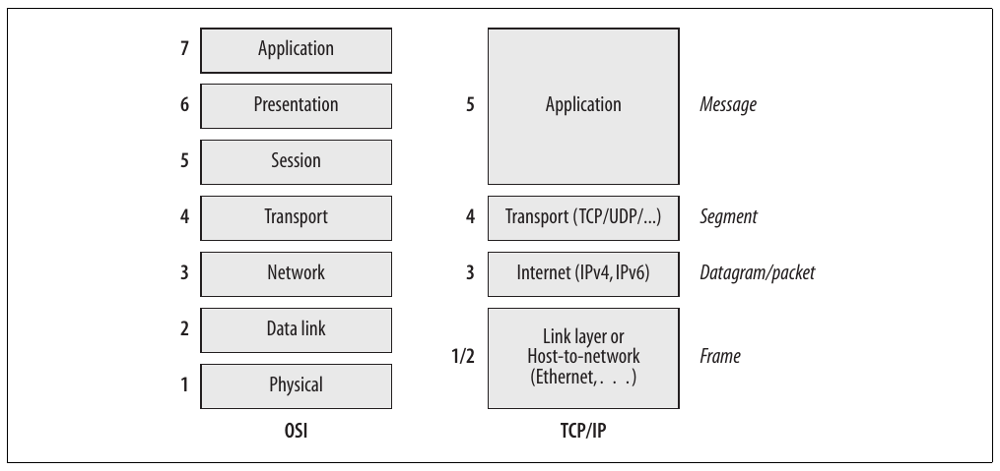

Hình 13-1. Mô hình OSI và TCP/IP

Nhưng khi driver phải chuyển data cho higher layer, cần lựa chọn protocol. Data ở L3 nên được IPv4, IPv6, IPX (protocol của Novell NetWare), DECnet hay network-layer protocol khác xử lý? Và cần lựa chọn tương tự khi từ L3 lên L4, nơi có TCP, UDP, ICMP và protocol khác.

Chương này trình bày ba layer thấp và đề cập ngắn gọn layer thứ tư.

Một đơn vị data truyền đi thường được gọi là frame ở link layer L2; packet ở network layer; segment ở transport layer; và message ở application layer.

Các layer thường được gọi là network stack, vì giao tiếp đi xuống qua layer cho tới khi được truyền vật lý qua dây (hoặc dải tần không dây), rồi đi ngược lên. Header cũng được thêm và loại bỏ theo LIFO.

### Bức tranh tổng thể

Hình 13-2 phát triển từ mô hình TCP/IP trong Hình 13-1. Hình 13-2 cho thấy chương nào trình bày từng interface giữa các layer liền kề. Một số interface liên quan giao tiếp đi xuống stack, số khác liên quan giao tiếp đi lên:

Đi lên trong stack (để nhận message)

Chương này mô tả cách ingress traffic được chuyển tới protocol handler thích hợp. (Ý nghĩa `ptype_base` và `ptype_all` sẽ rõ trong mục “Tổ chức protocol handler”.) Chương 10 mô tả cách device driver thông báo cho kernel về việc nhận ingress frame.

Chương 24 mô tả cách IPv4 protocol chuyển ingress IPv4 packet tới L4 protocol thích hợp (IPv4 là network layer protocol duy nhất trình bày trong sách). IPv4 receive routine được mô tả trong Chương 19.

Đi xuống trong stack (để gửi message)

Chương 21 mô tả các function do IPv4 layer cung cấp để truyền.

Phần VI mô tả cách neighboring layer kết nối L3 protocol với transmitting routine `dev_queue_xmit`. Routine này được mô tả trong Chương 11.

Như Hình 13-2, socket interface không được trình bày trong sách. Tuy nhiên, có một điểm cần nhắc về socket type `AF_PACKET`. Đây là cách Linux capture frame ở link layer và inject frame vào link layer, bỏ qua trực tiếp mọi protocol layer trung gian. Network sniffer như tcpdump và Ethereal thường dùng socket `AF_PACKET`. Từ hình, có thể thấy socket `AF_PACKET` chuyển frame trực tiếp tới `dev_queue_xmit` và nhận ingress frame trực tiếp từ network protocol dispatcher routine (điểm sau được trình bày trong Chương 10).

Hình 13-2 chỉ thể hiện hai protocol family (`PF_INET`, `PF_PACKET`), nhưng Linux kernel triển khai nhiều family khác. Trong đó có:

`PF_NETLINK`

Được dùng làm interface ưu tiên cho network configuration. Xem Chương 3.

`PF_KEY`

Được dùng làm key management interface cho network security service. IPsec là một trong những service đó.

`PF_LLC`

Xem mục “Logical Link Control (LLC)”.

### Lựa chọn link layer cho Ethernet (LLC và SNAP)

Dù link layer protocol khá cố định theo hardware đang dùng, Ethernet standard cho phép lựa chọn phần nào giữa các protocol. Nỗ lực đầu tiên tiêu chuẩn hóa lựa chọn này có tên Logical Link Control (LLC). Vì cung cấp option rất hạn chế, nó chưa bao giờ được dùng nhiều. Sau đó, ủy ban IEEE 802 tiêu chuẩn hóa Subnetwork Access Protocol (SNAP), được sử dụng khá thường xuyên. Cách triển khai cả hai subprotocol được mô tả phía sau trong chương.

Trong LLC, header chứa field chỉ định protocol cho Source Service Access Point (SSAP) và protocol cho Destination Service Access Point (DSAP). Tuy nhiên, mỗi field chỉ chứa 8 bit, một bit dành cho flag chỉ báo có dùng multicast hay không và một bit khác dành cho flag chỉ báo address là local trong một network hay được công nhận toàn cầu.

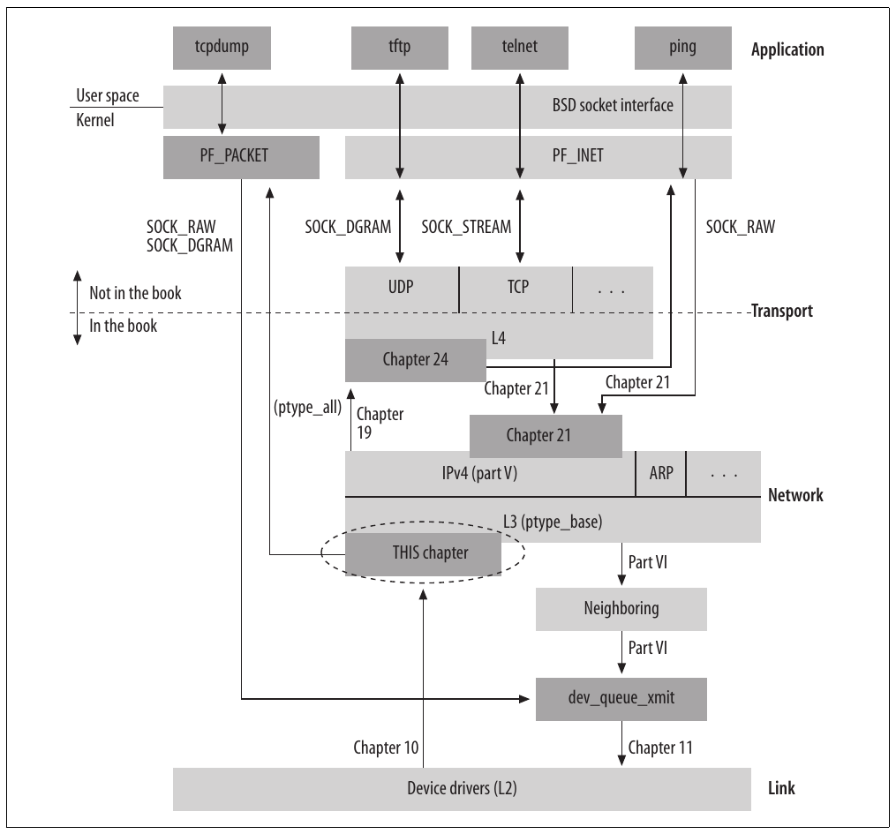

Hình 13-2. Bức tranh tổng thể

Vì vậy, với 6 bit còn lại để chỉ định protocol, LLC hỗ trợ tối đa 64 protocol, quá ít để công nghệ này phổ biến.

Do đó, ủy ban IEEE 802 mở rộng LLC bằng một value đặc biệt trong field SSAP và DSAP, chỉ báo protocol mà source hoặc destination đó dùng được nhận diện bằng 5 byte khác trong header. Với phần mở rộng gọi là SNAP này, có 40 bit có thể gán cho các protocol khác nhau.

### Cách network stack hoạt động

Hãy xem ngắn gọn một giao tiếp mẫu để biết cách lựa chọn tại các điểm giao tiếp.

Trong Hình 13-3, giả sử người dùng ở Host X muốn dùng web browser tải HTML page từ web server chạy trên Server Y. Một số câu hỏi cần trả lời gồm:

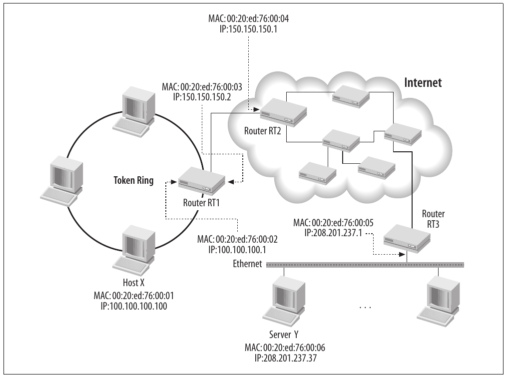

Hình 13-3. Ví dụ giao tiếp giữa hai trạm ở xa (Host X và Server Y)

- Vì Host X và Server Y ở hai local area network khác nhau, làm sao giao tiếp với nhau?

- Vì Host X không biết vị trí vật lý của Server Y, làm sao biết gửi request tới đâu?

- Nếu Server Y chạy nhiều application (không chỉ web server), operating system xác định application nào xử lý request từ Host X bằng cách nào?

- Nếu Host X chạy nhiều application (không chỉ browser), operating system xác định application nào nhận data trả về bằng cách nào?

Hãy theo request cho web page qua network stack để xem các câu hỏi được trả lời thế nào. Chúng ta sẽ dùng Hình 13-3[^2] và 13-4 làm tham chiếu.

Application layer, Host X

Browser đọc URL người dùng yêu cầu; giả sử là http://www.oreilly.com. Browser dùng Domain Name System (chủ đề ngoài phạm vi sách) để phân giải domain www.oreilly.com thành IP address, giả sử là 208.201.239.37. IP protocol (L3, network layer) có trách nhiệm tìm đường giữa Host X và Server Y bằng address này.

Browser giờ bắt đầu HTTP session trên application layer tới 208.201. 239.37. Sau đó gọi TCP để chuyển traffic tới remote web server. (TCP được dùng thay UDP vì HTTP cần reliable channel có thể chuyển lượng data lớn mà không làm hỏng.) Request giờ đang đi xuống network stack.

Transport layer, Host X

TCP layer chia HTTP message request thành segment nếu cần và thêm TCP header vào từng segment. Trong số những thông tin khác, TCP thêm source port và destination port. Port number cho phép operating system chuyển request tới application thích hợp. Web server trên Server Y lắng nghe default HTTP port 80 trừ khi được cấu hình tường minh dùng port number khác, và nhận mọi traffic ở đó. Server Y gửi response về port 5000 của Host X, là source port number server lấy từ request nhận từ host.

Port number là khái niệm L4, nên TCP và UDP có tập port riêng.

TCP layer trên Host X biết destination port là 80 vì browser dùng default port gán cho HTTP protocol, trừ khi URL cung cấp port khác. Source port gán cho browser (sẽ dùng để nhận diện target application khi xử lý ingress traffic) do OS gán (trừ khi application yêu cầu port cụ thể). Giả sử port đó là 5000. Có thể dùng port khác nhau cho hai phía giao tiếp. Network Address Translation (NAT) và proxying firewall khiến vấn đề phức tạp hơn nữa, nhưng phần thảo luận này hẳn đã làm rõ nét chính cách application liên lạc với nhau.

TCP layer không biết cách đưa segment tới destination system. Để làm điều đó, TCP layer gọi IP layer, truyền destination IP address trong mỗi transmission request.

Network layer, Host X

IP layer không quan tâm application hoặc port. Nó chỉ kiểm tra IP address trên packet và network option liên quan tới IP. Tác vụ lớn là tra routing table (quá trình phức tạp thảo luận chi tiết trong Phần VII) để biết packet nên đi qua Router RT1. IPv4 protocol được mô tả chi tiết trong Phần V.

Packet sẽ đi xuống thêm một layer để gửi tới router, nhưng IP layer phải tìm address thích hợp của router tại layer này. Vì L2 liên quan giao tiếp giữa neighboring host (như host chung LAN hoặc link point-to-point), quá trình IP layer dùng để tìm L2 address tương ứng với IP address cho trước được gọi là neighbor protocol. Nó được thảo luận trong Phần VI.

Link layer, Host X và Router RT1

Layer này được device driver triển khai một phần. Trên LAN, Ethernet là protocol phổ biến nhất, nhưng còn ATM, Token Ring, FDDI và protocol khác. Link đường dài dùng đường đồng hoặc cáp quang chuyên dụng; đơn giản nhất là kết nối dial-up mà hàng triệu người dùng gia đình và small-office vẫn thiết lập với ISP. LAN dùng cơ chế addressing (L2) riêng, không liên quan TCP/IP; trên Ethernet (và IEEE 802 network nói chung), address dài 6 octet và thường được gọi là MAC address. Trên đường chuyên dụng (ví dụ dial-up), hoàn toàn không cần L2 addressing vì mỗi bên chỉ gửi tới bên kia.

Header type khác nhau có thể được dùng trên link khác nhau vì mỗi loại là hardware-specific. Những header này không mang thông tin có ý nghĩa cho browser và server ở application layer.

Router RT1, RT2, v.v.

Mỗi router trên đường đi, trừ router cuối, thực hiện quá trình sau để forward packet tới đích cuối:

  - Loại bỏ link layer header.

  - Nhận biết L3 protocol là IP nhờ field cụ thể trong link layer header, thảo luận phía sau trong chương.

  - Xác định local system không phải đích của packet vì destination IP address trong IP header không phải một IP address của chính nó.

  - Forward IP packet tới router tiếp theo trên đường tới Server Y. Để làm vậy, nó tra routing table để chọn next hop router và tạo link layer header mới (tức Hình 13-4(E)). Bước cuối được mô tả chi tiết trong Chương 35.

Thông thường, thông tin L3 (IP header) không thay đổi khi packet đi từ hệ thống này sang hệ thống khác.[^3] L2 header khác nhau được dùng trên mỗi link.

Khi packet cuối cùng tới Router RT3, router nhận ra Server Y được kết nối trực tiếp và không cần route packet thêm một hop.

Khi message tới destination server, nó lại đi qua network stack từ dưới lên:

Link layer, Server Y

Sau khi loại L2 header, layer này kiểm tra một field để xem protocol nào xử lý L3 layer. Khi biết L3 do IP xử lý, link layer gọi function thích hợp để tiếp tục xử lý L3 packet (tức L2 payload). Phần lớn chương này thảo luận cách protocol tự đăng ký và xử lý field quan trọng chỉ báo protocol cần dùng.

Network layer, Server Y

Layer này nhận ra IP address của chính hệ thống, 208.201.239.37, là destination address trong packet, nên packet cần được xử lý cục bộ. Network layer loại L3 header rồi lại kiểm tra một field để xem protocol nào xử lý L4. Chương 24 mô tả in-depth interface giữa L3 và L4 cho ingress traffic.

Hình 13-4 cho thấy mỗi network layer thêm header khi lấy data từ higher layer như thế nào. Bước cuối, từ Hình 13-4(d) tới Hình 13-4(e), cho thấy khác biệt giữa frame gốc do Host X truyền tới Router RT1 và frame giữa Router RT1 và Router RT2.

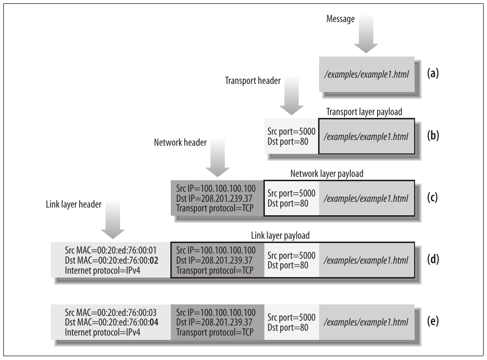

Hình 13-4. Header được các layer tạo: (a…d) trên Host X khi đi xuống stack; (e) trên Router RT1

Như đã thấy, mỗi layer cung cấp nhiều protocol. Mỗi protocol được tập kernel function khác nhau xử lý. Vì vậy, khi packet đi ngược lên stack, mỗi protocol phải xác định protocol được next-higher layer dùng và gọi kernel function thích hợp để xử lý packet.

Ở software layer thấp nhất, L2, hardware đang dùng xác định protocol. Nếu frame được nhận trên Ethernet interface, bên nhận biết frame chứa Ethernet header; Token Ring interface biết frame chứa Token Ring header, v.v. Không có nhập nhằng trừ khi LCC hoặc SNAP được chỉ định. LLC và SNAP được thảo luận phía sau trong chương.

Nhưng khi packet đi lên network stack, mỗi protocol cần field trong header để cho biết protocol nào nên xử lý giai đoạn tiếp theo. Tiến trình được thể hiện trong Hình 13-5. Vì vậy, chuyển tiếp từ L2 ở Hình 13-5(a) lên L3 ở Hình 13-5(b) phụ thuộc L2 kiểm tra field “Above protocol” trong L2 header. Tương tự, L3 layer kiểm tra field trong header để hỗ trợ chuyển tiếp lên L4, như Hình 13-5(b) và Hình 13-5(c). Cuối cùng, L4 dùng field Destination Port của packet để đưa packet ra khỏi kernel và tìm process, như web server, xử lý packet trên local host.

## Thực thi protocol handler thích hợp

Mỗi network protocol, bất kể layer, có một initialization function. Gồm L3 protocol như IPv4 và IPv6, link layer protocol như ARP, v.v. Với protocol được đưa tĩnh vào kernel, initialization function thực thi tại boot time; với protocol được compile thành module, initialization function thực thi khi module được load. Function cấp phát internal data structure, báo cho subsystem khác về sự tồn tại protocol, đăng ký file trong /proc, v.v. Một tác vụ quan trọng là đăng ký handler trong kernel để xử lý traffic cho protocol.

Trong mục này, để đơn giản, tôi sẽ cho thấy cách device driver (hoạt động ở L2) gọi L3 protocol, nhưng nguyên tắc tương tự áp dụng cho mọi protocol ở mọi layer.

Khi device driver nhận frame, nó lưu vào buffer data structure `sk_buff` và khởi tạo field `protocol` dưới đây:

```c
struct sk_buff
{
        ... ... ...
        unsigned short  protocol;
        ... ... ...
};
```

Value trong field có thể là value tùy ý kernel dùng để nhận diện protocol cụ thể, hoặc field của MAC header trong incoming frame. Kernel function `netif_receive_skb` (mô tả trong Chương 10) tra field để xác định function handler cần thực thi nhằm xử lý packet ở L3. Xem Hình 13-6.

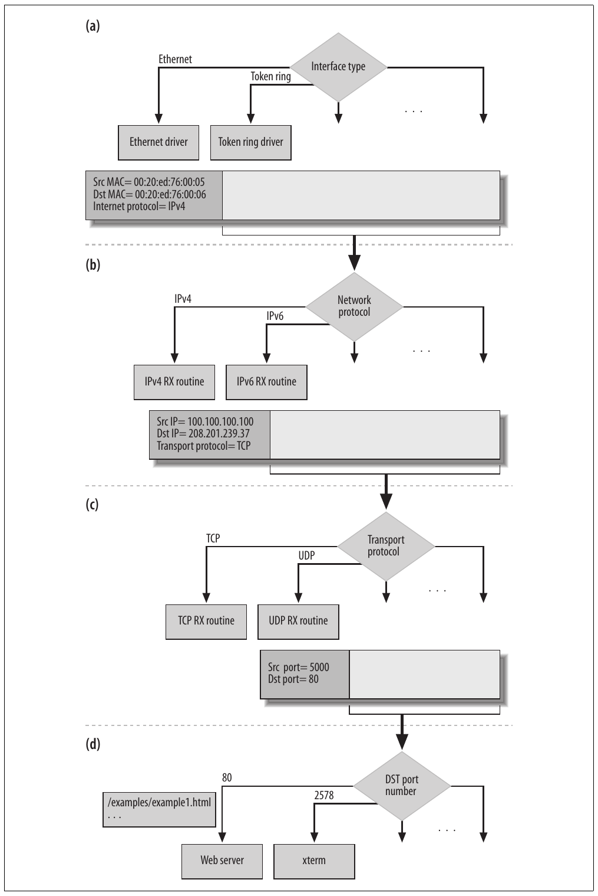

Hình 13-5. Decapsulation frame, từng layer, tại Server Y

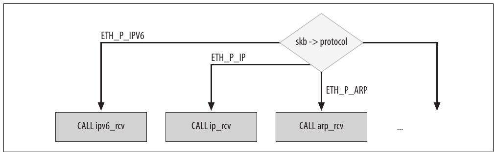

Hình 13-6. netif\_receive\_skb xử lý theo field protocol của buffer sk\_buff

Phần lớn value kernel dùng để tham chiếu protocol trong field `protocol` được liệt kê ở include/linux/if\_ether.h với tên `ETH_P_XXX`. Dù có prefix `ETH`, không phải mọi tên đều chỉ Ethernet hardware. Như Bảng 13-1, chúng có thể bao quát phạm vi hoạt động rộng. Bảng 13-1 liệt kê value kernel dùng nội bộ, được device driver gán trực tiếp cho `skb->protocol` thay vì trích từ frame header. (Những value không có trong bảng không được gán function handler.) Chẳng hạn, dòng đầu chỉ báo kernel handler `ipx_rcv` được dùng để xử lý incoming packet có field `skb->protocol` là `ETH_P_802_3`.

Bảng 13-1. Protocol nội bộ

| Symbol | Value | Function handler |
|---|---|---|
| `ETH_P_802_3` | 0x0001 | `ipx_rcv` |
| `ETH_P_AX25` | 0x0002 | `ax25_kiss_rcv` |
| `ETH_P_ALL` | 0x0003 | Đây không phải protocol thực. Nó được dùng làm wildcard cho handler như packet sniffer lắng nghe mọi protocol. |
| `ETH_P_802_2` | 0x0004 | `llc_rcv` |
| `ETH_P_TR_802_2` | 0x0011 |  |
| `ETH_P_WAN_PPP` | 0x0007 | `sppp_rcv` |
| `ETH_P_LOCALTALK` | 0x0009 | `ltalk_rcv` |
| `ETH_P_PPPTALK` | 0x0010 | `atalk_rcv` |
| `ETH_P_IRDA` | 0x0017 | `irlap_driver_rcv` |
| `ETH_P_ECONET` | 0x0018 | `econet_rcv` |
| `ETH_P_HDLC` | 0x0019 | `hdlc_rcv` |

Không phải mọi value `ETH_P_XXX` đều được gán handler. Có thể không được gán trong hai tình huống:

- Không có handler cho protocol (tức kernel không hỗ trợ).

- Protocol handler khác xử lý protocol gián tiếp, như trường hợp SNAP. Trường hợp này được thảo luận trong mục “Logical Link Control (LLC)” và “Subnetwork Access Protocol (SNAP)”.

Đáng tiếc, trích field từ L2 header không phải lúc nào cũng đủ để xác định handler cần gọi; liên kết giữa `skb->protocol` và protocol handler xử lý frame không phải lúc nào cũng one-to-one. Có trường hợp protocol handler cho `ETH_P_XXX` cụ thể thực ra chỉ đọc parameter khác từ frame header (không xử lý frame), rồi chuyển frame cho protocol handler khác xử lý. Ví dụ là handler `ETH_P_802_2`.

Như mô tả trong Chương 10, `netif_receive_skb` là function dispatch ingress frame tới protocol handler thích hợp. Khi không có handler cho protocol cụ thể, frame bị drop.

Trong trường hợp đặc biệt, một packet có thể được chuyển tới nhiều handler. Chẳng hạn khi packet sniffer đang chạy. Chế độ hoạt động này, đôi khi gọi là promiscuous mode, được liệt kê là `ETH_P_ALL` trong Bảng 13-1. Handler type này thường không dùng để xử lý packet cho bên nhận, mà chỉ theo dõi một device hoặc tập device để debug hoặc thu thập thống kê.

### Encapsulation cho media đặc biệt

Ethernet là cơ chế phổ biến nhất để triển khai cả network connection dùng chung lẫn point-to-point. Trong sách này, khi nói L2, chúng ta luôn tham chiếu Ethernet device driver. Tuy nhiên, Linux cho phép dùng bất kỳ media phổ biến nào trên PC hiện đại để mang IP traffic (đôi khi traffic của mọi network protocol). Ví dụ media có thể dùng để vận chuyển IP gồm serial port và parallel port (SLIP/PLIP/PPP), FireWire (eth1394), USB, Bluetooth, Infrared Data Association (IrDA), v.v.

Những media này định nghĩa network device dưới dạng abstraction trên generic port, thường bằng phần mở rộng cho generic media device driver. Virtual device như vậy trông như NIC thực đối với upper layer.

Đây là cách triển khai nhận và truyền trên những virtual network device này:

Truyền

Trong `net_device` của virtual device, function pointer `hard_start_xmit` được device driver khởi tạo thành routine encapsulate IP packet (giả sử là IP packet) theo protocol mà media dùng.

Nhận

Khi generic driver nhận data từ một port, nó loại media header (như Ethernet device driver loại Ethernet header), khởi tạo `skb->protocol` và báo cho upper layer bằng lời gọi `netif_rx`. Khi những media này chỉ dùng cho kết nối point-to-point, không cần link layer header, nên `skb->protocol` được khởi tạo tĩnh thành `ETH_P_IP`; trong trường hợp khác, media encapsulation cũng có thể chứa Ethernet header giả, nên `skb->protocol` được khởi tạo bằng routine `eth_type_trans` (như Ethernet driver thực).

Cách chính xác generic device driver của media type cụ thể giao tiếp với virtual network device là chi tiết triển khai. Tùy media, nó có thể cung cấp synchronous interface hoặc asynchronous interface, dùng buffering trên cả receive path lẫn transmit path, v.v.

## Tổ chức protocol handler

Hình 13-7 cho thấy cách các protocol handler khác nhau được tổ chức trong kernel. Mỗi protocol được mô tả bằng data structure `packet_type`.

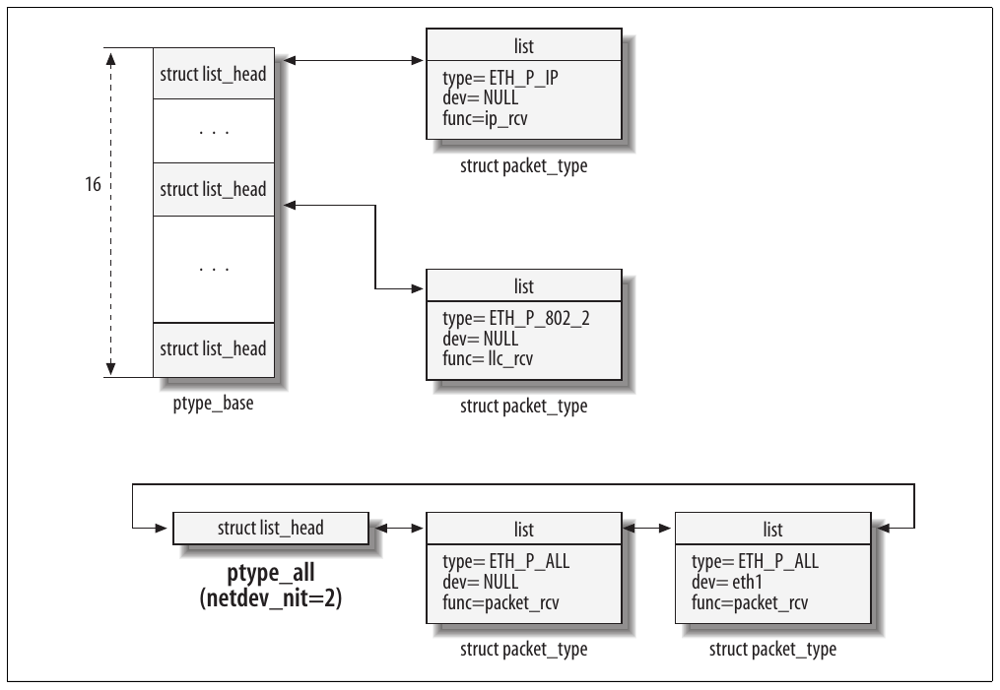

Hình 13-7. Data structure dùng để lưu protocol handler đã đăng ký

Để truy cập nhanh hơn, hash function rất đơn giản được dùng cho phần lớn protocol. Mười sáu list được tổ chức thành array mà global variable `ptype_base` trỏ tới. Khi protocol được đăng ký bằng function `dev_add_pack`, mô tả trong mục tiếp theo, function này chạy hash function trên protocol type và gán structure `packet_type` vào một trong 16 list. Sau đó, để tìm structure `packet_type`, kernel chỉ cần chạy lại hash và duyệt list tương ứng.

Protocol `ETH_P_ALL` (xem Bảng 13-1) được tổ chức trong list riêng mà global variable `ptype_all` trỏ tới.[^4] Số protocol trong list được lưu trong `netdev_nit`. Value này được `dev_queue_xmit` và `qdisc_restart` dùng để kiểm tra có socket `PF_PACKET` đang mở (tức sniffer đang lắng nghe) để chuyển bản copy ingress frame hay không (xem Chương 10).

## Đăng ký protocol handler

Khi hệ thống khởi động và những lúc khác khi protocol được đăng ký, kernel gọi `dev_add_pack`, truyền data structure type `packet_type`, được định nghĩa trong include/linux/netdevice.h như sau:

```c
struct packet_type
{
    unsigned short        type;
    struct net_device    *dev;
    int            (*func) (struct sk_buff *, struct net_device *,
                    struct packet_type *);
    void            *af_packet_priv;
    struct list_head    *list;
};
```

Các field có ý nghĩa sau:

`type`

Protocol code. Có thể nhận bất kỳ value nào liệt kê trong cột đầu Bảng 13-1 tới 13-4 (tức `ETH_P_IP`). Khác biệt giữa protocol thuộc các bảng khác nhau sẽ rõ trong những mục tiếp theo.

`dev`

Pointer tới device (tức eth0) cần enable protocol. Đặt NULL nghĩa là “mọi device”. Nhờ parameter này, có thể có handler khác nhau cho device khác nhau hoặc gắn handler với một device cụ thể. Thường không làm vậy, nhưng có thể hữu ích để kiểm thử. Socket `PF_PACKET` thường dùng nó để chỉ lắng nghe một device cụ thể. Chẳng hạn command như tcpdump –i eth0 tạo instance `packet_type` qua socket `PF_PACKET` và khởi tạo `dev` thành instance `net_device` tương ứng với eth0.

`func`

Function handler được `netif_receive_skb` (xem Chương 10) gọi khi cần xử lý frame có `skb->protocol=type` (ví dụ là `ip_rcv`). Lưu ý một input parameter của `func` là pointer tới structure `packet_type`: socket `PF_PACKET` dùng nó để truy cập field `af_packet_priv`.

`af_packet_priv`

Được socket `PF_PACKET` dùng. Đây là pointer tới data structure `sock` tương ứng với bên tạo structure `packet_type`. Nó cho phép routine `dev_queue_xmit_nit` (đã thấy trong Chương 10) tránh chuyển buffer cho cả bên gửi, và được receive routine của `PF_PACKET` dùng để chuyển ingress data tới socket thích hợp.

`list`

Dùng để liên kết data structure với instance khác collide trong cùng bucket list. Xem Hình 13-7.

Khi có nhiều instance `packet_type` gắn với cùng protocol `type`, ingress frame khớp `type` được chuyển tới mọi protocol handler instance bằng cách gọi `func` cho tất cả. Xem Chương 10 để biết thêm chi tiết.

Để đăng ký mỗi protocol, kernel khởi tạo structure `packet_type` rồi gọi `dev_add_pack`. Đây là ví dụ từ net/ipv4/ip\_output.c cho thấy cách IPv4 core code đăng ký IPv4 protocol handler.

Khi IPv4 protocol được khởi tạo tại boot time, function `ip_init` được thực thi. Một kết quả là function `ip_rcv` trong IPv4 structure `packet_type` được đăng ký làm function handler của protocol. Mọi Ethernet frame nhận được có value “Protocol Above” là `ETH_P_IP` sau đó được function `ip_rcv` xử lý.

```c
static struct packet_type ip_packet_type =
{
    .type = __constant_htons(ETH_P_IP),
    .func = ip_rcv,
}
...
void __init ip_init(void)
{
    dev_add_pack(&ip_packet_type);
    ...
}
```

`dev_add_pack` khá đơn giản: kiểm tra handler cần thêm có phải protocol sniffer (`pt->type==htons(ETH_P_ALL)`) không. Nếu có, function thêm vào list do `ptype_all` trỏ tới và tăng số protocol sniffer đã đăng ký (`netdev_nit++`). Nếu handler không phải sniffer, nó được chèn vào một trong 16 list do `ptype_base` trỏ tới tùy hash code value. Data structure do `ptype_base` và `ptype_all` trỏ tới được spin lock `ptype_lock` bảo vệ.

```c
void dev_add_pack(struct packet_type *pt)
{
    int hash;
    spin_lock_bh(&ptype_lock);
    if (pt->type == htons(ETH_P_ALL)) {
        netdev_nit++;
        list_add_rcu(&pt->list, &ptype_all);
    } else {
        hash = ntohs(pt->type) & 15;
        list_add_rcu(&pt->list, &ptype_base[hash]);
    }
    spin_unlock(&ptype_lock);
}
```

Function `dev_remove_pack`, như tên gọi, bổ sung thao tác ngược với `dev_add_pack`.

```c
void dev_remove_pack(struct packet_type *pt)
{
    __dev_remove_pack(pt);

    synchronize_net( );
}
```

`__dev_remove_pack` loại structure `packet_type` khỏi `ptype_all` hoặc `ptype_base`, và `synchronize_net` được dùng để bảo đảm khi `dev_remove_pack` return, không còn bên nào giữ reference tới instance `packet_type` đã loại bỏ (ví dụ xem cách dùng RCU locking trong `netif_receive_skb` ở Chương 10).

Nếu `dev_add_pack` được gọi trong function `init_module` phụ trách khởi tạo module, nhiều khả năng `dev_remove_pack` nằm trong `cleanup_module`, được kernel gọi khi cần loại module. (Có thể tìm ví dụ trong net/ax25/af\_ax25.c.) Ngược lại, nếu protocol được đưa tĩnh vào kernel, nó được đăng ký tự động tại boot time và chỉ bị loại khi hệ thống tắt. IPv4 là ví dụ protocol không bao giờ bị loại tại runtime.

## Ethernet so với frame IEEE 802.3

Một số protocol cùng được gọi theo nghĩa rộng là Ethernet. Standard 802.2 và 802.3 lần lượt được biểu diễn bởi protocol `ETH_P_802_2` và `ETH_P_802_3`, nhưng còn nhiều Ethernet protocol khác liệt kê trong Bảng 13-2, cùng phần mở rộng LLC và SNAP. Các standard dùng một vài hack để hỗ trợ mọi biến thể này (`h_proto` được thảo luận trong mục tiếp theo).

Bảng 13-2. Ethernet type hợp lệ (khi h\_proto \> 1536)

| Protocol | Ethernet type | Function handler |
|---|---|---|
| `ETH_P_IP` | `0x0800` | `ip_rcv` |
|  |  | `ic_bootp_recva` |
| `ETH_P_X25` | `0x0805` | `X25_lap_receive_frame` |
| `ETH_P_ARP` | `0x0806` | `arp_rcv` |
| `ETH_P_BPQ` | `0x08FF` | `bpq_rcv` |
| `ETH_P_DNA_RT` | `0x6003` | `dn_route_rcv` |
| `ETH_P_RARP` | `0x8035` | `ic_rarp_recv` |
| `ETH_P_8021Q` | `0x8100` | `vlan_skb_rcv` |
| `ETH_P_IPX` | `0x8137` | `ipx_rcv` |
| `ETH_P_IPV6` | `0x86DD` | `ipv6_rcv` |
| `ETH_P_PPP_DISC` | `0x8863` | `pppoe_disc_rcv` |
| `ETH_P_PPP_SES` | `0x8864` | `pppoe_rcv` |

<sup>a</sup> Lý do IP có hai handler liên quan khả năng kernel lấy IP configuration bằng protocol như RARP/BOOTP. Handler ic\_bootp\_recv chỉ dùng tại boot time để đảm nhiệm dynamic IP configuration, và được gỡ sau khi lấy được cấu hình. Xem net/ipv4/ipconfig.c.

Ethernet được thiết kế trước khi IEEE tạo standard 802.2 và 802.3. Những standard sau không phải Ethernet thuần, dù thường được gọi là Ethernet standard. May thay, ủy ban IEEE 802 quyết định làm protocol tương thích. Mọi Ethernet card có thể nhận cả frame type theo standard 802 lẫn Ethernet frame cũ, và kernel cung cấp routine (thảo luận phía sau trong mục) cho phép device driver nhận diện chúng nhờ giải pháp mô tả trong mục này.

Đây là định nghĩa Ethernet header:

```c
struct ethhdr
{
        unsigned char   h_dest[ETH_ALEN];     /* destination eth addr  */
        unsigned char   h_source[ETH_ALEN];   /* source ether addr     */
        unsigned short  h_proto;              /* packet type ID field  */
} __ATTRIBUTE__ ((packed));
```

Như sẽ thấy trong hai mục tiếp theo về LLC và SNAP, field khác có thể theo sau structure `ethhdr`. Ở đây chúng ta tập trung vào protocol field `h_proto`. Dù tên như vậy, thực tế nó có thể lưu protocol đang dùng hoặc frame length. Vì kích thước là 2 octet (byte), nhưng kích thước tối đa Ethernet frame là 1.500 byte. (Thực ra kích thước có thể tới 1.518 nếu tính cả SA, DA, Checksum và Preamble. Frame dùng 802.1q có thêm bốn byte encapsulation nên có thể đạt 1.522 byte.)

Để tiết kiệm chỗ, IEEE quyết định dùng value lớn hơn 1.536 để biểu diễn Ethernet protocol. Một số protocol đã có với identifier nhỏ hơn 1.536 (0x600 hexadecimal) được cập nhật để đáp ứng tiêu chí. Tuy nhiên, protocol 802.2 và 802.3 dùng field để lưu frame length.[^5] Value từ 1.501 tới 1.535 không hợp lệ trong field này.

Hình 13-8 cho thấy các biến thể có thể có của Ethernet header. Ethernet đơn giản ở (a). Biến thể 802.2 và 802.3 ở (b). Như bạn thấy, một field đóng vai trò protocol field ở trường hợp trước và length field ở trường hợp sau. Ngoài ra, biến thể 802 có thể hỗ trợ LLC như (c) và SNAP như (d).

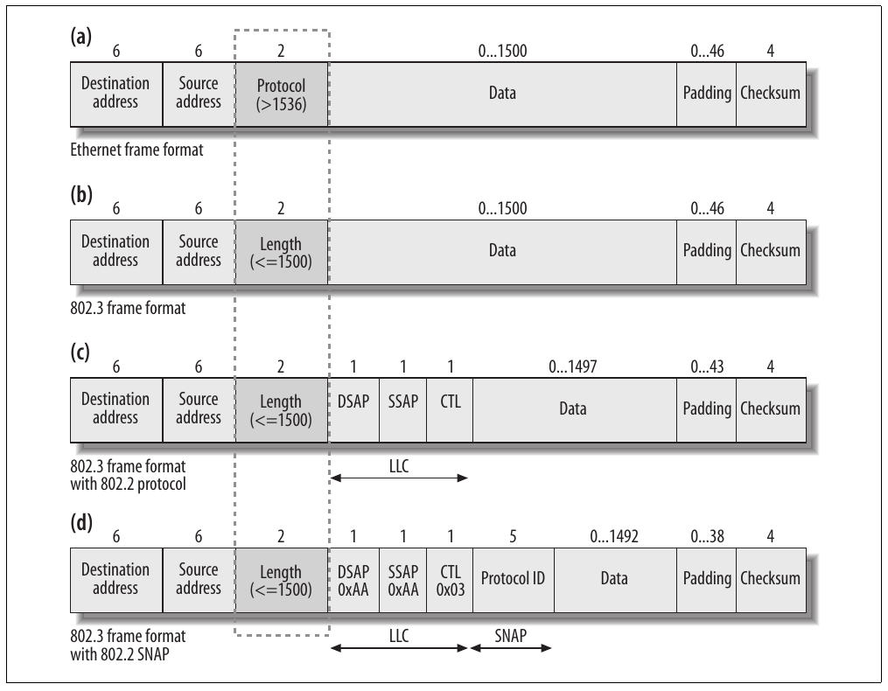

Hình 13-8. Khác biệt giữa Ethernet frame và frame 802.3

Linux xử lý sự phân biệt khác thường giữa protocol và length trong function `eth_type_trans`. Ngữ cảnh điển hình được thể hiện bằng đoạn code sau, do Ethernet driver drivers/net/3c509.c thực hiện khi nhận frame. `netif_rx` là function copy frame vào input queue và set flag `NET_RX_SOFTIRQ` để báo kernel biết có frame mới trong queue (mô tả trong Chương 10<sup>†</sup>). Ngay trước khi gọi `netif_rx`, bên gọi thực hiện một số khởi tạo quan trọng bằng lời gọi `eth_type_trans`.

```c
el3_rx(struct device *dev)
{
        ... ... ...
        skb->protocol = eth_type_trans(skb,dev);
        netif_rx(skb);
        ... ... ...
}
```

`eth_type_trans` thực hiện hai tác vụ chính: đặt packet type[^6] và protocol. Nó thực hiện việc sau thông qua return value. Hãy xử lý tác vụ đầu trước khi tập trung vấn đề chính trong mục này là protocol.

### Đặt packet type

Function `eth_type_trans` đặt `skb->pkt_type` thành một trong các value `PACKET_XXX` liệt kê trong include/linux/if\_packet.h:

`PACKET_BROADCAST`

Frame được gửi tới link layer broadcast address (tức FF:FF:FF:FF:FF:FF với Ethernet)

`PACKET_MULTICAST`

Frame được gửi tới link layer multicast address. Chi tiết nằm phía sau trong mục này.

`PACKET_OTHERHOST`

Frame không được gửi tới receiving interface. Tuy nhiên, frame không bị drop ngay mà được truyền tới next-highest layer. Như mô tả trước, có thể có protocol sniffer hoặc protocol tò mò khác muốn xem frame.

Khi `eth_type_trans` không đặt `skb->pkt_type` tường minh, value cuối cùng là 0, tức `PACKET_HOST`. Điều này nghĩa là receiving interface là bên nhận frame (từ góc nhìn link layer, tức MAC address khớp).

Phần lớn thông tin cần để đặt đúng packet type được chỉ định tường minh trong header. Ethernet address dài 48 bit hay 6 byte. Hai bit có trọng số thấp nhất của byte đầu (theo network byte order) có ý nghĩa đặc biệt (xem Hình 13-9):

- Bit 0 phân biệt multicast address với unicast address. Broadcast address là trường hợp đặc biệt của multicast. Khi đặt 1, bit chỉ multicast; khi 0, chỉ unicast. Sau khi kiểm tra bit bằng `if(*eth->h_dest&1)`, function tiếp tục xem frame có phải broadcast frame không bằng cách so sánh address với broadcast address của device qua `memcmp(eth->h_dest,dev->broadcast, ETH_ALEN)`.

† `netif_rx` chỉ là một trong hai interface sẵn có để device driver thông báo cho upper layer về việc nhận frame. Cả hai được mô tả trong Chương 10.

- Bit 1 phân biệt local address với global address. Global address duy nhất trên toàn cầu, local address thì không: administrator có trách nhiệm gán local address thích hợp.[^7] Khi đặt 1, bit chỉ global address; khi 0, chỉ local address.

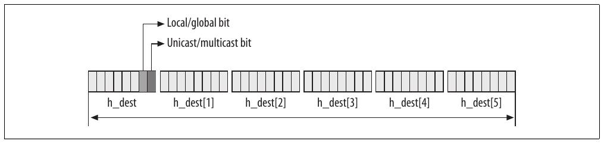

Hình 13-9. Bit unicast/multicast và local/global trong MAC address

Vì vậy, phần đầu `eth_type_trans` là:

```c
unsigned short eth_type_trans(struct sk_buff *skb, struct net_device *dev)
{
    struct ethhdr *eth;
    unsigned char *rawp;

    skb->mac.raw=skb->data;
    skb_pull(skb,ETH_HLEN);
    eth= eth_hdr(skb);
    skb->input_dev = dev;

    if(*eth->h_dest&1)
    {
        if(memcmp(eth->h_dest,dev->broadcast, ETH_ALEN)==0)
            skb->pkt_type=PACKET_BROADCAST;
        else
            skb->pkt_type=PACKET_MULTICAST;
    }

    else if(1 /*dev->flags&IFF_PROMISC*/)
    {
        if(memcmp(eth->h_dest,dev->dev_addr, ETH_ALEN))
            skb->pkt_type=PACKET_OTHERHOST;
    }
```

Flag `IFF_PROMISC` được set trong `dev->flags` khi interface chuyển sang promiscuous mode. Như đoạn trích trước, `eth_type_trans` khởi tạo `skb->pkt_type` thành `PACKET_OTHERHOST` khi destination MAC address không khớp receiving interface address, bất kể flag `IFF_PROMISC`. Điều này cho phép handler `PF_SOCKETS` nhận bản copy frame (xem `netif_receive_skb` ở Chương 10), nhưng protocol handler upper-layer phải loại buffer type `PACKET_OTHERHOST` (ví dụ xem `arp_rcv` và `ip_rcv`).

### Đặt Ethernet protocol và length

Phần thứ hai `eth_type_trans` lấy identifier của protocol dùng ở higher layer. Protocol value còn được gọi là Ethertype, và danh sách type hợp lệ được giữ up-to-date tại http://standards.ieee.org/regauth/ethertype. Việc phân biệt Ethernet protocol cũ có value trên 1.536 với protocol 802 được thực hiện trong đoạn code sau:

```c
    if (ntohs(eth->h_proto) >= 1536)
        return eth->h_proto;

    rawp = skb->data;

    if (*(unsigned short *)rawp == 0xFFFF)
        return htons(ETH_P_802_3);

    /*
     *    Real 802.2 LLC
     */
    return htons(ETH_P_802_2);
}
```

Nếu value lớn hơn 1.536 được diễn giải là protocol ID, device driver tìm kích thước frame nhận được bằng cách nào? Trong cả hai trường hợp, dù protocol/length value nhỏ hơn 1.500 hay lớn hơn 1.536, chính device lưu frame size vào một register của nó để device driver đọc. Device có thể xác định kích thước từng frame nhờ bit pattern well-known được dùng cho mục đích đó. Code sau từ `vortex_rx` trong drivers/net/3c59x.c cho thấy driver trước hết đọc kích thước từ device rồi cấp phát buffer tương ứng:

```c
            /* The packet length: up to 4.5K!. */
            int pkt_len = rx_status & 0x1fff;
            struct sk_buff *skb;

            skb = dev_alloc_skb(pkt_len + 5);
```

Đừng để comment trong code trước gây nhầm. Device cụ thể này có thể nhận frame kích thước tới 4,5 K vì cũng xử lý FDDI NIC.

Trong Chương 1, chúng ta đã thấy host byte order và network byte order là gì. Value do `eth_type_trans` trả về, vì vậy cũng là value gán cho `skb->protocol`, theo network byte order: khi trích từ Ethernet header, nó đã theo network byte order; còn khi `eth_type_trans` dùng local symbol `ETH_P_XXX`, cần chuyển tường minh từ host byte order sang network byte order bằng macro `htons`. Điều này cũng nghĩa là khi kernel truy cập `skb->protocol` sau đó và so sánh với value `ETH_P_XXX`, phải chuyển `ETH_P_XXX` sang network byte order hoặc `skb->protocol` sang host byte order: dùng order nào không quan trọng, chỉ cần hai vế so sánh cùng order. Nói cách khác, hai dòng này tương đương:

```c
ntohs(skb->protocol) == ETH_P_802_2
skb->protocol == htons(ETH_P_802_2)
```

Vì `eth_type_trans` chỉ được gọi cho Ethernet frame, có function tương tự cho media type khác, một số có tên kết thúc bằng `_type_trans`, số khác có tên khác. Ví dụ sau cho thấy code lấy từ IBM Token Ring driver (drivers/net/tokenring/ibmtr.c); trước lời gọi `netif_rx` quen thuộc, `skb->protocol` được `tr_type_trans` đặt, giống `eth_type_trans` với Ethernet device:

```c
static void tr_rx(struct device *dev)
{
    ...
    skb->protocol=tr_type_trans(skb, dev);
    ...
    netif_rx(skb);
    ...
}
```

Nếu xem `tr_type_trans` trong net/802/tr.c, bạn sẽ thấy logic tương tự `eth_type_trans`, nhưng áp dụng cho Token Ring device.

Cũng có media type đặt `skb->protocol` trực tiếp mà không cần helper function dạng `_type_trans`, vì chúng chỉ có thể mang một protocol (tức IrDA, AX25, v.v.).

### Logical Link Control (LLC)

LLC layer được ủy ban IEEE 802 thiết kế khi tiêu chuẩn hóa LAN. Ý tưởng là thay vì chỉ có một protocol identifier higher-layer, chỉ định một protocol identifier cho source (SSAP) và một cho destination (DSAP) sẽ linh hoạt hơn. Trong phần lớn trường hợp, SSAP và DSAP sẽ giống nhau cho connection cụ thể; thực tế SSAP và DSAP luôn giống nhau khi global flag được set, nhưng hai value riêng cho hệ thống khả năng linh hoạt dùng protocol khác nhau.

LLC có thể cung cấp các service type khác nhau cho upper layer:

Type I

Connectionless (tức datagram protocol), không hỗ trợ acknowledgment, flow control và error recovery

Type II

Connection oriented, hỗ trợ acknowledgment, flow control và error recovery

Type III

Connectionless, nhưng có một số lợi ích của type II

Hình 13-8(c) cho thấy header format của frame dùng LLC. Như bạn thấy, có ba field mới:

SSAP

DSAP

Đây là field 8-bit để chỉ định protocol được dùng.

Control (CTL)

Kích thước field phụ thuộc LLC type được dùng (type I hoặc type II). Tôi không đi sâu LLC layer, mà giả định field dài 1 byte và có value 0x03 (type I, CTL=UI). Điều này đủ để hiểu phần còn lại của chương.

LLC header không trở nên phổ biến vì một số lý do. Có lẽ lý do chính là giới hạn 8-bit của identifier SSAP và DSAP, cộng thêm dành hai bit cho flag unicast/multicast và local/global.[^8] Chỉ 64 protocol có thể được chỉ định trong 6 bit còn lại, quá hạn chế.

Khi dùng local SAP (do flag local/global trong protocol field chỉ báo), network administrator phải bảo đảm mọi hệ thống thống nhất local SAP sử dụng, khiến mọi thứ phức tạp và khó dùng hơn. Không thể có nhập nhằng với global SAP, nhưng global SAP không được dùng cho protocol mới. Trong mục tiếp theo, bạn sẽ thấy cách giải quyết hạn chế bằng mở rộng header với khái niệm SNAP.

Bảng 13-3 cho thấy các SAP đăng ký với Linux kernel. LLC khiến kernel dùng thêm một mức gián tiếp khi lấy handler, so với protocol liệt kê trong Bảng 13-2 và đăng ký bằng `dev_add_pack`.

Bảng 13-3. Các 802.2 SAP client của kernel

| Protocol | SAP | Function handler |
|---|---|---|
| `SNAP` | `0xAA` | `snap_rcv` |
| `IPX` | `0xE0` | `ipx_rcv` |

#### Trường hợp IPX

Bạn có thể tự hỏi có dùng frame format 802.3 thuần được không, vì Hình 13-8(b) không có chỉ báo protocol ID. Thực tế frame 802.3 thuần thường không được dùng. Ngoại lệ well-known duy nhất liên quan IPX. IPX packet có thể được gửi bằng raw 802.3 frame (tức frame không có LLC header). Bên nhận nhận diện bằng một hack. Field đầu của IPX header là checksum 16-bit, thường được tắt đơn giản bằng cách đặt 0xFFFF. Vì 0xFF/0xFF<sup>†</sup> là tổ hợp SSAP/DSAP không hợp lệ và không có Ethertype mang value đó, IPX packet dùng raw 802.3 có thể dễ nhận diện. Khi phát hiện, `skb->protocol` được đặt thành `ETH_P_802_3`, có handler là IPX handler (xem Bảng 13-1).

##### Triển khai LLC của Linux

802.2 LLC layer được mở rộng và viết lại trong chu kỳ phát triển 2.5. LLC implementation của kernel, hỗ trợ type I và II, gồm những thành phần chính sau:

- Hai state machine. Dùng để theo dõi state của local SAP và connection được tạo trên chúng.

- Một LLC receive routine cung cấp input thích hợp cho hai state machine dựa trên input frame nhận được.

- Socket interface `AF_LLC`. Có thể dùng để xây dựng protocol hoặc service trong user space trên LLC layer.

Vì không protocol nào mô tả trong sách dùng LLC layer, tôi không đi sâu định nghĩa LLC service (bạn có thể tham khảo đặc tả IEEE 802.2 Logical Link Control[^9]), cũng không xem chi tiết LLC implementation của Linux kernel. Ở đây chỉ xem data structure dùng để định nghĩa local SAP và cách xử lý ingress frame một cách ngắn gọn.

Data structure dùng để định nghĩa local SAP là `llc_sap`, định nghĩa trong include/net/llc.h. Trong các field có:

`struct llc_addr laddr`

SAP identifier.

`int (*rcv_func)(struct sk_buff *, struct net_device *, struct packet_type *)`

Function handler. Khi SAP được mở qua socket `PF_LLC`, field là NULL. Khi SAP được kernel mở, field trỏ tới routine do kernel cung cấp (xem Bảng 13-3).

Local SAP được tạo bằng `llc_sap_open` và chèn vào list `llc_sap_list`. `llc_sap_open` được gọi để tạo hai SAP type:

- SAP do chính kernel cài để cài handler kernel-level<sup>†</sup> (xem Bảng 13-3).

- SAP được quản lý bằng socket `PF_LLC` (ví dụ khi server dùng system call `bind` trên socket `PF_LLC` để bind vào SAP cụ thể).

##### Xử lý ingress LLC frame

Mỗi khi incoming frame được `eth_type_trans` phân loại là dùng LLC header (vì có type/length field nhỏ hơn 1.536 và không phát hiện trường hợp IPX đặc biệt), khởi tạo `skb->protocol` thành `ETH_P_802_2` dẫn tới chọn handler `llc_rcv` (xem Bảng 13-1). Handler này chọn protocol handler thích hợp dựa trên field DSAP trong LLC header: để làm vậy, nó gọi handler `rcv_func` đăng ký bằng `llc_sap_open` với SAP do kernel mở, và cung cấp input thích hợp cho state machine thích hợp khi SAP được mở bằng socket `PF_LLC` (xem Hình 13-10).

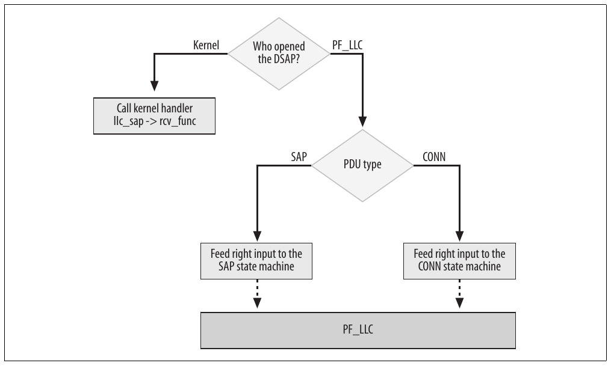

Hình 13-10. Function llc\_rcv

Frame được gửi ra một SAP cụ thể khi một trong hai state machine yêu cầu (ví dụ để acknowledge nhận frame). Socket `PF_LLC` có thể dùng standard interface (tức `sendmsg`, v.v.) để truyền. Trong cả hai trường hợp, frame được đưa trực tiếp cho `dev_queue_xmit` sau khi link layer header thích hợp đã được khởi tạo đúng.

### Subnetwork Access Protocol (SNAP)

Do hạn chế của LLC header, ủy ban 802 tổng quát hóa data link header hơn nữa. Để mở rộng protocol domain, họ đưa vào khái niệm SNAP. Về cơ bản, khi cặp SSAP/DSAP được gán value 0xAA/0xAA, nó có nghĩa đặc biệt: năm byte sau CTL field của LLC header biểu diễn protocol identifier. Bit unicast/multicast và local/global cũng không còn được dùng. Vì vậy, protocol identifier size tăng từ 8 lên 40 bit.

Lý do ủy ban quyết định dùng năm byte liên quan cách protocol number được suy ra từ MAC address.[^10] Khác SSAP/DSAP, dùng SNAP code khá phổ biến.

Vì SNAP identifier 0xAA/0xAA là trường hợp đặc biệt của SSAP/DSAP, như Bảng 13-3, nó là một trong các client dùng `llc_sap_open` (xem `snap_init` trong net/802/psnap.c). Điều này nghĩa là protocol dùng SNAP code có thêm một mức gián tiếp, tức tổng cộng ba mức!

Trước khi xem SNAP client đăng ký với kernel thế nào, hãy xem ngắn gọn cách định nghĩa SNAP protocol ID. Có lẽ bạn đã biết MAC address do IEEE quản lý, được bán theo khối 2<sup>24</sup>. Vì MAC address dài 48 bit (6 byte), IEEE chỉ cần cấp cho mỗi client một số 24-bit (ba byte đầu MAC address) rồi để client dùng bất kỳ value nào cho 24 bit còn lại. Giả sử tôi muốn mua một khối MAC address vì muốn bắt đầu bán network card. Gọi số được gán cho tôi là XX:YY:ZZ. Khi đó, tôi sở hữu mọi address giữa XX:YY:ZZ:00:00:00 và XX:YY:ZZ: FF:FF:FF. Cùng 2<sup>24</sup> MAC address đó, tôi được gán toàn bộ 2<sup>16</sup> SNAP code giữa XX:YY:ZZ:00:00 và XX:YY:ZZ:FF:FF.

Thực tế, khi nhận số 24-bit từ IEEE, bạn được cấp bốn số 24-bit nhờ bốn tổ hợp có thể của bit global/local và unicast/ multicast (xem Hình 13-9).

Tương tự cách đăng ký và hủy đăng ký SAP protocol, SNAP layer cung cấp function `register_snap_client` và `unregister_snap_client`, cũng dùng global list (`snap_list`) để liên kết mọi SNAP protocol đăng ký với kernel. Bảng 13-4 cho thấy các client đăng ký với Linux kernel.

Bảng 13-4. SNAP client

| Protocol | Snap ID | Function handler |
|---|---|---|
| AppleTalk Address Resolution Protocol | 00:00:00:80:F3 | `aarp_rcv` |
| AppleTalk Datagram Delivery Protocol | 08:00:07:80:9B | `atalk_rcv` |
| IPX | 00:00:00:81:37 | `ipx_rcv` |

Data structure dùng để định nghĩa SNAP protocol là `datalink_proto`, định nghĩa trong include/net/datalink.h. Trong các field có:

`unsigned short header_length`

Đây là data link header length. Được khởi tạo thành 8 trong `register_snap_client` (xem Hình 13-8(d)).

`unsigned_char type[8]`

Protocol identifier. Chỉ dùng năm byte (SNAP protocol ID; xem Bảng 13-4).

`void (*request)(struct datalink_proto *, struct sk_buff *, unsigned char *)`

Được khởi tạo thành `snap_request` trong `register_snap_client`. Function khởi tạo SNAP header (chỉ protocol ID) và truyền frame tới code 802.2. Được gọi trước khi truyền để điền data link header.

`void (*rcvfunc)(struct sk_buff *, struct net_device *, struct packet_type *)`

Function handler cho ingress traffic. Xem Bảng 13-4.

Tôi sẽ tập trung một chút vào IPX. Cần chỉ ra protocol này đăng ký cùng handler với kernel tại ba điểm khác nhau:

- Một với Ethertype (Bảng 13-2)

- Một dưới dạng protocol SSAP/DSAP 802.3 (Bảng 13-3)

- Một dưới dạng SNAP protocol (Bảng 13-4)

Hình 13-11 tóm tắt cách kernel nhận diện và xử lý frame Ethernet, 802.3, 802.2 và SNAP.

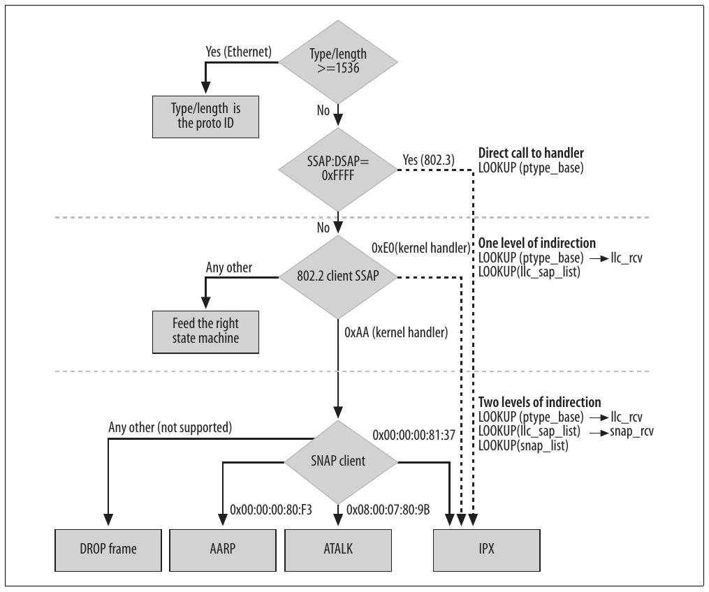

Hình 13-11. Phát hiện protocol cho frame Ethernet/802.3/802.2/SNAP

## Tinh chỉnh qua filesystem /proc

Với cả Ethernet lẫn 802, có directory trong /proc/sys/net: /proc/sys/net/ethernet/ (rỗng) và /proc/sys/net/token-ring/ (chứa một file), lần lượt được đăng ký trong file net/core/sysctl\_net\_ethernet.c và net/802/sysclt\_net\_ 802.c. Hai directory này chỉ được đưa vào khi kernel được compile với hỗ trợ Ethernet và Token Ring tương ứng.

## Function và variable được trình bày trong chương này

Bảng 13-5 liệt kê các function chính được giới thiệu trong chương này, cùng global variable và data structure quan trọng nhất.

Bảng 13-5. Function và data tham gia quản lý protocol handler

| Tên function | Mô tả |
|---|---|
| `dev_add_pack dev_remove_pack` | Thêm/loại bỏ protocol handler. |
| `register_8022_client unregister_8022_client` | Đăng ký/hủy đăng ký protocol 802.2. Được định nghĩa làm wrapper quanh `llc_sap_open` và `llc_sap_close`. |
| `register_snap_client unregister_snap_client` | Đăng ký/hủy đăng ký SNAP client. |
| `llc_sap_open llc_sap_close` | Tạo/loại bỏ SAP. |
| `eth_type_trans` | Được Ethernet device dùng để trích protocol identifier higher-layer và phân loại frame thành unicast/multicast/broadcast. |
| Variable |  |
| `netdev_nit` | Số protocol sniffer đã đăng ký. |
| `ptype_base` | Pointer tới data structure chứa protocol handler đã đăng ký. |
| `ptype_all` | Giống `ptype_base` nhưng áp dụng cho protocol sniffer. |
| `snap_list` | List SNAP client. |
| Data structure type |  |
| `struct packet_type` | Dùng để lưu thông tin về protocol handler `ETH_P_XXX`. |
| `struct datalink_proto` | Dùng để biểu diễn SNAP protocol. |

## File và directory được trình bày trong chương này

Hình 13-12 cho thấy vị trí các file đề cập trong chương. Trong include/linux, bạn có thể tìm header file if\_xxx.h cho media type khác. Directory net/llc còn chứa một số file nữa.

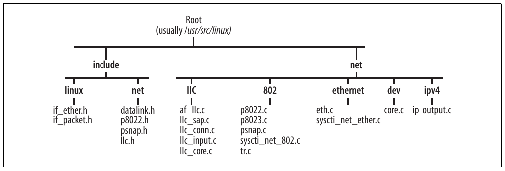

Hình 13-12. File và directory được trình bày trong chương này

[^1]: Để biết thêm về hai mô hình, tôi đề xuất Computer Networks, Second Edition (Prentice Hall).

[^2]: Hình chỉ thể hiện chi tiết cần cho phần thảo luận.

[^3]: Trong Phần V, chúng ta sẽ thấy chỉ field thay đổi, như Time To Live (TTL) và checksum, cần được cập nhật.

[^4]: Hình cho thấy protocol type `ETH_P_ALL` dùng routine `packet_rcv`. `func` được `packet_create` trong net/packet/af\_packet.c khởi tạo dựa trên kernel configuration.

[^5]: Lý do sắp xếp như vậy là câu chuyện dài. Với người tò mò, tôi đề xuất đọc Interconnections, Second Edition: Bridges, Routers, Switches, and Internetworking Protocols (Addison Wesley), trong đó tác giả giải thích với khá nhiều sự mỉa mai.

[^6]: Dù code gọi là packet type, thực ra đây là frame type vì được suy ra từ link layer address.

[^7]: Không có quan hệ giữa local MAC address và nonroutable IP address (192.168.x.x, v.v.): chúng tương tự về khái niệm nhưng áp dụng cho hai layer khác nhau trong stack.

[^8]: Ý nghĩa hai flag giống phần thảo luận trước về MAC address, nhưng ở đây áp dụng cho protocol thay vì address. † Kiểm tra với 0xFF/0xFF để nhận diện IPX packet được dùng khắp Linux kernel. `eth_type_trans` là một ví dụ.

[^9]: Giống phần lớn tài liệu IEEE, tài liệu thiết kế LLC khá lớn và không thú vị để đọc. Tuy nhiên, có tài liệu trong tay sẽ giúp đọc LLC code dễ hơn nhiều, đặc biệt những chi tiết nhàm chán của state machine. † Cũng có thể thực hiện gián tiếp qua routine `register_8022_client`.

[^10]: SNAP code được định nghĩa là tập con của MAC address, được IEEE bán theo khối. Nhờ vậy, mỗi chủ sở hữu MAC address được gán một số SNAP code cùng các MAC address. Để biết chi tiết, tôi khuyên đọc Interconnections, Second Edition (Addison Wesley).
