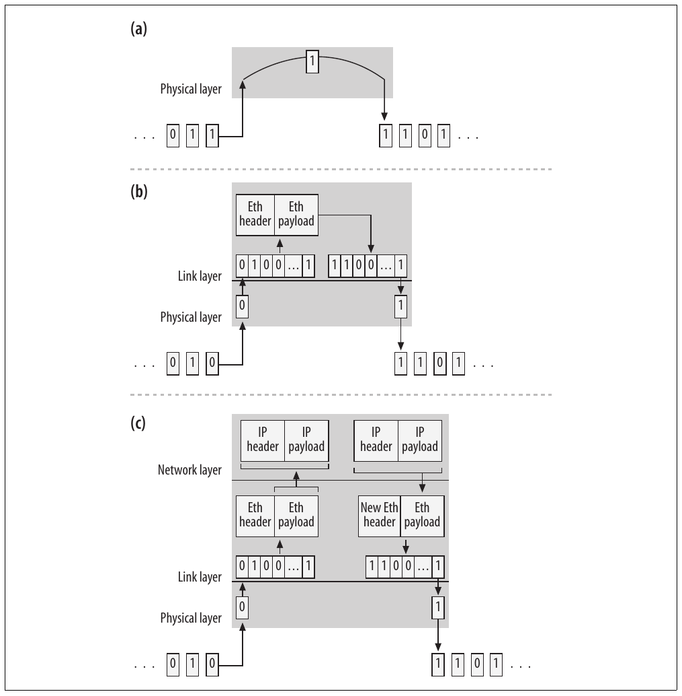
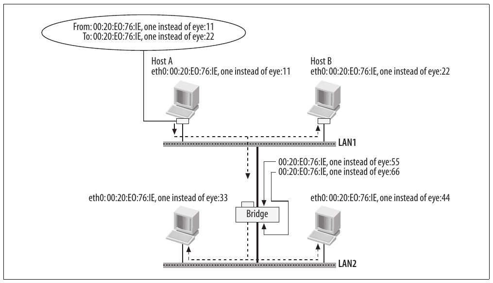
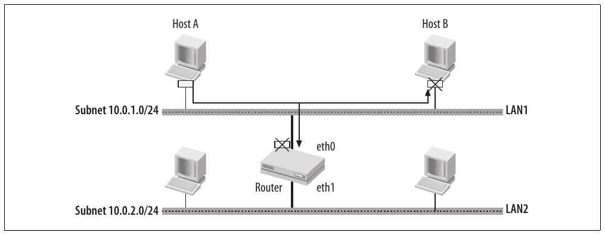
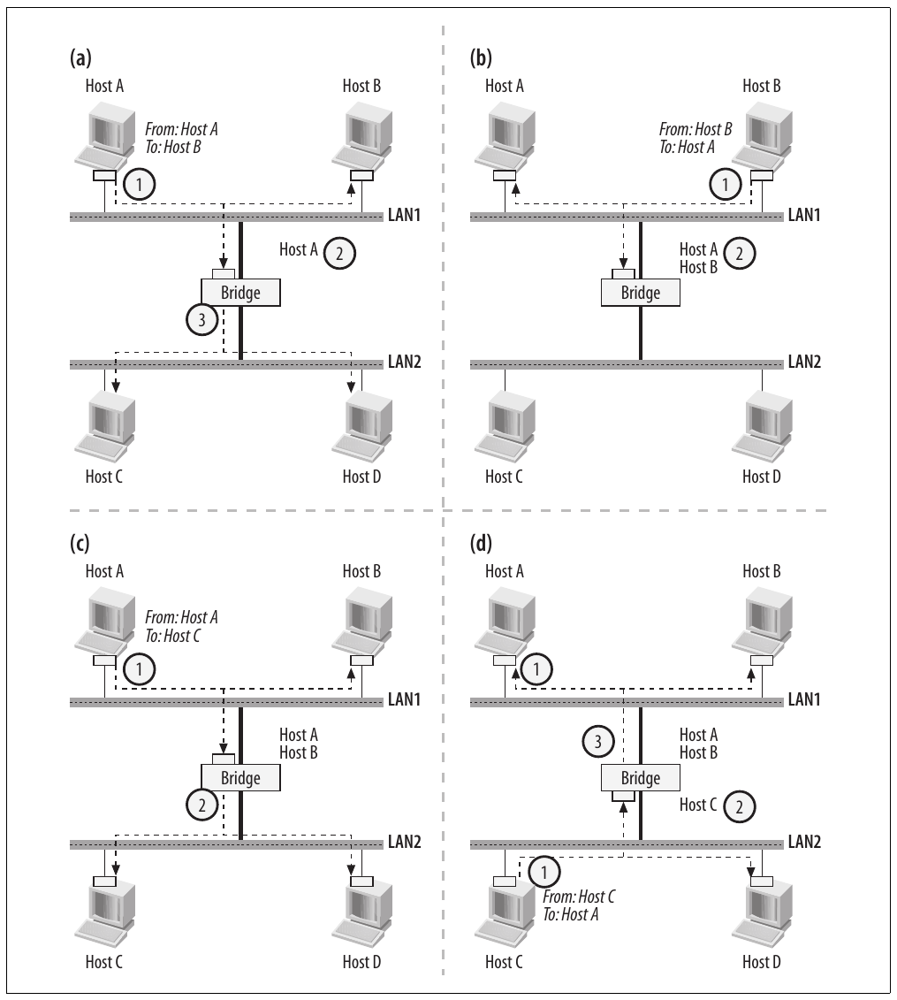
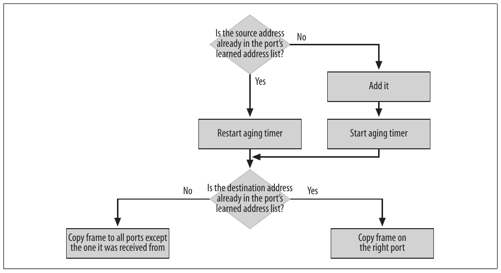
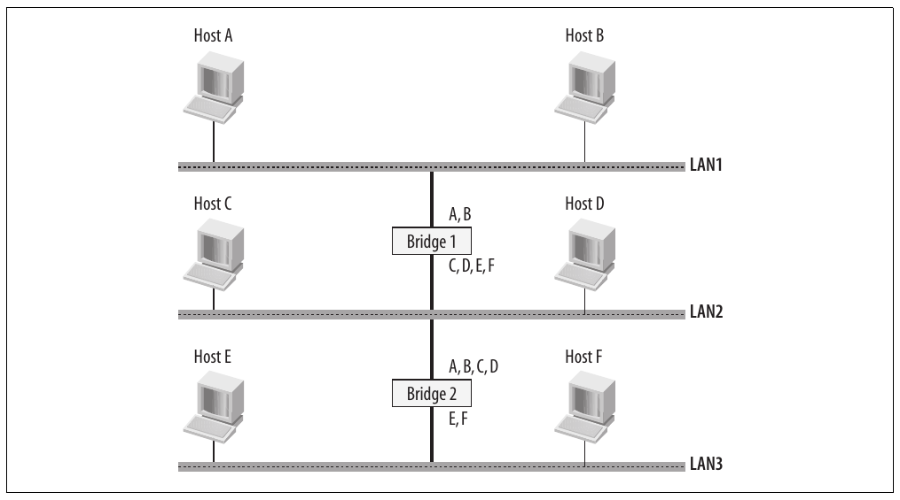
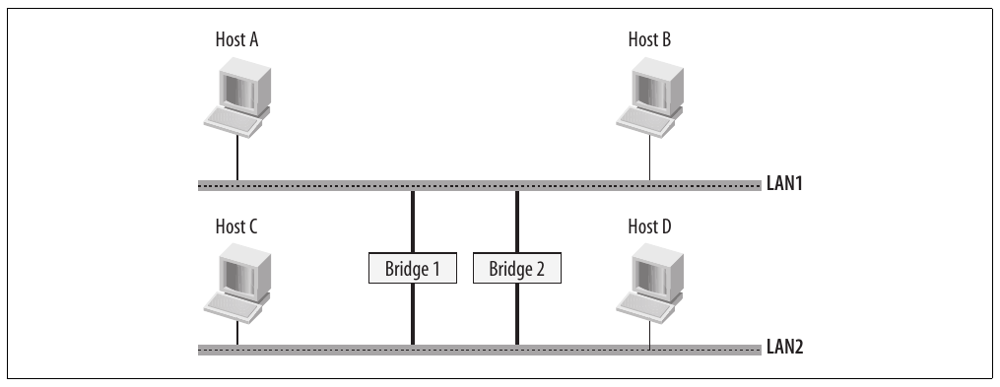
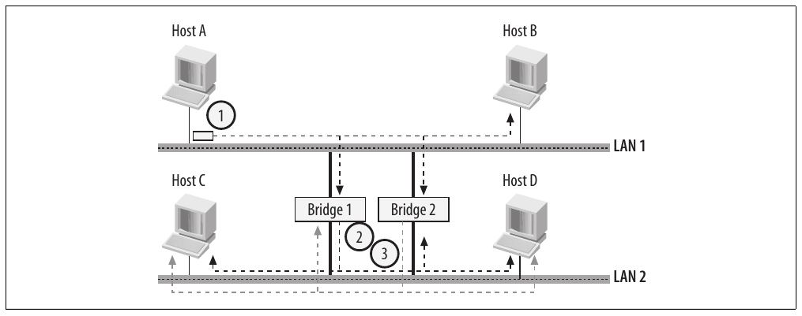
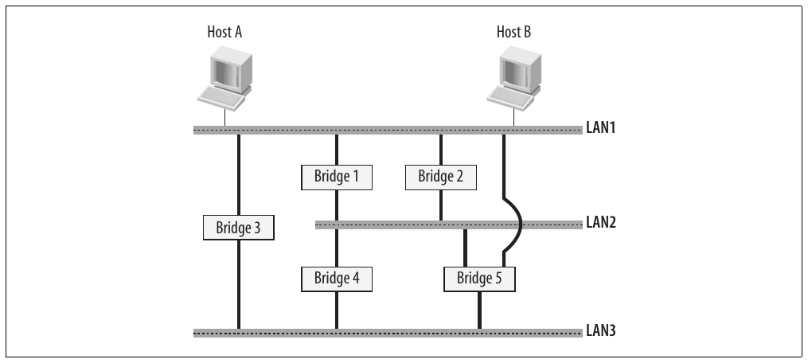
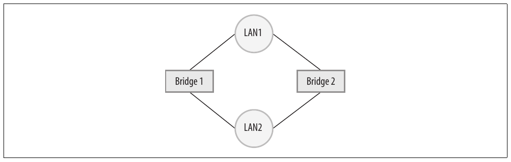

# Chương 14. Bridging: các khái niệm

Trong chương đầu về bridging này, chúng ta sẽ xem bridge device là gì, cách sử dụng và các hạn chế của nó. Cụ thể, tôi sẽ mô tả transparent bridging, address learning và việc sử dụng so-called forwarding database. Tôi sẽ kết thúc chương bằng giải thích vì sao không thể dùng bridge trên loop topology và giới thiệu chương tiếp theo, nơi chúng ta sẽ thấy Spanning Tree Protocol (STP) có thể giải quyết hạn chế này như thế nào. Có các dạng bridging khác, nhưng hiếm khi được dùng và không được triển khai trong Linux kernel.

Network topology dùng trong chương này không nhất thiết biểu diễn tình huống thực tế; chúng được chọn chỉ dựa trên nguyên tắc giảng giải.

## Repeater, bridge và router

Trước khi giới thiệu bridging, tôi sẽ làm rõ khác biệt giữa các network device forward packet: repeater, bridge và router. Khác biệt được minh họa trong Hình 14-1:

- Repeater là device, thường có hai port, chỉ copy những gì nhận ở một port sang port kia và ngược lại. Nó copy data từng bit; không biết protocol, vì vậy không phân biệt frame hoặc packet khác nhau. Ngày nay repeater hiếm khi được dùng vì bridge đã khá rẻ và cung cấp khả năng tốt hơn, xứng đáng với chênh lệch chi phí. Repeater nhiều port được gọi là hub.

- Khác repeater, bridge hiểu link layer protocol, vì vậy copy data từng frame thay vì từng bit. Điều này nghĩa là bridge phải buffer được ít nhất một frame mỗi port. Phần lớn LAN được triển khai bằng bridge (thường được gọi là switch hơn; xem mục “Bridge so với switch”). Device này là nhân vật chính của chương.

- Router là device hiểu L3 network protocol như IP và forward ingress packet dựa trên routing table. Thuật ngữ gateway, xuất hiện trước router, cũng thường được dùng để chỉ cùng loại device. Phần VII của sách trình bày chi tiết cách Linux triển khai routing.

Hình 14-1. (a) Repeater; (b) bridge; (c) router

Hình 14-1(b) cho thấy bridge store-and-forward, là cơ chế Linux dùng: Ethernet frame chỉ được copy ra port thích hợp sau khi đã được nhận đầy đủ.

Có thể dùng cơ chế khác. Chẳng hạn, một cơ chế khá phổ biến gọi là cut-through bắt đầu copy frame ra port thích hợp ngay khi nhận đủ phần ingress frame để nhận diện destination port. Ý nghĩa port thích hợp sẽ rõ hơn ở cuối chương, khi chúng ta đã biết address learning là gì. Cơ chế này nhanh hơn vì bắt đầu copy sớm, nhưng không thể loại ingress frame hỏng.[^1] Cơ chế cũng cần một phần phối hợp từ hardware network interface card (NIC). Trong mô hình hiện tại, NIC truyền toàn bộ frame cho device driver.

Bridge gán link layer address cho mỗi interface và forward mọi thứ đi qua nhưng không được gửi tới chính nó. (Router hoạt động tương tự ở mức L3, như sẽ thấy trong Phần VII.) Nhưng liệu frame nào được gửi tới interface của bridge? Xét cho cùng, mục đích của bridge là giúp frame tới đích khác. Tuy nhiên, bridge thực sự consume một số ingress frame dưới hai điều kiện:

Để truyền lên upper layer (tức L3)

Chỉ có thể khi bridge cũng triển khai chức năng L3 (tức ngoài bridge còn là router hoặc host) và ingress frame được gửi tới L2 address cấu hình trên receiving interface.

Để truyền tới protocol handler

Chúng ta sẽ thấy trường hợp này trong Chương 15 khi tôi giới thiệu Spanning Tree Protocol.

## Bridge so với switch

Thuật ngữ bridge và switch có thể chỉ cùng device. Tuy nhiên, ngày nay bridge chủ yếu được dùng trong tài liệu (như đặc tả IEEE tham chiếu ở cuối chương) thảo luận hành vi bridge và cách STP hoạt động (sẽ xem trong chương tiếp theo). Ngược lại, khi nói về device thực, người ta thường dùng thuật ngữ switch.

Những trường hợp duy nhất tôi thấy người ta gọi bridge device bằng thuật ngữ bridge là khi device chỉ có hai port (và bridge hai port hiện không phổ biến). Vì vậy, tôi thường định nghĩa switch một cách không chính thức là bridge nhiều port. Trừ khi quen với tài liệu IEEE chính thức, có lẽ bạn sẽ dùng thuật ngữ switch. Cá nhân tôi đã làm việc nhiều năm với bridging software và theo trí nhớ, chỉ dùng thuật ngữ bridge khi viết tài liệu, không bao giờ dùng để chỉ device trong bất kỳ network setup nào.

Nói chung, có thể nói thực sự không có khác biệt giữa bridge và switch.

Bridge hiện khá phổ biến. Bạn có thể tìm bridge có số port khác nhau (với giá tương ứng). Ngày nay, Ethernet bridge là cách phổ biến nhất để triển khai LAN.

Với PC chạy Linux, bạn có thể triển khai bridge bằng cách lắp nhiều hơn một NIC. Trên thị trường cũng có NIC Peripheral Component Interconnect (PCI) nhiều port, cho phép có nhiều network interface hơn số PCI slot. Chẳng hạn, có thể có bốn Ethernet port trong một PCI NIC.

Trong phần còn lại của chương và các chương tiếp theo, tôi sẽ dùng thuật ngữ bridge, nhưng giờ bạn đã biết switch đang dùng trong văn phòng để nối PC với network printer chỉ là bridge nhiều port, có lẽ chạy nhiều software hơn bridge thuần, chẳng hạn để cung cấp feature bổ sung.

## Host

Trong ngữ cảnh chương này và các chương bridging tiếp theo, mọi device hoạt động ở network layer cao hơn layer bridge dùng (tức link layer hay L2) đều được xem là host (kể cả router). Host (tức hệ thống Linux), nếu được cấu hình thích hợp, có thể vừa là bridge vừa là host mà người dùng dùng như workstation thông thường. Nhưng trong chương này và những chương sau, chúng ta không xét trường hợp đó; giả định host không chạy bridging code. Vì vậy, PC trong mọi hình không chạy bridging code trừ khi phần văn bản nói khác.

## Gộp LAN bằng bridge

Hãy lấy tình huống trong Hình 14-2 làm ví dụ và xem bridge có thể được dùng để gộp hai LAN, khiến chúng trông như một LAN. Giả sử host trong hai LAN được cấu hình thuộc cùng IP subnet. Không cần đưa IP address vào hình vì chúng ta tập trung những gì diễn ra ở link layer.

Cần lưu ý LAN chẳng qua là bridge nhiều port.

Mọi frame do bất kỳ host nào truyền trên LAN đều được tất cả host khác nhận. Vì vậy, khi Host A gửi frame, cả host khác trong LAN1 lẫn bridge đều nhận. Bridge copy ingress frame ra mọi port khác (trong trường hợp này chỉ có một port khác). Do đó, cuối cùng mọi host của cả LAN1 lẫn LAN2 đều nhận bản copy frame do Host A tạo. Điều này nghĩa là nhờ bridge, chỉ có một LAN lớn từ góc nhìn host của LAN1 và LAN2. Bridge thường được dùng để gộp physical LAN có host được cấu hình cùng IP subnet, vì tạo cho host cảm giác chỉ có một LAN.

Lưu ý bridge forward ingress frame nguyên trạng khi nhận. Nó không thêm, loại bỏ hoặc thay đổi gì: host trong LAN2 nhận bản copy chính xác frame gốc do Host A tạo.

Bạn có thể cho rằng packet từ Host A gửi tới Host B bị forward không cần thiết tới LAN2, gây lãng phí bandwidth trên LAN2 và CPU power của host LAN2 (vì tất cả cuối cùng đều drop frame không được gửi tới chúng). Bằng cách gán host của hai LAN vào hai IP subnet khác nhau và thay bridge bằng router như Hình 14-3, có thể loại bỏ lãng phí vì router không forward tới LAN2 những packet gửi tới host cấu hình trên LAN1.

Hình 14-2. Hai LAN được gộp bằng bridge

Hình 14-3. Hai LAN được kết nối bằng router

Topology trong Hình 14-2 và 14-3 được dùng ở ngữ cảnh khác nhau. Topology đầu ưu tiên để host nằm trong các LAN khác nhau chia sẻ cùng L2 và do đó cùng IP subnet (L3). Topology thứ hai ưu tiên tách host vào subnet khác nhau, có thể vì lý do quản trị.

Lưu ý host trong Hình 14-2 vẫn cần router để tới IP address ngoài subnet.

## Bridging giữa các công nghệ LAN khác nhau

Trong ví dụ trước, chúng ta luôn thấy bridge có cả hai port nối với Ethernet LAN. Đây là bridge type được dùng phổ biến nhất, chủ yếu vì standard trên thực tế cho LAN hiện nay là Ethernet. Tuy nhiên, đặc biệt trong quá khứ, từng có bridge với LAN port khác nhau, ví dụ một Ethernet port và một Token Ring port. Bridge như vậy có thêm vấn đề cần xét: khác biệt giữa các công nghệ LAN được bridge. Chẳng hạn, Ethernet LAN và Token Ring LAN hoạt động ở tốc độ khác nhau, dùng L2 protocol và header khác nhau. Tốc độ khác nhau đòi hỏi triển khai một dạng buffering, còn protocol khác nhau đòi hỏi bridge chuyển header từ format này sang format kia, kể cả xử lý L2 option được protocol này cung cấp nhưng protocol kia không có. Linux chỉ bridge giữa Ethernet port, nên chúng ta không xét thêm trường hợp phức tạp hơn.

## Address learning

Trong mục trước, chúng ta đã thấy bridge copy ingress frame một cách mù quáng tới mọi port trừ port nhận frame có thể gây lãng phí resource. May thay, bridge không mù quáng đến vậy. Thực tế chúng có thể học vị trí host (chính xác hơn là L2 address) và dùng kiến thức đó để chỉ copy ingress frame tới port thích hợp. Quá trình gọi là passive learning vì do riêng bridge xử lý, không cần user configuration hoặc protocol giúp đỡ. Hãy xem cách hoạt động với Hình 14-4. Để hình dễ đọc hơn, hình dùng ký hiệu “Host N” chỉ L2 address (tức không thể hiện L2 address thực như Hình 14-2).

Hãy xem khi host trong Hình 14-4 trao đổi một số frame. Nhớ rằng address thảo luận ở đây là link layer address (tức Ethernet MAC address):

Hình 14-4(a)

Host A truyền frame gửi tới Host B. Host B nhận vì ở cùng LAN, và bridge cũng nhận bản copy. Vì bridge không biết vị trí Host B, nó copy frame sang LAN2. Nhưng vì đã nhận frame từ Host A trên port LAN1 của bridge, giờ bridge biết Host A nằm trong LAN1. Lưu ý có thể làm vậy vì Ethernet header chứa cả source address lẫn destination address.

Hình 14-4(b)

Host B truyền frame gửi tới Host A. Cả Host A lẫn bridge nhận frame. Vì bridge biết Host A ở LAN1, cùng LAN đã nhận frame, nó sẽ không copy frame sang LAN2.

Hình 14-4. Ví dụ address learning

Hình 14-4(c)

Host A truyền frame gửi tới Host C. Cả Host B lẫn bridge nhận frame. Host B loại bỏ vì không phải bên nhận, còn bridge copy frame sang LAN2 vì không biết Host C nằm đâu. Bridge đã biết Host A ở LAN1. Vì vậy, không cần thêm entry vào list address có thể tới qua port trên LAN1.

Hình 14-4(d)

Host C truyền frame gửi tới Host A. Cả Host D lẫn bridge nhận bản copy. Host D loại frame vì không phải bên nhận, còn bridge copy sang LAN1 vì biết Host A nằm trên LAN1.

Thao tác copy frame ra mọi interface trừ interface nhận frame, được bridge dùng khi không biết interface cần dùng để tới L2 address cụ thể, gọi là flooding.

### Broadcast address và multicast address

Khi bridge nhận frame gửi tới link layer broadcast address (FF:FF: FF:FF:FF:FF) hoặc L2 multicast address, nó copy tới mọi port trừ port nhận. Multicast address và broadcast address không thể được dùng làm source address trong frame, nên bridge sẽ không học và gắn chúng với port cụ thể (điều đó sẽ là sai).

### Aging

Bridge cần cập nhật động list address có thể tới qua interface; nếu không, cuối cùng có thể không chuyển frame tới bên nhận hoặc copy frame không cần thiết ra port sai. Hãy xem một vài ví dụ với Hình 14-4:

- Khi Host A và B đã trao đổi data, bridge biết không cần copy sang LAN2 frame trao đổi giữa hai host (xem Hình 14-4(a) và (b)). Nếu chuyển Host B sang LAN2 vì lý do nào đó, kiến thức bridge sẽ lỗi thời: bridge không forward sang LAN2 frame do Host A tạo và gửi tới Host B. Tuy nhiên, ngay khi Host B bắt đầu giao tiếp trở lại, bridge có thể học vị trí mới và cập nhật kiến thức.

- Khi Host A và C đã trao đổi data, bridge biết hai host ở LAN khác nhau. Vì vậy, biết frame do Host A tạo và gửi tới Host C cần được copy từ LAN tạo frame sang LAN kia và ngược lại (xem Hình 14-4(c) và (d)). Giả sử chuyển Host C sang LAN1, bridge sẽ tiếp tục copy frame từ Host A sang LAN2 dù không cần. Ngay khi Host C bắt đầu giao tiếp lại, bridge có thể cập nhật list address và chuyển address Host C từ list LAN2 sang list LAN1.

Trong cả hai trường hợp, nếu host không tạo frame nào sau khi chuyển, bridge không có cách học vị trí mới.

Vì vậy, để kiến thức bridge thích ứng với topology change, address đã học sẽ timeout sau khoảng thời gian có thể cấu hình. Aging mechanism này thường được triển khai bằng timer đơn giản, bắt đầu khi học address lần đầu và khởi động lại (reset) mỗi khi nghe thấy host lần nữa, xác nhận hoặc cập nhật address. Quá trình thể hiện trong Hình 14-5. Timer càng ngắn, bridge càng nhanh biết thay đổi, nhưng cũng càng thường không biết host cụ thể nằm đâu và phải dùng flooding. Default aging time là 5 phút. Trong Chương 15, chúng ta sẽ thấy cách STP giảm aging time dưới điều kiện cụ thể, và trong Chương 17 là cách administrator thay đổi default aging time.

Hình 14-5. Address learning và aging

## Nhiều bridge

Đến đây, chúng ta chỉ xem tình huống đơn giản với một bridge. Tuy nhiên, vì transparent bridge trong suốt với nhau cũng như với host và router, bạn có thể tạo L2 domain lớn hơn (tức LAN lớn hơn) bằng nhiều bridge, như Hình 14-6.

Hình cũng cho thấy list address được mỗi interface của hai bridge học, giả sử mỗi host đã giao tiếp ít nhất một lần, tạo cơ hội cho bridge học vị trí. Chẳng hạn, lưu ý từ góc nhìn Bridge 2, Host A, B, C và D đều nằm trong LAN2, hay nói cách khác, có thể tới qua interface của Bridge 1 trên LAN2. Xét cho cùng, bridge không thực sự quan tâm host nằm chính xác ở đâu; chỉ cần biết dùng port nào để tới.

Tuy nhiên, dùng nhiều bridge đòi hỏi cẩn thận khi thiết kế topology. Hãy xem vì sao qua ví dụ Hình 14-7.

Hình 14-6. Topology với hai bridge

Hình 14-7. Bridge dự phòng

Nhiều bridge trên cùng LAN có thể hữu ích, chẳng hạn tăng tính sẵn sàng của kết nối giữa các LAN mà bridge có interface. Nếu một bridge không dùng được vì lý do nào đó, bridge khác vẫn duy trì kết nối. Hình cho thấy topology chỉ hai bridge, nhưng không có gì ngăn dùng nhiều hơn.

Tuy nhiên, không có gì miễn phí, nên như bạn có thể hình dung, topology Hình 14-7 có vấn đề. Vấn đề bắt nguồn từ tính “trong suốt” của bridge mà trước đó chúng ta mô tả là ưu điểm. Vì vậy, tiếp theo sẽ xem cấu hình gây rắc rối ở đâu.

### Bridging loop

Nhìn chung, tính trong suốt tốt vì host ở LAN khác nhau có thể được gộp trong suốt như chỉ có một LAN chung. Tuy nhiên, cũng nguy hiểm vì bridge không biết nguồn gốc ingress frame. Công việc bridge là học vị trí host từ ingress packet, xây dựng một dạng address database và copy ingress frame tới port thích hợp dựa trên database. Khi nhiều bridge nằm trên cùng LAN, không còn có thể giả định ingress frame xuất phát từ chính LAN mà port nhận frame nối tới: frame có thể đã được bridge khác copy sang. Thiếu thông tin nguy hiểm đến mức không thể dùng bridge như Hình 14-7 vì hậu quả thảm khốc của cách thiết lập đó.

Chẳng hạn, hãy xem điều xảy ra trong tình huống Hình 14-8 khi Host A truyền packet và cả Bridge 1 lẫn Bridge 2 có database rỗng (tức chưa học address nào).

Hình 14-8. Bridging loop

Cả hai bridge nhận frame, nhận ra Host A nằm trong LAN1 và copy frame sang LAN2. Bridge nào làm trước không xác định; chẳng hạn phụ thuộc mức tải của hai bridge. Giả sử chúng copy gần như cùng lúc. Vì vậy, hai bridge nhận bản copy frame trên interface LAN2 và cho rằng Host A đã chuyển sang LAN2 (nhớ rằng frame nhận trên LAN2 là bản copy chính xác frame gốc do Host A truyền trên LAN1). Lúc này, cả hai bridge copy frame sang LAN1 (giả sử destination host chưa trả lời nên bridge chưa biết nằm đâu). Chúng lại nhận bản copy của nhau, đổi suy nghĩ về vị trí Host A và copy frame sang LAN2.

Đây là loop làm ngập hai LAN bằng cùng frame lưu chuyển vô tận, khiến không thể truyền bất kỳ thứ gì khác trên hai LAN. CPU của host khác trong LAN cũng bận nhận và drop số lượng khổng lồ bản copy cùng frame, và nếu không được bảo vệ tại interface layer bằng cơ chế rate limiting nào đó, sẽ sụp đổ.

Tình huống đơn giản này cho thấy quy tắc quan trọng: không thể dùng transparent bridge trên loop topology.

### Topology Loop-Free

Giải pháp đơn giản để topology Hình 14-8 hoạt động là disable Bridge 2, chỉ enable khi Bridge 1 hỏng. Tuy nhiên, giải pháp không cung cấp dự phòng thực sự vì cần một dạng can thiệp thủ công. Giải pháp khác, thường được dùng, là làm bridge nhìn thấy nhau trong khi vẫn giữ tác vụ learning và copy trong suốt, như mô tả trước.

Hình 14-9. Topology có nhiều loop

Hình 14-9 cho thấy tình huống phức tạp hơn.[^2] Lưu ý Bridge 5 có interface trên ba LAN. Rõ ràng mọi bridge phải phối hợp, và không thể chỉ bật hoặc tắt bridge;† cần khả năng định nghĩa topology loop-free với granularity chi tiết hơn. Vì vậy, thay vì disable bridge, bạn disable port của bridge. Topology Hình 14-9 không biểu diễn tình huống phổ biến hoặc được đề xuất; tuy nhiên, bridge phải có thể hoạt động và cung cấp kết nối loop-free ngay cả trong sự lộn xộn như vậy.

Hãy quay lại ví dụ đơn giản Hình 14-8 và tìm feature của bridging protocol khiến nó an toàn. Nếu vẽ graph với bridge và LAN là state, và kết nối từ bridge tới LAN (tức bridge port) là link (hai chiều), ta có Hình 14-10.

Hình 14-10. Graph tương ứng với topology Hình 14-8

Tất cả những gì cần để graph Hình 14-10 không có loop là loại một link bằng cách disable bridge port. Graph cho topology Hình 14-9 sẽ phức tạp hơn và có nhiều loop (tôi đếm được ít nhất năm).

Lưu ý luôn có nhiều hơn một cách làm bất kỳ loop topology nào trở thành không có loop. Chẳng hạn, để phá loop trong Hình 14-10, có bốn lựa chọn khác nhau.

### Định nghĩa topology Loop-Free

Nếu quen graph theory, bạn biết rằng với graph cho trước (có cost trên link), tìm topology loop-free tốt nhất là bài toán kinh điển, được giải đẹp bằng nhiều thuật toán khác nhau. Tuy nhiên, mọi thuật toán đó đều tập trung: thuật toán chạy một lần với mọi thông tin cần thiết. Trong trường hợp chúng ta, bridge cần distributed algorithm. Các bridge phải có thể hội tụ tới topology loop-free, disable port thích hợp bằng cách trao đổi một dạng thông tin.

Thuật toán bridge dùng để tìm topology loop-free tốt nhất là Spanning Tree Protocol do IEEE standard 802.1D-1998 định nghĩa, được mở rộng với Rapid Spanning Tree Protocol (RSTP) mới và trở thành 802.1D-2004. RSTP đôi khi còn được gọi là 802.1w.

Phần mở rộng thú vị khác là Multiple Spanning Tree Protocol (MSTP), còn gọi là 802.1s. Nó được tích hợp vào 802.1Q-1998, sau đó trở thành 802. 1Q-2002 (và dự kiến sẽ thành 802.1Q-2005 vào lúc nào đó trong năm nay để phản ánh thay đổi mới nhất).

Để đơn giản, chúng ta sẽ gọi những protocol đó là STP (Spanning Tree Protocol gốc), RSTP và MSTP. Chương 15 mô tả STP và tổng quan cải tiến được đưa vào với RSTP và MSTP. Chương 16 đi sâu chi tiết triển khai STP.

[^1]: Có những biến thể cut-through cũng có thể xử lý frame hỏng. Chúng ta không cần đi sâu đến vậy cho phần thảo luận tổng quát về bridging.

[^2]: Hình không có host trong LAN2 và LAN3 vì tôi muốn bạn tập trung network topology. Mọi host trong mọi LAN ở Hình 14-9 đều bị ảnh hưởng bởi hậu quả của loop topology. † Bạn có thể tắt bridge nếu muốn, nhưng sẽ giảm mức dự phòng có thể đạt.
