# Chương 15. Bridging: Spanning Tree Protocol

Trong Chương 14, chúng ta đã thấy transparent bridging là cách dễ dàng để gộp LAN, nhưng chỉ dùng được trên topology loop-free. Hạn chế này loại trừ việc dùng transparent bridge trên network có redundant link để tăng tính sẵn sàng tổng thể.

Trong chương này, chúng ta sẽ thấy cách Spanning Tree Protocol (STP) làm mọi topology trở nên không có loop, nhờ đó cho phép network administrator dùng topology với redundant link. Cụ thể, chúng ta sẽ xem:

- Cách distributed algorithm của STP tạo topology loop-free bằng cách disable đúng redundant link. Topology loop-free do STP chọn là tree (theo định nghĩa không có loop). Mọi traffic giữa host thuộc các LAN được bridge kết nối đều đi dọc link của tree này.

- Cách STP cập nhật động topology để xử lý configuration change và bridge failure hoặc link failure.

- Cách STP cập nhật động forwarding database (tức address học được trên bridge port) khi phát hiện topology change.

Không đủ chỗ để đi sâu chi tiết STP. Mục tiêu chương là cung cấp tổng quan đủ chi tiết để bạn dễ theo dõi mô tả kernel implementation của STP trong Chương 16. Để có thảo luận đầy đủ về STP 802.1D và các cải tiến, hãy tham khảo đặc tả IEEE.

Ví dụ trong chương không phải hướng dẫn cấu hình STP: phần lớn chỉ dùng để cho thấy cách điều kiện cụ thể có thể xuất hiện và STP xử lý thế nào.

## Thuật ngữ cơ bản

Hãy định nghĩa một số thuật ngữ quan trọng sẽ dùng trong chương này và chương tiếp theo:

LAN

Thuật ngữ này hẳn không cần giới thiệu. Chúng ta dùng LAN không chỉ cho network Ethernet-like mà cả connection point-to-point.

L2 network

Một LAN hoặc tập LAN được bridge gộp lại. Như đã thấy trong Chương 14, bridge cho phép gộp nhiều LAN để trông như một LAN lớn hơn (trong mắt router và host, tức device hoạt động ở higher network layer).

Bridged network (hoặc switched network)

L2 network được triển khai bằng bridge.

Bridge port

Interface

Trên bridge device, mỗi network interface là một bridge port. Trên hệ thống general-purpose hơn, như PC chạy Linux, network interface không nhất thiết được dùng làm bridge port. Trong ngữ cảnh chương này, bridge port và interface có thể dùng thay nhau, nhưng ở Chương 16, khi cần phân biệt bridging interface với nonbridging interface, tôi sẽ dùng interface chỉ riêng NIC nonbridging. Mỗi bridge port có thể dùng để kết nối cả host lẫn bridge khác. Chúng ta sẽ thấy một số ví dụ trong chương này và các chương sau.

Link

Connection giữa hai device. Trong chương này, tôi dùng thuật ngữ để chỉ connection giữa hai bridge.

Stable network

L2 network mà STP đã hội tụ tới topology loop-free cuối cùng.

Hình 15-1 cho thấy thuật ngữ được dùng trong chương và quan hệ với những thuật ngữ networking thường ngày khác.

## Ví dụ switched L2 topology phân cấp

Chúng ta biết hai host có thể nối với nhau bằng cross cable; không nhất thiết dùng device như hub hay bridge. Có thể làm tương tự giữa bridge và router. Trong ví dụ ở chương này, bạn sẽ thường thấy link cross-cable giữa bridge.

Khác tình huống trong Chương 14, nơi bridge two-port đơn giản nối trực tiếp với host trong các LAN được kết nối, bridged network thực thường có topology giống tree, với host chỉ (hoặc chủ yếu) nằm ở leaf node.

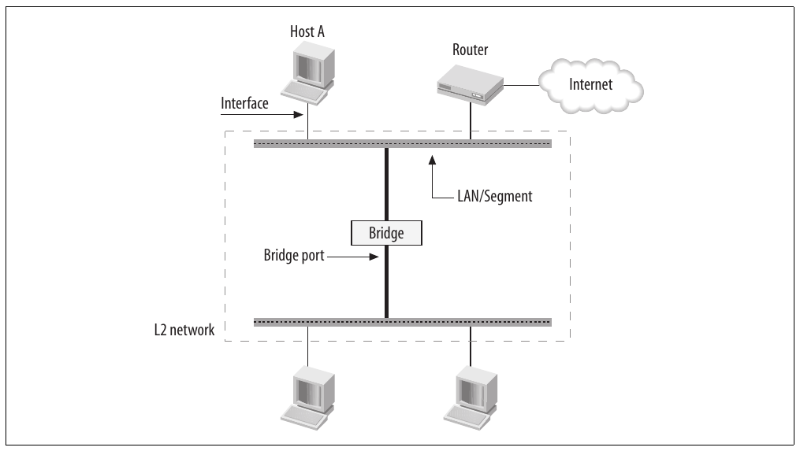

Hình 15-1. Thuật ngữ cơ bản

Trong tình huống đơn giản như Chương 14, thường không enable STP; thực ra phần lớn nơi có thể chỉ dùng một flat LAN thay vì dùng bridge. Để hiểu STP tốt hơn, cần xem tình huống real-life. Hãy lấy topology bridged phân cấp và có dự phòng kinh điển trong Hình 15-2(a), được phần lớn commercial bridge vendor quảng bá và cổ vũ.

Hình lược chi tiết mô tả phía sau trong chương, như bridge ID và priority, port cost và priority value, để bạn tập trung topology và lựa chọn active link. Trong những hình sau ở chương này, chúng ta sẽ dùng lại định nghĩa symbol trong chú giải cuối hình.

Ở lá của tree (phía dưới hình) là host. Host nối tới so-called access bridge (thường gọi là access switch): bridge cung cấp network connectivity cho host. Access bridge chủ yếu forward traffic giữa host nối cùng bridge, nhưng cũng có một hoặc nhiều link tới bridge upper-layer. Access bridge trong Hình 15-2 có nhãn A1, A2, A3 và A4.

Vì host luôn nằm ở lá của topology, có thể có bao nhiêu link tới host tùy ý. Chúng không tạo loop (tất nhiên giả sử không có link giữa các lá). Vì vậy, STP không ảnh hưởng link tới host: không link nào cần bị disable để định nghĩa topology loop-free. Xét cho cùng, mục tiêu cuối STP là làm network trông như một LAN lớn duy nhất và cung cấp connectivity cho mọi host, vậy sao lại ngắt kết nối host nào?

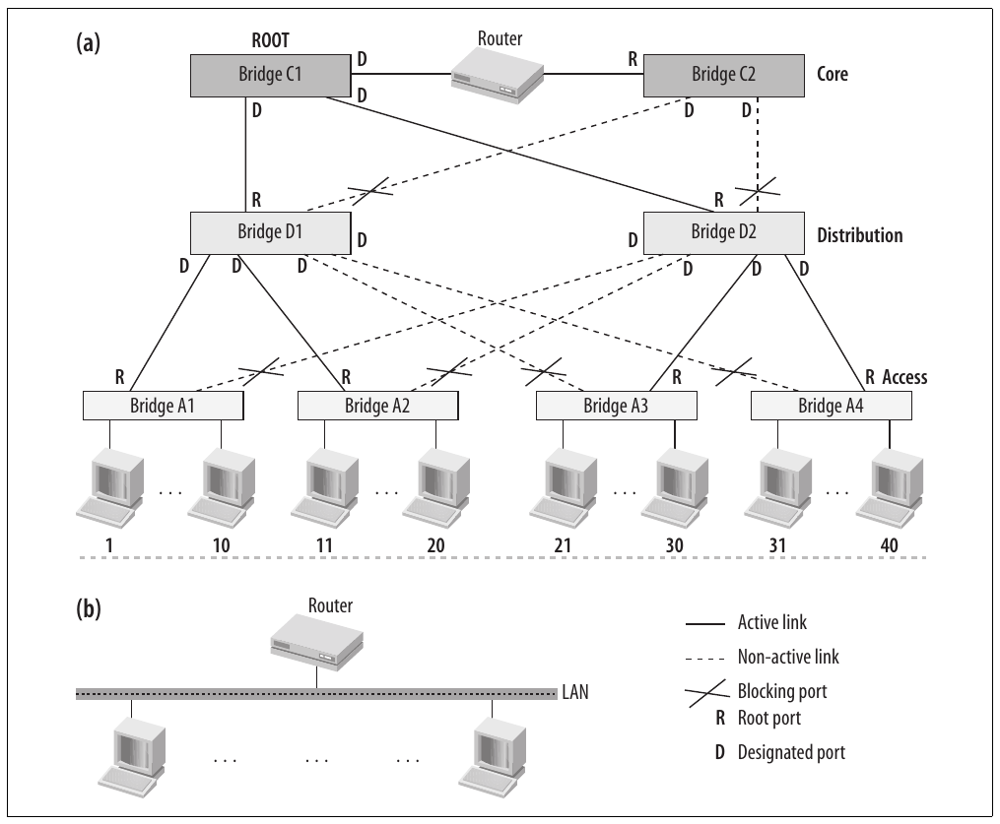

Hình 15-2. Bridged L2 topology phân cấp

Bridge ở distribution layer (D1 và D2 trong hình) chủ yếu bridge traffic giữa host thuộc một số access bridge kết nối trực tiếp với nó. Chẳng hạn, D1 đảm nhiệm A1 và A2.

Lưu ý D1 cũng nối tới A3 và A4, dù link của D1 hiện không hoạt động (nét chấm trong hình). Nếu link giữa D2 và A3 hỏng, STP bảo đảm topology được cập nhật để A3 lại thuộc tree. Chẳng hạn, network có thể enable link giữa D1 và A3; sẽ xem cách làm phía sau trong chương.

Hai distribution bridge D1 và D2 cũng nối tới hai core bridge C1 và C2. Công việc C1 và C2 hẳn rõ ràng: nối subtree của D1 với subtree của D2. (Giải pháp khác là dùng một core bridge duy nhất, có thể mạnh hơn.) Giữa distribution layer và core layer cũng có redundant link, nên nếu chẳng hạn link C1–D1 hỏng, C2–D1 sẽ tiếp quản. Layer đặt bridge càng cao, lượng traffic xử lý càng lớn (vì subtree lớn hơn).

Hình cho thấy link của topology được STP chọn để định nghĩa topology loop-free, và port nào được gán designated role và root role. Trong chương, chúng ta sẽ xem hai role dùng làm gì, được gán thế nào và vì sao.

Lưu ý traffic trao đổi giữa bất kỳ cặp host nào trong L2 network Hình 15-2(a) dùng L2 protocol để di chuyển (tức Ethernet). Routing có thể được triển khai tại core hoặc qua core. Từ góc nhìn host, không có phân cấp ở link layer, chỉ có flat LAN; topology tổng thể hiện ra như Hình 15-2(b).[^1]

Dùng nhiều bridge có một số ưu điểm:

- Giúp tách traffic. Chẳng hạn, trong khi Host 1 giao tiếp Host 10, Host 11 có thể giao tiếp Host 20, và Host 21 với Host 40, mà không phải nhận và loại frame của nhau. Vì vậy bandwidth tổng thể L2 network tăng. Nhưng trong trường hợp xấu nhất, frame có thể phải đi qua toàn bộ tree để tới đích. Chẳng hạn, Hình 15-3 cho thấy đường frame cần đi từ Host 40 tới Host 1. Lưu ý hình cũng thể hiện address mỗi bridge port học: chẳng hạn ký hiệu 1–10 gần interface của bridge nghĩa là interface đã học MAC address của Host 1 tới 10. (Chúng ta đã xem address learning trong Chương 14.)

- Dễ quản lý số host lớn hơn. Không cần nối mọi host vào một bridge khổng lồ, nghĩa là host có thể ở những khu vực khác nhau. Đi dây cũng đơn giản hơn.

Tôi kết thúc tổng quan bridged L2 topology ở đây. Cần cả cuốn sách để trình bày chi tiết bridging protocol và STP, nên tôi sẽ chuyển sang tổng quan thuật toán STP triển khai.

Trong phần còn lại của chương, chúng ta dùng topology đơn giản hơn để mô tả protocol. Tuy nhiên, những gì sẽ xem cũng hoạt động như vậy trong network lớn và phức tạp hơn như Hình 15-2.

## Thành phần cơ bản của Spanning Tree Protocol

Tìm nonrooted spanning tree tốt nhất hoặc rooted spanning tree tốt nhất là bài toán kinh điển trong nghiên cứu vận trù. Tài liệu cung cấp các thuật toán khác nhau về computational complexity. Có rất nhiều ứng dụng thực tế thường dùng những thuật toán đó.

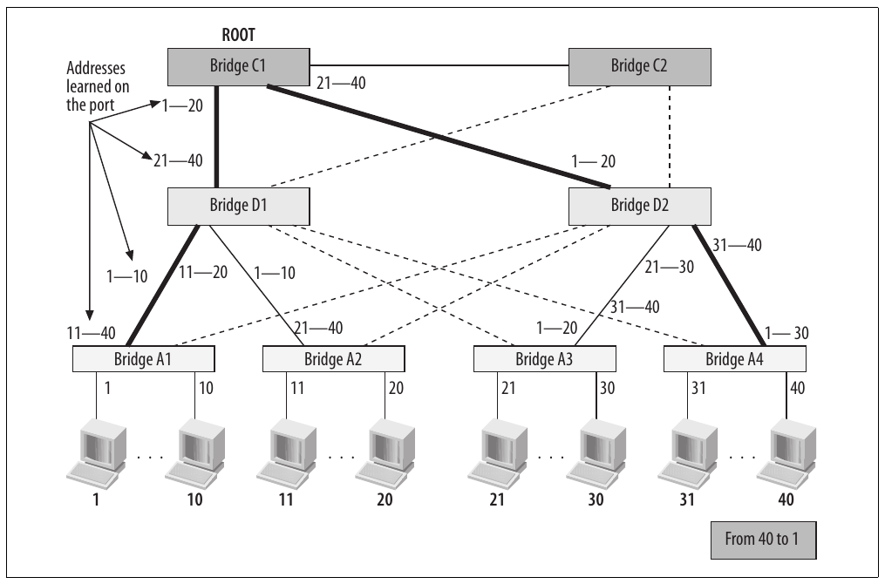

Hình 15-3. Ví dụ bridged network

STP mô tả trong chương có mục tiêu phần nào tương tự: với graph và root node R cho trước, định nghĩa spanning tree tốt nhất có root tại R. Tuy nhiên, có khác biệt quan trọng: thuật toán không chạy trên một host rồi phân phối kết quả tới host khác; thay vào đó là distributed protocol. Mọi bridge trong network phải chạy. Bằng protocol này, chúng enable một số port, disable port khác, và topology tổng thể tạo thành rooted spanning tree tốt nhất. Chọn root node cũng thuộc protocol: host thống nhất root node là ai rồi quyết định link nào enable và disable.

Hãy tìm hiểu chính xác “spanning tree tốt nhất” nghĩa gì. Với graph và node muốn làm root cho trước, spanning tree tốt nhất là topology loop-free (tree) tối thiểu hóa khoảng cách từ mỗi node tới root node. Tùy graph, có thể có nhiều tree cùng điểm đánh giá chất lượng[^2] (Hình 15-4 cho ví dụ hai lời giải tốt ngang nhau).

Khi các link không được gán cost hoặc đều được gán cùng cost, hai trường hợp tương đương nhau, khoảng cách từ một node đến root được đo bằng số link, tức network hop. Tuy nhiên, khi gắn cost cho các link, số hop không nhất thiết biểu thị chất lượng của path.

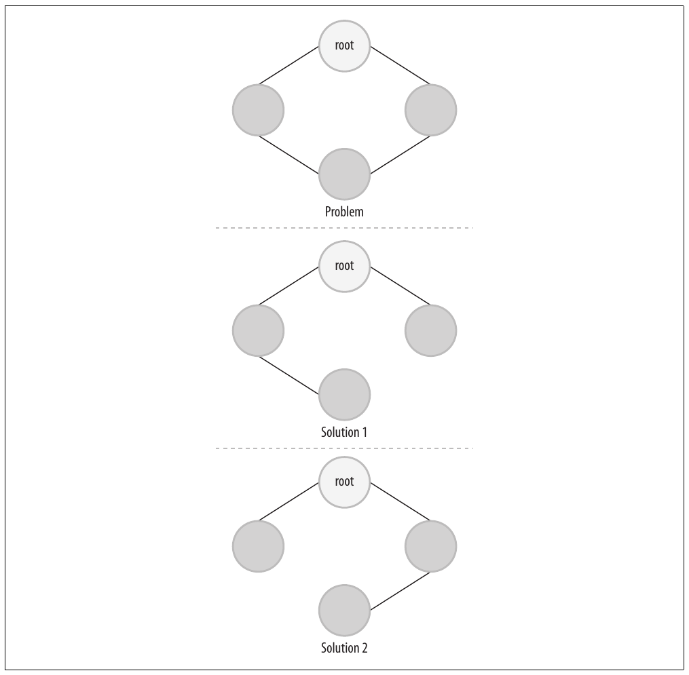

Hình 15-4. Graph chưa gán cost cho link

Chẳng hạn, nếu thêm cost vào topology Hình 15-4, best rooted spanning tree tương ứng khác cả hai lời giải trong Hình 15-4, như Hình 15-5.

Trong mục “Bridge ID và port ID”, chúng ta sẽ xem cách network administrator ghi đè default cost bằng value khác, chẳng hạn dựa trên parameter quản trị như chi phí tiền bạc và độ tin cậy connection.

STP đạt mục tiêu bằng cách để mỗi bridge trao đổi frame chuyên biệt gọi là bridge protocol data unit (BPDU) với neighbor. Thông tin trao đổi qua BPDU cho phép bridge:

- Gán cho mỗi bridge port state xác định, như forwarding hoặc blocking, để quy định có chấp nhận data traffic trên port hay không

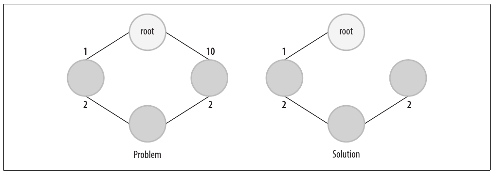

Hình 15-5. Graph có cost gán cho link

- Chọn và loại đúng link khỏi loop topology bằng cách gán port state này, từ đó tạo topology loop-free

Một số bridge port được gán role đặc biệt, tùy chẳng hạn chúng hướng tới root của tree (so-called root bridge) hay leaf node của tree.

Với thuật ngữ chính xác của graph theory, không ngạc nhiên STP cũng dùng thuật ngữ well-defined để chỉ node (bridge) và link (bridge port). Trước khi xem thuật toán, tôi cần giải thích:

- Root bridge và designated bridge là gì

- State và role nào có thể được gán cho bridge port

- Công việc của root port và designated port

### Root bridge

Root bridge không chỉ là chỗ giữ vị trí trong topology; nó giữ vai trò trung tâm trong thuật toán. Chẳng hạn, trong các mục sau bạn sẽ thấy:

- Root bridge là bridge duy nhất tạo BPDU. Bridge khác chỉ truyền BPDU khi nhận một BPDU (tức chỉnh lại thông tin nhận được bằng cách cập nhật một vài field).

- Root bridge bảo đảm mọi bridge trong network biết topology change khi xảy ra (xem mục “Topology change”).

Lưu ý rằng việc chọn port state và role, từ đó chọn những link cần enable hoặc disable, phụ thuộc vào vị trí root bridge trong topology. Lý do là trước tiên chúng ta chọn root bridge, sau đó xây dựng tree tốt nhất dựa trên root bridge đó.

### Designated bridge

Trong khi mỗi tree chỉ có một root bridge, mỗi LAN có một designated bridge, trở thành bridge mà mọi host và bridge trên LAN dùng để tới root. Designated bridge được chọn bằng cách xác định bridge trên LAN có path cost tới root bridge thấp nhất.

Vì vậy, dùng Hình 15-2 làm ví dụ:[^3]

- Trong LAN A3–D2, D2 là designated bridge.

- Trong LAN D2–C2, C2 là designated bridge.

### Spanning tree port

Chúng ta đã giới thiệu role root bridge và designated bridge trong các mục trước. Ở đây hãy xem state và role có thể gán cho bridge port.

#### Port state

STP port là port trong bridge chạy STP. Port xử lý ingress BPDU và truyền BPDU theo quy tắc trong mục “Khi nào truyền configuration BPDU”.

STP port có thể ở bất kỳ state nào sau:

Disabled

Port bị tắt (qua thao tác quản trị); không nhận hoặc truyền traffic nào.

Blocking

Port đang up, nhưng STP đã block. Không thể dùng để forward data traffic.

Listening

Port được enable nhưng không thể dùng để forward data traffic.

Learning

Port được enable nhưng không thể dùng để forward data traffic; tuy nhiên address learning process của bridge hoạt động.

Forwarding

Port được enable, learning hoạt động và có thể forward data traffic.

Dùng learning state trung gian cho phép bridge giảm lượng flooding vốn cần thiết khi forwarding database rỗng.

Ngoại trừ các port ở disabled state, ingress BPDU được xử lý bất kể state của port. Việc một port ở state cụ thể có nhận ingress BPDU hay truyền BPDU phụ thuộc vào role của port, được giới thiệu trong phần “Port role”.

Hình 15-6 cho thấy cách port state thay đổi. Có tiến trình rõ ràng từ blocking qua listening và learning tới state hoạt động nhất, forwarding. Protocol quyết định chuyển tiếp giữa blocking và forwarding dựa trên nhiều yếu tố (xem mục “Định nghĩa active topology” phía sau). Lưu ý:

- Port đang tiến tới forwarding state có thể được đưa về blocking trước khi vào forwarding. Chẳng hạn khi topology chưa ổn định nên state có thể đổi nhiều lần trong thời gian ngắn.

- Chuyển tiếp giữa các state trung gian từ blocking tới forwarding được timer điều khiển (xem mục “Timer”) và cần để tránh nguy cơ temporary loop (xem mục “Tránh temporary loop”).

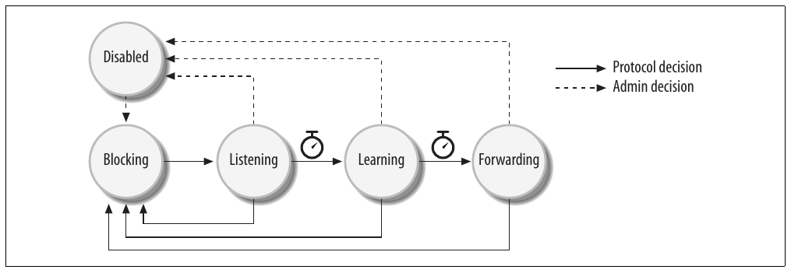

Hình 15-6. Chuyển tiếp port state

Ngoài ra, administrator có thể đưa port ra khỏi bất kỳ state nào trong số này và disable thủ công. Khi port bị disable do quản trị, chỉ can thiệp quản trị khác mới re-enabled được; STP không có khả năng này. Tuy nhiên, bridge có thể triển khai feature tùy chọn trên feature cơ bản của protocol để enable và disable port không cần can thiệp quản trị.

##### Port role

STP port có thể được gán một trong hai role sau:

Root

Với mỗi bridge trừ root bridge, port có path cost thấp nhất tới root bridge được chọn làm root port.

Designated

Trên mỗi LAN, port có path cost nhỏ nhất tới root bridge được chọn làm designated port. Bridge sở hữu designated port gọi là designated bridge cho LAN. Lưu ý bridge có port trên các LAN khác nhau có thể có nhiều designated port, như Hình 15-2. Tiêu chí chọn designated port được mô tả sau trong mục “Chọn designated port”.

Trong khi root port hướng tới root của tree (tức root bridge), designated port hướng tới lá. Trong Hình 15-2 có thể thấy quan hệ giữa root port và designated port.

Từ góc nhìn tree, có thể xem hai role như sau:

- Root của tree chỉ có link hướng về lá (tức chỉ designated port[^4]).

- Leaf node chỉ có link hướng về root của tree (tức không có designated port và có một root port). Để bảo vệ trước misconfiguration và đi dây sai (như nối bridge vào port đáng lẽ nối host), leaf node cũng có thể chạy STP trên port nối host. Khi đó, giả định leaf node không có designated port không còn đúng. Nói cách khác, nếu enable STP trên port nối host của access bridge trong Hình 15-2, những port đó cuối cùng được gán designated role.

- Mọi node giữa root và lá có ít nhất một link hướng tới root (một trong số đó được chọn làm root port) và ít nhất một hướng tới lá (designated port).

Có STP port không phải root port cũng không phải designated port; điều này có thể khi có redundant link giữa bridge. Trong Hình 15-2, port của A1 đi tới D2 là ví dụ. STP protocol mới hơn, sẽ giới thiệu ngắn trong mục “Tổng quan spanning tree protocol mới hơn”, định nghĩa role mới để mỗi STP port đều được gán một role.

Chúng ta sẽ xem cách gán root port role và designated port role lần lượt trong mục “Chọn root port” và “Chọn designated port”.

## Bridge ID và port ID

Chọn root bridge, port state và role phụ thuộc tập parameter. Mỗi parameter có default value có thể thay đổi bằng user configuration. Sau đây là parameter chính:

Bridge ID

Mỗi bridge được gán ID gọi là bridge ID, định nghĩa là value 8-byte chia hai thành phần. Sáu byte thấp được gán Ethernet MAC address của một bridge port (xem Chương 16), còn hai byte cao là priority có thể cấu hình gọi là bridge priority. Bridge ID là field root bridge selection algorithm dùng (xem mục “Chọn root bridge”).

Port ID

Mỗi port được gán ID. Một phần ID biểu diễn unique identifier gọi là port number. Cách gán port number phụ thuộc triển khai, và value chỉ có ý nghĩa cục bộ trên bridge. Chẳng hạn, số có thể phản ánh thứ tự tạo port: port đầu gán 1, port thứ hai gán 2, v.v. Cách khác có thể dùng vị trí vật lý của port: chẳng hạn port đầu trên bus gán 1, v.v. Nên gán port number theo cách xác định và nhất quán qua reboot để administrator không cần đổi bridge configuration nhằm phản ánh thay đổi sau reboot.

Phần khác của ID gọi là port priority được dùng để gán priority cho port (value thấp hơn nghĩa là priority cao hơn). Xem Hình 15-7(b).

Xem mục “Chọn root port” để có ví dụ khi parameter này được dùng.

Ngoài bridge priority và port priority, người dùng có thể cấu hình parameter sau:

Port cost

Mỗi port được gán cost. Value càng thấp, port càng được ưu tiên. Khi không cấu hình tường minh, port được gán default cost dựa trên port speed. Chẳng hạn Fast Ethernet port chạy 100 Mbits/s được gán cost thấp hơn Ethernet port chạy 10 Mbits/s. Gán default cost hợp lý trong phần lớn trường hợp, khi tổng cost đi từ một điểm trong tree tới điểm khác được đo theo latency. Tuy nhiên, trong ngữ cảnh cụ thể, administrator có thể muốn gán cost tường minh dựa trên yếu tố bên ngoài.

Timer

STP dùng tập timer per-port và per-bridge. Tất cả có default configuration người dùng tùy chỉnh được. Xem mục “Timer”. Timer configuration không ảnh hưởng chọn root bridge, port state và role.

Phía sau trong chương, chúng ta sẽ xem cấu hình parameter này (trừ timer) có thể ảnh hưởng lựa chọn topology như thế nào.

Năm 2001, IEEE phát hành 802.1t, tài liệu bảo trì 802.1D, thay đổi cách định nghĩa bridge ID và port ID. Thay đổi format thể hiện trong Hình 15-7.

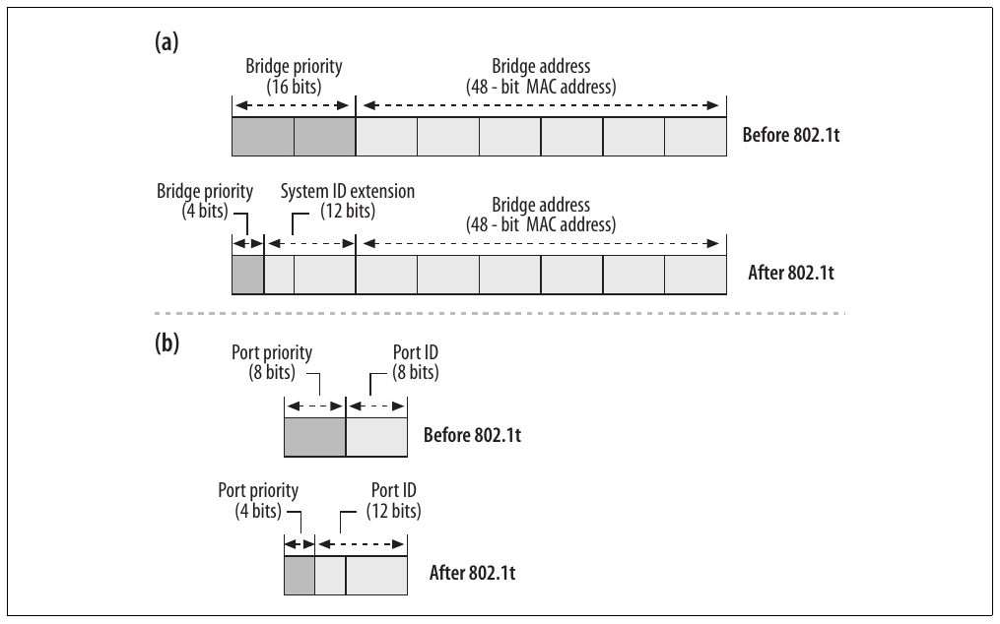

Hình 15-7. Thay đổi bridge ID và port ID do 802.1t đưa vào

Lưu ý:

- Bridge priority giờ chỉ dài 4 bit. Để backward compatibility, bridge priority range vẫn là 0–64 K, nhưng vì chỉ có bốn bit để dùng, priority giờ tăng theo bước 4.096 (212).

- Có thành phần mới trong bridge ID gọi là system ID extension. Thành phần có thể nhận 4.096 value khác nhau, cho phép chẳng hạn network device có tới 4.096 bridge ID khác nhau chung một MAC address. Trước đây cần 4.096 MAC address khác nhau. Lưu ý MAC address không phải số ngẫu nhiên do administrator chọn; đó là số duy nhất toàn cầu (vì vậy là resource hữu hạn) do IEEE quản lý.

- Port number giờ là value 12-bit, cho phép bridge có tới 4.096 port. Trước đây chỉ có thể có 256 (ban đầu đã được coi khá xa xỉ). Port priority giờ là value 4-bit. Priority range vẫn là 1–256 để backward compatibility, nên priority giờ được gán theo bước 16.

Để hiểu lý do thay đổi 802.1t, cần nghĩ tới commercial device high-end, không phải PC thông thường chỉ có vài NIC. PC vẫn dùng được với giới hạn 256 bridge port hoặc một bridge ID mỗi MAC address. Tuy nhiên, bridge lớn có hàng trăm port và chạy hàng trăm bridge instance không phải hiếm.

Cũng lưu ý 4.096 không ngẫu nhiên: biểu thị số Virtual LAN (VLAN) tối đa protocol 802.1Q cho phép.

Thay đổi 802.1t không tác động STP. Từ góc nhìn STP, bridge ID là value 8-byte và port ID là value 2-byte. Kích thước hoặc mục đích thành phần user-configuration không quan trọng. Nghĩa là thay đổi 802.1t chỉ ảnh hưởng configuration tool, không ảnh hưởng hành vi protocol. Bảng 15-1 và 15-2 tóm tắt value khả dĩ của các parameter.

Bảng 15-1. Bridge ID và port ID trước 802.1t

|  | Default value | Value tối thiểu | Value tối đa | Bước tăng tối thiểu |
|---|---|---|---|---|
| Bridge priority | 32,768 | 0 | 65,535 | 1 |
| Port cost | Phụ thuộc port speed | 1 | 65,535 | 1 |
| Port priority | 128 | 0 | 255 | 1 |

Bảng 15-2. Bridge ID và port ID sau 802.1t

|  | Default value | Value tối thiểu | Value tối đa | Bước tăng tối thiểu |
|---|---|---|---|---|
| Bridge priority | 32,768 | 0 | 61,440 | 4,096 |
| Port cost | Phụ thuộc port speed | 1 | 200,000,000 | 1 |
| Port priority | 128 | 0 | 240 | 16 |

## Bridge Protocol Data Unit (BPDU)

Bridge trao đổi protocol frame gọi là BPDU, chứa đủ thông tin để thống nhất root bridge là ai và quyết định role cùng state cho local port. Có hai loại BPDU:

Configuration BPDU

Dùng để định nghĩa topology loop-free. Trong mục “Khi nào truyền configuration BPDU”, bạn sẽ thấy điều kiện kích hoạt truyền những BPDU này.

Topology Change Notification (TCN) BPDU

Được bridge dùng để báo root bridge về topology change phát hiện được. Xem mục “Topology change”.

Hình 15-8 cho thấy format của cả hai BPDU. Lưu ý hai loại có chung ba field đầu và có thể phân biệt bằng parameter BPDU type.

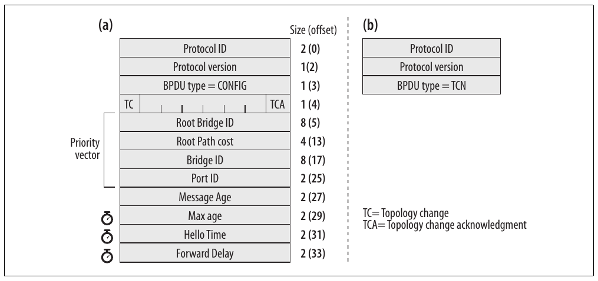

Hình 15-8. a) Configuration BPDU; b) BPDU

Bảng 15-3 cho thấy tổ hợp protocol ID và protocol version được ba IEEE STP dùng. Trong chương, chúng ta chỉ xem protocol 802.1D cơ bản và giới thiệu ngắn hai loại khác trong mục “Tổng quan spanning tree protocol mới hơn”.

Bảng 15-3. BPDU version

| Tên protocol | Protocol ID | Protocol version |
|---|---|---|
| STP (802.1D-1998) | 0 | 0 |
| RSTP (802.1D-2002 or 802.1w) | 0 | 2 |
| MSTP (802.1Q-2002 or 802.1s) | 0 | 3 |

### Configuration BPDU

Đây là ý nghĩa các field trong configuration BPDU:

Flags

Chỉ hai flag được dùng: TC (Topology Change) và TCA (Topology Change Acknowledgment). Cách dùng cả hai được mô tả trong mục “Topology change”.

Root Bridge ID

ID của root bridge. Đây là bridge mà transmitting bridge cho là root bridge hiện tại.

Root Path Cost

Cost của shortest path từ transmitting bridge tới root bridge. Cost là 0 khi transmitting bridge là (hoặc cho rằng sẽ trở thành) root bridge.

Bridge ID

ID của transmitting bridge.

Port ID

Port identifier. Xem mục “Bridge ID và port ID” để biết cú pháp.

Message Age

Khoảng thời gian đã qua từ khi root bridge tạo thông tin trong BPDU này. Xem mục “BPDU aging”.

Max Age

Lifetime tối đa của configuration BPDU.

Hello Time

Timeout mà Hello timer dùng.

Forward Delay

Timeout mà Forward Delay timer dùng. Xem Hình 15-6.

Value của ba timer Max Age, Hello Time và Forward Delay không phải cấu hình cục bộ trên bridge: là value root bridge quảng bá (xem mục “Truyền configuration BPDU”). Tất cả biểu diễn bằng tick (1/256th giây). Xem mục “Timer”.

### Priority vector

Bốn thành phần của configuration BPDU—Root Bridge ID, Root Path Cost, Bridge ID và Port ID—tạo thành priority vector (xem Hình 15-8). Vì bốn thành phần liên tiếp, có thể xem vector là một số 22-byte duy nhất. Số càng thấp, bridge càng quan trọng trong topology; nói cách khác, priority vector quyết định bên thắng khi tranh role như root bridge và designated bridge. Trong phần còn lại của chương, tôi tham chiếu priority vector bằng ký hiệu \[BR-Root, Cost, BR-ID, Port-ID\].

Trong các ví dụ phía sau của chương này, hình chỉ thể hiện thành phần priority của các configuration BPDU được truyền, vì đó là phần configuration BPDU mà bridge sử dụng để chọn role và state cho các port.

Với hai priority vector PV1=\[BR-Root1, Cost1, BR-ID-1, Port-ID1\] và PV2=\[BR-Root2, Cost2, BR-ID-2, Port-ID2\], PV1 được gọi là superior khi numeric value thấp hơn PV2, và inferior khi numeric value cao hơn PV2. Nói cách khác, PV1 superior so với PV2 nếu BR-Root1 \< BR-Root2; hoặc nếu bằng nhau, Cost1 \< Cost2; hoặc nếu cũng bằng nhau, BR-ID1 \< BR-ID2; hoặc khi hai bridge ID cũng khớp, Port-ID1\<Port-ID2.

### Khi nào truyền configuration BPDU

Bridge truyền configuration BPDU ra designated port. Nó thực hiện trong các trường hợp sau:

- Root bridge chạy timer (Hello timer) hết hạn định kỳ và kích hoạt truyền configuration BPDU. Một BPDU được truyền trên mỗi designated port. Chỉ root bridge tạo BPDU mới, nhưng khi bridge mới enable, nó cho rằng mình là root bridge (vì chưa có priority vector khác để so sánh). Vì vậy, gán designated role cho mọi port, bắt đầu Hello timer và tạo BPDU (xem mục “Chọn root bridge”).

- Bridge Nonroot chỉ tạo BPDU để đáp lại BPDU nhận trên root port; nói cách khác, relay BPDU. BPDU do nonroot bridge truyền mang cùng thông tin BPDU đã nhận, trừ những field sau được cập nhật (xem Hình 15-9):

  - Bridge thay bridge ID và port ID của bên truyền bằng thông tin của chính nó.

  - Bridge cập nhật cost thành tổng cost nhận được và cost của port trên local bridge (root port) nơi nhận BPDU.

  - Message age được cập nhật theo logic trong mục “BPDU aging”. Mục đó giải thích cách định nghĩa đại lượng DT.

Bất kể có là root bridge hay không, bridge cũng truyền configuration BPDU trong trường hợp sau:

- Khi bridge nhận BPDU có priority vector inferior so với vector nó sẽ dùng trên cùng port, nó trả lời bằng thông tin (superior) của chính mình. Xem mục “Ví dụ STP hoạt động”.

- Khi bridge nhận TCN BPDU, nó acknowledge ngay bằng cách truyền configuration BPDU có flag đặc biệt được set. Điều này giúp lan truyền topology change nhanh (xem mục “Báo topology change cho mọi bridge”).

Bất kể lý do truyền configuration BPDU ra port cụ thể, STP thực thi rate limiting: bridge không thể truyền quá một Configuration BPDU mỗi giây trên bất kỳ port nào (xem mục “Truyền configuration BPDU”).

### BPDU aging

Vì BPDU chỉ được root bridge tạo ra, còn các bridge khác chỉ tạo lại chúng khi nhận BPDU trên root port, rõ ràng thời gian để thông tin mà root bridge gửi qua BPDU đến các leaf bridge không cố định. Trên một network ổn định, thời gian này chủ yếu phụ thuộc vào mức tải của bridge và tốc độ chúng xử lý BPDU.

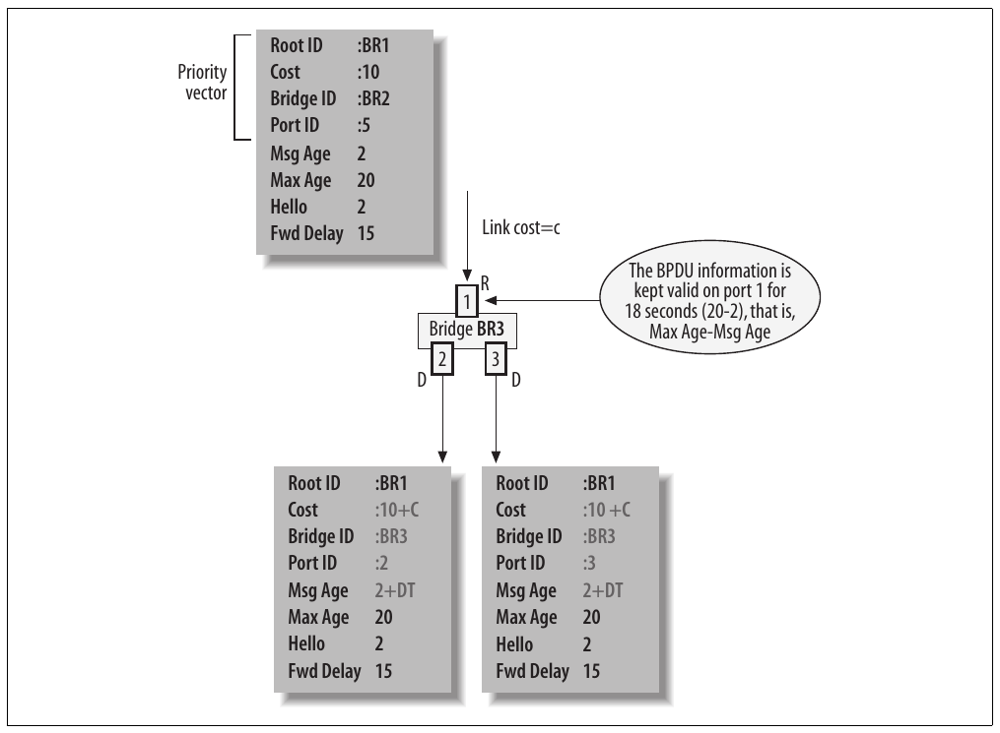

Hình 15-9. Relay BPDU qua nonroot bridge

Không nên sử dụng các BPDU mang thông tin cũ để xây dựng topology loop-free. Vì vậy, configuration BPDU có field Message Age, được bridge nhận so sánh với field Max Age để loại bỏ những BPDU đã tồn tại quá lâu và có priority vector không còn đáng tin cậy.

Field Message Age được root bridge khởi tạo 0, rồi từng nonroot bridge cập nhật trước khi forward (xem DT trong Hình 15-9). Message Age được kỳ vọng biểu thị thời gian từ khi BPDU gốc của root bridge được tạo. Tuy nhiên, tính thời gian không dễ. Chẳng hạn, cần tính cả transmission delay và processing time: thời gian frame ở media từ port bridge này tới port bridge kế tiếp, và thời gian trong memory khi mỗi bridge xử lý rồi tạo lại. Nhưng cách phổ biến trong commercial bridge là xem Message Age như hop count, giống field Time To Live (TTL) trong IP header: Message Age của ingress BPDU được tăng 256 tick (tức 1 giây) và copy vào outgoing BPDU. Nghĩa là BPDU bị drop sau tối đa 20 hop (20 giây là default value Max Age).

Linux không dùng message age như hop count mà cố tuân thủ quy tắc gốc trong mục “Truyền configuration BPDU”.

Khi BPDU mà bridge nhận trên một port chưa hết hạn, tức Message Age nhỏ hơn Max Age, bridge khởi động Message Age timer sẽ hết hạn sau khoảng thời gian bằng hiệu giữa Max Age và Message Age. Xem phần “Timer” để biết các thao tác được kích hoạt khi Message Age timer hết hạn. Điều này bảo đảm thông tin trong BPDU bị loại bỏ sau Max Age giây kể từ khi được tạo, trừ khi được xác nhận trước thời điểm đó.

## Định nghĩa active topology

Mỗi bridge, nhờ local configuration và thông tin trong ingress configuration BPDU, có thể thực hiện:

- Bầu root bridge

- Chọn một port làm root port

- Với mỗi port, xác định designated bridge và designated port cho LAN mà port thuộc về

Những tác vụ tôi gọi là configuration update này cần mỗi khi network có thay đổi có thể đòi hỏi đổi topology. Chẳng hạn:

- Port được enable hoặc disable.

- Message Age timer của port hết hạn. Khi đó, port được khởi động lại (tức gán designated role).

- Local configuration của bridge thay đổi.

- Bridge port nhận configuration BPDU có priority vector superior so với BPDU trước đó trên cùng port.

Lưu ý configuration update được kích hoạt trên bridge có cấu hình thay đổi hoặc port đổi administrative state. Bridge khác sẽ làm theo (nếu cần) khi thấy thay đổi phản ánh trong thông tin BPDU nhận được.

Hãy xem từng tác vụ configuration update được đảm nhiệm thế nào.

### Chọn root bridge

Trong mục “Bridge ID và port ID”, chúng ta đã thấy cách định nghĩa bridge ID. Thuật toán chỉ dùng MAC address để chọn root bridge đủ bảo đảm lựa chọn xác định, vì MAC address duy nhất toàn cầu. Tuy nhiên, thêm priority component cho phép administrator ép topology mong muốn bằng cách gán priority cao hơn cho bridge muốn chọn làm root. Thậm chí có thể gán priority chiến lược cho bridge khác nhau để ép bridge cụ thể tiếp quản khi root bridge hiện tại hỏng.

Khi mới enable, bridge chưa biết gì về topology nên cho rằng mình là root bridge. Vì vậy gán designated role cho mọi port, bắt đầu Forward Delay timer trên port để cuối cùng được gán forwarding state (xem Hình 15-6), rồi truyền BPDU dùng ID của bridge làm field root Bridge ID và root path cost 0. Đây là cách tiện lợi để broadcast data về chính nó và lan truyền nhanh nhất, giúp cả nó lẫn bridge khác tìm ra root bridge thực sự tốt nhất và cân bằng lại tree.

Khi bridge có bridge ID tốt nhất, nó tiếp tục gửi BPDU ra designated port vì không bridge khác có thể tuyên bố priority vector tốt hơn (chính xác hơn là bridge ID tốt hơn) để tiếp quản root role.

Nếu bridge không có bridge ID tốt nhất, cuối cùng nó nhận configuration BPDU có root bridge ID tốt hơn (tức superior BPDU) và:

- Chấp nhận, ghi lại thông tin tốt hơn (gồm root bridge ID và timer).

- Cập nhật state và role của port tương ứng. Đây là configuration update.

### Chọn root port

Mỗi bridge phải chọn root port riêng, như đã nói trong mục “Port role”, là port có shortest path (hoặc cost thấp nhất) tới root bridge. Root bridge là bridge duy nhất không có root port; nonroot bridge có đúng một root port.

Với mỗi port trừ port bị disable do quản trị, bridge giữ bản copy priority vector tốt nhất nhận trong ingress BPDU. Nhờ vậy, với mỗi port, bridge biết path tốt nhất (cost thấp nhất) tới root bridge.

Việc chọn root port chỉ đơn giản là duyệt tất cả các port và chọn port có priority vector tốt nhất. Nếu nhiều port cùng có priority vector tốt nhất, local port có port ID được gán thấp nhất sẽ được chọn, như trong Hình 15-10. Lưu ý receiver port ID không nằm trong BPDU.

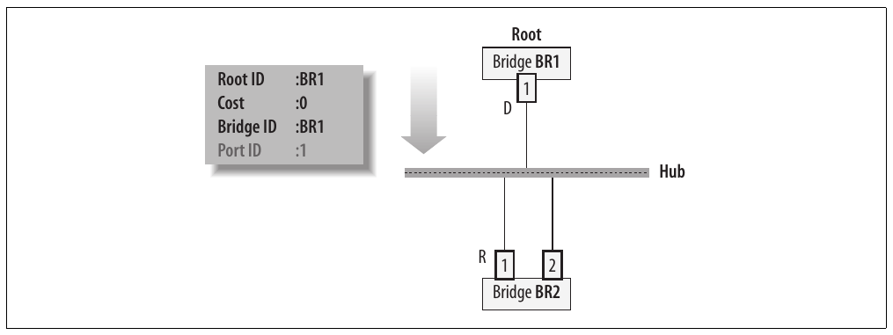

Hình 15-10. Nhiều ứng viên để chọn root port

### Chọn designated port

Trong khi mỗi bridge có thể có một root port, mỗi LAN chỉ có một designated port. STP bảo đảm mỗi bridge chọn cùng port. Designated port nên có path cost thấp nhất tới root bridge. Vì vậy là port có priority vector tốt nhất.

Mỗi bridge thường ở nhiều LAN, nên phải học designated port cho từng LAN.

Trên connection point-to-point giữa hai bridge chỉ có hai port. Port truyền BPDU với priority vector tốt nhất được chọn. Ngược lại, shared medium như Ethernet hub có thể có nhiều hơn hai bridge. Khi đó mỗi bridge nhận BPDU của nhau và kiểm tra priority vector để bầu designated port thích hợp.

Hình 15-11 cho thấy khi dùng shared medium nối bridge. Ban đầu chỉ BR2 nối hub nên tự bầu làm root bridge. Khi administrator thêm BR1 sau đó, nó cũng cho rằng mình là root bridge, như BPDU nó truyền trong Hình 15-11(b). Giả sử ID BR2 lớn hơn (tức inferior so với) ID BR1, nên hai bridge cuối cùng thống nhất BR1 làm root bridge.

Vì mọi bridge port này nối cùng hub, khi port 1 của BR1 truyền BPDU, BR1 nhận BPDU của chính nó trên port 2 và ngược lại. Tuy nhiên, chọn designated port theo priority vector tốt nhất cũng đúng trong tình huống này: field thứ tư của priority vector là port ID làm priority vector trong BPDU của port 1 tốt nhất.

Tuy nhiên, setup shared-medium không phổ biến vì nhiều lý do, nên phần còn lại chương chỉ xét trường hợp point-to-point.

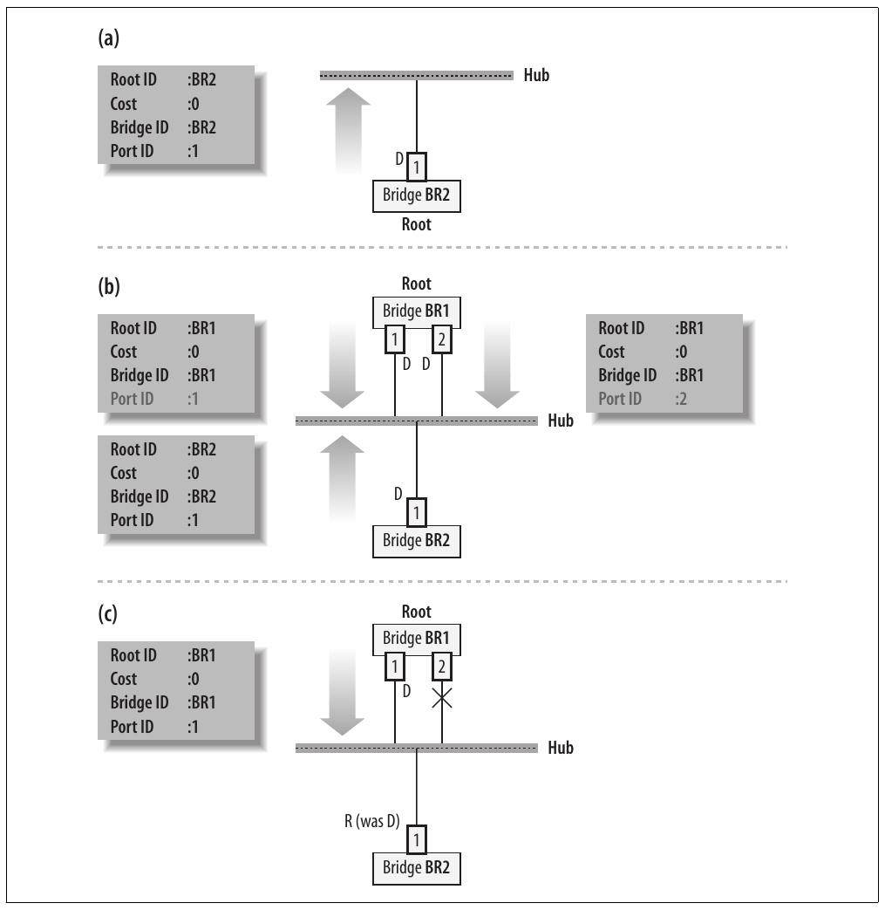

Hình 15-11. Chọn designated port

### Ví dụ STP hoạt động

Giả sử có topology Hình 15-12. Lưu ý không có redundant link nên không cần STP. Giả sử:

- Bridge ID BR1 \< Bridge ID BR2 \< Bridge ID BR4 (nên BR1 là root bridge).

- Mỗi bridge có thể cấu hình cost của các local interface độc lập với những bridge khác. Để đơn giản và giúp hình dễ đọc hơn, chúng ta giả định mọi path cost đối xứng, tức giống nhau ở hai đầu mỗi link.[^5] Lưu ý rằng:

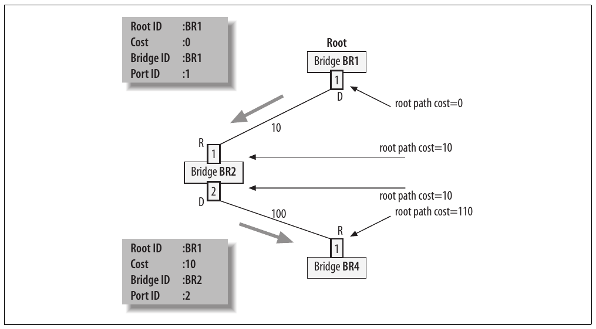

Hình 15-12. Cập nhật root path cost

- Designated port của BR1 định kỳ truyền configuration BPDU mỗi khi Hello timer hết hạn. Vì BR2 nhận configuration BPDU định kỳ mỗi Hello time trên port 1, nó cũng tạo lại (forward) configuration BPDU trên port 2 gần như định kỳ mỗi Hello time.

- Configuration BPDU của Bridge 1 quảng bá:

  - BR1 là root bridge

  - Root path cost bằng 0

  - Bridge ID của chính nó là BR1

  - Port ID bằng 1

- Configuration BPDU của Bridge 2 quảng bá:

  - BR1 là root bridge

  - Root path cost bằng 10 (cộng cost riêng vào cost BR1 gửi)

  - Bridge ID của chính nó là BR2

  - Port ID bằng 2

Giờ thêm bridge mới tên BR3 và giả sử Bridge ID BR3 \< Bridge ID BR4, như Hình 15-13.

Như giải thích trong mục “Chọn root bridge”, khi BR4 mới enable, nó cho rằng mình là root bridge nên gán designated role cho hai port. Nó gửi configuration BPDU trên mỗi port, quảng bá chính nó là root bridge, vì vậy dùng root path cost 0 trong BPDU.

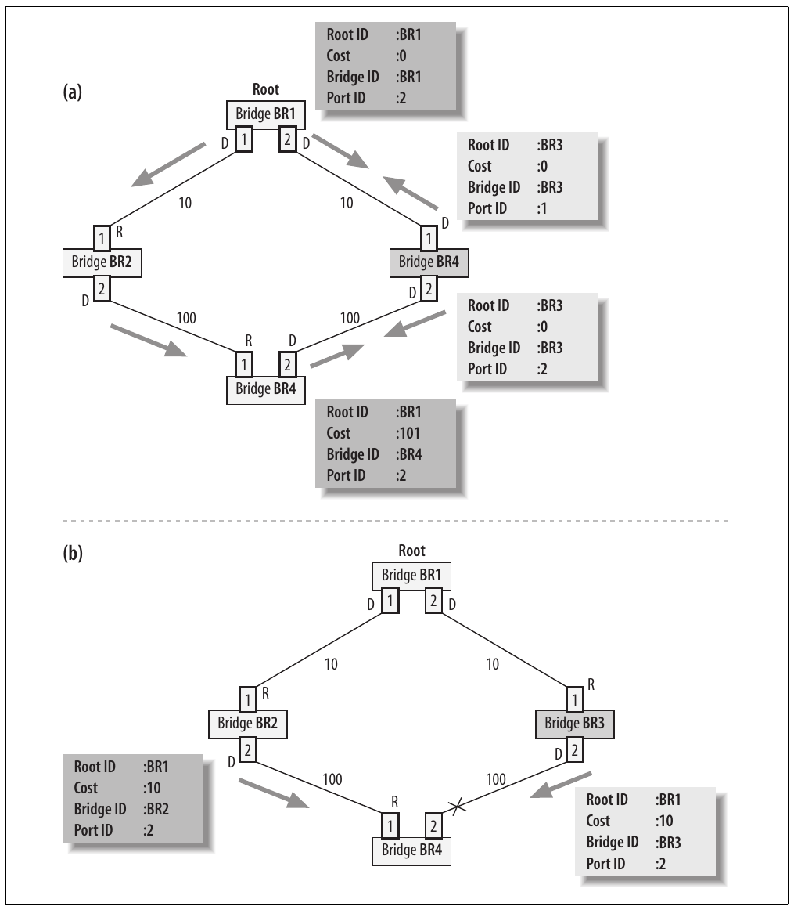

Hình 15-13. Thêm bridge vào stable topology

Nếu giả sử BR3 nối với BR1 và BR4 bằng link point-to-point như Hình 15-13, khi bật nguồn BR3, BR1 và BR4 enable port nối BR3, gán designated role cho những port đó rồi truyền configuration BPDU.

Hãy xem BR1, BR3 và BR4 phản ứng khi nhận configuration BPDU của nhau:

- Configuration BPDU từ BR1 và BR4 lần lượt có priority vector: \[BR1, 0, BR1, 2\] và \[BR1, 110, BR4, 2\].

- Vì BPDU BR1 nhận từ BR3 có priority vector inferior, BR1 giữ port 2 trong DESIGNATED role và duy trì root bridge role. Ngược lại, khi BR3 nhận BPDU từ BR1, nó nhận ra BR1 có bridge ID tốt hơn (vì vậy priority vector tốt hơn), nên cập nhật priority vector port 1, chọn port 1 làm root port và BR1 làm root bridge.

- BPDU BR3 nhận từ BR4 có priority vector tốt hơn BPDU BR3 gửi BR4, nhưng không tốt bằng BPDU BR3 nhận từ BR1. Vì vậy, BR4 không đổi root port và root bridge information hiện tại: port 1 vẫn là root port, BR1 vẫn là root bridge.

- Khi BR3 truyền BPDU mới tới BR4 như Hình 15-13(b), nó dùng priority vector mới phản ánh thông tin mới nhận từ BR1. Khi nhận BPDU đó, BR4 nhận ra priority vector superior và block port 2. Lưu ý priority vector BR3 thắng BR4 vì path cost thấp hơn (tức port 2 của BR3 được chọn làm LAN-designated port vì gần root bridge hơn port 2 của BR4).

- BR4 chọn port 1 làm root port vì nhận priority vector tốt hơn (nhớ đã giả sử bridge ID BR2 thấp hơn bridge ID BR3).

Nếu so sánh configuration BPDU mà BR4 nhận từ BR2 với BPDU nhận từ BR3, bạn có thể thấy chúng có cùng root bridge ID (BR1) và root path cost (10), nhưng thành phần thứ ba của priority vector cho thấy BR2 có ưu tiên tốt hơn vì bridge ID của BR2 nhỏ hơn bridge ID của BR3. Vì vậy, BR4 chọn port 1 làm root port. Administrator muốn ưu tiên link từ BR4 đến BR3 hơn link đến BR2 chỉ cần cấu hình cost thấp hơn trên port đó, xem phần “Bridge ID và port ID”.

Trong ví dụ này, ba thành phần đầu tiên của priority vector đã đủ để chọn root port và designated port. Bây giờ, với ví dụ trong Hình 15-14, chúng ta hãy xem khi nào thành phần thứ tư, port ID, cần được dùng để phân định trường hợp hòa.

Giờ BR4 nhận hai BPDU từ BR2 có cùng value ở ba field đầu priority vector. Tuy nhiên, parameter thứ tư (port ID) cho phép BR4 chọn port 1 làm root port. Trong mục “Chọn root port”, chúng ta cũng đã thấy bridge dùng local port ID (khác remote port ID thuộc priority vector) làm tiebreaker khi cả bốn thành phần priority vector của ingress BPDU chưa đủ xác định BPDU thắng.

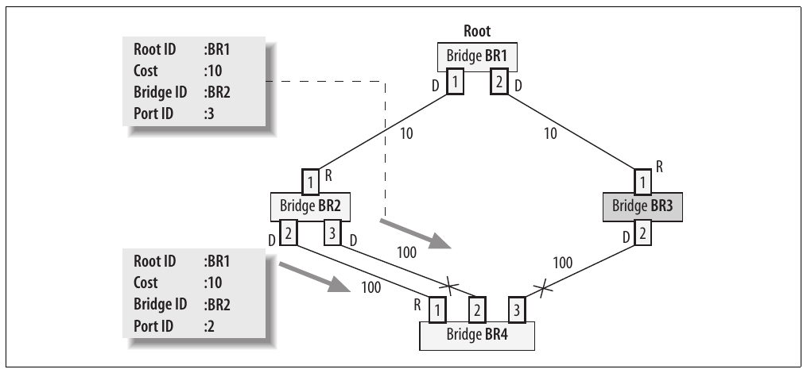

Hình 15-14. Port ID làm tiebreaker

## Timer

STP dùng cả timer per-bridge lẫn per-port. Trong Bảng 15-4 và 15-5, bạn có thể thấy default timeout và value được phép cho timer per-bridge và per-port tương ứng.[^6]

Bảng 15-4. Bridge timer

| Timer | Default value (giây) | Khoảng cho phép |
|---|---|---|
| Hello | 2 | 1–10 |
| Topology Change | Forward Delay + Max Age | Không thể cấu hình |
| TCN | Hello time | Không thể cấu hình |
| Addresses Aging | 300 hoặc Forward Delaya | Không thể cấu hình |

a Xem mục “Topology change”.

Bảng 15-5. Port timer

| Timer | Default value (giây) | Khoảng cho phép |
|---|---|---|
| Message Age | 20 | 6–40 |
| Forward Delay | 15 | 4–30 |
| Hold | 1 | Không thể cấu hình |

Lưu ý không phải mọi timer đều cho người dùng cấu hình. Cũng lưu ý một số timer dùng chung cấu hình (ví dụ TCN và Hello), nên đổi cấu hình một timer có thể ảnh hưởng timer khác.

Đây là bridge timer:

Hello

Dùng để tạo configuration BPDU định kỳ. Chỉ root bridge dùng.

TCN

Được bridge phát hiện topology change dùng khi phải báo root bridge. Xem mục “Topology change”.

Topology change

Được root bridge dùng để nhớ set flag cụ thể trong configuration BPDU. Flag dùng để báo bridge khác về topology change. Xem mục “Topology change”.

Aging timer

Dùng để dọn address cũ khỏi forwarding database. Bridge dùng timer này bất kể có dùng STP hay không. Xem mục “Short Aging timer”.

Mỗi bridge giữ hai bản timer configuration: cấu hình cục bộ bởi administrator và cấu hình nhận từ root bridge.

Root bridge là bridge duy nhất dùng timer cấu hình riêng; nó khiến mọi bridge khác theo cấu hình của mình. Nonroot bridge dùng timer configuration trong BPDU nhận trên root port. Có thể thấy vị trí timer configuration trong Hình 15-8.

Đây là port timer:

Message Age

Trong mục “BPDU aging”, chúng ta đã thấy thông tin BPDU có lifetime giới hạn. Message Age timer dùng để thực thi lifetime đó. Timer được khởi động lại mỗi khi nhận BPDU trên port. Mỗi lần nhận BPDU, message age được so với max age của network và frame bị drop nếu quá cũ. Message Age timer chạy trên nondesignated port (tức port nhận superior BPDU).

Trên stable network không có vấn đề, timer này không bao giờ hết hạn. Tuy nhiên, khi root bridge không tạo BPDU, hoặc BPDU nhận đã hết hạn hay bị drop vì lý do nào đó, timer sẽ hết hạn. Khi đó port được khởi động lại, vì vậy được gán designated role.

Forward Delay

Đảm nhiệm state transition từ listening sang learning và từ learning sang forwarding. Hình 15-15 cho thấy cách thường xử lý Forward Delay timer hết hạn và cách tuân theo mô hình Hình 15-6.

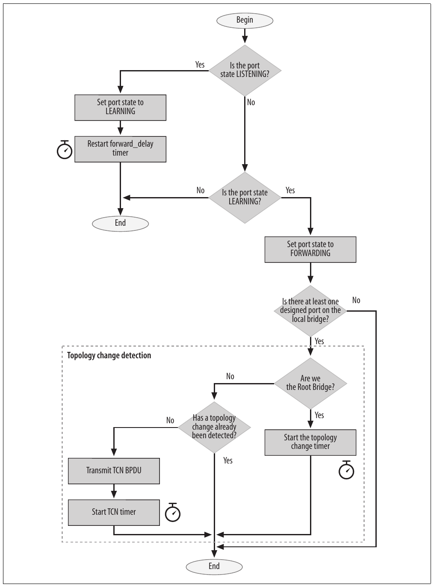

Hình 15-15. Xử lý Forward Delay timer

Hold

Truyền configuration BPDU được rate limited trên mỗi port ở mức một BPDU mỗi giây. Trên stable network, tức STP đã hội tụ, mỗi designated port truyền BPDU mỗi Hello time. Tuy nhiên, khi topology thay đổi, hội tụ tới topology mới có thể mất nhiều phút trong tình huống phức tạp do bản chất phân tán của STP algorithm. Vì vậy, số BPDU gửi theo quy tắc mục “Khi nào truyền configuration BPDU” dễ tăng lớn, và đây là lúc rate limiting dễ được áp dụng hơn.

Hold timer, khi cần, chạy trên designated port (port truyền configuration BPDU).

Timer Per-port dùng chung cấu hình. Chẳng hạn không thể có hai Max Age configuration khác nhau trên hai port khác nhau.

### Tránh temporary loop

Root port và designated port là những port duy nhất được gán forwarding state. Tuy nhiên, khi port được gán root role hoặc designated role, không được gán forwarding state ngay: trước hết phải qua hai state trung gian như Hình 15-6. Những state này ngăn nguy cơ temporary loop khi network hội tụ tới stable topology loop-free. Hãy dùng tình huống đơn giản Hình 15-16(a) làm ví dụ.

Topology gồm hai bridge nối bằng hai link. Một link phải bị disable; nếu không sẽ có loop.

Trước đó, chúng ta đã thấy khi bridge port mới enable, được gán designated role và blocking state. Trong mục “Chọn root bridge”, cũng đã thấy bridge mới enable chưa biết neighbor bridge nên cho rằng mình là root bridge. Hình 15-16(a) cho thấy hai bridge vừa được enable, vì vậy:

- Cả hai cho rằng mình là root bridge.

- Cả hai port của hai bridge được gán designated role và blocking state.

- Với mỗi port, đổi state sang listening, bắt đầu Forward Delay timer và truyền configuration BPDU. Priority vector của BPDU phản ánh giả định bridge của chúng là root bridge.

Lưu ý chưa port nào forwarding. Không thể nhận hoặc truyền data traffic trên những port đó. Chỉ có thể truyền và nhận BPDU.

Khi BR2 nhận BPDU của BR1 trên port, nó nhận ra BR1 có priority vector superior (chính xác là bridge ID tốt hơn). Lúc đó, BR2 bắt đầu configuration update: chọn root bridge, root port, designated port và cập nhật state mọi port. Cụ thể, chọn BR1 làm root bridge và port 1 làm root port (vì đây là port nhận BPDU có priority vector tốt nhất). Port 2 không phải root port hay designated port nên bị block (tức bị loại khỏi tree). Khi port 1 được gán role mới, Forward Delay timer được khởi động lại. Khi port 2 bị block, Forward Delay timer dừng.

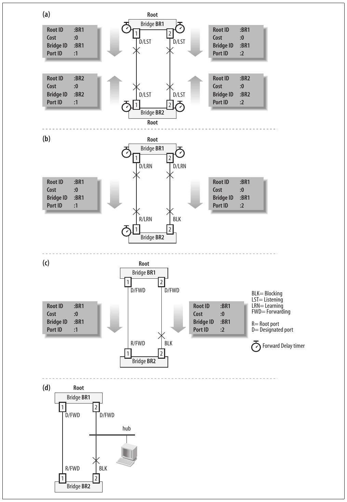

Hình 15-16. Chuyển sang forwarding state

Giả sử những action diễn ra khá nhanh, có thể coi Forward Delay timer hết hạn gần như cùng lúc trên mọi port, dẫn tới cấu hình mới Hình 15-16(b). Lưu ý giờ:

- Ba port có Forward Delay timer hết hạn được chuyển sang learning state (chưa forward data traffic).

- Forward Delay timer được khởi động lại trên ba port đó.

- BR2 không truyền configuration BPDU nữa (vì không có designated port).

Khi Forward Delay timer lại hết hạn sau 15 giây, port 1 và 2 của BR1 cùng port 1 của BR2 được gán forwarding state. Lúc này topology ổn định. Trong tình huống đơn giản, topology hội tụ khá nhanh, nhưng vì có thể lâu hơn đáng kể trong setup phức tạp, state trung gian giữa blocking và forwarding bảo đảm tránh temporary loop.

Lưu ý port 2 của BR1 forwarding trong Hình 15-16(c). Không có nguy cơ loop chừng nào một đầu link bị block (port 2 của BR2 trong Hình 15-16(c)). Port 2 của BR1 vẫn forward traffic dù port 2 của BR2 bị disable: port 2 của BR1 và port 2 của BR2 có thể nối hub cùng host khác, và port 2 của BR2 cần để cung cấp connectivity cho những host khác đó.

## Topology change

Topology change là event thay đổi hệ thống nào ở trên L2 network hoặc cách nối port. Khi topology thay đổi, address trước đây tới được qua path cụ thể giờ có thể tới qua path khác. Vì vậy, phải xử lý topology change đúng để network không có loop và cập nhật forwarding database. Theo graph và tree, topology thay đổi khi thêm hoặc loại link, hoặc chọn node khác làm root của tree (nhớ spanning tree được tính dựa trên root được chọn).

Trước hết hãy xem event kích hoạt topology change, rồi cách xử lý:

Bridge port nonforwarding đổi state sang forwarding hoặc ngược lại

Trường hợp này bao gồm một port đang disabled được enable và một port chỉ thay đổi state theo quyết định của protocol. Xét từ góc độ tree, điều này tương đương thêm một link vào tree hoặc loại bỏ một link.

Root bridge ID thay đổi

Điều này có thể xảy ra vì root bridge hiện tại bị tắt và bridge khác tiếp quản root role, vì một bridge tốt hơn được enable hoặc vì root bridge hiện tại hay bridge khác thay đổi priority. Tùy vị trí root bridge mới so với root bridge cũ, việc thay đổi root bridge có thể kích hoạt nhiều thay đổi port state và role trên toàn network. Về lý thuyết, thay root node có thể tạo ra tree rất khác, nhưng trên thực tế, bridge được cấu hình bằng các parameter trong phần “Bridge ID và port ID” để topology change không kéo theo những thay đổi lớn của tree.

Nhận TCN topology change trên bridge port

Trong trường hợp này, topology change đã được bridge khác phát hiện. Xem mục “Báo topology change cho mọi bridge”.

Lưu ý với topology loop-free, chỉ có thể tạo loop bằng cách thêm link (tức port mới vào forwarding state), không phải loại link (tức forwarding port chuyển state sang blocking). Loại link chỉ có thể phân chia tree, còn thêm link vào tree luôn tạo loop trừ khi port khác đồng thời bị disable hoặc block.

### Short Aging timer

Tôi đã nói khi phát hiện topology change, forwarding database cũng cần thay đổi. Hãy xem vì sao qua ví dụ. Giả sử link giữa A2 và D1 trong Hình 15-2(a) hỏng vì lý do nào đó. Mọi host nối access bridge A2 không còn tới được từ D1, thay vào đó phải dùng D2. STP cập nhật topology bằng cách cho bridge thực hiện configuration update (xem mục “Định nghĩa active topology”). Topology mới có thể như Hình 15-17. Hình cũng cho ví dụ path mới giữa host 40 và host 11.

STP cũng bảo đảm cập nhật thông tin cũ trong D2 cho rằng Host 11–20 tới được qua port nối C1. Thực tế không chỉ bridge đó có thông tin cũ; forwarding database bridge khác cũng cần dọn. Hơn nữa, khi topology thay đổi, STP cần hội tụ tới topology loop-free mới. Trong thời gian đó, bridge port có thể đổi role và state nhiều lần, nên nội dung forwarding database cũng vậy.

Thông tin cũ trong forwarding database được dọn bằng cách giảm thời gian để address trong database bị loại nếu không dùng. Thực hiện bằng cách giảm Aging timer, mặc định 5 phút, xuống Forward Delay (tức mặc định 15 giây) khi bridge được báo topology change. Topology change được thông báo bằng cách set flag đặc biệt trong configuration BPDU (xem mục tiếp theo).

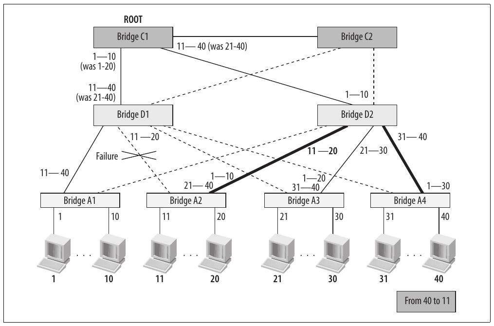

Hình 15-17. Xử lý root port failure trên A2

### Báo topology change cho mọi bridge

Khi bridge phát hiện topology change, phải báo mọi bridge để bắt đầu dùng short aging dọn stale entry trong forwarding database. Hãy xem cách thực hiện:

1\. Bridge báo root bridge về topology change.

2\. Root bridge báo mọi bridge về topology change.

Bước đầu dùng TCN BPDU. Bridge phát hiện topology change gửi TCN BPDU tới designated bridge qua root port. Nó gửi TCN BPDU mỗi Hello time cho tới khi designated bridge acknowledge nhận. Designated bridge acknowledge bằng cách set TCA flag trong configuration BPDU tiếp theo. Lúc này designated bridge lặp lại quá trình, gửi TCN BPDU tới designated bridge của nó qua root port, v.v. Quá trình kết thúc khi TCN tới root bridge. Không cần dùng TCN BPDU khi root bridge tự phát hiện topology change (vì không cần tự báo mình).

Root bridge thực hiện bước thứ hai bằng cách set flag đặc biệt (TC) trong configuration BPDU truyền đi. Flag tiếp tục được giữ on trong BPDU do nonroot bridge tạo lại, nên cuối cùng mọi bridge trong network nhận topology change notification. Khi bridge thấy flag được set, bắt đầu Short Aging timer.

### Ví dụ topology change

Nếu lấy tình huống Hình 15-2(a) và tưởng tượng tắt link giữa A2 và D1 (tức root port), A2 bầu port kia làm root port, đổi state từ blocking sang forwarding. Điều này dẫn tới tình huống mới Hình 15-18(a).

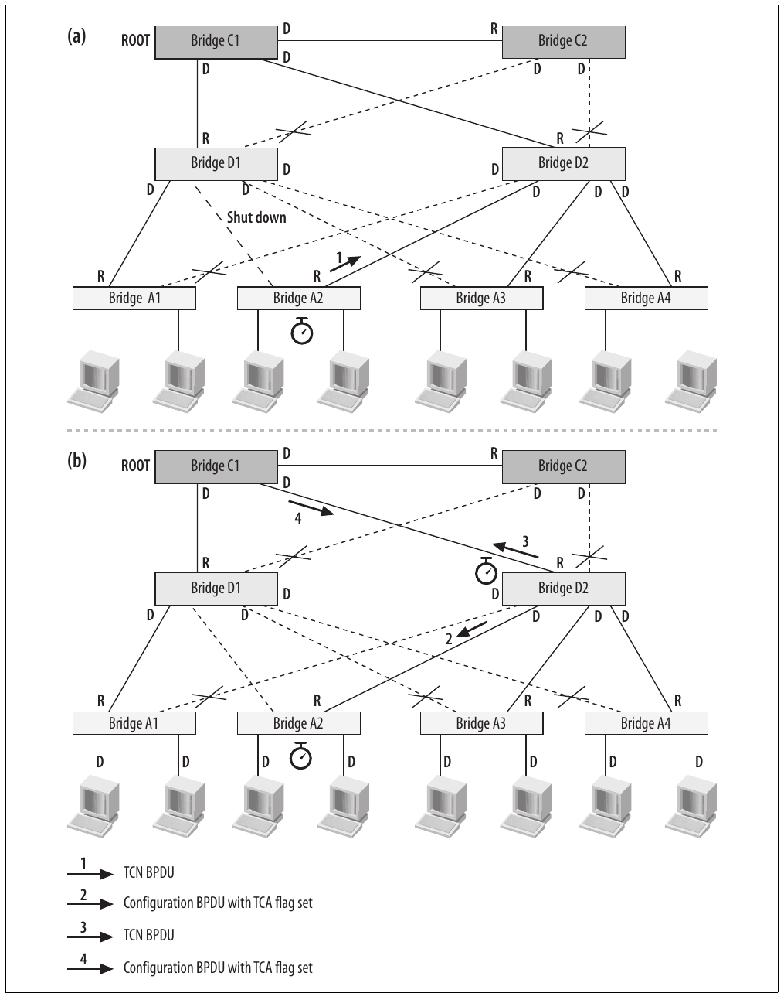

Hình 15-18. Sử dụng TCN BPDU

A2 bắt đầu TCN timer và truyền TCN BPDU ra root port (mới). Khi D2 nhận TCN BPDU, acknowledge bằng configuration BPDU trả về có TCA flag được set, bắt đầu TCN timer và truyền TCN BPDU ra root port. Khi A2 nhận acknowledgment từ D2, dừng TCN timer. D2 làm tương tự khi nhận acknowledgment từ C1.

Khi C1 nhận TCN BPDU, bắt đầu Topology Change timer, sẽ hoạt động 35 giây, và set TC flag trên mọi BPDU truyền ra trong khi timer pending (xem Hình 15-19). 35 giây của Topology Change timer không ngẫu nhiên: bằng Forward Delay cộng Max Age (xem Bảng 15-4).

TC flag được lan truyền xuống toàn tree vì mọi bridge relay flag nhận từ root bridge. Khi bridge thấy flag được set trên ingress BPDU, bắt đầu dùng Short Aging timer (nếu chưa dùng). Khi Topology Change timer hết hạn trên root bridge, root bridge ngừng set TC flag trong BPDU. Khi nhận BPDU có TC flag được clear, bridge ngừng dùng Short Aging timer và bắt đầu default aging.

Lưu ý bridge có thể nhận configuration BPDU có TC flag set trên port khác nhau. Chẳng hạn D2 trong Hình 15-19 nhận từ C1 và C2. Không có vấn đề: tại mọi thời điểm, bridge dùng default Aging timer hoặc Short Aging timer, nên khi bridge đã dùng Short Aging timer nhận configuration BPDU có TC flag, không cần làm gì.

## BPDU encapsulation

L2 multicast address trong khoảng 01:80:C2:00:00:00 tới 01:80:C2:00:00:FF được IEEE dành riêng cho standard protocol. Cụ thể, address đầu khoảng, 01:80:C2:00:00:00, được STP 802.1D dùng: cả configuration BPDU lẫn TCN BPDU gửi tới address này. Address giúp bridge nhận diện BPDU.

Hình 15-20 cho thấy encapsulation của BPDU trong Ethernet frame.

Để biết thêm LLC header, tham khảo Chương 13.

Lưu ý cùng đặc tả IEEE quy định address trong khoảng 01:80:C2:00:00: 00 tới 01:80:C2:00:00:0F không nên được bridge chạy protocol 802.1D relay: hoặc được destination protocol xử lý cục bộ (nếu được triển khai và enable), hoặc bị drop.

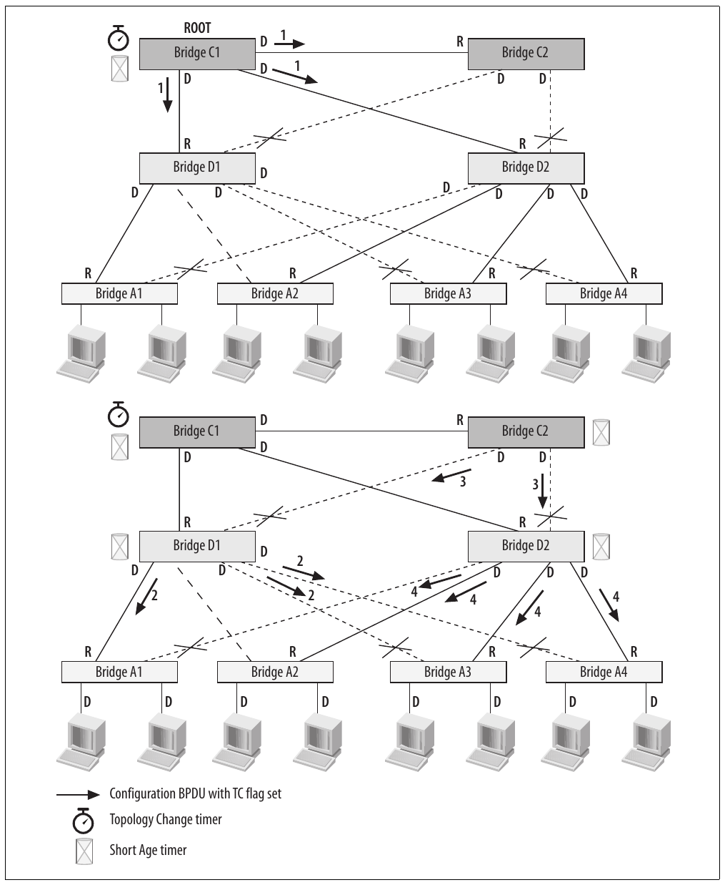

Hình 15-19. Báo mọi bridge về topology change

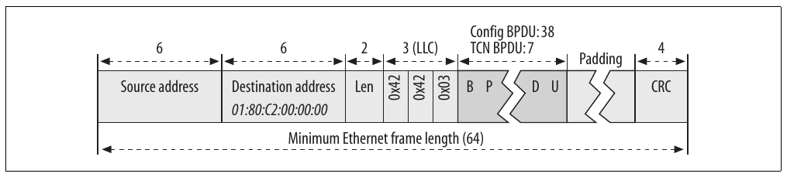

Hình 15-20. BPDU encapsulation

## Truyền configuration BPDU

Trong mục “Khi nào truyền configuration BPDU”, chúng ta đã thấy điều kiện kích hoạt truyền configuration BPDU. Bất kể vì sao truyền, logic Hình 15-21 đều áp dụng.

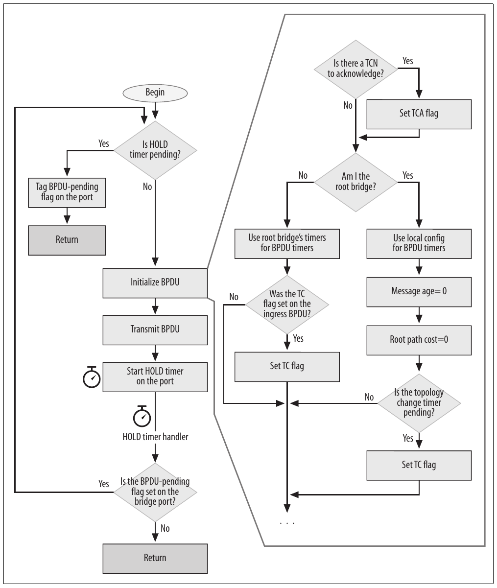

Hình 15-21. Logic truyền configuration BPDU

Hold timer per-port thực thi rate limit một BPDU mỗi giây. Khi truyền BPDU, timer bắt đầu. Nếu thử truyền lần nữa khi timer đã pending, BPDU không được truyền và flag được set trong bridge port configuration block. Khi hết hạn, timer kiểm tra flag và truyền configuration BPDU nếu thấy flag set.

Khi root bridge truyền BPDU, timer được khởi tạo bằng value cấu hình cục bộ; nếu không, dùng value nhận từ root bridge. Message age và root path cost đều 0 với root bridge.

Ngoài ra, hình không thể hiện:

- Khi bridge cần acknowledge nhận TCN BPDU, set TCA flag.

- Root bridge set TC flag nếu Topology Change timer đang chạy.

- Nonroot bridge set TC flag nếu BPDU cuối nhận trên root port có TC flag set.

## Xử lý ingress frame

Trong Chương 14, chúng ta đã thấy bridge đơn giản xử lý ingress traffic. Giờ xem bridge chạy STP xử lý thế nào.

Ingress traffic giờ gồm cả data traffic lẫn BPDU. Bridge xử lý data traffic giống nhau bất kể STP có enable hay không. Khác biệt duy nhất là port bị STP block không thể forward data traffic vì không được coi thuộc tree.

### Ingress BPDU

Khác data traffic, ingress BPDU được chấp nhận trên mọi port chưa bị disable do quản trị, kể cả blocking state.

Có thể phân biệt configuration BPDU và TCN BPDU nhờ field BPDU type, như Hình 15-8. Trong mục “Báo topology change cho mọi bridge”, chúng ta đã xem cách xử lý ingress TCN BPDU. Mục tiếp theo sẽ xem cách xử lý configuration BPDU.

### Ingress configuration BPDU

Hình 15-22 cho thấy cách xử lý ingress configuration BPDU.

Xử lý ingress BPDU phụ thuộc priority vector của nó là:

Tốt hơn vector port của receiving bridge hiện biết

Khi đó BPDU kích hoạt configuration update, gồm root port mới, designated port và state mới cho mọi port.

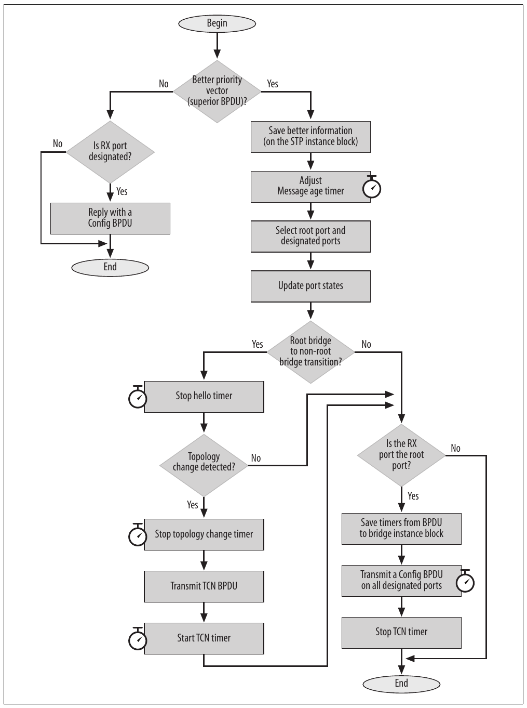

Hình 15-22. Xử lý ingress configuration BPDU

Giống vector port của receiving bridge đã biết

Đây là thứ nhận trên root port khi topology đã hội tụ.

Kém hơn vector port của receiving bridge biết

Khi đó bridge trả lời bằng configuration BPDU chứa thông tin (tốt hơn) của chính nó. Đây là trường hợp phổ biến khi thêm bridge mới vào topology: ban đầu bridge chưa biết gì về bridge khác nên quảng bá thông tin của mình. Cũng có thể xảy ra trong nhiều trường hợp khác, như bridge configuration thay đổi.

Khi ingress BPDU tuyên bố priority vector tốt hơn vector receiver port biết, có trường hợp đặc biệt cần xử lý: khi receiving bridge từng là root bridge, nó phải nhường ngôi. Như đã nói trong mục “Topology change”, đây là một event được coi topology change. Khi đó bridge mất root role phải dừng Hello timer (vì chỉ chạy trên root bridge), gửi TCN BPDU ra root port hướng về root bridge mới và bắt đầu TCN timer để báo root bridge về topology change (root bridge đảm nhiệm báo mọi bridge khác).

Khi BPDU được nhận trên root port, bridge lưu timer từ BPDU (để dùng trong egress BPDU) và truyền configuration BPDU ra mọi designated port. Khi TCA flag được set, có thể dừng TCN timer.

## Convergence time

Chúng ta đã thấy cách STP cập nhật động topology của tree dựa trên configuration change và link failure hoặc bridge failure. Giờ xem STP cần bao lâu để phát hiện failure phổ biến và phản ứng tương ứng.

Khi configuration update diễn ra trong tình huống phức tạp, network có thể cần nhiều phút để hội tụ và ổn định.[^7] Trong thời gian đó topology vẫn không có loop, nhưng có thể không chuyển traffic đúng (vì topology vẫn đổi khi traffic đang di chuyển). Trong setup như vậy, không thể dự đoán chính xác topology tiến tới stable tree mới ra sao, vì thời điểm nhận và truyền BPDU phụ thuộc nhiều yếu tố, như mức tải bridge lúc đó.

Tuy nhiên, dù cấu hình bridge tốt thế nào, vẫn có latency tối thiểu không thể loại bỏ hay giảm. Chẳng hạn:

- Khi port đổi state, ví dụ từ blocking sang forwarding để thay bridge port hỏng, chuyển sang forwarding không tức thì mà mất hai lần thời gian Forward Delay timer (tức mặc định 30 giây), như Hình 15-6. Port không thể forward data traffic trong thời gian đó.

- Root port và nondesignated port (tức port nhận BPDU) chỉ nhận ra mất connection với designated bridge (vì vậy với toàn tree trừ phần dưới designated port của bridge[^8]) khi Message Age timer hết hạn. Chẳng hạn, nếu port C1 đi tới D1 trong Hình 15-2(a) hỏng vì lý do nào đó, D1 có thể chỉ biết sau 20 giây khi Max Age timer hết hạn.

Lưu ý cả hai trường hợp do timer điều khiển. Tất nhiên có thể cấu hình Forward Delay và Max Age hết hạn nhanh hơn để giảm convergence time. Tuy nhiên, tùy độ phức tạp network, không phải lúc nào cũng dùng được timer quá gấp.

Hãy xét ví dụ dựa trên Hình 15-2 và xem điều gì xảy ra khi bridge D1 hỏng vì một lý do nào đó. Vì cả A1 lẫn A2 sử dụng D1 để truy cập phần còn lại của network, mọi host kết nối với A1 và A2 bị cô lập khỏi phần còn lại cho đến khi STP chọn được root port mới cho cả hai. Vậy STP cần bao lâu để thực hiện những thay đổi này? Trong tình huống worst-case, các sự việc diễn ra như sau:

- D1 ngừng hoạt động đúng.

- Sau 20 giây, Message Age timer hết hạn trên root port của cả A1 và A2.

- A1 và A2 chọn port đi tới D2 làm root port mới.

- Sau 30 giây nữa, root port mới vào forwarding state.

Nghĩa là có thể có black hole 50 giây cho host nối A1 và A2. Trong network phức tạp, topology có thể cần lâu hơn để hội tụ, thậm chí vài phút.

## Tổng quan spanning tree protocol mới hơn

Convergence time của STP 802.1D-1998 chấp nhận được khi ủy ban IEEE định nghĩa lần đầu nhiều năm trước. Tuy nhiên, qua thời gian đã chứng tỏ quá chậm, do yêu cầu tính sẵn sàng cao hơn của network application mới như interactive multimedia (IP telephony, video conferencing, v.v.), chưa kể kỳ vọng người dùng liên tục tăng.

Để giải quyết, nhiều commercial bridge producer đưa ra cải tiến STP độc quyền. Đáng tiếc, cải tiến độc quyền thường không dùng được trong heterogeneous network có device từ vendor khác nhau.

Gần đây IEEE đưa ra hai protocol mới hơn, Rapid Spanning Tree (RSTP) và Multiple Spanning Tree (MSTP), giải quyết mọi thiếu sót đáng kể hiện biết của đàn anh 802.1D. Không thể mô tả hai protocol ở đây vì cần khá nhiều chỗ (đặc biệt MSTP), và dù sao chưa protocol nào được triển khai trong Linux. Trong hai mục nhỏ sau, chúng ta chỉ tìm hiểu một số cải tiến chính. Để biết chi tiết, tôi đề xuất tài liệu:

- Understanding Rapid Spanning Tree Protocol (802.1w) tại http://www.cisco.com/warp/public/473/146.html

- Understanding Multiple Spanning Tree Protocol (802.1s) tại http://www.cisco.com/warp/public/473/147.html

### Rapid Spanning Tree Protocol (RSTP)

RSTP backward compatible với 802.1D, nên bridge chạy protocol cũ và mới có thể tương tác không vấn đề. Tuy nhiên, không phải mọi cải tiến RSTP đều được enable trong môi trường hỗn hợp như vậy. Sau đây là một số cải tiến:

- Mỗi bridge port giờ được gán role. Port không phải designated hay root được gán alternate hoặc backup role. Alternate dùng cho port biểu diễn alternate path tới root bridge (có thể thay current root path), còn backup cho port biểu diễn alternate path tới subtree (có thể thay designated port). Chẳng hạn:

  - Trong Hình 15-10, port 2 của BR2 là alternate port vì cung cấp alternate path tới root bridge.

  - Trong Hình 15-11(c), port 2 của BR1 là backup port vì là ứng viên designated port, nhưng port khác trên cùng bridge có priority vector tốt hơn.

- Những state có thể gán cho port được đơn giản hóa: discarding state mới gồm disabled, blocking và listening state cũ.

- RSTP có thể chuyển port tới forwarding state nhanh hơn nhiều bằng handshake giữa port và cơ chế sync bảo đảm tránh loop. Cải tiến mới thú vị này chỉ hiệu quả trên link point-to-point.

- Khi root port được thay thế, nó có thể chuyển ngay sang forwarding state, tức không cần chờ Forward Delay timer hết hạn hai lần như trong Hình 15-6. Điều này có thể thực hiện vì protocol có cơ chế bảo đảm chuyển ngay sang forwarding không tạo ra loop.

- Chỉ hai cải tiến trước đã giúp convergence time nhanh hơn đáng kể, có thể dưới một giây (tùy độ phức tạp topology).

- Mọi bridge giờ chạy Hello timer và tạo configuration BPDU độc lập. Điều này giúp phát hiện connectivity problem nhanh hơn.

- Phát hiện connectivity problem không còn phụ thuộc Max Age timer. Giờ khi port đáng lẽ nhận BPDU không nhận trong ba Hello time liên tiếp, bắt đầu recovery mechanism. Max Age timer cũ vẫn có, nhưng chỉ dùng khi RSTP procedure mới vừa nêu không áp dụng được.

- Topology change cũng được xử lý khác. Không còn cần TCN BPDU. Bây giờ, bridge phát hiện topology change chỉ cần truyền BPDU có TC flag được đặt từ root port và designated port. Mọi bridge khác nhận BPDU như vậy lặp lại quá trình: truyền BPDU có TC flag được đặt ra từng forwarding port, trừ port đã nhận BPDU gốc. Đây là cơ chế đơn giản để lan truyền topology change notification theo mọi hướng. Khi nhận BPDU có TC flag được đặt, bridge không khởi động Short Aging timer mà flush các address đã học trên mọi port, trừ port nhận BPDU.

- Cấu trúc BPDU RSTP dùng thay đổi rất ít so với STP. Flags field giờ dùng cả 8 bit để đáp ứng cải tiến mới.

Vào thời điểm viết chương này, chưa có open source implementation RSTP cho Linux. Tuy nhiên, có user-space simulator trên SourceForge (http://rstplib.sourceforge.net).

### Multiple Spanning Tree Protocol (MSTP)

MSTP được thiết kế gần cùng thời gian định nghĩa RSTP. Cải tiến chính là khả năng định nghĩa nhiều spanning tree độc lập. Mỗi spanning tree mang tập con data traffic riêng.

Chọn spanning tree cho mỗi data packet dựa trên VLAN nơi packet xuất phát. Hình 15-23 cho thấy host được cấu hình trên hai nhóm VLAN khác nhau, và với mỗi nhóm MSTP dựng spanning tree riêng.

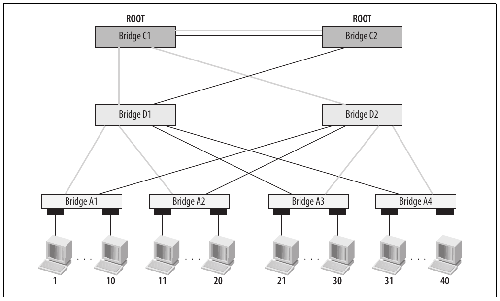

Hình 15-23. Ví dụ bridged network định nghĩa hai spanning tree instance

Từ góc nhìn host, kết quả là Hình 15-24.

Ngày nay dùng VLAN trên bridged network khá phổ biến. Đây là cách tiện lợi để tạo các L2 broadcast domain khác nhau trên bridged network. Khả năng định nghĩa nhiều spanning tree topology trên cùng network có nhiều ưu điểm. Trong đó là tận dụng network bandwidth tốt hơn (tức dùng redundant link tốt hơn, hay load balancing). Điều này giảm tải trên mỗi link.

MSTP sử dụng RSTP cho từng spanning tree instance của nó. Protocol thực tế phức tạp hơn vẻ ngoài: các STP instance độc lập, nhưng có một instance đặc biệt giữ vai trò trung tâm, nhất là về cách trao đổi BPDU và cách duy trì backward compatibility với các protocol trước đó.

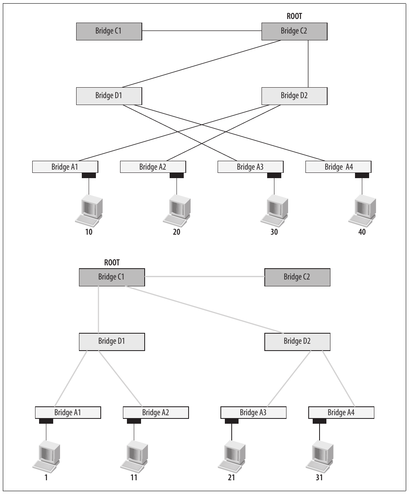

Hình 15-24. Hai spanning tree trong Hình 15-23

Vào thời điểm viết sách, chưa có open source implementation MSTP.

[^1]: MAC address 12-digit (như 11:22:33:44:55:66) được thay bằng value 2-digit đơn giản để hình dễ đọc.

[^2]: Chúng ta sẽ thấy STP định nghĩa cơ chế chọn cùng tree một cách xác định mỗi lần, nếu có nhiều instance tối ưu.

[^3]: Link trong hình không được gán cost. Có thể giả sử cost là 1, nên path cost là hop count. Đây chỉ là ví dụ; 1 không phải default cost gán cho link.

[^4]: Nếu dùng shared media như hub nối bridge, như Hình 15-11(c), root bridge cũng có thể có nondesignated port. RSTP mới hơn sẽ gọi port đó là backup port (xem mục “Rapid Spanning Tree Protocol (RSTP)”.

[^5]: Nhớ path cost của link là parameter cấu hình cục bộ, không được mang trong configuration BPDU.

[^6]: Nếu muốn biết cách định nghĩa default timer, đọc đặc tả IEEE 802.1d hoặc http://www.cisco.com/warp/public/473/122.html.

[^7]: Có thể cấu hình bridge để giảm tác động failure hoặc configuration change, từ đó góp phần hội tụ nhanh hơn.

[^8]: Vì vậy, nếu bridge là lá trong tree (tức access bridge), nó bị cô lập hoàn toàn.
