# Chương 16. Bridging: triển khai trong Linux


Chương này chuyển từ thảo luận tổng quát về đặc tả và protocol bridging sang cách Linux thực hiện công việc.

Trong Chương 10, chúng ta đã thấy bridging code có thể capture ingress packet trong `netif_receive_skb`. Trong chương này, chúng ta sẽ xem chính xác cách xử lý những ingress packet đó. Chúng ta sẽ xem cách bridging code thao tác device state và xử lý ingress traffic, cả khi STP được enable lẫn khi không.

Để xem đánh giá hiệu năng bridging code, tham khảo bài “Performance Evaluation of Linux Bridge” của James T. Yu, có thể tìm bằng web search.

## Bridge device abstraction

Trong Linux, bridge là virtual device. Vì vậy không thể nhận hoặc truyền gì trừ khi bind một hoặc nhiều real device vào nó. Chúng ta dùng thuật ngữ enslave để chỉ quá trình bind real device vào bridge device (ảo).

Giả sử muốn triển khai topology Hình 16-1. Một số điểm trong hình cần nhấn mạnh:

- Bridge gộp hai LAN. Host của LAN1 và LAN2 được cấu hình cùng subnet 10.0.1.0/24.

- Bridge nối router để host LAN1 và LAN2 giao tiếp được với host LAN3.

- Từ góc nhìn router, chỉ có một LAN trên eth0.

Vì Linux triển khai cả routing lẫn bridging, có thể gộp hai device thành một hệ thống Linux và thu được topology giống Hình 16-2(a). Network connection giữa bridge và router ở đó nằm trong kernel.

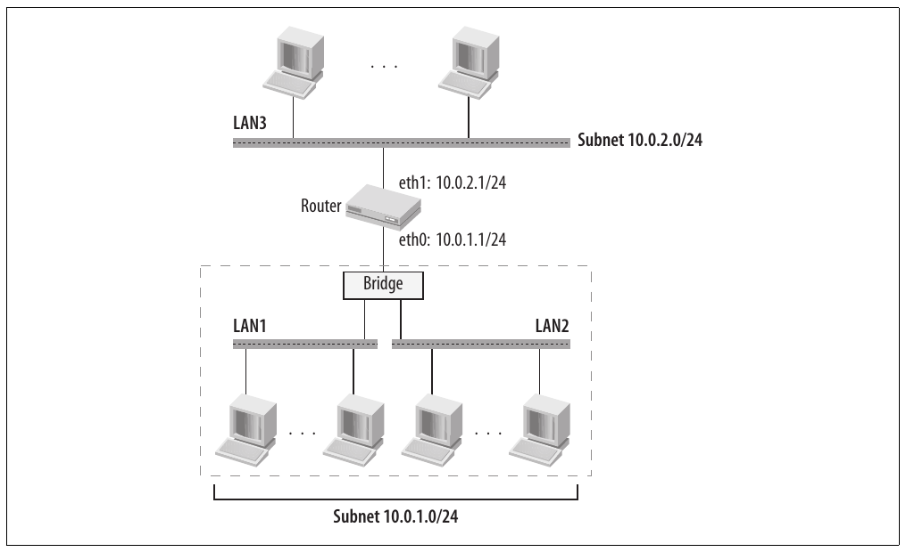

Hình 16-1. Ví dụ sử dụng bridge

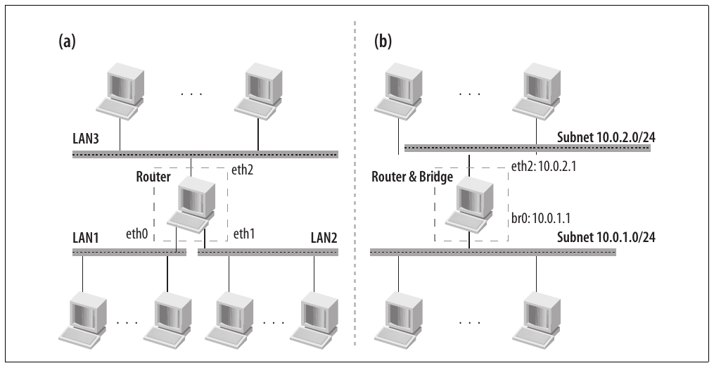

Hình 16-2. Bridge device abstraction

Giờ kernel phải xử lý được hai vấn đề sau:

- Ở router level, chỉ thấy hai subnet (10.0.1.0/24, 10.0.2.0/24), dù có ba interface (eth0, eth1, eth2).

- Chỉ nên bridge giữa eth0 và eth1, coi hai interface được cấu hình cùng IP subnet.

Hai vấn đề được xử lý độc lập và gọn gàng nhờ cách trừu tượng hóa bridge device.

Khi tạo bridge device, phải báo kernel interface cần enslave vào nó. Nói cách khác, phải báo kernel interface cần bridge. Theo ví dụ, chúng ta tạo bridge device, gọi là br0, rồi gán eth0 và eth1 vào. Vì eth0 và eth1 là bridge interface, không cần IP configuration; hoàn toàn không cần được thấy ở L3 layer, giống việc không bridge interface nào trong Hình 16-1 có IP configuration. Thay vào đó, gán cho bridge device IP configuration mà link từ router tới bridge có trong Hình 16-1. Kết quả là cấu hình Hình 16-2(b).

Lúc này routing subsystem có thể route dựa trên subnet cấu hình trên eth2 và br0. Khi thử truyền trên br0, bridge device driver quản lý enslaved device, áp dụng logic Chương 14: nếu forwarding database biết vị trí destination MAC address, frame chỉ được truyền trên bridge port thích hợp; nếu không, flood tới mọi bridge port của bridge device.

Trong Chương 11, chúng ta đã thấy truyền trên device thực hiện bằng `dev_queue_xmit`. Hình 16-3(a) cho thấy device trong ví dụ mà `dev_queue_xmit` có thể được yêu cầu truyền frame. `dev_queue_xmit` gọi routine `hard_start_xmit` do device driver cung cấp. Function bridging device driver dùng tra forwarding database và chọn egress device thích hợp, hoặc dùng flooding nếu cần. Chi tiết sẽ có trong mục “Bức tranh tổng thể” phía sau.

Trong Chương 10, chúng ta đã thấy device driver xử lý ingress frame trước hết khởi tạo vài field của structure `sk_buff`, rồi truyền lên upper layer. Một field biểu diễn device nhận frame. Tuy nhiên, NIC device driver không biết bridging nên không thể gán ingress frame cho instance `net_device` tương ứng bridge. Trong mục “Xử lý data frame”, bạn sẽ thấy cách xử lý vấn đề.

Device enslaved vào bridge device cũng có thể có IP configuration riêng. Chẳng hạn với topology Hình 16-2, nếu thêm subnet nữa (10.0.3.0/ 24) và cấu hình eth0 bằng address trên đó, topology sẽ hiện ra với Linux kernel routing layer như Hình 16-4.

Vì vậy eth0 có thể nhận traffic gửi tới bridge device br0 hoặc chính nó. Nghĩa là mô hình Hình 16-3 đổi thành Hình 16-5.

Trong khi phần truyền không cần chỉnh code, phần nhận cần. Mặc định, traffic nhận trên enslaved device được gán cho bridge device tương ứng. Chẳng hạn trong Hình 16-5, frame nhận trên eth1 được gán br0. Quyết định bridge hay route ingress frame (tức quyết định chuyển ingress frame tới eth0 hay br0 trong ví dụ trước) có thể cấu hình bằng ebtables (xem mục “Data frame so với BPDU”).

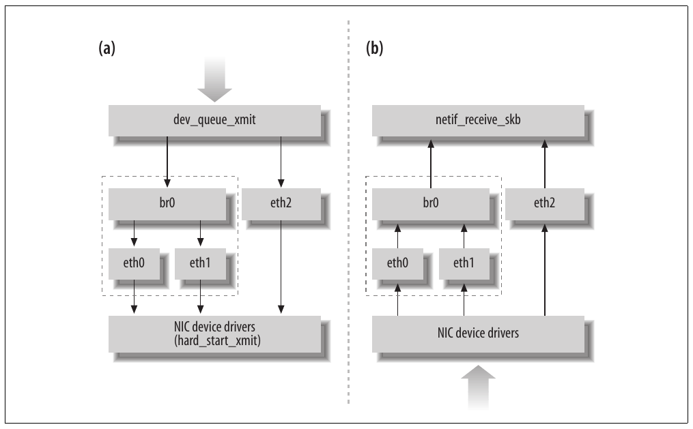

Hình 16-3. (a) Truyền trên bridge device; (b) nhận trên bridge device

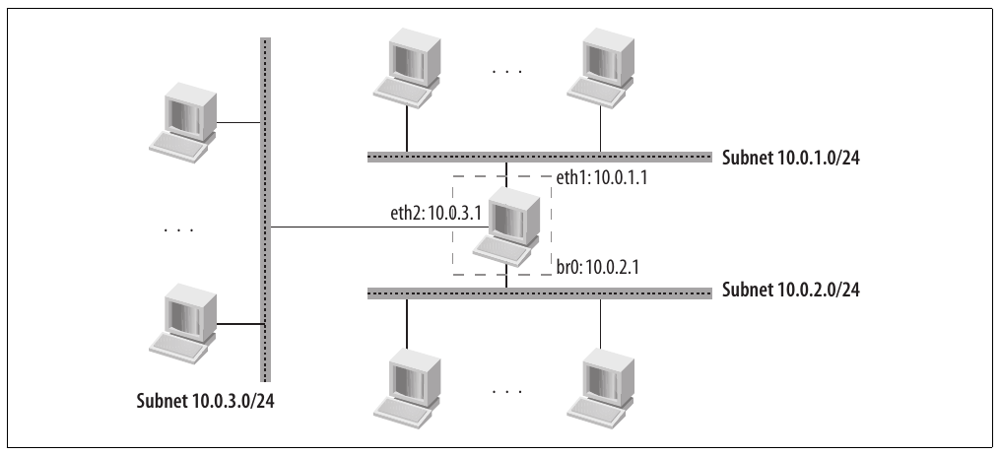

Hình 16-4. Gán L3 configuration cho enslaved NIC

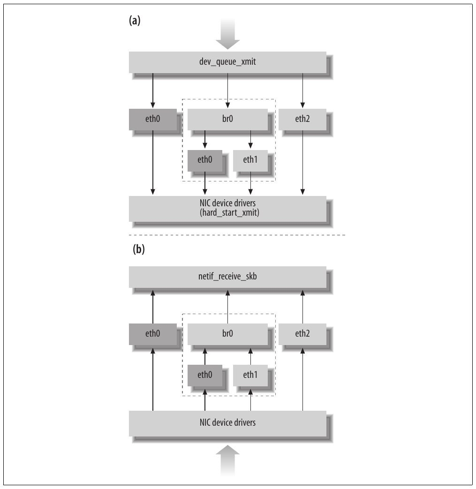

Hình 16-5. Dùng NIC vừa làm standalone interface vừa làm bridge port

## Data structure quan trọng

Danh sách sau giải thích data structure chính được bridging code định nghĩa và sử dụng. Tất cả có mục riêng mô tả field-by-field trong Chương 17.

`mac_addr`

MAC address.

`bridge_id`

Bridge ID (định nghĩa trong Chương 15).

`net_bridge_fdb_entry`

Entry của forwarding database. Mỗi MAC address bridge học có một entry.

`net_bridge_port`

Bridge port.

`net_bridge`

Thông tin áp dụng cho một bridge. Như Hình 16-6, structure này nối vào data structure `net_device`. Giống phần lớn virtual device, nó chứa private information chỉ virtual device code hiểu, trong trường hợp này là bridging.

`br_config_bpdu`

Field quan trọng của ingress configuration BPDU được copy vào data structure này, rồi structure được truyền thay BPDU gốc cho routine xử lý configuration BPDU.

Mọi data structure được định nghĩa trong net/bridge/br\_private.h, trừ `br_config_bpdu` định nghĩa trong net/bridge/br\_private\_stp.h. Hình 16-6 cho thấy quan hệ giữa một số data structure. Hình không phản ánh ví dụ cấu hình nào trong mục trước.

List `age_list` không còn dùng; tôi chỉ đưa vào hình để tham khảo. Xem mục “Structure net\_bridge” ở Chương 17.

## Khởi tạo bridging code

Bridging code có thể được build vào kernel hoặc compile thành module. Initialization routine và cleanup routine, lần lượt `br_init` và `br_uninit`, được định nghĩa trong /net/bridge/br.c.

Khởi tạo gồm:

- Khởi tạo forwarding database bằng cách tạo slab cache (memory area) để cấp phát structure `net_bridge_fdb_entry` (`br_fdb_init`).

- Khởi tạo function pointer `br_ioctl_hook` thành routine đảm nhiệm command `ioctl`. Command `ioctl` được mô tả trong Chương 17.

- Khởi tạo function pointer `br_handle_frame_hook` thành routine xử lý ingress BPDU. Xem mục “Xử lý ingress traffic”.

- Đăng ký callback với notification chain `netdev_chain`. Xem mục “Notification chain netdevice”.

Khi kernel được compile hỗ trợ Bridging-Firewalling, option được khởi tạo ở đây bằng `br_netfilter_init`. Sau đó, trong Hình 16-11 ở mục “Bức tranh tổng thể”, bạn có thể thấy vị trí mọi Netfilter hook trong core routine bridging code dùng để xử lý ingress traffic và egress traffic.

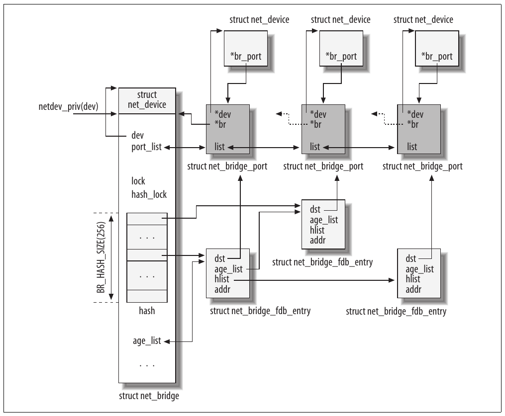

Hình 16-6. Quan hệ giữa các data structure type chính

Bridging-Firewalling được thêm vào kernel bằng option “Networking support ➝ Networking options ➝ Network packet filtering (replaces ipchains) ➝ Bridged IP/ ARP packet filtering”. Option Ethernet-Bridging-Tables (tức ebtables) được khởi tạo nơi khác (xem mục “Data frame so với BPDU”).

Cleanup routine `br_deinit` chỉ hoàn tác việc `br_init` đã làm.

## Tạo bridge device và bridge port

Không có hard limit cho số bridge device administrator có thể tạo. Mỗi bridge device có tối đa `BR_MAX_PORTS` (1.024) port.

Bridge device lần lượt được tạo và loại bỏ bằng `br_add_bridge` và `br_del_bridge`.

Port được thêm vào bridge device bằng `br_add_if` và loại bỏ bằng `br_del_if`.

Cả bốn routine chạy khi giữ Netlink routing lock. Lock được acquire bằng `rtnl_lock` và release bằng `rtnl_unlock`. `br_add_bridge` và `br_del_bridge` tự đảm nhiệm locking. Với `br_add_if` và `br_del_if`, function `dev_ioctl` đảm nhiệm (xem Chương 17).

Cả bốn routine `br_` được định nghĩa trong net/bridge/br\_if.c. Trong Chương 17, bạn có thể tìm hiểu cách chúng được gọi để đáp lại configuration command trong user space.

## Tạo bridge device mới

Dù bridge device là ảo, thảo luận cách enable, disable, đăng ký và hủy đăng ký device ở Chương 8 vẫn áp dụng. Bạn nên dùng chương đó làm tham khảo khi đọc mục này.

Tạo và đăng ký bridge device theo mô hình Chương 8. Khác biệt duy nhất là vì virtual device, bridge cần khởi tạo bổ sung trong private area (tức data structure `net_bridge` ở cuối Hình 16-6). Tác vụ cuối này do `new_bridge_dev` đảm nhiệm, thực hiện:

- Cấp phát và khởi tạo data structure `net_device`, dùng `br_dev_setup` làm setup routine. Xem mục “Setup routine của bridge device”.

- Khởi tạo private structure, như Hình 16-6.

- Khởi tạo bridge priority bằng default value 32.768 (0x8000).

- Khởi tạo designated bridge ID bằng identifier của nó, root path cost bằng 0 và root port bằng 0 (tức không root port). Vì khi bridge mới enable, tin rằng chính nó là root bridge. Xem mục “Chọn root bridge” ở Chương 15.

- Khởi tạo aging time bằng mặc định 5 phút.

- Khởi tạo timer per-bridge bằng `br_stp_timer_init`.

Lưu ý khởi tạo spanning tree parameter diễn ra bất kể STP có enable cho bridge hay không.

Bridge device có thể được gán tên bất kỳ. Tên phổ biến là brN và stpN khi Spanning Tree Protocol lần lượt bị disable và được enable. Chẳng hạn, nếu định nghĩa hai bridge không dùng STP, theo thông lệ gọi br1 và br2. Tuy nhiên, tên con chó của bạn cũng được chấp nhận.

Giống network device khác, bridge được gán directory trong /sys/class/net/. Xem mục “Tinh chỉnh qua filesystem /sys” ở Chương 17.

## Setup routine của bridge device

Có thể tìm chi tiết cách device driver dùng setup routine khi khởi tạo device trong mục “Khởi tạo device type: các function xxx\_setup” ở Chương 8. Bridge device dùng setup routine `br_dev_setup`. Đoạn trích sau cho thấy phần đáng chú ý:

```c
void br_dev_setup(struct net_device *dev)
{
    memset(dev->dev_addr, 0 , ETH_ALEN);
    ether_setup(dev);
    ...
    dev->do_ioctl = br_dev_ioctl;
    dev->hard_start_xmit = br_dev_xmit;
    dev->open = br_dev_open;
    dev->change_mtu = br_change_mtu;
    dev->stop = br_dev_stop;
    dev->tx_queue_len = 0 ;
    dev->set_mac_addr = NULL ;
    dev->priv_flags = IFF_EBRIDGE;
}
```

Mặc định bridge device không triển khai queueing. Chúng để enslaved device đảm nhiệm, giải thích vì sao `tx_queue_len` khởi tạo 0. Tuy nhiên administrator có thể cấu hình `tx_queue_len` bằng ifconfig hoặc ip link.

Khi Maximum Transmission Unit (MTU) trên bridge device đổi, kernel phải bảo đảm value mới không lớn hơn MTU nhỏ nhất trong số enslaved device. `br_change_mtu` bảo đảm điều này.

Bridge MAC address `dev_addr` được clear vì sẽ suy ra từ MAC address cấu hình trên enslaved device bằng `br_stp_recalculate_bridge_id` (xem mục “Bridge ID và port ID”). Cùng lý do, driver không cung cấp function `set_mac_addr`.

Flag `IFF_EBRIDGE` được set để kernel code phân biệt bridge device với device type khác khi cần.

Routine `br_dev_ioctl` xử lý một số command `ioctl` có thể phát cho bridge device. Xem Chương 17.

Trong Chương 11, chúng ta đã thấy driver khởi tạo function pointer `hard_start_xmit` thành routine dùng để truyền. Bridging driver khởi tạo thành `br_dev_xmit`. Function chịu trách nhiệm triển khai bridge device abstraction trong mục “Bridge device abstraction”. Hình 16-11 phía sau cho thấy cách triển khai abstraction.

Khi bridge device được enable hoặc disable do quản trị, kernel lần lượt gọi `dev_open` và `dev_close`, gọi `br_dev_open` và `br_dev_close` với bridge device. Xem mục “Enable và disable bridge device”.

## Xóa bridge

Trước khi loại bridge device, phải tắt nó. Nếu chưa tắt, `br_del_bridge` return –`EBUSY` và từ chối loại device. Để loại, `br_del_bridge` gọi `del_br`, thực hiện phần lớn công việc như sau:

- Loại mọi bridge port. Với mỗi port, cũng loại link tương ứng (hiển thị thành directory) trong /sys. Xem mục “Xóa bridge port”.

- Với mỗi port, loại mọi entry tương ứng trong forwarding database bằng `br_fdb_delete_by_port`, dừng mọi timer của port và giảm promiscuity counter. (Promiscuity counter được mô tả trong mục sắp tới “Thêm port vào bridge”.)

- Dừng garbage collection timer `br->gc_timer`.

- Loại directory của bridge device trong directory /sys/class/net bằng `br_sysfs_delbr`.

- Hủy đăng ký device bằng `unregister_netdevice`. Function được mô tả trong Chương 8.

## Thêm port vào bridge

Trong triển khai bridging hiện tại, có quan hệ one-to-one giữa NIC và bridge port, như Hình 16-6. Một số commercial bridge cho phép administrator thêm NIC vào nhiều bridge device và gán traffic cho bridge cụ thể theo tiêu chí user-chosen, nhưng Linux không cho phép.

Bridge port được thêm vào bridge device bằng `br_add_if`. Bên trong routine thể hiện trong Hình 16-7. Routine không quan tâm STP có enable trên bridge device hay không.

Routine bắt đầu bằng tập sanity check. Thao tác bị hủy nếu một trong các điều kiện sau đúng:

- Device sẽ gắn với port không phải Ethernet device (hoặc loopback device).

- Device sẽ gắn với port là bridge. Như Hình 16-6, bridge port phải được gán real device (hoặc virtual device không phải bridge device).

- Bridge port đã được gán device (tức `dev->br_port` không NULL).

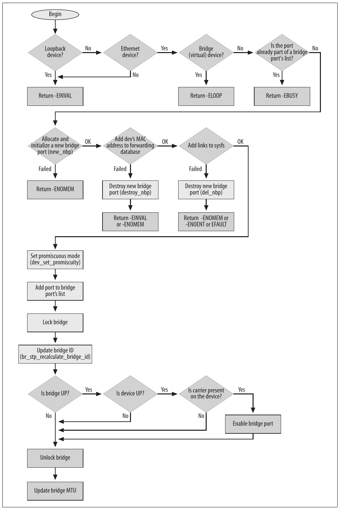

Hình 16-7. Function br\_add\_if

Khi qua kiểm tra, bridge port mới được cấp phát và khởi tạo một phần bằng `new_nbp`. Cụ thể function:

- Gán port number cho bridge port. Xem mục “Bridge ID và port ID”.

- Gán default priority cho port.

- Tính port ID bằng cách kết hợp port number và priority qua `br_make_port_id`. Trong 16 bit port ID, 10 (`BR_PORT_BITS`) dùng cho port number, 6 cho port priority. Lưu ý không tuân theo standard specification mô tả trong mục “Bridge ID và port ID” ở Chương 15.

- Gán default cost cho port dựa trên tốc độ enslaved device. Cost được chọn bằng `br_initial_port_cost` (xem cách gọi `new_npb`), đọc device speed qua ethtool interface giới thiệu ở Chương 8 rồi chuyển thành cost. Khi device driver của enslaved device không hỗ trợ ethtool interface, không thể suy default cost từ interface, nên chọn cost theo giả định enslaved device là Ethernet 10 Mbit/s device. Quan hệ giữa port speed và default port cost được định nghĩa trong đặc tả protocol IEEE 802.1D.

- Gán state ban đầu `BR_STATE_DISABLED`.

- Liên kết bridge port với enslaved device và bridge device, như Hình 16-6.

MAC address của device gắn với bridge port mới được thêm vào forwarding database bằng `br_fdb_insert`.

`br_sysfs_addif` thêm link cần thiết vào /sys như mô tả trong mục “Tinh chỉnh qua filesystem /sys” ở Chương 17.

NIC gắn với bridge port được đưa vào promiscuous mode bằng `dev_set_promiscuity`. Promiscuous mode dùng để capture mọi LAN traffic và cần để bridge forward frame. Mode được lưu bằng counter thay vì Boolean flag cho mỗi port vì kernel muốn xử lý request vào promiscuous mode lồng nhau. Khi promiscuous mode được enable trên bridge port (như `dev_set_promiscuity` làm), counter tăng trên enslaved device tương ứng; khi disable, counter giảm.

Cuối cùng, bridge port mới được thêm vào port list của bridge trong Hình 16-6, rồi bridge ID và MTU được cập nhật theo quy tắc trong mục “Bridge ID và port ID” ở Chương 15 và “Setup routine của bridge device”, lần lượt bằng `br_stp_recalculate_bridge_id` và `dev_set_mtu`.

### Xóa bridge port

Xóa bridge chủ yếu cần hoàn tác việc đã làm khi tạo port. Hình 16-8 cho thấy bên trong `br_del_if`.

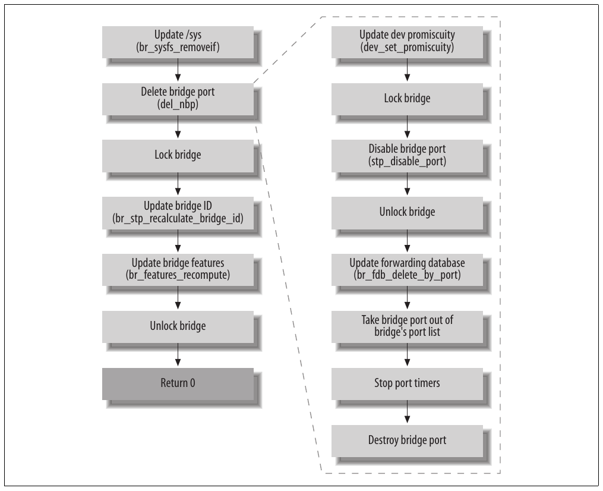

Hình 16-8. Function br\_del\_if

## Enable và disable bridge device

Trong mục “Setup routine của bridge device”, chúng ta đã thấy cách khởi tạo `dev->open` và `dev->stop` cho bridge device; và trong mục “Enable và disable network device” ở Chương 8 đã thấy command quản trị enable/disable network device được `dev_open` và `dev_close` xử lý thế nào.

`br_dev_open` enable bridge bằng cách:

1\. Khởi tạo bridge device feature thành tập con tối thiểu chung của feature mà enslaved device hỗ trợ, bằng `br_features_recompute`

2\. Enable device để truyền bằng `netif_start_queue` (xem mục “Enable và disable việc truyền” ở Chương 11)

3\. Enable bridge device bằng `br_stp_enable_bridge` Khi enable bridge device, mọi port đã enslaved vào nó trước đó cũng được enable.

`br_dev_stop` chỉ là thao tác đối ứng của `br_dev_open`, như Hình 16-9.

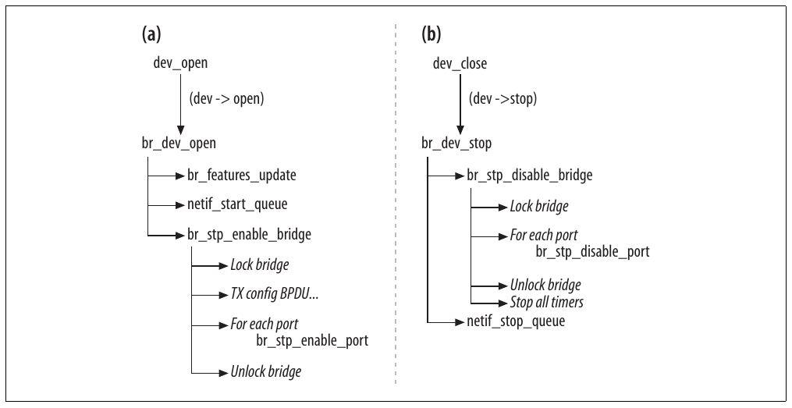

Hình 16-9. (a) Enable bridge; (b) disable bridge

## Enable và disable bridge port

Bridge port lần lượt được enable và disable bằng `br_stp_enable_port` và `br_stp_disable_port`.

Để enable bridge port, phải đáp ứng mọi điều kiện sau:

- Enslaved device tương ứng có trạng thái quản trị UP.

- Enslaved device tương ứng có carrier status. Xem mục “Phát hiện thay đổi link state” ở Chương 8 để biết cách Linux phát hiện thay đổi carrier signal status.

- Bridge device tương ứng có trạng thái quản trị UP.

Lưu ý bridge device không có carrier status vì bridge là virtual device nên không có carrier status.

Khi bridge port được tạo bằng command user-space và đáp ứng ba điều kiện trên, bridge port được enable ngay. Xem mục “Thêm port vào bridge”.

Giả sử khi port được tạo, chưa thể enable vì ít nhất một trong ba điều kiện chưa được đáp ứng. Đây là nơi enable port khi cuối cùng từng điều kiện được đáp ứng:

- Khi bridge device đã tắt được kích hoạt, mọi disabled port của nó được enable.

- Khi enslaved device phát hiện carrier status, bridging code nhận notification `NETDEV_CHANGE`. Xem mục “Notification chain netdevice”.

- Khi enslaved device đã tắt được kích hoạt, bridging code nhận notification `NETDEV_UP`. Xem mục “Notification chain netdevice”.

Bridge port bị disable khi bất kỳ điều kiện nào trong ba điều kiện đầu mục không còn được đáp ứng.

Hình 16-10 tóm tắt bước và function tương ứng để enable/disable bridge port. Lưu ý khi bridge port bị disable, nonroot bridge có thể trở thành root bridge. Chuyển tiếp mô tả trong mục “Trở thành root bridge”. Lưu ý khi enable port, trước hết khởi tạo rồi gán state thích hợp bằng `br_port_state_selection`. Function duyệt mọi bridge port để áp dụng state đúng cho từng port. Nhưng trên bridge không chạy STP, thực tế function chỉ đưa port mới vào state `BR_STATE_FORWARDING`. Vì port được gán designated role (dù bridge không chạy STP không nên quan tâm port role). Cần nhớ phần lớn routine không phân biệt STP enable hay disable. Chẳng hạn, `br_state_port_selection` duyệt mọi port vì khi STP được enable và có configuration update, có thể đổi role và do đó state nhiều port (xem mục “Configuration update”).

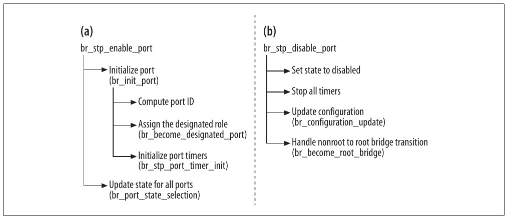

Hình 16-10. (a) Enable port; (b) disable port

## Đổi state trên bridge port

Bridge port hoạt động hoặc không hoạt động: state tương ứng là `BR_STATE_FORWARDING` hoặc `BR_STATE_BLOCKING`. Tuy nhiên, trong khi state `BR_STATE_BLOCKING` có thể gán ngay, state `BR_STATE_FORWARDING` chỉ đạt sau khi qua state trung gian giới thiệu trong mục “Port state” ở Chương 15.

State `BR_STATE_FORWARDING` và `BR_STATE_BLOCKING` được gán lần lượt bằng routine `br_make_forwarding` và `br_make_blocking`. Vẫn dùng hai routine này bất kể bridge device chứa port có chạy STP không.

```c
static void br_make_blocking(struct net_bridge_port *p)
{
    if (p->state != BR_STATE_DISABLED &&
        p->state != BR_STATE_BLOCKING) {
        if (p->state == BR_STATE_FORWARDING ||
            p->state == BR_STATE_LEARNING)
            br_topology_change_detection(p->br);

        p->state = BR_STATE_BLOCKING;
        br_log_state(p);
        del_timer(&p->forward_delay_timer);
    }
}

static void br_make_forwarding(struct net_bridge_port *p)
{
    if (p->state == BR_STATE_BLOCKING) {
        if (p->br->stp_enabled) {
            p->state = BR_STATE_LISTENING;
        } else {
            p->state = BR_STATE_LEARNING;
        }
        br_log_state(p);
        mod_timer(&p->forward_delay_timer, jiffies + p->br->forward_delay);
    }
}
```

Lưu ý không thể gán port state trung gian bất kỳ giữa `BR_STATE_BLOCKING` và `BR_STATE_FORWARDING`, vì vậy `br_make_forwarding` return nếu được yêu cầu đổi port không ở state `BR_STATE_BLOCKING` sang `BR_STATE_FORWARDING`. Tuy nhiên, state trung gian cho biết port đã đang tiến tới `BR_STATE_FORWARDING` và sẽ tới khi timer thích hợp hết hạn.

Trong `br_make_forwarding`, bridge port bỏ qua state `BR_STATE_LISTENING` khi không dùng STP. Khi không dùng STP, mọi bridge port sẽ được gán forwarding state; vì vậy cũng có thể bỏ qua `BR_STATE_LEARNING`. Tuy nhiên, dùng state trung gian `BR_STATE_LEARNING` có thể cho bridge học một số MAC address và giảm lượng flooding vốn cần khi forwarding database rỗng.

## Bức tranh tổng thể

Hình 16-11 cho thấy routine quan trọng bridging code dùng để xử lý ingress frame và egress frame (cả data frame lẫn BPDU).

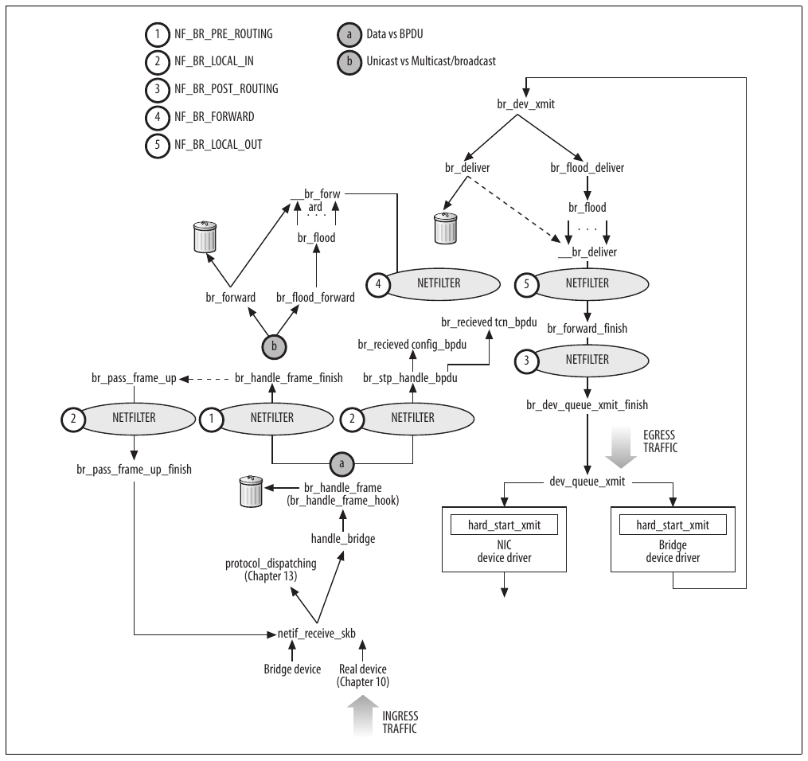

Hình 16-11. Bức tranh tổng thể

Cụ thể, lưu ý:

- Số hook bằng ở IP layer (xem Hình 18-1 ở Chương 18). Thêm một hook trong `br_handle_frame` (`NF_BR_BROUTING`), không thể hiện trong hình, được ebtables dùng và mô tả trong mục “Data frame so với BPDU”.

- Ingress data frame có thể qua `netif_receive_skb` hai lần. `netif_receive_skb` được mô tả trong Chương 10. Xem thêm mục “Xử lý data frame” phía sau chương.

- Ingress frame được `netif_receive_skb` truyền tới bridging subsystem khi lời gọi `handle_bridge` cho biết cần, nếu không thì tới protocol handler upper-layer (như mô tả trong Chương 13).

- Ingress frame có thể bị bridging code drop, chẳng hạn vì port bị disable.

- Ingress data frame bị `br_forward` drop khi receiving port đã bị STP block. Egress frame không cần được `br_deliver` truyền ra port nào khi destination address là local của host. Trong cả hai trường hợp, `should_deliver` lọc việc truyền không cần thiết.

- Egress data frame qua `dev_queue_xmit` hai lần. `dev_queue_xmit` được mô tả trong Chương 11. Xem thêm mục “Truyền trên bridge device” phía sau chương.

- Function `br_flood` flood frame trên các port của bridge. Flooding có thể cần cho cả ingress frame lẫn egress frame. Bất kể frame tạo ở đâu, khi gửi tới multicast address, broadcast address hoặc address không có trong forwarding database, phải flood. `br_flood` biết đang xử lý ingress frame hay egress frame từ input parameter cuối, là function gọi nhiều lần để truyền frame trên từng bridge port (`__br_forward` cho ingress, `__br_deliver` cho egress).

Khi xem code trong mục tiếp theo, cần nhớ bridging code dùng cùng tập core routine bất kể STP enable hay không. Một số khác biệt chính nằm ở subtask thực thi.

Khi STP được enable:

- Ingress BPDU được xử lý.

- BPDU cũng có thể được tạo cục bộ, tùy role của local bridge port.

- Ingress data traffic được forward tới port đúng hoặc flood tới mọi bridge port theo quy tắc Chương 14.

- Port bị STP block không thể dùng nhận và truyền data traffic.

Khi STP bị disable:

- Ingress BPDU được coi như data traffic.

- Không tạo BPDU cục bộ.

- Ingress data traffic vẫn được forward tới port đúng hoặc flood tới mọi bridge port theo quy tắc Chương 14.

- Mọi bridge port (trừ khi bị disable do quản trị) có thể dùng nhận và truyền data traffic.

## Forwarding database

Mỗi bridge instance có forwarding database riêng, được dùng bất kể STP enable hay disable. Phía sau chương, chúng ta sẽ xem chính xác khi nào database được tra và cập nhật. Trước hết xem triển khai và core function thao tác. Mọi routine quản lý forwarding database nằm trong net/bridge/br\_fdb.c.

Database nhúng trong data structure `net_bridge` và định nghĩa là hash table (xem Hình 16-6). Một instance data structure `net_bridge_fdb_entry` được thêm cho mỗi MAC address học trên bất kỳ bridge port nào.

Bridge forwarding database subsystem được khởi tạo bằng `br_fdb_init`, chỉ tạo cache `br_fdb_cache` để cấp phát instance `net_bridge_fdb_entry`.

Cấp phát bằng `fdb_create`, đồng thời khởi tạo vài field của `net_bridge_fdb_entry` theo input parameter.

### Lookup

Phần tử forwarding database được nhận diện bằng MAC address. Lookup trong table gồm chọn đúng hash table bucket bằng `br_mac_hash`, rồi duyệt list instance `net_bridge_fdb_entry` của bucket để tìm instance khớp MAC address cho trước.

Có hai lookup routine chính:

`fdb_find`

Chỉ tìm `net_bridge_fdb_entry` cho MAC address cho trước. Không dùng để forward data traffic, chủ yếu được bridging management function dùng.

`__br_fdb_get`

Tương tự `fdb_find`, được bridging code gọi để forward traffic. Không xét expired entry (xem mục “Aging”).

Với cả hai routine, bên gọi bảo đảm locking thích hợp.

External subsystem muốn lookup forwarding database có thể dùng routine `br_fdb_get`, wrapper đảm nhiệm locking và reference count rồi gọi `__br_fdb_get`. `br_fdb_get` không được gọi trực tiếp mà qua `br_fdb_get_hook`, được `br_init` khởi tạo thành pointer tới `br_fdb_get`.

### Reference count

Vì external subsystem truy vấn forwarding database bằng `br_fdb_get` có thể cache kết quả, reference count được dùng để theo dõi khi entry vẫn cần và khi có thể giải phóng. Mỗi entry được gán reference count. `br_fdb_get` luôn tăng reference count khi lookup thành công. Bên gọi có trách nhiệm giảm bằng `br_fdb_put` khi không còn cần reference tới lookup result. Khi reference count về 0, `br_fdb_put` giải phóng `net_bridge_fdb_entry`.

### Thêm, cập nhật và loại entry

Forwarding database được điền và cập nhật bằng tập routine khác nhau, tùy MAC address gắn với local interface hay ingress frame.

Khi tạo bridge port, `br_add_if` thêm MAC address enslaved device vào forwarding database bằng `br_fdb_insert`. Function sau bỏ qua MAC address không nên thêm, như multicast address và broadcast address. Khi address mới đã có trong database, nó được thay thế trừ khi gắn với local interface khác, khi đó không cần cập nhật. Lưu ý local MAC address trong forwarding database cho bridging code chuyển cục bộ ingress frame gửi tới local interface. Vì vậy local MAC address gắn với interface nào không quan trọng. Chỉ cần ít nhất một entry trong database báo bridging code traffic nào chuyển cục bộ.

Không có hard limit số entry có thể thêm vào forwarding database. Điều này có thể khiến hệ thống chịu DOS attack, nên có thể kỳ vọng developer thêm hard limit trong tương lai gần.

Khi local device gắn bridge port, do đó có MAC address trong forwarding database, thay MAC address,[^1] entry được cập nhật bằng `br_fdb_change_addr` (xem mục “Notification chain netdevice”). Vì nhiều local interface có thể cấu hình cùng MAC address (dù không phổ biến), `bf_fdb_change_addr` kiểm tra bridge port khác cùng bridge có cùng MAC address không trước khi loại instance `net_bridge_fdb_entry`: nếu tìm thấy, bind database entry vào interface của port còn lại.

MAC address học từ ingress frame (như Chương 14) được thêm bằng `br_fdb_update`. Khi address đã có, reference tới ingress port (`dst`) được cập nhật nếu cần và timestamp lần cập nhật cuối (`ageing_timer`) được cập nhật.

Instance `net_bridge_fdb_entry` được loại bằng `fdb_delete`. Function không bao giờ gọi trực tiếp mà luôn qua wrapper như `br_fdb_cleanup` (mô tả mục tiếp theo) và `br_fdb_delete_by_port`.

### Aging

Mỗi bridge instance có garbage collection timer (`gc_timer`) định kỳ quét forwarding database và xóa expired entry. Timer khởi tạo trong `br_stp_timer_init` khi bridge instance khởi tạo, và bắt đầu khi bridge enable bằng `br_stp_enable_bridge`.

Timer hết hạn mỗi one-tenth giây và gọi `br_fdb_cleanup` để dọn. Function quét database và xóa expired entry bằng `fdb_delete`.

Entry thường hết hạn nếu không được dùng ít nhất 5 phút. Tuy nhiên khi bridge chạy STP, aging time ngắn hơn là `forward_delay` giây được dùng khi phát hiện topology change (xem mục “Short Aging timer” ở Chương 15). Aging time đúng được chọn trong suốt bằng lời gọi routine `hold_time`, trả về value thích hợp dựa trên logic ở đây.

## Xử lý ingress traffic

Trong Chương 10, chúng ta đã thấy ingress traffic được `netif_receive_skb` xử lý thế nào. Cụ thể, function gọi `handle_bridge` (định nghĩa trong net/core/dev.c) trước khi truyền từng ingress frame cho protocol handler upper-layer.

Khi kernel không hỗ trợ bridging, `handle_bridge` được định nghĩa là NULL pointer và `netif_receive_skb` chuyển ingress frame tới protocol handler khác. Khi kernel hỗ trợ bridging và frame nhận trên bridge port, `handle_bridge` xử lý frame bằng `br_handle_frame_hook`. Pointer sau được khởi tạo thành `br_handle_bridge` khi bridging module khởi tạo.

```c
#if defined(CONFIG_BRIDGE) || defined (CONFIG_BRIDGE_MODULE)
...
static __inline__ int handle_bridge(struct sk_buff **pskb,
                    struct packet_type **pt_prev, int *ret)
{
    struct net_bridge_port *port;

    if ((*pskb)->pkt_type == PACKET_LOOPBACK ||
        (port = rcu_dereference((*pskb)->dev->br_port)) == NULL)
        return 0;
    if (*pt_prev) {
        *ret = deliver_skb(*pskb, *pt_prev);
        *pt_prev = NULL;
    }

    return br_handle_frame_hook(port, pskb);
}
#else
#define handle_bridge(skb, pt_prev, ret)    (0)
#endif
```

Trong các mục nhỏ sau, chúng ta sẽ xem `handle_bridge` xử lý ingress frame, phân biệt data frame và STP BPDU (Hình 16-11, vòng tròn a). Với data frame, function cũng phân biệt unicast frame với multicast frame hoặc broadcast frame (Hình 16-11, vòng tròn b).

### Data frame so với BPDU

Trên hệ thống Linux hỗ trợ bridging, không phải mọi NIC cần cấu hình làm bridge port. Khi NIC cấu hình làm bridge port, pointer `br_port` của `net_device` trỏ tới bridge port tương ứng. Vì mỗi bridge port có pointer tới bridge instance nó thuộc về, dễ đi từ real device tới bridge instance tương ứng (nếu có) và kiểm tra STP enable cho device hay không bằng flag trong data structure `net_bridge`. Xem Hình 16-6.

BPDU do STP tạo được phân biệt với mọi ingress frame khác và do STP receiving routine xử lý, nhưng chỉ khi STP được enable trên bridge chứa ingress port.

Hình 16-12 cho thấy `br_handle_frame` chuyển ingress frame tới routine thích hợp, `br_handle_frame_finish` hoặc `br_stp_handle_bpdu`, tùy STP có enable không.

Mọi frame nhận trên disabled port đều bị drop.

Data frame chỉ được chấp nhận trên port ở state `BR_STATE_FORWARDING`, còn BPDU được chấp nhận trên mọi enabled port miễn STP được enable (nếu không chỉ coi như data frame thông thường).

Logic bên trái Hình 16-12 để nhận diện BPDU theo quy tắc giới thiệu trong mục “BPDU encapsulation” ở Chương 15.

Lưu ý cả hai routine cuối Hình 16-12 chỉ được gọi nếu Netfilter không drop hoặc consume frame vì lý do khác.

ebtables cũng có cơ hội xem frame. Đây là framework cung cấp khả năng bổ sung Netfilter không có.

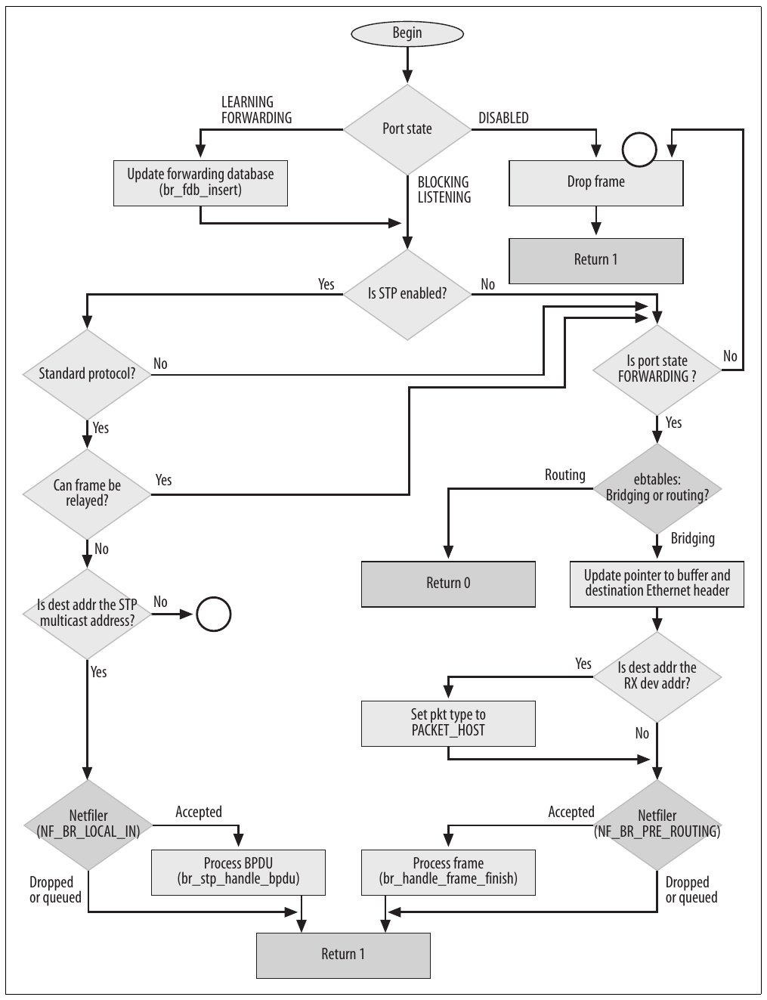

Hình 16-12. Function br\_handle\_frame

Cụ thể, ebtables cho phép filtering và mangling mọi frame type, không chỉ frame mang IP packet. Trong phạm vi thảo luận, tôi cần nhắc hai khả năng của ebtables:

- Cho phép định nghĩa rule báo kernel traffic nào bridge và traffic nào route, dựa trên yếu tố như network protocol (tức IPv4) hoặc destination IP address. Nghĩa là NIC enslaved vào bridge port không chỉ làm bridge port, mà còn tồn tại như L3 interface độc lập và có thể được gán L3 configuration riêng. Chúng ta đã thấy ví dụ trong mục “Bridge device abstraction”.

- Destination MAC address có thể được mangle, chẳng hạn redirect frame tới host khác hoặc triển khai một dạng network address translation. Vì vậy `br_handle_frame` kiểm tra destination MAC address sau khi ebtables xong việc.

Có thể thêm hỗ trợ ebtables vào kernel bằng option “Networking support ➝ Networking options ➝ Network packet filtering (replaces ipchains) ➝ Bridge: Netfilter Configuration ➝ Ethernet Bridge tables (ebtables) support”. Tại trang chủ ebtables, có tài liệu khá tốt về feature ở cả phía user-space lẫn kernel-space. Cũng có ví dụ rõ ràng cách dùng từng feature. Trang chủ dự án là http://ebtables.sourceforge.net.

### Xử lý data frame

Ingress data frame do `br_handle_frame_finish` xử lý, như Hình 16-13.

Trước hết source MAC address của frame được thêm vào forwarding database bằng `br_fdb_update`. Sau đó tìm destination MAC address trong forwarding database. Nếu tìm thấy, frame được forward tới bridge port đúng bằng `br_forward`; nếu không, flood tới mọi forwarding bridge port bằng `br_flood_frame`. Frame gửi tới broadcast link layer address hoặc multicast link layer address luôn được flood.

Bản copy frame cũng được chuyển cục bộ bằng `br_pass_frame_up` (tức truyền lên upper layer) nếu bất kỳ điều kiện nào sau đúng:

- Bridge interface ở promiscuous mode. Lưu ý mọi device enslaved vào bridge port đều ở promiscuous mode vì cần để bridge hoạt động. Tuy nhiên, chính bridge không ở promiscuous mode trừ khi được cấu hình tường minh.

- Frame được flood vì một trong các lý do trước.

- Theo forwarding database, destination MAC address thuộc local interface.

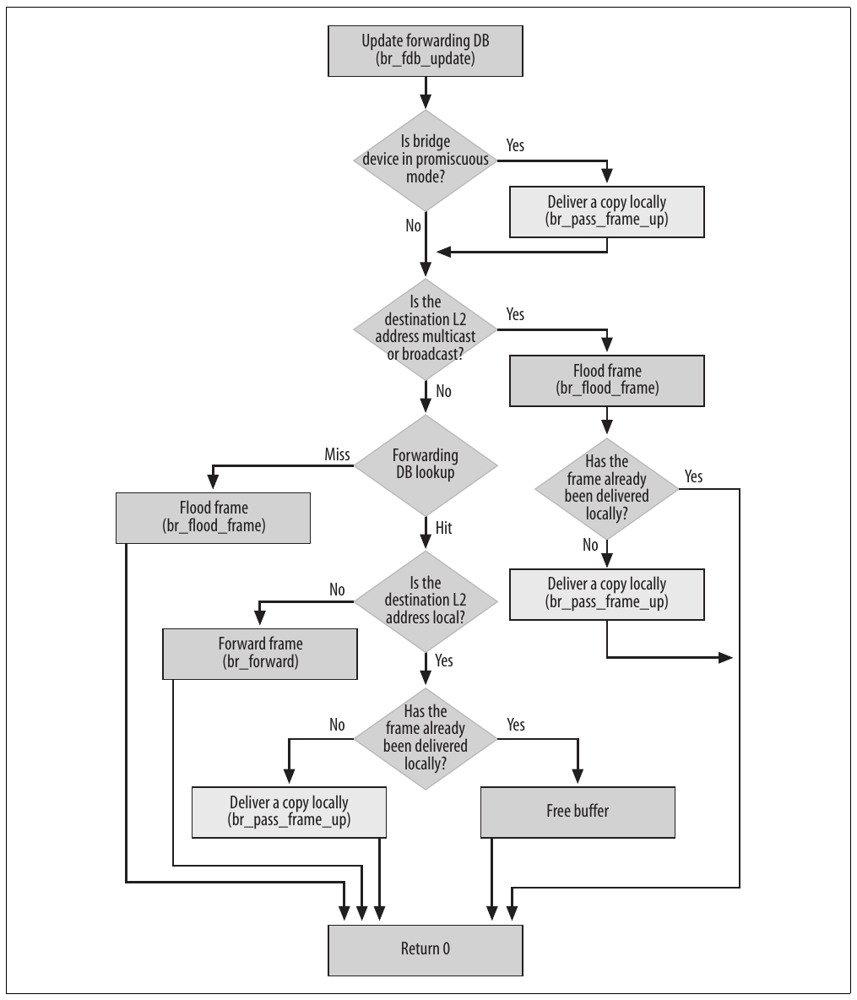

Hình 16-13. Function br\_handle\_frame\_finish

Cách xử lý local delivery khá thú vị. Hình 16-14, tập con của Hình 16-11, cho thấy chính xác đường ingress frame cuối cùng được chuyển lên protocol handler upper-layer.

Khi device driver của NIC nhận frame, `skb->dev` được khởi tạo thành real device. Frame được đẩy lên network stack và cuối cùng tới `br_pass_frame_up`. Function qua Netfilter hook khác rồi gọi `br_pass_frame_up_finish`. Tại đây `skb->dev` được thay bằng bridge device chứa ingress port và `netif_receive_skb` được gọi lại. Lần này `handle_bridge` thấy device không phải enslaved device (tức `br_port` NULL) và chuyển frame tới protocol handler thích hợp như Chương 13.

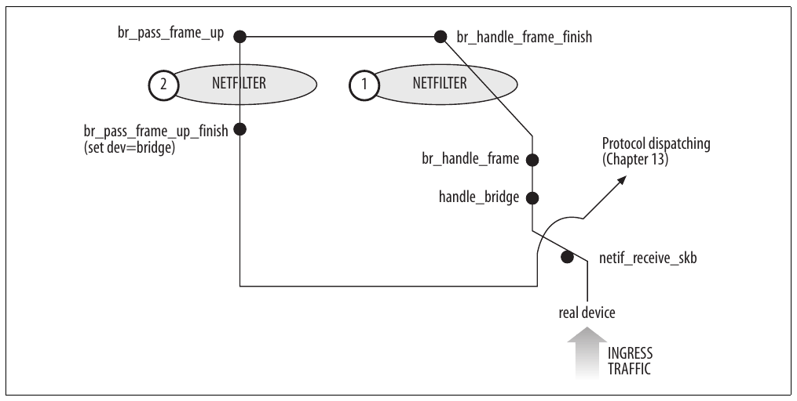

Hình 16-14. Local delivery của ingress data frame

## Truyền trên bridge device

Trong mục “Bridge device abstraction”, chúng ta đã thấy abstraction đòi hỏi chuyển việc truyền trên bridge device thành truyền trên một hoặc mọi bridge port. Hình 16-11 cho thấy routine chính thực hiện điều này.

Triển khai `hard_start_xmit` của bridge driver là `br_dev_xmit`. Function sau chỉ triển khai logic cơ bản bridge dùng để truyền: copy frame ra bridge port đúng khi lookup trong bridge forwarding database thành công. Ngược lại, flood frame trên mọi bridge port đủ điều kiện khi lookup thất bại hoặc destination MAC address là L2 multicast address hay L2 broadcast address.

## Spanning Tree Protocol (STP)

Trong Chương 15, chúng ta đã thấy STP hoạt động thế nào. Trong chương này, chủ yếu xem cách:

- Xử lý ingress BPDU

- Truyền egress BPDU

- Xử lý timer

### Spanning tree routine quan trọng

Sau đây là routine quan trọng spanning tree code dùng để triển khai logic Chương 15:

`br_become_root_bridge`

`br_is_root_bridge`

`br_become_root_bridge` làm nonroot bridge trở thành root bridge. Tác vụ gồm dừng TCN timer vì không nên chạy trên root bridge, và bắt đầu Hello timer chỉ chạy trên root bridge. Function cũng cập nhật timer khác thành value cấu hình cục bộ và bắt đầu topology change. `br_is_root_bridge` return 1 khi input bridge là root bridge, nếu không return 0.

`br_should_become_designated_port`

`br_designated_port_selection`

`br_become_designated_port`

`br_is_designated_port`

`br_is_designated_for_some_port`

`br_should_become_designated_port` return 1 nếu input port nên được gán designated role, nếu không return 0. `br_designated_port_selection` lặp qua mọi bridge port và gán designated role cho port xứng đáng (xem mục “Chọn designated port” ở Chương 15).

`br_become_designated_port` gán designated role cho bridge port. `br_is_designated_port` return 1 khi input port là designated port, nếu không return 0. Với bridge cho trước, `br_is_designated_for_some_port` return 1 nếu bridge có ít nhất một port designated role, nếu không return 0.

`br_supersedes_port_info`

Với bridge port và input configuration BPDU nhận trên port, function return 1 nếu BPDU superior (tức priority vector tốt hơn) so với thông tin bridge port biết, nếu không return 0.

`br_should_become_root_port`

`br_root_selection`

Với bridge port và root port hiện tại, `br_should_become_root_port` so priority vector của port đầu với priority vector root port hiện tại và return 1 nếu port đầu có priority vector tốt hơn (vì vậy nên được ưu tiên hơn root port hiện tại). Nếu không return 0. Với bridge cho trước, `br_root_selection` chọn root port như mô tả trong mục “Chọn root port” ở Chương 15.

`br_configuration_update`

Với bridge cho trước, xác định root port và designated port rồi trả thông tin đó.

`br_port_state_selection`

Với bridge cho trước, chọn port state thích hợp cho mỗi bridge port.

`br_topology_change_detection`

`br_topology_change_acknowledge`

`br_topology_change_acknowledged`

`br_topology_change_detection` xử lý phát hiện topology change, phân biệt topology change do root bridge và nonroot bridge phát hiện. `br_topology_change_acknowledge` acknowledge nhận TCN bằng cách truyền configuration BPDU có TCA flag set. `br_topology_change_acknowledged` dừng TCN timer.

`br_record_config_information`

`br_record_config_timeout_values`

Với bridge port và ingress configuration BPDU, `br_record_config_information` ghi priority vector BPDU vào data structure `net_bridge_port` của port và khởi động lại message age timer, còn `br_record_config_timeout_values` ghi timer configuration trong BPDU (xem Hình 15-8 ở Chương 15).

`br_get_port`

Với bridge device và port number, trả về structure `net_bridge_port` tương ứng.

### Bridge ID và port ID

Trong mục “Bridge ID và port ID” ở Chương 15, chúng ta đã thấy cách định nghĩa bridge ID và port ID. Trong khi priority component của cả hai ID có default value administrator ghi đè được, MAC address component của bridge ID và port number component của port ID được kernel khởi tạo như sau:

Bridge MAC address

MAC address thấp nhất trong số address cấu hình trên enslaved device được chọn. Chọn bằng `br_stp_recalculate_bridge_id` mỗi khi tạo/xóa bridge port mới và khi enslaved device thay MAC address (xem mục “Notification chain netdevice”).

Port number

Số đầu tiên trong khoảng 1−`BR_MAX_PORTS` chưa dùng được chọn. Chọn bằng `find_portno` khi tạo bridge port (xem mục “Thêm port vào bridge”).

### Enable Spanning Tree Protocol trên bridge device

Trong Chương 17, bạn sẽ thấy cách bật/tắt STP cho mỗi bridge device. Field `stp_enabled` của structure `net_bridge` của port chỉ báo bridge device có enable hay không.

Khi không dùng STP, phần lớn data structure trong mục “Data structure quan trọng” có field không cần thiết, kể cả timer. Ngoài ra, không truyền BPDU và không xử lý ingress BPDU.

Bạn có lẽ kỳ vọng khi tạo bridge với STP disable, chỉ field và timer thích hợp được khởi tạo, còn khi set `stp_enabled` để enable STP sau đó, field và timer bổ sung cần thiết mới được khởi tạo và bắt đầu. Tuy nhiên, Linux hoạt động khác.

Khi khởi tạo bridge device hoặc port, mọi field (kể cả field STP dùng) đều được khởi tạo bất kể STP enable không. Hello timer, được STP dùng trên root bridge để truyền BPDU, cũng được bắt đầu. Nhờ vậy, nếu STP enable sau đó, mọi data structure sẵn sàng.

Mỗi khi Hello timer hết hạn, theo STP bridge phải truyền BPDU ra designated port. Vì timer bridge chạy bất kể STP enable không, transmit routine luôn kiểm tra value `stp_enabled` và return ngay khi field cho biết STP disable. Ngay khi STP enable bằng cách set `stp_enabled`, truyền BPDU bắt đầu ngay. Trên hệ thống ít bridge device, timer định kỳ hết hạn để không làm gì không lãng phí resource lớn, nhưng vẫn nên tránh. Trên hệ thống khá nhiều bridge instance, chạy Hello timer không cần thiết có thể lãng phí CPU time đáng kể.

### Xử lý ingress BPDU

Ingress BPDU được truyền tới `br_stp_handle_bpdu` (Hình 16-15), cập nhật forwarding database và chuyển tới routine thích hợp theo type, hoặc loại khi bất kỳ điều kiện nào sau đúng:

- Frame bị truncated.

- Bridge device hoặc bridge port nhận frame bị disable.

- STP bị disable trên bridge device. Trường hợp hiếm vì `br_handle_frame` không chuyển BPDU tới `br_stp_handle_bpdu` khi STP disable trên bridge device (xem mục “Data frame so với BPDU”).

- Bridge không biết diễn giải BPDU message. Vì Linux kernel chỉ triển khai STP IEEE 802.1D, chỉ chấp nhận configuration BPDU và TCN BPDU. Mọi BPDU type khác bị loại.

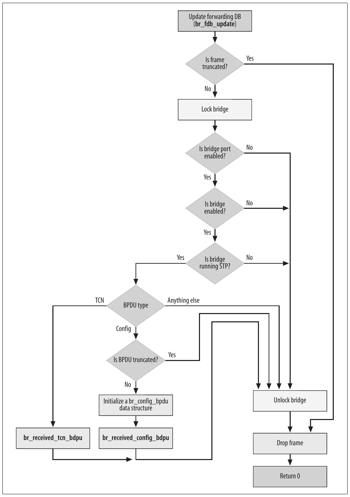

Hình 16-15. Function br\_stp\_handle\_bpdu

`br_received_config_bpdu` xử lý configuration BPDU theo logic mô tả trong mục “Truyền configuration BPDU” ở Chương 15.

`br_received_tcn_bpdu` xử lý TCN BPDU theo logic mô tả trong mục “Báo topology change cho mọi bridge” ở Chương 15.

Lưu ý xử lý BPDU cho mọi bridge được serialize bằng bridge lock: CPU khác nhau không thể xử lý BPDU đồng thời cho cùng bridge.

### Truyền BPDU

Chúng ta đã thấy khi nào configuration BPDU và TCN BPDU được truyền trong mục “Truyền configuration BPDU” và “Báo topology change cho mọi bridge” ở Chương 15. Đây là transmitting routine:

`br_transmit_config`

Truyền configuration BPDU theo logic trong mục “Truyền configuration BPDU” ở Chương 15.

`br_transmit_tcn`

Truyền TCN BPDU.

`br_reply`

Trả lời ingress configuration BPDU bằng configuration BPDU khác. Đây là wrapper đơn giản quanh `br_transmit_config`.

Mọi lần truyền BPDU đi qua Netfilter hook `NF_BR_LOCAL_OUT`, như Hình 16-16.

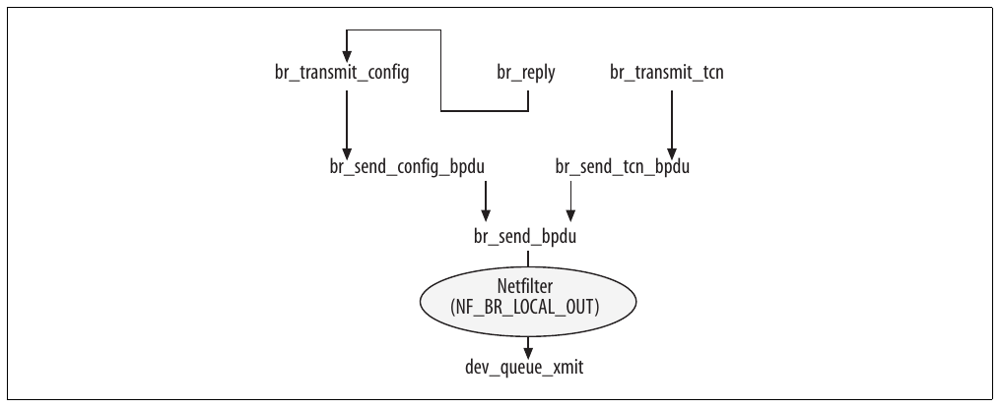

Hình 16-16. Transmit routine

Trong mục “BPDU aging” ở Chương 15, chúng ta đã thấy Configuration BPDU có lifetime giới hạn thực thi qua field Message Age nhúng bên trong. Đây là cách nonroot bridge cập nhật field trước khi relay BPDU.

Khi nhận configuration BPDU, `br_stp_handle_bpdu` lưu field Message Age của BPDU vào local variable. Khi gọi `br_transmit_config` để truyền BPDU ra, nó cập nhật Message Age, cộng thời gian từ khi `br_stp_handle_bpdu` nhận frame gốc. Vì Message Age timer biểu diễn bằng bội số 1/256<sup>th</sup> giây, nhưng đơn vị thời gian kernel quản lý tốt hơn là tick, `br_stp_handle_bpdu` chuyển message age thành tick khi lưu. `br_transmit_config` sau đó tính elapsed time bằng tick, nhưng chuyển kết quả lại thành đơn vị 1/256<sup>th</sup> giây để ghi vào BPDU. Chuyển đổi bằng `br_get_tick` và `br_set_tick`.

### Configuration update

Trong Chương 15, chúng ta đã thấy administrator dùng configuration parameter tác động topology STP hội tụ tới thế nào. Cũng đã thấy chọn role và state cho bridge port phụ thuộc kiến thức bridge hiện có và thông tin ingress configuration BPDU, đặc biệt priority vector component (xem Hình 15-8 ở Chương 15). Cuối cùng, trong mục “Định nghĩa active topology” ở Chương 15, đã thấy event có thể kích hoạt configuration update trên bridge và configuration update gồm gì.

Routine đảm nhiệm configuration update là `br_configuration_update`. Bảng 16-1 cho thấy nơi và khi gọi routine.

Bảng 16-1. Routine kích hoạt configuration update

| Ở đâu | Khi nào |
|---|---|
| `br_received_config_bpdu` | Nhận BPDU có priority vector tốt hơn trên bridge port. |
| `br_message_age_timer_expired` | Thông tin bridge port biết đã hết hạn. Xem mục “BPDU aging” ở Chương 15. |
| `br_stp_disable_port` | Bridge port đã bị disable. |
| `br_stp_change_bridge_id` | MAC address component của bridge ID đã thay đổi. Xem mục “Bridge ID và port ID”. |
| `br_stp_set_bridge_priority` | Priority component của bridge ID đã thay đổi. |
| `br_stp_set_path_cost` | Port path cost đã thay đổi. |

Mỗi lời gọi `br_configuration_update` luôn theo sau bởi lời gọi `br_port_state_selection`, cập nhật state cho từng bridge port dựa trên role được gán. State change được áp dụng bằng routine giới thiệu trong mục “Đổi state trên bridge port”.

Trong mục “Xử lý configuration change” ở Chương 17, có user command dẫn tới thực thi một số routine trong Bảng 16-1.

### Chọn root bridge

Trong mục “Chọn root bridge” ở Chương 15, chúng ta đã thấy cách chọn root bridge. Khi mới enable, bridge tin mình là root bridge. Sau đó, dựa trên thông tin nhận từ ingress configuration BPDU và cấu hình administrator áp dụng, root bridge status có thể đổi.

Hình 16-17 cho thấy event có thể thay root status của bridge thực hiện công việc thế nào.

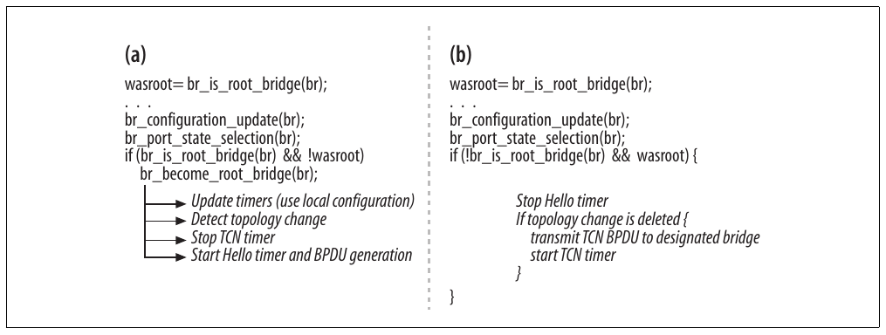

Hình 16-17. (a) Trở thành root bridge; (b) nhường root bridge role

#### Trở thành root bridge

Routine xử lý event có thể làm nonroot bridge thành root bridge theo cơ chế Hình 16-17(a): trước hết lưu root status, rồi cập nhật port role và state. Nếu cập nhật khiến bridge thành root bridge, áp dụng action cần như bắt đầu và dừng timer thích hợp.

Sau đây là routine kích hoạt configuration update và có thể bầu nonroot bridge làm root bridge mới:

`br_stp_change_bridge_id`

`br_stp_set_bridge_priority`

Lần lượt được gọi khi MAC address và priority của bridge thay đổi. Vì đây là hai field cấu thành bridge ID, và bầu root bridge dựa trên bridge ID, thay đổi bất kỳ field nào có thể đổi root bridge.

`br_stp_disable_port`

Khi disable port duy nhất bridge dùng để tới root bridge hiện tại, spanning tree bị phân chia và phải chọn root bridge mới trên partition chứa bridge hiện tại. Vì vậy phần lớn bridge trong ví dụ Chương 15 có redundant link.

`br_message_age_timer_expired`

Khi thông tin port nhận từ designated bridge hết hạn (nhiều khả năng vì designated bridge không còn là designated bridge hoặc đã hỏng), port được gán designated role. Vì đây là topology change, root bridge cũng có thể đổi.

##### Nhường root bridge role

Root bridge nhường role khi nhận BPDU có priority vector superior. Điều kiện được phát hiện trong `br_received_config_bpdu` và xử lý như Hình 16-17(b).

### Timer

Chúng ta đã thấy timer per-port và per-bridge mà STP code dùng trong mục “Timer” ở Chương 15.

Port timer và bridge timer lần lượt được khởi tạo bằng `br_stp_port_timer_init` và `br_stp_timer_init`.

Bảng 16-2 và 16-3 liệt kê routine thực thi khi timer hết hạn. Mọi routine này cùng hai initialization routine được định nghĩa trong net/bridge/br\_stp\_ timer.c. Mọi timer handler chạy khi giữ bridge lock.

Bảng 16-2. Handler cho timer của STP bridge

| Timer | Handler |
|---|---|
| Hello | `br_hello_timer_expired` |
| Topology Change Notification | `br_tcn_timer_expired` |
| Topology Change | `br_topology_change_timer_expired` |

Bảng 16-3. Handler cho timer của STP port

| Timer | Handler |
|---|---|
| Max Age | `br_message_age_timer_expired` |
| Forward Delay | `br_forward_delay_timer_expired` |
| Hold | `br_hold_timer_expired` |

### Xử lý topology change

Trong mục “Topology change” ở Chương 15, chúng ta đã thấy event được coi là topology change. Những event này được phát hiện bởi routine:

`br_make_blocking`

Được gọi khi STP quyết định block forwarding port.

`br_forward_delay_timer_expired`

Được gọi khi port ở state `BR_STATE_LEARNING` (tức chưa forwarding) chuyển sang state `BR_STATE_FORWARDING`.

`br_become_root_bridge`

Được gọi khi nonroot bridge trở thành root bridge. Xem mục “Trở thành root bridge” để biết khi nào gọi routine.

`br_received_tcn`

Được gọi khi nhận TCN BPDU trên bridge port. Xem mục “Xử lý ingress BPDU” để biết khi nào gọi routine.

## Notification chain netdevice

Vì virtual bridge device được định nghĩa làm abstraction trên real device (enslaved), bridge device có thể bị ảnh hưởng khi bất kỳ enslaved device nào đổi status. Vì vậy, initialization routine của bridging subsystem, mô tả ngắn trong mục “Khởi tạo bridging code”, đăng ký callback `br_device_event` với notification chain `netdevice`. Bridging code chỉ quan tâm enslaved device, nên notification về nonenslaved device không cần chú ý.

Đây là cách xử lý từng event notification nhận được:

`NETDEV_CHANGEMTU`

MTU cho bridge device được cập nhật để phản ánh MTU nhỏ nhất trong số cấu hình trên enslaved device.

`NETDEV_CHANGEADDR`

Khi enslaved device đổi MAC address, entry trong forwarding database được cập nhật bằng `br_fdb_changeaddr`, còn bridge ID cập nhật bằng `br_stp_recalculate_bridge_id` để phản ánh quy tắc trong mục “Bridge ID và port ID”.

`NETDEV_CHANGE`

Notification này có thể dùng cho nhiều mục đích. Bridging subsystem chỉ quan tâm thay đổi carrier status.

Khi enslaved device mất hoặc phát hiện carrier status, bridge port tương ứng lần lượt được enable và disable bằng `br_stp_enable_port` và `br_stp_disable_port`. Khi bridge device gắn với device này bị administrator để down (tức `IFF_UP` không set), notification bị bỏ qua.

`NETDEV_FEATCHANGE`

Khi feature của enslaved device thay đổi, feature set của bridge device được cập nhật bằng `br_features_recompute` để phản ánh tập feature chung của mọi real device.

`NETDEV_DOWN`

Khi enslaved device bị administrator disable, bridge port tương ứng cũng phải disable; `br_stp_disable_port` xử lý việc này. Không cần khi bridge chứa port đã down, vì điều đó ngụ ý bridge port cũng đã down.

`NETDEV_UP`

Khi enslaved device được administrator enable (tức `IFF_UP` set), bridge port tương ứng được enable bằng `br_stp_enable_port` nếu có carrier status và bridge device tương ứng cũng up.

`NETDEV_UNREGISTER`

Khi enslaved device được hủy đăng ký, bridge port tương ứng bị loại bằng `br_del_if`.

Trừ `NETDEV_UNREGISTER`, mọi event được xử lý khi giữ bridge lock.

[^1]: Chỉ administrator có thể thay MAC address của interface, cần command tường minh như ip link set eth0 address 00:20:ED:76:1E:12 hoặc ifconfig eth0 hw ether 00:20:ED:76:1E:12. Thay MAC address của interface hiếm khi thực hiện.
