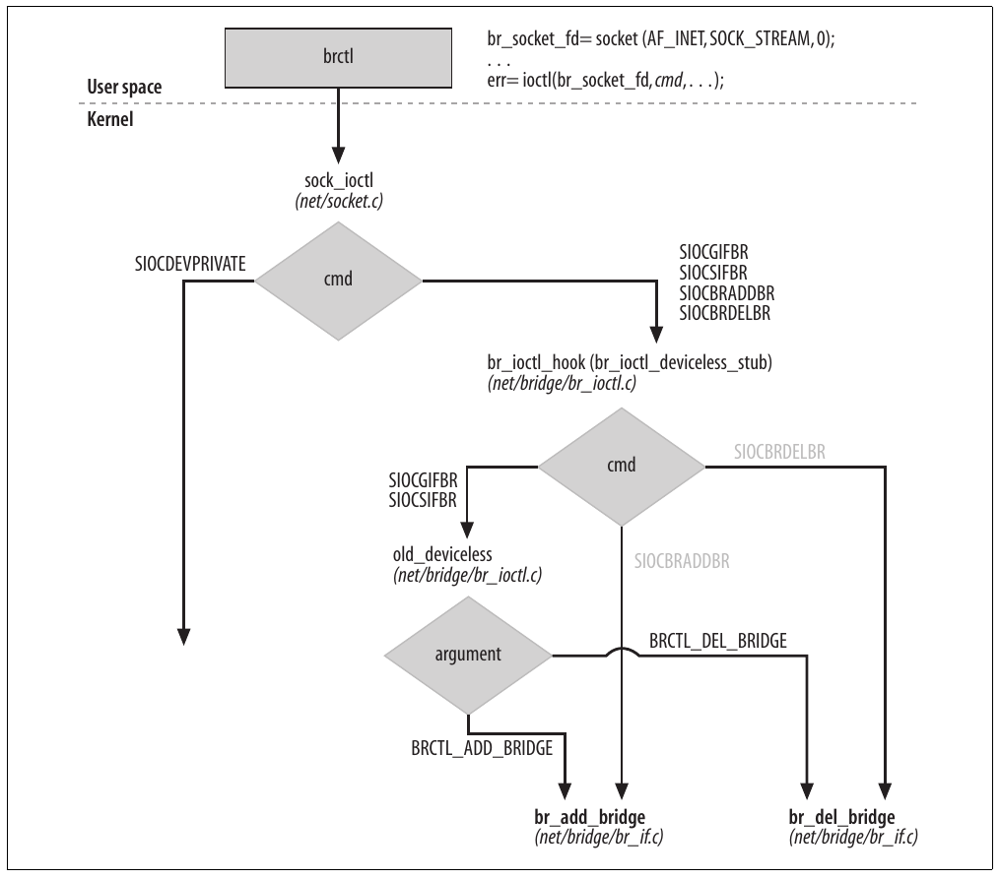
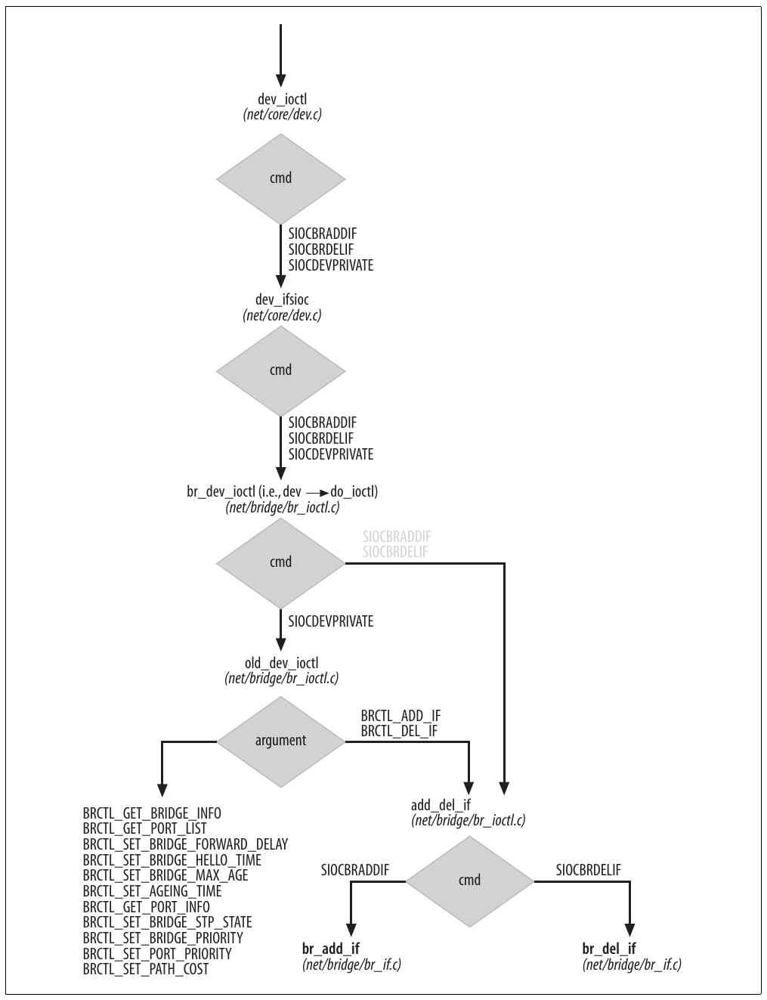
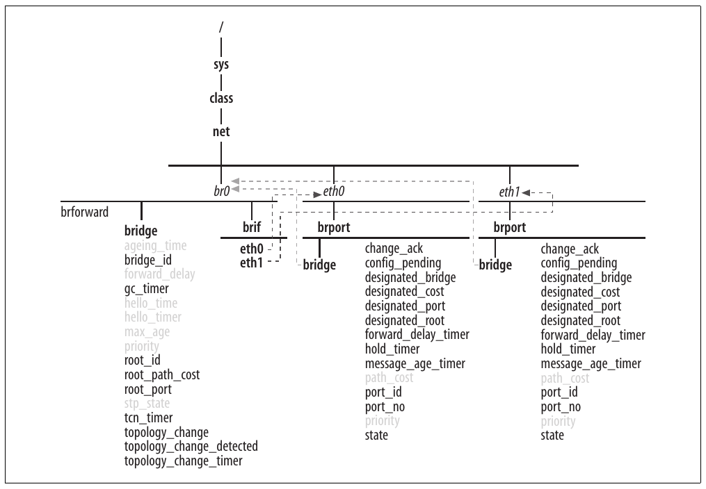
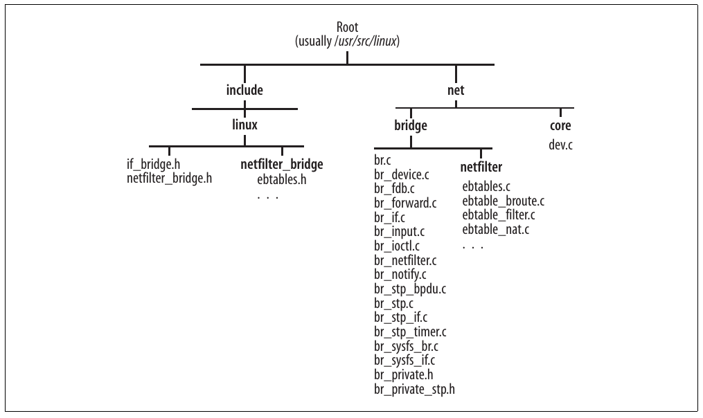

# Chương 17. Bridging: các chủ đề khác


Trong các chương trước, chúng ta đã thấy cách triển khai bridging và STP, cùng cách chúng tích hợp vào network stack. Trong chương này, chúng ta kết thúc phần bridging của sách bằng mô tả cách subsystem tương tác với command user-space cấu hình bridging. Tôi sẽ không mô tả chính các command vì quản trị nằm ngoài phạm vi sách.

Chúng ta cũng sẽ xem các file được export trong directory /sys có thể dùng để tinh chỉnh bridging. Chương kết thúc bằng mô tả chi tiết data structure đã giới thiệu trong Chương 16.

## Configuration tool User-Space

Có thể cấu hình bridging bằng brctl, utility tải tại http://bridge.sourceforge.net/. Với brctl, có thể tạo bridge device, enslave NIC vào bridge device và cấu hình bridge parameter cùng bridge port parameter cho STP.

brctl dùng interface `ioctl` để giao tiếp kernel trừ khi thư viện libsysfs được cài, khi đó sysfs interface trở thành lựa chọn ưu tiên. Thư viện libsysfs, tải tại http://linux-diag.sourceforge.net/Sysfsutils.html, cung cấp mọi primitive cần để truy cập và sửa nội dung variable export trong /sys. Xem mục “Tinh chỉnh qua filesystem /sys”.

Trong mục “Data frame so với BPDU” ở Chương 16, chúng ta đã giới thiệu ebtables. Có thể tải configuration tool user-space tại http://ebtables.sourceforge.net. Chúng ta không xem trong chương này; có tài liệu khá tốt trên trang chủ.

### Xử lý configuration change

Bảng 17-1 liệt kê command brctl và callback routine của kernel bridging code mà configuration layer gọi để báo bridging về thay đổi. Chẳng hạn, khi tạo bridge device br0 bằng command như brctl addbr br0, kernel cuối cùng gọi `br_add_bridge`, routine mô tả trong mục “Tạo bridge device và bridge port” ở Chương 16.

Lưu ý một số command không cần gọi callback routine. Chẳng hạn, nếu đổi Hello time bằng command như brctl sethello br0 3, value mới hiện ngay với bridging code: STP không cần thực hiện action nào.

Bảng 17-1. Command brctl và kernel handler tương ứng

| Command brctl | Mô tả | Bridging callback routine |
|---|---|---|
| addbr | Tạo bridge device. | `br_add_bridge` |
| delbr | Xóa bridge device. | `br_del_bridge` |
| addif | Tạo bridge port. | `br_add_if` |
| delif | Xóa bridge port. | `br_del_if` |
| setageing | Đặt aging time cho address trong forwarding database. | N/A |
| setbridgeprio | Đặt bridge priority. | `br_stp_set_bridge_priority` |
| setfd | Đặt Forward Delay timer. | N/A |
| sethello | Đặt Hello timer. | N/A |
| setmaxage | Đặt Max Age timer. | N/A |
| setpathcost | Đặt port path cost. | `br_stp_set_path_cost` |
| setportprio | Đặt port priority. | `br_stp_set_port_priority` |
| show | Hiển thị bridge device. | N/A |
| showmacs | Hiển thị forwarding database của bridge. | N/A |
| showstp | Hiển thị spanning tree information của bridge. | N/A |
| stp | Enable hoặc disable STP trên bridge. | N/A |

Routine trong Bảng 17-1 được dùng bất kể brctl giao tiếp kernel bằng command `ioctl` hay qua sysfs. Bất kể command cụ thể có cần gọi bridging callback routine không, kernel routine luôn được gọi để xử lý command brctl.

### Interface cũ so với interface mới

Vì kernel code hỗ trợ cả interface cũ và mới, phải xử lý đúng cả hai phiên bản. Đáng tiếc, điều này khiến code `ioctl` xử lý bridging configuration command hơi rối. Interface cũ hoàn toàn dựa vào command `ioctl`, còn interface mới chỉ dùng `ioctl` cho một tập con command và sysfs cho phần còn lại.

Hình 17(a) và 17(b) cho thấy cách command `ioctl` của cả hai interface được chuyển tới routine xử lý đúng (tôi biết, đây không thực sự là code rõ ràng và sạch sẽ).



Hình 17-1(a). Dispatch command ioctl

Hình thoi trên cùng là bước dispatch ban đầu trong `sock_ioctl` ở net/socket.c. Lưu ý hình chỉ cho thấy chi tiết cần để chuyển bridging command, dù một số routine cũng dùng chung với command của feature khác. Command màu nhạt là command interface mới dùng.

Một chi tiết cần nhắc là `br_ioctl_deviceless_stub` thử load bridge kernel module nếu chưa có trong memory.

Hai mục tiếp theo cung cấp thêm chi tiết về hai interface.



Hình 17-1(b). Dispatch command ioctl

### Tạo bridge device và bridge port

Tôi chia command brctl thành hai nhóm: nhóm tạo và xóa bridge device cùng bridge port, và nhóm cấu hình hoặc dump cấu hình bridge device cùng bridge port (gồm chi tiết STP).

Cả interface cũ lẫn mới dùng command `ioctl` để triển khai nhóm đầu. Command code `ioctl` chính xác của hai interface được liệt kê trong Bảng 17-2.

Bảng 17-2. Command ioctl dùng tạo bridge device và port

| Command brctl | Interface cũ (command ioctl, argument) | Interface mới (command ioctl) |
|---|---|---|
| addbr | `SIOCSIFBR`, `BRCTL_ADD_BRIDGE` | `SIOCBRADDBR` |
| delbr | `SIOCSIFBR`, `BRCTL_DEL_BRIDGE` | `SIOCBRDELBR` |
| addif | `SIOCDEVPRIVATE`, `BRCTL_ADD_IF` | `SIOCBRADDIF` |
| delif | `SIOCDEVPRIVATE`, `BRCTL_DEL_IF` | `SIOCBRDELIF` |

Lưu ý interface cũ cần truyền argument cùng command `ioctl` để nhận diện chính xác command brctl, còn interface mới chỉ cần command `ioctl`.

### Cấu hình bridge device và port

Nhóm command thứ hai được triển khai khác giữa interface cũ và mới: interface cũ dùng command `ioctl`, interface mới dùng sysfs.

Command code `ioctl` chính xác interface cũ dùng được liệt kê trong Bảng 17-3.

Bảng 17-3. Command ioctl interface cũ dùng để cấu hình bridge device và port

| Command brctl | Command ioctl, argument |
|---|---|
| setageing | `SIOCDEVPRIVATE`, `BRCTL_SET_AGEING_TIME` |
| setbridgeprio | `SIOCDEVPRIVATE`, `BRCTL_SET_BRIDGE_PRIORITY` |
| setfd | `SIOCDEVPRIVATE`, `BRCTL_SET_FORWARD_DELAY` |
| sethello | `SIOCDEVPRIVATE`, `BRCTL_SET_HELLO_TIME` |
| setmaxage | `SIOCDEVPRIVATE`, `BRCTL_SET_MAX_AGE` |
| setpathcost | `SIOCDEVPRIVATE`, B`RCTL_SET_PATH_COST` |
| setportprio | `SIOCDEVPRIVATE`, `BRCTL_SET_PORT_PRIORITY`<sup>a</sup> |
| show | `SIOCDEVPRIVATE`, `BRCTL_GET_BRIDGE_INFO` |
| showmacs | `SIOCDEVPRIVATE`, `BRCTL_GET_FDB_ENTRIES` |
| showstp | `SIOCDEVPRIVATE`, `BRCTL_GET_BRIDGE_INFO` |
| stp | `SIOCDEVPRIVATE`, `BRCTL_SET_BRIDGE_STP_STATE` |

<sup>a</sup> brctl version 1.0.6 dùng `BRCTL_SET_PATH_COST` thay vì `BRCTL_SET_PORT_PRIORITY`. Có lẽ đây là lỗi cut-and-paste.

Lưu ý mọi command brctl dùng command `SIOCDEVPRIVATE` (dù việc dùng đã khá lỗi thời trong Linux) và argument nhận diện operation chính xác.

Cấu hình sysfs-based chỉ xác định đúng file trong /sys rồi ghi bằng thư viện libsysfs. Operation trong Bảng 17-2 không thể triển khai qua sysfs vì không có file tương ứng trong hierarchy.

## Tinh chỉnh qua filesystem /proc

Generic bridging code không tạo file nào trong filesystem /proc. Tuy nhiên, firewall bridging extension tạo một số file trong /proc/sys/net/bridge/ có thể dùng để khiến core routine trong net/bridge/br\_netfilter.c return mà không xử lý buffer nhận làm input. Những file được `br_netfilter_init` tạo; routine này được `br_init` gọi khi bridging code khởi tạo (xem net/bridge/br\_ netfilter.c).

## Tinh chỉnh qua filesystem /sys

Như đã nói trong mục “Configuration tool User-Space”, brctl có thể cấu hình bridge parameter và STP parameter qua sysfs interface. Trước khi xem kernel xử lý command từ brctl thế nào, hãy xem tổ chức thông tin trong /sys.

Kernel tạo directory trong /sys/class/net cho mỗi network device đã đăng ký. Directory dùng để export parameter read-only và read-write áp dụng cho network device nói chung. Bridge device, được gán directory như network device khác, có hai subdirectory đặc biệt: bridge và brif. Subdirectory đầu export bridge parameter, subdirectory thứ hai chứa soft (symbolic) link tới directory của mỗi enslaved device, tức mỗi bridge port. Hình 17-2 cho ví dụ hệ thống có hai Ethernet device eth0 và eth1, nơi admin tạo bridge device br0 và enslave cả eth0 lẫn eth1 vào br0.

Directory br0 có file bridge-specific khác: brforward. File dùng export bridge forwarding database (binary format). Có thể dump bằng command brctl showmacs.

File trong directory bridge là field của data structure `net_bridge`, còn file trong directory brport là field của data structure `net_bridge_port`.[^1]

Directory của bridge device (br0 trong ví dụ trước) được `br_sysfs_addbr` điền bridge parameter và directory khi tạo bridge device (xem mục “Tạo bridge device mới” ở Chương 16). Khi device được enslave, directory của nó (eth0 và eth1 trong ví dụ trước) được điền bằng `br_sys_addif`. Routine sau cũng điền directory brif của bridge.



Hình 17-2. Ví dụ bridge information được export bằng sysfs

Mọi file trong Hình 17-2 là read-only, trừ file màu nhạt cũng ghi được. Ví dụ file ghi được là file brctl dùng để cấu hình bridge parameter và bridge port parameter qua libsysfs.

Kernel code tương tác với file trong directory bridge device nằm ở net/bridge/br\_sysfs\_br.c, còn code tương tác với file trong bridge port device (tức enslaved device) ở net/bridge/br\_sysfs\_if.c.

Thoạt nhìn code có vẻ phức tạp nhưng thực ra khá đơn giản và tổ chức tốt. Với mỗi file được tạo trong directory bridge và brport (mỗi bridge attribute hoặc port attribute), code định nghĩa routine gọi khi có read request hoặc write request trên file bằng instance của macro đặc biệt. Hãy bỏ qua chi tiết cách đưa macro vào table và dùng bởi routine `br_sysfs_addxxx` giới thiệu trước đó, để xem vài ví dụ sử dụng.

```c
static CLASS_DEV_ATTR(max_age, S_IRUGO | S_IWUSR, show_max_age, store_max_age)
```

Khai báo trong net/bridge/br\_sysfs\_br.c dùng macro `CLASS_DEV_ATTR` để định nghĩa file max\_age với permission read-write (chỉ superuser có write permission). Khi đọc file, kernel dùng `show_max_age` trả về nội dung; khi ghi file, kernel thực hiện thay đổi bằng `store_max_age`.

```c
static BRPORT_ATTR(port_no, S_IRUGO, show_port_no, NULL)
```

Khai báo trong net/bridge/br\_sysfs\_if.c định nghĩa file port\_no với permission read-only. Khi đọc file, kernel dùng `show_port_no` trả về nội dung. Vì file port\_no là read-only, NULL được chỉ định thay write routine.

## Thống kê

Data structure `net_bridge` chứa instance data structure `net_device_stats`. Mỗi network device dùng một structure `net_device_stats`, như mô tả trong mục “Thống kê” ở Chương 12. Bridging code chỉ dùng vài field:

`tx_packets`

`tx_bytes`

`tx_packets` là số frame tạo cục bộ và truyền qua bridge device. Được `br_dev_xmit` cập nhật. Lưu ý frame flood chỉ được tính một lần dù đi ra mọi enabled port. `tx_bytes`, tổng kích thước frame `tx_packets` đã gửi, cũng được `br_dev_xmit` cập nhật.

`tx_dropped`

Số frame không truyền được vì flood routine `br_flood` không cấp phát được buffer.

`rx_packets`

`rx_bytes`

`rx_packets` được `br_pass_frame_up` tăng mỗi khi ingress frame nhận trên bridge device được chuyển cục bộ. `rx_bytes` tương ứng với `tx_bytes`.

Mọi routine tham chiếu ở đây được mô tả trong Chương 16.

STP không giữ thống kê nào.

## Data structure được trình bày trong phần này của sách

Mục “Data structure quan trọng” ở Chương 16 tổng quan ngắn data structure bridging code dùng. Mục này mô tả field-by-field. Structure đơn giản như `mac_addr` và `br_config_bpdu` không cần mục riêng.

### Structure bridge\_id

Trong mục “Bridge ID và port ID” ở Chương 15, chúng ta đã thấy bridge ID có hai thành phần, priority và address:

`unsigned char prio[2]`

Bridge priority `unsigned char addr[6]` Bridge MAC address

Lưu ý định nghĩa data structure không phản ánh thay đổi do 802.1t đưa vào.

### Structure net\_bridge\_fdb\_entry

Đây là field dùng định nghĩa mỗi entry trong forwarding database:

`struct hlist_node list`

Pointer dùng liên kết data structure vào list phần tử collide trong bucket.

`struct net_bridge_port *dst`

Bridge port.

`struct rcu_head rcu`

Dùng khi loại data structure theo cơ chế read-copy-update (RCU) (xem `br_fdb_put` trong net/bridge/br\_fdb.c).

`atomic_t use_count`

Reference count. Xem mục “Lookup” ở Chương 30.

`unsigned long ageing_timer`

Aging timer. Phần khác nhau của kernel viết là aging hoặc ageing. Xem mục “Aging” ở Chương 16.

`mac_addr addr`

MAC address. Đây là key field lookup routine dùng.

`unsigned char is_local`

Khi flag bằng 1, MAC address `addr` được cấu hình trên local device.

`unsigned char is_static`

Khi flag bằng 1, MAC address `addr` là static và không hết hạn. Mọi local address (tức có `is_local` bằng 1) cũng static.

### Structure net\_bridge\_port

Nhóm field đầu được dùng bất kể có dùng STP hay không:

`struct net_bridge *br`

`struct net_device *dev`

`br` là bridge device, còn `dev` là enslaved device. Xem Hình 16-6 ở Chương 16.

`struct list_head list`

Pointer dùng liên kết data structure vào list phần tử collide trong bucket.

`u8 state`

Port state. Value hợp lệ liệt kê trong include/linux/if\_bridge.h bằng enumeration list `BR_STATE_XXX`.

`struct kobject kobj`

Được generic device infrastructure dùng. Field giữ vai trò trung tâm để thực hiện mọi thứ đã thấy trong mục “Tinh chỉnh qua filesystem /sys”.

`struct rcu_head rcu`

Dùng hủy structure an toàn theo cơ chế RCU (xem `del_nbp` trong net/bridge/br\_if.c).

Nhóm thứ hai chỉ dùng khi STP enable:

`u8 priority`

Port priority.

`u16 port_no`

Port number.

`port_id port_id`

Port ID. Được `br_make_port_id` tính bằng kết hợp `priority` và `port_no`.

`unsigned char topology_change_ack`

Khi flag này set, phải set TCA flag trên configuration BPDU truyền trên port.

`unsigned char config_pending`

Flag bằng 1 khi configuration BPDU chờ truyền vì trước đó bị Hold timer giữ lại.

`port_id designated_port`

`bridge_id designated_root`

`bridge_id designated_bridge`

`u32 designated_cost`

Bốn thành phần priority vector từ configuration BPDU gần nhất nhận trên port (xem Hình 16-8 ở Chương 16). Được cập nhật mỗi khi nhận configuration BPDU bằng `br_record_config_configuration`.

`u32 path_cost`

Port path cost.

`struct timer_list forward_delay_timer`

`struct timer_list hold_timer`

`struct timer_list message_age_timer`

Port timer. Xem mục “Timer” ở Chương 15.

### Structure net\_bridge

Nhóm field đầu được dùng bất kể STP có được dùng hay không:

`spinlock_t lock`

Lock dùng serialize thay đổi structure `net_bridge` hoặc một port trong `port_list`. Truy cập Read-only dùng primitive `rcu_read_lock` và `rcu_read_unlock`.

`struct list_head port_list`

List bridge port.

`struct net_device *dev`

Bridge device (xem Hình 16-6 ở Chương 16).

`struct net_device_stats statistics`

Thống kê. Xem mục “Thống kê”.

`spinlock_t hash_lock`

`struct hlist_head hash[BR_HASH_SIZE]`

`hash` là forwarding database. `hash_lock` là lock dùng serialize truy cập read-write vào entry. Truy cập Read-only dùng primitive `rcu_read_lock` và `rcu_read_unlock`.

`struct list_head age_list`

Không dùng. Trước đây list liên kết mọi entry forwarding database theo thứ tự tăng dần lần dùng gần nhất (xem Hình 16-6 ở Chương 16). Aging algorithm dùng list để quét expired entry trong database.

`unsigned long ageing_time`

Thời gian tối đa entry có thể ở forwarding database mà không được dùng. Xem mục “Aging” ở Chương 16.

`struct kobject ifobj`

Được generic device infrastructure dùng. Field giữ vai trò trung tâm để thực hiện mọi thứ đã thấy trong mục “Tinh chỉnh qua filesystem /sys”.

`unsigned char stp_enabled`

Khi flag set, STP được enable cho bridge.

Nhóm field tiếp theo chỉ dùng khi dùng STP. Ngoại lệ duy nhất là `forward_delay`, được dùng bất kể STP. Bridge port không được gán forwarding state ngay khi STP enable; chúng dùng timer `forward_delay` để qua state trung gian.

`bridge_id designated_root`

ID của root bridge.

`bridge_id bridge_id`

Bridge ID.

`u32 root_path_cost`

Cost của path tốt nhất tới root bridge.

`unsigned long max_age`

`unsigned long hello_time`

`unsigned long forward_delay`

Bridge timer. Value được cấu hình trên root bridge và được `br_record_config_timeout_values` lưu cục bộ khi nhận configuration BPDU trên root port.

`unsigned long bridge_max_age`

`unsigned long bridge_hello_time`

`unsigned long bridge_forward_delay`

Bridge timer cấu hình cục bộ. Chỉ root bridge dùng.

`u16 root_port`

Port number của root port.

`unsigned char topology_change`

Flag set khi configuration BPDU mới nhất nhận trên root port có TC flag set. Khi `topology_change` set, phải set TC flag trên mọi configuration BPDU bridge truyền. Xem mục “Ví dụ topology change” ở Chương 15.

`unsigned char topology_change_detected`

Flag set khi phát hiện topology change. Xem mục “Topology change” ở Chương 15 để biết điều kiện được coi là topology change khả dĩ.

`struct timer_list hello_timer`

`struct timer_list tcn_timer`

`struct timer_list topology_change_timer`

Bridge timer. Xem mục “Timer” ở Chương 15.

`struct timer_list gc_timer`

Garbage collection timer cho forwarding database. Xem mục “Aging” ở Chương 16.

## Function và variable được trình bày trong phần này của

## sách

Bảng 17-4 tóm tắt function, variable và data structure chính giới thiệu trong Phần IV. Có thể tìm thêm trong mục “Spanning tree routine quan trọng” và “Timer” ở Chương 16.

Bảng 17-4. Function, variable và data structure giới thiệu trong Phần IV

| Tên function | Mô tả |
|---|---|
| `br_init br_deinit` | Khởi tạo và dọn kernel bridging module. Xem mục “Khởi tạo bridging code” ở Chương 16. |
| `br_fdb_init` | Khởi tạo forwarding database. |
| `br_netfilter_init` | Khởi tạo Netfilter hook bridging code dùng. |
| `br_stp_timer_init br_stp_port_timer_init` | Khởi tạo bridge timer và bridge port timer. |
| `br_sysfs_addbr br_sysfs_delbr` | Xử lý file bổ sung trong sysfs cho bridge device. Xem mục “Tinh chỉnh qua filesystem /sys”. |
| `br_sysfs_addif br_sysfs_removeif` | Xử lý file bổ sung trong sysfs cho bridge port. Xem mục “Tinh chỉnh qua filesystem /sys”. |
| `br_add_bridge br_del_bridge` | Tạo và xóa bridge device. Xem mục “Tạo bridge device và bridge port” ở Chương 16. |
| `br_add_if br_del_if` | Tạo và xóa bridge port. Xem mục “Tạo bridge device và bridge port” ở Chương 16. |
| `br_stp_recalculate_bridge` | Với bridge cho trước, chọn MAC address có numeric value thấp nhất trong số address cấu hình trên bridge port (tức enslaved device) rồi dùng để tính bridge ID. |
| `br_min_mtu` | Với bridge cho trước, tìm MTU thấp nhất trong số cấu hình trên bridge port. |
| `br_stp_enable_bridge br_stp_disable_bridge` | Enable và disable bridge device. Xem mục “Enable và disable bridge instance” ở Chương 16. |
| `br_stp_enable_port br_stp_disable_port` | Enable và disable bridge port. Xem mục “Enable và disable bridge port” ở Chương 16. |
| `__br_fdb_get br_fdb_get` | Lookup entry trong forwarding database. Xem mục “Lookup” ở Chương 30. |
| `fdb_create br_fdb_insert bf_fdb_change_addr br_fdb_update br_fdb_cleanup` | Các routine thao tác forwarding database. Xem mục “Forwarding database” ở Chương 16 và mục nhỏ bên trong. |
| `handle_bridge br_handle_frame br_handle_frame_finish br_stp_handle_bpdu br_forward br_flood br_pass_frame_up br_pass_frame_up_finish` | Các routine xử lý ingress frame. Xem mục “Xử lý ingress traffic” ở Chương 16. |
| `br_received_config_bpdu br_received_tcn_bpdu` | Lần lượt xử lý ingress configuration BPDU và TCN BPDU. Xem mục “Xử lý ingress BPDU” ở Chương 16. |
| `br_transmit_config br_transmit_tcn br_reply br_send_bpdu` | Các transmission routine. Xem mục “Truyền BPDU” ở Chương 16. |
| `br_make_blocking br_make_forwarding` | `br_make_blocking` block port, còn `br_make_forwarding` gán forwarding state cho port, cho phép nhận và truyền data traffic. |
| `br_get_tick br_set_tick` | Đọc và ghi time interval, đảm nhiệm chuyển đổi giữa 1/256 giây (dùng trong configuration BPDU) và tick (Linux dùng). |
| Variable |  |
| `BR_MAX_PORTS` | Số bridge port tối đa có thể thêm vào bridge device. |
| `br_handle_frame_hook` | Function pointer khởi tạo thành routine bridging subsystem dùng xử lý ingress frame. Xem Hình 16-11 ở Chương 16. |
| `br_fdb_cache` | Cache dùng cấp phát phần tử forwarding database. |
| Data structure |  |
| `struct mac_addr struct bridge_id struct bridge_fdb_entry struct net_bridge_port struct net_bridge struct br_config_bpdu` | Data structure chính bridging code dùng. Xem mục “Data structure quan trọng” ở Chương 16. |

## File và directory được trình bày trong phần này của sách

Hình 17-3 liệt kê file và directory tham chiếu trong các chương Phần IV.



Hình 17-3. File và directory được trình bày trong phần này của sách

[^1]: `change_ack` là dạng rút gọn của `topology_change_ack`.
