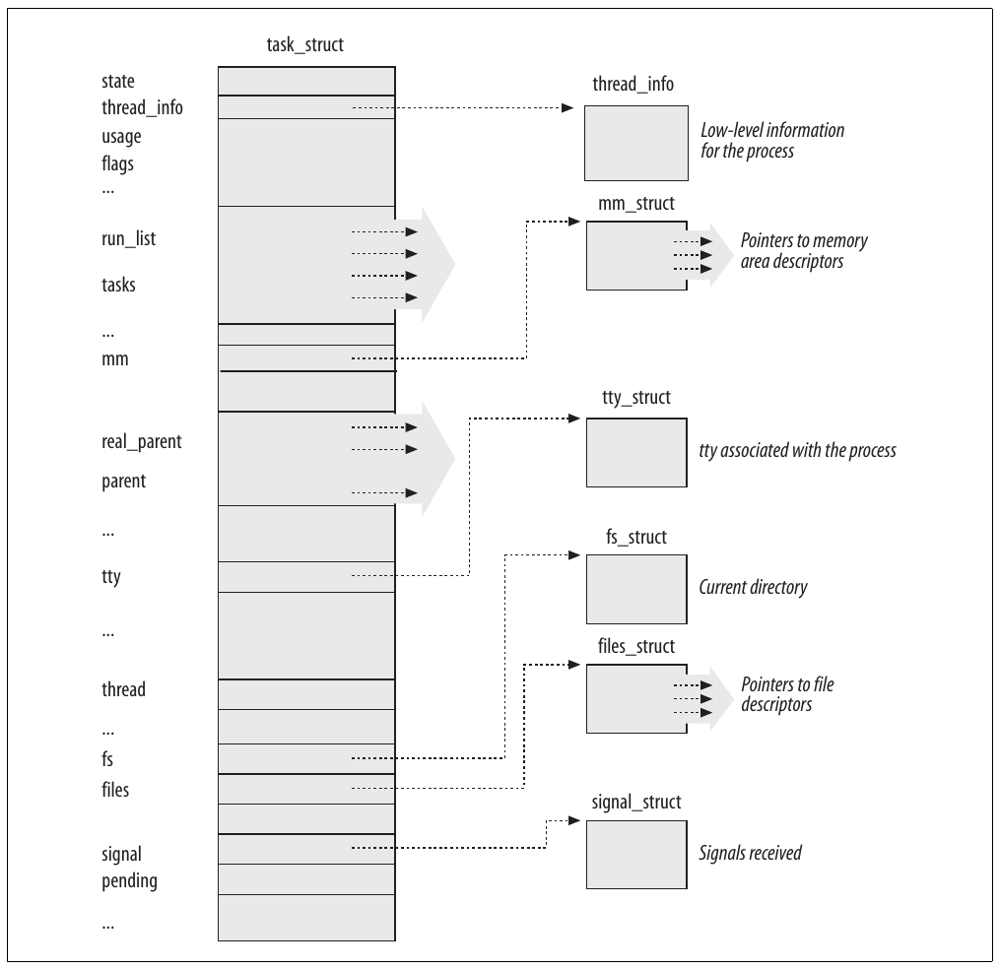
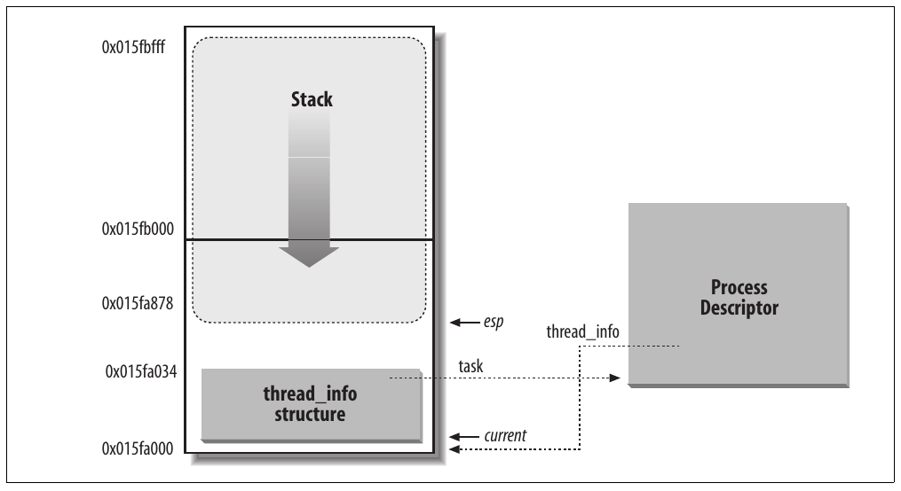
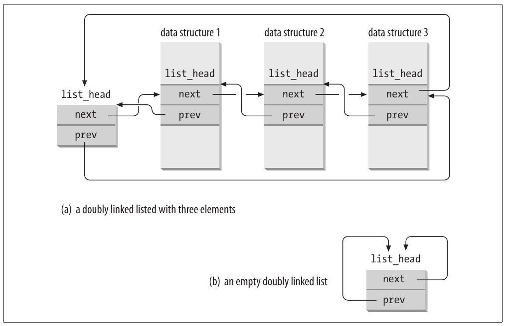
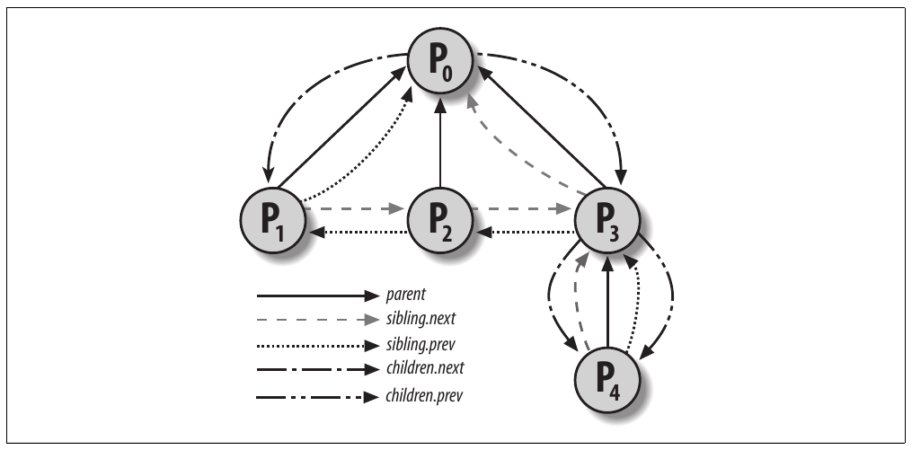
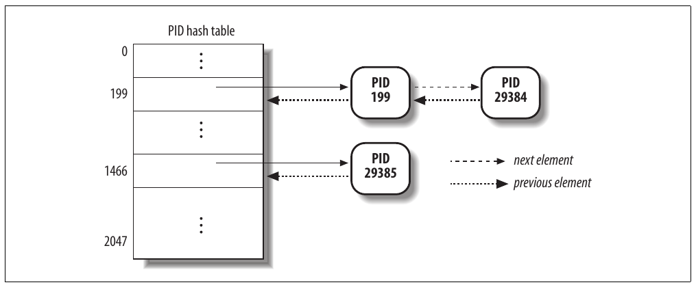
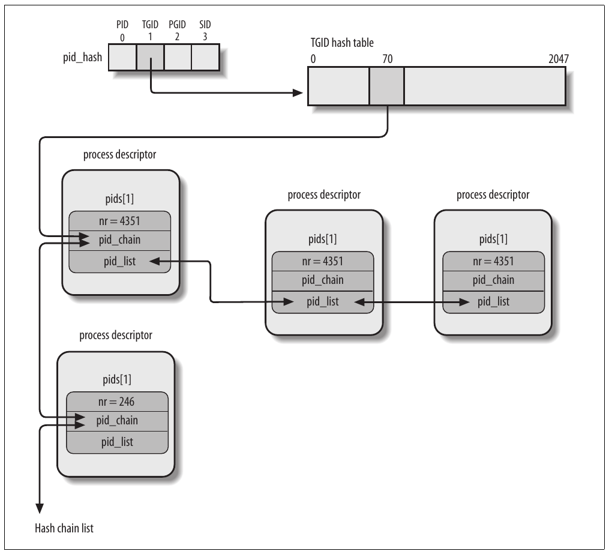
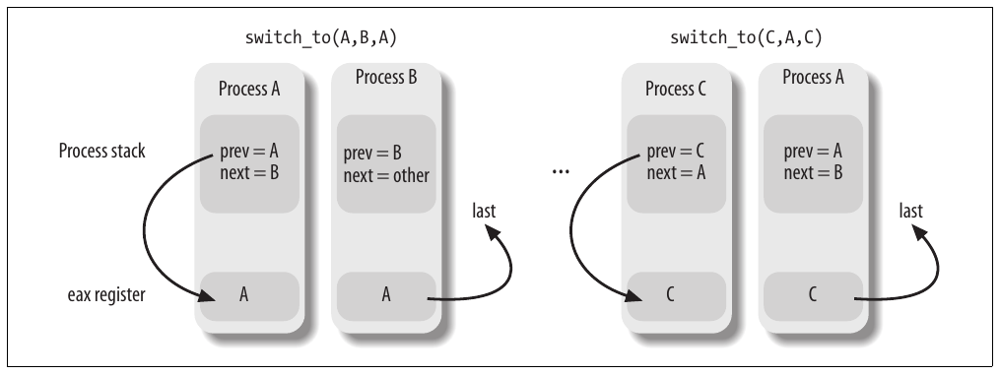

# Chương 3. Process


Khái niệm process là nền tảng của mọi hệ điều hành multiprogramming. Process thường được định nghĩa là một instance của chương trình đang thực thi; vì vậy, nếu 16 người dùng chạy vi cùng lúc thì có 16 process riêng biệt (dù chúng có thể chia sẻ cùng executable code). Process thường được gọi là task hoặc thread trong Linux source code.

Trong chương này, chúng ta thảo luận các thuộc tính tĩnh của process rồi mô tả cách kernel thực hiện process switching. Hai phần cuối mô tả cách tạo và hủy process. Chúng ta cũng mô tả cách Linux hỗ trợ multithreaded application — như đề cập trong Chương 1, nó dựa vào so-called lightweight process (LWP).

## Process, lightweight process và thread

Thuật ngữ “process” thường được dùng với nhiều nghĩa khác nhau. Trong sách này, chúng ta theo định nghĩa thông thường trong giáo trình OS: process là một instance của chương trình đang thực thi. Bạn có thể hình dung nó là tập hợp data structure mô tả đầy đủ execution của chương trình đã tiến triển đến đâu.

Process giống con người: được sinh ra, có cuộc đời ít nhiều ý nghĩa, có thể sinh một hoặc nhiều child process và cuối cùng chết đi. Khác biệt nhỏ là tình dục thực sự không phổ biến giữa các process — mỗi process chỉ có một parent.

Từ góc nhìn kernel, mục đích của process là làm thực thể được cấp system resource (CPU time, memory, v.v.).

Khi process được tạo, nó gần như giống hệt parent. Nó nhận bản sao (logic) address space của parent và thực thi cùng code với parent, bắt đầu từ instruction tiếp theo sau system call tạo process. Dù parent và child có thể chia sẻ page chứa program code (text), chúng có bản sao data (stack và heap) riêng, để thay đổi của child tại memory location không hiển thị với parent (và ngược lại).

Trong khi Unix kernel trước đây dùng mô hình đơn giản này, hệ thống Unix hiện đại không như vậy. Chúng hỗ trợ multithreaded application — user program có nhiều execution flow tương đối độc lập chia sẻ phần lớn application data structure. Trong các hệ thống đó, process gồm nhiều user thread (hay đơn giản là thread), mỗi thread biểu diễn một execution flow của process. Ngày nay, phần lớn multithreaded application được viết bằng các tập library function chuẩn gọi là pthread (POSIX thread) library.

Phiên bản Linux kernel cũ không hỗ trợ multithreaded application. Từ góc nhìn kernel, multithreaded application chỉ là process thông thường. Nhiều execution flow của multithreaded application được tạo, xử lý và schedule hoàn toàn trong User Mode, thường bằng pthread library POSIX-compliant.

Tuy nhiên, cách triển khai multithreaded application như vậy chưa thật thỏa đáng. Ví dụ, giả sử chương trình cờ vua dùng hai thread: một thread điều khiển bàn cờ đồ họa, chờ nước đi của người chơi và hiển thị nước đi của máy tính, còn thread kia tính nước đi tiếp theo. Trong khi thread đầu chờ nước đi của người, thread thứ hai nên chạy liên tục để tận dụng thời gian suy nghĩ của người chơi. Tuy nhiên, nếu chương trình cờ vua chỉ là một process, thread đầu không thể đơn giản gọi blocking system call chờ user action; nếu không thread thứ hai cũng bị block. Thay vào đó, thread đầu phải dùng kỹ thuật nonblocking phức tạp để bảo đảm process vẫn runnable.

Linux dùng lightweight process để hỗ trợ multithreaded application tốt hơn. Về cơ bản, hai lightweight process có thể chia sẻ một số resource như address space, open file, v.v. Bất cứ khi nào một process sửa shared resource, process kia lập tức thấy thay đổi. Tất nhiên hai process phải tự synchronize khi truy cập shared resource.

Cách đơn giản để triển khai multithreaded application là gắn một lightweight process với mỗi thread. Nhờ vậy, thread có thể truy cập cùng tập application data structure chỉ bằng chia sẻ cùng memory address space, cùng tập open file, v.v.; đồng thời mỗi thread có thể được kernel schedule độc lập để một thread sleep trong khi thread khác vẫn runnable. Ví dụ pthread library POSIX-compliant dùng lightweight process của Linux là LinuxThreads, Native POSIX Thread Library (NPTL) và Next Generation Posix Threading Package (NGPT) của IBM.

Multithreaded application POSIX-compliant được xử lý tốt nhất bởi kernel hỗ trợ “thread group”. Trong Linux, thread group về cơ bản là tập lightweight process triển khai multithreaded application và hoạt động như một thể thống nhất đối với một số system call như `getpid()`, `kill()` và `_exit()`. Chúng ta sẽ mô tả chi tiết sau trong chương.

## Process descriptor

Để quản lý process, kernel phải nắm rõ mỗi process đang làm gì. Chẳng hạn phải biết priority của process, nó đang chạy trên CPU hay bị block chờ event, address space nào được cấp, được phép address file nào, v.v. Đây là vai trò của process descriptor — structure type `task_struct` có các field chứa toàn bộ thông tin liên quan một process.[^1] Vì chứa rất nhiều thông tin, process descriptor khá phức tạp. Ngoài nhiều field chứa process attribute, process descriptor có nhiều pointer đến data structure khác, đến lượt chúng lại chứa pointer đến structure khác nữa. Hình 3-1 mô tả sơ lược Linux process descriptor.

Sáu data structure bên phải hình tham chiếu resource cụ thể thuộc process. Phần lớn resource này sẽ được trình bày ở chương sau. Chương này tập trung hai loại field tham chiếu process state và quan hệ parent/child của process.

### Process state

Đúng như tên gọi, field `state` của process descriptor mô tả điều hiện đang xảy ra với process. Nó gồm array flag, mỗi flag mô tả một process state có thể có. Trong phiên bản Linux hiện tại, các state loại trừ lẫn nhau nên luôn có đúng một flag của `state` được set; flag còn lại được clear. Sau đây là các process state có thể có:

`TASK_RUNNING`

Process đang thực thi trên CPU hoặc đang chờ được thực thi.

`TASK_INTERRUPTIBLE`

Process bị suspend (sleeping) đến khi điều kiện nào đó đúng. Phát hardware interrupt, release system resource mà process đang chờ hoặc chuyển signal đến là ví dụ về điều kiện có thể wake up process (đưa state trở lại `TASK_RUNNING`).

`TASK_UNINTERRUPTIBLE`

Giống `TASK_INTERRUPTIBLE`, ngoại trừ chuyển signal đến sleeping process không làm thay đổi state. Process state này ít được dùng. Tuy nhiên, nó có giá trị trong một số điều kiện cụ thể khi process phải chờ đến lúc event cho trước xảy ra mà không bị interrupt. Ví dụ, state có thể dùng khi process mở device file và device driver tương ứng bắt đầu probe hardware device tương ứng. Device driver không được bị interrupt đến khi probe hoàn tất, nếu không hardware device có thể bị để lại trong state không thể dự đoán.



Hình 3-1. Linux process descriptor

`TASK_STOPPED`

Process execution đã bị dừng; process vào state này sau khi nhận signal `SIGSTOP`, `SIGTSTP`, `SIGTTIN` hoặc `SIGTTOU`.

`TASK_TRACED`

Process execution đã bị debugger dừng. Khi process được process khác theo dõi (như khi debugger thực thi system call `ptrace()` để theo dõi chương trình thử nghiệm), mỗi signal có thể đưa process vào state `TASK_TRACED`.

Hai state bổ sung của process có thể được lưu trong cả field `state` lẫn field `exit_state` của process descriptor; như tên field gợi ý, process chỉ đạt một trong hai state khi execution kết thúc:

`EXIT_ZOMBIE`

Process execution đã kết thúc nhưng parent process chưa gọi system call `wait4()` hoặc `waitpid()` để trả về thông tin về dead process.[^2] Trước khi có lời gọi kiểu `wait()`, kernel không thể bỏ data trong dead process descriptor vì parent có thể cần nó. (Xem phần “Loại bỏ process” gần cuối chương.)

`EXIT_DEAD`

State cuối cùng: process đang được hệ thống loại bỏ vì parent process vừa gọi system call `wait4()` hoặc `waitpid()` cho nó. Đổi state từ `EXIT_ZOMBIE` sang `EXIT_DEAD` tránh race condition do execution thread khác thực hiện lời gọi kiểu `wait()` trên cùng process (xem Chương 5).

Giá trị field `state` thường được set bằng phép gán đơn giản. Ví dụ:

```c
p->state = TASK_RUNNING;
```

Kernel còn dùng macro `set_task_state` và `set_current_state`: lần lượt set state của process chỉ định và process hiện đang thực thi. Hơn nữa, các macro bảo đảm assignment operation không bị compiler hoặc CPU control unit trộn với instruction khác. Trộn instruction order đôi khi có thể dẫn đến kết quả thảm khốc (xem Chương 5).

### Nhận diện process

Theo quy tắc chung, mỗi execution context có thể được schedule độc lập phải có process descriptor riêng; do đó ngay cả lightweight process chia sẻ phần lớn kernel data structure cũng có structure `task_struct` riêng.

Sự tương ứng chặt chẽ one-to-one giữa process và process descriptor khiến address 32-bit<sup>†</sup> của structure `task_struct` trở thành phương tiện hữu ích để kernel nhận diện process. Các address này được gọi là process descriptor pointer. Phần lớn tham chiếu kernel thực hiện đến process đều qua process descriptor pointer.

Mặt khác, hệ điều hành Unix-like cho phép người dùng nhận diện process bằng số gọi là Process ID (hay PID), được lưu trong field `pid` của process descriptor. PID được đánh số tuần tự: PID của process mới tạo thường bằng PID của process tạo trước đó cộng một. Tất nhiên giá trị PID có upper limit; khi kernel đạt giới hạn phải bắt đầu tái sử dụng PID thấp hơn chưa dùng. Mặc định, PID tối đa là 32.767 (`PID_MAX_DEFAULT - 1`); system administrator có thể giảm giới hạn bằng cách ghi giá trị nhỏ hơn vào file /proc/sys/kernel/pid\_max (/proc là mount point của special filesystem, xem phần “Special filesystem” trong Chương 12). Trong architecture 64-bit, system administrator có thể tăng PID tối đa đến 4.194.303.

Khi tái sử dụng PID, kernel phải quản lý bitmap `pidmap_array` biểu thị PID nào hiện được cấp và PID nào còn trống. Vì page frame chứa 32.768 bit, trong architecture 32-bit bitmap `pidmap_array` được lưu trong một page duy nhất. Tuy nhiên, trong architecture 64-bit có thể thêm page vào bitmap khi kernel cấp PID quá lớn so với bitmap size hiện tại. Các page này không bao giờ được release.

Linux gắn PID khác nhau với mỗi process hoặc lightweight process trong hệ thống. (Như sẽ thấy sau trong chương, có ngoại lệ nhỏ trên multiprocessor system.) Cách này cho phép linh hoạt tối đa vì mọi execution context trong hệ thống đều được nhận diện duy nhất.

Mặt khác, lập trình viên Unix kỳ vọng thread trong cùng group có PID chung. Ví dụ, phải có thể gửi signal bằng cách chỉ định PID để tác động mọi thread trong group. Thực tế, chuẩn POSIX 1003.1c quy định mọi thread của multithreaded application phải có cùng PID.

Để tuân thủ chuẩn, Linux dùng thread group. Identifier được các thread chia sẻ là PID của thread group leader, tức PID của lightweight process đầu trong group; được lưu trong field `tgid` của process descriptor. System call `getpid()` return giá trị `tgid` của current process thay vì giá trị `pid`, nên mọi thread của multithreaded application chia sẻ cùng identifier. Phần lớn process thuộc thread group chỉ có một member; với vai trò thread group leader, chúng có field `tgid` bằng field `pid`, nên system call `getpid()` hoạt động như thường với loại process này.

Sau đây, chúng ta sẽ trình bày cách suy ra process descriptor pointer thực sự từ PID tương ứng một cách hiệu quả. Hiệu quả rất quan trọng vì nhiều system call như `kill()` dùng PID để biểu thị process chịu tác động.

#### Xử lý process descriptor

Process là thực thể động có thời gian tồn tại từ vài millisecond đến hàng tháng. Vì vậy kernel phải xử lý được nhiều process cùng lúc, và process descriptor được lưu trong dynamic memory thay vì memory area cấp vĩnh viễn cho kernel. Với mỗi process, Linux đóng gói hai data structure khác nhau trong cùng per-process memory area: data structure nhỏ liên kết với process descriptor, tức structure `thread_info`, và Kernel Mode process stack. Memory area thường dài 8.192 byte (hai page frame). Vì hiệu quả, kernel lưu memory area 8-KB trong hai page frame liên tiếp, với page frame đầu align theo bội số 2<sup>13</sup>; điều này có thể thành vấn đề khi còn ít dynamic memory vì free memory có thể bị fragmentation nặng (xem phần “Buddy System Algorithm” trong Chương 8). Vì vậy, trong architecture 80×86 có thể configure kernel lúc compile để memory area gồm stack và structure `thread_info` chỉ chiếm một page frame (4.096 byte).

Trong phần “Segmentation trong Linux” của Chương 2, đã học rằng process trong Kernel Mode truy cập stack nằm trong kernel data segment, khác stack process dùng trong User Mode. Vì kernel control path ít dùng stack nên chỉ cần vài nghìn byte kernel stack. Do đó 8 KB là không gian dư dả cho stack và structure `thread_info`. Tuy nhiên, khi stack và structure `thread_info` nằm trong một page frame, kernel dùng thêm một vài stack để tránh overflow do interrupt và exception lồng sâu (xem Chương 4).

Hình 3-2 cho thấy cách hai data structure được lưu trong memory area 2-page (8 KB). Structure `thread_info` nằm đầu memory area, còn stack phát triển xuống từ cuối. Hình cũng cho thấy structure `thread_info` và structure `task_struct` liên kết lẫn nhau lần lượt qua field `task` và `thread_info`.



Hình 3-2. Lưu structure thread\_info và process kernel stack trong hai page frame

Register `esp` là CPU stack pointer, dùng address vị trí đỉnh stack. Trên hệ thống 80×86, stack bắt đầu ở cuối và phát triển về đầu memory area. Ngay sau khi chuyển từ User Mode sang Kernel Mode, kernel stack của process luôn rỗng nên register `esp` trỏ đến byte ngay sau stack.

Giá trị `esp` giảm ngay khi data được ghi vào stack. Vì structure `thread_info` dài 52 byte, kernel stack có thể mở rộng đến 8.140 byte.

Ngôn ngữ C cho phép biểu diễn thuận tiện structure `thread_info` và kernel stack của process bằng union construct sau:

```c
union thread_union {
    struct thread_info thread_info;
    unsigned long stack[2048]; /* 1024 for 4KB stacks */
};
```

Structure `thread_info` trong Hình 3-2 được lưu bắt đầu tại address `0x015fa000`, còn stack được lưu bắt đầu tại address `0x015fc000`. Giá trị register `esp` trỏ đến đỉnh stack hiện tại tại `0x015fa878`.

Kernel dùng macro `alloc_thread_info` và `free_thread_info` để allocate và release memory area lưu structure `thread_info` và kernel stack.

##### Nhận diện current process

Sự gắn kết chặt chẽ giữa structure `thread_info` và Kernel Mode stack vừa mô tả có lợi ích quan trọng về hiệu quả: kernel dễ dàng lấy address của structure `thread_info` thuộc process hiện chạy trên CPU từ giá trị register `esp`. Thực tế, nếu structure `thread_union` dài 8 KB (2<sup>13</sup> byte), kernel mask bỏ 13 bit trọng số thấp nhất của `esp` để lấy base address của structure `thread_info`; mặt khác nếu structure `thread_union` dài 4 KB, kernel mask bỏ 12 bit trọng số thấp nhất của `esp`. Function `current_thread_info()` thực hiện việc này, tạo assembly language instruction như sau:

```c
movl $0xffffe000,%ecx /* or 0xfffff000 for 4KB stacks */
andl %esp,%ecx
movl %ecx,p
```

Sau khi thực thi ba instruction này, `p` chứa structure pointer `thread_info` của process chạy trên CPU thực thi instruction.

Thường kernel cần address của process descriptor hơn là address structure `thread_info`. Để lấy process descriptor pointer của process hiện chạy trên CPU, kernel dùng macro `current`, về cơ bản tương đương `current_thread_info()->task` và tạo assembly language instruction như sau:

```c
movl $0xffffe000,%ecx /* or 0xfffff000 for 4KB stacks */
andl %esp,%ecx
movl (%ecx),p
```

Vì field `task` ở offset 0 trong structure `thread_info`, sau khi thực thi ba instruction này, `p` chứa process descriptor pointer của process chạy trên CPU.

Macro `current` thường xuất hiện trong kernel code làm tiền tố cho field của process descriptor. Ví dụ, `current->pid` return process ID của process hiện chạy trên CPU.

Lợi ích khác của lưu process descriptor cùng stack thể hiện trên multiprocessor system: có thể suy ra đúng current process cho mỗi hardware processor chỉ bằng kiểm tra stack, như đã trình bày. Phiên bản Linux trước không lưu kernel stack và process descriptor cùng nhau. Thay vào đó phải đưa vào global static variable tên `current` để nhận diện process descriptor của running process. Trên multiprocessor system, cần định nghĩa `current` là array — mỗi CPU khả dụng một phần tử.

##### Doubly linked list

Trước khi tiếp tục mô tả cách kernel theo dõi các process trong hệ thống, chúng tôi muốn nhấn mạnh vai trò của data structure đặc biệt triển khai doubly linked list.

Với mỗi list phải triển khai tập primitive operation: initialize list, insert và delete phần tử, scan list, v.v. Lặp lại primitive operation cho từng list khác nhau vừa lãng phí công sức lập trình viên vừa lãng phí memory.

Vì vậy, Linux kernel định nghĩa data structure `list_head`, chỉ có hai field `next` và `prev` lần lượt biểu diễn forward và back pointer của generic doubly linked list element. Tuy nhiên, cần lưu ý pointer trong field `list_head` lưu address của field `list_head` khác thay vì address của toàn bộ data structure chứa structure `list_head`; xem Hình 3-3 (a).

List mới được tạo bằng macro `LIST_HEAD(list_name)`. Nó khai báo variable mới tên `list_name` có type `list_head`, là phần tử đầu giả làm placeholder cho head của list mới, và initialize field `prev` và `next` của data structure `list_head` để trỏ đến chính variable `list_name`; xem Hình 3-3 (b).



Hình 3-3. Doubly linked list được xây dựng bằng data structure list\_head

Nhiều function và macro triển khai primitive, bao gồm những mục trong Bảng 3-1.

Bảng 3-1. Function và macro xử lý list

| Tên | Mô tả |
|---|---|
| `list_add(n,p)` | Insert phần tử do `n` trỏ đến ngay sau phần tử chỉ định do `p` trỏ đến. (Để insert `n` vào đầu list, đặt `p` thành address của list head.) |
| `list_add_tail(n,p)` | Insert phần tử do `n` trỏ đến ngay trước phần tử chỉ định do `p` trỏ đến. (Để insert `n` vào cuối list, đặt `p` thành address của list head.) |
| `list_del(p)` | Delete phần tử do `p` trỏ đến. (Không cần chỉ định head của list.) |
| `list_empty(p)` | Kiểm tra list được chỉ định bằng address `p` của head có rỗng không. |
| `list_entry(p,t,m)` | Return address của data structure có type `t` chứa field `list_head` có tên `m` và address `p`. |
| `list_for_each(p,h)` | Scan các phần tử của list được chỉ định bằng address `h` của head; ở mỗi iteration, pointer đến structure `list_head` của list element được return trong `p`. |
| `list_for_each_entry(p,h,m)` | Tương tự `list_for_each` nhưng return address của data structure chứa structure `list_head` thay vì address của chính structure `list_head`. |

Linux kernel 2.6 có loại doubly linked list khác, khác biệt chính so với list `list_head` là không circular; chủ yếu dùng cho hash table, nơi không gian quan trọng còn tìm phần tử cuối trong constant time thì không. List head được lưu trong data structure `hlist_head`, chỉ là pointer đến phần tử đầu list (`NULL` nếu list rỗng). Mỗi phần tử được biểu diễn bằng data structure `hlist_node`, có pointer `next` đến phần tử tiếp theo và pointer `pprev` đến field `next` của phần tử trước. Vì list không circular, field `pprev` của phần tử đầu và field `next` của phần tử cuối được đặt thành `NULL`. Có thể xử lý list bằng nhiều helper function và macro tương tự Bảng 3-1: `hlist_add_head()`, `hlist_del()`, `hlist_empty()`, `hlist_entry`, `hlist_for_each_entry`, v.v.

##### Process list

Ví dụ doubly linked list đầu tiên chúng ta xem là process list, liên kết mọi process descriptor hiện có. Mỗi structure `task_struct` chứa field `tasks` có type `list_head`, với field `prev` và `next` lần lượt trỏ đến phần tử `task_struct` trước và tiếp theo.

Head của process list là descriptor `init_task task_struct`; đây là process descriptor của so-called process 0 hay swapper (xem phần “Kernel thread” sau trong chương). Field `tasks->prev` của `init_task` trỏ đến field `tasks` của process descriptor được insert cuối cùng vào list.

Macro `SET_LINKS` và `REMOVE_LINKS` lần lượt dùng insert và remove process descriptor trong process list. Các macro còn xử lý quan hệ parenthood của process (xem phần “Cách tổ chức process” sau trong chương).

Macro hữu ích khác tên `for_each_process` scan toàn bộ process list. Được định nghĩa:

```c
#define for_each_process(p) \
   for (p=&init_task; (p=list_entry((p)->tasks.next, \
                                    struct task_struct, tasks) \
                                   ) != &init_task; )
```

Macro là loop control statement, sau đó kernel programmer cung cấp loop. Chú ý process descriptor `init_task` chỉ đóng vai trò list header. Macro bắt đầu bằng việc đi qua `init_task` đến task tiếp theo và tiếp tục đến khi lại gặp `init_task` (nhờ list circular). Ở mỗi iteration, variable truyền làm argument của macro chứa address của process descriptor hiện được scan, do macro `list_entry` return.

##### Các list process TASK\_RUNNING

Khi tìm process mới để chạy trên CPU, kernel chỉ phải xét runnable process (tức process ở state `TASK_RUNNING`).

Phiên bản Linux trước đặt mọi runnable process trong cùng list tên runqueue. Vì duy trì list theo thứ tự process priority quá tốn kém, scheduler trước đây phải scan toàn bộ list để chọn runnable process “tốt nhất”.

Linux 2.6 triển khai runqueue khác. Mục tiêu là cho phép scheduler chọn runnable process tốt nhất trong constant time, không phụ thuộc số runnable process. Chúng ta để mô tả chi tiết loại runqueue mới này đến Chương 7, ở đây chỉ cung cấp thông tin cơ bản.

Thủ thuật tăng tốc scheduler là chia runqueue thành nhiều list runnable process, mỗi process priority một list. Mỗi descriptor `task_struct` có field `run_list` type `list_head`. Nếu process priority bằng k (giá trị từ 0 đến 139), field `run_list` liên kết process descriptor vào list runnable process có priority k. Hơn nữa, trên multiprocessor system, mỗi CPU có runqueue riêng, tức tập process list riêng. Đây là ví dụ kinh điển về làm data structure phức tạp hơn để tăng performance: nhằm giúp scheduler operation hiệu quả hơn, runqueue list được chia thành 140 list khác nhau!

Như sẽ thấy, kernel phải giữ nhiều data cho mỗi runqueue trong hệ thống; tuy nhiên data structure chính của runqueue là các list process descriptor thuộc runqueue; tất cả được triển khai bằng một data structure `prio_array_t`, với field trong Bảng 3-2.

Bảng 3-2. Các field của data structure prio\_array\_t

| Type | Field | Mô tả |
|---|---|---|
| `int` | `nr_active` | Số process descriptor liên kết vào các list |
| `unsigned long [5]` | `bitmap` | Priority bitmap: mỗi flag được set khi và chỉ khi priority list tương ứng không rỗng |
| `struct list_head [140]` | `queue` | 140 head của các priority list |

Function `enqueue_task(p,array)` insert process descriptor vào runqueue list; code về cơ bản tương đương:

```c
list_add_tail(&p->run_list, &array->queue[p->prio]);
__set_bit(p->prio, array->bitmap);
array->nr_active++;
p->array = array;
```

Field `prio` của process descriptor lưu dynamic priority của process, còn field `array` là pointer đến data structure `prio_array_t` của current runqueue. Tương tự, function `dequeue_task(p,array)` remove process descriptor khỏi runqueue list.

### Quan hệ giữa các process

Các process do chương trình tạo có quan hệ parent/child. Khi process tạo nhiều child, các child có quan hệ sibling. Phải đưa một số field vào process descriptor để biểu diễn quan hệ; chúng nằm trong Bảng 3-3 xét với process P cho trước. Process 0 và 1 do kernel tạo; như sẽ thấy sau trong chương, process 1 (init) là ancestor của mọi process khác.

Bảng 3-3. Field của process descriptor dùng biểu diễn quan hệ parenthood

| Tên field | Mô tả |
|---|---|
|  | Trỏ đến process descriptor của process tạo ra P hoặc descriptor của process 1 |
| `real_parent` | (init) nếu parent process không còn tồn tại. (Vì vậy khi người dùng khởi động background process rồi thoát shell, background process trở thành child của init.) |
| `parent` | Trỏ đến current parent của P (đây là process phải được gửi signal khi child process kết thúc); giá trị thường trùng `real_parent`. Đôi khi có thể khác, như khi process khác gọi system call `ptrace()` yêu cầu được phép theo dõi P (xem phần “Execution tracing” trong Chương 20). |
| `children` | Head của list chứa mọi child do P tạo. |
| `sibling` | Pointer đến phần tử tiếp theo và trước trong list sibling process, là những process có cùng parent với P. |

Hình 3-4 minh họa quan hệ parent và sibling của nhóm process. Process P0 lần lượt tạo P1, P2 và P3. Đến lượt process P3 tạo process P4.

Hơn nữa còn có quan hệ khác giữa process: process có thể là leader của process group hoặc login session (xem “Process management” trong Chương 1), leader của thread group (xem “Nhận diện process” trước trong chương) và còn có thể trace execution của process khác (xem phần “Execution tracing” trong Chương 20). Bảng 3-4 liệt kê field của process descriptor thiết lập các quan hệ này giữa process P và process khác.

Bảng 3-4. Field của process descriptor thiết lập quan hệ non-parenthood

| Tên field | Mô tả |
|---|---|
| `group_leader` | Process descriptor pointer của group leader của P |
| `signal->pgrp` | PID của group leader của P |
| `tgid` | PID của thread group leader của P |
| `signal->session` | PID của login session leader của P |
| `ptrace_children` | Head của list chứa mọi child của P đang được debugger trace |
| `ptrace_list` | Pointer đến phần tử tiếp theo và trước trong list traced process của real parent (dùng khi P đang được trace) |



Hình 3-4. Quan hệ parenthood giữa năm process

#### Pidhash table và chained list

Trong nhiều tình huống, kernel phải suy ra được process descriptor pointer tương ứng PID. Ví dụ khi phục vụ system call `kill()`. Khi process P1 muốn gửi signal đến process khác P2, nó gọi system call `kill()` chỉ định PID của P2 làm parameter. Kernel suy ra process descriptor pointer từ PID rồi trích pointer đến data structure ghi nhận pending signal từ process descriptor của P2.

Scan process list tuần tự và kiểm tra field `pid` của process descriptor khả thi nhưng khá kém hiệu quả. Để tăng tốc tìm kiếm, bốn hash table được đưa vào. Tại sao nhiều hash table? Đơn giản vì process descriptor có field biểu diễn các loại PID khác nhau (xem Bảng 3-5), mỗi loại PID cần hash table riêng.

Bảng 3-5. Bốn hash table và field tương ứng trong process descriptor

| Hash table type | Tên field | Mô tả |
|---|---|---|
| `PIDTYPE_PID` | `pid` | PID của process |
| `PIDTYPE_TGID` | `tgid` | PID của thread group leader process |
| `PIDTYPE_PGID` | `pgrp` | PID của group leader process |
| `PIDTYPE_SID` | `session` | PID của session leader process |

Bốn hash table được dynamically allocate trong kernel initialization phase và address được lưu trong array `pid_hash`. Kích thước mỗi hash table phụ thuộc lượng RAM khả dụng; ví dụ với hệ thống có 512 MB RAM, mỗi hash table được lưu trong bốn page frame và có 2.048 entry.

PID được biến đổi thành table index bằng macro `pid_hashfn`, mở rộng thành:

```c
#define pid_hashfn(x) hash_long((unsigned long) x, pidhash_shift)
```

Variable `pidhash_shift` lưu độ dài bằng bit của table index (11 trong ví dụ). Function `hash_long()` được nhiều hash function dùng; trên architecture 32-bit về cơ bản tương đương:

```c
unsigned long hash_long(unsigned long val, unsigned int bits)
{
    unsigned long hash = val * 0x9e370001UL;
    return hash >> (32 - bits);
}
```

Vì trong ví dụ `pidhash_shift` bằng 11, `pid_hashfn` cho giá trị từ 0 đến 2<sup>11</sup> − 1 = 2047.

#### Magic constant

Bạn có thể thắc mắc constant 0x9e370001 (= 2.654.404.609) đến từ đâu. Hash function này dựa trên nhân index với số lớn phù hợp để kết quả overflow và giá trị còn lại trong variable 32-bit có thể xem là kết quả modulus operation. Knuth gợi ý đạt kết quả tốt khi số nhân lớn là prime gần tỷ lệ vàng so với 2<sup>32</sup> (32 bit là kích thước register 80×86). Số 2.654.404.609 là prime gần 2<sup>32</sup>×(√5 – 1) ⁄ 2, đồng thời dễ nhân bằng phép cộng và bit shift vì bằng 2<sup>31</sup> + 2<sup>29</sup> – 2<sup>25</sup> + 2<sup>22</sup> – 2<sup>19</sup> – 2<sup>16</sup> + 1.

Như mọi khóa khoa học máy tính cơ bản giải thích, hash function không luôn bảo đảm tương ứng one-to-one giữa PID và table index. Hai PID khác nhau hash vào cùng table index được gọi là colliding.

Linux dùng chaining xử lý colliding PID; mỗi table entry là head của doubly linked list chứa colliding process descriptor. Hình 3-5 minh họa PID hash table với hai list. Process có PID 2.890 và 29.384 hash vào phần tử thứ 200<sup>th</sup> của bảng, còn process có PID 29.385 hash vào phần tử thứ 1.466<sup>th</sup>.

Hashing với chaining được ưu tiên hơn linear transformation từ PID sang table index vì tại mỗi thời điểm, số process trong hệ thống thường thấp hơn nhiều so với 32.768 (số PID tối đa được phép). Định nghĩa bảng có 32.768 entry sẽ lãng phí storage nếu tại mỗi thời điểm phần lớn entry không dùng.

Data structure dùng trong PID hash table khá tinh vi vì phải theo dõi quan hệ giữa process. Ví dụ, giả sử kernel phải lấy mọi process thuộc thread group cho trước, tức mọi process có field `tgid` bằng số cho trước. Tìm trong hash table theo thread group number cho trước chỉ trả về một process descriptor, tức descriptor của thread group leader. Để nhanh chóng lấy process khác trong group, kernel phải duy trì process list cho mỗi thread group. Tình huống tương tự xảy ra khi tìm process thuộc login session hoặc process group cho trước.



Hình 3-5. PID hash table đơn giản và chained list

Data structure của PID hash table giải quyết mọi vấn đề này vì cho phép định nghĩa process list cho bất kỳ PID number nào nằm trong hash table. Core data structure là array bốn structure `pid` nhúng trong field `pids` của process descriptor; field của structure `pid` nằm trong Bảng 3-6.

Bảng 3-6. Field của data structure pid

| Type | Tên | Mô tả |
|---|---|---|
| `int` | `nr` | PID number |
| `struct hlist_node` | `pid_chain` | Link đến phần tử tiếp theo và trước trong hash chain list |
| `struct list_head` | `pid_list` | Head của per-PID list |

Hình 3-6 minh họa ví dụ dựa trên hash table `PIDTYPE_TGID`. Entry thứ hai của array `pid_hash` lưu address hash table, tức array structure `hlist_head` biểu diễn head của chain list. Trong chain list có root tại entry thứ 71<sup>st</sup> của hash table có hai process descriptor tương ứng PID number 246 và 4.351 (đường double-arrow biểu diễn một cặp forward và backward pointer). PID number được lưu trong field `nr` của structure `pid` nhúng trong process descriptor (nhân tiện, vì thread group number trùng PID của leader nên các số này cũng lưu trong field `pid` của process descriptor). Xét per-PID list của thread group 4.351: head của list được lưu trong field `pid_list` của process descriptor nằm trong hash table, còn link đến phần tử tiếp theo và trước của per-PID list cũng lưu trong field `pid_list` của mỗi list element.



Hình 3-6. Các PID hash table

Các function và macro sau dùng xử lý PID hash table:

`do_each_task_pid(nr, type, task)`

`while_each_task_pid(nr, type, task)`

Đánh dấu đầu và cuối do-while loop duyệt per-PID list gắn với PID number `nr` thuộc type `type`; ở mỗi iteration, `task` trỏ đến process descriptor của phần tử hiện được scan.

`find_task_by_pid_type(type, nr)`

Tìm process có PID `nr` trong hash table thuộc type `type`. Function return process descriptor pointer nếu tìm thấy kết quả khớp, nếu không return `NULL`.

`find_task_by_pid(nr)`

Giống `find_task_by_pid_type(PIDTYPE_PID, nr)`.

`attach_pid(task, type, nr)`

Insert process descriptor do `task` trỏ đến vào PID hash table thuộc type `type` theo PID number `nr`; nếu process descriptor có PID `nr` đã nằm trong hash table, function chỉ insert `task` vào per-PID list của process đã hiện diện.

`detach_pid(task, type)`

Remove process descriptor do `task` trỏ đến khỏi per-PID list thuộc type `type` mà descriptor nằm trong. Nếu per-PID list không rỗng, function kết thúc. Nếu không, function remove process descriptor khỏi hash table thuộc type `type`; cuối cùng, nếu PID number không xuất hiện trong hash table khác, function clear bit tương ứng trong PID bitmap để có thể tái sử dụng số đó.

`next_thread(task)`

Return process descriptor address của lightweight process theo sau `task` trong hash table list thuộc type `PIDTYPE_TGID`. Vì hash table list circular, khi áp dụng cho process thông thường, macro return descriptor address của chính process.

### Cách tổ chức process

Các runqueue list nhóm tất cả các process ở state `TASK_RUNNING`. Khi nhóm các process ở những state khác, mỗi state đòi hỏi cách xử lý khác nhau; Linux chọn một trong những phương án được trình bày trong danh sách sau.

- Process ở state `TASK_STOPPED`, `EXIT_ZOMBIE` hoặc `EXIT_DEAD` không được liên kết trong list cụ thể. Không cần nhóm process thuộc ba state này vì stopped, zombie và dead process chỉ được truy cập qua PID hoặc linked list child process của parent cụ thể.

- Process ở state `TASK_INTERRUPTIBLE` hoặc `TASK_UNINTERRUPTIBLE` được chia thành nhiều class, mỗi class tương ứng event cụ thể. Khi đó process state không cung cấp đủ thông tin để lấy process nhanh nên cần đưa vào process list bổ sung. Chúng gọi là wait queue và được thảo luận tiếp theo.

#### Wait queue

Wait queue có nhiều công dụng trong kernel, đặc biệt interrupt handling, process synchronization và timing. Vì các chủ đề được thảo luận ở chương sau, ở đây chỉ nói process thường phải chờ event xảy ra, như disk operation kết thúc, system resource được release hoặc khoảng thời gian cố định trôi qua. Wait queue triển khai conditional wait theo event: process muốn chờ event cụ thể đặt mình vào wait queue phù hợp và nhường quyền điều khiển. Vì vậy, wait queue biểu diễn tập sleeping process được kernel wake up khi điều kiện nào đó đúng.

Wait queue được triển khai bằng doubly linked list có phần tử chứa pointer đến process descriptor. Mỗi wait queue được nhận diện bằng wait queue head, data structure type `wait_queue_head_t`:

```c
struct __wait_queue_head {
    spinlock_t lock;
    struct list_head task_list;
};
typedef struct __wait_queue_head wait_queue_head_t;
```

Vì wait queue được cả interrupt handler lẫn kernel function chính sửa đổi, doubly linked list phải được bảo vệ khỏi concurrent access có thể dẫn đến kết quả không thể dự đoán (xem Chương 5). Synchronization được thực hiện bằng spin lock `lock` trong wait queue head. Field `task_list` là head của list waiting process.

Phần tử của wait queue list có type `wait_queue_t`:

```c
struct __wait_queue {
    unsigned int flags;
    struct task_struct * task;
    wait_queue_func_t func;
    struct list_head task_list;
};
typedef struct __wait_queue wait_queue_t;
```

Mỗi phần tử trong wait queue list biểu diễn sleeping process đang chờ event nào đó; descriptor address được lưu trong field `task`. Field `task_list` chứa pointer liên kết phần tử này với list process chờ cùng event.

Tuy nhiên, wake up mọi sleeping process trong wait queue không phải lúc nào cũng tiện. Ví dụ, nếu từ hai process trở lên đang chờ exclusive access đến resource nào đó được release, chỉ wake up một process trong wait queue là hợp lý. Process này lấy resource, còn process khác tiếp tục sleep. (Điều này tránh vấn đề “thundering herd”, trong đó nhiều process được wake up chỉ để tranh giành resource mà một process có thể truy cập, khiến process còn lại phải được đưa trở lại sleep.)

Vì vậy có hai loại sleeping process: exclusive process (biểu thị bằng giá trị 1 trong field `flags` của wait queue element tương ứng) được kernel wake up có chọn lọc, còn nonexclusive process (biểu thị bằng giá trị 0 trong field `flags`) luôn được kernel wake up khi event xảy ra. Process chờ resource chỉ cấp cho một process mỗi lần là exclusive process điển hình. Process chờ event có thể liên quan bất kỳ process nào trong số chúng là nonexclusive. Ví dụ, xét nhóm process chờ một nhóm disk block transfer kết thúc: ngay khi transfer hoàn tất, mọi waiting process phải được wake up. Như sẽ thấy tiếp theo, field `func` của wait queue element dùng chỉ định cách wake up process đang sleep trong wait queue.

##### Xử lý wait queue

Wait queue head mới có thể được định nghĩa bằng macro `DECLARE_WAIT_QUEUE_HEAD(name)`, khai báo statically wait queue head variable mới tên `name` và initialize field `lock` và `task_list`. Function `init_waitqueue_head()` có thể dùng initialize wait queue head variable được dynamically allocate.

Function `init_waitqueue_entry(q,p)` initialize structure `q` thuộc type `wait_queue_t` như sau:

```c
q->flags = 0;
q->task = p;
q->func = default_wake_function;
```

Nonexclusive process `p` sẽ được `default_wake_function()` wake up, đây là wrapper đơn giản của function `try_to_wake_up()` được thảo luận trong Chương 7.

Ngoài ra, macro `DEFINE_WAIT` khai báo variable `wait_queue_t` mới và initialize bằng descriptor của process hiện thực thi trên CPU cùng address của wake-up function `autoremove_wake_function()`. Function này gọi `default_wake_function()` để wake up sleeping process rồi remove wait queue element khỏi wait queue list. Cuối cùng, kernel developer có thể định nghĩa custom awakening function bằng cách initialize wait queue element qua function `init_waitqueue_func_entry()`.

Sau khi định nghĩa phần tử, phải insert vào wait queue. Function `add_wait_queue()` insert nonexclusive process ở vị trí đầu wait queue list. Function `add_wait_queue_exclusive()` insert exclusive process ở vị trí cuối wait queue list. Function `remove_wait_queue()` remove process khỏi wait queue list. Function `waitqueue_active()` kiểm tra wait queue list cho trước có rỗng không.

Process muốn chờ điều kiện cụ thể có thể gọi bất kỳ function nào trong danh sách sau.

- Function `sleep_on()` hoạt động trên current process:

```c
void sleep_on(wait_queue_head_t *wq)
{
    wait_queue_t wait;
    init_waitqueue_entry(&wait, current);
    current->state = TASK_UNINTERRUPTIBLE;
    add_wait_queue(wq,&wait); /* wq points to the wait queue head */
    schedule();
    remove_wait_queue(wq, &wait);
}
```

Function đặt state của current process thành `TASK_UNINTERRUPTIBLE` và insert vào wait queue chỉ định. Sau đó gọi scheduler để tiếp tục execution của process khác. Khi sleeping process được wake up, scheduler tiếp tục execution của function `sleep_on()`, function này remove process khỏi wait queue.

- Function `interruptible_sleep_on()` giống `sleep_on()`, ngoại trừ đặt state của current process thành `TASK_INTERRUPTIBLE` thay vì `TASK_UNINTERRUPTIBLE`, để process còn có thể được wake up khi nhận signal.

- Function `sleep_on_timeout()` và `interruptible_sleep_on_timeout()` tương tự các function trước nhưng còn cho phép caller định nghĩa khoảng thời gian mà sau đó kernel wake up process. Để làm vậy, chúng gọi function `schedule_timeout()` thay vì `schedule()` (xem phần “Ứng dụng của dynamic timer: system call nanosleep()” trong Chương 6).

- Function `prepare_to_wait()`, `prepare_to_wait_exclusive()` và `finish_wait()`, được đưa vào Linux 2.6, cung cấp cách khác đưa current process vào sleep trong wait queue. Thường được dùng như sau:

```c
DEFINE_WAIT(wait);
prepare_to_wait_exclusive(&wq, &wait, TASK_INTERRUPTIBLE);
                            /* wq is the head of the wait queue */
...
if (!condition)
    schedule();
finish_wait(&wq, &wait);
```

Function `prepare_to_wait()` và `prepare_to_wait_exclusive()` đặt process state thành giá trị truyền làm parameter thứ ba, rồi lần lượt đặt exclusive flag trong wait queue element thành 0 (nonexclusive) hoặc 1 (exclusive), cuối cùng insert wait queue element `wait` vào list của wait queue head `wq`.

Ngay khi process được wake up, nó thực thi function `finish_wait()`, đặt lại process state thành `TASK_RUNNING` (đề phòng awakening condition đúng trước khi gọi `schedule()`) và remove wait queue element khỏi wait queue list (trừ khi wakeup function đã làm việc này).

- Macro `wait_event` và `wait_event_interruptible` đưa calling process vào sleep trên wait queue đến khi điều kiện cho trước được xác nhận. Ví dụ, macro `wait_event(wq,condition)` về cơ bản tạo fragment sau:

```c
DEFINE_WAIT(__wait);
for (;;) {
    prepare_to_wait(&wq, &__wait, TASK_UNINTERRUPTIBLE);
    if (condition)
        break;
    schedule();
}
finish_wait(&wq, &__wait);
```

Vài nhận xét về function trong danh sách trên: function kiểu `sleep_on()` không thể dùng trong tình huống phổ biến cần kiểm tra điều kiện và atomically đưa process vào sleep khi điều kiện chưa đúng; vì vậy, do là nguồn race condition well-known, việc sử dụng chúng không được khuyến khích.

Hơn nữa, để insert exclusive process vào wait queue, kernel phải dùng function `prepare_to_wait_exclusive()` (hoặc gọi trực tiếp `add_wait_queue_exclusive()`); mọi helper function khác insert process dưới dạng nonexclusive. Cuối cùng, trừ khi dùng `DEFINE_WAIT` hoặc `finish_wait()`, kernel phải remove wait queue element khỏi list sau khi waiting process được wake up.

Kernel wake up process trong wait queue, đưa về state `TASK_RUNNING`, bằng một trong các macro sau: `wake_up`, `wake_up_nr`, `wake_up_all`, `wake_up_interruptible`, `wake_up_interruptible_nr`, `wake_up_interruptible_all`, `wake_up_interruptible_sync` và `wake_up_locked`. Có thể hiểu chức năng của từng macro trong chín macro này từ tên:

- Mọi macro xét sleeping process ở state `TASK_INTERRUPTIBLE`; nếu tên macro không có chuỗi “interruptible”, sleeping process ở state `TASK_UNINTERRUPTIBLE` cũng được xét.

- Mọi macro wake up mọi nonexclusive process có state yêu cầu (xem mục trước).

- Macro có tên chứa “nr” wake up số lượng cho trước exclusive process có state yêu cầu; số này là parameter của macro. Macro có tên chứa “all” wake up mọi exclusive process có state yêu cầu. Cuối cùng, macro có tên không chứa “nr” hoặc “all” wake up đúng một exclusive process có state yêu cầu.

- Macro có tên không chứa “sync” kiểm tra priority của bất kỳ process được wake up nào có cao hơn process hiện chạy trong hệ thống không và gọi `schedule()` nếu cần. Macro có tên chứa “sync” không thực hiện kiểm tra này; kết quả là execution của high priority process có thể hơi bị trì hoãn.

- Macro `wake_up_locked` tương tự `wake_up`, ngoại trừ được gọi khi spin lock trong `wait_queue_head_t` đã được giữ.

Ví dụ, macro `wake_up` về cơ bản tương đương code fragment sau:

```c
void wake_up(wait_queue_head_t *q)
{
    struct list_head *tmp;
    wait_queue_t *curr;

    list_for_each(tmp, &q->task_list) {
        curr = list_entry(tmp, wait_queue_t, task_list);
        if (curr->func(curr, TASK_INTERRUPTIBLE|TASK_UNINTERRUPTIBLE,
                       0, NULL) && curr->flags)
            break;
    }
}
```

Macro `list_for_each` scan mọi item trong doubly linked list `q->task_list`, tức mọi process trong wait queue. Với mỗi item, macro `list_entry` tính address của variable `wait_queue_t` tương ứng. Field `func` của variable lưu address của wake-up function, cố wake up process được field `task` của wait queue element nhận diện. Nếu process thực sự được wake up (function return 1) và process là exclusive (`curr->flags` bằng 1), loop kết thúc. Vì mọi nonexclusive process luôn ở đầu doubly linked list và mọi exclusive process ở cuối, function luôn wake up nonexclusive process rồi wake up một exclusive process nếu có.[^3]

### Process resource limit

Mỗi process có tập resource limit gắn với nó, chỉ định lượng system resource có thể dùng. Giới hạn này ngăn người dùng làm quá tải hệ thống (CPU, disk space, v.v.). Linux nhận biết các resource limit trong Bảng 3-7.

Resource limit của current process được lưu trong field `current->signal->rlim`, tức field của signal descriptor của process (xem phần “Data structure gắn với signal” trong Chương 11). Field là array phần tử type `struct rlimit`, mỗi resource limit một phần tử:

```c
struct rlimit {
    unsigned long rlim_cur;
    unsigned long rlim_max;
};
```

Bảng 3-7. Resource limit

| Tên field | Mô tả |
|---|---|
| `RLIMIT_AS` | Kích thước process address space tối đa bằng byte. Kernel kiểm tra giá trị khi process dùng `malloc()` hoặc function liên quan để mở rộng address space (xem phần “Address space của process” trong Chương 9). |
| `RLIMIT_CORE` | Kích thước core dump file tối đa bằng byte. Kernel kiểm tra giá trị khi process bị abort, trước khi tạo core file trong current directory của process (xem phần “Hành động thực hiện khi chuyển signal đến” trong Chương 11). Nếu giới hạn là 0, kernel không tạo file. |
| `RLIMIT_CPU` | CPU time tối đa cho process bằng giây. Nếu process vượt giới hạn, kernel gửi signal `SIGXCPU`, sau đó nếu process không kết thúc thì gửi signal `SIGKILL` (xem Chương 11). |
| `RLIMIT_DATA` | Heap size tối đa bằng byte. Kernel kiểm tra giá trị trước khi mở rộng heap của process (xem phần “Quản lý heap” trong Chương 9). |
| `RLIMIT_FSIZE` | File size tối đa được phép bằng byte. Nếu process cố mở rộng file vượt giá trị này, kernel gửi signal `SIGXFSZ`. |
| `RLIMIT_LOCKS` | Số file lock tối đa (hiện chưa được thực thi). |
| `RLIMIT_MEMLOCK` | Kích thước nonswappable memory tối đa bằng byte. Kernel kiểm tra giá trị khi process cố lock page frame trong memory bằng system call `mlock()` hoặc `mlockall()` (xem phần “Allocate linear address interval” trong Chương 9). |
| `RLIMIT_MSGQUEUE` | Số byte tối đa trong POSIX message queue (xem phần “POSIX message queue” trong Chương 19). |
| `RLIMIT_NOFILE` | Số open file descriptor tối đa. Kernel kiểm tra giá trị khi mở file mới hoặc duplicate file descriptor (xem Chương 12). |
| `RLIMIT_NPROC` | Số process tối đa người dùng có thể sở hữu (xem phần “System call clone(), fork() và vfork()” sau trong chương). |
| `RLIMIT_RSS` | Số page frame tối đa thuộc process (hiện chưa được thực thi). |
| `RLIMIT_SIGPENDING` | Số pending signal tối đa cho process (xem Chương 11). |
| `RLIMIT_STACK` | Stack size tối đa bằng byte. Kernel kiểm tra giá trị trước khi mở rộng User Mode stack của process (xem phần “Page Fault Exception Handler” trong Chương 9). |

Field `rlim_cur` là current resource limit cho resource. Ví dụ, `current->signal->rlim[RLIMIT_CPU].rlim_cur` biểu diễn giới hạn hiện tại về CPU time của running process.

Field `rlim_max` là giá trị tối đa được phép cho resource limit. Bằng system call `getrlimit()` và `setrlimit()`, người dùng luôn có thể tăng giới hạn `rlim_cur` của resource đến `rlim_max`. Tuy nhiên chỉ superuser (hay chính xác hơn, người dùng có capability `CAP_SYS_RESOURCE`) có thể tăng field `rlim_max` hoặc đặt field `rlim_cur` thành giá trị lớn hơn field `rlim_max` tương ứng.

Phần lớn resource limit chứa giá trị `RLIM_INFINITY` (`0xffffffff`), nghĩa là không áp đặt user limit lên resource tương ứng (tất nhiên vẫn có giới hạn thực do hạn chế thiết kế kernel, RAM khả dụng, không gian disk khả dụng, v.v.). Tuy nhiên system administrator có thể chọn áp đặt giới hạn chặt hơn lên một số resource. Mỗi khi người dùng login hệ thống, kernel tạo process thuộc superuser, có thể gọi `setrlimit()` để giảm field `rlim_max` và `rlim_cur` cho resource. Sau đó cùng process thực thi login shell và thuộc sở hữu người dùng. Mỗi process mới người dùng tạo thừa kế nội dung array `rlim` từ parent nên người dùng không thể vượt giới hạn administrator áp đặt.

## Process switch

Để điều khiển execution của process, kernel phải suspend được execution của process chạy trên CPU và tiếp tục execution của process khác đã bị suspend. Hoạt động này có các tên process switch, task switch hoặc context switch. Các phần tiếp theo mô tả thành phần của process switching trong Linux.

### Hardware context

Dù mỗi process có thể có address space riêng, mọi process phải chia sẻ CPU register. Vì vậy trước khi tiếp tục execution của process, kernel phải bảo đảm mỗi register được load bằng giá trị đã có khi process bị suspend.

Tập data phải được load vào register trước khi process tiếp tục execution trên CPU gọi là hardware context. Hardware context là tập con của process execution context, chứa toàn bộ thông tin cần cho process execution. Trong Linux, một phần hardware context của process lưu trong process descriptor, phần còn lại lưu trong Kernel Mode stack.

Trong mô tả sau, giả định local variable `prev` tham chiếu process descriptor của process đang được switch out, còn `next` tham chiếu process được switch in để thay thế. Do đó có thể định nghĩa process switch là hoạt động lưu hardware context của `prev` và thay bằng hardware context của `next`. Vì process switch xảy ra khá thường xuyên, cần giảm thiểu thời gian lưu và load hardware context.

Phiên bản Linux cũ tận dụng hardware support của architecture 80×86 và thực hiện process switch qua instruction `far jmp`[^4] đến selector của Task State Segment Descriptor thuộc process `next`. Khi thực thi instruction, CPU thực hiện hardware context switch bằng cách tự động lưu hardware context cũ và load context mới. Nhưng Linux 2.6 dùng software thực hiện process switch vì:

- Switching Step-by-step qua sequence instruction `mov` cho phép kiểm soát validity của data đang load tốt hơn. Đặc biệt, có thể kiểm tra giá trị segmentation register `ds` và `es` có thể bị người dùng độc hại giả mạo. Không thể kiểm tra kiểu này khi dùng một instruction `far jmp` duy nhất.

- Thời gian cần cho cách cũ và mới gần bằng nhau. Tuy nhiên không thể tối ưu hardware context switch, trong khi switching code hiện tại có thể còn chỗ cải thiện.

Process switching chỉ xảy ra trong Kernel Mode. Nội dung mọi register process dùng trong User Mode đã được lưu trên Kernel Mode stack trước khi thực hiện process switching (xem Chương 4). Bao gồm nội dung cặp `ss` và `esp` chỉ định User Mode stack pointer address.

### Task State Segment

Architecture 80×86 có segment type cụ thể gọi là Task State Segment (TSS) để lưu hardware context. Dù Linux không dùng hardware context switch, vẫn buộc phải thiết lập TSS cho mỗi CPU riêng biệt trong hệ thống. Có hai lý do chính:

- Khi CPU 80×86 chuyển từ User Mode sang Kernel Mode, nó lấy address của Kernel Mode stack từ TSS (xem phần “Hardware xử lý interrupt và exception” trong Chương 4 và “Thực hiện system call qua instruction sysenter” trong Chương 10).

- Khi User Mode process cố truy cập I/O port bằng instruction `in` hoặc `out`, CPU có thể cần truy cập I/O Permission Bitmap lưu trong TSS để xác minh process có được phép address port không.

Chính xác hơn, khi process thực thi I/O instruction `in` hoặc `out` trong User Mode, control unit thực hiện:

1\. Kiểm tra field IOPL 2-bit trong register `eflags`. Nếu được đặt thành 3, control unit thực thi I/O instruction. Nếu không, thực hiện kiểm tra tiếp theo.

2\. Truy cập register `tr` để xác định current TSS, nhờ vậy xác định I/O Permission Bitmap phù hợp.

3\. Kiểm tra bit của I/O Permission Bitmap tương ứng I/O port chỉ định trong I/O instruction. Nếu được clear, instruction được thực thi; nếu không control unit phát exception “General protection”.

Structure `tss_struct` mô tả format TSS. Như đã đề cập trong Chương 2, array `init_tss` lưu một TSS cho mỗi CPU trên hệ thống. Ở mỗi process switch, kernel cập nhật một số field TSS để control unit của CPU tương ứng có thể lấy thông tin cần một cách an toàn. Vì vậy TSS phản ánh privilege của current process trên CPU, nhưng không cần duy trì TSS cho process không chạy.

Mỗi TSS có Task State Segment Descriptor (TSSD) 8-byte riêng. Descriptor có field `Base` 32-bit trỏ đến TSS starting address và field `Limit` 20-bit. Flag `S` của TSSD được clear để biểu thị TSS tương ứng là System Segment (xem phần “Segment Descriptor” trong Chương 2).

Field `Type` đặt thành 9 hoặc 11 để biểu thị segment thực sự là TSS. Trong thiết kế Intel ban đầu, mỗi process trong hệ thống nên tham chiếu TSS riêng; bit trọng số thấp thứ hai của field `Type` gọi là Busy bit; được set thành 1 nếu process đang được CPU thực thi, nếu không thành 0. Trong thiết kế Linux chỉ có một TSS cho mỗi CPU nên Busy bit luôn được set thành 1.

TSSD do Linux tạo được lưu trong Global Descriptor Table (GDT), có base address lưu trong register `gdtr` của mỗi CPU. Register `tr` của mỗi CPU chứa TSSD Selector của TSS tương ứng. Register còn có hai field ẩn, nonprogrammable: field `Base` và `Limit` của TSSD. Nhờ vậy processor có thể address trực tiếp TSS mà không phải lấy TSS address từ GDT.

#### Field thread

Ở mỗi process switch, hardware context của process bị thay thế phải được lưu đâu đó. Không thể lưu trong TSS như thiết kế Intel ban đầu vì Linux dùng một TSS cho mỗi processor thay vì mỗi process.

Vì vậy, mỗi process descriptor có field tên `thread` type `thread_struct`, nơi kernel lưu hardware context khi process được switch out. Như sẽ thấy sau, data structure có field cho phần lớn CPU register, ngoại trừ general-purpose register như `eax`, `ebx`, v.v. được lưu trong Kernel Mode stack.

### Thực hiện process switch

Process switch chỉ có thể xảy ra tại một điểm well-defined: function `schedule()`, được thảo luận chi tiết trong Chương 7. Ở đây chỉ quan tâm cách kernel thực hiện process switch.

Về cơ bản, mỗi process switch gồm hai bước:

1\. Switch Page Global Directory để cài address space mới; bước này được mô tả trong Chương 9.

2\. Switch Kernel Mode stack và hardware context, cung cấp toàn bộ thông tin kernel cần để thực thi process mới, bao gồm CPU register.

Một lần nữa, giả định `prev` trỏ đến descriptor của process bị thay thế, còn `next` trỏ đến descriptor của process được kích hoạt. Như sẽ thấy trong Chương 7, `prev` và `next` là local variable của function `schedule()`.

#### Macro switch\_to

Bước thứ hai của process switch do macro `switch_to` thực hiện. Đây là một trong những routine hardware-dependent nhiều nhất của kernel và cần đôi chút công sức để hiểu chức năng.

Trước hết, macro có ba parameter tên `prev`, `next` và `last`. Bạn dễ đoán vai trò `prev` và `next`: chỉ là placeholder cho local variable `prev` và `next`, tức input parameter lần lượt chỉ định memory location chứa descriptor address của process bị thay thế và descriptor address của process mới.

Còn parameter thứ ba `last`? Trong mọi process switch có ba process tham gia, không chỉ hai. Giả sử kernel quyết định ngừng process A và kích hoạt process B. Trong function `schedule()`, `prev` trỏ đến descriptor A và `next` trỏ đến descriptor B. Ngay khi macro `switch_to` deactivate A, execution flow của A đóng băng.

Sau đó, khi kernel muốn reactivate A, phải ngừng process khác C (nhìn chung khác B) bằng cách thực thi macro `switch_to` khác với `prev` trỏ đến C và `next` trỏ đến A. Khi A tiếp tục execution flow, nó thấy Kernel Mode stack cũ nên local variable `prev` trỏ đến descriptor A và `next` trỏ đến descriptor B. Scheduler hiện thực thi thay mặt process A đã mất mọi tham chiếu đến C. Tuy nhiên, tham chiếu này hữu ích để hoàn tất process switching (xem Chương 7 để biết thêm).

Parameter cuối của macro `switch_to` là output parameter chỉ định memory location để macro ghi descriptor address của process C (tất nhiên thực hiện sau khi A tiếp tục execution). Trước process switching, macro lưu trong CPU register `eax` nội dung variable do input parameter đầu `prev` nhận diện — tức local variable `prev` allocate trên Kernel Mode stack của A. Sau process switching, khi A tiếp tục execution, macro ghi nội dung CPU register `eax` vào memory location của A do output parameter thứ ba `last` nhận diện. Vì CPU register không đổi qua process switch, memory location này nhận address của descriptor C. Trong triển khai `schedule()` hiện tại, parameter cuối nhận diện local variable `prev` của A nên `prev` bị ghi đè bằng address của C.

Nội dung Kernel Mode stack của process A, B và C được thể hiện trong Hình 3-7 cùng giá trị register `eax`; lưu ý hình cho thấy giá trị local variable `prev` trước khi bị ghi đè bằng nội dung register `eax`.



Hình 3-7. Giữ tham chiếu đến process C qua process switch

Macro `switch_to` được viết bằng extended inline assembly language khá khó đọc: thực tế code tham chiếu register qua positional notation đặc biệt cho phép compiler tự do chọn general-purpose register sử dụng. Thay vì theo extended inline assembly language rườm rà, chúng ta mô tả những gì macro `switch_to` thường làm trên microprocessor 80×86 bằng standard assembly language:

1\. Lưu giá trị `prev` và `next` lần lượt trong register `eax` và `edx`:

```c
    movl prev, %eax
    movl next, %edx
```

2\. Lưu nội dung register `eflags` và `ebp` trong Kernel Mode stack của `prev`. Phải lưu vì compiler giả định chúng giữ nguyên đến cuối `switch_to`:

```c
    pushfl
    pushl %ebp
```

3\. Lưu nội dung `esp` trong `prev->thread.esp` để field trỏ đến đỉnh Kernel Mode stack của `prev`:

```c
    movl %esp,484(%eax)
```

Operand `484(%eax)` nhận diện memory cell có address bằng nội dung `eax` cộng 484.

4\. Load `next->thread.esp` vào `esp`. Từ đây, kernel hoạt động trên Kernel Mode stack của `next`, nên instruction thực hiện process switch thực tế từ `prev` sang `next`. Vì address của process descriptor liên quan chặt chẽ với address Kernel Mode stack (như giải thích trong phần “Nhận diện process” trước trong chương), thay kernel stack nghĩa là thay current process:

```c
    movl 484(%edx), %esp
```

5\. Lưu address có label `1` (hiển thị sau trong phần này) vào `prev->thread.eip`. Khi process bị thay thế tiếp tục execution, process thực thi instruction có label `1`:

```c
    movl $1f, 480(%eax)
```

6\. Trên Kernel Mode stack của `next`, macro push giá trị `next->thread.eip`, trong phần lớn trường hợp là address có label `1`:

```c
    pushl 480(%edx)
```

7\. Jump đến C function `__switch_to()` (xem tiếp):

```c
    jmp __switch_to
```

8\. Ở đây process A từng bị B thay thế lại nhận CPU: thực thi một vài instruction khôi phục nội dung register `eflags` và `ebp`. Instruction đầu trong hai instruction có label `1`:

```c
1:
    popl %ebp
    popfl
```

Chú ý các instruction `pop` này tham chiếu kernel stack của process `prev`. Chúng được thực thi khi scheduler chọn `prev` làm process mới thực thi trên CPU, do đó gọi `switch_to` với `prev` làm parameter thứ hai. Vì vậy register `esp` trỏ đến Kernel Mode stack của `prev`.

9\. Sao chép nội dung register `eax` (được load ở bước 1 trên) vào memory location do parameter thứ ba `last` của macro `switch_to` nhận diện:

```c
    movl %eax, last
```

Như thảo luận trước, register `eax` trỏ đến descriptor của process vừa bị thay thế.[^5]

##### Function \_\_switch\_to()

Function `__switch_to()` thực hiện phần lớn process switch do macro `switch_to()` khởi đầu. Nó thao tác trên parameter `prev_p` và `next_p` biểu thị process cũ và mới. Tuy nhiên, function call này khác thông thường vì `__switch_to()` lấy parameter `prev_p` và `next_p` từ register `eax` và `edx` (nơi đã thấy chúng được lưu), thay vì từ stack như phần lớn function. Để buộc function lấy parameter từ register, kernel dùng keyword `__attribute__` và `regparm`, là phần mở rộng không chuẩn của ngôn ngữ C do compiler `gcc` triển khai. Function `__switch_to()` được khai báo trong header file include/asm-i386/system.h như sau:

```c
__switch_to(struct task_struct *prev_p,
            struct task_struct *next_p)
   __attribute__(regparm(3));
```

Các bước function thực hiện như sau:

1\. Thực thi code do macro `__unlazy_fpu()` tạo (xem phần “Lưu và load register FPU, MMX và XMM” sau trong chương) để tùy trường hợp lưu nội dung register FPU, MMX và XMM của process `prev_p`.

```c
__unlazy_fpu(prev_p);
```

2\. Thực thi macro `smp_processor_id()` lấy index của local CPU, tức CPU thực thi code. Macro lấy index từ field `cpu` của structure `thread_info` thuộc current process và lưu vào local variable `cpu`.

3\. Load `next_p->thread.esp0` vào field `esp0` của TSS tương ứng local CPU; như sẽ thấy trong phần “Thực hiện system call qua instruction sysenter” của Chương 10, mọi privilege level change sau này từ User Mode sang Kernel Mode do assembly instruction `sysenter` phát sinh sẽ sao chép address này vào register `esp`:

```c
init_tss[cpu].esp0 = next_p->thread.esp0;
```

4\. Load vào Global Descriptor Table của local CPU các Thread-Local Storage (TLS) segment do process `next_p` dùng; ba Segment Selector được lưu trong array `tls_array` bên trong process descriptor (xem phần “Segmentation trong Linux” của Chương 2).

```c
cpu_gdt_table[cpu][6] = next_p->thread.tls_array[0];
cpu_gdt_table[cpu][7] = next_p->thread.tls_array[1];
cpu_gdt_table[cpu][8] = next_p->thread.tls_array[2];
```

5\. Lưu nội dung segmentation register `fs` và `gs` lần lượt vào `prev_p->thread.fs` và `prev_p->thread.gs`; assembly language instruction tương ứng là:

```c
movl %fs, 40(%esi)
movl %gs, 44(%esi)
```

Register `esi` trỏ đến structure `prev_p->thread`.

6\. Nếu segmentation register `fs` hoặc `gs` đã được process `prev_p` hoặc `next_p` dùng (tức có giá trị khác 0), load vào các register này giá trị lưu trong descriptor `thread_struct` của process `next_p`. Bước này bổ sung về logic cho hành động của bước trước. Các assembly language instruction chính là:

```c
movl 40(%ebx),%fs
movl 44(%ebx),%gs
```

Register `ebx` trỏ đến structure `next_p->thread`. Code thực tế phức tạp hơn vì CPU có thể phát exception khi phát hiện segment register value không hợp lệ. Code tính đến khả năng này bằng cách tiếp cận “Fix-up” (xem phần “Dynamic address checking: fix-up code” trong Chương 10).

7\. Load sáu debug register trong `dr0`,..., `dr7`[^6] bằng nội dung array `next_p-> thread.debugreg`. Chỉ thực hiện nếu `next_p` đang dùng debug register khi bị suspend (tức field `next_p->thread.debugreg[7]` khác 0). Không cần lưu các register này vì array `prev_p->thread.debugreg` chỉ được sửa khi debugger muốn theo dõi `prev`:

```c
if (next_p->thread.debugreg[7]){
    loaddebug(&next_p->thread, 0);
    loaddebug(&next_p->thread, 1);
    loaddebug(&next_p->thread, 2);
    loaddebug(&next_p->thread, 3);
    /* no 4 and 5 */
    loaddebug(&next_p->thread, 6);
    loaddebug(&next_p->thread, 7);
}
```

8\. Cập nhật I/O bitmap trong TSS nếu cần. Phải thực hiện khi `next_p` hoặc `prev_p` có I/O Permission Bitmap tùy chỉnh riêng:

```c
if (prev_p->thread.io_bitmap_ptr || next_p->thread.io_bitmap_ptr)
    handle_io_bitmap(&next_p->thread, &init_tss[cpu]);
```

Vì process ít sửa I/O Permission Bitmap, bitmap được xử lý ở “lazy” mode: bitmap thực tế chỉ được sao chép vào TSS của local CPU nếu process thực sự truy cập I/O port trong current timeslice. I/O Permission Bitmap tùy chỉnh của process được lưu trong buffer do field `io_bitmap_ptr` của structure `thread_info` trỏ đến. Function `handle_io_bitmap()` thiết lập field `io_bitmap` của TSS mà local CPU dùng cho process `next_p` như sau:

  - Nếu process `next_p` không có I/O Permission Bitmap tùy chỉnh riêng, field `io_bitmap` của TSS được đặt thành `0x8000`.

  - Nếu process `next_p` có I/O Permission Bitmap tùy chỉnh riêng, field `io_bitmap` của TSS được đặt thành `0x9000`. Field `io_bitmap` của TSS nên chứa offset bên trong TSS nơi lưu bitmap thực tế. Giá trị `0x8000` và `0x9000` trỏ ra ngoài TSS limit nên sẽ gây exception “General protection” mỗi khi User Mode process cố truy cập I/O port (xem phần “Exception” trong Chương 4). Exception handler `do_general_protection()` kiểm tra giá trị lưu trong field `io_bitmap`: nếu là `0x8000`, function gửi signal `SIGSEGV` đến User Mode process; nếu là `0x9000`, function sao chép process bitmap (do field `io_bitmap_ptr` trong structure `thread_info` trỏ đến) vào TSS của local CPU, đặt field `io_bitmap` thành bitmap offset thực tế (104) và buộc thực thi lại assembly language instruction gây lỗi.

9\. Kết thúc. C function `__switch_to()` kết thúc bằng statement:

```c
return prev_p;
```

Assembly language instruction tương ứng do compiler tạo là:

```c
movl %edi,%eax
ret
```

Parameter `prev_p` (giờ ở `edi`) được sao chép vào `eax` vì mặc định return value của mọi C function được truyền trong register `eax`. Chú ý giá trị `eax` nhờ vậy được giữ qua lời gọi `__switch_to()`; điều này rất quan trọng vì macro `switch_to` gọi nó giả định `eax` luôn lưu address của process descriptor bị thay thế.

Assembly language instruction `ret` load program counter `eip` bằng return address lưu trên đỉnh stack. Tuy nhiên, function `__switch_to()` được gọi đơn giản bằng jump vào nó. Vì vậy instruction `ret` thấy trên stack address của instruction có label `1` mà macro `switch_to` đã push. Nếu `next_p` chưa từng bị suspend vì được thực thi lần đầu, function thấy starting address của function `ret_from_fork()` (xem phần “System call clone(), fork() và vfork()” sau trong chương).

### Lưu và load register FPU, MMX và XMM

Từ Intel 80486DX, arithmetic floating-point unit (FPU) được tích hợp vào CPU. Tên mathematical coprocessor vẫn được dùng để nhớ thời floating-point computation do chip special-purpose đắt tiền thực thi. Tuy nhiên để giữ compatibility với model cũ, floating-point arithmetic function được thực hiện bằng ESCAPE instruction, là instruction có prefix byte từ `0xd8` đến `0xdf`. Các instruction thao tác trên tập floating-point register trong CPU. Rõ ràng nếu process dùng ESCAPE instruction, nội dung floating-point register thuộc hardware context và nên được lưu.

Trong model Pentium sau, Intel đưa tập assembly language instruction mới vào microprocessor. Chúng gọi là MMX instruction, nhằm tăng tốc execution của multimedia application. MMX instruction thao tác trên floating-point register của FPU. Bất lợi rõ ràng của lựa chọn architecture này là lập trình viên không thể trộn floating-point instruction và MMX instruction. Lợi ích là người thiết kế hệ điều hành có thể bỏ qua instruction set mới vì cùng cơ chế trong task-switching code để lưu state của floating-point unit cũng dùng được để lưu MMX state.

MMX instruction tăng tốc multimedia application vì đưa single-instruction multiple-data (SIMD) pipeline vào processor. Model Pentium III mở rộng khả năng SIMD: đưa vào SSE extension (Streaming SIMD Extensions), bổ sung khả năng xử lý floating-point value trong tám register 128-bit gọi là XMM register. Các register không chồng lấp FPU và MMX register nên có thể tự do trộn SSE và FPU/MMX instruction. Model Pentium 4 đưa thêm tính năng khác: SSE2 extension, cơ bản là mở rộng SSE hỗ trợ floating-point value higher-precision. SSE2 dùng cùng tập XMM register với SSE.

Microprocessor 80×86 không tự động lưu register FPU, MMX và XMM trong TSS. Tuy nhiên có hardware support cho phép kernel chỉ lưu register khi cần. Hardware support gồm flag `TS` (Task-Switching) trong register `cr0`, tuân theo quy tắc:

- Mỗi khi thực hiện hardware context switch, flag `TS` được set.

- Mỗi khi thực thi instruction ESCAPE, MMX, SSE hoặc SSE2 khi flag `TS` được set, control unit phát exception “Device not available” (xem Chương 4).

Flag `TS` cho phép kernel chỉ lưu và khôi phục register FPU, MMX và XMM khi thực sự cần. Để minh họa, giả sử process A đang dùng mathematical coprocessor. Khi context switch từ A sang B xảy ra, kernel set TS flag và lưu floating-point register vào TSS của process A. Nếu process mới B không dùng mathematical coprocessor, kernel không cần khôi phục nội dung floating-point register. Nhưng ngay khi B cố thực thi instruction ESCAPE hoặc MMX, CPU phát exception “Device not available” và handler tương ứng load floating-point register bằng giá trị lưu trong TSS của process B.

Giờ mô tả data structure được đưa vào để xử lý selective loading register FPU, MMX và XMM. Chúng được lưu trong subfield `thread.i387` của process descriptor, có format được union `i387_union` mô tả:

```c
union i387_union {
    struct i387_fsave_struct    fsave;
    struct i387_fxsave_struct   fxsave;
    struct i387_soft_struct     soft;
};
```

Như bạn thấy, field chỉ có thể lưu một trong ba loại data structure. Type `i387_soft_struct` dùng cho CPU model không có mathematical coprocessor; Linux kernel vẫn hỗ trợ chip cũ bằng cách emulation coprocessor qua software. Tuy nhiên không thảo luận thêm trường hợp legacy này. Type `i387_fsave_struct` dùng cho CPU model có mathematical coprocessor và có thể có MMX unit. Cuối cùng, type `i387_fxsave_struct` dùng cho CPU model có SSE và SSE2 extension.

Process descriptor có hai flag bổ sung:

- Flag `TS_USEDFPU`, nằm trong field `status` của descriptor `thread_info`. Chỉ định process có dùng register FPU, MMX hoặc XMM trong lần execution hiện tại không.

- Flag `PF_USED_MATH`, nằm trong field `flags` của descriptor `task_struct`. Flag chỉ định nội dung subfield `thread.i387` có ý nghĩa không. Flag được clear (không có ý nghĩa) trong hai trường hợp sau.

— Khi process bắt đầu thực thi chương trình mới bằng system call `execve()` (xem Chương 20). Vì quyền điều khiển không bao giờ trở lại chương trình cũ, data hiện lưu trong `thread.i387` không bao giờ được dùng lại.

— Khi process đang thực thi chương trình trong User Mode bắt đầu thực thi signal handler procedure (xem Chương 11). Vì signal handler asynchronous so với program execution flow, floating-point register có thể không có ý nghĩa với signal handler. Tuy nhiên kernel lưu floating-point register trong `thread.i387` trước khi bắt đầu handler và khôi phục sau khi handler kết thúc. Vì vậy signal handler được phép dùng mathematical coprocessor.

#### Lưu FPU register

Như đã nói, function `__switch_to()` thực thi macro `__unlazy_fpu`, truyền process descriptor của process `prev` bị thay thế làm argument. Macro kiểm tra giá trị flag `TS_USEDFPU` của `prev`. Nếu flag được set, `prev` đã dùng instruction FPU, MMX, SSE hoặc SSE2; vì vậy kernel phải lưu hardware context liên quan:

```c
if (prev->thread_info->status & TS_USEDFPU)
    save_init_fpu(prev);
```

Đến lượt function `save_init_fpu()` về cơ bản thực hiện:

1\. Dump nội dung FPU register vào process descriptor của `prev` rồi reinitialize FPU. Nếu CPU dùng SSE/SSE2 extension, còn dump nội dung XMM register và reinitialize SSE/SSE2 unit. Một cặp extended inline assembly language instruction mạnh mẽ xử lý mọi việc, hoặc:

```c
    asm volatile( "fxsave %0 ; fnclex"
        : "=m" (prev->thread.i387.fxsave) );
```

nếu CPU dùng SSE/SSE2 extension, nếu không thì:

```c
    asm volatile( "fnsave %0 ; fwait"
        : "=m" (prev->thread.i387.fsave) );
```

2\. Reset flag `TS_USEDFPU` của `prev`:

```c
    prev->thread_info->status &= ~TS_USEDFPU;
```

3\. Set TS flag của `cr0` bằng macro `stts()`, trong thực tế tạo assembly language instruction như sau:

```c
    movl %cr0, %eax
    orl $8,%eax
    movl %eax, %cr0
```

##### Load FPU register

Nội dung floating-point register không được khôi phục ngay sau khi process `next` tiếp tục execution. Tuy nhiên flag `TS` của `cr0` đã được \_\_`unlazy_fpu()` set. Vì vậy, lần đầu process `next` cố thực thi instruction ESCAPE, MMX hoặc SSE/SSE2, control unit phát exception “Device not available” và kernel (chính xác hơn là exception handler do exception gọi đến) chạy function `math_state_restore()`. Process `next` được handler này nhận diện là `current`.

```c
void math_state_restore()
{
    asm volatile ("clts"); /* clear the TS flag of cr0 */
    if (!(current->flags & PF_USED_MATH))
        init_fpu(current);
    restore_fpu(current);
    current->thread.status |= TS_USEDFPU;
}
```

Function clear TC flag của `cr0` để instruction FPU, MMX hoặc SSE/SSE2 tiếp theo process thực thi không kích hoạt exception “Device not available”. Nếu nội dung subfield `thread.i387` không có ý nghĩa, tức flag `PF_USED_MATH` bằng 0, `init_fpu()` được gọi để reset subfield `thread.i387` và set flag `PF_USED_MATH` của `current` thành 1. Sau đó function `restore_fpu()` được gọi để load FPU register bằng giá trị phù hợp lưu trong subfield `thread.i387`. Để làm vậy, dùng assembly language instruction `fxrstor` hoặc `frstor` tùy CPU có hỗ trợ SSE/SSE2 extension không. Cuối cùng `math_state_restore()` set flag `TS_USEDFPU`.

##### Sử dụng FPU, MMX và SSE/SSE2 unit trong Kernel Mode

Ngay cả kernel cũng có thể dùng FPU, MMX hoặc SSE/SSE2 unit. Tất nhiên khi làm vậy nên tránh can thiệp computation của current User Mode process. Vì vậy:

- Trước khi dùng coprocessor, kernel phải gọi `kernel_fpu_begin()`, về cơ bản gọi `save_init_fpu()` để lưu nội dung register nếu User Mode process đã dùng FPU (flag `TS_USEDFPU`), sau đó reset flag `TS` của register `cr0`.

- Sau khi dùng coprocessor, kernel phải gọi `kernel_fpu_end()`, set flag `TS` của register `cr0`.

Sau này khi User Mode process thực thi coprocessor instruction, function `math_state_restore()` khôi phục nội dung register, giống xử lý process switch.

Tuy nhiên cần lưu ý execution time của `kernel_fpu_begin()` khá lớn khi current User Mode process đang dùng coprocessor, đến mức triệt tiêu tăng tốc nhờ FPU, MMX hoặc SSE/SSE2 unit. Thực tế kernel chỉ dùng chúng ở vài nơi, thường khi di chuyển hoặc clear memory area lớn hoặc khi tính checksum function.

## Tạo process

Hệ điều hành Unix dựa nhiều vào process creation để đáp ứng user request. Ví dụ, shell tạo process mới thực thi bản sao shell khác mỗi khi người dùng nhập command.

Hệ thống Unix truyền thống xử lý mọi process giống nhau: resource thuộc parent process được duplicate trong child process. Cách này khiến process creation rất chậm và kém hiệu quả vì cần sao chép toàn bộ address space của parent process. Child process hiếm khi cần đọc hoặc sửa toàn bộ resource thừa kế từ parent; nhiều trường hợp gọi ngay `execve()` và xóa address space đã được sao chép kỹ lưỡng.

Unix kernel hiện đại giải quyết bằng ba cơ chế khác nhau:

- Kỹ thuật Copy On Write cho phép cả parent và child đọc cùng physical page. Khi một bên cố ghi vào physical page, kernel sao chép nội dung sang physical page mới cấp cho writing process. Triển khai kỹ thuật trong Linux được giải thích đầy đủ trong Chương 9.

- Lightweight process cho phép cả parent và child chia sẻ nhiều per-process kernel data structure như paging table (do đó toàn bộ User Mode address space), open file table và signal disposition.

- System call `vfork()` tạo process chia sẻ memory address space của parent. Để ngăn parent ghi đè data child cần, execution của parent bị block đến khi child exit hoặc thực thi chương trình mới. Chúng ta sẽ tìm hiểu thêm system call `vfork()` trong phần tiếp theo.

### System call clone(), fork() và vfork()

Lightweight process được tạo trong Linux bằng function tên `clone()`, dùng các parameter sau:

`fn`

Chỉ định function process mới sẽ thực thi; khi function return, child kết thúc. Function return integer biểu diễn exit code của child process.

`arg`

Trỏ đến data truyền cho function `fn()`.

`flags`

Thông tin khác. Byte thấp chỉ định số hiệu signal cần gửi đến parent process khi child process kết thúc; thông thường, signal `SIGCHLD` được chọn. Ba byte còn lại encode một nhóm clone flag, được trình bày trong Bảng 3-8.

`child_stack`

Chỉ định User Mode stack pointer cấp cho register `esp` của child process. Invoking process (parent) luôn nên allocate stack mới cho child.

`tls`

Chỉ định address của data structure định nghĩa Thread Local Storage segment cho lightweight process mới (xem phần “Linux GDT” trong Chương 2). Chỉ có ý nghĩa nếu flag `CLONE_SETTLS` được set.

`ptid`

Chỉ định address của User Mode variable của parent process sẽ giữ PID của lightweight process mới. Chỉ có ý nghĩa nếu flag `CLONE_PARENT_SETTID` được set.

`ctid`

Chỉ định address của User Mode variable của lightweight process mới sẽ giữ PID của process đó. Chỉ có ý nghĩa nếu flag `CLONE_CHILD_SETTID` được set.

Bảng 3-8. Clone flag

| Tên flag | Mô tả |
|---|---|
| `CLONE_VM` | Chia sẻ memory descriptor và mọi Page Table (xem Chương 9). |
| `CLONE_FS` | Chia sẻ bảng nhận diện root directory và current working directory, cũng như giá trị bitmask dùng mask initial file permission của file mới (so-called file umask). |
| `CLONE_FILES` | Chia sẻ bảng nhận diện open file (xem Chương 12). |
| `CLONE_SIGHAND` | Chia sẻ các bảng nhận diện signal handler cùng blocked và pending signal (xem Chương 11). Nếu flag đúng, flag `CLONE_VM` cũng phải được set. |
| `CLONE_PTRACE` | Nếu đang được trace, parent muốn child cũng được trace. Hơn nữa, debugger có thể tự muốn trace child; khi đó kernel buộc flag thành 1. |
| `CLONE_VFORK` | Được set khi system call thực hiện là `vfork()` (xem sau trong phần này). |
| `CLONE_PARENT` | Đặt parent của child (field `parent` và `real_parent` trong process descriptor) thành parent của calling process. |
| `CLONE_THREAD` | Insert child vào cùng thread group với parent và buộc child chia sẻ signal descriptor của parent. Field `tgid` và `group_leader` của child được đặt tương ứng. Nếu flag đúng, flag `CLONE_SIGHAND` cũng phải được set. |
| `CLONE_NEWNS` | Được set nếu clone cần namespace riêng, tức góc nhìn riêng về mounted filesystem (xem Chương 12); không thể chỉ định cả `CLONE_NEWNS` và `CLONE_FS`. |
| `CLONE_SYSVSEM` | Chia sẻ System V IPC undoable semaphore operation (xem phần “IPC semaphore” trong Chương 19). |
| `CLONE_SETTLS` | Tạo Thread Local Storage (TLS) segment mới cho lightweight process; segment được mô tả trong structure do parameter `tls` trỏ đến. |
| `CLONE_PARENT_SETTID` | Ghi PID của child vào User Mode variable của parent do parameter `ptid` trỏ đến. |
| `CLONE_CHILD_CLEARTID` | Khi được set, kernel thiết lập cơ chế kích hoạt khi child process exit hoặc bắt đầu thực thi chương trình mới. Trong các trường hợp này, kernel clear User Mode variable do parameter `ctid` trỏ đến và wake up mọi process chờ event này. |
| `CLONE_DETACHED` | Legacy flag bị kernel bỏ qua. |
| `CLONE_UNTRACED` | Được kernel set để override giá trị flag `CLONE_PTRACE` (dùng disable tracing của kernel thread; xem phần “Kernel thread” sau trong chương). |
| `CLONE_CHILD_SETTID` | Ghi PID của child vào User Mode variable của child do parameter `ctid` trỏ đến. |
| `CLONE_STOPPED` | Buộc child bắt đầu ở state `TASK_STOPPED`. |

`clone()` thực tế là wrapper function định nghĩa trong C library (xem phần “POSIX API và system call” trong Chương 10), thiết lập stack của lightweight process mới và gọi system call `clone()` được che giấu khỏi lập trình viên. Service routine `sys_clone()` triển khai system call `clone()` không có parameter `fn` và `arg`. Thực tế, wrapper function lưu pointer `fn` vào vị trí child stack tương ứng return address của chính wrapper function; pointer `arg` lưu trên child stack ngay dưới `fn`. Khi wrapper function kết thúc, CPU lấy return address từ stack và thực thi function `fn(arg)`.

System call `fork()` truyền thống được Linux triển khai dưới dạng system call `clone()` có parameter `flags` chỉ định signal `SIGCHLD` và mọi clone flag được clear, còn parameter `child_stack` là current parent stack pointer. Vì vậy parent và child tạm thời chia sẻ cùng User Mode stack. Nhưng nhờ Copy On Write mechanism, chúng thường có bản sao User Mode stack riêng ngay khi một bên cố thay đổi stack.

System call `vfork()` giới thiệu ở phần trước được Linux triển khai dưới dạng system call `clone()` có parameter `flags` chỉ định signal `SIGCHLD` cùng flag `CLONE_VM` và `CLONE_VFORK`, còn parameter `child_stack` bằng current parent stack pointer.

#### Function do\_fork()

Function `do_fork()` xử lý system call `clone()`, `fork()` và `vfork()`, thao tác trên các parameter sau:

`clone_flags`

Giống parameter `flags` của `clone()`

`stack_start`

Giống parameter `child_stack` của `clone()`

`regs`

Pointer đến giá trị general purpose register lưu vào Kernel Mode stack khi chuyển từ User Mode sang Kernel Mode (xem phần “Function do\_ IRQ()” trong Chương 4)

`stack_size`

Không dùng (luôn đặt thành 0)

`parent_tidptr, child_tidptr`

Giống parameter `ptid` và `ctid` tương ứng của `clone()`

`do_fork()` dùng auxiliary function tên `copy_process()` để thiết lập process descriptor và mọi kernel data structure khác cần cho execution của child. Đây là các bước chính `do_fork()` thực hiện:

1\. Allocate PID mới cho child bằng cách tìm trong bitmap `pidmap_array` (xem phần “Nhận diện process” trước).

2\. Kiểm tra field `ptrace` của parent (`current->ptrace`): nếu khác 0, parent process đang được process khác trace, do đó `do_fork()` kiểm tra debugger có tự muốn trace child không (độc lập giá trị flag `CLONE_PTRACE` do parent chỉ định); khi đó nếu child không phải kernel thread (flag `CLONE_UNTRACED` được clear), function set flag `CLONE_PTRACE`.

3\. Gọi `copy_process()` tạo bản sao process descriptor. Nếu đủ mọi resource cần thiết, function return address của descriptor `task_struct` vừa tạo. Đây là phần thực hiện công việc chính của forking procedure, sẽ được mô tả ngay sau `do_fork()`.

4\. Nếu flag `CLONE_STOPPED` được set hoặc child process phải được trace, tức flag `PT_PTRACED` được set trong `p->ptrace`, đặt state của child thành `TASK_STOPPED` và thêm pending signal `SIGSTOP` (xem phần “Vai trò của signal” trong Chương 11). State của child giữ `TASK_STOPPED` đến khi process khác (có lẽ tracing process hoặc parent) đổi về `TASK_RUNNING`, thường bằng signal `SIGCONT`.

5\. Nếu flag `CLONE_STOPPED` không được set, gọi function `wake_up_new_task()` thực hiện:

a. Điều chỉnh scheduling parameter của cả parent và child (xem “Scheduling algorithm” trong Chương 7).

b. Nếu child sẽ chạy trên cùng CPU với parent,[^7] và parent, child không chia sẻ cùng tập page table (flag `CLONE_VM` được clear), buộc child chạy trước parent bằng cách insert vào runqueue của parent ngay trước parent. Bước đơn giản này cho performance tốt hơn nếu child flush address space và thực thi chương trình mới ngay sau forking. Nếu để parent chạy trước, Copy On Write mechanism gây hàng loạt page duplication không cần thiết.

c. Nếu không, nếu child không chạy trên cùng CPU với parent hoặc parent, child chia sẻ cùng tập page table (flag `CLONE_VM` được set), insert child ở vị trí cuối runqueue của parent.

6\. Nếu flag `CLONE_STOPPED` được set, đặt child vào state `TASK_STOPPED`.

7\. Nếu parent process đang được trace, lưu PID của child trong field `ptrace_message` của `current` và gọi `ptrace_notify()`, về cơ bản dừng current process và gửi signal `SIGCHLD` đến parent của nó. “Grandparent” của child là debugger đang trace parent; signal `SIGCHLD` thông báo debugger rằng `current` đã fork child, có thể lấy PID bằng cách xem field `current->ptrace_message`.

8\. Nếu flag `CLONE_VFORK` được chỉ định, insert parent process vào wait queue và suspend đến khi child release memory address space (tức đến khi child kết thúc hoặc thực thi chương trình mới).

9\. Kết thúc bằng cách return PID của child.

##### Function copy\_process()

Function `copy_process()` thiết lập process descriptor và mọi kernel data structure khác cần cho execution của child. Parameter giống `do_fork()`, cộng PID của child. Sau đây mô tả các bước quan trọng nhất:

1\. Kiểm tra các flag truyền trong parameter `clone_flags` có tương thích không. Cụ thể, return error code trong các trường hợp:

a. Cả flag `CLONE_NEWNS` và `CLONE_FS` được set.

b. Flag `CLONE_THREAD` được set nhưng flag `CLONE_SIGHAND` được clear (lightweight process trong cùng thread group phải chia sẻ signal).

c. Flag `CLONE_SIGHAND` được set nhưng flag `CLONE_VM` được clear (lightweight process chia sẻ signal handler cũng phải chia sẻ memory descriptor).

2\. Thực hiện security check bổ sung bằng cách gọi `security_task_create()` và sau đó `security_task_alloc()`. Linux kernel 2.6 cung cấp hook cho security extension thực thi security model mạnh hơn mô hình Unix truyền thống. Xem Chương 20 để biết chi tiết.

3\. Gọi `dup_task_struct()` lấy process descriptor cho child. Function thực hiện:

a. Gọi \_\_`unlazy_fpu()` trên current process để lưu nội dung register FPU, MMX và SSE/SSE2 vào structure `thread_info` của parent nếu cần. Sau đó `dup_task_struct()` sao chép các giá trị vào structure `thread_info` của child. b. Thực thi macro `alloc_task_struct()` để lấy process descriptor (structure `task_struct`) cho process mới và lưu address trong local variable `tsk`.

c. Thực thi macro `alloc_thread_info` để lấy free memory area lưu structure `thread_info` và Kernel Mode stack của process mới, rồi lưu address trong local variable `ti`. Như giải thích trong phần “Nhận diện process” trước, memory area này có kích thước 8 KB hoặc 4 KB.

d. Sao chép nội dung process descriptor của `current` vào structure `task_struct` do `tsk` trỏ đến, rồi đặt `tsk->thread_info` thành `ti`.

e. Sao chép nội dung descriptor `thread_info` của `current` vào structure do `ti` trỏ đến, rồi đặt `ti->task` thành `tsk`.

f. Đặt usage counter của process descriptor mới (`tsk->usage`) thành 2 để chỉ định process descriptor đang dùng và process tương ứng còn sống (state không phải `EXIT_ZOMBIE` hoặc `EXIT_DEAD`).

g. Return process descriptor pointer của process mới (`tsk`).

4\. Kiểm tra giá trị lưu trong `current->signal->rlim[RLIMIT_NPROC]`.`rlim_cur` có nhỏ hơn hoặc bằng số process hiện thuộc người dùng không. Nếu có, return error code trừ khi process có root privilege. Function lấy số process hiện thuộc người dùng từ per-user data structure tên `user_struct`. Có thể tìm data structure qua pointer trong field `user` của process descriptor.

5\. Tăng usage counter của structure `user_struct` (field `tsk->user->__count`) và counter process thuộc người dùng (`tsk->user-> processes`). 6. Kiểm tra số process trong hệ thống (lưu trong variable `nr_threads`) không vượt giá trị variable `max_threads`. Giá trị mặc định variable này phụ thuộc lượng RAM trong hệ thống. Quy tắc chung là không gian mọi descriptor `thread_info` và Kernel Mode stack chiếm không thể vượt 1/8 physical memory. Tuy nhiên system administrator có thể đổi giá trị bằng cách ghi vào file /proc/sys/kernel/threads-max.

7\. Nếu kernel function triển khai execution domain và executable format (xem Chương 20) của process mới nằm trong kernel module, tăng usage counter của chúng (xem Phụ lục B).

8\. Đặt một vài field thiết yếu liên quan process state:

a. Initialize big kernel lock counter `tsk->lock_depth` thành `-`1 (xem phần “Big Kernel Lock” trong Chương 5).

b. Initialize field `tsk->did_exec` thành 0: đếm số system call `execve()` process thực hiện.

c. Cập nhật một số flag trong field `tsk->flags` được sao chép từ parent process: trước tiên clear flag `PF_SUPERPRIV` chỉ định process có dùng superuser privilege nào không, rồi set flag `PF_FORKNOEXEC` chỉ định child chưa thực hiện system call `execve()`.

9\. Lưu PID của process mới trong field `tsk->pid`.

10\. Nếu flag `CLONE_PARENT_SETTID` trong parameter `clone_flags` được set, sao chép PID của child vào User Mode variable do parameter `parent_tidptr` address.

11\. Initialize data structure `list_head` và spin lock trong process descriptor của child, thiết lập nhiều field khác liên quan pending signal, timer và time statistics.

12\. Gọi `copy_semundo()`, `copy_files()`, `copy_fs()`, `copy_sighand()`, `copy_signal()`, `copy_mm()` và `copy_namespace()` để tạo data structure mới và sao chép vào đó giá trị data structure tương ứng của parent process, trừ khi parameter `clone_flags` chỉ định khác.

13\. Gọi `copy_thread()` để initialize Kernel Mode stack của child process bằng giá trị trong CPU register khi system call `clone()` được thực hiện (các giá trị đã lưu trong Kernel Mode stack của parent như mô tả trong Chương 10). Tuy nhiên function buộc giá trị 0 vào field tương ứng register `eax` (đây là return value của system call `fork()` hoặc `clone()` ở child). Field `thread.esp` trong descriptor của child process được initialize bằng base address của Kernel Mode stack của child, và address của assembly language function (`ret_from_fork()`) được lưu trong field `thread.eip`. Nếu parent process dùng I/O Permission Bitmap, child nhận bản sao bitmap đó. Cuối cùng, nếu flag `CLONE_SETTLS` được set, child nhận TLS segment do User Mode data structure mà parameter `tls` của system call `clone()` trỏ đến chỉ định.[^8]

14\. Nếu `CLONE_CHILD_SETTID` hoặc `CLONE_CHILD_CLEARTID` được set trong parameter `clone_flags`, lần lượt sao chép giá trị parameter `child_tidptr` vào field `tsk->set_chid_tid` hoặc `tsk->clear_child_tid`. Các flag chỉ định giá trị variable do `child_tidptr` trỏ đến trong User Mode address space của child phải thay đổi, dù write operation thực tế được thực hiện sau.

15\. Tắt flag `TIF_SYSCALL_TRACE` trong structure `thread_info` của child để function `ret_from_fork()` không thông báo debugging process về system call termination (xem phần “Vào và thoát system call” trong Chương 10). (System call tracing của child không bị disable vì do flag `PTRACE_SYSCALL` trong `tsk->ptrace` điều khiển.)

16\. Initialize field `tsk->exit_signal` bằng signal number encode trong low bit của parameter `clone_flags`, trừ khi flag `CLONE_THREAD` được set thì initialize field thành `-`1. Như sẽ thấy trong phần “Kết thúc process” sau trong chương, chỉ cái chết của member cuối thread group (thường là thread group leader) mới gây signal thông báo parent của thread group leader.

17\. Gọi `sched_fork()` hoàn tất initialization của scheduler data structure thuộc process mới. Function còn đặt state process mới thành `TASK_RUNNING` và field `preempt_count` của structure `thread_info` thành 1, do đó disable kernel preemption (xem phần “Kernel preemption” trong Chương 5). Hơn nữa, để process scheduling công bằng, function chia remaining timeslice của parent cho parent và child (xem “Function scheduler\_tick()” trong Chương 7).

18\. Đặt field `cpu` trong structure `thread_info` của process mới thành số local CPU do `smp_processor_id()` return.

19\. Initialize field chỉ định quan hệ parenthood. Cụ thể, nếu `CLONE_PARENT` hoặc `CLONE_THREAD` được set, initialize `tsk->real_parent` và `tsk->parent` bằng giá trị trong `current->real_parent`; parent của child do đó xuất hiện như parent của current process. Nếu không, đặt cùng các field thành `current`.

20\. Nếu child không cần được trace (flag `CLONE_PTRACE` không được set), đặt field `tsk-> ptrace` thành 0. Field lưu một vài flag dùng khi process được process khác trace. Bằng cách này, ngay cả khi current process đang được trace, child cũng không.

21\. Thực thi macro `SET_LINKS` để insert process descriptor mới vào process list.

22\. Nếu child phải được trace (flag `PT_PTRACED` trong field `tsk->ptrace` được set), đặt `tsk->parent` thành `current->parent` và insert child vào trace list của debugger.

23\. Gọi `attach_pid()` để insert PID của process descriptor mới vào hash table `pidhash[PIDTYPE_PID]`. 24. Nếu child là thread group leader (flag `CLONE_THREAD` được clear):

a. Initialize `tsk->tgid` thành `tsk->pid`.

b. Initialize `tsk->group_leader` thành `tsk`.

c. Gọi `attach_pid()` ba lần để insert child vào PID hash table thuộc type `PIDTYPE_TGID`, `PIDTYPE_PGID` và `PIDTYPE_SID`.

25\. Nếu không, nếu child thuộc thread group của parent (flag `CLONE_THREAD` được set):

a. Initialize `tsk->tgid` thành `tsk->current->tgid`.

b. Initialize `tsk->group_leader` bằng giá trị trong `current->group_leader`.

c. Gọi `attach_pid()` để insert child vào hash table `PIDTYPE_TGID` (cụ thể hơn là per-PID list của process `current->group_leader`).

26\. Process mới giờ đã được thêm vào tập process: tăng giá trị variable `nr_threads`.

27\. Tăng variable `total_forks` để theo dõi số forked process.

28\. Kết thúc bằng cách return process descriptor pointer của child (`tsk`).

Trở lại điều xảy ra sau khi `do_fork()` kết thúc. Giờ đã có child process hoàn chỉnh ở runnable state. Nhưng nó chưa thực sự chạy. Scheduler quyết định khi nào cấp CPU cho child. Ở process switch nào đó trong tương lai, scheduler ưu ái child process bằng cách load một vài CPU register với giá trị field `thread` của process descriptor của child. Cụ thể, `esp` được load bằng `thread.esp` (tức address Kernel Mode stack của child), còn `eip` được load bằng address của `ret_from_fork()`. Assembly language function này gọi function `schedule_tail()` (đến lượt gọi function `finish_task_switch()` để hoàn tất process switch; xem phần “Function schedule()” trong Chương 7), reload mọi register khác bằng giá trị lưu trong stack và buộc CPU trở lại User Mode. Process mới bắt đầu execution ngay ở cuối system call `fork()`, `vfork()` hoặc `clone()`. Giá trị system call return nằm trong `eax`: giá trị là 0 cho child và bằng PID cho parent của child. Để hiểu cách thực hiện, xem lại `copy_thread()` làm gì với register `eax` của child process (bước 13 của `copy_process()`).

Child process thực thi cùng code với parent, ngoại trừ fork return 0 (xem bước 13 của `copy_process()`). Application developer có thể tận dụng điều này theo cách quen thuộc với lập trình viên Unix bằng cách insert conditional statement trong chương trình dựa trên PID value để buộc child hoạt động khác parent process.

### Kernel thread

Hệ thống Unix truyền thống giao một số task quan trọng cho process chạy gián đoạn, bao gồm flush disk cache, swap out page không dùng, phục vụ network connection, v.v. Thực sự không hiệu quả nếu thực hiện các task theo cách tuần tự nghiêm ngặt; cả chức năng của chúng và end user process phản hồi tốt hơn nếu được schedule ở background. Vì một số system process chỉ chạy trong Kernel Mode, hệ điều hành hiện đại giao chức năng cho kernel thread, vốn không bị ràng buộc bởi User Mode context không cần thiết. Trong Linux, kernel thread khác regular process như sau:

- Kernel thread chỉ chạy trong Kernel Mode, còn regular process chạy luân phiên trong Kernel Mode và User Mode.

- Vì kernel thread chỉ chạy trong Kernel Mode, chúng chỉ dùng linear address lớn hơn `PAGE_OFFSET`. Ngược lại, regular process dùng cả bốn gigabyte linear address trong User Mode hoặc Kernel Mode.

#### Tạo kernel thread

Function `kernel_thread()` tạo kernel thread mới. Nhận parameter là address của kernel function sẽ thực thi (`fn`), argument truyền cho function đó (`arg`) và tập clone flag (`flags`). Function về cơ bản gọi `do_fork()` như sau:

```c
do_fork(flags|CLONE_VM|CLONE_UNTRACED, 0, pregs, 0, NULL, NULL);
```

Flag `CLONE_VM` tránh duplicate page table của calling process: duplication này sẽ lãng phí thời gian và memory vì kernel thread mới dù sao cũng không truy cập User Mode address space. Flag `CLONE_UNTRACED` bảo đảm không process nào có thể trace kernel thread mới, ngay cả khi calling process đang được trace.

Parameter `pregs` truyền cho `do_fork()` tương ứng address trong Kernel Mode stack nơi function `copy_thread()` tìm initial value của CPU register cho thread mới. Function `kernel_thread()` xây dựng stack area này để:

- Register `ebx` và `edx` được `copy_thread()` đặt lần lượt thành giá trị parameter `fn` và `arg`.

- Register `eip` được đặt thành address của assembly language fragment sau:

```c
movl %edx,%eax
pushl %edx
call *%ebx
pushl %eax
call do_exit
```

Vì vậy, kernel thread mới bắt đầu bằng thực thi function `fn(arg)`. Nếu function kết thúc, kernel thread thực thi system call `_exit()` và truyền return value của `fn()` (xem phần “Hủy process” sau trong chương).

##### Process 0

Ancestor của mọi process, gọi là process 0, idle process hoặc vì lý do lịch sử là swapper process, là kernel thread được tạo từ đầu trong initialization phase của Linux (xem Phụ lục A). Ancestor process này dùng các data structure statically allocated sau (data structure cho mọi process khác được dynamically allocate):

- Process descriptor lưu trong variable `init_task`, được initialize bằng macro `INIT_TASK`.

- Descriptor `thread_info` và Kernel Mode stack lưu trong variable `init_thread_union`, được initialize bằng macro `INIT_THREAD_INFO`.

- Các bảng sau mà process descriptor trỏ đến:

— `init_mm`

— `init_fs`

— `init_files`

— `init_signals`

— `init_sighand`

Các bảng lần lượt được initialize bằng các macro sau:

— `INIT_MM`

— `INIT_FS`

— `INIT_FILES`

— `INIT_SIGNALS`

— `INIT_SIGHAND`

- Master kernel Page Global Directory lưu trong `swapper_pg_dir` (xem phần “Kernel Page Table” trong Chương 2).

Function `start_kernel()` initialize mọi data structure kernel cần, enable interrupt và tạo kernel thread khác tên process 1 (thường được gọi là init process):

```c
kernel_thread(init, NULL, CLONE_FS|CLONE_SIGHAND);
```

Kernel thread mới tạo có PID 1 và chia sẻ mọi per-process kernel data structure với process 0. Khi được scheduler chọn, init process bắt đầu thực thi function `init()`.

Sau khi tạo init process, process 0 thực thi function `cpu_idle()`, về cơ bản gồm lặp lại assembly language instruction `hlt` với interrupt được enable (xem Chương 4). Process 0 chỉ được scheduler chọn khi không có process khác ở state `TASK_RUNNING`.

Trong multiprocessor system, mỗi CPU có một process 0. Ngay sau power-on, BIOS của máy tính khởi động một CPU và disable CPU còn lại. Swapper process chạy trên CPU 0 initialize kernel data structure rồi enable CPU khác và tạo swapper process bổ sung bằng function `copy_process()`, truyền giá trị 0 làm PID mới. Hơn nữa, kernel đặt field `cpu` của descriptor `thread_info` của mỗi forked process thành CPU index phù hợp.

##### Process 1

Kernel thread do process 0 tạo thực thi function `init()`, đến lượt hoàn tất initialization của kernel. Sau đó `init()` gọi system call `execve()` để load executable program init. Kết quả là init kernel thread trở thành regular process có per-process kernel data structure riêng (xem Chương 20). Init process tồn tại đến khi hệ thống shutdown vì tạo và theo dõi hoạt động của mọi process triển khai outer layer của hệ điều hành.

##### Kernel thread khác

Linux dùng nhiều kernel thread khác. Một số được tạo trong initialization phase và chạy đến shutdown; số khác được tạo “theo nhu cầu” khi kernel phải thực thi task phù hợp hơn với execution context riêng.

Một vài ví dụ kernel thread (ngoài process 0 và process 1):

keventd (còn gọi là events)

Thực thi function trong workqueue `keventd_wq` (xem Chương 4).

kapmd

Xử lý event liên quan Advanced Power Management (APM).

kswapd

Reclaim memory như mô tả trong phần “Periodic reclaiming” của Chương 17.

pdflush

Flush “dirty” buffer xuống disk để reclaim memory như mô tả trong phần “Kernel thread pdflush” của Chương 15.

kblockd

Thực thi function trong workqueue `kblockd_workqueue`. Về cơ bản định kỳ kích hoạt block device driver như mô tả trong phần “Kích hoạt block device driver” của Chương 14.

ksoftirqd

Chạy tasklet (xem phần “Softirq và tasklet” trong Chương 4); mỗi CPU trong hệ thống có một kernel thread này.

## Hủy process

Phần lớn process “chết” theo nghĩa chúng kết thúc việc thực thi code mà chúng có nhiệm vụ chạy. Khi điều này xảy ra, kernel phải được thông báo để có thể release các resource thuộc process, bao gồm memory, các file đang mở và những thành phần khác mà chúng ta sẽ gặp trong cuốn sách này, chẳng hạn semaphore.

Cách thông thường để process kết thúc là gọi library function `exit()`, release resource do C library allocate, thực thi mỗi function lập trình viên đăng ký và cuối cùng gọi system call loại process khỏi hệ thống. Library function `exit()` có thể được lập trình viên insert tường minh. Ngoài ra, C compiler luôn insert function call `exit()` ngay sau statement cuối của function `main()`.

Ngoài ra, kernel có thể buộc toàn bộ thread group chết. Thường xảy ra khi process trong group nhận signal không thể xử lý hoặc bỏ qua (xem Chương 11), hoặc khi unrecoverable CPU exception được phát trong Kernel Mode lúc kernel chạy thay mặt process (xem Chương 4).

### Kết thúc process

Trong Linux 2.6 có hai system call kết thúc User Mode application:

- System call `exit_group()` kết thúc toàn bộ thread group, tức toàn bộ multithreaded application. Kernel function chính triển khai system call tên `do_group_exit()`. Đây là system call mà C library function `exit()` nên gọi.

- System call `_exit()` kết thúc một process, bất kể process khác trong thread group của nạn nhân. Kernel function chính triển khai system call tên `do_exit()`. Đây là system call được gọi chẳng hạn bởi function `pthread_exit()` của library LinuxThreads.

#### Function do\_group\_exit()

Function `do_group_exit()` kill mọi process thuộc thread group của `current`. Nhận parameter là process termination code, là giá trị chỉ định trong system call `exit_group()` (normal termination) hoặc error code do kernel cung cấp (abnormal termination). Function thực hiện:

1\. Kiểm tra flag `SIGNAL_GROUP_EXIT` của exiting process có khác 0 không, nghĩa là kernel đã bắt đầu exit procedure cho thread group này. Khi đó dùng giá trị lưu trong `current->signal- >group_exit_code` làm exit code và jump đến bước 4. 2. Nếu không, set flag `SIGNAL_GROUP_EXIT` của process và lưu termination code trong field `current->signal->group_exit_code`.

3\. Gọi function `zap_other_threads()` để kill process khác trong thread group của `current` nếu có. Để làm vậy, function scan per-PID list trong hash table `PIDTYPE_TGID` tương ứng `current->tgid`; với mỗi process trong list khác `current`, gửi signal `SIGKILL` (xem Chương 11). Kết quả là mọi process này cuối cùng thực thi function `do_exit()`, do đó bị kill.

4\. Gọi function `do_exit()` và truyền process termination code. Như sẽ thấy dưới đây, `do_exit()` kill process và không bao giờ return.

##### Function do\_exit()

Mọi process termination được function `do_exit()` xử lý, loại bỏ phần lớn tham chiếu đến terminating process khỏi kernel data structure. Function `do_exit()` nhận parameter là process termination code và về cơ bản thực hiện:

1\. Set flag `PF_EXITING` trong field `flag` của process descriptor để chỉ định process đang bị loại bỏ.

2\. Remove process descriptor khỏi dynamic timer queue nếu cần qua function `del_timer_sync()` (xem Chương 6).

3\. Detach khỏi process descriptor các data structure liên quan paging, semaphore, filesystem, open file descriptor, namespace và I/O Permission Bitmap, lần lượt bằng function `exit_mm()`, `exit_sem()`, `__exit_files()`, `__exit_fs()`, `exit_namespace()` và `exit_thread()`. Các function còn remove từng data structure nếu không process khác chia sẻ.

4\. Nếu kernel function triển khai execution domain và executable format (xem Chương 20) của process bị kill nằm trong kernel module, function giảm usage counter của chúng.

5\. Đặt field `exit_code` của process descriptor thành process termination code. Giá trị là parameter của system call `_exit()` hoặc `exit_group()` (normal termination), hoặc error code kernel cung cấp (abnormal termination).

6\. Gọi function `exit_notify()` để thực hiện:

a. Cập nhật quan hệ parenthood của cả parent process và child process. Mọi child process do terminating process tạo trở thành child của process khác trong cùng thread group nếu có process đang chạy, nếu không trở thành child của init process.

b. Kiểm tra field process descriptor `exit_signal` của process đang kết thúc có khác `-`1 không và process có là member cuối thread group không (chú ý điều kiện này luôn đúng với mọi normal process; xem bước 16 trong mô tả `copy_process()` ở phần “System call clone(), fork() và vfork()” trước). Khi đó function gửi signal (thường `SIGCHLD`) đến parent của process đang kết thúc để thông báo parent về cái chết của child.

c. Nếu không, nếu field `exit_signal` bằng `-`1 hoặc thread group còn process khác, function chỉ gửi signal `SIGCHLD` đến parent nếu process đang được trace (khi đó parent là debugger, nhờ vậy biết cái chết của lightweight process).

d. Nếu field process descriptor `exit_signal` bằng `-`1 và process không được trace, đặt field `exit_state` của process descriptor thành `EXIT_DEAD` và gọi `release_task()` để reclaim memory của process data structure còn lại và giảm usage counter của process descriptor (xem phần tiếp theo). Usage counter trở thành 1 (xem bước 3f trong function `copy_process()`) nên bản thân process descriptor chưa được release ngay.

e. Nếu không, nếu field process descriptor `exit_signal` khác `-`1 hoặc process đang được trace, đặt field `exit_state` thành `EXIT_ZOMBIE`. Phần tiếp theo sẽ xem điều xảy ra với zombie process.

f. Set flag `PF_DEAD` trong field `flags` của process descriptor (xem phần “Function schedule()” trong Chương 7).

7\. Gọi function `schedule()` (xem Chương 7) để chọn process mới chạy. Vì process ở state `EXIT_ZOMBIE` bị scheduler bỏ qua, process dừng thực thi ngay sau khi macro `switch_to` trong `schedule()` được gọi. Như sẽ thấy trong Chương 7, scheduler kiểm tra flag `PF_DEAD` và giảm usage counter trong descriptor của zombie process bị thay thế để biểu thị process không còn sống.

### Loại bỏ process

Hệ điều hành Unix cho phép process truy vấn kernel để lấy PID của parent process hoặc execution state của bất kỳ child nào. Ví dụ, process có thể tạo child process để thực hiện task cụ thể rồi gọi library function kiểu `wait()` để kiểm tra child đã kết thúc chưa. Nếu child đã kết thúc, termination code cho parent process biết task được thực hiện thành công hay không.

Để tuân thủ các lựa chọn thiết kế, Unix kernel không được bỏ data trong process descriptor field ngay sau khi process kết thúc. Chỉ được làm vậy sau khi parent process thực hiện system call kiểu `wait()` tham chiếu process đã kết thúc. Đó là lý do state `EXIT_ZOMBIE` được đưa vào: dù process về kỹ thuật đã chết, descriptor phải được giữ đến khi parent process được thông báo.

Nếu parent process kết thúc trước child thì sao? Khi đó hệ thống có thể tràn ngập zombie process với process descriptor tồn tại mãi trong RAM. Như đã đề cập, vấn đề được giải quyết bằng cách buộc mọi orphan process trở thành child của init process. Nhờ vậy init process hủy zombie trong khi kiểm tra termination của một child hợp lệ qua system call kiểu `wait()`.

Function `release_task()` detach data structure cuối khỏi descriptor của zombie process; áp dụng lên zombie process theo hai cách: bởi function `do_exit()` nếu parent không quan tâm nhận signal từ child, hoặc bởi system call `wait4()` hay `waitpid()` sau khi signal đã gửi đến parent. Ở trường hợp sau, function còn reclaim memory process descriptor dùng, còn trường hợp trước memory reclaiming do scheduler thực hiện (xem Chương 7). Function thực hiện các bước:

1\. Giảm số process thuộc người dùng sở hữu terminated process. Giá trị lưu trong structure `user_struct` đã đề cập trước trong chương (xem bước 4 của `copy_process()`).

2\. Nếu process đang được trace, function remove khỏi list `ptrace_children` của debugger và gán process trở lại original parent. 3. Gọi `__exit_signal()` để hủy mọi pending signal và release descriptor `signal_struct` của process. Nếu descriptor không còn được lightweight process khác dùng, function còn remove data structure này. Hơn nữa, function gọi `exit_itimers()` để detach mọi POSIX interval timer khỏi process.

4\. Gọi `__exit_sighand()` để loại bỏ signal handler.

5\. Gọi `__unhash_process()`, đến lượt:

a. Giảm variable `nr_threads` đi 1.

b. Gọi `detach_pid()` hai lần để remove process descriptor khỏi hash table `pidhash` thuộc type `PIDTYPE_PID` và `PIDTYPE_TGID`.

c. Nếu process là thread group leader, gọi lại `detach_pid()` hai lần để remove process descriptor khỏi hash table `PIDTYPE_PGID` và `PIDTYPE_SID`.

d. Dùng macro `REMOVE_LINKS` để unlink process descriptor khỏi process list.

6\. Nếu process không phải thread group leader, leader là zombie và process là member cuối thread group, function gửi signal đến parent của leader để thông báo cái chết của process.

7\. Gọi function `sched_exit()` điều chỉnh timeslice của parent process (bước này bổ sung về logic cho bước 17 trong mô tả `copy_process()`)

8\. Gọi `put_task_struct()` giảm usage counter của process descriptor; nếu counter trở thành 0, function bỏ mọi tham chiếu còn lại đến process:

a. Giảm usage counter (field `__count`) của data structure `user_struct` của người dùng sở hữu process (xem bước 5 của `copy_process()`), và release data structure nếu usage counter trở thành 0.

b. Release process descriptor và memory area dùng chứa descriptor `thread_info` và Kernel Mode stack.

[^1]: Kernel còn định nghĩa data type `task_t` tương đương `struct task_struct`.

[^2]: Có library function kiểu `wait()` khác như `wait3()` và `wait()`, nhưng trong Linux được triển khai bằng system call `wait4()` và `waitpid()`. † Như đã lưu ý trong phần “Segmentation trong Linux” của Chương 2, dù về kỹ thuật 32 bit này chỉ là thành phần offset của logical address, chúng trùng linear address.

[^3]: Nhân tiện, wait queue chứa cả exclusive và nonexclusive process khá hiếm gặp.

[^4]: Instruction `far jmp` sửa cả register `cs` và `eip`, còn instruction `jmp` đơn giản chỉ sửa `eip`.

[^5]: Như đã nói trước trong phần này, triển khai hiện tại của function `schedule()` tái sử dụng local variable `prev`, nên assembly language instruction có dạng `movl %eax,prev`.

[^6]: Debug register 80×86 cho phép hardware theo dõi process. Có thể định nghĩa đến bốn breakpoint area. Mỗi khi monitored process phát linear address nằm trong một breakpoint area, exception xảy ra.

[^7]: Parent process có thể được chuyển sang CPU khác trong khi kernel fork process mới.

[^8]: Bạn đọc cẩn thận có thể thắc mắc cách `copy_thread()` lấy giá trị parameter `tls` của `clone()` vì `tls` không truyền cho `do_fork()` và nested function. Như sẽ thấy trong Chương 10, parameter của system call thường được truyền đến kernel bằng cách sao chép giá trị vào CPU register nào đó; vì vậy các giá trị được lưu trong Kernel Mode stack cùng register khác. Function `copy_thread()` chỉ xem address lưu tại Kernel Mode stack location tương ứng giá trị `esi`.
