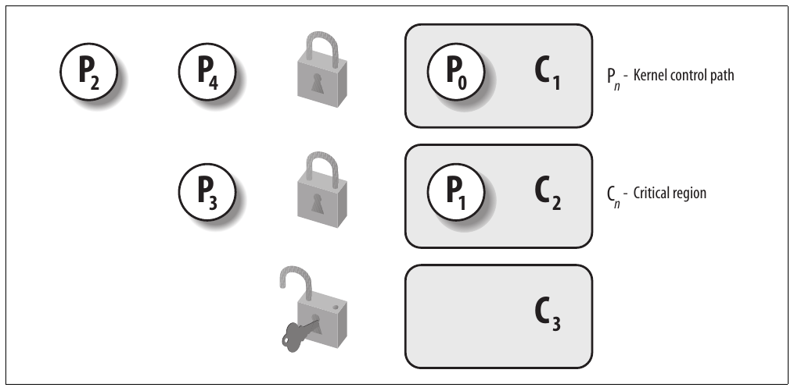
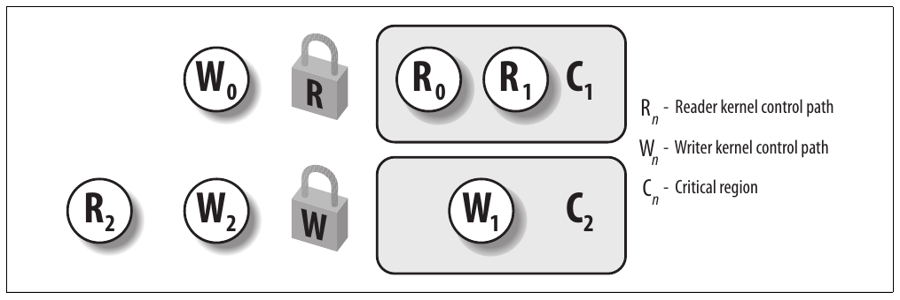

# Chương 5. Kernel synchronization


Bạn có thể xem kernel như server trả lời request; request có thể đến từ process chạy trên CPU hoặc external device phát interrupt request. So sánh này nhằm nhấn mạnh các phần kernel không chạy tuần tự mà xen kẽ. Do đó có thể gây race condition, phải được kiểm soát bằng kỹ thuật synchronization phù hợp. Giới thiệu tổng quát các chủ đề có trong phần “Tổng quan Unix kernel” của Chương 1.

Chúng ta bắt đầu bằng xem lại khi nào và đến mức nào kernel request được thực thi xen kẽ. Sau đó giới thiệu synchronization primitive cơ bản kernel triển khai và mô tả cách áp dụng trong trường hợp phổ biến nhất. Cuối cùng minh họa một vài ví dụ thực tế.

## Cách kernel phục vụ request

Để nắm rõ hơn cách kernel code thực thi, xem kernel như người phục vụ phải đáp ứng hai loại yêu cầu: từ khách hàng và từ số lượng giới hạn các ông chủ khác nhau. Người phục vụ áp dụng quy tắc sau:

1\. Nếu ông chủ gọi khi người phục vụ rảnh, người phục vụ bắt đầu phục vụ ông chủ.

2\. Nếu ông chủ gọi khi người phục vụ đang phục vụ khách, người phục vụ ngừng phục vụ khách và bắt đầu phục vụ ông chủ.

3\. Nếu ông chủ gọi khi người phục vụ đang phục vụ ông chủ khác, người phục vụ ngừng phục vụ ông chủ đầu và bắt đầu phục vụ ông chủ thứ hai. Khi phục vụ xong ông chủ mới, tiếp tục phục vụ ông chủ trước.

4\. Một ông chủ có thể khiến người phục vụ rời khách đang phục vụ. Sau khi phục vụ yêu cầu cuối của các ông chủ, người phục vụ có thể quyết định tạm bỏ khách hiện tại để nhận khách mới.

Dịch vụ người phục vụ thực hiện tương ứng code thực thi khi CPU trong Kernel Mode. Nếu CPU thực thi trong User Mode, xem người phục vụ là rảnh.

Yêu cầu của ông chủ tương ứng interrupt, còn yêu cầu của khách tương ứng system call hoặc exception do User Mode process phát. Như sẽ thấy chi tiết trong Chương 10, User Mode process muốn yêu cầu kernel service phải thực hiện instruction phù hợp (trên 80×86 là instruction `int $0x80` hoặc `sysenter`). Instruction này phát exception buộc CPU switch từ User Mode sang Kernel Mode. Trong phần còn lại của chương, thường gọi chung cả system call lẫn exception thông thường là “exception”.

Bạn đọc cẩn thận đã liên hệ ba quy tắc đầu với nesting kernel control path mô tả trong “Execution lồng nhau của exception handler và interrupt handler” của Chương 4. Quy tắc thứ tư tương ứng một trong những tính năng mới thú vị nhất trong Linux kernel 2.6, tức kernel preemption.

### Kernel preemption

Đưa ra định nghĩa tốt về kernel preemption khó đến bất ngờ. Thử lần đầu, có thể nói kernel là preemptive nếu process switch có thể xảy ra khi process bị thay thế đang thực thi kernel function, tức chạy trong Kernel Mode. Tiếc là trong Linux (cũng như mọi hệ điều hành thực tế khác), mọi thứ phức tạp hơn nhiều:

- Trong cả preemptive và nonpreemptive kernel, process chạy trong Kernel Mode có thể tự nguyện nhường CPU, ví dụ vì phải sleep chờ resource. Chúng ta gọi loại process switch này là planned process switch. Tuy nhiên preemptive kernel khác nonpreemptive kernel ở cách process chạy trong Kernel Mode phản ứng với asynchronous event có thể gây process switch — ví dụ interrupt handler wake up process priority cao hơn. Chúng ta gọi loại này là forced process switch.

- Mọi process switch do macro `switch_to` thực hiện. Trong cả preemptive và nonpreemptive kernel, process switch xảy ra khi process hoàn tất một luồng hoạt động kernel và scheduler được gọi. Tuy nhiên trong nonpreemptive kernel, current process không thể bị thay thế trừ khi sắp switch sang User Mode (xem phần “Thực hiện process switch” trong Chương 3).

Vì vậy đặc điểm chính của preemptive kernel là process chạy trong Kernel Mode có thể bị process khác thay thế ngay giữa kernel function.

Hãy đưa một vài ví dụ minh họa khác biệt giữa preemptive và nonpreemptive kernel.

Trong khi process A thực thi exception handler (tất yếu trong Kernel Mode), process B priority cao hơn trở thành runnable. Ví dụ có thể xảy ra nếu IRQ xuất hiện và handler tương ứng wake up process B. Nếu kernel preemptive, forced process switch thay process A bằng B. Exception handler chưa hoàn tất và chỉ tiếp tục khi scheduler lại chọn process A để thực thi. Ngược lại nếu kernel nonpreemptive, không process switch nào xảy ra đến khi process A xử lý xong exception handler hoặc tự nguyện nhường CPU.

Ví dụ khác, xét process thực thi exception handler và hết time quantum (xem phần “Function scheduler\_tick()” trong Chương 7). Nếu kernel preemptive, process có thể bị thay ngay; tuy nhiên nếu kernel nonpreemptive, process tiếp tục chạy đến khi xử lý xong exception handler hoặc tự nguyện nhường CPU.

Động lực chính để kernel preemptive là giảm dispatch latency của User Mode process, tức độ trễ từ khi trở thành runnable đến khi thực sự bắt đầu chạy. Process thực hiện task cần schedule đúng lúc (như external hardware controller, environmental monitor, movie player, v.v.) thực sự hưởng lợi từ kernel preemption vì giảm nguy cơ bị process khác chạy trong Kernel Mode trì hoãn.

Làm Linux kernel 2.6 preemptive không đòi hỏi thay đổi thiết kế kernel mạnh so với kernel version nonpreemptive cũ. Như mô tả trong phần “Trở về từ interrupt và exception” của Chương 4, kernel preemption bị disable khi field `preempt_count` trong descriptor `thread_info` do macro `current_thread_info()` tham chiếu lớn hơn 0. Field encode ba counter khác nhau như Bảng 4-10 của Chương 4 nên lớn hơn 0 khi bất kỳ trường hợp nào sau xảy ra:

1\. Kernel đang thực thi interrupt service routine.

2\. Deferrable function bị disable (luôn đúng khi kernel đang thực thi softirq hoặc tasklet).

3\. Kernel preemption đã bị disable tường minh bằng cách đặt preemption counter thành giá trị dương.

Quy tắc trên cho biết kernel chỉ có thể bị preempt khi thực thi exception handler (đặc biệt system call) và kernel preemption chưa bị disable tường minh. Hơn nữa như mô tả trong phần “Trở về từ interrupt và exception” của Chương 4, local CPU phải enable local interrupt, nếu không không thực hiện kernel preemption.

Một vài macro đơn giản trong Bảng 5-1 xử lý preemption counter trong field `prempt_count`.

Bảng 5-1. Macro xử lý preemption counter subfield

| Macro | Mô tả |
|---|---|
| `preempt_count()` | Chọn field `preempt_count` trong descriptor `thread_info` |
| `preempt_disable()` | Tăng giá trị preemption counter thêm 1 |
| `preempt_enable_no_resched()` | Giảm giá trị preemption counter đi 1 |
| `preempt_enable()` | Giảm giá trị preemption counter đi 1 và gọi `preempt_schedule()` nếu flag `TIF_NEED_RESCHED` trong descriptor `thread_info` được set |
| `get_cpu()` | Tương tự `preempt_disable()` nhưng còn return số local CPU |
| `put_cpu()` | Giống `preempt_enable()` |
| `put_cpu_no_resched()` | Giống `preempt_enable_no_resched()` |

Macro `preempt_enable()` giảm preemption counter rồi kiểm tra flag `TIF_NEED_RESCHED` có được set không (xem Bảng 4-15 trong Chương 4). Khi đó process switch request đang pending nên macro gọi function `preempt_schedule()`, về cơ bản thực thi code sau:

```c
if (!current_thread_info->preempt_count && !irqs_disabled()) {
    current_thread_info->preempt_count = PREEMPT_ACTIVE;
    schedule();
    current_thread_info->preempt_count = 0;
}
```

Function kiểm tra local interrupt có enable và field `preempt_count` của `current` có bằng 0 không; nếu cả hai đúng, gọi `schedule()` chọn process khác chạy. Vì vậy kernel preemption có thể xảy ra khi kernel control path (thường là interrupt handler) kết thúc hoặc khi exception handler enable lại kernel preemption bằng `preempt_enable()`. Như sẽ thấy trong phần “Disable và enable deferrable function” sau trong chương, kernel preemption cũng có thể xảy ra khi deferrable function được enable.

Kết thúc phần này bằng lưu ý kernel preemption tạo overhead không thể bỏ qua. Vì vậy Linux 2.6 có kernel configuration option cho phép người dùng enable hoặc disable kernel preemption khi compile kernel.

### Khi nào cần synchronization

Chương 1 giới thiệu khái niệm race condition và critical region cho process. Cùng định nghĩa áp dụng cho kernel control path. Trong chương này, race condition có thể xảy ra khi kết quả computation phụ thuộc cách từ hai kernel control path xen kẽ trở lên được lồng nhau. Critical region là đoạn code phải được kernel control path đi vào thực thi hoàn toàn trước khi kernel control path khác có thể vào.

Xen kẽ kernel control path làm công việc kernel developer phức tạp hơn: phải đặc biệt cẩn thận nhận diện critical region trong exception handler, interrupt handler, deferrable function và kernel thread. Khi đã nhận diện critical region, phải bảo vệ phù hợp để bảo đảm mọi lúc tối đa một kernel control path ở trong region đó.

Ví dụ giả sử hai interrupt handler khác nhau cần truy cập cùng data structure chứa nhiều member variable liên quan — chẳng hạn buffer và integer biểu thị độ dài. Mọi statement ảnh hưởng data structure phải đặt trong một critical region. Nếu hệ thống có một CPU, có thể triển khai critical region bằng disable interrupt khi truy cập shared data structure vì nesting kernel control path chỉ xảy ra khi interrupt enable.

Mặt khác nếu cùng data structure chỉ được service routine của system call truy cập và hệ thống có một CPU, có thể triển khai critical region khá đơn giản bằng disable kernel preemption khi truy cập shared data structure.

Như dự đoán, mọi thứ phức tạp hơn trong multiprocessor system. Nhiều CPU có thể thực thi kernel code cùng lúc nên kernel developer không thể giả định truy cập data structure an toàn chỉ vì kernel preemption bị disable và data structure không bao giờ được interrupt, exception hoặc softirq handler address.

Các phần sau sẽ cho thấy kernel cung cấp nhiều kỹ thuật synchronization khác nhau. Kernel designer phải giải quyết mỗi vấn đề synchronization bằng cách chọn kỹ thuật hiệu quả nhất.

### Khi nào không cần synchronization

Một số lựa chọn thiết kế đã thảo luận chương trước phần nào đơn giản hóa synchronization kernel control path. Nhắc lại ngắn gọn:

- Mọi interrupt handler acknowledge interrupt trên PIC và disable IRQ line. Lần tiếp theo của cùng interrupt không thể xảy ra đến khi handler kết thúc.

- Interrupt handler, softirq và tasklet đều nonpreemptable và nonblocking nên không thể bị suspend lâu. Trường hợp xấu nhất execution hơi trì hoãn vì interrupt khác xảy ra trong execution (nested execution kernel control path).

- Kernel control path xử lý interrupt không thể bị interrupt bởi kernel control path thực thi deferrable function hoặc system call service routine.

- Softirq và tasklet không thể xen kẽ trên CPU cho trước.

- Cùng tasklet không thể thực thi đồng thời trên nhiều CPU.

Mỗi lựa chọn thiết kế trên có thể xem là ràng buộc tận dụng để viết một số kernel function dễ hơn. Đây là vài ví dụ đơn giản hóa có thể có:

- Interrupt handler và tasklet không cần viết dưới dạng reentrant function.

- Per-CPU variable chỉ được softirq và tasklet truy cập không cần synchronization.

- Data structure chỉ một loại tasklet truy cập không cần synchronization.

Phần còn lại mô tả cần làm gì khi synchronization cần thiết — tức cách ngăn data corruption do truy cập shared data structure không an toàn.

## Synchronization primitive

Giờ xem xét cách xen kẽ kernel control path mà tránh race condition trên shared data. Bảng 5-2 liệt kê kỹ thuật synchronization Linux kernel dùng. Cột “Phạm vi” cho biết kỹ thuật áp dụng cho mọi CPU trong hệ thống hay một CPU. Ví dụ local interrupt disabling chỉ áp dụng một CPU (CPU khác không bị ảnh hưởng); ngược lại atomic operation ảnh hưởng mọi CPU (atomic operation trên nhiều CPU không thể xen kẽ khi truy cập cùng data structure).

Bảng 5-2. Các loại kỹ thuật synchronization kernel dùng

| Kỹ thuật | Mô tả | Phạm vi |
|---|---|---|
| Per-CPU variable | Duplicate data structure giữa các CPU | Mọi CPU |
| Atomic operation | Atomic read-modify-write instruction trên counter | Mọi CPU |
| Memory barrier | Tránh instruction reordering | Local CPU hoặc mọi CPU |
| Spin lock | Lock với busy wait | Mọi CPU |
| Semaphore | Lock với blocking wait (sleep) | Mọi CPU |
| Seqlock | Lock dựa trên access counter | Mọi CPU |
| Local interrupt disabling | Cấm interrupt handling trên một CPU | Local CPU |
| Local softirq disabling | Cấm xử lý deferrable function trên một CPU | Local CPU |
| Read-copy-update (RCU) | Lock-free access đến shared data structure qua pointer | Mọi CPU |

Giờ thảo luận ngắn mỗi kỹ thuật synchronization. Trong phần “Synchronize truy cập kernel data structure” sau, sẽ trình bày cách kết hợp các kỹ thuật để bảo vệ kernel data structure hiệu quả.

### Per-CPU variable

Kỹ thuật synchronization tốt nhất là thiết kế kernel để tránh cần synchronization ngay từ đầu. Thực tế như sẽ thấy, mọi explicit synchronization primitive đều có performance cost đáng kể.

Kỹ thuật synchronization đơn giản và hiệu quả nhất là khai báo kernel variable dưới dạng per-CPU variable. Về cơ bản per-CPU variable là array data structure, mỗi CPU trong hệ thống một phần tử.

CPU không nên truy cập phần tử array tương ứng CPU khác; mặt khác có thể tự do đọc và sửa phần tử riêng mà không sợ race condition vì là CPU duy nhất có quyền. Tuy nhiên điều này cũng nghĩa là per-CPU variable chỉ dùng được trong trường hợp cụ thể — cơ bản khi chia data về logic giữa CPU của hệ thống là hợp lý.

Phần tử per-CPU array được align trong main memory để mỗi data structure nằm trên line khác nhau của hardware cache (xem phần “Hardware cache” trong Chương 2). Vì vậy concurrent access đến per-CPU array không gây cache line snooping và invalidation, vốn là operation tốn kém về system performance.

Dù per-CPU variable bảo vệ khỏi concurrent access từ nhiều CPU, không bảo vệ khỏi truy cập từ asynchronous function (interrupt handler và deferrable function). Khi đó cần synchronization primitive bổ sung.

Hơn nữa per-CPU variable dễ gặp race condition do kernel preemption trong cả uniprocessor và multiprocessor system. Theo quy tắc chung, kernel control path nên truy cập per-CPU variable với kernel preemption bị disable. Chỉ cần xét điều xảy ra nếu kernel control path lấy address local copy của per-CPU variable rồi bị preempt và chuyển sang CPU khác: address vẫn tham chiếu phần tử của CPU trước.

Bảng 5-3 liệt kê function và macro chính kernel cung cấp để dùng per-CPU variable.

Bảng 5-3. Function và macro cho per-CPU variable

| Tên macro hoặc function | Mô tả |
|---|---|
| `DEFINE_PER_CPU(type, name)` | Statically allocate per-CPU array tên `name` gồm data structure `type` |
| `per_cpu(name, cpu)` | Chọn phần tử cho CPU `cpu` của per-CPU array `name` |
| `__get_cpu_var(name)` | Chọn phần tử local CPU của per-CPU array `name` |
| `get_cpu_var(name)` | Disable kernel preemption rồi chọn phần tử local CPU của per-CPU array `name` |
| `put_cpu_var(name)` | Enable kernel preemption (`name` không dùng) |
| `alloc_percpu(type)` | Dynamically allocate per-CPU array gồm data structure `type` và return address |
| `free_percpu(pointer)` | Release per-CPU array dynamically allocated tại address `pointer` |
| `per_cpu_ptr(pointer, cpu)` | Return address phần tử cho CPU `cpu` của per-CPU array tại address `pointer` |

### Atomic operation

Một số assembly language instruction thuộc loại “read-modify-write” — tức truy cập memory location hai lần, lần đầu đọc giá trị cũ, lần thứ hai ghi giá trị mới.

Giả sử hai kernel control path chạy trên hai CPU cố “read-modifywrite” cùng memory location cùng lúc bằng nonatomic operation. Đầu tiên cả hai CPU cố đọc cùng location nhưng memory arbiter (hardware circuit serialize truy cập RAM chip) can thiệp cấp quyền cho một CPU và trì hoãn CPU kia. Tuy nhiên khi read operation đầu hoàn tất, CPU bị trì hoãn đọc đúng cùng giá trị (cũ) từ memory location. Cả hai CPU sau đó cố ghi cùng giá trị (mới) vào memory location; một lần nữa memory arbiter serialize bus memory access và cuối cùng cả hai write operation thành công. Tuy nhiên kết quả tổng thể sai vì cả hai CPU ghi cùng giá trị (mới). Vì vậy hai “read-modify-write” operation xen kẽ hoạt động như một operation duy nhất.

Cách dễ nhất ngăn race condition do instruction “read-modify-write” là bảo đảm operation atomic ở chip level. Mỗi operation phải thực thi trong một instruction duy nhất không bị interrupt giữa chừng và tránh CPU khác truy cập cùng memory location. Những atomic operation rất nhỏ này nằm ở nền tảng cơ chế linh hoạt hơn để tạo critical region.

Xem lại instruction 80×86 theo phân loại đó:

- Assembly language instruction không thực hiện memory access hoặc thực hiện một aligned memory access là atomic.[^1]

- Read-modify-write assembly language instruction (như `inc` hoặc `dec`) đọc data từ memory, cập nhật và ghi giá trị mới về memory là atomic nếu processor khác chưa chiếm memory bus sau read và trước write. Memory bus stealing không bao giờ xảy ra trong uniprocessor system.

- Read-modify-write assembly language instruction có opcode thêm tiền tố byte `lock` (`0xf0`) là atomic ngay cả trên multiprocessor system. Khi control unit phát hiện tiền tố, “lock” memory bus đến khi instruction hoàn tất. Vì vậy processor khác không thể truy cập memory location khi locked instruction đang thực thi.

- Assembly language instruction có opcode thêm tiền tố byte `rep` (`0xf2`, `0xf3`, buộc control unit lặp cùng instruction nhiều lần) không atomic. Control unit kiểm tra pending interrupt trước khi thực thi iteration mới.

Khi viết C code, không thể bảo đảm compiler dùng atomic instruction cho operation như `a=a+1` hoặc ngay cả `a++`. Vì vậy Linux kernel cung cấp type đặc biệt `atomic_t` (counter có thể truy cập atomically) cùng một số function và macro đặc biệt (xem Bảng 5-4) thao tác trên variable `atomic_t`, được triển khai bằng một atomic assembly language instruction duy nhất. Trên multiprocessor system, mỗi instruction được thêm tiền tố byte `lock`.

Bảng 5-4. Atomic operation trong Linux

| Function | Mô tả |
|---|---|
| `atomic_read(v)` | Return `*v` |
| `atomic_set(v,i)` | Đặt `*v` thành `i` |
| `atomic_add(i,v)` | Cộng `i` vào `*v` |
| `atomic_sub(i,v)` | Trừ `i` khỏi `*v` |
| `atomic_sub_and_test(i, v)` | Trừ `i` khỏi `*v`, return 1 nếu kết quả bằng 0; nếu không return 0 |
| `atomic_inc(v)` | Cộng 1 vào `*v` |
| `atomic_dec(v)` | Trừ 1 khỏi `*v` |
| `atomic_dec_and_test(v)` | Trừ 1 khỏi `*v`, return 1 nếu kết quả bằng 0; nếu không return 0 |
| `atomic_inc_and_test(v)` | Cộng 1 vào `*v`, return 1 nếu kết quả bằng 0; nếu không return 0 |
| `atomic_add_negative(i, v)` | Cộng `i` vào `*v`, return 1 nếu kết quả âm; nếu không return 0 |
| `atomic_inc_return(v)` | Cộng 1 vào `*v` và return giá trị mới của `*v` |
| `atomic_dec_return(v)` | Trừ 1 khỏi `*v` và return giá trị mới của `*v` |
| `atomic_add_return(i, v)` | Cộng `i` vào `*v` và return giá trị mới của `*v` |
| `atomic_sub_return(i, v)` | Trừ `i` khỏi `*v` và return giá trị mới của `*v` |

Class atomic function khác thao tác trên bit mask (xem Bảng 5-5).

Bảng 5-5. Function xử lý bit atomic trong Linux

| Function | Mô tả |
|---|---|
| `test_bit(nr, addr)` | Return giá trị bit thứ `nr` của `*addr` |
| `set_bit(nr, addr)` | Set bit thứ `nr` của `*addr` |
| `clear_bit(nr, addr)` | Clear bit thứ `nr` của `*addr` |
| `change_bit(nr, addr)` | Đảo bit thứ `nr` của `*addr` |
| `test_and_set_bit(nr, addr)` | Set bit thứ `nr` của `*addr` và return giá trị cũ |
| `test_and_clear_bit(nr, addr)` | Clear bit thứ `nr` của `*addr` và return giá trị cũ |
| `test_and_change_bit(nr, addr)` | Đảo bit thứ `nr` của `*addr` và return giá trị cũ |
| `atomic_clear_mask(mask, addr)` | Clear mọi bit của `*addr` do `mask` chỉ định |
| `atomic_set_mask(mask, addr)` | Set mọi bit của `*addr` do `mask` chỉ định |

### Optimization barrier và memory barrier

Khi dùng optimizing compiler, không bao giờ nên mặc nhiên cho rằng instruction thực hiện đúng thứ tự xuất hiện trong source code. Ví dụ compiler có thể reorder assembly language instruction để tối ưu cách dùng register. Hơn nữa CPU hiện đại thường thực thi nhiều instruction song song và có thể reorder memory access. Những kiểu reordering này có thể tăng tốc chương trình đáng kể.

Tuy nhiên khi xử lý synchronization, phải tránh instruction reordering. Mọi thứ nhanh chóng trở nên rắc rối nếu instruction đặt sau synchronization primitive lại thực thi trước chính primitive. Vì vậy mọi synchronization primitive đều đóng vai trò optimization barrier và memory barrier.

Optimization barrier primitive bảo đảm compiler không trộn assembly language instruction tương ứng C statement đặt trước primitive với assembly language instruction tương ứng C statement đặt sau primitive. Trong Linux, macro `barrier()` mở rộng thành `asm volatile(""::: "memory")` đóng vai trò optimization barrier. Instruction `asm` yêu cầu compiler insert assembly language fragment (rỗng trong trường hợp này). Keyword `volatile` cấm compiler sắp xếp lại instruction `asm` với instruction khác trong chương trình. Keyword `memory` buộc compiler giả định mọi memory location trong RAM đã bị assembly language instruction thay đổi; vì vậy compiler không thể tối ưu code bằng giá trị memory location lưu trong CPU register trước instruction `asm`. Chú ý optimization barrier không bảo đảm CPU không trộn execution của assembly language instruction — đó là việc của memory barrier.

Memory barrier primitive bảo đảm operation đặt trước primitive hoàn tất trước khi bắt đầu operation đặt sau primitive. Vì vậy memory barrier giống firewall mà assembly language instruction không thể vượt qua.

Trong processor 80×86, các loại assembly language instruction sau được gọi là “serializing” vì đóng vai trò memory barrier:

- Mọi instruction thao tác trên I/O port

- Mọi instruction có tiền tố byte `lock` (xem phần “Atomic operation”)

- Mọi instruction ghi vào control register, system register hoặc debug register (ví dụ `cli` và `sti` thay đổi status flag `IF` trong register `eflags`)

- Assembly language instruction `lfence`, `sfence` và `mfence`, được đưa vào microprocessor Pentium 4 để lần lượt triển khai hiệu quả read memory barrier, write memory barrier và read-write memory barrier.

- Một vài assembly language instruction đặc biệt; trong đó có instruction `iret` kết thúc interrupt hoặc exception handler

Linux dùng một vài memory barrier primitive trong Bảng 5-6. Chúng cũng đóng vai trò optimization barrier vì phải bảo đảm compiler không di chuyển assembly language instruction qua barrier. “Read memory barrier” chỉ tác động instruction đọc memory, còn “write memory barrier” chỉ tác động instruction ghi memory. Memory barrier có thể hữu ích trong cả multiprocessor và uniprocessor system. Primitive `smp_xxx()` được dùng khi memory barrier cần ngăn race condition chỉ có thể xảy ra trong multiprocessor system; trong uniprocessor system không làm gì. Memory barrier khác dùng ngăn race condition xảy ra trong cả uniprocessor và multiprocessor system.

Bảng 5-6. Memory barrier trong Linux

| Macro | Mô tả |
|---|---|
| `mb()` | Memory barrier cho MP và UP |
| `rmb()` | Read memory barrier cho MP và UP |
| `wmb()` | Write memory barrier cho MP và UP |
| `smp_mb()` | Memory barrier chỉ cho MP |
| `smp_rmb()` | Read memory barrier chỉ cho MP |
| `smp_wmb()` | Write memory barrier chỉ cho MP |

Triển khai memory barrier primitive phụ thuộc architecture hệ thống. Trên microprocessor 80×86, macro `rmb()` thường mở rộng thành `asm volatile("lfence")` nếu CPU hỗ trợ assembly language instruction `lfence`, nếu không thành `asm volatile("lock;addl $0,0(%%esp)":::"memory")`. Statement `asm` insert assembly language fragment vào code compiler tạo và đóng vai trò optimization barrier. Assembly language instruction `lock; addl $0,0(%%esp)` cộng 0 vào memory location trên đỉnh stack; bản thân instruction vô dụng nhưng tiền tố `lock` biến thành memory barrier cho CPU.

Macro `wmb()` thực tế đơn giản hơn vì mở rộng thành `barrier()`. Lý do microprocessor Intel hiện có không bao giờ reorder write memory access nên không cần insert serializing assembly language instruction vào code. Tuy nhiên macro cấm compiler xáo trộn instruction.

Chú ý trong multiprocessor system, mọi atomic operation mô tả trong phần “Atomic operation” trước đóng vai trò memory barrier vì dùng byte `lock`.

### Spin lock

Kỹ thuật synchronization dùng rộng rãi là locking. Khi kernel control path phải truy cập shared data structure hoặc vào critical region, cần acquire “lock” cho nó. Resource được locking mechanism bảo vệ khá giống resource trong phòng có cửa khóa khi có người bên trong. Nếu kernel control path muốn truy cập resource, cố “mở cửa” bằng acquire lock. Chỉ thành công nếu resource rảnh. Sau đó chừng nào còn muốn dùng resource, cửa vẫn khóa. Khi kernel control path release lock, cửa mở và kernel control path khác có thể vào phòng.

Hình 5-1 minh họa dùng lock. Năm kernel control path (P0, P1, P2, P3 và P4) đang cố truy cập hai critical region (C1 và C2). Kernel control path P0 trong C1, còn P2 và P4 chờ vào. Đồng thời P1 trong C2, còn P3 chờ vào. Chú ý P0 và P1 có thể chạy đồng thời. Lock cho critical region C3 mở vì không kernel control path nào cần vào.



Hình 5-1. Bảo vệ critical region bằng nhiều lock

Spin lock là loại lock đặc biệt thiết kế cho môi trường multiprocessor. Nếu kernel control path thấy spin lock “mở”, acquire lock và tiếp tục execution. Ngược lại nếu thấy lock bị kernel control path chạy trên CPU khác “đóng”, nó “spin”, lặp lại instruction loop ngắn đến khi lock được release.

Instruction loop của spin lock biểu diễn “busy wait”. Waiting kernel control path tiếp tục chạy trên CPU dù không có gì làm ngoài lãng phí thời gian. Tuy nhiên spin lock thường tiện vì nhiều kernel resource chỉ bị lock trong phần nhỏ millisecond; vì vậy release CPU rồi reacquire sau time-consuming hơn nhiều.

Theo quy tắc chung, kernel preemption bị disable trong mọi critical region được spin lock bảo vệ. Với uniprocessor system, bản thân lock vô dụng và spin lock primitive chỉ disable hoặc enable kernel preemption. Chú ý kernel preemption vẫn enable trong busy wait phase nên process chờ spin lock được release có thể bị process priority cao hơn thay thế.

Trong Linux, mỗi spin lock được biểu diễn bằng structure `spinlock_t` gồm hai field:

`slock`

Encode spin lock state: giá trị 1 tương ứng unlocked state, còn mọi giá trị âm và 0 biểu thị locked state `break_lock` Flag báo process đang busy wait chờ lock (chỉ có nếu kernel hỗ trợ cả SMP lẫn kernel preemption)

Sáu macro trong Bảng 5-7 dùng initialize, test và set spin lock. Mọi macro dựa trên atomic operation; bảo đảm spin lock cập nhật đúng ngay cả khi nhiều process chạy trên CPU khác nhau cố sửa lock cùng lúc.[^2]

Bảng 5-7. Spin lock macro

| Macro | Mô tả |
|---|---|
| `spin_lock_init()` | Đặt spin lock thành 1 (unlocked) |
| `spin_lock()` | Lặp đến khi spin lock thành 1 (unlocked), rồi đặt thành 0 (locked) |
| `spin_unlock()` | Đặt spin lock thành 1 (unlocked) |
| `spin_unlock_wait()` | Chờ đến khi spin lock thành 1 (unlocked) |
| `spin_is_locked()` | Return 0 nếu spin lock đặt thành 1 (unlocked); nếu không return 1 |
| `spin_trylock()` | Đặt spin lock thành 0 (locked), return 1 nếu giá trị trước của lock là 1; nếu không return 0 |

#### Macro spin\_lock có kernel preemption

Thảo luận chi tiết macro `spin_lock` dùng acquire spin lock. Mô tả sau nói về preemptive kernel cho SMP system. Macro nhận parameter là address `slp` của spin lock và thực hiện:

1\. Gọi `preempt_disable()` để disable kernel preemption.

2\. Gọi function `_raw_spin_trylock()` thực hiện atomic test-and-set operation trên field `slock` của spin lock; function trước tiên thực thi một số instruction tương đương assembly language fragment sau:

```c
movb $0, %al
xchgb %al, slp->slock
```

Assembly language instruction `xchg` trao đổi atomically nội dung register 8-bit `%al` (lưu 0) với nội dung memory location do `slp->slock` trỏ đến. Sau đó function return 1 nếu giá trị cũ lưu trong spin lock (trong `%al` sau instruction `xchg`) dương, nếu không return 0.

3\. Nếu giá trị cũ spin lock dương, macro kết thúc: kernel control path đã acquire spin lock.

4\. Nếu không, kernel control path acquire spin lock thất bại nên macro phải lặp đến khi kernel control path trên CPU khác release spin lock. Gọi `preempt_enable()` hoàn tác tăng preemption counter ở bước 1. Nếu kernel preemption đã enable trước khi thực thi macro `spin_lock`, process khác giờ có thể thay process này khi chờ spin lock.

5\. Nếu field `break_lock` bằng 0, đặt thành 1. Bằng kiểm tra field này, process sở hữu lock chạy trên CPU khác biết có process khác chờ lock không. Nếu process giữ spin lock lâu, có thể quyết định release sớm để process khác chờ cùng spin lock tiến triển.

6\. Thực thi wait cycle:

```c
while (spin_is_locked(slp) && slp->break_lock)
    cpu_relax();
```

Macro `cpu_relax()` rút thành assembly language instruction `pause`. Instruction được đưa vào model Pentium 4 để tối ưu execution của spin lock loop. Bằng tạo delay ngắn, tăng tốc execution code sau lock và giảm power consumption. Instruction `pause` backward compatible với microprocessor 80×86 model trước vì tương ứng instruction `rep;nop`, tức no-operation.

7\. Jump lại bước 1 để thử lấy spin lock lần nữa.

##### Macro spin\_lock không có kernel preemption

Nếu không chọn kernel preemption option khi compile kernel, macro `spin_lock` khá khác mô tả trên. Khi đó macro tạo assembly language fragment về cơ bản tương đương tight busy wait sau:[^3]

```c
1: lock; decb slp->slock
   jns  3f
2: pause
   cmpb $0,slp->slock
   jle 2b
   jmp 1b
3:
```

Assembly language instruction `decb` giảm spin lock value; instruction atomic vì có tiền tố byte `lock`. Sau đó kiểm tra sign flag. Nếu clear, nghĩa là spin lock đã đặt thành 1 (unlocked), nên execution bình thường tiếp tục tại label `3` (hậu tố `f` biểu thị “forward” label; xuất hiện ở dòng sau của chương trình). Nếu không, tight loop tại label `2` (hậu tố `b` biểu thị “backward” label) được thực thi đến khi spin lock có giá trị dương. Sau đó execution bắt đầu lại từ label `1` vì tiếp tục mà không kiểm tra processor khác đã lấy lock chưa là không an toàn.

##### Macro spin\_unlock

Macro `spin_unlock` release spin lock đã acquire; về cơ bản thực thi assembly language instruction:

```c
movb $1, slp->slock
```

rồi gọi `preempt_enable()` (nếu không hỗ trợ kernel preemption, `preempt_enable()` không làm gì). Chú ý không dùng byte `lock` vì write-only memory access luôn được microprocessor 80×86 hiện tại thực thi atomically.

### Read/write spin lock

Read/write spin lock được đưa vào để tăng concurrency trong kernel. Cho phép nhiều kernel control path đồng thời đọc cùng data structure miễn không kernel control path nào sửa. Nếu kernel control path muốn ghi structure, phải acquire write version của read/write lock để có exclusive access đến resource. Tất nhiên cho concurrent read trên data structure cải thiện system performance.

Hình 5-2 minh họa hai critical region (C1 và C2) được read/write lock bảo vệ. Kernel control path R0 và R1 đang đọc data structure trong C1 cùng lúc, còn W0 chờ acquire lock để ghi. Kernel control path W1 đang ghi data structure trong C2, còn R2 và W2 lần lượt chờ acquire lock để đọc và ghi.



Hình 5-2. Read/write spin lock

Mỗi read/write spin lock là structure `rwlock_t`; field `lock` 32-bit encode hai thông tin riêng:

- Counter 24-bit biểu thị số kernel control path hiện đọc protected data structure. Giá trị two’s complement của counter lưu trong bit 0–23 của field.

- Unlock flag được set khi không kernel control path nào đọc hoặc ghi, nếu không được clear. Unlock flag lưu trong bit 24 của field.

Chú ý field `lock` lưu số `0x01000000` nếu spin lock idle (unlock flag set và không reader), số `0x00000000` nếu đã acquire để ghi (unlock flag clear và không reader), và bất kỳ số nào trong sequence `0x00ffffff`, `0x00fffffe`, v.v. nếu đã được một, hai hoặc nhiều process acquire để đọc (unlock flag clear và two’s complement 24-bit của số reader). Như structure `spinlock_t`, structure `rwlock_t` cũng có field `break_lock`.

Macro `rwlock_init` initialize field `lock` của read/write spin lock thành `0x01000000` (unlocked) và field `break_lock` thành 0.

#### Lấy và release lock để đọc

Macro `read_lock` áp dụng cho address `rwlp` của read/write spin lock tương tự macro `spin_lock` phần trước. Nếu chọn kernel preemption option khi compile kernel, macro thực hiện đúng các hành động của `spin_lock()` với một ngoại lệ: để thực sự acquire read/write spin lock ở bước 2, macro thực thi function `_raw_read_trylock()`:

```c
int _raw_read_trylock(rwlock_t *lock)
{
    atomic_t *count = (atomic_t *)lock->lock;
    atomic_dec(count);
    if (atomic_read(count) >= 0)
        return 1;
    atomic_inc(count);
    return 0;
}
```

Field `lock` — read/write lock counter — được truy cập qua atomic operation. Tuy nhiên chú ý toàn bộ function không thao tác atomically trên counter: ví dụ counter có thể đổi sau khi kiểm tra giá trị bằng statement `if` và trước khi return 1. Dù vậy function hoạt động đúng: thực tế chỉ return 1 nếu counter không bằng 0 hoặc âm trước decrement, vì counter bằng `0x01000000` khi không owner, `0x00ffffff` khi một reader và `0x00000000` khi một writer.

Nếu không chọn kernel preemption option khi compile kernel, macro `read_lock` tạo assembly language code sau:

```c
    movl $rwlp->lock,%eax
    lock; subl $1,(%eax)
    jns 1f
    call __read_lock_failed
1:
```

trong đó `__read_lock_failed()` là assembly language function sau:

```c
__read_lock_failed:
    lock; incl (%eax)
1:  pause
    cmpl $1,(%eax)
    js 1b
    lock; decl (%eax)
    js __read_lock_failed
    ret
```

Macro `read_lock` atomically giảm spin lock value đi 1, tăng số reader. Spin lock được acquire nếu decrement operation cho giá trị không âm; nếu không function `__read_lock_failed()` được gọi. Function atomically tăng field `lock` để hoàn tác decrement operation của macro `read_lock`, rồi lặp đến khi field dương (lớn hơn hoặc bằng 1). Tiếp theo `__read_lock_failed()` thử lấy spin lock lại (kernel control path khác có thể acquire spin lock để ghi ngay sau instruction `cmpl`).

Release read lock khá đơn giản vì macro `read_unlock` chỉ cần tăng counter trong field `lock` bằng assembly language instruction:

```c
lock; incl rwlp->lock
```

để giảm số reader, rồi gọi `preempt_enable()` để enable lại kernel preemption.

##### Lấy và release lock để ghi

Macro `write_lock` được triển khai như `spin_lock()` và `read_lock()`. Ví dụ nếu hỗ trợ kernel preemption, function disable kernel preemption và thử lấy lock ngay bằng `_raw_write_trylock()`. Nếu function return 0, lock đã bị lấy nên macro enable lại kernel preemption và bắt đầu busy wait loop như giải thích trong mô tả `spin_lock()` phần trước.

Function `_raw_write_trylock()` hiển thị dưới đây:

```c
int _raw_write_trylock(rwlock_t *lock)
{
    atomic_t *count = (atomic_t *)lock->lock;
    if (atomic_sub_and_test(0x01000000, count))
        return 1;
    atomic_add(0x01000000, count);
    return 0;
}
```

Function `_raw_write_trylock()` trừ `0x01000000` khỏi read/write spin lock value, clear unlock flag (bit 24). Nếu subtraction operation cho 0 (không reader), lock được acquire và function return 1; nếu không function atomically cộng `0x01000000` vào spin lock value để hoàn tác subtraction operation.

Một lần nữa release write lock đơn giản hơn nhiều vì macro `write_unlock` chỉ cần set unlock flag trong field `lock` bằng assembly language instruction:

```c
lock; addl $0x01000000,rwlp
```

rồi gọi `preempt_enable()`.

### Seqlock

Khi dùng read/write spin lock, request do kernel control path phát để thực hiện operation `read_lock` hoặc `write_lock` có cùng priority: reader phải chờ writer hoàn tất và tương tự writer phải chờ mọi reader hoàn tất.

Seqlock đưa vào Linux 2.6 tương tự read/write spin lock nhưng ưu tiên writer cao hơn nhiều: thực tế writer được tiếp tục ngay cả khi reader active. Điểm tốt là writer không bao giờ chờ (trừ khi writer khác active); điểm xấu là reader đôi khi bị buộc đọc cùng data nhiều lần đến khi có bản sao hợp lệ.

Mỗi seqlock là structure `seqlock_t` gồm hai field: field `lock` type `spinlock_t` và integer field `sequence`. Field thứ hai đóng vai trò sequence counter. Mỗi reader phải đọc sequence counter hai lần, trước và sau khi đọc data, rồi kiểm tra hai giá trị có trùng không. Nếu không, writer mới đã active và tăng sequence counter, ngầm báo reader rằng data vừa đọc không hợp lệ.

Variable `seqlock_t` được initialize thành “unlocked” bằng gán giá trị `SEQLOCK_UNLOCKED` hoặc thực thi macro `seqlock_init`. Writer acquire và release seqlock bằng `write_seqlock()` và `write_sequnlock()`. Function đầu acquire spin lock trong data structure `seqlock_t` rồi tăng sequence counter thêm 1; function thứ hai tăng sequence counter lần nữa rồi release spin lock. Bảo đảm khi writer đang ghi, counter lẻ, và khi không writer thay đổi data, counter chẵn. Reader triển khai critical region như sau:

```c
unsigned int seq;
do {
    seq = read_seqbegin(&seqlock);
    /* ... CRITICAL REGION ... */
} while (read_seqretry(&seqlock, seq));
```

`read_seqbegin()` return sequence number hiện tại của seqlock; `read_seqretry()` return 1 nếu giá trị local variable `seq` lẻ (writer đang cập nhật data structure khi function `read_seqbegin()` được gọi) hoặc giá trị `seq` không khớp giá trị sequence counter hiện tại của seqlock (writer bắt đầu làm việc khi reader còn thực thi code trong critical region).

Chú ý khi reader vào critical region không cần disable kernel preemption; mặt khác writer tự động disable kernel preemption khi vào critical region vì acquire spin lock.

Không phải mọi loại data structure đều được seqlock bảo vệ. Theo quy tắc chung, phải thỏa các điều kiện:

- Data structure cần bảo vệ không chứa pointer bị writer sửa và reader dereference (nếu không writer có thể thay pointer ngay trước mắt reader)

- Code trong critical region của reader không có side effect (nếu không nhiều lần đọc có tác động khác một lần đọc)

Hơn nữa critical region của reader nên ngắn và writer hiếm khi acquire seqlock, nếu không repeated read access gây overhead nghiêm trọng. Cách dùng seqlock điển hình trong Linux 2.6 là bảo vệ một số data structure liên quan system time handling (xem Chương 6).

### Read-Copy update (RCU)

Read-copy update (RCU) là kỹ thuật synchronization khác thiết kế để bảo vệ data structure chủ yếu được nhiều CPU truy cập để đọc. RCU cho phép nhiều reader và nhiều writer tiếp tục đồng thời (cải tiến so với seqlock chỉ cho một writer tiếp tục). Hơn nữa RCU lock-free, tức không dùng lock hay counter chia sẻ giữa mọi CPU; lợi thế lớn so với read/write spin lock và seqlock có overhead cao do cache line-snooping và invalidation.

RCU đạt kết quả đáng ngạc nhiên synchronize nhiều CPU không có shared data structure thế nào? Ý tưởng chính là giới hạn phạm vi RCU như sau:

1\. Chỉ data structure dynamically allocated và tham chiếu bằng pointer có thể được RCU bảo vệ.

2\. Không kernel control path nào được sleep trong critical region do RCU bảo vệ.

Khi kernel control path muốn đọc RCU-protected data structure, thực thi macro `rcu_read_lock()` tương đương `preempt_disable()`. Sau đó reader dereference pointer đến data structure và bắt đầu đọc. Như đã nêu, reader không thể sleep đến khi đọc xong data structure; cuối critical region được đánh dấu bằng macro `rcu_read_unlock()` tương đương `preempt_enable()`.

Vì reader làm rất ít để ngăn race condition, có thể kỳ vọng writer phải làm nhiều hơn chút. Thực tế khi writer muốn cập nhật data structure, dereference pointer và tạo bản sao toàn data structure. Sau đó writer sửa bản sao. Khi xong, writer đổi pointer đến data structure để trỏ đến bản sao đã cập nhật. Vì thay giá trị pointer là atomic operation, mỗi reader hoặc writer thấy bản sao cũ hoặc mới: không data corruption nào có thể xảy ra trong data structure. Tuy nhiên cần memory barrier để bảo đảm CPU khác chỉ thấy pointer cập nhật sau khi data structure đã được sửa. Memory barrier được đưa vào ngầm nếu spin lock kết hợp RCU để cấm writer thực thi đồng thời.

Tuy nhiên vấn đề thực sự của RCU là bản sao data structure cũ không thể free ngay khi writer cập nhật pointer. Thực tế reader đang truy cập data structure khi writer bắt đầu update có thể còn đọc bản sao cũ. Bản sao cũ chỉ free được sau khi mọi reader (tiềm năng) trên CPU đã thực thi macro `rcu_read_unlock()`. Kernel yêu cầu mọi potential reader thực thi macro trước khi:

- CPU thực hiện process switch (xem hạn chế 2 trước).

- CPU bắt đầu thực thi trong User Mode.

- CPU thực thi idle loop (xem phần “Kernel thread” trong Chương 3).

Trong mỗi trường hợp, nói CPU đã đi qua quiescent state.

Function `call_rcu()` được writer gọi để loại bỏ bản sao data structure cũ. Nhận parameter là address descriptor `rcu_head` (thường nhúng trong data structure cần free) và address callback function cần gọi khi mọi CPU đã đi qua quiescent state. Khi thực thi, callback function thường free bản sao data structure cũ.

Function `call_rcu()` lưu trong descriptor `rcu_head` address callback và parameter, rồi insert descriptor vào per-CPU list callback. Định kỳ mỗi tick (xem phần “Cập nhật local CPU statistics” trong Chương 6), kernel kiểm tra local CPU đã đi qua quiescent state chưa. Khi mọi CPU đã đi qua quiescent state, local tasklet — có descriptor lưu trong per-CPU variable `rcu_tasklet` — thực thi mọi callback trong list.

RCU là bổ sung mới trong Linux 2.6; dùng trong networking layer và Virtual Filesystem.

### Semaphore

Chúng ta đã giới thiệu semaphore trong phần “Synchronization và critical region” của Chương 1. Về cơ bản triển khai locking primitive cho phép waiter sleep đến khi resource mong muốn rảnh.

Thực tế Linux cung cấp hai loại semaphore:

- Kernel semaphore, dùng bởi kernel control path

- System V IPC semaphore, dùng bởi User Mode process

Phần này tập trung kernel semaphore, còn IPC semaphore mô tả trong Chương 19.

Kernel semaphore tương tự spin lock ở chỗ không cho kernel control path tiếp tục trừ khi lock mở. Tuy nhiên mỗi khi kernel control path cố acquire busy resource được kernel semaphore bảo vệ, process tương ứng bị suspend. Trở lại runnable khi resource được release. Vì vậy kernel semaphore chỉ có thể được function được phép sleep acquire; interrupt handler và deferrable function không thể dùng.

Kernel semaphore là object type `struct semaphore` chứa field trong danh sách sau.

`count`

Lưu giá trị `atomic_t`. Nếu lớn hơn 0, resource rảnh — tức hiện khả dụng. Nếu `count` bằng 0, semaphore bận nhưng không process khác chờ protected resource. Cuối cùng nếu `count` âm, resource không khả dụng và ít nhất một process đang chờ.

`wait`

Lưu address của wait queue list chứa mọi sleeping process hiện chờ resource. Tất nhiên nếu `count` lớn hơn hoặc bằng 0, wait queue rỗng.

`sleepers`

Lưu flag cho biết có process đang sleep trên semaphore không. Chúng ta sẽ sớm thấy field hoạt động.

Function `init_MUTEX()` và `init_MUTEX_LOCKED()` có thể dùng initialize semaphore cho exclusive access: lần lượt đặt field `count` thành 1 (free resource với exclusive access) và 0 (busy resource với exclusive access hiện cấp cho process initialize semaphore). Macro `DECLARE_MUTEX` và `DECLARE_MUTEX_LOCKED` làm tương tự nhưng còn statically allocate variable `struct semaphore`. Lưu ý semaphore cũng có thể initialize với giá trị dương tùy ý n cho `count`. Khi đó tối đa n process được phép truy cập resource đồng thời.

#### Lấy và release semaphore

Bắt đầu bằng cách release semaphore, đơn giản hơn lấy nhiều. Khi process muốn release kernel semaphore lock, gọi function `up()`. Function về cơ bản tương đương assembly language fragment sau:

```c
    movl $sem->count,%ecx
    lock; incl (%ecx)
    jg 1f
    lea %ecx,%eax
    pushl %edx
    pushl %ecx
    call __up
    popl %ecx
    popl %edx
1:
```

trong đó `__up()` là C function sau:

```c
__attribute__((regparm(3))) void __up(struct semaphore *sem)
{
    wake_up(&sem->wait);
}
```

Function `up()` tăng field `count` của semaphore `*sem`, rồi kiểm tra giá trị lớn hơn 0 không. Tăng `count` và set flag mà jump instruction tiếp theo kiểm tra phải thực thi atomically, nếu không kernel control path khác có thể truy cập field value đồng thời với kết quả thảm khốc. Nếu `count` lớn hơn 0, không process sleep trong wait queue nên không cần làm gì. Nếu không function `__up()` được gọi để wake up một sleeping process. Chú ý `__up()` nhận parameter từ register `eax` (xem mô tả function `__switch_to()` trong phần “Thực hiện process switch” của Chương 3).

Ngược lại khi process muốn acquire kernel semaphore lock, gọi function `down()`. Triển khai `down()` khá phức tạp nhưng về cơ bản tương đương:

```c
down:
    movl $sem->count,%ecx
    lock; decl (%ecx);
    jns 1f
    lea %ecx, %eax
    pushl %edx
    pushl %ecx
    call __down
    popl %ecx
    popl %edx
1:
```

trong đó `__down()` là C function sau:

```c
__attribute__((regparm(3))) void __down(struct semaphore * sem)
{
    DECLARE_WAITQUEUE(wait, current);
    unsigned long flags;
    current->state = TASK_UNINTERRUPTIBLE;
    spin_lock_irqsave(&sem->wait.lock, flags);
    add_wait_queue_exclusive_locked(&sem->wait, &wait);
    sem->sleepers++;
    for (;;) {
        if (!atomic_add_negative(sem->sleepers-1, &sem->count)) {
            sem->sleepers = 0;
            break;
        }
        sem->sleepers = 1;
        spin_unlock_irqrestore(&sem->wait.lock, flags);
        schedule();
        spin_lock_irqsave(&sem->wait.lock, flags);
        current->state = TASK_UNINTERRUPTIBLE;
    }
    remove_wait_queue_locked(&sem->wait, &wait);
    wake_up_locked(&sem->wait);
    spin_unlock_irqrestore(&sem->wait.lock, flags);
    current->state = TASK_RUNNING;
}
```

Function `down()` giảm field `count` của semaphore `*sem`, rồi kiểm tra giá trị âm không. Một lần nữa decrement và test phải thực thi atomically. Nếu `count` lớn hơn hoặc bằng 0, current process acquire resource và execution tiếp tục bình thường. Nếu không `count` âm và current process phải bị suspend. Nội dung một số register được lưu trên stack rồi gọi `__down()`.

Về cơ bản function `__down()` đổi state current process từ `TASK_RUNNING` sang `TASK_UNINTERRUPTIBLE` và đặt process vào semaphore wait queue. Trước khi truy cập field structure `semaphore`, function còn lấy spin lock `sem->wait.lock` bảo vệ semaphore wait queue (xem “Cách tổ chức process” trong Chương 3) và disable local interrupt. Thường wait queue function lấy và release wait queue spin lock khi cần lúc insert và delete phần tử. Tuy nhiên function `__down()` còn dùng wait queue spin lock bảo vệ field khác của data structure `semaphore` để không process chạy trên CPU khác có thể đọc hoặc sửa. Vì vậy `__down()` dùng phiên bản “`_locked`” của wait queue function, giả định spin lock đã acquire trước khi gọi.

Task chính của function `__down()` là suspend current process đến khi semaphore được release. Tuy nhiên cách làm khá phức tạp. Để dễ hiểu code, nhớ field `sleepers` của semaphore thường đặt thành 0 nếu không process sleep trong semaphore wait queue, nếu không thành 1. Thử giải thích code bằng vài trường hợp điển hình.

MUTEX semaphore mở (`count` bằng 1, `sleepers` bằng 0)

Macro `down` chỉ đặt field `count` thành 0 và jump đến instruction tiếp theo của chương trình chính; vì vậy hoàn toàn không thực thi function `__down()`.

MUTEX semaphore đóng, không sleeping process (`count` bằng 0, `sleepers` bằng 0)

Macro `down` giảm `count` và gọi function `__down()` với field `count` bằng –1 và field `sleepers` bằng 0. Mỗi iteration của loop, function kiểm tra field `count` âm không. (Chú ý function `atomic_add_negative()` không thay field `count` vì `sleepers` bằng 0 khi function được gọi.)

  - Nếu field `count` âm, function gọi `schedule()` để suspend current process. Field `count` vẫn bằng –1 và field `sleepers` bằng 1. Sau đó process tiếp tục chạy bên trong loop này và kiểm tra lại.

  - Nếu field `count` không âm, function đặt `sleepers` thành 0 và thoát loop. Cố wake up process khác trong semaphore wait queue (nhưng trong tình huống này queue hiện rỗng) và kết thúc khi giữ semaphore. Khi thoát, cả field `count` lẫn `sleepers` đặt thành 0, đúng yêu cầu khi semaphore đóng nhưng không process chờ.

MUTEX semaphore đóng, có sleeping process khác (`count` bằng –1, `sleepers` bằng

1)

Macro `down` giảm `count` và gọi function `__down()` với `count` bằng –2 và `sleepers` bằng 1. Function tạm đặt `sleepers` thành 2 rồi hoàn tác decrement của macro `down` bằng cộng giá trị `sleepers`–1 vào `count`. Đồng thời function kiểm tra `count` còn âm không (process giữ semaphore có thể đã release ngay trước khi `__down()` vào critical region).

  - Nếu field `count` âm, function reset `sleepers` thành 1 và gọi `schedule()` để suspend current process. Field `count` vẫn bằng –1 và field `sleepers` bằng 1.

  - Nếu field `count` không âm, function đặt `sleepers` thành 0, cố wake up process khác trong semaphore wait queue rồi thoát khi giữ semaphore. Khi thoát field `count` bằng 0 và field `sleepers` bằng 0. Giá trị cả hai field trông sai vì còn sleeping process khác. Tuy nhiên xét rằng process khác trong wait queue đã được wake up. Process này thực hiện iteration khác của loop; function `atomic_add_negative()` trừ 1 khỏi `count`, khôi phục thành –1; hơn nữa trước khi trở lại sleep, process woken-up reset `sleepers` thành 1.

Vậy code hoạt động đúng mọi trường hợp. Lưu ý function `wake_up()` trong `__down()` wake up tối đa một process vì sleeping process trong wait queue là exclusive (xem phần “Cách tổ chức process” trong Chương 3).

Chỉ exception handler, đặc biệt system call service routine, có thể dùng function `down()`. Interrupt handler hoặc deferrable function không được gọi `down()` vì function suspend process khi semaphore bận. Vì vậy Linux cung cấp function `down_trylock()`, có thể dùng an toàn bởi một asynchronous function vừa đề cập. Giống `down()` ngoại trừ khi resource bận. Khi đó function return ngay thay vì đưa process vào sleep.

Function hơi khác tên `down_interruptible()` cũng được định nghĩa. Device driver dùng rộng rãi vì cho process nhận signal khi bị block trên semaphore từ bỏ “down” operation. Nếu sleeping process được signal wake up trước khi lấy resource cần, function tăng field `count` của semaphore và return giá trị `–EINTR`. Mặt khác nếu `down_interruptible()` hoàn tất bình thường và lấy resource, return 0. Vì vậy device driver có thể abort I/O operation khi return value là `–EINTR`.

Cuối cùng vì process thường thấy semaphore ở open state, semaphore function được tối ưu cho trường hợp này. Cụ thể function `up()` không thực thi jump instruction nếu semaphore wait queue rỗng; tương tự function `down()` không thực thi jump instruction nếu semaphore mở. Phần lớn độ phức tạp của triển khai semaphore chính là do cố tránh instruction tốn kém trong main branch của execution flow.

### Read/write semaphore

Read/write semaphore tương tự read/write spin lock mô tả trước trong phần “Read/write spin lock”, ngoại trừ waiting process bị suspend thay vì spin đến khi semaphore mở lại.

Nhiều kernel control path có thể acquire read/write semaphore đồng thời để đọc; tuy nhiên mỗi writer kernel control path phải có exclusive access đến protected resource. Vì vậy chỉ acquire semaphore để ghi được nếu không kernel control path khác đang giữ cho read hoặc write access. Read/write semaphore tăng concurrency trong kernel và cải thiện system performance tổng thể.

Kernel xử lý mọi process chờ read/write semaphore theo strict FIFO order. Mỗi reader hoặc writer thấy semaphore đóng được insert vào vị trí cuối semaphore wait queue list. Khi semaphore được release, kiểm tra process ở vị trí đầu wait queue list. Process đầu luôn được wake up. Nếu là writer, process khác trong wait queue tiếp tục sleep. Nếu là reader, mọi reader đầu queue đến writer đầu tiên cũng được wake up và lấy lock. Tuy nhiên reader được queue sau writer tiếp tục sleep.

Mỗi read/write semaphore được mô tả bằng structure `rw_semaphore` gồm field sau:

`count`

Lưu hai counter 16-bit. Counter trong word trọng số cao nhất encode dưới dạng two’s complement tổng số nonwaiting writer (0 hoặc 1) và số waiting kernel control path. Counter trong word trọng số thấp hơn encode tổng số nonwaiting reader và writer.

`wait_list`

Trỏ đến list waiting process. Mỗi phần tử là structure `rwsem_waiter`, gồm pointer đến descriptor của sleeping process và flag chỉ định process muốn semaphore để đọc hay ghi.

`wait_lock`

Spin lock dùng bảo vệ wait queue list và chính structure `rw_semaphore`.

Function `init_rwsem()` initialize structure `rw_semaphore` bằng đặt field `count` thành 0, spin lock `wait_lock` thành unlocked và `wait_list` thành empty list.

Function `down_read()` và `down_write()` lần lượt acquire read/write semaphore để đọc và ghi. Tương tự function `up_read()` và `up_write()` release read/write semaphore đã acquire để đọc và ghi. Function `down_read_trylock()` và `down_write_trylock()` lần lượt tương tự `down_read()` và `down_write()` nhưng không block process nếu semaphore bận. Cuối cùng function `downgrade_write()` atomically biến write lock thành read lock. Triển khai năm function này dài nhưng dễ theo dõi vì giống triển khai semaphore thông thường; vì vậy không mô tả.

### Completion

Linux 2.6 còn dùng synchronization primitive khác tương tự semaphore: completion. Được đưa vào để giải quyết race condition tinh vi trong multiprocessor system khi process A allocate temporary semaphore variable, initialize thành closed MUTEX, truyền address cho process B rồi gọi `down()` trên nó. Process A định hủy semaphore ngay khi thức dậy. Sau đó process B trên CPU khác gọi `up()` trên semaphore. Tuy nhiên trong triển khai hiện tại `up()` và `down()` có thể thực thi đồng thời trên cùng semaphore. Vì vậy process A có thể được wake up và hủy temporary semaphore trong khi process B còn thực thi function `up()`. Kết quả `up()` có thể cố truy cập data structure không còn tồn tại.

Tất nhiên có thể đổi triển khai `down()` và `up()` để cấm execution đồng thời trên cùng semaphore. Tuy nhiên thay đổi cần instruction bổ sung, không tốt với function được dùng nhiều như vậy.

Completion là synchronization primitive thiết kế riêng để giải quyết vấn đề. Data structure `completion` có wait queue head và flag:

```c
struct completion {
    unsigned int done;
    wait_queue_head_t wait;
};
```

Function tương ứng `up()` gọi là `complete()`. Nhận argument là address data structure `completion`, gọi `spin_lock_irqsave()` trên spin lock của completion wait queue, tăng field `done`, wake up exclusive process đang sleep trong wait queue `wait`, cuối cùng gọi `spin_unlock_irqrestore()`.

Function tương ứng `down()` gọi là `wait_for_completion()`. Nhận argument là address data structure `completion` và kiểm tra giá trị flag `done`. Nếu lớn hơn 0, `wait_for_completion()` kết thúc vì `complete()` đã thực thi trên CPU khác. Nếu không function thêm `current` vào tail wait queue như exclusive process và đưa `current` vào sleep ở state `TASK_UNINTERRUPTIBLE`. Khi wake up, function remove `current` khỏi wait queue. Rồi kiểm tra giá trị flag `done`: nếu bằng 0 function kết thúc, nếu không current process lại bị suspend. Như function `complete()`, `wait_for_completion()` dùng spin lock trong completion wait queue.

Khác biệt thực sự giữa completion và semaphore là cách dùng spin lock trong wait queue. Với completion, spin lock bảo đảm `complete()` và `wait_for_completion()` không thể thực thi đồng thời. Với semaphore, spin lock ngăn các function `down()` đồng thời làm hỏng data structure `semaphore`.

### Local interrupt disabling

Interrupt disabling là một cơ chế chính bảo đảm sequence kernel statement được xử lý như critical section. Cho phép kernel control path tiếp tục thực thi ngay cả khi hardware device phát IRQ signal, cung cấp cách hiệu quả bảo vệ data structure mà interrupt handler cũng truy cập. Tuy nhiên bản thân local interrupt disabling không bảo vệ khỏi concurrent access đến data structure từ interrupt handler chạy trên CPU khác, nên trong multiprocessor system thường kết hợp spin lock (xem phần “Synchronize truy cập kernel data structure” sau).

Macro `local_irq_disable()` dùng assembly language instruction `cli` disable interrupt trên local CPU. Macro `local_irq_enable()` dùng assembly language instruction `sti` enable. Như nêu trong phần “IRQ và interrupt” của Chương 4, assembly language instruction `cli` và `sti` lần lượt clear và set flag `IF` của control register `eflags`. Macro `irqs_disabled()` cho giá trị 1 nếu flag `IF` của register `eflags` clear, giá trị 1 nếu flag set.

Khi kernel vào critical section, disable interrupt bằng clear flag `IF` của register `eflags`. Nhưng cuối critical section, kernel thường không thể đơn giản set flag lại. Interrupt có thể thực thi lồng nhau nên kernel không nhất thiết biết flag `IF` là gì trước khi current control path thực thi. Khi đó control path phải lưu thiết lập cũ của flag và khôi phục cuối cùng.

Lưu và khôi phục nội dung `eflags` lần lượt bằng macro `local_irq_save` và `local_irq_restore`. Macro `local_irq_save` sao chép nội dung register `eflags` vào local variable; rồi flag `IF` được assembly language instruction `cli` clear. Cuối critical region, macro `local_irq_restore` khôi phục nội dung gốc `eflags`; vì vậy interrupt chỉ enable nếu đã enable trước khi control path này thực hiện assembly language instruction `cli`.

### Disable và enable deferrable function

Trong phần “Softirq” của Chương 4, đã giải thích deferrable function có thể thực thi tại thời điểm không thể dự đoán (cơ bản khi hardware interrupt handler kết thúc). Vì vậy data structure deferrable function truy cập phải được bảo vệ khỏi race condition.

Cách đơn giản cấm execution deferrable function trên CPU là disable interrupt trên CPU đó. Vì không interrupt handler nào được kích hoạt, softirq action không thể bắt đầu asynchronously.

Tuy nhiên như sẽ thấy phần tiếp theo, đôi khi kernel cần disable deferrable function mà không disable interrupt. Có thể enable hoặc disable local deferrable function trên local CPU bằng thao tác softirq counter lưu trong field `preempt_count` của descriptor `thread_info` thuộc `current`.

Nhớ function `do_softirq()` không bao giờ thực thi softirq nếu softirq counter dương. Hơn nữa tasklet triển khai trên softirq nên đặt counter dương disable execution mọi deferrable function trên CPU cho trước, không chỉ softirq.

Macro `local_bh_disable` cộng 1 vào softirq counter của local CPU, còn function `local_bh_enable()` trừ 1. Vì vậy kernel có thể dùng nhiều lời gọi lồng nhau `local_bh_disable`; deferrable function chỉ enable lại bởi macro `local_bh_enable` khớp với lời gọi `local_bh_disable` đầu tiên.

Sau khi giảm softirq counter, `local_bh_enable()` thực hiện hai operation quan trọng giúp bảo đảm execution kịp thời của thread long-waiting:

1\. Kiểm tra hardirq counter và softirq counter trong field `preempt_count` của local CPU; nếu cả hai bằng 0 và có pending softirq cần thực thi, gọi `do_softirq()` activate (xem phần “Softirq” trong Chương 4).

2\. Kiểm tra flag `TIF_NEED_RESCHED` của local CPU có set không; nếu có, process switch request đang pending nên gọi function `preempt_schedule()` (xem phần “Kernel preemption” trước trong chương).

## Synchronize truy cập kernel data structure

Shared data structure có thể được bảo vệ khỏi race condition bằng một số synchronization primitive trong phần trước. Tất nhiên system performance có thể khác đáng kể tùy loại primitive chọn. Kernel developer thường áp dụng quy tắc kinh nghiệm: luôn giữ concurrency level cao nhất có thể trong hệ thống.

Đến lượt concurrency level trong hệ thống phụ thuộc hai yếu tố chính:

  - Số I/O device hoạt động đồng thời

  - Số CPU làm công việc hữu ích

Để tối đa I/O throughput, chỉ nên disable interrupt rất ngắn. Như mô tả trong phần “IRQ và interrupt” của Chương 4, khi interrupt disable, IRQ do I/O device phát tạm bị PIC bỏ qua và không hoạt động mới nào bắt đầu trên device đó.

Để dùng CPU hiệu quả, nên tránh synchronization primitive dựa trên spin lock bất cứ khi nào có thể. Khi CPU thực thi tight instruction loop chờ spin lock mở, đang lãng phí machine cycle quý giá. Tệ hơn như đã nói, spin lock ảnh hưởng xấu performance tổng thể vì tác động hardware cache.

Minh họa vài trường hợp có thể đạt synchronization mà vẫn duy trì concurrency level cao:

- Shared data structure chỉ gồm một integer value có thể cập nhật bằng khai báo type `atomic_t` và dùng atomic operation. Atomic operation nhanh hơn spin lock và interrupt disabling, chỉ làm chậm kernel control path truy cập data structure đồng thời.

- Insert phần tử vào shared linked list không bao giờ atomic vì gồm ít nhất hai pointer assignment. Tuy nhiên kernel đôi khi thực hiện insertion operation không dùng lock hoặc disable interrupt. Để minh họa lý do hoạt động, xét trường hợp system call service routine (xem “System call handler và service routine” trong Chương 10) insert phần tử mới vào singly linked list, còn interrupt handler hoặc deferrable function asynchronously tra cứu list.

Trong ngôn ngữ C, insertion được triển khai bằng pointer assignment sau:

```c
    new->next = list_element->next;
    list_element->next = new;
```

Trong assembly language, insertion rút thành hai atomic instruction liên tiếp. Instruction đầu thiết lập pointer `next` của phần tử `new` nhưng không sửa list. Vì vậy nếu interrupt handler thấy list giữa execution instruction đầu và thứ hai, thấy list chưa có phần tử mới. Nếu handler thấy list sau execution instruction thứ hai, thấy list có phần tử mới. Điều quan trọng là cả hai trường hợp list consistent và không hỏng. Tuy nhiên tính toàn vẹn chỉ bảo đảm nếu interrupt handler không sửa list. Nếu có, pointer `next` vừa đặt trong phần tử `new` có thể thành invalid.

Tuy nhiên developer phải bảo đảm compiler hoặc CPU control unit không đảo thứ tự hai assignment operation; nếu không, khi system call service routine bị interrupt handler interrupt giữa hai assignment, handler thấy list hỏng. Vì vậy cần write memory barrier primitive:

```c
new->next = list_element->next;
wmb();
list_element->next = new;
```

### Chọn giữa spin lock, semaphore và interrupt disabling

Tiếc là access pattern của phần lớn kernel data structure phức tạp hơn nhiều ví dụ đơn giản vừa trình bày, kernel developer buộc dùng semaphore, spin lock, interrupt disabling và softirq disabling. Nhìn chung chọn synchronization primitive phụ thuộc loại kernel control path truy cập data structure như Bảng 5-8. Nhớ mỗi khi kernel control path acquire spin lock (cũng như read/write lock, seqlock hoặc RCU “read lock”), disable local interrupt hoặc disable local softirq, kernel preemption tự động bị disable.

Bảng 5-8. Bảo vệ cần cho data structure được kernel control path truy cập

| Kernel control path truy cập data structure | Bảo vệ UP | Bảo vệ bổ sung MP |
|---|---|---|
| Exception | Semaphore | Không có |
| Interrupt | Local interrupt disabling | Spin lock |
| Deferrable function | Không có | Không có hoặc spin lock (xem Bảng 5-9) |
| Exception + Interrupt | Local interrupt disabling | Spin lock |
| Exception + Deferrable function | Local softirq disabling | Spin lock |
| Interrupt + Deferrable function | Local interrupt disabling | Spin lock |
| Exception + Interrupt + Deferrable function | Local interrupt disabling | Spin lock |

#### Bảo vệ data structure được exception truy cập

Khi data structure chỉ được exception handler truy cập, race condition thường dễ hiểu và ngăn chặn. Exception phổ biến nhất gây vấn đề synchronization là system call service routine (xem phần “System call handler và service routine” trong Chương 10), nơi CPU hoạt động trong Kernel Mode để cung cấp dịch vụ cho User Mode program. Vì vậy data structure chỉ được exception truy cập thường biểu diễn resource có thể cấp cho một hoặc nhiều process.

Tránh race condition bằng semaphore vì primitive này cho phép process sleep đến khi resource khả dụng. Chú ý semaphore hoạt động tốt như nhau trên cả uniprocessor và multiprocessor system.

Kernel preemption cũng không gây vấn đề. Nếu process sở hữu semaphore bị preempt, process mới chạy trên cùng CPU có thể thử lấy semaphore. Khi xảy ra, process mới được đưa vào sleep và cuối cùng process cũ release semaphore. Trường hợp duy nhất phải disable kernel preemption tường minh là khi truy cập per-CPU variable như giải thích trong phần “Per-CPU variable” trước trong chương.

##### Bảo vệ data structure được interrupt truy cập

Giả sử data structure chỉ được “top half” của một interrupt handler truy cập. Trong phần “Interrupt handling” của Chương 4 đã học mỗi interrupt handler được serialize với chính nó — tức không thể thực thi hơn một lần đồng thời. Vì vậy truy cập data structure không cần synchronization primitive.

Tuy nhiên mọi thứ khác nếu data structure được nhiều interrupt handler truy cập. Handler có thể interrupt handler khác và các interrupt handler khác nhau có thể chạy đồng thời trong multiprocessor system. Không có synchronization, shared data structure dễ hỏng.

Trong uniprocessor system, phải tránh race condition bằng disable interrupt trong mọi critical region của interrupt handler. Không thể làm ít hơn vì không synchronization primitive khác nào làm được. Semaphore có thể block process nên không dùng được trong interrupt handler. Mặt khác spin lock có thể làm hệ thống đóng băng: nếu handler truy cập data structure bị interrupt, không thể release lock; vì vậy interrupt handler mới tiếp tục chờ trong tight loop của spin lock.

Multiprocessor system như thường lệ đòi hỏi hơn. Không thể tránh race condition chỉ bằng disable local interrupt. Thực tế ngay cả khi interrupt disable trên CPU này, interrupt handler vẫn thực thi trên CPU khác. Cách tiện nhất ngăn race condition là disable local interrupt (để interrupt handler khác trên cùng CPU không can thiệp) và acquire spin lock hoặc read/write spin lock bảo vệ data structure. Chú ý spin lock bổ sung không thể làm hệ thống đóng băng vì dù interrupt handler thấy lock đóng, cuối cùng interrupt handler trên CPU khác sở hữu lock sẽ release.

Linux kernel dùng nhiều macro kết hợp enable/disable local interrupt với spin lock handling. Bảng 5-9 mô tả tất cả. Trong uniprocessor system, các macro chỉ enable hoặc disable local interrupt và kernel preemption.

Bảng 5-9. Spin lock macro Interrupt-aware

| Macro | Mô tả |
|---|---|
| `spin_lock_irq(l)` | `local_irq_disable(); spin_lock(l)` |
| `spin_unlock_irq(l)` | `spin_unlock(l); local_irq_enable()` |
| `spin_lock_bh(l)` | `local_bh_disable(); spin_lock(l)` |
| `spin_unlock_bh(l)` | `spin_unlock(l); local_bh_enable()` |
| `spin_lock_irqsave(l,f)` | `local_irq_save(f); spin_lock(l)` |
| `spin_unlock_irqrestore(l,f)` | `spin_unlock(l); local_irq_restore(f)` |
| `read_lock_irq(l)` | `local_irq_disable(); read_lock(l)` |
| `read_unlock_irq(l)` | `read_unlock(l); local_irq_enable()` |
| `read_lock_bh(l)` | `local_bh_disable(); read_lock(l)` |
| `read_unlock_bh(l)` | `read_unlock(l); local_bh_enable()` |
| `write_lock_irq(l)` | `local_irq_disable(); write_lock(l)` |
| `write_unlock_irq(l)` | `write_unlock(l); local_irq_enable()` |
| `write_lock_bh(l)` | `local_bh_disable(); write_lock(l)` |
| `write_unlock_bh(l)` | `write_unlock(l); local_bh_enable()` |
| `read_lock_irqsave(l,f)` | `local_irq_save(f); read_lock(l)` |
| `read_unlock_irqrestore(l,f)` | `read_unlock(l); local_irq_restore(f)` |
| `write_lock_irqsave(l,f)` | `local_irq_save(f); write_lock(l)` |
| `write_unlock_irqrestore(l,f)` | `write_unlock(l); local_irq_restore(f)` |
| `read_seqbegin_irqsave(l,f)` | `local_irq_save(f); read_seqbegin(l)` |
| `read_seqretry_irqrestore(l,v,f)` | `read_seqretry(l,v); local_irq_restore(f)` |
| `write_seqlock_irqsave(l,f)` | `local_irq_save(f); write_seqlock(l)` |
| `write_sequnlock_irqrestore(l,f)` | `write_sequnlock(l); local_irq_restore(f)` |
| `write_seqlock_irq(l)` | `local_irq_disable(); write_seqlock(l)` |
| `write_sequnlock_irq(l)` | `write_sequnlock(l); local_irq_enable()` |
| `write_seqlock_bh(l)` | `local_bh_disable(); write_seqlock(l)`; |
| `write_sequnlock_bh(l)` | `write_sequnlock(l); local_bh_enable()` |

##### Bảo vệ data structure được deferrable function truy cập

Data structure chỉ được deferrable function truy cập cần loại bảo vệ nào? Chủ yếu phụ thuộc loại deferrable function. Trong phần “Softirq và tasklet” của Chương 4 đã giải thích softirq và tasklet cơ bản khác nhau về mức concurrency.

Trước hết, không race condition nào có thể có trong uniprocessor system. Vì execution deferrable function luôn serialize trên CPU — tức deferrable function không thể bị deferrable function khác interrupt. Vì vậy không bao giờ cần synchronization primitive.

Ngược lại trong multiprocessor system có race condition vì nhiều deferrable function có thể chạy đồng thời. Bảng 5-10 liệt kê mọi trường hợp có thể.

Bảng 5-10. Bảo vệ cần cho data structure được deferrable function truy cập trong SMP

| Deferrable function truy cập data structure | Bảo vệ |
|---|---|
| Softirq | Spin lock |
| Một tasklet | Không có |
| Nhiều tasklet | Spin lock |

Data structure được softirq truy cập phải luôn bảo vệ, thường bằng spin lock vì cùng softirq có thể chạy đồng thời trên từ hai CPU trở lên. Ngược lại data structure chỉ được một loại tasklet truy cập không cần bảo vệ vì tasklet cùng loại không thể chạy đồng thời. Tuy nhiên nếu data structure được nhiều loại tasklet truy cập phải được bảo vệ.

##### Bảo vệ data structure được exception và interrupt truy cập

Giờ xét data structure được cả exception (ví dụ system call service routine) lẫn interrupt handler truy cập.

Trên uniprocessor system, ngăn race condition khá đơn giản vì interrupt handler không reentrant và không thể bị exception interrupt. Chừng nào kernel truy cập data structure với local interrupt disable, kernel không thể bị interrupt khi truy cập. Tuy nhiên nếu data structure chỉ được một loại interrupt handler truy cập, interrupt handler có thể tự do truy cập mà không disable local interrupt.

Trên multiprocessor system, phải tính đến execution đồng thời của exception và interrupt trên CPU khác. Local interrupt disabling phải kết hợp spin lock, buộc concurrent kernel control path chờ đến khi handler truy cập data structure hoàn tất công việc.

Đôi khi có thể ưu tiên thay spin lock bằng semaphore. Vì interrupt handler không thể bị suspend, phải acquire semaphore bằng tight loop và function `down_trylock()`; với chúng semaphore cơ bản như spin lock. Mặt khác system call service routine có thể suspend calling process khi semaphore bận. Với phần lớn system call, đây là hành vi mong muốn. Khi đó semaphore được ưu tiên hơn spin lock vì tạo concurrency cao hơn cho hệ thống.

##### Bảo vệ data structure được exception và deferrable function truy cập

Data structure được cả exception handler và deferrable function truy cập có thể xử lý như data structure được exception handler và interrupt handler truy cập. Thực tế deferrable function cơ bản được interrupt activate và không exception nào có thể phát khi deferrable function chạy. Vì vậy kết hợp local interrupt disabling với spin lock là đủ.

Thực tế như vậy dư nhiều: exception handler chỉ cần disable deferrable function thay local interrupt bằng macro `local_bh_disable()` (xem phần “Softirq” trong Chương 4). Chỉ disable deferrable function được ưu tiên hơn disable interrupt vì CPU tiếp tục phục vụ interrupt. Execution deferrable function trên mỗi CPU được serialize nên không race condition.

Như thường lệ, trong multiprocessor system cần spin lock bảo đảm mọi lúc data structure chỉ được một kernel control truy cập.

##### Bảo vệ data structure được interrupt và deferrable function truy cập

Trường hợp tương tự data structure được interrupt handler và exception handler truy cập. Interrupt có thể phát khi deferrable function chạy nhưng không deferrable function nào dừng được interrupt handler. Vì vậy phải tránh race condition bằng disable local interrupt trong deferrable function. Tuy nhiên interrupt handler có thể tự do thao tác data structure deferrable function truy cập mà không disable interrupt, miễn không interrupt handler khác truy cập data structure đó.

Một lần nữa trong multiprocessor system luôn cần spin lock để cấm concurrent access đến data structure trên nhiều CPU.

##### Bảo vệ data structure được exception, interrupt,

##### và deferrable function truy cập

Tương tự trường hợp trước, gần như luôn cần disable local interrupt và acquire spin lock để tránh race condition. Chú ý không cần disable deferrable function tường minh vì cơ bản được activate khi kết thúc execution của interrupt handler; vì vậy disable local interrupt là đủ.

## Ví dụ ngăn race condition

Kernel developer được kỳ vọng nhận diện và giải quyết vấn đề synchronization do xen kẽ kernel control path. Tuy nhiên tránh race condition khó vì cần hiểu rõ các thành phần kernel tương tác thế nào. Để hình dung bên trong kernel code thực sự có gì, nhắc vài cách dùng điển hình synchronization primitive định nghĩa trong chương.

### Reference counter

Reference counter dùng rộng rãi trong kernel để tránh race condition do allocate và release resource đồng thời. Reference counter chỉ là counter `atomic_t` gắn với resource cụ thể như memory page, module hoặc file. Counter tăng atomically khi kernel control path bắt đầu dùng resource và giảm khi kernel control path dùng xong. Khi reference counter thành 0, resource không được dùng và có thể release nếu cần.

### Big Kernel Lock

Trong Linux kernel version trước, big kernel lock (còn gọi global kernel lock hay BKL) được dùng rộng rãi. Trong Linux 2.0, lock là spin lock tương đối thô, bảo đảm mỗi lúc chỉ một processor chạy trong Kernel Mode. Kernel 2.2 và 2.4 linh hoạt hơn nhiều và không còn dựa vào một spin lock; thay vào đó rất nhiều kernel data structure được nhiều spin lock khác nhau bảo vệ. Trong Linux kernel phiên bản 2.6, big kernel lock dùng bảo vệ code cũ (chủ yếu function liên quan VFS và nhiều filesystem).

Từ kernel phiên bản 2.6.11, big kernel lock được triển khai bằng semaphore tên `kernel_sem` (trong phiên bản 2.6 trước, big kernel lock triển khai bằng spin lock). Tuy nhiên big kernel lock tinh vi hơn semaphore đơn giản một chút.

Mỗi process descriptor có field `lock_depth`, cho cùng process acquire big kernel lock nhiều lần. Vì vậy hai request liên tiếp không làm processor treo (như normal lock). Nếu process chưa acquire lock, field có giá trị –1; nếu không, field value cộng 1 chỉ định số lần lấy lock. Field `lock_depth` thiết yếu để cho interrupt handler, exception handler và deferrable function lấy big kernel lock: không có nó, mỗi asynchronous function cố lấy big kernel lock có thể gây deadlock nếu current process đã sở hữu lock.

Function `lock_kernel()` và `unlock_kernel()` dùng lấy và release big kernel lock. Function đầu tương đương:

```c
depth = current->lock_depth + 1;
if (depth == 0)
    down(&kernel_sem);
current->lock_depth = depth;
```

còn function sau tương đương:

```c
if (--current->lock_depth < 0)
    up(&kernel_sem);
```

Chú ý statement `if` của function `lock_kernel()` và `unlock_kernel()` không cần thực thi atomically vì `lock_depth` không là global variable — mỗi CPU address field của current process descriptor riêng. Local interrupt bên trong statement `if` cũng không gây race condition. Ngay cả nếu kernel control path mới gọi `lock_kernel()`, phải release big kernel lock trước khi kết thúc.

Khá bất ngờ, process giữ big kernel lock được phép gọi `schedule()`, do đó nhường CPU. Tuy nhiên function `schedule()` kiểm tra field `lock_depth` của process bị thay và nếu giá trị bằng 0 hoặc dương, tự động release semaphore `kernel_sem` (xem phần “Function schedule()” trong Chương 7). Vì vậy không process nào gọi tường minh `schedule()` có thể giữ big kernel lock qua process switch. Tuy nhiên function `schedule()` sẽ reacquire big kernel lock cho process khi lại được chọn thực thi.

Tuy nhiên mọi thứ khác nếu process giữ big kernel lock bị process khác preempt. Đến kernel phiên bản 2.6.10 trường hợp không thể xảy ra vì acquire spin lock tự động disable kernel preemption. Nhưng triển khai big kernel lock hiện tại dựa trên semaphore, acquire không tự động disable kernel preemption. Thực tế cho phép kernel preemption trong critical region do big kernel lock bảo vệ là lý do chính đổi triển khai. Đến lượt có lợi cho system response time.

Khi process giữ big kernel lock bị preempt, `schedule()` không được release semaphore vì process thực thi code trong critical region không tự nguyện kích hoạt process switch; nếu release big kernel lock, process khác có thể lấy và làm hỏng data structure process bị preempt truy cập.

Để tránh process bị preempt mất big kernel lock, function `preempt_schedule_irq()` tạm đặt field `lock_depth` của process thành `-`1 (xem phần “Trở về từ interrupt và exception” trong Chương 4). Nhìn giá trị field, `schedule()` giả định process bị thay không giữ semaphore `kernel_sem` nên không release. Kết quả semaphore `kernel_sem` tiếp tục thuộc process bị preempt. Khi scheduler lại chọn process, function `preempt_schedule_irq()` khôi phục giá trị gốc field `lock_depth` và để process tiếp tục execution trong critical section do big kernel lock bảo vệ.

### Read/write semaphore của memory descriptor

Mỗi memory descriptor type `mm_struct` có semaphore riêng trong field `mmap_sem` (xem phần “Memory descriptor” trong Chương 9). Semaphore bảo vệ descriptor khỏi race condition có thể phát sinh vì memory descriptor chia sẻ giữa nhiều lightweight process.

Ví dụ giả sử kernel phải tạo hoặc mở rộng memory region cho process nào đó; để làm gọi function `do_mmap()`, allocate data structure `vm_area_struct` mới. Khi làm, current process có thể bị suspend nếu không free memory, và process khác chia sẻ cùng memory descriptor có thể chạy. Không có semaphore, mọi operation của process thứ hai cần truy cập memory descriptor (ví dụ Page Fault do Copy on Write) có thể dẫn đến data corruption nghiêm trọng.

Semaphore triển khai dưới dạng read/write semaphore vì một số kernel function như Page Fault exception handler (xem phần “Page Fault Exception Handler” trong Chương 9) chỉ cần scan memory descriptor.

### Slab cache list semaphore

List slab cache descriptor (xem phần “Cache descriptor” trong Chương 8) được semaphore `cache_chain_sem` bảo vệ, cấp quyền độc quyền truy cập và sửa list.

Race condition có thể xảy ra khi `kmem_cache_create()` thêm phần tử mới vào list, còn `kmem_cache_shrink()` và `kmem_cache_reap()` scan list tuần tự. Tuy nhiên các function không bao giờ được gọi khi xử lý interrupt và không bao giờ có thể block khi truy cập list. Semaphore đóng vai trò tích cực trong cả multiprocessor system và uniprocessor system có hỗ trợ kernel preemption.

### Inode semaphore

Như sẽ thấy trong “Inode object” của Chương 12, Linux lưu thông tin disk file trong memory object gọi là inode. Data structure tương ứng có semaphore riêng trong field `i_sem`.

Rất nhiều race condition có thể xảy ra trong filesystem handling. Thực tế mỗi file trên disk là resource dùng chung cho mọi người dùng vì mọi process (có khả năng) truy cập file content, đổi tên hoặc vị trí, hủy hoặc duplicate, v.v. Ví dụ giả sử process liệt kê file trong directory nào đó. Mỗi disk operation có khả năng blocking nên ngay cả uniprocessor system, process khác có thể truy cập cùng directory và sửa nội dung khi process đầu đang giữa listing operation. Hoặc hai process khác nhau có thể sửa cùng directory cùng lúc. Mọi race condition được tránh bằng bảo vệ directory file với inode semaphore.

Bất cứ khi nào chương trình dùng từ hai semaphore trở lên đều có khả năng deadlock vì hai path khác nhau có thể chờ nhau release semaphore. Nhìn chung Linux ít vấn đề deadlock trên semaphore request vì mỗi kernel control path thường chỉ cần acquire một semaphore mỗi lúc. Tuy nhiên đôi khi kernel phải lấy từ hai lock trở lên.

Inode semaphore dễ gặp tình huống này; ví dụ xảy ra trong service routine của system call `rename()`. Khi đó hai inode khác nhau tham gia operation nên phải lấy cả hai semaphore. Để tránh deadlock, semaphore request được thực hiện theo address order định trước.

[^1]: Data item được align trong memory khi address là bội số kích thước bằng byte. Ví dụ address của aligned short integer phải là bội 2, còn address của aligned integer phải là bội 4. Nhìn chung unaligned memory access không atomic.

[^2]: Khá trớ trêu, spin lock là global nên bản thân cũng phải được bảo vệ khỏi concurrent access.

[^3]: Triển khai thực tế của tight busy wait loop phức tạp hơn chút. Code tại label 2, chỉ thực thi nếu spin lock bận, nằm trong auxiliary section để trường hợp thường nhất (khi spin lock đã rảnh) hardware cache không bị lấp bởi code không thực thi. Trong thảo luận bỏ qua chi tiết optimization này.
