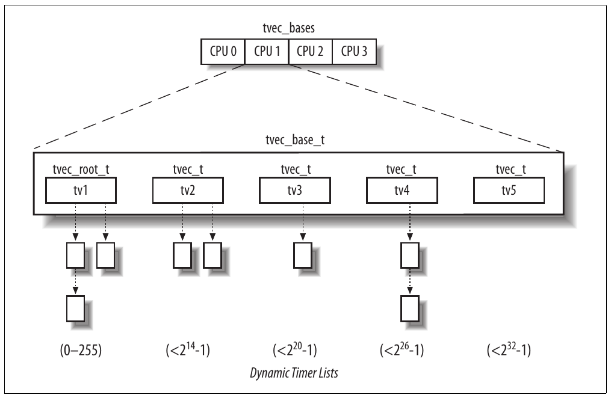

# Chương 6. Đo thời gian


Vô số hoạt động trên máy tính được điều khiển bằng phép đo thời gian, thường người dùng không hay biết. Ví dụ, nếu màn hình tự tắt sau khi bạn ngừng dùng console máy tính, đó là nhờ timer cho kernel theo dõi thời gian trôi qua từ khi nhấn phím hoặc di chuyển mouse. Nếu nhận cảnh báo yêu cầu xóa một số file không dùng, đó là kết quả của chương trình nhận diện mọi user file lâu không được truy cập. Để làm vậy, chương trình phải lấy được timestamp nhận diện last access time từ mỗi file. Timestamp phải được kernel tự động ghi. Quan trọng hơn, timing điều khiển process switch cùng hoạt động kernel dễ thấy hơn như kiểm tra time-out.

Có thể phân biệt hai loại đo thời gian chính Linux kernel phải thực hiện:

- Giữ thời gian và ngày hiện tại để trả về user program qua API `time()`, `ftime()` và `gettimeofday()` (xem phần “System call time() và gettimeofday()” sau trong chương), đồng thời để chính kernel dùng làm timestamp cho file và network packet

- Duy trì timer — cơ chế có thể thông báo kernel (xem phần “Software timer và delay function” sau) hoặc user program (xem phần “System call setitimer() và alarm()” và “System call cho POSIX timer” sau) rằng khoảng thời gian nhất định đã trôi qua

Phép đo thời gian được thực hiện bởi nhiều hardware circuit dựa trên fixed-frequency oscillator và counter. Chương gồm bốn phần khác nhau. Hai phần đầu mô tả hardware device làm nền tảng timing và cung cấp bức tranh tổng thể Linux timekeeping architecture. Các phần tiếp mô tả nhiệm vụ chính time-related của kernel: triển khai CPU time sharing, cập nhật system time và resource usage statistics, duy trì software timer. Phần cuối thảo luận system call liên quan đo thời gian và service routine tương ứng.

## Clock và timer circuit

Trên architecture 80×86, kernel phải tương tác tường minh với nhiều loại clock và timer circuit. Clock circuit dùng theo dõi current time of day và đo thời gian chính xác. Timer circuit được kernel lập trình để phát interrupt ở tần số cố định định trước; periodic interrupt thiết yếu để triển khai software timer kernel và user program dùng. Giờ mô tả ngắn clock và hardware circuit có trong PC IBM-compatible.

### Real Time Clock (RTC)

Mọi PC có clock gọi là Real Time Clock (RTC), độc lập CPU và mọi chip khác.

RTC tiếp tục tick ngay cả khi PC tắt vì được pin nhỏ cấp điện. CMOS RAM và RTC tích hợp trong một chip (Motorola 146818 hoặc tương đương).

RTC có khả năng phát periodic interrupt trên IRQ8 ở tần số từ 2 Hz đến 8.192 Hz. Cũng có thể lập trình activate IRQ8 line khi RTC đạt giá trị cụ thể, hoạt động như đồng hồ báo thức.

Linux chỉ dùng RTC để lấy thời gian và ngày; tuy nhiên cho phép process lập trình RTC bằng thao tác trên device file /dev/rtc (xem Chương 13). Kernel truy cập RTC qua I/O port `0x70` và `0x71`. System administrator có thể đọc và ghi RTC bằng Unix system program clock, thao tác trực tiếp trên hai I/O port này.

### Time Stamp Counter (TSC)

Mọi microprocessor 80×86 có input pin CLK nhận clock signal từ external oscillator. Từ Pentium, microprocessor 80×86 có counter tăng ở mỗi clock signal. Counter truy cập được qua register Time Stamp Counter (TSC) 64-bit, đọc bằng assembly language instruction `rdtsc`. Khi dùng register, kernel phải tính đến tần số clock signal: ví dụ clock tick ở 1 GHz, Time Stamp Counter tăng mỗi nanosecond một lần.

Linux có thể tận dụng register để đo thời gian chính xác hơn nhiều so với Programmable Interval Timer. Để làm vậy Linux phải xác định clock signal frequency khi initialize hệ thống. Thực tế vì tần số không khai báo khi compile kernel, cùng kernel image có thể chạy trên CPU có clock tick ở bất kỳ tần số nào.

Task xác định tần số thực của CPU được thực hiện trong system boot. Function `calibrate_tsc()` tính tần số bằng đếm clock signal xảy ra trong khoảng xấp xỉ 5 millisecond. Time constant này được tạo bằng thiết lập phù hợp một channel của Programmable Interval Timer (xem phần tiếp theo).[^1]

### Programmable Interval Timer (PIT)

Ngoài Real Time Clock và Time Stamp Counter, PC IBM-compatible có loại device time-measuring khác gọi là Programmable Interval Timer (PIT). Vai trò PIT tương tự đồng hồ báo thức của lò vi sóng: báo người dùng thời gian nấu đã hết. Thay vì reo chuông, device phát interrupt đặc biệt gọi là timer interrupt, thông báo kernel thêm một khoảng thời gian đã trôi qua.<sup>†</sup> Khác đồng hồ báo thức ở chỗ PIT tiếp tục phát interrupt mãi ở tần số cố định kernel thiết lập. Mỗi PC IBM-compatible có ít nhất một PIT, thường triển khai bằng CMOS chip 8254 dùng I/O port `0x40`–`0x43`.

Như sẽ thấy chi tiết các đoạn sau, Linux lập trình PIT của PC IBM-compatible phát timer interrupt trên IRQ0 ở tần số (xấp xỉ) 1000-Hz — tức mỗi millisecond một lần. Khoảng này gọi là tick, độ dài theo nanosecond lưu trong variable `tick_nsec`. Trên PC, `tick_nsec` initialize thành 999.848 nanosecond (cho clock signal frequency khoảng 1000,15 Hz), nhưng giá trị có thể được kernel tự điều chỉnh nếu máy tính đồng bộ với external clock (xem phần “System call adjtimex()” sau). Tick đánh nhịp cho mọi hoạt động hệ thống; theo nghĩa nào đó giống tiếng nhịp metronome khi nhạc công tập luyện.

Nhìn chung, tick ngắn hơn tạo ra các timer có resolution cao hơn, giúp phát multimedia mượt hơn và có response time nhanh hơn khi thực hiện synchronous I/O multiplexing qua các system call `poll()` và `select()`. Tuy nhiên, đây là một trade-off: tick ngắn hơn đòi hỏi CPU dành tỷ lệ thời gian lớn hơn trong Kernel Mode, tức tỷ lệ thời gian nhỏ hơn trong User Mode. Vì vậy, các chương trình của người dùng chạy chậm hơn.

Tần số timer interrupt phụ thuộc hardware architecture. Máy chậm có tick khoảng 10 millisecond (100 timer interrupt mỗi giây), máy nhanh có tick khoảng 1 millisecond (1000 hoặc 1024 timer interrupt mỗi giây).

Một vài macro trong Linux code cho constant xác định tần số timer interrupt. Thảo luận trong danh sách sau.

- `HZ` cho số timer interrupt xấp xỉ mỗi giây — tức tần số. Giá trị đặt thành 1000 cho IBM PC.

- `CLOCK_TICK_RATE` cho giá trị 1.193.182, là internal oscillator frequency của chip 8254.

- `LATCH` cho tỷ số `CLOCK_TICK_RATE` và `HZ`, làm tròn integer gần nhất. Dùng lập trình PIT.

PIT được `setup_pit_timer()` initialize như sau:

```c
spin_lock_irqsave(&i8253_lock, flags);
outb_p(0x34,0x43);
udelay(10);
outb_p(LATCH & 0xff, 0x40);
udelay(10);
outb(LATCH >> 8, 0x40);
spin_unlock_irqrestore(&i8253_lock, flags);
```

C function `outb()` tương đương assembly language instruction `outb`: sao chép operand đầu vào I/O port chỉ định làm operand thứ hai. Function `outb_p()` tương tự `outb()` nhưng tạo pause bằng thực thi no-op instruction để hardware không nhầm lẫn. Macro `udelay()` tạo thêm delay nhỏ (xem phần “Delay function” sau). Lời gọi `outb_p()` đầu là command cho PIT phát interrupt ở rate mới. Hai lời gọi `outb_p()` và `outb()` tiếp cung cấp interrupt rate mới cho device. Constant `LATCH` 16-bit gửi đến I/O port `0x40` 8-bit của device dưới dạng hai byte liên tiếp. Kết quả PIT phát timer interrupt ở tần số (xấp xỉ) 1000-Hz (tức mỗi 1 ms một lần).

### CPU local timer

Local APIC có trong microprocessor 80×86 gần đây (xem phần “Interrupt và exception” trong Chương 4) cung cấp thêm device time-measuring: CPU local timer.

CPU local timer là device tương tự Programmable Interval Timer vừa mô tả, có thể phát one-shot hoặc periodic interrupt. Tuy nhiên có một vài khác biệt:

- Timer counter của APIC dài 32 bit, còn timer counter của PIT dài 16 bit; vì vậy local timer có thể lập trình phát interrupt ở tần số rất thấp (counter lưu số tick phải trôi qua trước khi phát interrupt).

- Local APIC timer chỉ gửi interrupt đến processor của nó, còn PIT phát global interrupt có thể được bất kỳ CPU trong hệ thống xử lý.

- Timer của APIC dựa trên bus clock signal (hoặc APIC bus signal trong máy cũ). Có thể lập trình giảm timer counter sau mỗi 1, 2, 4, 8, 16, 32, 64 hoặc 128 bus clock signal. Ngược lại PIT dùng clock signal riêng có thể lập trình linh hoạt hơn.

### High Precision Event Timer (HPET)

High Precision Event Timer (HPET) là timer chip mới do Intel và Microsoft cùng phát triển. Dù HPET chưa phổ biến trên máy end-user, Linux 2.6 đã hỗ trợ nên dành vài lời mô tả đặc điểm.

HPET cung cấp một số hardware timer mà kernel có thể tận dụng. Về cơ bản, chip chứa tối đa tám counter độc lập 32-bit hoặc 64-bit. Mỗi counter được điều khiển bởi clock signal riêng có tần số ít nhất 10 MHz; vì vậy, counter được tăng ít nhất một lần trong 100 nanosecond. Mỗi counter gắn với tối đa 32 timer, mỗi timer gồm một comparator và một match register. Comparator là circuit so sánh giá trị counter với giá trị trong match register và phát hardware interrupt nếu tìm thấy giá trị khớp. Một số timer có thể được enable để tạo periodic interrupt.

HPET chip có thể lập trình qua register map vào memory space (giống I/O APIC). BIOS thiết lập mapping trong bootstrapping phase và báo kernel hệ điều hành initial memory address. HPET register cho kernel đọc và ghi giá trị counter và match register, lập trình one-shot interrupt, enable hoặc disable periodic interrupt trên timer hỗ trợ.

Thế hệ motherboard tiếp theo có lẽ hỗ trợ cả HPET lẫn 8254 PIT; tuy nhiên trong tương lai HPET được kỳ vọng thay PIT hoàn toàn.

### ACPI Power Management Timer

ACPI Power Management Timer (hay ACPI PMT) là clock device khác trong gần như mọi motherboard ACPI-based. Clock signal có tần số cố định khoảng 3,58 MHz. Device thực tế là counter đơn giản tăng ở mỗi clock tick; để đọc giá trị hiện tại, kernel truy cập I/O port có address BIOS xác định trong initialization phase (xem Phụ lục A).

ACPI Power Management Timer được ưu tiên hơn TSC nếu hệ điều hành hoặc BIOS có thể hạ động tần số hoặc điện áp CPU để tiết kiệm pin. Khi xảy ra, tần số TSC thay đổi — gây time warp và tác động khó chịu khác — còn tần số ACPI PMT không đổi. Mặt khác high-frequency của TSC counter rất tiện để đo khoảng thời gian rất ngắn.

Tuy nhiên nếu có HPET device, luôn nên ưu tiên hơn circuit khác vì architecture phong phú hơn. Bảng 6-2 sau trong chương minh họa cách Linux tận dụng timing circuit khả dụng.

Giờ đã hiểu hardware timer, có thể thảo luận cách Linux kernel khai thác để điều hành mọi hoạt động hệ thống.

## Linux timekeeping architecture

Linux phải thực hiện nhiều hoạt động time-related. Ví dụ kernel định kỳ:

- Cập nhật thời gian trôi qua từ system startup.

- Cập nhật thời gian và ngày.

- Xác định với mỗi CPU current process đã chạy bao lâu và preempt nếu vượt thời gian được cấp. Việc cấp time slot (còn gọi “quantum”) thảo luận trong Chương 7.

- Cập nhật resource usage statistics.

- Kiểm tra khoảng thời gian gắn với mỗi software timer (xem phần “Software timer và delay function” sau) đã trôi qua chưa.

Timekeeping architecture của Linux là tập kernel data structure và function liên quan dòng thời gian. Thực tế máy multiprocessor 80×86-based có timekeeping architecture hơi khác máy uniprocessor:

- Trong uniprocessor system, mọi time-keeping activity được interrupt do global timer phát kích hoạt (Programmable Interval Timer hoặc High Precision Event Timer).

- Trong multiprocessor system, mọi general activity (như xử lý software timer) được interrupt do global timer phát kích hoạt, còn CPU-specific activity (như theo dõi execution time của currently running process) được interrupt do local APIC timer phát kích hoạt.

Tiếc là phân biệt hai trường hợp hơi mờ nhạt. Ví dụ một số SMP system đầu dựa trên processor Intel 80486 không có local APIC. Ngay hiện nay vẫn có SMP motherboard nhiều bug đến mức local timer interrupt hoàn toàn không dùng được. Khi đó SMP kernel phải dùng UP timekeeping architecture. Mặt khác uniprocessor system gần đây có một local APIC nên UP kernel thường dùng SMP timekeeping architecture. Tuy nhiên để đơn giản mô tả, không thảo luận trường hợp lai này và theo hai timekeeping architecture “thuần”.

Timekeeping architecture của Linux còn phụ thuộc sự có mặt của Time Stamp Counter (TSC), ACPI Power Management Timer và High Precision Event Timer (HPET). Kernel dùng hai timekeeping function cơ bản: một giữ current time up-to-date và một đếm số nanosecond trôi qua trong current second. Có nhiều cách lấy giá trị sau. Một số method chính xác hơn, khả dụng nếu CPU có Time Stamp Counter hoặc HPET; method less-precise dùng trong trường hợp ngược lại (xem phần “System call time() và gettimeofday()” sau).

### Data structure của timekeeping architecture

Timekeeping architecture của Linux 2.6 dùng rất nhiều data structure. Như thường lệ, mô tả variable quan trọng nhất bằng tham chiếu architecture 80×86.

#### Timer object

Để xử lý các timer source có thể có theo một cách thống nhất, kernel sử dụng một “timer object”, là descriptor có kiểu `timer_opts`, gồm tên timer và bốn method chuẩn được trình bày trong Bảng 6-1.

Bảng 6-1. Field của data structure timer\_opts

| Tên field | Mô tả |
|---|---|
| `name` | Chuỗi nhận diện timer source |
| `mark_offset` | Ghi lại thời điểm chính xác của tick cuối; được timer interrupt handler gọi |
| `get_offset` | Return thời gian từ tick cuối |
| `monotonic_clock` | Return số nanosecond từ kernel initialization |
| `delay` | Chờ số “loop” cho trước (xem phần “Delay function” sau) |

Method quan trọng nhất của timer object là `mark_offset` và `get_offset`. Method `mark_offset` được timer interrupt handler gọi, ghi vào data structure phù hợp thời điểm chính xác tick xảy ra. Dùng giá trị đã lưu, method `get_offset` tính thời gian theo microsecond từ timer interrupt (tick) cuối. Nhờ hai method, Linux timekeeping architecture đạt sub-tick resolution — tức kernel xác định current time với độ chính xác cao hơn nhiều tick duration. Operation này gọi là time interpolation.

Variable `cur_timer` lưu address timer object tương ứng timer source “tốt nhất” có trong hệ thống. Ban đầu `cur_timer` trỏ đến `timer_none`, object tương ứng dummy timer source dùng khi kernel initialize. Trong kernel initialization, function `select_timer()` đặt `cur_timer` thành address timer object phù hợp. Bảng 6-2 cho thấy timer object phổ biến nhất trong architecture 80×86 theo thứ tự ưu tiên. Như thấy, `select_timer()` chọn HPET nếu có; nếu không chọn ACPI Power Management Timer nếu có hoặc TSC. Giải pháp cuối, `select_timer()` chọn PIT always-present. Cột “Time interpolation” liệt kê timer source mà method `mark_offset` và `get_offset` của timer object dùng; cột “Delay” liệt kê timer source method `delay` dùng.

Bảng 6-2. Timer object điển hình của architecture 80x86 theo thứ tự ưu tiên

| Tên timer object | Mô tả | Time interpolation | Delay |
|---|---|---|---|
| `timer_hpet` | High Precision Event Timer (HPET) | HPET | HPET |
| `timer_pmtmr` | ACPI Power Management Timer (ACPI PMT) | ACPI PMT | TSC |
| `timer_tsc` | Time Stamp Counter (TSC) | TSC | TSC |
| `timer_pit` | Programmable Interval Timer (PIT) | PIT | Tight loop |
| `timer_none` | Generic dummy timer source (dùng trong kernel initialization) | (không có) | Tight loop |

Chú ý local APIC timer không có timer object tương ứng. Vì local APIC timer chỉ dùng tạo periodic interrupt, không bao giờ dùng đạt sub-tick resolution.

##### Variable jiffies

Variable `jiffies` là counter lưu số tick trôi qua từ khi hệ thống khởi động. Tăng 1 khi timer interrupt xảy ra — tức mỗi tick. Trong architecture 80×86, `jiffies` là variable 32-bit nên wraparound khoảng 50 ngày — tương đối ngắn cho Linux server. Tuy nhiên kernel xử lý overflow `jiffies` gọn gàng nhờ macro `time_after`, `time_after_eq`, `time_before` và `time_before_eq`: cho giá trị đúng ngay cả khi wraparound xảy ra.

Bạn có thể cho rằng `jiffies` initialize thành 0 ở system startup. Thực tế không phải: `jiffies` initialize thành `0xfffb6c20`, tương ứng signed value 32-bit −300.000; vì vậy counter overflow năm phút sau system boot. Điều này có chủ ý để kernel code có bug không kiểm tra overflow `jiffies` lộ ra sớm trong development phase, không âm thầm lọt vào stable kernel.

Tuy nhiên trong vài trường hợp kernel cần số system tick thực sự từ system boot, bất kể overflow `jiffies`. Vì vậy trên architecture 80×86, linker đồng nhất variable `jiffies` với 32 bit trọng số thấp của counter 64-bit tên `jiffies_64`. Với tick 1 millisecond, variable `jiffies_64` wraparound sau hàng trăm triệu năm nên có thể an tâm giả định không bao giờ overflow.

Bạn có thể thắc mắc tại sao không khai báo trực tiếp `jiffies` là integer `unsigned long long` 64-bit trên architecture 80×86. Vì truy cập variable 64-bit trong architecture 32-bit không thể thực hiện atomically. Do đó mỗi read operation toàn bộ 64 bit cần kỹ thuật synchronization để bảo đảm counter không cập nhật khi đọc hai half-counters 32-bit; kết quả mỗi read operation 64-bit chậm hơn đáng kể read operation 32-bit.

Function `get_jiffies_64()` đọc giá trị `jiffies_64` và return:

```c
unsigned long long get_jiffies_64(void)
{
    unsigned long seq;
    unsigned long long ret;
    do {
        seq = read_seqbegin(&xtime_lock);
        ret = jiffies_64;
    } while (read_seqretry(&xime_lock, seq));
    return ret;
}
```

Read operation 64-bit được seqlock `xtime_lock` bảo vệ (xem phần “Seqlock” trong Chương 5): function tiếp tục đọc variable `jiffies_64` đến khi biết chắc không bị kernel control path khác cập nhật đồng thời.

Ngược lại critical region tăng variable `jiffies_64` phải được bảo vệ bằng `write_seqlock(&xtime_lock)` và `write_sequnlock(&xtime_lock)`. Chú ý instruction `++jiffies_64` cũng tăng variable `jiffies` 32-bit vì variable sau tương ứng nửa thấp của `jiffies_64`.

##### Variable xtime

Variable `xtime` lưu thời gian và ngày hiện tại; là structure type `timespec` có hai field:

`tv_sec`

Lưu số giây trôi qua từ nửa đêm ngày 1 tháng 1 năm 1970 (UTC)

`tv_nsec`

Lưu số nanosecond trôi qua trong giây gần nhất (giá trị từ 0 đến 999.999.999)

Variable `xtime` thường được cập nhật mỗi tick một lần — tức khoảng 1000 lần mỗi giây. Như sẽ thấy trong phần “System call liên quan đo thời gian” sau, user program lấy thời gian và ngày hiện tại từ variable `xtime`. Kernel cũng thường tham chiếu, ví dụ khi cập nhật inode timestamp (xem phần “File descriptor và inode” trong Chương 1).

Seqlock `xtime_lock` tránh race condition có thể xảy ra do concurrent access đến variable `xtime`. Nhớ `xtime_lock` còn bảo vệ variable `jiffies_64`; nhìn chung seqlock dùng định nghĩa nhiều critical region của timekeeping architecture.

### Timekeeping architecture trong uniprocessor system

Trong uniprocessor system, mọi hoạt động time-related được interrupt do Programmable Interval Timer phát trên IRQ line 0 kích hoạt. Như thường lệ trong Linux, một số hoạt động thực thi sớm nhất ngay sau interrupt phát, còn hoạt động còn lại do deferrable function thực hiện (xem phần “Dynamic timer” sau).

#### Initialization phase

Trong kernel initialization, function `time_init()` được gọi thiết lập timekeeping architecture. Thường[^2] thực hiện:

1\. Initialize variable `xtime`. Số giây từ nửa đêm ngày 1 tháng 1 năm 1970 được đọc từ Real Time Clock bằng function `get_cmos_time()`. Field `tv_nsec` của `xtime` được đặt để overflow sắp tới của variable `jiffies` trùng lúc tăng field `tv_sec` — tức rơi vào second boundary.

2\. Initialize variable `wall_to_monotonic`. Variable có cùng type `timespec` như `xtime`, cơ bản lưu số giây và nanosecond cần cộng vào `xtime` để có dòng thời gian monotonic (luôn tăng). Thực tế cả leap second lẫn synchronization với external clock có thể đột ngột đổi field `tv_sec` và `tv_nsec` của `xtime` khiến không còn tăng monotonically. Như sẽ thấy trong phần “System call cho POSIX timer” sau, đôi khi kernel cần time source thực sự monotonic.

3\. Nếu kernel hỗ trợ HPET, gọi function `hpet_enable()` xác định ACPI firmware đã probe chip và map register trong memory address space chưa. Nếu có, `hpet_enable()` lập trình timer đầu của HPET chip phát IRQ0 interrupt 1000 lần mỗi giây. Nếu không có HPET chip, kernel dùng PIT: chip đã được function `init_IRQ()` lập trình phát 1000 timer interrupt mỗi giây như mô tả trong phần “Programmable Interval Timer (PIT)” trước.

4\. Gọi `select_timer()` chọn timer source tốt nhất có trong hệ thống, đặt variable `cur_timer` thành address timer object tương ứng.

5\. Gọi `setup_irq(0,&irq0)` thiết lập interrupt gate tương ứng IRQ0 — line gắn với system timer interrupt source (PIT hoặc HPET). Variable `irq0` được định nghĩa statically:

```c
struct irqaction irq0 = { timer_interrupt, SA_INTERRUPT, 0,
                          "timer", NULL, NULL };
```

Từ đây function `timer_interrupt()` được gọi mỗi tick một lần với interrupt disable vì field `status` của main descriptor IRQ0 có flag `SA_INTERRUPT` set.

##### Timer interrupt handler

Function `timer_interrupt()` là interrupt service routine (ISR) của PIT hoặc HPET; thực hiện:

1\. Bảo vệ kernel variable time-related bằng `write_seqlock()` trên seqlock `xtime_lock` (xem phần “Seqlock” trong Chương 5). 2. Thực thi method `mark_offset` của timer object `cur_timer`. Như giải thích trong phần “Data structure của timekeeping architecture” trước, có bốn trường hợp:

a. `cur_timer` trỏ đến object `timer_hpet`: khi đó HPET chip là nguồn timer interrupt. Method `mark_offset` kiểm tra không timer interrupt nào mất từ tick cuối; trong trường hợp hiếm này cập nhật `jiffies_64` tương ứng. Sau đó method ghi giá trị hiện tại periodic HPET counter.

b. `cur_timer` trỏ đến object `timer_pmtmr`: khi đó PIT chip là nguồn timer interrupt nhưng kernel dùng APIC Power Management Timer đo thời gian với resolution mịn hơn. Method `mark_offset` kiểm tra không timer interrupt nào mất từ tick cuối và cập nhật `jiffies_64` nếu cần. Sau đó ghi giá trị hiện tại APIC Power Management Timer counter.

c. `cur_timer` trỏ đến object `timer_tsc`: khi đó PIT chip là nguồn timer interrupt nhưng kernel dùng Time Stamp Counter đo thời gian với resolution mịn hơn. Method `mark_offset` thực hiện operation như trường hợp trước: kiểm tra không timer interrupt nào mất từ tick cuối và cập nhật `jiffies_64` nếu cần. Sau đó ghi giá trị hiện tại TSC counter.

d. `cur_timer` trỏ đến object `timer_pit`: khi đó PIT chip là nguồn timer interrupt và không có timer circuit khác. Method `mark_offset` không làm gì.

3\. Gọi function `do_timer_interrupt()`, đến lượt thực hiện:

a. Tăng giá trị `jiffies_64` thêm 1. Chú ý làm an toàn vì kernel control path vẫn giữ seqlock `xtime_lock` để ghi.

b. Gọi function `update_times()` cập nhật ngày và giờ hệ thống, tính system load hiện tại; hoạt động này thảo luận sau trong phần “Cập nhật thời gian và ngày” và “Cập nhật system statistics”.

c. Gọi function `update_process_times()` thực hiện nhiều accounting operation time-related cho local CPU (xem phần “Cập nhật local CPU statistics” sau trong chương).

d. Gọi function `profile_tick()` (xem phần “Profiling kernel code” sau trong chương).

e. Nếu system clock đồng bộ với external clock (đã thực hiện system call `adjtimex()`), gọi function `set_rtc_mmss()` mỗi 660 giây (11 phút) để chỉnh Real Time Clock. Tính năng giúp hệ thống trên network đồng bộ clock (xem phần “System call adjtimex()” sau).

4\. Release seqlock `xtime_lock` bằng `write_sequnlock()`.

5\. Return giá trị 1 thông báo interrupt thực sự đã xử lý (xem phần “I/O interrupt handling” trong Chương 4).

### Timekeeping architecture trong multiprocessor system

Multiprocessor system có thể dựa vào hai nguồn timer interrupt: do Programmable Interval Timer hoặc High Precision Event Timer phát và do CPU local timer phát.

Trong Linux 2.6, global timer interrupt — PIT hoặc HPET phát — báo hoạt động không liên quan CPU cụ thể như xử lý software timer và giữ system time cập nhật. Ngược lại CPU local timer interrupt báo timekeeping activity liên quan local CPU như theo dõi current process đã chạy bao lâu và cập nhật resource usage statistics.

#### Initialization phase

Global timer interrupt handler được function `time_init()` initialize, đã mô tả trong phần “Timekeeping architecture trong uniprocessor system” trước.

Linux kernel dành interrupt vector 239 (`0xef`) cho local timer interrupt (xem Bảng 4-2 trong Chương 4). Trong kernel initialization, function `apic_intr_init()` thiết lập interrupt gate IDT tương ứng vector 239 bằng address low-level interrupt handler `apic_timer_interrupt()`. Hơn nữa mỗi APIC phải được cho biết tần suất tạo local time interrupt. Function `calibrate_APIC_clock()` tính bao nhiêu bus clock signal được local APIC của booting CPU nhận trong một tick (1 ms). Giá trị chính xác này dùng lập trình local APIC để tạo một local timer interrupt mỗi tick. Function `setup_APIC_timer()` thực hiện, chạy một lần cho mỗi CPU trong hệ thống.

Mọi local APIC timer đồng bộ vì dựa trên bus clock signal chung. Nghĩa là giá trị `calibrate_APIC_clock()` tính cho boot CPU cũng dùng được cho CPU khác trong hệ thống.

##### Global timer interrupt handler

Phiên bản SMP của handler `timer_interrupt()` khác phiên bản UP ở vài điểm:

- Function `do_timer_interrupt()` được `timer_interrupt()` gọi ghi vào port của I/O APIC chip để acknowledge timer IRQ.

- Function `update_process_times()` không được gọi vì thực hiện hành động liên quan CPU cụ thể.

- Function `profile_tick()` không được gọi vì cũng thực hiện hành động liên quan CPU cụ thể.

##### Local timer interrupt handler

Handler này thực hiện timekeeping activity liên quan CPU cụ thể trong hệ thống, tức profiling kernel code và kiểm tra current process đã chạy bao lâu trên CPU cho trước.

Assembly language function `apic_timer_interrupt()` tương đương code sau:

```c
apic_timer_interrupt:
    pushl $(239-256)
    SAVE_ALL
    movl %esp, %eax
    call smp_apic_timer_interrupt
    jmp ret_from_intr
```

Như thấy, low-level handler rất giống low-level interrupt handler khác đã mô tả trong Chương 4. high-level interrupt handler tên `smp_apic_timer_interrupt()` thực hiện:

1\. Lấy CPU logical number (giả sử n).

2\. Tăng field `apic_timer_irqs` của entry thứ n<sup>th</sup> trong array `irq_stat` (xem phần “Kiểm tra NMI watchdog” sau trong chương).

3\. Acknowledge interrupt trên local APIC.

4\. Gọi function `irq_enter()` (xem phần “Function do\_IRQ()” trong Chương 4).

5\. Gọi function `smp_local_timer_interrupt()`.

6\. Gọi function `irq_exit()`.

Function `smp_local_timer_interrupt()` thực thi per-CPU timekeeping activity. Thực tế thực hiện các bước chính:

1\. Gọi function `profile_tick()` (xem phần “Profiling kernel code” sau trong chương).

2\. Gọi function `update_process_times()` kiểm tra current process đã chạy bao lâu và cập nhật một số local CPU statistics (xem phần “Cập nhật local CPU statistics” sau trong chương).

System administrator có thể đổi sample frequency của kernel code profiler bằng ghi vào file /proc/profile. Để thực hiện, kernel sửa tần số tạo local timer interrupt. Tuy nhiên function `smp_local_timer_interrupt()` vẫn gọi function `update_process_times()` đúng mỗi tick một lần.

## Cập nhật thời gian và ngày

User program lấy thời gian và ngày hiện tại từ variable `xtime`. Kernel phải định kỳ cập nhật để giá trị luôn chính xác hợp lý.

Function `update_times()` được global timer interrupt handler gọi, cập nhật giá trị variable `xtime` như sau:

```c
void update_times(void)
{
    unsigned long ticks;
    ticks = jiffies - wall_jiffies;
    if (ticks) {
        wall_jiffies += ticks;
        update_wall_time(ticks);
    }
    calc_load(ticks);
}
```

Hãy nhớ lại từ phần mô tả timer interrupt handler trước đó rằng khi code của function này được thực thi, seqlock `xtime_lock` đã được acquire để ghi.

Variable `wall_jiffies` lưu thời điểm cập nhật cuối variable `xtime`. Chú ý giá trị `wall_jiffies` có thể nhỏ hơn `jiffies-1` vì một vài timer interrupt có thể bị mất, ví dụ khi interrupt disable lâu; nói cách khác kernel không nhất thiết cập nhật variable `xtime` mỗi tick. Tuy nhiên không tick nào mất vĩnh viễn và về lâu dài `xtime` lưu system time đúng. Kiểm tra timer interrupt bị mất thực hiện trong method `mark_offset` của `cur_timer`; xem phần “Timekeeping architecture trong uniprocessor system” trước. Function `update_wall_time()` gọi function `update_wall_time_one_tick()` liên tiếp `ticks` lần; thông thường mỗi lời gọi cộng 1.000.000 vào field `xtime.tv_nsec`. Nếu giá trị `xtime.tv_nsec` lớn hơn 999.999.999, function `update_wall_time()` còn cập nhật field `tv_sec` của `xtime`. Nếu system call `adjtimex()` đã thực hiện, vì lý do giải thích trong phần “System call adjtimex()” sau, function có thể tinh chỉnh giá trị 1.000.000 một chút để clock nhanh hoặc chậm hơn chút.

Function `calc_load()` mô tả trong phần “Theo dõi system load” sau trong chương.

## Cập nhật system statistics

Bên cạnh nhiệm vụ time-related khác, kernel phải định kỳ thu thập các data dùng cho:

- Kiểm tra CPU resource limit của running process

- Cập nhật statistics về local CPU workload

- Tính average system load

- Profiling kernel code

### Cập nhật local CPU statistics

Đã đề cập function `update_process_times()` được global timer interrupt handler trên uniprocessor system hoặc local timer interrupt handler trong multiprocessor system gọi để cập nhật một số kernel statistics. Function thực hiện:

1\. Kiểm tra current process đã chạy bao lâu. Tùy current process chạy trong User Mode hay Kernel Mode khi timer interrupt xảy ra, gọi `account_user_time()` hoặc `account_system_time()`. Mỗi function về cơ bản thực hiện:

a. Cập nhật field `utime` (tick trong User Mode) hoặc field `stime` (tick trong Kernel Mode) của current process descriptor. Hai field bổ sung `cutime` và `cstime` có trong process descriptor để lần lượt đếm CPU tick mà process child dùng trong User Mode và Kernel Mode. Vì hiệu quả, các field không được `update_process_times()` cập nhật mà khi parent process truy vấn state của child (xem phần “Hủy process” trong Chương 3).

b. Kiểm tra total CPU time limit đã đạt chưa; nếu có gửi signal `SIGXCPU` và `SIGKILL` đến `current`. Phần “Process resource limit” trong Chương 3 mô tả cách giới hạn được field `signal-> rlim[RLIMIT_CPU].rlim_cur` của mỗi process descriptor kiểm soát.

c. Gọi `account_it_virt()` và `account_it_prof()` kiểm tra process timer (xem phần “System call setitimer() và alarm()” sau trong chương).

d. Cập nhật một số kernel statistics lưu trong per-CPU variable `kstat`.

2\. Gọi `raise_softirq()` activate tasklet `TIMER_SOFTIRQ` trên local CPU (xem phần “Software timer và delay function” sau trong chương).

3\. Nếu phải reclaim phiên bản cũ nào đó của RCU-protected data structure, kiểm tra local CPU đã đi qua quiescent state chưa và gọi `tasklet_schedule()` activate tasklet `rcu_tasklet` của local CPU (xem phần “Read-Copy update (RCU)” trong Chương 5).

4\. Gọi function `scheduler_tick()`, giảm time slice counter của current process và kiểm tra quantum đã hết chưa. Thảo luận sâu các operation trong phần “Function scheduler\_tick()” của Chương 7.

### Theo dõi system load

Mọi Unix kernel theo dõi hệ thống đang thực hiện bao nhiêu CPU activity. Statistics được nhiều administration utility như `top` dùng. Người dùng nhập command `uptime` thấy statistics dưới dạng “load average” tương ứng 1 phút, 5 phút và 15 phút gần nhất. Trên uniprocessor system, giá trị 0 nghĩa là không active process (ngoài swapper process 0) cần chạy, giá trị 1 nghĩa là CPU bận 100 phần trăm với một process, giá trị lớn hơn 1 nghĩa là CPU chia sẻ giữa nhiều active process.[^3]

Mỗi tick, `update_times()` gọi function `calc_load()`, đếm process ở state `TASK_RUNNING` hoặc `TASK_UNINTERRUPTIBLE` và dùng số đó cập nhật average system load.

### Profiling kernel code

Linux có code profiler tối giản tên readprofile, được Linux developer dùng khám phá kernel dành thời gian ở đâu trong Kernel Mode. Profiler nhận diện kernel hot spot — fragment kernel code được thực thi thường xuyên nhất. Nhận diện kernel hot spot rất quan trọng vì có thể chỉ ra kernel function nên tối ưu thêm.

Profiler dựa trên Monte Carlo algorithm đơn giản: mỗi lần timer interrupt xảy ra, kernel xác định interrupt có xảy ra trong Kernel Mode không; nếu có lấy giá trị register `eip` trước interruption từ stack và dùng tìm xem kernel đang làm gì trước interrupt. Về lâu dài sample tích lũy tại hot spot.

Function `profile_tick()` thu thập data cho code profiler. Được function `do_timer_interrupt()` gọi trong uniprocessor system (bởi global timer interrupt handler) hoặc function `smp_local_timer_interrupt()` gọi trong multiprocessor system (bởi local timer interrupt handler).

Để enable code profiler, phải boot Linux kernel với parameter chuỗi `profile=N`, trong đó 2<sup>N</sup> biểu thị kích thước code fragment cần profile. Có thể đọc data thu thập từ file /proc/profile. Counter được reset bằng ghi vào cùng file; trong multiprocessor system, ghi vào file còn đổi được sample frequency (xem phần “Timekeeping architecture trong multiprocessor system” trước). Tuy nhiên kernel developer thường không truy cập trực tiếp /proc/profile; thay vào đó dùng system command readprofile.

Linux kernel 2.6 có profiler khác tên oprofile. Ngoài linh hoạt và tùy chỉnh được hơn readprofile, oprofile có thể dùng khám phá hot spot trong kernel code, User Mode application và system library. Khi dùng oprofile, `profile_tick()` gọi function `timer_notify()` thu thập data profiler mới dùng.

### Kiểm tra NMI watchdog

Trong multiprocessor system, Linux cung cấp thêm tính năng cho kernel developer: watchdog system có thể rất hữu ích để phát hiện kernel bug làm hệ thống đóng băng. Để activate watchdog, phải boot kernel với parameter `nmi_watchdog`.

Watchdog dựa trên hardware feature thông minh của local APIC và I/O APIC: có thể tạo periodic NMI interrupt trên mỗi CPU. Vì NMI interrupt không bị assembly language instruction `cli` mask, watchdog phát hiện được deadlock ngay cả khi interrupt disable.

Kết quả mỗi tick một lần, mọi CPU bất kể đang làm gì đều bắt đầu thực thi NMI interrupt handler; đến lượt handler gọi `do_nmi()`. Function lấy logical number n của CPU rồi kiểm tra field `apic_timer_irqs` của entry thứ n<sup>th</sup> trong `irq_stat` (xem Bảng 4-8 trong Chương 4). Nếu CPU hoạt động đúng, giá trị phải khác giá trị đọc ở NMI interrupt trước. Khi CPU chạy đúng, entry thứ n<sup>th</sup> của field `apic_timer_irqs` được local timer interrupt handler tăng (xem phần “Local timer interrupt handler” trước); nếu counter không tăng, local timer interrupt handler chưa thực thi trong cả tick. Bạn biết đấy, không tốt chút nào.

Khi NMI interrupt handler phát hiện CPU freeze, nó rung mọi hồi chuông: ghi message đáng sợ vào system logfile, dump nội dung CPU register và kernel stack (kernel oops), cuối cùng kill current process. Nhờ vậy kernel developer có cơ hội tìm điều sai.

## Software timer và delay function

Timer là software facility cho phép gọi function tại thời điểm tương lai sau khi khoảng thời gian cho trước trôi qua; time-out biểu thị thời điểm khoảng thời gian gắn với timer đã hết.

Timer được cả kernel lẫn process dùng rộng rãi. Phần lớn device driver dùng timer phát hiện điều kiện bất thường — ví dụ floppy disk driver dùng timer tắt device motor sau khi floppy lâu không được truy cập, parallel printer driver dùng phát hiện printer condition lỗi.

Lập trình viên cũng thường dùng timer buộc thực thi function cụ thể tại thời điểm tương lai (xem phần “System call setitimer() và alarm()” sau).

Triển khai một timer tương đối đơn giản. Mỗi timer chứa một field chỉ định thời điểm trong tương lai mà timer cần expire. Ban đầu, field này được tính bằng cách cộng số tick thích hợp vào giá trị hiện tại của `jiffies`. Field này không thay đổi. Mỗi lần kernel kiểm tra timer, nó so sánh expiration field với giá trị `jiffies` tại thời điểm hiện tại, và timer expire khi `jiffies` lớn hơn hoặc bằng giá trị được lưu.

Linux xét hai loại timer gọi là dynamic timer và interval timer. Loại đầu do kernel dùng, còn interval timer có thể được process trong User Mode tạo.

Một lưu ý về Linux timer: vì việc kiểm tra các timer function luôn do các deferrable function thực hiện, mà chúng có thể chạy rất lâu sau khi được activate, kernel không thể bảo đảm timer function bắt đầu đúng expiration time. Kernel chỉ có thể bảo đảm chúng được thực thi đúng lúc hoặc sau đó với độ trễ đến vài trăm millisecond. Vì vậy, timer không phù hợp với real-time application đòi hỏi tuân thủ expiration time nghiêm ngặt.

Ngoài software timer, kernel còn dùng delay function thực thi tight instruction loop đến khi khoảng thời gian cho trước trôi qua. Thảo luận trong phần “Delay function” sau.

### Dynamic timer

Dynamic timer có thể được tạo và hủy động. Không giới hạn số dynamic timer hiện active.

Dynamic timer lưu trong structure `timer_list` sau:

```c
struct timer_list {
    struct list_head entry;
    unsigned long expires;
    spinlock_t lock;
    unsigned long magic;
    void (*function)(unsigned long);
    unsigned long data;
    tvec_base_t *base;
};
```

Field `function` chứa address function cần thực thi khi timer expire. Field `data` chỉ định parameter truyền cho timer function này. Nhờ field `data`, có thể định nghĩa một general-purpose function xử lý time-outs của nhiều device driver; field `data` có thể lưu device ID hoặc data có ý nghĩa khác để function phân biệt device.

Field `expires` chỉ định khi nào timer expire; thời gian biểu diễn bằng số tick trôi qua từ system startup. Mọi timer có giá trị `expires` nhỏ hơn hoặc bằng giá trị `jiffies` được xem là expired hoặc decayed.

Field `entry` được sử dụng để insert software timer vào một trong các doubly linked circular list, nhóm các timer theo giá trị của field `expires`. Thuật toán sử dụng những list này được mô tả ở phần sau của chương.

Để tạo và activate dynamic timer, kernel phải:

1\. Tạo object `timer_list` mới nếu cần — ví dụ `t`. Có thể làm nhiều cách:

  - Định nghĩa static global variable trong code.

  - Định nghĩa local variable trong function; khi đó object lưu trên Kernel Mode stack.

  - Đưa object vào dynamically allocated descriptor.

2\. Initialize object bằng function `init_timer(&t)`. Về cơ bản đặt pointer field `t.base` thành `NULL` và spin lock `t.lock` thành “open”.

3\. Load field `function` bằng address function cần activate khi timer decay. Nếu cần, load field `data` bằng parameter value truyền cho function.

4\. Nếu dynamic timer chưa insert vào list, gán giá trị phù hợp cho field `expires` và gọi function `add_timer(&t)` insert phần tử `t` vào list phù hợp.

5\. Nếu không, nếu dynamic timer đã insert vào list, cập nhật field `expires` bằng function `mod_timer()`, còn xử lý chuyển object sang list phù hợp (thảo luận tiếp).

Khi timer decay, kernel tự động remove phần tử `t` khỏi list. Tuy nhiên đôi khi process nên remove timer tường minh khỏi list bằng function `del_timer()`, `del_timer_sync()` hoặc `del_singleshot_timer_sync()`. Thực tế sleeping process có thể được wake up trước time-out; khi đó process có thể chọn hủy timer. Gọi `del_timer()` trên timer đã remove khỏi list không gây hại nên remove timer trong timer function được xem là cách làm tốt.

Trong Linux 2.6, dynamic timer gắn với CPU activate nó — tức timer function luôn chạy trên cùng CPU thực thi function `add_timer()` đầu tiên hoặc `mod_timer()` sau đó. Tuy nhiên `del_timer()` và function liên quan có thể deactivate mọi dynamic timer ngay cả khi không gắn local CPU.

#### Dynamic timer và race condition

Vì được activate asynchronously, dynamic timer dễ gặp race condition. Ví dụ xét dynamic timer có function thao tác resource có thể loại bỏ (như kernel module hoặc file data structure). Release resource mà không dừng timer có thể dẫn đến data corruption nếu timer function được activate khi resource không còn. Vì vậy quy tắc kinh nghiệm là dừng timer trước release resource:

```c
...
del_timer(&t);
X_Release_Resources();
...
```

Tuy nhiên trong multiprocessor system, code không an toàn vì timer function có thể đã chạy trên CPU khác khi `del_timer()` được gọi. Kết quả resource có thể được release khi timer function còn thao tác. Để tránh race condition này, kernel cung cấp function `del_timer_sync()`. Remove timer khỏi list rồi kiểm tra timer function có thực thi trên CPU khác không; nếu có `del_timer_sync()` chờ đến khi timer function kết thúc.

Function `del_timer_sync()` khá phức tạp và chậm vì phải xét cẩn thận trường hợp timer function tự reactivate. Nếu kernel developer biết timer function không bao giờ reactivate timer, có thể dùng function `del_singleshot_timer_sync()` đơn giản và nhanh hơn để deactivate timer và chờ timer function kết thúc.

Tất nhiên có race condition loại khác. Ví dụ cách đúng sửa field `expires` của timer đã activate là dùng `mod_timer()` thay vì xóa timer rồi re-creating. Trong cách sau, hai kernel control path muốn sửa field `expires` của cùng timer có thể gây lẫn lộn nghiêm trọng. Triển khai timer function được làm SMP-safe bằng spin lock `lock` trong mỗi object `timer_list`: mỗi khi kernel phải truy cập dynamic timer, disable interrupt và acquire spin lock này.

##### Data structure cho dynamic timer

Chọn data structure phù hợp triển khai dynamic timer không dễ. Xâu mọi timer trong một list làm giảm system performance vì scan list timer dài mỗi tick tốn kém. Mặt khác duy trì sorted list không hiệu quả hơn nhiều vì insertion và deletion operation cũng tốn kém.

Giải pháp áp dụng dựa trên data structure thông minh chia giá trị `expires` thành block tick và cho dynamic timer chuyển hiệu quả từ list có giá trị `expires` lớn hơn sang nhỏ hơn. Hơn nữa trong multiprocessor system, tập active dynamic timer được chia giữa các CPU.

Data structure chính cho dynamic timer là per-CPU variable (xem phần “Per-CPU variable” trong Chương 5) tên `tvec_bases`: gồm `NR_CPUS` phần tử, mỗi CPU một phần tử. Mỗi phần tử là structure `tvec_base_t` chứa toàn bộ data cần xử lý dynamic timer gắn với CPU tương ứng:

```c
typedef struct tvec_t_base_s {
    spinlock_t lock;
    unsigned long timer_jiffies;
    struct timer_list *running_timer;
    tvec_root_t tv1;
    tvec_t tv2;
    tvec_t tv3;
    tvec_t tv4;
    tvec_t tv5;
} tvec_base_t;
```

Field `tv1` là structure type `tvec_root_t`, chứa array `vec` gồm 256 phần tử `list_head` — tức list dynamic timer. Chứa mọi dynamic timer nếu có sẽ decay trong 255 tick tới.

Field `tv2`, `tv3` và `tv4` là structure type `tvec_t` gồm array `vec` có 64 phần tử `list_head`. List lần lượt chứa mọi dynamic timer sẽ decay trong 2<sup>14</sup>–1, 2<sup>20</sup>–1 và 2<sup>26</sup>–1 tick tới.

Field `tv5` giống các field trước, ngoại trừ entry cuối cùng của array `vec` là một list chứa các dynamic timer có field `expires` cực lớn. Nó không bao giờ cần được bổ sung từ một array khác. Hình 6-1 minh họa sơ đồ của năm nhóm list.

Field `timer_jiffies` biểu diễn expiration time sớm nhất của dynamic timer chưa kiểm tra: nếu trùng giá trị `jiffies`, không backlog deferrable function tích lũy; nếu nhỏ hơn `jiffies`, phải xử lý list dynamic timer tham chiếu tick trước. Field đặt thành `jiffies` ở system startup và chỉ được function `run_timer_softirq()` mô tả phần tiếp theo tăng. Chú ý field `timer_jiffies` có thể tụt xa sau `jiffies` khi deferrable function xử lý dynamic timer lâu không thực thi — ví dụ vì bị disable hoặc nhiều interrupt handler đã thực thi.



Hình 6-1. Các nhóm list gắn với dynamic timer

Trong multiprocessor system, field `running_timer` trỏ đến structure `timer_list` của dynamic timer local CPU hiện xử lý.

##### Xử lý dynamic timer

Dù data structure thông minh, xử lý software timer là hoạt động time-consuming không nên do timer interrupt handler thực hiện. Trong Linux 2.6, hoạt động do deferrable function, cụ thể softirq `TIMER_SOFTIRQ`, thực hiện.

Function `run_timer_softirq()` là deferrable function gắn với softirq `TIMER_SOFTIRQ`. Về cơ bản thực hiện:

1\. Lưu trong local variable `base` address data structure `tvec_base_t` gắn với local CPU.

2\. Acquire spin lock `base->lock` và disable local interrupt.

3\. Bắt đầu loop `while`, kết thúc khi `base->timer_jiffies` lớn hơn giá trị `jiffies`. Mỗi lần thực thi cycle, thực hiện các bước nhỏ:

a. Tính index của list trong `base->tv1` chứa timer tiếp theo cần xử lý:

```c
index = base->timer_jiffies & 255;
```

b. Nếu `index` bằng 0, mọi list trong `base->tv1` đã kiểm tra nên rỗng: function vì vậy chuyển dynamic timer xuống bằng gọi `cascade()`:

```c
if (!index &&
  (!cascade(base, &base->tv2, (base->timer_jiffies>> 8)&63)) &&
  (!cascade(base, &base->tv3, (base->timer_jiffies>>14)&63)) &&
  (!cascade(base, &base->tv4, (base->timer_jiffies>>20)&63)))
    cascade(base, &base->tv5, (base->timer_jiffies>>26)&63);
```

Xét lời gọi đầu của function `cascade()`: nhận argument là address trong `base`, address của `base->tv2` và index list trong `base->tv2` chứa timer sẽ decay trong 256 tick tới. Index xác định bằng xem bit phù hợp của giá trị `base->timer_jiffies`. `cascade()` chuyển mọi dynamic timer trong list `base->tv2` vào list phù hợp của `base->tv1`; rồi return giá trị dương trừ khi mọi list `base->tv2` hiện rỗng. Nếu vậy, gọi `cascade()` lần nữa để bổ sung `base->tv2` bằng timer trong một list của `base->tv3`, v.v. c. Tăng `base->timer_jiffies` thêm 1.

d. Với mỗi dynamic timer trong list `base->tv1.vec[index]`, thực thi timer function tương ứng. Cụ thể với mỗi phần tử `timer_list` là `t` trong list, về cơ bản thực hiện:

1\. Remove `t` khỏi list của `base->tv1`.

2\. Trong multiprocessor system, đặt `base->running_timer` thành `&t`.

3\. Đặt `t.base` thành `NULL`.

4\. Release spin lock `base->lock` và enable local interrupt.

5\. Thực thi timer function `t.function` truyền argument `t.data`.

6\. Acquire spin lock `base->lock` và disable local interrupt.

7\. Tiếp tục với timer tiếp theo trong list nếu có.

e. Đã xử lý mọi timer trong list. Tiếp tục iteration tiếp theo của cycle `while` ngoài cùng.

4\. Cycle `while` ngoài cùng kết thúc, nghĩa là mọi decayed timer đã xử lý. Trong multiprocessor system, đặt `base->running_timer` thành `NULL`.

5\. Release spin lock `base->lock` và enable local interrupt.

Vì giá trị `jiffies` và `timer_jiffies` thường trùng, cycle `while` ngoài cùng thường chỉ thực thi một lần. Nhìn chung outermost loop thực thi `jiffies - base->timer_jiffies + 1` lần liên tiếp. Hơn nữa nếu timer interrupt xảy ra khi `run_timer_softirq()` đang thực thi, dynamic timer decay ở tick đó cũng được xét vì variable `jiffies` được global timer interrupt handler tăng asynchronously (xem phần “Timer interrupt handler” trước).

Chú ý `run_timer_softirq()` disable interrupt và acquire spin lock `base->lock` ngay trước outermost loop; interrupt được enable và spin lock release ngay trước gọi mỗi dynamic timer function cho đến khi kết thúc. Bảo đảm data structure dynamic timer không bị kernel control path xen kẽ làm hỏng.

Tổng hợp lại, algorithm khá phức tạp này bảo đảm performance xuất sắc. Để thấy lý do, giả sử cho đơn giản softirq `TIMER_SOFTIRQ` thực thi ngay sau timer interrupt tương ứng. Khi đó trong 255 trên 256 lần timer interrupt (99,6% trường hợp), function `run_timer_softirq()` chỉ chạy function của decayed timer nếu có. Để bổ sung `base->tv1.vec` định kỳ, 63 trên 64 lần chỉ cần chia một list của `base->tv2` vào 256 list của `base->tv1`. Đến lượt array `base->tv2.vec` phải bổ sung trong 0,006 phần trăm trường hợp (tức mỗi 16,4 giây một lần). Tương tự `base->tv3.vec` được bổ sung mỗi 17 phút 28 giây, `base->tv4.vec` mỗi 18 giờ 38 phút. `base->tv5.vec` không cần bổ sung.

### Ứng dụng dynamic timer: system call nanosleep()

Để trình bày kết quả mọi hoạt động trước thực sự được dùng trong kernel thế nào, đưa ví dụ tạo và dùng process time-out.

Xét service routine của system call `nanosleep()`, tức `sys_nanosleep()`, nhận parameter là pointer đến structure `timespec` và suspend invoking process đến khi khoảng thời gian chỉ định trôi qua. Service routine trước tiên gọi `copy_from_user()` sao chép giá trị trong User Mode structure `timespec` vào local variable `t`. Giả định structure `timespec` định nghĩa non-null delay, function sau đó thực thi code:

```c
current->state = TASK_INTERRUPTIBLE;
remaining = schedule_timeout(timespec_to_jiffies(&t)+1);
```

Function `timespec_to_jiffies()` chuyển khoảng thời gian lưu trong structure `timespec` sang tick. Để an toàn `sys_nanosleep()` cộng một tick vào giá trị `timespec_to_jiffies()` tính.

Kernel triển khai process time-outs bằng dynamic timer. Xuất hiện trong function `schedule_timeout()`, về cơ bản thực thi statement sau:

```c
struct timer_list timer;
unsigned long expire = timeout + jiffies;
init_timer(&timer);
timer.expires = expire;
timer.data = (unsigned long) current;
timer.function = process_timeout;
add_timer(&timer);
schedule( );     /* process suspended until timer expires */
del_singleshot_timer_sync(&timer);
timeout = expire - jiffies;
return (timeout < 0 ? 0 : timeout);
```

Khi `schedule()` được gọi, process khác được chọn thực thi; khi process cũ tiếp tục execution, function remove dynamic timer. Trong statement cuối, function return 0 nếu time-out hết hạn hoặc số tick còn đến time-out expiration nếu process được wake up vì lý do khác.

Khi time-out hết hạn, timer function được thực thi:

```c
void process_timeout(unsigned long __data)
{
    wake_up_process((task_t *)__data);
}
```

`process_timeout()` nhận parameter là process descriptor pointer lưu trong field `data` của object `timer`. Kết quả suspended process được wake up.

Khi wake up, process tiếp tục execution của system call `sys_nanosleep()`. Nếu giá trị `schedule_timeout()` return cho biết process time-out hết hạn (giá trị 0), system call kết thúc. Nếu không system call tự động restart như giải thích trong phần “Thực thi lại system call” của Chương 11.

### Delay function

Software timer vô dụng khi kernel phải chờ khoảng thời gian ngắn — chẳng hạn dưới vài millisecond. Ví dụ device driver thường phải chờ số microsecond định trước đến khi hardware hoàn tất operation. Vì dynamic timer có setup overhead đáng kể và minimum wait time khá lớn (1 millisecond), device driver không tiện dùng.

Khi đó kernel dùng function `udelay()` và `ndelay()`: function đầu nhận parameter là khoảng thời gian microsecond và return sau delay chỉ định; function sau tương tự nhưng argument chỉ định delay nanosecond.

Về cơ bản hai function định nghĩa như sau:

```c
void udelay(unsigned long usecs)
{
    unsigned long loops;
    loops = (usecs*HZ*current_cpu_data.loops_per_jiffy)/1000000;
    cur_timer->delay(loops);
}

void ndelay(unsigned long nsecs)
{
    unsigned long loops;
    loops = (nsecs*HZ*current_cpu_data.loops_per_jiffy)/1000000000;
    cur_timer->delay(loops);
}
```

Cả hai dựa vào method `delay` của timer object `cur_timer` (xem phần “Data structure của timekeeping architecture” trước), nhận parameter là khoảng thời gian theo “loop”. Tuy nhiên độ dài chính xác của một “loop” phụ thuộc timer object do `cur_timer` tham chiếu (xem Bảng 6-2 trước trong chương):

- Nếu `cur_timer` trỏ đến object `timer_hpet`, `timer_pmtmr` và `timer_tsc`, một “loop” tương ứng một CPU cycle — tức khoảng thời gian giữa hai CPU clock signal liên tiếp (xem phần “Time Stamp Counter (TSC)” trước).

- Nếu `cur_timer` trỏ đến object `timer_none` hoặc `timer_pit`, một “loop” tương ứng thời gian một iteration của tight instruction loop.

Trong initialization phase, sau khi `select_timer()` thiết lập `cur_timer`, kernel thực thi function `calibrate_delay()` xác định bao nhiêu “loop” vừa trong một tick. Giá trị sau đó lưu trong variable `current_cpu_data.loops_per_jiffy` để `udelay()` và `ndelay()` dùng chuyển lần lượt microsecond và nanosecond sang “loop”.

Tất nhiên method `cur_timer->delay()` dùng hardware circuitry HPET hoặc TSC nếu có để đo thời gian chính xác. Nếu không có HPET hoặc TSC, method thực thi `loops` iteration của tight instruction loop.

## System call liên quan đo thời gian

Nhiều system call cho phép User Mode process đọc và sửa thời gian, ngày và tạo timer. Xem nhanh và thảo luận cách kernel xử lý.

### System call time() và gettimeofday()

Process trong User Mode lấy thời gian và ngày hiện tại bằng nhiều system call:

`time()`

Return số giây từ nửa đêm bắt đầu ngày 1 tháng 1 năm 1970 (UTC).

`gettimeofday()`

Return trong data structure tên `timeval` số giây từ nửa đêm ngày 1 tháng 1 năm 1970 (UTC) và số microsecond trôi qua trong giây gần nhất (data structure thứ hai tên `timezone` hiện không dùng).

System call `time()` được `gettimeofday()` thay thế nhưng vẫn có trong Linux để backward compatibility. Function khác dùng rộng rãi `ftime()`, không còn triển khai dạng system call, return số giây từ nửa đêm ngày 1 tháng 1 năm 1970 (UTC) và số millisecond trôi qua trong giây gần nhất.

System call `gettimeofday()` được triển khai bởi function `sys_gettimeofday()`. Để tính ngày và giờ hiện tại, function này gọi `do_gettimeofday()`, thực hiện các thao tác sau:

1\. Acquire seqlock `xtime_lock` để đọc.

2\. Xác định số microsecond từ timer interrupt cuối bằng gọi method `get_offset` của timer object `cur_timer`:

```c
usec = cur_timer->getoffset();
```

Như giải thích trong phần “Data structure của timekeeping architecture” trước, có bốn trường hợp:

a. Nếu `cur_timer` trỏ đến object `timer_hpet`, method so sánh giá trị hiện tại của HPET counter với giá trị của cùng counter đó được lưu trong lần thực thi timer interrupt handler gần nhất.

b. Nếu `cur_timer` trỏ đến object `timer_pmtmr`, method so sánh giá trị hiện tại của ACPI PMT counter với giá trị của cùng counter đó được lưu trong lần thực thi timer interrupt handler gần nhất.

c. Nếu `cur_timer` trỏ đến object `timer_tsc`, method so sánh giá trị hiện tại của Time Stamp Counter với giá trị TSC được lưu trong lần thực thi timer interrupt handler gần nhất.

d. Nếu `cur_timer` trỏ đến object `timer_pit`, method đọc giá trị hiện tại PIT counter để tính số microsecond từ timer interrupt cuối của PIT.

3\. Nếu một số timer interrupt mất (xem phần “Cập nhật thời gian và ngày” trước trong chương), function cộng vào `usec` delay tương ứng:

```c
    usec += (jiffies - wall_jiffies) * 1000;
```

4\. Cộng vào `usec` số microsecond trôi qua trong giây gần nhất:

```c
    usec += (xtime.tv_nsec / 1000);
```

5\. Sao chép nội dung `xtime` vào user-space buffer do system call parameter `tv` chỉ định, cộng giá trị `usec` vào microsecond field:

```c
    tv->tv_sec = xtime->tv_sec;
    tv->tv_usec = usec;
```

6\. Gọi `read_seqretry()` trên seqlock `xtime_lock`, jump về bước 1 nếu kernel control path khác đã acquire `xtime_lock` để ghi đồng thời.

7\. Kiểm tra overflow trong microsecond field, điều chỉnh cả field đó lẫn second field nếu cần:

```c
    while (tv->tv_usec >= 1000000) {
        tv->tv_usec -= 1000000;
        tv->tv_sec++;
    }
```

Process trong User Mode có root privilege có thể sửa ngày và giờ hiện tại bằng system call `stime()` lỗi thời hoặc `settimeofday()`. Function `sys_settimeofday()` gọi `do_settimeofday()`, thực hiện operation bổ sung ngược với `do_gettimeofday()`.

Chú ý cả hai system call sửa giá trị `xtime` nhưng không đổi RTC register. Vì vậy thời gian mới mất khi hệ thống shutdown, trừ khi người dùng thực thi chương trình clock để đổi RTC value.

### System call adjtimex()

Dù clock drift khiến mọi hệ thống cuối cùng lệch giờ đúng, đổi thời gian đột ngột vừa phiền về quản trị vừa rủi ro. Ví dụ hình dung lập trình viên cố build chương trình lớn và dựa vào file timestamp bảo đảm object file out-of-date được recompile. Thay đổi lớn system time có thể khiến chương trình `make` nhầm lẫn và build sai. Giữ clock chính xác cũng quan trọng khi triển khai distributed filesystem trên network máy tính. Khi đó nên điều chỉnh clock các PC nối nhau để timestamp value gắn với inode của file được truy cập nhất quán. Vì vậy hệ thống thường được configure chạy time synchronization protocol như Network Time Protocol (NTP) định kỳ để đổi thời gian từ từ ở mỗi tick. Utility này phụ thuộc system call `adjtimex()` trong Linux.

System call có trong nhiều biến thể Unix nhưng không nên dùng trong chương trình hướng đến portability. Nhận parameter là pointer đến structure `timex`, cập nhật kernel parameter từ giá trị trong field `timex`, return cùng structure với kernel value hiện tại. Các kernel value được `update_wall_time_one_tick()` dùng điều chỉnh nhẹ số microsecond cộng vào `xtime. tv_usec` mỗi tick.

### System call setitimer() và alarm()

Linux cho User Mode process activate timer đặc biệt gọi là interval timer.[^4] Timer khiến Unix signal (xem Chương 11) được gửi định kỳ đến process. Cũng có thể activate interval timer để chỉ gửi một signal sau delay chỉ định. Vì vậy mỗi interval timer được đặc trưng bởi:

- Tần số phải phát signal hoặc null value nếu chỉ tạo một signal

- Thời gian còn lại đến khi tạo signal tiếp theo Cảnh báo trước về độ chính xác áp dụng cho timer này. Bảo đảm thực thi sau thời gian yêu cầu đã trôi qua nhưng không thể dự đoán chính xác khi nào được chuyển đến.

Interval timer được activate bằng POSIX system call `setitimer()`. Parameter đầu chỉ định áp dụng policy nào sau đây:

`ITIMER_REAL`

Thời gian thực sự trôi qua; process nhận signal `SIGALRM`.

`ITIMER_VIRTUAL`

Thời gian process dùng trong User Mode; process nhận signal `SIGVTALRM`.

`ITIMER_PROF`

Thời gian process dùng trong cả User Mode và Kernel Mode; process nhận signal `SIGPROF`.

Interval timer có thể single-shot hoặc periodic. Parameter thứ hai của `setitimer()` trỏ đến structure type `itimerval` chỉ định initial duration của timer (theo giây và nanosecond) và duration dùng khi timer tự reactivate (hoặc 0 cho single-shot timer). Parameter thứ ba của `setitimer()` là optional pointer đến structure `itimerval` được system call điền bằng timer parameter trước đó.

Để triển khai interval timer cho mỗi policy trên, process descriptor có ba cặp field:

- `it_real_incr` và `it_real_value`

- `it_virt_incr` và `it_virt_value`

- `it_prof_incr` và `it_prof_value`

Field đầu mỗi cặp lưu interval theo tick giữa hai signal; field kia lưu giá trị timer hiện tại.

Interval timer `ITIMER_REAL` được triển khai bằng dynamic timer vì kernel phải gửi signal đến process ngay cả khi không chạy trên CPU. Vì vậy mỗi process descriptor có dynamic timer object tên `real_timer`. System call `setitimer()` initialize field `real_timer` rồi gọi `add_timer()` insert dynamic timer vào list phù hợp. Khi timer expire, kernel thực thi timer function `it_real_fn()`. Đến lượt function `it_real_fn()` gửi signal `SIGALRM` đến process; rồi nếu `it_real_incr` không null, đặt lại field `expires`, reactivate timer.

Interval timer `ITIMER_VIRTUAL` và `ITIMER_PROF` không cần dynamic timer vì có thể cập nhật khi process chạy. Function `account_it_virt()` và `account_it_prof()` được `update_process_times()` gọi, đến lượt được timer interrupt handler của PIT (UP) hoặc local timer interrupt handler (SMP) gọi. Vì vậy hai interval timer cập nhật mỗi tick một lần, nếu expire thì signal phù hợp được gửi đến current process.

System call `alarm()` gửi signal `SIGALRM` đến calling process khi khoảng thời gian chỉ định trôi qua. Rất giống `setitimer()` khi gọi với parameter `ITIMER_REAL` vì dùng dynamic timer `real_timer` trong process descriptor. Vì vậy không thể dùng `alarm()` và `setitimer()` với parameter `ITIMER_REAL` cùng lúc.

### System call cho POSIX timer

Chuẩn POSIX 1003.1b giới thiệu software timer loại mới cho User Mode program — đặc biệt multithreaded và real-time application. Timer này thường được gọi là POSIX timer.

Mỗi triển khai POSIX timer phải cung cấp cho User Mode program một vài POSIX clock, tức virtual time source có resolution và thuộc tính định trước. Bất cứ khi nào application muốn dùng POSIX timer, tạo timer resource mới chỉ định một POSIX clock hiện có làm timing base. System call cho người dùng xử lý POSIX clock và timer liệt kê trong Bảng 6-3.

Bảng 6-3. System call cho POSIX timer và clock

| System call | Mô tả |
|---|---|
| `clock_gettime()` | Lấy giá trị hiện tại POSIX clock |
| `clock_settime()` | Đặt giá trị hiện tại POSIX clock |
| `clock_getres()` | Lấy resolution POSIX clock |
| `timer_create()` | Tạo POSIX timer mới dựa trên POSIX clock chỉ định |
| `timer_gettime()` | Lấy giá trị hiện tại và increment POSIX timer |
| `timer_settime()` | Đặt giá trị hiện tại và increment POSIX timer |
| `timer_getoverrun()` | Lấy số overrun của decayed POSIX timer |
| `timer_delete()` | Hủy POSIX timer |
| `clock_nanosleep()` | Đưa process vào sleep dùng POSIX clock làm time source |

Linux kernel 2.6 cung cấp hai loại POSIX clock:

`CLOCK_REALTIME`

Virtual clock này biểu diễn real-time clock của hệ thống — cơ bản là giá trị variable `xtime` (xem phần “Cập nhật thời gian và ngày” trước). Resolution do system call `clock_getres()` return là 999.848 nanosecond, tương ứng khoảng 1000 lần cập nhật `xtime` trong một giây.

`CLOCK_MONOTONIC`

Virtual clock này biểu diễn real-time clock của hệ thống đã loại mọi time warp do synchronization với external time source. Về cơ bản virtual clock biểu diễn bằng tổng hai variable `xtime` và `wall_to_monotonic` (xem phần “Timekeeping architecture trong uniprocessor system” trước). Resolution POSIX clock này do `clock_getres()` return là 999.848 nanosecond.

Linux kernel triển khai POSIX timer bằng dynamic timer. Vì vậy tương tự interval timer `ITIMER_REAL` truyền thống mô tả phần trước. Tuy nhiên POSIX timer linh hoạt và tin cậy hơn nhiều interval timer truyền thống. Một vài khác biệt đáng kể:

- Khi interval timer truyền thống decay, kernel luôn gửi signal `SIGALRM` đến process activate timer. Ngược lại khi POSIX timer decay, kernel có thể gửi mọi loại signal đến toàn multithreaded application hoặc một thread chỉ định. Kernel còn có thể buộc thực thi notifier function trong thread của application hoặc thậm chí không làm gì (User Mode library tự xử lý event).

- Nếu interval timer truyền thống decay nhiều lần nhưng User Mode process không thể nhận signal `SIGALRM` (ví dụ signal blocked hoặc process không chạy), chỉ signal đầu được nhận: mọi lần `SIGALRM` khác bị mất. POSIX timer cũng vậy nhưng process có thể gọi system call `timer_getoverrun()` để lấy số lần timer decay từ khi tạo signal đầu.

[^1]: Để tránh mất chữ số có nghĩa trong integer division, `calibrate_tsc()` return duration theo microsecond của clock tick nhân 2<sup>32</sup>. † PIT còn dùng điều khiển audio amplifier nối internal speaker của máy tính.

[^2]: Function `time_init()` thực thi trước `mem_init()`, initialize memory data structure. Tiếc là HPET register memory mapped nên phải initialize HPET chip sau execution của `mem_init()`. Linux 2.6 áp dụng giải pháp rườm rà: nếu kernel hỗ trợ HPET chip, function `time_init()` chỉ kích hoạt activation của function `hpet_time_init()`. Function sau thực thi sau `mem_init()` và thực hiện operation mô tả trong phần này.

[^3]: Linux tính vào load average mọi process ở state `TASK_RUNNING` và `TASK_UNINTERRUPTIBLE`. Tuy nhiên trong điều kiện bình thường ít process `TASK_UNINTERRUPTIBLE` nên load cao thường nghĩa là CPU bận.

[^4]: Software construct này không có gì chung với Programmable Interval Timer chip mô tả trước trong chương.
