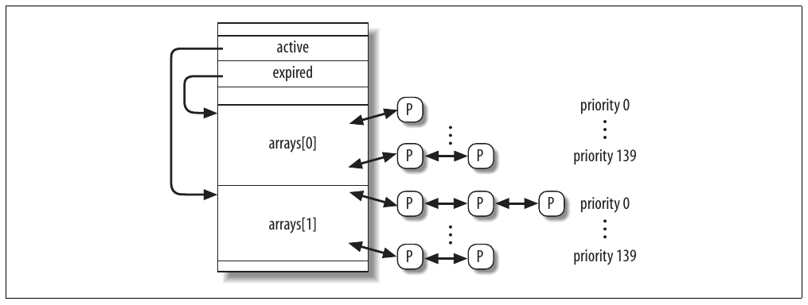
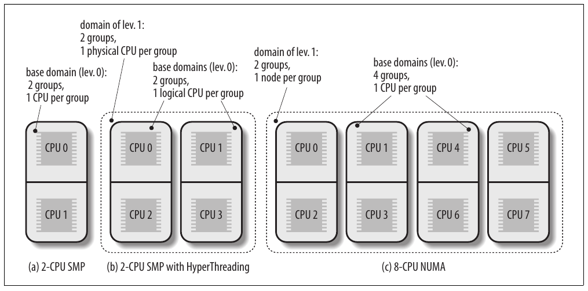

CHƯƠNG 7 Chương 7

# Chương 7. Process scheduling


Như mọi time sharing system, Linux tạo hiệu ứng kỳ diệu như nhiều process thực thi đồng thời bằng cách switch từ process này sang process khác trong thời gian rất ngắn. Bản thân process switching đã thảo luận trong Chương 3; chương này trình bày scheduling, liên quan khi nào switch và chọn process nào.

Chương gồm ba phần. Phần “Scheduling policy” giới thiệu các lựa chọn trừu tượng Linux đưa ra để schedule process. Phần “Scheduling algorithm” thảo luận data structure dùng triển khai scheduling và algorithm tương ứng. Cuối cùng phần “System call liên quan scheduling” mô tả system call ảnh hưởng process scheduling.

Để đơn giản mô tả, như thường lệ tham chiếu architecture 80×86; cụ thể giả định hệ thống dùng mô hình Uniform Memory Access và system tick đặt thành 1 ms.

## Scheduling policy

Scheduling algorithm của hệ điều hành Unix truyền thống phải đáp ứng nhiều mục tiêu xung đột: process response time nhanh, throughput tốt cho background job, tránh process starvation, dung hòa nhu cầu process priority thấp và cao, v.v. Tập quy tắc dùng xác định khi nào và cách chọn process mới chạy gọi là scheduling policy.

Linux scheduling dựa trên kỹ thuật time sharing: nhiều process chạy theo “time multiplexing” vì CPU time chia thành slice, mỗi runnable process một slice.[^1] Tất nhiên một processor chỉ chạy được một process tại mỗi thời điểm. Nếu currently running process chưa kết thúc khi time slice hay quantum hết hạn, process switch có thể diễn ra. Time sharing dựa vào timer interrupt nên trong suốt với process. Không cần insert code bổ sung vào chương trình để bảo đảm CPU time sharing.

Scheduling policy còn dựa trên xếp hạng process theo priority. Đôi khi dùng algorithm phức tạp suy ra current priority của process nhưng kết quả cuối giống nhau: mỗi process gắn với giá trị cho scheduler biết mức phù hợp để cho process chạy trên CPU.

Trong Linux, process priority là dynamic. Scheduler theo dõi process làm gì và định kỳ điều chỉnh priority; bằng cách này process lâu không được dùng CPU được hỗ trợ bằng tăng priority động. Tương ứng process chạy lâu bị giảm priority.

Khi nói scheduling, process truyền thống được phân loại I/O-bound hoặc CPU-bound. Loại đầu dùng nhiều I/O device và dành nhiều thời gian chờ I/O operation hoàn tất; loại sau thực hiện application tính toán số học cần nhiều CPU time.

Phân loại khác chia process thành ba class:

Interactive process

Liên tục tương tác với người dùng nên dành nhiều thời gian chờ keypress và mouse operation. Khi nhận input, process phải wake up nhanh, nếu không người dùng thấy hệ thống không phản hồi. Thường average delay phải từ 50 đến 150 millisecond. Variance của delay cũng phải giới hạn, nếu không người dùng thấy hệ thống thất thường. Interactive program điển hình là command shell, text editor và graphical application.

Batch process

Không cần user interaction nên thường chạy background. Vì process không cần phản hồi quá nhanh, thường bị scheduler giảm ưu tiên. Batch program điển hình là programming language compiler, database search engine và scientific computation.

Real-time process

Có scheduling requirement rất nghiêm ngặt. Không bao giờ nên bị lower-priority process block và nên có response time ngắn được bảo đảm với variance tối thiểu. Real-time program điển hình là video và sound application, robot controller và chương trình thu thập data từ physical sensor.

Hai phân loại vừa nêu phần nào độc lập. Ví dụ batch process có thể I/O-bound (như database server) hoặc CPU-bound (như image-rendering program). Trong khi real-time program được scheduling algorithm trong Linux nhận diện tường minh, không có cách dễ phân biệt interactive và batch program. Scheduler Linux 2.6 triển khai heuristic algorithm tinh vi dựa trên hành vi quá khứ của process để quyết định process cho trước nên được xem là interactive hay batch. Tất nhiên scheduler có xu hướng ưu tiên interactive process hơn batch process.

Lập trình viên có thể đổi scheduling priority bằng system call trong Bảng 7-1. Chi tiết thêm trong phần “System call liên quan scheduling”.

Bảng 7-1. System call liên quan scheduling

| System call | Mô tả |
|---|---|
| `nice()` | Đổi static priority của conventional process |
| `getpriority()` | Lấy static priority tối đa của nhóm conventional process |
| `setpriority()` | Đặt static priority của nhóm conventional process |
| `sched_getscheduler()` | Lấy scheduling policy của process |
| `sched_setscheduler()` | Đặt scheduling policy và real-time priority của process |
| `sched_getparam()` | Lấy real-time priority của process |
| `sched_setparam()` | Đặt real-time priority của process |
| `sched_yield()` | Tự nguyện nhường processor mà không block |
| `sched_get_priority_min()` | Lấy real-time priority value tối thiểu cho policy |
| `sched_get_priority_max()` | Lấy real-time priority value tối đa cho policy |
| `sched_rr_get_interval()` | Lấy time quantum value cho Round Robin policy |
| `sched_setaffinity()` | Đặt CPU affinity mask của process |
| `sched_getaffinity()` | Lấy CPU affinity mask của process |

### Process preemption

Như đề cập chương đầu, Linux process preemptable. Khi process vào state `TASK_RUNNING`, kernel kiểm tra dynamic priority có lớn hơn priority của currently running process không. Nếu có, execution của `current` bị interrupt và scheduler được gọi chọn process khác chạy (thường process vừa trở thành runnable). Tất nhiên process cũng có thể bị preempt khi time quantum hết. Khi đó flag `TIF_NEED_RESCHED` trong structure `thread_info` của current process được set, nên scheduler được gọi khi timer interrupt handler kết thúc.

Ví dụ xét tình huống chỉ hai chương trình — text editor và compiler — đang thực thi. Text editor là interactive program nên dynamic priority cao hơn compiler. Tuy nhiên thường bị suspend vì người dùng xen kẽ lúc dừng suy nghĩ và nhập data; hơn nữa average delay giữa hai keypress tương đối dài. Nhưng ngay khi người dùng nhấn phím, interrupt phát và kernel wake up text editor process. Kernel còn xác định dynamic priority của editor cao hơn priority của `current`, currently running process (compiler), nên set flag `TIF_NEED_RESCHED` của process này, buộc scheduler activate khi kernel xử lý xong interrupt. Scheduler chọn editor và thực hiện process switch; kết quả execution editor tiếp tục rất nhanh và ký tự người dùng gõ được echo lên màn hình. Khi ký tự đã xử lý, text editor process tự suspend chờ keypress khác và compiler process tiếp tục execution.

Lưu ý process bị preempt không bị suspend vì vẫn ở state `TASK_RUNNING`; chỉ không còn dùng CPU. Hơn nữa nhớ Linux kernel 2.6 preemptive, nghĩa là process có thể bị preempt khi thực thi trong Kernel Mode hoặc User Mode; tính năng đã thảo luận sâu trong phần “Kernel preemption” của Chương 5.

### Quantum phải kéo dài bao lâu?

Quantum duration thiết yếu cho system performance: không nên quá dài hay quá ngắn.

Nếu average quantum duration quá ngắn, system overhead do process switch quá cao. Ví dụ giả sử process switch cần 5 millisecond; nếu quantum cũng đặt 5 millisecond thì ít nhất 50 phần trăm CPU cycle dành cho process switching.[^2]

Nếu average quantum duration quá dài, process không còn có vẻ thực thi đồng thời. Ví dụ giả sử quantum đặt năm giây; mỗi runnable process tiến triển khoảng năm giây rồi dừng rất lâu (thường năm giây nhân số runnable process).

Thường có niềm tin rằng quantum duration dài làm giảm response time của interactive application. Điều này thường sai. Như mô tả phần “Process preemption” trước, interactive process có priority tương đối cao nên nhanh chóng preempt batch process bất kể quantum duration dài bao nhiêu.

Tuy nhiên đôi khi quantum duration rất dài làm hệ thống phản hồi kém. Ví dụ giả sử hai người dùng đồng thời nhập hai command tại shell prompt tương ứng; một command khởi động CPU-bound process, command kia chạy interactive application. Cả hai shell fork process mới và giao execution của user command; hơn nữa giả sử process mới cùng initial priority (Linux không biết trước chương trình sẽ thực thi là batch hay interactive). Giờ nếu scheduler chọn CPU-bound process chạy trước, process kia có thể chờ cả time quantum trước khi bắt đầu execution. Vì vậy nếu quantum duration dài, hệ thống có thể có vẻ không phản hồi với người dùng khởi chạy interactive application.

Chọn average quantum duration luôn là dung hòa. Quy tắc kinh nghiệm Linux áp dụng là chọn duration dài nhất có thể trong khi giữ system response time tốt.

## Scheduling algorithm

Scheduling algorithm trong phiên bản Linux trước khá đơn giản, trực tiếp: mỗi process switch, kernel scan list runnable process, tính priority và chọn process “tốt nhất” chạy. Nhược điểm chính là thời gian chọn process tốt nhất phụ thuộc số runnable process; vì vậy algorithm quá tốn kém — tức dành quá nhiều thời gian — trong hệ thống cao cấp chạy hàng nghìn process.

Scheduling algorithm của Linux 2.6 tinh vi hơn nhiều. Theo thiết kế, scale tốt với số runnable process vì chọn process chạy trong constant time, độc lập số runnable process. Cũng scale tốt với số processor vì mỗi CPU có queue runnable process riêng. Hơn nữa algorithm mới phân biệt interactive process và batch process tốt hơn. Kết quả người dùng hệ thống tải nặng cảm thấy interactive application phản hồi nhanh hơn nhiều trong Linux 2.6 so với phiên bản trước.

Scheduler luôn tìm được process thực thi; thực tế luôn có ít nhất một runnable process: swapper process có PID 0, chỉ thực thi khi CPU không thể thực thi process khác. Như đề cập Chương 3, mỗi CPU của multiprocessor system có swapper process riêng với PID bằng 0.

Mọi Linux process luôn được schedule theo một scheduling class sau:

`SCHED_FIFO`

First-In, First-Out real-time process. Khi scheduler cấp CPU cho process, để process descriptor nguyên vị trí hiện tại trong runqueue list. Nếu không higher-priority real-time process khác runnable, process tiếp tục dùng CPU bao lâu tùy ý, ngay cả khi real-time process khác cùng priority runnable.

`SCHED_RR`

Round Robin real-time process. Khi scheduler cấp CPU cho process, đặt process descriptor cuối runqueue list. Policy bảo đảm cấp CPU time công bằng cho mọi real-time process `SCHED_RR` cùng priority.

`SCHED_NORMAL`

Conventional time-shared process.

Scheduling algorithm hoạt động khá khác tùy process conventional hay real-time.

### Scheduling conventional process

Mỗi conventional process có static priority riêng, giá trị scheduler dùng đánh giá process so với conventional process khác trong hệ thống. Kernel biểu diễn static priority của conventional process bằng số từ 100 (priority cao nhất) đến 139 (priority thấp nhất); chú ý static priority giảm khi giá trị tăng.

Process mới luôn thừa kế static priority của parent. Tuy nhiên người dùng có thể đổi static priority của process sở hữu bằng truyền “nice value” cho system call `nice()` và `setpriority()` (xem phần “System call liên quan scheduling” sau trong chương).

#### Base time quantum

Static priority cơ bản xác định base time quantum của process, tức time quantum duration cấp khi process đã dùng hết time quantum trước. Static priority và base time quantum liên hệ qua công thức:

base time quantum (theo millisecond) =

- (140 – static priority) × 20 nếu static priority \< 120
- (140 – static priority) × 5 nếu static priority ≥ 120

(1)

Như thấy, static priority càng cao (tức numerical value càng thấp), base time quantum càng dài. Kết quả process priority cao hơn thường có CPU time slice dài hơn process priority thấp. Bảng 7-2 cho static priority, base time quantum value và nice value tương ứng của conventional process có static priority cao nhất, mặc định và thấp nhất. (Bảng còn có giá trị interactive delta và sleep time threshold, giải thích sau trong chương.)

Bảng 7-2. Priority value điển hình cho conventional process

| Mô tả | Static priority | Nice value | Base time quantum | Interactivedelta | Sleep time threshold |
|---|---|---|---|---|---|
| Static priority cao nhất | 100 | –20 | 800 ms | –3 | 299 ms |
| Static priority cao | 110 | `-`10 | 600 ms | `-`1 | 499 ms |
| Static priority mặc định | 120 | 0 | 100 ms | \+2 | 799 ms |
| Static priority thấp | 130 | \+10 | 50 ms | \+4 | 999 ms |
| Static priority thấp nhất | 139 | \+19 | 5 ms | \+6 | 1199 ms |

##### Dynamic priority và average sleep time

Ngoài static priority, conventional process còn có dynamic priority, giá trị từ 100 (priority cao nhất) đến 139 (priority thấp nhất). Dynamic priority là số scheduler thực sự tra cứu khi chọn process mới chạy. Liên hệ với static priority bằng empirical formula:

dynamic priority = max(100, min(static priority − bonus + 5, 139)) (2)

Bonus là giá trị từ 0 đến 10; dưới 5 biểu diễn penalty hạ dynamic priority, trên 5 là premium tăng dynamic priority. Đến lượt bonus value phụ thuộc lịch sử process; chính xác hơn liên quan average sleep time.

Đại khái average sleep time là số nanosecond trung bình process dành khi sleep. Tuy nhiên lưu ý đây không phải average operation trên elapsed time. Ví dụ sleep trong state `TASK_INTERRUPTIBLE` đóng góp average sleep time khác sleep trong state `TASK_UNINTERRUPTIBLE`. Hơn nữa average sleep time giảm khi process chạy. Cuối cùng average sleep time không bao giờ lớn hơn 1 giây.

Tương ứng giữa average sleep time và bonus value trong Bảng 7-3. (Bảng còn liệt kê time slice granularity tương ứng, thảo luận sau.)

Bảng 7-3. Average sleep time, bonus value và time slice granularity

| Average sleep time | Bonus | Granularity |
|---|---|---|
| Lớn hơn hoặc bằng 0 nhưng nhỏ hơn 100 ms | 0 | 5120 |
| Lớn hơn hoặc bằng 100 ms nhưng nhỏ hơn 200 ms | 1 | 2560 |
| Lớn hơn hoặc bằng 200 ms nhưng nhỏ hơn 300 ms | 2 | 1280 |
| Lớn hơn hoặc bằng 300 ms nhưng nhỏ hơn 400 ms | 3 | 640 |
| Lớn hơn hoặc bằng 400 ms nhưng nhỏ hơn 500 ms | 4 | 320 |
| Lớn hơn hoặc bằng 500 ms nhưng nhỏ hơn 600 ms | 5 | 160 |
| Lớn hơn hoặc bằng 600 ms nhưng nhỏ hơn 700 ms | 6 | 80 |
| Lớn hơn hoặc bằng 700 ms nhưng nhỏ hơn 800 ms | 7 | 40 |
| Lớn hơn hoặc bằng 800 ms nhưng nhỏ hơn 900 ms | 8 | 20 |
| Lớn hơn hoặc bằng 900 ms nhưng nhỏ hơn 1000 ms | 9 | 10 |
| 1 giây | 10 | 10 |

Scheduler còn dùng average sleep time xác định process cho trước nên xem là interactive hay batch. Chính xác hơn process là “interactive” nếu thỏa công thức:

dynamic priority ≤ 3×static priority / 4 + 28 (3) tương đương:

bonus `-` 5 ≥ static priority / 4 − 28

Biểu thức static priority / 4 − 28 gọi là interactive delta; một số giá trị điển hình nằm trong Bảng 7-2. Cần lưu ý process priority cao trở thành interactive dễ hơn process priority thấp nhiều. Ví dụ process có static priority cao nhất (100) được xem interactive khi bonus value vượt 2, tức average sleep time vượt 200 ms. Ngược lại process có static priority thấp nhất (139) không bao giờ interactive vì bonus value luôn nhỏ hơn 11, giá trị cần để đạt interactive delta bằng 6. Process có static priority mặc định (120) trở thành interactive ngay khi average sleep time vượt 700 ms.

##### Active process và expired process

Dù conventional process static priority cao hơn có CPU time slice lớn hơn, không nên hoàn toàn loại process static priority thấp hơn. Để tránh process starvation, khi process hết time quantum có thể bị process priority thấp hơn chưa dùng hết time quantum thay thế. Để triển khai cơ chế, scheduler giữ hai tập runnable process không giao nhau:

Active process

Các runnable process chưa dùng hết time quantum nên được phép chạy.

Expired process

Các runnable process đã dùng hết time quantum nên không được chạy đến khi mọi active process expire.

Tuy nhiên mô hình tổng quát phức tạp hơn chút vì scheduler cố tăng performance của interactive process. Active batch process hết time quantum luôn trở thành expired. Active interactive process hết time quantum thường vẫn active: scheduler refill time quantum và để trong tập active process. Tuy nhiên scheduler chuyển interactive process hết time quantum vào tập expired process nếu expired process lâu nhất đã chờ lâu hoặc expired process có static priority cao hơn (giá trị thấp hơn) interactive process. Kết quả tập active process cuối cùng rỗng và expired process có cơ hội chạy.

### Scheduling real-time process

Mỗi real-time process gắn với real-time priority là giá trị từ 1 (priority cao nhất) đến 99 (priority thấp nhất). Scheduler luôn ưu tiên runnable process priority cao hơn; nói cách khác real-time process ngăn execution của mọi lower-priority process chừng nào còn runnable. Khác conventional process, real-time process luôn được xem active (xem phần trước). Người dùng đổi real-time priority của process bằng system call `sched_setparam()` và `sched_setscheduler()` (xem phần “System call liên quan scheduling” sau trong chương).

Nếu nhiều real-time runnable process cùng priority cao nhất, scheduler chọn process xuất hiện đầu trong list tương ứng của runqueue local CPU (xem phần “Các list process TASK\_RUNNING” trong Chương 3).

Real-time process chỉ bị process khác thay thế khi một event sau xảy ra:

- Process bị process khác có real-time priority cao hơn preempt.

- Process thực hiện blocking operation và được đưa vào sleep (state `TASK_INTERRUPTIBLE` hoặc `TASK_UNINTERRUPTIBLE`).

- Process bị stop (state `TASK_STOPPED` hoặc `TASK_TRACED`) hoặc kill (state `EXIT_ZOMBIE` hoặc `EXIT_DEAD`).

- Process tự nguyện nhường CPU bằng system call `sched_yield()` (xem phần “System call liên quan scheduling” sau trong chương).

- Process là Round Robin real-time (`SCHED_RR`) và đã hết time quantum.

System call `nice()` và `setpriority()` khi áp dụng Round Robin real-time process không đổi real-time priority mà đổi base time quantum duration. Thực tế base time quantum duration của Round Robin real-time process không phụ thuộc real-time priority mà static priority theo công thức (1) trong phần “Scheduling conventional process” trước.

## Data structure scheduler dùng

Nhớ từ phần “Nhận diện process” của Chương 3, process list liên kết mọi process descriptor, còn runqueue list liên kết process descriptor của mọi runnable process — tức state `TASK_RUNNING` — ngoại trừ swapper process (idle process).

### Data structure runqueue

Data structure `runqueue` quan trọng nhất của scheduler Linux 2.6. Mỗi CPU có runqueue riêng; mọi structure `runqueue` lưu trong per-CPU variable `runqueues` (xem phần “Per-CPU variable” trong Chương 5). Macro `this_rq()` cho address runqueue local CPU, còn macro `cpu_rq(n)` cho address runqueue của CPU index `n`.

Bảng 7-4 liệt kê field của data structure `runqueue`; phần lớn được thảo luận ở các phần sau.

Bảng 7-4. Field của structure runqueue

| Type | Tên | Mô tả |
|---|---|---|
| `spinlock_t` | `lock` | Spin lock bảo vệ list process |
| `unsigned long` | `nr_running` | Số runnable process trong runqueue list |
| `unsigned long` | `cpu_load` | CPU load factor dựa trên số process trung bình trong runqueue |
| `unsigned long` | `nr_switches` | Số process switch CPU thực hiện |
| `unsigned long` | `nr_uninterruptible` | Số process trước nằm trong runqueue list, hiện sleep ở state `TASK_UNINTERRUPTIBLE` (chỉ tổng field trên mọi runqueue có ý nghĩa) |
| `unsigned long` | `expired_timestamp` | Insertion time của process lâu nhất trong expired list |
| `unsigned long long` | `timestamp_last_tick` | Timestamp value của timer interrupt cuối |
| `task_t *` | `curr` | Process descriptor pointer của currently running process (giống `current` với local CPU) |
| `task_t *` | `idle` | Process descriptor pointer của swapper process cho CPU này |
| `struct mm_struct *` | `prev_mm` | Dùng trong process switch lưu address memory descriptor của process bị thay |
| `prio_array_t *` | `active` | Pointer đến list active process |
| `prio_array_t *` | `expired` | Pointer đến list expired process |
| `prio_array_t [2]` | `arrays` | Hai tập active process và expired process |
| `int` | `best_expired_prio` | Static priority tốt nhất (giá trị thấp nhất) trong expired process |
| `atomic_t` | `nr_iowait` | Số process trước nằm trong runqueue list, hiện chờ disk I/O operation hoàn tất |
| `struct sched_domain *` | `sd` | Trỏ đến base scheduling domain của CPU (xem phần “Scheduling domain” sau trong chương) |
| `int` | `active_balance` | Flag set nếu process nào đó sẽ migrate từ runqueue này sang khác (runqueue balancing) |
| `int` | `push_cpu` | Không dùng |
| `task_t *` | `migration_thread` | Process descriptor pointer của migration kernel thread |
| `struct list_head` | `migration_queue` | List process cần remove khỏi runqueue |

Field quan trọng nhất của data structure `runqueue` liên quan list runnable process. Mỗi runnable process trong hệ thống thuộc đúng một runqueue. Chừng nào còn trong cùng runqueue chỉ có thể được CPU sở hữu runqueue đó thực thi. Tuy nhiên như sẽ thấy sau, runnable process có thể migrate từ runqueue này sang khác.

Field `arrays` của runqueue là array gồm hai structure `prio_array_t`. Mỗi data structure biểu diễn tập runnable process, chứa 140 doubly linked list head (mỗi process priority có thể một list), priority bitmap và counter process trong tập (xem Bảng 3-2 trong phần Chương 3).



Hình 7-1. Structure runqueue và hai tập runnable process

Như Hình 7-1, field `active` của structure `runqueue` trỏ đến một trong hai data structure `prio_array_t` trong `arrays`: tập runnable process tương ứng chứa active process. Ngược lại field `expired` trỏ đến data structure `prio_array_t` còn lại trong `arrays`: tập runnable process tương ứng chứa expired process.

Định kỳ vai trò hai data structure trong `arrays` đổi: active process đột ngột thành expired process và expired process thành active process. Để đổi, scheduler chỉ trao đổi nội dung field `active` và `expired` của runqueue.

### Process descriptor

Mỗi process descriptor chứa nhiều field liên quan scheduling; liệt kê trong Bảng 7-5.

Bảng 7-5. Field process descriptor liên quan scheduler

| Type | Tên | Mô tả |
|---|---|---|
| `unsigned long` | `thread_info->flags` | Lưu flag `TIF_NEED_RESCHED`, set nếu phải gọi scheduler (xem phần “Trở về từ interrupt và exception” trong Chương 4) |
| `unsigned int` | `thread_info->cpu` | Logical number của CPU sở hữu runqueue mà runnable process thuộc |
| `unsigned long` | `state` | Current state của process (xem phần “Process state” trong Chương 3) |
| `int` | `prio` | Dynamic priority của process |
| `int` | `static_prio` | Static priority của process |
| `struct list_head` | `run_list` | Pointer đến phần tử tiếp theo và trước trong runqueue list process thuộc |
| `prio_array_t *` | `array` | Pointer đến tập `prio_array_t` của runqueue chứa process |
| `unsigned long` | `sleep_avg` | Average sleep time của process |
| `unsigned long long` | `timestamp` | Thời điểm insert cuối của process vào runqueue hoặc process switch cuối liên quan process |
| `unsigned long long` | `last_ran` | Thời điểm process switch cuối thay thế process |
| `int` | `activated` | Condition code dùng khi process wake up |
| `unsigned long` | `policy` | Scheduling class của process (`SCHED_NORMAL`, `SCHED_RR` hoặc `SCHED_FIFO`) |
| `cpumask_t` | `cpus_allowed` | Bit mask CPU có thể thực thi process |
| `unsigned int` | `time_slice` | Tick còn lại trong time quantum của process |
| `unsigned int` | `first_time_slice` | Flag set thành 1 nếu process chưa từng dùng hết time quantum |
| `unsigned long` | `rt_priority` | Real-time priority của process |

Khi process mới tạo, `sched_fork()` được `copy_process()` gọi đặt field `time_slice` của cả process `current` (parent) và `p` (child) như sau:

```c
p->time_slice = (current->time_slice + 1) >> 1;
current->time_slice >>= 1;
```

Nói cách khác số tick còn lại của parent chia hai nửa: một cho parent, một cho child. Để ngăn người dùng lấy CPU time vô hạn bằng cách: parent process tạo child process chạy cùng code rồi tự kill; bằng chỉnh creation rate phù hợp, child process luôn có quantum mới trước khi quantum parent hết. Thủ thuật không hoạt động vì kernel không thưởng cho fork. Tương tự người dùng không thể chiếm phần processor bất công bằng khởi chạy nhiều background process trong shell hoặc mở nhiều window trên graphical desktop. Tổng quát hơn process không thể chiếm resource (trừ khi có privilege tự cấp real-time policy) bằng fork nhiều descendant.

Nếu parent chỉ còn một tick trong time slice, splitting operation buộc `current->time_slice` thành 0, làm hết quantum parent. Khi đó `copy_process()` đặt `current->time_slice` lại thành 1 rồi gọi `scheduler_tick()` giảm field (xem phần tiếp theo).

Function `copy_process()` còn initialize vài field khác trong child process descriptor liên quan scheduling:

```c
p->first_time_slice = 1;
p->timestamp = sched_clock();
```

Flag `first_time_slice` set thành 1 vì child chưa từng hết time quantum (nếu process kết thúc hoặc thực thi chương trình mới trong time slice đầu, parent process được thưởng time slice còn lại của child). Field `timestamp` initialize bằng timestamp value do `sched_clock()` tạo: cơ bản function return nội dung register TSC 64-bit (xem phần “Time Stamp Counter (TSC)” trong Chương 6) chuyển sang nanosecond.

## Function scheduler dùng

Scheduler dựa vào nhiều function để làm việc; quan trọng nhất:

`scheduler_tick()`

Giữ counter `time_slice` của `current` cập nhật

`try_to_wake_up()`

Wake up sleeping process

`recalc_task_prio()`

Cập nhật dynamic priority của process

`schedule()`

Chọn process mới thực thi

`load_balance()`

Giữ runqueue của multiprocessor system cân bằng

### Function scheduler\_tick()

Trong phần “Cập nhật local CPU statistics” của Chương 6 đã giải thích `scheduler_tick()` được gọi mỗi tick một lần để thực hiện operation liên quan scheduling. Thực hiện các bước chính:

1\. Lưu trong field `timestamp_last_tick` của local runqueue giá trị TSC hiện tại chuyển sang nanosecond; timestamp lấy từ function `sched_clock()` (xem phần trước). 2. Kiểm tra current process có là swapper process của local CPU không. Nếu có thực hiện:

a. Nếu local runqueue chứa runnable process khác ngoài swapper, set flag `TIF_NEED_RESCHED` của current process để buộc rescheduling. Như sẽ thấy trong phần “Function schedule()” sau, nếu kernel hỗ trợ hyper-threading technology (xem phần “Runqueue balancing trong multiprocessor system” sau), logical CPU có thể idle ngay cả khi có runnable process trong runqueue, miễn process đó priority thấp hơn đáng kể process đã thực thi trên logical CPU khác gắn cùng physical CPU.

b. Jump bước 7 (không cần cập nhật time slice counter của swapper process).

3\. Kiểm tra `current->array` trỏ đến active list của local runqueue không. Nếu không, process đã hết time quantum nhưng chưa bị thay: set flag `TIF_NEED_RESCHED` buộc rescheduling và jump bước 7.

4\. Acquire spin lock `this_rq()->lock`.

5\. Giảm time slice counter của current process và kiểm tra quantum đã hết chưa. Operation function thực hiện khá khác theo scheduling class; sẽ thảo luận ngay sau.

6\. Release spin lock `this_rq()->lock`.

7\. Gọi function `rebalance_tick()` bảo đảm runqueue của các CPU chứa số runnable process gần bằng nhau. Runqueue balancing thảo luận trong phần “Runqueue balancing trong multiprocessor system” sau.

#### Cập nhật time slice của real-time process

Nếu current process là FIFO real-time process, `scheduler_tick()` không có gì làm. Thực tế khi đó `current` không thể bị process priority thấp hơn hoặc bằng preempt nên không có ý nghĩa giữ time slice counter cập nhật.

Nếu `current` là Round Robin real-time process, `scheduler_tick()` giảm time slice counter và kiểm tra quantum đã hết chưa:

```c
if (current->policy == SCHED_RR && !--current->time_slice) {
    current->time_slice = task_timeslice(current);
    current->first_time_slice = 0;
    set_tsk_need_resched(current);
    list_del(&current->run_list);
    list_add_tail(&current->run_list,
                  this_rq()->active->queue+current->prio);
}
```

Nếu function xác định time quantum thực sự hết, thực hiện vài operation để bảo đảm `current` sẽ bị preempt sớm nhất nếu cần.

Operation đầu là refill time slice counter bằng `task_timeslice()`. Function xét static priority của process và return base time quantum tương ứng theo công thức (1) trong phần “Scheduling conventional process” trước. Hơn nữa field `first_time_slice` của `current` clear: flag được `copy_process()` set trong service routine system call `fork()`, nên clear ngay khi time quantum đầu process trôi qua.

Tiếp theo `scheduler_tick()` gọi function `set_tsk_need_resched()` set flag `TIF_NEED_RESCHED` của process. Như mô tả trong phần “Trở về từ interrupt và exception” của Chương 4, flag buộc gọi function `schedule()` để `current` có thể bị real-time process khác priority bằng (hoặc cao hơn) thay nếu có.

Operation cuối của `scheduler_tick()` là chuyển process descriptor đến vị trí cuối runqueue active list tương ứng priority của `current`. Đặt `current` cuối bảo đảm không được chọn thực thi lại đến khi mọi real-time runnable process cùng priority với `current` có CPU time slice. Đây là ý nghĩa round-robin scheduling. Descriptor được chuyển bằng gọi `list_del()` remove process khỏi runqueue active list rồi `list_add_tail()` insert lại cuối cùng list đó.

##### Cập nhật time slice của conventional process

Nếu current process là conventional process, function `scheduler_tick()` thực hiện:

1\. Giảm time slice counter (`current->time_slice`).

2\. Kiểm tra time slice counter. Nếu time quantum hết, function thực hiện:

a. Gọi `dequeue_task()` remove `current` khỏi tập runnable process `this_rq()->active`.

b. Gọi `set_tsk_need_resched()` set flag `TIF_NEED_RESCHED`.

c. Cập nhật dynamic priority của `current`:

```c
current->prio = effective_prio(current);
```

Function `effective_prio()` đọc field `static_prio` và `sleep_avg` của `current`, tính dynamic priority theo công thức (2) trong phần “Scheduling conventional process” trước.

d. Refill time quantum của process:

```c
current->time_slice = task_timeslice(current);
current->first_time_slice = 0;
```

e. Nếu field `expired_timestamp` của local runqueue data structure bằng 0 (tức tập expired process rỗng), ghi vào field giá trị current tick:

```c
if (!this_rq()->expired_timestamp)
    this_rq()->expired_timestamp = jiffies;
```

f. Insert current process vào active set hoặc expired set:

```c
if (!TASK_INTERACTIVE(current) || EXPIRED_STARVING(this_rq()) {
    enqueue_task(current, this_rq()->expired);
    if (current->static_prio < this_rq()->best_expired_prio)
        this_rq()->best_expired_prio = current->static_prio;
} else
    enqueue_task(current, this_rq()->active);
```

Macro `TASK_INTERACTIVE` cho giá trị 1 nếu process được nhận diện interactive bằng công thức (3) trong phần “Scheduling conventional process” trước. Macro `EXPIRED_STARVING` kiểm tra expired process đầu trong runqueue đã phải chờ hơn 1000 tick nhân số runnable process trong runqueue cộng 1 chưa; nếu có cho giá trị 1. Macro `EXPIRED_STARVING` cũng cho 1 nếu static priority value của current process lớn hơn static priority value của process đã expired.

3\. Nếu không, nếu time quantum chưa hết (`current->time_slice` khác 0), kiểm tra remaining time slice của current process quá dài không:

```c
if (TASK_INTERACTIVE(p) && !((task_timeslice(p) -
         p->time_slice) % TIMESLICE_GRANULARITY(p)) &&
        (p->time_slice >= TIMESLICE_GRANULARITY(p)) &&
        (p->array == rq->active)) {
    list_del(&current->run_list);
    list_add_tail(&current->run_list,
                  this_rq()->active->queue+current->prio);
    set_tsk_need_resched(p);
}
```

Macro `TIMESLICE_GRANULARITY` cho tích số CPU trong hệ thống và constant tỷ lệ với bonus của current process (xem Bảng 7-3 trước). Cơ bản time quantum của interactive process có static priority cao chia thành nhiều phần kích thước `TIMESLICE_GRANULARITY` để không độc chiếm CPU.

### Function try\_to\_wake\_up()

Function `try_to_wake_up()` wake up sleeping hoặc stopped process bằng đặt state thành `TASK_RUNNING` và insert vào runqueue local CPU. Ví dụ function được gọi wake up process trong wait queue (xem phần “Cách tổ chức process” trong Chương 3) hoặc tiếp tục execution của process chờ signal (xem Chương 11). Function nhận parameter:

- Descriptor pointer (`p`) của process cần wake up

- Mask process state (`state`) có thể wake up

- Flag (`sync`) cấm process được wake up preempt process hiện chạy trên local CPU Function thực hiện:

1\. Gọi function `task_rq_lock()` disable local interrupt và acquire lock của runqueue `rq` do CPU thực thi process gần nhất sở hữu (có thể khác local CPU). Logical number CPU đó lưu trong field `p->thread_info->cpu`.

2\. Kiểm tra state process `p->state` thuộc mask state `state` truyền làm argument không; nếu không jump bước 9 kết thúc function.

3\. Nếu field `p->array` không `NULL`, process đã thuộc runqueue nên jump bước 8.

4\. Trong multiprocessor system, kiểm tra process cần wake up nên migrate từ runqueue CPU thực thi gần nhất sang runqueue CPU khác không. Cơ bản function chọn target runqueue theo heuristic rule. Ví dụ:

  - Nếu CPU nào trong hệ thống idle, chọn runqueue làm target. Ưu tiên CPU thực thi trước và local CPU theo thứ tự này.

  - Nếu workload CPU thực thi trước thấp hơn đáng kể workload local CPU, chọn runqueue cũ làm target.

  - Nếu process vừa thực thi gần đây, chọn runqueue cũ làm target (hardware cache có thể còn đầy data của process).

  - Nếu chuyển process đến local CPU giảm mất cân bằng giữa CPU, target là local runqueue (xem phần “Runqueue balancing trong multiprocessor system” sau).

Sau bước này, function đã nhận diện target CPU sẽ thực thi process được wake up và tương ứng target runqueue `rq` để insert process.

5\. Nếu process ở state `TASK_UNINTERRUPTIBLE`, giảm field `nr_uninterruptible` của target runqueue và đặt field `p->activated` của process descriptor thành `-`1. Xem phần “Function recalc\_task\_prio()” sau để giải thích field `activated`.

6\. Gọi function `activate_task()`, đến lượt thực hiện:

a. Gọi `sched_clock()` lấy current timestamp nanosecond. Nếu target CPU không là local CPU, bù drift của local timer interrupt bằng timestamp tương ứng lần timer interrupt cuối trên local CPU và target CPU:

```c
now = (sched_clock() - this_rq()->timestamp_last_tick)
      + rq->timestamp_last_tick;
```

b. Gọi `recalc_task_prio()`, truyền process descriptor pointer và timestamp tính bước trước. Function `recalc_task_prio()` mô tả phần tiếp theo.

c. Đặt giá trị field `p->activated` theo Bảng 7-6 sau trong chương.

d. Đặt field `p->timestamp` bằng timestamp tính bước 6a.

e. Insert process descriptor vào active set:

```c
enqueue_task(p, rq->active);
rq->nr_running++;
```

7\. Nếu target CPU không là local CPU hoặc flag `sync` không set, kiểm tra runnable process mới có dynamic priority cao hơn current process của runqueue `rq` không (`p->prio < rq->curr->prio`); nếu có gọi `resched_task()` preempt `rq->curr`. Trong uniprocessor system function sau chỉ thực thi `set_tsk_need_resched()` set flag `TIF_NEED_RESCHED` của process `rq->curr`. Trong multiprocessor system, `resched_task()` còn kiểm tra giá trị cũ flag `TIF_NEED_RESCHED` có bằng 0, target CPU khác local CPU và flag `TIF_POLLING_NRFLAG` của process `rq->curr` clear không (target CPU không chủ động poll status flag `TIF_NEED_RESCHED` của process). Nếu có, `resched_task()` gọi `smp_send_reschedule()` phát IPI và buộc rescheduling trên target CPU (xem phần “Interprocessor interrupt handling” trong Chương 4).

8\. Đặt field `p->state` của process thành `TASK_RUNNING`.

9\. Gọi `task_rq_unlock()` unlock runqueue `rq` và enable lại local interrupt.

10\. Return 1 (nếu wake up process thành công) hoặc 0 (nếu chưa wake up).

### Function recalc\_task\_prio()

Function `recalc_task_prio()` cập nhật average sleep time và dynamic priority của process. Nhận parameter là process descriptor pointer `p` và timestamp `now` do function `sched_clock()` tính.

Function thực hiện:

1\. Lưu trong local variable `sleep_time` kết quả:

min (`now` − `p->timestamp`, 10<sup>9</sup>)

Field `p->timestamp` chứa timestamp của process switch đưa process vào sleep; vì vậy `sleep_time` lưu số nanosecond process sleep từ execution cuối (hoặc tương đương 1 giây nếu process sleep lâu hơn).

2\. Nếu `sleep_time` không lớn hơn 0, jump bước 8 để bỏ qua cập nhật average sleep time.

3\. Kiểm tra process không là kernel thread, đang wake up từ state `TASK_UNINTERRUPTIBLE` (field `p->activated` bằng −1; xem bước 5 phần trước) và đã sleep liên tục vượt sleep time threshold cho trước không. Nếu cả ba thỏa mãn, function đặt field `p->sleep_avg` tương đương 900 tick (empirical value lấy bằng trừ duration base time quantum của standard process khỏi maximum average sleep time). Rồi jump bước 8.

Sleep time threshold phụ thuộc static priority; vài giá trị điển hình trong Bảng 7-2. Tóm lại mục tiêu empirical rule là bảo đảm process sleep lâu trong uninterruptible mode — thường chờ disk I/O operation — nhận sleep average value định trước đủ lớn để được phục vụ nhanh nhưng không quá lớn gây starvation process khác.

4\. Thực thi macro `CURRENT_BONUS` tính bonus value của average sleep time trước đó (xem Bảng 7-3). Nếu (10 `–` bonus) lớn hơn 0, function nhân `sleep_time` với giá trị này. Vì `sleep_time` sẽ được cộng vào average sleep time (xem bước 6 dưới), current average sleep time càng thấp càng tăng nhanh.

5\. Nếu process trong mode `TASK_UNINTERRUPTIBLE` và không là kernel thread, thực hiện:

a. Kiểm tra average sleep time `p->sleep_avg` lớn hơn hoặc bằng sleep time threshold không (xem Bảng 7-2 trước). Nếu có reset local variable `sleep_time` thành 0 — bỏ qua điều chỉnh average sleep time — và jump bước 6.

b. Nếu tổng `sleep_time+ p->sleep_avg` lớn hơn hoặc bằng sleep time threshold, đặt field `p->sleep_avg` thành sleep time threshold và `sleep_time` thành 0. Bằng phần nào giới hạn tăng average sleep time, function không thưởng quá nhiều cho batch process sleep lâu.

6\. Cộng `sleep_time` vào average sleep time của process (`p->sleep_avg`).

7\. Kiểm tra `p->sleep_avg` vượt 1000 tick (theo nanosecond) không; nếu có function giảm xuống 1000 tick (theo nanosecond).

8\. Cập nhật dynamic priority của process:

```c
p->prio = effective_prio(p);
```

Function `effective_prio()` đã thảo luận trong phần “Function scheduler\_tick()” trước.

### Function schedule()

Function `schedule()` triển khai scheduler. Mục tiêu là tìm process trong runqueue list rồi cấp CPU. Được nhiều kernel routine gọi trực tiếp hoặc theo cách lazy (deferred).

#### Gọi trực tiếp

Scheduler được gọi trực tiếp khi process `current` phải block ngay vì resource cần không khả dụng. Khi đó kernel routine muốn block thực hiện:

1\. Insert `current` vào wait queue phù hợp.

2\. Đổi state của `current` thành `TASK_INTERRUPTIBLE` hoặc `TASK_UNINTERRUPTIBLE`.

3\. Gọi `schedule()`.

4\. Kiểm tra resource khả dụng chưa; nếu chưa về bước 2.

5\. Khi resource khả dụng, remove `current` khỏi wait queue.

Kernel routine kiểm tra lặp lại resource process cần đã khả dụng chưa; nếu chưa nhường CPU cho process khác bằng `schedule()`. Sau đó khi scheduler lại cấp CPU cho process, kiểm tra lại resource availability. Các bước tương tự `wait_event()` và function tương tự mô tả trong phần “Cách tổ chức process” của Chương 3.

Scheduler còn được nhiều device driver thực hiện iterative task dài gọi trực tiếp. Mỗi iteration cycle, driver kiểm tra giá trị flag `TIF_NEED_RESCHED` và nếu cần gọi `schedule()` tự nguyện nhường CPU.

##### Lazy invocation

Scheduler còn được gọi theo cách lazy bằng đặt flag `TIF_NEED_RESCHED` của `current` thành 1. Vì luôn kiểm tra flag trước khi tiếp tục execution của User Mode process (xem phần “Trở về từ interrupt và exception” trong Chương 4), `schedule()` chắc chắn được gọi vào lúc nào đó trong tương lai gần.

Ví dụ điển hình lazy invocation scheduler:

- Khi `current` dùng hết quantum CPU time; function `scheduler_tick()` thực hiện.

- Khi process wake up và priority cao hơn current process; task do function `try_to_wake_up()` thực hiện.

- Khi thực hiện system call `sched_setscheduler()` (xem phần “System call liên quan scheduling” sau).

##### Hành động schedule() thực hiện trước process switch

Mục tiêu function `schedule()` là thay currently executing process bằng process khác. Vì vậy kết quả chính là đặt local variable tên `next` trỏ đến descriptor process chọn thay `current`. Nếu không runnable process nào trong hệ thống priority cao hơn `current`, cuối cùng `next` trùng `current` và không process switch.

Function `schedule()` bắt đầu bằng disable kernel preemption và initialize vài local variable:

```c
need_resched:

preempt_disable();
prev = current;
rq = this_rq();
```

Như thấy, pointer do `current` return lưu trong `prev`, address runqueue data structure tương ứng local CPU lưu trong `rq`.

Tiếp theo `schedule()` bảo đảm `prev` không giữ big kernel lock (xem phần “Big Kernel Lock” trong Chương 5):

```c
if (prev->lock_depth >= 0)
    up(&kernel_sem);
```

Chú ý `schedule()` không đổi giá trị field `lock_depth`; khi `prev` tiếp tục execution, reacquire spin lock `kernel_flag` nếu field không âm. Vì vậy big kernel lock tự release và reacquire qua process switch.

Function `sched_clock()` được gọi đọc TSC và chuyển giá trị sang nanosecond; timestamp thu được lưu trong local variable `now`. Rồi `schedule()` tính duration CPU time slice `prev` dùng:

```c
now = sched_clock();
run_time = now - prev->timestamp;
if (run_time > 1000000000)
    run_time = 1000000000;
```

Áp dụng giới hạn thông thường 1 giây (chuyển sang nanosecond). Giá trị `run_time` dùng tính CPU usage cho process. Tuy nhiên process có average sleep time cao được ưu ái:

```c
run_time /= (CURRENT_BONUS(prev) ? : 1);
```

Nhớ `CURRENT_BONUS` return giá trị từ 0 đến 10 tỷ lệ average sleep time của process.

Trước khi bắt đầu xem runnable process, `schedule()` phải disable local interrupt và acquire spin lock bảo vệ runqueue:

```c
spin_lock_irq(&rq->lock);
```

Như giải thích phần “Kết thúc process” trong Chương 3, `prev` có thể là process đang kết thúc. Để nhận diện, `schedule()` xem flag `PF_DEAD`:

```c
if (prev->flags & PF_DEAD)
    prev->state = EXIT_DEAD;
```

Tiếp theo `schedule()` xét state `prev`. Nếu không runnable và chưa bị preempt trong Kernel Mode (xem phần “Trở về từ interrupt và exception” trong Chương 4), nên remove khỏi runqueue. Tuy nhiên nếu có nonblocked pending signal và state `TASK_INTERRUPTIBLE`, function đặt process state thành `TASK_RUNNING` và để trong runqueue. Hành động không giống cấp processor cho `prev`; chỉ cho `prev` cơ hội được chọn thực thi:

```c
if (prev->state != TASK_RUNNING &&
    !(preempt_count() & PREEMPT_ACTIVE)) {
    if (prev->state == TASK_INTERRUPTIBLE && signal_pending(prev))
        prev->state = TASK_RUNNING;
    else {
        if (prev->state == TASK_UNINTERRUPTIBLE)
            rq->nr_uninterruptible++;
        deactivate_task(prev, rq);
    }
}
```

Function `deactivate_task()` remove process khỏi runqueue:

```c
rq->nr_running--;
dequeue_task(p, p->array);
p->array = NULL;
```

Giờ `schedule()` kiểm tra số runnable process còn trong runqueue. Nếu có, function gọi `dependent_sleeper()`. Phần lớn trường hợp function return 0 ngay. Tuy nhiên nếu kernel hỗ trợ hyper-threading technology (xem phần “Runqueue balancing trong multiprocessor system” sau), function kiểm tra process sắp chọn có priority thấp hơn đáng kể sibling process đã chạy trên logical CPU cùng physical CPU không; trường hợp này `schedule()` từ chối chọn process privilege thấp hơn và thực thi swapper process thay thế.

```c
if (rq->nr_running) {
    if (dependent_sleeper(smp_processor_id(), rq)) {
        next = rq->idle;
        goto switch_tasks;
    }
}
```

Nếu không runnable process, function gọi `idle_balance()` chuyển một số runnable process từ runqueue khác đến local runqueue; `idle_balance()` tương tự `load_balance()` mô tả trong phần “Function load\_balance()” sau.

```c
if (!rq->nr_running) {
    idle_balance(smp_processor_id(), rq);
    if (!rq->nr_running) {
        next = rq->idle;
        rq->expired_timestamp = 0;
        wake_sleeping_dependent(smp_processor_id(), rq);
        if (!rq->nr_running)
            goto switch_tasks;
    }
}
```

Nếu `idle_balance()` không chuyển được process vào local runqueue, `schedule()` gọi `wake_sleeping_dependent()` để reschedule runnable process trong idle CPU (tức mọi CPU chạy swapper process). Như giải thích khi thảo luận `dependent_sleeper()`, trường hợp bất thường có thể xảy ra khi kernel hỗ trợ hyper-threading technology. Tuy nhiên trong uniprocessor system hoặc mọi nỗ lực chuyển runnable process vào local runqueue đều thất bại, function chọn swapper process làm `next` và tiếp tục phase tiếp theo.

Giả sử function `schedule()` xác định runqueue có runnable process; giờ phải kiểm tra ít nhất một runnable process active. Nếu không, function trao đổi nội dung field `active` và `expired` của runqueue data structure; do đó mọi expired process thành active, còn empty set sẵn sàng nhận process sẽ expire trong tương lai.

```c
array = rq->active;
if (!array->nr_active) {
    rq->active = rq->expired;
    rq->expired = array;
    array = rq->active;
    rq->expired_timestamp = 0;
    rq->best_expired_prio = 140;
}
```

Đã đến lúc tra runnable process trong active data structure `prio_array_t` (xem phần “Nhận diện process” trong Chương 3). Trước hết `schedule()` tìm bit khác 0 đầu trong bitmask active set. Nhớ bit trong bitmask set khi priority list tương ứng không rỗng. Vì vậy index của bit khác 0 đầu chỉ list chứa process tốt nhất để chạy. Sau đó lấy process descriptor đầu trong list:

```c
idx = sched_find_first_bit(array->bitmap);
next = list_entry(array->queue[idx].next, task_t, run_list);
```

Function `sched_find_first_bit()` dựa trên assembly language instruction `bsfl`, return bit index của bit trọng số thấp nhất set thành 1 trong word 32-bit.

Local variable `next` giờ lưu descriptor pointer của process sẽ thay `prev`. Function `schedule()` xem field `next->activated`. Field encode state process khi wake up như Bảng 7-6.

Bảng 7-6. Ý nghĩa field activated trong process descriptor

| Giá trị | Mô tả |
|---|---|
| 0 | Process từng ở state `TASK_RUNNING`. |
| 1 | Process từng ở state `TASK_INTERRUPTIBLE` hoặc `TASK_STOPPED`, đang được system call service routine hoặc kernel thread wake up. |
| 2 | Process từng ở state `TASK_INTERRUPTIBLE` hoặc `TASK_STOPPED`, đang được interrupt handler hoặc deferrable function wake up. |
| −1 | Process từng ở state `TASK_UNINTERRUPTIBLE` và đang wake up. |

Nếu `next` là conventional process và đang wake up từ state `TASK_INTERRUPTIBLE` hoặc `TASK_STOPPED`, scheduler cộng vào average sleep time số nanosecond từ khi process insert vào runqueue. Nói cách khác sleep time tăng để bao gồm cả thời gian process trong runqueue chờ CPU:

```c
if (next->prio >= 100 && next->activated > 0) {
    unsigned long long delta = now - next->timestamp;
    if (next->activated == 1)
        delta = (delta * 38) / 128;
    array = next->array;
    dequeue_task(next, array);
    recalc_task_prio(next, next->timestamp + delta);
    enqueue_task(next, array);
}
next->activated = 0;
```

Chú ý scheduler phân biệt process được interrupt handler hoặc deferrable function wake up với process được system call service routine hoặc kernel thread wake up. Trường hợp đầu cộng toàn runqueue waiting time, trường hợp sau chỉ cộng một phần. Vì interactive process có khả năng được asynchronous event (nghĩ đến người dùng nhấn phím) wake up hơn synchronous event.

##### Hành động schedule() thực hiện để process switch

Giờ function `schedule()` đã xác định process tiếp theo chạy. Lát nữa kernel truy cập data structure `thread_info` của `next`, có address lưu gần đầu process descriptor của `next`:

```c
switch_tasks:

prefetch(next);
```

Macro `prefetch` gợi ý CPU control unit đưa nội dung các field đầu process descriptor của `next` vào hardware cache. Chỉ nhằm cải thiện performance `schedule()` vì data di chuyển song song execution của instruction tiếp theo không ảnh hưởng `next`.

Trước thay `prev`, scheduler nên làm một số công việc quản lý:

```c
clear_tsk_need_resched(prev);
rcu_qsctr_inc(prev->thread_info->cpu);
```

Function `clear_tsk_need_resched()` clear flag `TIF_NEED_RESCHED` của `prev`, đề phòng `schedule()` được gọi theo cách lazy. Sau đó function ghi nhận CPU đang đi qua quiescent state (xem phần “Read-copy update (RCU)” trong Chương 5).

Function `schedule()` còn phải giảm average sleep time của `prev`, tính vào đó CPU time slice process đã dùng:

```c
prev->sleep_avg -= run_time;
if ((long)prev->sleep_avg <= 0)
    prev->sleep_avg = 0;
prev->timestamp = prev->last_ran = now;
```

Sau đó timestamp của process được cập nhật.

Rất có thể `prev` và `next` cùng process: xảy ra nếu không active process khác priority cao hơn hoặc bằng trong runqueue. Khi đó function bỏ qua process switch:

```c
if (prev == next) {
    spin_unlock_irq(&rq->lock);
    goto finish_schedule;
}
```

Tại đây `prev` và `next` khác process, process switch thực sự diễn ra:

```c
next->timestamp = now;
rq->nr_switches++;
rq->curr = next;
prev = context_switch(rq, prev, next);
```

Function `context_switch()` thiết lập address space của `next`. Như sẽ thấy trong “Memory descriptor của kernel thread” của Chương 9, field `active_mm` của process descriptor trỏ đến memory descriptor process dùng, còn field `mm` trỏ đến memory descriptor process sở hữu. Với normal process hai field cùng address; tuy nhiên kernel thread không có address space riêng và field `mm` luôn `NULL`. Function `context_switch()` bảo đảm nếu `next` là kernel thread thì dùng address space của `prev`:

```c
if (!next->mm) {
    next->active_mm = prev->active_mm;
    atomic_inc(&prev->active_mm->mm_count);
    enter_lazy_tlb(prev->active_mm, next);
}
```

Đến Linux phiên bản 2.2, kernel thread có address space riêng. Lựa chọn chưa tối ưu vì Page Table phải đổi mỗi khi scheduler chọn process mới ngay cả kernel thread. Vì kernel thread chạy trong Kernel Mode chỉ dùng gigabyte thứ tư linear address space có mapping giống nhau cho mọi process. Tệ hơn ghi register `cr3` invalidate mọi TLB entry (xem “Translation Lookaside Buffer (TLB)” trong Chương 2), gây performance penalty đáng kể. Linux hiện hiệu quả hơn nhiều vì không đụng Page Table nếu `next` là kernel thread. Tối ưu thêm, nếu `next` là kernel thread, function `schedule()` đặt process vào lazy TLB mode (xem phần “Translation Lookaside Buffer (TLB)” trong Chương 2).

Ngược lại nếu `next` là regular process, function `context_switch()` thay address space của `prev` bằng của `next`:

```c
if (next->mm)
    switch_mm(prev->active_mm, next->mm, next);
```

Nếu `prev` là kernel thread hoặc exiting process, function `context_switch()` lưu pointer đến memory descriptor `prev` dùng trong field `prev_mm` của runqueue rồi reset `prev->active_mm`:

```c
if (!prev->mm) {
    rq->prev_mm = prev->active_mm;
    prev->active_mm = NULL;
}
```

Giờ `context_switch()` cuối cùng có thể gọi `switch_to()` thực hiện process switch giữa `prev` và `next` (xem phần “Thực hiện process switch” trong Chương 3):

```c
switch_to(prev, next, prev);
return prev;
```

##### Hành động schedule() thực hiện sau process switch

Instruction của function `context_switch()` và `schedule()` sau lời gọi macro `switch_to` không được process `next` thực hiện ngay mà sau đó bởi `prev` khi scheduler lại chọn thực thi. Tuy nhiên lúc đó local variable `prev` không trỏ đến process gốc sẽ bị thay khi bắt đầu mô tả `schedule()`, mà trỏ đến process bị `prev` gốc thay khi được schedule lại. (Nếu thấy khó hiểu, quay lại đọc phần “Thực hiện process switch” trong Chương 3.) Instruction đầu sau process switch:

```c
barrier();
finish_task_switch(prev);
```

Ngay sau gọi function `context_switch()` trong `schedule()`, macro `barrier()` tạo optimization barrier cho code (xem phần “Optimization barrier và memory barrier” trong Chương 5). Rồi function `finish_task_switch()` thực thi:

```c
mm = this_rq()->prev_mm;
this_rq()->prev_mm = NULL;
prev_task_flags = prev->flags;
spin_unlock_irq(&this_rq()->lock);
if (mm)
    mmdrop(mm);
if (prev_task_flags & PF_DEAD)
    put_task_struct(prev);
```

Nếu `prev` là kernel thread, field `prev_mm` của runqueue lưu address memory descriptor cho `prev` mượn. Như sẽ thấy Chương 9, `mmdrop()` giảm usage counter của memory descriptor; nếu counter về 0 (có lẽ vì `prev` là zombie process), function còn free descriptor cùng Page Table và virtual memory region liên quan.

Function `finish_task_switch()` còn release spin lock runqueue và enable local interrupt. Rồi kiểm tra `prev` là zombie task đang remove khỏi hệ thống không (xem phần “Kết thúc process” trong Chương 3); nếu có gọi `put_task_struct()` free process descriptor reference counter và bỏ mọi tham chiếu còn lại đến process (xem phần “Loại bỏ process” trong Chương 3).

Instruction cuối cùng của function `schedule()`:

```c
finish_schedule:

prev = current;
if (prev->lock_depth >= 0)
    __reacquire_kernel_lock();
preempt_enable_no_resched();
if (test_bit(TIF_NEED_RESCHED, &current_thread_info()->flags)
   goto need_resched;
return;
```

Như thấy, `schedule()` reacquire big kernel lock nếu cần, enable lại kernel preemption và kiểm tra process khác có set flag `TIF_NEED_RESCHED` của current process không. Nếu có, toàn function `schedule()` thực thi lại từ đầu; nếu không kết thúc.

## Runqueue balancing trong multiprocessor system

Chương 4 đã cho thấy Linux tuân theo mô hình Symmetric Multiprocessing (SMP); cơ bản kernel không nên thiên vị CPU nào so với CPU khác. Tuy nhiên multiprocessor machine có nhiều dạng, scheduler hoạt động khác tùy hardware characteristic. Cụ thể xét ba loại multiprocessor machine:

Classic multiprocessor architecture

Đến gần đây đây là architecture phổ biến nhất cho multiprocessor machine. Máy có tập RAM chip chung được mọi CPU chia sẻ.

Hyper-threading

Hyper-threaded chip là microprocessor thực thi nhiều execution thread cùng lúc; chứa nhiều bản sao internal register và nhanh chóng switch giữa chúng. Công nghệ do Intel phát minh cho processor tận dụng machine cycle để thực thi thread khác khi current thread stalled chờ memory access. Linux thấy một hyper-threaded physical CPU như nhiều logical CPU khác nhau.

NUMA

CPU và RAM chip nhóm trong local “node” (thường node gồm một CPU và vài RAM chip). Memory arbiter (circuit đặc biệt serialize CPU trong hệ thống truy cập RAM, xem phần “Memory address” trong Chương 2) là performance bottleneck của classic multiprocessor system. Trong NUMA architecture, khi CPU truy cập “local” RAM chip trong node riêng, ít hoặc không contention nên access thường nhanh; mặt khác truy cập “remote” RAM chip ngoài node chậm hơn nhiều. Phần “Non-Uniform Memory Access (NUMA)” trong Chương 8 sẽ đề cập Linux kernel memory allocator hỗ trợ NUMA architecture thế nào.

Các loại multiprocessor system cơ bản thường kết hợp. Ví dụ motherboard có hai hyper-threaded CPU khác nhau được kernel thấy là bốn logical CPU.

Như phần trước, function `schedule()` lấy process mới chạy từ runqueue local CPU. Vì vậy CPU cho trước chỉ thực thi runnable process trong runqueue tương ứng. Mặt khác runnable process luôn lưu trong đúng một runqueue: không bao giờ xuất hiện trong từ hai runqueue trở lên. Vì vậy chừng nào process còn runnable thường gắn với một CPU.

Lựa chọn thiết kế thường có lợi system performance vì hardware cache mỗi CPU có khả năng đầy data thuộc runnable process trong runqueue. Tuy nhiên đôi khi gắn runnable process với CPU cho trước có thể gây performance penalty nghiêm trọng. Ví dụ xét nhiều batch process dùng CPU nặng: nếu phần lớn vào cùng runqueue, một CPU quá tải còn CPU khác gần idle.

Vì vậy kernel định kỳ kiểm tra workload runqueue có cân bằng không và nếu cần chuyển process từ runqueue này sang khác. Tuy nhiên để multiprocessor system đạt performance tốt nhất, load balancing algorithm nên tính CPU topology. Từ kernel phiên bản 2.6.7, Linux có runqueue balancing algorithm tinh vi dựa trên khái niệm “scheduling domain”. Nhờ scheduling domain, algorithm dễ tinh chỉnh cho mọi multiprocessor architecture hiện có (ngay cả architecture gần đây dựa trên microprocessor “multicore”).

### Scheduling domain

Cơ bản scheduling domain là tập CPU mà kernel nên giữ workload cân bằng. Nhìn chung scheduling domain tổ chức phân cấp: top-most scheduling domain thường bao phủ mọi CPU trong hệ thống, chứa child scheduling domain, mỗi domain chứa tập con CPU. Nhờ hierarchy scheduling domain, workload balancing thực hiện khá hiệu quả.

Mỗi scheduling domain đến lượt chia thành một hoặc nhiều group, mỗi group biểu diễn tập con CPU của scheduling domain. Workload balancing luôn giữa các group của scheduling domain. Nói cách khác chỉ chuyển process từ CPU này sang khác nếu tổng workload group nào đó trong scheduling domain nào đó thấp hơn đáng kể workload group khác cùng scheduling domain.

Hình 7-2 minh họa ba ví dụ scheduling domain hierarchy tương ứng ba architecture chính của multiprocessor machine.



Hình 7-2. Ba ví dụ scheduling domain hierarchy

Hình 7-2 (a) biểu diễn hierarchy gồm một scheduling domain cho classic multiprocessor architecture 2-CPU. Scheduling domain chỉ hai group, mỗi group một CPU.

Hình 7-2 (b) biểu diễn hierarchy hai level cho multiprocessor box 2-CPU có hyper-threading technology. Top-level scheduling domain bao phủ cả bốn logical CPU, gồm hai group. Mỗi group của top-level domain tương ứng child scheduling domain và bao phủ một physical CPU. Bottom-level scheduling domain (còn gọi base scheduling domain) gồm hai group, mỗi logical CPU một group.

Cuối cùng Hình 7-2 (c) biểu diễn hierarchy hai level cho NUMA architecture 8-CPU với hai node, mỗi node bốn CPU. Top-level domain tổ chức thành hai group, mỗi group tương ứng node khác nhau. Mỗi base scheduling domain bao phủ CPU trong một node và có bốn group, mỗi group một CPU.

Mỗi scheduling domain biểu diễn bằng descriptor `sched_domain`, mỗi group trong scheduling domain bằng descriptor `sched_group`. Mỗi descriptor `sched_domain` có field `groups` trỏ đến phần tử đầu list group descriptor. Hơn nữa field `parent` của structure `sched_domain` trỏ đến descriptor của parent scheduling domain nếu có.

Descriptor `sched_domain` của mọi physical CPU lưu trong per-CPU variable `phys_domains`. Nếu kernel không hỗ trợ hyper-threading technology, các domain ở bottom level của domain hierarchy và field `sd` của runqueue descriptor trỏ đến — tức base scheduling domain. Ngược lại nếu hỗ trợ hyper-threading technology, bottom-level scheduling domain lưu trong per-CPU variable `cpu_domains`.

### Function rebalance\_tick()

Để giữ runqueue hệ thống cân bằng, function `rebalance_tick()` được `scheduler_tick()` gọi mỗi tick một lần. Nhận parameter là index `this_cpu` của local CPU, address `this_rq` của local runqueue và flag `idle` có thể nhận giá trị:

`SCHED_IDLE`

CPU hiện idle, tức `current` là swapper process.

`NOT_IDLE`

CPU hiện không idle, tức `current` không là swapper process.

Function `rebalance_tick()` trước tiên xác định số process trong runqueue và cập nhật average workload; để làm truy cập field `nr_running` và `cpu_load` của runqueue descriptor.

Rồi `rebalance_tick()` bắt đầu loop qua mọi scheduling domain trên path từ base domain (do field `sd` của local runqueue descriptor tham chiếu) đến top-level domain. Mỗi iteration xác định đã đến lúc gọi function `load_balance()` để thực thi rebalancing operation trên scheduling domain chưa. Giá trị `idle` và parameter trong descriptor `sched_domain` xác định tần suất gọi `load_balance()`. Nếu `idle` bằng `SCHED_IDLE`, runqueue rỗng và `rebalance_tick()` gọi `load_balance()` khá thường (khoảng mỗi một hoặc hai tick cho scheduling domain tương ứng logical CPU và physical CPU). Ngược lại nếu `idle` bằng `NOT_IDLE`, `rebalance_tick()` gọi `load_balance()` thưa hơn (khoảng mỗi 10 millisecond cho scheduling domain tương ứng logical CPU, mỗi 100 millisecond cho physical CPU).

### Function load\_balance()

Function `load_balance()` kiểm tra scheduling domain mất cân bằng đáng kể không; chính xác hơn kiểm tra có thể giảm mất cân bằng bằng chuyển process từ busiest group đến runqueue local CPU không. Nếu có, thử migration này. Nhận bốn parameter:

`this_cpu`

Index local CPU

`this_rq`

Address descriptor local runqueue

`sd`

Trỏ đến descriptor scheduling domain cần kiểm tra

`idle`

`SCHED_IDLE` (local CPU idle) hoặc `NOT_IDLE`

Function thực hiện:

1\. Acquire spin lock `this_rq->lock`.

2\. Gọi function `find_busiest_group()` phân tích workload group trong scheduling domain. Function return address descriptor `sched_group` của busiest group, với điều kiện group không chứa local CPU; khi đó còn return số process cần chuyển vào local runqueue để khôi phục cân bằng. Mặt khác nếu busiest group chứa local CPU hoặc mọi group cơ bản cân bằng, return `NULL`. Procedure không tầm thường vì function cố lọc statistical fluctuation của workload.

3\. Nếu `find_busiest_group()` không tìm group không chứa local CPU bận hơn đáng kể group khác trong scheduling domain, function release spin lock `this_rq->lock`, chỉnh parameter trong scheduling domain descriptor để trì hoãn lần gọi `load_balance()` tiếp trên local CPU rồi kết thúc.

4\. Gọi function `find_busiest_queue()` tìm CPU bận nhất trong group tìm bước 2. Function return descriptor address `busiest` của runqueue tương ứng.

5\. Acquire spin lock thứ hai, tức `busiest->lock`. Để ngăn deadlock phải làm cẩn thận: release `this_rq->lock` trước rồi acquire hai lock theo CPU index tăng dần.

6\. Gọi function `move_tasks()` thử chuyển process từ runqueue `busiest` đến local runqueue `this_rq` (xem phần tiếp theo). 7. Nếu function `move_task()` migrate process đến local runqueue thất bại, scheduling domain vẫn mất cân bằng. Set flag `busiest->active_balance` thành 1 và wake up migration kernel thread có descriptor lưu trong `busiest->migration_thread`. Migration kernel thread duyệt chain scheduling domain từ base domain runqueue `busiest` đến top domain, tìm idle CPU. Nếu có, kernel thread gọi `move_tasks()` chuyển một process vào idle runqueue.

8\. Release spin lock `busiest->lock` và `this_rq->lock`.

9\. Kết thúc.

### Function move\_tasks()

Function `move_tasks()` chuyển process từ source runqueue đến local runqueue. Nhận sáu parameter: `this_rq` và `this_cpu` (local runqueue descriptor và local CPU index), `busiest` (source runqueue descriptor), `max_nr_move` (số process tối đa cần chuyển), `sd` (address scheduling domain descriptor nơi thực hiện balancing operation) và flag `idle` (ngoài `SCHED_IDLE` và `NOT_IDLE`, flag còn có thể là `NEWLY_IDLE` khi function được `idle_balance()` gọi gián tiếp; xem phần “Function schedule()” trước).

Function trước tiên phân tích expired process của runqueue `busiest`, bắt đầu từ priority cao hơn. Khi scan hết expired process, scan active process của runqueue `busiest`. Với mỗi candidate process, function gọi `can_migrate_task()`, return 1 nếu mọi điều kiện sau đúng:

- Process hiện không được remote CPU thực thi.

- Local CPU nằm trong bitmask `cpus_allowed` của process descriptor.

- Ít nhất một điều kiện sau đúng:

  - Local CPU idle. Nếu kernel hỗ trợ hyper-threading technology, mọi logical CPU trong local physical chip phải idle.

  - Kernel khó cân bằng scheduling domain vì các lần thử chuyển process lặp lại đều thất bại.

  - Process cần chuyển không “cache hot” (chưa thực thi gần đây trên remote CPU nên có thể giả định không data process nào trong hardware cache của remote CPU).

Nếu `can_migrate_task()` return 1, `move_tasks()` gọi function `pull_task()` chuyển candidate process đến local runqueue. Cơ bản `pull_task()` thực thi `dequeue_task()` remove process khỏi remote runqueue, rồi `enqueue_task()` insert vào local runqueue, cuối cùng nếu process vừa chuyển có dynamic priority cao hơn `current`, gọi `resched_task()` preempt current process của local CPU.

## System call liên quan scheduling

Nhiều system call được đưa vào cho process đổi priority và scheduling policy. Theo quy tắc chung, người dùng luôn được hạ priority process của mình. Tuy nhiên nếu muốn sửa priority process thuộc người dùng khác hoặc tăng priority process của mình phải có superuser privilege.

### System call nice()

System call `nice()`[^3] cho process đổi base priority. Integer value trong parameter `increment` dùng sửa field `nice` của process descriptor. Unix command `nice` cho người dùng chạy chương trình với scheduling priority đã sửa dựa trên system call này.

Service routine `sys_nice()` xử lý system call `nice()`. Dù parameter `increment` có thể bất kỳ giá trị, absolute value lớn hơn 40 bị cắt xuống 40. Theo truyền thống giá trị âm tương ứng request tăng priority và cần superuser privilege, giá trị dương tương ứng request giảm priority. Với negative increment, function gọi `capable()` xác minh process có capability `CAP_SYS_NICE` không. Hơn nữa function gọi security hook `security_task_setnice()`. Function được thảo luận Chương 20. Nếu người dùng có privilege cần để đổi priority, `sys_nice()` chuyển `current->static_prio` sang khoảng nice value, cộng giá trị `increment` và gọi function `set_user_nice()`. Đến lượt function sau lấy local runqueue lock, cập nhật static priority của `current`, gọi function `resched_task()` để process khác có thể preempt `current`, rồi release runqueue lock.

System call `nice()` chỉ duy trì cho backward compatibility; đã được system call `setpriority()` mô tả tiếp thay thế.

### System call getpriority() và setpriority()

System call `nice()` chỉ ảnh hưởng process gọi nó. Hai system call khác `getpriority()` và `setpriority()` thao tác base priority của mọi process trong group cho trước. `getpriority()` return 20 trừ giá trị field `nice` thấp nhất trong mọi process của group — tức priority cao nhất; `setpriority()` đặt base priority của mọi process trong group thành giá trị cho trước.

Kernel triển khai bằng service routine `sys_getpriority()` và `sys_setpriority()`. Cả hai cơ bản thao tác cùng nhóm parameter:

`which`

Giá trị nhận diện group process; có thể là:

`PRIO_PROCESS`

Chọn process theo process ID (field `pid` của process descriptor).

`PRIO_PGRP`

Chọn process theo group ID (field `pgrp` của process descriptor).

`PRIO_USER`

Chọn process theo user ID (field `uid` của process descriptor).

`who`

Giá trị field `pid`, `pgrp` hoặc `uid` (tùy giá trị `which`) dùng chọn process. Nếu `who` bằng 0, giá trị đặt thành field tương ứng của process `current`.

`niceval`

Base priority value mới (chỉ `sys_setpriority()` cần). Nên từ –20 (priority cao nhất) đến +19 (priority thấp nhất).

Như đã nói, chỉ process có capability `CAP_SYS_NICE` được tăng base priority riêng hoặc sửa của process khác.

Như sẽ thấy Chương 10, system call chỉ return giá trị âm nếu có lỗi. Vì vậy `getpriority()` không return nice value bình thường từ –20 đến +19 mà nonnegative value từ 1 đến 40.

### System call sched\_getaffinity() và sched\_setaffinity()

System call `sched_getaffinity()` và `sched_setaffinity()` lần lượt return và thiết lập CPU affinity mask của process — bit mask CPU được phép thực thi process. Mask lưu trong field `cpus_allowed` của process descriptor.

System call service routine `sys_sched_getaffinity()` tra process descriptor bằng `find_task_by_pid()` rồi return giá trị field `cpus_allowed` tương ứng AND với bitmap CPU khả dụng.

System call `sys_sched_setaffinity()` phức tạp hơn chút. Ngoài tìm descriptor target process và cập nhật field `cpus_allowed`, function phải kiểm tra process có trong runqueue CPU không còn trong affinity mask mới không. Trường hợp xấu nhất phải chuyển process từ runqueue này sang khác. Để tránh deadlock và race condition, việc do migration kernel thread làm (mỗi CPU một thread). Mỗi khi phải chuyển process từ runqueue `rq1` sang runqueue `rq2`, system call wake up migration thread của `rq1` (`rq1->migration_thread`), đến lượt remove process khỏi `rq1` và insert vào `rq2`.

### System call liên quan real-time process

Giờ giới thiệu nhóm system call cho process đổi scheduling discipline, đặc biệt trở thành real-time process. Như thường lệ process phải có capability `CAP_SYS_NICE` để sửa giá trị field process descriptor `rt_priority` và `policy` của bất kỳ process nào kể cả chính nó.

#### System call sched\_getscheduler() và sched\_setscheduler()

System call `sched_getscheduler()` truy vấn scheduling policy hiện áp dụng cho process được parameter `pid` nhận diện. Nếu `pid` bằng 0, lấy policy của calling process. Khi thành công return policy: `SCHED_FIFO`, `SCHED_RR` hoặc `SCHED_NORMAL` (còn gọi `SCHED_OTHER`). Service routine `sys_sched_getscheduler()` tương ứng gọi `find_process_by_pid()` định vị process descriptor tương ứng `pid` và return giá trị field `policy`.

System call `sched_setscheduler()` đặt cả scheduling policy lẫn parameter liên quan cho process do parameter `pid` nhận diện. Nếu `pid` bằng 0, đặt scheduler parameter của calling process.

System call service routine `sys_sched_setscheduler()` tương ứng chỉ gọi `do_sched_setscheduler()`. Function sau kiểm tra scheduling policy do parameter `policy` và priority mới do parameter `param-> sched_priority` chỉ định hợp lệ không. Còn kiểm tra process có capability `CAP_SYS_NICE` hoặc owner có superuser right không. Nếu mọi thứ ổn, remove process khỏi runqueue (nếu runnable); cập nhật static, real-time và dynamic priority; insert trở lại runqueue; cuối cùng gọi function `resched_task()` nếu cần preempt current process của runqueue.

##### System call sched\_getparam() và sched\_setparam()

System call `sched_getparam()` lấy scheduling parameter của process do `pid` nhận diện. Nếu `pid` bằng 0, lấy parameter của process `current`.

Service routine `sys_sched_getparam()` tương ứng như dự đoán tìm process descriptor pointer gắn với `pid`, lưu field `rt_priority` trong local variable type `sched_param` và gọi `copy_to_user()` sao chép vào process address space tại address parameter `param` chỉ định.

System call `sched_setparam()` tương tự `sched_setscheduler()`. Khác biệt là `sched_setparam()` không cho caller đặt giá trị field `policy`.[^4] Service routine `sys_sched_setparam()` tương ứng gọi `do_sched_setscheduler()` với parameter gần giống `sys_sched_setscheduler()`.

##### System call sched\_yield()

System call `sched_yield()` cho process tự nguyện nhường CPU không bị suspend; vẫn ở state `TASK_RUNNING` nhưng scheduler đặt vào expired set của runqueue (nếu conventional process) hoặc cuối runqueue list (nếu real-time process). Sau đó gọi function `schedule()`. Nhờ vậy process khác cùng dynamic priority có cơ hội chạy. Chủ yếu real-time process `SCHED_FIFO` dùng lời gọi này.

##### System call sched\_get\_priority\_min() và sched\_get\_priority\_max()

System call `sched_get_priority_min()` và `sched_get_priority_max()` lần lượt return real-time static priority value tối thiểu và tối đa có thể dùng với scheduling policy do parameter `policy` nhận diện.

Service routine `sys_sched_get_priority_min()` return 1 nếu `current` là real-time process, nếu không 0.

Service routine `sys_sched_get_priority_max()` return 99 (priority cao nhất) nếu `current` là real-time process, nếu không 0.

##### System call sched\_rr\_get\_interval()

System call `sched_rr_get_interval()` ghi vào structure lưu trong User Mode address space Round Robin time quantum cho real-time process do parameter `pid` nhận diện. Nếu `pid` bằng 0, ghi time quantum của current process.

Service routine `sys_sched_rr_get_interval()` tương ứng như thường lệ gọi `find_process_by_pid()` lấy process descriptor gắn với `pid`. Rồi chuyển base time quantum của process chọn sang giây và nanosecond, sao chép số vào User Mode structure. Theo quy ước time quantum của FIFO real-time process bằng 0.

[^1]: Nhớ stopped process và suspended process không thể được scheduling algorithm chọn chạy trên CPU.

[^2]: Thực tế có thể tệ hơn nhiều; ví dụ nếu thời gian cần cho process switch tính vào process quantum, toàn CPU time dành process switch và không process nào tiến triển đến kết thúc.

[^3]: Vì system call thường gọi để hạ priority process, người dùng gọi cho process của mình là “nice” (tử tế) với người dùng khác.

[^4]: Điều bất thường này do yêu cầu cụ thể của chuẩn POSIX.
