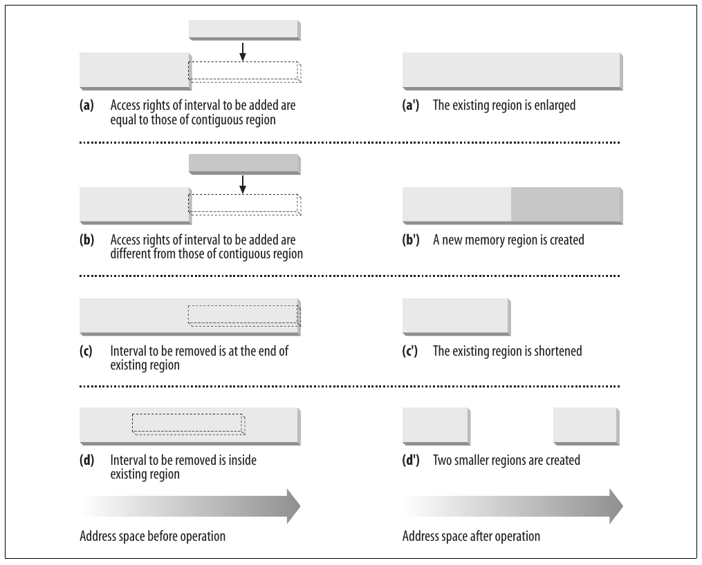
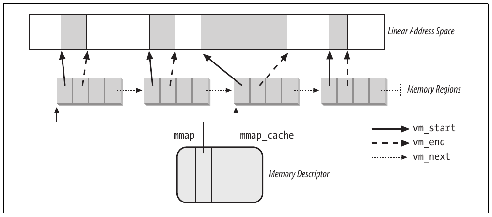
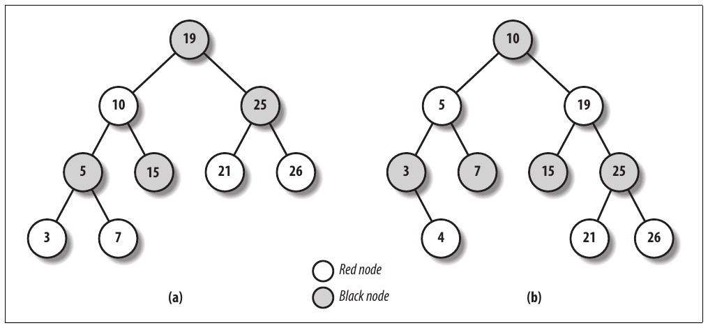
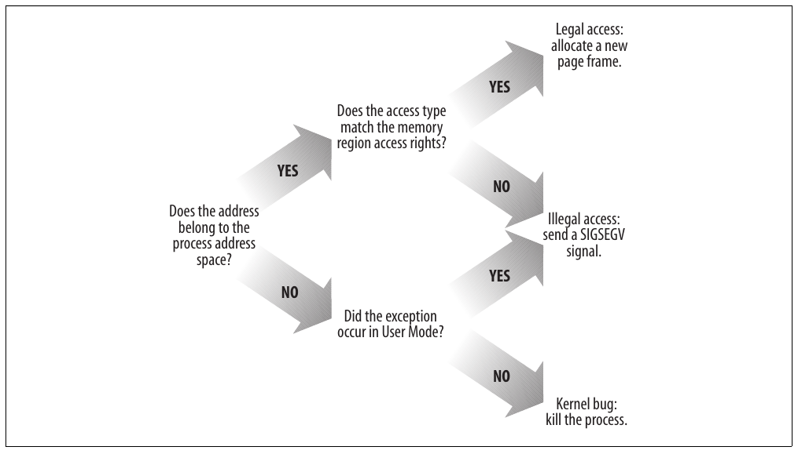
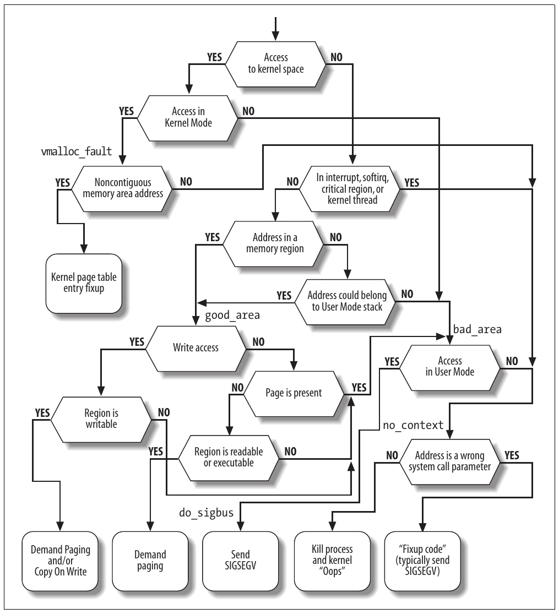

# Chương 9. Process address space


Như đã thấy trong chương trước, một kernel function lấy dynamic memory theo cách khá trực tiếp bằng cách gọi một trong nhiều function: `__get_free_pages()` hoặc `alloc_pages()` để lấy page từ zoned page frame allocator, `kmem_cache_alloc()` hoặc `kmalloc()` để dùng slab allocator cho object chuyên dụng hoặc general-purpose, và `vmalloc()` hoặc `vmalloc_32()` để lấy noncontiguous memory area. Nếu yêu cầu có thể được đáp ứng, mỗi function này trả về địa chỉ page descriptor hoặc một linear address xác định đầu dynamic memory area đã cấp phát.

Các cách đơn giản này hoạt động vì hai lý do:

- Kernel là component có highest-priority của hệ điều hành. Nếu một kernel function yêu cầu dynamic memory, nó phải có lý do hợp lệ để đưa ra yêu cầu đó, và không có ích gì khi cố trì hoãn yêu cầu.

- Kernel tin tưởng chính nó. Mọi kernel function đều được giả định error-free, nên kernel không cần đưa vào biện pháp bảo vệ nào chống lỗi lập trình.

Khi cấp phát memory cho User Mode process, tình hình hoàn toàn khác:

- Yêu cầu dynamic memory của process được xem là không khẩn cấp. Ví dụ, khi executable file của process được load, ít có khả năng process sẽ truy cập tất cả page chứa code trong tương lai gần. Tương tự, khi process gọi `malloc()` để lấy thêm dynamic memory, điều đó không có nghĩa process sẽ sớm truy cập toàn bộ memory bổ sung đã lấy. Vì vậy, theo nguyên tắc chung, kernel cố trì hoãn cấp phát dynamic memory cho User Mode process.

- Vì không thể tin tưởng user program, kernel phải sẵn sàng bắt mọi addressing error do process trong User Mode gây ra.

Như chương này mô tả, kernel trì hoãn được việc cấp phát dynamic memory cho process bằng cách dùng một loại resource mới. Khi User Mode process yêu cầu dynamic memory, nó không nhận thêm page frame; thay vào đó, nó nhận quyền dùng một dải linear address mới, trở thành một phần address space của nó. Khoảng này gọi là “memory region”. Trong phần tiếp theo, chúng ta bàn về cách process nhìn dynamic memory. Sau đó, chúng ta mô tả các component cơ bản của process address space trong phần “Memory Regions”. Tiếp theo, chúng ta xem xét chi tiết vai trò của Page Fault exception handler trong việc trì hoãn cấp phát page frame cho process và minh họa cách kernel tạo và xóa toàn bộ process address space. Cuối cùng, chúng ta bàn về API và system call liên quan đến quản lý address space.

## Address space của process

Address space của process gồm tất cả linear address mà process được phép dùng. Mỗi process thấy một tập linear address khác nhau; địa chỉ mà process này dùng không có quan hệ với địa chỉ mà process khác dùng. Như sẽ thấy phía sau, kernel có thể thay đổi động process address space bằng cách thêm hoặc loại bỏ các khoảng linear address.

Kernel biểu diễn các khoảng linear address bằng resource gọi là memory region, đặc trưng bởi linear address đầu, độ dài, và một số access right. Vì lý do hiệu quả, cả địa chỉ đầu lẫn độ dài memory region phải là bội số của 4.096, để dữ liệu mà mỗi memory region xác định lấp đầy hoàn toàn các page frame cấp phát cho nó. Sau đây là một số tình huống điển hình mà process nhận memory region mới:

- Khi người dùng gõ một command tại console, shell process tạo process mới để thực thi command. Kết quả là một address space mới, và do đó một tập memory region, được gán cho process mới (xem phần “Creating and Deleting a Process Address Space” ở phần sau chương này; xem thêm Chương 20).

- Một process đang chạy có thể quyết định load một chương trình hoàn toàn khác. Trong trường hợp này, process ID không đổi, nhưng các memory region dùng trước khi load chương trình được giải phóng và một tập memory region mới được gán cho process (xem phần “The exec Functions” trong Chương 20).

- Một process đang chạy có thể thực hiện “memory mapping” trên một file (hoặc một phần file). Trong những trường hợp này, kernel gán memory region mới cho process để map file (xem phần “Memory Mapping” trong Chương 16).

- Một process có thể tiếp tục thêm dữ liệu lên User Mode stack đến khi dùng hết mọi địa chỉ trong memory region map stack. Trong trường hợp này, kernel có thể quyết định mở rộng kích thước memory region đó (xem phần “Page Fault Exception Handler” ở phần sau chương này).

- Một process có thể tạo IPC-shared memory region để chia sẻ dữ liệu với các process hợp tác khác. Trong trường hợp này, kernel gán memory region mới cho process để triển khai cấu trúc này (xem phần “IPC Shared Memory” trong Chương 19).

- Một process có thể mở rộng dynamic area (heap) qua function như `malloc()`. Kết quả là kernel có thể quyết định mở rộng kích thước memory region gán cho heap (xem phần “Managing the Heap” ở phần sau chương này).

Bảng 9-1 minh họa một số system call liên quan đến các nhiệm vụ vừa nêu. `brk()` được bàn ở cuối chương này, còn các system call còn lại được mô tả trong những chương khác.

Bảng 9-1. System call liên quan đến tạo và xóa memory region

| System call | Mô tả |
|---|---|
| `brk()` | Thay đổi heap size của process |
| `execve()` | Load executable file mới, qua đó thay đổi process address space |
| `_exit()` | Kết thúc process hiện tại và hủy address space của nó |
| `fork()` | Tạo process mới, và do đó một address space mới |
| `mmap()`, `mmap2()` | Tạo memory mapping cho file, qua đó mở rộng process address space |
| `mremap()` | Mở rộng hoặc thu nhỏ memory region |
| `remap_file_pages()` | Tạo non-linear mapping cho file (xem Chương 16) |
| `munmap()` | Hủy memory mapping cho file, qua đó thu hẹp process address space |
| `shmat()` | Gắn shared memory region |
| `shmdt()` | Tháo shared memory region |

Như sẽ thấy trong phần “Page Fault Exception Handler” phía sau, kernel cần xác định các memory region hiện thuộc process (address space của process), vì điều đó cho phép Page Fault exception handler phân biệt hiệu quả hai loại linear address không hợp lệ khiến nó được gọi:

- Những địa chỉ do lỗi lập trình gây ra.

- Những địa chỉ do page bị thiếu; dù linear address thuộc address space của process, page frame tương ứng với địa chỉ đó vẫn chưa được cấp phát.

Các địa chỉ sau không phải không hợp lệ theo góc nhìn process; kernel tận dụng Page Fault phát sinh để triển khai demand paging: kernel cung cấp page frame còn thiếu và cho process tiếp tục.

## Memory descriptor

Mọi thông tin liên quan đến process address space nằm trong một object gọi là memory descriptor, kiểu `mm_struct`. Object này được field `mm` của process descriptor tham chiếu. Các field của memory descriptor được liệt kê trong Bảng 9-2.

Bảng 9-2. Các field của memory descriptor

| Kiểu | Field | Mô tả |
|---|---|---|
| `struct vm_area_struct *` | `mmap` | Pointer đến đầu list memory region object |
| `struct rb_root` | `mm_rb` | Pointer đến root của red-black tree chứa memory region object |
| `struct vm_area_struct *` | `mmap_cache` | Pointer đến memory region object được tham chiếu gần nhất |
| `unsigned long (*)()` | `get_unmapped_area` | Method tìm một khoảng linear address khả dụng trong process address space |
| `void (*)()` | `unmap_area` | Method được gọi khi giải phóng một khoảng linear address |
| `unsigned long` | `mmap_base` | Xác định linear address của anonymous memory region hoặc file memory mapping đầu tiên được cấp phát (xem phần “Program Segments and Process Memory Regions” trong Chương 20) |
| `unsigned long` | `free_area_cache` | Địa chỉ mà từ đó kernel tìm khoảng linear address trống trong process address space |
| `pgd_t *` | `pgd` | Pointer đến Page Global Directory |
| `atomic_t` | `mm_users` | Usage counter phụ |
| `atomic_t` | `mm_count` | Usage counter chính |
| `int` | `map_count` | Số memory region |
| `struct rw_semaphore` | `mmap_sem` | Read/write semaphore của memory region |
| `spinlock_t` | `page_table_lock` | Spin lock của memory region và Page Table |
| `struct list_head` | `mmlist` | Pointer đến phần tử liền kề trong list memory descriptor |
| `unsigned long` | `start_code` | Địa chỉ đầu executable code |
| `unsigned long` | `end_code` | Địa chỉ cuối executable code |
| `unsigned long` | `start_data` | Địa chỉ đầu initialized data |
| `unsigned long` | `end_data` | Địa chỉ cuối initialized data |
| `unsigned long` | `start_brk` | Địa chỉ đầu heap |
| `unsigned long` | `brk` | Địa chỉ cuối hiện tại của heap |
| `unsigned long` | `start_stack` | Địa chỉ đầu User Mode stack |
| `unsigned long` | `arg_start` | Địa chỉ đầu command-line argument |
| `unsigned long` | `arg_end` | Địa chỉ cuối command-line argument |
| `unsigned long` | `env_start` | Địa chỉ đầu environment variable |
| `unsigned long` | `env_end` | Địa chỉ cuối environment variable |
| `unsigned long` | `rss` | Số page frame cấp phát cho process |
| `unsigned long` | `anon_rss` | Số page frame gán cho anonymous memory mapping |
| `unsigned long` | `total_vm` | Kích thước process address space (số page) |
| `unsigned long` | `locked_vm` | Số page “locked” không thể swap out (xem Chương 17) |
| `unsigned long` | `shared_vm` | Số page trong shared file memory mapping |
| `unsigned long` | `exec_vm` | Số page trong executable memory mapping |
| `unsigned long` | `stack_vm` | Số page trong User Mode stack |
| `unsigned long` | `reserved_vm` | Số page trong memory region dự trữ hoặc đặc biệt |
| `unsigned long` | `def_flags` | Access flag mặc định của memory region |
| `unsigned long` | `nr_ptes` | Số Page Table của process này |
| `unsigned long []` | `saved_auxv` | Dùng khi bắt đầu thực thi chương trình ELF (xem Chương 20) |
| `unsigned int` | `dumpable` | Flag chỉ định process có thể tạo core dump của memory hay không |
| `cpumask_t` | `cpu_vm_mask` | Bit mask cho lazy TLB switch (xem Chương 2) |
| `mm_context_t` | `context` | Pointer đến table chứa thông tin architecture-specific (ví dụ địa chỉ LDT trên nền tảng 80x86) |
| `unsigned long` | `swap_token_time` | Thời điểm process này trở nên đủ điều kiện có swap token (xem phần “The Swap Token” trong Chương 17) |
| `char` | `recent_pagein` | Flag được set nếu một major Page Fault vừa xảy ra gần đây |
| `int` | `core_waiters` | Số lightweight process đang dump nội dung process address space ra core file (xem phần “Deleting a Process Address Space” ở phần sau chương này) |
| `struct completion *` | `core_startup_done` | Pointer đến completion dùng khi tạo core file (xem phần “Completions” trong Chương 5) |
| `struct completion` | `core_done` | Completion dùng khi tạo core file |
| `rwlock_t` | `ioctx_list_lock` | Lock dùng để bảo vệ list asynchronous I/O context (xem Chương 16) |
| `struct kioctx *` | `ioctx_list` | List asynchronous I/O context (xem Chương 16) |
| `struct kioctx` | `default_kioctx` | Asynchronous I/O context mặc định (xem Chương 16) |
| `unsigned long` | `hiwater_rss` | Số page frame tối đa process từng sở hữu |
| `unsigned long` | `hiwater_vm` | Số page tối đa từng nằm trong các memory region của process |

Tất cả memory descriptor được lưu trong một doubly linked list. Mỗi descriptor lưu địa chỉ các phần tử liền kề trong field `mmlist`. Phần tử đầu list là field `mmlist` của `init_mm`, memory descriptor mà process 0 dùng trong giai đoạn khởi tạo. Spin lock `mmlist_lock` bảo vệ list khỏi truy cập đồng thời trên hệ thống multiprocessor.

Field `mm_users` lưu số lightweight process chia sẻ data structure `mm_struct` (xem phần “The clone(), fork(), and vfork() System Calls” trong Chương 3). Field `mm_count` là usage counter chính của memory descriptor; tất cả “user” trong `mm_users` được tính là một đơn vị trong `mm_count`. Mỗi khi field `mm_count` giảm, kernel kiểm tra nó có thành không hay không; nếu có, memory descriptor được thu hồi vì không còn được dùng.

Chúng ta sẽ giải thích khác biệt giữa cách dùng `mm_users` và `mm_count` bằng ví dụ. Xét một memory descriptor được hai lightweight process chia sẻ. Bình thường, field `mm_users` lưu giá trị 2, còn field `mm_count` lưu giá trị 1 (cả hai owner process được tính là một).

Nếu memory descriptor tạm thời được cho một kernel thread mượn (xem phần tiếp theo), kernel tăng field `mm_count`. Theo cách này, ngay cả khi cả hai lightweight process kết thúc và field `mm_users` thành không, memory descriptor vẫn không được giải phóng cho đến khi kernel thread dùng xong, vì field `mm_count` vẫn lớn hơn không.

Nếu kernel muốn đảm bảo memory descriptor không bị giải phóng giữa một thao tác kéo dài, nó có thể tăng field `mm_users` thay vì `mm_count` (đây là việc function `try_to_unuse()` làm; xem phần “Activating and Deactivating a Swap Area” trong Chương 17). Kết quả cuối cùng giống nhau vì tăng `mm_users` đảm bảo `mm_count` không thành không ngay cả khi tất cả lightweight process sở hữu memory descriptor đều kết thúc.

Function `mm_alloc()` được gọi để lấy memory descriptor mới. Vì các descriptor này được lưu trong slab allocator cache, `mm_alloc()` gọi `kmem_cache_alloc()`, khởi tạo memory descriptor mới, và đặt các field `mm_count` và `mm_users` thành 1.

Ngược lại, function `mmput()` giảm field `mm_users` của memory descriptor. Nếu field đó thành 0, function giải phóng Local Descriptor Table, các memory region descriptor (xem phía sau trong chương này), và Page Table được memory descriptor tham chiếu, rồi gọi `mmdrop()`. Function sau giảm `mm_count` và, nếu nó thành không, giải phóng data structure `mm_struct`.

Các field `mmap`, `mm_rb`, `mmlist`, và `mmap_cache` được bàn trong phần tiếp theo.

### Memory descriptor của kernel thread

Kernel thread chỉ chạy trong Kernel Mode, nên không bao giờ truy cập linear address dưới `TASK_SIZE` (giống `PAGE_OFFSET`, thường là `0xc0000000`). Khác với process thông thường, kernel thread không dùng memory region, do đó phần lớn field của memory descriptor không có ý nghĩa với chúng.

Vì các Page Table entry tham chiếu linear address trên `TASK_SIZE` phải luôn giống nhau, thực sự không quan trọng kernel thread dùng tập Page Table nào. Để tránh TLB flush và cache flush vô ích, kernel thread dùng tập Page Table của process thông thường chạy gần nhất trước đó. Cho mục đích này, mỗi process descriptor chứa hai loại pointer đến memory descriptor: `mm` và `active_mm`.

Field `mm` trong process descriptor trỏ đến memory descriptor mà process sở hữu, còn field `active_mm` trỏ đến memory descriptor mà process dùng khi đang thực thi. Với process thông thường, hai field lưu cùng pointer. Tuy nhiên, kernel thread không sở hữu memory descriptor nào, nên field `mm` luôn là `NULL`. Khi một kernel thread được chọn để thực thi, field `active_mm` của nó được khởi tạo bằng giá trị `active_mm` của process chạy trước đó (xem phần “The schedule() Function” trong Chương 7).

Tuy nhiên, có một điểm phức tạp nhỏ. Mỗi khi một process trong Kernel Mode sửa Page Table entry cho linear address “cao” (trên `TASK_SIZE`), nó cũng phải cập nhật entry tương ứng trong các tập Page Table của mọi process trong hệ thống. Thực tế, một khi process trong Kernel Mode thiết lập mapping, mapping cũng phải có hiệu lực cho mọi process khác trong Kernel Mode. Đụng đến tập Page Table của mọi process là thao tác tốn kém; vì thế Linux dùng cách trì hoãn.

Chúng ta đã đề cập cách trì hoãn này trong phần “Noncontiguous Memory Area Management” ở Chương 8: mỗi khi phải remap một linear address cao (thường bằng `vmalloc()` hoặc `vfree()`), kernel cập nhật một tập Page Table chuẩn bắt nguồn từ master kernel Page Global Directory `swapper_pg_dir` (xem phần “Kernel Page Tables” trong Chương 2). Page Global Directory này được field `pgd` của một master memory descriptor trỏ đến, được lưu trong biến `init_mm`.[^1]

Phía sau, trong phần “Handling Noncontiguous Memory Area Accesses”, chúng ta sẽ mô tả cách Page Fault handler truyền thông tin lưu trong Page Table chuẩn khi thực sự cần.

## Memory region

Linux triển khai memory region bằng một object kiểu `vm_area_struct`; các field của nó được trình bày trong Bảng 9-3.<sup>†</sup>

Bảng 9-3. Các field của memory region object

| Kiểu | Field | Mô tả |
|---|---|---|
| `struct mm_struct *` | `vm_mm` | Pointer đến memory descriptor sở hữu region. |
| `unsigned long` | `vm_start` | Linear address đầu tiên bên trong region. |
| `unsigned long` | `vm_end` | Linear address đầu tiên sau region. |
| `struct vm_area_struct *` | `vm_next` | Region tiếp theo trong list của process. |
| `pgprot_t` | `vm_page_prot` | Access permission cho page frame của region. |
| `unsigned long` | `vm_flags` | Các flag của region. |
| `struct rb_node` | `vm_rb` | Dữ liệu cho red-black tree (xem phía sau trong chương này). |
| `union` | `shared` | Liên kết đến data structure dùng cho reverse mapping (xem phần “Reverse Mapping for Mapped Pages” trong Chương 17). |
| `struct list_head` | `anon_vma_node` | Pointer cho list anonymous memory region (xem phần “Reverse Mapping for Anonymous Pages” trong Chương 17). |
| `struct anon_vma *` | `anon_vma` | Pointer đến data structure `anon_vma` (xem phần “Reverse Mapping for Anonymous Pages” trong Chương 17). |
| `struct vm_operations_struct*` | `vm_ops` | Pointer đến các method của memory region. |
| `unsigned long` | `vm_pgoff` | Offset trong mapped file (xem Chương 16). Với anonymous page, nó bằng không hoặc bằng `vm_start/PAGE_SIZE` (xem Chương 17). |
| `struct file *` | `vm_file` | Pointer đến file object của mapped file, nếu có. |
| `void *` | `vm_private_data` | Pointer đến private data của memory region. |
| `unsigned long` | `vm_truncate_count` | Dùng khi giải phóng khoảng linear address trong non-linear file memory mapping. |

Mỗi memory region descriptor xác định một khoảng linear address. Field `vm_start` chứa linear address đầu khoảng, còn field `vm_end` chứa linear address đầu tiên bên ngoài khoảng; do đó `vm_end–vm_start` biểu thị độ dài memory region. Field `vm_mm` trỏ đến memory descriptor `mm_struct` của process sở hữu region. Chúng ta sẽ mô tả các field khác của `vm_area_struct` khi gặp chúng.

Các memory region thuộc một process không bao giờ chồng lấn, và kernel cố gộp region khi một region mới được cấp phát ngay cạnh region hiện có. Có thể gộp hai region liền kề nếu access right của chúng giống nhau.

Như Hình 9-1 cho thấy, khi thêm dải linear address mới vào process address space, kernel kiểm tra có thể mở rộng memory region hiện có hay không (trường hợp a). Nếu không, memory region mới được tạo (trường hợp b). Tương tự, nếu loại một dải linear address khỏi process address space, kernel thay đổi kích thước các memory region chịu ảnh hưởng (trường hợp c). Trong một số trường hợp, việc đổi kích thước buộc một memory region tách thành hai region nhỏ hơn (trường hợp d).[^2] Field `vm_ops` trỏ đến data structure `vm_operations_struct`, lưu các method của memory region. Chỉ bốn method—minh họa trong Bảng 9-4—áp dụng cho hệ thống UMA.



Hình 9-1. Thêm hoặc loại một khoảng linear address

Bảng 9-4. Các method thao tác trên memory region

| Method | Mô tả |
|---|---|
| `open` | Được gọi khi thêm memory region vào tập region thuộc một process. |
| `close` | Được gọi khi loại memory region khỏi tập region thuộc một process. |
| `nopage` | Được Page Fault exception handler gọi khi process cố truy cập page không có trong RAM mà linear address thuộc memory region (xem phần “Page Fault Exception Handler” phía sau). |
| `populate` | Được gọi để thiết lập page table entry tương ứng với linear address của memory region (prefaulting). Chủ yếu dùng cho non-linear file memory mapping. |

### Data structure của memory region

Tất cả region thuộc một process được nối trong một list đơn giản. Các region xuất hiện trong list theo thứ tự tăng dần của memory address; tuy nhiên, các region liên tiếp có thể cách nhau bởi một vùng memory address chưa dùng. Field `vm_next` của mỗi phần tử `vm_area_struct` trỏ đến phần tử tiếp theo trong list. Kernel tìm memory region thông qua field `mmap` của process memory descriptor, trỏ đến memory region descriptor đầu tiên trong list.

Field `map_count` của memory descriptor chứa số region thuộc process. Mặc định, process có thể sở hữu tối đa 65.536 memory region khác nhau; tuy nhiên, system administrator có thể thay đổi giới hạn này bằng cách ghi vào file /proc/sys/vm/max\_map\_count.

Hình 9-2 minh họa quan hệ giữa address space của process, memory descriptor của nó, và list memory region.



Hình 9-2. Các descriptor liên quan đến address space của process

Một thao tác kernel thường thực hiện là tìm memory region chứa một linear address cụ thể. Vì list được sắp thứ tự, việc tìm kiếm có thể kết thúc ngay khi tìm thấy memory region kết thúc sau linear address cụ thể đó.

Tuy nhiên, dùng list chỉ thuận tiện nếu process có rất ít memory region—chẳng hạn dưới vài chục. Tìm kiếm, chèn phần tử và xóa phần tử trong list cần số thao tác có thời gian tỷ lệ tuyến tính với độ dài list.

Dù hầu hết Linux process dùng rất ít memory region, một số ứng dụng lớn, như object-oriented database hoặc debugger chuyên dụng cho việc dùng `malloc()`, có hàng trăm hoặc thậm chí hàng nghìn region. Trong những trường hợp này, quản lý list memory region rất kém hiệu quả, do đó hiệu năng các system call memory-related suy giảm đến mức không chấp nhận được.

Vì thế, Linux 2.6 lưu memory descriptor trong data structure gọi là red-black tree. Trong red-black tree, mỗi phần tử (hay node) thường có hai node con: left child và right child. Các phần tử trong tree được sắp thứ tự. Với mỗi node N, tất cả phần tử của subtree có root tại left child của N đứng trước N, còn ngược lại, tất cả phần tử của subtree có root tại right child của N đứng sau N (xem Hình 9-3(`a`); key của node được viết ngay trong node. Hơn nữa, red-black tree phải đáp ứng thêm bốn quy tắc:

1\. Mỗi node phải là red hoặc black.

2\. Root của tree phải là black.

3\. Các node con của red node phải là black.

4\. Mọi path từ một node đến leaf hậu duệ phải chứa cùng số black node. Khi đếm black node, null pointer được tính là black node.



Hình 9-3. Ví dụ về red-black tree

Bốn quy tắc này đảm bảo mọi red-black tree có n internal node có chiều cao tối đa 2×log (n + 1).

Do đó, tìm phần tử trong red-black tree rất hiệu quả, vì cần các thao tác có thời gian thực thi tỷ lệ tuyến tính với logarithm kích thước tree. Nói cách khác, tăng gấp đôi số memory region chỉ thêm một lượt lặp cho thao tác.

Chèn và xóa phần tử trong red-black tree cũng hiệu quả, vì thuật toán có thể nhanh chóng duyệt tree để tìm vị trí chèn hoặc loại phần tử. Mỗi node mới phải được chèn làm leaf và tô red. Nếu thao tác vi phạm quy tắc, phải di chuyển hoặc đổi màu một vài node của tree.

Ví dụ, giả sử phải chèn phần tử có giá trị 4 vào red-black tree trong Hình 9-3(a). Vị trí thích hợp là right child của node có key 3, nhưng sau khi chèn, red node có giá trị 3 có red child, vi phạm quy tắc 3. Để đáp ứng quy tắc, màu của các node có giá trị 3, 4 và 7 được thay đổi. Tuy nhiên, thao tác này vi phạm quy tắc 4, nên thuật toán thực hiện một “rotation” trên subtree có root tại node có key 19, tạo red-black tree mới trong Hình 9-3(b). Điều này có vẻ phức tạp, nhưng chèn hoặc xóa phần tử trong red-black tree chỉ cần ít thao tác—số thao tác tỷ lệ tuyến tính với logarithm kích thước tree.

Vì vậy, để lưu memory region của process, Linux dùng cả linked list lẫn red-black tree. Cả hai data structure chứa pointer đến cùng các memory region descriptor. Khi chèn hoặc loại memory region descriptor, kernel tìm phần tử trước và sau qua red-black tree và dùng chúng để cập nhật nhanh list mà không quét list.

Đầu linked list được field `mmap` của memory descriptor tham chiếu. Mỗi memory region object lưu pointer đến phần tử tiếp theo của list trong field `vm_next`. Đầu red-black tree được field `mm_rb` của memory descriptor tham chiếu. Mỗi memory region object lưu màu node, cùng pointer đến parent, left child và right child, trong field `vm_rb` kiểu `rb_node`.

Nói chung, red-black tree được dùng để tìm region chứa địa chỉ cụ thể, còn linked list chủ yếu hữu ích khi quét toàn bộ tập region.

### Access right của memory region

Trước khi tiếp tục, chúng ta nên làm rõ quan hệ giữa page và memory region. Như đã đề cập trong Chương 2, chúng ta dùng thuật ngữ “page” cho cả một tập linear address lẫn dữ liệu trong nhóm địa chỉ này. Cụ thể, chúng ta gọi khoảng linear address từ 0 đến 4.095 là page 0, khoảng từ 4.096 đến 8.191 là page 1, v.v. Do đó mỗi memory region gồm một tập page có page number liên tiếp.

Chúng ta đã bàn về hai loại flag gắn với page:

- Một vài flag như `Read/Write`, `Present`, hoặc `User/Supervisor` lưu trong mỗi Page Table entry (xem phần “Regular Paging” trong Chương 2).

- Một tập flag lưu trong field `flags` của mỗi descriptor `page` (xem phần “Page Frame Management” trong Chương 8).

Loại flag đầu được hardware 80×86 dùng để kiểm tra kiểu truy cập địa chỉ được yêu cầu có thể thực hiện hay không; loại thứ hai được Linux dùng cho nhiều mục đích khác nhau (xem Bảng 8-2).

Giờ chúng ta giới thiệu loại flag thứ ba: flag gắn với page của memory region. Chúng được lưu trong field `vm_flags` của descriptor `vm_area_struct` (xem Bảng 9-5). Một số flag cung cấp cho kernel thông tin về tất cả page của memory region, như nội dung của chúng và quyền process có để truy cập từng page. Các flag khác mô tả chính region, như cách nó có thể mở rộng.

Bảng 9-5. Các flag của memory region

| Tên flag | Mô tả |
|---|---|
| `VM_READ` | Có thể đọc page |
| `VM_WRITE` | Có thể ghi page |
| `VM_EXEC` | Có thể thực thi page |
| `VM_SHARED` | Nhiều process có thể chia sẻ page |
| `VM_MAYREAD` | Có thể set flag `VM_READ` |
| `VM_MAYWRITE` | Có thể set flag `VM_WRITE` |
| `VM_MAYEXEC` | Có thể set flag `VM_EXEC` |
| `VM_MAYSHARE` | Có thể set flag `VM_SHARE` |
| `VM_GROWSDOWN` | Region có thể mở rộng về phía địa chỉ thấp hơn |
| `VM_GROWSUP` | Region có thể mở rộng về phía địa chỉ cao hơn |
| `VM_SHM` | Region dùng cho shared memory của IPC |
| `VM_DENYWRITE` | Region map một file không thể mở để ghi |
| `VM_EXECUTABLE` | Region map một executable file |
| `VM_LOCKED` | Page trong region được lock và không thể swap out |
| `VM_IO` | Region map I/O address space của device |
| `VM_SEQ_READ` | Ứng dụng truy cập page tuần tự |
| `VM_RAND_READ` | Ứng dụng truy cập page theo thứ tự thực sự ngẫu nhiên |
| `VM_DONTCOPY` | Không sao chép region khi fork process mới |
| `VM_DONTEXPAND` | Cấm mở rộng region qua system call `mremap()` |
| `VM_RESERVED` | Region đặc biệt (ví dụ map I/O address space của device), nên page của nó không được swap out |
| `VM_ACCOUNT` | Kiểm tra có đủ memory trống cho mapping khi tạo IPC shared memory region (xem Chương 19) |
| `VM_HUGETLB` | Page trong region được xử lý qua cơ chế extended paging (xem phần “Extended Paging” trong Chương 2) |
| `VM_NONLINEAR` | Region triển khai non-linear file mapping |

Page access right trong memory region descriptor có thể được kết hợp tùy ý. Ví dụ, có thể cho phép đọc nhưng không thực thi page của region. Để triển khai protection scheme này hiệu quả, các access right Read, Write và Execute gắn với page của memory region phải được sao chép vào tất cả Page Table entry tương ứng, để Paging Unit circuitry có thể kiểm tra trực tiếp. Nói cách khác, page access right quy định loại truy cập nào phải tạo Page Fault exception. Như sắp thấy, Linux giao việc xác định nguyên nhân Page Fault cho Page Fault handler, triển khai nhiều chiến lược page-handling.

Giá trị ban đầu của Page Table flag (phải giống nhau cho mọi page trong memory region, như đã thấy) được lưu trong field `vm_page_prot` của descriptor `vm_area_struct`. Khi thêm page, kernel đặt flag trong Page Table entry tương ứng theo giá trị field `vm_page_prot`.

Tuy nhiên, chuyển access right của memory region thành page protection bit không trực tiếp vì các lý do sau:

- Trong một số trường hợp, truy cập page phải tạo Page Fault exception ngay cả khi loại truy cập đó được page access right trong field `vm_flags` của memory region tương ứng cho phép. Ví dụ, như sẽ thấy trong phần “Copy On Write” ở phần sau chương này, kernel có thể muốn lưu hai private page giống nhau, có thể ghi (có flag `VM_SHARE` clear), thuộc hai process khác nhau trong cùng page frame; trong trường hợp này, exception phải được tạo khi một trong hai process cố sửa page.

- Như đã đề cập trong Chương 2, Page Table của processor 80×86 chỉ có hai protection bit, là flag `Read/Write` và `User/Supervisor`. Hơn nữa, flag `User/Supervisor` của mọi page trong memory region phải luôn được set, vì User Mode process phải luôn có thể truy cập page.

- Microprocessor Intel Pentium 4 gần đây có PAE được enable có flag `NX` (No eXecute) trong mỗi Page Table entry 64-bit.

Nếu kernel được compile không hỗ trợ PAE, Linux dùng các quy tắc sau để khắc phục giới hạn hardware của microprocessor 80×86:

- Access right Read luôn kéo theo access right Execute, và ngược lại.

- Access right Write luôn kéo theo access right Read.

Ngược lại, nếu kernel được compile có hỗ trợ PAE và CPU có flag `NX`, Linux dùng các quy tắc khác:

- Access right Execute luôn kéo theo access right Read.

- Access right Write luôn kéo theo access right Read.

Hơn nữa, để trì hoãn cấp phát page frame đúng cách qua kỹ thuật “Copy On Write” (xem phía sau trong chương này), page frame được write-protected bất cứ khi nào page tương ứng không được chia sẻ bởi nhiều process.

Do đó, 16 tổ hợp có thể của các access right Read, Write, Execute và Share được rút gọn theo các quy tắc sau:

- Nếu page có cả access right Write và Share, bit `Read/Write` được set.

- Nếu page có access right Read hoặc Execute nhưng thiếu access right Write hoặc Share, bit `Read/Write` được clear.

- Nếu bit `NX` được hỗ trợ và page không có access right Execute, bit `NX` được set.

- Nếu page không có access right nào, bit `Present` được clear để mỗi lần truy cập tạo Page Fault exception. Tuy nhiên, để phân biệt điều kiện này với trường hợp thực sự page-not-present, Linux còn đặt bit `Page size` thành 1.[^3]

Các protection bit sau khi rút gọn tương ứng với mỗi tổ hợp access right được lưu trong 16 phần tử của array `protection_map`.

### Xử lý memory region

Sau khi đã hiểu cơ bản các data structure và thông tin trạng thái điều khiển xử lý memory, chúng ta có thể xem một nhóm low-level function thao tác trên memory region descriptor. Nên xem chúng là auxiliary function giúp đơn giản hóa việc triển khai `do_mmap()` và `do_munmap()`. Hai function này, được mô tả trong các phần “Allocating a Linear Address Interval” và “Releasing a Linear Address Interval” ở phần sau chương này, lần lượt mở rộng và thu hẹp address space của process. Hoạt động ở cấp cao hơn các function chúng ta xét ở đây, chúng không nhận memory region descriptor làm parameter, mà nhận địa chỉ đầu, độ dài và access right của một khoảng linear address.

#### Tìm region gần địa chỉ cho trước nhất: find\_vma()

Function `find_vma()` nhận hai parameter: địa chỉ `mm` của process memory descriptor và một linear address `addr`. Nó tìm memory region đầu tiên có field `vm_end` lớn hơn `addr` và trả về địa chỉ descriptor của region; nếu không có region như vậy, nó trả về pointer `NULL`. Lưu ý rằng region được `find_vma()` chọn không nhất thiết chứa `addr`, vì `addr` có thể nằm ngoài mọi memory region.

Mỗi memory descriptor chứa field `mmap_cache` lưu địa chỉ descriptor của region được process tham chiếu gần nhất. Field bổ sung này được đưa vào để giảm thời gian tìm region chứa một linear address cho trước. Locality của tham chiếu địa chỉ trong chương trình khiến có khả năng rất cao rằng nếu linear address vừa kiểm tra thuộc một region, địa chỉ được kiểm tra tiếp theo cũng thuộc region đó.

Do đó, function bắt đầu bằng cách kiểm tra region do `mmap_cache` xác định có chứa `addr` không. Nếu có, nó trả về region descriptor pointer:

```c
vma = mm->mmap_cache;
if (vma && vma->vm_end > addr && vma->vm_start <= addr)
    return vma;
```

Ngược lại, phải quét memory region của process, và function tìm memory region trong red-black tree:

```c
rb_node = mm->mm_rb.rb_node;
vma = NULL;
while (rb_node) {
    vma_tmp = rb_entry(rb_node, struct vm_area_struct, vm_rb);
    if (vma_tmp->vm_end > addr) {
        vma = vma_tmp;
        if (vma_tmp->vm_start <= addr)
            break;
        rb_node = rb_node->rb_left;
    } else
        rb_node = rb_node->rb_right;
}
if (vma)
    mm->mmap_cache = vma;
return vma;
```

Function dùng macro `rb_entry`, suy ra địa chỉ memory region descriptor tương ứng từ pointer đến node của red-black tree.

Function `find_vma_prev()` giống `find_vma()`, ngoại trừ nó ghi vào parameter bổ sung `pprev` một pointer đến descriptor của memory region đứng trước region được function chọn.

Cuối cùng, function `find_vma_prepare()` tìm vị trí của leaf mới trong red-black tree tương ứng với linear address cho trước và trả về địa chỉ memory region đứng trước cùng parent node của leaf cần chèn.

##### Tìm region chồng lấn khoảng cho trước: find\_vma\_intersection()

Function `find_vma_intersection()` tìm memory region đầu tiên chồng lấn khoảng linear address cho trước; parameter `mm` trỏ đến memory descriptor của process, còn các linear address `start_addr` và `end_addr` chỉ định khoảng:

```c
vma = find_vma(mm,start_addr);
if (vma && end_addr <= vma->vm_start)
    vma = NULL;
return vma;
```

Function trả về pointer `NULL` nếu không có region như vậy. Chính xác hơn, nếu `find_vma()` trả về địa chỉ hợp lệ nhưng memory region tìm được bắt đầu sau cuối khoảng linear address, `vma` được đặt thành `NULL`.

##### Tìm khoảng trống: get\_unmapped\_area()

Function `get_unmapped_area()` tìm trong process address space một khoảng linear address khả dụng. Parameter `len` chỉ định độ dài khoảng, còn parameter `addr` non-null chỉ định địa chỉ bắt đầu tìm kiếm. Nếu tìm kiếm thành công, function trả về địa chỉ đầu của khoảng mới; ngược lại, trả về error code `-ENOMEM`.

Nếu parameter `addr` khác `NULL`, function kiểm tra địa chỉ được chỉ định nằm trong User Mode address space và được căn chỉnh theo page boundary. Tiếp theo, function gọi một trong hai method, tùy khoảng linear address được dùng cho file memory mapping hay anonymous memory mapping. Trong trường hợp đầu, function thực thi file operation `get_unmapped_area`; điều này được bàn trong Chương 16.

Trong trường hợp sau, function thực thi method `get_unmapped_area` của memory descriptor. Đến lượt method này được triển khai bằng function `arch_get_unmapped_area()` hoặc function `arch_get_unmapped_area_topdown()`, tùy bố trí memory region của process. Như sẽ thấy trong phần “Program Segments and Process Memory Regions” ở Chương 20, mỗi process có thể có hai bố trí khác nhau cho memory region cấp phát qua system call `mmap()`: hoặc bắt đầu từ linear address `0x40000000` và mở rộng về địa chỉ cao hơn, hoặc bắt đầu ngay phía trên User Mode stack và mở rộng về địa chỉ thấp hơn.

Hãy bàn về function `arch_get_unmapped_area()`, được dùng khi memory region được cấp phát từ địa chỉ thấp lên địa chỉ cao. Về cơ bản, nó tương đương đoạn code sau:

```c
if (len > TASK_SIZE)
    return -ENOMEM;
addr = (addr + 0xfff) & 0xfffff000;
if (addr && addr + len <= TASK_SIZE) {
    vma = find_vma(current->mm, addr);
    if (!vma || addr + len <= vma->vm_start)
        return addr;
}
start_addr = addr = mm->free_area_cache;
for (vma = find_vma(current->mm, addr); ; vma = vma->vm_next) {
    if (addr + len > TASK_SIZE) {
        if (start_addr == (TASK_SIZE/3+0xfff)&0xfffff000)
            return -ENOMEM;
        start_addr = addr = (TASK_SIZE/3+0xfff)&0xfffff000;
        vma = find_vma(current->mm, addr);
    }
    if (!vma || addr + len <= vma->vm_start) {
        mm->free_area_cache = addr + len;
        return addr;
    }
    addr = vma->vm_end;
}
```

Function bắt đầu bằng cách kiểm tra để đảm bảo độ dài khoảng nằm trong `TASK_SIZE`, giới hạn áp dụng cho User Mode linear address (thường là 3 GB). Nếu `addr` khác không, function cố cấp phát khoảng bắt đầu từ `addr`. Để đảm bảo an toàn, function làm tròn giá trị `addr` lên bội số của 4 KB.

Nếu `addr` bằng 0 hoặc tìm kiếm trước thất bại, function `arch_get_unmapped_area()` quét User Mode linear address space để tìm dải linear address không thuộc memory region nào và đủ lớn để chứa region mới. Để tăng tốc tìm kiếm, điểm bắt đầu tìm kiếm thường được đặt là linear address ngay sau memory region được cấp phát gần nhất. Field `mm->free_area_cache` của memory descriptor được khởi tạo bằng one-third User Mode linear address space—thường là 1 GB—rồi cập nhật khi tạo memory region mới. Nếu function không tìm được dải linear address phù hợp, việc tìm kiếm bắt đầu lại từ đầu—tức từ one-third User Mode linear address space: thực tế, một phần ba đầu User Mode linear address space dành cho memory region có linear address đầu định sẵn, thường là các segment text, data và bss của executable file (xem Chương 20).

Function gọi `find_vma()` để tìm memory region đầu tiên kết thúc sau điểm bắt đầu tìm kiếm, rồi lần lượt xét tất cả memory region phía sau. Có thể xảy ra ba trường hợp:

- Khoảng được yêu cầu lớn hơn phần linear address space chưa quét (`addr + len > TASK_SIZE`): trong trường hợp này, function bắt đầu lại từ one-third User Mode address space hoặc, nếu đã thực hiện lượt tìm kiếm thứ hai, trả về `-ENOMEM` (không đủ linear address để đáp ứng yêu cầu).

- Lỗ hổng sau region vừa quét không đủ lớn (`vma != NULL && vma->vm_start < addr + len`). Trong trường hợp này, function xét region tiếp theo.

- Nếu không điều kiện nào trong hai điều kiện trước đúng, đã tìm thấy lỗ hổng đủ lớn. Trong trường hợp này, function trả về `addr`.

##### Chèn region vào list của memory descriptor: insert\_vm\_struct()

`insert_vm_struct()` chèn structure `vm_area_struct` vào list memory region object và red-black tree của memory descriptor. Nó dùng hai parameter: `mm`, chỉ định địa chỉ process memory descriptor, và `vma`, chỉ định địa chỉ object `vm_area_struct` cần chèn. Các field `vm_start` và `vm_end` của memory region object phải được khởi tạo từ trước. Function gọi function `find_vma_prepare()` để tìm vị trí trong red-black tree `mm->mm_rb` mà `vma` nên được đưa vào. Sau đó, `insert_vm_struct()` gọi function `vma_link()`, đến lượt nó:

1\. Chèn memory region vào linked list được `mm->mmap` tham chiếu.

2\. Chèn memory region vào red-black tree `mm->mm_rb`.

3\. Nếu memory region là anonymous, chèn region vào list có đầu tại data structure `anon_vma` tương ứng (xem phần “Reverse Mapping for Anonymous Pages” trong Chương 17).

4\. Tăng counter `mm->map_count`.

Nếu region chứa memory-mapped file, function `vma_link()` thực hiện thêm các nhiệm vụ mô tả trong Chương 17.

Function `__vma_unlink()` nhận các parameter là địa chỉ memory descriptor `mm` và hai địa chỉ memory region object `vma` và `prev`. Cả hai memory region phải thuộc `mm`, và `prev` phải đứng trước `vma` trong thứ tự memory region. Function loại `vma` khỏi linked list và red-black tree của memory descriptor. Nó còn cập nhật `mm->mmap_cache`, lưu memory region được tham chiếu gần nhất, nếu field này trỏ đến memory region vừa xóa.

### Cấp phát khoảng linear address

Giờ hãy bàn về cách cấp phát khoảng linear address mới. Để làm vậy, function `do_mmap()` tạo và khởi tạo memory region mới cho process `current`. Tuy nhiên, sau khi cấp phát thành công, memory region có thể được gộp với memory region khác đã định nghĩa cho process.

Function dùng các parameter sau:

`file` và `offset`

File object pointer `file` và file offset `offset` được dùng nếu memory region mới sẽ map file vào memory. Chủ đề này được bàn trong Chương 16. Trong phần này, chúng ta giả định không cần memory mapping và cả `file` lẫn `offset` đều là `NULL`.

`addr`

Linear address này chỉ định nơi phải bắt đầu tìm khoảng trống.

`len`

Độ dài khoảng linear address.

`prot`

Parameter này chỉ định access right của page trong memory region. Các flag có thể là `PROT_READ`, `PROT_WRITE`, `PROT_EXEC`, và `PROT_NONE`. Ba flag đầu có cùng ý nghĩa với các flag `VM_READ`, `VM_WRITE`, và `VM_EXEC`. `PROT_NONE` cho biết process không có access right nào trong số đó.

`flag`

Parameter này chỉ định các memory region flag còn lại:

`MAP_GROWSDOWN`, `MAP_LOCKED`, `MAP_DENYWRITE`, và `MAP_EXECUTABLE`

Ý nghĩa của chúng giống các flag liệt kê trong Bảng 9-5.

`MAP_SHARED` và `MAP_PRIVATE`

Flag đầu chỉ định page trong memory region có thể được chia sẻ giữa nhiều process; flag sau có tác dụng ngược lại. Cả hai flag liên quan đến flag `VM_SHARED` trong descriptor `vm_area_struct`.

`MAP_FIXED`

Linear address đầu của khoảng phải chính xác là địa chỉ được chỉ định trong parameter `addr`.

`MAP_ANONYMOUS`

Không file nào gắn với memory region (xem Chương 16).

`MAP_NORESERVE`

Function không phải kiểm tra sơ bộ số page frame trống.

`MAP_POPULATE`

Function nên pre-allocate các page frame cần cho mapping do memory region thiết lập. Flag này chỉ có ý nghĩa với memory region map file (xem Chương 16) và IPC shared memory region (xem Chương 19).

`MAP_NONBLOCK`

Chỉ có ý nghĩa khi flag `MAP_POPULATE` được set: khi pre-allocating page frame, function không được block.

Function `do_mmap()` thực hiện một số kiểm tra sơ bộ giá trị `offset` rồi thực thi function `do_mmap_pgoff()`. Trong chương này, chúng ta giả định khoảng linear address mới không map file trên disk—file memory mapping được bàn chi tiết trong Chương 16. Sau đây là mô tả function `do_mmap_pgoff()` cho anonymous memory region:

1\. Kiểm tra giá trị parameter có đúng và yêu cầu có thể được đáp ứng không. Cụ thể, nó kiểm tra các điều kiện sau khiến không thể đáp ứng yêu cầu:

  - Khoảng linear address có độ dài bằng không hoặc chứa địa chỉ lớn hơn `TASK_SIZE`.

  - Process đã map quá nhiều memory region—tức giá trị field `map_count` của memory descriptor `mm` vượt giá trị tối đa cho phép.

  - Parameter `flag` chỉ định page của khoảng linear address mới phải được lock trong RAM, nhưng process không được phép tạo locked memory region, hoặc số page process lock vượt ngưỡng lưu trong field `signal->rlim[RLIMIT_MEMLOCK].rlim_cur` của process descriptor. Nếu bất cứ điều kiện nào ở trên đúng, `do_mmap_pgoff()` kết thúc bằng cách trả về giá trị âm. Nếu khoảng linear address có độ dài bằng không, function trả về mà không thực hiện thao tác nào.

2\. Gọi `get_unmapped_area()` để lấy khoảng linear address cho region mới (xem phần “Memory Region Handling” trước đó).

3\. Tính các flag của memory region mới bằng cách kết hợp giá trị lưu trong các parameter `prot` và `flags`:

```c
vm_flags = calc_vm_prot_bits(prot,flags) |
           calc_vm_flag_bits(prot,flags) |
           mm->def_flags | VM_MAYREAD | VM_MAYWRITE | VM_MAYEXEC;
if (flags & MAP_SHARED)
    vm_flags |= VM_SHARED | VM_MAYSHARE;
```

Function `calc_vm_prot_bits()` chỉ set các flag `VM_READ`, `VM_WRITE`, và `VM_EXEC` trong `vm_flags` nếu các flag tương ứng `PROT_READ`, `PROT_WRITE`, và `PROT_EXEC` trong `prot` được set. Function `calc_vm_flag_bits()` chỉ set các flag `VM_GROWSDOWN`, `VM_DENYWRITE`, `VM_EXECUTABLE`, và `VM_LOCKED` trong `vm_flags` nếu các flag tương ứng `MAP_GROWSDOWN`, `MAP_DENYWRITE`, `MAP_EXECUTABLE`, và `MAP_LOCKED` trong `flags` được set. Một số flag khác được set trong `vm_flags`: `VM_MAYREAD`, `VM_MAYWRITE`, `VM_MAYEXEC`, các flag mặc định cho mọi memory region trong `mm->def_flags`,[^4] và cả `VM_SHARED` lẫn `VM_MAYSHARE` nếu page của memory region phải được chia sẻ với process khác.

4\. Gọi `find_vma_prepare()` để tìm object của memory region sẽ đứng trước khoảng mới, cũng như vị trí của region mới trong red-black tree:

```c
for (;;) {
    vma = find_vma_prepare(mm, addr, &prev, &rb_link, &rb_parent);
    if (!vma || vma->vm_start >= addr + len)
        break;
    if (do_munmap(mm, addr, len))
        return -ENOMEM;
}
```

Function `find_vma_prepare()` còn kiểm tra đã có memory region chồng lấn khoảng mới chưa. Điều này xảy ra khi function trả về địa chỉ khác `NULL` trỏ đến region bắt đầu trước cuối khoảng mới. Trong trường hợp này, `do_mmap_pgoff()` gọi `do_munmap()` để loại khoảng mới rồi lặp lại toàn bộ bước (xem phần “Releasing a Linear Address Interval” phía sau).

5\. Kiểm tra việc chèn memory region mới có khiến kích thước process address space `(mm->total_vm<<PAGE_SHIFT)+len` vượt ngưỡng lưu trong field `signal->rlim[RLIMIT_AS].rlim_cur` của process descriptor không. Nếu có, trả về error code `-ENOMEM`. Lưu ý kiểm tra được thực hiện ở đây thay vì cùng các kiểm tra khác ở bước 1, vì một số memory region có thể đã bị loại ở bước 4.

6\. Trả về error code `-ENOMEM` nếu flag `MAP_NORESERVE` không được set trong parameter `flags`, memory region mới chứa private writable page, và không đủ page frame trống; kiểm tra cuối này được function `security_vm_enough_memory()` thực hiện. 7. Nếu khoảng mới là private (`VM_SHARED` không được set) và không map file trên disk, gọi `vma_merge()` để kiểm tra memory region đứng trước có thể mở rộng để chứa khoảng mới không. Tất nhiên, memory region đứng trước phải có chính xác các flag giống các memory region lưu trong local variable `vm_flags`. Nếu có thể mở rộng memory region đứng trước, `vma_merge()` còn cố gộp nó với memory region phía sau (điều này xảy ra khi khoảng mới lấp lỗ hổng giữa hai memory region và cả ba có cùng flag). Nếu mở rộng thành công memory region đứng trước, function nhảy đến bước 12.

8\. Cấp phát data structure `vm_area_struct` cho memory region mới bằng cách gọi function `kmem_cache_alloc()` của slab allocator.

9\. Khởi tạo memory region object mới (được `vma` trỏ đến):

```c
vma->vm_mm = mm;
vma->vm_start = addr;
vma->vm_end = addr + len;
vma->vm_flags = vm_flags;
vma->vm_page_prot = protection_map[vm_flags & 0x0f];
vma->vm_ops = NULL;
vma->vm_pgoff = pgoff;
vma->vm_file = NULL;
vma->vm_private_data = NULL;
vma->vm_next = NULL;
INIT_LIST_HEAD(&vma->shared);
```

10\. Nếu flag `MAP_SHARED` được set (và memory region mới không map file trên disk), region là shared anonymous region: gọi `shmem_zero_setup()` để khởi tạo nó. Shared anonymous region chủ yếu dùng cho interprocess communication; xem phần “IPC Shared Memory” trong Chương 19.

11\. Gọi `vma_link()` để chèn region mới vào list memory region và red-black tree (xem phần “Memory Region Handling” trước đó).

12\. Tăng kích thước process address space lưu trong field `total_vm` của memory descriptor.

13\. Nếu flag `VM_LOCKED` được set, gọi `make_pages_present()` để lần lượt cấp phát tất cả page của memory region và lock chúng trong RAM:

```c
    if (vm_flags & VM_LOCKED) {
        mm->locked_vm += len >> PAGE_SHIFT;
        make_pages_present(addr, addr + len);
    }
```

Đến lượt function `make_pages_present()` gọi `get_user_pages()` như sau:

```c
    write = (vma->vm_flags & VM_WRITE) != 0;
    get_user_pages(current, current->mm, addr, len, write, 0, NULL, NULL);
```

Function `get_user_pages()` duyệt tất cả linear address đầu của page giữa `addr` và `addr+len`; với mỗi địa chỉ, nó gọi `follow_page()` để kiểm tra có mapping đến physical page trong Page Table của `current` hay không. Nếu không có physical page như vậy, `get_user_pages()` gọi `handle_mm_fault()`, function này, như sẽ thấy trong phần “Handling a Faulty Address Inside the Address Space”, cấp phát một page frame và thiết lập Page Table entry của nó theo field `vm_flags` của memory region descriptor.

14\. Cuối cùng, kết thúc bằng cách trả về linear address của memory region mới.

### Giải phóng khoảng linear address

Khi kernel phải xóa một khoảng linear address khỏi address space của process hiện tại, nó dùng function `do_munmap()`. Các parameter là: địa chỉ `mm` của memory descriptor của process, địa chỉ đầu `start` của khoảng, và độ dài `len`. Khoảng cần xóa thường không tương ứng với một memory region; nó có thể nằm trong một memory region hoặc trải trên hai hay nhiều region.

#### Function do\_munmap()

Function trải qua hai giai đoạn chính. Trong giai đoạn đầu (bước 1–6), nó quét list memory region thuộc process và tháo liên kết tất cả region trong khoảng linear address khỏi process address space. Trong giai đoạn thứ hai (bước 7–12), function cập nhật Page Table của process và loại các memory region xác định trong giai đoạn đầu. Function dùng các function `split_vma()` và `unmap_region()`, sẽ được mô tả phía sau. `do_munmap()` thực hiện các bước sau:

1\. Thực hiện một số kiểm tra sơ bộ giá trị parameter. Nếu khoảng linear address chứa địa chỉ lớn hơn `TASK_SIZE`, nếu `start` không phải bội số của 4.096, hoặc nếu khoảng linear address có độ dài bằng không, function trả về error code `-EINVAL`.

2\. Tìm memory region `mpnt` đầu tiên kết thúc sau khoảng linear address cần xóa (`mpnt->end > start`), nếu có:

```c
mpnt = find_vma_prev(mm, start, &prev);
```

3\. Nếu không có memory region như vậy, hoặc region không chồng lấn khoảng linear address, không cần làm gì vì không có memory region trong khoảng:

```c
end = start + len;
if (!mpnt || mpnt->vm_start >= end)
    return 0;
```

4\. Nếu khoảng linear address bắt đầu bên trong memory region `mpnt`, gọi `split_vma()` (mô tả bên dưới) để chia memory region `mpnt` thành hai region nhỏ hơn: một bên ngoài khoảng và một bên trong khoảng:

```c
if (start > mpnt->vm_start) {
    if (split_vma(mm, mpnt, start, 0))
        return -ENOMEM;
    prev = mpnt;
}
```

Local variable `prev`, trước đó lưu pointer đến memory region đứng trước `mpnt`, được cập nhật để trỏ đến `mpnt`—tức memory region mới nằm ngoài khoảng linear address. Theo cách này, `prev` vẫn trỏ đến memory region đứng trước memory region đầu tiên cần loại.

5\. Nếu khoảng linear address kết thúc bên trong một memory region, gọi lại `split_vma()` để chia memory region chồng lấn cuối cùng thành hai region nhỏ hơn: một bên trong khoảng và một bên ngoài khoảng:[^5]

```c
last = find_vma(mm, end);
if (last && end > last->vm_start)){
    if (split_vma(mm, last, start, end, 1))
        return -ENOMEM;
}
```

6\. Cập nhật giá trị `mpnt` để trỏ đến memory region đầu tiên trong khoảng linear address. Nếu `prev` là `NULL`—tức không có memory region đứng trước—địa chỉ memory region đầu tiên được lấy từ `mm->mmap`:

```c
mpnt = prev ? prev->vm_next : mm->mmap;
```

7\. Gọi `detach_vmas_to_be_unmapped()` để loại các memory region nằm trong khoảng linear address khỏi linear address space của process. Về cơ bản, function này thực thi code sau:

```c
vma = mpnt;
insertion_point = (prev ? &prev->vm_next : &mm->mmap);
do {
    rb_erase(&vma->vm_rb, &mm->mm_rb);
    mm->map_count--;
    tail_vma = vma;
    vma = vma->next;
} while (vma && vma->start < end);
*insertion_point = vma;
tail_vma->vm_next = NULL;
mm->map_cache = NULL;
```

Descriptor của các region cần loại được lưu trong một ordered list, có đầu được local variable `mpnt` trỏ đến (thực tế, list này chỉ là một phần list memory region ban đầu của process).

8\. Lấy spin lock `mm->page_table_lock`.

9\. Gọi `unmap_region()` để clear các Page Table entry bao phủ khoảng linear address và giải phóng page frame tương ứng (bàn phía sau):

```c
unmap_region(mm, mpnt, prev, start, end);
```

10\. Nhả spin lock `mm->page_table_lock`.

11\. Giải phóng descriptor của các memory region thu thập trong list xây dựng ở bước 7:

```c
do {
    struct vm_area_struct * next = mpnt->vm_next;
    unmap_vma(mm, mpnt);
    mpnt = next;
} while (mpnt != NULL);
```

Function `unmap_vma()` được gọi trên mỗi memory region trong list; về cơ bản, nó thực hiện các bước sau:

a. Cập nhật các field `mm->total_vm` và `mm->locked_vm`.

b. Thực thi method `mm->unmap_area` của memory descriptor. Method này được triển khai bằng `arch_unmap_area()` hoặc `arch_unmap_area_topdown()`, tùy bố trí memory region của process (xem phần “Memory Region Handling” trước đó). Trong cả hai trường hợp, field `mm->free_area_cache` được cập nhật nếu cần. c. Gọi method `close` của memory region, nếu được định nghĩa.

d. Nếu memory region là anonymous, function loại nó khỏi list anonymous memory region có đầu tại `mm->anon_vma`.

e. Gọi `kmem_cache_free()` để giải phóng memory region descriptor.

12\. Trả về 0 (thành công).

##### Function split\_vma()

Mục đích của function `split_vma()` là chia memory region giao với một khoảng linear address thành hai region nhỏ hơn, một bên ngoài khoảng và một bên trong. Function nhận bốn parameter: memory descriptor pointer `mm`, memory area descriptor pointer `vma` xác định region cần chia, địa chỉ `addr` chỉ định điểm giao giữa khoảng và memory region, và flag `new_below` chỉ định giao ở đầu hay cuối khoảng. Function thực hiện các bước cơ bản sau:

1\. Gọi `kmem_cache_alloc()` để lấy thêm descriptor `vm_area_struct`, và lưu địa chỉ vào local variable `new`. Nếu không có memory trống, trả về `-ENOMEM`.

2\. Khởi tạo các field của descriptor `new` bằng nội dung field của descriptor `vma`.

3\. Nếu flag `new_below` bằng 0, khoảng linear address bắt đầu trong region `vma`, nên region mới phải đặt sau region `vma`. Vì vậy, function đặt cả field `new->vm_start` lẫn `vma->vm_end` thành `addr`.

4\. Ngược lại, nếu flag `new_below` bằng 1, khoảng linear address kết thúc trong region `vma`, nên region mới phải đặt trước region `vma`. Vì vậy, function đặt cả field `new->vm_end` lẫn `vma->vm_start` thành `addr`.

5\. Nếu method `open` của memory region mới được định nghĩa, function thực thi nó.

6\. Liên kết memory region descriptor `new` vào list memory region `mm->mmap` và red-black tree `mm->mm_rb`. Hơn nữa, function điều chỉnh red-black tree để xử lý kích thước mới của memory region `vma`.

7\. Trả về 0 (thành công).

##### Function unmap\_region()

Function `unmap_region()` duyệt một list memory region và giải phóng page frame thuộc chúng. Nó nhận năm parameter: memory descriptor pointer `mm`, pointer `vma` đến descriptor của memory region đầu tiên đang bị loại, pointer `prev` đến memory region đứng trước `vma` trong list của process (xem bước 2 và 4 trong `do_munmap()`), và hai địa chỉ `start` và `end` giới hạn khoảng linear address đang bị loại. Về cơ bản, function thực hiện các bước sau:

1\. Gọi `lru_add_drain()` (xem Chương 17).

2\. Gọi function `tlb_gather_mmu()` để khởi tạo per-CPU variable tên `mmu_gathers`. Nội dung `mmu_gathers` architecture-dependent: nói chung, biến phải lưu mọi thông tin cần để cập nhật thành công page table entry của process. Trong kiến trúc 80×86, function `tlb_gather_mmu()` chỉ lưu giá trị memory descriptor pointer `mm` vào biến `mmu_gathers` của local CPU.

3\. Lưu địa chỉ biến `mmu_gathers` trong local variable `tlb`.

4\. Gọi `unmap_vmas()` để quét tất cả Page Table entry thuộc khoảng linear address: nếu chỉ có một CPU khả dụng, function gọi lặp lại `free_swap_and_cache()` để giải phóng các page tương ứng (xem Chương 17); ngược lại, function lưu pointer của page descriptor tương ứng trong local variable `mmu_gathers`.

5\. Gọi `free_pgtables(tlb,prev,start,end)` để cố reclaim Page Table của process đã được làm rỗng ở bước trước.

6\. Gọi `tlb_finish_mmu(tlb,start,end)` để hoàn tất công việc: đến lượt function này:

a. Gọi `flush_tlb_mm()` để flush TLB (xem phần “Handling the Hardware Cache and the TLB” trong Chương 2).

b. Trên hệ thống multiprocessor, gọi `free_pages_and_swap_cache()` để giải phóng page frame có pointer được thu thập trong data structure `mmu_gather`. Function này được mô tả trong Chương 17.

## Page Fault exception handler

Như đã nêu, Page Fault exception handler của Linux phải phân biệt exception do lỗi lập trình với exception do tham chiếu page hợp lệ thuộc process address space nhưng đơn giản là chưa được cấp phát.

Memory region descriptor cho phép exception handler làm việc khá hiệu quả. Function `do_page_fault()`, là Page Fault interrupt service routine cho kiến trúc 80×86, so sánh linear address gây Page Fault với các memory region của process `current`; qua đó có thể xác định cách xử lý exception phù hợp theo sơ đồ minh họa trong Hình 9-4.



Hình 9-4. Sơ đồ tổng thể của Page Fault handler

Trong thực tế, mọi thứ phức tạp hơn nhiều vì Page Fault handler phải nhận ra một số trường hợp đặc biệt khó xếp vào sơ đồ tổng thể, và phải phân biệt nhiều loại truy cập hợp lệ. Flow diagram chi tiết của handler được minh họa trong Hình 9-5.

Các identifier `vmalloc_fault`, `good_area`, `bad_area`, và `no_context` là label xuất hiện trong `do_page_fault()`, giúp bạn liên hệ các khối của flow diagram với những dòng code cụ thể.

Function `do_page_fault()` nhận các input parameter sau:

- Địa chỉ `regs` của structure `pt_regs` chứa giá trị các register của microprocessor khi exception xảy ra.

- `error_code` 3-bit, được control unit push lên stack khi exception xảy ra (xem “Hardware Handling of Interrupts and Exceptions” trong Chương 4). Các bit có ý nghĩa sau: — Nếu bit 0 clear, exception do truy cập page không hiện diện gây ra (flag `Present` trong Page Table entry clear); ngược lại, nếu bit 0 set, exception do access right không hợp lệ gây ra.



Hình 9-5. Flow diagram của Page Fault handler

— Nếu bit 1 clear, exception do truy cập đọc hoặc thực thi gây ra; nếu set, exception do truy cập ghi gây ra. — Nếu bit 2 clear, exception xảy ra khi processor trong Kernel Mode; ngược lại, xảy ra trong User Mode.

Thao tác đầu tiên của `do_page_fault()` là đọc linear address gây Page Fault. Khi exception xảy ra, CPU control unit lưu giá trị đó trong control register `cr2`:

```c
asm("movl %%cr2,%0":"=r" (address));
if (regs->eflags & 0x00020200)
    local_irq_enable();
tsk = current;
```

Linear address được lưu trong local variable `address`. Function còn đảm bảo local interrupt được enable nếu chúng được enable trước fault hoặc CPU đang chạy trong virtual-8086 mode, và lưu pointer đến process descriptor của `current` trong local variable `tsk`.

Như phần đầu Hình 9-5 cho thấy, `do_page_fault()` kiểm tra linear address gây lỗi có thuộc gigabyte thứ tư không:

```c
info.si_code = SEGV_MAPERR;
if (address >= TASK_SIZE ) {
    if  (!(error_code & 0x101))
        goto vmalloc_fault;
    goto bad_area_nosemaphore;
}
```

Nếu exception do kernel cố truy cập page frame không tồn tại gây ra, thực hiện nhảy đến code tại label `vmalloc_fault`, xử lý các fault có khả năng do truy cập noncontiguous memory area trong Kernel Mode; chúng ta mô tả trường hợp này trong phần “Handling Noncontiguous Memory Area Accesses” phía sau. Ngược lại, thực hiện nhảy đến code tại label `bad_area_nosemaphore`, mô tả trong phần “Handling a Faulty Address Outside the Address Space” phía sau.

Tiếp theo, handler kiểm tra exception có xảy ra khi kernel đang thực thi một critical routine hoặc đang chạy kernel thread không (nhớ rằng field `mm` của process descriptor luôn là `NULL` với kernel thread):

```c
if (in_atomic( ) || !tsk->mm)
    goto bad_area_nosemaphore;
```

Macro `in_atomic()` cho giá trị một nếu fault xảy ra khi một trong các điều kiện sau đúng:

- Kernel đang thực thi interrupt handler hoặc deferrable function.

- Kernel đang thực thi critical region với kernel preemption bị disable (xem phần “Kernel Preemption” trong Chương 5).

Nếu Page Fault thực sự xảy ra trong interrupt handler, deferrable function, critical region, hoặc kernel thread, `do_page_fault()` không cố so sánh linear address với các memory region của `current`. Kernel thread không bao giờ dùng linear address dưới `TASK_SIZE`. Tương tự, interrupt handler, deferrable function và code của critical region không nên dùng linear address dưới `TASK_SIZE` vì điều này có thể block process hiện tại. (Xem phần “Handling a Faulty Address Outside the Address Space” phía sau trong chương này để biết thông tin về local variable `info` và mô tả code tại label `bad_area_nosemaphore`.)

Giả sử Page Fault không xảy ra trong interrupt handler, deferrable function, critical region, hoặc kernel thread. Khi đó, function phải kiểm tra các memory region thuộc process để xác định linear address gây lỗi có trong process address space không. Để làm vậy, nó phải lấy read/write semaphore `mmap_sem` của process:

```c
if (!down_read_trylock(&tsk->mm>mmap_sem)) {
    if ((error_code & 4) == 0 &&
        !search_exception_table(regs->eip))
        goto bad_area_nosemaphore;
    down_read(&tsk->mm->mmap_sem);
}
```

Nếu loại trừ kernel bug và hardware hỏng, process hiện tại chưa lấy semaphore `mmap_sem` để ghi khi Page Fault xảy ra. Tuy nhiên, `do_page_fault()` muốn đảm bảo điều này thực sự đúng, vì nếu không sẽ xảy ra deadlock. Vì lý do đó, function dùng `down_read_trylock()` thay vì `down_read()` (xem phần “Read/Write Semaphores” trong Chương 5). Nếu semaphore đóng và Page Fault xảy ra trong Kernel Mode, `do_page_fault()` xác định exception có xảy ra khi dùng linear address được truyền cho kernel làm parameter của system call hay không (xem phần tiếp theo “Handling a Faulty Address Outside the Address Space”). Trong trường hợp này, `do_page_fault()` biết chắc semaphore thuộc process khác—vì mọi system call service routine đều cẩn thận tránh lấy semaphore `mmap_sem` để ghi trước khi truy cập User Mode address space—nên function đợi đến khi semaphore được nhả. Ngược lại, Page Fault do kernel bug hoặc vấn đề hardware nghiêm trọng, nên function nhảy đến label `bad_area_nosemaphore`.

Giả sử đã lấy semaphore `mmap_sem` để đọc an toàn. Giờ `do_page_fault()` tìm memory region chứa linear address gây lỗi:

```c
vma = find_vma(tsk->mm, address);
if (!vma)
    goto bad_area;
if (vma->vm_start <= address)
    goto good_area;
```

Nếu `vma` là `NULL`, không có memory region kết thúc sau `address`, nên địa chỉ gây lỗi chắc chắn không hợp lệ. Mặt khác, nếu memory region đầu tiên kết thúc sau `address` chứa `address`, function nhảy đến code tại label `good_area`.

Nếu không điều kiện “if” nào trong hai điều kiện được đáp ứng, function đã xác định `address` không thuộc memory region nào; tuy nhiên, phải kiểm tra thêm, vì địa chỉ gây lỗi có thể do instruction `push` hoặc `pusha` trên User Mode stack của process gây ra.

Hãy tạm rẽ sang giải thích cách stack được map vào memory region. Mỗi region chứa stack mở rộng về địa chỉ thấp hơn; flag `VM_GROWSDOWN` của nó được set, nên giá trị field `vm_end` cố định trong khi giá trị field `vm_start` có thể giảm. Ranh giới region bao chứa, nhưng không xác định chính xác, kích thước hiện tại của User Mode stack. Lý do có khoảng dư là:

- Kích thước region là bội số của 4 KB (phải chứa page đầy đủ) còn kích thước stack tùy ý.

- Page frame gán cho region không bao giờ được giải phóng cho đến khi region bị xóa; cụ thể, giá trị field `vm_start` của region chứa stack chỉ có thể giảm, không bao giờ tăng. Ngay cả khi process thực thi một chuỗi instruction `pop`, kích thước region vẫn không đổi.

Giờ đã rõ cách một process dùng đầy page frame cuối được cấp phát cho stack có thể gây Page Fault exception: `push` tham chiếu địa chỉ ngoài region (và page frame không tồn tại). Lưu ý exception loại này không do lỗi lập trình; vì thế Page Fault handler phải xử lý riêng.

Giờ quay lại mô tả `do_page_fault()`, kiểm tra trường hợp vừa mô tả:

```c
if (!(vma->vm_flags & VM_GROWSDOWN))
    goto bad_area;
if (error_code & 4      /* User Mode */
    && address + 32 < regs->esp)
        goto bad_area;
if (expand_stack(vma, address))
    goto bad_area;
goto good_area;
```

Nếu flag `VM_GROWSDOWN` của region được set và exception xảy ra trong User Mode, function kiểm tra `address` có nhỏ hơn stack pointer `regs->esp` không (nó chỉ nên nhỏ hơn một chút). Vì một số assembly language instruction stack-related (như `pusha`) chỉ giảm register `esp` sau khi truy cập memory, process được cho phép một khoảng dung sai 32-byte. Nếu địa chỉ đủ cao (trong dung sai cho phép), code gọi function `expand_stack()` để kiểm tra process có được phép mở rộng cả stack lẫn address space không; nếu mọi thứ ổn, nó đặt field `vm_start` của `vma` thành `address` và trả về 0; ngược lại, trả về `-ENOMEM`.

Lưu ý code trước bỏ qua kiểm tra dung sai khi flag `VM_GROWSDOWN` của region được set và exception không xảy ra trong User Mode. Các điều kiện này nghĩa là kernel đang truy cập User Mode stack và code phải luôn chạy `expand_stack()`.

### Xử lý địa chỉ gây lỗi ngoài address space

Nếu `address` không thuộc process address space, `do_page_fault()` tiếp tục thực thi các statement tại label `bad_area`. Nếu lỗi xảy ra trong User Mode, nó gửi signal `SIGSEGV` đến `current` (xem phần “Generating a Signal” trong Chương 11) và kết thúc:

```c
bad_area:
up_read(&tsk->mm->mmap_sem);
bad_area_nosemaphore:
if (error_code & 4) {   /* User Mode */
    tsk->thread.cr2 = address;
    tsk->thread.error_code = error_code | (address >= TASK_SIZE);
    tsk->thread.trap_no = 14;
    info.si_signo = SIGSEGV;
    info.si_errno = 0;
    info.si_addr = (void *) address;
    force_sig_info(SIGSEGV, &info, tsk);
    return;
}
```

Function `force_sig_info()` đảm bảo process không ignore hoặc block signal `SIGSEGV`, và gửi signal cho User Mode process đồng thời truyền thêm thông tin trong local variable `info` (xem phần “Generating a Signal” trong Chương 11). Field `info.si_code` đã được đặt thành `SEGV_MAPERR` (nếu exception do page frame không tồn tại) hoặc `SEGV_ACCERR` (nếu exception do truy cập không hợp lệ vào page frame hiện có).

Nếu exception xảy ra trong Kernel Mode (bit 2 của `error_code` clear), vẫn có hai khả năng:

- Exception xảy ra khi dùng linear address được truyền cho kernel làm parameter của system call.

- Exception do kernel bug thực sự.

Function phân biệt hai khả năng này như sau:

```c
no_context:
if ((fixup = search_exception_table(regs->eip)) != 0) {
    regs->eip = fixup;
    return;
}
```

Trong trường hợp đầu, nó nhảy đến “fixup code”, thường gửi signal `SIGSEGV` đến `current` hoặc kết thúc system call handler với error code phù hợp (xem phần “Dynamic Address Checking: The Fix-up Code” trong Chương 10).

Trong trường hợp thứ hai, function in bản dump đầy đủ các CPU register và Kernel Mode stack lên cả console lẫn system message buffer; sau đó kill process hiện tại bằng cách gọi function `do_exit()` (xem Chương 20). Đây là lỗi so-called “Kernel oops”, đặt tên theo thông báo hiển thị. Kernel hacker có thể dùng các giá trị được dump để tái dựng điều kiện kích hoạt bug, qua đó tìm và sửa nó.

### Xử lý địa chỉ gây lỗi trong address space

Nếu `address` thuộc process address space, `do_page_fault()` tiếp tục đến statement có label `good_area`:

```c
good_area:
info.si_code = SEGV_ACCERR;
write = 0;
if (error_code & 2) { /* write access */
    if (!(vma->vm_flags & VM_WRITE))
        goto bad_area;
    write++;
} else                /* read access */
    if ((error_code & 1) || !(vma->vm_flags & (VM_READ | VM_EXEC)))
        goto bad_area;
```

Nếu exception do truy cập ghi, function kiểm tra memory region có thể ghi không. Nếu không, nhảy đến code `bad_area`; nếu có, đặt local variable `write` thành 1.

Nếu exception do truy cập đọc hoặc thực thi, function kiểm tra page đã có trong RAM chưa. Trong trường hợp này, exception xảy ra vì process cố truy cập privileged page frame (có flag `User/Supervisor` clear) trong User Mode, nên function nhảy đến code `bad_area`.[^6] Nếu page chưa hiện diện, function còn kiểm tra memory region có thể đọc hoặc thực thi không.

Nếu access right của memory region khớp loại truy cập gây exception, function `handle_mm_fault()` được gọi để cấp phát page frame mới:

```c
survive:
ret = handle_mm_fault(tsk->mm, vma, address, write);
if (ret == VM_FAULT_MINOR || ret == VM_FAULT_MAJOR) {
    if (ret == VM_FAULT_MINOR) tsk->min_flt++; else tsk->maj_flt++;
    up_read(&tsk->mm->mmap_sem);
    return;
}
```

Function `handle_mm_fault()` trả về `VM_FAULT_MINOR` hoặc `VM_FAULT_MAJOR` nếu cấp phát thành công page frame mới cho process. Giá trị `VM_FAULT_MINOR` cho biết Page Fault được xử lý mà không block process hiện tại; Page Fault loại này gọi là minor fault. Giá trị `VM_FAULT_MAJOR` cho biết Page Fault buộc process hiện tại sleep (nhiều khả năng vì mất thời gian điền dữ liệu đọc từ disk vào page frame gán cho process); Page Fault block process hiện tại gọi là major fault. Function còn có thể trả về `VM_FAULT_OOM` (không đủ memory) hoặc `VM_FAULT_SIGBUS` (mọi lỗi khác).

Nếu `handle_mm_fault()` trả về giá trị `VM_FAULT_SIGBUS`, một signal `SIGBUS` được gửi cho process:

```c
if (ret == VM_FAULT_SIGBUS) {
do_sigbus:
    up_read(&tsk->mm->mmap_sem);
    if (!(error_code & 4)) /* Kernel Mode */
        goto no_context;
    tsk->thread.cr2 = address;
    tsk->thread.error_code = error_code;
    tsk->thread.trap_no = 14;
    info.si_signo = SIGBUS;
    info.si_errno = 0;
    info.si_code = BUS_ADRERR;
    info.si_addr = (void *) address;
    force_sig_info(SIGBUS, &info, tsk);
}
```

Nếu `handle_mm_fault()` không thể cấp phát page frame mới, nó trả về giá trị `VM_FAULT_OOM`; trong trường hợp này, kernel thường kill process hiện tại. Tuy nhiên, nếu `current` là init process, nó chỉ được đưa vào cuối run queue và scheduler được gọi; khi `init` tiếp tục thực thi, `handle_mm_fault()` được thực thi lại:

```c
if (ret == VM_FAULT_OOM) {
  out_of_memory:
    up_read(&tsk->mm->mmap_sem);
    if (tsk->pid != 1) {
        if (error_code & 4) /* User Mode */
            do_exit(SIGKILL);
        goto no_context;
    }
    yield();
    down_read(&tsk->mm->mmap_sem);
    goto survive;
}
```

Function `handle_mm_fault()` nhận bốn parameter:

`mm`

Pointer đến memory descriptor của process đang chạy trên CPU khi exception xảy ra

`vma`

Pointer đến descriptor của memory region chứa linear address gây exception

`address`

Linear address gây exception

`write_access`

Đặt thành 1 nếu `tsk` cố ghi tại `address` và thành 0 nếu `tsk` cố đọc hoặc thực thi tại đó

Function bắt đầu bằng cách kiểm tra Page Middle Directory và Page Table dùng để map `address` có tồn tại không. Ngay cả khi `address` thuộc process address space, các Page Table tương ứng có thể chưa được cấp phát, nên nhiệm vụ cấp phát chúng phải thực hiện trước mọi việc khác:

```c
pgd = pgd_offset(mm, address);
spin_lock(&mm->page_table_lock);
pud = pud_alloc(mm, pgd, address);
if (pud) {
    pmd = pmd_alloc(mm, pud, address);
    if (pmd) {
        pte = pte_alloc_map(mm, pmd, address);
        if (pte)
            return handle_pte_fault(mm, vma, address,
                                    write_access, pte, pmd);
    }
}
spin_unlock(&mm->page_table_lock);
return VM_FAULT_OOM;
```

Local variable `pgd` chứa Page Global Directory entry tham chiếu `address`; `pud_alloc()` và `pmd_alloc()` được gọi để lần lượt cấp phát Page Upper Directory mới và Page Middle Directory mới nếu cần.[^7] Sau đó, `pte_alloc_map()` được gọi để cấp phát Page Table mới nếu cần. Nếu cả hai thao tác thành công, local variable `pte` trỏ đến Page Table entry tham chiếu `address`. Tiếp theo, function `handle_pte_fault()` được gọi để kiểm tra Page Table entry tương ứng với `address` và xác định cách cấp phát page frame mới cho process:

- Nếu page được truy cập không hiện diện—tức chưa được lưu trong page frame nào—kernel cấp phát page frame mới và khởi tạo nó thích hợp; kỹ thuật này gọi là demand paging.

- Nếu page được truy cập hiện diện nhưng được đánh dấu read-only—tức đã được lưu trong page frame—kernel cấp phát page frame mới và khởi tạo nội dung bằng cách sao chép dữ liệu page frame cũ; kỹ thuật này gọi là Copy On Write.

### Demand paging

Thuật ngữ demand paging chỉ một kỹ thuật cấp phát dynamic memory gồm trì hoãn cấp phát page frame đến thời điểm muộn nhất có thể—đến khi process cố truy cập page không có trong RAM, qua đó gây Page Fault exception.

Động lực của demand paging là process không truy cập mọi địa chỉ trong address space ngay từ đầu; thực tế, một số địa chỉ có thể không bao giờ được process dùng. Hơn nữa, nguyên lý program locality (xem phần “Hardware Cache” trong Chương 2) đảm bảo tại mỗi giai đoạn thực thi chương trình, chỉ một tập con nhỏ các page của process thực sự được tham chiếu, nên page frame chứa page tạm thời vô ích có thể được process khác dùng. Do đó demand paging được ưu tiên hơn global allocation (gán mọi page frame cho process ngay từ đầu và giữ trong memory đến khi chương trình kết thúc), vì nó tăng số page frame trống trung bình trong hệ thống và do đó cho phép dùng memory trống sẵn có tốt hơn. Theo góc nhìn khác, nó cho phép toàn hệ thống đạt throughput tốt hơn với cùng lượng RAM.

Cái giá cho tất cả lợi ích này là system overhead: kernel phải xử lý mỗi Page Fault exception do demand paging gây ra, qua đó tiêu tốn CPU cycle. May thay, nguyên lý locality đảm bảo khi process bắt đầu làm việc với một nhóm page, nó tiếp tục dùng nhóm đó mà không truy cập page khác trong một khoảng thời gian khá dài. Vì thế, có thể xem Page Fault exception là sự kiện hiếm.

Page được truy cập có thể không hiện diện trong main memory vì process chưa bao giờ truy cập page, hoặc vì page frame tương ứng đã được kernel reclaim (xem Chương 17).

Trong cả hai trường hợp, page fault handler phải gán page frame mới cho process. Tuy nhiên, cách khởi tạo page frame phụ thuộc loại page và việc process từng truy cập page hay chưa. Cụ thể:

1\. Hoặc process chưa bao giờ truy cập page và page không map disk file, hoặc page map disk file. Kernel nhận ra các trường hợp này vì Page Table entry chứa toàn số không—tức macro `pte_none` trả về giá trị 1.

2\. Page thuộc non-linear disk file mapping (xem phần “Non-Linear Memory Mappings” trong Chương 16). Kernel nhận ra trường hợp này vì flag `Present` clear và flag `Dirty` set—tức macro `pte_file` trả về giá trị 1.

3\. Process đã truy cập page, nhưng nội dung của nó tạm thời được lưu trên disk. Kernel nhận ra trường hợp này vì Page Table entry không chứa toàn số không, nhưng các flag `Present` và `Dirty` clear.

Do đó, function `handle_pte_fault()` có thể phân biệt ba trường hợp bằng cách kiểm tra Page Table entry tham chiếu `address`:

```c
entry = *pte;
if (!pte_present(entry)) {
    if (pte_none(entry))
        return do_no_page(mm, vma, address, write_access, pte, pmd);
    if (pte_file(entry))
        return do_file_page(mm, vma, address, write_access, pte, pmd);
    return do_swap_page(mm, vma, address, pte, pmd, entry, write_access);
}
```

Chúng ta sẽ lần lượt xét trường hợp 2 và 3 trong Chương 16 và Chương 17.

Trong trường hợp 1, khi page chưa bao giờ được truy cập hoặc page map tuyến tính disk file, function `do_no_page()` được gọi. Có hai cách load page còn thiếu, tùy page có được map đến disk file không. Function xác định điều này bằng cách kiểm tra method `nopage` của memory region object `vma`, trỏ đến function load page còn thiếu từ disk vào RAM nếu page được map đến file. Vì thế, các khả năng là:

- Field `vma->vm_ops->nopage` khác `NULL`. Trong trường hợp này, memory region map disk file và field trỏ đến function load page. Trường hợp này được trình bày trong phần “Demand Paging for Memory Mapping” ở Chương 16 và phần “IPC Shared Memory” ở Chương 19.

- Field `vma->vm_ops` hoặc field `vma->vm_ops->nopage` là `NULL`. Trong trường hợp này, memory region không map file trên disk—tức là anonymous mapping. Vì vậy, `do_no_page()` gọi function `do_anonymous_page()` để lấy page frame mới:

```c
if (!vma->vm_ops || !vma->vm_ops->nopage)
    return do_anonymous_page(mm, vma, page_table, pmd,
                             write_access, address);
```

Function `do_anonymous_page()`[^8] xử lý riêng yêu cầu ghi và đọc:

```c
if (write_access) {
    pte_unmap(page_table);
    spin_unlock(&mm->page_table_lock);
    page = alloc_page(GFP_HIGHUSER | __GFP_ZERO);
    spin_lock(&mm->page_table_lock);
    page_table = pte_offset_map(pmd, addr);
    mm->rss++;
    entry = maybe_mkwrite(pte_mkdirty(mk_pte(page,
                                             vma->vm_page_prot)), vma);
    lru_cache_add_active(page);
    SetPageReferenced(page);
    set_pte(page_table, entry);
    pte_unmap(page_table);
    spin_unlock(&mm->page_table_lock);
    return VM_FAULT_MINOR;
}
```

Lần thực thi đầu tiên của macro `pte_unmap` giải phóng temporary kernel mapping cho high-memory physical address của Page Table entry do `pte_offset_map` thiết lập trước khi gọi function `handle_pte_fault()` (xem Bảng 2-7 trong phần “Page Table Handling” ở Chương 2). Cặp macro `pte_offset_map` và `pte_unmap` tiếp theo lấy và giải phóng cùng temporary kernel mapping. Phải giải phóng temporary kernel mapping trước khi gọi `alloc_page()`, vì function này có thể block process hiện tại.

Function tăng field `rss` của memory descriptor để theo dõi số page frame cấp phát cho process. Sau đó, Page Table entry được đặt thành physical address của page frame, được đánh dấu writable<sup>†</sup> và dirty. Function `lru_cache_add_active()` chèn page frame mới vào các data structure swap-related; chúng ta bàn về nó trong Chương 17.

Ngược lại, khi xử lý truy cập đọc, nội dung page không quan trọng vì process đang truy cập nó lần đầu. Cấp cho process page chứa toàn số không an toàn hơn page cũ chứa thông tin do process khác ghi. Linux tiến thêm một bước theo tinh thần demand paging. Không cần gán ngay cho process page frame mới chứa toàn số không, vì hoàn toàn có thể cấp page hiện có gọi là zero page, qua đó trì hoãn thêm việc cấp phát page frame. Zero page được cấp phát tĩnh trong quá trình kernel initialization ở biến `empty_zero_page` (array 4.096 byte chứa toàn số không).

Do đó, Page Table entry được đặt bằng physical address của zero page:

```c
entry = pte_wrprotect(mk_pte(virt_to_page(empty_zero_page),
                             vma->vm_page_prot));
set_pte(page_table, entry);
spin_unlock(&mm->page_table_lock);
return VM_FAULT_MINOR;
```

Vì page được đánh dấu nonwritable, nếu process cố ghi vào nó, cơ chế Copy On Write được kích hoạt. Chỉ khi đó process mới có page riêng để ghi. Cơ chế được mô tả trong phần tiếp theo.

### Copy On Write

Các hệ thống Unix First-generation triển khai tạo process khá vụng về: khi system call `fork()` được đưa ra, kernel nhân đôi toàn bộ parent address space theo đúng nghĩa đen và gán bản sao cho child process. Hoạt động này khá tốn thời gian vì yêu cầu:

- Cấp phát page frame cho Page Table của child process

- Cấp phát page frame cho page của child process

- Khởi tạo Page Table của child process

- Sao chép page của parent process vào page tương ứng của child process

Cách tạo address space này liên quan đến nhiều lần truy cập memory, dùng nhiều CPU cycle và làm hỏng hoàn toàn nội dung cache. Cuối cùng nhưng không kém phần quan trọng, nó thường vô ích vì nhiều child process bắt đầu thực thi bằng cách load chương trình mới, qua đó loại bỏ hoàn toàn address space kế thừa (xem Chương 20).

Các Unix kernel hiện đại, gồm Linux, dùng cách hiệu quả hơn gọi là Copy On Write (COW). Ý tưởng khá đơn giản: thay vì nhân đôi page frame, chúng được chia sẻ giữa parent và child process. Tuy nhiên, chừng nào còn chia sẻ thì không thể sửa chúng. Bất cứ khi nào parent hoặc child process cố ghi vào shared page frame, exception xảy ra. Tại đây, kernel sao chép page vào page frame mới và đánh dấu writable. Page frame gốc vẫn được write-protected: khi process kia cố ghi vào nó, kernel kiểm tra process ghi có phải owner duy nhất của page frame không; nếu đúng, kernel cho phép process ghi page frame.

Field `_count` của page descriptor được dùng để theo dõi số process chia sẻ page frame tương ứng. Mỗi khi process giải phóng page frame hoặc Copy On Write được thực hiện trên nó, field `_count` giảm; page frame chỉ được giải phóng khi `_count` thành `-`1 (xem phần “Page Descriptors” trong Chương 8).

Giờ hãy mô tả cách Linux triển khai COW. Khi `handle_pte_fault()` xác định Page Fault exception do truy cập page hiện diện trong memory, nó thực thi các instruction sau:

```c
if (pte_present(entry)) {
    if (write_access) {
        if (!pte_write(entry))
            return do_wp_page(mm, vma, address, pte, pmd, entry);
        entry = pte_mkdirty(entry);
    }
    entry = pte_mkyoung(entry);
    set_pte(pte, entry);
    flush_tlb_page(vma, address);
    pte_unmap(pte);
    spin_unlock(&mm->page_table_lock);
    return VM_FAULT_MINOR;
}
```

Function `handle_pte_fault()` architecture-independent: nó xét mọi vi phạm page access right có thể. Tuy nhiên, trong kiến trúc 80×86, nếu page hiện diện thì truy cập là ghi và page frame được write-protected (xem phần “Handling a Faulty Address Inside the Address Space” trước đó). Do đó, function `do_wp_page()` luôn được gọi.

Function `do_wp_page()`[^9] bắt đầu bằng cách suy ra page descriptor của page frame mà Page Table entry liên quan đến Page Fault exception tham chiếu. Tiếp theo, function xác định có thực sự cần nhân đôi page không. Nếu chỉ một process sở hữu page, Copy On Write không áp dụng và process phải được tự do ghi page. Về cơ bản, function đọc field `_count` của page descriptor: nếu bằng 0 (một owner), không được thực hiện COW. Thực tế, kiểm tra hơi phức tạp hơn, vì field `_count` còn tăng khi page được chèn vào swap cache (xem phần “The Swap Cache” trong Chương 17) và khi flag `PG_private` trong page descriptor được set. Tuy nhiên, khi không cần thực hiện COW, page frame được đánh dấu writable để không gây thêm Page Fault exception khi cố ghi:

```c
set_pte(page_table, maybe_mkwrite(pte_mkyoung(pte_mkdirty(pte)),vma));
flush_tlb_page(vma, address);
pte_unmap(page_table);
spin_unlock(&mm->page_table_lock);
return VM_FAULT_MINOR;
```

Nếu page được chia sẻ giữa nhiều process bằng COW, function sao chép nội dung page frame cũ (`old_page`) vào page frame vừa cấp phát (`new_page`). Để tránh race condition, `get_page()` được gọi để tăng usage counter của `old_page` trước khi bắt đầu sao chép:

```c
old_page = pte_page(pte);
pte_unmap(page_table);
get_page(old_page);
spin_unlock(&mm->page_table_lock);
if (old_page == virt_to_page(empty_zero_page))
    new_page = alloc_page(GFP_HIGHUSER | __GFP_ZERO);
} else {
    new_page = alloc_page(GFP_HIGHUSER);
    vfrom = kmap_atomic(old_page, KM_USER0)
    vto = kmap_atomic(new_page, KM_USER1);
    copy_page(vto, vfrom);
    kunmap_atomic(vfrom, KM_USER0);
    kunmap_atomic(vto, KM_USER0);
}
```

Nếu page cũ là zero page, page frame mới được điền số không hiệu quả khi cấp phát (flag `__GFP_ZERO`). Ngược lại, nội dung page frame được sao chép bằng macro `copy_page()`. Xử lý riêng zero page không thực sự bắt buộc, nhưng cải thiện hiệu năng hệ thống vì bảo toàn hardware cache của microprocessor bằng cách tạo ít tham chiếu địa chỉ hơn.

Vì cấp phát page frame có thể block process, function kiểm tra Page Table entry có bị sửa từ lúc function bắt đầu không (`pte` và `*page_table` không cùng giá trị). Trong trường hợp này, page frame mới được giải phóng, usage counter của `old_page` giảm (để hoàn tác lần tăng trước), và function kết thúc.

Nếu mọi thứ ổn, physical address của page frame mới cuối cùng được ghi vào Page Table entry, và TLB register tương ứng bị invalidate:

```c
spin_lock(&mm->page_table_lock);
entry = maybe_mkwrite(pte_mkdirty(mk_pte(new_page,
                                         vma->vm_page_prot)),vma);
set_pte(page_table, entry);
flush_tlb_page(vma, address);
lru_cache_add_active(new_page);
pte_unmap(page_table);
spin_unlock(&mm->page_table_lock);
```

Function `lru_cache_add_active()` chèn page frame mới vào các data structure swap-related; xem mô tả trong Chương 17.

Cuối cùng, `do_wp_page()` giảm usage counter của `old_page` hai lần. Lần giảm đầu hoàn tác lần tăng để đảm bảo an toàn trước khi sao chép nội dung page frame; lần giảm thứ hai phản ánh process hiện tại không còn sở hữu page frame.

### Xử lý truy cập noncontiguous memory area

Chúng ta đã thấy trong phần “Noncontiguous Memory Area Management” ở Chương 8 rằng kernel khá lười cập nhật Page Table entry tương ứng với noncontiguous memory area. Thực tế, các function `vmalloc()` và `vfree()` chỉ cập nhật master kernel Page Table (tức Page Global Directory `init_mm.pgd` và các Page Table con của nó).

Tuy nhiên, khi giai đoạn kernel initialization kết thúc, không process hay kernel thread nào trực tiếp dùng master kernel Page Table. Vì thế, xét lần đầu một process trong Kernel Mode truy cập noncontiguous memory area. Khi chuyển linear address thành physical address, memory management unit của CPU gặp Page Table entry bằng không và phát sinh Page Fault. Tuy nhiên, handler nhận ra trường hợp đặc biệt này vì exception xảy ra trong Kernel Mode và linear address gây lỗi lớn hơn `TASK_SIZE`. Do đó, handler `do_page_fault()` kiểm tra master kernel Page Table entry tương ứng:

```c
vmalloc_fault:
asm("movl %%cr3,%0":"=r" (pgd_paddr));
pgd = pgd_index(address) + (pgd_t *) __va(pgd_paddr);
pgd_k = init_mm.pgd + pgd_index(address);
if (!pgd_present(*pgd_k))
    goto no_context;
pud = pud_offset(pgd, address);
pud_k = pud_offset(pgd_k, address);
if (!pud_present(*pud_k))
    goto no_context;
pmd = pmd_offset(pud, address);
pmd_k = pmd_offset(pud_k, address);
if (!pmd_present(*pmd_k))
    goto no_context;
set_pmd(pmd, *pmd_k);
pte_k = pte_offset_kernel(pmd_k, address);
if (!pte_present(*pte_k))
    goto no_context;
return;
```

Local variable `pgd_paddr` được nạp physical address của Page Global Directory của process hiện tại, lưu trong register `cr3`.[^10] Sau đó, local variable `pgd` được nạp linear address tương ứng với `pgd_paddr`, và local variable `pgd_k` được nạp linear address của master kernel Page Global Directory.

Nếu master kernel Page Global Directory entry tương ứng với linear address gây lỗi bằng không, function nhảy đến code tại label `no_context` (xem phần “Handling a Faulty Address Outside the Address Space” trước đó). Ngược lại, function xem master kernel Page Upper Directory entry và master kernel Page Middle Directory entry tương ứng với linear address gây lỗi. Một lần nữa, nếu một trong hai entry bằng không, thực hiện nhảy đến label `no_context`. Ngược lại, master entry được sao chép vào entry tương ứng của Page Middle Directory của process.[^11] Sau đó, toàn bộ thao tác được lặp lại với master Page Table entry.

## Tạo và xóa process address space

Trong sáu trường hợp điển hình đã đề cập ở phần “The Process’s Address Space”, nơi process nhận memory region mới, trường hợp đầu—thực hiện system call `fork()`—yêu cầu tạo address space hoàn toàn mới cho child process. Ngược lại, khi process kết thúc, kernel hủy address space của nó. Trong phần này, chúng ta bàn về cách Linux thực hiện hai hoạt động này.

### Tạo process address space

Trong phần “The clone(), fork(), and vfork() System Calls” ở Chương 3, chúng ta đã đề cập kernel gọi function `copy_mm()` khi tạo process mới. Function này tạo process address space bằng cách thiết lập mọi Page Table và memory descriptor của process mới.

Mỗi process thường có address space riêng, nhưng có thể tạo lightweight process bằng cách gọi `clone()` với flag `CLONE_VM` được set. Các process này chia sẻ cùng address space; tức được phép truy cập cùng tập page.

Theo cách COW mô tả trước đó, process truyền thống kế thừa address space của parent: page tiếp tục được chia sẻ chừng nào chỉ được đọc. Tuy nhiên, khi một process cố ghi vào một page, page được nhân đôi; sau một thời gian, process được fork thường có address space riêng khác parent process. Mặt khác, lightweight process dùng address space của parent process. Linux triển khai chúng đơn giản bằng cách không nhân đôi address space. Có thể tạo lightweight process nhanh hơn đáng kể so với process thông thường, và chia sẻ page cũng có thể được xem là lợi ích miễn là parent và child phối hợp truy cập cẩn thận.

Nếu process mới được tạo qua system call `clone()` và flag `CLONE_VM` của parameter `flag` được set, `copy_mm()` cấp cho clone (`tsk`) address space của parent (`current`):

```c
if (clone_flags & CLONE_VM) {
    atomic_inc(&current->mm->mm_users);
    spin_unlock_wait(&current->mm->page_table_lock);
    tsk->mm = current->mm;
    tsk->active_mm = current->mm;
    return 0;
}
```

Gọi function `spin_unlock_wait()` đảm bảo rằng, nếu page table spin lock của process đang được CPU khác giữ, page fault handler không kết thúc cho đến khi lock được nhả. Thực tế, ngoài bảo vệ page table, spin lock này phải cấm tạo lightweight process mới chia sẻ descriptor `current->mm`.

Nếu flag `CLONE_VM` không được set, `copy_mm()` phải tạo address space mới (dù không memory nào được cấp phát trong address space đó cho đến khi process yêu cầu địa chỉ). Function cấp phát memory descriptor mới, lưu địa chỉ vào field `mm` của process descriptor mới `tsk`, và sao chép nội dung `current->mm` vào `tsk->mm`. Sau đó, nó thay đổi một vài field của descriptor mới:

```c
tsk->mm = kmem_cache_alloc(mm_cachep, SLAB_KERNEL);
memcpy(tsk->mm, current->mm, sizeof(*tsk->mm));
atomic_set(&tsk->mm->mm_users, 1);
atomic_set(&tsk->mm->mm_count, 1);
init_rwsem(&tsk->mm->mmap_sem);
tsk->mm->core_waiters = 0;
tsk->mm->page_table_lock = SPIN_LOCK_UNLOCKED;
tsk->mm->ioctx_list_lock = RW_LOCK_UNLOCKED;
tsk->mm->ioctx_list = NULL;
tsk->mm->default_kioctx = INIT_KIOCTX(tsk->mm->default_kioctx,
                                      *tsk->mm);
tsk->mm->free_area_cache = (TASK_SIZE/3+0xfff)&0xfffff000;
tsk->mm->pgd = pgd_alloc(tsk->mm);
tsk->mm->def_flags = 0;
```

Nhớ rằng macro `pgd_alloc()` cấp phát Page Global Directory cho process mới.

Sau đó, function architecture-dependent `init_new_context()` được gọi: khi xử lý processor 80×86, function kiểm tra process hiện tại có sở hữu Local Descriptor Table tùy chỉnh không; nếu có, `init_new_context()` sao chép Local Descriptor Table của `current` và thêm vào address space của `tsk`.

Cuối cùng, function `dup_mmap()` được gọi để nhân đôi cả memory region lẫn Page Table của parent process. Function này chèn memory descriptor mới `tsk->mm` vào global list memory descriptor. Sau đó, nó quét list region thuộc parent process, bắt đầu từ region được `current-> mm->mmap` trỏ đến. Nó nhân đôi mỗi memory region descriptor `vm_area_struct` gặp phải và chèn bản sao vào list region và red-black tree thuộc child process.

Ngay sau khi chèn memory region descriptor mới, `dup_mmap()` gọi `copy_page_range()` để tạo, nếu cần, các Page Table cần để map nhóm page trong memory region và khởi tạo các Page Table entry mới. Cụ thể, mỗi page frame tương ứng với private writable page (flag `VM_SHARED` off và flag `VM_MAYWRITE` on) được đánh dấu read-only cho cả parent lẫn child, để được xử lý bằng cơ chế Copy On Write.

### Xóa process address space

Khi process kết thúc, kernel gọi function `exit_mm()` để giải phóng address space thuộc process đó:

```c
mm_release(tsk, tsk->mm);
if (!(mm = tsk->mm)) /* kernel thread ? */
    return;
down_read(&mm->mmap_sem);
```

Function `mm_release()` về cơ bản đánh thức tất cả process đang sleep trong completion `tsk-> vfork_done` (xem phần “Completions” trong Chương 5). Thông thường, wait queue tương ứng chỉ không rỗng nếu process đang thoát được tạo qua system call `vfork()` (xem phần “The clone(), fork(), and vfork() System Calls” trong Chương 3).

Nếu process đang kết thúc không phải kernel thread, function `exit_mm()` phải giải phóng memory descriptor và mọi data structure liên quan. Trước hết, nó kiểm tra flag `mm->core_waiters` có được set không: nếu có, process đang dump nội dung memory ra core file. Để tránh hỏng core file, function dùng các completion `mm->core_done` và `mm->core_startup_done` để tuần tự hóa thực thi các lightweight process chia sẻ cùng memory descriptor `mm`.

Tiếp theo, function tăng usage counter chính của memory descriptor, reset field `mm` của process descriptor, và đưa processor vào lazy TLB mode (xem “Handling the Hardware Cache and the TLB” trong Chương 2):

```c
atomic_inc(&mm->mm_count);
spin_lock(tsk->alloc_lock);
tsk->mm = NULL;
up_read(&mm->map_sem);
enter_lazy_tlb(mm, current);
spin_unlock(tsk->alloc_lock);
mmput(mm);
```

Cuối cùng, function `mmput()` được gọi để giải phóng Local Descriptor Table, memory region descriptor và Page Table. Tuy nhiên, chính memory descriptor không được giải phóng, vì `exit_mm()` đã tăng usage counter chính. Descriptor sẽ được function `finish_task_switch()` giải phóng khi process đang kết thúc thực sự bị đưa khỏi local CPU (xem phần “The schedule() Function” trong Chương 7).

## Quản lý heap

Mỗi Unix process sở hữu một memory region cụ thể gọi là heap, dùng để đáp ứng yêu cầu dynamic memory của process. Các field `start_brk` và `brk` của memory descriptor lần lượt xác định địa chỉ đầu và cuối region đó.

Process có thể dùng các API sau để yêu cầu và giải phóng dynamic memory:

`malloc(size)`

Yêu cầu `size` byte dynamic memory; nếu cấp phát thành công, trả về linear address của memory location đầu tiên.

`calloc(n,size)`

Yêu cầu array gồm `n` phần tử kích thước `size`; nếu cấp phát thành công, khởi tạo các phần tử array thành 0 và trả về linear address của phần tử đầu tiên.

`realloc(ptr,size)`

Thay đổi kích thước memory area đã được `malloc()` hoặc `calloc()` cấp phát trước đó.

`free(addr)`

Giải phóng memory region do `malloc()` hoặc `calloc()` cấp phát, có địa chỉ đầu là `addr`.

`brk(addr)`

Sửa kích thước heap trực tiếp; parameter `addr` chỉ định giá trị mới của `current->mm->brk`, và giá trị trả về là địa chỉ cuối mới của memory region (process phải kiểm tra nó có trùng giá trị `addr` được yêu cầu không).

`sbrk(incr)`

Giống `brk()`, ngoại trừ parameter `incr` chỉ định lượng tăng hoặc giảm heap size tính bằng byte.

Function `brk()` khác các function khác trong danh sách vì là function duy nhất được triển khai dưới dạng system call. Tất cả function khác được triển khai trong C library bằng cách dùng `brk()` và `mmap()`.[^12]

Khi process trong User Mode gọi system call `brk()`, kernel thực thi function `sys_brk(addr)`. Trước tiên, function kiểm tra parameter `addr` có nằm trong memory region chứa code của process không; nếu có, trả về ngay vì heap không được chồng lấn memory region chứa code của process:

```c
mm = current->mm;
down_write(&mm->mmap_sem);
if (addr < mm->end_code) {
out:
    up_write(&mm->mmap_sem);
    return mm->brk;
}
```

Vì system call `brk()` thao tác trên memory region, nó cấp phát và thu hồi toàn bộ page. Do đó, function căn chỉnh giá trị `addr` theo bội số của `PAGE_SIZE` và so sánh kết quả với giá trị field `brk` của memory descriptor:

```c
newbrk = (addr + 0xfff) & 0xfffff000;
oldbrk = (mm->brk + 0xfff) & 0xfffff000;
if (oldbrk == newbrk) {
    mm->brk = addr;
    goto out;
}
```

Nếu process yêu cầu thu nhỏ heap, `sys_brk()` gọi function `do_munmap()` để thực hiện rồi trả về:

```c
if (addr <= mm->brk) {
    if (!do_munmap(mm, newbrk, oldbrk-newbrk))
        mm->brk = addr;
    goto out;
}
```

Nếu process yêu cầu mở rộng heap, trước tiên `sys_brk()` kiểm tra process có được phép không. Nếu process đang cố cấp phát memory ngoài giới hạn, function chỉ trả về giá trị gốc của `mm->brk` mà không cấp phát thêm memory:

```c
rlim = current->signal->rlim[RLIMIT_DATA].rlim_cur;
if (rlim < RLIM_INFINITY && addr - mm->start_data > rlim)
    goto out;
```

Sau đó, function kiểm tra heap mở rộng có chồng lấn memory region khác thuộc process không và, nếu có, trả về mà không làm gì:

```c
if (find_vma_intersection(mm, oldbrk, newbrk+PAGE_SIZE))
    goto out;
```

Nếu mọi thứ ổn, function `do_brk()` được gọi. Nếu nó trả về giá trị `oldbrk`, cấp phát thành công và `sys_brk()` trả về giá trị `addr`; ngược lại, trả về giá trị `mm->brk` cũ:

```c
if (do_brk(oldbrk, newbrk-oldbrk) == oldbrk)
    mm->brk = addr;
goto out;
```

Function `do_brk()` thực tế là phiên bản đơn giản hóa của `do_mmap()`, chỉ xử lý anonymous memory region. Có thể xem lời gọi nó tương đương với:

```c
do_mmap(NULL, oldbrk, newbrk-oldbrk, PROT_READ|PROT_WRITE|PROT_EXEC,
        MAP_FIXED|MAP_PRIVATE, 0)
```

`do_brk()` nhanh hơn `do_mmap()` một chút, vì tránh một số kiểm tra field của memory region object bằng cách giả định memory region không map file trên disk.

[^1]: Chúng ta đã đề cập trong phần “Kernel Threads” ở Chương 3 rằng swapper process dùng `init_mm` trong giai đoạn khởi tạo. Tuy nhiên, swapper không bao giờ dùng memory descriptor này khi giai đoạn khởi tạo hoàn tất. † Chúng tôi bỏ qua mô tả một số field bổ sung dùng trong hệ thống NUMA.

[^2]: Về lý thuyết, loại một khoảng linear address có thể thất bại vì không có memory trống cho memory descriptor mới.

[^3]: Bạn có thể xem cách dùng bit `Page size` này là một thủ thuật không đẹp, vì bit vốn dùng để chỉ page size thực. Nhưng Linux có thể dùng cách đánh lừa này vì chip 80×86 kiểm tra bit `Page size` trong Page Directory entry, nhưng không kiểm tra trong Page Table entry.

[^4]: Thực tế, field `def_flags` của memory descriptor chỉ được system call `mlockall()` sửa, có thể được dùng để set flag `VM_LOCKED`, qua đó lock tất cả page tương lai của process gọi trong RAM.

[^5]: Nếu khoảng linear address nằm hoàn toàn bên trong một memory region, region phải được thay bằng hai region mới nhỏ hơn. Khi xảy ra trường hợp này, bước 4 và bước 5 chia memory region thành ba region nhỏ hơn: region giữa bị hủy, còn region đầu và cuối được giữ lại.

[^6]: Tuy nhiên, trường hợp này không bao giờ nên xảy ra, vì kernel không gán privileged page frame cho process.

[^7]: Trên microprocessor 80×86, những cấp phát này không bao giờ xảy ra, vì Page Upper Directory luôn nằm trong Page Global Directory, và Page Middle Directory hoặc nằm trong Page Upper Directory (PAE không được enable) hoặc được cấp phát cùng Page Upper Directory (PAE được enable).

[^8]: Để đơn giản hóa mô tả function này, chúng tôi bỏ qua các statement xử lý reverse mapping, chủ đề sẽ được trình bày trong phần “Reverse Mapping” ở Chương 17. † Nếu debugger cố ghi vào page thuộc read-only memory region của process được trace, kernel không set flag `Read/Write`. Function `maybe_mkwrite()` xử lý trường hợp đặc biệt này.

[^9]: Để đơn giản hóa mô tả function này, chúng tôi bỏ qua các statement xử lý reverse mapping, chủ đề sẽ được trình bày trong phần “Reverse Mapping” ở Chương 17.

[^10]: Kernel không dùng `current->mm->pgd` để suy ra địa chỉ vì fault này có thể xảy ra bất cứ lúc nào, ngay cả trong process switch.

[^11]: Bạn có thể nhớ từ phần “Paging in Linux” ở Chương 2 rằng nếu PAE được enable thì Page Upper Directory entry không thể bằng không; ngược lại, nếu PAE bị disable, thiết lập Page Middle Directory entry cũng ngầm thiết lập Page Upper Directory entry.

[^12]: Library function `realloc()` còn có thể dùng system call `mremap()`.
