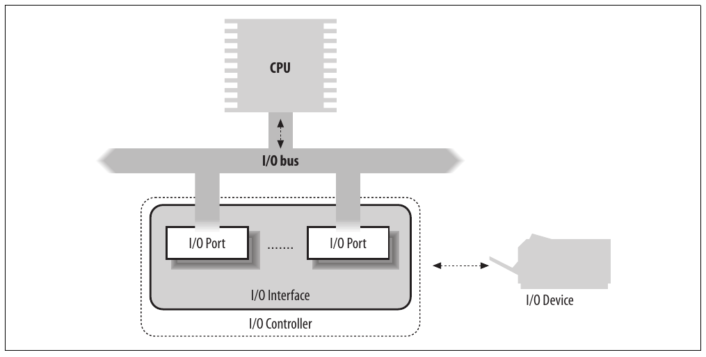
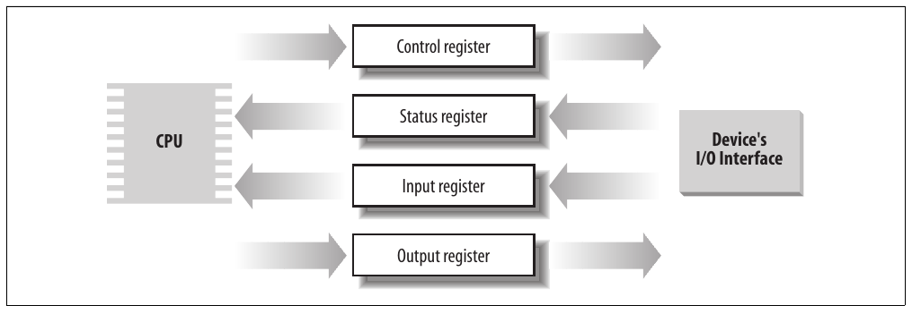
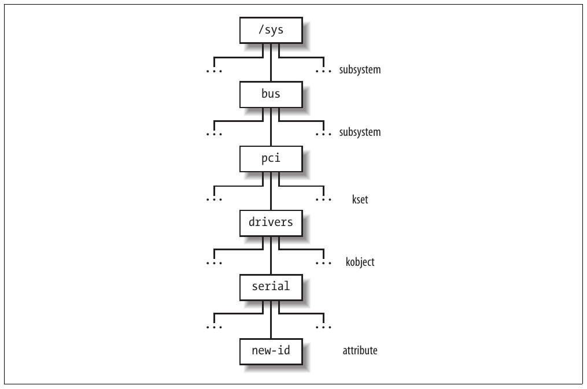

# Chương 13. I/O architecture và device driver


Virtual File System trong chương trước phụ thuộc lower-level function để thực hiện mỗi read, write hoặc operation khác theo cách phù hợp từng device. Chương trước đã bàn ngắn gọn cách filesystem khác nhau xử lý operation. Trong chương này, chúng ta xem cách kernel gọi operation trên device thực tế.

Trong phần “I/O Architecture”, chúng ta khảo sát ngắn gọn I/O architecture của 80×86. Trong phần “The Device Driver Model”, chúng ta giới thiệu device driver model của Linux. Tiếp theo, trong phần “Device Files”, chúng ta trình bày cách VFS gắn special file gọi là “device file” với mỗi hardware device khác nhau để application program có thể dùng mọi loại device theo cùng cách. Sau đó, trong phần “Device Drivers”, chúng ta giới thiệu một số đặc điểm chung của device driver. Cuối cùng, trong phần “Character Device Drivers”, chúng ta minh họa tổ chức tổng thể của character device driver trong Linux. Chúng ta để thảo luận block device driver sang các chương tiếp theo.

Độc giả quan tâm tự phát triển device driver có thể tham khảo Linux Device Drivers, Third Edition (O’Reilly) của Jonathan Corbet, Alessandro Rubini và Greg Kroah-Hartman.

## I/O architecture

Để máy tính hoạt động đúng, phải có data path cho phép thông tin lưu chuyển giữa CPU, RAM và hàng loạt I/O device có thể kết nối với personal computer. Các data path này, gọi là bus, đóng vai trò kênh giao tiếp chính bên trong máy tính.

Mọi máy tính có system bus kết nối phần lớn hardware device bên trong. System bus điển hình là bus PCI (Peripheral Component Interconnect). Nhiều loại bus khác như ISA, EISA, MCA, SCSI và USB hiện đang được dùng. Thông thường, cùng máy tính chứa nhiều bus khác loại, được nối bằng hardware device gọi là bridge. Hai high-speed bus dành riêng cho truyền dữ liệu đến và từ memory chip: frontside bus kết nối CPU với RAM controller, còn backside bus kết nối CPU trực tiếp với external hardware cache. Host bridge nối system bus với frontside bus.

Mỗi I/O device nằm trên một và chỉ một bus. Loại bus ảnh hưởng thiết kế bên trong I/O device cũng như cách kernel phải xử lý device. Trong phần này, chúng ta bàn đặc điểm chức năng chung cho mọi kiến trúc PC, không đi vào chi tiết loại bus cụ thể.

Data path kết nối CPU với I/O device được gọi chung là I/O bus. Microprocessor 80×86 dùng 16 address pin để truy cập I/O device và 8, 16 hoặc 32 data pin để truyền dữ liệu. Đến lượt I/O bus được kết nối với mỗi I/O device qua hierarchy hardware component gồm tối đa ba phần tử: I/O port, interface và device controller. Hình 13-1 trình bày component của I/O architecture.



Hình 13-1. I/O architecture của PC

### I/O port

Mỗi device kết nối với I/O bus có tập I/O address riêng, thường gọi là I/O port. Trong kiến trúc IBM PC, I/O address space cung cấp tối đa 65.536 I/O port 8-bit. Hai port 8-bit liên tiếp có thể được xem là một port 16-bit, phải bắt đầu tại địa chỉ chẵn. Tương tự, hai port 16-bit liên tiếp có thể được xem là một port 32-bit, phải bắt đầu tại địa chỉ là bội số của 4. Bốn assembly language instruction đặc biệt gọi là `in`, `ins`, `out`, và `outs` cho phép CPU đọc và ghi I/O port. Khi thực thi một trong các instruction này, CPU chọn I/O port được yêu cầu và truyền dữ liệu giữa CPU register và port.

I/O port cũng có thể được map vào địa chỉ của physical address space. Khi đó processor có thể giao tiếp với I/O device bằng cách thực hiện assembly language instruction thao tác trực tiếp trên memory (ví dụ `mov`, `and`, `or`, v.v.). Hardware device hiện đại phù hợp mapped I/O hơn vì nhanh hơn và có thể kết hợp DMA.

Mục tiêu quan trọng của người thiết kế hệ thống là cung cấp cách tiếp cận thống nhất cho I/O programming mà không hy sinh hiệu năng. Để làm vậy, I/O port của mỗi device được tổ chức thành tập specialized register, như Hình 13-2. CPU ghi command cần gửi đến device vào device control register và đọc giá trị biểu diễn internal state của device từ device status register. CPU còn lấy dữ liệu từ device bằng cách đọc byte từ device input register và đẩy dữ liệu đến device bằng cách ghi byte vào device output register.



Hình 13-2. Specialized I/O port

Để giảm chi phí, cùng I/O port thường được dùng cho nhiều mục đích. Ví dụ, một số bit mô tả device state, còn các bit khác chỉ định command cần gửi đến device. Tương tự, cùng I/O port có thể được dùng làm input register hoặc output register.

#### Truy cập I/O port

Các assembly language instruction `in`, `out`, `ins`, và `outs` truy cập I/O port. Kernel chứa các auxiliary function sau để đơn giản hóa truy cập này:

`inb()`, `inw()`, `inl()`

Lần lượt đọc 1, 2 hoặc 4 byte liên tiếp từ I/O port. Hậu tố “b”, “w” hoặc “l” lần lượt chỉ byte (8 bit), word (16 bit) và long (32 bit).

`inb_p()`, `inw_p()`, `inl_p()`

Lần lượt đọc 1, 2 hoặc 4 byte liên tiếp từ I/O port, rồi thực thi instruction “dummy” để tạo khoảng tạm dừng.

`outb()`, `outw()`, `outl()`

Lần lượt ghi 1, 2 hoặc 4 byte liên tiếp vào I/O port.

`outb_p()`, `outw_p()`, `outl_p()`

Lần lượt ghi 1, 2 và 4 byte liên tiếp vào I/O port, rồi thực thi instruction “dummy” để tạo khoảng tạm dừng.

`insb()`, `insw()`, `insl()`

Đọc chuỗi byte liên tiếp theo nhóm lần lượt 1, 2 hoặc 4 byte từ I/O port. Độ dài chuỗi được chỉ định làm parameter của function.

`outsb()`, `outsw()`, `outsl()`

Ghi chuỗi byte liên tiếp theo nhóm lần lượt 1, 2 hoặc 4 byte vào I/O port.

Dù truy cập I/O port đơn giản, phát hiện I/O port nào đã được gán cho I/O device có thể không dễ, đặc biệt với hệ thống dựa trên ISA bus. Device driver thường phải ghi mò vào I/O port để thăm dò hardware device; tuy nhiên, nếu I/O port này đã được hardware device khác dùng, có thể xảy ra system crash. Để tránh tình huống này, kernel theo dõi I/O port gán cho từng hardware device thông qua “resource”.

Resource biểu diễn một phần thực thể có thể được gán độc quyền cho device driver. Trong trường hợp này, resource biểu diễn dải I/O port address. Thông tin về mỗi resource lưu trong data structure `resource`, có các field trình bày trong Bảng 13-1. Mọi resource cùng loại được chèn vào data structure dạng tree; ví dụ mọi resource biểu diễn dải I/O port address nằm trong tree có root tại node `ioport_resource`.

Bảng 13-1. Các field của data structure resource

| Kiểu | Field | Mô tả |
|---|---|---|
| `const char *` | `name` | Mô tả owner của resource |
| `unsigned long` | `start` | Đầu dải resource |
| `unsigned long` | `end` | Cuối dải resource |
| `unsigned long` | `flags` | Các flag khác nhau |
| `struct resource *` | `parent` | Pointer đến parent trong resource tree |
| `struct resource *` | `sibling` | Pointer đến sibling trong resource tree |
| `struct resource *` | `child` | Pointer đến child đầu trong resource tree |

Các child của node được tập hợp trong list có phần tử đầu được field `child` trỏ đến. Field `sibling` trỏ đến node tiếp theo trong list.

Tại sao dùng tree? Ví dụ, xét I/O port address do IDE hard disk interface dùng—giả sử từ `0xf000` đến `0xf00f`. Resource có field `start` đặt thành `0xf000` và field `end` đặt thành `0xf00f` được đưa vào tree, và tên quy ước của controller được lưu trong field `name`. Tuy nhiên, IDE device driver cần ghi nhớ thông tin khác, cụ thể subrange từ `0xf000` đến `0xf007` dùng cho master disk của IDE chain, còn subrange từ `0xf008` đến `0xf00f` dùng cho slave disk. Để làm vậy, device driver chèn hai child dưới resource tương ứng toàn dải từ `0xf000` đến `0xf00f`, một child cho mỗi subrange I/O port. Theo quy tắc chung, mỗi node của tree phải tương ứng subrange của dải gắn với parent. Root của I/O port resource tree (`ioport_resource`) bao phủ toàn I/O address space (từ port number 0 đến 65535).

Mỗi device driver có thể dùng ba function sau, truyền root node của resource tree và địa chỉ resource data structure cần quan tâm:

`request_resource()`

Gán dải cho trước cho I/O device.

`allocate_resource()`

Tìm dải khả dụng có kích thước và alignment cho trước trong resource tree; nếu có, gán dải cho I/O device (chủ yếu do driver của PCI device dùng, vì có thể cấu hình chúng dùng port number và on-board memory address tùy ý).

`release_resource()`

Giải phóng dải cho trước đã gán cho I/O device.

Kernel còn định nghĩa một số cách gọi tắt các function trên áp dụng cho I/O port: `request_region()` gán khoảng I/O port cho trước và `release_region()` giải phóng khoảng I/O port đã gán. Có thể lấy tree của mọi I/O address hiện gán cho I/O device từ file /proc/ioports.

### I/O interface

I/O interface là hardware circuit chèn giữa nhóm I/O port và device controller tương ứng. Nó đóng vai trò phiên dịch chuyển giá trị trong I/O port thành command và dữ liệu cho device. Theo chiều ngược lại, nó phát hiện thay đổi device state và cập nhật tương ứng I/O port đóng vai trò status register. Circuit này còn có thể được nối qua IRQ line với Programmable Interrupt Controller để phát interrupt request thay mặt device.

Có hai loại interface:

Custom I/O interface

Dành riêng cho hardware device cụ thể. Trong một số trường hợp, device controller nằm trên cùng card[^1] chứa I/O interface. Device gắn với custom I/O interface có thể là internal device (nằm trong vỏ PC) hoặc external device (nằm ngoài vỏ PC).

General-purpose I/O interface

Dùng để kết nối nhiều hardware device khác nhau. Device gắn với general-purpose I/O interface thường là external device.

#### Custom I/O interface

Để hình dung mức độ đa dạng của custom I/O interface—và do đó của device hiện lắp trong PC—chúng ta liệt kê một số loại thường gặp nhất:

Keyboard interface

Kết nối với keyboard controller chứa microprocessor chuyên dụng. Microprocessor này giải mã tổ hợp phím nhấn, tạo interrupt và đặt scan code tương ứng vào input register.

Graphic interface

Được đóng gói cùng controller tương ứng trong graphic card có frame buffer riêng, cũng như processor chuyên dụng và một phần code lưu trong Read-Only Memory chip (ROM). Frame buffer là on-board memory chứa mô tả nội dung màn hình hiện tại.

Disk interface

Kết nối bằng cable với disk controller, thường tích hợp với disk. Ví dụ, IDE interface được kết nối bằng flat conductor cable 40-wire với intelligent disk controller nằm ngay trên disk.

Bus mouse interface

Kết nối bằng cable với controller tương ứng nằm trong mouse.

Network interface

Được đóng gói cùng controller tương ứng trong network card dùng nhận hoặc truyền network packet. Dù có nhiều network standard được áp dụng rộng rãi, Ethernet (IEEE 802.3) phổ biến nhất.

##### General-purpose I/O interface

PC hiện đại có nhiều general-purpose I/O interface kết nối nhiều loại external device. Interface phổ biến nhất là:

Parallel port

Truyền thống dùng để kết nối printer, còn có thể dùng kết nối removable disk, scanner, backup unit và máy tính khác. Dữ liệu được truyền mỗi lần 1 byte (8 bit).

Serial port

Giống parallel port, nhưng dữ liệu truyền mỗi lần 1 bit. Nó chứa chip Universal Asynchronous Receiver and Transmitter (UART) để chuyển byte cần gửi thành chuỗi bit và ghép lại bit nhận thành byte. Vì vốn chậm hơn parallel port, interface này chủ yếu dùng kết nối external device không hoạt động tốc độ cao, như modem, mouse và printer.

PCMCIA interface

Chủ yếu có trên portable computer. External device có hình dạng thẻ tín dụng, có thể chèn vào và rút khỏi slot mà không reboot hệ thống. PCMCIA device phổ biến nhất là hard disk, modem, network card và RAM expansion.

SCSI (Small Computer System Interface) interface

Circuit kết nối main PC bus với secondary bus gọi là SCSI bus. SCSI-2 bus cho phép kết nối tối đa tám PC và external device—hard disk, scanner, CD-ROM writer, v.v. Wide SCSI-2 và SCSI-3 interface cho phép kết nối 16 device hoặc hơn nếu có interface bổ sung. SCSI standard là communication protocol dùng kết nối device qua SCSI bus.

Universal serial bus (USB)

general-purpose I/O interface hoạt động tốc độ cao và có thể dùng cho external device truyền thống kết nối với parallel port, serial port và SCSI interface.

### Device controller

Device phức tạp có thể cần device controller để điều khiển. Về cơ bản, controller đóng hai vai trò quan trọng:

- Diễn giải high-level command nhận từ I/O interface và buộc device thực hiện action cụ thể bằng cách gửi chuỗi electrical signal thích hợp.

- Chuyển đổi và diễn giải đúng electrical signal nhận từ device và sửa (qua I/O interface) giá trị status register.

Device controller điển hình là disk controller, nhận high-level command như “ghi block dữ liệu này” từ microprocessor (qua I/O interface) và chuyển thành low-level disk operation như “đặt disk head trên track đúng” và “ghi dữ liệu trong track”. Disk controller hiện đại rất tinh vi vì có thể giữ disk data trong on-board fast disk cache và sắp xếp lại high-level request của CPU tối ưu theo disk geometry thực tế.

Device đơn giản hơn không có device controller; ví dụ gồm Programmable Interrupt Controller (xem phần “Interrupts and Exceptions” trong Chương 4) và Programmable Interval Timer (xem phần “Programmable Interval Timer (PIT)” trong Chương 6).

Một số hardware device có memory riêng, thường gọi là I/O shared memory. Ví dụ, mọi graphic card gần đây chứa hàng chục megabyte RAM trong frame buffer, dùng lưu screen image cần hiển thị trên monitor. Chúng ta sẽ bàn I/O shared memory trong phần “Accessing the I/O Shared Memory” ở phần sau chương này.

## Device driver model

Phiên bản Linux kernel trước cung cấp ít chức năng cơ bản cho người phát triển device driver: cấp phát dynamic memory, dành riêng dải I/O address hoặc IRQ line, kích hoạt interrupt service routine đáp ứng interrupt của device. Thực tế, hardware device cũ cồng kềnh và khó lập trình, hai hardware device khác nhau có ít điểm chung ngay cả khi trên cùng bus. Vì vậy, cố cung cấp model thống nhất cho người phát triển device driver không có ích.

Giờ mọi thứ khác. Loại bus như PCI đặt yêu cầu cao cho thiết kế bên trong hardware device; kết quả là hardware device gần đây, ngay cả khác lớp, hỗ trợ chức năng tương tự. Driver cho những device này thường phải đảm nhiệm:

- Power management (xử lý mức điện áp khác nhau trên power line của device)

- Plug and play (cấp phát resource trong suốt khi cấu hình device)

- Hot-plugging (hỗ trợ chèn và tháo device trong khi hệ thống đang chạy)

Kernel thực hiện power management toàn cục trên mọi hardware device trong hệ thống. Ví dụ, khi máy tính battery-powered vào state “standby”, kernel phải buộc mọi hardware device (hard disk, graphics card, sound card, network card, bus controller, v.v.) vào low-power state. Vì vậy, mỗi driver của device có thể đưa vào state “standby” phải có callback function đưa hardware device vào low-power state. Hơn nữa, hardware device phải được đưa vào state “standby” theo thứ tự chính xác, nếu không một số device có thể ở power state sai. Ví dụ, kernel phải đưa hard disk vào “standby” trước rồi đến disk controller, vì thứ tự ngược lại sẽ khiến không thể gửi command đến hard disk.

Để triển khai các loại operation này, Linux 2.6 cung cấp một số data structure và helper function cho góc nhìn thống nhất về mọi bus, device và device driver trong hệ thống; framework này gọi là device driver model.

### Filesystem sysfs

Filesystem sysfs là special filesystem giống /proc, thường mount trên directory /sys. Filesystem /proc là special filesystem đầu tiên được thiết kế cho phép User Mode application truy cập internal data structure của kernel. Filesystem /sysfs về cơ bản có cùng mục tiêu nhưng cung cấp thông tin bổ sung về kernel data structure; hơn nữa, /sysfs được tổ chức có cấu trúc hơn /proc. Có khả năng cả /proc lẫn /sysfs sẽ tiếp tục cùng tồn tại trong tương lai gần.

Mục tiêu của filesystem sysfs là phơi bày quan hệ phân cấp giữa component của device driver model. top-level directory liên quan của filesystem này là:

block

Block device, độc lập với bus mà chúng kết nối.

devices

Mọi hardware device được kernel nhận diện, tổ chức theo bus mà chúng kết nối.

bus

Bus trong hệ thống, chứa device.

drivers

Device driver đã đăng ký trong kernel.

class

Loại device trong hệ thống (audio card, network card, graphics card, v.v.); cùng class có thể gồm device trên bus khác nhau và do driver khác nhau điều khiển.

power

File để xử lý power state của một số hardware device.

firmware

File để xử lý firmware của một số hardware device.

Quan hệ giữa component của device driver model được biểu diễn trong filesystem sysfs bằng symbolic link giữa directory và file. Ví dụ, file /sys/block/sda/device có thể là symbolic link đến subdirectory lồng trong /sys/devices/pci0000:00 biểu diễn SCSI controller kết nối với PCI bus. Hơn nữa, file /sys/block/sda/device/block là symbolic link đến /sys/block/sda, nêu rằng PCI device này là controller của SCSI disk.

Vai trò chính của regular file trong filesystem sysfs là biểu diễn thuộc tính driver và device. Ví dụ, file dev trong directory /sys/block/hda chứa major number và minor number của master disk trong IDE chain đầu tiên.

### Kobject

Data structure cốt lõi của device driver model là generic data structure tên kobject, vốn gắn với filesystem sysfs: mỗi kobject tương ứng directory trong filesystem đó.

Kobject được nhúng trong object lớn hơn—so-called “container”—mô tả component của device driver model.[^2] Descriptor của bus, device và driver là ví dụ container điển hình; ví dụ, descriptor của partition đầu trong IDE disk đầu tương ứng directory /sys/block/hda/hda1.

Nhúng kobject trong container cho phép kernel:

- Giữ reference counter cho container

- Duy trì hierarchical list hoặc set container (ví dụ sysfs directory gắn với block device chứa subdirectory khác nhau cho mỗi disk partition)

- Cung cấp góc nhìn User Mode cho thuộc tính container

#### Kobject, kset và subsystem

Kobject được biểu diễn bằng data structure `kobject`, có các field liệt kê trong Bảng 13-2.

Bảng 13-2. Các field của data structure kobject

| Kiểu | Field | Mô tả |
|---|---|---|
| `char *` | `k_name` | Pointer đến string chứa tên container |
| `char []` | `name` | String chứa tên container nếu vừa trong 20 byte |
| `struct k_ref` | `kref` | Reference counter cho container |
| `struct list_head` | `entry` | Pointer cho list mà kobject được chèn vào |
| `struct kobject *` | `parent` | Pointer đến parent kobject nếu có |
| `struct kset *` | `kset` | Pointer đến kset chứa nó |
| `struct kobj_type *` | `ktype` | Pointer đến kobject type descriptor |
| `struct dentry *` | `dentry` | Pointer đến dentry của sysfs file gắn với kobject |

Field `ktype` trỏ đến object `kobj_type` biểu diễn “type” của kobject—về cơ bản là loại container chứa kobject. Data structure `kobj_type` có ba field: method `release` (thực thi khi kobject đang được giải phóng), pointer `sysfs_ops` đến table sysfs operation, và list default attribute cho filesystem sysfs.

Field `kref` là structure kiểu `k_ref` gồm một field `refcount`. Như tên gọi, field này là reference counter cho kobject, nhưng cũng có thể đóng vai trò reference counter cho container của kobject. Các function `kobject_get()` và `kobject_put()` lần lượt tăng và giảm reference counter; nếu counter đạt không, resource do kobject dùng được giải phóng và method `release` của object `kobj_type` của kobject được thực thi. Method này, thường chỉ được định nghĩa nếu container của kobject được cấp phát động, giải phóng chính container.

Kobject có thể được tổ chức thành hierarchical tree qua kset. Kset là tập kobject cùng loại—tức nằm trong cùng loại container. Các field của data structure `kset` được liệt kê trong Bảng 13-3.

Bảng 13-3. Các field của data structure kset

| Kiểu | Field | Mô tả |
|---|---|---|
| `struct subsystem *` | `subsys` | Pointer đến subsystem descriptor |
| `struct kobj_type *` | `ktype` | Pointer đến kobject type descriptor của kset |
| `struct list_head` | `list` | Đầu list kobject trong kset |
| `struct kobject` | `kobj` | Kobject nhúng (xem nội dung) |
| `struct kset_hotplug_ops *` | `hotplug_ops` | Pointer đến table callback function cho kobject filtering và hot-plugging |

Field `list` là đầu doubly linked circular list kobject trong kset; field `ktype` trỏ đến cùng descriptor `kobj_type` mà mọi kobject trong kset chia sẻ.

Field `kobj` là kobject nhúng trong data structure `kset`; field `parent` của kobject chứa trong kset trỏ đến kobject nhúng này. Do đó, kset là tập kobject nhưng dựa vào kobject cấp cao hơn để reference counting và liên kết trong hierarchical tree. Lựa chọn thiết kế này code-efficient và cho độ linh hoạt lớn nhất. Ví dụ, các function `kset_get()` và `kset_put()`, lần lượt tăng và giảm reference counter của kset, chỉ gọi `kobject_get()` và `kobject_put()` trên kobject nhúng; vì reference counter của kset chỉ là reference counter của kobject `kobj` nhúng trong kset. Hơn nữa, nhờ kobject nhúng, data structure `kset` có thể được nhúng trong object “container”, giống hệt data structure `kobject`. Cuối cùng, kset có thể thành thành viên của kset khác: chỉ cần chèn kobject nhúng vào kset higher-level.

Cũng tồn tại tập kset gọi là subsystem. Subsystem có thể chứa kset khác loại, và được biểu diễn bằng data structure `subsystem` chỉ có hai field:

`kset`

Kset nhúng lưu các kset trong subsystem `rwsem` read-write semaphore bảo vệ mọi kset và kobject được chứa đệ quy trong subsystem

Ngay cả data structure `subsystem` cũng có thể nhúng trong object “container” lớn hơn; do đó reference counter của container là reference counter của subsystem nhúng—tức reference counter của kobject nhúng trong kset nhúng trong subsystem. Các function `subsys_get()` và `subsys_put()` lần lượt tăng và giảm reference counter này.

Hình 13-3 minh họa ví dụ hierarchy của device driver model. Subsystem bus chứa subsystem pci, đến lượt pci chứa kset drivers. Kset này chứa kobject serial—tương ứng device driver cho serial port—có một attribute new-id.



Hình 13-3. Ví dụ hierarchy của device driver model

##### Đăng ký kobject, kset và subsystem

Theo quy tắc chung, nếu muốn kobject, kset hoặc subsystem xuất hiện trong sysfs subtree, trước tiên phải đăng ký nó. Directory gắn với kobject luôn xuất hiện trong directory của parent kobject. Ví dụ, directory của kobject trong cùng kset xuất hiện trong directory của chính kset. Do đó, cấu trúc sysfs subtree biểu diễn quan hệ phân cấp giữa các kobject đã đăng ký và, từ đó, giữa các container object.

Thông thường, top-level directory của filesystem sysfs gắn với subsystem đã đăng ký.

Function `kobject_register()` khởi tạo kobject và thêm directory tương ứng vào filesystem sysfs. Trước khi gọi, bên gọi nên đặt field `kset` trong kobject trỏ đến parent kset nếu có. Function `kobject_unregister()` loại directory của kobject khỏi filesystem sysfs. Để thuận tiện cho người phát triển kernel, Linux còn cung cấp các function `kset_register()` và `kset_unregister()`, cùng `subsystem_register()` và `subsystem_unregister()`, nhưng về cơ bản chúng là wrapper function quanh `kobject_register()` và `kobject_unregister()`.

Như đã nêu, nhiều kobject directory chứa regular file gọi là attribute. Function `sysfs_create_file()` nhận parameter là địa chỉ kobject và attribute descriptor, và tạo special file trong directory thích hợp. Quan hệ khác giữa object biểu diễn trong filesystem sysfs được thiết lập bằng symbolic link: function `sysfs_create_link()` tạo symbolic link cho kobject cho trước trong directory gắn với kobject khác.

### Component của device driver model

Device driver model được xây dựng trên một số data structure cơ bản biểu diễn bus, device, device driver, v.v. Hãy xem xét chúng.

#### Device

Mỗi device trong device driver model được biểu diễn bằng object `device`, có các field trong Bảng 13-4.

Bảng 13-4. Các field của object device

| Kiểu | Field | Mô tả |
|---|---|---|
| `struct list_head` | `node` | Pointer cho list sibling device |
| `struct list_head` | `bus_list` | Pointer cho list device trên cùng loại bus |
| `struct list_head` | `driver_list` | Pointer cho list device của driver |
| `struct list_head` | `children` | Đầu list child device |
| `struct device *` | `parent` | Pointer đến parent device |
| `struct kobject` | `kobj` | Kobject nhúng |
| `char []` | `bus_id` | Vị trí device trên bus chứa nó |
| `struct bus_type *` | `bus` | Pointer đến bus chứa device |
| `struct device_driver *` | `driver` | Pointer đến device driver điều khiển |
| `void *` | `driver_data` | Pointer đến private data cho driver |
| `void *` | `platform_data` | Pointer đến private data cho legacy device driver |
| `struct dev_pm_info` | `power` | Thông tin power management |
| `unsigned long` | `detach_state` | Power state cần vào khi unload device driver |
| `unsigned long long *` | `dma_mask` | Pointer đến DMA mask của device (xem phần “Direct Memory Access (DMA)” phía sau) |
| `unsigned long long` | `coherent_dma_mask` | Mask cho coherent DMA của device |
| `struct list_head` | `dma_pools` | Đầu list aggregate DMA buffer |
| `struct dma_coherent_mem *` | `dma_mem` | Pointer đến descriptor của coherent DMA memory do device dùng (xem phần “Direct Memory Access (DMA)” phía sau) |
| `void (*)(struct device *)` | `release` | Callback function để giải phóng device descriptor |

Các object `device` được tập hợp toàn cục trong subsystem `devices_subsys`, gắn với directory /sys/devices (xem phần “Kobjects” trước đó). Device được tổ chức phân cấp: device là “parent” của một số “child” device nếu child device không thể hoạt động đúng thiếu parent device. Ví dụ, trong máy tính PCI-based, bridge giữa PCI bus và USB bus là parent device của mọi device trên USB bus. Field `parent` của object `device` trỏ đến descriptor của parent device, field `children` là đầu list child device, và field `node` lưu pointer đến phần tử liền kề trong children list. Quan hệ parent giữa kobject nhúng trong object `device` cũng phản ánh device hierarchy; do đó cấu trúc directory dưới /sys/devices khớp tổ chức vật lý hardware device.

Mỗi driver giữ list object `device` chứa mọi device được quản lý; field `driver_list` của object `device` lưu pointer đến phần tử liền kề, còn field `driver` trỏ đến descriptor của device driver. Hơn nữa, với mỗi loại bus có list chứa mọi device trên bus thuộc loại đó; field `bus_list` của object `device` lưu pointer đến phần tử liền kề, còn field `bus` trỏ đến bus type descriptor.

Reference counter theo dõi việc dùng object `device`; nó nằm trong kobject `kobj` nhúng trong descriptor. Counter tăng khi gọi `get_device()` và giảm khi gọi `put_device()`.

Function `device_register()` chèn object `device` mới vào device driver model và tự động tạo directory mới cho nó dưới /sys/devices. Ngược lại, function `device_unregister()` loại device khỏi device driver model.

Thông thường, object `device` được nhúng tĩnh trong descriptor lớn hơn. Ví dụ, PCI device được mô tả bằng data structure `pci_dev`; field `dev` của structure là object `device`, còn các field khác riêng cho PCI bus. Các function `device_register()` và `device_unregister()` được thực thi khi device được đăng ký hoặc de-registered trong PCI kernel layer.

##### Driver

Mỗi driver trong device driver model được mô tả bằng object `device_driver`, có các field liệt kê trong Bảng 13-5.

Bảng 13-5. Các field của object device\_driver

| Kiểu | Field | Mô tả |
|---|---|---|
| `char *` | `name` | Tên device driver |
| `struct bus_type *` | `bus` | Pointer đến descriptor của bus chứa device được hỗ trợ |
| `struct semaphore` | `unload_sem` | Semaphore cấm unload device driver; được nhả khi reference counter đạt không |
| `struct kobject` | `kobj` | Kobject nhúng |
| `struct list_head` | `devices` | Đầu list chứa mọi device được driver hỗ trợ |
| `struct module *` | `owner` | Xác định module triển khai device driver nếu có (xem Phụ lục B) |
| `int (*)(struct device *)` | `probe` | Method thăm dò device (kiểm tra device driver có thể xử lý nó) |
| `int (*)(struct device *)` | `remove` | Method gọi trên device khi tháo nó |
| `void (*)(struct device *)` | `shutdown` | Method gọi trên device khi tắt nguồn (shutdown) |
| `int (*)(struct device *, unsigned long, unsigned long)` | `suspend` | Method gọi trên device khi đưa vào low-power state |
| `int (*)(struct device *, unsigned long)` | `resume` | Method gọi trên device khi đưa trở lại normal state (full power) |

Object `device_driver` có bốn method xử lý hot-plugging, plug and play và power management. Method `probe` được gọi mỗi khi bus device driver phát hiện device mà driver có thể xử lý; function tương ứng nên thăm dò hardware để kiểm tra thêm device. Method `remove` được gọi trên hot-pluggable device mỗi khi tháo nó; còn được gọi trên mọi device do driver xử lý khi chính driver được unload. Các method `shutdown`, `suspend`, và `resume` được gọi trên device khi kernel phải đổi power state.

Reference counter trong kobject `kobj` nhúng trong descriptor theo dõi việc dùng object `device_driver`. Counter tăng khi gọi `get_driver()` và giảm khi gọi `put_driver()`.

Function `driver_register()` chèn object `device_driver` mới vào device driver model và tự động tạo directory mới cho nó trong filesystem sysfs. Ngược lại, function `driver_unregister()` loại driver khỏi device driver model.

Thông thường, object `device_driver` được nhúng tĩnh trong descriptor lớn hơn. Ví dụ, PCI device driver được mô tả bằng data structure `pci_driver`; field `driver` của structure là object `device_driver`, còn các field khác riêng cho PCI bus.

##### Bus

Mỗi loại bus được kernel hỗ trợ được mô tả bằng object `bus_type`, có các field liệt kê trong Bảng 13-6.

Bảng 13-6. Các field của object bus\_type

| Kiểu | Field | Mô tả |
|---|---|---|
| `char *` | `name` | Tên loại bus |
| `struct subsystem` | `subsys` | Kobject subsystem gắn với loại bus này |
| `struct kset` | `drivers` | Tập kobject của driver |
| `struct kset` | `devices` | Tập kobject của device |
| `struct bus_attribute *` | `bus_attrs` | Pointer đến object chứa bus attribute và method export chúng sang filesystem sysfs |
| `struct device_attribute *` | `dev_attrs` | Pointer đến object chứa device attribute và method export chúng sang filesystem sysfs |
| `struct driver_attribute *` | `drv_attrs` | Pointer đến object chứa device driver attribute và method export chúng sang filesystem sysfs |
| `int (*)(struct device *, struct device_driver *)` | `match` | Method kiểm tra driver cho trước có hỗ trợ device cho trước không |
| `int (*)(struct device *, char **, int, char *, int)` | `hotplug` | Method gọi khi device đang được đăng ký |
| `int (*)(struct device *, unsigned long)` | `suspend` | Method lưu hardware context state và thay đổi power level của device |
| `int (*)(struct device *)` | `resume` | Method thay đổi power level và khôi phục hardware context của device |

Mỗi object `bus_type` chứa subsystem nhúng; subsystem lưu trong biến `bus_subsys` tập hợp mọi subsystem nhúng trong object `bus_type`. Subsystem `bus_subsys` gắn với directory /sys/bus; do đó, ví dụ, có directory /sys/bus/pci gắn với loại bus PCI. per-bus subsystem thường chỉ chứa hai kset tên drivers và devices (lần lượt tương ứng các field `drivers` và `devices` của object `bus_type`).

Kset `drivers` chứa descriptor `device_driver` của mọi device driver thuộc loại bus, còn kset `devices` chứa descriptor `device` của mọi device thuộc loại bus cho trước. Vì directory của kobject của device đã xuất hiện trong filesystem sysfs dưới /sys/devices, directory devices của per-bus subsystem lưu symbolic link trỏ đến directory dưới /sys/devices. Các function `bus_for_each_drv()` và `bus_for_each_dev()` lần lượt lặp qua phần tử của list driver và device.

Method `match` được thực thi khi kernel phải kiểm tra device cho trước có được driver cho trước xử lý không. Dù identifier của mỗi device có định dạng riêng cho bus chứa device, function triển khai method thường đơn giản vì tìm identifier của device trong table identifier được hỗ trợ của driver. Method `hotplug` được thực thi khi device đang được đăng ký trong device driver model; function triển khai nên thêm thông tin bus-specific để truyền làm environment variable cho User Mode program được thông báo về device mới khả dụng (xem phần “Device Driver Registration” phía sau). Cuối cùng, các method `suspend` và `resume` được thực thi khi device trên bus thuộc loại cho trước phải đổi power state.

##### Class

Mỗi class được mô tả bằng object `class`. Mọi class object thuộc subsystem `class_subsys` gắn với directory /sys/class. Hơn nữa, mỗi object `class` chứa subsystem nhúng; do đó, ví dụ có directory /sys/class/input gắn với input class của device driver model.

Mỗi class object chứa list descriptor `class_device`, mỗi descriptor biểu diễn một logical device thuộc class. Structure `class_device` có field `dev` trỏ đến descriptor `device`, nên logical device luôn tham chiếu device cho trước trong device driver model. Tuy nhiên, có thể có nhiều descriptor `class_device` tham chiếu cùng device. Thực tế, hardware device có thể chứa nhiều sub-devices khác nhau, mỗi sub-device cần User Mode interface khác. Ví dụ, sound card là hardware device thường chứa DSP, mixer, game port interface, v.v.; mỗi sub-device cần User Mode interface riêng nên gắn với directory riêng trong filesystem sysfs.

Device driver cùng class được kỳ vọng cung cấp cùng chức năng cho User Mode application; ví dụ mọi device driver của sound card nên cung cấp cách ghi sound sample đến DSP.

Class của device driver model về cơ bản nhằm cung cấp method chuẩn để export interface của logical device đến User Mode application. Mỗi descriptor `class_device` nhúng kobject có attribute (special file) tên dev. Attribute đó lưu major number và minor number của device file cần để truy cập logical device tương ứng (xem phần tiếp theo).

## Device file

Như đã đề cập trong Chương 1, hệ điều hành Unix-like dựa trên khái niệm file, chỉ là nơi chứa thông tin tổ chức thành chuỗi byte. Theo cách này, I/O device được xem là special file gọi là device file; do đó, cùng system call dùng tương tác với regular file trên disk có thể dùng tương tác trực tiếp với I/O device. Ví dụ, cùng system call `write()` có thể dùng ghi dữ liệu vào regular file hoặc gửi đến printer bằng cách ghi vào device file /dev/lp0.

Theo đặc điểm device driver bên dưới, device file có thể thuộc hai loại: block hoặc character. Khác biệt giữa hai lớp hardware device không hoàn toàn rõ ràng. Ít nhất chúng ta có thể giả định:

- Có thể truy cập ngẫu nhiên dữ liệu của block device, và thời gian cần truyền data block nhỏ, gần như bằng nhau, ít nhất theo góc nhìn người dùng. Ví dụ block device điển hình là hard disk, floppy disk, CD-ROM drive và DVD player.

- Dữ liệu của character device hoặc không thể truy cập ngẫu nhiên (ví dụ sound card), hoặc có thể truy cập ngẫu nhiên nhưng thời gian cần truy cập dữ liệu ngẫu nhiên phụ thuộc lớn vào vị trí bên trong device (ví dụ magnetic tape driver).

Network card là ngoại lệ đáng chú ý của mô hình này, vì là hardware device không trực tiếp gắn với device file.

Device file đã được dùng từ phiên bản Unix đầu. Device file thường là file thực lưu trong filesystem. Tuy nhiên, inode của nó không cần pointer đến block dữ liệu trên disk (dữ liệu của file) vì không có chúng. Thay vào đó, inode phải chứa identifier của hardware device tương ứng character hoặc block device file.

Truyền thống, identifier này gồm loại device file (character hoặc block) và cặp số. Số đầu, gọi là major number, xác định loại device. Truyền thống, mọi device file có cùng major number và cùng loại chia sẻ cùng tập file operation vì do cùng device driver xử lý. Số thứ hai, gọi là minor number, xác định device cụ thể trong nhóm device chia sẻ cùng major number. Ví dụ, nhóm disk do cùng disk controller quản lý có cùng major number và minor number khác nhau.

System call `mknod()` được dùng tạo device file. Nó nhận tên device file, loại, major number và minor number làm parameter. Device file thường nằm trong directory /dev. Bảng 13-7 minh họa thuộc tính một số device file. Lưu ý character và block device được đánh số độc lập, nên block device (3,0) khác character device (3,0).

Bảng 13-7. Ví dụ device file

| Tên | Loại | Major | Minor | Mô tả |
|---|---|---|---|---|
| /dev/fd0 | block | 2 | 0 | Floppy disk |
| /dev/hda | block | 3 | 0 | IDE disk đầu tiên |
| /dev/hda2 | block | 3 | 2 | Primary partition thứ hai của IDE disk đầu |
| /dev/hdb | block | 3 | 64 | IDE disk thứ hai |
| /dev/hdb3 | block | 3 | 67 | Primary partition thứ ba của IDE disk thứ hai |
| /dev/ttyp0 | char | 3 | 0 | Terminal |
| /dev/console | char | 5 | 1 | Console |
| /dev/lp1 | char | 6 | 1 | Parallel printer |
| /dev/ttyS0 | char | 4 | 64 | Serial port đầu tiên |
| /dev/rtc | char | 10 | 135 | Real-time clock |
| /dev/null | char | 1 | 3 | Null device (hố đen) |

Thông thường, device file gắn với hardware device (như hard disk—ví dụ /dev/hda) hoặc một phần vật lý hay logic của hardware device (như disk partition—ví dụ /dev/hda2). Tuy nhiên, trong một số trường hợp, device file không gắn với hardware device thực mà biểu diễn fictitious logical device. Ví dụ, /dev/null là device file tương ứng “hố đen”; mọi dữ liệu ghi vào chỉ bị loại bỏ và file luôn có vẻ rỗng.

Với kernel, tên device file không quan trọng. Nếu tạo device file tên /tmp/disk loại “block” với major number 3 và minor number 0, nó tương đương device file /dev/hda trong bảng. Mặt khác, device filename có thể có ý nghĩa với application program. Ví dụ, communication program có thể giả định serial port đầu gắn với device file /dev/ttyS0. Nhưng phần lớn application program có thể được cấu hình tương tác với device file có tên tùy ý.

### User Mode xử lý device file

Trong hệ thống Unix truyền thống (và phiên bản Linux trước), major number và minor number của device file dài 8 bit. Do đó có thể có tối đa 65.536 block device file và 65.536 character device file. Bạn có thể nghĩ đủ nhưng đáng tiếc không phải.

Vấn đề thực là device file truyền thống được cấp phát một lần và mãi mãi trong directory /dev; do đó, mỗi logical device trong hệ thống phải có device file liên quan với device number well-defined. Registry chính thức của device number đã cấp phát và node directory /dev lưu trong file Documentation/devices.txt; macro tương ứng major number của device còn có thể tìm trong file include/linux/major.h.

Đáng tiếc, số hardware device khác nhau hiện lớn đến mức gần như mọi device number đã được cấp phát. Registry device number chính thức hoạt động tốt cho hệ thống Linux trung bình, nhưng có thể không phù hợp hệ thống large-scale. Hơn nữa, hệ thống high-end có thể dùng hàng trăm hoặc hàng nghìn disk cùng loại, và minor number 8-bit không đủ. Ví dụ, registry dành device number cho 16 SCSI disk, mỗi disk có 15 partition; nếu hệ thống high-end có hơn 16 SCSI disk, phải thay cách gán major number và minor number chuẩn—nhiệm vụ không đơn giản đòi hỏi sửa kernel source code và khiến hệ thống khó bảo trì.

Để giải quyết vấn đề này, kích thước device number được tăng trong Linux 2.6: major number nay mã hóa trong 12 bit, còn minor number mã hóa trong 20 bit. Cả hai số thường được giữ trong một biến 32-bit kiểu `dev_t`; các macro `MAJOR` và `MINOR` lần lượt trích major number và minor number từ giá trị `dev_t`, còn macro `MKDEV` mã hóa hai device number vào giá trị `dev_t`. Để tương thích ngược, kernel xử lý đúng device file cũ mã hóa bằng device number 16-bit.

Device number khả dụng bổ sung không được cấp phát tĩnh trong registry chính thức, vì chỉ nên dùng khi nhu cầu device number bất thường. Thực tế, cách ưu tiên xử lý device file ngày nay rất động, cả gán device number lẫn tạo device file.

#### Gán device number động

Mỗi device driver chỉ định trong giai đoạn đăng ký dải device number nó sẽ xử lý (xem phần “Device Driver Registration” phía sau). Tuy nhiên, driver có thể yêu cầu cấp phát khoảng device number mà không chỉ định giá trị chính xác: trong trường hợp này, kernel cấp phát dải số phù hợp và gán cho driver.

Do đó, device driver cho hardware device mới không còn cần gán số trong registry device number chính thức; chúng chỉ dùng số hiện khả dụng trong hệ thống.

Tuy nhiên, trong trường hợp này, không thể tạo device file một lần và mãi mãi; phải tạo ngay sau device driver initialization với major number và minor number thích hợp. Do đó, phải có cách chuẩn để export device number mỗi driver dùng đến User Mode application. Như đã thấy trong phần “Components of the Device Driver Model” trước đó, device driver model cung cấp giải pháp thanh nhã: major number và minor number được lưu trong attribute dev trong subdirectory của /sys/class.

##### Tạo device file động

Linux kernel có thể tạo device file động: không cần điền directory /dev bằng device file của mọi hardware device có thể hình dung, vì device file có thể được tạo “theo nhu cầu”. Nhờ device driver model, kernel 2.6 cung cấp cách rất đơn giản. Phải cài tập User Mode program, gọi chung là udev toolset, trong hệ thống. Khi system startup, directory /dev được làm rỗng, rồi udev program quét subdirectory /sys/class để tìm file dev. Với mỗi file như vậy, biểu diễn kết hợp major number và minor number cho logical device được kernel hỗ trợ, chương trình tạo device file tương ứng trong /dev. Nó còn gán device filename và tạo symbolic link theo configuration file sao cho giống naming scheme truyền thống của Unix device file. Cuối cùng, /dev chỉ chứa device file của mọi device được kernel hỗ trợ trên hệ thống này.

Device file thường được tạo sau system initialization. Điều này xảy ra khi load module chứa device driver cho device chưa được hỗ trợ, hoặc khi hot-pluggable device—như USB peripheral—được cắm vào hệ thống. Udev toolset có thể tự động tạo device file tương ứng vì device driver model hỗ trợ device hotplugging. Mỗi khi phát hiện device mới, kernel tạo process mới thực thi User Mode shell script /sbin/hotplug,[^3] truyền mọi thông tin hữu ích về device phát hiện được làm environment variable. User Mode script thường đọc configuration file và đảm nhiệm mọi operation cần để hoàn tất initialization device mới. Nếu có udev, script còn tạo device file thích hợp trong directory /dev.

### VFS xử lý device file

Device file nằm trong system directory tree nhưng vốn khác regular file và directory. Khi process truy cập regular file, nó truy cập một số data block trong disk partition qua filesystem; khi process truy cập device file, nó chỉ điều khiển hardware device. Ví dụ, process có thể truy cập device file để đọc nhiệt độ phòng từ digital thermometer kết nối máy tính. VFS chịu trách nhiệm che khác biệt giữa device file và regular file khỏi application program.

Để làm vậy, VFS thay default file operation của device file khi mở; kết quả là mỗi system call trên device file được chuyển thành lời gọi device-related function thay vì function tương ứng của filesystem chứa nó. device-related function thao tác hardware device để thực hiện operation process yêu cầu.<sup>†</sup>

Giả sử process thực thi system call `open()` trên device file (loại block hoặc character). Operation do system call thực hiện đã được mô tả trong phần “The open() System Call” ở Chương 12. Về cơ bản, service routine tương ứng phân giải pathname đến device file và thiết lập inode object, dentry object, file object tương ứng.

Inode object được khởi tạo bằng cách đọc inode tương ứng trên disk qua function filesystem phù hợp (thường `ext2_read_inode()` hoặc `ext3_read_inode()`; xem Chương 18). Khi function xác định disk inode liên quan device file, nó gọi `init_special_inode()`, khởi tạo field `i_rdev` của inode object bằng major number và minor number của device file, và đặt field `i_fop` của inode object thành địa chỉ file operation table `def_blk_fops` hoặc `def_chr_fops`, tùy loại device file. Service routine của system call `open()` còn gọi function `dentry_open()`, cấp phát file object mới và đặt field `f_op` thành địa chỉ lưu trong `i_fop`—tức một lần nữa là địa chỉ `def_blk_fops` hoặc `def_chr_fops`. Nhờ hai table này, mọi system call trên device file sẽ kích hoạt function của device driver thay function filesystem bên dưới.

## Device driver

Device driver là tập kernel routine khiến hardware device đáp ứng programming interface do tập VFS function chuẩn (`open`, `read`, `lseek`, `ioctl`, v.v.) điều khiển device định nghĩa. Việc triển khai thực tế mọi function này được giao cho device driver. Vì mỗi device có I/O controller khác nhau, nên command và state information khác nhau, phần lớn I/O device có driver riêng.

Có nhiều loại device driver. Chúng chủ yếu khác mức hỗ trợ cung cấp cho User Mode application, cũng như buffering strategy cho dữ liệu thu từ hardware device. Vì lựa chọn này ảnh hưởng lớn đến cấu trúc bên trong device driver, chúng ta bàn trong các phần “Direct Memory Access (DMA)” và “Buffering Strategies for Character Devices”.

Device driver không chỉ gồm function triển khai device file operation. Trước khi dùng device driver, một số hoạt động phải diễn ra. Chúng ta sẽ xem xét trong các phần sau.

### Đăng ký device driver

Chúng ta biết mỗi system call trên device file được kernel chuyển thành lời gọi function phù hợp của device driver tương ứng. Để đạt điều này, device driver phải tự đăng ký. Nói cách khác, đăng ký device driver nghĩa là cấp phát descriptor `device_driver` mới, chèn vào data structure của device driver model (xem phần “Components of the Device Driver Model” trước đó), và liên kết với device file tương ứng. Truy cập device file có driver tương ứng chưa được đăng ký trả về error code `-ENODEV`.

Nếu device driver được compile tĩnh trong kernel, việc đăng ký được thực hiện trong kernel initialization. Ngược lại, nếu device driver được compile làm kernel module (xem Phụ lục B), đăng ký được thực hiện khi load module. Trong trường hợp sau, device driver còn có thể tự hủy đăng ký khi unload module.

Ví dụ, xét generic PCI device. Để xử lý đúng, device driver phải cấp phát descriptor kiểu `pci_driver`, được PCI kernel layer dùng xử lý device. Sau khi khởi tạo một số field của descriptor, device driver gọi function `pci_register_driver()`. Thực tế, descriptor `pci_driver` chứa descriptor `device_driver` nhúng (xem phần “Components of the Device Driver Model” trước đó); `pci_register_function()` chỉ khởi tạo field của driver descriptor nhúng và gọi `driver_register()` để chèn driver vào data structure của device driver model.

Khi device driver đang được đăng ký, kernel tìm hardware device chưa được hỗ trợ mà driver có thể xử lý. Để làm vậy, nó dựa vào method `match` của bus type descriptor `bus_type` liên quan và method `probe` của object `device_driver`. Nếu phát hiện hardware device driver có thể xử lý, kernel cấp phát object `device` và gọi `device_register()` để chèn device vào device driver model.

### Khởi tạo device driver

Đăng ký và khởi tạo device driver là hai việc khác nhau. Device driver được đăng ký sớm nhất có thể để User Mode application dùng qua device file tương ứng. Ngược lại, device driver được khởi tạo ở thời điểm muộn nhất có thể. Thực tế, khởi tạo driver nghĩa là cấp phát resource hệ thống quý giá, do đó không còn khả dụng cho driver khác.

Chúng ta đã thấy ví dụ trong phần “I/O Interrupt Handling” ở Chương 4: việc gán IRQ cho device thường làm động, ngay trước khi dùng, vì nhiều device có thể chia sẻ cùng IRQ line. Resource khác có thể cấp phát ở thời điểm muộn nhất là page frame cho DMA transfer buffer và chính DMA channel (cho non-PCI device cũ như floppy disk driver).

Để đảm bảo lấy resource khi cần nhưng không yêu cầu thừa khi đã được cấp, device driver thường dùng mô hình sau:

- Usage counter theo dõi số process hiện truy cập device file. Counter tăng trong method `open` của device file và giảm trong method `release`.[^4]

- Method `open` kiểm tra giá trị usage counter trước khi tăng. Nếu counter không, device driver phải cấp phát resource và enable interrupt cùng DMA trên hardware device.

- Method `release` kiểm tra giá trị usage counter sau khi giảm. Nếu counter không, không còn process dùng hardware device. Khi đó, method disable interrupt và DMA trên I/O controller rồi giải phóng resource đã cấp phát.

### Giám sát I/O operation

Thời lượng I/O operation thường không thể đoán trước. Nó có thể phụ thuộc yếu tố cơ học (vị trí hiện tại của disk head so với block cần truyền), sự kiện thực sự ngẫu nhiên (khi data packet đến network card), hoặc yếu tố con người (khi user nhấn phím hoặc nhận ra printer bị kẹt giấy). Trong mọi trường hợp, device driver bắt đầu I/O operation phải dựa vào kỹ thuật giám sát báo I/O operation kết thúc hoặc time-out.

Khi operation kết thúc, device driver đọc status register của I/O interface để xác định I/O operation thành công không. Khi time-out, driver biết có vấn đề vì khoảng thời gian tối đa cho phép hoàn tất operation đã trôi qua mà không có gì xảy ra.

Hai kỹ thuật giám sát kết thúc I/O operation gọi là polling mode và interrupt mode.

#### Polling mode

Theo kỹ thuật này, CPU kiểm tra (poll) status register của device lặp lại đến khi giá trị báo I/O operation hoàn tất. Chúng ta đã gặp kỹ thuật dựa trên polling trong phần “Spin Locks” ở Chương 5: khi processor cố lấy spin lock đang bận, nó poll biến lặp lại đến khi giá trị thành 0. Tuy nhiên, polling áp dụng cho I/O operation thường phức tạp hơn vì driver còn phải nhớ kiểm tra time-out có thể xảy ra. Ví dụ polling đơn giản như sau:

```c
for (;;) {
    if (read_status(device) & DEVICE_END_OPERATION) break;
    if (--count == 0) break;
}
```

Biến `count`, khởi tạo trước khi vào vòng lặp, giảm mỗi lượt lặp và do đó có thể dùng triển khai cơ chế time-out thô. Hoặc có thể triển khai cơ chế time-out chính xác hơn bằng cách đọc giá trị tick counter `jiffies` mỗi lượt (xem phần “Updating the Time and Date” trong Chương 6) và so với giá trị cũ đọc trước khi bắt đầu wait loop.

Nếu thời gian cần hoàn tất I/O operation tương đối cao, chẳng hạn cỡ millisecond, mô hình này kém hiệu quả vì CPU lãng phí machine cycle quý giá khi đợi I/O operation hoàn tất. Trong trường hợp này, nên tự nguyện nhường CPU sau mỗi polling operation bằng cách chèn lời gọi function `schedule()` vào vòng lặp.

##### Interrupt mode

Chỉ có thể dùng interrupt mode nếu I/O controller có khả năng báo qua IRQ line việc I/O operation kết thúc.

Chúng ta sẽ trình bày cách interrupt mode hoạt động trong trường hợp đơn giản. Giả sử muốn triển khai driver cho input character device đơn giản. Khi user thực hiện system call `read()` trên device file tương ứng, input command được gửi đến control register của device. Sau khoảng thời gian dài không đoán trước, device đặt một byte dữ liệu vào input register. Sau đó device driver trả byte này làm kết quả system call `read()`.

Đây là trường hợp điển hình nên triển khai driver bằng interrupt mode. Về cơ bản, driver chứa hai function:

1\. Function `foo_read()` triển khai method `read` của file object.

2\. Function `foo_interrupt()` xử lý interrupt.

Function `foo_read()` được kích hoạt mỗi khi user đọc device file:

```c
ssize_t foo_read(struct file *filp, char *buf, size_t count,
                 loff_t *ppos)
{
    foo_dev_t * foo_dev = filp->private_data;
    if (down_interruptible(&foo_dev->sem)
        return -ERESTARTSYS;
    foo_dev->intr = 0;
    outb(DEV_FOO_READ, DEV_FOO_CONTROL_PORT);
    wait_event_interruptible(foo_dev->wait, (foo_dev->intr= =1));
    if (put_user(foo_dev->data, buf))
        return -EFAULT;
    up(&foo_dev->sem);
    return 1;
}
```

Device driver dựa vào custom descriptor kiểu `foo_dev_t`; chứa semaphore `sem` bảo vệ hardware device khỏi truy cập đồng thời, wait queue `wait`, flag `intr` được set khi device phát interrupt, và single-byte buffer `data` được interrupt handler ghi và method `read` đọc. Nói chung, mọi I/O driver dùng interrupt dựa vào data structure được cả interrupt handler lẫn method `read` và `write` truy cập. Địa chỉ descriptor `foo_dev_t` thường lưu trong field `private_data` của file object của device file hoặc global variable.

Các operation chính của function `foo_read()` như sau:

1\. Lấy semaphore `foo_dev->sem`, qua đó đảm bảo không process khác đang truy cập device.

2\. Clear flag `intr`.

3\. Gửi read command đến I/O device.

4\. Thực thi `wait_event_interruptible` để tạm dừng process đến khi flag `intr` thành 1. Macro này được mô tả trong phần “Wait queues” ở Chương 3.

Sau một thời gian, device phát interrupt để báo I/O operation hoàn tất và dữ liệu sẵn sàng trong data port `DEV_FOO_DATA_PORT` thích hợp. Interrupt handler set flag `intr` và đánh thức process. Khi scheduler quyết định thực thi lại process, phần thứ hai của `foo_read()` được thực thi và làm như sau:

1\. Sao chép character sẵn có trong biến `foo_dev->data` vào user address space.

2\. Kết thúc sau khi nhả semaphore `foo_dev->sem`.

Để đơn giản, chúng ta không đưa vào time-out control. Nói chung, time-out control được triển khai qua static hoặc dynamic timer (xem Chương 6); timer phải được đặt đúng thời gian trước khi bắt đầu I/O operation và loại bỏ khi operation kết thúc.

Giờ hãy xem code function `foo_interrupt()`:

```c
irqreturn_t foo_interrupt(int irq, void *dev_id, struct pt_regs *regs)
{
    foo->data = inb(DEV_FOO_DATA_PORT);
    foo->intr = 1;
    wake_up_interruptible(&foo->wait);
    return 1;
}
```

Interrupt handler đọc character từ input register của device và lưu trong field `data` của descriptor `foo_dev_t` của device driver được global variable `foo` trỏ đến. Sau đó set flag `intr` và gọi `wake_up_interruptible()` để đánh thức process bị block trong wait queue `foo->wait`.

Lưu ý interrupt handler không dùng parameter nào trong ba parameter. Đây là trường hợp khá phổ biến.

### Truy cập I/O shared memory

Tùy device và loại bus, I/O shared memory trong kiến trúc PC có thể được map trong các dải physical address khác nhau. Thông thường:

Với phần lớn device kết nối ISA bus

I/O shared memory thường được map vào physical address 16-bit từ `0xa0000` đến `0xfffff`; điều này tạo “lỗ hổng” giữa 640 KB và 1 MB đề cập trong phần “Physical Memory Layout” ở Chương 2.

Với device kết nối PCI bus

I/O shared memory được map vào physical address 32-bit gần ranh giới 4 GB. Loại device này đơn giản hơn nhiều để xử lý.

Vài năm trước, Intel đưa ra chuẩn Accelerated Graphics Port (AGP), là cải tiến của PCI cho high-performance graphic card. Ngoài I/O shared memory riêng, loại card này có khả năng truy cập trực tiếp các phần RAM của motherboard qua hardware circuit đặc biệt tên Graphics Address Remapping Table (GART). GART circuitry cho phép AGP card duy trì data transfer rate cao hơn nhiều PCI card cũ. Tuy nhiên, với kernel, physical memory nằm đâu không thực sự quan trọng, và GART-mapped memory được xử lý giống loại I/O shared memory khác.

Device driver truy cập I/O shared memory location thế nào? Hãy bắt đầu với kiến trúc PC, tương đối đơn giản để xử lý, rồi mở rộng thảo luận sang kiến trúc khác.

Nhớ rằng kernel program thao tác trên linear address, nên I/O shared memory location phải biểu diễn bằng địa chỉ lớn hơn `PAGE_OFFSET`. Trong thảo luận sau, giả định `PAGE_OFFSET` bằng `0xc0000000`—tức kernel linear address nằm trong gigabyte thứ tư.

Device driver phải chuyển I/O physical address của I/O shared memory location thành linear address trong kernel space. Trong kiến trúc PC, có thể làm đơn giản bằng OR physical address 32-bit với hằng số `0xc0000000`. Ví dụ, giả sử kernel cần lưu giá trị tại I/O location có physical address `0x000b0fe4` vào `t1` và giá trị tại I/O location có physical address `0xfc000000` vào `t2`. Có thể nghĩ các statement sau thực hiện được:

```c
t1 = *((unsigned char *)(0xc00b0fe4));
t2 = *((unsigned char *)(0xfc000000));
```

Trong giai đoạn khởi tạo, kernel map physical address của RAM khả dụng vào phần đầu gigabyte thứ tư của linear address space.

Do đó, Paging Unit map linear address `0xc00b0fe4` trong statement đầu trở lại I/O physical address gốc `0x000b0fe4`, nằm trong “ISA hole” giữa 640 KB và 1 MB (xem phần “Paging in Linux” trong Chương 2). Điều này hoạt động tốt.

Tuy nhiên, có vấn đề với statement thứ hai vì I/O physical address lớn hơn physical address cuối của system RAM. Do đó, linear address `0xfc000000` không tương ứng physical address `0xfc000000`. Trong trường hợp này, phải sửa kernel Page Table để chứa linear address map I/O physical address. Có thể làm bằng cách gọi function `ioremap()` hoặc `ioremap_nocache()`. Function đầu, giống `vmalloc()`, gọi `get_vm_area()` để tạo descriptor `vm_struct` mới (xem phần “Descriptors of Noncontiguous Memory Areas” trong Chương 8) cho khoảng linear address có kích thước bằng I/O shared memory area cần thiết. Sau đó các function cập nhật thích hợp Page Table entry tương ứng của canonical kernel Page Table. Function `ioremap_nocache()` khác `ioremap()` ở chỗ còn disable hardware cache khi tham chiếu đúng các linear address được remap.

Do đó dạng đúng cho statement thứ hai có thể như sau:

```c
io_mem = ioremap(0xfb000000, 0x200000);
t2 = *((unsigned char *)(io_mem + 0x100000));
```

Statement đầu tạo khoảng linear address 2 MB mới, map physical address bắt đầu từ `0xfb000000`; statement thứ hai đọc memory location có địa chỉ `0xfc000000`. Để loại mapping sau này, device driver phải dùng function `iounmap()`.

Trên một số kiến trúc khác PC, không thể truy cập I/O shared memory chỉ bằng dereference linear address trỏ đến physical memory location. Do đó, Linux định nghĩa các function architecture-dependent sau, nên dùng khi truy cập I/O shared memory:

`readb()`, `readw()`, `readl()`

Lần lượt đọc 1, 2 hoặc 4 byte từ I/O shared memory location

`writeb()`, `writew()`, `writel()`

Lần lượt ghi 1, 2 hoặc 4 byte vào I/O shared memory location

`memcpy_fromio()`, `memcpy_toio()`

Sao chép block dữ liệu từ I/O shared memory location sang dynamic memory và ngược lại

`memset_io()`

Điền I/O shared memory area bằng giá trị cố định

Do đó cách khuyến nghị để truy cập I/O location `0xfc000000` là:

```c
io_mem = ioremap(0xfb000000, 0x200000);
t2 = readb(io_mem + 0x100000);
```

Nhờ các function này, có thể che mọi phụ thuộc vào cách truy cập I/O shared memory platform-specific.

### Direct Memory Access (DMA)

Trong kiến trúc PC gốc, CPU là bus master duy nhất của hệ thống, tức hardware device duy nhất điều khiển address/data bus để lấy và lưu giá trị trong RAM location. Với bus architecture hiện đại hơn như PCI, mỗi peripheral có thể đóng vai trò bus master nếu có circuitry thích hợp. Do đó, ngày nay mọi PC có auxiliary DMA circuit, có thể truyền dữ liệu giữa RAM và I/O device. Khi được CPU kích hoạt, DMA có thể tự tiếp tục truyền dữ liệu; khi hoàn tất, DMA phát interrupt request. Xung đột xảy ra khi CPU và DMA circuit cần truy cập cùng memory location cùng lúc được hardware circuit tên memory arbiter giải quyết (xem phần “Atomic Operations” trong Chương 5).

DMA chủ yếu do disk driver và device khác truyền số byte lớn mỗi lần dùng. Vì setup time cho DMA tương đối cao, dùng CPU trực tiếp truyền dữ liệu hiệu quả hơn khi số byte nhỏ.

DMA circuit đầu cho ISA bus cũ phức tạp, khó lập trình và giới hạn trong 16 MB physical memory thấp nhất. DMA circuit mới hơn cho PCI bus và SCSI bus dựa vào dedicated hardware circuit trong bus, giúp người phát triển device driver dễ làm việc hơn.

#### Synchronous và asynchronous DMA

Device driver có thể dùng DMA theo hai cách gọi là synchronous DMA và asynchronous DMA. Trong trường hợp đầu, process kích hoạt data transfer; trong trường hợp sau, hardware device kích hoạt data transfer.

Ví dụ synchronous DMA là sound card đang phát sound track. User Mode application ghi sound data (gọi là sample) lên device file gắn với digital signal processor (DSP) của sound card. Device driver của sound card tích lũy sample trong kernel buffer. Đồng thời, device driver chỉ thị sound card sao chép sample từ kernel buffer đến DSP theo timing well-defined. Khi sound card truyền dữ liệu xong, nó phát interrupt, và device driver kiểm tra kernel buffer còn sample chưa phát không; nếu có, driver kích hoạt DMA data transfer khác.

Ví dụ asynchronous DMA là network card nhận frame (data packet) từ LAN. Peripheral lưu frame trong I/O shared memory rồi phát interrupt. Device driver của network card acknowledge interrupt, rồi chỉ thị peripheral sao chép frame từ I/O shared memory vào kernel buffer. Khi data transfer hoàn tất, network card phát interrupt khác, và device driver thông báo cho upper kernel layer về frame mới.

##### Helper function cho DMA transfer

Khi thiết kế driver cho device dùng DMA, người phát triển nên viết code architecture-independent và, xét DMA, độc lập bus. Mục tiêu này nay khả thi nhờ tập DMA helper function phong phú do kernel cung cấp. Helper function che khác biệt trong cơ chế DMA của các hardware architecture.

Có hai tập con DMA helper function: tập cũ cung cấp function architecture-independent cho PCI device; tập mới hơn đảm bảo độc lập cả bus lẫn kiến trúc. Giờ chúng ta xét một số function này và chỉ ra vài đặc điểm hardware riêng của DMA.

##### Bus address

Mọi DMA transfer liên quan (ít nhất) một memory buffer chứa dữ liệu hardware device cần đọc hoặc ghi. Nói chung, trước khi kích hoạt transfer, device driver phải đảm bảo DMA circuit có thể truy cập trực tiếp RAM location.

Đến đây chúng ta phân biệt ba loại memory address: logical và linear address dùng nội bộ CPU, cùng physical address là memory address CPU dùng để điều khiển data bus vật lý. Tuy nhiên, có loại memory address thứ tư: so-called bus address. Nó tương ứng memory address mọi hardware device trừ CPU dùng để điều khiển data bus.

Tại sao kernel cần quan tâm bus address? Trong DMA operation, data transfer diễn ra không có CPU can thiệp; data bus do I/O device và DMA circuit điều khiển trực tiếp. Do đó, khi kernel thiết lập DMA operation, nó phải ghi bus address của memory buffer liên quan vào I/O port thích hợp của DMA hoặc I/O device.

Trong kiến trúc 80×86, bus address trùng physical address. Tuy nhiên, kiến trúc khác như SPARC của Sun và Alpha của Hewlett-Packard có hardware circuit gọi là I/O Memory Management Unit (IO-MMU), tương tự paging unit của microprocessor, map physical address thành bus address. Mọi I/O driver dùng DMA phải thiết lập đúng IO-MMU trước khi bắt đầu data transfer.

Bus khác nhau có bus address size khác nhau. Ví dụ, bus address cho ISA dài 24-bits, nên trong kiến trúc 80×86 DMA transfer chỉ có thể thực hiện trên 16 MB physical memory thấp nhất—vì thế memory cho buffer mà DMA này dùng phải được cấp phát trong memory zone `ZONE_DMA` với flag `GFP_DMA`. Chuẩn PCI gốc định nghĩa bus address 32 bit; tuy nhiên, một số PCI hardware device ban đầu được thiết kế cho ISA bus, nên vẫn không thể truy cập RAM location trên physical address `0x00ffffff`. Chuẩn PCI-X gần đây dùng bus address 64-bit và cho phép DMA circuit truy cập trực tiếp high memory.

Trong Linux, kiểu `dma_addr_t` biểu diễn generic bus address. Trong kiến trúc 80×86, `dma_addr_t` tương ứng integer 32-bit, trừ khi kernel hỗ trợ PAE (xem phần “The Physical Address Extension (PAE) Paging Mechanism” trong Chương 2), khi đó `dma_addr_t` tương ứng integer 64-bit.

Các helper function `pci_set_dma_mask()` và `dma_set_mask()` kiểm tra bus có chấp nhận kích thước bus address (mask) cho trước không và, nếu có, thông báo bus layer rằng peripheral cho trước sẽ dùng kích thước đó cho bus address.

##### Cache coherency

System architecture không nhất thiết cung cấp coherency protocol giữa hardware cache và DMA circuit ở cấp hardware, nên DMA helper function phải xét hardware cache khi triển khai DMA mapping operation. Để thấy lý do, giả sử device driver điền memory buffer bằng dữ liệu rồi lập tức chỉ thị hardware device đọc dữ liệu qua DMA transfer. Nếu DMA truy cập physical RAM location nhưng hardware cache line tương ứng chưa được ghi vào RAM, hardware device lấy giá trị cũ của memory buffer.

Người phát triển device driver có thể xử lý DMA buffer theo hai cách bằng hai lớp helper function khác nhau. Theo thuật ngữ Linux, người phát triển chọn giữa hai DMA mapping type:

Coherent DMA mapping

Khi dùng mapping này, kernel đảm bảo không có cache coherency problem giữa memory và hardware device; nghĩa là mọi write operation do CPU thực hiện trên RAM location được hardware device thấy ngay, và ngược lại. Loại mapping này còn gọi là “synchronous” hoặc “consistent”.

Streaming DMA mapping

Khi dùng mapping này, device driver phải xử lý cache coherency problem bằng synchronization helper function thích hợp. Loại mapping này còn gọi là “asynchronous” hoặc “non-coherent”.

Trong kiến trúc 80×86 không bao giờ có cache coherency problem khi dùng DMA, vì chính hardware device đảm nhiệm “snooping” truy cập hardware cache. Do đó, driver cho hardware device thiết kế riêng cho kiến trúc 80×86 có thể chọn bất cứ loại nào trong hai DMA mapping type: về cơ bản tương đương. Mặt khác, trong nhiều kiến trúc—như MIPS, SPARC và một số model PowerPC—hardware device không luôn snoop hardware cache, nên cache coherency problem phát sinh. Nói chung, chọn DMA mapping type thích hợp cho driver architecture-independent không đơn giản.

Theo quy tắc chung, nếu CPU và DMA processor truy cập buffer theo cách không đoán trước, bắt buộc dùng coherent DMA mapping (ví dụ buffer cho command data structure của SCSI adapter). Trong trường hợp khác, streaming DMA mapping được ưu tiên vì trong một số kiến trúc xử lý coherent DMA mapping cồng kềnh và có thể làm giảm hiệu năng hệ thống.

##### Helper function cho coherent DMA mapping

Thông thường, device driver cấp phát memory buffer và thiết lập coherent DMA mapping trong giai đoạn khởi tạo; giải phóng mapping và buffer khi unload. Để cấp phát memory buffer và thiết lập coherent DMA mapping, kernel cung cấp các function architecture-dependent `pci_alloc_consistent()` và `dma_alloc_coherent()`. Cả hai trả về linear address và bus address của buffer mới. Trong kiến trúc 80×86, chúng trả về linear address và physical address của buffer mới. Để giải phóng mapping và buffer, kernel cung cấp function `pci_free_consistent()` và `dma_free_coherent()`.

##### Helper function cho streaming DMA mapping

Memory buffer cho streaming DMA mapping thường được map ngay trước transfer và unmap sau đó. Cũng có thể giữ cùng mapping qua nhiều DMA transfer, nhưng trong trường hợp này người phát triển device driver phải lưu ý hardware cache nằm giữa memory và peripheral.

Để thiết lập streaming DMA transfer, trước tiên driver phải cấp phát động memory buffer qua zoned page frame allocator (xem phần “The Zoned Page Frame Allocator” trong Chương 8) hoặc generic memory allocator (xem phần “General Purpose Objects” trong Chương 8). Sau đó driver phải thiết lập streaming DMA mapping bằng cách gọi function `pci_map_single()` hoặc `dma_map_single()`, nhận linear address của buffer làm parameter và trả về bus address. Để giải phóng mapping, driver gọi function `pci_unmap_single()` hoặc `dma_unmap_single()` tương ứng.

Để tránh cache coherency problem, ngay trước khi bắt đầu DMA transfer từ RAM đến device, driver nên gọi `pci_dma_sync_single_for_device()` hoặc `dma_sync_single_for_device()`, flush cache line tương ứng DMA buffer nếu cần. Tương tự, device driver không nên truy cập memory buffer ngay sau khi kết thúc DMA transfer từ device đến RAM: thay vào đó, trước khi đọc buffer, driver nên gọi `pci_dma_sync_single_for_cpu()` hoặc `dma_sync_single_for_cpu()`, invalidate hardware cache line tương ứng nếu cần. Trong kiến trúc 80×86, các function này gần như không làm gì vì hardware duy trì coherency giữa hardware cache và DMA.

Ngay cả buffer trong high memory (xem phần “Kernel Mappings of High-Memory Page Frames” trong Chương 8) cũng có thể dùng cho DMA transfer; người phát triển dùng `pci_map_page()`—hoặc `dma_map_page()`—truyền địa chỉ descriptor của page chứa buffer và offset của buffer trong page. Tương ứng, để giải phóng mapping của high memory buffer, người phát triển dùng `pci_unmap_page()` hoặc `dma_unmap_page()`.

### Mức hỗ trợ của kernel

Linux kernel không hỗ trợ đầy đủ mọi I/O device hiện có. Thực tế, nói chung có ba loại hỗ trợ cho hardware device:

Hoàn toàn không hỗ trợ

Application program tương tác trực tiếp với I/O port của device bằng cách thực hiện assembly language instruction `in` và `out` thích hợp.

Hỗ trợ tối thiểu

Kernel không nhận diện hardware device nhưng nhận diện I/O interface. User program có thể xem interface như sequential device có khả năng đọc và/hoặc ghi chuỗi character.

Hỗ trợ mở rộng

Kernel nhận diện hardware device và tự xử lý I/O interface. Thực tế, thậm chí có thể không có device file cho device.

Ví dụ phổ biến nhất của cách đầu, không dựa vào kernel device driver nào, là cách X Window System truyền thống xử lý graphic display. Cách này khá hiệu quả nhưng hạn chế X server không dùng hardware interrupt do I/O device phát. Nó còn cần nỗ lực bổ sung để cho X server truy cập I/O port cần thiết. Như đã đề cập trong phần “Task State Segment” ở Chương 3, các system call `iopl()` và `ioperm()` cấp cho process privilege truy cập I/O port. Chỉ chương trình có root privilege được gọi chúng. Nhưng có thể cung cấp chương trình đó cho user bằng cách set setuid flag của executable file (xem phần “Process Credentials and Capabilities” trong Chương 20).

Phiên bản Linux gần đây hỗ trợ một số graphic card được dùng rộng rãi. Device file /dev/fb cung cấp abstraction cho frame buffer của graphic card và cho application software truy cập mà không cần biết I/O port của graphics interface. Hơn nữa, kernel hỗ trợ Direct Rendering Infrastructure (DRI) cho application software khai thác hardware của accelerated 3D graphics card. Trong mọi trường hợp, X Window System server do-it-yourself theo truyền thống vẫn được áp dụng rộng rãi.

Cách hỗ trợ tối thiểu được dùng xử lý external hardware device kết nối với general-purpose I/O interface. Kernel đảm nhiệm I/O interface bằng cách cung cấp device file (và do đó device driver); application program xử lý external hardware device bằng cách đọc và ghi device file.

Hỗ trợ tối thiểu được ưu tiên hơn hỗ trợ mở rộng vì giữ kernel size nhỏ. Tuy nhiên, trong các general-purpose I/O interface thường có trên PC, chỉ serial port và parallel port có thể xử lý theo cách này. Do đó, serial mouse được application program như X server điều khiển trực tiếp, còn serial modem luôn cần communication program như Minicom, Seyon hoặc Point-to-Point Protocol (PPP) daemon.

Hỗ trợ tối thiểu có phạm vi ứng dụng hạn chế vì không dùng được khi external device phải tương tác nhiều với internal kernel data structure. Ví dụ, xét removable hard disk kết nối với general-purpose I/O interface. Application program không thể tương tác với mọi kernel data structure và function cần để nhận diện disk và mount filesystem, nên bắt buộc hỗ trợ mở rộng trong trường hợp này.

Nói chung, mọi hardware device kết nối trực tiếp I/O bus, như internal hard disk, được xử lý theo cách hỗ trợ mở rộng: kernel phải cung cấp device driver cho mỗi device đó. External device gắn với Universal Serial Bus (USB), PCMCIA port có trên nhiều laptop hoặc SCSI interface—tóm lại mọi general-purpose I/O interface trừ serial port và parallel port—cũng cần hỗ trợ mở rộng.

Cần lưu ý system call chuẩn file-related như `open()`, `read()`, và `write()` không luôn cho ứng dụng kiểm soát đầy đủ hardware device bên dưới. Thực tế, cách tiếp cận lowest-common-denominator của VFS không dành chỗ cho special command mà một số device cần hoặc cho ứng dụng kiểm tra device có ở internal state cụ thể không.

System call `ioctl()` được đưa vào để đáp ứng nhu cầu đó. Ngoài file descriptor của device file và parameter 32-bit thứ hai chỉ định request, system call có thể nhận số parameter bổ sung tùy ý. Ví dụ, có request `ioctl()` riêng để lấy CD-ROM sound volume hoặc eject CD-ROM media. Application program có thể cung cấp user interface của CD player bằng những request `ioctl()` này.

## Character device driver

Xử lý character device tương đối dễ vì thường không cần buffering strategy tinh vi và không liên quan disk cache. Tất nhiên, character device khác nhau về yêu cầu: một số phải triển khai communication protocol tinh vi để điều khiển hardware device, số khác chỉ cần đọc vài giá trị từ vài I/O port của hardware device. Ví dụ, device driver của multiport serial card device (hardware device cung cấp nhiều serial port) phức tạp hơn nhiều device driver của bus mouse.

Ngược lại, block device driver vốn phức tạp hơn character device driver. Thực tế, ứng dụng có quyền yêu cầu lặp lại đọc hoặc ghi cùng block dữ liệu. Hơn nữa, truy cập những device này thường rất chậm. Đặc điểm này ảnh hưởng sâu sắc cấu trúc disk driver. Tuy nhiên, như sẽ thấy trong các chương tiếp theo, kernel cung cấp component tinh vi—như page cache và block I/O subsystem—để xử lý chúng. Trong phần còn lại chương này, chúng ta tập trung vào character device driver.

Character device driver được mô tả bằng structure `cdev`, có các field liệt kê trong Bảng 13-8.

Bảng 13-8. Các field của structure cdev

| Kiểu | Field | Mô tả |
|---|---|---|
| `struct kobject` | `kobj` | Kobject nhúng |
| `struct module *` | `owner` | Pointer đến module triển khai driver nếu có |
| `struct file_operations *` | `ops` | Pointer đến file operation table của device driver |
| `struct list_head` | `list` | Đầu list inode liên quan device file cho character device này |
| `dev_t` | `dev` | Major number và minor number đầu được gán cho device driver |
| `unsigned int` | `count` | Kích thước dải device number gán cho device driver |

Field `list` là đầu doubly linked circular list tập hợp inode của character device file tham chiếu cùng character device driver. Có thể có nhiều device file cùng device number, và tất cả tham chiếu cùng character device. Hơn nữa, device driver có thể gắn với dải device number, không chỉ một số; mọi device file có number trong dải do cùng character device driver xử lý. Kích thước dải lưu trong field `count`.

Function `cdev_alloc()` cấp phát động descriptor `cdev` và khởi tạo kobject nhúng để descriptor tự động được giải phóng khi reference counter thành không.

Function `cdev_add()` đăng ký descriptor `cdev` trong device driver model. Function khởi tạo các field `dev` và `count` của descriptor `cdev`, rồi gọi function `kobj_map()`. Đến lượt function này thiết lập data structure của device driver model kết nối khoảng device number với device driver descriptor.

Device driver model định nghĩa kobject mapping domain cho character device, được biểu diễn bằng descriptor kiểu `kobj_map` và được global variable `cdev_map` tham chiếu. Descriptor `kobj_map` có hash table 255 entry đánh index theo major number của khoảng. Hash table lưu object kiểu `probe`, một cho mỗi dải major number và minor number đã đăng ký, có các field liệt kê trong Bảng 13-9.

Bảng 13-9. Các field của object probe

| Kiểu | Field | Mô tả |
|---|---|---|
| `struct probe *` | `next` | Phần tử tiếp theo trong hash collision list |
| `dev_t` | `dev` | Device number đầu (major và minor) của khoảng |
| `unsigned long` | `range` | Kích thước khoảng |
| `struct module *` | `owner` | Pointer đến module triển khai device driver nếu có |
| `struct kobject *(*) (dev_t, int *, void *)` | `get` | Method thăm dò owner của khoảng |
| `int (*)(dev_t, void *)` | `lock` | Method tăng reference counter của owner của khoảng |
| `void *` | `data` | Private data cho owner của khoảng |

Khi function `kobj_map()` được gọi, khoảng device number chỉ định được thêm vào hash table. Field `data` của object `probe` tương ứng trỏ đến descriptor `cdev` của device driver. Giá trị field này được truyền cho method `get` và `lock` khi thực thi. Trong trường hợp này, method `get` được triển khai bằng function ngắn trả về địa chỉ kobject nhúng trong descriptor `cdev`; còn method `lock` về cơ bản tăng reference counter trong kobject nhúng.

Function `kobj_lookup()` nhận input parameter là kobject mapping domain và device number; tìm hash table và trả về địa chỉ kobject của owner của khoảng chứa number nếu tìm thấy. Khi áp dụng cho mapping domain của character device, function trả về địa chỉ kobject nhúng trong descriptor `cdev` của device driver sở hữu khoảng device number.

### Gán device number

Để theo dõi character device number hiện được gán, kernel dùng hash table `chrdevs`, chứa khoảng device number. Hai khoảng có thể chia sẻ cùng major number nhưng không được chồng lấn, nên minor number phải khác nhau hoàn toàn. Table chứa 255 entry, và hash function mask bỏ bốn bit higher-order của major number—do đó major number nhỏ hơn 255 được hash vào entry khác nhau. Mỗi entry trỏ đến phần tử đầu của collision list sắp theo major number và minor number tăng dần.

Mỗi list element là structure `char_device_struct`, có các field trong Bảng 13-10.

Bảng 13-10. Các field của descriptor char\_device\_struct

| Kiểu | Field | Mô tả |
|---|---|---|
| `unsigned char_device_struct *` | `next` | Pointer đến phần tử tiếp theo trong hash collision list |
| `unsigned int` | `major` | Major number của khoảng |
| `unsigned int` | `baseminor` | Minor number đầu của khoảng |
| `int` | `minorct` | Kích thước khoảng |
| `const char *` | `name` | Tên device driver xử lý khoảng |
| `struct file_operations *` | `fops` | Không dùng |
| `struct cdev *` | `cdev` | Pointer đến character device driver descriptor |

Về cơ bản có hai method gán dải device number cho character device driver. Method đầu, nên dùng cho mọi device driver mới, dựa vào các function `register_chrdev_region()` và `alloc_chrdev_region()`, và gán dải device number tùy ý. Ví dụ, để lấy khoảng number bắt đầu từ giá trị `dev_t` tên `dev` và có kích thước `size`:

```c
register_chrdev_region(dev, size, "foo");
```

Các function này không thực thi `cdev_add()`, nên device driver phải thực thi `cdev_add()` sau khi khoảng yêu cầu đã được gán thành công.

Method thứ hai dùng function `register_chrdev()` và gán khoảng device number cố định gồm một major number và minor number từ 0 đến 255. Trong trường hợp này, device driver không được gọi `cdev_add()`.

#### Function register\_chrdev\_region() và alloc\_chrdev\_region()

Function `register_chrdev_region()` nhận ba parameter: device number đầu (major number và minor number), kích thước dải device number yêu cầu (tính bằng số minor number), và tên device driver yêu cầu device number. Function kiểm tra dải yêu cầu có trải qua nhiều major number không và, nếu có, xác định major number cùng các khoảng tương ứng bao phủ toàn dải; sau đó function gọi `__register_chrdev_region()` (mô tả bên dưới) trên từng khoảng.

Function `alloc_chrdev_region()` tương tự nhưng dùng cấp phát động major number; do đó nhận parameter là minor number đầu của khoảng, kích thước khoảng và tên device driver. Function này cũng cuối cùng gọi `__register_chrdev_region()`.

Function `__register_chrdev_region()` thực hiện các bước sau:

1\. Cấp phát structure `char_device_struct` mới và điền số không.

2\. Nếu major number của khoảng là không, device driver đã yêu cầu cấp phát động major number. Bắt đầu từ hash table entry cuối và đi lùi, function tìm collision list rỗng (pointer `NULL`), tương ứng major number chưa dùng. Nếu không tìm thấy entry rỗng, function trả về error code.[^5]

3\. Khởi tạo các field của structure `char_device_struct` bằng device number đầu của khoảng, kích thước khoảng và tên device driver.

4\. Thực thi hash function để tính hash table index tương ứng major number.

5\. Duyệt collision list tìm vị trí đúng của structure `char_device_struct` mới. Trong lúc đó, nếu tìm thấy khoảng chồng lấn khoảng yêu cầu, trả về error code.

6\. Chèn descriptor `char_device_struct` mới vào collision list.

7\. Trả về địa chỉ descriptor `char_device_struct` mới.

##### Function register\_chrdev()

Function `register_chrdev()` được driver cần khoảng device number old-style dùng: một major number và minor number từ 0 đến 255. Function nhận parameter là major number yêu cầu `major` (không để cấp phát động), tên device driver `name`, và pointer `fops` đến table file operation riêng cho character device file trong khoảng. Nó thực hiện các operation sau:

1\. Gọi function `__register_chrdev_region()` để cấp phát khoảng yêu cầu. Nếu function trả về error code (không thể gán khoảng), kết thúc.

2\. Cấp phát structure `cdev` mới cho device driver.

3\. Khởi tạo structure `cdev`:

a. Đặt type của kobject nhúng thành type descriptor `ktype_cdev_dynamic` (xem phần “Kobjects” trước đó).

b. Đặt field `owner` bằng nội dung `fops->owner`.

c. Đặt field `ops` bằng địa chỉ `fops` của table file operation.

d. Sao chép character của device driver name vào field `name` của kobject nhúng.

4\. Gọi function `cdev_add()` (đã giải thích trước đó).

5\. Đặt field `cdev` của descriptor `char_device_struct` do `__register_chrdev_region()` trả về ở bước 1 bằng địa chỉ descriptor `cdev` của device driver.

6\. Trả về major number của khoảng đã gán.

### Truy cập character device driver

Chúng ta đã đề cập trong phần “VFS Handling of Device Files” trước đó rằng function `dentry_open()` do service routine của system call `open()` kích hoạt tùy chỉnh field `f_op` trong file object của character device file để trỏ đến table `def_chr_fops`. Table này gần như rỗng; chỉ định nghĩa function `chrdev_open()` làm method `open` của device file. Method này được `dentry_open()` gọi ngay.

Function `chrdev_open()` nhận parameter là địa chỉ `inode` và `filp` của inode object và file object liên quan device file đang mở. Nó thực hiện về cơ bản các operation sau:

1\. Kiểm tra pointer `inode->i_cdev` đến descriptor `cdev` của device driver. Nếu field này không phải `NULL`, inode đã được truy cập: tăng reference counter của descriptor `cdev` và nhảy đến bước 6.

2\. Gọi function `kobj_lookup()` để tìm khoảng chứa number. Nếu không có khoảng như vậy, trả về error code; ngược lại, tính địa chỉ descriptor `cdev` gắn với khoảng.

3\. Đặt field `inode->i_cdev` của inode object thành địa chỉ descriptor `cdev`.

4\. Đặt field `inode->i_cindex` thành relative index của device number trong khoảng của device driver (index không cho minor number đầu trong khoảng, một cho số thứ hai, v.v.).

5\. Thêm inode object vào list được field `list` của descriptor `cdev` trỏ đến.

6\. Khởi tạo file operations pointer `filp->f_ops` bằng nội dung field `ops` của descriptor `cdev`.

7\. Nếu method `filp->f_ops->open` được định nghĩa, function thực thi nó. Nếu device driver xử lý hơn một device number, function này thường đặt lại file operation của file object lần nữa để thiết lập file operation phù hợp device file được truy cập.

8\. Kết thúc bằng cách trả về không (thành công).

### Buffering strategy cho character device

Truyền thống, hệ điều hành Unix-like chia hardware device thành block và character device. Tuy nhiên, phân loại này chưa nói hết. Một số device có thể truyền lượng dữ liệu đáng kể trong một I/O operation, còn số khác chỉ truyền vài character.

Ví dụ, PS/2 mouse driver nhận vài byte trong mỗi read operation tương ứng trạng thái mouse button và vị trí mouse pointer trên màn hình. Loại device này dễ xử lý nhất. Input data trước tiên được đọc từng character từ device input register và lưu trong kernel data structure thích hợp; sau đó dữ liệu được sao chép vào process address space khi thuận tiện. Tương tự, output data trước tiên được sao chép từ process address space vào kernel data structure thích hợp rồi ghi từng phần vào I/O device output register. Rõ ràng, I/O driver cho những device này không dùng DMA vì CPU time dành thiết lập DMA I/O operation tương đương thời gian chuyển dữ liệu đến hoặc từ I/O port.

Mặt khác, kernel còn phải sẵn sàng xử lý device tạo số byte lớn trong mỗi I/O operation, dù là sequential device như sound card hoặc network card, hay random access device như mọi loại disk (floppy, CD-ROM, SCSI disk, v.v.).

Ví dụ, giả sử bạn thiết lập sound card máy tính để ghi âm từ microphone. Sound card lấy mẫu electrical signal từ microphone theo rate cố định, chẳng hạn 44,14 kHz, và tạo stream số 16-bit chia thành block input data. Sound card driver phải xử lý được lượng dữ liệu dồn dập này trong mọi tình huống có thể, ngay cả khi CPU tạm bận chạy process khác.

Có thể làm bằng cách kết hợp hai kỹ thuật khác nhau:

- Dùng DMA để truyền block dữ liệu.

- Dùng circular buffer gồm hai hoặc nhiều phần tử, mỗi phần tử có kích thước một block dữ liệu. Khi interrupt báo đã đọc block dữ liệu mới xảy ra, interrupt handler tiến pointer đến phần tử circular buffer để dữ liệu tiếp theo lưu trong phần tử trống. Ngược lại, mỗi khi driver sao chép thành công block dữ liệu vào user address space, nó giải phóng phần tử circular buffer để sẵn sàng lưu dữ liệu mới từ hardware device.

Vai trò circular buffer là làm phẳng đỉnh CPU load; ngay cả khi User Mode application nhận dữ liệu chậm lại do task khác có độ higher-priority, DMA vẫn có thể tiếp tục điền phần tử circular buffer vì interrupt handler thực thi thay mặt process hiện đang chạy.

Tình huống tương tự xảy ra khi nhận packet từ network card, ngoại trừ trường hợp này luồng dữ liệu đến asynchronous. Packet được nhận độc lập nhau và khoảng thời gian giữa hai lần packet đến liên tiếp không thể đoán trước.

Xét tất cả, xử lý buffer cho sequential device dễ vì cùng buffer không bao giờ được tái sử dụng: audio application không thể yêu cầu microphone truyền lại cùng block dữ liệu.

Chúng ta sẽ thấy trong Chương 15 rằng buffering cho random access device (mọi loại disk) phức tạp hơn nhiều.

[^1]: Mỗi card phải được chèn vào một bus slot trống khả dụng của PC. Nếu card có thể kết nối external device qua external cable, card hỗ trợ connector thích hợp ở rear panel của PC.

[^2]: Kobject chủ yếu dùng triển khai device driver model; tuy nhiên đang có nỗ lực thay đổi một số kernel component khác—như module subsystem—để dùng chúng.

[^3]: Có thể thay pathname của User Mode program được gọi khi hot-plugging event bằng cách ghi vào file /proc/sys/kernel/hotplug. † Lưu ý nhờ name-resolving mechanism giải thích trong phần “Pathname Lookup” ở Chương 12, symbolic link đến device file hoạt động giống device file.

[^4]: Chính xác hơn, usage counter theo dõi số file object tham chiếu device file, vì clone process có thể chia sẻ cùng file object.

[^5]: Lưu ý kernel chỉ có thể cấp phát động major number nhỏ hơn 255, và trong một số trường hợp cấp phát có thể thất bại ngay cả khi có major number chưa dùng nhỏ hơn 255. Chúng ta có thể kỳ vọng các ràng buộc này được loại bỏ trong tương lai.
