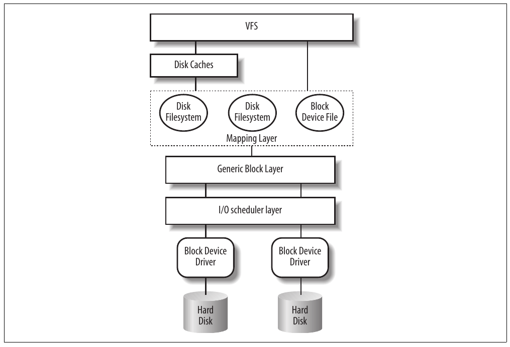
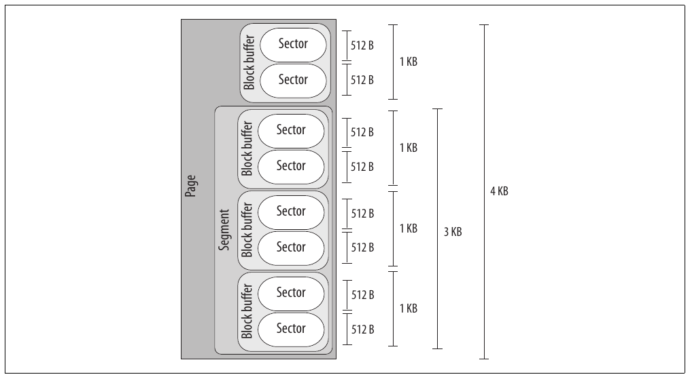
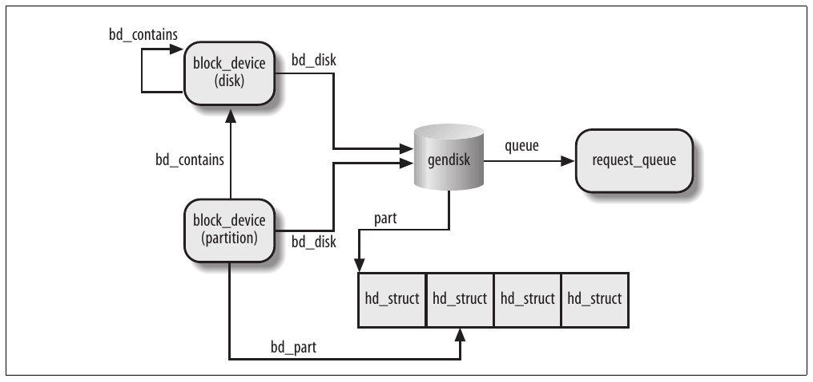

CHƯƠNG 14 Chương 14,

# Chương 14. Block device driver


Chương này bàn về I/O driver cho block device, tức mọi loại disk. Khía cạnh then chốt của block device là chênh lệch giữa thời gian CPU và bus cần để đọc hoặc ghi dữ liệu với tốc độ disk hardware. Block device có average access time rất cao. Mỗi operation cần vài millisecond để hoàn tất, chủ yếu vì disk controller phải di chuyển head trên disk surface đến đúng vị trí ghi dữ liệu. Tuy nhiên, khi head được đặt đúng, có thể duy trì data transfer ở rate hàng chục megabyte mỗi second.

Tổ chức block device handler của Linux khá phức tạp. Chúng ta không thể bàn chi tiết mọi function trong block I/O subsystem của kernel; tuy nhiên sẽ phác thảo software architecture tổng quát. Như chương trước, mục tiêu là giải thích cách Linux hỗ trợ triển khai block device driver, thay vì chỉ cách triển khai một driver.

Chúng ta bắt đầu ở phần đầu “Block Devices Handling” để giải thích kiến trúc tổng quát của Linux block I/O subsystem. Trong các phần “The Generic Block Layer”, “The I/O Scheduler”, và “Block Device Drivers”, chúng ta mô tả component chính của block I/O subsystem. Cuối cùng, trong phần “Opening a Block Device File”, chúng ta phác thảo các bước kernel thực hiện khi mở block device file.

## Xử lý block device

Mỗi operation trên block device driver liên quan số lượng lớn kernel component; những component quan trọng nhất được trình bày trong Hình 14-1.

Ví dụ, giả sử process gọi system call `read()` trên disk file nào đó—chúng ta sẽ thấy write request về cơ bản được xử lý cùng cách. Sau đây là những gì kernel thường làm để phục vụ process request:

1\. Service routine của system call `read()` kích hoạt VFS function phù hợp, truyền file descriptor và offset trong file. Virtual Filesystem là upper layer của block device handling architecture, cung cấp common file model được mọi filesystem Linux hỗ trợ áp dụng. Chúng ta đã mô tả dài về VFS layer trong Chương 12.



Hình 14-1. Kernel component chịu ảnh hưởng bởi block device operation

2\. VFS function xác định dữ liệu yêu cầu đã khả dụng chưa và, nếu cần, cách thực hiện read operation. Đôi khi không cần truy cập dữ liệu trên disk vì kernel giữ trong RAM dữ liệu đọc từ—hoặc ghi vào—block device gần đây nhất. Cơ chế disk cache được giải thích trong Chương 15, còn chi tiết cách VFS xử lý disk operation và giao tiếp với disk cache cùng filesystem được trình bày trong Chương 16.

3\. Giả sử kernel phải đọc dữ liệu từ block device, nên phải xác định physical location của dữ liệu. Để làm vậy, kernel dựa vào mapping layer, thường thực hiện hai bước:

a. Xác định block size của filesystem chứa file và tính phạm vi dữ liệu yêu cầu theo file block number. Về cơ bản, file được xem là chia thành nhiều block, và kernel xác định number (index tương đối với đầu file) của block chứa dữ liệu yêu cầu.

b. Tiếp theo, mapping layer gọi function filesystem-specific truy cập disk inode của file và xác định vị trí dữ liệu yêu cầu trên disk theo logical block number. Về cơ bản, disk được xem là chia thành block, và kernel xác định number (index tương đối với đầu disk hoặc partition) tương ứng block lưu dữ liệu yêu cầu. Vì file có thể lưu trong block không liền kề trên disk, data structure lưu trong disk inode map mỗi file block number sang logical block number.[^1]

Chúng ta sẽ thấy mapping layer hoạt động trong Chương 16, và trình bày một số disk-based filesystem điển hình trong Chương 18.

4\. Giờ kernel có thể thực hiện read operation trên block device. Nó dùng generic block layer, bắt đầu I/O operation truyền dữ liệu yêu cầu. Nói chung, mỗi I/O operation liên quan nhóm block liền kề trên disk. Vì dữ liệu yêu cầu không nhất thiết liền kề trên disk, generic block layer có thể bắt đầu nhiều I/O operation. Mỗi I/O operation được biểu diễn bằng structure “block I/O” (viết tắt “bio”), tập hợp mọi thông tin lower component cần để đáp ứng request.

Generic block layer che đặc điểm riêng của mỗi hardware block device, qua đó cung cấp góc nhìn trừu tượng về block device. Vì gần như mọi block device là disk, generic block layer còn cung cấp một số data structure tổng quát mô tả “disk” và “disk partition”. Chúng ta sẽ bàn generic block layer và bio structure trong phần “The Generic Block Layer” ở phần sau chương này.

5\. Dưới generic block layer, “I/O scheduler” sắp xếp pending I/O data transfer request theo kernel policy định sẵn. Mục đích scheduler là nhóm request dữ liệu nằm gần nhau trên physical medium. Chúng ta sẽ mô tả component này trong phần “The I/O Scheduler” ở phần sau chương này.

6\. Cuối cùng, block device driver đảm nhiệm data transfer thực tế bằng cách gửi command phù hợp đến hardware interface của disk controller. Chúng ta sẽ giải thích tổ chức tổng thể của generic block device driver trong phần “Block Device Drivers” ở phần sau chương này.

Như bạn thấy, nhiều kernel component liên quan dữ liệu lưu trong block device; mỗi component quản lý disk data bằng vùng dữ liệu có độ dài khác nhau:

- Controller của hardware block device truyền dữ liệu theo vùng có độ dài cố định gọi là “sector”. Do đó, I/O scheduler và block device driver phải quản lý sector dữ liệu.

- Virtual Filesystem, mapping layer và filesystem nhóm disk data theo logical unit gọi là “block”. Block tương ứng đơn vị lưu trữ disk tối thiểu trong filesystem.

- Như sắp thấy, block device driver phải có khả năng xử lý “segment” dữ liệu: mỗi segment là memory page—hoặc phần memory page—chứa vùng dữ liệu liền kề vật lý trên disk.

- Disk cache thao tác trên “page” disk data, mỗi page vừa trong page frame.

- Generic block layer kết nối mọi upper và lower component, nên biết sector, block, segment và page dữ liệu.

Dù có nhiều vùng dữ liệu khác nhau, chúng thường chia sẻ cùng physical RAM cell. Ví dụ, Hình 14-2 trình bày bố trí page 4,096-byte. Upper kernel component thấy page gồm bốn block buffer, mỗi buffer 1.024 byte. Ba block cuối page đang được block device driver truyền, nên được đưa vào segment bao phủ 3.072 byte cuối page. Hard disk controller xem segment gồm sáu sector 512-byte.



Hình 14-2. Bố trí điển hình của page chứa disk data

Trong chương này, chúng ta mô tả lower kernel component xử lý block device—generic block layer, I/O scheduler và block device driver—nên tập trung vào sector, block và segment.

### Sector

Để đạt hiệu năng chấp nhận được, hard disk và device tương tự truyền nhiều byte liền kề mỗi lần. Mỗi data transfer operation cho block device thao tác trên nhóm byte liền kề gọi là sector. Trong thảo luận sau, nói nhóm byte liền kề khi chúng được ghi trên disk surface sao cho một seek operation có thể truy cập. Dù physical geometry của disk thường rất phức tạp, hard disk controller nhận command tham chiếu disk như array sector lớn.

Trong phần lớn disk device, sector size là 512 byte, dù có device dùng sector lớn hơn (1.024 và 2.048 byte). Lưu ý sector nên được xem là đơn vị data transfer cơ bản; không bao giờ truyền được ít hơn một sector, dù phần lớn disk device có khả năng truyền nhiều sector liền kề mỗi lần.

Trong Linux, sector size được quy ước là 512 byte; nếu block device dùng sector lớn hơn, low-level block device driver tương ứng thực hiện chuyển đổi cần thiết. Do đó, nhóm dữ liệu lưu trong block device được xác định trên disk bằng vị trí—index của sector 512-byte đầu—và độ dài theo số sector 512 byte. Sector index được lưu trong biến 32 hoặc 64-bit kiểu `sector_t`.

### Block

Trong khi sector là đơn vị data transfer cơ bản cho hardware device, block là đơn vị data transfer cơ bản cho VFS và do đó cho filesystem. Ví dụ, khi kernel truy cập nội dung file, trước tiên phải đọc từ disk block chứa disk inode của file (xem phần “Inode Objects” trong Chương 12). Block này trên disk tương ứng một hoặc nhiều sector liền kề, được VFS xem là một data unit.

Trong Linux, block size phải là lũy thừa của 2 và không lớn hơn page frame. Hơn nữa, phải là bội sector size vì mỗi block phải chứa số nguyên sector. Do đó, trên kiến trúc 80×86, block size được phép là 512, 1.024, 2.048 và 4.096 byte.

Block size không đặc thù block device. Khi tạo disk-based filesystem, administrator có thể chọn block size thích hợp. Do đó, nhiều partition trên cùng disk có thể dùng block size khác nhau. Hơn nữa, mỗi read hoặc write operation trên block device file là truy cập “raw” bỏ qua disk-based filesystem; kernel thực hiện bằng block kích thước lớn nhất (4.096 byte).

Mỗi block cần block buffer riêng, là RAM memory area kernel dùng lưu nội dung block. Khi kernel đọc block từ disk, nó điền block buffer tương ứng bằng giá trị lấy từ hardware device; tương tự, khi kernel ghi block lên disk, nó cập nhật nhóm byte liền kề tương ứng trên hardware device bằng giá trị thực của block buffer liên quan. Kích thước block buffer luôn khớp kích thước block tương ứng.

Mỗi buffer có descriptor “buffer head” kiểu `buffer_head`. Descriptor chứa mọi thông tin kernel cần biết cách xử lý buffer; do đó, trước khi thao tác trên mỗi buffer, kernel kiểm tra buffer head. Chúng ta sẽ giải thích chi tiết mọi field của buffer head trong Chương 15; tuy nhiên trong chương này chỉ xét vài field: `b_page`, `b_data`, `b_blocknr`, và `b_bdev`.

Field `b_page` lưu địa chỉ page descriptor của page frame chứa block buffer. Nếu page frame trong high memory, field `b_data` lưu offset của block buffer trong page; ngược lại, lưu starting linear address của chính block buffer. Field `b_blocknr` lưu logical block number (tức index của block trong disk partition). Cuối cùng, field `b_bdev` xác định block device dùng buffer head (xem phần “Block Devices” ở phần sau chương này).

### Segment

Chúng ta biết mỗi disk I/O operation gồm truyền nội dung một số sector liền kề từ—hoặc đến—một số RAM location. Trong gần như mọi trường hợp, disk controller trực tiếp thực hiện data transfer bằng DMA operation (xem phần “Direct Memory Access (DMA)” trong Chương 13). Block device driver chỉ kích hoạt data transfer bằng cách gửi command thích hợp đến disk controller; khi data transfer hoàn tất, controller phát interrupt để thông báo block device driver.

Dữ liệu truyền bằng một DMA operation phải thuộc sector liền kề trên disk. Đây là ràng buộc vật lý: disk controller cho DMA transfer đến sector non-adjacent sẽ có transfer rate kém vì di chuyển read/write head trên disk surface khá chậm.

Disk controller cũ chỉ hỗ trợ DMA operation “đơn giản”: trong mỗi operation như vậy, dữ liệu truyền từ hoặc đến memory cell liên tiếp vật lý trong RAM. Tuy nhiên, disk controller gần đây còn có thể hỗ trợ so-called scatter-gather DMA transfer: trong mỗi operation, dữ liệu có thể truyền từ hoặc đến nhiều memory area không liên tiếp.

Với mỗi scatter-gather DMA transfer, block device driver phải gửi cho disk controller:

- Disk sector number đầu và tổng số sector cần truyền

- List descriptor của memory area, mỗi descriptor gồm địa chỉ và độ dài.

Disk controller đảm nhiệm toàn bộ data transfer; ví dụ, trong read operation controller lấy dữ liệu từ disk sector liền kề và phân tán vào các memory area.

Để dùng scatter-gather DMA operation, block device driver phải xử lý dữ liệu theo đơn vị gọi là segment. Segment chỉ là memory page—hoặc phần memory page—chứa dữ liệu của một số disk sector liền kề. Do đó, scatter-gather DMA operation có thể liên quan nhiều segment cùng lúc.

Lưu ý block device driver không cần biết block, block size và block buffer. Vì vậy, dù higher level xem segment như page gồm nhiều block buffer, block device driver không quan tâm.

Như sẽ thấy, generic block layer có thể gộp segment khác nhau nếu page frame tương ứng tình cờ liên tiếp trong RAM và vùng disk data tương ứng liền kề trên disk. Memory area lớn hơn do merge operation này tạo gọi là physical segment.

Một merge operation khác được phép trên kiến trúc xử lý mapping giữa bus address và physical address qua dedicated bus circuitry (IO-MMU; xem phần “Direct Memory Access (DMA)” trong Chương 13). Memory area do loại merge operation này tạo gọi là hardware segment. Vì tập trung kiến trúc 80×86 không có dynamic mapping như vậy giữa bus address và physical address, trong phần còn lại chương này chúng ta giả định hardware segment luôn trùng physical segment.

## Generic block layer

Generic block layer là kernel component xử lý request cho mọi block device trong hệ thống. Nhờ function của nó, kernel dễ dàng:

- Đặt data buffer trong high memory—page frame sẽ được map trong kernel linear address space chỉ khi CPU phải truy cập dữ liệu và unmap ngay sau.

- Triển khai—với một số nỗ lực bổ sung—mô hình “zero-copy”, trong đó disk data được đặt trực tiếp vào User Mode address space mà không sao chép vào kernel memory trước; về cơ bản, buffer kernel dùng cho I/O transfer nằm trong page frame được map trong User Mode linear address space của process.

- Quản lý logical volume—như loại LVM (Logical Volume Manager) và RAID (Redundant Array of Inexpensive Disks) dùng: nhiều disk partition, ngay cả trên block device khác nhau, có thể được xem là một partition.

- Khai thác tính năng nâng cao của disk controller mới nhất, như onboard disk cache lớn, DMA capability cải tiến, onboard scheduling cho I/O transfer request, v.v.

### Bio structure

Data structure cốt lõi của generic block layer là descriptor của I/O block device operation đang diễn ra gọi là bio. Mỗi bio về cơ bản chứa identifier cho disk storage area—sector number đầu và số sector trong storage area—cùng một hoặc nhiều segment mô tả memory area liên quan I/O operation. Bio được triển khai bằng data structure `bio`, có các field liệt kê trong Bảng 14-1.

Bảng 14-1. Các field của structure bio

| Kiểu | Field | Mô tả |
|---|---|---|
| `sector_t` | `bi_sector` | Sector đầu trên disk của block I/O operation |
| `struct bio *` | `bi_next` | Link đến bio tiếp theo trong request queue |
| `struct block_device *` | `bi_bdev` | Pointer đến block device descriptor |
| `unsigned long` | `bi_flags` | Bio status flag |
| `unsigned long` | `bi_rw` | I/O operation flag |
| `unsigned short` | `bi_vcnt` | Số segment trong array `bio_vec` của bio |
| `unsigned short` | `bi_idx` | Index hiện tại trong array segment `bio_vec` của bio |
| `unsigned short` | `bi_phys_segments` | Số physical segment của bio sau khi gộp |
| `unsigned short` | `bi_hw_segments` | Số hardware segment sau khi gộp |
| `unsigned int` | `bi_size` | Số byte (còn) cần truyền |
| `unsigned int` | `bi_hw_front_size` | Được hardware segment merge algorithm dùng |
| `unsigned int` | `bi_hw_back_size` | Được hardware segment merge algorithm dùng |
| `unsigned int` | `bi_max_vecs` | Số segment tối đa cho phép trong array `bio_vec` của bio |
| `struct bio_vec *` | `bi_io_vec` | Pointer đến array segment `bio_vec` của bio |
| `bio_end_io_t *` | `bi_end_io` | Method gọi cuối I/O operation của bio |
| `atomic_t` | `bi_cnt` | Reference counter cho `bio` |
| `void *` | `bi_private` | Pointer do generic block layer và I/O completion method của block device driver dùng |
| `bio_destructor_t *` | `bi_destructor` | Destructor method (thường `bio_destructor()`) gọi khi bio đang được giải phóng |

Mỗi segment trong bio được biểu diễn bằng data structure `bio_vec`, có các field liệt kê trong Bảng 14-2. Field `bi_io_vec` của bio trỏ đến phần tử đầu array data structure `bio_vec`, còn field `bi_vcnt` lưu số phần tử hiện tại trong array.

Bảng 14-2. Các field của structure bio\_vec

| Kiểu | Field | Mô tả |
|---|---|---|
| `struct page *` | `bv_page` | Pointer đến page descriptor của page frame của segment |
| `unsigned int` | `bv_len` | Độ dài segment tính bằng byte |
| `unsigned int` | `bv_offset` | Offset dữ liệu của segment trong page frame |

Nội dung descriptor `bio` liên tục thay đổi trong block I/O operation. Ví dụ, nếu block device driver không thể thực hiện toàn data transfer bằng một scatter-gather DMA operation, field `bi_idx` được cập nhật để theo dõi segment đầu trong bio chưa truyền. Để lặp qua segment của bio—bắt đầu từ segment hiện tại tại index `bi_idx`—device driver có thể thực thi macro `bio_for_each_segment`.

Khi generic block layer bắt đầu I/O operation mới, nó cấp phát bio structure mới bằng cách gọi function `bio_alloc()`. Thường bio được cấp phát qua slab allocator, nhưng kernel còn giữ memory pool bio nhỏ để dùng khi memory khan hiếm (xem phần “Memory Pools” trong Chương 8). Kernel còn giữ memory pool cho structure `bio_vec`—dù sao, cấp phát bio mà không thể cấp phát segment descriptor đưa vào bio là vô nghĩa. Tương ứng, function `bio_put()` giảm reference counter (`bi_cnt`) của bio và, nếu counter thành không, giải phóng bio structure cùng structure `bio_vec` liên quan.

### Biểu diễn disk và disk partition

Disk là logical block device do generic block layer xử lý. Thường disk tương ứng hardware block device như hard disk, floppy disk hoặc CD-ROM disk. Tuy nhiên, disk có thể là virtual device xây trên nhiều physical disk partition hoặc storage area trong một số page RAM chuyên dụng. Trong mọi trường hợp, upper kernel component thao tác mọi disk theo cùng cách nhờ dịch vụ generic block layer cung cấp.

Disk được biểu diễn bằng object `gendisk`, có các field trong Bảng 14-3.

Bảng 14-3. Các field của object gendisk

| Kiểu | Field | Mô tả |
|---|---|---|
| `int` | `major` | Major number của disk |
| `int` | `first_minor` | Minor number đầu gắn với disk |
| `int` | `minors` | Dải minor number gắn với disk |
| `char [32]` | `disk_name` | Tên quy ước của disk (thường tên chuẩn của device file tương ứng) |
| `struct hd_struct **` | `part` | Array partition descriptor cho disk |
| `struct block_device_operations *` | `fops` | Pointer đến table block device method |
| `struct request_queue *` | `queue` | Pointer đến request queue của disk (xem “Request Queue Descriptors” phía sau chương này) |
| `void *` | `private_data` | Private data của block device driver |
| `sector_t` | `capacity` | Kích thước storage area của disk (tính theo số sector) |
| `int` | `flags` | Flag mô tả loại disk (xem bên dưới) |
| `char [64]` | `devfs_name` | Device filename trong special filesystem devfs (hiện deprecated) |
| `int` | `number` | Không còn dùng |
| `struct device *` | `driverfs_dev` | Pointer đến object `device` của hardware device của disk (xem phần “Components of the Device Driver Model” trong Chương 13) |
| `struct kobject` | `kobj` | Kobject nhúng (xem phần “Kobjects” trong Chương 13) |
| `struct timer_rand_state *` | `random` | Pointer đến data structure ghi timing interrupt của disk; được random number generator built-in trong kernel dùng |
| `int` | `policy` | Đặt thành 1 nếu disk read-only (cấm write operation), ngược lại 0 |
| `atomic_t` | `sync_io` | Counter sector ghi lên disk, chỉ dùng cho RAID |
| `unsigned long` | `stamp` | Timestamp dùng xác định thống kê disk queue usage |
| `unsigned long` | `stamp_idle` | Giống trên |
| `int` | `in_flight` | Số I/O operation đang diễn ra |
| `struct disk_stats *` | `dkstats` | Thống kê per-CPU disk usage |

Field `flags` lưu thông tin về disk. Flag quan trọng nhất là `GENHD_FL_UP`: nếu set, disk đã khởi tạo và hoạt động. Flag liên quan khác là `GENHD_FL_REMOVABLE`, được set nếu disk là removable support như floppy disk hoặc CD-ROM.

Field `fops` của object `gendisk` trỏ đến table `block_device_operations`, lưu vài custom method cho operation then chốt của block device (xem Bảng 14-4).

Bảng 14-4. Method của block device

| Method | Tác nhân kích hoạt |
|---|---|
| `open` | Mở block device file |
| `release` | Đóng tham chiếu cuối đến block device file |
| `ioctl` | Gọi system call `ioctl()` trên block device file (dùng big kernel lock) |
| `compat_ioctl` | Gọi system call `ioctl()` trên block device file (không dùng big kernel lock) |
| `media_changed` | Kiểm tra removable media có thay đổi không (ví dụ floppy disk) |
| `revalidate_disk` | Kiểm tra block device có giữ dữ liệu hợp lệ không |

Hard disk thường được chia thành logical partition. Mỗi block device file có thể biểu diễn toàn disk hoặc partition trong disk. Ví dụ, master EIDE disk có thể được biểu diễn bằng device file /dev/hda có major number 3 và minor number 0; hai partition đầu trong disk có thể được biểu diễn bằng device file /dev/hda1 và /dev/hda2 lần lượt có major number 3 và minor number 1, 2. Nói chung, partition trong disk có minor number liên tiếp.

Nếu disk chia thành partition, bố trí của chúng giữ trong array structure `hd_struct` có địa chỉ lưu trong field `part` của object `gendisk`. Array được đánh index theo relative index của partition trong disk. Các field của descriptor `hd_struct` liệt kê trong Bảng 14-5.

Bảng 14-5. Các field của descriptor hd\_struct

| Kiểu | Field | Mô tả |
|---|---|---|
| `sector_t` | `start_sect` | Sector bắt đầu của partition trong disk |
| `sector_t` | `nr_sects` | Độ dài partition (số sector) |
| `struct kobject` | `kobj` | Kobject nhúng (xem phần “Kobjects” trong Chương 13) |
| `unsigned int` | `reads` | Số read operation thực hiện trên partition |
| `unsigned int` | `read_sectors` | Số sector đọc từ partition |
| `unsigned int` | `writes` | Số write operation thực hiện trên partition |
| `unsigned int` | `write_sectors` | Số sector ghi vào partition |
| `int` | `policy` | Đặt thành 1 nếu partition read-only, ngược lại 0 |
| `int` | `partno` | Relative index của partition trong disk |

Khi kernel phát hiện disk mới trong hệ thống (trong giai đoạn boot, hoặc khi removable media được chèn vào drive, hoặc khi external disk được gắn tại runtime), nó gọi function `alloc_disk()`, cấp phát và khởi tạo object `gendisk` mới và, nếu disk mới chia thành nhiều partition, array descriptor `hd_struct` phù hợp. Sau đó, gọi function `add_disk()` để chèn descriptor `gendisk` mới vào data structure của generic block layer (xem phần “Device Driver Registration and Initialization” ở phần sau chương này).

### Gửi request

Hãy mô tả chuỗi bước chung kernel thực hiện khi gửi I/O operation request đến generic block layer. Chúng ta giả định vùng dữ liệu yêu cầu liền kề trên disk và kernel đã xác định physical location.

Bước đầu gồm thực thi function `bio_alloc()` để cấp phát bio descriptor mới. Sau đó kernel khởi tạo bio descriptor bằng cách đặt một số field:

- Field `bi_sector` đặt thành sector number đầu của dữ liệu (nếu block device chia nhiều partition, sector number tương đối với đầu partition).

- Field `bi_size` đặt thành số sector bao phủ dữ liệu.

- Field `bi_bdev` đặt thành địa chỉ block device descriptor (xem phần “Block Devices” ở phần sau chương này).

- Field `bi_io_vec` đặt thành địa chỉ đầu array data structure `bio_vec`, mỗi structure mô tả segment (memory buffer) liên quan I/O operation; hơn nữa, field `bi_vcnt` đặt thành tổng số segment trong bio.

- Field `bi_rw` đặt bằng flag của operation yêu cầu. Flag quan trọng nhất chỉ định chiều data transfer: `READ` (0) hoặc `WRITE` (1).

- Field `bi_end_io` đặt thành địa chỉ completion procedure được thực thi mỗi khi I/O operation trên bio hoàn tất.

Khi descriptor `bio` được khởi tạo đúng, kernel gọi function `generic_make_request()`, main entry point của generic block layer. Function thực hiện về cơ bản các bước sau:

1\. Kiểm tra `bio->bi_sector` không vượt số sector của block device. Nếu vượt, function set flag `BIO_EOF` của `bio->bi_flags`, in kernel error message, gọi function `bio_endio()` và kết thúc. `bio_endio()` cập nhật các field `bi_size` và `bi_sector` của bio descriptor, và gọi method `bi_end_io` của bio. Cách triển khai function sau về cơ bản phụ thuộc kernel component kích hoạt I/O data transfer; chúng ta sẽ thấy ví dụ method `bi_end_io` trong các chương sau.

2\. Lấy request queue `q` gắn với block device (xem phần “Request Queue Descriptors” ở phần sau chương này); có thể tìm địa chỉ trong field `bd_disk` của block device descriptor, đến lượt được field `bio->bi_bdev` trỏ đến.

3\. Gọi `block_wait_queue_running()` để kiểm tra I/O scheduler hiện dùng có đang được thay thế động không; trong trường hợp này, function cho process sleep đến khi I/O scheduler mới bắt đầu (xem phần tiếp theo “The I/O Scheduler”).

4\. Gọi `blk_partition_remap()` để kiểm tra block device có tham chiếu disk partition không (`bio->bi_bdev` khác `bio->bi_dev->bd_contains`; xem phần “Block Devices” ở phần sau chương này). Trong trường hợp này, function lấy descriptor `hd_struct` của partition từ field `bio->bi_bdev` để thực hiện các bước con sau:

a. Cập nhật các field `read_sectors` và `reads`, hoặc `write_sectors` và `writes`, của descriptor `hd_struct` theo chiều data transfer.

b. Điều chỉnh field `bio->bi_sector` để chuyển sector number tương đối đầu partition thành sector number tương đối toàn disk.

c. Đặt field `bio->bi_bdev` thành block device descriptor của toàn disk (`bio->bd_contains`).

Từ đây, generic block layer, I/O scheduler và device driver quên disk partitioning và làm việc trực tiếp với toàn disk.

5\. Gọi method `q->make_request_fn` để chèn request `bio` vào request queue `q`.

6\. Trả về.

Chúng ta sẽ bàn cách triển khai điển hình method `make_request_fn` trong phần “Issuing a Request to the I/O Scheduler” ở phần sau chương này.

## I/O scheduler

Dù block device driver có thể truyền một sector mỗi lần, block I/O layer không thực hiện I/O operation riêng cho từng sector cần truy cập trên disk; điều này khiến disk performance kém vì xác định physical position của sector trên disk surface khá tốn thời gian. Thay vào đó, bất cứ khi nào có thể, kernel cố gom nhiều sector và xử lý như một khối, qua đó giảm số lần di chuyển head trung bình.

Khi kernel component muốn đọc hoặc ghi disk data, nó thực sự tạo block device request. Request này về cơ bản mô tả sector được yêu cầu và loại operation cần thực hiện (read hoặc write). Tuy nhiên, kernel không đáp ứng request ngay khi tạo—I/O operation chỉ được lên lịch và sẽ thực hiện sau. Nghịch lý là trì hoãn nhân tạo này chính là cơ chế then chốt tăng hiệu năng block device. Khi có block data transfer mới được yêu cầu, kernel kiểm tra có thể đáp ứng bằng cách mở rộng nhẹ request trước còn đợi không (tức có thể đáp ứng request mới mà không cần thêm seek operation không). Vì disk có xu hướng được truy cập tuần tự, cơ chế đơn giản này rất hiệu quả.

Trì hoãn request làm xử lý block device phức tạp hơn. Ví dụ, giả sử process mở regular file và do đó filesystem driver muốn đọc inode tương ứng từ disk. Block device driver đặt request vào queue và process bị tạm dừng đến khi block chứa inode được truyền. Tuy nhiên, chính block device driver không thể bị block, vì mọi process khác cố truy cập cùng disk cũng sẽ bị block.

Để block device driver không bị tạm dừng, mỗi I/O operation được xử lý asynchronous. Cụ thể, block device driver là interrupt-driven (xem phần “Monitoring I/O Operations” trong chương trước): generic block layer gọi I/O scheduler để tạo block device request mới hoặc mở rộng request hiện có rồi kết thúc. Block device driver, được kích hoạt sau, gọi strategy routine để chọn pending request và đáp ứng bằng cách gửi command phù hợp đến disk controller. Khi I/O operation kết thúc, disk controller phát interrupt và handler tương ứng gọi strategy routine lần nữa nếu cần để xử lý pending request khác.

Mỗi block device driver duy trì request queue riêng, chứa list pending request cho device. Nếu disk controller xử lý nhiều disk, thường có một request queue cho mỗi physical block device. I/O scheduling được thực hiện riêng trên mỗi request queue, qua đó tăng disk performance.

### Request queue descriptor

Mỗi request queue được biểu diễn bằng data structure `request_queue` lớn có các field liệt kê trong Bảng 14-6.

Bảng 14-6. Các field của request queue descriptor

| Kiểu | Field | Mô tả |
|---|---|---|
| `struct list_head` | `queue_head` | List pending request |
| `struct request *` | `last_merge` | Pointer đến descriptor của request trong queue cần xét đầu tiên cho khả năng gộp |
| `elevator_t *` | `elevator` | Pointer đến elevator object (xem phần “I/O Scheduling Algorithms” phía sau) |
| `struct request_list` | `rq` | Data structure dùng cấp phát request descriptor |
| `request_fn_proc *` | `request_fn` | Method triển khai entry point của strategy routine của driver |
| `merge_request_fn *` | `back_merge_fn` | Method kiểm tra có thể gộp bio vào request cuối queue không |
| `merge_request_fn *` | `front_merge_fn` | Method kiểm tra có thể gộp bio vào request đầu queue không |
| `merge_requests_fn *` | `merge_requests_fn` | Method thử gộp hai request liền kề trong queue |
| `make_request_fn *` | `make_request_fn` | Method gọi khi phải chèn request mới vào queue |
| `prep_rq_fn *` | `prep_rq_fn` | Method xây dựng command gửi đến hardware device để xử lý request này |
| `unplug_fn *` | `unplug_fn` | Method unplug block device (xem phần “Activating the Block Device Driver” ở phần sau chương này) |
| `merge_bvec_fn *` | `merge_bvec_fn` | Method trả về số byte có thể chèn vào bio hiện có khi thêm segment mới (thường không định nghĩa) |
| `activity_fn *` | `activity_fn` | Method gọi khi request được thêm vào queue (thường không định nghĩa) |
| `issue_flush_fn *` | `issue_flush_fn` | Method gọi khi flush request queue (queue được làm rỗng bằng cách xử lý liên tiếp mọi request) |
| `struct timer_list` | `unplug_timer` | Dynamic timer dùng thực hiện device plugging (xem phần “Activating the Block Device Driver” phía sau) |
| `int` | `unplug_thresh` | Nếu số pending request trong queue vượt giá trị này, device được unplug ngay (mặc định 4) |
| `unsigned long` | `unplug_delay` | Thời gian trễ trước device unplugging (mặc định 3 millisecond) |
| `struct work_struct` | `unplug_work` | Work queue dùng unplug device (xem phần “Activating the Block Device Driver” phía sau) |
| `struct backing_dev_info` | `backing_dev_info` | Xem nội dung sau bảng |
| `void *` | `queuedata` | Pointer đến private data của block device driver |
| `void *` | `activity_data` | Private data do method `activity_fn` dùng |
| `unsigned long` | `bounce_pfn` | Page frame number mà trên đó phải dùng buffer bouncing (xem phần “Submitting a Request” ở phần sau chương này) |
| `int` | `bounce_gfp` | Memory allocation flag cho bounce buffer |
| `unsigned long` | `queue_flags` | Tập flag mô tả queue status |
| `spinlock_t *` | `queue_lock` | Pointer đến request queue lock |
| `struct kobject` | `kobj` | Kobject nhúng cho request queue |
| `unsigned long` | `nr_requests` | Số request tối đa trong queue |
| `unsigned int` | `nr_congestion_on` | Queue được xem congested nếu số pending request tăng trên ngưỡng này |
| `unsigned int` | `nr_congestion_off` | Queue được xem không congested nếu số pending request giảm dưới ngưỡng này |
| `unsigned int` | `nr_batching` | Số pending request tối đa (thường 32) process “batcher” đặc biệt có thể gửi ngay cả khi queue đầy |
| `unsigned short` | `max_sectors` | Số sector tối đa một request xử lý (điều chỉnh được) |
| `unsigned short` | `max_hw_sectors` | Số sector tối đa một request xử lý (ràng buộc hardware) |
| `unsigned short` | `max_phys_segments` | Số physical segment tối đa một request xử lý |
| `unsigned short` | `max_hw_segments` | Số hardware segment tối đa một request xử lý (số memory area riêng biệt tối đa trong scatter-gather DMA operation) |
| `unsigned short` | `hardsect_size` | Kích thước sector tính bằng byte |
| `unsigned int` | `max_segment_size` | Kích thước physical segment tối đa (byte) |
| `unsigned long` | `seg_boundary_mask` | Memory boundary mask cho segment merging |
| `unsigned int` | `dma_alignment` | Alignment bitmap cho địa chỉ đầu và độ dài DMA buffer (mặc định 511) |
| `struct blk_queue_tag *` | `queue_tags` | Bitmap tag trống/bận (dùng cho tagged request) |
| `atomic_t` | `refcnt` | Reference counter của queue |
| `unsigned int` | `in_flight` | Số pending request trong queue |
| `unsigned int` | `sg_timeout` | Command time-out User-defined (chỉ dùng bởi SCSI generic device) |
| `unsigned int` | `sg_reserved_size` | Về cơ bản không dùng |
| `struct list_head` | `drain_list` | Đầu list request tạm trì hoãn đến khi I/O scheduler được thay thế động |

Về cơ bản, request queue là doubly linked list có phần tử là request descriptor (tức data structure `request`; xem phần tiếp theo). Field `queue_head` của request queue descriptor lưu đầu (phần tử giả đầu tiên) list, còn pointer trong field `queuelist` của request descriptor liên kết mỗi request với phần tử trước và sau trong list. Thứ tự phần tử trong queue list riêng cho mỗi block device driver; tuy nhiên I/O scheduler cung cấp nhiều cách sắp xếp phần tử định sẵn, bàn trong phần “I/O Scheduling Algorithms” phía sau.

Field `backing_dev_info` là object nhỏ kiểu `backing_dev_info`, lưu thông tin I/O data flow traffic cho hardware block device bên dưới. Ví dụ, giữ thông tin read-ahead và request queue congestion state.

### Request descriptor

Mỗi pending request cho block device được biểu diễn bằng request descriptor, lưu trong data structure `request` minh họa trong Bảng 14-7.

Bảng 14-7. Các field của request descriptor

| Kiểu | Field | Mô tả |
|---|---|---|
| `struct list_head` | `queuelist` | Pointer cho request queue list |
| `unsigned long` | `flags` | Flag của request (xem bên dưới) |
| `sector_t` | `sector` | Number của sector tiếp theo cần truyền |
| `unsigned long` | `nr_sectors` | Số sector còn cần truyền trong toàn request |
| `unsigned int` | `current_nr_sectors` | Số sector trong segment hiện tại của bio hiện tại còn cần truyền |
| `sector_t` | `hard_sector` | Number của sector tiếp theo cần truyền |
| `unsigned long` | `hard_nr_sectors` | Số sector còn cần truyền trong toàn request (do generic block layer cập nhật) |
| `unsigned int` | `hard_cur_sectors` | Số sector trong segment hiện tại của bio hiện tại còn cần truyền (do generic block layer cập nhật) |
| `struct bio *` | `bio` | Bio đầu trong request chưa truyền hoàn toàn |
| `struct bio *` | `biotail` | Bio cuối trong request list |
| `void *` | `elevator_private` | Pointer đến private data cho I/O scheduler |
| `int` | `rq_status` | Request status: về cơ bản là `RQ_ACTIVE` hoặc `RQ_INACTIVE` |
| `struct gendisk *` | `rq_disk` | Descriptor của disk được request tham chiếu |
| `int` | `errors` | Counter cho số I/O error xảy ra trên transfer hiện tại |
| `unsigned long` | `start_time` | Thời điểm bắt đầu request (jiffies) |
| `unsigned short` | `nr_phys_segments` | Số physical segment của request |
| `unsigned short` | `nr_hw_segments` | Số hardware segment của request |
| `int` | `tag` | Tag gắn với request (chỉ cho hardware device hỗ trợ nhiều data transfer đang chờ hoàn tất) |
| `char *` | `buffer` | Pointer đến memory buffer của data transfer hiện tại (`NULL` nếu buffer trong high-memory) |
| `int` | `ref_count` | Reference counter cho request |
| `request_queue_t *` | `q` | Pointer đến descriptor của request queue chứa request |
| `struct request_list *` | `rl` | Pointer đến data structure `request_list` |
| `struct completion *` | `waiting` | Completion để đợi data transfer kết thúc (xem phần “Completions” trong Chương 5) |
| `void *` | `special` | Pointer đến dữ liệu dùng khi request chứa command “đặc biệt” cho hardware device |
| `unsigned int` | `cmd_len` | Độ dài command trong field `cmd` |
| `unsigned char []` | `cmd` | Buffer chứa command pre-built do method `prep_rq_fn` của request queue chuẩn bị |
| `unsigned int` | `data_len` | Thường là độ dài dữ liệu trong buffer được field `data` trỏ đến |
| `void *` | `data` | Pointer device driver dùng theo dõi dữ liệu cần truyền |
| `unsigned int` | `sense_len` | Độ dài buffer được field `sense` trỏ đến (0 nếu sense field là `NULL`) |
| `void *` | `sense` | Pointer đến buffer dùng cho output của sense command |
| `unsigned int` | `timeout` | time-out của request |
| `struct request_pm_state *` | `pm` | Pointer đến data structure dùng cho power-management command |

Mỗi request gồm một hoặc nhiều bio structure. Ban đầu, generic block layer tạo request chỉ chứa một bio. Sau đó I/O scheduler có thể “mở rộng” request bằng cách thêm segment mới vào bio gốc hoặc liên kết bio structure khác vào request. Điều này khả thi khi dữ liệu mới liền kề vật lý với dữ liệu đã có trong request. Field `bio` của request descriptor trỏ đến bio structure đầu trong request, còn field `biotail` trỏ đến bio cuối. Macro `rq_for_each_bio` triển khai vòng lặp qua mọi bio trong request.

Một số field của request descriptor có thể thay đổi động. Ví dụ, ngay khi mọi vùng dữ liệu tham chiếu trong bio đã truyền hết, field `bio` được cập nhật trỏ đến bio tiếp theo trong request list. Đồng thời, bio mới có thể được thêm vào đuôi request list nên field `biotail` cũng có thể thay đổi.

Một số field khác của request descriptor được I/O scheduler hoặc device driver sửa khi disk sector đang được truyền. Ví dụ, field `nr_sectors` lưu số sector còn cần truyền trong toàn request, còn field `current_nr_sectors` lưu số sector còn cần truyền trong bio hiện tại.

Field `flags` lưu số lượng lớn flag, liệt kê trong Bảng 14-8. Quan trọng nhất là `REQ_RW`, xác định chiều data transfer.

Bảng 14-8. Flag của request descriptor

| Flag | Mô tả |
|---|---|
| `REQ_RW` | Chiều data transfer: `READ` (0) hoặc `WRITE` (1) |
| `REQ_FAILFAST` | Request yêu cầu không thử lại I/O operation khi lỗi |
| `REQ_SOFTBARRIER` | Request đóng vai trò barrier cho I/O scheduler |
| `REQ_HARDBARRIER` | Request đóng vai trò barrier cho I/O scheduler và device driver—phải xử lý sau request cũ và trước request mới |
| `REQ_CMD` | Request chứa read hoặc write I/O data transfer thông thường |
| `REQ_NOMERGE` | Không nên mở rộng hoặc gộp request với request khác |
| `REQ_STARTED` | Request đang được xử lý |
| `REQ_DONTPREP` | Không gọi method `prep_rq_fn` của request queue để chuẩn bị trước command cần gửi đến hardware device |
| `REQ_QUEUED` | Request được tagged—tức tham chiếu hardware device có thể quản lý nhiều data transfer đang chờ hoàn tất cùng lúc |
| `REQ_PC` | Request chứa direct command cần gửi đến hardware device |
| `REQ_BLOCK_PC` | Giống flag trước nhưng command nằm trong bio |
| `REQ_SENSE` | Request chứa request command “sense” (cho SCSI và ATAPI device) |
| `REQ_FAILED` | Set khi sense hoặc direct command trong request không hoạt động như mong đợi |
| `REQ_QUIET` | Request yêu cầu không tạo kernel message khi I/O error |
| `REQ_SPECIAL` | Request chứa special command cho hardware device (ví dụ drive reset) |
| `REQ_DRIVE_CMD` | Request chứa special command cho IDE disk |
| `REQ_DRIVE_TASK` | Request chứa special command cho IDE disk |
| `REQ_DRIVE_TASKFILE` | Request chứa special command cho IDE disk |
| `REQ_PREEMPT` | Request thay request hiện tại ở đầu queue (chỉ cho IDE disk) |
| `REQ_PM_SUSPEND` | Request chứa power-management command để suspend hardware device |
| `REQ_PM_RESUME` | Request chứa power-management command để đánh thức hardware device |
| `REQ_PM_SHUTDOWN` | Request chứa power-management command để tắt hardware device |
| `REQ_BAR_PREFLUSH` | Request chứa command “flush queue” cần gửi đến disk controller |
| `REQ_BAR_POSTFLUSH` | Request chứa command “flush queue” đã gửi đến disk controller |

#### Quản lý cấp phát request descriptor

Lượng free dynamic memory hạn chế có thể, dưới tải rất nặng và disk activity cao, thành bottleneck cho process muốn thêm request mới vào request queue `q`. Để xử lý tình huống này, mỗi descriptor `request_queue` chứa data structure `request_list`, gồm:

- Pointer đến memory pool request descriptor (xem phần “Memory Pools” trong Chương 8).

- Hai counter cho số request descriptor được cấp phát lần lượt cho request `READ` và `WRITE`.

- Hai flag cho biết lần cấp phát gần đây cho request `READ` hoặc `WRITE` tương ứng có thất bại không.

- Hai wait queue lưu process đang sleep đợi request descriptor `READ` và `WRITE` khả dụng tương ứng.

- Wait queue cho process đợi request queue được flush (làm rỗng).

Function `blk_get_request()` cố lấy request descriptor trống từ memory pool của request queue cho trước; nếu memory khan hiếm và memory pool cạn, function cho process hiện tại sleep hoặc—nếu kernel control path không thể block—trả về `NULL`. Nếu cấp phát thành công, function lưu trong field `rl` của request descriptor địa chỉ data structure `request_list` của request queue. Function `blk_put_request()` giải phóng request descriptor; nếu reference counter thành không, descriptor được trả lại memory pool đã lấy nó.

##### Tránh request queue congestion

Mỗi request queue có số pending request tối đa cho phép. Field `nr_requests` của request queue descriptor lưu số pending request tối đa cho phép theo mỗi chiều data transfer. Mặc định, queue có tối đa 128 pending read request và 128 pending write request. Nếu số pending read (write) request vượt `nr_requests`, queue được đánh dấu đầy bằng cách set flag `QUEUE_FLAG_READFULL` (`QUEUE_FLAG_WRITEFULL`) trong field `queue_flags` của request queue descriptor, và process có thể block đang cố thêm request theo chiều data transfer đó được cho sleep trong wait queue tương ứng của data structure `request_list`.

Request queue filled-up tác động xấu hiệu năng hệ thống vì buộc nhiều process sleep đợi I/O data transfer hoàn tất. Do đó, nếu số pending request theo chiều cho trước vượt giá trị lưu trong field `nr_congestion_on` của request descriptor (mặc định 113), kernel xem queue congested và cố giảm rate tạo request mới. Request queue congested thành uncongested khi số pending request giảm dưới giá trị field `nr_congestion_off` (mặc định 111). Function `blk_congestion_wait()` cho process hiện tại sleep đến khi request queue bất kỳ thành uncongested hoặc hết time-out.

### Kích hoạt block device driver

Như đã thấy, nên trì hoãn kích hoạt block device driver để tăng cơ hội gom request cho block liền kề. Trì hoãn được thực hiện qua kỹ thuật gọi là device plugging và unplugging.[^2] Chừng nào block device driver còn plugged, device driver không được kích hoạt ngay cả khi có request cần xử lý trong queue của driver.

Function `blk_plug_device()` plug block device—chính xác hơn là request queue do block device driver nào đó phục vụ. Về cơ bản, function nhận argument là địa chỉ `q` của request queue descriptor. Nó set bit `QUEUE_FLAG_PLUGGED` trong field `q->queue_flags`; rồi khởi động lại dynamic timer nhúng trong field `q-> unplug_timer`.

Function `blk_remove_plug()` unplug request queue `q`: clear flag `QUEUE_FLAG_PLUGGED` và hủy thực thi dynamic timer `q->unplug_timer`. Kernel có thể gọi function tường minh khi mọi request có thể gộp “trong tầm nhìn” đã được thêm vào queue. Hơn nữa, I/O scheduler unplug request queue nếu số pending request trong queue vượt giá trị lưu trong field `unplug_thres` của request queue descriptor (mặc định 4).

Nếu device còn plugged trong khoảng thời gian dài `q->unplug_delay` (thường 3 millisecond), dynamic timer do `blk_plug_device()` kích hoạt hết hạn, nên function `blk_unplug_timeout()` được thực thi. Kết quả là kernel thread kblockd phục vụ work queue `kblockd_workqueue` được đánh thức (xem phần “Work Queues” trong Chương 4). Kernel thread này thực thi function có địa chỉ lưu trong data structure `q->unplug_work`—tức function `blk_unplug_work()`. Đến lượt function này gọi method `q->unplug_fn` của request queue, thường được function `generic_unplug_device()` triển khai. Function `generic_unplug_device()` đảm nhiệm unplug block device: trước tiên kiểm tra queue còn active; rồi gọi `blk_remove_plug()`; cuối cùng thực thi strategy routine—method `request_fn`—để bắt đầu xử lý request tiếp theo trong queue (xem phần “Device Driver Registration and Initialization” ở phần sau chương này).

### Thuật toán I/O scheduling

Khi request mới được thêm vào request queue, generic block layer gọi I/O scheduler để xác định vị trí chính xác của phần tử mới trong queue. I/O scheduler cố giữ request queue sắp theo từng sector. Nếu request cần xử lý được lấy tuần tự từ list, lượng disk seeking giảm đáng kể vì disk head di chuyển tuyến tính từ inner track đến outer track (hoặc ngược lại) thay vì nhảy ngẫu nhiên giữa track. Heuristic này gợi nhớ thuật toán thang máy xử lý yêu cầu lên hoặc xuống từ các tầng. Thang máy di chuyển một hướng; khi đến tầng đặt cuối theo hướng đó, nó đổi hướng và bắt đầu di chuyển ngược lại. Vì lý do này, I/O scheduler còn gọi là elevator.

Dưới tải nặng, thuật toán I/O scheduling tuân thủ nghiêm thứ tự sector number sẽ không hoạt động tốt. Thực tế, khi đó thời gian hoàn tất data transfer phụ thuộc mạnh vào physical position của dữ liệu trên disk. Do đó, nếu device driver đang xử lý request gần đầu queue (sector number thấp), và request mới có sector number thấp liên tục được thêm, request ở đuôi queue dễ bị starvation. Vì vậy, thuật toán I/O scheduling khá tinh vi.

Hiện Linux 2.6 cung cấp bốn loại I/O scheduler—hay elevator—khác nhau, tên “Anticipatory”, “Deadline”, “CFQ (Complete Fairness Queueing)”, và “Noop (No Operation)”. Elevator mặc định kernel dùng cho phần lớn block device được chỉ định lúc boot bằng kernel parameter `elevator=<name>`, trong đó `<name>` là một trong: `as`, `deadline`, `cfq`, và `noop`. Nếu không có boot time argument, kernel dùng I/O scheduler “Anticipatory”. Dù vậy, device driver có thể thay default elevator bằng loại khác; device driver còn có thể định nghĩa thuật toán I/O scheduling riêng, nhưng rất hiếm làm vậy.

Hơn nữa, system administrator có thể thay I/O scheduler cho block device cụ thể tại runtime. Ví dụ, để đổi I/O scheduler dùng trong master disk của IDE channel đầu, administrator có thể ghi elevator name vào file /sys/block/hda/queue/scheduler của special filesystem sysfs (xem phần “The sysfs Filesystem” trong Chương 13).

Thuật toán I/O scheduler dùng trong request queue được biểu diễn bằng elevator object kiểu `elevator_t`; địa chỉ lưu trong field `elevator` của request queue descriptor. Elevator object chứa nhiều method bao phủ mọi operation có thể của elevator: liên kết và tháo liên kết elevator với request queue, thêm và gộp request vào queue, loại request khỏi queue, lấy request tiếp theo cần xử lý từ queue, v.v. Elevator object còn lưu địa chỉ table chứa mọi thông tin cần xử lý request queue. Hơn nữa, mỗi request descriptor có field `elevator_private` trỏ đến data structure bổ sung I/O scheduler dùng xử lý request.

Giờ hãy mô tả ngắn bốn thuật toán I/O scheduling, từ đơn giản nhất đến tinh vi nhất. Lưu ý thiết kế I/O scheduler rất giống thiết kế CPU scheduler (xem Chương 7): heuristic và giá trị hằng số áp dụng là kết quả của rất nhiều testing và benchmarking.

Nói chung, mọi thuật toán dùng dispatch queue, chứa mọi request sắp theo thứ tự device driver nên xử lý—request tiếp theo device driver phục vụ luôn là phần tử đầu dispatch queue. Dispatch queue thực chất là request queue có gốc tại field `queue_head` của request queue descriptor. Gần như mọi thuật toán còn dùng queue bổ sung để phân loại và sắp request. Tất cả cho phép device driver thêm bio vào request hiện có và, nếu cần, gộp hai request “liền kề”.

#### Elevator “Noop”

Đây là thuật toán I/O scheduling đơn giản nhất. Không có ordered queue: request mới luôn được thêm vào đầu hoặc đuôi dispatch queue, và request tiếp theo cần xử lý luôn là request đầu queue.

##### Elevator “CFQ”

Mục tiêu chính của elevator “Complete Fairness Queueing” là đảm bảo phân bổ công bằng disk I/O bandwidth giữa mọi process kích hoạt I/O request. Để đạt kết quả này, elevator dùng số lượng lớn sorted queue—mặc định 64—lưu request từ process khác nhau. Mỗi khi request được chuyển đến elevator, kernel gọi hash function chuyển thread group identifier của process hiện tại (thường tương ứng PID, xem phần “Identifying a Process” trong Chương 3) thành index của queue; rồi elevator chèn request mới vào đuôi queue đó. Do đó, request từ cùng process luôn được chèn vào cùng queue.

Để bổ sung dispatch queue, elevator về cơ bản quét I/O input queue theo round-robin, chọn queue không rỗng đầu tiên, và chuyển một batch request từ queue đó vào đuôi dispatch queue.

##### Elevator “Deadline”

Ngoài dispatch queue, elevator “Deadline” dùng bốn queue. Hai queue—sorted queue—lần lượt chứa read và write request sắp theo sector number đầu. Hai queue còn lại—deadline queue—chứa cùng read và write request sắp theo “deadline”. Các queue này được đưa vào tránh request starvation, xảy ra khi elevator policy bỏ qua request rất lâu vì ưu tiên xử lý request khác gần request vừa phục vụ hơn. Request deadline về cơ bản là expire timer bắt đầu đếm khi request được truyền cho elevator. Mặc định, expire time của read request là 500 millisecond, còn write request là 5 second—read request được ưu tiên hơn write request vì thường block process đã gửi. Deadline đảm bảo scheduler xét request nếu đã đợi lâu, ngay cả khi ở thấp trong thứ tự sắp xếp.

Khi elevator phải bổ sung dispatch queue, trước tiên xác định data direction của request tiếp theo. Nếu có cả read và write request cần dispatch, elevator chọn chiều “read”, trừ khi chiều “write” đã bị bỏ qua quá nhiều lần (để tránh write request starvation).

Tiếp theo, elevator kiểm tra deadline queue liên quan chiều đã chọn: nếu deadline của request đầu queue đã hết, elevator chuyển request đó vào đuôi dispatch queue; còn chuyển batch request lấy từ sorted queue, bắt đầu từ request sau request hết hạn. Batch dài hơn nếu request tình cờ liền kề vật lý trên disk, ngắn hơn nếu không.

Cuối cùng, nếu không request nào hết hạn, elevator dispatch batch request bắt đầu từ request sau request cuối lấy từ sorted queue. Khi cursor đến đuôi sorted queue, tìm kiếm bắt đầu lại từ đầu (“one-way elevator”).

##### Elevator “Anticipatory”

Elevator “Anticipatory” là thuật toán I/O scheduler tinh vi nhất Linux cung cấp. Về cơ bản, là bước phát triển của elevator “Deadline”, vay mượn cơ chế nền tảng: có hai deadline queue và hai sorted queue; I/O scheduler tiếp tục quét sorted queue, luân phiên read và write request nhưng ưu tiên read request. Việc quét về cơ bản tuần tự trừ khi request hết hạn. Expire time mặc định của read request là 125 millisecond, còn write request là 250 millisecond. Tuy nhiên, elevator theo một số heuristic bổ sung:

- Trong một số trường hợp, elevator có thể chọn request phía sau vị trí hiện tại trong sorted queue, buộc disk head seek lùi. Điều này thường xảy ra khi seek distance cho request phía sau nhỏ hơn nửa seek distance của request sau vị trí hiện tại trong sorted queue.

- Elevator thu thập thống kê mẫu I/O operation do mỗi process trong hệ thống kích hoạt. Ngay sau khi dispatch read request từ process P, elevator kiểm tra request tiếp theo trong sorted queue có từ cùng process P không. Nếu có, request tiếp theo được dispatch ngay. Ngược lại, elevator xem thống kê đã thu về process P: nếu quyết định process P có khả năng sớm gửi read request khác, nó đợi ngắn (mặc định khoảng 7 millisecond). Như vậy, elevator có thể đón trước read request từ process P “gần” trên disk với request vừa dispatch.

### Gửi request đến I/O scheduler

Như đã thấy trong phần “Submitting a Request” trước đó trong chương này, function `generic_make_request()` gọi method `make_request_fn` của request queue descriptor để truyền request đến I/O scheduler. Method này thường được function `__make_request()` triển khai; nhận parameter là descriptor `request_queue` tên `q` và descriptor `bio` tên `bio`, và thực hiện các operation sau:

1\. Gọi function `blk_queue_bounce()` để thiết lập bounce buffer nếu cần (xem phía sau). Nếu bounce buffer được tạo, function `__make_request()` thao tác trên đó thay bio gốc.

2\. Gọi I/O scheduler function `elv_queue_empty()` để kiểm tra có pending request trong request queue không—lưu ý dispatch queue có thể rỗng nhưng queue khác của I/O scheduler có thể chứa pending request. Nếu không có pending request, gọi function `blk_plug_device()` để plug request queue (xem phần “Activating the Block Device Driver” trước đó trong chương này), rồi nhảy đến bước 5.

3\. Tại đây request queue chứa pending request. Gọi I/O scheduler function `elv_merge()` để kiểm tra bio mới có thể gộp vào request hiện có không. Function có thể trả về ba giá trị:

  - `ELEVATOR_NO_MERGE`: không thể đưa bio vào request đã có: trong trường hợp đó function nhảy đến bước 5.

  - `ELEVATOR_BACK_MERGE`: có thể thêm bio làm bio cuối của request `req` nào đó: khi đó function gọi method `q->back_merge_fn` để kiểm tra có thể mở rộng request không. Nếu không, nhảy đến bước 5. Ngược lại, chèn bio descriptor vào đuôi list của `req` và cập nhật các field của `req`. Sau đó cố gộp request với request phía sau (bio mới có thể lấp lỗ hổng giữa hai request).

  - `ELEVATOR_FRONT_MERGE`: có thể thêm bio làm bio đầu của request `req` nào đó: khi đó function gọi method `q->front_merge_fn` để kiểm tra có thể mở rộng request không. Nếu không, nhảy đến bước 5. Ngược lại, chèn bio descriptor vào đầu list của `req` và cập nhật các field của `req`. Sau đó function cố gộp request với request đứng trước.

4\. Bio đã được gộp vào request hiện có. Nhảy đến bước 7 để kết thúc function.

5\. Tại đây bio phải được chèn vào request mới. Cấp phát request descriptor mới. Nếu không có free memory, function tạm dừng process hiện tại, trừ khi flag `BIO_RW_AHEAD` trong `bio->bi_rw` set, nghĩa là I/O operation là read-ahead (xem Chương 16); trong trường hợp này, function gọi `bio_endio()` và kết thúc: data transfer sẽ không thực hiện. Để biết mô tả `bio_endio()`, xem bước 1 của `generic_make_request()` trong phần “Submitting a Request” trước đó.

6\. Khởi tạo các field của request descriptor. Cụ thể:

a. Khởi tạo các field lưu sector number, bio hiện tại và segment hiện tại theo nội dung bio descriptor.

b. Set flag `REQ_CMD` trong field `flags` (đây là read hoặc write operation thông thường).

c. Nếu page frame của bio segment đầu ở low memory, đặt field `buffer` thành linear address của buffer đó.

d. Đặt field `rq_disk` bằng địa chỉ `bio->bi_bdev->bd_disk`.

e. Chèn bio vào request list.

f. Đặt field `start_time` thành giá trị `jiffies`.

7\. Hoàn tất. Tuy nhiên, trước khi kết thúc, kiểm tra flag `BIO_RW_SYNC` trong `bio->bi_rw` có set không. Nếu có, gọi `generic_unplug_device()` trên request queue để unplug driver (xem phần “Activating the Block Device Driver” trước đó trong chương này).

8\. Kết thúc.

Nếu request queue không rỗng trước khi gọi `__make_request()`, request queue đã unplugged hoặc sẽ sớm unplugged—vì mỗi plugged request queue `q` có pending request đều có dynamic timer `q->unplug_timer` đang chạy. Mặt khác, nếu request queue rỗng, function `__make_request()` plug nó. Sớm (khi thoát `__make_request()` nếu bio flag `BIO_RW_SYNC` set) hay muộn (trường hợp xấu nhất khi unplug timer hết hạn), request queue sẽ được unplug. Trong mọi trường hợp, cuối cùng strategy routine của block device driver đảm nhiệm request trong dispatch queue (xem phần “Device Driver Registration and Initialization” trước đó trong chương này).

#### Function blk\_queue\_bounce()

Function `blk_queue_bounce()` xem flag trong `q->bounce_gfp` và ngưỡng trong `q->bounce_pfn` để xác định có thể cần buffer bouncing không. Điều này xảy ra khi một số buffer trong request nằm trong high memory và hardware device không thể truy cập chúng.

DMA cũ cho ISA bus chỉ xử lý physical address 24-bit. Trong trường hợp này, buffer bouncing threshold đặt thành 16 MB, tức page frame number 4096. Tuy nhiên, block device driver thường không dựa vào buffer bouncing khi xử lý device cũ; thay vào đó ưu tiên cấp phát trực tiếp DMA buffer trong memory zone `ZONE_DMA`.

Nếu hardware device không xử lý được buffer trong high memory, function kiểm tra một số buffer trong bio có thực sự phải bounce không. Trong trường hợp này, sao chép bio descriptor, tạo bounce bio; rồi với mỗi page frame của segment có number bằng hoặc lớn hơn `q->bounce_pfn`, thực hiện các bước sau:

1\. Cấp phát page frame trong memory zone `ZONE_NORMAL` hoặc `ZONE_DMA`, theo allocation flag.

2\. Cập nhật field `bv_page` của segment trong bounce bio để trỏ đến descriptor của page frame mới.

3\. Nếu `bio->bio_rw` chỉ định write operation, gọi `kmap()` để tạm map high memory page trong kernel address space, sao chép high memory page vào low memory page, và gọi `kunmap()` để giải phóng mapping.

Sau đó function `blk_queue_bounce()` set flag `BIO_BOUNCED` trong bounce bio, khởi tạo method `bi_end_io` riêng cho bounce bio, và cuối cùng lưu trong field `bi_private` của bounce bio pointer đến bio gốc. Khi I/O data transfer trên bounce bio kết thúc, function triển khai method `bi_end_io` sao chép dữ liệu vào high memory buffer (chỉ với read operation) và giải phóng bounce bio.

## Block device driver

Block device driver là component thấp nhất của Linux block subsystem. Chúng nhận request từ I/O scheduler và làm mọi việc cần để xử lý.

Tất nhiên, block device driver tích hợp trong device driver model mô tả ở phần “The Device Driver Model” trong Chương 13. Do đó, mỗi driver tham chiếu descriptor `device_driver`; hơn nữa, mỗi disk do driver xử lý gắn với descriptor `device`. Tuy nhiên, các descriptor này khá tổng quát: block I/O subsystem phải lưu thông tin bổ sung cho mỗi block device trong hệ thống.

### Block device

Block device driver có thể xử lý nhiều block device. Ví dụ, IDE device driver có thể xử lý nhiều IDE disk, mỗi disk là block device riêng. Hơn nữa, mỗi disk thường được partition và mỗi partition có thể xem là logical block device. Rõ ràng, block device driver phải đảm nhiệm mọi VFS system call trên block device file gắn với block device tương ứng.

Mỗi block device được biểu diễn bằng descriptor `block_device`, có các field liệt kê trong Bảng 14-9.

Bảng 14-9. Các field của block device descriptor

| Kiểu | Field | Mô tả |
|---|---|---|
| `dev_t` | `bd_dev` | Major number và minor number của block device |
| `struct inode *` | `bd_inode` | Pointer đến inode của file gắn với block device trong filesystem bdev |
| `int` | `bd_openers` | Counter số lần block device được mở |
| `struct semaphore` | `bd_sem` | Semaphore bảo vệ mở và đóng block device |
| `struct semaphore` | `bd_mount_sem` | Semaphore dùng cấm mount mới trên block device |
| `struct list_head` | `bd_inodes` | Đầu list inode của opened block device file cho block device này |
| `void *` | `bd_holder` | Holder hiện tại của block device descriptor |
| `int` | `bd_holders` | Counter cho nhiều lần đặt field `bd_holder` |
| `struct block_device *` | `bd_contains` | Nếu block device là partition, trỏ đến block device descriptor của toàn disk; ngược lại trỏ đến block device descriptor này |
| `unsigned` | `bd_block_size` | Block size |
| `struct hd_struct *` | `bd_part` | Pointer đến partition descriptor (`NULL` nếu block device này không phải partition) |
| `unsigned` | `bd_part_count` | Counter số lần partition trong block device này được mở |
| `int` | `bd_invalidated` | Flag set khi cần đọc partition table trên block device này |
| `struct gendisk *` | `bd_disk` | Pointer đến structure `gendisk` của disk bên dưới block device này |
| `struct list_head *` | `bd_list` | Pointer cho block device descriptor list |
| `struct backing_dev_info *` | `bd_inode_back ing_dev_info` | Pointer đến descriptor `backing_dev_info` chuyên biệt cho block device này (thường `NULL`) |
| `unsigned long` | `bd_private` | Pointer đến private data của block device holder |

Mọi block device descriptor được chèn vào global list có đầu biểu diễn bằng biến `all_bdevs`; pointer để liên kết list nằm trong field `bd_list` của block device descriptor.

Nếu block device descriptor tham chiếu disk partition, field `bd_contains` trỏ đến descriptor của block device gắn với toàn disk, còn field `bd_part` trỏ đến partition descriptor `hd_struct` (xem phần “Representing Disks and Disk Partitions” trước đó trong chương này). Ngược lại, nếu block device descriptor tham chiếu toàn disk, field `bd_contains` trỏ đến chính block device descriptor, và field `bd_part_count` ghi số lần partition trên disk đã được mở.

Field `bd_holder` lưu linear address biểu diễn holder của block device. Holder không phải block device driver phục vụ I/O data transfer của device; mà là kernel component dùng device và có privilege đặc biệt độc quyền (ví dụ có thể tự do dùng field `bd_private` của block device descriptor). Thường holder của block device là filesystem mount trên nó. Trường hợp phổ biến khác xảy ra khi block device file được mở để truy cập độc quyền: holder là file object tương ứng.

Function `bd_claim()` đặt field `bd_holder` bằng địa chỉ chỉ định; ngược lại, function `bd_release()` reset field thành `NULL`. Tuy nhiên, lưu ý cùng kernel component có thể gọi `bd_claim()` nhiều lần; mỗi lời gọi tăng field `bd_holders`. Để giải phóng block device, kernel component phải gọi `bd_release()` số lần tương ứng.

Hình 14-3 tham chiếu toàn disk và minh họa cách block device descriptor liên kết với data structure chính khác của block I/O subsystem.



Hình 14-3. Liên kết block device descriptor với structure khác của block subsystem

#### Truy cập block device

Khi kernel nhận request mở block device file, trước tiên phải xác định device file đã mở chưa. Thực tế, nếu file đã mở, kernel không được tạo và khởi tạo block device descriptor mới; thay vào đó phải cập nhật block device descriptor hiện có. Làm mọi thứ phức tạp hơn, block device file cùng major number và minor number nhưng pathname khác được VFS xem là file khác nhau, dù thực sự tham chiếu cùng block device. Do đó, kernel không thể xác định block device đã dùng chưa chỉ bằng kiểm tra object cho block device file có trong inode cache không.

Quan hệ giữa major number, minor number và block device descriptor tương ứng được duy trì qua special filesystem bdev (xem phần “Special Filesystems” trong Chương 12). Mỗi block device descriptor ghép với bdev special file: field `bd_inode` của block device descriptor trỏ đến bdev inode tương ứng; ngược lại, inode đó mã hóa cả major number và minor number của block device cùng địa chỉ descriptor tương ứng.

Function `bdget()` nhận parameter là major number và minor number của block device: tra cứu inode liên quan trong filesystem bdev; nếu inode đó chưa tồn tại, function cấp phát inode mới và block device descriptor mới. Trong mọi trường hợp, function trả về địa chỉ block device descriptor tương ứng major number và minor number cho trước.

Khi đã tìm thấy block device descriptor cho block device, kernel có thể xác định block device hiện dùng không bằng cách kiểm tra giá trị field `bd_openers`: nếu dương, block device đã dùng (có thể qua device file khác). Kernel còn duy trì list inode object liên quan opened block device file. List này có gốc tại field `bd_inodes` của block device descriptor; field `i_devices` của inode object lưu pointer đến phần tử trước và sau trong list này.

### Đăng ký và khởi tạo device driver

Giờ hãy giải thích các bước thiết yếu để thiết lập device driver mới cho block device. Rõ ràng, mô tả sau rất ngắn gọn nhưng có thể hữu ích để hiểu cách và thời điểm khởi tạo data structure chính mà block I/O subsystem dùng.

Chúng ta bỏ qua nhiều bước cần cho mọi loại device driver đã đề cập trong Chương 13. Ví dụ, bỏ qua mọi bước cần đăng ký chính driver (xem phần “The Device Driver Model” trong Chương 13). Thường block device thuộc standard bus architecture như PCI hoặc SCSI, và kernel cung cấp helper function mà tác dụng phụ là đăng ký driver trong device driver model.

#### Định nghĩa custom driver descriptor

Trước hết, device driver cần custom descriptor `foo` kiểu `foo_dev_t` giữ dữ liệu cần điều khiển hardware device. Với mỗi device, descriptor lưu thông tin như I/O port dùng lập trình device, IRQ line của interrupt do device phát, internal status của device, v.v. Descriptor còn phải chứa vài field block I/O subsystem yêu cầu:

`struct foo_dev_t {`

```c
    [...]
    spinlock_t lock;
    struct gendisk *gd;
    [...]
} foo;
```

Field `lock` là spin lock dùng bảo vệ field của descriptor `foo`; địa chỉ thường được truyền cho kernel helper function, từ đó có thể bảo vệ data structure của block I/O subsystem riêng cho driver. Field `gd` là pointer đến descriptor `gendisk` biểu diễn toàn block device (disk) do driver này xử lý.

##### Dành riêng major number

Device driver phải dành riêng major number cho mục đích của mình. Truyền thống, làm bằng cách gọi function `register_blkdev()`:

`err = register_blkdev(FOO_MAJOR, "foo")`;

```c
if (err) goto error_major_is_busy;
```

Function này rất giống `register_chrdev()` trình bày trong phần “Assigning Device Numbers” ở Chương 13: dành riêng major number `FOO_MAJOR` và gắn tên foo với nó. Lưu ý không có cách cấp phát subrange minor number vì không có function tương tự `register_chrdev_region()`; hơn nữa, không thiết lập link giữa major number dành riêng và data structure của driver. Tác động thấy được duy nhất của `register_blkdev()` là thêm phần tử mới vào list major number đã đăng ký trong special file /proc/devices.

##### Khởi tạo custom descriptor

Mọi field của descriptor `foo` phải được khởi tạo đúng trước khi dùng driver. Để khởi tạo field liên quan block I/O subsystem, device driver có thể thực thi các instruction sau:

```c
spin_lock_init(&foo.lock);
foo.gd = alloc_disk(16);
if (!foo.gd) goto error_no_gendisk;
```

Driver khởi tạo spin lock rồi cấp phát disk descriptor. Như Hình 14-3 trước đó, structure `gendisk` thiết yếu cho block I/O subsystem vì tham chiếu nhiều data structure khác. Function `alloc_disk()` còn cấp phát array lưu partition descriptor của disk. Argument của function là số phần tử `hd_struct` trong array; giá trị 16 nghĩa là driver hỗ trợ disk chứa tối đa 15 partition (partition 0 không dùng).

##### Khởi tạo descriptor gendisk

Tiếp theo, driver khởi tạo một số field của descriptor `gendisk`:

`foo.gd->private_data = &foo; foo.gd->major = FOO_MAJOR; foo.gd->first_minor = 0; foo.gd->minors = 16; set_capacity(foo.gd, foo_disk_capacity_in_sectors); strcpy(foo.gd->disk_name, "foo"); foo.gd->fops = &foo_ops`; Địa chỉ descriptor `foo` lưu trong `private_data` của structure `gendisk`, để low-level driver function được block I/O subsystem gọi làm method nhanh chóng tìm driver descriptor—điều này cải thiện hiệu quả nếu driver xử lý hơn một disk mỗi lần. Function `set_capacity()` khởi tạo field `capacity` bằng kích thước disk tính theo sector 512-byte—giá trị này có thể được xác định bằng cách thăm dò hardware và hỏi disk parameter.

##### Khởi tạo table block device method

Field `fops` của descriptor `gendisk` được khởi tạo bằng địa chỉ custom table block device method (xem Bảng 14-4 trước đó trong chương này).[^3] Rất có thể table `foo_ops` của device driver chứa function riêng cho device driver. Ví dụ, nếu hardware device hỗ trợ removable disk, generic block layer có thể gọi method `media_changed` để kiểm tra disk có thay từ mount hoặc open operation gần nhất trên block device không. Kiểm tra này thường làm bằng cách gửi low-level command đến hardware controller, nên cách triển khai method `media_changed` luôn riêng cho device driver.

Tương tự, method `ioctl` chỉ được gọi khi generic block layer không biết xử lý ioctl command nào đó. Ví dụ, method thường được gọi khi system call `ioctl()` hỏi disk geometry, tức số cylinder, track, sector và head disk dùng. Do đó cách triển khai method này riêng cho device driver.

##### Cấp phát và khởi tạo request queue

Người thiết kế device driver dũng cảm của chúng ta giờ có thể thiết lập request queue tập hợp request đợi phục vụ. Có thể dễ làm như sau:

`foo.gd->rq = blk_init_queue(foo_strategy, &foo.lock); if (!foo.gd->rq) goto error_no_request_queue; blk_queue_hardsect_size(foo.gd->rd, foo_hard_sector_size); blk_queue_max_sectors(foo.gd->rd, foo_max_sectors); blk_queue_max_hw_segments(foo.gd->rd, foo_max_hw_segments); blk_queue_max_phys_segments(foo.gd->rd, foo_max_phys_segments)`; Function `blk_init_queue()` cấp phát request queue descriptor và khởi tạo nhiều field bằng giá trị mặc định. Nó nhận parameter là địa chỉ spin lock của device descriptor—cho field `foo.gd->rq->queue_lock`—và địa chỉ strategy routine của device driver—cho field `foo.gd->rq->request_fn`; xem phần tiếp theo “The Strategy Routine”. Function `blk_init_queue()` còn khởi tạo field `foo.gd->rq->elevator`, buộc driver dùng thuật toán I/O scheduler mặc định. Nếu device driver muốn dùng elevator khác, có thể ghi đè địa chỉ trong field `elevator` sau.

Tiếp theo, một số helper function đặt các field của request queue descriptor bằng giá trị thích hợp cho device driver (xem field tên tương tự trong Bảng 14-6).

##### Thiết lập interrupt handler

Như mô tả trong phần “I/O Interrupt Handling” ở Chương 4, driver cần đăng ký IRQ line cho device. Có thể làm như sau:

`request_irq(foo_irq, foo_interrupt, SA_INTERRUPT|SA_SHIRQ, "foo", NULL)`;

Function `foo_interrupt()` là interrupt handler cho device; chúng ta bàn vài đặc điểm riêng trong phần “The Interrupt Handler” ở phần sau chương này).

##### Đăng ký disk

Cuối cùng, mọi data structure của device driver sẵn sàng: bước cuối giai đoạn khởi tạo gồm “đăng ký” và kích hoạt disk. Chỉ cần thực thi:

`add_disk(foo.gd)`; Function `add_disk()` nhận parameter là địa chỉ descriptor `gendisk` và thực hiện về cơ bản các operation sau:

1\. Set flag `GENHD_FL_UP` của `gd->flags`.

2\. Gọi `kobj_map()` để thiết lập link giữa device driver và major number của device cùng dải minor number liên quan (xem phần “Character Device Drivers” trong Chương 13; lưu ý trong trường hợp này kobject mapping domain được biến `bdev_map` biểu diễn).

3\. Đăng ký kobject trong descriptor `gendisk` vào device driver model làm device mới do device driver phục vụ (ví dụ /sys/block/foo).

4\. Quét partition table trong disk nếu có; với mỗi partition tìm được, khởi tạo đúng descriptor `hd_struct` tương ứng trong array `foo.gd->part`. Còn đăng ký partition trong device driver model (ví dụ /sys/block/foo/foo1).

5\. Đăng ký kobject nhúng trong request queue descriptor vào device driver model (ví dụ /sys/block/foo/queue).

Khi `add_disk()` trả về, device driver đang hoạt động. Function thực hiện giai đoạn khởi tạo kết thúc; strategy routine và interrupt handler đảm nhiệm mỗi request I/O scheduler truyền cho device driver.

### Strategy routine

Strategy routine là function—hoặc nhóm function—của block device driver tương tác hardware block device để đáp ứng request tập hợp trong dispatch queue. Strategy routine được gọi qua method `request_fn` của request queue descriptor—function `foo_strategy()` trong ví dụ phần trước. I/O scheduler layer truyền cho function này địa chỉ `q` của request queue descriptor.

Như sẽ thấy, strategy routine thường bắt đầu sau khi chèn request mới vào request queue rỗng. Khi kích hoạt, block device driver nên xử lý mọi request trong queue và kết thúc khi queue rỗng.

Cách triển khai strategy routine đơn sơ có thể như sau: với mỗi phần tử dispatch queue, loại khỏi queue, tương tác block device controller để phục vụ request và đợi data transfer hoàn tất. Rồi tiếp tục request tiếp theo trong dispatch queue.

Cách triển khai đó không hiệu quả lắm. Ngay cả giả định truyền dữ liệu bằng DMA, strategy routine phải tự tạm dừng khi đợi I/O completion. Điều này nghĩa là strategy routine nên thực thi trên dedicated kernel thread (chúng ta không muốn phạt user process không liên quan, đúng không?). Hơn nữa, driver đó không thể hỗ trợ disk controller hiện đại xử lý nhiều I/O data transfer cùng lúc.

Do đó, phần lớn block device driver dùng chiến lược sau:

- Strategy routine bắt đầu data transfer cho request đầu queue và thiết lập block device controller phát interrupt khi data transfer hoàn tất. Sau đó strategy routine kết thúc.

- Khi disk controller phát interrupt, interrupt handler gọi lại strategy routine (thường trực tiếp, đôi khi bằng cách kích hoạt work queue). Strategy routine bắt đầu data transfer khác cho request hiện tại hoặc, nếu mọi vùng dữ liệu của request đã truyền, loại request khỏi dispatch queue và bắt đầu xử lý request tiếp theo.

Request có thể gồm nhiều bio, đến lượt bio gồm nhiều segment. Về cơ bản, block device driver dùng DMA theo hai cách:

- Driver thiết lập DMA transfer khác nhau để phục vụ mỗi segment trong mỗi bio của request

- Driver thiết lập một scatter-gather DMA transfer để phục vụ mọi segment trong mọi bio của request

Cuối cùng, thiết kế strategy routine của device driver phụ thuộc đặc điểm block controller. Mỗi physical block device vốn khác mọi loại khác (ví dụ floppy driver nhóm block theo disk track và truyền toàn track trong một I/O operation), nên giả định tổng quát cách device driver nên phục vụ request là vô nghĩa.

Trong ví dụ, strategy routine `foo_strategy()` có thể thực hiện các action sau:

1\. Lấy request hiện tại từ dispatch queue bằng cách gọi I/O scheduler helper function `elv_next_request()`. Nếu dispatch queue rỗng, strategy routine trả về:

```c
req = elv_next_request(q);
if (!req) return;
```

2\. Thực thi macro `blk_fs_request` để kiểm tra flag `REQ_CMD` của request có set không, tức request có chứa read hoặc write operation thông thường không:

```c
if (!blk_fs_request(req))
    goto handle_special_request;
```

3\. Nếu block device controller hỗ trợ scatter-gather DMA, lập trình disk controller để thực hiện data transfer cho toàn request và phát interrupt khi transfer hoàn tất. Helper function `blk_rq_map_sg()` trả về scatter-gather list có thể dùng ngay để bắt đầu transfer.

4\. Ngược lại, device driver phải truyền dữ liệu từng segment. Trong trường hợp này, strategy routine thực thi các macro `rq_for_each_bio` và `bio_for_each_segment`, lần lượt duyệt list bio và list segment trong mỗi bio:

```c
rq_for_each_bio(bio, rq)
    bio_for_each_segment(bvec, bio, i) {
        /* transfer the i-th segment bvec */
        local_irq_save(flags);
        addr = kmap_atomic(bvec->bv_page, KM_BIO_SRC_IRQ);
```

`foo_start_dma_transfer(addr+bvec->bv_offset, bvec->bv_len)`;

```c
        kunmap_atomic(bvec->bv_page, KM_BIO_SRC_IRQ);
        local_irq_restore(flags);
    }
```

Cần các function `kmap_atomic()` và `kunmap_atomic()` nếu dữ liệu cần truyền có thể trong high memory. Function `foo_start_dma_transfer()` lập trình hardware device để bắt đầu DMA transfer và phát interrupt khi I/O operation hoàn tất.

5\. Trả về.

### Interrupt handler

Interrupt handler của block device driver được kích hoạt khi DMA transfer kết thúc. Nó nên kiểm tra mọi vùng dữ liệu trong request đã truyền chưa. Nếu có, interrupt handler gọi strategy routine để xử lý request tiếp theo trong dispatch queue. Ngược lại, interrupt handler cập nhật field của request descriptor và gọi strategy routine để xử lý data transfer chưa thực hiện.

Đoạn interrupt handler điển hình của device driver `foo` như sau:

`irqreturn_t foo_interrupt(int irq, void *dev_id, struct pt_regs *regs)`

```c
{
```

`struct foo_dev_t *p = (struct foo_dev_t *) dev_id`;

```c
    struct request_queue *rq = p->gd->rq;
       [...]
    if (!end_that_request_first(rq, uptodate, nr_sectors)) {
        blkdev_dequeue_request(rq);
        end_that_request_last(rq);
    }
    rq->request_fn(rq);
       [...]
    return IRQ_HANDLED;
}
```

Công việc kết thúc request được chia thành hai function gọi là `end_that_request_first()` và `end_that_request_last()`.

Function `end_that_request_first()` nhận argument là request descriptor, flag cho biết DMA data transfer hoàn tất thành công không, và số sector đã truyền trong DMA transfer (function `end_that_request_chunk()` tương tự nhưng nhận số byte đã truyền thay số sector). Về cơ bản, function quét bio trong request và segment trong mỗi bio, rồi cập nhật field của request descriptor để:

- Đặt field `bio` trỏ đến bio chưa hoàn tất đầu tiên trong request.

- Đặt `bi_idx` của bio chưa hoàn tất trỏ đến segment chưa hoàn tất đầu tiên.

- Đặt các field `bv_offset` và `bv_len` của segment chưa hoàn tất để chỉ định dữ liệu còn cần truyền.

Function còn gọi `bio_endio()` trên mỗi bio đã truyền hoàn toàn.

Function `end_that_request_first()` trả về 0 nếu mọi vùng dữ liệu trong request đã truyền; ngược lại trả về 1. Nếu giá trị trả về là 1, interrupt handler khởi động lại strategy routine, từ đó tiếp tục xử lý cùng request. Ngược lại, interrupt handler loại request khỏi request queue (thường dùng `blkdev_dequeue_request()`), gọi helper function `end_that_request_last()`, và khởi động lại strategy routine để xử lý request tiếp theo trong dispatch queue.

Function `end_that_request_last()` cập nhật một số disk usage statistic, loại request descriptor khỏi dispatch queue của I/O scheduler `rq->elevator`, đánh thức process bất kỳ đang sleep trong completion `waiting` của request descriptor, và giải phóng descriptor đó.

## Mở block device file

Chúng ta kết thúc chương bằng mô tả các bước VFS thực hiện khi mở block device file.

Kernel mở block device file mỗi khi filesystem được mount trên disk hoặc partition, mỗi khi swap partition được kích hoạt, và mỗi khi User Mode process gọi system call `open()` trên block device file. Trong mọi trường hợp, kernel thực hiện về cơ bản cùng operation: tìm block device descriptor (có thể cấp phát descriptor mới nếu block device chưa dùng), và thiết lập file operation method cho data transfer sắp tới.

Trong phần “VFS Handling of Device Files” ở Chương 13, chúng ta đã mô tả cách function `dentry_open()` tùy chỉnh method của file object khi mở device file. Trong trường hợp này, field `f_op` của file object được đặt thành địa chỉ table `def_blk_fops`, có nội dung trong Bảng 14-10.

Bảng 14-10. Default block device file operation (table def\_blk\_fops)

| Method | Function |
|---|---|
| `open` | `blkdev_open()` |
| `release` | `blkdev_close()` |
| `llseek` | `block_llseek()` |
| `read` | `generic_file_read()` |
| `write` | `blkdev_file_write()` |
| `aio_read` | `generic_file_aio_read()` |
| `aio_write` | `blkdev_file_aio_write()` |
| `mmap` | `generic_file_mmap()` |
| `fsync` | `block_fsync()` |
| `ioctl` | `block_ioctl()` |
| `compat-ioctl` | `compat_blkdev_ioctl()` |
| `readv` | `generic_file_readv()` |
| `writev` | `generic_file_write_nolock()` |
| `sendfile` | `generic_file_sendfile()` |

Ở đây chúng ta chỉ quan tâm method `open`, được function `dentry_open()` gọi. Function `blkdev_open()` nhận parameter `inode` và `filp`, lần lượt lưu địa chỉ inode object và file object; function thực hiện về cơ bản các bước sau:

1\. Thực thi `bd_acquire(inode)` để lấy địa chỉ `bdev` của block device descriptor. Đến lượt function này nhận địa chỉ inode object và thực hiện các bước sau:

a. Kiểm tra field `inode->i_bdev` của inode object khác `NULL` không; nếu có, block device file đã được mở, và field này lưu địa chỉ block descriptor tương ứng. Trong trường hợp này, function tăng usage counter của inode `inode->i_bdev->bd_inode` thuộc special filesystem bdev gắn với block device, và trả về địa chỉ `inode->i_bdev` của descriptor.

b. Tại đây block device file chưa được mở. Thực thi `bdget(inode-> i_rdev)` để lấy địa chỉ block device descriptor tương ứng major number và minor number của block device file (xem phần “Block Devices” trước đó trong chương này). Nếu descriptor chưa tồn tại, `bdget()` cấp phát nó; tuy nhiên lưu ý descriptor có thể đã tồn tại, ví dụ vì block device đã được truy cập qua block device file khác.

c. Lưu địa chỉ block device descriptor trong `inode->i_bdev` để tăng tốc open operation tương lai trên cùng block device file.

d. Đặt field `inode->i_mapping` bằng giá trị field tương ứng trong inode `bdev`. Đây là pointer đến address space object, sẽ giải thích trong phần “The address\_space Object” ở Chương 15.

e. Chèn `inode` vào list opened inode của block device descriptor có gốc tại `bdev->bd_inodes`.

f. Trả về địa chỉ `bdev` của descriptor.

2\. Đặt field `filp->i_mapping` bằng giá trị `inode->i_mapping` (xem bước 1(d) trên).

3\. Lấy địa chỉ descriptor `gendisk` liên quan block device này:

```c
disk = get_gendisk(bdev->bd_dev, &part);
```

Nếu block device đang mở là partition, function còn trả về index trong local variable `part`; ngược lại, `part` đặt thành không. Function `get_gendisk()` chỉ gọi `kobj_lookup()` trên kobject mapping domain `bdev_map`, truyền major number và minor number của device (xem thêm phần “Device Driver Registration and Initialization” trước đó trong chương này).

4\. Nếu `bdev->bd_openers` khác không, block device đã được mở. Kiểm tra field `bdev->bd_contains`:

a. Nếu bằng `bdev`, block device là toàn disk: gọi block device method `bdev->bd_disk->fops->open` nếu được định nghĩa, rồi kiểm tra field `bdev->bd_invalidated` và gọi function `rescan_partitions()` nếu cần (xem giải thích bước 6a và 6c phía sau).

b. Nếu khác `bdev`, block device là partition: tăng counter `bdev->bd_contains->bd_part_count`. Sau đó nhảy đến bước 8.

5\. Tại đây block device được truy cập lần đầu. Khởi tạo `bdev->bd_disk` bằng địa chỉ `disk` của descriptor `gendisk`. 6. Nếu block device là toàn disk (`part` là không), thực hiện các bước con sau:

a. Nếu được định nghĩa, thực thi block device method `disk->fops->open`: là custom function do block device driver định nghĩa để thực hiện initialization đặc thù vào phút cuối.

b. Lấy sector size tính bằng byte từ field `hardsect_size` của request queue `disk->queue`, và dùng giá trị này đặt đúng các field `bdev->bd_block_size` và `bdev->bd_inode->i_blkbits`. Còn đặt field `bdev->bd_inode->i_size` bằng disk size tính từ `disk->capacity`.

c. Nếu flag `bdev->bd_invalidated` set, gọi `rescan_partitions()` để quét partition table và cập nhật partition descriptor. Flag được block device method `check_disk_change` đặt, chỉ áp dụng removable device.

7\. Ngược lại, nếu block device là partition (`part` khác không), thực hiện các bước con sau:

a. Gọi lại `bdget()`—lần này truyền minor number `disk->first_minor`—để lấy địa chỉ `whole` của block descriptor cho toàn disk.

b. Lặp lại bước 3 đến 6 cho block device descriptor của toàn disk, qua đó khởi tạo nếu cần.

c. Đặt `bdev->bd_contains` thành địa chỉ descriptor của toàn disk.

d. Tăng `whole->bd_part_count` để tính open operation mới trên partition của disk.

e. Đặt `bdev->bd_part` bằng giá trị trong `disk->part[part-1]`; là địa chỉ descriptor `hd_struct` của partition. Còn thực thi `kobject_get(&bdev-> bd_part->kobj)` để tăng reference counter của partition.

f. Như bước 6b, đặt inode field chỉ định kích thước và sector size của partition.

8\. Tăng counter `bdev->bd_openers`.

9\. Nếu block device file đang được mở ở exclusive mode (flag `O_EXCL` trong `filp->f_flags` set), gọi `bd_claim(bdev, filp)` để đặt holder của block device (xem phần “Block Devices” trước đó trong chương này). Khi lỗi—block device đã có holder—giải phóng block device descriptor và trả về error code `-EBUSY`.

10\. Kết thúc bằng cách trả về 0 (thành công).

Khi function `blkdev_open()` kết thúc, system call `open()` tiếp tục như thường. Mọi system call tương lai trên opened file sẽ kích hoạt một default block device file operation. Như sẽ thấy trong Chương 16, mỗi data transfer đến hoặc từ block device thực sự được triển khai bằng cách gửi request đến generic block layer.

[^1]: Tuy nhiên, nếu read access thực hiện trên raw block device file, mapping layer không gọi method filesystem-specific; thay vào đó chuyển offset trong block device file thành vị trí trong disk—hoặc disk partition—tương ứng device file.

[^2]: Nếu các thuật ngữ “plugging” và “unplugging” gây khó hiểu, bạn có thể xem chúng lần lượt tương đương “deactivating” và “activating”.

[^3]: Không nên nhầm block device method với block device file operation; xem phần “Opening a Block Device File” ở phần sau chương này.
