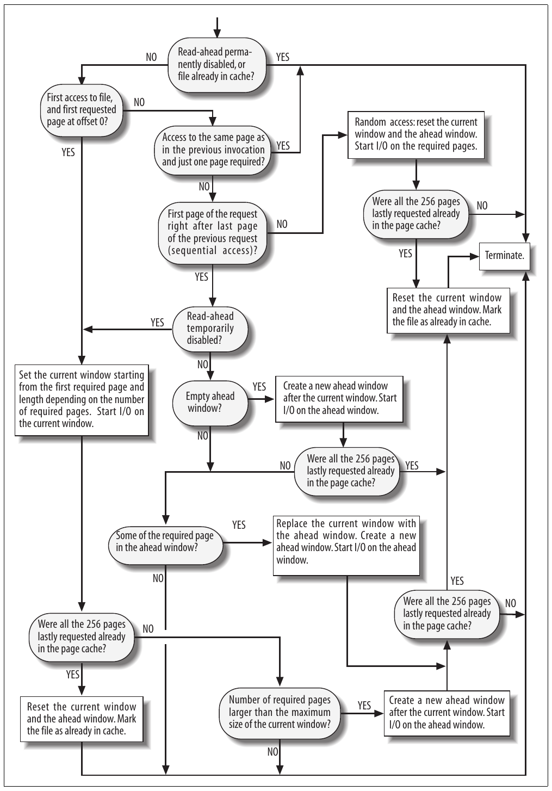
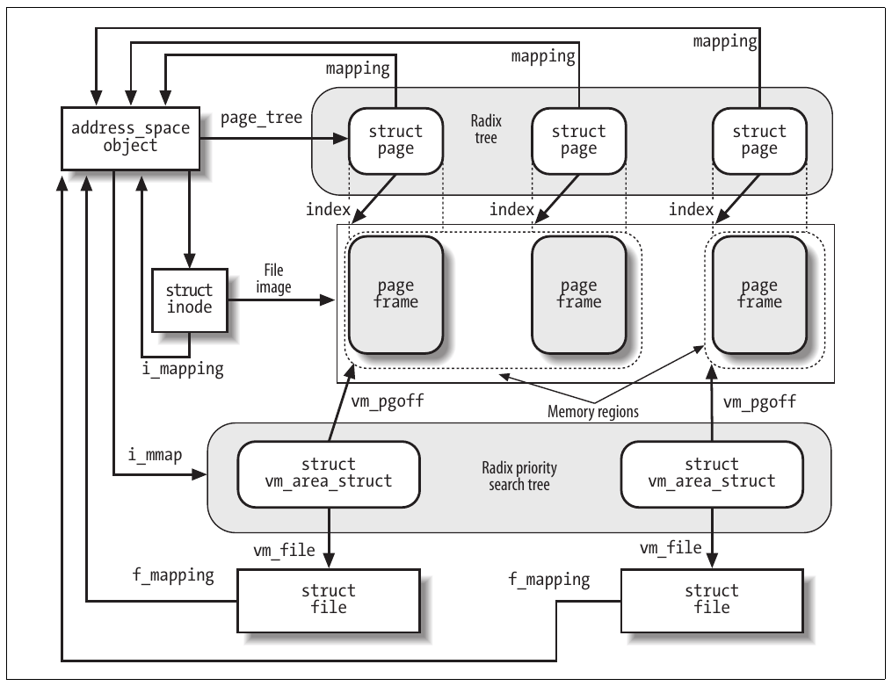

# Chương 16. Truy cập file


Truy cập disk-based file là hoạt động phức tạp liên quan VFS abstraction layer (Chương 12), xử lý block device (Chương 14) và dùng page cache (Chương 15). Chương này trình bày cách kernel dựa trên mọi cơ chế đó để thực hiện đọc và ghi file. Chủ đề trong chương áp dụng cho cả regular file lưu trong disk-based filesystem lẫn block device file; hai loại này sẽ được gọi đơn giản là “file”.

Giai đoạn chúng ta xem xét trong chương này bắt đầu sau khi method read hoặc write thích hợp của file cụ thể được gọi (như mô tả trong Chương 12). Ở đây chúng ta trình bày cách mỗi read kết thúc với dữ liệu mong muốn được chuyển đến User Mode process và cách mỗi write kết thúc với dữ liệu được đánh dấu sẵn sàng truyền vào disk. Phần transfer còn lại được các cơ chế mô tả trong Chương 14 và Chương 15 xử lý.

Có nhiều cách truy cập file. Trong chương này, chúng ta xét các trường hợp sau:

Canonical mode

File được mở với các flag `O_SYNC` và `O_DIRECT` clear, và nội dung được truy cập qua system call `read()` và `write()`. Trong trường hợp này, system call `read()` block calling process đến khi dữ liệu được sao chép vào User Mode address space (tuy nhiên, kernel luôn được phép trả ít byte hơn yêu cầu!). System call `write()` khác vì kết thúc ngay khi dữ liệu được sao chép vào page cache (deferred write). Trường hợp này được trình bày trong phần “Reading and Writing a File”.

Synchronous mode

File được mở với flag `O_SYNC` set—hoặc flag được system call `fcntl()` set sau đó. Flag này chỉ ảnh hưởng write operation (read operation luôn blocking), block calling process đến khi dữ liệu thực sự ghi vào disk. Phần “Reading and Writing a File” cũng trình bày trường hợp này.

Memory mapping mode

Sau khi mở file, ứng dụng gọi system call `mmap()` để map file vào memory. Kết quả là file xuất hiện như array byte trong RAM, và ứng dụng truy cập trực tiếp phần tử array thay vì dùng `read()`, `write()`, hoặc `lseek()`. Trường hợp này được bàn trong phần “Memory Mapping”.

Direct I/O mode

File được mở với flag `O_DIRECT` set. Mọi read hoặc write operation truyền dữ liệu trực tiếp từ User Mode address space đến disk hoặc ngược lại, bỏ qua page cache. Chúng ta bàn trường hợp này trong phần “Direct I/O Transfers”. (Giá trị flag `O_SYNC` và `O_DIRECT` có thể kết hợp theo bốn cách có ý nghĩa.)

Asynchronous mode

File được truy cập—qua nhóm POSIX API hoặc system call Linux-specific—sao cho thực hiện “asynchronous I/O”: nghĩa là data transfer request không bao giờ block calling process; thay vào đó được thực hiện “ở nền” trong khi ứng dụng tiếp tục thực thi bình thường. Chúng ta bàn trường hợp này trong phần “Asynchronous I/O”.

## Đọc và ghi file

Phần “The read() and write() System Calls” trong Chương 12 đã mô tả cách triển khai system call `read()` và `write()`. Service routine tương ứng cuối cùng gọi method `read` và `write` của file object, có thể phụ thuộc filesystem. Với disk-based filesystem, các method này tìm physical block chứa dữ liệu đang truy cập và kích hoạt block device driver để bắt đầu data transfer.

Đọc file page-based: kernel luôn truyền toàn page dữ liệu mỗi lần. Nếu process gọi system call `read()` để lấy vài byte và dữ liệu chưa trong RAM, kernel cấp phát page frame mới, điền page bằng phần file thích hợp, thêm page vào page cache, rồi cuối cùng sao chép byte yêu cầu vào process address space. Với phần lớn filesystem, đọc page dữ liệu từ file chỉ là tìm block trên disk chứa dữ liệu yêu cầu. Khi xong, kernel điền page bằng cách gửi I/O operation thích hợp đến generic block layer. Trong thực tế, method `read` của mọi disk-based filesystem được triển khai bằng function chung tên `generic_file_read()`.

Write operation trên disk-based file hơi phức tạp hơn vì file size có thể tăng, nên kernel có thể cấp phát một số physical block trên disk. Tất nhiên, cách thực hiện chính xác phụ thuộc loại filesystem. Tuy nhiên, nhiều disk-based filesystem triển khai method `write` qua function chung tên `generic_file_write()`. Ví dụ gồm Ext2, System V/Coherent/Xenix và MINIX. Mặt khác, một số filesystem khác như journaling và network filesystem triển khai method `write` qua custom function.

### Đọc từ file

Function `generic_file_read()` được dùng triển khai method `read` cho block device file và regular file của gần như mọi disk-based filesystem. Function nhận các parameter sau:

`filp`

Địa chỉ file object

`buf`

Linear address của User Mode memory area cần lưu character đọc từ file

`count`

Số character cần đọc

`ppos`

Pointer đến biến lưu offset bắt đầu đọc (thường field `f_pos` của file object `filp`)

Bước đầu, function khởi tạo hai descriptor. Descriptor đầu lưu trong local variable `local_iov` kiểu `iovec`; chứa địa chỉ (`buf`) và độ dài (`count`) của User Mode buffer sẽ nhận dữ liệu đọc từ file. Descriptor thứ hai lưu trong local variable `kiocb` kiểu `kiocb`; dùng theo dõi completion status của synchronous hoặc asynchronous I/O operation đang diễn ra. Field chính của descriptor `kiocb` trình bày trong Bảng 16-1.

Bảng 16-1. Field chính của descriptor kiocb

| Kiểu | Field | Mô tả |
|---|---|---|
| `struct list_head` | `ki_run_list` | Pointer cho list I/O operation cần thử lại sau |
| `long` | `ki_flags` | Flag của descriptor `kiocb` |
| `int` | `ki_users` | Usage counter của descriptor `kiocb` |
| `unsigned int` | `ki_key` | Identifier của asynchronous I/O operation, hoặc `KIOCB_SYNC_KEY` (`0xffffffff`) cho synchronous I/O operation |
| `struct file *` | `ki_filp` | Pointer đến file object gắn với I/O operation đang diễn ra |
| `struct kioctx *` | `ki_ctx` | Pointer đến asynchronous I/O context descriptor cho operation này (xem phần “Asynchronous I/O” ở phần sau chương này) |
| `int (*) (struct kiocb *, struct io_event *)` | `ki_cancel` | Method gọi khi hủy asynchronous I/O operation |
| `ssize_t (*) (struct kiocb *)` | `ki_retry` | Method gọi khi thử lại asynchronous I/O operation |
| `void (*) (struct kiocb *)` | `ki_dtor` | Method gọi khi hủy descriptor `kiocb` |
| `struct list_head` | `ki_list` | Pointer cho list active ongoing I/O operation trên asynchronous I/O context |
| `union` | `ki_obj` | Với synchronous operation, pointer đến process descriptor đã gửi I/O operation; với asynchronous operation, pointer đến User Mode data structure `iocb` |
| `__u64` | `ki_user_data` | Giá trị trả về cho User Mode process |
| `loff_t` | `ki_pos` | File position hiện tại của I/O operation đang diễn ra |
| `unsigned short` | `ki_opcode` | Loại operation (read, write hoặc sync) |
| `size_t` | `ki_nbytes` | Số byte cần truyền |
| `char *` | `ki_buf` | Vị trí hiện tại trong User Mode buffer |
| `size_t` | `ki_left` | Số byte còn cần truyền |
| `wait_queue_t` | `ki_wait` | Wait queue dùng cho asynchronous I/O operation |
| `void *` | `private` | Filesystem layer có thể tự do dùng |

Function `generic_file_read()` khởi tạo descriptor `kiocb` bằng macro `init_sync_kiocb`, đặt các field của object cho synchronous operation. Cụ thể, macro đặt field `ki_key` thành `KIOCB_SYNC_KEY`, field `ki_filp` thành `filp`, và field `ki_obj` thành `current`.

Sau đó, `generic_file_read()` gọi `__generic_file_aio_read()`, truyền địa chỉ descriptor `iovec` và `kiocb` vừa điền. Function sau trả về giá trị thường là số byte thực sự đọc từ file; `generic_file_read()` kết thúc bằng cách trả giá trị này.

Function `__generic_file_aio_read()` là general-purpose routine được mọi filesystem dùng triển khai cả synchronous lẫn asynchronous read operation. Function nhận bốn parameter: địa chỉ `iocb` của descriptor `kiocb`, địa chỉ `iov` của array descriptor `iovec`, độ dài array, và địa chỉ `ppos` của biến lưu current pointer của file. Khi được `generic_file_read()` gọi, array descriptor `iovec` chỉ gồm một phần tử mô tả User Mode buffer sẽ nhận dữ liệu.[^1]

Giờ chúng ta giải thích action của function `__generic_file_aio_read()`; để đơn giản, giới hạn mô tả ở trường hợp phổ biến nhất: synchronous operation do system call `read()` trên page-cached file tạo. Phía sau chương này, chúng ta mô tả hành vi function trong trường hợp khác. Như thường lệ, không bàn cách xử lý lỗi và điều kiện bất thường.

Sau đây là các bước function thực hiện:

1\. Gọi `access_ok()` để xác minh User Mode buffer do descriptor `iovec` mô tả hợp lệ. Vì starting address và length nhận từ service routine `sys_read()`, phải kiểm tra trước khi dùng (xem phần “Verifying the Parameters” trong Chương 10). Nếu parameter không hợp lệ, trả về error code `-EFAULT`.

2\. Thiết lập read operation descriptor—cụ thể data structure kiểu `read_descriptor_t` lưu status hiện tại của file read operation đang diễn ra liên quan một User Mode buffer. Các field của descriptor trong Bảng 16-2.

3\. Gọi `do_generic_file_read()`, truyền file object pointer `filp`, pointer đến file offset `ppos`, địa chỉ read operation descriptor vừa cấp phát, và địa chỉ function `file_read_actor()` (xem phía sau).

4\. Trả về số byte đã sao chép vào User Mode buffer; tức giá trị trong field `written` của data structure `read_descriptor_t`.

Bảng 16-2. Các field của read operation descriptor

| Kiểu | Field | Mô tả |
|---|---|---|
| `size_t` | `written` | Bao nhiêu byte đã sao chép vào User Mode buffer |
| `size_t` | `count` | Bao nhiêu byte còn cần truyền |
| `char *` | `arg.buf` | Vị trí hiện tại trong User Mode buffer |
| `int` | `error` | Error code của read operation (0 nếu không lỗi) |

Function `do_generic_file_read()` đọc page yêu cầu từ disk và sao chép vào User Mode buffer. Cụ thể, function thực hiện các action sau:

1\. Lấy object `address_space` tương ứng file đang đọc; địa chỉ lưu trong `filp->f_mapping`.

2\. Lấy owner của object `address_space`, tức inode object sẽ sở hữu page cần điền dữ liệu file; địa chỉ lưu trong field `host` của object `address_space`. Nếu file đang đọc là block device file, owner là inode trong special filesystem bdev thay vì inode được `filp-> f_dentry->d_inode` trỏ đến (xem “The address\_space Object” trong Chương 15). 3. Xem file chia thành page dữ liệu (4.096 byte mỗi page). Function suy ra từ file pointer `*ppos` logical number của page chứa byte đầu yêu cầu—tức index của page trong address space—và lưu vào local variable `index`. Function còn lưu trong local variable `offset` độ lệch trong page của byte đầu yêu cầu.

4\. Bắt đầu vòng lặp đọc mọi page chứa byte yêu cầu; số byte cần đọc lưu trong field `count` của descriptor `read_descriptor_t`.

Trong một lượt lặp, function truyền page dữ liệu bằng các bước con sau:

a. Nếu `index*4096+offset` vượt file size lưu trong field `i_size` của inode object, thoát vòng lặp và đến bước 5.

b. Gọi `cond_resched()` để kiểm tra flag `TIF_NEED_RESCHED` của process hiện tại và gọi function `schedule()` nếu flag set.

c. Nếu phải đọc trước page bổ sung, gọi `page_cache_readahead()` để đọc. Chúng ta để thảo luận read-ahead sang phần “Read-Ahead of Files” phía sau.

d. Gọi `find_get_page()`, truyền parameter là pointer đến object `address_space` và giá trị `index`; function tra page cache để tìm descriptor của page lưu dữ liệu yêu cầu nếu có.

e. Nếu `find_get_page()` trả về pointer `NULL`, page yêu cầu không trong page cache. Khi đó thực hiện các action sau:

1\. Gọi `handle_ra_miss()` để điều chỉnh parameter mà read-ahead system dùng.

2\. Cấp phát page mới.

3\. Chèn descriptor của page mới vào page cache bằng cách gọi `add_to_page_cache()`. Nhớ rằng function này set flag `PG_locked` của page mới.

4\. Chèn descriptor của page mới vào LRU list bằng cách gọi `lru_cache_add()` (xem Chương 17). 5. Nhảy đến bước 4j để bắt đầu đọc dữ liệu file.

f. Nếu function đến đây, page ở trong page cache. Kiểm tra flag `PG_uptodate`; nếu set, dữ liệu lưu trong page up-to-date, nên không cần đọc từ disk: nhảy đến bước 4m.

g. Dữ liệu trên page không hợp lệ nên phải đọc từ disk. Function lấy quyền truy cập độc quyền page bằng function `lock_page()`. Như mô tả trong phần “Page Cache Handling Functions” ở Chương 15, `lock_page()` tạm dừng process hiện tại nếu flag `PG_locked` đã set đến khi bit clear.

h. Giờ page do process hiện tại lock. Tuy nhiên, process khác có thể đã loại page khỏi page cache ngay trước bước trước; do đó kiểm tra field `mapping` của page descriptor có là `NULL` không; khi đó unlock page bằng `unlock_page()`, giảm usage counter (đã được `find_get_page()` tăng), và quay lại bước 4a bắt đầu lại với cùng page.

i. Nếu function đến đây, page locked và vẫn trong page cache. Kiểm tra lại flag `PG_uptodate` vì kernel control path khác có thể đã hoàn thành read cần thiết giữa bước 4f và 4g. Nếu flag set, gọi `unlock_page()` và nhảy đến bước 4m để bỏ qua read operation.

j. Giờ có thể bắt đầu I/O operation thực tế. Gọi method `readpage` của object `address_space` của file. Function tương ứng đảm nhiệm kích hoạt I/O data transfer từ disk đến page. Chúng ta bàn phía sau function này làm gì cho regular file và block device file.

k. Nếu flag `PG_uptodate` vẫn clear, đợi page thực sự được đọc bằng cách gọi function `lock_page()`. Page, đã lock ở bước 4g, sẽ unlock ngay khi read operation kết thúc. Do đó, process hiện tại sleep đến khi I/O data transfer kết thúc.

l. Nếu `index` vượt file size tính bằng page (số này lấy bằng chia giá trị field `i_size` của inode object cho 4.096), giảm usage counter của page và thoát vòng lặp bằng cách nhảy đến bước 5. Trường hợp này xảy ra khi file đang đọc đồng thời bị process khác truncate.

m. Lưu trong local variable `nr` số byte trong page nên sao chép vào User Mode buffer. Giá trị bằng page size (4.096 byte), trừ khi `offset` khác không—chỉ xảy ra cho page đầu hoặc cuối dữ liệu yêu cầu—hoặc file không chứa đủ byte yêu cầu.

n. Gọi `mark_page_accessed()` để set flag `PG_referenced` hoặc `PG_active`, qua đó biểu thị page đang dùng và không nên swap out (xem Chương 17). Nếu cùng page (hoặc một phần) được đọc nhiều lần trong các lần thực thi `do_generic_file_read()` liên tiếp, bước này chỉ thực hiện trong read đầu.

o. Giờ sao chép dữ liệu trên page vào User Mode buffer. Để làm vậy, `do_generic_file_read()` gọi function `file_read_actor()` có địa chỉ đã truyền làm parameter. Đến lượt `file_read_actor()` thực hiện về cơ bản các bước sau:

1\. Gọi `kmap()`, thiết lập permanent kernel mapping cho page nếu trong high memory (xem phần “Kernel Mappings of High-Memory Page Frames” trong Chương 8).

2\. Gọi `__copy_to_user()`, sao chép dữ liệu trên page vào User Mode address space (xem phần “Accessing the Process Address Space” trong Chương 10). Lưu ý operation có thể block process vì page fault khi truy cập User Mode address space.

3\. Gọi `kunmap()` để giải phóng permanent kernel mapping bất kỳ của page.

4\. Cập nhật các field `count`, `written`, và `buf` của descriptor `read_descriptor_t`.

p. Cập nhật local variable `index` và `offset` theo số byte thực sự truyền vào User Mode buffer. Thường nếu byte cuối page đã sao chép vào User Mode buffer, `index` tăng một và `offset` đặt không; ngược lại, `index` không tăng và `offset` đặt thành số byte trong page đã sao chép vào User Mode buffer.

q. Giảm page descriptor usage counter.

r. Nếu field `count` của descriptor `read_descriptor_t` khác không, còn dữ liệu khác cần đọc từ file: nhảy đến bước 4a để tiếp tục vòng lặp với page dữ liệu tiếp theo trong file.

5\. Đã đọc mọi byte yêu cầu—hoặc khả dụng. Function cập nhật read-ahead data structure `filp->f_ra` để ghi nhận dữ liệu đang được đọc tuần tự từ file (xem phần “Read-Ahead of Files” phía sau).

6\. Gán cho `*ppos` giá trị `index*4096+offset`, qua đó lưu vị trí tiếp theo cho sequential access trong lời gọi system call `read()` và `write()` tương lai. 7. Gọi `update_atime()` để lưu thời điểm hiện tại trong field `i_atime` của inode của file và đánh dấu inode dirty, rồi trả về.

#### Method readpage cho regular file

Như đã thấy, method `readpage` được `do_generic_file_read()` dùng lặp lại để đọc từng page từ disk vào memory.

Method `readpage` của object `address_space` lưu địa chỉ function thực sự kích hoạt I/O data transfer từ physical disk đến page cache. Với regular file, field thường trỏ đến wrapper gọi function `mpage_readpage()`. Ví dụ, method `readpage` của Ext3 filesystem được triển khai bằng function sau:

```c
int ext3_readpage(struct file *file, struct page *page)
{
    return mpage_readpage(page, ext3_get_block);
}
```

Cần wrapper vì function `mpage_readpage()` nhận parameter là descriptor `page` của page cần điền và địa chỉ `get_block` của function giúp `mpage_readpage()` tìm block đúng. Wrapper filesystem-specific nên có thể cung cấp function thích hợp lấy block. Function này chuyển block number tương đối đầu file thành logical block number tương đối vị trí block trong disk partition (xem ví dụ Chương 18). Tất nhiên, parameter sau phụ thuộc loại filesystem mà regular file thuộc về; trong ví dụ trước, parameter là địa chỉ function `ext3_get_block()`. Function truyền làm `get_block` luôn dùng buffer head lưu thông tin quý về block device (field `b_dev`), vị trí dữ liệu yêu cầu trên device (field `b_blocknr`) và block status (field `b_state`).

Function `mpage_readpage()` chọn giữa hai chiến lược khi đọc page từ disk. Nếu block chứa dữ liệu yêu cầu nằm liên tiếp trên disk, function gửi read I/O operation cho generic block layer bằng một bio descriptor. Ngược lại, mỗi block trong page được đọc bằng bio descriptor khác. Function `get_block` filesystem-dependent đóng vai trò thiết yếu xác định block tiếp theo trong file có phải block tiếp theo trên disk không.

Cụ thể, `mpage_readpage()` thực hiện các bước sau:

1\. Kiểm tra field `PG_private` của page descriptor: nếu set, page là buffer page, tức gắn với list buffer head mô tả block tạo thành page (xem phần “Storing Blocks in the Page Cache” trong Chương 15). Điều này nghĩa là page đã được đọc từ disk trước đây và block trong page không liền kề trên disk: nhảy đến bước 11 để đọc page từng block.

2\. Lấy block size (lưu trong inode field `page->mapping->host->i_blkbits`) và tính hai giá trị cần để truy cập mọi block trên page: số block lưu trong page và file block number của block đầu page—tức index của block đầu page tương đối đầu file.

3\. Với mỗi block trong page, gọi function `get_block` filesystem-dependent truyền làm parameter để lấy logical block number, tức index của block tương đối đầu disk hoặc partition. Logical block number của mọi block trong page lưu trong local array.

4\. Kiểm tra điều kiện bất thường có thể xảy ra khi thực hiện bước trước. Cụ thể, nếu một số block không liền kề trên disk, hoặc block nào đó nằm trong “file hole” (xem phần “File Holes” trong Chương 18), hoặc block buffer đã được function `get_block` điền, nhảy đến bước 11 để đọc page từng block.

5\. Nếu function đến đây, mọi block trên page liền kề trên disk. Tuy nhiên, page có thể là page dữ liệu cuối file, nên một số block trong page có thể không có image trên disk. Nếu vậy, điền block buffer tương ứng trong page bằng số không; ngược lại, set flag `PG_mappedtodisk` của page descriptor. 6. Gọi `bio_alloc()` để cấp phát bio descriptor mới gồm một segment và khởi tạo các field `bi_bdev` và `bi_sector` lần lượt bằng địa chỉ block device descriptor và logical block number của block đầu page. Cả hai thông tin đã xác định ở bước 3 trên.

7\. Đặt descriptor `bio_vec` của segment của bio bằng địa chỉ đầu page, offset của byte đầu cần đọc (không), và tổng số byte cần đọc.

8\. Lưu địa chỉ function `mpage_end_io_read()` trong field `bio->bi_end_io` (xem bên dưới).

9\. Gọi `submit_bio()`, đặt flag `bi_rw` bằng chiều data transfer, cập nhật per-CPU variable `page_states` để theo dõi số sector đọc, và gọi function `generic_make_request()` trên bio descriptor (xem phần “Issuing a Request to the I/O Scheduler” trong Chương 14).

10\. Trả về giá trị không (thành công).

11\. Nếu function nhảy đến đây, page chứa block không liền kề trên disk. Nếu page up-to-date (flag `PG_uptodate` set), function gọi `unlock_page()` để unlock page; ngược lại gọi `block_read_full_page()` để bắt đầu đọc page từng block (xem bên dưới).

12\. Trả về giá trị không (thành công).

Function `mpage_end_io_read()` là completion method của bio; được thực thi ngay khi I/O data transfer kết thúc. Giả định không có I/O error, function về cơ bản set flag `PG_uptodate` của page descriptor, gọi `unlock_page()` để unlock page và đánh thức process bất kỳ sleep đợi sự kiện này, rồi gọi `bio_put()` để hủy bio descriptor.

##### Method readpage cho block device file

Trong các phần “VFS Handling of Device Files” ở Chương 13 và “Opening a Block Device File” ở Chương 14, chúng ta đã bàn cách kernel xử lý request mở block device file. Chúng ta đã thấy function `init_special_inode()` thiết lập device inode và function `blkdev_open()` hoàn tất giai đoạn mở.

Block device dùng object `address_space` lưu trong field `i_data` của block device inode tương ứng trong special filesystem bdev. Khác regular file—có method `readpage` trong object `address_space` phụ thuộc loại filesystem mà file thuộc về—method `readpage` của block device file luôn giống nhau. Nó được function `blkdev_readpage()` triển khai, gọi `block_read_full_page()`:

```c
int blkdev_readpage(struct file * file, struct * page page)
{
    return block_read_full_page(page, blkdev_get_block);
}
```

Như bạn thấy, function một lần nữa là wrapper, lần này cho function `block_read_full_page()`. Lần này parameter thứ hai trỏ đến function chuyển file block number tương đối đầu file thành logical block number tương đối đầu block device. Tuy nhiên, với block device file, hai số trùng nhau; do đó function `blkdev_get_block()` thực hiện các bước sau:

1\. Kiểm tra number của block đầu page có vượt index của block cuối trong block device không (index lấy bằng chia kích thước block device lưu trong `bdev->bd_inode->i_size` cho block size lưu trong `bdev-> bd_block_size`; `bdev` trỏ đến descriptor của block device). Nếu có, trả về `-EIO` cho write operation hoặc không cho read operation. (Cũng không được đọc quá cuối block device, nhưng không nên trả error code ở đây: kernel có thể chỉ đang cố dispatch read request cho dữ liệu cuối block device, và buffer page tương ứng chỉ được map một phần.)

2\. Đặt field `b_dev` của buffer head thành `bdev`.

3\. Đặt field `b_blocknr` của buffer head thành file block number đã truyền làm parameter của function.

4\. Set flag `BH_Mapped` của buffer head để nêu các field `b_dev` và `b_blocknr` của buffer head có ý nghĩa.

Function `block_read_full_page()` đọc page dữ liệu từng block. Như đã thấy, dùng cả khi đọc block device file lẫn page của regular file có block không liền kề trên disk. Function thực hiện các bước sau:

1\. Kiểm tra flag `PG_private` của page descriptor; nếu set, page gắn với list buffer head mô tả block tạo thành page (xem phần “Storing Blocks in the Page Cache” trong Chương 15). Ngược lại, function gọi `create_empty_buffers()` để cấp phát buffer head cho mọi block buffer trong page. Địa chỉ buffer head cho buffer đầu page lưu trong field `page->private`. Field `b_this_page` của mỗi buffer head trỏ đến buffer head của buffer tiếp theo trong page.

2\. Suy ra từ file offset liên quan page (field `page->index`) file block number của block đầu page.

3\. Với mỗi buffer head của buffer trong page, thực hiện các bước con sau:

a. Nếu flag `BH_Uptodate` set, bỏ qua buffer và tiếp tục buffer tiếp theo trong page.

b. Nếu flag `BH_Mapped` không set và block không vượt cuối file, gọi function `get_block` filesystem-dependent có địa chỉ đã truyền làm parameter. Với regular file, function tìm trong on-disk data structure của filesystem để lấy logical block number của buffer tương đối đầu disk hoặc partition. Ngược lại, với block device file, function xem file block number là logical block number. Trong cả hai trường hợp, function lưu logical block number trong field `b_blocknr` của buffer head tương ứng và set flag `BH_Mapped`.[^2] c. Kiểm tra lại flag `BH_Uptodate` vì function `get_block` filesystem-dependent có thể đã kích hoạt block I/O operation cập nhật buffer. Nếu `BH_Uptodate` set, tiếp tục buffer tiếp theo trong page.

d. Lưu địa chỉ buffer head trong local array `arr` và tiếp tục buffer tiếp theo trong page.

4\. Nếu không gặp file hole ở bước trước, function set flag `PG_mappedtodisk` của page.

5\. Giờ local array `arr` lưu địa chỉ buffer head tương ứng buffer có nội dung chưa up-to-date. Nếu array rỗng, mọi buffer trong page hợp lệ. Vì vậy function set flag `PG_uptodate` của page descriptor, unlock page bằng `unlock_page()` và trả về.

6\. Local array `arr` không rỗng. Với mỗi buffer head trong array, `block_read_full_page()` thực hiện các bước con sau: a. Set flag `BH_Lock`. Nếu flag đã set, function đợi đến khi buffer được giải phóng.

b. Đặt field `b_end_io` của buffer head thành địa chỉ function `end_buffer_async_read()` (xem bên dưới) và set flag `BH_Async_Read` của buffer head.

7\. Với mỗi buffer head trong local array `arr`, gọi function `submit_bh()` trên nó, chỉ định operation type `READ`. Như đã thấy, function kích hoạt I/O data transfer của block tương ứng.

8\. Trả về 0.

Function `end_buffer_async_read()` là completion method của buffer head; được thực thi ngay khi I/O data transfer trên block buffer kết thúc. Giả định không có I/O error, function set flag `BH_Uptodate` của buffer head và clear flag `BH_Async_Read`. Sau đó lấy descriptor của buffer page chứa block buffer (địa chỉ lưu trong field `b_page` của buffer head) và kiểm tra mọi block trong page up-to-date chưa; nếu có, function set flag `PG_uptodate` của page và gọi `unlock_page()`.

### Read-Ahead của file

Nhiều disk access là tuần tự. Như sẽ thấy trong Chương 18, regular file lưu trên disk thành nhóm sector liền kề lớn để lấy nhanh với ít lần di chuyển disk head. Khi chương trình đọc hoặc sao chép file, thường truy cập tuần tự từ byte đầu đến cuối. Do đó, nhiều sector liền kề trên disk có khả năng được lấy khi xử lý chuỗi read request của process trên cùng file.

Read-ahead gồm đọc nhiều page dữ liệu liền kề của regular file hoặc block device file trước khi thực sự được yêu cầu. Trong phần lớn trường hợp, read-ahead tăng đáng kể disk performance vì cho disk controller xử lý ít command hơn, mỗi command tham chiếu vùng sector liền kề lớn hơn. Hơn nữa, cải thiện system responsiveness. Process đọc file tuần tự thường không phải đợi dữ liệu yêu cầu vì đã có trong RAM.

Tuy nhiên, read-ahead không hữu ích khi ứng dụng truy cập file ngẫu nhiên; trong trường hợp này thực sự có hại vì có xu hướng lãng phí chỗ trong page cache bằng thông tin vô ích. Do đó, kernel giảm—hoặc dừng—read-ahead khi xác định I/O access vừa thực hiện không tuần tự với lần trước.

Read-ahead của file cần thuật toán tinh vi vì nhiều lý do:

- Vì đọc từng page, read-ahead algorithm không phải xét offset trong page mà chỉ vị trí page được truy cập trong file.

- Có thể tăng dần Read-ahead chừng nào process còn truy cập file tuần tự.

- Phải giảm hoặc thậm chí disable Read-ahead khi access hiện tại không tuần tự với lần trước (random access).

- Nên dừng Read-ahead khi process tiếp tục truy cập lặp lại cùng page (chỉ dùng phần nhỏ file), hoặc khi gần như mọi page của file đã trong page cache.

- Nên kích hoạt low-level I/O device driver đúng lúc để page tương lai đã truyền xong khi process cần.

Kernel xem file access là tuần tự so với file access trước nếu page đầu yêu cầu là page theo sau page cuối yêu cầu trong access trước.

Khi truy cập file cho trước, read-ahead algorithm dùng hai tập page, mỗi tập tương ứng phần liên tiếp của file. Hai tập gọi là current window và ahead window.

Current window gồm page process yêu cầu hoặc kernel đọc trước và có trong page cache. (Page trong current window không nhất thiết up-to-date vì I/O data transfer có thể vẫn diễn ra.) Current window chứa cả page cuối process truy cập tuần tự và có thể cả một số page kernel đã đọc trước nhưng process chưa yêu cầu.

Ahead window gồm page—theo sau page trong current window—hiện đang được kernel đọc trước. Chưa page nào trong ahead window được process yêu cầu, nhưng kernel giả định sớm muộn process sẽ yêu cầu.

Khi kernel nhận ra sequential access và page ban đầu thuộc current window, nó kiểm tra ahead window đã thiết lập chưa. Nếu chưa, kernel tạo ahead window mới và kích hoạt read operation cho page tương ứng. Lý tưởng là process vẫn yêu cầu page từ current window trong khi page của ahead window đang truyền. Khi process yêu cầu page trong ahead window, ahead window thành current window mới.

Data structure chính read-ahead algorithm dùng là descriptor `file_ra_state`, có các field trong Bảng 16-3. Mỗi file object chứa descriptor đó trong field `f_ra`.

Bảng 16-3. Các field của descriptor file\_ra\_state

| Kiểu | Field | Mô tả |
|---|---|---|
| `unsigned long` | `start` | Index page đầu trong current window |
| `unsigned long` | `size` | Số page trong current window (`-`1 cho read-ahead tạm disable, 0 cho current window rỗng) |
| `unsigned long` | `flags` | Flag dùng điều khiển read-ahead |
| `unsigned long` | `cache_hit` | Số cache hit liên tiếp (page process yêu cầu và tìm thấy trong page cache) |
| `unsigned long` | `prev_page` | Index page cuối process yêu cầu |
| `unsigned long` | `ahead_start` | Index page đầu trong ahead window |
| `unsigned long` | `ahead_size` | Số page trong ahead window (0 cho ahead window rỗng) |
| `unsigned long` | `ra_pages` | Kích thước tối đa tính bằng page của read-ahead window (0 cho read-ahead disable vĩnh viễn) |
| `unsigned long` | `mmap_hit` | Read-ahead hit counter (dùng cho memory mapped file) |
| `unsigned long` | `mmap_miss` | Read-ahead miss counter (dùng cho memory mapped file) |

Khi mở file, mọi field của descriptor `file_ra_state` được đặt không trừ các field `prev_page` và `ra_pages`.

Field `prev_page` lưu index page cuối process yêu cầu trong read operation trước; ban đầu chứa giá trị `-`1.

Field `ra_pages` biểu diễn kích thước tối đa tính bằng page cho current window, tức read-ahead tối đa cho phép với file. Giá trị ban đầu (mặc định) lưu trong descriptor `backing_dev_info` của block device chứa file (xem phần “Request Queue Descriptors” trong Chương 14). Ứng dụng có thể điều chỉnh read-ahead algorithm cho opened file bằng sửa field `ra_pages`; có thể làm bằng system call `posix_fadvise()`, truyền command `POSIX_FADV_NORMAL` (đặt maximum size read-ahead về mặc định, thường 32 page), `POSIX_FADV_SEQUENTIAL` (đặt maximum size read-ahead gấp đôi mặc định), và `POSIX_FADV_RANDOM` (đặt maximum size read-ahead bằng không, do đó disable read-ahead vĩnh viễn).

Field `flags` chứa hai flag `RA_FLAG_MISS` và `RA_FLAG_INCACHE` đóng vai trò quan trọng. Flag đầu set khi không tìm thấy page đã đọc trước trong page cache (có khả năng vì kernel đã reclaim để giải phóng memory; xem Chương 17): khi đó kích thước ahead window tiếp theo sẽ tạo được giảm phần nào. Flag thứ hai set khi kernel xác định 256 page cuối process yêu cầu đều được tìm thấy trong page cache (giá trị cache hit liên tiếp lưu trong field `ra->cache_hit`). Khi đó read-ahead tắt vì kernel giả định mọi page process cần đã trong cache.

Khi nào thực thi read-ahead algorithm? Trong các trường hợp:

- Khi kernel xử lý User Mode request đọc page dữ liệu file; sự kiện này kích hoạt lời gọi function `page_cache_readahead()` (xem bước 4c trong mô tả function `do_generic_file_read()` ở phần “Reading from a File” trước đó trong chương này).

- Khi kernel cấp phát page cho file memory mapping (xem function `filemap_nopage()` trong phần “Demand Paging for Memory Mapping” phía sau, cũng gọi function `page_cache_readahead()`).

- Khi User Mode application thực thi system call `readahead()`, tường minh kích hoạt một số read-ahead activity trên file descriptor.

- Khi User Mode application thực thi system call `posix_fadvise()` với command `POSIX_FADV_NOREUSE` hoặc `POSIX_FADV_WILLNEED`, báo kernel rằng dải file page cho trước sẽ được truy cập trong tương lai gần.

- Khi User Mode application thực thi system call `madvise()` với command `MADV_WILLNEED`, báo kernel rằng dải page cho trước trong file memory mapping region sẽ được truy cập trong tương lai gần.

#### Function page\_cache\_readahead()

Function `page_cache_readahead()` đảm nhiệm mọi read-ahead operation không được system call ad-hoc kích hoạt tường minh. Nó bổ sung current và ahead window, cập nhật kích thước theo số read-ahead hit, tức mức thành công của read-ahead strategy trong access trước đến file.

Function được gọi khi kernel phải đáp ứng read request cho một hoặc nhiều page của file, và nhận năm parameter:

`mapping`

Pointer đến object `address_space` mô tả owner của page

`ra`

Pointer đến descriptor `file_ra_state` của file chứa page

`filp`

Địa chỉ file object `offset` Offset của page trong file

`req_size`

Số page còn cần đọc để hoàn tất read operation hiện tại[^3]

Hình 16-1 trình bày flow diagram của `page_cache_readahead()`. Function về cơ bản thao tác field của descriptor `file_ra_state`; do đó dù mô tả action trong flow diagram khá không hình thức, bạn dễ xác định bước thực tế function thực hiện. Ví dụ, để kiểm tra page yêu cầu giống page đọc trước không, function kiểm tra giá trị field `ra->prev_page` và parameter `offset` trùng nhau không (xem Bảng 16-3 trước đó).

Khi process truy cập file lần đầu và page đầu yêu cầu là page tại offset không trong file, function giả định process sẽ sequential access. Vì vậy tạo current window mới bắt đầu từ page đầu. Độ dài current window ban đầu—luôn là lũy thừa hai—ít nhiều liên quan số page process yêu cầu trong read operation đầu: càng nhiều page yêu cầu, current window càng lớn, đến giá trị tối đa lưu trong field `ra->ra_pages`. Ngược lại, khi process truy cập file lần đầu nhưng page đầu yêu cầu không tại offset không, function giả định process sẽ không sequential access. Vì vậy tạm disable read-ahead (field `ra->size` đặt thành `-`1). Tuy nhiên, current window mới được tạo khi function nhận ra sequential access trong lúc read-ahead tạm disable.

Nếu ahead window chưa tồn tại, được tạo ngay khi function nhận ra process đã sequential access trong current window. Ahead window luôn bắt đầu từ page theo sau page cuối current window. Tuy nhiên, độ dài liên quan độ dài current window như sau: nếu flag `RA_FLAG_MISS` set, độ dài ahead window bằng độ dài current window trừ 2, hoặc bốn page nếu kết quả nhỏ hơn bốn; ngược lại, độ dài ahead window bằng bốn hoặc hai lần độ dài current window. Nếu process tiếp tục truy cập file tuần tự, cuối cùng ahead window thành current window mới và ahead window mới được tạo. Do đó read-ahead được tăng mạnh nếu process đọc file tuần tự.

Ngay khi function nhận ra file access không tuần tự với lần trước, current và ahead window được clear (làm rỗng) và read-ahead tạm disable. Read-ahead được khởi động lại từ đầu ngay khi process thực hiện read operation tuần tự so với file access trước.



Hình 16-1. Flow diagram của function page\_cache\_readahead()

Mỗi khi `page_cache_readahead()` tạo window mới, nó bắt đầu read operation cho page trong đó. Để đọc nhóm page, `page_cache_readahead()` gọi function `blockable_page_cache_readahead()`. Để giảm kernel overhead, function sau dùng các đặc điểm khéo léo:

- Không đọc nếu request queue phục vụ block device read-congested (tăng congestion và block read-ahead không có ý nghĩa).

- Kiểm tra page cache cho mỗi page cần đọc; nếu page đã trong page cache, chỉ bỏ qua.

- Mọi page frame read request cần được cấp phát cùng lúc trước khi đọc disk. Nếu không lấy được tất cả page frame, read-ahead operation chỉ thực hiện trên page khả dụng. Một lần nữa, trì hoãn read-ahead đến khi mọi page frame khả dụng không có nhiều ý nghĩa.

- Bất cứ khi nào có thể, read operation được gửi đến generic block layer bằng multi-segment bio descriptor (xem phần “Segments” trong Chương 14). Điều này được method `readpages` chuyên biệt của object `address_space` thực hiện nếu được định nghĩa; ngược lại bằng cách gọi lặp lại method `readpage`. Method `readpage` được mô tả trong phần “Reading from a File” trước đó chỉ cho single-segment case, nhưng dễ điều chỉnh mô tả cho multi-segment case.

##### Function handle\_ra\_miss()

Trong một số trường hợp, kernel phải sửa read-ahead parameter vì read-ahead strategy có vẻ không hiệu quả. Xét function `do_generic_file_read()` mô tả trong phần “Reading from a File” trước đó trong chương này. Function `page_cache_readahead()` được gọi ở bước 4c. Flow diagram Hình 16-1 thể hiện hai trường hợp: page yêu cầu nằm trong current hoặc ahead window, nên đáng ra đã đọc trước, hoặc không, và function gọi `blockable_page_cache_readahead()` để đọc. Trong cả hai trường hợp, `do_generic_file_read()` nên tìm thấy page trong page cache ở bước 4d. Nếu không, nghĩa là page frame reclaiming algorithm đã loại page khỏi cache. Khi đó `do_generic_file_read()` gọi function `handle_ra_miss()`, điều chỉnh read-ahead algorithm bằng set flag `RA_FLAG_MISS` và clear flag `RA_FLAG_INCACHE`.

### Ghi vào file

Nhớ rằng system call `write()` liên quan chuyển dữ liệu từ User Mode address space của calling process vào kernel data structure rồi đến disk. Method `write` của file object cho mỗi loại filesystem định nghĩa write operation chuyên biệt. Trong Linux 2.6, method `write` của mỗi disk-based filesystem là procedure về cơ bản xác định disk block liên quan write operation, sao chép dữ liệu từ User Mode address space vào một số page thuộc page cache và đánh dấu buffer trong page là dirty.

Nhiều filesystem (gồm Ext2 hoặc JFS) triển khai method `write` của file object qua function `generic_file_write()`, nhận các parameter sau:

`file`

File object pointer

`buf`

Địa chỉ trong User Mode address space nơi cần lấy character để ghi vào file

`count`

Số character cần ghi

`ppos`

Địa chỉ biến lưu file offset bắt đầu ghi

Function thực hiện các bước sau:

1\. Khởi tạo local variable kiểu `iovec` chứa địa chỉ và độ dài User Mode buffer (xem thêm mô tả function `generic_file_read()` trong phần “Reading from a File” trước đó trong chương này).

2\. Xác định địa chỉ `inode` của inode object tương ứng file cần ghi (`file->f_mapping->host`) và lấy semaphore `inode->i_sem`. Nhờ semaphore, mỗi lần chỉ một process có thể gọi system call `write()` trên file.

3\. Gọi macro `init_sync_kiocb` để khởi tạo local variable kiểu `kiocb`. Như giải thích trong phần “Reading from a File” trước đó, macro đặt field `ki_key` thành `KIOCB_SYNC_KEY` (synchronous I/O operation), field `ki_filp` thành `file`, và field `ki_obj` thành `current`.

4\. Gọi `__generic_file_aio_write_nolock()` (xem bên dưới) để đánh dấu page chịu ảnh hưởng dirty, truyền địa chỉ local variable kiểu `iovec` và `kiocb`, số segment cho User Mode buffer—chỉ một trong trường hợp này—và parameter `ppos`.

5\. Nhả semaphore `inode->i_sem`.

6\. Kiểm tra flag `O_SYNC` của file, flag `S_SYNC` của inode, và flag `MS_SYNCHRONOUS` của superblock; nếu ít nhất một set, gọi function `sync_page_range()` để buộc kernel flush mọi page trong page cache đã tác động ở bước 4, block process hiện tại đến khi I/O data transfer kết thúc. Đến lượt `sync_page_range()` thực thi method `writepages` của object `address_space` nếu định nghĩa, hoặc function `mpage_writepages()` (xem phần “Writing Dirty Pages to Disk” ở phần sau chương này) để bắt đầu I/O transfer cho dirty page; rồi gọi `generic_osync_inode()` để flush inode và buffer liên quan vào disk, cuối cùng gọi `wait_on_page_bit()` để tạm dừng process hiện tại đến khi mọi bit `PG_writeback` của page được flush clear. 7. Trả về code do \_\_`generic_file_aio_write_nolock()` trả về, thường là số byte thực sự đã ghi.

Function `__generic_file_aio_write_nolock()` nhận bốn parameter: địa chỉ `iocb` của descriptor `kiocb`, địa chỉ `iov` của array descriptor `iovec`, độ dài array, và địa chỉ `ppos` của biến lưu current pointer của file. Khi được `generic_file_write()` gọi, array descriptor `iovec` chỉ gồm một phần tử mô tả User Mode buffer chứa dữ liệu cần ghi.[^4]

Giờ chúng ta giải thích action của function \_\_`generic_file_aio_write_nolock()`; để đơn giản, giới hạn mô tả ở trường hợp phổ biến nhất: common mode operation do system call `write()` trên page-cached file tạo. Phía sau chương này, chúng ta mô tả hành vi function trong trường hợp khác. Như thường lệ, không bàn cách xử lý lỗi và điều kiện bất thường.

Function thực hiện các bước sau:

1\. Gọi `access_ok()` để xác minh User Mode buffer do descriptor `iovec` mô tả hợp lệ (starting address và length nhận từ service routine `sys_write()`, nên phải kiểm tra trước khi dùng; xem phần “Verifying the Parameters” trong Chương 10). Nếu parameter không hợp lệ, trả về error code `-EFAULT`.

2\. Xác định địa chỉ `inode` của inode object tương ứng file cần ghi (`file->f_mapping->host`). Nhớ rằng nếu file là block device file, đây là inode trong special filesystem bdev (xem Chương 14).

3\. Đặt `current->backing_dev_info` thành địa chỉ descriptor `backing_dev_info` của file (`file->f_mapping->backing_dev_info`). Về cơ bản, thiết lập này cho process hiện tại ghi lại dirty page thuộc `file->f_mapping` ngay cả khi request queue tương ứng congested; xem Chương 17. 4. Nếu flag `O_APPEND` của `file->flags` on và file là regular (không phải block device file), đặt `*ppos` thành cuối file để mọi dữ liệu mới được append.

5\. Thực hiện nhiều kiểm tra file size. Ví dụ, write operation không được mở rộng regular file đến mức vượt per-user limit lưu trong `current->signal->rlim[RLIMIT_FSIZE]` (xem phần “Process Resource Limits” trong Chương 3) và filesystem limit lưu trong `inode->i_sb->s_maxbytes`.

Hơn nữa, nếu file không phải “large file” (flag `O_LARGEFILE` của `file->f_flags` clear), kích thước không thể vượt 2 GB. Nếu không đáp ứng bất kỳ ràng buộc nào, giảm số byte cần ghi.

6\. Nếu set, clear flag `suid` của file; còn clear flag `sgid` nếu file executable (xem phần “Access Rights and File Mode” trong Chương 1). Chúng ta không muốn user có thể sửa setuid file.

7\. Lưu time of day hiện tại trong field `inode->mtime` (thời điểm file write operation gần nhất) và field `inode->ctime` (thời điểm inode thay đổi gần nhất), rồi đánh dấu inode object dirty.

8\. Bắt đầu vòng lặp cập nhật mọi page của file liên quan write operation. Mỗi lượt thực hiện các bước con sau:

a. Gọi `find_lock_page()` để tìm page trong page cache (xem phần “Page Cache Handling Functions” trong Chương 15). Nếu function tìm thấy page, tăng usage counter và set flag `PG_locked`.

b. Nếu page không trong page cache, cấp phát page frame mới và gọi `add_to_page_cache()` để chèn page vào page cache; như giải thích trong phần “Page Cache Handling Functions” ở Chương 15, function này còn tăng usage counter và set flag `PG_locked`. Hơn nữa, function chèn page mới vào inactive list của memory zone (xem Chương 17).

c. Gọi method `prepare_write` của object `address_space` của inode (`file->f_mapping`). Function tương ứng đảm nhiệm cấp phát và khởi tạo buffer head cho page. Chúng ta bàn trong các phần sau function này làm gì cho regular file và block device file.

d. Nếu buffer trong high memory, thiết lập kernel mapping của User Mode buffer (xem phần “Kernel Mappings of High-Memory Page Frames” trong Chương 8). Sau đó gọi `__copy_from_user()` để sao chép character từ User Mode buffer vào page, và giải phóng kernel mapping.

e. Gọi method `commit_write` của object `address_space` của inode (`file->f_mapping`). Function tương ứng đánh dấu buffer bên dưới dirty để ghi vào disk sau. Chúng ta bàn function này làm gì cho regular file và block device file trong hai phần tiếp theo.

f. Gọi `unlock_page()` để clear flag `PG_locked` và đánh thức process bất kỳ đợi page.

g. Gọi `mark_page_accessed()` để cập nhật page status cho memory reclaiming algorithm (xem phần “The Least Recently Used (LRU) Lists” trong Chương 17).

h. Giảm page usage counter để hoàn tác lần tăng ở bước 8a hoặc 8b.

i. Trong lượt lặp này, thêm một page bị làm dirty: kiểm tra tỷ lệ dirty page trong page cache có vượt ngưỡng cố định không (thường 40% page trong hệ thống); nếu có, gọi `writeback_inodes()` để bắt đầu flush vài chục page vào disk (xem phần “Looking for Dirty Pages To Be Flushed” trong Chương 15).

j. Gọi `cond_resched()` để kiểm tra flag `TIF_NEED_RESCHED` của process hiện tại và gọi function `schedule()` nếu flag set.

9\. Giờ mọi page của file liên quan write operation đã được xử lý. Cập nhật giá trị `*ppos` trỏ ngay sau character cuối đã ghi.

10\. Đặt `current->backing_dev_info` thành `NULL` (xem bước 3).

11\. Kết thúc bằng cách trả về số byte thực sự ghi.

#### Method prepare\_write và commit\_write cho regular file

Các method `prepare_write` và `commit_write` của object `address_space` chuyên biệt hóa generic write operation do `generic_file_write()` triển khai cho regular file và block device file. Cả hai được gọi một lần cho mỗi page của file chịu ảnh hưởng write operation.

Mỗi disk-based filesystem định nghĩa method `prepare_write` riêng. Như read operation, method chỉ là wrapper cho function chung. Ví dụ, Ext2 filesystem thường triển khai method `prepare_write` qua function sau:

```c
int ext2_prepare_write(struct file *file, struct page *page,
                       unsigned from, unsigned to)
{
    return block_prepare_write(page, from, to, ext2_get_block);
}
```

Function `ext2_get_block()` đã được đề cập trong phần “Reading from a File” trước đó; chuyển block number tương đối file thành logical block number biểu diễn vị trí dữ liệu trên physical block device.

Function `block_prepare_write()` đảm nhiệm chuẩn bị buffer và buffer head của page của file bằng cách thực hiện về cơ bản các bước sau:

1\. Kiểm tra page có phải buffer page không (flag `PG_Private` set); nếu flag clear, gọi `create_empty_buffers()` để cấp phát buffer head cho mọi buffer trong page (xem phần “Buffer Pages” trong Chương 15).

2\. Với mỗi buffer head liên quan buffer trong page và chịu ảnh hưởng write operation, thực hiện:

a. Reset flag `BH_New` nếu set (xem bên dưới).

b. Nếu flag `BH_Mapped` không set, function thực hiện các bước con sau:

1\. Gọi function filesystem-dependent có địa chỉ `get_block` truyền làm parameter. Function này tìm trong on-disk data structure của filesystem để lấy logical block number của buffer (tương đối đầu disk partition thay vì đầu regular file). Function filesystem-dependent lưu number trong field `b_blocknr` của buffer head tương ứng và set flag `BH_Mapped`. Function `get_block` có thể cấp phát physical block mới cho file (ví dụ nếu block truy cập nằm trong “lỗ hổng” của regular file; xem phần “File Holes” trong Chương 18). Khi đó set flag `BH_New`.

2\. Kiểm tra giá trị flag `BH_New`; nếu set, gọi `unmap_underlying_metadata()` để kiểm tra block device buffer page nào trong page cache có chứa buffer tham chiếu cùng block trên disk không.[^5] Function về cơ bản gọi `__find_get_block()` để tìm block cũ trong page cache (xem phần “Searching Blocks in the Page Cache” trong Chương 15). Nếu tìm thấy block đó, function clear flag `BH_Dirty` và đợi mọi I/O data transfer trên buffer đó hoàn tất. Hơn nữa, nếu write operation không ghi lại toàn buffer trong page, điền phần không ghi bằng số không. Rồi xét buffer tiếp theo trong page.

c. Nếu write operation không ghi lại toàn buffer và các flag `BH_Delay` cùng `BH_Uptodate` không set (tức block đã được cấp phát trong on-disk filesystem data structure và buffer trong RAM không chứa image hợp lệ của dữ liệu), function gọi `ll_rw_block()` trên block để đọc nội dung từ disk (xem phần “Submitting Buffer Heads to the Generic Block Layer” trong Chương 15).

3\. Block process hiện tại đến khi mọi read operation kích hoạt ở bước 2c hoàn tất.

4\. Trả về 0.

Khi method `prepare_write` trả về, function `generic_file_write()` cập nhật page bằng dữ liệu lưu trong User Mode address space. Tiếp theo gọi method `commit_write` của object `address_space`. Method này được function `generic_commit_write()` triển khai cho gần như mọi disk-based non-journaling filesystem.

Function `generic_commit_write()` thực hiện về cơ bản các bước sau:

1\. Gọi function `__block_commit_write()`. Đến lượt function này:

a. Xét mọi buffer trong page chịu ảnh hưởng write operation; với mỗi buffer, set các flag `BH_Uptodate` và `BH_Dirty` của buffer head tương ứng.

b. Đánh dấu inode tương ứng dirty. Như thấy trong phần “Looking for Dirty Pages To Be Flushed” ở Chương 15, hoạt động này có thể cần thêm inode vào list dirty inode của superblock.

c. Nếu mọi buffer trong buffer page hiện up-to-date, set flag `PG_uptodate` của page.

d. Set flag `PG_dirty` của page và tag page dirty trong radix tree (xem phần “The Radix Tree” trong Chương 15).

2\. Kiểm tra write operation có mở rộng file không. Trong trường hợp này, function cập nhật field `i_size` của inode của file.

3\. Trả về 0.

##### Method prepare\_write và commit\_write cho block device file

Write operation vào block device file rất giống operation tương ứng trên regular file. Thực tế, method `prepare_write` của object `address_space` của block device file thường được triển khai bằng function sau:

```c
int blkdev_prepare_write(struct file *file, struct page *page,
                         unsigned from, unsigned to)
{
    return block_prepare_write(page, from, to, blkdev_get_block);
}
```

Như bạn thấy, function chỉ là wrapper cho function `block_prepare_write()` đã bàn trong phần trước. Tất nhiên, khác biệt duy nhất nằm ở parameter thứ hai, trỏ đến function phải chuyển file block number tương đối đầu file thành logical block number tương đối đầu block device. Nhớ rằng với block device file, hai số trùng nhau. (Xem phần “Reading from a File” trước đó về function `blkdev_get_block()`.)

Method `commit_write` cho block device file được triển khai bằng wrapper function đơn giản sau:

```c
int blkdev_commit_write(struct file *file, struct page *page,
                        unsigned from, unsigned to)
{
    return block_commit_write(page, from, to);
}
```

Như bạn thấy, method `commit_write` cho block device file về cơ bản làm cùng việc như method `commit_write` cho regular file (chúng ta đã mô tả function `block_commit_write()` trong phần trước). Khác biệt duy nhất là method không kiểm tra write operation có mở rộng file không; đơn giản là không thể mở rộng block device file bằng append character vào vị trí cuối.

### Ghi dirty page vào disk

Kết quả cuối của system call `write()` gồm sửa nội dung một số page trong page cache—có thể cấp phát page và thêm vào page cache nếu chưa có. Trong một số trường hợp (ví dụ nếu file được mở với flag `O_SYNC`), I/O data transfer bắt đầu ngay (xem bước 6 của `generic_file_write()` trong phần “Writing to a File” trước đó). Tuy nhiên, thường I/O data transfer trì hoãn, như giải thích trong phần “Writing Dirty Pages to Disk” ở Chương 15.

Khi kernel muốn thực sự bắt đầu I/O data transfer, cuối cùng gọi method `writepages` của object `address_space` của file, tìm dirty page trong radix-tree và flush vào disk. Ví dụ, Ext2 filesystem triển khai method `writepages` qua function sau:

```c
int ext2_writepages(struct address_space *mapping,
                    struct writeback_control *wbc)
{
    return mpage_writepages(mapping, wbc, ext2_get_block);
}
```

Như bạn thấy, function là wrapper đơn giản cho general-purpose function `mpage_writepages()`; thực tế nếu filesystem không định nghĩa method `writepages`, kernel gọi trực tiếp `mpage_writepages()`, truyền `NULL` làm argument thứ ba. Function `ext2_get_block()` đã được đề cập trong phần “Reading from a File” trước đó; là function filesystem-dependent chuyển file block number thành logical block number.

Data structure `writeback_control` là descriptor điều khiển cách phải thực hiện writeback operation; chúng ta đã mô tả trong phần “Looking for Dirty Pages To Be Flushed” ở Chương 15.

Function `mpage_writepages()` thực hiện về cơ bản các action sau:

1\. Nếu request queue write-congested và process không muốn block, trả về mà không ghi page nào vào disk.

2\. Xác định page ban đầu của file cần xét. Nếu descriptor `writeback_control` chỉ định vị trí đầu trong file, function chuyển thành page index. Ngược lại, nếu descriptor `writeback_control` chỉ định process không muốn đợi I/O data transfer hoàn tất, đặt page index đầu bằng giá trị lưu trong `mapping->writeback_index` (tức quét bắt đầu từ page cuối xét trong writeback operation trước). Cuối cùng, nếu process phải đợi I/O data transfer hoàn tất, quét bắt đầu từ page đầu file.

3\. Gọi `find_get_pages_tag()` để tra descriptor của dirty page trong page cache (xem phần “The Tags of the Radix Tree” trong Chương 15).

4\. Với mỗi page descriptor lấy ở bước trước, function thực hiện các bước sau:

a. Gọi `lock_page()` để lock page.

b. Kiểm tra page vẫn hợp lệ và trong page cache (vì kernel control path khác có thể tác động page giữa bước 3 và 4a).

c. Kiểm tra flag `PG_writeback` của page. Nếu set, page đã đang flush vào disk. Nếu process phải đợi I/O data transfer hoàn tất, gọi `wait_on_page_bit()` để block process hiện tại đến khi flag `PG_writeback` clear; khi function này kết thúc, mọi writeback operation đang diễn ra trước đó đã kết thúc. Ngược lại, nếu process không muốn đợi, kiểm tra flag `PG_dirty`: nếu hiện clear, writeback đang diễn ra sẽ đảm nhiệm page, nên unlock và quay lại bước 4a để tiếp tục page kế tiếp.

d. Nếu parameter `get_block` là `NULL` (không định nghĩa method `writepages`), gọi method `mapping->writepage` của object `address_space` của file để flush page vào disk. Ngược lại, nếu parameter `get_block` khác `NULL`, gọi function `mpage_writepage()`. Xem chi tiết bước 8. 5. Gọi `cond_resched()` để kiểm tra flag `TIF_NEED_RESCHED` của process hiện tại và gọi function `schedule()` nếu flag set.

6\. Nếu function chưa quét mọi page trong dải cho trước, hoặc số page thực sự ghi vào disk nhỏ hơn giá trị ban đầu chỉ định trong descriptor `writeback_control`, quay lại bước 3.

7\. Nếu descriptor `writeback_control` không chỉ định vị trí đầu trong file, đặt field `mapping->writeback_index` bằng index page cuối đã quét.

8\. Nếu function `mpage_writepage()` được gọi ở bước 4d và trả về địa chỉ bio descriptor, gọi `mpage_bio_submit()` (xem bên dưới).

Filesystem điển hình như Ext2 triển khai method `writepage` làm wrapper cho general-purpose function `block_write_full_page()`, truyền địa chỉ function `get_block` filesystem-dependent. Đến lượt function `block_write_full_page()` giống `block_read_full_page()` mô tả trong phần “Reading from a File” trước đó: cấp phát buffer head cho page (nếu chưa là buffer page), và gọi function `submit_bh()` trên mỗi buffer head, chỉ định operation `WRITE`. Với block device file, chúng triển khai method `writepage` bằng `blkdev_writepage()`, là wrapper cho `block_write_full_page()`.

Nhiều non-journaling filesystem dựa vào function `mpage_writepage()` thay custom method `writepage`. Điều này có thể cải thiện hiệu năng vì function `mpage_writepage()` cố gửi I/O transfer bằng cách gom nhiều page nhất có thể trong cùng bio descriptor; từ đó cho block device driver khai thác scatter-gather DMA capability của hard disk controller hiện đại.

Nói ngắn gọn, function `mpage_writepage()` kiểm tra page cần ghi có chứa block không liền kề trên disk, có file hole, hoặc có block không dirty hay không up-to-date không. Nếu ít nhất một điều kiện đúng, function quay về dùng method `writepage` filesystem-dependent như trên. Ngược lại, function thêm page làm segment của bio descriptor. Địa chỉ bio descriptor truyền làm parameter cho function; nếu là `NULL`, `mpage_writepage()` khởi tạo bio descriptor mới và trả địa chỉ cho calling function, đến lượt function đó truyền lại trong lời gọi `mpage_writepage()` tương lai. Theo cách này, nhiều page có thể thêm vào cùng bio. Nếu page không liền kề page thêm cuối trong bio, `mpage_writepage()` gọi `mpage_bio_submit()` để bắt đầu I/O data transfer trên bio và cấp phát bio mới cho page.

Function `mpage_bio_submit()` đặt method `bi_end_io` của bio thành địa chỉ `mpage_end_io_write()`, rồi gọi `submit_bio()` để bắt đầu transfer (xem phần “Submitting Buffer Heads to the Generic Block Layer” trong Chương 15). Khi data transfer kết thúc thành công, completion function `mpage_end_io_write()` đánh thức process bất kỳ đợi page transfer hoàn tất và hủy bio descriptor.

## Memory mapping

Như đã đề cập trong phần “Memory Regions” ở Chương 9, memory region có thể gắn với một phần regular file trong disk-based filesystem hoặc block device file. Nghĩa là kernel chuyển truy cập byte trong page của memory region thành operation trên byte tương ứng của file. Kỹ thuật này gọi là memory mapping.

Có hai loại memory mapping:

Shared

Mỗi write operation trên page của memory region thay đổi file trên disk; hơn nữa, nếu process ghi vào page của shared memory mapping, thay đổi thấy được với mọi process khác map cùng file.

Private

Dành cho trường hợp process tạo mapping chỉ để đọc file, không ghi. Với mục đích này, private mapping hiệu quả hơn shared mapping. Nhưng mỗi write operation trên privately mapped page sẽ khiến nó ngừng map page trong file. Do đó, write không thay đổi file trên disk, cũng không cho process khác truy cập cùng file thấy thay đổi. Tuy nhiên, page của private memory mapping chưa được process sửa chịu ảnh hưởng cập nhật file do process khác thực hiện.

Process có thể tạo memory mapping mới bằng system call `mmap()` (xem phần “Creating a Memory Mapping” ở phần sau chương này). Lập trình viên phải chỉ định flag `MAP_SHARED` hoặc `MAP_PRIVATE` làm parameter của system call; dễ đoán, trường hợp đầu mapping shared, trường hợp sau private. Khi mapping được tạo, process có thể đọc dữ liệu lưu trong file chỉ bằng đọc memory location của memory region mới. Nếu memory mapping shared, process còn có thể sửa file tương ứng chỉ bằng ghi vào cùng memory location. Để hủy hoặc thu nhỏ memory mapping, process có thể dùng system call `munmap()` (xem phần “Destroying a Memory Mapping” phía sau).

Theo quy tắc chung, nếu memory mapping shared, memory region tương ứng có flag `VM_SHARED` set; nếu private, flag `VM_SHARED` clear. Như sẽ thấy phía sau, có ngoại lệ cho read-only shared memory mapping.

### Data structure của memory mapping

Memory mapping được biểu diễn bằng kết hợp các data structure sau:

- Inode object gắn với mapped file

- Object `address_space` của mapped file

- File object cho mỗi mapping khác nhau do process khác nhau thực hiện trên file

- Descriptor `vm_area_struct` cho mỗi mapping khác nhau trên file

- Page descriptor cho mỗi page frame gán cho memory region map file

Hình 16-2 minh họa cách liên kết data structure. Bên trái hình là inode xác định file. Field `i_mapping` của mỗi inode object trỏ đến object `address_space` của file. Đến lượt field `page_tree` của mỗi object `address_space` trỏ đến radix tree của page thuộc address space (xem phần “The Radix Tree” trong Chương 15), còn field `i_mmap` trỏ đến tree thứ hai gọi là radix priority search tree (PST) của memory region thuộc address space. Công dụng chính của PST là “reverse mapping”, tức xác định nhanh mọi process chia sẻ page cho trước. Chúng ta trình bày chi tiết PST trong chương sau vì dùng cho page frame reclaiming. Link giữa file object liên quan cùng file và inode được thiết lập qua field `f_mapping`.

Mỗi memory region descriptor có field `vm_file` liên kết với file object của mapped file (nếu field null, memory region không dùng trong memory mapping). Vị trí mapped location đầu lưu trong field `vm_pgoff` của memory region descriptor; biểu diễn file offset theo số đơn vị page-size. Độ dài phần file được map chỉ là độ dài memory region, có thể tính từ các field `vm_start` và `vm_end`.



Hình 16-2. Data structure cho file memory mapping

Page của shared memory mapping luôn trong page cache; page của private memory mapping trong page cache chừng nào chưa sửa. Khi process cố sửa page của private memory mapping, kernel nhân đôi page frame và thay page frame gốc bằng bản sao trong Page Table của process; đây là ứng dụng của cơ chế Copy On Write đã bàn trong Chương 8. Page frame gốc vẫn trong page cache, dù không còn thuộc memory mapping vì được thay bằng bản sao. Đến lượt bản sao không được chèn vào page cache vì không còn chứa dữ liệu hợp lệ biểu diễn file trên disk.

Hình 16-2 còn cho thấy vài page descriptor của page trong page cache tham chiếu memory-mapped file. Lưu ý memory region đầu trong hình dài ba page nhưng chỉ được cấp phát hai page frame; có lẽ process sở hữu memory region chưa bao giờ truy cập page thứ ba.

Kernel cung cấp nhiều hook để tùy chỉnh memory mapping mechanism cho từng filesystem. Cốt lõi triển khai memory mapping được giao cho method của file object tên `mmap`. Với phần lớn disk-based filesystem và block device file, method được triển khai bằng general function tên `generic_file_mmap()`, mô tả trong phần tiếp theo.

File memory mapping phụ thuộc demand paging mechanism mô tả trong phần “Demand Paging” ở Chương 9. Thực tế, memory mapping vừa thiết lập là memory region không chứa page nào; khi process tham chiếu địa chỉ trong region, Page Fault xảy ra và Page Fault handler kiểm tra method `nopage` của memory region có được định nghĩa không. Nếu `nopage` không định nghĩa, memory region không map file trên disk; ngược lại có map và method đảm nhiệm đọc page bằng truy cập block device. Gần như mọi disk-based filesystem và block device file triển khai method `nopage` qua function `filemap_nopage()`.

### Tạo memory mapping

Để tạo memory mapping mới, process gọi system call `mmap()`, truyền các parameter sau:

- File descriptor xác định file cần map.

- Offset trong file chỉ định character đầu của phần file cần map.

- Độ dài phần file cần map.

- Tập flag. Process phải tường minh set flag `MAP_SHARED` hoặc `MAP_PRIVATE` để chỉ định loại memory mapping yêu cầu.[^6]

- Tập permission chỉ định một hoặc nhiều loại truy cập memory region: read access (`PROT_READ`), write access (`PROT_WRITE`), hoặc execution access (`PROT_EXEC`).

- Linear address tùy chọn, được kernel xem là gợi ý nơi memory region mới nên bắt đầu. Nếu flag `MAP_FIXED` được chỉ định và kernel không thể cấp phát memory region mới từ linear address chỉ định, system call thất bại.

System call `mmap()` trả về linear address của location đầu trong memory region mới. Vì tương thích, trong kiến trúc 80×86 kernel dành hai entry trong system call table cho `mmap()`: một ở index 90 và một ở index 192. Entry đầu tương ứng service routine `old_mmap()` (do C library cũ dùng), còn entry sau tương ứng service routine `sys_mmap2()` (do C library gần đây dùng). Hai service routine chỉ khác cách truyền sáu parameter của system call. Cả hai cuối cùng gọi function `do_mmap_pgoff()` mô tả trong phần “Allocating a Linear Address Interval” ở Chương 9. Giờ chúng ta hoàn thiện mô tả bằng chi tiết bước chỉ thực hiện khi tạo memory region map file. Do đó mô tả trường hợp parameter `file` (pointer đến file object) của `do_mmap_pgoff()` khác null. Để rõ ràng, chúng ta dùng lại đánh số mô tả `do_mmap_pgoff()` và chỉ ra bước bổ sung thực hiện trong điều kiện mới.

Bước 1

Kiểm tra file operation `mmap` cho file cần map có định nghĩa không; nếu không, trả về error code. Giá trị `NULL` cho `mmap` trong file operation table cho biết không thể map file tương ứng (ví dụ vì là directory).

Bước 2

Function `get_unmapped_area()` gọi method `get_unmapped_area` của file object nếu định nghĩa, để cấp phát khoảng linear address phù hợp memory mapping của file. disk-based filesystem không định nghĩa method này; khi đó, như giải thích trong phần “Memory Region Handling” ở Chương 9, function `get_unmapped_area()` cuối cùng gọi method `get_unmapped_area` của memory descriptor. Bước 3 Ngoài consistency check thông thường, so sánh loại memory mapping yêu cầu (lưu trong parameter `flags` của system call `mmap()`) và flag chỉ định khi mở file (lưu trong field `file->f_mode`). Cụ thể:

  - Nếu yêu cầu shared writable memory mapping, kiểm tra file đã mở để ghi và không mở ở append mode (flag `O_APPEND` của system call `open()`).

  - Nếu yêu cầu shared memory mapping, kiểm tra không có mandatory lock trên file (xem phần “File Locking” trong Chương 12).

  - Với mọi loại memory mapping, kiểm tra file đã mở để đọc.

Nếu không đáp ứng bất kỳ điều kiện nào, trả về error code.

Hơn nữa, khi khởi tạo giá trị field `vm_flags` của memory region descriptor mới, set các flag `VM_READ`, `VM_WRITE`, `VM_EXEC`, `VM_SHARED`, `VM_MAYREAD`, `VM_MAYWRITE`, `VM_MAYEXEC`, và `VM_MAYSHARE` theo access right của file và loại memory mapping yêu cầu (xem phần “Memory Region Access Rights” trong Chương 9). Để tối ưu, các flag `VM_SHARED` và `VM_MAYWRITE` clear cho nonwritable shared memory mapping. Có thể làm vậy vì process không được ghi vào page của memory region, nên mapping được xử lý giống private mapping; tuy nhiên kernel thực sự cho process khác chia sẻ file đọc page trong memory region này.

Bước 10

Khởi tạo field `vm_file` của memory region descriptor bằng địa chỉ file object và tăng usage counter của file. Gọi method `mmap` cho file đang map, truyền địa chỉ file object và địa chỉ memory region descriptor làm parameter. Với phần lớn filesystem, method được function `generic_file_mmap()` triển khai, thực hiện các operation sau:

a. Lưu thời điểm hiện tại trong field `i_atime` của inode của file và đánh dấu inode dirty.

b. Khởi tạo field `vm_ops` của memory region descriptor bằng địa chỉ table `generic_file_vm_ops`. Mọi method trong table null trừ method `nopage`, được function `filemap_nopage()` triển khai, và method `populate`, được function `filemap_populate()` triển khai (xem “Non-Linear Memory Mappings” ở phần sau chương này).

Bước 11

Tăng field `i_writecount` của inode của file, tức usage counter cho writing process.

### Hủy memory mapping

Khi process sẵn sàng hủy memory mapping, nó gọi `munmap()`; system call này còn dùng giảm kích thước mỗi loại memory region. Parameter dùng là:

- Địa chỉ location đầu trong khoảng linear address cần loại.

- Độ dài khoảng linear address cần loại.

Service routine `sys_munmap()` của system call về cơ bản gọi function `do_munmap()` đã mô tả trong phần “Releasing a Linear Address Interval” ở Chương 9. Lưu ý không cần flush vào disk nội dung page trong writable shared memory mapping cần hủy. Thực tế, các page tiếp tục đóng vai trò disk cache vì vẫn trong page cache.

### Demand paging cho memory mapping

Vì hiệu quả, page frame không được gán cho memory mapping ngay sau khi tạo mà ở thời điểm muộn nhất—tức khi process cố truy cập một page, qua đó gây Page Fault exception.

Chúng ta đã thấy trong phần “Page Fault Exception Handler” ở Chương 9 cách kernel xác minh địa chỉ gây lỗi có trong memory region nào của process không; nếu có, kernel kiểm tra Page Table entry tương ứng địa chỉ lỗi và gọi function `do_no_page()` nếu entry null (xem phần “Demand Paging” trong Chương 9).

Function `do_no_page()` thực hiện mọi operation chung cho mọi loại demand paging, như cấp phát page frame và cập nhật Page Table. Nó còn kiểm tra method `nopage` của memory region liên quan có định nghĩa không. Trong phần “Demand Paging” ở Chương 9, chúng ta mô tả trường hợp method không định nghĩa (anonymous memory region); giờ hoàn thiện bằng cách bàn action chính function thực hiện khi method được định nghĩa:

1\. Gọi method `nopage`, trả về địa chỉ page frame chứa page yêu cầu.

2\. Nếu process cố ghi page và memory mapping private, tránh Copy On Write fault tương lai bằng cách sao chép page vừa đọc và chèn vào inactive list page (xem Chương 17). Nếu private memory mapping region chưa có slave anonymous memory region chứa page mới, thêm slave anonymous memory region mới hoặc mở rộng region hiện có (xem phần “Memory Regions” trong Chương 9). Trong các bước sau, function dùng page mới thay page method `nopage` trả về để User Mode process không sửa page sau.

3\. Nếu process khác truncate hoặc invalidate page (field `truncate_count` của descriptor `address_space` dùng cho kiểm tra này), function thử lấy lại page bằng quay lại bước 1.

4\. Tăng field `rss` của process memory descriptor để chỉ rõ page frame mới đã được gán cho process.

5\. Thiết lập Page Table entry tương ứng địa chỉ lỗi bằng địa chỉ page frame và page access right trong field `vm_page_prot` của memory region.

6\. Nếu process cố ghi page, buộc các bit `Read/Write` và `Dirty` của Page Table entry thành 1. Trong trường hợp này, page frame được gán độc quyền cho process hoặc page shared; cả hai trường hợp đều nên cho ghi.

Cốt lõi demand paging algorithm gồm method `nopage` của memory region. Nói chung, phải trả về địa chỉ page frame chứa page process truy cập. Cách triển khai phụ thuộc loại memory region chứa page.

Khi xử lý memory region map file trên disk, method `nopage` trước tiên phải tìm page yêu cầu trong page cache. Nếu không thấy, method phải đọc từ disk. Phần lớn filesystem triển khai method `nopage` qua function `filemap_nopage()`, nhận ba parameter:

`area`

Địa chỉ descriptor của memory region chứa page yêu cầu

`address`

Linear address của page yêu cầu

`type`

Pointer đến biến mà function ghi loại page fault phát hiện được (`VM_FAULT_MAJOR` hoặc `VM_FAULT_MINOR`)

Function `filemap_nopage()` thực hiện các bước sau:

1\. Lấy địa chỉ file object `file` từ field `area->vm_file`. Suy ra địa chỉ object `address_space` từ `file->f_mapping`. Suy ra địa chỉ inode object từ field `host` của object `address_space`.

2\. Dùng các field `vm_start` và `vm_pgoff` của `area` để xác định offset trong file của dữ liệu tương ứng page bắt đầu từ `address`.

3\. Kiểm tra file offset có vượt file size không. Khi xảy ra, trả về `NULL`, nghĩa là thất bại cấp phát page mới, trừ khi Page Fault do debugger trace process khác qua system call `ptrace()` gây ra. Chúng ta không bàn trường hợp đặc biệt này.

4\. Nếu flag `VM_RAND_READ` của memory region set (xem bên dưới), có thể giả định process đang đọc page của memory mapping ngẫu nhiên. Khi đó bỏ qua read-ahead bằng nhảy đến bước 10.

5\. Nếu flag `VM_SEQ_READ` của memory region set (xem bên dưới), có thể giả định process đọc page của memory mapping nghiêm ngặt tuần tự. Khi đó gọi `page_cache_readahead()` để read-ahead từ page gây lỗi (xem phần “Read-Ahead of Files” trước đó trong chương này).

6\. Gọi `find_get_page()` để tìm trong page cache page được object `address_space` và file offset xác định. Nếu thấy, nhảy đến bước 11. 7. Nếu function đến đây, không tìm thấy page trong page cache. Kiểm tra flag `VM_SEQ_READ` của memory region:

  - Nếu flag set, kernel đang đọc trước mạnh page của memory region, nên read-ahead algorithm đã thất bại: gọi `handle_ra_miss()` để điều chỉnh read-ahead parameter (xem phần “Read-Ahead of Files” trước đó trong chương này), rồi nhảy đến bước 10.

  - Ngược lại, nếu flag clear, tăng counter `mmap_miss` trong descriptor `file_ra_state` của file một đơn vị. Nếu số miss lớn hơn nhiều số hit (lưu trong counter `mmap_hit`), bỏ qua read-ahead bằng nhảy đến bước 10.

8\. Nếu read-ahead không disable vĩnh viễn (field `ra_pages` trong descriptor `file_ra_state` lớn hơn không), gọi `do_page_cache_readahead()` để đọc tập page xung quanh page yêu cầu.

9\. Gọi `find_get_page()` để kiểm tra page yêu cầu trong page cache chưa; nếu có, nhảy đến bước 11.

10\. Gọi `page_cache_read()`. Function này kiểm tra page yêu cầu đã trong page cache chưa và, nếu chưa, cấp phát page frame mới, thêm vào page cache, rồi thực thi method `mapping->a_ops->readpage` để lên lịch I/O operation đọc nội dung page từ disk.

11\. Gọi function `grab_swap_token()` để có thể gán swap token cho process hiện tại (xem phần “The Swap Token” trong Chương 17).

12\. Page yêu cầu nay trong page cache. Tăng counter `mmap_hit` của descriptor `file_ra_state` của file một đơn vị.

13\. Nếu page chưa up-to-date (flag `PG_uptodate` clear), gọi `lock_page()` để lock page, thực thi method `mapping->a_ops->readpage` để kích hoạt I/O data transfer, rồi gọi `wait_on_page_bit()` để sleep đến khi page unlock—tức đến khi data transfer hoàn tất.

14\. Gọi `mark_page_accessed()` để đánh dấu page yêu cầu đã truy cập (xem chương sau).

15\. Nếu tìm thấy phiên bản up-to-date của page trong page cache, đặt `*type` thành `VM_FAULT_MINOR`; ngược lại đặt thành `VM_FAULT_MAJOR`. 16. Trả về địa chỉ page yêu cầu.

User Mode process có thể điều chỉnh hành vi read-ahead của function `filemap_nopage()` bằng system call `madvise()`. Command `MADV_RANDOM` set flag `VM_RAND_READ` của memory region để chỉ định page sẽ được truy cập ngẫu nhiên; command `MADV_SEQUENTIAL` set flag `VM_SEQ_READ` để chỉ định page sẽ được truy cập nghiêm ngặt tuần tự; cuối cùng, command `MADV_NORMAL` reset cả flag `VM_RAND_READ` và `VM_SEQ_READ` để chỉ định page sẽ được truy cập theo thứ tự không xác định.

### Flush dirty memory mapping page vào disk

Process có thể dùng system call `msync()` để flush dirty page thuộc shared memory mapping vào disk. Nó nhận parameter là starting address của khoảng linear address, độ dài khoảng và tập flag có ý nghĩa:

`MS_SYNC`

Yêu cầu system call tạm dừng process đến khi I/O operation hoàn tất. Theo cách này, calling process có thể giả định khi system call kết thúc, mọi page của memory mapping đã flush vào disk.

`MS_ASYNC` (phần bù của `MS_SYNC`)

Yêu cầu system call trả về ngay không tạm dừng calling process.

`MS_INVALIDATE`

Yêu cầu system call invalidate memory mapping khác của cùng file (chưa thực sự triển khai vì vô ích trong Linux).

Service routine `sys_msync()` gọi `msync_interval()` trên mỗi memory region trong khoảng linear address. Đến lượt function sau thực hiện các operation:

1\. Nếu field `vm_file` của memory region descriptor là `NULL`, hoặc flag `VM_SHARED` clear, trả về 0 (memory region không phải writable shared memory mapping của file).

2\. Gọi function `filemap_sync()`, quét Page Table entry tương ứng các khoảng linear address trong memory region. Với mỗi page tìm thấy, reset flag `Dirty` trong page table entry tương ứng và gọi `flush_tlb_page()` để flush translation lookaside buffer tương ứng; rồi set flag `PG_dirty` trong page descriptor để đánh dấu page dirty.

3\. Nếu flag `MS_ASYNC` set, trả về. Do đó tác dụng thực tế của flag `MS_ASYNC` gồm set flag `PG_dirty` của page trong memory region; system call không thực sự bắt đầu I/O data transfer.

4\. Nếu function đến đây, flag `MS_SYNC` set, nên function phải flush page trong memory region vào disk và cho process hiện tại sleep đến khi mọi I/O data transfer kết thúc. Để làm vậy, function lấy semaphore `i_sem` của inode của file.

5\. Gọi function `filemap_fdatawrite()`, nhận địa chỉ object `address_space` của file. Function về cơ bản thiết lập descriptor `writeback_control` với synchronization mode `WB_SYNC_ALL` và kiểm tra address space có method `writepages` built-in không. Nếu có, gọi function tương ứng rồi trả về. Ngược lại, thực thi function `mpage_writepages()`. (Xem phần “Writing Dirty Pages to Disk” trước đó trong chương này.)

6\. Kiểm tra method `fsync` của file object có định nghĩa không; nếu có, thực thi. Với regular file, method thường chỉ flush inode object của file vào disk. Tuy nhiên, với block device file, method gọi `sync_blockdev()`, kích hoạt I/O data transfer của mọi dirty buffer của device. 7. Thực thi function `filemap_fdatawait()`. Nhớ từ phần “The Tags of the Radix Tree” ở Chương 15 rằng radix tree trong page cache xác định mọi page hiện đang ghi vào disk qua tag `PAGECACHE_TAG_WRITEBACK`. Function quét nhanh phần radix tree bao phủ khoảng linear address cho trước để tìm page có flag `PG_writeback` set; với mỗi page, gọi `wait_on_page_bit()` để sleep đến khi flag `PG_writeback` clear—tức đến khi I/O data transfer đang diễn ra trên page kết thúc.

8\. Nhả semaphore `i_sem` của file và trả về.

### Non-Linear memory mapping

Kernel Linux 2.6 còn cung cấp loại access method khác cho regular file: non-linear memory mapping. Về cơ bản, non-linear memory mapping là file memory mapping như mô tả trước nhưng memory page không map đến page tuần tự trên file; thay vào đó, mỗi memory page map page ngẫu nhiên (tùy ý) của dữ liệu file.

Tất nhiên, User Mode application có thể đạt cùng kết quả bằng gọi lặp lại system call `mmap()`, mỗi lần trên phần file 4096-byte-long khác nhau. Tuy nhiên, cách này không hiệu quả cho non-linear mapping file lớn vì mỗi mapping page cần memory region riêng.

Để hỗ trợ non-linear memory mapping, kernel dùng vài data structure bổ sung. Trước hết, flag `VM_NONLINEAR` của memory region descriptor chỉ định memory region chứa non-linear mapping. Mọi descriptor của non-linear mapping memory region cho file cho trước được tập hợp trong doubly linked circular list có gốc tại field `i_mmap_nonlinear` của object `address_space`.

Để tạo non-linear memory mapping, User Mode application trước tiên tạo normal shared memory mapping bằng system call `mmap()`. Sau đó ứng dụng remap một số page trong memory mapping region bằng `remap_file_pages()`. Service routine `sys_remap_file_pages()` của system call nhận bốn parameter:

`start`

Linear address trong shared file memory mapping region của calling process

`size`

Kích thước phần file được remap tính bằng byte

`prot`

Không dùng (phải bằng không)

`pgoff`

Page index của page đầu của file cần remap

`flags`

Flag điều khiển non-linear memory mapping

Service routine remap phần dữ liệu file do các parameter `pgoff` và `size` xác định từ linear address `start`. Nếu memory region không shared hoặc không đủ lớn chứa mọi page yêu cầu cho mapping, system call thất bại và trả error code. Về cơ bản, service routine chèn memory region vào list `i_mmap_nonlinear` của file và gọi method `populate` của memory region.

Với mọi regular file, method `populate` được function `filemap_populate()` triển khai, thực hiện các bước sau:

1\. Kiểm tra flag `MAP_NONBLOCK` trong flags parameter của system call `remap_file_pages()` có clear không; nếu có, gọi `do_page_cache_readahead()` để đọc trước page của file cần remap.

2\. Với mỗi page cần remap, thực hiện các bước con sau:

a. Kiểm tra page descriptor đã trong page cache chưa; nếu chưa và flag `MAP_NONBLOCK` clear, đọc page từ disk.

b. Nếu page descriptor trong page cache, cập nhật Page Table entry của linear address tương ứng để trỏ đến page frame và cập nhật counter page trong memory region descriptor.

c. Ngược lại, nếu không tìm thấy page descriptor trong page cache, lưu offset của page của file trong 32 bit highest-order của Page Table entry cho linear address tương ứng; đồng thời clear bit `Present` của Page Table entry và set bit `Dirty`.

Như giải thích trong phần “Demand Paging” ở Chương 9, khi xử lý demand-paging fault, function `handle_pte_fault()` kiểm tra các bit `Present` và `Dirty` trong Page Table entry; nếu giá trị tương ứng non-linear memory mapping, `handle_pte_fault()` gọi function `do_file_page()`, trích index của page file yêu cầu từ bit high-order của Page Table entry; rồi `do_file_page()` gọi method `populate` của memory region để đọc page từ disk và cập nhật chính Page Table entry.

Vì memory page của non-linear memory mapping nằm trong page cache theo page index tương đối đầu file—thay vì index tương đối đầu memory region—non-linear memory mapping được flush disk chính xác như linear memory mapping (xem phần “Flushing Dirty Memory Mapping Pages to Disk” trước đó trong chương này).

## Direct I/O transfer

Như đã thấy, trong Linux phiên bản 2.6, không khác biệt đáng kể giữa truy cập regular file qua filesystem, truy cập bằng tham chiếu block trên block device file bên dưới, hoặc thậm chí thiết lập file memory mapping. Tuy nhiên, có chương trình rất tinh vi (self-caching application) muốn kiểm soát đầy đủ toàn cơ chế I/O data transfer. Ví dụ, xét high-performance database server: phần lớn triển khai caching mechanism riêng khai thác bản chất đặc thù của database query. Với loại chương trình này, kernel page cache không giúp ích; ngược lại có hại vì:

- Lãng phí nhiều page frame để nhân đôi disk data đã trong RAM (trong user-level disk cache).

- Các system call `read()` và `write()` chậm do instruction dư xử lý page cache và read-ahead; tương tự paging operation liên quan file memory mapping.

- Thay vì truyền trực tiếp dữ liệu giữa disk và user memory, các system call `read()` và `write()` thực hiện hai transfer: giữa disk và kernel buffer, rồi giữa kernel buffer và user memory.

Vì block hardware device phải được xử lý qua interrupt và Direct Memory Access (DMA), và chỉ làm được trong Kernel Mode, chắc chắn cần một dạng kernel support để triển khai self-caching application.

Linux cung cấp cách đơn giản bỏ qua page cache: direct I/O transfer. Trong mỗi I/O direct transfer, kernel lập trình disk controller truyền dữ liệu trực tiếp từ/đến page thuộc User Mode address space của self-caching application.

Như đã biết, mỗi data transfer diễn ra asynchronous. Khi đang diễn ra, kernel có thể switch process hiện tại, CPU có thể trở về User Mode, page của process tạo data transfer có thể bị swap out, v.v. Điều này hoạt động tốt với I/O data transfer thông thường vì liên quan page của disk cache. Disk cache thuộc kernel, không thể swap out và thấy được với mọi process trong Kernel Mode.

Mặt khác, direct I/O transfer phải chuyển dữ liệu trong page thuộc User Mode address space của process cho trước. Kernel phải đảm bảo mọi process trong Kernel Mode truy cập được các page này và chúng không bị swap out khi data transfer diễn ra. Hãy xem cách đạt điều đó.

Khi self-caching application muốn truy cập trực tiếp file, nó mở file với flag `O_DIRECT` (xem phần “The open() System Call” trong Chương 12). Khi phục vụ system call `open()`, function `dentry_open()` kiểm tra method `direct_IO` có được triển khai cho object `address_space` của file đang mở không và trả error code nếu không. Flag `O_DIRECT` còn có thể set cho file đã mở bằng command `F_SETFL` của system call `fcntl()`.

Trước tiên xét self-caching application gọi system call `read()` trên file mở với `O_DIRECT`. Như đề cập trong phần “Reading from a File” trước đó, file method `read` thường được function `generic_file_read()` triển khai, khởi tạo descriptor `iovec` và `kiocb`, rồi gọi `__generic_file_aio_read()`. Function sau xác minh User Mode buffer do descriptor `iovec` mô tả hợp lệ, rồi kiểm tra flag `O_DIRECT` của file set không. Khi được system call `read()` gọi, function thực thi đoạn code về cơ bản tương đương:

```c
if (filp->f_flags & O_DIRECT) {
    if (count == 0 || *ppos > filp->f_mapping->host->i_size)
        return 0;
    retval = generic_file_direct_IO(READ, iocb, iov, *ppos, 1);
    if (retval > 0)
        *ppos += retval;
    file_accessed(filp);
    return retval;
}
```

Function kiểm tra giá trị hiện tại của file pointer, file size và số character yêu cầu, rồi gọi function `generic_file_direct_IO()`, truyền operation type `READ`, descriptor `iocb`, descriptor `iovec`, giá trị file pointer hiện tại, và số User Mode buffer chỉ định trong descriptor `io_vec` (một). Khi `generic_file_direct_IO()` kết thúc, `__generic_file_aio_read()` cập nhật file pointer, đặt access timestamp trên inode của file và trả về.

Điều tương tự xảy ra khi gọi system call `write()` trên file có flag `O_DIRECT` set. Như đề cập trong phần “Writing to a File” trước đó, method `write` của file cuối cùng gọi `generic_file_aio_write_nolock()`: function kiểm tra flag `O_DIRECT` set không và, nếu có, gọi function `generic_file_direct_IO()`, lần này chỉ định operation type `WRITE`.

Function `generic_file_direct_IO()` nhận các parameter sau:

`rw`

Loại operation: `READ` hoặc `WRITE`

`iocb`

Pointer đến descriptor `kiocb` (xem Bảng 16-1)

`iov`

Pointer đến array descriptor `iovec` (xem phần “Reading from a File” trước đó trong chương này)

`offset`

File offset

`nr_segs`

Số descriptor `iovec` trong array `iov`

Các bước do `generic_file_direct_IO()` thực hiện:

1\. Lấy địa chỉ `file` của file object từ field `ki_filp` của descriptor `kiocb`, và địa chỉ `mapping` của object `address_space` từ field `file->f_mapping`. 2. Nếu loại operation là `WRITE` và một hoặc nhiều process đã tạo memory mapping gắn với phần file, gọi `unmap_mapping_range()` để unmap mọi page của file. Function còn đảm bảo nếu Page Table entry tương ứng page cần unmap có bit `Dirty` set, page tương ứng được đánh dấu dirty trong page cache.

3\. Nếu radix tree có root tại `mapping` không rỗng (`mapping->nrpages` lớn hơn không), gọi các function `filemap_fdatawrite()` và `filemap_fdatawait()` để flush mọi dirty page vào disk và đợi I/O operation hoàn tất (xem phần “Flushing Dirty Memory Mapping Pages to Disk” trước đó trong chương này). (Dù self-caching application truy cập file trực tiếp, có thể có ứng dụng khác trong hệ thống truy cập file qua page cache. Để tránh mất dữ liệu, disk image được đồng bộ với page cache trước khi bắt đầu direct I/O transfer.)

4\. Gọi method `direct_IO` của address space `mapping` (xem các đoạn sau).

5\. Nếu operation type là `WRITE`, gọi `invalidate_inode_pages2()` để quét mọi page trong radix tree của `mapping` và giải phóng chúng. Function còn clear User Mode Page Table entry tham chiếu các page đó.

Trong phần lớn trường hợp, method `direct_IO` là wrapper cho function `__blockdev_direct_IO()`. Function khá phức tạp, gọi số lượng lớn auxiliary data structure và function; tuy nhiên về cơ bản thực hiện cùng loại operation đã mô tả trong chương: chia dữ liệu cần đọc hoặc ghi thành block phù hợp, tìm dữ liệu trên disk, và điền một hoặc nhiều bio descriptor mô tả I/O operation cần thực hiện. Tất nhiên, dữ liệu sẽ được đọc hoặc ghi trực tiếp trong User Mode buffer do descriptor `iovec` trong array `iov` chỉ định. Bio descriptor được gửi đến generic block layer bằng function `submit_bio()` (xem phần “Submitting Buffer Heads to the Generic Block Layer” trong Chương 15). Thường function `__blockdev_direct_IO()` không trả về đến khi mọi direct I/O transfer hoàn tất; do đó khi system call `read()` hoặc `write()` trả về, self-caching application có thể an toàn truy cập buffer chứa dữ liệu file.

## Asynchronous I/O

Chuẩn POSIX 1003.1 định nghĩa tập library function—liệt kê trong Bảng 16-4—để truy cập file asynchronous. “Asynchronous” về cơ bản nghĩa là khi User Mode process gọi library function để đọc hoặc ghi file, function kết thúc ngay khi read hoặc write operation được đưa vào queue, có thể thậm chí trước khi I/O data transfer thực tế diễn ra. Do đó calling process có thể tiếp tục thực thi trong khi dữ liệu đang truyền.

Bảng 16-4. POSIX library function cho asynchronous I/O

| Function | Mô tả |
|---|---|
| `aio_read()` | Đọc asynchronous một phần dữ liệu từ file |
| `aio_write()` | Ghi asynchronous một phần dữ liệu vào file |
| `aio_fsync()` | Yêu cầu flush operation cho mọi asynchronous I/O operation đang chờ hoàn tất (không block) |
| `aio_error()` | Lấy error code cho asynchronous I/O operation đang chờ hoàn tất |
| `aio_return()` | Lấy return code cho asynchronous I/O operation đã hoàn tất |
| `aio_cancel()` | Hủy asynchronous I/O operation đang chờ hoàn tất |
| `aio_suspend()` | Tạm dừng process đến khi ít nhất một trong nhiều I/O operation đang chờ hoàn tất kết thúc |

Dùng asynchronous I/O khá đơn giản. Ứng dụng mở file bằng system call `open()` thông thường. Sau đó điền control block kiểu `struct aiocb` bằng thông tin mô tả operation yêu cầu. Các field thường dùng nhất của control block `struct aiocb` là:

`aio_fildes`

File descriptor của file (do system call `open()` trả về)

`aio_buf`

User Mode buffer cho dữ liệu file

`aio_nbytes`

Bao nhiêu byte nên truyền

`aio_offset`

Vị trí trong file nơi read hoặc write operation bắt đầu (độc lập “synchronous” file pointer)

Cuối cùng, ứng dụng truyền địa chỉ control block cho `aio_read()` hoặc `aio_write()`; cả hai function kết thúc ngay khi system library hoặc kernel đưa I/O data transfer yêu cầu vào queue. Ứng dụng có thể kiểm tra status của I/O operation đang chờ hoàn tất sau đó bằng `aio_error()`, trả về `EINPROGRESS` nếu data transfer vẫn diễn ra, 0 nếu hoàn tất thành công, hoặc error code khi thất bại. Function `aio_return()` trả về số byte thực sự đọc hoặc ghi bởi asynchronous I/O operation đã hoàn tất, hoặc `-`1 khi thất bại.

### Asynchronous I/O trong Linux 2.6

System library có thể triển khai asynchronous I/O hoàn toàn không cần kernel support. Về cơ bản, library function `aio_read()` hoặc `aio_write()` clone process hiện tại và cho child gọi synchronous system call `read()` hoặc `write()`; rồi parent kết thúc function `aio_read()` hoặc `aio_write()` và tiếp tục thực thi chương trình, do đó không đợi synchronous operation do child bắt đầu hoàn tất. Tuy nhiên, phiên bản POSIX function “nhà nghèo” này chậm hơn đáng kể phiên bản dùng triển khai asynchronous I/O ở kernel-level.

Kernel Linux 2.6 hỗ trợ tập system call cho asynchronous I/O. Tuy nhiên, trong Linux 2.6.11, tính năng này đang phát triển, và asynchronous I/O chỉ hoạt động đúng với file mở có flag `O_DIRECT` set (xem phần trước). System call cho asynchronous I/O liệt kê trong Bảng 16-5.

Bảng 16-5. Linux system call cho asynchronous I/O

| System call | Mô tả |
|---|---|
| `io_setup()` | Khởi tạo asynchronous context cho process hiện tại |
| `io_submit()` | Gửi một hoặc nhiều asynchronous I/O operation |
| `io_getevents()` | Lấy completion status của một số asynchronous I/O operation đang chờ hoàn tất |
| `io_cancel()` | Hủy I/O operation đang chờ hoàn tất |
| `io_destroy()` | Loại asynchronous context cho process hiện tại |

#### Asynchronous I/O context

Nếu User Mode process muốn dùng system call `io_submit()` để bắt đầu asynchronous I/O operation, phải tạo asynchronous I/O context trước.

Về cơ bản, asynchronous I/O context (viết tắt AIO context) là tập data structure theo dõi tiến độ on-going của asynchronous I/O operation mà process yêu cầu. Mỗi AIO context gắn với object `kioctx`, lưu mọi thông tin liên quan context. Ứng dụng có thể tạo nhiều AIO context; mọi descriptor `kioctx` của process cho trước được tập hợp trong singly linked list có gốc tại field `ioctx_list` của memory descriptor (xem Bảng 9-2 trong Chương 9).

Chúng ta không bàn chi tiết object `kioctx`; tuy nhiên nên chỉ ra data structure quan trọng do object `kioctx` tham chiếu: AIO ring.

AIO ring là memory buffer trong address space của User Mode process mà mọi process trong Kernel Mode cũng truy cập được. User Mode starting address và length của AIO ring lần lượt lưu trong các field `ring_info.mmap_base` và `ring_info. mmap_size` của object `kioctx`. Descriptor của mọi page frame tạo thành AIO ring lưu trong array được field `ring_info.ring_pages` trỏ đến.

AIO ring về cơ bản là circular buffer nơi kernel ghi completion report của asynchronous I/O operation đang chờ hoàn tất. Các byte đầu AIO ring chứa header (data structure `struct aio_ring`); byte còn lại lưu data structure `io_event`, mỗi structure mô tả asynchronous I/O operation đã hoàn tất. Vì page của AIO ring được map trong User Mode address space của process, ứng dụng có thể kiểm tra trực tiếp tiến độ asynchronous I/O operation đang chờ hoàn tất, qua đó tránh system call tương đối chậm.

System call `io_setup()` tạo AIO context mới cho calling process. Nó cần hai parameter: số asynchronous I/O operation đang chờ hoàn tất tối đa, cuối cùng xác định AIO ring size, và pointer đến biến sẽ lưu handle đến context; handle này cũng là base address của AIO ring. Service routine `sys_io_setup()` về cơ bản gọi `do_mmap()` để cấp phát anonymous memory region mới cho process chứa AIO ring (xem phần “Allocating a Linear Address Interval” trong Chương 9), và tạo, khởi tạo object `kioctx` mô tả AIO context.

Ngược lại, system call `io_destroy()` loại AIO context; còn hủy anonymous memory region chứa AIO ring tương ứng. System call block process hiện tại đến khi mọi asynchronous I/O operation đang chờ hoàn tất kết thúc.

##### Gửi asynchronous I/O operation

Để bắt đầu một số asynchronous I/O operation, ứng dụng gọi system call `io_submit()`. System call có ba parameter:

`ctx_id`

Handle do `io_setup()` trả về, xác định AIO context

`iocbpp`

Địa chỉ array pointer đến descriptor kiểu `iocb`, mỗi descriptor mô tả một asynchronous I/O operation

`nr`

Độ dài array được `iocbpp` trỏ đến

Data structure `iocb` chứa cùng field như POSIX descriptor `aiocb` (`aio_fildes`, `aio_buf`, `aio_nbytes`, `aio_offset`) cộng field `aio_lio_opcode` lưu loại operation yêu cầu (thường read, write hoặc sync).

Service routine `sys_io_submit()` thực hiện về cơ bản các bước sau:

1\. Xác minh array descriptor `iocb` hợp lệ.

2\. Tìm object `kioctx` tương ứng handle `ctx_id` trong list có gốc tại field `ioctx_list` của memory descriptor.

3\. Với mỗi descriptor `iocb` trong array, thực hiện các bước con sau:

a. Lấy địa chỉ file object tương ứng file descriptor lưu trong field `aio_fildes`.

b. Cấp phát và khởi tạo descriptor `kiocb` mới cho I/O operation.

c. Kiểm tra có slot trống trong AIO ring để lưu completion result của operation.

d. Đặt method `ki_retry` của descriptor `kiocb` theo loại operation (xem bên dưới).

e. Thực thi function `aio_run_iocb()`, về cơ bản gọi method `ki_retry` để bắt đầu I/O data transfer cho asynchronous I/O operation tương ứng. Nếu method `ki_retry` trả về giá trị `-EIOCBRETRY`, asynchronous I/O operation đã được gửi nhưng chưa đáp ứng đầy đủ: function `aio_run_iocb()` sẽ được gọi lại trên `kiocb` này sau (xem bên dưới). Ngược lại, gọi `aio_complete()` để thêm completion event cho asynchronous I/O operation vào ring của AIO context.

Nếu asynchronous I/O operation là read request, method `ki_retry` của descriptor `kiocb` tương ứng được `aio_pread()` triển khai. Function về cơ bản thực thi method `aio_read` của file object, rồi cập nhật các field `ki_buf` và `ki_left` của descriptor `kiocb` (xem Bảng 16-1 trước đó) theo giá trị method `aio_read` trả về. Cuối cùng, `aio_pread()` trả số byte thực sự đọc từ file, hoặc giá trị `-EIOCBRETRY` nếu function xác định chưa truyền đủ byte yêu cầu. Với phần lớn filesystem, method `aio_read` của file object cuối cùng gọi function `__generic_file_aio_read()`. Giả định flag `O_DIRECT` của file set, function này cuối cùng gọi function `generic_file_direct_IO()`, như mô tả trong phần trước. Tuy nhiên, trong trường hợp này, function `__blockdev_direct_IO()` không block process hiện tại đợi I/O data transfer hoàn tất; thay vào đó trả về ngay. Vì asynchronous I/O operation vẫn đang chờ hoàn tất, `aio_run_iocb()` sẽ được gọi lại, lần này bởi kernel thread aio của work queue `aio_wq`. Descriptor `kiocb` theo dõi tiến độ I/O data transfer; cuối cùng mọi dữ liệu yêu cầu được truyền và completion result được thêm vào AIO ring.

Tương tự, nếu asynchronous I/O operation là write request, method `ki_retry` của descriptor `kiocb` được `aio_pwrite()` triển khai. Function về cơ bản thực thi method `aio_write` của file object, rồi cập nhật các field `ki_buf` và `ki_left` của descriptor `kiocb` (xem Bảng 16-1 trước đó) theo giá trị method `aio_write` trả về. Cuối cùng, `aio_pwrite()` trả số byte thực sự ghi vào file, hoặc giá trị `-EIOCBRETRY` nếu function xác định chưa truyền đủ byte yêu cầu. Với phần lớn filesystem, method `aio_write` của file object cuối cùng gọi function `generic_file_aio_write_nolock()`. Giả định flag `O_DIRECT` của file set, function này cuối cùng gọi function `generic_file_direct_IO()` như trên.

[^1]: Biến thể của system call `read()`—tên `readv()`—cho ứng dụng định nghĩa nhiều User Mode buffer để kernel phân tán dữ liệu đọc từ file vào đó; function `__generic_file_aio_read()` cũng xử lý trường hợp này. Sau đây giả định dữ liệu đọc từ file sẽ sao chép vào một User Mode buffer; tuy nhiên dễ suy ra bước bổ sung cần thực hiện khi dùng nhiều buffer.

[^2]: Khi truy cập regular file, function `get_block` có thể không tìm thấy block nếu nằm trong “file hole” (xem phần “File Holes” trong Chương 18). Khi đó function điền block buffer bằng số không và set flag `BH_Uptodate` của buffer head.

[^3]: Thực tế, nếu read operation liên quan số page lớn hơn maximum size của read-ahead window, function `page_cache_readahead()` được gọi nhiều lần. Do đó parameter `req_size` có thể nhỏ hơn số page còn cần đọc để hoàn tất read operation.

[^4]: Biến thể của system call `write()`—tên `writev()`—cho ứng dụng định nghĩa nhiều User Mode buffer để kernel lấy dữ liệu cần ghi vào file; function `generic_file_aio_write_nolock()` cũng xử lý trường hợp này. Trong các trang sau, giả định dữ liệu sẽ lấy từ một User Mode buffer; tuy nhiên dễ suy ra bước bổ sung cần thực hiện khi dùng nhiều buffer.

[^5]: Dù ít có khả năng, trường hợp này có thể xảy ra nếu user ghi block trực tiếp trên block device file, qua đó bỏ qua filesystem.

[^6]: Process còn có thể set flag `MAP_ANONYMOUS` để chỉ định memory region mới anonymous—tức không gắn với disk-based file nào (xem phần “Demand Paging” trong Chương 9). Process còn có thể tạo memory region vừa `MAP_SHARED` vừa `MAP_ANONYMOUS`: khi đó region map special file trong filesystem tmpfs (xem phần “IPC Shared Memory” trong Chương 19), mà mọi descendant của process có thể truy cập.
