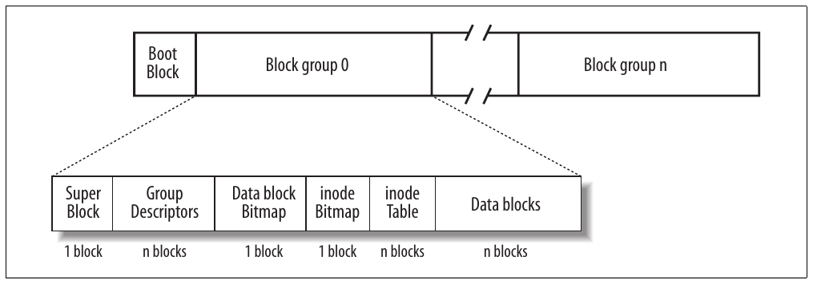
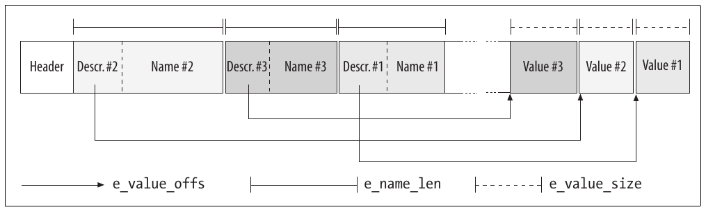
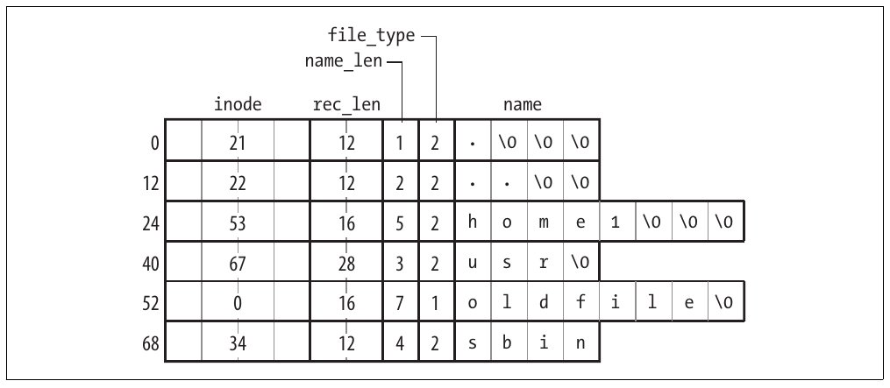
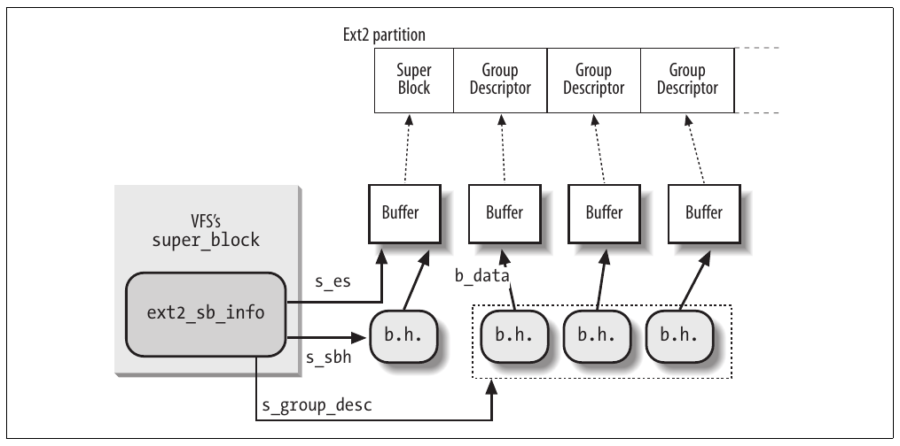
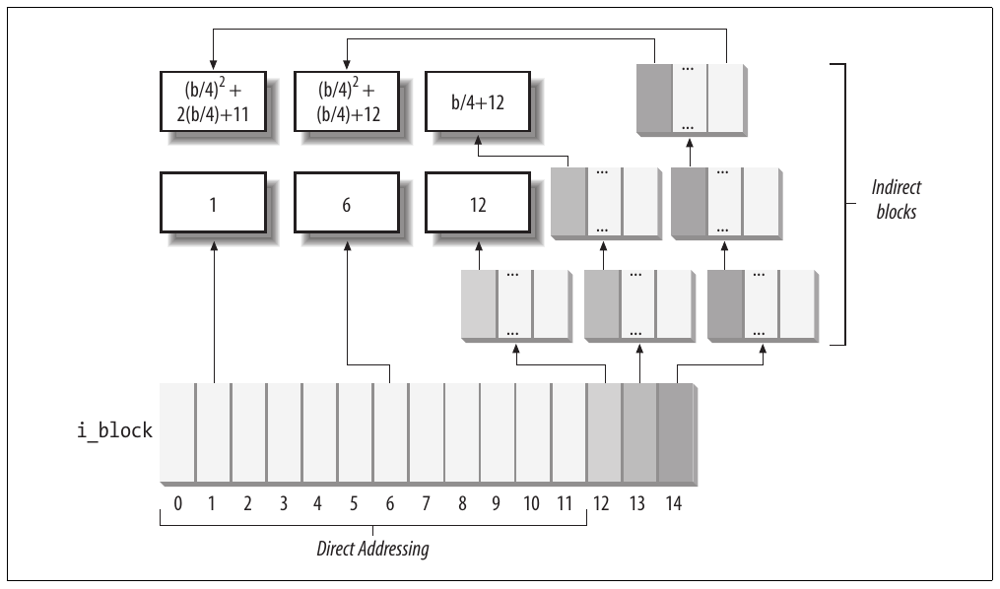
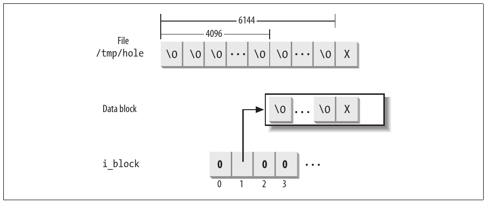

CHƯƠNG 18 Chương 18\\

# Chương 18. Các filesystem Ext2 và Ext3


Trong chương này, chúng ta kết thúc phần thảo luận sâu rộng về I/O và filesystem bằng cách xem xét những chi tiết mà kernel phải xử lý khi tương tác với một filesystem cụ thể. Vì Second Extended Filesystem (Ext2) là filesystem gốc của Linux và được dùng trên hầu như mọi hệ thống Linux, nó là lựa chọn tự nhiên cho phần thảo luận này. Hơn nữa, Ext2 minh họa nhiều cách làm tốt khi hỗ trợ các tính năng filesystem hiện đại với hiệu năng cao. Tất nhiên, những filesystem khác được Linux hỗ trợ cũng có nhiều tính năng thú vị, nhưng chúng ta không có đủ chỗ để khảo sát tất cả.

Sau khi giới thiệu Ext2 trong mục “Các đặc điểm chung của Ext2”, chúng ta mô tả các cấu trúc dữ liệu cần thiết, giống như trong các chương khác. Vì đang xem xét một cách cụ thể để lưu dữ liệu trên disk, chúng ta phải xét hai phiên bản của cùng các cấu trúc dữ liệu. Mục “Các cấu trúc dữ liệu Ext2 trên disk” trình bày các cấu trúc dữ liệu được Ext2 lưu trên disk, còn “Các cấu trúc dữ liệu Ext2 trong memory” trình bày các phiên bản tương ứng trong memory.

Sau đó chúng ta đến với các thao tác thực hiện trên filesystem. Trong mục “Tạo filesystem Ext2”, chúng ta thảo luận cách tạo Ext2 trong một disk partition. Các mục tiếp theo mô tả những hoạt động của kernel mỗi khi disk được sử dụng. Phần lớn là những hoạt động ở low-level, liên quan đến việc cấp phát không gian disk cho inode và data block.

Trong mục cuối, chúng ta mô tả ngắn gọn filesystem Ext3, bước tiến tiếp theo trong quá trình phát triển của filesystem Ext2.

## Các đặc điểm chung của Ext2

Các hệ điều hành Unix-like dùng nhiều loại filesystem. Mặc dù các file của tất cả những filesystem này có một tập con thuộc tính chung mà một số POSIX API như `stat()` yêu cầu, mỗi filesystem lại được triển khai theo một cách khác nhau.

Những phiên bản Linux đầu tiên dựa trên filesystem MINIX. Khi Linux trưởng thành, Extended Filesystem (Ext FS) được giới thiệu; nó có một số phần mở rộng đáng kể, nhưng hiệu năng chưa thỏa đáng. Second Extended Filesystem (Ext2) được giới thiệu năm 1994; ngoài một số tính năng mới, nó khá hiệu quả và vững chắc, và cùng với hậu duệ Ext3 là filesystem Linux được dùng rộng rãi nhất.

Các tính năng sau góp phần tạo nên hiệu quả của Ext2:

- Khi tạo filesystem Ext2, người quản trị hệ thống có thể chọn block size tối ưu (từ 1.024 đến 4.096 byte), tùy theo độ dài file trung bình dự kiến. Ví dụ, block size 1,024-block thích hợp hơn khi độ dài file trung bình nhỏ hơn vài nghìn byte vì nó làm giảm internal fragmentation—nghĩa là giảm sự chênh lệch giữa độ dài file và phần disk lưu nó (xem mục “Quản lý memory area” trong Chương 8, nơi đã thảo luận internal fragmentation đối với dynamic memory). Mặt khác, block size lớn hơn thường thích hợp hơn cho những file lớn hơn vài nghìn byte vì làm giảm số lần truyền dữ liệu disk, từ đó giảm system overhead.

- Khi tạo filesystem Ext2, người quản trị hệ thống có thể chọn số inode cho phép đối với một partition có kích thước cho trước, tùy theo số file dự kiến lưu trên đó. Điều này tối đa hóa không gian disk thực sự có thể sử dụng.

- Filesystem chia các disk block thành nhóm. Mỗi nhóm bao gồm data block và inode được lưu trên các track liền kề. Nhờ cấu trúc này, các file lưu trong một block group có thể được truy cập với thời gian disk seek trung bình thấp hơn.

- Filesystem preallocate các disk data block cho regular file trước khi chúng thực sự được dùng. Do đó, khi file tăng kích thước, một số block đã được dành sẵn ở những vị trí liền kề về mặt vật lý, làm giảm file fragmentation.

- Hỗ trợ fast symbolic link (xem mục “Hard link và soft link” trong Chương 1). Nếu symbolic link biểu diễn một pathname ngắn (tối đa 60 ký tự), nó có thể được lưu trong inode và do đó được phân giải mà không cần đọc data block.

Hơn nữa, Second Extended Filesystem còn có các tính năng khác giúp nó vừa vững chắc vừa linh hoạt:

- file-updating được triển khai cẩn thận để giảm thiểu tác động của system crash. Ví dụ, khi tạo hard link mới cho một file, bộ đếm hard link trong disk inode được tăng trước, rồi tên mới được thêm vào directory thích hợp. Nhờ vậy, nếu lỗi hardware xảy ra sau khi cập nhật inode nhưng trước khi thay đổi được directory, directory vẫn nhất quán, dù bộ đếm hard link của inode sai. Việc xóa file không dẫn đến hậu quả thảm khốc, mặc dù các data block của file không thể được tự động thu hồi. Nếu làm ngược lại (thay đổi directory trước khi cập nhật inode), cùng lỗi hardware đó sẽ tạo ra sự không nhất quán nguy hiểm: xóa hard link ban đầu sẽ loại bỏ các data block của nó khỏi disk, nhưng directory entry mới lại tham chiếu đến inode không còn tồn tại. Nếu số inode đó sau này được dùng cho file khác, ghi vào directory entry lỗi thời sẽ làm hỏng file mới.

- Hỗ trợ tự động kiểm tra tính nhất quán của trạng thái filesystem lúc boot. Các kiểm tra do chương trình bên ngoài e2fsck thực hiện; chương trình có thể được kích hoạt không chỉ sau system crash mà còn sau một số lần mount filesystem định trước (một bộ đếm được tăng sau mỗi thao tác mount), hoặc sau một khoảng thời gian định trước kể từ lần kiểm tra gần nhất.

- Hỗ trợ immutable file (không thể sửa đổi, xóa hoặc đổi tên) và append-only file (chỉ có thể thêm dữ liệu vào cuối).

- Tương thích với cả ngữ nghĩa Unix System V Release 4 và BSD về user group ID của file mới. Trong SVR4, file mới nhận user group ID của process tạo nó; trong BSD, file mới kế thừa user group ID của directory chứa nó. Ext2 có một mount option chỉ định ngữ nghĩa cần dùng.

Mặc dù filesystem Ext2 là một chương trình trưởng thành, ổn định, một số tính năng bổ sung vẫn được xem xét đưa vào. Một số đã được viết code và có sẵn dưới dạng patch bên ngoài. Những tính năng khác mới chỉ được lên kế hoạch, nhưng trong một số trường hợp, các field đã được thêm vào Ext2 inode để dành cho chúng. Những tính năng đáng kể nhất đang được xem xét là:

Block fragmentation

Người quản trị hệ thống thường chọn block size lớn để truy cập disk, vì ứng dụng máy tính thường xử lý file lớn. Kết quả là các file nhỏ lưu trong block lớn lãng phí nhiều không gian disk. Có thể giải quyết vấn đề bằng cách cho phép lưu nhiều file trong những fragment khác nhau của cùng một block.

Xử lý các file được nén và mã hóa một cách trong suốt

Những option mới này, phải được chỉ định khi tạo file, cho phép người dùng lưu một cách trong suốt các phiên bản được nén và/hoặc mã hóa của file lên disk.

Logical deletion

Một undelete option cho phép người dùng dễ dàng khôi phục nội dung file đã xóa trước đó khi cần.

Journaling

Journaling tránh bước kiểm tra time-consuming được tự động thực hiện trên filesystem khi nó bị unmount đột ngột—ví dụ, do system crash.

Trên thực tế, chưa tính năng nào trong số này được chính thức đưa vào filesystem Ext2. Có thể nói Ext2 là nạn nhân của chính thành công của nó; cho đến vài năm trước, nó vẫn là filesystem được hầu hết các công ty phân phối Linux ưu tiên chọn, và hàng triệu người dùng dựa vào nó mỗi ngày hẳn sẽ nghi ngờ bất kỳ nỗ lực thay Ext2 bằng một filesystem khác.

Tính năng còn thiếu ở Ext2 có sức thuyết phục nhất là journaling, vốn cần thiết cho các server high-availability. Để chuyển đổi suôn sẻ, journaling không được đưa vào filesystem Ext2; thay vào đó, như sẽ thảo luận trong mục “Filesystem Ext3” ở phần sau, một filesystem mới hơn hoàn toàn tương thích với Ext2 đã được tạo ra và cũng cung cấp journaling. Người dùng không thực sự cần journaling có thể tiếp tục dùng filesystem Ext2 quen thuộc, còn những người khác có lẽ sẽ chuyển sang filesystem mới. Ngày nay, hầu hết distribution chọn Ext3 làm filesystem tiêu chuẩn.

## Các cấu trúc dữ liệu Ext2 trên disk

Block đầu tiên trong mỗi partition Ext2 không bao giờ được filesystem Ext2 quản lý, vì nó được dành cho partition boot sector (xem Phụ lục A). Phần còn lại của partition Ext2 được chia thành các block group, mỗi nhóm có bố cục như Hình 18-1. Như có thể thấy trong hình, một số cấu trúc dữ liệu phải vừa đúng một block, còn những cấu trúc khác có thể cần nhiều block. Tất cả block group trong filesystem có cùng kích thước và được lưu tuần tự, vì thế kernel có thể suy ra vị trí của block group trên disk chỉ từ index nguyên của nó.



Hình 18-1. Bố cục của một partition Ext2 và một block group Ext2

Block group giảm file fragmentation, vì kernel cố gắng giữ các data block thuộc cùng một file trong cùng block group nếu có thể. Mỗi block trong block group chứa một trong những thông tin sau:

- Một bản sao superblock của filesystem

- Một bản sao nhóm các block group descriptor

- Một data block bitmap

- Một inode bitmap

- Một bảng inode

- Một phần dữ liệu thuộc một file; tức là data block

Nếu block không chứa thông tin có ý nghĩa, nó được gọi là free.

Như có thể thấy từ Hình 18-1, cả superblock và group descriptor đều được nhân bản trong mỗi block group. Kernel chỉ dùng superblock và group descriptor nằm trong block group 0, còn các superblock và group descriptor còn lại được giữ nguyên; thực tế, kernel thậm chí không xem chúng. Khi chương trình e2fsck kiểm tra tính nhất quán của trạng thái filesystem, nó tham chiếu đến superblock và group descriptor lưu trong block group 0, rồi sao chép chúng vào tất cả block group khác. Nếu dữ liệu bị hỏng và superblock chính hoặc các group descriptor chính trong block group 0 trở nên không hợp lệ, người quản trị hệ thống có thể yêu cầu e2fsck tham chiếu đến những bản sao cũ của superblock và group descriptor lưu trong một block group khác nhóm đầu tiên. Thông thường, các bản sao dự phòng lưu đủ thông tin để e2fsck đưa partition Ext2 trở về trạng thái nhất quán.

Có bao nhiêu block group? Điều đó phụ thuộc cả kích thước partition lẫn block size. Ràng buộc chính là block bitmap, dùng để xác định block đã dùng và free trong một nhóm, phải được lưu trong một block duy nhất. Vì thế, mỗi block group có thể có tối đa 8×b block, với b là block size tính bằng byte. Do đó, tổng số block group xấp xỉ s/(8×b), với s là kích thước partition tính bằng block.

Ví dụ, xét partition Ext2 32-GB với block size 4-KB. Trong trường hợp này, mỗi block bitmap 4-KB mô tả 32K data block—nghĩa là 128 MB. Do đó, cần tối đa 256 block group. Rõ ràng, block size càng nhỏ thì số block group càng lớn.

### Superblock

Một disk superblock Ext2 được lưu trong cấu trúc `ext2_super_block`, có các field được liệt kê trong Bảng 18-1.[^1] Các kiểu dữ liệu `__u8`, `__u16` và `__u32` biểu diễn số không dấu có độ dài lần lượt 8, 16 và 32 bit, còn các kiểu dữ liệu `__s8`, `__s16`, `__s32` biểu diễn số có dấu dài 8, 16 và 32 bit. Để chỉ định rõ thứ tự các byte của một word hoặc double-word được lưu trên disk, kernel còn dùng các kiểu dữ liệu `__le16`, `__le32`, `__be16` và `__be32`; hai kiểu đầu lần lượt biểu diễn thứ tự little-endian cho word và double-words (byte ít quan trọng nhất được lưu tại địa chỉ cao nhất), còn hai kiểu sau biểu diễn thứ tự big-endian (byte quan trọng nhất được lưu tại địa chỉ cao nhất).

Bảng 18-1. Các field của superblock Ext2

| Kiểu | Field | Mô tả |
|---|---|---|
| `__le32` | `s_inodes_count` | Tổng số inode |
| `__le32` | `s_blocks_count` | Kích thước filesystem tính bằng block |
| `__le32` | `s_r_blocks_count` | Số block được dành riêng |
| `__le32` | `s_free_blocks_count` | Bộ đếm free block |
| `__le32` | `s_free_inodes_count` | Bộ đếm free inode |
| `__le32` | `s_first_data_block` | Số của block hữu ích đầu tiên (luôn là 1) |
| `__le32` | `s_log_block_size` | Block size |
| `__le32` | `s_log_frag_size` | Kích thước fragment |
| `__le32` | `s_blocks_per_group` | Số block mỗi nhóm |
| `__le32` | `s_frags_per_group` | Số fragment mỗi nhóm |
| `__le32` | `s_inodes_per_group` | Số inode mỗi nhóm |
| `__le32` | `s_mtime` | Thời điểm mount gần nhất |
| `__le32` | `s_wtime` | Thời điểm ghi gần nhất |
| `__le16` | `s_mnt_count` | Bộ đếm thao tác mount |
| `__le16` | `s_max_mnt_count` | Số thao tác mount trước khi kiểm tra |
| `__le16` | `s_magic` | Magic signature |
| `__le16` | `s_state` | Status flag |
| `__le16` | `s_errors` | Hành vi khi phát hiện lỗi |
| `__le16` | `s_minor_rev_level` | Minor revision level |
| `__le32` | `s_lastcheck` | Thời điểm kiểm tra gần nhất |
| `__le32` | `s_checkinterval` | Thời gian giữa các lần kiểm tra |
| `__le32` | `s_creator_os` | OS nơi filesystem được tạo |
| `__le32` | `s_rev_level` | Revision level của filesystem |
| `__le16` | `s_def_resuid` | UID mặc định cho các block được dành riêng |
| `__le16` | `s_def_resgid` | User group ID mặc định cho các block được dành riêng |
| `__le32` | `s_first_ino` | Số của inode không được dành riêng đầu tiên |
| `__le16` | `s_inode_size` | Kích thước cấu trúc inode on-disk |
| `__le16` | `s_block_group_nr` | Số block group của superblock này |
| `__le32` | `s_feature_compat` | Bitmap các tính năng tương thích |
| `__le32` | `s_feature_incompat` | Bitmap các tính năng không tương thích |
| `__le32` | `s_feature_ro_compat` | Bitmap các tính năng tương thích Read-only |
| `__u8 [16]` | `s_uuid` | Định danh filesystem 128-bit |
| `char [16]` | `s_volume_name` | Tên volume |
| `char [64]` | `s_last_mounted` | Pathname của mount point gần nhất |
| `__le32` | `s_algorithm_usage_bitmap` | Dùng để nén |
| `__u8` | `s_prealloc_blocks` | Số block cần preallocate |
| `__u8` | `s_prealloc_dir_blocks` | Số block cần preallocate cho directory |
| `__u16` | `s_padding1` | Alignment theo word |
| `__u32 [204]` | `s_reserved` | Các giá trị null để padding đủ 1.024 byte |

Field `s_inodes_count` lưu số inode, còn field `s_blocks_count` lưu số block trong filesystem Ext2.

Field `s_log_block_size` biểu diễn block size dưới dạng lũy thừa của 2, lấy 1.024 byte làm đơn vị. Do đó, 0 biểu diễn block 1,024-byte, 1 biểu diễn block 2,048-byte, v.v. Field `s_log_frag_size` hiện bằng `s_log_block_size`, vì block fragmentation chưa được triển khai.

Các field `s_blocks_per_group`, `s_frags_per_group` và `s_inodes_per_group` lần lượt lưu số block, fragment và inode trong mỗi block group.

Một số disk block được dành riêng cho superuser (hoặc người dùng hay nhóm người dùng khác được chọn qua các field `s_def_resuid` và `s_def_resgid`). Những block này cho phép người quản trị hệ thống tiếp tục dùng filesystem ngay cả khi không còn free block nào cho người dùng thông thường.

Các field `s_mnt_count`, `s_max_mnt_count`, `s_lastcheck` và `s_checkinterval` thiết lập filesystem Ext2 để được tự động kiểm tra lúc boot. Chúng khiến e2fsck chạy sau một số thao tác mount định trước, hoặc khi một khoảng thời gian định trước đã trôi qua kể từ lần kiểm tra tính nhất quán gần nhất. (Có thể dùng cả hai kiểu kiểm tra cùng nhau.) Việc kiểm tra tính nhất quán cũng bắt buộc lúc boot nếu filesystem chưa được unmount sạch (ví dụ, sau system crash) hoặc khi kernel phát hiện một số lỗi trong đó. Field `s_state` lưu giá trị 0 nếu filesystem đang được mount hoặc chưa được unmount sạch, 1 nếu đã được unmount sạch, và 2 nếu có lỗi.

### Group descriptor và bitmap

Mỗi block group có group descriptor riêng, một cấu trúc `ext2_group_desc` có các field được minh họa trong Bảng 18-2.

Bảng 18-2. Các field của group descriptor Ext2

| Kiểu | Field | Mô tả |
|---|---|---|
| `__le32` | `bg_block_bitmap` | Số block của block bitmap |
| `__le32` | `bg_inode_bitmap` | Số block của inode bitmap |
| `__le32` | `bg_inode_table` | Số block của block đầu tiên trong inode table |
| `__le16` | `bg_free_blocks_count` | Số free block trong nhóm |
| `__le16` | `bg_free_inodes_count` | Số free inode trong nhóm |
| `__le16` | `bg_used_dirs_count` | Số directory trong nhóm |
| `__le16` | `bg_pad` | Alignment theo word |
| `__le32 [3]` | `bg_reserved` | Các giá trị null để padding đủ 24 byte |

Các field `bg_free_blocks_count`, `bg_free_inodes_count` và `bg_used_dirs_count` được dùng khi cấp phát inode và data block mới. Chúng xác định block phù hợp nhất để cấp phát từng cấu trúc dữ liệu. Bitmap là các chuỗi bit, trong đó giá trị 0 chỉ định inode hoặc data block tương ứng đang free, còn giá trị 1 chỉ định nó đã được dùng. Vì mỗi bitmap phải được lưu trong một block duy nhất và block size có thể là 1.024, 2.048 hoặc 4.096 byte, một bitmap mô tả trạng thái của 8.192, 16.384 hoặc 32.768 block.

### Inode table

Inode table gồm một dãy block liên tiếp, mỗi block chứa một số inode định trước. Số block của block đầu tiên trong inode table được lưu ở field `bg_inode_table` của group descriptor.

Tất cả inode có cùng kích thước: 128 byte. Một block 1,024-byte chứa 8 inode, còn một block 4,096-byte chứa 32 inode. Để tính số block mà inode table chiếm, chia tổng số inode trong một nhóm (lưu ở field `s_inodes_per_group` của superblock) cho số inode mỗi block.

Mỗi inode Ext2 là một cấu trúc `ext2_inode` có các field được minh họa trong Bảng 18-3.

Bảng 18-3. Các field của disk inode Ext2

| Kiểu | Field | Mô tả |
|---|---|---|
| `__le16` | `i_mode` | Loại file và quyền truy cập |
| `__le16` | `i_uid` | Định danh owner |
| `__le32` | `i_size` | Độ dài file tính bằng byte |
| `__le32` | `i_atime` | Thời điểm truy cập file gần nhất |
| `__le32` | `i_ctime` | Thời điểm inode thay đổi gần nhất |
| `__le32` | `i_mtime` | Thời điểm nội dung file thay đổi gần nhất |
| `__le32` | `i_dtime` | Thời điểm xóa file |
| `__le16` | `i_gid` | Định danh user group |
| `__le16` | `i_links_count` | Bộ đếm hard link |
| `__le32` | `i_blocks` | Số data block của file |
| `__le32` | `i_flags` | Các file flag |
| `union` | `osd1` | Thông tin riêng cho hệ điều hành |
| `__le32 [EXT2_N_BLOCKS]` | `i_block` | Các pointer đến data block |
| `__le32` | `i_generation` | Phiên bản file (dùng khi file được truy cập qua network filesystem) |
| `__le32` | `i_file_acl` | Access control list của file |
| `__le32` | `i_dir_acl` | Access control list của directory |
| `__le32` | `i_faddr` | Địa chỉ fragment |
| `union` | `osd2` | Thông tin riêng cho hệ điều hành |

Nhiều field liên quan đến đặc tả POSIX tương tự các field tương ứng của inode object VFS và đã được thảo luận trong mục “Inode object” ở Chương 12. Các field còn lại liên quan đến cách triển khai Ext2-specific và chủ yếu xử lý việc cấp phát block.

Cụ thể, field `i_size` lưu độ dài thực tế của file tính bằng byte, còn field `i_blocks` lưu số data block (theo đơn vị 512 byte) đã được cấp phát cho file.

Giá trị của `i_size` và `i_blocks` không nhất thiết có liên hệ với nhau. Vì file luôn được lưu trong một số nguyên block, file không rỗng nhận ít nhất một data block (do fragmentation chưa được triển khai) và `i_size` có thể nhỏ hơn 512×`i_blocks`. Mặt khác, như sẽ thấy trong mục “File hole” ở phần sau chương này, file có thể chứa hole. Khi đó, `i_size` có thể lớn hơn 512×`i_blocks`.

Field `i_block` là một array gồm `EXT2_N_BLOCKS` (thường là 15) pointer đến block, dùng để xác định các data block được cấp phát cho file (xem mục “Định địa chỉ data block” ở phần sau chương này).

32 bit dành cho field `i_size` giới hạn kích thước file ở 4 GB. Thực tế, bit highest-order của field `i_size` không được dùng, nên kích thước file tối đa bị giới hạn ở 2 GB. Tuy nhiên, filesystem Ext2 có một “mẹo lách” cho phép file lớn hơn trên các hệ thống có processor 64-bit như Opteron của AMD hoặc PowerPC G5 của IBM. Về cơ bản, field `i_dir_acl` của inode, vốn không dùng cho regular file, biểu diễn phần mở rộng 32-bit của field `i_size`. Do đó, kích thước file được lưu trong inode dưới dạng số nguyên 64-bit. Phiên bản 64-bit của filesystem Ext2 tương thích phần nào với phiên bản 32-bit vì filesystem Ext2 tạo trên kiến trúc 64-bit có thể được mount trên kiến trúc 32-bit và ngược lại. Trên kiến trúc 32-bit, không thể truy cập file lớn trừ khi mở file với flag `O_LARGEFILE` được đặt (xem mục “System call open()” trong Chương 12).

Nhớ rằng mô hình VFS yêu cầu mỗi file có một số inode khác nhau. Trong Ext2, không cần lưu trên disk mapping giữa số inode và số block tương ứng, vì giá trị sau có thể suy ra từ số block group và vị trí tương đối trong inode table. Ví dụ, giả sử mỗi block group chứa 4.096 inode và chúng ta muốn biết địa chỉ trên disk của inode 13.021. Khi đó, inode thuộc block group thứ ba và địa chỉ disk của nó được lưu ở entry thứ 733<sup>rd</sup> của inode table tương ứng. Như có thể thấy, số inode chỉ là một key mà các routine Ext2 dùng để nhanh chóng lấy inode descriptor thích hợp trên disk.

### Extended attribute của inode

Định dạng inode Ext2 là một kiểu khuôn khổ bó buộc đối với người thiết kế filesystem. Độ dài inode phải là lũy thừa của 2 để tránh internal fragmentation trong các block lưu inode table. Thực tế, phần lớn trong số 128 ký tự của inode Ext2 hiện đã chứa đầy thông tin, chỉ còn ít chỗ cho field bổ sung. Mặt khác, mở rộng độ dài inode lên 256 sẽ khá lãng phí, ngoài việc gây ra vấn đề tương thích giữa các filesystem Ext2 dùng độ dài inode khác nhau.

Extended attribute được đưa vào để vượt qua giới hạn trên. Các attribute này được lưu trên một disk block cấp phát bên ngoài mọi inode. Field `i_file_acl` của inode trỏ đến block chứa extended attribute. Những inode khác nhau có cùng tập extended attribute có thể dùng chung một block.

Mỗi extended attribute có tên và giá trị. Cả hai được mã hóa dưới dạng array ký tự có độ dài biến đổi, theo quy định của descriptor `ext2_xattr_entry`. Hình 18-2 cho thấy bố cục extended attribute trong một block của Ext2. Mỗi attribute được chia làm hai phần: descriptor `ext2_xattr_entry` cùng tên attribute được đặt ở đầu block, còn giá trị attribute được đặt ở cuối block. Các entry ở đầu block được sắp theo tên attribute, còn vị trí các giá trị là cố định vì được xác định theo thứ tự cấp phát attribute.



Hình 18-2. Bố cục của block chứa extended attribute

Có nhiều system call để đặt, lấy, liệt kê và xóa extended attribute của file. Các system call `setxattr()`, `lsetxattr()` và `fsetxattr()` đặt một extended attribute của file; về cơ bản, chúng khác nhau ở cách xử lý symbolic link và cách chỉ định file (truyền pathname hoặc file descriptor). Tương tự, các system call `getxattr()`, `lgetxattr()` và `fgetxattr()` trả về giá trị một extended attribute. Các system call `listxattr()`, `llistxattr()` và `flistxattr()` liệt kê toàn bộ extended attribute của file. Cuối cùng, các system call `removexattr()`, `lremovexattr()` và `fremovexattr()` xóa một extended attribute khỏi file.

### Access control list

Access control list đã được đề xuất từ lâu để cải thiện cơ chế bảo vệ file trong filesystem Unix. Thay vì phân loại người dùng file thành ba lớp—owner, group và others—mỗi file có thể được gắn một access control list (ACL). Nhờ loại danh sách này, người dùng có thể chỉ định cho mỗi file của mình tên những người dùng cụ thể (hoặc nhóm người dùng) cùng các privilege cấp cho họ.

Linux 2.6 hỗ trợ đầy đủ ACL bằng cách dùng extended attribute của inode. Thực ra, extended attribute được đưa vào chủ yếu để hỗ trợ ACL. Vì vậy, các library function `chacl()`, `setfacl()` và `getfacl()`, cho phép thao tác ACL của file, về cơ bản dựa vào các system call `setxattr()` và `getxattr()` đã giới thiệu trong mục trước.

Đáng tiếc, kết quả của nhóm công tác định nghĩa các phần mở rộng bảo mật trong họ tiêu chuẩn POSIX 1003.1 chưa bao giờ được chính thức hóa thành một tiêu chuẩn POSIX mới. Do đó, ngày nay ACL được hỗ trợ trên nhiều loại filesystem ở nhiều hệ thống UNIX-like, mặc dù có một số khác biệt tinh tế giữa các cách triển khai.

### Các loại file khác nhau sử dụng disk block như thế nào

Những loại file mà Ext2 nhận biết (regular file, pipe, v.v.) dùng data block theo các cách khác nhau. Một số file không lưu dữ liệu nên hoàn toàn không cần data block. Mục này thảo luận yêu cầu lưu trữ của từng loại được liệt kê trong Bảng 18-4.

Bảng 18-4. Các loại file Ext2

| File\_type | Mô tả |
|---|---|
| 0 | Không xác định |
| 1 | Regular file |
| 2 | Directory |
| 3 | Character device |
| 4 | Block device |
| 5 | Named pipe |
| 6 | Socket |
| 7 | Symbolic link |

#### Regular file

Regular file là trường hợp phổ biến nhất và nhận gần như toàn bộ sự chú ý trong chương này. Nhưng regular file chỉ cần data block khi bắt đầu có dữ liệu. Khi mới tạo, regular file rỗng và không cần data block; nó cũng có thể được làm rỗng bằng system call `truncate()` hoặc `open()`. Cả hai tình huống đều phổ biến; ví dụ, khi bạn đưa ra shell command có chuỗi \>filename, shell tạo file rỗng hoặc truncate một file đã tồn tại.

##### Directory

Ext2 triển khai directory dưới dạng một loại file đặc biệt có các data block lưu filename cùng số inode tương ứng. Cụ thể, những data block đó chứa các cấu trúc kiểu `ext2_dir_entry_2`. Các field của cấu trúc được trình bày trong Bảng 18-5. Cấu trúc có độ dài biến đổi, vì field cuối `name` là array có độ dài biến đổi tối đa `EXT2_NAME_LEN` ký tự (thường là 255). Hơn nữa, để đảm bảo hiệu quả, độ dài directory entry luôn là bội số của 4, nên các ký tự null (`\0`) được thêm vào cuối filename để padding nếu cần. Field `name_len` lưu độ dài filename thực tế (xem Hình 18-3).

Bảng 18-5. Các field của directory entry Ext2

| Kiểu | Field | Mô tả |
|---|---|---|
| `__le32` | `inode` | Số inode |
| `__le16` | `rec_len` | Độ dài directory entry |
| `__u8` | `name_len` | Độ dài filename |
| `__u8` | `file_type` | Loại file |
| `char [EXT2_NAME_LEN]` | `name` | Filename |

Field `file_type` lưu một giá trị chỉ định loại file (xem Bảng 18-4). Field `rec_len` có thể được hiểu là pointer đến directory entry hợp lệ tiếp theo: đó là offset cộng vào địa chỉ bắt đầu directory entry để lấy địa chỉ bắt đầu directory entry hợp lệ tiếp theo. Để xóa directory entry, chỉ cần đặt field `inode` của nó thành 0 và tăng thích hợp giá trị field `rec_len` của entry hợp lệ trước đó. Hãy đọc kỹ field `rec_len` trong Hình 18-3; bạn sẽ thấy entry oldfile đã bị xóa vì field `rec_len` của usr được đặt thành 12+16 (độ dài của các entry usr và oldfile).



Hình 18-3. Một ví dụ về directory Ext2

##### Symbolic link

Như đã nêu, nếu pathname của symbolic link có tối đa 60 ký tự, nó được lưu trong field `i_block` của inode, vốn gồm một array 15 số nguyên 4-byte; vì vậy không cần data block. Tuy nhiên, nếu pathname dài hơn 60 ký tự thì cần một data block duy nhất.

##### Device file, pipe và socket

Những loại file này không cần data block. Mọi thông tin cần thiết được lưu trong inode.

## Các cấu trúc dữ liệu Ext2 trong memory

Để đảm bảo hiệu quả, phần lớn thông tin lưu trong các cấu trúc dữ liệu trên disk của partition Ext2 được sao chép vào RAM khi filesystem được mount, cho phép kernel tránh nhiều thao tác đọc disk sau đó. Để hình dung tần suất thay đổi của một số cấu trúc dữ liệu, hãy xét vài thao tác cơ bản:

- Khi tạo file mới, phải giảm giá trị field `s_free_inodes_count` trong superblock Ext2 và field `bg_free_inodes_count` trong group descriptor thích hợp.

- Nếu kernel nối thêm dữ liệu vào file hiện có khiến số data block được cấp phát cho file tăng lên, phải sửa giá trị field `s_free_blocks_count` trong superblock Ext2 và field `bg_free_blocks_count` trong group descriptor.

- Ngay cả việc chỉ ghi lại một phần file hiện có cũng dẫn đến cập nhật field `s_wtime` của superblock Ext2.

Vì mọi cấu trúc dữ liệu Ext2 trên disk đều được lưu trong các block của partition Ext2, kernel dùng page cache để giữ chúng up-to-date (xem mục “Ghi dirty page xuống disk” trong Chương 15).

Với mỗi loại dữ liệu liên quan đến filesystem và file Ext2, Bảng 18-6 chỉ rõ cấu trúc dữ liệu trên disk dùng để biểu diễn dữ liệu đó, cấu trúc dữ liệu trong memory mà kernel dùng, và một quy tắc kinh nghiệm để xác định mức caching. Dữ liệu cập nhật rất thường xuyên luôn được cache; nghĩa là được lưu thường trực trong memory và nằm trong page cache cho đến khi partition Ext2 tương ứng được unmount. Kernel đạt kết quả này bằng cách luôn giữ usage counter của page lớn hơn 0.

Bảng 18-6. Các hình ảnh VFS của cấu trúc dữ liệu Ext2

| Loại | Cấu trúc dữ liệu trên disk | Cấu trúc dữ liệu trong memory | Chế độ caching |
|---|---|---|---|
| Superblock | `ext2_super_block` | `ext2_sb_info` | Luôn được cache |
| Group descriptor | `ext2_group_desc` | `ext2_group_desc` | Luôn được cache |
| Block bitmap | Array bit trong block | Array bit trong buffer | Động |
| inode bitmap | Array bit trong block | Array bit trong buffer | Động |
| inode | `ext2_inode` | `ext2_inode_info` | Động |
| Data block | Array byte | VFS buffer | Động |
| Free inode | `ext2_inode` | Không có | Không bao giờ |
| Free block | Array byte | Không có | Không bao giờ |

Dữ liệu never-cached không được giữ trong cache nào vì không biểu diễn thông tin có ý nghĩa. Ngược lại, dữ liệu always-cached luôn có mặt trong RAM, vì thế không bao giờ cần đọc dữ liệu từ disk (tuy nhiên, định kỳ phải ghi dữ liệu trở lại disk). Giữa hai cực này là chế độ động. Trong chế độ này, dữ liệu được giữ trong cache chừng nào object liên quan (inode, data block hoặc bitmap) còn được dùng; khi file được đóng hoặc data block bị xóa, thuật toán thu hồi page frame có thể loại dữ liệu tương ứng khỏi cache.

Một điểm thú vị là inode bitmap và block bitmap không được giữ thường trực trong memory; thay vào đó, chúng được đọc từ disk khi cần. Thực ra, nhiều lần đọc disk được tránh nhờ page cache giữ trong memory các disk block được dùng gần đây nhất (xem mục “Lưu block trong page cache” trong Chương 15).[^2]

### Superblock object Ext2

Như đã nêu trong mục “Superblock object” ở Chương 12, field `s_fs_info` của superblock VFS trỏ đến cấu trúc chứa dữ liệu filesystem-specific. Với Ext2, field này trỏ đến cấu trúc kiểu `ext2_sb_info`, bao gồm thông tin sau:

- Phần lớn các field của disk superblock

- Một pointer `s_sbh` đến buffer head của buffer chứa disk superblock

- Một pointer `s_es` đến buffer chứa disk superblock

- Số group descriptor, `s_desc_per_block`, có thể chứa trong một block

- Một pointer `s_group_desc` đến array buffer head của các buffer chứa group descriptor (thường một entry là đủ)

- Các dữ liệu khác liên quan đến mount state, mount option, v.v.

Hình 18-4 cho thấy các liên kết giữa cấu trúc dữ liệu `ext2_sb_info` với các buffer và buffer head liên quan đến superblock Ext2 và các group descriptor.

Khi kernel mount filesystem Ext2, nó gọi hàm `ext2_fill_super()` để cấp phát không gian cho các cấu trúc dữ liệu và điền dữ liệu đọc từ disk vào đó (xem mục “Mount một filesystem tổng quát” trong Chương 12). Sau đây là mô tả đơn giản hóa của hàm, nhấn mạnh các lần cấp phát memory cho buffer và descriptor:

1\. Cấp phát descriptor `ext2_sb_info` và lưu địa chỉ của nó trong field `s_fs_info` của superblock object được truyền làm tham số.



Hình 18-4. Cấu trúc dữ liệu ext2\_sb\_info

2\. Gọi `__bread()` để cấp phát buffer trong một buffer page cùng buffer head tương ứng, và đọc superblock từ disk vào buffer; như đã thảo luận trong mục “Tìm block trong page cache” ở Chương 15, không thực hiện cấp phát nếu block đã được lưu trong buffer page của page cache và đang cập nhật. Lưu địa chỉ buffer head vào field `s_sbh` của superblock object Ext2.

3\. Cấp phát array byte—một byte cho mỗi nhóm—và lưu địa chỉ của nó trong field `s_debts` của descriptor `ext2_sb_info` (xem mục “Tạo inode” ở phần sau chương này).

4\. Cấp phát array pointer đến buffer head, một cho mỗi group descriptor, và lưu địa chỉ array trong field `s_group_desc` của descriptor `ext2_sb_info`.

5\. Gọi `__bread()` lặp lại để cấp phát buffer và đọc từ disk các block chứa group descriptor Ext2; lưu địa chỉ các buffer head trong array `s_group_desc` đã cấp phát ở bước trước.

6\. Cấp phát inode và dentry object cho root directory, rồi thiết lập một số field của superblock object để có thể đọc root inode từ disk.

Rõ ràng, mọi cấu trúc dữ liệu do `ext2_fill_super()` cấp phát được giữ trong memory sau khi hàm trả về; chúng chỉ được giải phóng khi filesystem Ext2 được unmount. Khi kernel phải sửa một field trong superblock Ext2, nó chỉ ghi giá trị mới vào vị trí thích hợp của buffer tương ứng rồi đánh dấu buffer là dirty.

### Inode object Ext2

Khi mở file, một pathname lookup được thực hiện. Với mỗi thành phần pathname chưa có trong dentry cache, một dentry object mới và một inode object mới được tạo (xem mục “Pathname lookup tiêu chuẩn” trong Chương 12). Khi VFS truy cập disk inode Ext2, nó tạo inode descriptor tương ứng kiểu `ext2_inode_info`. Descriptor này bao gồm thông tin sau:

- Toàn bộ inode object VFS (xem Bảng 12-3 trong Chương 12) được lưu trong field `vfs_inode`

- Phần lớn field có trong cấu trúc inode trên disk nhưng không được giữ trong inode VFS

- Index block group `i_block_group` mà inode thuộc về (xem mục “Các cấu trúc dữ liệu Ext2 trên disk” ở phần trước chương này)

- Các field `i_next_alloc_block` và `i_next_alloc_goal`, lần lượt lưu logical block number và physical block number của disk block được cấp phát gần nhất cho file

- Các field `i_prealloc_block` và `i_prealloc_count`, dùng cho data block preallocation (xem mục “Cấp phát data block” ở phần sau chương này)

- Field `xattr_sem`, một read/write semaphore cho phép đọc extended attribute đồng thời với dữ liệu file

- Các field `i_acl` và `i_default_acl`, trỏ đến ACL của file

Khi xử lý file Ext2, superblock method `alloc_inode` được triển khai bằng hàm `ext2_alloc_inode()`. Trước tiên, hàm lấy descriptor `ext2_inode_info` từ slab allocator cache `ext2_inode_cachep`, rồi trả về địa chỉ inode object nhúng trong descriptor `ext2_inode_info` mới.

## Tạo filesystem Ext2

Thông thường có hai giai đoạn để tạo filesystem trên disk. Bước đầu là format để disk driver có thể đọc và ghi block trên đó. Hard disk hiện đại được format sẵn từ nhà máy và không cần format lại; floppy disk có thể được format trên Linux bằng chương trình tiện ích như superformat hoặc fdformat. Bước thứ hai là tạo filesystem, nghĩa là thiết lập các cấu trúc đã mô tả chi tiết ở phần trước chương này.

Filesystem Ext2 được tạo bằng chương trình tiện ích mke2fs; nó giả định các option mặc định sau, mà người dùng có thể sửa bằng flag trên command line:

- Block size: 1.024 byte (giá trị mặc định cho filesystem nhỏ)

- Kích thước fragment: block size (block fragmentation chưa được triển khai)

- Số inode được cấp phát: 1 inode cho mỗi 8.192 byte

- Tỷ lệ block được dành riêng: 5 phần trăm Chương trình thực hiện các thao tác sau:

1\. Khởi tạo superblock và các group descriptor.

2\. Tùy chọn, kiểm tra partition có chứa defective block không; nếu có, tạo danh sách defective block.

3\. Với mỗi block group, dành riêng mọi disk block cần để lưu superblock, các group descriptor, inode table và hai bitmap.

4\. Khởi tạo inode bitmap và data map bitmap của mỗi block group thành 0.

5\. Khởi tạo inode table của mỗi block group.

6\. Tạo directory /root.

7\. Tạo directory lost+found, được e2fsck dùng để liên kết các defective block bị thất lạc và tìm thấy lại.

8\. Cập nhật inode bitmap và data block bitmap của block group nơi hai directory trước vừa được tạo.

9\. Gom các defective block (nếu có) trong directory lost+found.

Hãy xét cách một floppy disk Ext2 1,44 MB được mke2fs khởi tạo với các option mặc định.

Sau khi được mount, nó xuất hiện với VFS như một volume gồm 1.412 block; mỗi block dài 1.024 byte. Để xem nội dung disk, chúng ta có thể thực hiện lệnh Unix:

```c
$ dd if=/dev/fd0 bs=1k count=1440 | od -tx1 -Ax > /tmp/dump_hex
```

để lấy một file chứa hexadecimal dump của nội dung floppy disk trong directory /tmp.[^3]

Nhìn vào file đó, chúng ta thấy do dung lượng disk hạn chế, một group descriptor là đủ. Chúng ta cũng nhận thấy số block được dành riêng được đặt là 72 (5 phần trăm của 1.440) và theo option mặc định, inode table phải có 1 inode cho mỗi 8.192 byte—nghĩa là 184 inode lưu trong 23 block.

Bảng 18-7 tóm tắt cách filesystem Ext2 được tạo trên floppy disk khi chọn các option mặc định.

Bảng 18-7. Cấp phát block Ext2 cho floppy disk

| Block | Nội dung |
|---|---|
| 0 | Boot block |
| 1 | Superblock |
| 2 | Block chứa một block group descriptor duy nhất |
| 3 | Data block bitmap |
| 4 | inode bitmap |
| 5–27 | inode table: các inode đến 10: được dành riêng (inode 2 là root); inode 11: lost+found; inode 12–184: free |
| 28 | Root directory (gồm `.`, `..` và lost+found) |
| 29 | Directory lost+found (gồm `.` và `..`) |
| 30–40 | Các block được dành riêng, preallocate cho directory lost+found |
| 41–1439 | Free block |

## Các method Ext2

Nhiều method VFS mô tả trong Chương 12 có cách triển khai Ext2 tương ứng. Vì cần cả một cuốn sách để mô tả tất cả, chúng ta chỉ xem xét ngắn gọn các method được triển khai trong Ext2. Khi đã hiểu rõ các cấu trúc dữ liệu trên disk và trong memory, người đọc có thể theo dõi code của những hàm Ext2 triển khai chúng.

### Các thao tác superblock Ext2

Nhiều thao tác superblock VFS có cách triển khai riêng trong Ext2, cụ thể là `alloc_inode`, `destroy_inode`, `read_inode`, `write_inode`, `delete_inode`, `put_super`, `write_super`, `statfs`, `remount_fs` và `clear_inode`. Địa chỉ các superblock method được lưu trong array pointer `ext2_sops`.

### Các thao tác inode Ext2

Một số inode operation VFS có cách triển khai riêng trong Ext2, phụ thuộc loại file mà inode tham chiếu đến.

Các inode operation cho regular file Ext2 và directory Ext2 được trình bày trong Bảng 18-8; mục đích mỗi method được mô tả trong mục “Inode object” ở Chương 12. Bảng không hiển thị các method không được định nghĩa (pointer `NULL`) cho cả regular file lẫn directory; nhớ rằng nếu method không được định nghĩa, VFS sẽ gọi hàm tổng quát hoặc không làm gì. Địa chỉ các method Ext2 cho regular file và directory được lưu lần lượt trong các bảng `ext2_file_inode_operations` và `ext2_dir_inode_operations`.

Bảng 18-8. Các inode operation Ext2 cho regular file và directory

| Inode operation VFS | Regular file | Directory |
|---|---|---|
| `create` | `NULL` | `ext2_create()` |
| `lookup` | `NULL` | `ext2_lookup()` |
| `link` | `NULL` | `ext2_link()` |
| `unlink` | `NULL` | `ext2_unlink()` |
| `symlink` | `NULL` | `ext2_symlink()` |
| `mkdir` | `NULL` | `ext2_mkdir()` |
| `rmdir` | `NULL` | `ext2_rmdir()` |
| `mknod` | `NULL` | `ext2_mknod()` |
| `rename` | `NULL` | `ext2_rename()` |
| `truncate` | `ext2_truncate()` | `NULL` |
| `permission` | `ext2_permission()` | `ext2_permission()` |
| `setattr` | `ext2_setattr()` | `ext2_setattr()` |
| `setxattr` | `generic_setxattr()` | `generic_setxattr()` |
| `getxattr` | `generic_getxattr()` | `generic_getxattr()` |
| `listxattr` | `ext2_listxattr()` | `ext2_listxattr()` |
| `removexattr` | `generic_removexattr()` | `generic_removexattr()` |

Các inode operation cho symbolic link Ext2 được trình bày trong Bảng 18-9 (đã lược bỏ method không được định nghĩa). Thực ra có hai loại symbolic link: fast symbolic link biểu diễn pathname có thể được lưu trọn vẹn trong inode, còn regular symbolic link biểu diễn pathname dài hơn. Tương ứng, có hai tập inode operation được lưu lần lượt trong các bảng `ext2_fast_symlink_inode_operations` và `ext2_symlink_inode_operations`.

Bảng 18-9. Các inode operation Ext2 cho fast symbolic link và regular symbolic link

| Inode operation VFS | Fast symbolic link | Regular symbolic link |
|---|---|---|
| `readlink` | `generic_readlink()` | `generic_readlink()` |
| `follow_link` | `ext2_follow_link()` | `page_follow_link_light()` |
| `put_link` | `NULL` | `page_put_link()` |
| `setxattr` | `generic_setxattr()` | `generic_setxattr()` |
| `getxattr` | `generic_getxattr()` | `generic_getxattr()` |
| `listxattr` | `ext2_listxattr()` | `ext2_listxattr()` |
| `removexattr` | `generic_removexattr()` | `generic_removexattr()` |

Nếu inode tham chiếu đến character device file, block device file hoặc named pipe (xem “FIFO” trong Chương 19), inode operation không phụ thuộc filesystem. Chúng được chỉ định lần lượt trong các bảng `chrdev_inode_operations`, `blkdev_inode_operations` và `fifo_inode_operations`.

### Các file operation Ext2

Các file operation riêng của filesystem Ext2 được liệt kê trong Bảng 18-10. Như có thể thấy, một số method VFS được triển khai bằng các hàm tổng quát dùng chung cho nhiều filesystem. Địa chỉ các method này được lưu trong bảng `ext2_file_operations`.

Bảng 18-10. Các file operation Ext2

| File operation VFS | Method Ext2 |
|---|---|
| `llseek` | `generic_file_llseek()` |
| `read` | `generic_file_read()` |
| `write` | `generic_file_write()` |
| `aio_read` | `generic_file_aio_read()` |
| `aio_write` | `generic_file_aio_write()` |
| `ioctl` | `ext2_ioctl()` |
| `mmap` | `generic_file_mmap()` |
| `open` | `generic_file_open()` |
| `release` | `ext2_release_file()` |
| `fsync` | `ext2_sync_file()` |
| `readv` | `generic_file_readv()` |
| `writev` | `generic_file_writev()` |
| `sendfile` | `generic_file_sendfile()` |

Chú ý rằng các method `read` và `write` của Ext2 được triển khai lần lượt bằng hàm `generic_file_read()` và `generic_file_write()`. Các hàm này được mô tả trong các mục “Đọc từ file” và “Ghi vào file” ở Chương 16.

## Quản lý không gian disk Ext2

Việc lưu file trên disk khác với cách lập trình viên nhìn file ở hai điểm: các block có thể rải rác trên disk (mặc dù filesystem cố gắng giữ block tuần tự để cải thiện thời gian truy cập), và đối với lập trình viên, file có thể có vẻ lớn hơn kích thước thực vì chương trình có thể tạo hole trong đó (thông qua system call `lseek()`).

Trong mục này, chúng ta giải thích cách filesystem Ext2 quản lý không gian disk—cách cấp phát và giải phóng inode, data block. Phải giải quyết hai vấn đề chính:

- Việc quản lý không gian phải cố gắng hết sức tránh file fragmentation—lưu file về mặt vật lý thành nhiều mảnh nhỏ nằm ở những disk block non-adjacent. File fragmentation làm tăng thời gian trung bình của các thao tác đọc tuần tự trên file, vì disk head phải thường xuyên đổi vị trí trong khi đọc.[^4] Vấn đề này tương tự external fragmentation của RAM đã thảo luận trong mục “Thuật toán buddy system” ở Chương 8.

- Việc quản lý không gian phải time-efficient; nghĩa là kernel phải nhanh chóng suy ra logical block number tương ứng trong partition Ext2 từ file offset. Khi làm vậy, kernel phải hạn chế tối đa số lần truy cập các bảng định địa chỉ lưu trên disk, vì mỗi truy cập trung gian như vậy làm tăng đáng kể thời gian truy cập file trung bình.

### Tạo inode

Hàm `ext2_new_inode()` tạo disk inode Ext2, trả về địa chỉ inode object tương ứng (hoặc `NULL` nếu thất bại). Hàm chọn cẩn thận block group chứa inode mới; điều này nhằm phân bố các directory không liên quan vào những nhóm khác nhau, đồng thời đặt file vào cùng nhóm với parent directory của chúng. Để cân bằng số regular file và directory trong block group, Ext2 đưa vào tham số “debt” cho mỗi block group.

Hàm hoạt động trên hai tham số: địa chỉ `dir` của inode object tham chiếu đến directory mà inode mới phải được thêm vào và một `mode` chỉ loại inode đang được tạo. Đối số sau cũng bao gồm mount flag `MS_SYNCHRONOUS` (xem mục “Mount một filesystem tổng quát” trong Chương 12), yêu cầu current process bị suspend cho đến khi inode được cấp phát. Hàm thực hiện các thao tác sau:

1\. Gọi `new_inode()` để cấp phát inode object VFS mới; khởi tạo field `i_sb` của nó bằng địa chỉ superblock lưu trong `dir->i_sb`, và thêm nó vào danh sách inode in-use cùng danh sách của superblock (xem mục “Inode object” trong Chương 12).

2\. Nếu inode mới là directory, hàm gọi `find_group_orlov()` để tìm block group phù hợp cho directory.<sup>†</sup> Hàm này triển khai các heuristic sau:

a. Directory có parent là root của filesystem phải được phân bố trên tất cả block group. Vì thế, hàm tìm trong các block group một nhóm có số free inode và số free block trên mức trung bình. Nếu không có nhóm như vậy, nó nhảy đến bước 2c.

b. Nested directory—không có root của filesystem làm parent—phải được đặt trong nhóm của parent nếu nhóm đó thỏa mãn các quy tắc sau:

  - Nhóm không chứa quá nhiều directory

  - Nhóm còn đủ số free inode

  - Nhóm có “debt” nhỏ (debt của block group được lưu trong array bộ đếm mà field `s_debts` của descriptor `ext2_sb_info` trỏ đến; debt tăng mỗi khi thêm directory mới và giảm mỗi khi thêm một loại file khác)

Nếu nhóm của parent không thỏa mãn các quy tắc này, hàm chọn nhóm đầu tiên thỏa mãn. Nếu không có nhóm nào như vậy, nó nhảy đến bước 2c.

c. Đây là quy tắc “fallback”, dùng khi chưa tìm được nhóm tốt. Hàm bắt đầu từ block group chứa parent directory và chọn block group đầu tiên có số free inode lớn hơn số free inode trung bình mỗi block group.

3\. Nếu inode mới không phải directory, hàm gọi `find_group_other()` để cấp phát nó trong block group có free inode. Hàm này chọn nhóm bằng cách bắt đầu từ nhóm chứa parent directory rồi đi xa dần khỏi đó; cụ thể:

a. Thực hiện tìm kiếm logarithmic nhanh bắt đầu từ block group chứa parent directory `dir`. Thuật toán tìm trong log(n) block group, với n là tổng số block group. Thuật toán nhảy xa dần về phía trước cho đến khi tìm thấy block group khả dụng—ví dụ, nếu gọi số block group bắt đầu là i, thuật toán xét các block group i mod (n), i+1 mod (n), i+1+2 mod (n), i+1+2+4 mod (n), v.v.

b. Nếu tìm kiếm logarithmic không tìm được block group có free inode, hàm thực hiện tìm kiếm linear toàn diện bắt đầu từ block group chứa parent directory `dir`.

4\. Gọi `read_inode_bitmap()` để lấy inode bitmap của block group đã chọn và tìm bit null đầu tiên trong đó, qua đó lấy số của free disk inode đầu tiên.

5\. Cấp phát disk inode: đặt bit tương ứng trong inode bitmap và đánh dấu buffer chứa bitmap là dirty. Hơn nữa, nếu filesystem đã được mount với flag `MS_SYNCHRONOUS` (xem mục “Mount một filesystem tổng quát” trong Chương 12), hàm gọi `sync_dirty_buffer()` để bắt đầu thao tác ghi I/O và đợi đến khi thao tác kết thúc.

6\. Giảm field `bg_free_inodes_count` của group descriptor. Nếu inode mới là directory, hàm tăng field `bg_used_dirs_count` và đánh dấu buffer chứa group descriptor là dirty.

7\. Tăng hoặc giảm bộ đếm của nhóm trong array `s_debts` của superblock, tùy inode tham chiếu đến regular file hay directory.

8\. Giảm field `s_freeinodes_counter` của cấu trúc dữ liệu `ext2_sb_info`; hơn nữa, nếu inode mới là directory, tăng field `s_dirs_counter` trong cấu trúc dữ liệu `ext2_sb_info`.

9\. Đặt flag `s_dirt` của superblock thành 1 và đánh dấu buffer chứa nó là dirty.

10\. Đặt field `s_dirt` của superblock object VFS thành 1.

11\. Khởi tạo các field của inode object. Cụ thể, đặt số inode `i_no` và sao chép giá trị `xtime.tv_sec` vào `i_atime`, `i_mtime` và `i_ctime`. Đồng thời nạp index block group vào field `i_block_group` trong cấu trúc `ext2_inode_info`. Tham khảo Bảng 18-3 để biết ý nghĩa các field này.

12\. Khởi tạo các ACL của inode.

13\. Chèn inode object mới vào hash table `inode_hashtable` và gọi `mark_inode_dirty()` để chuyển inode object vào danh sách dirty inode của superblock (xem mục “Inode object” trong Chương 12).

14\. Gọi `ext2_preread_inode()` để đọc từ disk block chứa inode và đưa block vào page cache. Kiểu read-ahead này được thực hiện vì inode mới tạo có khả năng sẽ sớm được ghi trở lại.

15\. Trả về địa chỉ inode object mới.

### Xóa inode

Hàm `ext2_free_inode()` xóa disk inode, được xác định bởi inode object có địa chỉ `inode` truyền làm tham số. Kernel phải gọi hàm sau một chuỗi thao tác dọn dẹp liên quan đến cấu trúc dữ liệu nội bộ và dữ liệu trong chính file. Nó phải được gọi sau khi inode object được loại khỏi inode hash table, sau khi hard link cuối cùng tham chiếu đến inode bị xóa khỏi directory thích hợp, và sau khi file được truncate về độ dài 0 để thu hồi mọi data block của nó (xem mục “Giải phóng data block” ở phần sau chương này). Hàm thực hiện các thao tác sau:

1\. Gọi `clear_inode()`, hàm này lần lượt thực hiện các thao tác sau:

a. Loại bỏ mọi dirty “indirect” buffer gắn với inode (xem mục “Định địa chỉ data block” ở phần sau); chúng được gom trong danh sách có đầu ở field `private_list` của object `address_space` là `inode->i_data` (xem mục “Object address\_space” trong Chương 15).

b. Nếu flag `I_LOCK` của inode được đặt, một số buffer của inode đang tham gia truyền dữ liệu I/O; hàm suspend current process cho đến khi các lần truyền dữ liệu I/ O này kết thúc.

c. Gọi method `clear_inode` của superblock object nếu được định nghĩa; filesystem Ext2 không định nghĩa nó.

d. Nếu inode tham chiếu đến device file, loại inode object khỏi danh sách inode của device; danh sách này có gốc ở field `list` của character device descriptor `cdev` (xem mục “Character device driver” trong Chương 13) hoặc ở field `bd_inodes` của block device descriptor `block_device` (xem mục “Block device” trong Chương 14).

e. Đặt trạng thái inode thành `I_CLEAR` (nội dung inode object không còn ý nghĩa).

2\. Tính index của block group chứa disk inode từ số inode và số inode trong mỗi block group.

3\. Gọi `read_inode_bitmap()` để lấy inode bitmap.

4\. Tăng field `bg_free_inodes_count()` của group descriptor. Nếu inode bị xóa là directory, giảm field `bg_used_dirs_count`. Đánh dấu buffer chứa group descriptor là dirty.

5\. Nếu inode bị xóa là directory, giảm field `s_dirs_counter` trong cấu trúc dữ liệu `ext2_sb_info`, đặt flag `s_dirt` của superblock thành 1 và đánh dấu buffer chứa nó là dirty.

6\. Xóa bit tương ứng với disk inode trong inode bitmap và đánh dấu buffer chứa bitmap là dirty. Hơn nữa, nếu filesystem được mount với flag `MS_SYNCHRONIZE`, gọi `sync_dirty_buffer()` để đợi đến khi thao tác ghi trên buffer của bitmap kết thúc.

### Định địa chỉ data block

Mỗi regular file không rỗng gồm một nhóm data block. Có thể tham chiếu đến những block này bằng vị trí tương đối trong file—file block number—hoặc vị trí trong disk partition—logical block number (xem mục “Xử lý block device” trong Chương 14).

Suy ra logical block number của data block tương ứng từ offset f trong file là một quá trình two-step:

1\. Suy ra file block number từ offset f—index của block chứa ký tự ở offset f.

2\. Chuyển file block number thành logical block number tương ứng.

Vì file Unix không chứa control character nào, việc suy ra file block number chứa ký tự thứ f<sup>th</sup> của file khá dễ: chỉ cần lấy thương của f và block size của filesystem rồi làm tròn xuống số nguyên gần nhất.

Ví dụ, giả sử block size là 4 KB. Nếu f nhỏ hơn 4.096, ký tự nằm trong data block đầu tiên của file, có file block number 0. Nếu f bằng hoặc lớn hơn 4.096 và nhỏ hơn 8.192, ký tự nằm trong data block có file block number 1, v.v.

Điều này ổn đối với file block number. Tuy nhiên, chuyển file block number thành logical block number tương ứng không đơn giản như vậy, vì các data block của file Ext2 không nhất thiết liền kề trên disk.

Do đó filesystem Ext2 phải cung cấp phương thức lưu liên hệ giữa mỗi file block number và logical block number tương ứng trên disk. Mapping này, có từ các phiên bản Unix đầu tiên của AT\&T, được triển khai một phần bên trong inode. Nó còn dùng một số block chuyên biệt chứa pointer bổ sung, là phần mở rộng inode để xử lý file lớn.

Field `i_block` trong disk inode là một array gồm `EXT2_N_BLOCKS` thành phần chứa logical block number. Trong phần thảo luận sau, giả sử `EXT2_N_BLOCKS` có giá trị mặc định là 15. Array biểu diễn phần đầu của cấu trúc dữ liệu lớn hơn, được minh họa trong Hình 18-5. Như có thể thấy trong hình, 15 thành phần của array thuộc 4 loại khác nhau:

- 12 thành phần đầu cung cấp logical block number tương ứng với 12 block đầu tiên của file—các block có file block number từ 0 đến 11.

- Thành phần ở index 12 chứa logical block number của một block, gọi là indirect block, biểu diễn array second-order chứa logical block number. Chúng tương ứng với file block number từ 12 đến b/4+11, với b là block size của filesystem (mỗi logical block number được lưu trong 4 byte, nên chia cho 4 trong công thức). Vì vậy, kernel phải tìm trong thành phần này pointer đến block, rồi tìm trong block đó một pointer khác đến block cuối cùng chứa nội dung file.

- Thành phần ở index 13 chứa logical block number của indirect block chứa array second-order gồm các logical block number; tiếp đến, các entry của array second-order này trỏ đến các array third-order, lưu logical block number tương ứng với file block number từ b/ 4+12 đến (b/4)<sup>2</sup>+(b/4)+11.

- Cuối cùng, thành phần ở index 14 dùng triple indirection: các array fourth-order lưu logical block number tương ứng với file block number từ (b/4)<sup>2</sup>+(b/4)+12 đến (b/4)<sup>3</sup>+(b/4)<sup>2</sup>+(b/4)+11.



Hình 18-5. Các cấu trúc dữ liệu dùng để định địa chỉ data block của file

Trong Hình 18-5, số bên trong block biểu diễn file block number tương ứng. Các mũi tên, biểu diễn logical block number lưu trong thành phần array, cho thấy cách kernel đi qua các indirect block để đến block chứa nội dung thực tế của file.

Chú ý cơ chế này ưu tiên file nhỏ như thế nào. Nếu file không cần quá 12 data block, mọi dữ liệu có thể được lấy bằng hai lần truy cập disk: một lần để đọc thành phần trong array `i_block` của disk inode và lần còn lại để đọc data block được yêu cầu. Tuy nhiên, với file lớn hơn, có thể cần ba hoặc thậm chí bốn lần truy cập disk liên tiếp để truy cập block cần thiết. Trên thực tế, đây là ước tính trường hợp worst-case, vì dentry cache, inode cache và page cache góp phần đáng kể giảm số lần truy cập disk thực sự.

Cũng chú ý cách block size của filesystem ảnh hưởng đến cơ chế định địa chỉ, vì block size lớn hơn cho phép Ext2 lưu nhiều logical block number hơn trong một block. Bảng 18-11 trình bày giới hạn trên của kích thước file ứng với từng block size và từng chế độ định địa chỉ. Ví dụ, nếu block size là 1.024 byte và file chứa tối đa 268 kilobyte dữ liệu, 12 KB đầu của file có thể được truy cập qua direct mapping, còn 13–268 KB còn lại có thể được định địa chỉ qua simple indirection. File lớn hơn 2 GB phải được mở trên kiến trúc 32-bit bằng cách chỉ định opening flag `O_LARGEFILE`.

Bảng 18-11. Giới hạn trên của File-size khi định địa chỉ data block

| Block size | Direct | 1-Indirect | 2-Indirect | 3-Indirect |
|---|---|---|---|---|
| 1,024 | 12 KB | 268 KB | 64.26 MB | 16.06 GB |
| 2,048 | 24 KB | 1.02 MB | 513.02 MB | 256.5 GB |
| 4,096 | 48 KB | 4.04 MB | 4 GB | \~ 4 TB |

### File hole

File hole là một phần của regular file chứa ký tự null và không được lưu trong bất kỳ data block nào trên disk. Hole là tính năng long-standing của file Unix. Ví dụ, lệnh Unix sau tạo file mà các byte đầu tiên là hole:

```c
$ echo -n "X" | dd of=/tmp/hole bs=1024 seek=6
```

Lúc này /tmp/hole có 6.145 ký tự (6.144 ký tự null cộng một ký tự X), nhưng file chỉ chiếm một data block trên disk.

File hole được đưa vào để tránh lãng phí không gian disk. Chúng được dùng rộng rãi trong ứng dụng database và tổng quát hơn, trong mọi ứng dụng thực hiện hashing trên file.

Cách triển khai file hole của Ext2 dựa trên cấp phát data block động: block chỉ thực sự được gán cho file khi process cần ghi dữ liệu vào đó. Field `i_size` của mỗi inode xác định kích thước file theo góc nhìn chương trình, bao gồm cả hole, còn field `i_blocks` lưu số data block thực sự được gán cho file (theo đơn vị 512 byte).

Trong ví dụ trước về lệnh `dd`, giả sử file /tmp/hole được tạo trên partition Ext2 có block size 4.096. Field `i_size` của disk inode tương ứng lưu số 6.145, còn field `i_blocks` lưu số 8 (vì mỗi block 4,096-byte gồm tám block 512-byte). Phần tử thứ hai của array `i_block` (tương ứng với block có file block number 1) lưu logical block number của block đã cấp phát, còn tất cả phần tử khác trong array là null (xem Hình 18-6).



Hình 18-6. File có hole ở đầu

### Cấp phát data block

Khi kernel phải tìm block chứa dữ liệu cho regular file Ext2, nó gọi hàm `ext2_get_block()`. Nếu block không tồn tại, hàm tự động cấp phát block cho file. Nhớ rằng hàm này có thể được gọi mỗi khi kernel đưa ra thao tác đọc hoặc ghi trên regular file Ext2 (xem các mục “Đọc từ file” và “Ghi vào file” trong Chương 16); rõ ràng hàm chỉ được gọi nếu block bị tác động không có trong page cache.

Hàm `ext2_get_block()` xử lý các cấu trúc dữ liệu đã mô tả trong mục “Định địa chỉ data block” và khi cần, gọi hàm `ext2_alloc_block()` để thực sự tìm free block trong partition Ext2. Nếu cần, hàm còn cấp phát các block dùng cho indirect addressing (xem Hình 18-5).

Để giảm file fragmentation, filesystem Ext2 cố lấy block mới cho file ở gần block cuối cùng đã cấp phát cho file. Nếu không được, filesystem tìm block mới trong block group chứa inode của file. Phương án cuối cùng là lấy free block từ một trong những block group khác.

Filesystem Ext2 dùng preallocation cho data block. File không chỉ nhận block được yêu cầu mà nhận cả một nhóm tối đa tám block liền kề. Field `i_prealloc_count` trong cấu trúc `ext2_inode_info` lưu số data block đã preallocate cho file nhưng vẫn chưa dùng, còn field `i_prealloc_block` lưu logical block number của preallocated block tiếp theo sẽ được dùng. Mọi preallocated block còn chưa dùng được giải phóng khi file được đóng, khi file bị truncate, hoặc khi thao tác ghi không tuần tự so với thao tác ghi đã kích hoạt block preallocation.

Hàm `ext2_alloc_block()` nhận các tham số là pointer đến inode object, một goal và địa chỉ biến sẽ lưu error code. Goal là logical block number biểu diễn vị trí ưu tiên của block mới. Hàm `ext2_get_block()` đặt tham số goal theo heuristic sau:

1\. Nếu block đang được cấp phát và block đã cấp phát trước đó có file block number liên tiếp, goal là logical block number của block trước cộng 1; hợp lý là các block liên tiếp theo góc nhìn chương trình nên liền kề trên disk. 2. Nếu quy tắc đầu không áp dụng và ít nhất một block đã được cấp phát cho file, goal là logical block number của một trong các block này. Chính xác hơn, đó là logical block number của block đã cấp phát đứng trước block cần cấp phát trong file.

3\. Nếu các quy tắc trước không áp dụng, goal là logical block number của block đầu tiên (không nhất thiết free) trong block group chứa inode của file.

Hàm `ext2_alloc_block()` kiểm tra goal có tham chiếu đến một trong các preallocated block của file không. Nếu có, hàm cấp phát block tương ứng và trả về logical block number của nó; nếu không, hàm loại bỏ mọi preallocated block còn lại và gọi `ext2_new_block()`.

Hàm sau tìm free block trong partition Ext2 theo chiến lược sau:

1\. Nếu block ưu tiên truyền cho `ext2_alloc_block()`—block làm goal—đang free, hàm cấp phát block đó.

2\. Nếu goal đang bận, hàm kiểm tra một trong các block tiếp sau block ưu tiên có free không.

3\. Nếu không tìm được free block gần block ưu tiên, hàm xét tất cả block group, bắt đầu từ nhóm chứa goal. Với mỗi block group, hàm thực hiện:

a. Tìm một nhóm gồm ít nhất tám free block liền kề.

b. Nếu không tìm được nhóm như vậy, tìm một free block đơn lẻ.

Tìm kiếm kết thúc ngay khi tìm được free block. Trước khi kết thúc, hàm `ext2_new_block()` còn cố preallocate tối đa tám free block liền kề với free block vừa tìm được, và đặt các field `i_prealloc_block` và `i_prealloc_count` của disk inode thành vị trí block và số block thích hợp.

### Giải phóng data block

Khi process xóa file hoặc truncate file về độ dài 0, mọi data block của file phải được thu hồi. Việc này do `ext2_truncate()` thực hiện, nhận địa chỉ inode object của file làm tham số. Về cơ bản, hàm quét array `i_block` của disk inode để tìm mọi data block và mọi block dùng cho indirect addressing. Sau đó những block này được giải phóng bằng cách gọi lặp lại `ext2_free_blocks()`.

Hàm `ext2_free_blocks()` giải phóng một nhóm gồm một hoặc nhiều data block liền kề. Ngoài việc được `ext2_truncate()` dùng, hàm chủ yếu được gọi khi loại bỏ các preallocated block của file (xem mục “Cấp phát data block” ở phần trước). Các tham số của nó là:

`inode`

Địa chỉ inode object mô tả file

`block`

Logical block number của block đầu tiên cần giải phóng

`count`

Số block liền kề cần giải phóng

Hàm thực hiện các thao tác sau với mỗi block cần giải phóng:

1\. Lấy block bitmap của block group chứa block cần giải phóng

2\. Xóa bit trong block bitmap tương ứng với block cần giải phóng và đánh dấu buffer chứa bitmap là dirty.

3\. Tăng field `bg_free_blocks_count` trong block group descriptor và đánh dấu buffer tương ứng là dirty.

4\. Tăng field `s_free_blocks_count` của disk superblock, đánh dấu buffer tương ứng là dirty và đặt flag `s_dirt` của superblock object.

5\. Nếu filesystem đã được mount với flag `MS_SYNCHRONOUS` được đặt, gọi `sync_dirty_buffer()` và đợi đến khi thao tác ghi trên buffer của bitmap kết thúc.

## Filesystem Ext3

Trong mục này, chúng ta mô tả ngắn gọn filesystem cải tiến phát triển từ Ext2, mang tên Ext3. Filesystem mới được thiết kế với hai ý tưởng đơn giản:

- Là một journaling filesystem (xem mục tiếp theo)

- Tương thích nhiều nhất có thể với filesystem Ext2 cũ

Ext3 đạt cả hai mục tiêu rất tốt. Cụ thể, nó phần lớn dựa trên Ext2, nên các cấu trúc dữ liệu trên disk về cơ bản giống hệt filesystem Ext2. Thực tế, nếu filesystem Ext3 đã được unmount sạch, nó có thể được mount lại dưới dạng filesystem Ext2; ngược lại, tạo journal cho filesystem Ext2 và mount lại nó dưới dạng filesystem Ext3 là một thao tác đơn giản, nhanh chóng.

Nhờ sự tương thích giữa Ext3 và Ext2, phần lớn mô tả trong các mục trước của chương này cũng áp dụng cho Ext3. Do đó, trong mục này chúng ta tập trung vào tính năng mới của Ext3—“journal”.

### Journaling filesystem

Khi disk ngày càng lớn, một lựa chọn thiết kế của filesystem Unix truyền thống (như Ext2) trở nên không phù hợp. Như đã biết từ Chương 14, các cập nhật block của filesystem có thể được giữ trong dynamic memory rất lâu trước khi được flush xuống disk. Một sự kiện nghiêm trọng như power-down hoặc system crash do đó có thể để filesystem ở trạng thái không nhất quán. Để khắc phục, mỗi filesystem Unix truyền thống được kiểm tra trước khi mount; nếu chưa được unmount đúng cách, một chương trình chuyên biệt sẽ thực hiện kiểm tra toàn diện, time-consuming và sửa mọi cấu trúc dữ liệu filesystem trên disk.

Ví dụ, trạng thái filesystem Ext2 được lưu trong field `s_mount_state` của superblock trên disk. Chương trình tiện ích e2fsck được boot script gọi để kiểm tra giá trị lưu trong field này; nếu nó không bằng `EXT2_VALID_FS`, filesystem chưa được unmount đúng cách, vì vậy e2fsck bắt đầu kiểm tra mọi cấu trúc dữ liệu trên disk của filesystem.

Rõ ràng, thời gian kiểm tra tính nhất quán của filesystem chủ yếu phụ thuộc số file và directory cần kiểm tra; do đó, cũng phụ thuộc kích thước disk. Ngày nay, khi filesystem đạt hàng trăm gigabyte, một lần kiểm tra tính nhất quán có thể mất hàng giờ. Downtime này là không thể chấp nhận trong bất kỳ môi trường production hoặc server high-availability nào.

Mục tiêu của journaling filesystem là tránh các kiểm tra tính nhất quán time-consuming trên toàn filesystem bằng cách xem một vùng disk đặc biệt chứa các thao tác ghi disk gần nhất, mang tên journal. Mount lại journaling filesystem sau lỗi hệ thống chỉ mất vài giây.

### Journaling filesystem Ext3

Ý tưởng đằng sau journaling của Ext3 là thực hiện mỗi thay đổi high-level đối với filesystem theo hai bước. Trước tiên, một bản sao các block cần ghi được lưu trong journal; sau đó, khi việc truyền dữ liệu I/O đến journal hoàn tất (nói gọn, dữ liệu được commit vào journal), các block được ghi vào filesystem. Khi việc truyền dữ liệu I/O đến filesystem kết thúc (dữ liệu được commit vào filesystem), các bản sao block trong journal bị loại bỏ.

Khi khôi phục sau lỗi hệ thống, chương trình e2fsck phân biệt hai trường hợp sau:

Lỗi hệ thống xảy ra trước khi commit vào journal. Các bản sao block liên quan đến thay đổi high-level hoặc không có trong journal hoặc chưa đầy đủ; trong cả hai trường hợp, e2fsck bỏ qua chúng.

Lỗi hệ thống xảy ra sau khi commit vào journal. Các bản sao block hợp lệ và e2fsck ghi chúng vào filesystem.

Trong trường hợp đầu, thay đổi high-level đối với filesystem bị mất, nhưng trạng thái filesystem vẫn nhất quán. Trong trường hợp thứ hai, e2fsck áp dụng toàn bộ thay đổi high-level, qua đó sửa mọi sự không nhất quán do các lần truyền dữ liệu I/O vào filesystem chưa hoàn tất.

Đừng kỳ vọng quá nhiều vào journaling filesystem; nó chỉ đảm bảo tính nhất quán ở mức system call. Ví dụ, lỗi hệ thống xảy ra khi bạn đang sao chép file lớn bằng nhiều system call `write()` sẽ ngắt thao tác sao chép, do đó file sao chép sẽ ngắn hơn file gốc.

Hơn nữa, journaling filesystem thường không sao chép mọi block vào journal. Thực tế, mỗi filesystem gồm hai loại block: block chứa so-called metadata và block chứa dữ liệu thông thường. Với Ext2 và Ext3, có sáu loại metadata: superblock, group block descriptor, inode, block dùng cho indirect addressing (indirection block), data bitmap block và inode bitmap block. Những filesystem khác có thể dùng metadata khác.

Một số journaling filesystem, như XFS của SGI và JFS của IBM, chỉ log các thao tác tác động đến metadata. Thực tế, log record của metadata đủ để khôi phục tính nhất quán của các cấu trúc dữ liệu filesystem on-disk. Tuy nhiên, vì các thao tác trên block dữ liệu file không được log, không có gì ngăn lỗi hệ thống làm hỏng nội dung file.

Tuy nhiên, filesystem Ext3 có thể được cấu hình để log các thao tác tác động đến cả metadata của filesystem lẫn data block của file. Vì log mọi loại thao tác ghi gây suy giảm hiệu năng đáng kể, Ext3 cho phép người quản trị hệ thống quyết định những gì phải được log; cụ thể, nó cung cấp ba journaling mode khác nhau:

Journal

Mọi thay đổi dữ liệu và metadata của filesystem được log vào journal. Chế độ này giảm thiểu khả năng mất các cập nhật đối với từng file, nhưng đòi hỏi nhiều truy cập disk bổ sung. Ví dụ, khi tạo file mới, tất cả data block của nó phải được nhân bản thành log record. Đây là journaling mode an toàn nhất và chậm nhất của Ext3.

Ordered

Chỉ các thay đổi metadata của filesystem được log vào journal. Tuy nhiên, filesystem Ext3 gom metadata với các data block liên quan để data block được ghi xuống disk trước metadata. Bằng cách này, khả năng dữ liệu trong file bị hỏng được giảm xuống; ví dụ, mỗi truy cập ghi làm tăng kích thước file được đảm bảo bảo vệ trọn vẹn bởi journal. Đây là journaling mode mặc định của Ext3. Writeback Chỉ các thay đổi metadata của filesystem được log; đây là phương pháp có ở các journaling filesystem khác và là chế độ nhanh nhất.

Journaling mode của filesystem Ext3 được chỉ định bằng một option của system command mount. Ví dụ, để mount filesystem Ext3 lưu trong partition /dev/sda2 vào mount point /jdisk với chế độ “writeback”, người quản trị hệ thống có thể gõ lệnh:

```c
# mount -t ext3 -o data=writeback /dev/sda2 /jdisk
```

### Layer Journaling Block Device

Journal Ext3 thường được lưu trong một hidden file tên.journal nằm ở root directory của filesystem.

Filesystem Ext3 không tự xử lý journal; thay vào đó, nó dùng một kernel layer tổng quát mang tên Journaling Block Device, hay JBD. Hiện chỉ Ext3 dùng layer JBD, nhưng các filesystem khác có thể dùng nó trong tương lai.

Layer JBD là một phần software khá phức tạp. Filesystem Ext3 gọi các routine JBD để đảm bảo các thao tác tiếp sau không làm hỏng cấu trúc dữ liệu disk khi hệ thống gặp lỗi. Tuy nhiên, JBD thường dùng cùng disk để log các thay đổi do filesystem Ext3 thực hiện, nên cũng dễ bị ảnh hưởng bởi lỗi hệ thống như Ext3. Nói cách khác, JBD cũng phải tự bảo vệ trước các lỗi hệ thống có thể làm hỏng journal.

Do đó, tương tác giữa Ext3 và JBD về cơ bản dựa trên ba đơn vị nền tảng:

Log record

Mô tả một cập nhật đơn lẻ đối với disk block của journaling filesystem.

Atomic operation handle

Bao gồm các log record liên quan đến một thay đổi high-level duy nhất của filesystem; thông thường, mỗi system call sửa filesystem tạo ra một atomic operation handle duy nhất.

Transaction

Bao gồm nhiều atomic operation handle có các log record được đánh dấu hợp lệ cho e2fsck cùng một lúc.

#### Log record

Về cơ bản, log record là mô tả một thao tác low-level mà filesystem sắp đưa ra. Trong một số journaling filesystem, log record gồm chính xác dải byte bị thao tác sửa đổi, cùng vị trí bắt đầu của các byte trong filesystem. Tuy nhiên, layer JBD dùng log record gồm toàn bộ buffer bị thao tác low-level sửa đổi. Cách tiếp cận này có thể lãng phí nhiều không gian journal (ví dụ, khi thao tác low-level chỉ đổi giá trị một bit trong bitmap), nhưng cũng nhanh hơn nhiều vì layer JBD có thể làm việc trực tiếp với buffer và buffer head của chúng.

Do đó, log record được biểu diễn trong journal dưới dạng block dữ liệu (hoặc metadata) thông thường. Tuy nhiên, mỗi block như vậy được gắn một tag nhỏ kiểu `journal_block_tag_t`, lưu logical block number của block trong filesystem và một số status flag.

Về sau, mỗi khi JBD xét một buffer, hoặc vì nó thuộc log record hoặc vì là data block cần được flush xuống disk trước metadata block tương ứng (trong journaling mode “ordered”), kernel gắn cấu trúc dữ liệu `journal_head` vào buffer head. Khi đó, field `b_private` của buffer head lưu địa chỉ cấu trúc dữ liệu `journal_head` và flag `BH_JBD` được đặt (xem mục “Block buffer và buffer head” trong Chương 15).

##### Atomic operation handle

Mỗi system call sửa filesystem thường được chia thành một chuỗi thao tác low-level xử lý các cấu trúc dữ liệu disk.

Ví dụ, giả sử Ext3 phải đáp ứng yêu cầu người dùng nối thêm một block dữ liệu vào regular file. Filesystem layer phải xác định block cuối của file, tìm free block trong filesystem, cập nhật data block bitmap trong block group thích hợp, lưu logical number của block mới trong inode của file hoặc trong indirect addressing block, ghi nội dung block mới, và cuối cùng cập nhật một số field của inode. Như bạn thấy, thao tác append chuyển thành nhiều thao tác lower-level trên data block và metadata block của filesystem.

Bây giờ, hãy hình dung điều có thể xảy ra nếu lỗi hệ thống xảy ra giữa thao tác append, khi một số xử lý lower-level đã được thực hiện nhưng số khác thì chưa. Tất nhiên, tình huống có thể tệ hơn với những thao tác high-level tác động đến hai hoặc nhiều file (ví dụ, di chuyển file từ directory này sang directory khác).

Để ngăn dữ liệu bị hỏng, filesystem Ext3 phải đảm bảo mỗi system call được xử lý theo cách atomic. Atomic operation handle là tập hợp các thao tác low-level trên cấu trúc dữ liệu disk tương ứng với một thao tác high-level duy nhất. Khi khôi phục sau lỗi hệ thống, filesystem đảm bảo hoặc toàn bộ thao tác high-level được áp dụng, hoặc không thao tác low-level nào của nó được áp dụng.

Mỗi atomic operation handle được biểu diễn bằng descriptor kiểu `handle_t`. Để bắt đầu atomic operation, filesystem Ext3 gọi hàm JBD `journal_start()`, hàm này cấp phát atomic operation handle mới nếu cần và chèn nó vào các transaction hiện tại (xem mục tiếp theo). Vì mỗi thao tác low-level trên disk có thể suspend process, địa chỉ active handle được lưu trong field `journal_info` của process descriptor. Để thông báo atomic operation hoàn tất, filesystem Ext3 gọi hàm `journal_stop()`.

##### Transaction

Để đảm bảo hiệu quả, layer JBD quản lý journal bằng cách gom các log record thuộc nhiều atomic operation handle vào một transaction duy nhất. Hơn nữa, mọi log record liên quan đến một handle phải nằm trong cùng transaction.

Mọi log record của transaction được lưu trong các block liên tiếp của journal. Layer JBD xử lý mỗi transaction như một tổng thể. Ví dụ, nó chỉ thu hồi các block mà transaction dùng sau khi mọi dữ liệu trong các log record của transaction được commit vào filesystem.

Ngay khi được tạo, transaction có thể tiếp nhận log record từ handle mới. Transaction ngừng tiếp nhận handle mới khi một trong các điều sau xảy ra:

- Một khoảng thời gian cố định đã trôi qua, thường là 5 giây.

- Journal không còn free block cho handle mới.

Transaction được biểu diễn bằng descriptor kiểu `transaction_t`. Field quan trọng nhất là `t_state`, mô tả trạng thái hiện tại của transaction.

Về cơ bản, transaction có thể là:

Hoàn tất

Mọi log record trong transaction đã được ghi vật lý vào journal. Khi khôi phục sau lỗi hệ thống, e2fsck xét từng transaction hoàn tất trong journal và ghi các block tương ứng vào filesystem. Trong trường hợp này, field `t_state` lưu giá trị `T_FINISHED`.

Chưa hoàn tất

Ít nhất một log record trong transaction chưa được ghi vật lý vào journal, hoặc log record mới vẫn đang được thêm vào transaction. Khi hệ thống lỗi, hình ảnh transaction lưu trong journal có khả năng chưa cập nhật. Vì thế, khi khôi phục sau lỗi hệ thống, e2fsck không tin các transaction chưa hoàn tất trong journal và bỏ qua chúng. Trong trường hợp này, field `t_state` lưu một trong các giá trị sau:

`T_RUNNING`

Vẫn tiếp nhận atomic operation handle mới.

`T_LOCKED`

Không tiếp nhận atomic operation handle mới, nhưng một số handle vẫn chưa kết thúc.

`T_FLUSH`

Mọi atomic operation handle đã kết thúc, nhưng một số log record vẫn đang được ghi vào journal.

`T_COMMIT`

Mọi log record của các atomic operation handle đã được ghi xuống disk, nhưng transaction vẫn chưa được đánh dấu hoàn tất trong journal.

Tại bất kỳ thời điểm nào, journal có thể chứa nhiều transaction, nhưng chỉ một transaction ở trạng thái `T_RUNNING`—đó là active transaction đang tiếp nhận các yêu cầu atomic operation handle mới do filesystem Ext3 đưa ra.

Một số transaction trong journal có thể chưa hoàn tất, vì các buffer chứa log record liên quan chưa được ghi vào journal.

Nếu transaction hoàn tất, mọi log record của nó đã được ghi vào journal, nhưng một số buffer tương ứng chưa được ghi vào filesystem. Transaction hoàn tất bị xóa khỏi journal khi layer JBD xác minh mọi buffer được các log record mô tả đã được ghi thành công vào filesystem Ext3.

### Cách journaling hoạt động

Hãy thử giải thích cách journaling hoạt động bằng ví dụ: layer filesystem Ext3 nhận yêu cầu ghi một số data block của regular file.

Như bạn dễ đoán, chúng ta sẽ không mô tả chi tiết từng thao tác của layer filesystem Ext3 và layer JBD. Sẽ có quá nhiều vấn đề cần đề cập! Tuy nhiên, chúng ta mô tả những hoạt động thiết yếu:

1\. Service routine của system call `write()` kích hoạt method `write` của file object gắn với regular file Ext3. Với Ext3, method này được triển khai bằng hàm `generic_file_write()`, đã mô tả trong mục “Ghi vào file” ở Chương 16.

2\. Hàm `generic_file_write()` gọi method `prepare_write` của object `address_space` nhiều lần, mỗi lần cho một page dữ liệu liên quan đến thao tác ghi. Với Ext3, method này được triển khai bằng hàm `ext3_prepare_write()`. 3. Hàm `ext3_prepare_write()` bắt đầu atomic operation mới bằng cách gọi hàm JBD `journal_start()`. Handle được thêm vào active transaction. Thực ra, atomic operation handle chỉ được tạo khi thực hiện lần gọi đầu tiên đến hàm `journal_start()`. Các lần gọi sau xác minh field `journal_info` của process descriptor đã được đặt và dùng handle được tham chiếu. 4. Hàm `ext3_prepare_write()` gọi hàm `block_prepare_write()` đã mô tả trong Chương 16, truyền cho nó địa chỉ hàm `ext3_get_block()`. Nhớ rằng `block_prepare_write()` đảm nhiệm chuẩn bị các buffer và buffer head của page thuộc file.

5\. Khi kernel phải xác định logical number của một block thuộc filesystem Ext3, nó thực hiện hàm `ext3_get_block()`. Hàm này thực ra tương tự `ext2_get_block()`, được mô tả trong mục “Cấp phát data block” ở phần trước. Tuy nhiên, một khác biệt then chốt là filesystem Ext3 gọi các hàm của layer JBD để đảm bảo các thao tác low-level được log:

  - Trước khi đưa ra thao tác ghi low-level trên metadata block của filesystem, hàm gọi `journal_get_write_access()`. Về cơ bản, hàm sau thêm metadata buffer vào một danh sách của active transaction. Tuy nhiên, nó cũng phải kiểm tra metadata có nằm trong một transaction cũ chưa hoàn tất của journal không; nếu có, nó nhân bản buffer để đảm bảo các transaction cũ được commit với nội dung cũ.

  - Sau khi cập nhật buffer chứa metadata block, filesystem Ext3 gọi `journal_dirty_metadata()` để chuyển metadata buffer vào dirty list thích hợp của active transaction và log thao tác trong journal.

Chú ý metadata buffer do layer JBD xử lý thường không nằm trong các dirty list buffer của inode, nên không được ghi xuống disk bởi những cơ chế flush disk cache thông thường đã mô tả trong Chương 15.

6\. Nếu filesystem Ext3 được mount trong chế độ “journal”, hàm `ext3_prepare_write()` còn gọi `journal_get_write_access()` trên mọi buffer bị thao tác ghi tác động.

7\. Quyền điều khiển trở về hàm `generic_file_write()`, hàm này cập nhật page bằng dữ liệu lưu trong User Mode address space rồi gọi method `commit_write` của object `address_space`. Với Ext3, hàm triển khai method này phụ thuộc cách filesystem Ext3 được mount:

  - Nếu filesystem Ext3 được mount trong chế độ “journal”, method `commit_write` được triển khai bằng hàm `ext3_journalled_commit_write()`, gọi `journal_dirty_metadata()` trên mọi buffer dữ liệu (không phải metadata) trong page. Nhờ vậy, buffer nằm trong dirty list thích hợp của active transaction, không nằm trong dirty list của owner inode; hơn nữa, các log record tương ứng được ghi vào journal. Cuối cùng, `ext3_journalled_commit_write()` gọi `journal_stop()` để thông báo cho layer JBD rằng atomic operation handle đã đóng.

  - Nếu filesystem Ext3 được mount trong chế độ “ordered”, method `commit_write` được triển khai bằng hàm `ext3_ordered_commit_write()`, gọi hàm `journal_dirty_data()` trên mọi buffer dữ liệu trong page để chèn buffer vào một danh sách thích hợp của các active transaction. Layer JBD đảm bảo mọi buffer trong danh sách này được ghi xuống disk trước các metadata buffer của transaction. Không log record nào được ghi vào journal. Tiếp theo, `ext3_ordered_commit_write()` thực hiện hàm `generic_commit_write()` thông thường đã mô tả trong Chương 15, chèn các data buffer vào danh sách dirty buffer của owner inode. Cuối cùng, `ext3_ordered_commit_write()` gọi `journal_stop()` để thông báo cho layer JBD rằng atomic operation handle đã đóng.

  - Nếu filesystem Ext3 được mount trong chế độ “writeback”, method `commit_write` được triển khai bằng hàm `ext3_writeback_commit_write()`, thực hiện hàm `generic_commit_write()` thông thường đã mô tả trong Chương 15, chèn các data buffer vào danh sách dirty buffer của owner inode. Sau đó, `ext3_writeback_commit_write()` gọi `journal_stop()` để thông báo cho layer JBD rằng atomic operation handle đã đóng.

8\. Service routine của system call `write()` kết thúc tại đây. Tuy nhiên, layer JBD chưa xong việc. Cuối cùng, transaction của chúng ta trở nên hoàn tất khi mọi log record của nó được ghi vật lý vào journal. Sau đó, `journal_commit_transaction()` được thực hiện. 9. Nếu filesystem Ext3 được mount trong chế độ “ordered”, hàm `journal_commit_transaction()` kích hoạt truyền dữ liệu I/O cho mọi data buffer nằm trong danh sách của transaction và đợi đến khi mọi lần truyền dữ liệu kết thúc.

10\. Hàm `journal_commit_transaction()` kích hoạt truyền dữ liệu I/O cho mọi metadata buffer nằm trong transaction (và cả mọi data buffer nếu Ext3 được mount trong chế độ “journal”).

11\. Định kỳ, kernel kích hoạt hoạt động checkpoint cho từng transaction hoàn tất trong journal. Về cơ bản, checkpoint kiểm tra các lần truyền dữ liệu I/O do `journal_commit_transaction()` kích hoạt đã kết thúc thành công chưa. Nếu có, transaction có thể bị xóa khỏi journal.

Tất nhiên, các log record trong journal không bao giờ đóng vai trò chủ động cho đến khi lỗi hệ thống xảy ra. Chỉ trong lúc hệ thống reboot, chương trình tiện ích e2fsck mới quét journal lưu trong filesystem và lên lịch lại mọi thao tác ghi được các log record của những transaction hoàn tất mô tả.

[^1]: Để đảm bảo tương thích giữa filesystem Ext2 và Ext3, cấu trúc dữ liệu `ext2_super_block` có một số field Ext3-specific không được trình bày trong Bảng 18-1.

[^2]: Trong Linux 2.4 và các phiên bản trước, những inode bitmap và block bitmap được dùng gần đây nhất được lưu trong các cache ad-hoc có kích thước giới hạn.

[^3]: Phần lớn thông tin về filesystem Ext2 cũng có thể lấy được bằng các chương trình tiện ích dumpe2fs và debugfs.

[^4]: Lưu ý việc phân mảnh file qua nhiều block group (Một Điều Xấu) rất khác với tính năng fragmentation block not-yetimplemented, cho phép lưu nhiều file trong một block (Một Điều Tốt). † Filesystem Ext2 còn có thể được mount với một option flag buộc kernel dùng chiến lược cấp phát cũ đơn giản hơn, được triển khai bằng hàm `find_group_dir()`.
