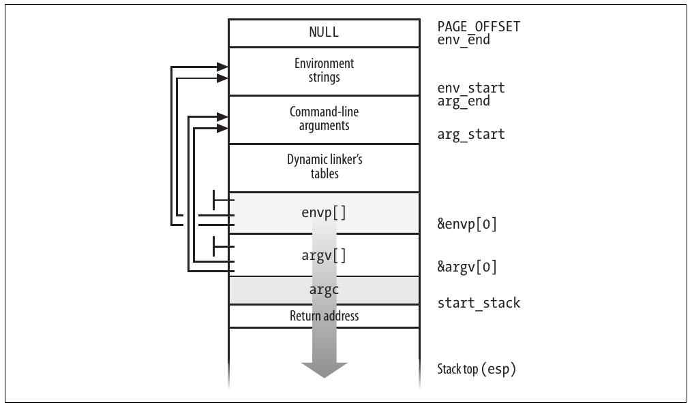

CHƯƠNG 20 Chương 20819

# Chương 20. Thực thi chương trình


Khái niệm “process”, được mô tả trong Chương 3, đã được dùng trong Unix ngay từ đầu để biểu diễn hành vi của các nhóm chương trình đang chạy cạnh tranh tài nguyên hệ thống. Chương cuối này tập trung vào mối quan hệ giữa chương trình và process. Cụ thể, chúng ta mô tả cách kernel thiết lập execution context cho một process theo nội dung của file chương trình. Mặc dù việc nạp một nhóm lệnh vào bộ nhớ rồi hướng CPU đến chúng có vẻ không phải vấn đề lớn, kernel phải đáp ứng tính linh hoạt trong một số lĩnh vực:

Các executable format khác nhau

Linux nổi bật nhờ khả năng chạy các binary được biên dịch cho những hệ điều hành khác. Đặc biệt, Linux có thể chạy một executable được tạo cho máy 32-bit trên phiên bản 64-bit của cùng loại máy đó. Chẳng hạn, một executable được tạo trên Pentium có thể chạy trên AMD Opteron 64-bit.

Shared library

Nhiều executable file không chứa toàn bộ code cần thiết để chạy chương trình mà trông đợi kernel nạp các hàm từ một library vào lúc runtime.

Thông tin khác trong execution context

Phần này bao gồm các command-line argument và environment variable quen thuộc với lập trình viên.

Một chương trình được lưu trên đĩa dưới dạng executable file, bao gồm cả object code của những hàm cần thực thi lẫn dữ liệu mà các hàm này sẽ xử lý. Nhiều hàm của chương trình là những service routine dành cho mọi lập trình viên; object code của chúng được chứa trong các file đặc biệt gọi là “library”. Trên thực tế, code của một hàm library có thể được sao chép tĩnh vào executable file (static library) hoặc được liên kết với process lúc runtime (shared library, vì code của chúng có thể được chia sẻ giữa nhiều process độc lập).

Khi khởi chạy một chương trình, người dùng có thể cung cấp hai loại thông tin ảnh hưởng đến cách thực thi: Command-line argument và environment variable. Người dùng gõ command-line argument sau tên executable file tại shell prompt. Các environment variable, như `HOME` và `PATH`, được kế thừa từ shell, nhưng người dùng có thể sửa giá trị của chúng trước khi khởi chạy chương trình.

Trong mục “Executable file”, chúng ta giải thích execution context của một chương trình là gì. Trong mục “Executable format”, chúng ta đề cập một số executable format được Linux hỗ trợ và chỉ ra cách Linux có thể thay đổi “personality” để thực thi chương trình được biên dịch cho các hệ điều hành khác. Cuối cùng, trong mục “Các hàm exec”, chúng ta mô tả system call cho phép một process bắt đầu thực thi một chương trình mới.

## Executable file

Chương 1 đã định nghĩa process là một “execution context”. Ý chúng ta là tập hợp thông tin cần thiết để tiếp tục một phép tính cụ thể; nó bao gồm các page được truy cập, các file đang mở, nội dung hardware register, v.v. Một executable file là regular file mô tả cách khởi tạo một execution context mới (tức là cách bắt đầu một phép tính mới).

Giả sử một người dùng muốn liệt kê các file trong thư mục hiện tại; người đó biết rằng có thể đạt kết quả này đơn giản bằng cách gõ tên file của external command /bin/ls[^1] tại shell prompt. Command shell fork một process mới, rồi process này gọi system call `execve()` (xem mục “Các hàm exec” ở phần sau chương này), truyền một trong các tham số là chuỗi chứa pathname đầy đủ của executable file ls — trong trường hợp này là /bin/ls. Service routine `sys_execve()` tìm file tương ứng, kiểm tra executable format và sửa execution context của process hiện tại theo thông tin được lưu trong file. Kết quả là khi system call kết thúc, process bắt đầu thực thi code lưu trong executable file để liệt kê thư mục.

Khi một process bắt đầu chạy một chương trình mới, execution context của nó thay đổi mạnh vì phần lớn tài nguyên thu được trong các phép tính trước đó của process bị loại bỏ. Trong ví dụ trên, khi process bắt đầu thực thi /bin/ls, nó thay các argument của shell bằng các argument mới được truyền làm tham số trong system call `execve()` và nhận một shell environment mới (xem mục “Command-Line argument và shell environment” ở phần sau). Mọi page kế thừa từ parent (và được chia sẻ bằng cơ chế Copy On Write) đều được giải phóng để phép tính mới bắt đầu với một User Mode address space mới; ngay cả đặc quyền của process cũng có thể thay đổi (xem mục “Credential và capability của process” ở phần sau). Tuy nhiên, PID của process không thay đổi, và phép tính mới kế thừa từ phép tính trước mọi file descriptor đang mở chưa bị đóng tự động trong khi thực thi system call `execve()`.[^2]

### Credential và capability của process

Theo truyền thống, các hệ thống Unix gắn với mỗi process một số credential, ràng buộc process với một người dùng cụ thể và một nhóm người dùng cụ thể. Credential có vai trò quan trọng trên hệ thống nhiều người dùng vì chúng xác định mỗi process có thể hoặc không thể làm gì, nhờ đó bảo toàn cả tính toàn vẹn dữ liệu cá nhân của từng người dùng lẫn tính ổn định của toàn hệ thống.

Việc dùng credential đòi hỏi hỗ trợ cả trong cấu trúc dữ liệu của process lẫn trong các tài nguyên được bảo vệ. Một tài nguyên hiển nhiên là file. Vì vậy, trong Ext2 filesystem, mỗi file thuộc sở hữu của một người dùng cụ thể và được gắn với một nhóm người dùng. Chủ sở hữu file có thể quyết định các loại thao tác được phép thực hiện trên file đó, phân biệt giữa bản thân, nhóm người dùng của file và mọi người dùng khác. Khi một process cố truy cập file, VFS luôn kiểm tra tính hợp lệ của truy cập theo các quyền do chủ sở hữu file thiết lập và credential của process.

Credential của process được lưu trong một số field của process descriptor, được liệt kê trong Bảng 20-1. Các field này chứa identifier của người dùng và nhóm người dùng trong hệ thống, thường được so sánh với các identifier tương ứng lưu trong inode của những file đang được truy cập.

Bảng 20-1. Credential truyền thống của process

| Tên | Mô tả |
|---|---|
| `uid`, `gid` | Real identifier của người dùng và nhóm |
| `euid`, `egid` | Effective identifier của người dùng và nhóm |
| `fsuid`, `fsgid` | Effective identifier của người dùng và nhóm cho việc truy cập file |
| `groups` | Identifier của các supplementary group |
| `suid`, `sgid` | Saved identifier của người dùng và nhóm |

UID bằng 0 chỉ superuser (root), còn ID nhóm người dùng bằng 0 chỉ nhóm root. Nếu một credential của process lưu giá trị 0, kernel bỏ qua các kiểm tra quyền và cho phép process có đặc quyền thực hiện nhiều hành động, chẳng hạn quản trị hệ thống hoặc thao tác phần cứng, mà process không có đặc quyền không thể thực hiện.

Khi một process được tạo, nó luôn kế thừa credential của parent. Tuy nhiên, các credential này có thể được sửa sau đó, khi process bắt đầu thực thi một chương trình mới hoặc khi nó gọi các system call thích hợp. Thông thường, các field `uid`, `euid`, `fsuid` và `suid` của một process chứa cùng một giá trị. Khi process thực thi một chương trình setuid — tức là executable file có flag setuid được bật — các field `euid` và `fsuid` được đặt thành identifier của chủ sở hữu file. Hầu hết các kiểm tra đều liên quan đến một trong hai field này: `fsuid` được dùng cho các thao tác file-related, còn `euid` được dùng cho mọi thao tác khác. Các nhận xét tương tự cũng áp dụng cho các field `gid`, `egid`, `fsgid` và `sgid` tham chiếu đến group identifier.

Để minh họa cách dùng field `fsuid`, hãy xét tình huống điển hình khi một người dùng muốn đổi mật khẩu. Mọi mật khẩu được lưu trong một file chung, nhưng người dùng không thể sửa trực tiếp file này vì nó được bảo vệ. Vì vậy, người dùng gọi một chương trình hệ thống tên /usr/bin/passwd, có flag setuid được đặt và thuộc sở hữu của superuser. Khi process được shell fork ra thực thi chương trình này, các field `euid` và `fsuid` của nó được đặt thành 0 — PID của superuser. Bây giờ process có thể truy cập file, vì khi kernel thực hiện access control, nó thấy giá trị 0 trong `fsuid`. Tất nhiên, chương trình /usr/bin/passwd không cho phép người dùng làm gì ngoài việc đổi mật khẩu của chính mình.

Lịch sử lâu dài của Unix cho thấy các chương trình setuid — những chương trình có flag setuid được đặt — khá nguy hiểm: người dùng ác ý có thể kích hoạt một số lỗi lập trình (bug) trong code để buộc chương trình setuid thực hiện những thao tác mà người thiết kế ban đầu chưa từng dự định. Trong trường hợp xấu nhất, bảo mật của toàn hệ thống có thể bị xâm phạm. Để giảm thiểu rủi ro đó, Linux, giống mọi hệ thống Unix hiện đại, cho phép process chỉ nhận đặc quyền setuid khi cần và từ bỏ chúng khi không còn cần nữa. Tính năng này có thể hữu ích khi triển khai ứng dụng người dùng với nhiều mức bảo vệ. Process descriptor có field `suid`, lưu giá trị của các effective identifier (`euid` và `fsuid`) tại lúc chương trình setuid khởi động. Process có thể thay đổi effective identifier thông qua các system call `setuid()`, `setresuid()`, `setfsuid()` và `setreuid()`.[^3]

Bảng 20-2 cho thấy các system call này ảnh hưởng đến credential của process như thế nào. Lưu ý rằng nếu process gọi chưa có đặc quyền superuser — tức là field `euid` của nó khác không — thì chỉ có thể dùng các system call này để đặt những giá trị đã có trong các field credential của process. Chẳng hạn, một process người dùng thông thường có thể lưu giá trị `500` vào field `fsuid` bằng cách gọi system call `setfsuid()`, nhưng chỉ khi một trong những field credential khác đã chứa cùng giá trị đó.

Bảng 20-2. Ngữ nghĩa của các system call đặt credential của process

| Field | setuid (e) euid=0 | euid≠0 | setresuid (u,e,s) | setreuid (u,e) | setfsuid (f) |
|---|---|---|---|---|---|
| `uid` | Đặt thành `e` | Không đổi | Đặt thành `u` | Đặt thành `u` | Không đổi |
| `euid` | Đặt thành `e` | Đặt thành `e` | Đặt thành `e` | Đặt thành `e` | Không đổi |
| `fsuid` | Đặt thành `e` | Đặt thành `e` | Đặt thành `e` | Đặt thành `e` | Đặt thành `f` |
| `suid` | Đặt thành `e` | Không đổi | Đặt thành `s` | Đặt thành `e` | Không đổi |

Để hiểu các mối quan hệ đôi khi phức tạp giữa bốn field user ID, hãy xét tác động của system call `setuid()`. Các hành động khác nhau tùy theo field `euid` của process gọi được đặt thành 0 (tức là process có đặc quyền superuser) hay thành UID thông thường.

Nếu field `euid` bằng 0, system call đặt mọi field credential của process gọi (`uid`, `euid`, `fsuid` và `suid`) thành giá trị của tham số `e`. Vì vậy, một process superuser có thể từ bỏ đặc quyền và trở thành process thuộc sở hữu của một người dùng thông thường. Điều này xảy ra, chẳng hạn, khi một người dùng đăng nhập: hệ thống fork một process mới với đặc quyền superuser, nhưng process từ bỏ đặc quyền bằng cách gọi system call `setuid()` rồi bắt đầu thực thi chương trình login shell của người dùng.

Nếu field `euid` khác 0, system call `setuid()` chỉ sửa giá trị lưu trong `euid` và `fsuid`, giữ nguyên hai field còn lại. Hành vi này của system call hữu ích khi triển khai một chương trình setuid tăng giảm đặc quyền hiệu lực của process được lưu trong các field `euid` và `fsuid`.

#### Capability của process

Bản dự thảo POSIX.1e — hiện đã bị rút lại — giới thiệu một mô hình credential của process khác dựa trên khái niệm “capability”. Linux kernel hỗ trợ POSIX capability, mặc dù phần lớn bản phân phối Linux không sử dụng chúng.

Một capability đơn giản là flag xác nhận process có được phép thực hiện một thao tác cụ thể hay một lớp thao tác cụ thể hay không. Mô hình này khác mô hình truyền thống “superuser so với người dùng thông thường”, trong đó một process có thể làm mọi thứ hoặc không làm được gì, tùy theo effective UID. Như minh họa trong Bảng 20-3, Linux kernel đã có một số capability.

Bảng 20-3. Capability của Linux

| Tên | Mô tả |
|---|---|
| `CAP_AUDIT_WRITE` | Cho phép tạo audit message bằng cách ghi vào netlink socket |
| `CAP_AUDIT_CONTROL` | Cho phép điều khiển các hoạt động kernel auditing thông qua netlink socket |
| `CAP_CHOWN` | Bỏ qua các hạn chế về thay đổi chủ sở hữu người dùng và nhóm của file |
| `CAP_DAC_OVERRIDE` | Bỏ qua quyền truy cập file |
| `CAP_DAC_READ_SEARCH` | Bỏ qua quyền đọc và tìm kiếm file/thư mục |
| `CAP_FOWNER` | Nói chung bỏ qua các kiểm tra quyền về quyền sở hữu file |
| `CAP_FSETID` | Bỏ qua các hạn chế về đặt flag setuid và setgid cho file |
| `CAP_KILL` | Bỏ qua kiểm tra quyền khi phát sinh signal |
| `CAP_LINUX_IMMUTABLE` | Cho phép sửa các file Ext2/Ext3 append-only và immutable |
| `CAP_IPC_LOCK` | Cho phép khóa page và shared memory segment |
| `CAP_IPC_OWNER` | Bỏ qua kiểm tra quyền sở hữu IPC |
| `CAP_LEASE` | Cho phép nhận lease trên file (xem “File locking của Linux” trong Chương 12) |
| `CAP_MKNOD` | Cho phép các thao tác `mknod()` có đặc quyền |
| `CAP_NET_ADMIN` | Cho phép quản trị mạng nói chung |
| `CAP_NET_BIND_SERVICE` | Cho phép bind với TCP/UDP socket dưới 1.024 |
| `CAP_NET_BROADCAST` | Cho phép broadcasting và multicasting |
| `CAP_NET_RAW` | Cho phép sử dụng RAW socket và PACKET socket |
| `CAP_SETGID` | Bỏ qua các hạn chế về thao tác credential nhóm của process |
| `CAP_SETPCAP` | Cho phép thao tác capability trên các process khác |
| `CAP_SETUID` | Bỏ qua các hạn chế về thao tác credential người dùng của process |
| `CAP_SYS_ADMIN` | Cho phép quản trị hệ thống nói chung |
| `CAP_SYS_BOOT` | Cho phép sử dụng `reboot()` |
| `CAP_SYS_CHROOT` | Cho phép sử dụng `chroot()` |
| `CAP_SYS_MODULE` | Cho phép chèn và gỡ kernel module |
| `CAP_SYS_NICE` | Bỏ qua kiểm tra quyền của các system call `nice()` và `setpriority()`, đồng thời cho phép tạo real-time process |
| `CAP_SYS_PACCT` | Cho phép cấu hình process accounting |
| `CAP_SYS_PTRACE` | Cho phép sử dụng `ptrace()` trên mọi process |
| `CAP_SYS_RAWIO` | Cho phép truy cập I/O port thông qua `ioperm()` và `iopl()` |
| `CAP_SYS_RESOURCE` | Cho phép tăng resource limit |
| `CAP_SYS_TIME` | Cho phép thao tác system clock và real-time clock |
| `CAP_SYS_TTY_CONFIG` | Cho phép cấu hình terminal và thực thi system call `vhangup()` |

Ưu điểm chính của capability là tại mọi thời điểm, mỗi chương trình chỉ cần một số lượng hạn chế các capability. Do đó, ngay cả khi một người dùng ác ý phát hiện cách khai thác một chương trình có bug, người đó cũng chỉ có thể thực hiện trái phép một tập hợp thao tác hạn chế.

Chẳng hạn, giả sử một chương trình có bug chỉ có capability `CAP_SYS_TIME`. Trong trường hợp này, người dùng ác ý phát hiện cách khai thác bug chỉ có thể thay đổi trái phép real-time clock và system clock. Người đó sẽ không thể thực hiện bất kỳ loại thao tác có đặc quyền nào khác.

Hiện cả VFS lẫn Ext2 filesystem đều không hỗ trợ mô hình capability, nên không có cách gắn một executable file với tập capability cần được áp dụng khi một process thực thi file đó. Tuy nhiên, process có thể lấy và hạ các capability của mình một cách tường minh bằng cách dùng lần lượt các system call `capget()` và `capset()`. Chẳng hạn, có thể sửa chương trình login để giữ lại một tập con các capability và từ bỏ những capability còn lại.

Linux kernel đã tính đến capability. Chẳng hạn, hãy xét system call `nice()`, cho phép người dùng thay đổi static priority của một process. Trong mô hình truyền thống, chỉ superuser mới có thể tăng priority; do đó kernel phải kiểm tra field `euid` trong descriptor của process gọi có được đặt thành 0 hay không. Tuy nhiên, Linux kernel định nghĩa một capability tên `CAP_SYS_NICE`, tương ứng chính xác với loại thao tác này. Kernel kiểm tra giá trị của flag này bằng cách gọi hàm `capable()` và truyền giá trị `CAP_SYS_NICE` cho nó.

Cách tiếp cận này hoạt động nhờ một số “compatibility hack” được thêm vào kernel code: mỗi lần process đặt các field `euid` và `fsuid` thành 0 (bằng cách gọi một trong các system call trong Bảng 20-2 hoặc thực thi chương trình setuid thuộc sở hữu superuser), kernel đặt mọi capability của process để mọi kiểm tra đều thành công. Khi process đặt lại các field `euid` và `fsuid` thành real UID của chủ sở hữu process, kernel kiểm tra flag `keep_capabilities` trong process descriptor và từ bỏ mọi capability của process nếu flag này được đặt. Một process có thể đặt và xóa flag `keep_capabilities` thông qua system call Linux-specific là `prctl()`.

##### Linux Security Modules framework

Trong Linux 2.6, capability được tích hợp chặt chẽ với Linux Security Modules framework (LSM). Nói ngắn gọn, LSM framework cho phép các nhà phát triển định nghĩa một số mô hình thay thế cho bảo mật kernel.

Mỗi mô hình bảo mật được triển khai bằng một tập security hook. Một security hook là hàm được kernel gọi khi sắp thực hiện một thao tác quan trọng security-related. Hàm hook xác định thao tác nên được tiếp tục hay bị từ chối.

Các security hook được lưu trong một bảng có kiểu `security_operations`. Địa chỉ bảng hook cho mô hình bảo mật đang dùng được lưu trong biến `security_ops`. Theo mặc định, kernel sử dụng mô hình bảo mật tối thiểu được triển khai bởi bảng `dummy_security_ops`; mỗi hook trong bảng này về cơ bản kiểm tra capability tương ứng, nếu có, hoặc trả về 0 vô điều kiện (thao tác được cho phép).

Chẳng hạn, các service routine của các hàm `stime()` và `settimeofday()` gọi security hook `settime` trước khi thay đổi ngày giờ hệ thống. Hàm tương ứng được bảng `dummy_security_ops` trỏ đến chỉ kiểm tra capability `CAP_SYS_TIME` của process hiện tại có được đặt hay không, rồi trả về 0 hoặc `-EPERM` tương ứng.

Những mô hình bảo mật tinh vi cho Linux kernel đã được xây dựng. Một ví dụ được biết đến rộng rãi là Security-Enhanced Linux (SELinux), do National Security Agency của Hoa Kỳ phát triển.

### Command-Line argument và shell environment

Khi người dùng gõ một lệnh, chương trình được nạp để đáp ứng yêu cầu có thể nhận một số command-line argument từ shell. Ví dụ, khi người dùng gõ lệnh:

```c
$ ls -l /usr/bin
```

để có danh sách đầy đủ các file trong thư mục /usr/bin, shell process tạo một process mới để thực thi lệnh. Process mới này nạp executable file /bin/ls. Trong quá trình đó, phần lớn execution context kế thừa từ shell bị mất, nhưng ba argument riêng biệt `ls`, `-l` và `/usr/bin` được giữ lại. Nói chung, process mới có thể nhận số lượng argument bất kỳ.

Quy ước truyền command-line argument phụ thuộc vào ngôn ngữ high-level được sử dụng. Trong ngôn ngữ C, hàm `main()` của chương trình có thể nhận các tham số là một số nguyên chỉ số lượng argument được truyền cho chương trình và địa chỉ của một mảng con trỏ đến các chuỗi. Prototype sau diễn đạt chính thức chuẩn này:

```c
int main(int argc, char *argv[])
```

Quay lại ví dụ trước, khi chương trình /bin/ls được gọi, `argc` có giá trị 3, `argv[0]` trỏ đến chuỗi `ls`, `argv[1]` trỏ đến chuỗi `-l`, và `argv[2]` trỏ đến chuỗi `/usr/bin`. Cuối mảng `argv` luôn được đánh dấu bằng một null pointer, nên `argv[3]` chứa `NULL`.

Một tham số thứ ba tùy chọn có thể được truyền cho hàm `main()` trong ngôn ngữ C là tham số chứa các environment variable. Chúng được dùng để tùy chỉnh execution context của một process, cung cấp thông tin chung cho người dùng hoặc các process khác, hoặc cho phép process giữ một số thông tin qua một system call `execve()`.

Để dùng environment variable, có thể khai báo `main()` như sau:

```c
int main(int argc, char *argv[], char *envp[])
```

Tham số `envp` trỏ đến một mảng con trỏ đến các environment string có dạng:

```c
VAR_NAME=something
```

trong đó `VAR_NAME` biểu diễn tên của một environment variable, còn chuỗi con theo sau dấu phân cách `=` biểu diễn giá trị thực tế được gán cho biến. Cuối mảng `envp` được đánh dấu bằng null pointer, giống mảng `argv`. Địa chỉ mảng `envp` cũng được lưu trong biến toàn cục `environ` của C library.

Command-line argument và environment string được đặt trên User Mode stack, ngay trước return address (xem mục “Truyền tham số” trong Chương 10). Các vị trí dưới đáy User Mode stack được minh họa trong Hình 20-1. Lưu ý rằng các environment variable nằm gần đáy stack, ngay sau một số nguyên long bằng 0.



Hình 20-1. Các vị trí dưới đáy User Mode stack

### Library

Mỗi source code file viết bằng ngôn ngữ high-level được chuyển đổi qua nhiều bước thành một object file, chứa machine code của các lệnh assembly tương ứng với các lệnh high-level. Một object file không thể được thực thi, vì nó không chứa linear address tương ứng với mỗi tham chiếu đến tên của một global symbol nằm ngoài source code file, chẳng hạn các hàm trong library hoặc các source code file khác của cùng chương trình. Việc gán, hay phân giải, các địa chỉ đó do linker thực hiện; linker tập hợp mọi object file của chương trình và xây dựng executable file. Linker cũng phân tích các hàm library được chương trình sử dụng và ghép chúng vào executable file theo cách được mô tả ở phần sau chương này.

Hầu hết chương trình, ngay cả những chương trình đơn giản nhất, đều dùng library. Chẳng hạn, hãy xét chương trình C one-line sau:

```c
void main(void) { }
```

Mặc dù chương trình này không tính toán gì, vẫn cần rất nhiều công việc để thiết lập môi trường thực thi (xem mục “Các hàm exec” ở phần sau chương này) và kết thúc process khi chương trình kết thúc (xem mục “Hủy process” trong Chương 3). Đặc biệt, khi hàm `main()` kết thúc, C compiler chèn một lời gọi hàm `exit_group()` vào object code.

Từ Chương 10, chúng ta biết chương trình thường gọi system call thông qua các wrapper routine trong C library. Điều này cũng đúng với C compiler. Ngoài code được tạo trực tiếp bằng cách biên dịch các câu lệnh của chương trình, mỗi executable file còn chứa một số “glue” code để xử lý tương tác giữa User Mode process với kernel. Các phần của glue code này được lưu trong C library.

Ngoài C library, các hệ thống Unix còn có nhiều library hàm khác. Một hệ thống Linux thông thường thường dùng vài trăm library. Chỉ cần kể một vài ví dụ: math library libm có các hàm nâng cao cho phép toán floating point, còn X11 library libX11 tập hợp các hàm cơ bản ở low-level cho giao diện đồ họa X11 Window System.

Mọi executable file trong các hệ thống Unix truyền thống đều dựa trên static library. Điều này có nghĩa executable file do linker tạo ra bao gồm không chỉ code của chương trình gốc mà cả code của các hàm library được chương trình tham chiếu. Một nhược điểm lớn của chương trình được liên kết tĩnh là chúng chiếm nhiều dung lượng đĩa. Thật vậy, mỗi executable file được liên kết tĩnh đều sao chép một phần library code.

Các hệ thống Unix hiện đại dùng shared library. Executable file không chứa object code của library mà chỉ chứa tham chiếu đến tên library. Khi chương trình được nạp vào bộ nhớ để thực thi, một chương trình thích hợp gọi là dynamic linker (cũng có tên ld.so) đảm nhiệm việc phân tích tên library trong executable file, tìm library trong cây thư mục hệ thống và cung cấp code được yêu cầu cho process đang thực thi. Process cũng có thể nạp thêm shared library lúc runtime bằng hàm library `dlopen()`.

Shared library đặc biệt tiện lợi trên những hệ thống cung cấp file memory mapping, vì chúng giảm lượng bộ nhớ chính cần để thực thi chương trình. Khi dynamic linker phải liên kết một shared library với process, nó không sao chép object code mà chỉ thực hiện memory mapping phần liên quan của file library vào address space của process. Điều này cho phép các page frame chứa machine code của library được chia sẻ giữa mọi process đang dùng cùng code. Rõ ràng, không thể chia sẻ nếu chương trình đã được liên kết tĩnh.

Shared library cũng có một số nhược điểm. Thời gian khởi động của chương trình được liên kết động thường dài hơn chương trình được liên kết tĩnh. Hơn nữa, chương trình được liên kết động không có tính khả chuyển cao như chương trình được liên kết tĩnh, vì có thể không thực thi đúng trên hệ thống có một phiên bản khác của cùng library.

Người dùng luôn có thể yêu cầu liên kết tĩnh một chương trình. Ví dụ, GCC compiler cung cấp tùy chọn `-static`, yêu cầu linker dùng static library thay cho shared library.

### Program segment và memory region của process

Theo truyền thống, xét về mặt logic, linear address space của một chương trình Unix được chia thành nhiều khoảng linear address gọi là segment:[^4]

Text segment

Chứa executable code của chương trình.

Initialized data segment

Chứa dữ liệu đã khởi tạo — tức là các static variable và global variable có giá trị ban đầu được lưu trong executable file (vì chương trình phải biết giá trị của chúng lúc khởi động).

Uninitialized data segment (bss)

Chứa dữ liệu chưa khởi tạo — tức là mọi global variable có giá trị ban đầu không được lưu trong executable file (vì chương trình đặt giá trị trước khi tham chiếu đến chúng); theo lịch sử, nó được gọi là bss segment.

Stack segment

Chứa program stack, bao gồm return address, tham số và local variable của các hàm đang thực thi.

Mỗi memory descriptor `mm_struct` (xem mục “Memory descriptor” trong Chương 9) có một số field xác định vai trò của vài memory region quan trọng của process tương ứng:

`start_code`, `end_code`

Lưu linear address đầu và cuối của memory region chứa native code của chương trình — code trong executable file.

`start_data`, `end_data`

Lưu linear address đầu và cuối của memory region chứa dữ liệu đã khởi tạo gốc của chương trình, theo chỉ định trong executable file. Các field xác định một memory region gần tương ứng với data segment.

`start_brk`, `brk`

Lưu linear address đầu và cuối của memory region chứa các vùng bộ nhớ được cấp phát động của process (xem mục “Quản lý heap” trong Chương 9). Memory region này đôi khi được gọi là heap.

`start_stack`

Lưu địa chỉ ngay phía trên return address của `main()`; như minh họa trong Hình 20-1, các địa chỉ cao hơn được dành riêng (nhớ rằng stack phát triển về phía địa chỉ thấp hơn).

`arg_start`, `arg_end`

Lưu địa chỉ đầu và cuối của phần stack chứa các command-line argument.

`env_start`, `env_end`

Lưu địa chỉ đầu và cuối của phần stack chứa các environment string.

Lưu ý rằng shared library và file memory mapping đã khiến cách phân loại address space của process dựa trên program segment trở nên lỗi thời, vì mỗi shared library được ánh xạ vào một memory region khác với những region được đề cập trong danh sách trên.

#### Bố trí memory region linh hoạt

Cách bố trí memory region linh hoạt được đưa vào kernel phiên bản 2.6.9: về cơ bản, mỗi process nhận một cách bố trí bộ nhớ phụ thuộc vào mức tăng trưởng dự kiến của User Mode stack. Tuy nhiên, cách bố trí cổ điển cũ vẫn có thể được dùng (chủ yếu khi kernel không thể đặt giới hạn kích thước User Mode stack của process). Cả hai cách bố trí được mô tả trong Bảng 20-4, với giả định kiến trúc 80x86 có User Mode address space mặc định trải rộng tới 3 GB.

Bảng 20-4. Các cách bố trí memory region trong kiến trúc 80x86

| Loại memory region | Bố trí cổ điển | Bố trí linh hoạt |
|---|---|---|
| Text segment (ELF) | Bắt đầu từ `0x08048000` |  |
| Data segment và bss segment | Bắt đầu ngay sau text segment |  |
| Heap | Bắt đầu ngay sau data segment và bss segment |  |
| File memory mapping và anonymous memory region | Bắt đầu từ `0x40000000` (địa chỉ này tương ứng với 1/3 toàn bộ User Mode address space); các library được thêm vào tại những địa chỉ ngày càng cao | Bắt đầu gần cuối (địa chỉ thấp nhất) của User Mode stack; các library được thêm vào tại những địa chỉ ngày càng thấp |
| User Mode stack | Bắt đầu tại `0xc0000000` và phát triển về phía địa chỉ thấp hơn |  |

Như có thể thấy, các cách bố trí chỉ khác nhau ở vị trí các memory region dành cho file memory mapping và anonymous mapping. Trong cách bố trí cổ điển, các region này được đặt bắt đầu ở one-third toàn bộ User Mode address space, thường tại `0x40000000`; region mới hơn được thêm vào tại linear address cao hơn, nên các region mở rộng về phía User Mode stack.

Ngược lại, trong cách bố trí linh hoạt, các memory region dành cho file memory mapping và anonymous mapping được đặt gần cuối User Mode stack; region mới hơn được thêm vào tại linear address thấp hơn, nên các region mở rộng về phía heap. Nhớ rằng stack cũng phát triển về phía địa chỉ thấp hơn.

Kernel thường dùng cách bố trí linh hoạt khi có thể xác định giới hạn kích thước User Mode stack thông qua resource limit `RLIMIT_STACK` (xem mục “Resource limit của process” trong Chương 3). Giới hạn này xác định kích thước linear address space dành riêng cho stack; tuy nhiên, kích thước đó không thể nhỏ hơn 128 MB hoặc lớn hơn 2,5 GB.

Mặt khác, nếu resource limit `RLIMIT_STACK` được đặt thành “infinity”, hoặc quản trị viên hệ thống đặt biến `sysctl_legacy_va_layout` thành 1 (bằng cách ghi vào file `/proc/sys/vm/legacy_va_layout` hoặc gọi system call `sysctl()` thích hợp), kernel không thể xác định cận trên cho kích thước User Mode stack, nên vẫn dùng cách bố trí memory region cổ điển.

Vì sao cách bố trí linh hoạt được đưa vào? Ưu điểm chính của nó là cho phép process sử dụng User Mode linear address space tốt hơn. Với cách bố trí cổ điển, heap bị giới hạn dưới 1 GB, còn các memory region khác có thể chiếm tới khoảng 2 GB (trừ kích thước stack). Với cách bố trí linh hoạt, những ràng buộc này không còn: cả heap lẫn các memory region khác đều có thể tự do mở rộng cho đến khi sử dụng hết các linear address còn trống mà User Mode stack và các segment fixed-size của chương trình chưa dùng đến.

Đến đây, một thử nghiệm thực tế nhỏ có thể giúp làm sáng tỏ vấn đề. Hãy viết và biên dịch chương trình C sau:

```c
#include <stdio.h>
#include <stdlib.h>
#include <unistd.h>
int main()
{
    char cmd[32];
    brk((void *)0x8051000);
    sprintf(cmd, "cat /proc/self/maps");
    system(cmd);
    return 0;
}
```

Về cơ bản, chương trình mở rộng heap của process (xem mục “Quản lý heap” trong Chương 9), sau đó đọc file maps trong special filesystem /proc, file này tạo ra danh sách memory region của chính process đó.

Hãy chạy chương trình mà không đặt bất kỳ giới hạn nào cho kích thước stack:

```c
# ulimit -s unlimited; /tmp/memorylayout
08048000-08049000 r-xp 00000000 03:03 5042408    /tmp/memorylayout
08049000-0804a000 rwxp 00000000 03:03 5042408    /tmp/memorylayout
0804a000-08051000 rwxp 0804a000 00:00 0
40000000-40014000 r-xp 00000000 03:03 620801     /lib/ld-2.3.2.so
40014000-40015000 rwxp 00013000 03:03 620801     /lib/ld-2.3.2.so
40015000-40016000 rwxp 40015000 00:00 0
4002f000-40157000 r-xp 00000000 03:03 620804     /lib/libc-2.3.2.so
40157000-4015b000 rwxp 00128000 03:03 620804     /lib/libc-2.3.2.so
4015b000-4015e000 rwxp 4015b000 00:00 0
bffeb000-c0000000 rwxp bffeb000 00:00 0
ffffe000-fffff000 ---p 00000000 00:00 0
```

(Bạn có thể thấy một bảng hơi khác, tùy theo phiên bản bộ công cụ C compiler và cách chương trình đã được liên kết.) Hai số thập lục phân đầu tiên biểu diễn phạm vi của memory region; theo sau là các permission flag; cuối cùng là một số thông tin về file được memory region ánh xạ, nếu có: starting offset bên trong file, block device number và inode number, cùng tên file.

Lưu ý rằng mọi region được liệt kê đều được triển khai bằng private memory mapping (chữ `p` trong cột quyền). Điều này không đáng ngạc nhiên vì những memory region này chỉ tồn tại để cung cấp dữ liệu cho process. Trong khi thực thi lệnh, process có thể sửa nội dung của các memory region này; tuy nhiên, các file trên đĩa gắn với chúng vẫn không đổi. Đây chính là cách private memory mapping hoạt động.

Memory region bắt đầu từ `0x8048000` là memory mapping gắn với phần của file /tmp/memorylayout từ byte 0 đến byte 4.095. Các quyền chỉ định region có thể thực thi (chứa object code), read-only (không thể ghi vì các lệnh không thay đổi trong một lần chạy), và private. Điều này đúng, vì region ánh xạ text segment của chương trình.

Memory region bắt đầu từ `0x8049000` là một memory mapping khác gắn với cùng phần của /tmp/memorylayout từ byte 0 đến byte 4.095. Chương trình này nhỏ đến mức text segment, data segment và bss segment của chương trình nằm trong cùng page của file. Vì vậy, memory region chứa data segment và bss segment chồng lấn với memory region trước trong linear address space.

Memory region thứ ba chứa heap của process. Lưu ý rằng nó kết thúc tại linear address `0x8051000` đã được truyền cho system call `brk()`.

Hai memory region tiếp theo bắt đầu từ `0x40000000` và `0x40014000` lần lượt tương ứng với text segment và các data segment, bss segment của dynamic linker cho ELF shared library — /lib/ld-2.3.2.so trên hệ thống này. Dynamic linker không bao giờ được thực thi một mình: nó luôn được memory-mapped bên trong address space của một process đang thực thi một chương trình khác. Anonymous memory region bắt đầu từ `0x40015000` đã được dynamic linker cấp phát.

Trên hệ thống này, C library được lưu trong file /lib/libc-2.3.2.so. Text segment và các data segment, bss segment của C library được ánh xạ vào hai memory region tiếp theo, bắt đầu từ địa chỉ `0x4002f000`. Nhớ rằng các page frame trong private region có thể được chia sẻ giữa nhiều process bằng cơ chế Copy On Write, miễn là chúng không bị sửa đổi. Vì vậy, do text segment read-only, các page frame chứa executable code của C library được chia sẻ giữa hầu hết process đang thực thi (mọi process trừ những process được liên kết tĩnh). Anonymous memory region bắt đầu từ `0x4015b000` đã được C library cấp phát.

Anonymous memory region từ `0xbffeb000` đến `0xc0000000` gắn với User Mode stack. Chúng ta đã giải thích trong mục “Page Fault exception handler” của Chương 9 cách stack tự động mở rộng về phía địa chỉ thấp hơn bất cứ khi nào cần.

Cuối cùng, anonymous memory region one-page bắt đầu từ `0xffffe000` chứa vsyscall page của process, được truy cập khi gọi system call và khi trở về từ signal handler (xem mục “Gọi system call qua lệnh sysenter” trong Chương 10 và mục “Bắt signal” trong Chương 11).

Bây giờ hãy chạy cùng chương trình với việc áp đặt giới hạn cho kích thước User Mode stack:

```c
# ulimit -s 100; /tmp/memorylayout
08048000-08049000 r-xp 00000000 03:03 5042408    /tmp/memorylayout
08049000-0804a000 rwxp 00000000 03:03 5042408    /tmp/memorylayout
0804a000-08051000 rwxp 0804a000 00:00 0
b7ea3000-b7fcb000 r-xp 00000000 03:03 620804     /lib/libc-2.3.2.so
b7fcb000-b7fcf000 rwxp 00128000 03:03 620804     /lib/libc-2.3.2.so
b7fcf000-b7fd2000 rwxp b7fcf000 00:00 0
b7feb000-b7fec000 rwxp b7feb000 00:00 0
b7fec000-b8000000 r-xp 00000000 03:03 620801     /lib/ld-2.3.2.so
b8000000-b8001000 rwxp 00013000 03:03 620801     /lib/ld-2.3.2.so
bffeb000-c0000000 rwxp bffeb000 00:00 0
ffffe000-fffff000 ---p 00000000 00:00 0
```

Hãy chú ý cách bố trí đã thay đổi: dynamic linker đã được ánh xạ ở khoảng 128 MB phía trên địa chỉ stack cao nhất. Hơn nữa, vì các memory region của C library được tạo sau, chúng nhận các linear address thấp hơn.

### Execution tracing

Execution tracing là kỹ thuật cho phép một chương trình theo dõi việc thực thi của một chương trình khác. Chương trình được trace có thể được thực thi từng bước, cho đến khi nhận signal, hoặc cho đến khi gọi system call. Execution tracing được debugger sử dụng rộng rãi, cùng với những kỹ thuật khác như chèn breakpoint vào chương trình đang được debug và truy cập các biến của nó lúc runtime. Chúng ta tập trung vào cách kernel hỗ trợ execution tracing thay vì thảo luận cách debugger hoạt động.

Trong Linux, execution tracing được thực hiện thông qua system call `ptrace()`, có thể xử lý các lệnh trong Bảng 20-5. Process có capability flag `CAP_SYS_PTRACE` được đặt được phép trace mọi process trong hệ thống ngoại trừ init. Ngược lại, một process P không có capability `CAP_SYS_PTRACE` chỉ được phép trace các process có cùng chủ sở hữu với P. Hơn nữa, một process không thể bị hai process trace cùng lúc.

Bảng 20-5. Các lệnh ptrace trong kiến trúc 80×86

| Lệnh | Mô tả |
|---|---|
| `PTRACE_ATTACH` | Bắt đầu execution tracing cho một process khác |
| `PTRACE_CONT` | Tiếp tục thực thi |
| `PTRACE_DETACH` | Kết thúc execution tracing |
| `PTRACE_GET_THREAD_AREA` | Lấy vùng Thread Local Storage (TLS) thay mặt process được trace |
| `PTRACE_GETEVENTMSG` | Lấy dữ liệu bổ sung từ process được trace (ví dụ PID của process vừa được fork) |
| `PTRACE_GETFPREGS` | Đọc floating point register |
| `PTRACE_GETFPXREGS` | Đọc MMX register và XMM register |
| `PTRACE_GETREGS` | Đọc các register đặc quyền của CPU |
| `PTRACE_GETSIGINFO` | Lấy thông tin về signal cuối cùng được chuyển đến process được trace |
| `PTRACE_KILL` | Kết thúc process được trace |
| `PTRACE_OLDSETOPTIONS` | Lệnh Architecture-dependent, tương đương với `PTRACE_SETOPTIONS` |
| `PTRACE_PEEKDATA` | Đọc một giá trị 32-bit từ data segment |
| `PTRACE_PEEKTEXT` | Đọc một giá trị 32-bit từ text segment |
| `PTRACE_PEEKUSR` | Đọc các normal register và debug register của CPU |
| `PTRACE_POKEDATA` | Ghi một giá trị 32-bit vào data segment |
| `PTRACE_POKETEXT` | Ghi một giá trị 32-bit vào text segment |
| `PTRACE_POKEUSR` | Ghi các normal register và debug register của CPU |
| `PTRACE_SET_THREAD_AREA` | Đặt vùng Thread Local Storage (TLS) thay mặt process được trace |
| `PTRACE_SETFPREGS` | Ghi floating point register |
| `PTRACE_SETFPXREGS` | Ghi MMX register và XMM register |
| `PTRACE_SETOPTIONS` | Sửa hành vi của `ptrace()` |
| `PTRACE_SETREGS` | Ghi các register đặc quyền của CPU |
| `PTRACE_SETSIGINFO` | Tạo thông tin giả về signal cuối cùng được chuyển đến process được trace |
| `PTRACE_SINGLESTEP` | Tiếp tục thực thi đúng một lệnh assembly |
| `PTRACE_SYSCALL` | Tiếp tục thực thi cho đến ranh giới system call tiếp theo |
| `PTRACE_TRACEME` | Bắt đầu execution tracing cho process hiện tại |

System call `ptrace()` sửa field `parent` trong descriptor của process được trace để nó trỏ đến process thực hiện trace; do đó, process thực hiện trace trở thành parent thực tế của process được trace. Khi execution tracing kết thúc — tức là khi `ptrace()` được gọi với lệnh `PTRACE_DETACH` — system call đặt `p_pptr` thành giá trị của `real_parent`, qua đó khôi phục parent ban đầu của process được trace (xem mục “Quan hệ giữa các process” trong Chương 3).

Một số sự kiện được theo dõi có thể được gắn với chương trình được trace:

- Kết thúc thực thi một lệnh assembly đơn lẻ

- Đi vào một system call

- Thoát khỏi một system call

- Nhận một signal

Khi một sự kiện được theo dõi xảy ra, chương trình được trace bị dừng và signal `SIGCHLD` được gửi đến parent của nó. Khi parent muốn tiếp tục việc thực thi của child, nó có thể dùng một trong các lệnh `PTRACE_CONT`, `PTRACE_SINGLESTEP` và `PTRACE_SYSCALL`, tùy theo loại sự kiện muốn theo dõi.

Lệnh `PTRACE_CONT` đơn giản tiếp tục thực thi; child thực thi cho đến khi nhận một signal khác. Loại tracing này được triển khai bằng flag `PT_PTRACED` trong field `ptrace` của process descriptor, được hàm `do_signal()` kiểm tra (xem mục “Chuyển giao signal” trong Chương 11).

Lệnh `PTRACE_SINGLESTEP` buộc child process thực thi lệnh assembly tiếp theo, rồi lại dừng nó. Loại tracing này được triển khai trên máy 80x86-based thông qua trap flag `TF` trong register `eflags`: khi flag được bật, một exception “Debug” được phát sinh ngay sau mỗi lệnh assembly. Exception handler tương ứng chỉ xóa flag, buộc process hiện tại dừng và gửi signal `SIGCHLD` đến parent. Lưu ý rằng đặt flag `TF` không phải thao tác có đặc quyền, nên User Mode process có thể buộc thực thi single-step ngay cả khi không có system call `ptrace()`. Kernel kiểm tra flag `PT_DTRACE` trong process descriptor để theo dõi child process có đang được single-stepped qua `ptrace()` hay không.

Lệnh `PTRACE_SYSCALL` khiến process được trace tiếp tục thực thi cho đến khi một system call được gọi. Process bị dừng hai lần: lần đầu khi system call bắt đầu và lần thứ hai khi system call kết thúc. Loại tracing này được triển khai bằng flag `TIF_SYSCALL_TRACE` trong field `flags` của cấu trúc `thread_info` của process, được kiểm tra trong hàm assembly `system_call()` (xem mục “Gọi system call qua lệnh int $0x80” trong Chương 10).

Một process cũng có thể được trace bằng một số tính năng debugging của bộ xử lý Intel Pentium. Ví dụ, parent có thể đặt giá trị các debug register `dr0`,..., `dr7` cho child bằng lệnh `PTRACE_POKEUSR`. Khi một sự kiện được debug register theo dõi xảy ra, CPU phát sinh exception “Debug”; sau đó exception handler có thể tạm dừng process được trace và gửi signal `SIGCHLD` đến parent.

## Executable format

Executable format chuẩn của Linux có tên Executable and Linking Format (ELF). Nó được Unix System Laboratories phát triển và hiện là format được dùng rộng rãi nhất trong thế giới Unix. Một số hệ điều hành Unix well-known, như System V Release 4 và Solaris 2 của Sun, đã chọn ELF làm executable format chính.

Các phiên bản Linux cũ hỗ trợ một format khác tên Assembler OUTput Format (a.out); thực tế, có một số phiên bản format này tồn tại trong thế giới Unix. Hiện nó ít được dùng vì ELF thực dụng hơn nhiều.

Linux hỗ trợ nhiều format khác cho executable file; bằng cách này, nó có thể chạy chương trình được biên dịch cho các hệ điều hành khác, như chương trình MS-DOS EXE hoặc COFF executable của BSD Unix. Một vài executable format, như Java hoặc bash script, không phụ thuộc nền tảng.

Một executable format được mô tả bởi một object kiểu `linux_binfmt`, về cơ bản cung cấp ba method:

`load_binary`

Thiết lập môi trường thực thi mới cho process hiện tại bằng cách đọc thông tin lưu trong executable file.

`load_shlib`

Liên kết động một shared library với process đang chạy; nó được kích hoạt bởi system call `uselib()`.

`core_dump`

Lưu execution context của process hiện tại trong một file tên `core`. File này, có format phụ thuộc vào loại executable của chương trình đang thực thi, thường được tạo khi process nhận một signal có hành động mặc định là “dump” (xem mục “Các hành động được thực hiện khi chuyển giao signal” trong Chương 11).

Mọi object `linux_binfmt` nằm trong một singly linked list, và địa chỉ phần tử đầu tiên được lưu trong biến `formats`. Có thể chèn và xóa phần tử trong list bằng các hàm `register_binfmt()` và `unregister_binfmt()`. Hàm `register_binfmt()` được thực thi khi khởi động hệ thống cho mỗi executable format được biên dịch vào kernel. Hàm này cũng được thực thi khi một module triển khai executable format mới được nạp, còn hàm `unregister_binfmt()` được gọi khi module được gỡ.

Phần tử cuối trong list `formats` luôn là object mô tả executable format cho các interpreted script. Format này chỉ định nghĩa method `load_binary`. Hàm `load_script()` tương ứng kiểm tra executable file có bắt đầu bằng cặp ký tự `#!` hay không. Nếu có, nó diễn giải phần còn lại của dòng đầu là pathname của một executable file khác và cố thực thi file đó bằng cách truyền tên script file làm tham số.[^5] Linux cho phép người dùng đăng ký executable format tùy chỉnh của riêng mình. Mỗi format như vậy có thể được nhận diện bằng magic number lưu trong 128 byte đầu của file, hoặc bằng phần mở rộng tên file xác định loại file. Ví dụ, phần mở rộng MS-DOS gồm ba ký tự được ngăn với tên file bằng dấu chấm: phần mở rộng .exe xác định chương trình có thể thực thi, còn phần mở rộng .bat xác định shell script.

Khi kernel xác định executable file có format tùy chỉnh, nó khởi chạy chương trình interpreter thích hợp. Chương trình interpreter chạy trong User Mode, nhận pathname của executable file làm tham số và tiếp tục phép tính. Ví dụ, một executable file chứa chương trình Java được xử lý bởi java virtual machine như /usr/lib/java/bin/java.

Cơ chế này tương tự format của script, nhưng mạnh hơn vì không áp đặt bất kỳ hạn chế nào lên format tùy chỉnh. Để đăng ký format mới, người dùng ghi vào file register của special filesystem binfmt\_misc (thường được mount tại /proc/sys/fs/binfmt\_misc) một chuỗi có format sau:

```c
:name:type:offset:string:mask:interpreter:flags
```

trong đó mỗi field có ý nghĩa sau:

`name`

Một identifier cho format mới

`type`

Loại nhận diện (`M` cho magic number, `E` cho phần mở rộng)

`offset`

Starting offset của magic number bên trong file

`string`

Chuỗi byte cần khớp trong magic number hoặc phần mở rộng

`mask`

Chuỗi dùng để mask một số bit trong `string`

`interpreter`

Pathname đầy đủ của chương trình interpreter

`flags`

Một số flag tùy chọn điều khiển cách chương trình interpreter phải được gọi

Ví dụ, lệnh sau do superuser thực hiện cho phép kernel nhận diện executable format của Microsoft Windows:

```c
$ echo ':DOSWin:M:0:MZ:0xff:/usr/bin/wine:'
                                    > /proc/sys/fs/binfmt_misc/register
```

Một Windows executable file có magic number MZ trong hai byte đầu, và được thực thi bởi chương trình interpreter /usr/bin/wine.

## Execution domain

Như đã đề cập trong Chương 1, một tính năng thú vị của Linux là khả năng thực thi các file được biên dịch cho hệ điều hành khác. Tất nhiên, điều này chỉ khả thi nếu các file chứa machine code cho cùng kiến trúc máy tính mà kernel đang chạy. Có hai loại hỗ trợ dành cho những chương trình “ngoại lai” này:

- Emulated execution: cần thiết để thực thi chương trình có các system call không POSIX-compliant

- Native execution: áp dụng cho chương trình có các system call hoàn toàn POSIX-compliant

Các chương trình Microsoft MS-DOS và Windows được emulation: không thể thực thi native vì chúng có API không được Linux nhận diện. Một emulator như DOSemu hoặc Wine (đã xuất hiện trong ví dụ cuối mục trước) được gọi để chuyển mỗi lời gọi API thành lời gọi wrapper function thực hiện emulation, rồi wrapper này dùng các system call Linux hiện có. Vì emulator chủ yếu được triển khai dưới dạng ứng dụng User Mode, chúng ta không bàn thêm về chúng.

Mặt khác, những chương trình POSIX-compliant được biên dịch trên hệ điều hành khác Linux có thể được thực thi không quá khó khăn, vì các hệ điều hành POSIX cung cấp API tương tự nhau. (Thực ra các API phải giống hệt nhau, mặc dù không phải lúc nào cũng vậy.) Những khác biệt nhỏ mà kernel phải giải quyết thường liên quan đến cách gọi system call hoặc cách đánh số các signal khác nhau. Thông tin này được lưu trong execution domain descriptor kiểu `exec_domain`.

Một process chỉ định execution domain của mình bằng cách đặt field `personality` trong descriptor và lưu địa chỉ cấu trúc dữ liệu `exec_domain` tương ứng trong field `exec_domain` của cấu trúc `thread_info`. Process có thể thay đổi personality bằng cách gọi system call thích hợp tên `personality()`; các giá trị điển hình của tham số system call được liệt kê trong Bảng 20-6. Lập trình viên không được kỳ vọng trực tiếp thay đổi personality của chương trình; thay vào đó, system call `personality()` nên được gọi bởi glue code thiết lập execution context của process (xem mục tiếp theo).

Bảng 20-6. Các personality được Linux kernel hỗ trợ

| Personality | Hệ điều hành |
|---|---|
| `PER_LINUX` | Execution domain chuẩn |
| `PER_LINUX_32BIT` | Linux với physical address 32-bit trong kiến trúc 64-bit |
| `PER_LINUX_FDPIC` | Chương trình Linux ở format ELF FDPIC |
| `PER_SVR4` | System V Release 4 |
| `PER_SVR3` | System V Release 3 |
| `PER_SCOSVR3` | SCO Unix Version 3.2 |
| `PER_OSR5` | SCO OpenServer Release 5 |
| `PER_WYSEV386` | Unix System V/386 Release 3.2.1 |
| `PER_ISCR4` | Interactive Unix |
| `PER_BSD` | BSD Unix |
| `PER_SUNOS` | SunOS |
| `PER_XENIX` | Xenix |
| `PER_LINUX32` | Emulation các chương trình Linux 32-bit trong kiến trúc 64-bit (dùng User Mode address space 4 GB) |
| `PER_LINUX32_3GB` | Emulation các chương trình Linux 32-bit trong kiến trúc 64-bit (dùng User Mode address space 3 GB) |
| `PER_IRIX32` | SGI IRIX-5 32 bit |
| `PER_IRIXN32` | SGI IRIX-6 32 bit |
| `PER_IRIX64` | SGI IRIX-6 64 bit |
| `PER_RISCOS` | RISC OS |
| `PER_SOLARIS` | Solaris của Sun |
| `PER_UW7` | UnixWare 7 của SCO (trước đây là Caldera) |
| `PER_OSF4` | Digital UNIX (Compaq Tru64 UNIX) |
| `PER_HPUX` | HP-UX của Hewlett-Packard |

## Các hàm exec

Các hệ thống Unix cung cấp một họ hàm thay execution context của process bằng context mới được mô tả bởi executable file. Tên các hàm này bắt đầu với tiền tố `exec`, theo sau là một hoặc hai chữ cái; vì vậy, một hàm bất kỳ trong họ thường được gọi là hàm `exec`.

Các hàm `exec` được liệt kê trong Bảng 20-7; chúng khác nhau ở cách diễn giải tham số.

Bảng 20-7. Các hàm exec

| Tên hàm | Tìm kiếm PATH | Command-line argument | Mảng environment |
|---|---|---|---|
| `execl()` | Không | List | Không |
| `execlp()` | Có | List | Không |
| `execle()` | Không | List | Có |
| `execv()` | Không | Mảng | Không |
| `execvp()` | Có | Mảng | Không |
| `execve()` | Không | Mảng | Có |

Tham số đầu tiên của mỗi hàm biểu thị pathname của file cần thực thi. Pathname có thể là tuyệt đối hoặc tương đối so với thư mục hiện tại của process.

Hơn nữa, nếu tên không chứa ký tự / nào, các hàm `execlp()` và `execvp()` tìm executable file trong mọi thư mục được environment variable `PATH` chỉ định.

Ngoài tham số đầu tiên, các hàm `execl()`, `execlp()` và `execle()` có số lượng tham số bổ sung thay đổi. Mỗi tham số trỏ đến chuỗi mô tả một command-line argument cho chương trình mới; như ký tự “`l`” trong tên hàm gợi ý, các tham số được tổ chức trong một list kết thúc bằng giá trị `NULL`. Thông thường, command-line argument đầu tiên lặp lại tên executable file. Ngược lại, các hàm `execv()`, `execvp()` và `execve()` chỉ định command-line argument bằng một tham số duy nhất; như ký tự `v` trong tên hàm gợi ý, tham số là địa chỉ của một vector con trỏ đến các chuỗi command-line argument. Thành phần cuối của mảng phải là `NULL`.

Các hàm `execle()` và `execve()` nhận tham số cuối là địa chỉ của một mảng con trỏ đến các environment string; như thường lệ, thành phần cuối của mảng phải là `NULL`. Những hàm khác có thể truy cập environment cho chương trình mới từ biến toàn cục bên ngoài `environ`, được định nghĩa trong C library.

Mọi hàm `exec`, ngoại trừ `execve()`, đều là wrapper routine được định nghĩa trong C library và dùng `execve()`, system call duy nhất mà Linux cung cấp để xử lý việc thực thi chương trình.

Service routine `sys_execve()` nhận các tham số sau:

- Địa chỉ pathname của executable file (trong User Mode address space).

- Địa chỉ của một mảng kết thúc bằng `NULL` (trong User Mode address space) gồm các con trỏ đến chuỗi (cũng trong User Mode address space); mỗi chuỗi biểu diễn một command-line argument.

- Địa chỉ của một mảng kết thúc bằng `NULL` (trong User Mode address space) gồm các con trỏ đến chuỗi (cũng trong User Mode address space); mỗi chuỗi biểu diễn một environment variable theo format `NAME=value`.

Hàm sao chép pathname của executable file vào một page frame mới được cấp phát. Sau đó nó gọi hàm `do_execve()`, truyền các con trỏ đến page frame, đến các mảng con trỏ và đến vị trí trên Kernel Mode stack lưu nội dung các User Mode register. Đến lượt mình, `do_execve()` thực hiện các thao tác sau:

1\. Cấp phát động một cấu trúc dữ liệu `linux_binprm`, sẽ được điền dữ liệu liên quan đến executable file mới.

2\. Gọi `path_lookup()`, `dentry_open()` và `path_release()` để lấy dentry object, file object và inode object gắn với executable file. Nếu thất bại, trả về error code thích hợp.

3\. Xác minh process hiện tại có thể thực thi file; đồng thời kiểm tra file không đang được ghi bằng cách xem field `i_writecount` của inode; lưu `–1` vào field này để cấm các truy cập ghi tiếp theo.

4\. Trong hệ thống multiprocessor, gọi hàm `sched_exec()` để xác định CPU có tải thấp nhất có thể thực thi chương trình mới và di chuyển process hiện tại đến CPU đó (xem Chương 7).

5\. Gọi `init_new_context()` để kiểm tra process hiện tại có đang dùng Local Descriptor Table tùy chỉnh hay không (xem mục “LDT của Linux” trong Chương 2); trong trường hợp này, hàm cấp phát và điền một LDT mới cho chương trình mới sử dụng.

6\. Gọi hàm `prepare_binprm()` để điền cấu trúc dữ liệu `linux_binprm`. Đến lượt mình, hàm này thực hiện các thao tác sau:

a. Kiểm tra lại file có thể thực thi hay không (ít nhất một quyền truy cập thực thi được đặt); nếu không, trả về error code. (Kiểm tra trước ở bước 3 chưa đủ vì process có capability `CAP_DAC_OVERRIDE` được đặt luôn vượt qua kiểm tra đó; xem mục “Credential và capability của process” ở phần trước chương này).

b. Khởi tạo các field `e_uid` và `e_gid` của cấu trúc `linux_binprm`, có tính đến giá trị các flag setuid và setgid của executable file. Các field này lần lượt biểu diễn effective user ID và effective group ID. Đồng thời kiểm tra capability của process (một compatibility hack được giải thích trong mục “Credential và capability của process” ở phần trước).

c. Điền field `buf` của cấu trúc `linux_binprm` bằng 128 byte đầu của executable file. Các byte này chứa magic number của executable format và thông tin khác thích hợp để nhận diện executable file.

7\. Sao chép pathname của file, command-line argument và environment string vào một hoặc nhiều page frame mới được cấp phát. (Cuối cùng, chúng được gán cho User Mode address space.)

8\. Gọi hàm `search_binary_handler()`, quét list `formats` và thử áp dụng method `load_binary` của mỗi phần tử, truyền cấu trúc dữ liệu `linux_binprm` cho nó. Việc quét list `formats` kết thúc ngay khi một method `load_binary` nhận diện thành công executable format của file.

9\. Nếu format của executable file không có trong list `formats`, giải phóng mọi page frame đã cấp phát và trả về error code `-ENOEXEC`. Linux không thể nhận diện format của executable file.

10\. Ngược lại, hàm giải phóng cấu trúc dữ liệu `linux_binprm` và trả về code thu được từ method `load_binary` gắn với executable format của file.

Method `load_binary` tương ứng với một executable format thực hiện các thao tác sau (chúng ta giả sử executable file được lưu trên filesystem cho phép file memory mapping và yêu cầu một hoặc nhiều shared library):

1\. Kiểm tra một số magic number lưu trong 128 byte đầu của file để xác định executable format. Nếu các magic number không khớp, trả về error code `- ENOEXEC`.

2\. Đọc header của executable file. Header này mô tả các segment của chương trình và các shared library được yêu cầu.

3\. Lấy pathname của dynamic linker từ executable file; dynamic linker được dùng để tìm shared library và ánh xạ chúng vào bộ nhớ.

4\. Lấy dentry object (cũng như inode object và file object) của dynamic linker.

5\. Kiểm tra quyền thực thi của dynamic linker.

6\. Sao chép 128 byte đầu của dynamic linker vào một buffer.

7\. Thực hiện một số kiểm tra tính nhất quán đối với loại dynamic linker.

8\. Gọi hàm `flush_old_exec()` để giải phóng hầu hết tài nguyên được phép tính trước sử dụng; đến lượt mình, hàm này thực hiện các thao tác sau:

a. Nếu bảng signal handler được chia sẻ với process khác, cấp phát bảng mới và giảm usage counter của bảng cũ; hơn nữa, tách process khỏi thread group cũ (xem mục “Nhận diện process” trong Chương 3). Tất cả việc này được thực hiện bằng cách gọi hàm `de_thread()`.

b. Gọi `unshare_files()` để tạo bản sao cấu trúc `files_struct` chứa các file đang mở của process, nếu cấu trúc này được chia sẻ với process khác (xem mục “File gắn với process” trong Chương 12).

c. Gọi hàm `exec_mmap()` để giải phóng memory descriptor, mọi memory region và mọi page frame được gán cho process, đồng thời dọn dẹp Page Table của process.

d. Đặt field `comm` của process descriptor bằng pathname của executable file.

e. Gọi hàm `flush_thread()` để xóa giá trị các floating point register và debug register được lưu trong TSS segment.

f. Cập nhật bảng signal handler bằng cách đặt lại mỗi signal về hành động mặc định của nó. Việc này được thực hiện bằng cách gọi hàm `flush_signal_handlers()`.

g. Gọi hàm `flush_old_files()` để đóng mọi file đang mở có flag tương ứng trong field `files->close_on_exec` của process descriptor được đặt (xem mục “File gắn với process” trong Chương 12).[^6]

Bây giờ chúng ta đã đến điểm không thể quay lại: hàm không thể khôi phục phép tính trước nếu có sự cố.

9\. Xóa flag `PF_FORKNOEXEC` trong process descriptor. Flag này, được đặt khi process được fork và xóa khi process thực thi chương trình mới, cần thiết cho process accounting.

10\. Thiết lập personality mới của process — tức là field `personality` trong process descriptor.

11\. Gọi `arch_pick_mmap_layout()` để chọn cách bố trí memory region của process (xem mục “Program segment và memory region của process” ở phần trước chương này).

12\. Gọi hàm `setup_arg_pages()` để cấp phát memory region descriptor mới cho User Mode stack của process và chèn memory region đó vào address space của process. `setup_arg_pages()` cũng gán các page frame chứa command-line argument và chuỗi environment variable cho memory region mới.

13\. Gọi hàm `do_mmap()` để tạo memory region mới ánh xạ text segment (tức là code) của executable file. Linear address đầu của memory region phụ thuộc vào executable format, vì executable code của chương trình thường không thể relocate. Do đó, hàm giả định text segment được nạp bắt đầu từ một logical address offset cụ thể (và do đó từ một linear address được chỉ định). Các chương trình ELF được nạp bắt đầu từ linear address `0x08048000`.

14\. Gọi hàm `do_mmap()` để tạo memory region mới ánh xạ data segment của executable file. Một lần nữa, linear address đầu của memory region phụ thuộc vào executable format, vì executable code trông đợi tìm thấy các biến tại các offset được chỉ định (tức là tại các linear address được chỉ định). Trong chương trình ELF, data segment được nạp ngay sau text segment.

15\. Cấp phát thêm memory region cho mọi segment chuyên biệt khác của executable file. Thông thường không có segment nào như vậy.

16\. Gọi một hàm nạp dynamic linker. Nếu dynamic linker là ELF executable, hàm có tên `load_elf_interp()`. Nói chung, hàm thực hiện các thao tác từ bước 12 đến 14, nhưng cho dynamic linker thay vì file cần thực thi. Địa chỉ đầu của các memory region sẽ chứa text và data của dynamic linker do chính dynamic linker chỉ định; tuy nhiên, chúng rất cao (thường trên `0x40000000`) để tránh va chạm với các memory region ánh xạ text và data của file cần thực thi (xem mục “Program segment và memory region của process” ở phần trước).

17\. Lưu địa chỉ object `linux_binfmt` của executable format vào field `binfmt` của process descriptor. 18. Xác định các capability mới của process.

19\. Tạo các bảng riêng của dynamic linker và lưu chúng trên User Mode stack giữa command-line argument và mảng con trỏ đến environment string (xem Hình 20-1).

20\. Đặt giá trị các field `start_code`, `end_code`, `start_data`, `end_data`, `start_brk`, `brk` và `start_stack` của memory descriptor của process.

21\. Gọi hàm `do_brk()` để tạo anonymous memory region mới ánh xạ bss segment của chương trình. (Khi process ghi vào một biến, nó kích hoạt demand paging và do đó kích hoạt cấp phát một page frame.) Kích thước memory region này đã được tính khi liên kết chương trình có thể thực thi. Linear address đầu của memory region phải được chỉ định, vì executable code của chương trình thường không thể relocate. Trong chương trình ELF, bss segment được nạp ngay sau data segment.

22\. Gọi macro `start_thread()` để sửa giá trị các User Mode register `eip` và `esp` lưu trên Kernel Mode stack, để chúng lần lượt trỏ đến entry point của dynamic linker và đỉnh User Mode stack mới.

23\. Nếu process đang được trace, thông báo cho debugger về việc hoàn tất system call `execve()`.

24\. Trả về giá trị 0 (thành công).

Khi system call `execve()` kết thúc và process gọi tiếp tục thực thi trong User Mode, execution context đã thay đổi mạnh: code gọi system call không còn tồn tại. Theo nghĩa này, chúng ta có thể nói `execve()` không bao giờ trở về khi thành công. Thay vào đó, một chương trình mới cần thực thi được ánh xạ vào address space của process.

Tuy nhiên, chưa thể thực thi chương trình mới vì dynamic linker vẫn còn phải đảm nhiệm việc nạp shared library.[^7]

Mặc dù dynamic linker chạy trong User Mode, ở đây chúng ta phác thảo ngắn gọn cách nó hoạt động. Công việc đầu tiên là thiết lập execution context cơ bản cho chính nó, bắt đầu từ thông tin kernel lưu trên User Mode stack giữa mảng con trỏ đến environment string và `arg_start`. Sau đó dynamic linker phải kiểm tra chương trình cần thực thi để xác định shared library nào phải được nạp và hàm nào trong mỗi shared library thực sự được yêu cầu. Tiếp theo, interpreter gọi một số system call `mmap()` để tạo các memory region ánh xạ những page sẽ chứa các hàm library (text và data) thực sự được chương trình sử dụng. Sau đó interpreter cập nhật mọi tham chiếu đến symbol của shared library theo linear address của các memory region của library. Cuối cùng, dynamic linker kết thúc thực thi bằng cách nhảy đến entry point chính của chương trình cần thực thi. Từ đây, process sẽ thực thi code của executable file và của các shared library.

Như bạn có thể nhận thấy, thực thi một chương trình là hoạt động phức tạp liên quan đến nhiều khía cạnh thiết kế kernel, như sự trừu tượng hóa process, quản lý bộ nhớ, system call và filesystem. Đây là loại chủ đề khiến bạn nhận ra Linux là một công trình tuyệt vời đến mức nào!

[^1]: Pathname của executable file không cố định trong Linux; chúng phụ thuộc vào bản phân phối được sử dụng. Một số quy ước đặt tên chuẩn, như Filesystem Hierarchy Standard (FHS), đã được đề xuất cho mọi hệ thống Unix.

[^2]: Theo mặc định, một file đã được process mở vẫn mở sau khi gọi system call `execve()`. Tuy nhiên, file tự động đóng nếu process đã đặt bit tương ứng trong field `close_on_exec` của cấu trúc `files_struct` (xem Bảng 12-7 trong Chương 12); việc này được thực hiện bằng system call `fcntl()`.

[^3]: Effective credential của nhóm có thể được thay đổi bằng cách gọi các system call tương ứng `setgid()`, `setresgid()`, `setfsgid()` và `setregid()`.

[^4]: Từ “segment” có nguồn gốc lịch sử, vì những hệ thống Unix đầu tiên triển khai mỗi khoảng linear address bằng một segment register khác nhau. Tuy nhiên, Linux không dựa vào cơ chế segmentation của bộ vi xử lý 80x86 để triển khai program segment.

[^5]: Có thể thực thi script file ngay cả khi nó không bắt đầu bằng các ký tự `#!`, miễn là file được viết bằng ngôn ngữ mà command shell nhận diện. Tuy nhiên, trong trường hợp này, script được diễn giải bởi shell nơi người dùng gõ lệnh hoặc bởi Bourne shell mặc định sh; vì vậy, kernel không trực tiếp tham gia.

[^6]: Có thể đọc và sửa các flag này bằng system call `fcntl()`.

[^7]: Mọi việc đơn giản hơn nhiều nếu executable file được liên kết tĩnh — tức là không yêu cầu shared library nào. Method `load_binary` chỉ ánh xạ các text segment, data segment, bss segment và stack segment của chương trình vào memory region của process, rồi đặt User Mode register `eip` đến entry point của chương trình mới.
