# 1 Mạng máy tính và Internet (Computer Networks and the Internet)


Internet ngày nay có thể nói là hệ thống kỹ thuật lớn nhất mà loài người từng tạo ra, với hàng trăm triệu máy tính, liên kết truyền thông và switch được kết nối; với hàng tỉ người dùng kết nối qua laptop, máy tính bảng và smartphone; và với hàng loạt “thứ” Internet-connected (kết nối Internet) mới bao gồm máy chơi game, hệ thống giám sát, đồng hồ, kính mắt, máy điều nhiệt, robot, ô tô, và thậm chí cả tã lót. Với việc Internet lớn đến vậy và có rất nhiều thành phần cũng như cách dùng đa dạng, liệu có hy vọng nào để hiểu nó hoạt động thế nào không? Có những nguyên lý dẫn dắt và cấu trúc nào có thể làm nền tảng để hiểu một hệ thống lớn và phức tạp đến kinh ngạc như vậy không? Và nếu có, liệu việc học về mạng máy tính có thể thực sự vừa thú vị vừa vui không? May mắn thay, câu trả lời cho tất cả các câu hỏi này là một tiếng CÓ vang dội! Thực tế, mục tiêu của chúng tôi trong cuốn sách này là mang đến cho bạn một phần nhập môn hiện đại về lĩnh vực mạng máy tính đầy biến động, cung cấp cho bạn các nguyên lý và hiểu biết thực tiễn cần thiết để hiểu không chỉ các mạng ngày nay mà cả các mạng ngày mai.

Chương đầu tiên này trình bày một tổng quan rộng về mạng máy tính và Internet. Mục tiêu của chúng tôi ở đây là vẽ nên một bức tranh tổng thể và đặt bối cảnh cho phần còn lại của cuốn sách, để thấy được cả khu rừng chứ không chỉ từng cái cây. Chúng tôi sẽ đề cập nhiều nội dung trong chương nhập môn này và thảo luận nhiều thành phần của một mạng máy tính, mà không đánh mất bức tranh toàn cảnh.

Chúng tôi sẽ cấu trúc phần tổng quan về mạng máy tính trong chương này như sau. Sau khi giới thiệu một số thuật ngữ và khái niệm cơ bản, trước hết chúng ta sẽ xem xét các thành phần phần cứng và phần mềm cơ bản tạo nên một mạng. Chúng ta sẽ bắt đầu ở rìa mạng (network edge) và xem xét các end system (hệ thống đầu cuối) cùng các ứng dụng mạng chạy trong mạng. Sau đó chúng ta sẽ khám phá lõi của một mạng máy tính (network core), xem xét các liên kết và switch vận chuyển dữ liệu, cũng như các mạng truy cập (access network) và môi trường truyền vật lý kết nối end system với lõi mạng. Chúng ta sẽ học rằng Internet là một mạng của các mạng, và sẽ học cách các mạng này kết nối với nhau.

Sau khi hoàn thành phần tổng quan về rìa và lõi của một mạng máy tính, ở nửa sau của chương chúng ta sẽ có cái nhìn rộng hơn và trừu tượng hơn. Chúng ta sẽ xem xét độ trễ (delay), mất mát (loss) và throughput của dữ liệu trong một mạng máy tính và đưa ra các mô hình định lượng đơn giản cho throughput và độ trễ end-to-end (đầu cuối–đầu cuối): các mô hình có tính đến độ trễ truyền, độ trễ lan truyền và độ trễ hàng đợi. Sau đó chúng ta sẽ giới thiệu một số nguyên lý kiến trúc then chốt trong mạng máy tính, cụ thể là phân tầng giao thức (protocol layering) và mô hình dịch vụ (service model). Chúng ta cũng sẽ học rằng mạng máy tính dễ bị tổn thương trước nhiều loại tấn công khác nhau; chúng ta sẽ khảo sát một số cuộc tấn công này và xem xét cách làm cho mạng máy tính an toàn hơn. Cuối cùng, chúng ta sẽ khép lại chương này bằng một lược sử ngắn về mạng máy tính.

## 1.1 Internet là gì? (What Is the Internet?)

Trong cuốn sách này, chúng ta sẽ dùng Internet công cộng, một mạng máy tính cụ thể, làm phương tiện chính để thảo luận về mạng máy tính và các giao thức của chúng. Nhưng Internet là gì? Có một vài cách để trả lời câu hỏi này. Một cách là mô tả “từng con ốc, từng bu lông” của Internet, tức là các thành phần phần cứng và phần mềm cơ bản tạo nên Internet. Cách còn lại là mô tả Internet dưới dạng một hạ tầng mạng cung cấp dịch vụ cho các ứng dụng phân tán. Hãy bắt đầu với mô tả nuts-and-bolts (cụ thể từng thành phần), dùng Hình 1.1 để minh họa cho phần thảo luận.

### 1.1.1 Mô tả cụ thể từng thành phần (A Nuts-and-Bolts Description)

Internet là một mạng máy tính kết nối hàng tỉ thiết bị tính toán trên toàn thế giới. Cách đây không lâu, những thiết bị tính toán này chủ yếu là máy tính để bàn truyền thống, máy trạm Linux, và những máy so-called (được gọi là) server lưu trữ và truyền tải thông tin như trang Web và thư e-mail. Tuy nhiên, ngày càng nhiều người dùng kết nối Internet bằng smartphone và máy tính bảng—ngày nay, khoảng two-thirds (hai phần ba) dân số thế giới là người dùng Internet di động tích cực [Statista Users 2024]. Hơn nữa, những “thứ” Internet phi truyền thống như TV, máy chơi game, máy điều nhiệt, hệ thống an ninh gia đình, thiết bị gia dụng, đồng hồ, kính mắt, ô tô, hệ thống điều khiển giao thông, và nhiều thứ khác đang được kết nối Internet. Thực tế, thuật ngữ mạng máy tính (computer network) bắt đầu nghe có phần lỗi thời, khi có quá nhiều thiết bị phi truyền thống đang được nối vào Internet. Theo biệt ngữ Internet, tất cả các thiết bị này được gọi là host hay end system. Theo một số ước tính, có khoảng 19 tỉ thiết bị được kết nối Internet vào năm 2025, và con số này sẽ đạt 29 tỉ vào năm 2030 [Statista Connections 2025].

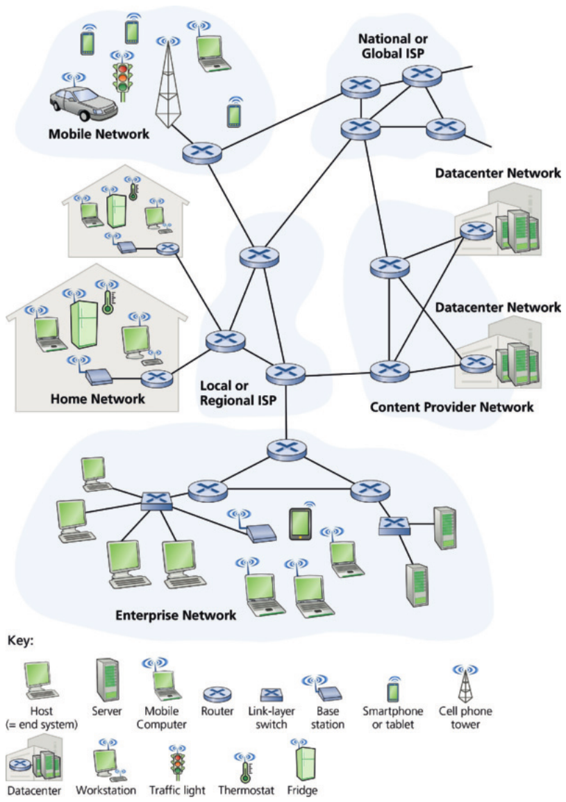

Hình 1.1 Một số thành phần của Internet

Các end system được kết nối với nhau bởi một mạng gồm các liên kết truyền thông (communication link) và packet switch (bộ chuyển mạch gói). Chúng ta sẽ thấy trong Mục 1.2 rằng có nhiều loại liên kết truyền thông, được tạo nên từ các loại môi trường truyền vật lý khác nhau, bao gồm cáp đồng trục, dây đồng, sợi quang và phổ vô tuyến. Các liên kết khác nhau có thể truyền dữ liệu ở các tốc độ khác nhau, với tốc độ truyền của một liên kết được đo bằng bit/giây. Khi một end system có dữ liệu cần gửi tới một end system khác, end system gửi chia dữ liệu thành các đoạn và thêm các byte header vào mỗi đoạn. Các gói thông tin kết quả, được gọi là packet (gói tin) theo biệt ngữ mạng máy tính, sau đó được gửi qua mạng tới end system đích, nơi chúng được ráp lại thành dữ liệu ban đầu.

Một packet switch nhận một packet đến trên một trong các liên kết truyền thông vào của nó và chuyển tiếp packet đó trên một trong các liên kết truyền thông ra của nó. Packet switch có nhiều hình dạng và kiểu loại, nhưng hai loại nổi bật nhất trong Internet ngày nay là router và link-layer switch (switch tầng liên kết). Cả hai loại switch đều chuyển tiếp packet về phía đích cuối cùng của chúng. Link-layer switch thường được dùng trong mạng truy cập, trong khi router thường được dùng trong lõi mạng. Chuỗi các liên kết truyền thông và packet switch mà một packet đi qua từ end system gửi tới end system nhận được gọi là một tuyến (route) hay đường đi (path) qua mạng.

Các mạng packet-switched (chuyển mạch gói, vận chuyển packet) theo nhiều cách tương tự các mạng giao thông vận chuyển xe cộ trên đường cao tốc, đường phố và giao lộ. Hãy xét, ví dụ, một nhà máy cần chuyển một lượng lớn hàng hóa tới một nhà kho đích cách xa hàng nghìn kilômét. Tại nhà máy, hàng hóa được chia nhỏ và chất lên một đoàn xe tải. Mỗi xe tải sau đó di chuyển độc lập qua mạng lưới đường cao tốc, đường phố và giao lộ tới nhà kho đích. Tại nhà kho đích, hàng hóa được dỡ xuống và gom lại với phần còn lại của lô hàng. Do đó, theo nhiều cách, packet tương tự xe tải, liên kết truyền thông tương tự đường cao tốc và đường phố, packet switch tương tự giao lộ, và end system tương tự các tòa nhà. Giống như một chiếc xe tải đi theo một đường đi qua mạng giao thông, một packet đi theo một đường đi qua mạng máy tính.

Các end system truy cập Internet thông qua các Internet Service Provider (ISP — nhà cung cấp dịch vụ Internet), bao gồm ISP dân dụng như các công ty truyền hình cáp hay điện thoại địa phương; ISP doanh nghiệp; ISP trường đại học; ISP cung cấp truy cập WiFi ở sân bay, khách sạn, quán cà phê và các nơi công cộng khác; và ISP dữ liệu di động, cung cấp truy cập di động cho smartphone và các thiết bị khác của chúng ta. Bản thân mỗi ISP là một mạng gồm các packet switch và liên kết truyền thông. ISP cung cấp nhiều loại truy cập mạng cho các end system, bao gồm truy cập băng rộng dân dụng như cable modem hoặc DSL, truy cập mạng cục bộ high-speed (tốc độ cao), và truy cập không dây di động. ISP cũng cung cấp truy cập Internet cho các nhà cung cấp nội dung, kết nối server trực tiếp vào Internet. Internet là về việc kết nối các end system với nhau, nên các ISP cung cấp truy cập cho end system cũng phải được kết nối với nhau. Do đó, các ISP lower-tier (tầng thấp) này được kết nối với nhau thông qua các ISP upper-tier (tầng cao) quốc gia và quốc tế, và các ISP upper-tier này được kết nối trực tiếp với nhau. Một ISP upper-tier gồm các router high-speed được kết nối với nhau bằng các liên kết fiber-optic (cáp quang) high-speed. Mỗi mạng ISP, dù upper-tier hay lower-tier, đều được quản lý độc lập, chạy giao thức IP (xem bên dưới), và tuân theo một số quy ước đặt tên và địa chỉ nhất định. Chúng ta sẽ xem xét kỹ hơn các ISP và việc kết nối giữa chúng trong Mục 1.3.

Các end system, packet switch và các thành phần khác của Internet chạy các giao thức (protocol) điều khiển việc gửi và nhận thông tin trong Internet. Transmission Control Protocol (TCP) và Internet Protocol (IP) là hai trong số các giao thức quan trọng nhất trong Internet. Giao thức IP xác định định dạng của các packet được gửi và nhận giữa router và end system. Các giao thức chính của Internet được gọi chung là TCP/IP. Chúng ta sẽ bắt đầu tìm hiểu các giao thức trong chương nhập môn này. Nhưng đó chỉ là khởi đầu—phần lớn cuốn sách này nói về các giao thức mạng!

Với tầm quan trọng của giao thức đối với Internet, điều quan trọng là mọi người phải thống nhất về việc từng giao thức làm gì, để mọi người có thể tạo ra các hệ thống và sản phẩm tương tác được với nhau. Đây là lúc các chuẩn phát huy tác dụng. Các chuẩn Internet được phát triển bởi Internet Engineering Task Force (IETF) [IETF 2025]. Các tài liệu chuẩn của IETF được gọi là requests for comments (RFC). RFC ban đầu là những lời đề nghị góp ý chung chung (vì thế mà có tên này) để giải quyết các vấn đề thiết kế mạng và giao thức mà tiền thân của Internet gặp phải [Allman 2011]. RFC có xu hướng khá kỹ thuật và chi tiết. Chúng định nghĩa các giao thức như TCP, IP, HTTP (cho Web) và SMTP (cho e-mail). Hiện có gần 9000 RFC. Các tổ chức khác cũng đặc tả các chuẩn cho các thành phần mạng, đáng chú ý nhất là cho các liên kết mạng. Ví dụ, IEEE 802 LAN Standards Committee [IEEE 802 2025] đặc tả các chuẩn Ethernet và WiFi không dây.

### 1.1.2 Mô tả theo dịch vụ (A Services Description)

Phần thảo luận ở trên đã xác định nhiều thành phần tạo nên Internet. Nhưng chúng ta cũng có thể mô tả Internet từ một góc độ hoàn toàn khác—cụ thể là như một hạ tầng cung cấp dịch vụ cho các ứng dụng. Ngoài các ứng dụng truyền thống như e-mail và lướt Web, các ứng dụng Internet bao gồm các ứng dụng trên smartphone và máy tính bảng, bao gồm nhắn tin Internet, bản đồ với thông tin road-traffic (giao thông đường bộ) real-time (thời gian thực), streaming nhạc, streaming phim và truyền hình, mạng xã hội trực tuyến, hội nghị video, game multi-person (nhiều người chơi), và các hệ thống gợi ý location-based (dựa trên vị trí). Các ứng dụng này được gọi là ứng dụng phân tán, vì chúng liên quan đến nhiều end system trao đổi dữ liệu với nhau. Quan trọng là, các ứng dụng Internet chạy trên end system—chúng không chạy trong các packet switch ở lõi mạng. Dù packet switch tạo điều kiện cho việc trao đổi dữ liệu giữa các end system, chúng không quan tâm đến ứng dụng là nguồn hay đích của dữ liệu.

Hãy khám phá thêm một chút ý nghĩa của một hạ tầng cung cấp dịch vụ cho các ứng dụng. Để làm vậy, giả sử bạn có một ý tưởng mới đầy thú vị cho một ứng dụng Internet phân tán, một ứng dụng có thể mang lại lợi ích lớn cho nhân loại hoặc chỉ đơn giản làm bạn giàu có và nổi tiếng. Bạn sẽ biến ý tưởng này thành một ứng dụng Internet thực sự như thế nào? Vì ứng dụng chạy trên end system, bạn sẽ cần viết các chương trình chạy trên end system. Ví dụ, bạn có thể viết chương trình bằng Java, C hoặc Python. Giờ, vì bạn đang phát triển một ứng dụng Internet phân tán, các chương trình chạy trên các end system khác nhau sẽ cần gửi dữ liệu cho nhau. Và đây là vấn đề trung tâm—vấn đề dẫn đến cách mô tả thay thế về Internet như một nền tảng cho các ứng dụng. Làm sao một chương trình chạy trên một end system ra lệnh cho Internet chuyển dữ liệu tới một chương trình khác chạy trên một end system khác?

Các end system gắn vào Internet cung cấp một socket interface (giao diện socket) đặc tả cách một chương trình chạy trên một end system yêu cầu hạ tầng Internet chuyển dữ liệu tới một chương trình đích cụ thể chạy trên một end system khác. Internet socket interface này là một tập quy tắc mà chương trình gửi phải tuân theo để Internet có thể chuyển dữ liệu tới chương trình đích. Chúng ta sẽ thảo luận chi tiết Internet socket interface trong Chương 2. Còn bây giờ, hãy dùng một phép so sánh đơn giản, phép so sánh mà chúng ta sẽ thường xuyên dùng trong cuốn sách này. Giả sử Alice muốn gửi một lá thư cho Bob qua dịch vụ bưu điện. Tất nhiên, Alice không thể chỉ viết thư (dữ liệu) rồi thả lá thư ra ngoài cửa sổ. Thay vào đó, dịch vụ bưu điện yêu cầu Alice cho lá thư vào phong bì; viết họ tên đầy đủ, địa chỉ và mã bưu chính của Bob vào giữa phong bì; dán phong bì; dán tem ở góc upper-right-hand (trên bên phải) của phong bì; và cuối cùng, thả phong bì vào một hộp thư chính thức của bưu điện. Do đó, dịch vụ bưu điện có “giao diện dịch vụ bưu điện” riêng, hay tập quy tắc, mà Alice phải tuân theo để bưu điện chuyển lá thư của cô tới Bob. Theo cách tương tự, Internet có một socket interface mà chương trình gửi dữ liệu phải tuân theo để Internet chuyển dữ liệu tới chương trình sẽ nhận dữ liệu.

Tất nhiên, dịch vụ bưu điện cung cấp nhiều hơn một dịch vụ cho khách hàng. Nó cung cấp chuyển phát nhanh, xác nhận đã nhận, gửi thường, và nhiều dịch vụ khác. Theo cách tương tự, Internet cung cấp nhiều dịch vụ cho các ứng dụng. Khi bạn phát triển một ứng dụng Internet, bạn cũng phải chọn một trong các dịch vụ của Internet cho ứng dụng của mình. Chúng tôi sẽ mô tả các dịch vụ của Internet trong Chương 2.

Chúng ta vừa đưa ra hai mô tả về Internet; một theo các thành phần phần cứng và phần mềm, một theo hạ tầng cung cấp dịch vụ cho các ứng dụng phân tán. Nhưng có lẽ bạn vẫn còn bối rối về Internet là gì. Chuyển mạch gói (packet switching) và TCP/IP là gì? Router là gì? Có những loại liên kết truyền thông nào trong Internet? Ứng dụng phân tán là gì? Làm sao một máy điều nhiệt hay cân có thể gắn vào Internet? Nếu bây giờ bạn cảm thấy hơi choáng ngợp trước tất cả những điều này, đừng lo— mục đích của cuốn sách này là giới thiệu cho bạn cả từng thành phần cụ thể của Internet lẫn các nguyên lý chi phối cách thức và lý do nó hoạt động. Chúng tôi sẽ giải thích các thuật ngữ và câu hỏi quan trọng này trong các mục và chương tiếp theo.

### 1.1.3 Giao thức là gì? (What Is a Protocol?)

Giờ khi đã có chút cảm nhận về Internet là gì, hãy xét một thuật ngữ quan trọng khác trong mạng máy tính: giao thức (protocol). Giao thức là gì? Giao thức làm gì?

#### Một phép so sánh với con người (A Human Analogy)

Có lẽ cách dễ nhất để hiểu khái niệm giao thức mạng máy tính là trước hết xét một số phép so sánh với con người, vì con người chúng ta thực thi giao thức mọi lúc. Hãy xét những gì bạn làm khi muốn hỏi giờ ai đó. Một cuộc trao đổi điển hình được thể hiện trong Hình 1.2. Giao thức con người (hay ít nhất là phép lịch sự) quy định rằng trước hết người ta chào hỏi (tiếng “Hi” đầu tiên trong Hình 1.2) để bắt đầu giao tiếp với người khác. Phản hồi điển hình cho một tiếng “Hi” là một thông điệp “Hi” đáp lại. Ngầm định, người ta coi một phản hồi “Hi” thân thiện là dấu hiệu cho thấy có thể tiếp tục và hỏi giờ. Một phản hồi khác cho tiếng “Hi” ban đầu (như “Đừng làm phiền tôi!” hay “Tôi không nói tiếng Anh,” hoặc một câu trả lời khó nghe nào đó) có thể biểu thị sự không sẵn lòng hoặc không có khả năng giao tiếp. Trong trường hợp này, giao thức con người sẽ là không hỏi giờ nữa. Đôi khi người ta không nhận được phản hồi nào cho một câu hỏi, khi đó người ta thường bỏ việc hỏi giờ người đó. Lưu ý rằng trong giao thức con người của chúng ta, có những thông điệp cụ thể mà chúng ta gửi, và những hành động cụ thể mà chúng ta thực hiện để đáp lại các thông điệp trả lời nhận được hoặc các sự kiện khác (như không có trả lời trong một khoảng thời gian nhất định). Rõ ràng, các thông điệp được truyền và nhận, và các hành động được thực hiện khi các thông điệp này được gửi hoặc nhận hoặc khi các sự kiện khác xảy ra, đóng vai trò trung tâm trong một giao thức con người. Nếu mọi người chạy các giao thức khác nhau (ví dụ, nếu một người lịch sự nhưng người kia thì không, hoặc nếu một người hiểu khái niệm thời gian còn người kia thì không), các giao thức không tương tác được và không thể hoàn thành công việc hữu ích nào. Điều tương tự cũng đúng trong mạng—cần hai (hoặc nhiều hơn) thực thể giao tiếp chạy cùng một giao thức để hoàn thành một nhiệm vụ.

Hãy xét phép so sánh thứ hai với con người. Giả sử bạn đang trong một lớp học đại học (ví dụ, một lớp mạng máy tính!). Giảng viên đang giảng đều đều về giao thức và bạn thấy bối rối. Giảng viên dừng lại hỏi, “Có câu hỏi nào không?” (một thông điệp được truyền tới, và được nhận bởi, mọi sinh viên không ngủ gật). Bạn giơ tay (truyền một thông điệp ngầm tới giảng viên). Giảng viên ghi nhận bạn bằng một nụ cười, nói “Vâng . . .” (một thông điệp được truyền khuyến khích bạn đặt câu hỏi—giảng viên rất thích được hỏi), và bạn đặt câu hỏi (tức là truyền thông điệp của bạn tới giảng viên). Giảng viên nghe câu hỏi (nhận thông điệp câu hỏi của bạn) và trả lời (truyền một phản hồi tới bạn). Một lần nữa, chúng ta thấy rằng việc truyền và nhận thông điệp, cùng một tập hành động theo quy ước được thực hiện khi các thông điệp này được gửi và nhận, là cốt lõi của giao thức question-and-answer (hỏi–đáp) này.

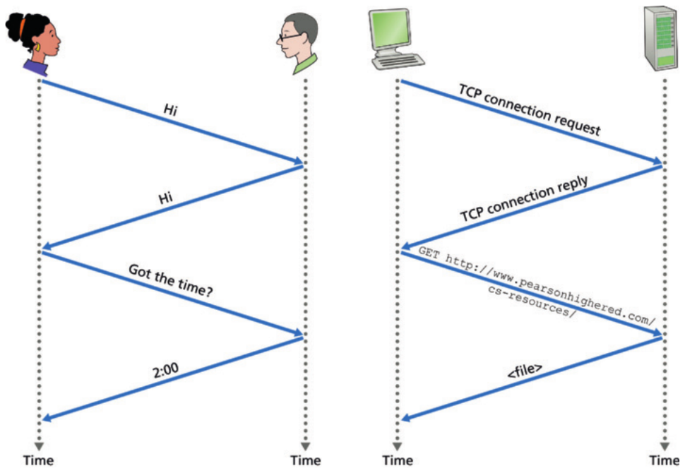

Hình 1.2 Một giao thức con người và một giao thức mạng máy tính

#### Giao thức mạng (Network Protocols)

Một giao thức mạng tương tự một giao thức con người, ngoại trừ việc các thực thể trao đổi thông điệp và thực hiện hành động là các thành phần phần cứng hoặc phần mềm của một thiết bị nào đó (ví dụ, máy tính, smartphone, máy tính bảng, router, hoặc thiết bị network-capable (có khả năng kết nối mạng) khác). Mọi hoạt động trong Internet liên quan đến hai hoặc nhiều thực thể từ xa giao tiếp với nhau đều được chi phối bởi một giao thức. Ví dụ, các giao thức hardware-implemented (hiện thực bằng phần cứng) trong hai máy tính được kết nối vật lý điều khiển luồng bit trên “dây” giữa hai card giao tiếp mạng; các giao thức congestion-control (điều khiển tắc nghẽn) trong end system điều khiển tốc độ truyền packet giữa bên gửi và bên nhận; các giao thức trong router xác định đường đi của packet từ nguồn tới đích. Giao thức chạy ở khắp nơi trong Internet, và do đó phần lớn cuốn sách này nói về các giao thức mạng máy tính.

Như một ví dụ về giao thức mạng máy tính mà có lẽ bạn đã quen, hãy xét điều gì xảy ra khi bạn gửi một request tới một Web server, tức là khi bạn gõ URL của một trang Web vào trình duyệt Web. Kịch bản được minh họa ở nửa bên phải của Hình 1.2. Trước hết, máy tính của bạn sẽ gửi một thông điệp yêu cầu kết nối tới Web server và chờ trả lời. Web server cuối cùng sẽ nhận được thông điệp yêu cầu kết nối của bạn và trả về một thông điệp trả lời kết nối. Biết rằng giờ đã có thể yêu cầu tài liệu Web, máy tính của bạn sau đó gửi tên trang Web mà nó muốn lấy từ Web server đó trong một thông điệp GET. Cuối cùng, Web server trả trang Web (file) về máy tính của bạn.

Với các ví dụ về con người và mạng ở trên, việc trao đổi thông điệp và các hành động được thực hiện khi các thông điệp này được gửi và nhận là những yếu tố định nghĩa then chốt của một giao thức:

Một giao thức định nghĩa định dạng và thứ tự của các thông điệp được trao đổi giữa hai hoặc nhiều thực thể giao tiếp, cũng như các hành động được thực hiện khi truyền và/hoặc nhận một thông điệp hoặc sự kiện khác.

Internet, và mạng máy tính nói chung, sử dụng giao thức rất rộng rãi. Các giao thức khác nhau được dùng để hoàn thành các nhiệm vụ giao tiếp khác nhau. Khi đọc cuốn sách này, bạn sẽ học được rằng một số giao thức đơn giản và dễ hiểu, trong khi những giao thức khác phức tạp và sâu sắc về mặt trí tuệ. Làm chủ lĩnh vực mạng máy tính tương đương với việc hiểu cái gì, tại sao và như thế nào của các giao thức mạng.

## 1.2 Rìa mạng (The Network Edge)

Trong mục trước, chúng tôi đã trình bày một tổng quan high-level (mức cao) về Internet và các giao thức mạng. Giờ chúng ta sẽ đi sâu hơn một chút vào các thành phần của Internet. Trong mục này, chúng ta bắt đầu ở rìa mạng và xem xét các thành phần mà chúng ta quen thuộc nhất—cụ thể là máy tính, smartphone và các thiết bị khác mà chúng ta dùng hằng ngày. Trong mục tiếp theo, chúng ta sẽ chuyển từ rìa mạng vào lõi mạng và xem xét việc chuyển mạch và định tuyến trong mạng máy tính.

Hãy nhớ lại từ mục trước rằng theo biệt ngữ mạng máy tính, máy tính và các thiết bị khác kết nối Internet thường được gọi là end system. Chúng được gọi là end system vì chúng nằm ở rìa của Internet, như thể hiện trong Hình 1.3. Các end system của Internet bao gồm máy tính để bàn (ví dụ, PC để bàn, Mac và máy Linux), server (ví dụ, Web server và e-mail server), và thiết bị di động (ví dụ, laptop, smartphone và máy tính bảng). Hơn nữa, ngày càng nhiều “thứ” non-traditional (phi truyền thống) đang được gắn vào Internet như end system (xem phần Case History).

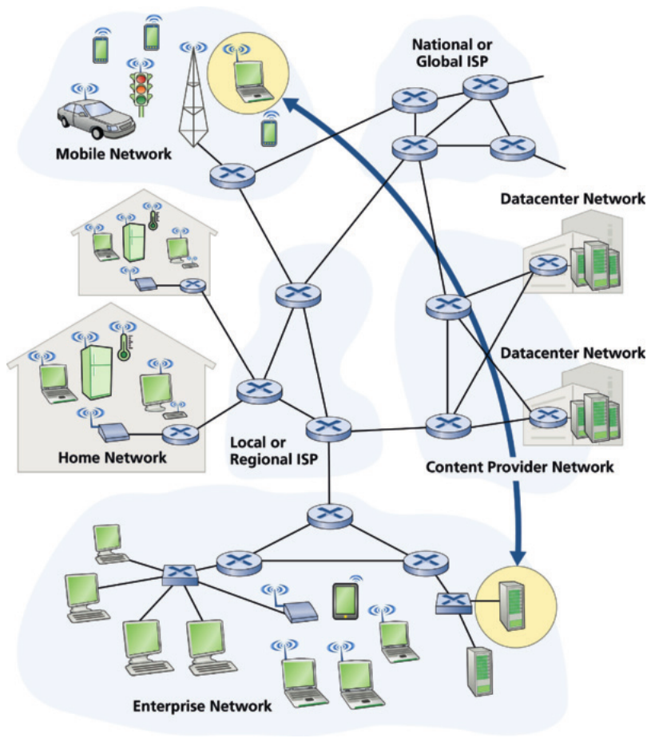

Hình 1.3 Tương tác end-system

End system cũng được gọi là host vì chúng chứa (host, tức là chạy) các chương trình ứng dụng như chương trình trình duyệt Web, chương trình Web server, chương trình e-mail client, hoặc chương trình e-mail server. Xuyên suốt cuốn sách này, chúng tôi sẽ dùng các thuật ngữ host và end system thay thế cho nhau; tức là host = end system. Host đôi khi được chia thêm thành hai loại: client và server. Nói nôm na, client có xu hướng là máy để bàn, laptop, smartphone, v.v., trong khi server có xu hướng là những máy mạnh hơn lưu trữ và phân phối trang Web, stream video, chuyển tiếp e-mail, v.v. Ngày nay, phần lớn các server mà từ đó chúng ta nhận kết quả tìm kiếm, e-mail, trang Web, video và nội dung app di động đều nằm trong các trung tâm dữ liệu (data center) lớn. Ví dụ, tính đến cuối năm 2024, Google có 33 data center trên bốn lục địa, [Google data centers 2024] chứa tổng cộng vài triệu server. Hình 1.3 bao gồm hai data center như vậy, và phần Case History mô tả chi tiết hơn về data center.

> Lịch sử tình huống (Case History)
>
> Data center và điện toán đám mây (Data Centers and Cloud Computing)
>
> Các công ty Internet như Google, Microsoft, Amazon và Alibaba đã xây dựng các data center khổng lồ, mỗi data center chứa từ hàng chục đến hàng trăm nghìn host. Những data center này không chỉ được kết nối Internet, như thể hiện trong Hình 1.1, mà bên trong còn có các mạng máy tính phức tạp kết nối các host của datacenter. Data center là những cỗ máy đằng sau các ứng dụng Internet mà chúng ta dùng hằng ngày.
>
> Nói rộng ra, data center phục vụ ba mục đích, mà chúng tôi mô tả ở đây trong bối cảnh Amazon cho cụ thể. Thứ nhất, chúng phục vụ các trang e-commerce (thương mại điện tử) của Amazon cho người dùng, ví dụ, các trang mô tả sản phẩm và thông tin mua hàng. Thứ hai, chúng đóng vai trò hạ tầng tính toán song song quy mô lớn cho các tác vụ xử lý dữ liệu Amazon-specific (đặc thù của Amazon). Thứ ba, chúng cung cấp điện toán đám mây (cloud computing) cho các công ty khác. Thực tế, ngày nay một xu hướng lớn trong điện toán là các công ty dùng một nhà cung cấp cloud như Amazon để xử lý về cơ bản mọi nhu cầu IT của họ. Ví dụ, Airbnb và nhiều công ty Internet-based (dựa trên Internet) khác không sở hữu và quản lý data center riêng mà chạy toàn bộ các dịch vụ Web-based (dựa trên Web) của họ trong đám mây Amazon, gọi là Amazon Web Services (AWS).
>
> Những chú ong thợ trong một data center là các host. Chúng phục vụ nội dung (ví dụ, trang Web và video), lưu trữ e-mails và tài liệu, và cùng nhau thực hiện các tính toán phân tán quy mô lớn. Các host trong data center, gọi là blade và trông giống hộp pizza, nhìn chung là các host phổ thông bao gồm CPU, bộ nhớ và ổ đĩa lưu trữ. Các host được xếp chồng trong rack, mỗi rack thường có 20 đến 40 blade. Các rack sau đó được kết nối với nhau bằng các thiết kế mạng data center tinh vi và không ngừng phát triển. Mạng data center được thảo luận chi tiết hơn trong Chương 6.

### 1.2.1 Mạng truy cập (Access Networks)

Sau khi đã xem xét các ứng dụng và end system ở “rìa mạng,” tiếp theo hãy xem xét mạng truy cập (access network)—mạng kết nối vật lý một end system với router đầu tiên (còn gọi là “edge router”) trên đường đi từ end system tới bất kỳ end system ở xa nào khác. Hình 1.4 thể hiện một số loại mạng truy cập bằng các đường dày, tô bóng cùng các môi trường (gia đình, doanh nghiệp, và không dây di động wide-area (diện rộng)) nơi chúng được dùng.

#### Truy cập tại nhà: DSL, cáp, FTTH, không dây cố định và vệ tinh LEO (Home Access: DSL, Cable, FTTH, Fixed Wireless, and LEO Satellites)

Tính đến năm 2023, hơn 80% hộ gia đình ở châu Âu và Mỹ có truy cập Internet [OECD 2024], dù vẫn tồn tại một “khoảng cách số” về truy cập trên khắp thế giới và giữa các nhóm nhân khẩu học khác nhau [globaldigitalinclusion 2025]. Với việc mạng truy cập tại nhà được dùng rộng rãi như vậy, hãy bắt đầu phần tổng quan về mạng truy cập bằng cách xem xét cách các hộ gia đình kết nối Internet.

Ngày nay, ba loại truy cập băng rộng dân dụng phổ biến nhất là digital subscriber line (DSL — đường thuê bao số), cáp, và fiber to the home (FTTH — cáp quang tới tận nhà).

Một hộ gia đình thường nhận truy cập Internet DSL từ cùng công ty điện thoại địa phương (telco) cung cấp đường điện thoại cố định của họ. Do đó, khi dùng DSL, telco của khách hàng cũng là ISP của họ. Như thể hiện trong Hình 1.5, DSL modem của mỗi khách hàng dùng đường dây điện thoại hiện có để trao đổi dữ liệu với một digital subscriber line access multiplexer (DSLAM) đặt tại tổng đài trung tâm (central office — CO) địa phương của telco. DSL modem tại nhà nhận dữ liệu số và chuyển nó thành các âm high-frequency (tần số cao) để truyền qua dây điện thoại tới CO; tín hiệu analog từ nhiều hộ như vậy được chuyển ngược lại thành định dạng số tại DSLAM.

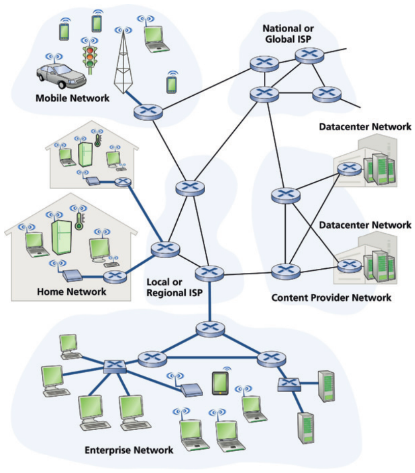

Hình 1.4 Mạng truy cập

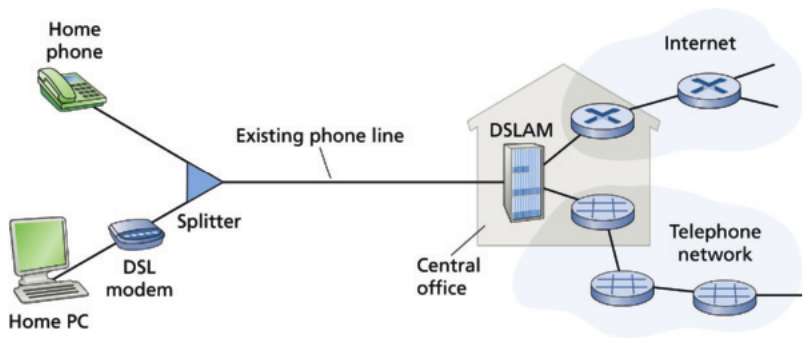

Hình 1.5 Truy cập Internet DSL

Đường dây điện thoại dân dụng mang đồng thời cả dữ liệu lẫn tín hiệu điện thoại truyền thống, được mã hóa ở các tần số khác nhau:

• Một kênh downstream (chiều xuống) high-speed, ở dải 50 kHz đến 1 MHz

• Một kênh upstream (chiều lên) medium-speed (tốc độ trung bình), ở dải 4 kHz đến 50 kHz

• Một kênh điện thoại two-way (hai chiều) thông thường, ở dải 0 đến 4 kHz

Cách tiếp cận này khiến một liên kết DSL duy nhất trông như thể có ba liên kết riêng biệt, để một cuộc gọi điện thoại và một kết nối Internet có thể dùng chung liên kết DSL cùng lúc. (Chúng tôi sẽ mô tả kỹ thuật frequency-division multiplexing (ghép kênh phân chia theo tần số) này trong Mục 1.3.1.) Ở phía khách hàng, một bộ chia (splitter) tách tín hiệu dữ liệu và điện thoại đến nhà và chuyển tín hiệu dữ liệu tới DSL modem. Ở phía telco, tại CO, DSLAM tách tín hiệu dữ liệu và điện thoại và gửi dữ liệu vào Internet. Hàng trăm hoặc thậm chí hàng nghìn hộ gia đình kết nối tới một DSLAM duy nhất.

Chuẩn DSL mới nhất [ITU DSL 2019] cung cấp tới 1 Gbps chiều xuống trên khoảng cách ngắn và tốc độ truyền chiều lên tới 500 Mbps. Vì tốc độ chiều xuống và chiều lên khác nhau, truy cập này được gọi là bất đối xứng (asymmetric). Tốc độ truyền thực tế đạt được ở chiều xuống và chiều lên có thể thấp hơn các tốc độ nêu trên, vì nhà cung cấp DSL có thể cố ý giới hạn tốc độ dân dụng khi cung cấp dịch vụ phân cấp (các tốc độ khác nhau, với các mức giá khác nhau). Tốc độ tối đa cũng bị giới hạn bởi khoảng cách giữa nhà và CO, tiết diện của đường dây twisted-pair (xoắn đôi) và mức độ nhiễu điện. Các kỹ sư đã thiết kế DSL rõ ràng cho khoảng cách ngắn giữa nhà và CO; nhìn chung, nếu hộ gia đình không nằm trong phạm vi 5 đến 10 dặm từ CO, hộ đó phải dùng một hình thức truy cập Internet khác.

Trong khi DSL tận dụng hạ tầng điện thoại địa phương sẵn có của telco, truy cập Internet qua cáp tận dụng hạ tầng truyền hình cáp sẵn có của công ty truyền hình cáp. Một hộ gia đình nhận truy cập Internet qua cáp từ cùng công ty cung cấp truyền hình cáp cho họ. Như minh họa trong Hình 1.6, cáp quang kết nối đầu cáp (cable head end) tới các điểm nối neighborhood-level (mức khu dân cư), từ đó cáp đồng trục truyền thống được dùng để tới từng ngôi nhà và căn hộ. Mỗi điểm nối khu dân cư thường phục vụ 500 đến 5, 000 hộ. Vì cả cáp quang và cáp đồng trục đều được dùng trong hệ thống này, nó thường được gọi là hybrid fiber coax (HFC).

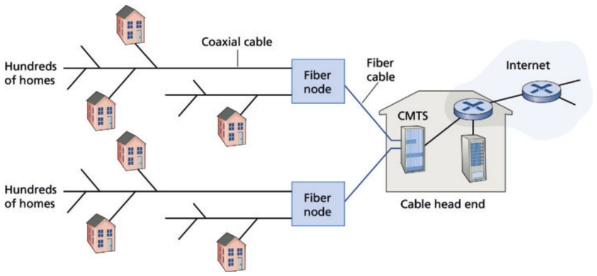

Hình 1.6 Một mạng truy cập hybrid fiber-coaxial (lai cáp quang–đồng trục)

Truy cập internet qua cáp đòi hỏi modem đặc biệt, gọi là cable modem. Giống như DSL modem, cable modem thường là một thiết bị bên ngoài và kết nối tới PC tại nhà qua một cổng Ethernet. (Chúng tôi sẽ thảo luận rất chi tiết về Ethernet trong Chương 6.) Tại đầu cáp, cable modem termination system (CMTS) có chức năng tương tự DSLAM của mạng DSL—chuyển tín hiệu analog gửi từ các cable modem ở nhiều hộ phía chiều xuống trở lại thành định dạng số. Cable modem chia mạng HFC thành hai kênh, một kênh chiều xuống và một kênh chiều lên. Giống như DSL, truy cập thường bất đối xứng, với kênh chiều xuống thường được cấp tốc độ truyền cao hơn kênh chiều lên. Các chuẩn DOCSIS 2.0 và 3.0 định nghĩa bitrate chiều xuống là 40 Mbps và 1.2 Gbps, và tốc độ chiều lên là 30 Mbps và 100 Mbps, tương ứng. Như trong trường hợp mạng DSL, tốc độ tối đa có thể đạt được có thể không thành hiện thực do tốc độ dữ liệu theo hợp đồng thấp hơn hoặc do suy hao môi trường truyền.

Một đặc điểm quan trọng của truy cập Internet qua cáp là nó là một môi trường quảng bá dùng chung. Cụ thể, mọi packet do đầu cáp gửi đi đều đi chiều xuống trên mọi liên kết tới mọi nhà và mọi packet do một nhà gửi đi đều đi trên kênh chiều lên tới đầu cáp. Vì lý do này, nếu nhiều người dùng đồng thời tải một file video trên kênh chiều xuống, tốc độ thực tế mà mỗi người dùng nhận file video sẽ thấp hơn đáng kể so với tốc độ chiều xuống tổng của cáp. Mặt khác, nếu chỉ có vài người dùng đang hoạt động và tất cả đều đang lướt Web, thì mỗi người dùng có thể thực sự nhận trang Web ở toàn bộ tốc độ chiều xuống của cáp, vì người dùng hiếm khi yêu cầu một trang Web vào đúng cùng một thời điểm. Vì kênh chiều lên cũng dùng chung, cần một giao thức đa truy cập phân tán để phối hợp việc truyền và tránh xung đột. (Chúng tôi sẽ thảo luận khá chi tiết vấn đề xung đột này trong Chương 6.)

Dù mạng DSL và mạng cáp hiện chiếm phần lớn truy cập băng rộng dân dụng ở Hoa Kỳ, một công nghệ up-and-coming (đang lên) mang lại tốc độ còn cao hơn là fiber to the home (FTTH) [Fiber Broadband 2025]. Như tên gọi gợi ý, khái niệm FTTH rất đơn giản—cung cấp một đường cáp quang từ CO trực tiếp tới nhà. FTTH có tiềm năng cung cấp tốc độ truy cập Internet ở mức gigabit mỗi giây.

Có một số công nghệ cạnh tranh cho việc phân phối quang từ CO tới các hộ gia đình. Mạng phân phối quang đơn giản nhất được gọi là direct fiber, với một sợi quang rời CO cho mỗi nhà. Phổ biến hơn, mỗi sợi quang rời tổng đài trung tâm thực ra được nhiều hộ dùng chung; chỉ khi sợi quang tới tương đối gần các hộ thì nó mới được chia thành các sợi quang customer-specific (riêng cho từng khách hàng). Có hai kiến trúc mạng optical-distribution (phân phối quang) cạnh tranh thực hiện việc chia này: mạng quang chủ động (active optical network — AON) và mạng quang thụ động (passive optical network — PON). AON về cơ bản là Ethernet chuyển mạch, được thảo luận trong Chương 6.

Ở đây, chúng tôi thảo luận ngắn gọn về PON, được dùng trong dịch vụ FiOS của Verizon. Hình 1.7 thể hiện FTTH dùng kiến trúc phân phối PON. Mỗi nhà có một optical network terminator (ONT), được nối bằng sợi quang riêng tới một bộ chia của khu dân cư. Bộ chia gom một số hộ (thường ít hơn 100) vào một sợi quang dùng chung duy nhất, sợi này nối tới một optical line terminator (OLT) trong CO của telco. OLT, thực hiện chuyển đổi giữa tín hiệu quang và tín hiệu điện, kết nối Internet qua một router của telco. Tại nhà, người dùng nối một router gia đình (thường là router không dây) tới ONT và truy cập Internet qua router gia đình này. Trong kiến trúc PON, mọi packet gửi từ OLT tới bộ chia đều được nhân bản tại bộ chia (tương tự đầu cáp).

Fixed wireless Internet (FWI — Internet không dây cố định) cũng đã trở thành một công nghệ truy cập Internet phổ biến. FWI không chỉ cung cấp truy cập dân dụng high-speed, mà còn làm vậy mà không cần lắp đặt hệ thống cáp tốn kém và failure-prone (dễ hỏng) từ CO của telco tới nhà. Với 5G fixed wireless, dùng công nghệ beam-forming (định dạng búp sóng), dữ liệu được gửi không dây từ trạm gốc của nhà cung cấp tới một modem trong nhà. Một router không dây WiFi được nối tới modem (có thể được tích hợp chung), tương tự cách một router không dây WiFi được nối tới một cable modem hoặc DSL modem. Ngoài DSL, cáp, FTTH và FWI, vệ tinh low-earth orbit (LEO — quỹ đạo thấp) ngày càng được dùng cho truy cập Internet băng rộng, đặc biệt ở vùng nông thôn và vùng sâu vùng xa. Các công ty như Starlink của SpaceX triển khai những chòm vệ tinh lớn, cung cấp truy cập high-speed với độ trễ lan truyền tín hiệu thấp hơn nhiều so với vệ tinh địa tĩnh.

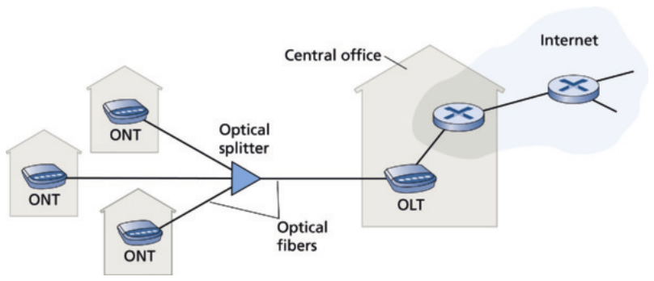

Hình 1.7 Truy cập Internet FTTH

#### Ethernet và WiFi (Ethernet and WiFi)

Trong khuôn viên doanh nghiệp và trường đại học, và ngày càng nhiều trong môi trường gia đình, một mạng cục bộ (local area network — LAN) được dùng để kết nối end system tới edge router. Dù có nhiều loại công nghệ LAN, Ethernet là công nghệ truy cập phổ biến nhất vượt trội trong mạng doanh nghiệp, trường đại học và gia đình. Như thể hiện trong Hình 1.8, người dùng Ethernet dùng dây đồng twisted-pair để kết nối tới một Ethernet switch, một công nghệ được thảo luận chi tiết trong Chương 6. Ethernet switch, hoặc một mạng gồm các switch như vậy được kết nối với nhau, đến lượt nó được kết nối vào Internet lớn hơn. Với truy cập Ethernet, người dùng thường có truy cập 100 Mbps đến hàng chục Gbps tới Ethernet switch, trong khi server có thể có truy cập 1 Gbps đến 10 Gbps.

Tuy nhiên, ngày càng nhiều người truy cập Internet không dây từ laptop, smartphone, máy tính bảng và các “thứ” khác. Trong môi trường LAN không dây, người dùng không dây truyền/nhận packet tới/từ một access point (điểm truy cập) được kết nối vào mạng của doanh nghiệp (nhiều khả năng dùng Ethernet có dây), mạng này đến lượt nó được kết nối với Internet có dây. Người dùng LAN không dây thường phải ở trong phạm vi vài chục mét từ access point. Truy cập LAN không dây dựa trên công nghệ IEEE 802.11, thường được gọi nôm na là WiFi, giờ có mặt gần như ở khắp nơi—trường đại học, văn phòng doanh nghiệp, quán cà phê, sân bay, nhà ở, và thậm chí trên máy bay. Như thảo luận chi tiết trong Chương 7, 802.11 ngày nay cung cấp tốc độ truyền dùng chung lên tới hơn 100 Mbps.

Dù mạng truy cập Ethernet và WiFi ban đầu được triển khai trong môi trường doanh nghiệp (công ty, trường đại học), chúng cũng là thành phần phổ biến của mạng gia đình. Nhiều hộ gia đình kết hợp truy cập băng rộng dân dụng (tức là cable modem hoặc DSL) với các công nghệ LAN không dây rẻ tiền này để tạo ra mạng gia đình mạnh mẽ. Hình 1.9 thể hiện một mạng gia đình điển hình. Mạng gia đình này gồm một laptop di chuyển, nhiều thiết bị gia dụng Internet-connected, cũng như một PC có dây; một trạm gốc (base station — điểm truy cập không dây), giao tiếp với PC không dây và các thiết bị không dây khác trong nhà; và một router gia đình kết nối điểm truy cập không dây, cùng bất kỳ thiết bị có dây nào khác trong nhà, tới Internet. Mạng này cho phép các thành viên trong gia đình có truy cập băng rộng tới Internet trong khi một thành viên di chuyển từ bếp ra sân sau rồi vào phòng ngủ.

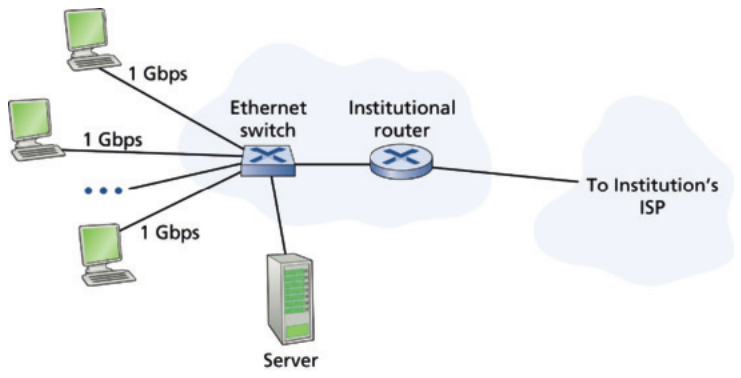

Hình 1.8 Truy cập Internet qua Ethernet

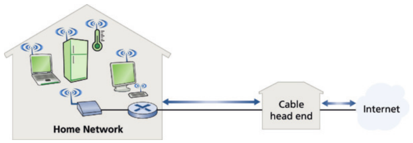

Hình 1.9 Một mạng gia đình điển hình

#### Truy cập không dây diện rộng: 4G và 5G (Wide-Area Wireless Access: 4G and 5G)

Các thiết bị di động như iPhone và thiết bị Android đang được dùng để nhắn tin, chia sẻ ảnh và video trên mạng xã hội trực tuyến, thanh toán di động, xem phim, stream nhạc, hội nghị video, và nhiều việc khác khi đang di chuyển. Những thiết bị này dùng cùng hạ tầng không dây được dùng cho điện thoại di động để gửi/nhận packet thông qua một trạm gốc do nhà cung cấp mạng di động vận hành. Khác với WiFi, người dùng chỉ cần ở trong phạm vi vài chục kilômét (thay vì vài chục mét) từ trạm gốc.

Các công ty viễn thông đã đầu tư khổng lồ vào mạng không dây so-called fourth-generation ( 4G — thế hệ thứ tư), cung cấp tốc độ tải xuống real-world lên tới 60 Mbps. Nhưng các công nghệ truy cập wide-area higher-speed (tốc độ cao hơn) hơn nữa— thế hệ fifth-generation ( 5G) của mạng không dây wide-area—đã bắt đầu được triển khai. Chúng tôi sẽ đề cập các nguyên lý cơ bản của mạng không dây và tính di động, cũng như các công nghệ WiFi, 4G và 5G (và nhiều hơn nữa!) trong Chương 7.

### 1.2.2 Môi trường truyền vật lý (Physical Media)

Trong tiểu mục trước, chúng tôi đã đưa ra tổng quan về một số công nghệ truy cập mạng quan trọng nhất trong Internet. Khi mô tả các công nghệ này, chúng tôi cũng đã chỉ ra môi trường truyền vật lý được dùng. Ví dụ, chúng tôi nói rằng HFC dùng kết hợp cáp quang và cáp đồng trục. Chúng tôi nói rằng DSL và Ethernet dùng dây đồng. Và chúng tôi nói rằng mạng truy cập di động dùng phổ vô tuyến. Trong tiểu mục này, chúng tôi đưa ra tổng quan ngắn gọn về các môi trường truyền này và các môi trường truyền khác thường được dùng trong Internet.

Để định nghĩa thế nào là một môi trường truyền vật lý, hãy suy ngẫm về cuộc đời ngắn ngủi của một bit. Hãy xét một bit đi từ một end system, qua một chuỗi liên kết và router, tới một end system khác. Bit tội nghiệp này bị đẩy đi đẩy lại và được truyền rất, rất nhiều lần! End system nguồn trước tiên truyền bit, và ngay sau đó router đầu tiên trong chuỗi nhận bit; router đầu tiên sau đó truyền bit, và ngay sau đó router thứ hai nhận bit; và cứ thế. Do đó bit của chúng ta, khi đi từ nguồn tới đích, đi qua một chuỗi các cặp transmitter-receiver (máy phát–máy thu). Với mỗi cặp transmitter-receiver, bit được gửi bằng cách lan truyền sóng điện từ hoặc xung quang qua một môi trường truyền vật lý. Môi trường truyền vật lý có thể có nhiều hình dạng và dạng thức và không nhất thiết phải cùng loại cho mỗi cặp transmitter-receiver dọc đường đi. Các ví dụ về môi trường truyền vật lý bao gồm dây đồng twisted-pair, cáp đồng trục, cáp fiber-optic đa mode, phổ vô tuyến mặt đất và phổ vô tuyến vệ tinh. Môi trường truyền vật lý chia thành hai loại: môi trường có dẫn hướng (guided media) và môi trường không dẫn hướng (unguided media). Với môi trường có dẫn hướng, sóng được dẫn dọc theo một môi trường rắn, như cáp fiber-optic, dây đồng twisted-pair, hoặc cáp đồng trục. Với môi trường không dẫn hướng, sóng lan truyền trong khí quyển và ngoài không gian, như trong LAN không dây hoặc kênh vệ tinh số.

Nhưng trước khi đi vào đặc điểm của các loại môi trường truyền khác nhau, hãy nói đôi lời về chi phí của chúng. Chi phí thực tế của liên kết vật lý (dây đồng, cáp fiber-optic, v.v.) thường tương đối nhỏ so với các chi phí mạng khác. Cụ thể, chi phí nhân công gắn với việc lắp đặt liên kết vật lý có thể cao hơn chi phí vật liệu nhiều bậc độ lớn. Vì lý do này, nhiều nhà thầu xây dựng lắp đặt cáp xoắn đôi, cáp quang và cáp đồng trục trong mọi phòng của một tòa nhà. Ngay cả khi ban đầu chỉ dùng một loại môi trường truyền, rất có khả năng một loại khác sẽ được dùng trong tương lai gần, và vì vậy tiết kiệm được tiền do không phải đi thêm dây trong tương lai.

#### Dây đồng xoắn đôi (Twisted-Pair Copper Wire)

Môi trường truyền có dẫn hướng rẻ nhất và được dùng phổ biến nhất là dây đồng twisted-pair. Nó đã được mạng điện thoại dùng hơn một trăm năm. Thực tế, hơn 99 phần trăm kết nối có dây từ ống nghe điện thoại tới tổng đài điện thoại địa phương dùng dây đồng twisted-pair. Hầu hết chúng ta đã thấy cáp xoắn đôi trong nhà mình (hoặc nhà của bố mẹ hay ông bà!) và môi trường làm việc. Cáp xoắn đôi gồm hai dây đồng cách điện, mỗi dây dày khoảng 1 mm, được sắp xếp theo hình xoắn ốc đều đặn. Các dây được xoắn vào nhau để giảm nhiễu điện từ các cặp tương tự ở gần. Thường thì một số cặp được bó lại với nhau trong một sợi cáp bằng cách bọc các cặp trong một lớp vỏ bảo vệ. Một cặp dây tạo thành một liên kết truyền thông duy nhất. Cáp xoắn đôi không bọc chống nhiễu (unshielded twisted pair — UTP) thường được dùng cho mạng máy tính trong một tòa nhà, tức là cho LAN. Tốc độ dữ liệu cho LAN dùng cáp xoắn đôi ngày nay từ 10 Mbps đến 10 Gbps. Tốc độ dữ liệu có thể đạt được phụ thuộc vào độ dày của dây và khoảng cách giữa máy phát và máy thu.

Khi công nghệ fiber-optic xuất hiện vào thập niên 1980s, nhiều người xem nhẹ cáp xoắn đôi vì tốc độ bit tương đối thấp của nó. Một số người thậm chí cho rằng công nghệ fiber-optic sẽ thay thế hoàn toàn cáp xoắn đôi. Nhưng cáp xoắn đôi không dễ dàng chịu thua. Công nghệ twisted-pair hiện đại, như cáp category 6a, có thể đạt tốc độ dữ liệu 10 Gbps cho khoảng cách lên tới một trăm mét. Rốt cuộc, cáp xoắn đôi đã trở thành giải pháp thống trị cho mạng LAN high-speed.

Như đã thảo luận trước đó, cáp xoắn đôi cũng thường được dùng cho truy cập Internet dân dụng. Chúng ta đã thấy rằng công nghệ modem dial-up (quay số) cho phép truy cập ở tốc độ lên tới 56 kbps qua cáp xoắn đôi. Chúng ta cũng đã thấy rằng công nghệ DSL (digital subscriber line) đã cho phép người dùng dân dụng truy cập Internet ở tốc độ hàng chục Mbps qua cáp xoắn đôi (khi người dùng sống gần tổng đài trung tâm của ISP).

#### Cáp đồng trục (Coaxial Cable)

Giống như cáp xoắn đôi, cáp đồng trục gồm hai dây dẫn bằng đồng, nhưng hai dây dẫn này đồng tâm thay vì song song. Với cấu trúc này cùng lớp cách điện và lớp chống nhiễu đặc biệt, cáp đồng trục có thể đạt tốc độ truyền dữ liệu cao. Cáp đồng trục khá phổ biến trong các hệ thống truyền hình cáp. Như đã thấy trước đó, các hệ thống truyền hình cáp gần đây đã được kết hợp với cable modem để cung cấp cho người dùng dân dụng truy cập Internet ở tốc độ hàng trăm Mbps. Trong truyền hình cáp và truy cập Internet qua cáp, máy phát dịch tín hiệu số sang một dải tần số cụ thể, và tín hiệu analog kết quả được gửi từ máy phát tới một hoặc nhiều máy thu. Cáp đồng trục có thể được dùng như một môi trường dùng chung có dẫn hướng. Cụ thể, một số end system có thể được nối trực tiếp vào cáp, với mỗi end system nhận mọi thứ được các end system khác gửi.

#### Cáp quang (Fiber Optics)

Sợi quang là một môi trường mỏng, mềm dẻo dẫn các xung ánh sáng, với mỗi xung biểu diễn một bit. Một sợi quang duy nhất có thể hỗ trợ tốc độ bit khổng lồ, lên tới hàng chục hoặc thậm chí hàng trăm gigabit mỗi giây. Chúng miễn nhiễm với nhiễu điện từ, có độ suy hao tín hiệu rất thấp trong phạm vi tới 100 kilômét, và rất khó bị nghe lén. Những đặc điểm này đã khiến cáp quang trở thành môi trường truyền có dẫn hướng long-haul (đường dài) được ưa chuộng, đặc biệt cho các liên kết xuyên đại dương. Nhiều mạng điện thoại long-distance (đường dài) ở Hoa Kỳ và nơi khác giờ chỉ dùng cáp quang. Cáp quang cũng phổ biến trong backbone (đường trục) của Internet. Tuy nhiên, chi phí cao của các thiết bị quang—như máy phát, máy thu và switch—đã cản trở việc triển khai chúng cho vận chuyển short-haul (cự ly ngắn), như trong một LAN hoặc vào tận nhà trong mạng truy cập dân dụng. Tốc độ liên kết theo chuẩn Optical Carrier (OC) dao động từ 51.8 Mbps đến 39.8 Gbps; các đặc tả này thường được gọi là OC-n, trong đó tốc độ liên kết bằng n × 51.8 Mbps. Các chuẩn đang được dùng ngày nay bao gồm OC-1, OC-3, OC-12, OC-24, OC-48, OC-96, OC-192, OC-768.

#### Kênh vô tuyến mặt đất (Terrestrial Radio Channels)

Kênh vô tuyến mang tín hiệu trong phổ điện từ. Chúng là một môi trường hấp dẫn vì không cần lắp đặt dây vật lý, có thể xuyên tường, cung cấp kết nối cho người dùng di động, và có tiềm năng mang tín hiệu đi xa. Đặc điểm của một kênh vô tuyến phụ thuộc đáng kể vào môi trường lan truyền và khoảng cách mà tín hiệu phải đi qua. Các yếu tố môi trường quyết định suy hao đường truyền (path loss) và shadow fading (làm giảm cường độ tín hiệu khi tín hiệu đi qua một khoảng cách và vòng quanh/xuyên qua các vật cản), multipath fading (do tín hiệu phản xạ từ các vật gây nhiễu), và nhiễu (do các cuộc truyền khác và các tín hiệu điện từ).

Kênh vô tuyến mặt đất có thể được phân loại rộng thành ba nhóm: những kênh hoạt động trên khoảng cách rất ngắn (ví dụ, trong vòng một hoặc hai mét); những kênh hoạt động trong khu vực cục bộ, thường trải từ mười đến vài trăm mét; và những kênh hoạt động trên diện rộng, trải hàng chục kilômét. Các thiết bị cá nhân như tai nghe không dây, bàn phím và thiết bị y tế hoạt động trên khoảng cách ngắn; các công nghệ LAN không dây được mô tả trong Mục 1.2.1 dùng các kênh vô tuyến local-area (cục bộ); các công nghệ truy cập di động dùng các kênh vô tuyến wide-area. Chúng tôi sẽ thảo luận chi tiết về kênh vô tuyến trong Chương 7.

#### Kênh vô tuyến vệ tinh (Satellite Radio Channels)

Một vệ tinh truyền thông liên kết hai hoặc nhiều máy phát/thu vi ba Earth-based (đặt trên Trái Đất), được gọi là trạm mặt đất. Vệ tinh nhận các cuộc truyền trên một dải tần, tái tạo tín hiệu bằng một bộ lặp (repeater, được thảo luận bên dưới), và truyền tín hiệu trên một tần số khác. Hai loại vệ tinh được dùng trong truyền thông: vệ tinh địa tĩnh (geostationary) và vệ tinh low-earth orbiting (LEO).

Vệ tinh địa tĩnh luôn ở cố định trên cùng một điểm trên Trái Đất. Sự hiện diện cố định này đạt được bằng cách đặt vệ tinh vào quỹ đạo ở độ cao 36,000 kilômét trên bề mặt Trái Đất. Khoảng cách khổng lồ này từ trạm mặt đất qua vệ tinh rồi trở lại trạm mặt đất gây ra độ trễ lan truyền tín hiệu đáng kể là 280 mili giây. Tuy vậy, các liên kết vệ tinh, có thể hoạt động ở tốc độ hàng trăm Mbps, thường được dùng ở những khu vực không có truy cập Internet DSL hay cable-based (qua cáp). Vệ tinh địa tĩnh cũng là thành phần trung tâm của hệ thống định vị toàn cầu (GPS), mà nhiều ứng dụng Internet location-based dựa vào.

Vệ tinh LEO được đặt gần Trái Đất hơn nhiều và không cố định ở trên một điểm trên Trái Đất. Chúng quay quanh Trái Đất (giống như Mặt Trăng) và có thể giao tiếp với nhau, cũng như với các trạm mặt đất. So với vệ tinh địa tĩnh, chúng có độ trễ lan truyền round-trip (khứ hồi) thấp hơn nhiều, khoảng 10 msec. Để phủ sóng liên tục một khu vực, cần đặt nhiều vệ tinh vào quỹ đạo. Hiện có nhiều hệ thống truyền thông low-altitude (độ cao thấp) đang được phát triển. Công nghệ vệ tinh LEO ngày càng được dùng cho truy cập Internet, đặc biệt ở những vùng xa xôi khó phục vụ bằng hạ tầng truyền thông land-based (trên mặt đất).

## 1.3 Lõi mạng (The Network Core)

Sau khi đã xem xét rìa của Internet, giờ hãy đi sâu hơn vào bên trong lõi mạng—mạng lưới các packet switch và liên kết kết nối các end system của Internet. Hình 1.10 làm nổi bật lõi mạng bằng các đường dày, tô bóng.

### 1.3.1 Chuyển mạch gói (Packet Switching)

Trong một ứng dụng mạng, các end system trao đổi thông điệp (message) với nhau. Thông điệp có thể chứa bất cứ thứ gì người thiết kế ứng dụng muốn. Thông điệp có thể thực hiện một chức năng điều khiển (ví dụ, các thông điệp “Hi” trong ví dụ bắt tay ở Hình 1.2) hoặc có thể chứa dữ liệu, như một thư e-mail, một ảnh JPEG, hoặc một file âm thanh MP3. Để gửi một thông điệp từ end system nguồn tới end system đích, nguồn chia các thông điệp dài thành các khối dữ liệu nhỏ hơn được gọi là packet. Giữa nguồn và đích, mỗi packet đi qua các liên kết truyền thông và packet switch (với hai loại chiếm ưu thế là router và link-layer switch). Packet được truyền qua mỗi liên kết truyền thông với tốc độ bằng toàn bộ tốc độ truyền của liên kết. Vì vậy, nếu một end system nguồn hoặc một packet switch đang gửi một packet L bit qua một liên kết có tốc độ truyền R bit/giây, thì thời gian truyền packet là L/R giây.

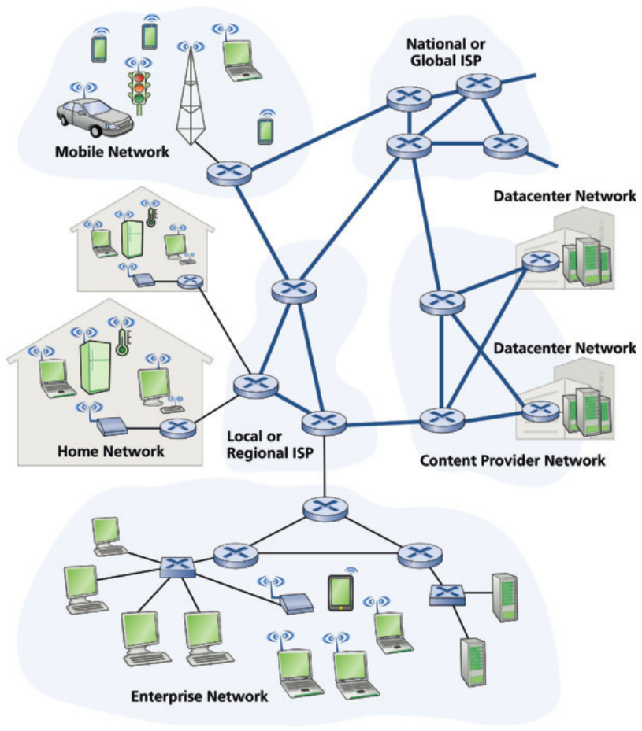

Hình 1.10 Lõi mạng

#### Truyền lưu và chuyển tiếp (Store-and-Forward Transmission)

Hầu hết các packet switch dùng truyền store-and-forward (lưu và chuyển tiếp) ở đầu vào của các liên kết. Truyền store-and-forward nghĩa là packet switch phải nhận toàn bộ packet trước khi có thể bắt đầu truyền bit đầu tiên của packet lên liên kết ra. Để tìm hiểu chi tiết hơn về truyền store-and-forward, hãy xét một mạng đơn giản gồm hai end system được nối bởi một router duy nhất, như thể hiện trong Hình 1.11. Một router thường có nhiều liên kết gắn vào, vì nhiệm vụ của nó là chuyển một packet đến lên một liên kết ra; trong ví dụ đơn giản này, router có nhiệm vụ khá đơn giản là chuyển một packet từ một liên kết (vào) sang liên kết duy nhất còn lại được gắn vào. Trong ví dụ này, nguồn có ba packet, mỗi packet gồm L bit, cần gửi tới đích. Tại thời điểm chụp nhanh thể hiện trong Hình 1.11, nguồn đã truyền một phần packet 1, và phần đầu của packet 1 đã tới router. Vì router dùng store-and-forwarding, tại thời điểm này, router không thể truyền các bit đã nhận; thay vào đó nó phải trước hết đệm (tức là “lưu”) các bit của packet. Chỉ sau khi router đã nhận tất cả các bit của packet, nó mới có thể bắt đầu truyền (tức là “chuyển tiếp”) packet lên liên kết ra. Để hiểu rõ hơn về truyền store-and-forward, giờ hãy tính lượng thời gian trôi qua từ khi nguồn bắt đầu gửi packet cho đến khi đích đã nhận toàn bộ packet. (Ở đây chúng ta sẽ bỏ qua độ trễ lan truyền—thời gian để các bit đi qua dây với tốc độ gần bằng tốc độ ánh sáng—sẽ được thảo luận trong Mục 1.4.) Nguồn bắt đầu truyền tại thời điểm 0; tại thời điểm L/R giây, nguồn đã truyền toàn bộ packet, và toàn bộ packet đã được nhận và lưu tại router (vì không có độ trễ lan truyền). Tại thời điểm L/R giây, vì router vừa nhận toàn bộ packet, nó có thể bắt đầu truyền packet lên liên kết ra hướng tới đích; tại thời điểm 2L/R, router đã truyền toàn bộ packet, và toàn bộ packet đã được đích nhận. Do đó, tổng độ trễ là 2L/R. Nếu thay vào đó switch chuyển tiếp các bit ngay khi chúng đến (mà không nhận toàn bộ packet trước), thì tổng độ trễ sẽ là L/R vì các bit không bị giữ lại ở router. Nhưng, như chúng ta sẽ thảo luận trong Mục 1.4, router cần nhận, lưu và xử lý toàn bộ packet trước khi chuyển tiếp.

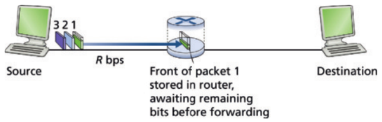

Hình 1.11 Chuyển mạch gói store-and-forward

Giờ hãy tính lượng thời gian trôi qua từ khi nguồn bắt đầu gửi packet đầu tiên cho đến khi đích đã nhận cả ba packet. Như trước, tại thời điểm L/R, router bắt đầu chuyển tiếp packet đầu tiên. Nhưng cũng tại thời điểm L/R nguồn sẽ bắt đầu gửi packet thứ hai, vì nó vừa gửi xong toàn bộ packet đầu tiên. Do đó, tại thời điểm 2L/R, đích đã nhận packet đầu tiên và router đã nhận packet thứ hai. Tương tự, tại thời điểm 3L/R, đích đã nhận hai packet đầu tiên và router đã nhận packet thứ ba. Cuối cùng, tại thời điểm 4L/R đích đã nhận cả ba packet!

Giờ hãy xét trường hợp tổng quát gửi một packet từ nguồn tới đích qua một đường đi gồm N liên kết, mỗi liên kết có tốc độ R (do đó, có N-1 router giữa nguồn và đích). Áp dụng cùng logic như trên, chúng ta thấy độ trễ end-to-end là:

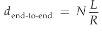 (1.1)

Giờ có lẽ bạn muốn thử xác định độ trễ sẽ là bao nhiêu với P packet được gửi qua một chuỗi N liên kết.

#### Độ trễ hàng đợi và mất gói (Queuing Delays and Packet Loss)

Mỗi packet switch có nhiều liên kết gắn vào. Với mỗi liên kết gắn vào, packet switch có một output buffer (bộ đệm đầu ra, còn gọi là output queue — hàng đợi đầu ra), lưu các packet mà router sắp gửi vào liên kết đó. Các output buffer đóng vai trò then chốt trong chuyển mạch gói. Nếu một packet đến cần được truyền lên một liên kết nhưng thấy liên kết đang bận truyền một packet khác, packet đến phải chờ trong output buffer. Do đó, ngoài độ trễ store-and-forward, packet còn chịu độ trễ hàng đợi ở output buffer. Những độ trễ này biến thiên và phụ thuộc vào mức độ tắc nghẽn trong mạng. Vì dung lượng buffer là hữu hạn, một packet đến có thể thấy buffer đã đầy hoàn toàn bởi các packet khác đang chờ truyền. Trong trường hợp này, mất gói (packet loss) sẽ xảy ra—hoặc packet đến hoặc một trong các packet already-queued (đã xếp hàng) sẽ bị loại bỏ.

Hình 1.12 minh họa một mạng packet-switched đơn giản. Như trong Hình 1.11, packet được biểu diễn bằng các khối three-dimensional (ba chiều). Độ rộng của một khối biểu diễn số bit trong packet. Trong hình này, mọi packet có cùng độ rộng và do đó cùng độ dài. Giả sử Host A và B đang gửi packet tới Host E. Host A và B trước tiên gửi packet của mình dọc theo các liên kết Ethernet 100 Mbps tới router đầu tiên. Router sau đó chuyển các packet này tới liên kết 15 Mbps. Nếu, trong một khoảng thời gian ngắn, tốc độ đến của packet tới router (khi quy đổi sang bit mỗi giây) vượt quá 15 Mbps, tắc nghẽn sẽ xảy ra tại router khi các packet xếp hàng trong output buffer của liên kết trước khi được truyền lên liên kết. Ví dụ, nếu mỗi Host A và B cùng lúc gửi một loạt năm packet back-to-back (liên tiếp nhau), thì phần lớn các packet này sẽ mất một khoảng thời gian chờ trong hàng đợi. Tình huống này, thực tế, hoàn toàn tương tự nhiều tình huống common-day (thường ngày)—ví dụ, khi chúng ta xếp hàng chờ giao dịch viên ngân hàng hoặc chờ trước một trạm thu phí. Chúng ta sẽ xem xét chi tiết hơn độ trễ hàng đợi này trong Mục 1.4.

#### Bảng chuyển tiếp và giao thức định tuyến (Forwarding Tables and Routing Protocols)

Trước đó, chúng tôi đã nói rằng một router nhận một packet đến trên một trong các liên kết truyền thông gắn vào nó và chuyển tiếp packet đó lên một liên kết truyền thông khác gắn vào nó. Nhưng làm sao router xác định nên chuyển tiếp packet lên liên kết nào? Việc chuyển tiếp packet thực ra được thực hiện theo những cách khác nhau trong các loại mạng máy tính khác nhau. Ở đây, chúng tôi mô tả ngắn gọn cách nó được thực hiện trong Internet.

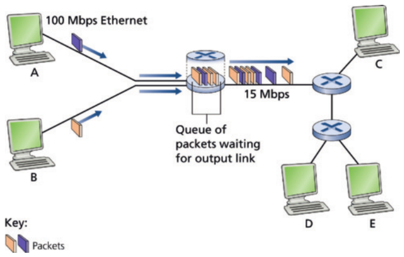

Hình 1.12 Chuyển mạch gói

Trong Internet, mọi end system đều có một địa chỉ gọi là địa chỉ IP. Khi một end system nguồn muốn gửi một packet tới một end system đích, nguồn đưa địa chỉ IP của đích vào header của packet. Giống như địa chỉ bưu chính, địa chỉ này có cấu trúc phân cấp. Khi một packet đến một router trong mạng, router xem xét một phần địa chỉ đích của packet và chuyển tiếp packet tới một router kề cận. Cụ thể hơn, mỗi router có một bảng chuyển tiếp (forwarding table) ánh xạ các địa chỉ đích (hoặc các phần của địa chỉ đích) tới các liên kết ra của router đó. Khi một packet đến một router, router xem xét địa chỉ và tìm trong bảng chuyển tiếp, dùng địa chỉ đích này, để tìm liên kết ra phù hợp. Router sau đó chuyển packet tới liên kết ra này.

Quá trình định tuyến end-to-end tương tự như một người lái xe không dùng bản đồ mà thích hỏi đường. Ví dụ, giả sử Joe đang lái xe từ Philadelphia tới 156 Lakeside Drive ở Orlando, Florida. Joe trước tiên lái tới trạm xăng trong khu phố và hỏi cách đi tới 156 Lakeside Drive ở Orlando, Florida. Nhân viên trạm xăng tách phần Florida của địa chỉ và bảo Joe rằng anh cần lên đường cao tốc liên bang I-95 South, có lối vào ngay cạnh trạm xăng. Người đó cũng bảo Joe rằng khi đã vào Florida, anh nên hỏi người khác ở đó. Joe sau đó đi I-95 South cho đến khi tới Jacksonville, Florida, tại đó anh hỏi đường một nhân viên trạm xăng khác. Nhân viên này tách phần Orlando của địa chỉ và bảo Joe rằng anh nên tiếp tục đi I-95 tới Daytona Beach rồi hỏi người khác. Ở Daytona Beach, một nhân viên trạm xăng khác cũng tách phần Orlando của địa chỉ và bảo Joe rằng anh nên đi I-4 thẳng tới Orlando. Joe đi I-4 và ra ở lối ra Orlando. Joe tới gặp một nhân viên trạm xăng khác, và lần này nhân viên tách phần Lakeside Drive của địa chỉ và chỉ cho Joe con đường anh phải đi để tới Lakeside Drive. Khi Joe tới Lakeside Drive, anh hỏi một đứa trẻ đi xe đạp cách tới đích của mình. Đứa trẻ tách phần 156 của địa chỉ và chỉ vào ngôi nhà. Joe cuối cùng đã tới đích cuối cùng của mình. Trong phép so sánh trên, các nhân viên trạm xăng và những đứa trẻ đi xe đạp tương tự router.

Chúng ta vừa học rằng router dùng địa chỉ đích của packet để tra bảng chuyển tiếp và xác định liên kết ra phù hợp. Nhưng phát biểu này lại đặt ra một câu hỏi khác: Bảng chuyển tiếp được thiết lập thế nào? Chúng được cấu hình thủ công trong từng router, hay Internet dùng một thủ tục tự động hơn? Vấn đề này sẽ được nghiên cứu sâu trong Chương 5. Nhưng để gợi sự tò mò, chúng tôi lưu ý ngay bây giờ rằng Internet có một số giao thức định tuyến (routing protocol) đặc biệt được dùng để tự động thiết lập các bảng chuyển tiếp. Ví dụ, một giao thức định tuyến có thể xác định đường đi ngắn nhất từ mỗi router tới mỗi đích và dùng kết quả đường đi ngắn nhất để cấu hình các bảng chuyển tiếp trong router.

### 1.3.2 Chuyển mạch kênh (Circuit Switching)

Có hai cách tiếp cận nền tảng để chuyển dữ liệu qua một mạng gồm các liên kết và switch: chuyển mạch kênh (circuit switching) và chuyển mạch gói (packet switching). Sau khi đã đề cập các mạng packet-switched trong tiểu mục trước, giờ chúng ta chuyển sự chú ý sang các mạng circuit-switched (chuyển mạch kênh).

Trong mạng circuit-switched, các tài nguyên cần thiết dọc theo một đường đi (buffer, tốc độ truyền của liên kết) để cung cấp cho việc giao tiếp giữa các end system được dành riêng trong suốt phiên giao tiếp giữa các end system. Trong mạng packet-switched, các tài nguyên này không được dành riêng; các thông điệp của một phiên dùng tài nguyên theo nhu cầu và, kết quả là, có thể phải chờ (tức là xếp hàng) để được truy cập một liên kết truyền thông. Như một phép so sánh đơn giản, hãy xét hai nhà hàng, một nhà hàng yêu cầu đặt chỗ trước và một nhà hàng không yêu cầu cũng không nhận đặt chỗ. Với nhà hàng yêu cầu đặt chỗ, chúng ta phải chịu phiền gọi điện trước khi rời nhà. Nhưng khi đến nhà hàng, về nguyên tắc chúng ta có thể được xếp chỗ ngay và gọi món. Với nhà hàng không yêu cầu đặt chỗ, chúng ta không cần bận tâm đặt bàn. Nhưng khi đến nhà hàng, chúng ta có thể phải chờ có bàn trước khi được xếp chỗ.

Mạng điện thoại truyền thống là ví dụ về mạng circuit-switched. Hãy xét điều gì xảy ra khi một người muốn gửi thông tin (giọng nói hoặc fax) tới người khác qua mạng điện thoại. Trước khi bên gửi có thể gửi thông tin, mạng phải thiết lập một kết nối giữa bên gửi và bên nhận. Đây là một kết nối thực sự mà các switch trên đường đi giữa bên gửi và bên nhận duy trì trạng thái kết nối cho kết nối đó. Theo biệt ngữ điện thoại, kết nối này được gọi là một kênh (circuit). Khi mạng thiết lập kênh, nó cũng dành riêng một tốc độ truyền không đổi trong các liên kết của mạng (biểu diễn một phần dung lượng truyền của mỗi liên kết) trong suốt thời gian kết nối. Vì một tốc độ truyền nhất định đã được dành riêng cho kết nối sender-to-receiver (bên gửi tới bên nhận) này, bên gửi có thể truyền dữ liệu tới bên nhận ở tốc độ không đổi được bảo đảm.

Hình 1.13 minh họa một mạng circuit-switched. Trong mạng này, bốn circuit switch được kết nối với nhau bởi bốn liên kết. Mỗi liên kết này có bốn kênh, để mỗi liên kết có thể hỗ trợ bốn kết nối đồng thời. Mỗi host (ví dụ, PC và máy trạm) được nối trực tiếp tới một trong các switch. Khi hai host muốn giao tiếp, mạng thiết lập một kết nối end-to-end chuyên dụng giữa hai host. Do đó, để Host A giao tiếp với Host B, mạng trước hết phải dành riêng một kênh trên mỗi liên kết trong hai liên kết. Trong ví dụ này, kết nối end-to-end chuyên dụng dùng kênh thứ hai trong liên kết thứ nhất và kênh thứ tư trong liên kết thứ hai. Vì mỗi liên kết có bốn kênh, với mỗi liên kết được kết nối end-to-end dùng, kết nối nhận một phần tư tổng dung lượng truyền của liên kết trong suốt thời gian kết nối. Do đó, ví dụ, nếu mỗi liên kết giữa các switch kề cận có tốc độ truyền 1 Mbps, thì mỗi kết nối circuit-switch end-to-end nhận 250 kbps tốc độ truyền chuyên dụng.

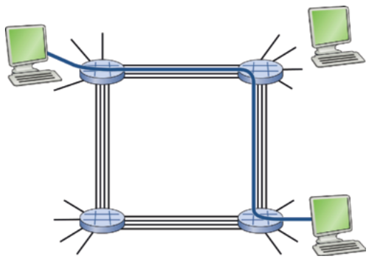

Hình 1.13 Một mạng circuit-switched đơn giản gồm bốn switch và bốn liên kết

Ngược lại, hãy xét điều gì xảy ra khi một host muốn gửi một packet tới một host khác qua một mạng packet-switched, như Internet. Giống như chuyển mạch kênh, packet được truyền qua một chuỗi liên kết truyền thông. Nhưng khác với chuyển mạch kênh, packet được gửi vào mạng mà không dành riêng bất kỳ tài nguyên liên kết nào. Nếu một trong các liên kết bị tắc nghẽn vì các packet khác cần được truyền qua liên kết đó cùng lúc, thì packet sẽ phải chờ trong một buffer ở phía gửi của liên kết truyền và chịu độ trễ. Internet nỗ lực hết mức (best effort) để chuyển packet kịp thời, nhưng nó không đưa ra bất kỳ bảo đảm nào.

#### Ghép kênh trong mạng chuyển mạch kênh (Multiplexing in Circuit-Switched Networks)

Một kênh trong một liên kết được hiện thực bằng frequency-division multiplexing (FDM — ghép kênh phân chia theo tần số) hoặc time-division multiplexing (TDM — ghép kênh phân chia theo thời gian). Với FDM, phổ tần số của một liên kết được chia cho các kết nối được thiết lập qua liên kết. Cụ thể, liên kết dành một dải tần cho mỗi kết nối trong suốt thời gian kết nối. Trong mạng điện thoại, dải tần này thường có độ rộng 4 kHz (tức là 4,000 hertz hay 4,000 chu kỳ mỗi giây). Độ rộng của dải, chẳng có gì ngạc nhiên, được gọi là băng thông (bandwidth). Các đài phát thanh FM cũng dùng FDM để chia sẻ phổ tần giữa 88 MHz và 108 MHz, với mỗi đài được cấp một dải tần cụ thể.

Với một liên kết TDM, thời gian được chia thành các frame có độ dài cố định, và mỗi frame được chia thành một số lượng khe thời gian (time slot) cố định. Khi mạng thiết lập một kết nối qua một liên kết, mạng dành một khe thời gian trong mỗi frame cho kết nối này. Các khe này được dành riêng cho kết nối đó sử dụng, với một khe thời gian có sẵn để dùng (trong mỗi frame) để truyền dữ liệu của kết nối.

Hình 1.14 minh họa FDM và TDM cho một liên kết mạng cụ thể hỗ trợ tối đa bốn kênh. Với FDM, miền tần số được chia thành bốn dải, mỗi dải có băng thông 4 kHz. Với TDM, miền thời gian được chia thành các frame, với bốn khe thời gian trong mỗi frame; mỗi kênh được gán cùng một khe chuyên dụng trong các frame TDM luân phiên. Với TDM, tốc độ truyền của một kênh bằng tốc độ frame nhân với số bit trong một khe. Ví dụ, nếu liên kết truyền 8,000 frame mỗi giây và mỗi khe gồm 8 bit, thì tốc độ truyền của mỗi kênh là 64 kbps.

Những người ủng hộ chuyển mạch gói luôn lập luận rằng chuyển mạch kênh lãng phí vì các kênh chuyên dụng nhàn rỗi trong các khoảng im lặng. Ví dụ, khi một người trong cuộc gọi điện thoại ngừng nói, các tài nguyên mạng nhàn rỗi (dải tần hoặc khe thời gian trong các liên kết dọc tuyến của kết nối) không thể được các kết nối khác đang diễn ra sử dụng. Như một ví dụ khác về việc các tài nguyên này có thể bị sử dụng kém hiệu quả, hãy xét một bác sĩ X quang dùng mạng circuit-switched để truy cập từ xa một loạt ảnh x-rays. Bác sĩ thiết lập kết nối, yêu cầu một ảnh, xem xét kỹ ảnh, rồi yêu cầu một ảnh mới. Tài nguyên mạng được cấp cho kết nối nhưng không được dùng (tức là bị lãng phí) trong những khoảng thời gian bác sĩ xem xét ảnh. Những người ủng hộ chuyển mạch gói cũng thích chỉ ra rằng việc thiết lập các kênh end-to-end và dành riêng dung lượng truyền end-to-end là phức tạp và đòi hỏi phần mềm báo hiệu (signaling) phức tạp để phối hợp hoạt động của các switch dọc theo đường đi end-to-end.

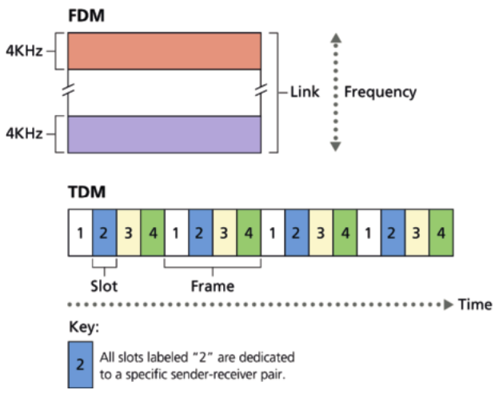

Hình 1.14 Với FDM, mỗi kênh liên tục nhận một phần băng thông. Với TDM, mỗi kênh định kỳ nhận toàn bộ băng thông trong những khoảng thời gian ngắn (tức là trong các khe)

Trước khi kết thúc phần thảo luận về chuyển mạch kênh, hãy cùng làm một ví dụ số giúp hiểu rõ hơn về chủ đề này. Hãy xét mất bao lâu để gửi một file 640,000 bit từ Host A tới Host B qua một mạng circuit-switched. Giả sử mọi liên kết trong mạng dùng TDM với 24 khe và có tốc độ bit 1.536 Mbps. Cũng giả sử mất 500 msec để thiết lập một kênh end-to-end trước khi Host A có thể bắt đầu truyền file. Mất bao lâu để gửi file? Mỗi kênh có tốc độ truyền ( 1.536 Mbps ) /24 = 64 kbps, nên mất ( 640,000 bit) /(64 kbps) = 10 giây để truyền file. Cộng thêm vào 10 giây này thời gian thiết lập kênh, ta được 10.5 giây để gửi file. Lưu ý rằng thời gian truyền độc lập với số liên kết: Thời gian truyền sẽ là 10 giây dù kênh end-to-end đi qua một liên kết hay một trăm liên kết. (Độ trễ end-to-end thực tế còn bao gồm độ trễ lan truyền; xem Mục 1.4.)

#### Chuyển mạch gói so với chuyển mạch kênh (Packet Switching Versus Circuit Switching)

Sau khi đã mô tả chuyển mạch kênh và chuyển mạch gói, hãy so sánh hai cách này. Những người phê phán chuyển mạch gói thường lập luận rằng chuyển mạch gói không phù hợp với các dịch vụ real-time (ví dụ, cuộc gọi điện thoại và cuộc gọi hội nghị video) vì độ trễ end-to-end biến thiên và không thể đoán trước của nó (chủ yếu do độ trễ hàng đợi biến thiên và không thể đoán trước). Những người ủng hộ chuyển mạch gói lập luận rằng (1) nó chia sẻ dung lượng truyền tốt hơn chuyển mạch kênh và (2) nó đơn giản hơn, hiệu quả hơn và ít tốn kém hơn để hiện thực so với chuyển mạch kênh. Một cuộc thảo luận thú vị về chuyển mạch gói so với chuyển mạch kênh là [Molinero-Fernandez 2002]. Nói chung, những người không thích phiền phức với việc đặt bàn nhà hàng thích chuyển mạch gói hơn chuyển mạch kênh.

Vì sao chuyển mạch gói hiệu quả hơn? Hãy xem một ví dụ đơn giản. Giả sử các người dùng dùng chung một liên kết 1 Mbps. Cũng giả sử mỗi người dùng luân phiên giữa các khoảng hoạt động, khi người dùng sinh dữ liệu ở tốc độ không đổi 100 kbps, và các khoảng không hoạt động, khi người dùng không sinh dữ liệu. Giả sử thêm rằng một người dùng chỉ hoạt động 10 phần trăm thời gian (và nhàn nhã uống cà phê trong 90 phần trăm thời gian còn lại). Với chuyển mạch kênh, 100 kbps phải được dành riêng cho mỗi người dùng mọi lúc. Ví dụ, với TDM circuit-switched, nếu một frame one-second (một giây) được chia thành 10 khe thời gian mỗi khe 100 ms, thì mỗi người dùng sẽ được cấp một khe thời gian mỗi frame.

Do đó, liên kết circuit-switched chỉ có thể hỗ trợ 10 (= 1 Mbps/100 kbps) người dùng đồng thời. Với chuyển mạch gói, xác suất một người dùng cụ thể đang hoạt động là 0.1 (tức là 10 phần trăm). Nếu có 35 người dùng, xác suất có 11 người dùng hoạt động đồng thời trở lên là khoảng 0.0004. (Bài tập về nhà P8 phác thảo cách tính xác suất này.) Khi có 10 người dùng hoạt động đồng thời trở xuống (xảy ra với xác suất 0.9996), tốc độ đến tổng hợp của dữ liệu nhỏ hơn hoặc bằng 1 Mbps, tốc độ đầu ra của liên kết. Do đó, khi có 10 người dùng hoạt động trở xuống, packet của người dùng đi qua liên kết về cơ bản không có độ trễ, như trường hợp chuyển mạch kênh. Khi có hơn 10 người dùng hoạt động đồng thời, tốc độ đến tổng hợp của packet vượt quá dung lượng đầu ra của liên kết, và hàng đợi đầu ra sẽ bắt đầu tăng. (Nó tiếp tục tăng cho đến khi tốc độ đầu vào tổng hợp giảm trở lại dưới 1 Mbps, lúc đó hàng đợi sẽ bắt đầu giảm độ dài.) Vì xác suất có hơn 10 người dùng hoạt động đồng thời là cực nhỏ trong ví dụ này, chuyển mạch gói mang lại performance về cơ bản giống chuyển mạch kênh, nhưng làm được điều đó trong khi cho phép số người dùng nhiều hơn gấp ba lần.

Giờ hãy xét một ví dụ đơn giản thứ hai. Giả sử có 10 người dùng và một người dùng đột nhiên sinh ra một nghìn packet 1,000-bit, trong khi các người dùng khác vẫn im lặng và không sinh packet. Với chuyển mạch kênh TDM có 10 khe mỗi frame và mỗi khe gồm 1,000 bit, người dùng đang hoạt động chỉ có thể dùng một khe thời gian của mình mỗi frame để truyền dữ liệu, trong khi chín khe thời gian còn lại trong mỗi frame vẫn nhàn rỗi. Sẽ mất 10 giây trước khi toàn bộ một triệu bit dữ liệu của người dùng đang hoạt động được truyền xong. Trong trường hợp chuyển mạch gói, người dùng đang hoạt động có thể liên tục gửi packet ở toàn bộ tốc độ liên kết 1 Mbps, vì không có người dùng nào khác sinh packet cần được ghép kênh với packet của người dùng đang hoạt động. Trong trường hợp này, toàn bộ dữ liệu của người dùng đang hoạt động sẽ được truyền trong vòng 1 giây.

Các ví dụ trên minh họa hai cách mà performance của chuyển mạch gói có thể vượt trội so với chuyển mạch kênh. Chúng cũng làm nổi bật khác biệt then chốt giữa hai hình thức chia sẻ tốc độ truyền của một liên kết cho nhiều luồng dữ liệu. Chuyển mạch kênh pre-allocates (cấp phát trước) việc dùng liên kết truyền bất kể nhu cầu, với thời gian liên kết đã cấp nhưng không cần đến bị bỏ phí. Ngược lại, chuyển mạch gói cấp phát việc dùng liên kết theo nhu cầu. Dung lượng truyền của liên kết sẽ được chia sẻ theo kiểu packet-by-packet (từng packet một) chỉ giữa những người dùng có packet cần truyền qua liên kết.

Dù cả chuyển mạch gói và chuyển mạch kênh đều phổ biến trong các mạng viễn thông ngày nay, xu hướng chắc chắn là hướng về chuyển mạch gói. Ngay cả nhiều mạng điện thoại circuit-switched ngày nay cũng đang dần chuyển sang chuyển mạch gói. Cụ thể, mạng điện thoại thường dùng chuyển mạch gói cho phần xuyên đại dương tốn kém của một cuộc gọi điện thoại.

### 1.3.3 Mạng của các mạng (A Network of Networks)

Chúng ta đã thấy trước đó rằng các end system (PC, smartphone, Web server, mail server, v.v.) kết nối vào Internet thông qua một access ISP (ISP truy cập). Access ISP có thể cung cấp kết nối có dây hoặc không dây, dùng nhiều công nghệ truy cập bao gồm DSL, cáp, FTTH, Wi-Fi và mạng di động. Lưu ý rằng access ISP không nhất thiết phải là một telco hay công ty truyền hình cáp; thay vào đó nó có thể là, ví dụ, một trường đại học (cung cấp truy cập Internet cho sinh viên, nhân viên và giảng viên), hoặc một công ty (cung cấp truy cập cho nhân viên của mình). Nhưng việc kết nối người dùng cuối và nhà cung cấp nội dung vào một access ISP chỉ là một mảnh nhỏ trong việc giải câu đố kết nối hàng tỉ end system tạo nên Internet. Để hoàn thành câu đố này, bản thân các access ISP phải được kết nối với nhau. Điều này được thực hiện bằng cách tạo ra một mạng của các mạng—hiểu cụm từ này là chìa khóa để hiểu Internet.

Qua nhiều năm, mạng của các mạng tạo nên Internet đã tiến hóa thành một cấu trúc rất phức tạp. Phần lớn sự tiến hóa này được thúc đẩy bởi kinh tế và chính sách quốc gia, hơn là bởi các cân nhắc về performance. Để hiểu cấu trúc mạng Internet ngày nay, hãy từng bước xây dựng một chuỗi các cấu trúc mạng, với mỗi cấu trúc mới là một xấp xỉ tốt hơn của Internet phức tạp mà chúng ta có ngày nay. Hãy nhớ rằng mục tiêu bao trùm là kết nối các access ISP để mọi end system có thể gửi packet cho nhau. Một cách tiếp cận ngây thơ là để mỗi access ISP kết nối trực tiếp với mọi access ISP khác. Tất nhiên, một thiết kế dạng lưới như vậy quá tốn kém cho các access ISP, vì nó đòi hỏi mỗi access ISP phải có một liên kết truyền thông riêng tới từng access ISP trong hàng trăm nghìn access ISP khác trên toàn thế giới.

Cấu trúc mạng đầu tiên của chúng ta, Network Structure 1, kết nối mọi access ISP với một global transit ISP (ISP trung chuyển toàn cầu) duy nhất. Global transit ISP (tưởng tượng) của chúng ta là một mạng gồm các router và liên kết truyền thông không chỉ trải khắp địa cầu, mà còn có ít nhất một router gần mỗi access ISP trong hàng trăm nghìn access ISP. Tất nhiên, sẽ rất tốn kém cho global ISP để xây dựng một mạng rộng lớn như vậy. Để có lãi, nó đương nhiên sẽ tính phí mỗi access ISP cho việc kết nối, với giá phản ánh (nhưng không nhất thiết tỉ lệ thuận trực tiếp với) lượng traffic mà một access ISP trao đổi với global ISP. Vì access ISP trả tiền cho global transit ISP, access ISP được gọi là khách hàng (customer) và global transit ISP được gọi là nhà cung cấp (provider).

Giờ nếu một công ty nào đó xây dựng và vận hành một global transit ISP có lãi, thì việc các công ty khác xây dựng global transit ISP của riêng mình và cạnh tranh với global transit ISP ban đầu là điều tự nhiên. Điều này dẫn đến Network Structure 2, gồm hàng trăm nghìn access ISP và nhiều global transit ISP. Các access ISP chắc chắn thích Network Structure 2 hơn Network Structure 1 vì giờ chúng có thể chọn giữa các global transit provider cạnh tranh dựa trên giá cả và dịch vụ của họ. Tuy nhiên, lưu ý rằng bản thân các global transit ISP phải kết nối với nhau: Nếu không, các access ISP kết nối tới một global transit provider sẽ không thể giao tiếp với các access ISP kết nối tới các global transit provider khác.

Network Structure 2, vừa được mô tả, là một phân cấp two-tier (hai tầng) với các global transit provider ở tầng trên cùng và các access ISP ở tầng dưới cùng. Điều này giả định rằng các global transit ISP không chỉ có khả năng tiếp cận gần từng access ISP, mà còn thấy việc làm vậy là đáng giá về mặt kinh tế. Trong thực tế, dù một số ISP có phạm vi phủ sóng toàn cầu ấn tượng và kết nối trực tiếp với nhiều access ISP, không ISP nào có mặt ở từng thành phố trên thế giới. Thay vào đó, trong một khu vực nhất định, có thể có một regional ISP (ISP khu vực) mà các access ISP trong khu vực kết nối tới. Mỗi regional ISP sau đó kết nối tới tier 1

- ISP. Các ISP tier-1 tương tự global transit ISP (tưởng tượng) của chúng ta; nhưng các ISP tier-1, vốn thực sự tồn tại, không có mặt ở mọi thành phố trên thế giới. Có khoảng một tá ISP tier-1, bao gồm Level 3 Communications, AT&T, Sprint và NTT. Điều thú vị là không tổ chức nào chính thức công nhận tư cách tier-1; như câu nói quen thuộc—nếu bạn phải hỏi mình có phải là thành viên của một nhóm không, thì có lẽ bạn không phải.

Quay lại mạng của các mạng này, không chỉ có nhiều ISP tier-1 cạnh tranh nhau, mà còn có thể có nhiều regional ISP cạnh tranh nhau trong một khu vực. Trong một phân cấp như vậy, mỗi access ISP trả tiền cho regional ISP mà nó kết nối tới, và mỗi regional ISP trả tiền cho ISP tier-1 mà nó kết nối tới. (Một access ISP cũng có thể kết nối trực tiếp tới một ISP tier-1, khi đó nó trả tiền cho ISP tier-1.) Do đó, có quan hệ customer-provider (khách hàng–nhà cung cấp) ở mỗi cấp của phân cấp. Lưu ý rằng các ISP tier-1 không trả tiền cho ai vì chúng ở đỉnh của phân cấp. Để phức tạp thêm, ở một số khu vực, có thể có một regional ISP lớn hơn (có thể trải khắp cả một quốc gia) mà các regional ISP nhỏ hơn trong khu vực đó kết nối tới; regional ISP lớn hơn sau đó kết nối tới một ISP tier-1. Ví dụ, ở Trung Quốc, có các access ISP ở mỗi thành phố, kết nối tới các ISP cấp tỉnh, các ISP này đến lượt mình kết nối tới các ISP quốc gia, và cuối cùng kết nối tới các ISP tier-1 [Tian 2012]. Chúng ta gọi phân cấp multi-tier (nhiều tầng) này, vẫn chỉ là một xấp xỉ thô của Internet ngày nay, là Network Structure 3.

Để xây dựng một mạng giống Internet ngày nay hơn, chúng ta phải thêm các điểm hiện diện (points of presence — PoP), multi-homing, peering, và điểm trao đổi Internet (Internet exchange point — IXP) vào Network Structure 3 phân cấp. PoP tồn tại ở mọi cấp của phân cấp, ngoại trừ cấp dưới cùng (access ISP). Một PoP đơn giản là một nhóm gồm một hoặc nhiều router (ở cùng một địa điểm) trong mạng của nhà cung cấp, nơi các ISP khách hàng có thể kết nối vào ISP nhà cung cấp. Để một mạng khách hàng kết nối tới PoP của nhà cung cấp, nó có thể thuê một liên kết high-speed từ một nhà cung cấp viễn thông third-party (bên thứ ba) để kết nối trực tiếp một trong các router của mình tới một router tại PoP. Bất kỳ ISP nào (ngoại trừ các ISP tier-1) đều có thể chọn multi-home, tức là kết nối tới hai hoặc nhiều ISP nhà cung cấp. Vì vậy, ví dụ, một access ISP có thể multi-home với hai regional ISP, hoặc có thể multi-home với hai regional ISP và cả một ISP tier-1. Tương tự, một regional ISP có thể multi-home với nhiều ISP tier-1. Khi một ISP multi-homes, nó có thể tiếp tục gửi và nhận packet vào Internet ngay cả khi một trong các nhà cung cấp của nó gặp sự cố.

Như chúng ta vừa học, các ISP khách hàng trả tiền cho các ISP nhà cung cấp để có được kết nối Internet toàn cầu. Số tiền mà một ISP khách hàng trả cho một ISP nhà cung cấp phản ánh lượng traffic mà nó trao đổi với nhà cung cấp. Để giảm các chi phí này, một cặp ISP gần nhau ở cùng một cấp của phân cấp có thể peer, tức là chúng có thể kết nối trực tiếp mạng của mình với nhau để mọi traffic giữa chúng đi qua kết nối trực tiếp thay vì qua các trung gian upstream (phía trên). Khi hai ISP peer, thường là settlement-free (không thanh toán), tức là không ISP nào trả tiền cho ISP kia. Như đã lưu ý trước đó, các ISP tier-1 cũng peer với nhau, settlement-free. Để có một thảo luận dễ đọc về peering và quan hệ customer-provider, xem [Van der Berg 2008]. Theo cùng hướng đó, một công ty third-party có thể tạo ra một Internet Exchange Point (IXP), là một điểm gặp nơi nhiều ISP có thể peer với nhau. Một IXP thường nằm trong một tòa nhà stand-alone (độc lập) với các switch riêng của nó [Ager 2012]. Hiện có hơn 600 IXP trong Internet [PeeringDB 2025]. Chúng ta gọi hệ sinh thái này—gồm các access ISP, regional ISP, ISP tier-1, PoP, multi-homing, peering và IXP— là Network Structure 4.

Giờ cuối cùng chúng ta đến Network Structure 5, mô tả Internet ngày nay. Network Structure 5, minh họa trong Hình 1.15, xây dựng dựa trên Network Structure 4 bằng cách thêm các mạng content-provider (nhà cung cấp nội dung). Google hiện là một trong những ví dụ hàng đầu về một mạng content-provider như vậy. Google có hơn 20 data center lớn phân bố khắp Bắc Mỹ, châu Âu, châu Á và Nam Mỹ, [Google datacenters 2024] với mỗi data center có hàng chục hoặc hàng trăm nghìn server. Ngoài ra, Google có các data center nhỏ hơn, mỗi cái có vài trăm server; các data center nhỏ hơn này thường được đặt bên trong các IXP. Các data center của Google đều được kết nối với nhau qua mạng TCP/IP riêng của Google, mạng này trải khắp địa cầu nhưng vẫn tách biệt khỏi Internet công cộng. Quan trọng là, mạng riêng của Google chỉ mang traffic tới/từ các server của Google. Hình 1.15 minh họa mạng cloud world-wide (toàn cầu) của Google tính đến năm 2024 [Google Cloud 2025].

Như thể hiện trong Hình 1.16, mạng riêng của Google cố gắng “đi vòng qua” các tầng trên của Internet bằng cách peering (settlement free) với các ISP lower-tier, hoặc bằng cách kết nối trực tiếp với chúng hoặc kết nối với chúng tại các IXP [Labovitz 2010]. Tuy nhiên, vì nhiều access ISP vẫn chỉ có thể được tiếp cận bằng cách trung chuyển qua các mạng tier-1, mạng của Google cũng kết nối tới các ISP tier-1, và trả tiền cho các ISP đó cho traffic mà nó trao đổi với chúng. Bằng cách tạo ra mạng riêng, một nhà cung cấp nội dung không chỉ giảm khoản thanh toán cho các ISP upper-tier, mà còn có khả năng kiểm soát tốt hơn cách dịch vụ của mình rốt cuộc được chuyển tới người dùng cuối. Tính đến năm 2020, các nhà cung cấp cloud Amazon, Google, IBM và Microsoft cùng nhau có thể tiếp cận 76% Internet mà không cần đi qua các ISP Tier-1 [Arnold 2020].

Tóm lại, Internet ngày nay—một mạng của các mạng—rất phức tạp, gồm khoảng một tá ISP tier-1 và hàng trăm nghìn ISP lower-tier. Các ISP đa dạng về phạm vi phủ sóng, với một số trải qua nhiều châu lục và đại dương, và những ISP khác giới hạn trong các vùng địa lý hẹp. Các ISP lower-tier kết nối tới các ISP higher-tier (tầng cao hơn), và các ISP higher-tier kết nối với nhau. Người dùng và nhà cung cấp nội dung là khách hàng của các ISP lower-tier, và các ISP lower-tier là khách hàng của các ISP higher-tier. Trong những năm gần đây, các nhà cung cấp nội dung lớn cũng đã tạo ra mạng riêng và kết nối trực tiếp vào các ISP lower-tier khi có thể.

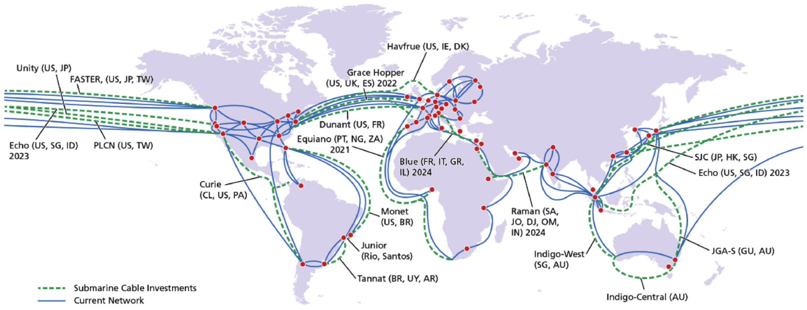

Hình 1.15 Các vị trí và mạng cloud của Google

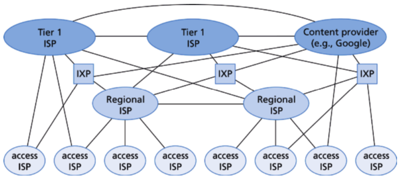

Hình 1.16 Kết nối giữa các ISP và các mạng của nhà cung cấp nội dung

## 1.4 Độ trễ, mất gói và throughput trong mạng chuyển mạch gói (Delay, Loss, and Throughput in Packet-Switched Networks)

Ở Mục 1.1 chúng tôi đã nói rằng Internet có thể được xem như một hạ tầng cung cấp dịch vụ cho các ứng dụng phân tán chạy trên end system. Lý tưởng nhất, chúng ta muốn các dịch vụ Internet có thể chuyển bao nhiêu dữ liệu tùy ý giữa bất kỳ hai end system nào, ngay lập tức, mà không mất dữ liệu nào. Tiếc thay, đây là một mục tiêu cao xa, không thể đạt được trong thực tế. Thay vào đó, mạng máy tính tất yếu giới hạn throughput (lượng dữ liệu mỗi giây có thể được truyền) giữa các end system, đưa vào độ trễ giữa các end system, và thực sự có thể làm mất packet. Một mặt, thật đáng tiếc khi các định luật vật lý của thực tế đưa vào độ trễ và mất mát cũng như giới hạn throughput. Mặt khác, vì mạng máy tính có những vấn đề này, có nhiều vấn đề thú vị xoay quanh cách xử lý chúng— quá đủ vấn đề để lấp đầy một khóa học về mạng máy tính và để thúc đẩy hàng nghìn luận án tiến sĩ! Trong mục này, chúng ta sẽ bắt đầu xem xét và định lượng độ trễ, mất mát và throughput trong mạng máy tính.

### 1.4.1 Tổng quan về độ trễ trong mạng chuyển mạch gói (Overview of Delay in Packet-Switched Networks)

Hãy nhớ rằng một packet bắt đầu ở một host (nguồn), đi qua một chuỗi router, và kết thúc hành trình ở một host khác (đích). Khi một packet đi từ một node (host hoặc router) tới node tiếp theo (host hoặc router) dọc theo đường đi này, packet chịu nhiều loại độ trễ tại mỗi node dọc đường đi. Quan trọng nhất trong các độ trễ này là độ trễ xử lý tại node (nodal processing delay), độ trễ hàng đợi (queuing delay), độ trễ truyền (transmission delay) và độ trễ lan truyền (propagation delay); cộng lại, các độ trễ này tích lũy thành tổng độ trễ tại node (total nodal delay). Performance của nhiều ứng dụng Internet—như tìm kiếm, duyệt Web, e-mail, bản đồ, nhắn tin tức thời và voice-over-IP—bị ảnh hưởng lớn bởi độ trễ mạng. Để có hiểu biết sâu sắc về chuyển mạch gói và mạng máy tính, chúng ta phải hiểu bản chất và tầm quan trọng của các độ trễ này.

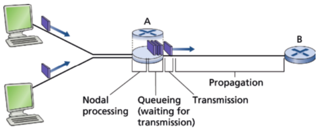

Hình 1.17 Độ trễ tại node ở router A

#### Các loại độ trễ (Types of Delay)

Hãy khám phá các độ trễ này trong bối cảnh Hình 1.17. Như một phần của tuyến end-to-end giữa nguồn và đích, một packet được gửi từ node upstream qua router A tới router B. Mục tiêu của chúng ta là mô tả đặc điểm độ trễ tại node ở router A. Lưu ý rằng router A có một liên kết ra dẫn tới router B. Liên kết này có một hàng đợi (còn gọi là buffer) đứng trước. Khi packet tới router A từ node upstream, router A xem xét header của packet để xác định liên kết ra phù hợp cho packet và sau đó chuyển packet tới liên kết này. Trong ví dụ này, liên kết ra cho packet là liên kết dẫn tới router B. Một packet chỉ có thể được truyền trên một liên kết nếu hiện không có packet nào khác đang được truyền trên liên kết và nếu không có packet nào khác đứng trước nó trong hàng đợi; nếu liên kết hiện đang bận hoặc nếu có các packet khác đã xếp hàng cho liên kết, packet mới đến sẽ tham gia hàng đợi.

ĐỘ TRỄ XỬ LÝ (PROCESSING DELAY)

Thời gian cần để xem xét header của packet và xác định chuyển packet đi đâu là một phần của độ trễ xử lý. Độ trễ xử lý cũng có thể bao gồm các yếu tố khác, như thời gian cần để kiểm tra các lỗi bit-level (mức bit) trong packet xảy ra khi truyền các bit của packet từ node upstream tới router A. Độ trễ xử lý trong các router high-speed thường ở mức micro giây hoặc ít hơn. Sau khi xử lý tại node này, router chuyển packet tới hàng đợi đứng trước liên kết tới router B. (Trong Chương 4 chúng ta sẽ nghiên cứu chi tiết cách một router hoạt động.)

ĐỘ TRỄ HÀNG ĐỢI (QUEUING DELAY)

Tại hàng đợi, packet chịu độ trễ hàng đợi khi chờ được truyền lên liên kết. Độ dài của độ trễ hàng đợi của một packet cụ thể sẽ phụ thuộc vào số packet earlier-arriving (đến trước) đang xếp hàng và chờ truyền lên liên kết. Nếu hàng đợi trống và hiện không có packet nào khác đang được truyền, thì độ trễ hàng đợi của packet của chúng ta sẽ bằng không. Mặt khác, nếu traffic dày đặc và nhiều packet khác cũng đang chờ truyền, độ trễ hàng đợi sẽ dài. Chúng ta sẽ sớm thấy rằng số packet mà một packet đến có thể gặp là một hàm của cường độ và bản chất của traffic đến hàng đợi. Độ trễ hàng đợi trong thực tế có thể ở mức micro giây đến mili giây. ĐỘ TRỄ TRUYỀN (TRANSMISSION DELAY)

Giả sử các packet được truyền theo kiểu first-come-first-served (đến trước phục vụ trước), như thường thấy trong mạng packet-switched, packet của chúng ta chỉ có thể được truyền sau khi mọi packet đến trước nó đã được truyền. Ký hiệu độ dài của packet là L bit, và ký hiệu tốc độ truyền của liên kết từ router A tới router B là R bit/giây. Ví dụ, với một liên kết Ethernet 10 Mbps, tốc độ là R = 10 Mbps; với một liên kết Ethernet 100 Mbps, tốc độ là R = 100 Mbps. Độ trễ truyền là L/R. Đây là lượng thời gian cần để đẩy (tức là truyền) mọi bit của packet vào liên kết. Độ trễ truyền trong thực tế thường ở mức micro giây đến mili giây.

ĐỘ TRỄ LAN TRUYỀN (PROPAGATION DELAY)

Một khi một bit được đẩy vào liên kết, nó cần lan truyền tới router B. Thời gian cần để lan truyền từ đầu liên kết tới router B là độ trễ lan truyền. Bit lan truyền với tốc độ lan truyền của liên kết. Tốc độ lan truyền phụ thuộc vào môi trường truyền vật lý của liên kết (tức là cáp quang, dây đồng twisted-pair, v.v.) và nằm trong khoảng

2 • 10<sup>8</sup> meters/sec to 3 • 10<sup>8</sup> meters/sec

bằng, hoặc thấp hơn một chút so với, tốc độ ánh sáng. Độ trễ lan truyền là khoảng cách giữa hai router chia cho tốc độ lan truyền. Tức là, độ trễ lan truyền là d/s, trong đó d là khoảng cách giữa router A và router B và s là tốc độ lan truyền của liên kết. Một khi bit cuối cùng của packet lan truyền tới node B, nó và mọi bit trước đó của packet được lưu trong router B. Toàn bộ quá trình sau đó tiếp diễn với router B giờ thực hiện việc chuyển tiếp. Trong mạng wide-area, độ trễ lan truyền ở mức mili giây.

#### So sánh độ trễ truyền và độ trễ lan truyền (Comparing Transmission and Propagation Delay)

Những người mới vào lĩnh vực mạng máy tính đôi khi gặp khó khăn trong việc hiểu sự khác biệt giữa độ trễ truyền và độ trễ lan truyền. Sự khác biệt tinh tế nhưng quan trọng. Độ trễ truyền là lượng thời gian cần để router đẩy packet ra; nó là một hàm của độ dài packet và tốc độ truyền của liên kết, nhưng không liên quan gì đến khoảng cách giữa hai router. Ngược lại, độ trễ lan truyền là thời gian để một bit lan truyền từ một router tới router tiếp theo; nó là một hàm của khoảng cách giữa hai router, nhưng không liên quan gì đến độ dài packet hay tốc độ truyền của liên kết.

Một phép so sánh có thể làm rõ các khái niệm độ trễ truyền và độ trễ lan truyền. Hãy xét một đường cao tốc có một trạm thu phí mỗi 100 kilômét, như thể hiện trong Hình 1.18. Bạn có thể nghĩ các đoạn đường cao tốc giữa các trạm thu phí là các liên kết và các trạm thu phí là các router. Giả sử xe ô tô đi (tức là lan truyền) trên đường cao tốc với tốc độ 100 km/giờ (tức là khi một xe rời trạm thu phí, nó tăng tốc tức thì lên 100 km/giờ và duy trì tốc độ đó giữa các trạm thu phí). Tiếp theo giả sử 10 xe, đi cùng nhau thành một đoàn, nối đuôi nhau theo một thứ tự cố định. Bạn có thể nghĩ mỗi xe là một bit và đoàn xe là một packet. Cũng giả sử mỗi trạm thu phí phục vụ (tức là truyền) xe với tốc độ một xe mỗi 12 giây, và đang là đêm khuya nên các xe của đoàn là những xe duy nhất trên đường cao tốc. Cuối cùng, giả sử mỗi khi xe đầu tiên của đoàn tới một trạm thu phí, nó chờ ở lối vào cho đến khi chín xe còn lại đã tới và xếp hàng phía sau. (Do đó, toàn bộ đoàn xe phải được “lưu” tại trạm thu phí trước khi có thể bắt đầu được chuyển tiếp.) Thời gian cần để trạm thu phí đẩy toàn bộ đoàn xe lên đường cao tốc là ( 10 xe ) ( /5 xe/phút) = 2 phút. Thời gian này tương tự độ trễ truyền trong một router. Thời gian cần để một xe đi từ lối ra của một trạm thu phí tới trạm thu phí tiếp theo là 100 km ( /100 km/giờ) = 1 giờ. Thời gian này tương tự độ trễ lan truyền. Do đó, thời gian từ khi đoàn xe được lưu trước một trạm thu phí cho đến khi đoàn xe được lưu trước trạm thu phí tiếp theo là tổng của độ trễ truyền và độ trễ lan truyền—trong ví dụ này là 62 phút.

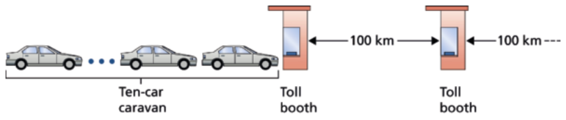

Hình 1.18 Phép so sánh đoàn xe

Hãy khám phá phép so sánh này thêm một chút. Điều gì sẽ xảy ra nếu thời gian phục vụ một đoàn xe của trạm thu phí lớn hơn thời gian để một xe đi giữa các trạm thu phí? Ví dụ, giờ giả sử các xe đi với tốc độ 1,000 km/giờ và trạm thu phí phục vụ xe với tốc độ một xe mỗi phút. Khi đó độ trễ di chuyển giữa hai trạm thu phí là 6 phút và thời gian phục vụ một đoàn xe là 10 phút. Trong trường hợp này, vài xe đầu tiên trong đoàn sẽ tới trạm thu phí thứ hai trước khi những xe cuối cùng trong đoàn rời trạm thu phí thứ nhất. Tình huống này cũng xảy ra trong mạng packet-switched—những bit đầu tiên của một packet có thể tới một router trong khi nhiều bit còn lại của packet vẫn đang chờ được router phía trước truyền đi.

Nếu một bức tranh đáng giá ngàn lời, thì một hoạt hình hẳn đáng giá triệu lời. Web site của cuốn sách này cung cấp một hoạt hình tương tác minh họa và đối chiếu rất hay độ trễ truyền và độ trễ lan truyền. Chúng tôi rất khuyến khích người đọc ghé xem hoạt hình đó. [Smith 2009] cũng đưa ra một thảo luận rất dễ đọc về độ trễ lan truyền, hàng đợi và truyền.

Nếu ta ký hiệu d<sub>proc</sub>, d<sub>queue</sub>, d<sub>trans</sub>, và d<sub>prop</sub> là độ trễ xử lý, hàng đợi, truyền và lan truyền, thì tổng độ trễ tại node được cho bởi

d<sub>nodal</sub> = d<sub>proc</sub> + d<sub>queue</sub> + d<sub>trans</sub> + d<sub>prop</sub>

Đóng góp của các thành phần độ trễ này có thể khác nhau đáng kể. Ví dụ, d<sub>prop</sub> có thể không đáng kể (ví dụ, vài micro giây) với một liên kết nối hai router trong cùng một khuôn viên trường đại học; tuy nhiên, d<sub>prop</sub> là hàng trăm mili giây với hai router được kết nối bằng một liên kết vệ tinh địa tĩnh, và có thể là thành phần chi phối trong d<sub>nodal</sub>. Tương tự, d<sub>trans</sub> có thể dao động từ không đáng kể đến đáng kể. Đóng góp của nó thường không đáng kể với tốc độ truyền 10 Mbps trở lên (ví dụ, cho LAN); tuy nhiên, nó có thể là hàng trăm mili giây với các packet Internet lớn được gửi qua các liên kết modem dial-up low-speed (tốc độ thấp). Độ trễ xử lý, d<sub>proc</sub>, thường không đáng kể; tuy nhiên, nó ảnh hưởng mạnh đến throughput tối đa của một router, tức là tốc độ tối đa mà router có thể chuyển tiếp packet.

### 1.4.2 Độ trễ hàng đợi và mất gói (Queuing Delay and Packet Loss)

Thành phần phức tạp và thú vị nhất của độ trễ tại node là độ trễ hàng đợi, d<sub>queue</sub>. Thực tế, độ trễ hàng đợi quan trọng và thú vị trong mạng máy tính đến mức hàng nghìn bài báo và nhiều cuốn sách đã được viết về nó [Bertsekas 1991; Kleinrock 1975, Kleinrock 1976]. Ở đây chúng tôi chỉ đưa ra một thảo luận high-level, trực quan về độ trễ hàng đợi; người đọc tò mò hơn có thể muốn đọc qua một số cuốn sách (hoặc thậm chí cuối cùng viết một luận án tiến sĩ về chủ đề này!). Khác với ba độ trễ còn lại (cụ thể là d<sub>proc</sub>, d<sub>trans</sub>, và d<sub>prop</sub>), độ trễ hàng đợi có thể thay đổi từ packet này sang packet khác. Ví dụ, nếu 10 packet đến một hàng đợi trống cùng lúc, packet đầu tiên được truyền sẽ không chịu độ trễ hàng đợi nào, trong khi packet cuối cùng được truyền sẽ chịu độ trễ hàng đợi tương đối lớn (trong khi chờ chín packet kia được truyền). Do đó, khi mô tả đặc điểm độ trễ hàng đợi, người ta thường dùng các thước đo thống kê, như độ trễ hàng đợi trung bình, phương sai của độ trễ hàng đợi, và xác suất độ trễ hàng đợi vượt quá một giá trị nhất định.

Khi nào độ trễ hàng đợi lớn và khi nào nó không đáng kể? Câu trả lời cho câu hỏi này phụ thuộc vào tốc độ traffic đến hàng đợi, tốc độ truyền của liên kết, và bản chất của traffic đến, tức là traffic đến định kỳ hay đến theo từng đợt (burst). Để hiểu rõ hơn ở đây, hãy để a ký hiệu tốc độ trung bình packet đến hàng đợi (a có đơn vị packet/giây). Hãy nhớ rằng R là tốc độ truyền; tức là tốc độ (tính bằng bit/giây) mà các bit được đẩy ra khỏi hàng đợi. Cũng giả sử, cho đơn giản, mọi packet đều gồm L bit. Khi đó tốc độ trung bình các bit đến hàng đợi là La bit/giây. Cuối cùng, giả sử hàng đợi rất lớn, có thể chứa về cơ bản vô số bit. Tỉ số La/R, gọi là cường độ traffic (traffic intensity), thường đóng vai trò quan trọng trong việc ước lượng mức độ của độ trễ hàng đợi. Nếu La/R > 1, thì tốc độ trung bình các bit đến hàng đợi vượt quá tốc độ các bit có thể được truyền khỏi hàng đợi. Trong tình huống không may này, hàng đợi sẽ có xu hướng tăng không giới hạn và độ trễ hàng đợi sẽ tiến tới vô cùng! Do đó, một trong những quy tắc vàng trong kỹ thuật traffic là: Hãy thiết kế hệ thống của bạn sao cho cường độ traffic không lớn hơn 1.

Giờ hãy xét trường hợp La/R ≤ 1. Ở đây, bản chất của traffic đến ảnh hưởng tới độ trễ hàng đợi. Ví dụ, nếu packet đến định kỳ—tức là một packet đến mỗi L/R giây—thì mọi packet sẽ đến một hàng đợi trống và sẽ không có độ trễ hàng đợi. Mặt khác, nếu packet đến theo từng đợt nhưng định kỳ, có thể có độ trễ hàng đợi trung bình đáng kể. Ví dụ, giả sử N packet đến đồng thời mỗi (L/R)N giây. Khi đó packet đầu tiên được truyền không có độ trễ hàng đợi; packet thứ hai được truyền có độ trễ hàng đợi L/R giây; và tổng quát hơn, packet thứ n được truyền có độ trễ hàng đợi (n − 1)L/R giây. Chúng tôi để việc tính độ trễ hàng đợi trung bình trong ví dụ này làm bài tập cho bạn.

Hai ví dụ về việc đến định kỳ được mô tả ở trên có phần mang tính học thuật. Thông thường, quá trình đến của một hàng đợi là ngẫu nhiên; tức là việc đến không theo bất kỳ mẫu nào và các packet cách nhau những khoảng thời gian ngẫu nhiên. Trong trường hợp thực tế hơn này, đại lượng La/R thường không đủ để mô tả đầy đủ các thống kê về độ trễ hàng đợi. Tuy nhiên, nó hữu ích trong việc có được hiểu biết trực quan về mức độ của độ trễ hàng đợi. Cụ thể, nếu cường độ traffic gần bằng không, thì packet đến thưa thớt và ít có khả năng một packet đến gặp một packet khác trong hàng đợi. Do đó, độ trễ hàng đợi trung bình sẽ gần bằng không. Mặt khác, khi cường độ traffic gần bằng 1, sẽ có những khoảng thời gian tốc độ đến vượt quá dung lượng truyền (do sự biến thiên của tốc độ packet đến), và một hàng đợi sẽ hình thành trong những khoảng thời gian này; khi tốc độ đến nhỏ hơn dung lượng truyền, độ dài hàng đợi sẽ giảm. Tuy nhiên, khi cường độ traffic tiến tới 1, độ dài hàng đợi trung bình ngày càng lớn. Sự phụ thuộc định tính của độ trễ hàng đợi trung bình vào cường độ traffic được thể hiện trong Hình 1.19.

Một khía cạnh quan trọng của Hình 1.19 là khi cường độ traffic tiến tới 1, độ trễ hàng đợi trung bình tăng nhanh chóng. Một mức tăng phần trăm nhỏ ở cường độ sẽ dẫn đến mức tăng percentage-wise (theo phần trăm) lớn hơn nhiều ở độ trễ. Có lẽ bạn đã trải qua hiện tượng này trên đường cao tốc. Nếu bạn thường xuyên lái xe trên một con đường thường bị tắc nghẽn, việc con đường thường bị tắc nghẽn có nghĩa là cường độ traffic của nó gần bằng 1. Nếu một sự kiện nào đó gây ra lượng traffic dù chỉ hơi larger-than-usual (lớn hơn bình thường), độ trễ bạn gặp phải có thể rất lớn.

Để thực sự cảm nhận rõ độ trễ hàng đợi là gì, một lần nữa bạn được khuyến khích ghé thăm Web site của sách, nơi cung cấp một hoạt hình tương tác cho một hàng đợi. Nếu bạn đặt tốc độ packet đến đủ cao để cường độ traffic vượt quá 1, bạn sẽ thấy hàng đợi dần dần tăng lên theo thời gian.

#### Mất gói (Packet Loss)

Trong các thảo luận ở trên, chúng ta đã giả định rằng hàng đợi có khả năng chứa vô số packet. Trong thực tế, một hàng đợi đứng trước một liên kết có dung lượng hữu hạn, dù dung lượng hàng đợi phụ thuộc rất nhiều vào thiết kế và chi phí của router. Vì dung lượng hàng đợi hữu hạn, độ trễ packet không thực sự tiến tới vô cùng khi cường độ traffic tiến tới 1. Thay vào đó, một packet có thể đến và thấy hàng đợi đã đầy. Không có chỗ để lưu packet đó, router sẽ loại bỏ (drop) packet đó; tức là packet sẽ bị mất. Hiện tượng tràn hàng đợi này một lần nữa có thể được thấy trong hoạt hình tương tác khi cường độ traffic lớn hơn 1.

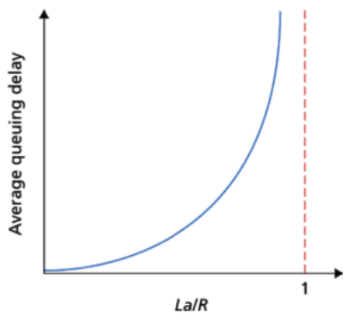

Hình 1.19 Sự phụ thuộc của độ trễ hàng đợi trung bình vào cường độ traffic

Từ góc nhìn end-system, một packet bị mất sẽ trông như một packet đã được truyền vào lõi mạng nhưng không bao giờ xuất hiện từ mạng tại đích. Tỉ lệ packet bị mất tăng khi cường độ traffic tăng. Do đó, performance tại một node thường được đo không chỉ theo độ trễ, mà còn theo xác suất mất gói. Như chúng ta sẽ thảo luận trong các chương tiếp theo, một packet bị mất có thể được truyền lại trên cơ sở end-to-end để bảo đảm mọi dữ liệu cuối cùng đều được chuyển từ nguồn tới đích.

### 1.4.3 Độ trễ đầu cuối–đầu cuối (End-to-End Delay)

Phần thảo luận cho đến giờ đã tập trung vào độ trễ tại node, tức là độ trễ tại một router duy nhất. Giờ hãy xét tổng độ trễ từ nguồn tới đích. Để nắm khái niệm này, giả sử có N-1 router giữa host nguồn và host đích. Cũng tạm giả sử mạng không bị tắc nghẽn (để độ trễ hàng đợi không đáng kể), độ trễ xử lý tại mỗi router và tại host nguồn là d<sub>proc</sub>, tốc độ truyền ra khỏi mỗi router và ra khỏi host nguồn là R bit/giây, và độ trễ lan truyền trên mỗi liên kết là d<sub>prop</sub>. Các độ trễ tại node tích lũy lại và cho độ trễ end-to-end,

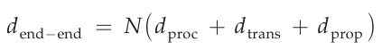 (1.2)

trong đó, một lần nữa, d<sub>trans</sub> = L/R, với L là kích thước packet. Lưu ý rằng Phương trình 1.2 là sự tổng quát hóa của Phương trình 1.1, vốn không tính đến độ trễ xử lý và độ trễ lan truyền. Chúng tôi để bạn tổng quát hóa Phương trình 1.2 cho trường hợp độ trễ không đồng nhất tại các node và có độ trễ hàng đợi trung bình tại mỗi node.

#### Traceroute

Để có cảm nhận hands-on (thực hành) về độ trễ end-to-end trong một mạng máy tính, chúng ta có thể dùng chương trình Traceroute. Traceroute là một chương trình đơn giản có thể chạy trên bất kỳ host Internet nào. Khi người dùng chỉ định một hostname đích, chương trình trên host nguồn gửi nhiều packet đặc biệt về phía đích đó. Khi các packet này đi dần về phía đích, chúng đi qua một chuỗi router. Khi một router nhận được một trong các packet đặc biệt này, nó gửi lại cho nguồn một thông điệp ngắn chứa tên và địa chỉ của router.

Cụ thể hơn, nguồn gửi một chuỗi packet đặc biệt vào mạng, với mỗi packet được gửi tới đích cuối cùng. Packet đầu tiên được đánh dấu 1, packet thứ hai được đánh dấu 2, và cứ thế. Mỗi khi một router giữa nguồn và đích nhận được một trong các packet đặc biệt này, nó giảm giá trị đánh dấu đi một rồi chuyển tiếp packet tiếp tục hành trình. Tuy nhiên, nếu tại một router giá trị đánh dấu bị giảm về không, router không chuyển tiếp packet về phía đích, mà thay vào đó gửi một thông điệp về nguồn. Khi host đích nhận được một packet được đánh dấu là 1, nó cũng trả một thông điệp về nguồn. (Sau khi nhận thông điệp từ host, nguồn ngừng gửi các packet đặc biệt này.) Nguồn ghi lại thời gian trôi qua giữa khi nó gửi một packet và khi nó nhận thông điệp trả về tương ứng; nó cũng ghi lại tên và địa chỉ của router (hoặc host đích) trả về thông điệp. Bằng cách này, nguồn có thể dựng lại tuyến mà các packet đi từ nguồn tới đích, và nguồn có thể xác định độ trễ round-trip tới mọi router trung gian. Traceroute thực ra lặp lại thí nghiệm vừa mô tả ba lần, nên nguồn thực ra gửi 3 • N packet tới đích, trong đó N-1 là số router giữa nguồn và đích. RFC 1393 mô tả chi tiết Traceroute.

Đây là một ví dụ về đầu ra của chương trình Traceroute, trong đó tuyến được dò từ host nguồn gaia.cs.umass.edu (tại University of Massachusetts) tới một host trong khoa khoa học máy tính tại University of Sorbonne ở Paris (trước đây trường có tên UPMC). Đầu ra có sáu cột: cột thứ nhất là giá trị đánh dấu được mô tả ở trên, tức là số thứ tự của router dọc tuyến; cột thứ hai là tên router; cột thứ ba là địa chỉ của router (dạng xxx.xxx.xxx.xxx); ba cột cuối là độ trễ round-trip cho ba thí nghiệm. Nếu nguồn nhận được ít hơn ba thông điệp từ một router nào đó (do mất gói trong mạng), Traceroute đặt một dấu sao ngay sau số hiệu router và báo cáo ít hơn ba thời gian round-trip cho router đó.

```
  1  gw-vlan-2451.cs.umass.edu (128.119.245.1) 1.899 ms 3.266 ms 3.280 ms
  2  j-cs-gw-int-10-240.cs.umass.edu (10.119.240.254) 1.296 ms 1.276 ms 1.245 ms
  3  n5-rt-1-1-xe-2-1-0.gw.umass.edu (128.119.3.33) 2.237 ms 2.217 ms 2.187 ms
  4  core1-rt-et-5-2-0.gw.umass.edu (128.119.0.9) 0.351 ms 0.392 ms 0.380 ms
  5  border1-rt-et-5-0-0.gw.umass.edu (192.80.83.102) 0.345 ms 0.345 ms 0.344 ms
  6  nox300gw1-umass-re.nox.org (192.5.89.101) 3.260 ms 0.416 ms 3.127 ms
  7  nox300gw1-umass-re.nox.org (192.5.89.101) 3.165 ms 7.326 ms 7.311 ms
  8  198.71.45.237 (198.71.45.237) 77.826 ms 77.246 ms 77.744 ms
  9  renater-lb1-gw.mx1.par.fr.geant.net (62.40.124.70) 79.357 ms 77.729 79.152 ms
 10  193.51.180.109 (193.51.180.109) 78.379 ms 79.936 80.042 ms
 11  * 193.51.180.109 (193.51.180.109) 80.640 ms *
 12  * 195.221.127.182 (195.221.127.182) 78.408 ms *
 13  195.221.127.182 (195.221.127.182) 80.686 ms 80.796 ms 78.434 ms
 14  r-upmc1.reseau.jussieu.fr (134.157.254.10) 78.399 ms * 81.353 ms
```

Trong kết quả dò ở trên, có 14 router giữa nguồn và đích. Hầu hết các router này có tên, và tất cả đều có địa chỉ. Ví dụ, tên của Router 4 là core1-rt-et-5-2-0.gw.umass.edu và địa chỉ của nó là 128.119.0.9. Nhìn vào dữ liệu cho cùng router này, chúng ta thấy rằng ở lần thử đầu tiên trong ba lần, độ trễ round-trip giữa nguồn và router là 0.351 msec. Độ trễ round-trip cho hai lần thử tiếp theo là 0.392 và 0.380 msec. Các độ trễ round-trip này bao gồm mọi độ trễ vừa thảo luận, bao gồm độ trễ truyền, độ trễ lan truyền, độ trễ xử lý của router, và độ trễ hàng đợi.

Vì độ trễ hàng đợi thay đổi theo thời gian, độ trễ round-trip của packet n gửi tới router n đôi khi có thể dài hơn độ trễ round-trip của packet n + 1 gửi tới router n + 1. Thực tế, chúng ta quan sát thấy hiện tượng này trong ví dụ trên: độ trễ tới Router 12 nhỏ hơn độ trễ tới Router 11! Cũng lưu ý mức tăng lớn của độ trễ round-trip khi đi từ router 7 tới router 8. Đó là do một liên kết fiber-optic xuyên Đại Tây Dương giữa router 7 và 8, gây ra độ trễ lan truyền tương đối lớn. Có một số chương trình phần mềm miễn phí cung cấp giao diện đồ họa cho Traceroute; một trong những chương trình chúng tôi yêu thích là PingPlotter [PingPlotter 2025]. Một công cụ khác thường được dùng là Whois, truy vấn cơ sở dữ liệu Whois phân tán và cung cấp thông tin đăng ký về địa chỉ IP.

#### Độ trễ ở end system, ứng dụng và các độ trễ khác (End System, Application, and Other Delays)

Ngoài độ trễ xử lý, truyền và lan truyền, có thể có thêm những độ trễ đáng kể ở end system. Ví dụ, một end system muốn truyền một packet vào một môi trường dùng chung (ví dụ, như trong kịch bản WiFi hoặc cable modem) có thể cố ý trì hoãn việc truyền như một phần của giao thức chia sẻ môi trường với các end system khác; chúng ta sẽ xem xét chi tiết các giao thức như vậy trong Chương 6. Một độ trễ quan trọng khác là độ trễ đóng gói media (media packetization delay), có mặt trong các ứng dụng hội nghị video như Zoom và Google Hangouts. Trong hội nghị video, phía gửi trước hết phải lấp đầy một packet bằng video và tiếng nói số hóa đã mã hóa trước khi chuyển packet tới Internet.

### 1.4.4 Throughput trong mạng máy tính (Throughput in Computer Networks)

Ngoài độ trễ và mất gói, một thước đo performance then chốt khác trong mạng máy tính là throughput end-to-end. Để định nghĩa throughput, hãy xét việc truyền một file lớn từ Host A tới Host B qua một mạng máy tính. Việc truyền này có thể là, ví dụ, một video clip lớn từ máy tính này sang máy tính khác. Throughput tức thời (instantaneous throughput) tại bất kỳ thời điểm nào là tốc độ (tính bằng bit/giây) mà Host B đang nhận file. (Nhiều ứng dụng hiển thị throughput tức thời trong khi tải xuống trên giao diện người dùng—có lẽ bạn đã từng quan sát điều này! Bạn có thể thử đo độ trễ end-to-end và throughput tải xuống giữa máy của bạn và các server khắp Internet bằng ứng dụng speedtest [Speedtest 2025].) Nếu file gồm F bit và việc truyền mất T giây để Host B nhận đủ F bit, thì throughput trung bình (average throughput) của việc truyền file là F/T bit/giây. Với một số ứng dụng, như điện thoại Internet, mong muốn có độ trễ thấp và throughput tức thời luôn trên một ngưỡng nào đó (ví dụ, trên 24 kbps cho một số ứng dụng điện thoại Internet và trên 256 kbps cho một số ứng dụng video real-time). Với các ứng dụng khác, bao gồm các ứng dụng liên quan đến truyền file, độ trễ không quan trọng, nhưng mong muốn có throughput cao nhất có thể.

Để hiểu rõ hơn khái niệm quan trọng throughput, hãy xét một vài ví dụ. Hình 1.20(a) thể hiện hai end system, một server và một client, được nối bởi hai liên kết truyền thông và một router. Hãy xét throughput cho việc truyền file từ server tới client. Gọi R<sub>s</sub> là tốc độ của liên kết giữa server và router; và R<sub>c</sub> là tốc độ của liên kết giữa router và client. Giả sử các bit duy nhất được gửi trong toàn bộ mạng là các bit từ server tới client. Giờ chúng ta hỏi, trong kịch bản lý tưởng này, throughput server-to-client là bao nhiêu? Để trả lời câu hỏi này, chúng ta có thể nghĩ các bit như chất lỏng và các liên kết truyền thông như các đường ống. Rõ ràng, server không thể bơm bit qua liên kết của nó với tốc độ nhanh hơn R<sub>s</sub> bps; và router không thể chuyển tiếp bit với tốc độ nhanh hơn R<sub>c</sub> bps. Nếu R<sub>s</sub> < R<sub>c</sub>, thì các bit được server bơm ra sẽ “chảy” thẳng qua router và tới client với tốc độ R<sub>s</sub> bps, cho throughput R<sub>s</sub> bps. Ngược lại, nếu R<sub>c</sub> < R<sub>s</sub>, thì router sẽ không thể chuyển tiếp bit nhanh bằng tốc độ nhận. Trong trường hợp này, các bit sẽ chỉ rời router với tốc độ R<sub>c</sub>, cho throughput end-to-end là R<sub>c</sub>. (Cũng lưu ý rằng nếu các bit tiếp tục đến router với tốc độ R<sub>s</sub>, và tiếp tục rời router với tốc độ R<sub>c</sub>, lượng bit tồn đọng tại router chờ truyền tới client sẽ tăng mãi—một tình huống hết sức không mong muốn!) Do đó, với mạng two-link (hai liên kết) đơn giản này, throughput là min { R<sub>c</sub>, R<sub>s</sub> }, tức là tốc độ truyền của liên kết nút cổ chai (bottleneck link). Sau khi đã xác định throughput, giờ chúng ta có thể xấp xỉ thời gian cần để truyền một file lớn F bit từ server tới client là as/F min { R<sub>s</sub>, R<sub>c</sub> }. Với một ví dụ cụ thể, giả sử bạn đang tải một file MP3 có F = 32 triệu bit, server có tốc độ truyền R<sub>s</sub> = 2 Mbps, và bạn có một liên kết truy cập R<sub>c</sub> = 1 Mbps. Khi đó thời gian cần để truyền file là 32 giây. Tất nhiên, các biểu thức cho throughput và thời gian truyền này chỉ là xấp xỉ, vì chúng không tính đến độ trễ store-and-forward và độ trễ xử lý cũng như các vấn đề giao thức.

Hình 1.20(b) giờ thể hiện một mạng có N liên kết giữa server và client, với tốc độ truyền của N liên kết là R<sub>1</sub>, R<sub>2</sub>, . . . , R<sub>N</sub>. Áp dụng cùng phân tích như với mạng two-link, chúng ta thấy throughput cho việc truyền file từ server tới client là min { R<sub>1</sub>, R<sub>2</sub>, . . . , R<sub>N</sub> }, một lần nữa là tốc độ truyền của liên kết nút cổ chai dọc đường đi giữa server và client.

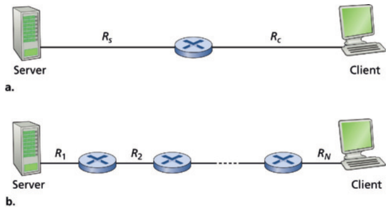

Hình 1.20 Throughput cho việc truyền file từ server tới client

Giờ hãy xét một ví dụ khác lấy cảm hứng từ Internet ngày nay. Hình 1.21(a) thể hiện hai end system, một server và một client, kết nối tới một mạng máy tính. Hãy xét throughput cho việc truyền file từ server tới client. Server kết nối tới mạng bằng một liên kết truy cập có tốc độ R<sub>s</sub> và client kết nối tới mạng bằng một liên kết truy cập có tốc độ R<sub>c</sub>. Giờ giả sử mọi liên kết trong lõi của mạng truyền thông đều có tốc độ truyền rất cao, cao hơn nhiều so với R<sub>s</sub> và R<sub>c</sub>. Thực tế, ngày nay lõi của Internet được over-provisioned (cấp dư dung lượng) với các liên kết tốc độ cao ít bị tắc nghẽn. Cũng giả sử các bit duy nhất được gửi trong toàn bộ mạng là các bit từ server tới client. Vì lõi của mạng máy tính giống như một đường ống rộng trong ví dụ này, tốc độ mà bit có thể chảy từ nguồn tới đích lại là giá trị nhỏ nhất của R<sub>s</sub> và R<sub>c</sub>, tức là throughput = min { R<sub>s</sub>, R<sub>c</sub> }. Do đó, yếu tố giới hạn throughput trong Internet ngày nay thường là mạng truy cập.

Ví dụ cuối cùng, hãy xét Hình 1.21(b) trong đó có 10 server và 10 client kết nối tới lõi của mạng máy tính. Trong ví dụ này, có 10 lượt tải xuống đồng thời đang diễn ra, liên quan đến 10 cặp client-server. Giả sử 10 lượt tải xuống này là traffic duy nhất trong mạng tại thời điểm hiện tại. Như thể hiện trong hình, có một liên kết trong lõi mà cả 10 lượt tải xuống đều đi qua. Ký hiệu R cho tốc độ truyền của liên kết này R. Giả sử mọi liên kết truy cập của server có cùng tốc độ R<sub>s</sub>, mọi liên kết truy cập của client có cùng tốc độ R<sub>c</sub>, và tốc độ truyền của mọi liên kết trong lõi—ngoại trừ liên kết chung có tốc độ R—lớn hơn nhiều so với R<sub>s</sub>, R<sub>c</sub> và R. Giờ chúng ta hỏi, throughput của các lượt tải xuống là bao nhiêu? Rõ ràng, nếu tốc độ của liên kết chung, R, lớn—chẳng hạn lớn hơn một trăm lần so với cả R và R<sub>c</sub>—thì throughput cho mỗi lượt tải xuống một lần nữa sẽ là min { R<sub>s</sub>, R<sub>c</sub> }. Nhưng nếu tốc độ của liên kết chung cùng bậc với R<sub>s</sub> và R<sub>c</sub> thì sao? Throughput sẽ là bao nhiêu trong trường hợp này? Hãy xem một ví dụ cụ thể. Giả sử R<sub>s</sub> = 2 Mbps, R<sub>c</sub> = 1 Mbps, R = 5 Mbps, và liên kết chung chia đều tốc độ truyền của nó cho 10 lượt tải xuống. Khi đó nút cổ chai cho mỗi lượt tải xuống không còn nằm ở mạng truy cập, mà giờ là liên kết dùng chung trong lõi, liên kết này chỉ cung cấp cho mỗi lượt tải xuống 500 kbps throughput. Do đó, throughput end-to-end cho mỗi lượt tải xuống giờ giảm xuống còn 500 kbps.

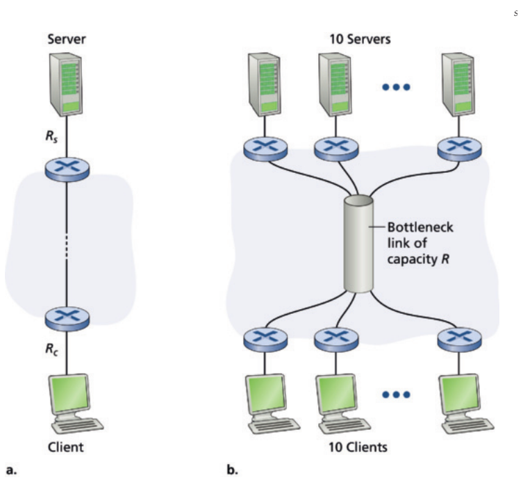

Hình 1.21 Throughput end-to-end: (a) Client tải một file từ server; (b) 10 client tải xuống với 10 server

Các ví dụ trong Hình 1.20 và Hình 1.21(a) cho thấy throughput phụ thuộc vào tốc độ truyền của các liên kết mà dữ liệu đi qua. Chúng ta đã thấy rằng khi không có traffic xen vào nào khác, throughput có thể đơn giản được xấp xỉ bằng tốc độ truyền nhỏ nhất dọc đường đi giữa nguồn và đích. Ví dụ trong Hình 1.21(b) cho thấy một cách tổng quát hơn rằng throughput không chỉ phụ thuộc vào tốc độ truyền của các liên kết dọc đường đi, mà còn phụ thuộc vào traffic xen vào. Cụ thể, một liên kết có tốc độ truyền cao vẫn có thể là liên kết nút cổ chai cho một lượt truyền file nếu nhiều luồng dữ liệu khác cũng đi qua liên kết đó. Chúng ta sẽ xem xét kỹ hơn throughput trong mạng máy tính trong các bài tập về nhà và trong các chương tiếp theo.

## 1.5 Các tầng giao thức và mô hình dịch vụ của chúng (Protocol Layers and Their Service Models)

Từ phần thảo luận cho đến giờ, rõ ràng Internet là một hệ thống cực kỳ phức tạp. Chúng ta đã thấy có nhiều thành phần trong Internet: vô số ứng dụng và giao thức, nhiều loại end system, packet switch, và nhiều loại môi trường truyền link-level (mức liên kết). Với độ phức tạp khổng lồ này, liệu có hy vọng nào để tổ chức một kiến trúc mạng, hoặc ít nhất là phần thảo luận của chúng ta về kiến trúc mạng? May mắn thay, câu trả lời cho cả hai câu hỏi là có.

### 1.5.1 Kiến trúc phân tầng (Layered Architecture)

Trước khi cố gắng tổ chức suy nghĩ về kiến trúc Internet, hãy tìm một phép so sánh với con người. Thực ra, chúng ta xử lý các hệ thống phức tạp mọi lúc trong cuộc sống hằng ngày. Hãy tưởng tượng nếu ai đó yêu cầu bạn mô tả, ví dụ, hệ thống hàng không. Bạn sẽ tìm ra cấu trúc nào để mô tả hệ thống phức tạp này, gồm nhân viên bán vé, nhân viên kiểm tra hành lý, nhân viên cửa lên máy bay, phi công, máy bay, kiểm soát không lưu, và một hệ thống toàn cầu để định tuyến máy bay? Một cách mô tả hệ thống này có thể là mô tả chuỗi hành động bạn thực hiện (hoặc người khác thực hiện cho bạn) khi bạn bay với một hãng hàng không. Bạn mua vé, ký gửi hành lý, tới cửa lên máy bay, và cuối cùng được đưa lên máy bay. Máy bay cất cánh và được định tuyến tới đích. Sau khi máy bay hạ cánh, bạn xuống máy bay tại cửa và nhận lại hành lý. Nếu chuyến đi tệ, bạn phàn nàn về chuyến bay với nhân viên bán vé (và chẳng được gì cho công sức của mình). Kịch bản này được thể hiện trong Hình 1.22.

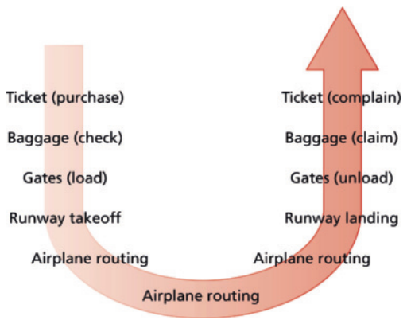

Hình 1.22 Thực hiện một chuyến bay: các hành động

Ngay lúc này, chúng ta đã có thể thấy một số điểm tương đồng với mạng máy tính: Bạn được hãng hàng không vận chuyển từ nguồn tới đích; một packet được vận chuyển từ host nguồn tới host đích trong Internet. Nhưng đây chưa hẳn là phép so sánh mà chúng ta tìm kiếm. Chúng ta đang tìm một cấu trúc nào đó trong Hình 1.22. Nhìn vào Hình 1.22, chúng ta để ý rằng có một chức năng bán vé ở mỗi đầu; cũng có một chức năng hành lý cho hành khách already-ticketed (đã có vé), và một chức năng cửa lên máy bay cho hành khách already-ticketed và already-baggage-checked (đã ký gửi hành lý). Với hành khách đã qua cửa lên máy bay (tức là hành khách đã có vé, baggage-checked, và đã qua cửa), có một chức năng cất cánh và hạ cánh, và trong khi bay, có một chức năng airplane-routing (định tuyến máy bay). Điều này gợi ý rằng chúng ta có thể nhìn chức năng trong Hình 1.22 theo chiều ngang, như thể hiện trong Hình 1.23.

Hình 1.23 đã chia chức năng hàng không thành các tầng, cung cấp một khung để chúng ta thảo luận về việc đi lại bằng máy bay. Lưu ý rằng mỗi tầng, kết hợp với các tầng bên dưới nó, hiện thực một chức năng nào đó, một dịch vụ nào đó. Ở tầng bán vé và các tầng dưới, việc chuyển một người theo kiểu airline-counter-to-airline-counter (từ quầy hãng tới quầy hãng) được hoàn thành. Ở tầng hành lý và các tầng dưới, việc chuyển một người cùng hành lý theo kiểu baggage-check-to-baggage-claim (từ ký gửi tới nhận hành lý) được hoàn thành. Lưu ý rằng tầng hành lý chỉ cung cấp dịch vụ này cho người already-ticketed. Ở tầng cửa lên máy bay, việc chuyển một người cùng hành lý theo kiểu departure-gate-to-arrival-gate (từ cửa đi tới cửa đến) được hoàn thành. Ở tầng cất cánh/hạ cánh, việc chuyển người và hành lý theo kiểu runway-to-runway (từ đường băng tới đường băng) được hoàn thành. Mỗi tầng cung cấp dịch vụ của mình bằng cách (1) thực hiện một số hành động nhất định trong tầng đó (ví dụ, ở tầng cửa lên máy bay, đưa người lên và xuống máy bay) và bằng cách (2) dùng các dịch vụ của tầng ngay bên dưới nó (ví dụ, ở tầng cửa lên máy bay, dùng dịch vụ chuyển hành khách runway-to-runway của tầng cất cánh/hạ cánh).

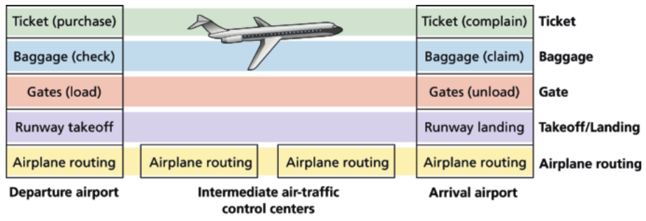

Hình 1.23 Phân tầng theo chiều ngang các chức năng hàng không

Một kiến trúc phân tầng cho phép chúng ta thảo luận một phần well-defined (được định nghĩa rõ), cụ thể của một hệ thống lớn và phức tạp. Bản thân sự đơn giản hóa này có giá trị đáng kể nhờ cung cấp tính module, giúp việc thay đổi cách hiện thực dịch vụ do tầng cung cấp dễ dàng hơn nhiều. Miễn là tầng cung cấp cùng một dịch vụ cho tầng trên nó, và dùng cùng các dịch vụ từ tầng dưới nó, phần còn lại của hệ thống vẫn không thay đổi khi cách hiện thực của một tầng thay đổi. (Lưu ý rằng thay đổi cách hiện thực một dịch vụ rất khác với thay đổi chính dịch vụ đó!) Ví dụ, nếu các chức năng cửa lên máy bay được thay đổi (chẳng hạn, cho người lên và xuống máy bay theo chiều cao), phần còn lại của hệ thống hàng không sẽ không thay đổi vì tầng cửa lên máy bay vẫn cung cấp cùng chức năng (đưa người lên và xuống); nó chỉ hiện thực chức năng đó theo một cách khác sau khi thay đổi. Với các hệ thống lớn và phức tạp liên tục được cập nhật, khả năng thay đổi cách hiện thực một dịch vụ mà không ảnh hưởng đến các thành phần khác của hệ thống là một lợi thế quan trọng khác của việc phân tầng.

#### Phân tầng giao thức (Protocol Layering)

Nhưng nói về hàng không như vậy đủ rồi. Giờ hãy chuyển sự chú ý sang các giao thức mạng. Để tạo cấu trúc cho việc thiết kế giao thức mạng, người thiết kế mạng tổ chức các giao thức—và phần cứng cùng phần mềm mạng hiện thực các giao thức—thành các tầng (layer). Mỗi giao thức thuộc về một trong các tầng, giống như mỗi chức năng trong kiến trúc hàng không ở Hình 1.23 thuộc về một tầng. Một lần nữa chúng ta quan tâm đến các dịch vụ mà một tầng cung cấp cho tầng trên—cái so-called mô hình dịch vụ (service model) của một tầng. Giống như trường hợp ví dụ hàng không, mỗi tầng cung cấp dịch vụ của mình bằng cách (1) thực hiện một số hành động nhất định trong tầng đó và bằng cách (2) dùng các dịch vụ của tầng ngay bên dưới nó. Ví dụ, các dịch vụ do tầng n cung cấp có thể bao gồm việc chuyển giao tin cậy các thông điệp từ một rìa của mạng tới rìa kia. Điều này có thể được hiện thực bằng cách dùng một dịch vụ chuyển giao thông điệp edge-to-edge (rìa tới rìa) không tin cậy của tầng n − 1, và thêm chức năng của tầng n để phát hiện và truyền lại các thông điệp bị mất.

Một tầng giao thức có thể được hiện thực bằng phần mềm, phần cứng, hoặc kết hợp cả hai. Các giao thức application-layer—như HTTP và SMTP—gần như luôn được hiện thực bằng phần mềm trong end system; các giao thức transport-layer cũng vậy. Vì tầng vật lý và tầng liên kết dữ liệu chịu trách nhiệm xử lý giao tiếp trên một liên kết cụ thể, chúng thường được hiện thực trong một card giao tiếp mạng (ví dụ, card giao tiếp Ethernet hoặc WiFi) gắn với một liên kết nhất định. Tầng mạng thường là một sự hiện thực kết hợp phần cứng và phần mềm. Cũng lưu ý rằng giống như các chức năng trong kiến trúc hàng không phân tầng được phân bổ giữa các sân bay và trung tâm điều khiển bay khác nhau tạo nên hệ thống, một giao thức tầng n cũng được phân bổ giữa các end system, packet switch và các thành phần khác tạo nên mạng. Tức là, thường có một phần của giao thức tầng n trong mỗi thành phần mạng này.

Phân tầng giao thức có những lợi thế về khái niệm và cấu trúc [RFC 3439]. Như chúng ta đã thấy, phân tầng cung cấp một cách có cấu trúc để thảo luận các thành phần hệ thống. Tính module giúp việc cập nhật các thành phần hệ thống dễ dàng hơn. Tuy nhiên, chúng tôi đề cập rằng một số nhà nghiên cứu và kỹ sư mạng phản đối kịch liệt việc phân tầng [Wakeman 1992]. Một nhược điểm tiềm tàng của phân tầng là một tầng có thể lặp lại chức năng lower-layer (tầng thấp hơn). Ví dụ, nhiều protocol stack cung cấp khôi phục lỗi trên cả cơ sở per-link (từng liên kết) lẫn cơ sở end-to-end. Một nhược điểm tiềm tàng thứ hai là chức năng ở một tầng có thể cần thông tin (ví dụ, một giá trị timestamp) chỉ có ở một tầng khác; điều này vi phạm mục tiêu tách biệt các tầng.

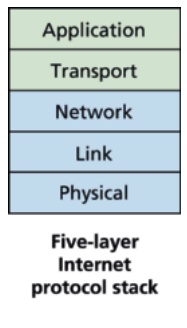

Khi gộp lại với nhau, các giao thức của các tầng khác nhau được gọi là protocol stack (chồng giao thức). Protocol stack Internet gồm năm tầng: tầng vật lý, liên kết, mạng, giao vận và ứng dụng, như thể hiện trong Hình 1.24. Nếu

Hình 1.24 Protocol stack Internet

bạn xem Mục lục, bạn sẽ thấy rằng chúng tôi đã tổ chức cuốn sách này đại thể theo các tầng của protocol stack Internet. Chúng tôi dùng cách tiếp cận top-down, đề cập tầng ứng dụng trước rồi đi dần xuống dưới.

#### Tầng ứng dụng (Application Layer)

Tầng ứng dụng là nơi các ứng dụng mạng và các giao thức application-layer của chúng cư trú. Tầng ứng dụng của Internet bao gồm nhiều giao thức, như giao thức HTTP (cung cấp việc yêu cầu và truyền tài liệu Web) và SMTP (cung cấp việc truyền e-mail). Chúng ta sẽ thấy rằng một số chức năng mạng nhất định, như việc chuyển đổi các tên human-friendly (thân thiện với con người) cho end system Internet như www.ietf.org thành một địa chỉ mạng 32-bit, cũng được thực hiện với sự trợ giúp của một giao thức application-layer cụ thể, cụ thể là hệ thống tên miền (domain name system — DNS). Chúng ta sẽ thấy trong Chương 2 rằng việc tạo và triển khai các giao thức application-layer mới của riêng mình rất dễ dàng.

Một giao thức application-layer được phân bổ trên nhiều end system, với ứng dụng ở một end system dùng giao thức để trao đổi các gói thông tin với ứng dụng ở một end system khác. Chúng ta sẽ gọi gói thông tin này ở tầng ứng dụng là một message (thông điệp).

#### Tầng giao vận (Transport Layer)

Tầng giao vận của Internet vận chuyển các message application-layer giữa các điểm cuối ứng dụng. Trong Internet, có hai giao thức giao vận, TCP và UDP, giao thức nào cũng có thể vận chuyển message application-layer. TCP cung cấp một dịch vụ connection-oriented (hướng kết nối) cho các ứng dụng của nó. Dịch vụ này bao gồm bảo đảm chuyển giao message application-layer tới đích và điều khiển luồng (tức là khớp tốc độ bên gửi/bên nhận). TCP cũng chia các message dài thành các segment ngắn hơn và cung cấp một cơ chế congestion-control, để nguồn giảm tốc độ truyền khi mạng bị tắc nghẽn. Giao thức UDP cung cấp một dịch vụ không kết nối (connectionless) cho các ứng dụng của nó. Đây là một dịch vụ no-frills (tối giản) không cung cấp độ tin cậy, không điều khiển luồng và không điều khiển tắc nghẽn. Trong cuốn sách này, chúng tôi sẽ gọi một packet transport-layer là một segment.

#### Tầng mạng (Network Layer)

Tầng mạng của Internet chịu trách nhiệm di chuyển các packet network-layer gọi là datagram từ host này sang host khác. Giao thức transport-layer của Internet (TCP hoặc UDP) ở host nguồn chuyển một segment transport-layer và một địa chỉ đích xuống tầng mạng, giống như bạn đưa cho dịch vụ bưu điện một lá thư có địa chỉ đích. Tầng mạng sau đó cung cấp dịch vụ chuyển segment tới tầng giao vận ở host đích.

Tầng mạng của Internet bao gồm giao thức IP nổi tiếng, giao thức định nghĩa các trường trong datagram cũng như cách end system và router hành động dựa trên các trường này. Chỉ có một giao thức IP, và mọi thành phần Internet có tầng mạng đều phải chạy giao thức IP. Tầng mạng của Internet cũng chứa các giao thức định tuyến xác định các tuyến mà datagram đi giữa nguồn và đích. Internet có nhiều giao thức định tuyến. Như chúng ta đã thấy trong Mục 1.3, Internet là một mạng của các mạng, và bên trong một mạng, người quản trị mạng có thể chạy bất kỳ giao thức định tuyến nào mong muốn. Dù tầng mạng chứa cả giao thức IP lẫn vô số giao thức định tuyến, nó thường được gọi đơn giản là tầng IP, phản ánh thực tế rằng IP là chất keo gắn kết Internet với nhau.

#### Tầng liên kết (Link Layer)

Tầng mạng của Internet định tuyến một datagram qua một chuỗi router giữa nguồn và đích. Để di chuyển một packet từ một node (host hoặc router) tới node tiếp theo trên tuyến, tầng mạng dựa vào các dịch vụ của tầng liên kết. Cụ thể, tại mỗi node, tầng mạng chuyển datagram xuống tầng liên kết, tầng này chuyển datagram tới node tiếp theo dọc tuyến. Tại node tiếp theo này, tầng liên kết chuyển datagram lên tầng mạng.

Các dịch vụ do tầng liên kết cung cấp phụ thuộc vào giao thức link-layer cụ thể được dùng trên liên kết. Ví dụ, một số giao thức link-layer cung cấp chuyển giao tin cậy, từ node truyền, qua một liên kết, tới node nhận. Lưu ý rằng dịch vụ chuyển giao tin cậy này khác với dịch vụ chuyển giao tin cậy của TCP, vốn cung cấp chuyển giao tin cậy từ một end system tới một end system khác. Các ví dụ về giao thức link-layer bao gồm Ethernet, WiFi, và giao thức DOCSIS của mạng truy cập cáp. Vì datagram thường cần đi qua nhiều liên kết để đi từ nguồn tới đích, một datagram có thể được xử lý bởi các giao thức link-layer khác nhau ở các liên kết khác nhau dọc tuyến. Ví dụ, một datagram có thể được xử lý bởi WiFi trên một liên kết và bởi Ethernet trên liên kết tiếp theo. Tầng mạng sẽ nhận một dịch vụ khác nhau từ mỗi giao thức link-layer khác nhau. Trong cuốn sách này, chúng tôi sẽ gọi các packet link-layer là frame.

#### Tầng vật lý (Physical Layer)

Trong khi nhiệm vụ của tầng liên kết là di chuyển toàn bộ frame từ một phần tử mạng tới một phần tử mạng kề cận, nhiệm vụ của tầng vật lý là di chuyển từng bit riêng lẻ trong frame từ một node tới node tiếp theo. Các giao thức ở tầng này một lần nữa phụ thuộc vào liên kết và còn phụ thuộc vào môi trường truyền thực tế của liên kết (ví dụ, dây đồng twisted-pair, cáp quang single-mode (đơn mode)). Ví dụ, Ethernet có nhiều giao thức physical-layer: một cho dây đồng twisted-pair, một cho cáp đồng trục, một cho cáp quang, v.v. Trong mỗi trường hợp, một bit được di chuyển qua liên kết theo một cách khác nhau.

### 1.5.2 Đóng gói (Encapsulation)

Hình 1.25 thể hiện đường đi vật lý mà dữ liệu đi xuống protocol stack của một end system gửi, lên và xuống protocol stack của một link-layer switch và router trung gian, rồi đi lên protocol stack ở end system nhận. Như chúng ta sẽ thảo luận ở phần sau của cuốn sách, router và link-layer switch đều là packet switch. Tương tự end system, router và link-layer switch tổ chức phần cứng và phần mềm mạng của chúng thành các tầng. Nhưng router và link-layer switch không hiện thực mọi tầng trong protocol stack; chúng thường chỉ hiện thực các tầng dưới cùng. Như thể hiện trong Hình 1.25, link-layer switch hiện thực tầng 1 và 2; router hiện thực tầng 1 đến 3. Điều này có nghĩa là, ví dụ, router Internet có khả năng hiện thực giao thức IP (một giao thức tầng 3), trong khi link-layer switch thì không. Sau này chúng ta sẽ thấy rằng dù link-layer switch không nhận diện địa chỉ IP, chúng có khả năng nhận diện địa chỉ tầng 2, như địa chỉ Ethernet. Lưu ý rằng host hiện thực cả năm tầng; điều này nhất quán với quan điểm rằng kiến trúc Internet đặt phần lớn độ phức tạp của nó ở rìa mạng.

Hình 1.25 cũng minh họa khái niệm quan trọng đóng gói (encapsulation). Tại host gửi, một message application-layer (M trong Hình 1.25) được chuyển xuống tầng giao vận. Trong trường hợp đơn giản nhất, tầng giao vận nhận message và nối thêm thông tin bổ sung (cái so-called thông tin header transport-layer, H<sub>t</sub> trong Hình 1.25) sẽ được tầng giao vận receiver-side (phía nhận) dùng. Message

Host, router và link-layer switch; mỗi loại chứa một tập application-layer và thông tin header transport-layer cùng nhau tạo thành segment transport-layer. Do đó segment transport-layer đóng gói message application-layer. Thông tin được thêm vào có thể bao gồm thông tin cho phép tầng giao vận receiver-side chuyển message lên ứng dụng phù hợp, và các bit error-detection (phát hiện lỗi) cho phép bên nhận xác định liệu các bit trong message có bị thay đổi trên đường đi hay không. Tầng giao vận sau đó chuyển segment xuống tầng mạng, tầng này thêm thông tin header network-layer (H<sub>n</sub> trong Hình 1.25) như địa chỉ end system nguồn và đích, tạo ra một datagram network-layer. Datagram sau đó được chuyển xuống tầng liên kết, tầng này (tất nhiên!) sẽ thêm thông tin header link-layer của riêng nó và tạo ra một frame link-layer. Như vậy, chúng ta thấy rằng ở mỗi tầng, một packet có hai loại trường: các trường header và một trường payload. Payload thường là một packet từ tầng trên.

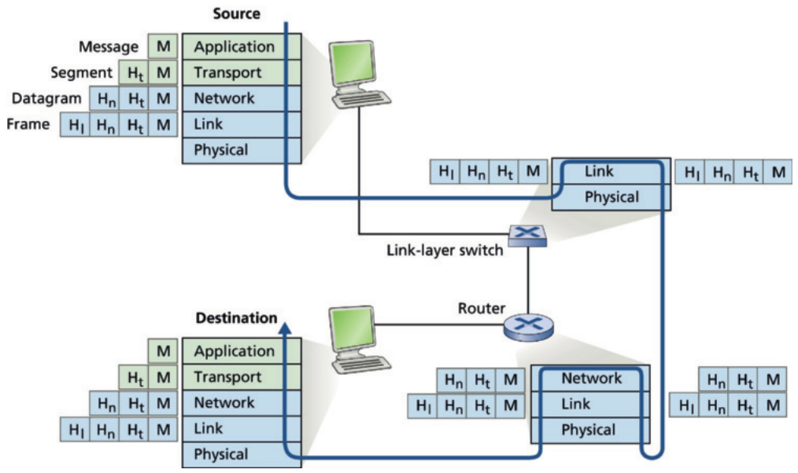

Hình 1.25 tầng khác nhau, phản ánh sự khác biệt về chức năng của chúng

Một phép so sánh hữu ích ở đây là việc gửi một bản ghi nhớ nội bộ từ một văn phòng chi nhánh của công ty tới một chi nhánh khác qua dịch vụ bưu điện công cộng. Giả sử Alice, ở một văn phòng chi nhánh, muốn gửi một bản ghi nhớ cho Bob, ở một văn phòng chi nhánh khác. Bản ghi nhớ tương tự message application-layer. Alice cho bản ghi nhớ vào một phong bì nội bộ với tên và phòng ban của Bob ghi ở mặt trước phong bì. Phong bì nội bộ tương tự một segment transport-layer—nó chứa thông tin header (tên và số phòng ban của Bob) và nó đóng gói message application-layer (bản ghi nhớ). Khi phòng thư của branch-office (văn phòng chi nhánh) gửi nhận phong bì nội bộ, nó cho phong bì nội bộ vào bên trong một phong bì khác nữa, phù hợp để gửi qua dịch vụ bưu điện công cộng. Phòng thư gửi cũng ghi địa chỉ bưu chính của văn phòng chi nhánh gửi và nhận lên phong bì bưu điện. Ở đây, phong bì bưu điện tương tự datagram—nó đóng gói segment transport-layer (phong bì nội bộ), thứ đóng gói message ban đầu (bản ghi nhớ). Dịch vụ bưu điện chuyển phong bì bưu điện tới phòng thư của branch-office nhận. Tại đó, quá trình de-encapsulation (mở gói) bắt đầu. Phòng thư lấy ra bản ghi nhớ nội bộ và chuyển nó tới Bob. Cuối cùng, Bob mở phong bì và lấy bản ghi nhớ ra.

Quá trình đóng gói có thể phức tạp hơn so với mô tả ở trên. Ví dụ, một message lớn có thể được chia thành nhiều segment transport-layer (bản thân mỗi segment có thể được chia thành nhiều datagram network-layer). Ở đầu nhận, một segment như vậy sau đó phải được dựng lại từ các datagram thành phần của nó.

## 1.6 Mạng bị tấn công (Networks Under Attack)

Internet đã trở thành sống còn đối với nhiều tổ chức ngày nay, bao gồm các công ty lớn và nhỏ, trường đại học và cơ quan chính phủ. Nhiều cá nhân cũng dựa vào Internet cho nhiều hoạt động nghề nghiệp, xã hội và cá nhân. Hàng tỉ “thứ,” bao gồm thiết bị đeo và thiết bị gia đình, hiện đang được kết nối Internet. Nhưng đằng sau mọi tiện ích và sự hào hứng này, có một mặt tối, nơi “kẻ xấu” cố gắng tàn phá cuộc sống hằng ngày của chúng ta bằng cách làm hỏng các máy tính Internet-connected của chúng ta, xâm phạm quyền riêng tư của chúng ta, và làm tê liệt các dịch vụ Internet mà chúng ta phụ thuộc vào.

Lĩnh vực bảo mật mạng nói về cách kẻ xấu có thể tấn công mạng máy tính và về cách chúng ta, những soon-to-be (sắp trở thành) chuyên gia mạng máy tính, có thể bảo vệ mạng trước các cuộc tấn công đó, hoặc tốt hơn nữa, thiết kế các kiến trúc mới miễn nhiễm với những cuộc tấn công như vậy ngay từ đầu. Với tần suất và sự đa dạng của các cuộc tấn công hiện có cũng như mối đe dọa của các cuộc tấn công mới và tàn phá hơn trong tương lai, bảo mật mạng đã trở thành một chủ đề trung tâm trong lĩnh vực mạng máy tính. Một trong những đặc điểm của cuốn sách giáo khoa này là nó đưa các vấn đề bảo mật mạng lên hàng đầu.

Vì chúng ta chưa có chuyên môn về mạng máy tính và các giao thức Internet, ở đây chúng ta sẽ bắt đầu bằng cách khảo sát một số vấn đề security-related (liên quan đến bảo mật) phổ biến hơn ngày nay. Điều này sẽ kích thích sự tò mò của chúng ta cho các thảo luận sâu hơn trong các chương sắp tới. Vì vậy ở đây chúng ta bắt đầu bằng cách đơn giản hỏi, điều gì có thể sai? Mạng máy tính dễ bị tổn thương ra sao? Một số loại tấn công phổ biến hơn ngày nay là gì?

### Kẻ xấu có thể đưa malware vào host của bạn qua Internet (The Bad Guys Can Put Malware into Your Host Via the Internet)

Chúng ta gắn thiết bị vào Internet vì muốn nhận/gửi dữ liệu từ/tới Internet. Điều này bao gồm đủ loại thứ tốt, bao gồm bài đăng Instagram, kết quả tìm kiếm Internet, streaming nhạc, cuộc gọi hội nghị video, streaming phim, v.v. Nhưng, đáng tiếc, đi kèm với mọi thứ tốt đó là những thứ độc hại—gọi chung là malware (phần mềm độc hại)—cũng có thể xâm nhập và lây nhiễm thiết bị của chúng ta. Một khi malware lây nhiễm thiết bị, nó có thể làm đủ trò xảo quyệt, bao gồm xóa file và cài spyware thu thập thông tin cá nhân của chúng ta, như số an sinh xã hội, mật khẩu và thao tác gõ phím, rồi gửi chúng (qua Internet, tất nhiên!) về cho kẻ xấu. Host bị xâm nhập của chúng ta cũng có thể bị đưa vào một mạng gồm hàng nghìn thiết bị bị xâm nhập tương tự, gọi chung là botnet, mà kẻ xấu điều khiển và tận dụng để phát tán e-mail spam hoặc tấn công distributed denial-of-service (từ chối dịch vụ phân tán — sẽ được thảo luận ngay sau đây) nhắm vào các host mục tiêu.

Phần lớn malware hiện nay là self-replicating (tự nhân bản): một khi nó lây nhiễm một host, từ host đó nó tìm cách xâm nhập các host khác qua Internet, và từ các host mới bị lây nhiễm, nó tìm cách xâm nhập thêm nhiều host nữa. Bằng cách này, malware self-replicating có thể lây lan với tốc độ hàm mũ.

### Kẻ xấu có thể tấn công server và hạ tầng mạng (The Bad Guys Can Attack Servers and Network Infrastructure)

Một lớp mối đe dọa bảo mật rộng khác được gọi là tấn công denial-of-service (DoS — từ chối dịch vụ). Như tên gọi gợi ý, một cuộc tấn công DoS làm cho một mạng, host, hoặc một phần hạ tầng khác không thể sử dụng được đối với người dùng hợp lệ. Web server, e-mail server, DNS server (được thảo luận trong Chương 2), và mạng của các tổ chức đều có thể là mục tiêu của tấn công DoS. Hầu hết các cuộc tấn công DoS trên Internet rơi vào một trong ba loại:

• Tấn công lỗ hổng (vulnerability attack). Loại này liên quan đến việc gửi một vài thông điệp well-crafted (được tạo khéo léo) tới một ứng dụng hoặc hệ điều hành có lỗ hổng chạy trên host mục tiêu. Nếu đúng chuỗi packet được gửi tới một ứng dụng hoặc hệ điều hành có lỗ hổng, dịch vụ có thể ngừng hoặc, tệ hơn, host có thể bị crash.

• Làm ngập băng thông (bandwidth flooding). Kẻ tấn công gửi một trận lũ packet tới host mục tiêu—nhiều packet đến mức liên kết truy cập của mục tiêu bị nghẽn, ngăn các packet hợp lệ tới được server.

• Làm ngập kết nối (connection flooding). Kẻ tấn công thiết lập một số lượng lớn kết nối TCP half-open (mở một nửa) hoặc mở hoàn toàn (kết nối TCP được thảo luận trong Chương 3) tại host mục tiêu. Host có thể bị sa lầy với các kết nối giả mạo này đến mức ngừng chấp nhận các kết nối hợp lệ.

Giờ hãy tìm hiểu chi tiết hơn về tấn công bandwidth-flooding. Nhớ lại phần thảo luận phân tích độ trễ và mất gói trong Mục 1.4.2, rõ ràng nếu server có tốc độ truy cập R bps, thì kẻ tấn công sẽ cần gửi traffic với tốc độ xấp xỉ R bps để gây thiệt hại. Nếu R rất lớn, một nguồn tấn công duy nhất có thể không tạo đủ traffic để gây hại cho server. Hơn nữa, nếu mọi traffic phát ra từ một nguồn duy nhất, một router upstream có thể phát hiện cuộc tấn công và chặn mọi traffic từ nguồn đó trước khi traffic tới gần server. Trong một cuộc tấn công DoS phân tán (DDoS), minh họa trong Hình 1.26, kẻ tấn công điều khiển nhiều nguồn và để mỗi nguồn dồn traffic vào mục tiêu. Với cách tiếp cận này, tốc độ traffic tổng hợp từ mọi nguồn bị điều khiển cần xấp xỉ R để làm tê liệt dịch vụ. Tấn công DDoS tận dụng botnet với hàng nghìn host bị xâm nhập là chuyện thường gặp ngày nay. Tấn công DDos khó phát hiện và phòng chống hơn nhiều so với một cuộc tấn công DoS từ một host duy nhất. Có khoảng 100 cuộc tấn công DDoS lớn vào hạ tầng Internet mỗi năm [Sitaraman 2022]. Chúng tôi khuyến khích bạn cân nhắc câu hỏi sau khi đọc cuốn sách này: Người thiết kế mạng máy tính có thể làm gì để phòng chống tấn công DoS? Chúng ta sẽ thấy rằng cần các biện pháp phòng thủ khác nhau cho ba loại tấn công DoS.

### Kẻ xấu có thể nghe lén packet (The Bad Guys Can Sniff Packets)

Nhiều người dùng ngày nay truy cập Internet qua các thiết bị không dây, như laptop WiFi-connected (kết nối WiFi) hoặc thiết bị cầm tay có kết nối Internet di động (được đề cập trong Chương 7). Dù truy cập Internet ở khắp nơi cực kỳ tiện lợi và cho phép những ứng dụng mới tuyệt vời cho người dùng di động, nó cũng tạo ra một lỗ hổng bảo mật lớn—bằng cách đặt một máy thu thụ động gần máy phát không dây, máy thu đó có thể lấy được bản sao của mọi packet được truyền! Những packet này có thể chứa đủ loại thông tin nhạy cảm, bao gồm mật khẩu, số an sinh xã hội, bí mật thương mại và tin nhắn cá nhân riêng tư. Một máy thu thụ động ghi lại bản sao của mọi packet bay qua được gọi là packet sniffer.

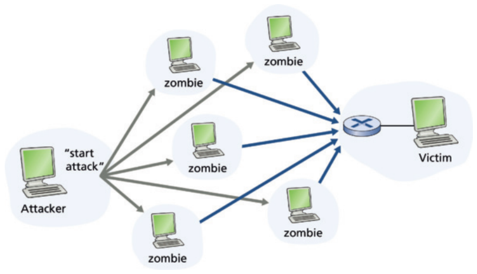

Hình 1.26 Một cuộc tấn công distributed denial-of-service

Sniffer cũng có thể được triển khai trong môi trường có dây. Trong môi trường quảng bá có dây, như trong nhiều Ethernet LAN, một packet sniffer có thể lấy bản sao của các packet quảng bá được gửi qua LAN. Như đã mô tả trong Mục 1.2, các công nghệ truy cập cáp cũng quảng bá packet và do đó dễ bị nghe lén. Hơn nữa, một kẻ xấu có được quyền truy cập vào router truy cập hoặc liên kết truy cập Internet của một tổ chức có thể cài một sniffer tạo bản sao của mọi packet đi tới/từ tổ chức đó. Các packet bị nghe lén sau đó có thể được phân tích offline để tìm thông tin nhạy cảm.

Phần mềm packet-sniffing có sẵn miễn phí tại nhiều Web site và dưới dạng sản phẩm thương mại. Các giảng viên dạy khóa học mạng được biết là thường giao bài thực hành liên quan đến việc viết một chương trình packet-sniffing và dựng lại dữ liệu application-layer. Thực tế, các bài thực hành Wireshark [Wireshark 2025] đi kèm cuốn sách này (xem bài thực hành Wireshark nhập môn ở cuối chương này) dùng chính xác một packet sniffer như vậy!

Vì packet sniffer là thụ động—tức là chúng không chèn packet vào kênh—chúng khó bị phát hiện. Vì vậy, khi gửi packet vào một kênh không dây, chúng ta phải chấp nhận khả năng có kẻ xấu nào đó đang ghi lại bản sao các packet của chúng ta. Như bạn có thể đã đoán, một số biện pháp phòng chống tốt nhất trước việc nghe lén packet liên quan đến mật mã học. Chúng ta sẽ xem xét mật mã học khi áp dụng vào bảo mật mạng trong Chương 8.

### Kẻ xấu có thể giả danh người bạn tin tưởng (The Bad Guys Can Masquerade as Someone You Trust)

Thật dễ dàng đến ngạc nhiên (bạn sẽ có kiến thức để làm điều đó ngay khi tiếp tục đọc cuốn sách này!) để tạo một packet với địa chỉ nguồn, nội dung packet và địa chỉ đích tùy ý rồi truyền packet hand-crafted (tự chế) này vào Internet, nơi sẽ chuyển tiếp packet tới đích một cách tận tụy. Hãy tưởng tượng bên nhận không chút nghi ngờ (chẳng hạn một router Internet) nhận được một packet như vậy, coi địa chỉ nguồn (giả) là thật, rồi thực thi một lệnh nào đó được nhúng trong nội dung packet (chẳng hạn sửa bảng chuyển tiếp của nó). Khả năng chèn packet vào Internet với địa chỉ nguồn giả được gọi là IP spoofing, và chỉ là một trong nhiều cách mà một người dùng có thể giả danh người dùng khác.

Để giải quyết vấn đề này, chúng ta sẽ cần xác thực end-point (điểm cuối), tức là một cơ chế cho phép chúng ta xác định chắc chắn liệu một thông điệp có xuất phát từ nơi chúng ta nghĩ hay không. Một lần nữa, chúng tôi khuyến khích bạn suy nghĩ về cách điều này có thể được thực hiện cho các ứng dụng và giao thức mạng khi bạn đọc qua các chương của cuốn sách này. Chúng ta sẽ khám phá các cơ chế xác thực end-point trong Chương 8.

Để kết thúc mục này, đáng để xem xét vì sao ngay từ đầu Internet lại trở thành một nơi kém an toàn đến vậy. Câu trả lời, về bản chất, là Internet ban đầu được thiết kế như vậy, dựa trên mô hình “một nhóm người dùng tin tưởng lẫn nhau gắn vào một mạng trong suốt” [ Blumenthal 2001]—một mô hình trong đó (theo định nghĩa) không cần bảo mật. Nhiều khía cạnh của kiến trúc Internet ban đầu phản ánh sâu sắc khái niệm tin tưởng lẫn nhau này. Ví dụ, khả năng một người dùng gửi packet tới bất kỳ người dùng nào khác là mặc định chứ không phải một năng lực được yêu cầu/cấp phép, và danh tính người dùng được chấp nhận theo giá trị khai báo, thay vì được xác thực theo mặc định.

Nhưng Internet ngày nay chắc chắn không phải là “những người dùng tin tưởng lẫn nhau.” Dù vậy, người dùng ngày nay vẫn cần giao tiếp khi họ không nhất thiết tin tưởng nhau, có thể muốn giao tiếp ẩn danh, có thể giao tiếp gián tiếp qua bên thứ ba (ví dụ, Web cache, mà chúng ta sẽ nghiên cứu trong Chương 2, hoặc các tác nhân mobility-assisting (hỗ trợ di động), mà chúng ta sẽ nghiên cứu trong Chương 7), và có thể không tin tưởng phần cứng, phần mềm, và thậm chí cả không khí mà họ giao tiếp qua. Giờ chúng ta có nhiều thách thức security-related phía trước khi đọc qua cuốn sách này: Chúng ta nên tìm cách phòng chống nghe lén, giả danh end-point, tấn công man-in-the-middle (kẻ đứng giữa), tấn công DDoS, malware, và nhiều thứ khác. Chúng ta nên nhớ rằng giao tiếp giữa những người dùng tin tưởng lẫn nhau là ngoại lệ chứ không phải quy tắc. Chào mừng đến với thế giới mạng máy tính hiện đại!

## 1.7 Lịch sử mạng máy tính và Internet (History of Computer Networking and the Internet)

Các Mục 1.1 đến 1.6 đã trình bày tổng quan về công nghệ mạng máy tính và Internet. Giờ bạn hẳn đã biết đủ để gây ấn tượng với gia đình và bạn bè! Tuy nhiên, nếu bạn thực sự muốn trở thành tâm điểm ở bữa tiệc cocktail tiếp theo, bạn nên rắc vào câu chuyện của mình vài mẩu thông tin về lịch sử hấp dẫn của Internet [Segaller 1998].

### 1.7.1 Sự phát triển của chuyển mạch gói: 1961–1972 (The Development of Packet Switching)

Lĩnh vực mạng máy tính và Internet ngày nay bắt nguồn từ đầu thập niên 1960s, khi mạng điện thoại là mạng truyền thông thống trị thế giới. Nhớ lại từ Mục 1.3 rằng mạng điện thoại dùng chuyển mạch kênh để truyền thông tin từ bên gửi tới bên nhận—một lựa chọn phù hợp vì giọng nói được truyền với tốc độ không đổi giữa bên gửi và bên nhận. Với tầm quan trọng ngày càng tăng của máy tính vào đầu thập niên 1960s và sự ra đời của máy tính chia sẻ thời gian, có lẽ việc xem xét cách nối các máy tính với nhau để chúng có thể được chia sẻ giữa những người dùng phân tán về địa lý là điều tự nhiên. Traffic do những người dùng như vậy tạo ra nhiều khả năng mang tính bùng phát (bursty)—các khoảng hoạt động, như gửi một lệnh tới một máy tính từ xa, theo sau là các khoảng không hoạt động trong khi chờ trả lời hoặc trong khi suy ngẫm về phản hồi nhận được.

Ba nhóm nghiên cứu trên khắp thế giới, mỗi nhóm không biết về công việc của các nhóm khác [Leiner 1998], bắt đầu phát minh chuyển mạch gói như một lựa chọn thay thế hiệu quả và bền vững cho chuyển mạch kênh. Công trình được công bố đầu tiên về các kỹ thuật packet-switching là của Leonard Kleinrock [Kleinrock 1961; Kleinrock 1964], khi đó là nghiên cứu sinh tại MIT. Dùng lý thuyết hàng đợi, công trình của Kleinrock đã chứng minh một cách thanh lịch hiệu quả của cách tiếp cận packet-switching cho các nguồn traffic bursty. Năm 1964, Paul Baran [Baran 1964] tại Rand Institute đã bắt đầu nghiên cứu việc dùng chuyển mạch gói cho thoại an toàn trên mạng quân sự, và tại National Physical Laboratory ở Anh, Donald Davies và Roger Scantlebury cũng đang phát triển ý tưởng của họ về chuyển mạch gói.

Công trình tại MIT, Rand và NPL đã đặt nền móng cho Internet ngày nay. Nhưng Internet cũng có một lịch sử lâu dài của thái độ let’s-build-it-and-demonstrate-it (cứ xây rồi trình diễn) cũng có từ thập niên 1960s. J. C. R. Licklider [DEC 1990] và Lawrence Roberts, cả hai đều là đồng nghiệp của Kleinrock tại MIT, sau đó lãnh đạo chương trình khoa học máy tính tại Advanced Research Projects Agency (ARPA) ở Hoa Kỳ. Roberts công bố một kế hoạch tổng thể cho ARPAnet [Roberts 1967], mạng máy tính packet-switched đầu tiên và là tổ tiên trực tiếp của Internet công cộng ngày nay. Vào Ngày Lao động năm 1969, packet switch đầu tiên được lắp đặt tại UCLA dưới sự giám sát của Kleinrock, và ba packet switch bổ sung được lắp đặt ngay sau đó tại Stanford Research Institute (SRI), UC Santa Barbara và University of Utah (Hình 1.27). Tiền thân non trẻ của Internet có bốn node vào cuối năm 1969. Kleinrock nhớ lại lần dùng mạng đầu tiên để thực hiện một lần đăng nhập từ xa từ UCLA tới SRI, đã làm sập hệ thống [Kleinrock 2004].

Đến năm 1972, ARPAnet đã phát triển lên khoảng 15 node và được Robert Kahn trình diễn công khai lần đầu tiên. Giao thức host-to-host (giữa các host) đầu tiên giữa các end system ARPAnet, gọi là network-control protocol (NCP), đã được hoàn thành [RFC 001]. Với một giao thức end-to-end có sẵn, giờ đã có thể viết ứng dụng. Ray Tomlinson đã viết chương trình e-mail đầu tiên vào năm 1972.

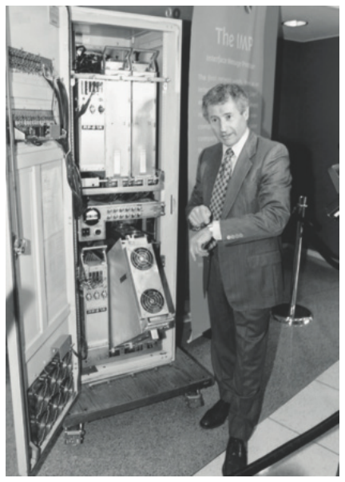

Hình 1.27 Một packet switch thời kỳ đầu Mark J. Terrill/AP Photo

### 1.7.2 Mạng độc quyền và liên mạng: 1972–1980 (Proprietary Networks and Internetworking)

ARPAnet ban đầu là một mạng đơn lẻ, khép kín. Để giao tiếp với một host ARPAnet, người ta phải thực sự được gắn vào một IMP ARPAnet khác. Từ đầu đến mid-1970s (giữa thập niên 1970), các mạng packet-switching stand-alone khác ngoài ARPAnet đã ra đời: ALOHANet, một mạng vi ba kết nối các trường đại học trên quần đảo Hawaii [Abramson 1970], cũng như các mạng packet-satellite (gói vệ tinh) [RFC 829] và packet-radio (gói vô tuyến) [Kahn 1978] của DARPA; Telenet, một mạng packet-switching thương mại của BBN dựa trên công nghệ ARPAnet; Cyclades, một mạng packet-switching của Pháp do Louis Pouzin tiên phong [Think 2012]; các mạng time-sharing (chia sẻ thời gian) như Tymnet và mạng GE Information Services, cùng nhiều mạng khác, vào cuối thập niên 1960s và đầu thập niên 1970s [Schwartz 1977]; SNA của IBM (1969–1974), song song với công việc ARPAnet [Schwartz 1977].

Số lượng mạng đang tăng lên. Nhìn lại với sự sáng suốt hoàn hảo, chúng ta có thể thấy thời điểm đã chín muồi để phát triển một kiến trúc bao trùm cho việc kết nối các mạng với nhau. Công trình tiên phong về kết nối các mạng (dưới sự tài trợ của Defense Advanced Research Projects Agency (DARPA)), về bản chất là tạo ra một mạng của các mạng, đã được thực hiện bởi Vinton Cerf và Robert Kahn [Cerf 1974]; thuật ngữ internetting được đặt ra để mô tả công trình này.

Những nguyên lý kiến trúc này được thể hiện trong TCP. Tuy nhiên, các phiên bản đầu của TCP khá khác với TCP ngày nay. Các phiên bản đầu của TCP kết hợp việc chuyển giao dữ liệu tin cậy in-sequence (theo thứ tự) thông qua truyền lại ở end-system (vẫn là một phần của TCP ngày nay) với các chức năng chuyển tiếp (ngày nay do IP thực hiện). Thử nghiệm ban đầu với TCP, cùng với sự nhận thức về tầm quan trọng của một dịch vụ giao vận end-to-end không tin cậy, non-flow-controlled (không điều khiển luồng) cho các ứng dụng như thoại đóng gói, đã dẫn đến việc tách IP ra khỏi TCP và phát triển giao thức UDP. Ba giao thức Internet then chốt mà chúng ta thấy ngày nay—TCP, UDP và IP—đã có mặt về mặt khái niệm vào cuối thập niên 1970s.

Ngoài nghiên cứu Internet-related của DARPA, nhiều hoạt động mạng quan trọng khác cũng đang diễn ra. Ở Hawaii, Norman Abramson đang phát triển ALOHAnet, một mạng vô tuyến packet-based (dựa trên gói) cho phép nhiều địa điểm ở xa trên quần đảo Hawaii giao tiếp với nhau. Giao thức ALOHA [Abramson 1970] là giao thức multiple-access (đa truy cập) đầu tiên, cho phép người dùng phân tán về địa lý chia sẻ một môi trường truyền thông quảng bá duy nhất (một tần số vô tuyến). Metcalfe và Boggs đã xây dựng dựa trên công trình giao thức multiple-access của Abramson khi họ phát triển giao thức Ethernet [Metcalfe 1976] cho các mạng quảng bá dùng chung wire-based (có dây). Điều thú vị là giao thức Ethernet của Metcalfe và Boggs được thúc đẩy bởi nhu cầu kết nối nhiều PC, máy in và đĩa dùng chung [Perkins 1994]. Twenty-five (hai mươi lăm) năm trước, rất lâu trước cuộc cách mạng PC và sự bùng nổ mạng, Metcalfe và Boggs đã đặt nền móng cho các PC LAN ngày nay.

### 1.7.3 Sự bùng nổ các mạng: 1980–1990 (A Proliferation of Networks)

Đến cuối thập niên 1970s, khoảng hai trăm host được kết nối với ARPAnet. Đến cuối thập niên 1980s, số host kết nối với Internet công cộng, một liên minh các mạng trông khá giống Internet ngày nay, đã đạt tới một trăm nghìn. Thập niên 1980s là thời kỳ tăng trưởng mạnh mẽ.

Phần lớn sự tăng trưởng đó đến từ nhiều nỗ lực riêng biệt nhằm tạo ra các mạng máy tính kết nối các trường đại học với nhau. BITNET cung cấp e-mail và truyền file giữa một số trường đại học ở vùng Đông Bắc. CSNET (computer science network) được thành lập để kết nối các nhà nghiên cứu đại học không có quyền truy cập ARPAnet. Năm 1986, NSFNET được tạo ra để cung cấp truy cập tới các trung tâm siêu máy tính NSF-sponsored (do NSF tài trợ). Bắt đầu với tốc độ backbone ban đầu 56 kbps, backbone của NSFNET đã chạy ở 1.5 Mbps vào cuối thập kỷ và đóng vai trò backbone chính kết nối các mạng khu vực.

Trong cộng đồng ARPAnet, nhiều mảnh cuối cùng của kiến trúc Internet ngày nay đang dần vào vị trí. Ngày 1 tháng Một năm 1983 chứng kiến việc triển khai chính thức TCP/IP làm giao thức host chuẩn mới cho ARPAnet (thay thế giao thức NCP). Quá trình chuyển đổi [RFC 801] từ NCP sang TCP/IP là một sự kiện “flag day”—mọi host đều phải chuyển sang TCP/IP kể từ ngày đó. Vào cuối thập niên 1980s, các mở rộng quan trọng đã được thực hiện cho TCP để hiện thực điều khiển tắc nghẽn host-based (dựa trên host) [Jacobson 1988]. DNS, được dùng để ánh xạ giữa một tên Internet human-readable (con người đọc được) (ví dụ, gaia.cs.umass.edu) và địa chỉ IP 32-bit của nó, cũng đã được phát triển [RFC 1034].

Song song với sự phát triển của ARPAnet (phần lớn là nỗ lực của Mỹ), vào đầu thập niên 1980s người Pháp khởi động dự án Minitel, một kế hoạch đầy tham vọng nhằm đưa mạng dữ liệu vào mọi gia đình. Được chính phủ Pháp tài trợ, hệ thống Minitel gồm một mạng packet-switched công cộng (dựa trên bộ giao thức X. 25), các server Minitel, và các terminal rẻ tiền với modem low-speed built-in (tích hợp sẵn). Minitel trở thành một thành công lớn vào năm 1984 khi chính phủ Pháp tặng miễn phí một terminal Minitel cho mỗi hộ gia đình Pháp muốn có. Các site Minitel bao gồm các site miễn phí—như site danh bạ điện thoại—cũng như các site tư nhân, thu phí usage-based (theo mức sử dụng) từ mỗi người dùng. Ở thời đỉnh cao vào giữa thập niên 1990s, nó cung cấp hơn 20,000 dịch vụ, từ ngân hàng tại nhà đến các cơ sở dữ liệu nghiên cứu chuyên ngành. Minitel đã có mặt trong một tỉ lệ lớn các gia đình Pháp 10 năm trước khi hầu hết người Mỹ từng nghe nói về Internet.

### 1.7.4 Sự bùng nổ Internet: thập niên 1990s (The Internet Explosion)

Thập niên 1990s mở đầu với một số sự kiện tượng trưng cho sự tiến hóa liên tục và việc thương mại hóa soon-to-arrive (sắp đến) của Internet. ARPAnet, tổ tiên của Internet, ngừng tồn tại. Năm 1991, NSFNET dỡ bỏ các hạn chế về việc dùng NSFNET cho mục đích thương mại. Bản thân NSFNET sẽ ngừng hoạt động vào năm 1995, với traffic backbone Internet được các Internet Service Provider thương mại mang.

Sự kiện chính của thập niên 1990s là sự xuất hiện của ứng dụng World Wide Web, đưa Internet vào nhà và doanh nghiệp của hàng triệu người trên toàn thế giới. Web đóng vai trò một nền tảng cho phép và triển khai hàng trăm ứng dụng mới mà ngày nay chúng ta coi là hiển nhiên, bao gồm tìm kiếm (ví dụ, Google và Bing) thương mại Internet (ví dụ, Amazon và eBay) và mạng xã hội (ví dụ, Facebook).

Web được Tim Berners-Lee phát minh tại CERN từ 1989 đến 1991 [Berners-Lee 1989], dựa trên các ý tưởng bắt nguồn từ công trình trước đó về siêu văn bản từ thập niên 1940s của Vannevar Bush [Bush 1945] và từ thập niên 1960s của Ted Nelson [Xanadu 2012]. Berners-Lee và các cộng sự đã phát triển các phiên bản ban đầu của HTML, HTTP, một Web server, và một trình duyệt—bốn thành phần then chốt của Web. Vào khoảng cuối năm 1993 có khoảng hai trăm Web server đang hoạt động, tập hợp server này chỉ là điềm báo trước cho những gì sắp đến. Vào khoảng thời gian này, một số nhà nghiên cứu đang phát triển trình duyệt Web có giao diện GUI, bao gồm Marc Andreessen, người cùng với Jim Clark thành lập Mosaic Communications, sau này trở thành Netscape Communications Corporation [Cusumano 1998; Quittner 1998]. Đến năm 1995, sinh viên đại học đã dùng trình duyệt Netscape để lướt Web hằng ngày. Vào khoảng thời gian này, các công ty—lớn và nhỏ—bắt đầu vận hành Web server và giao dịch thương mại qua Web. Năm 1996, Microsoft bắt đầu làm trình duyệt, khởi đầu cuộc chiến trình duyệt giữa Netscape và Microsoft, mà Microsoft đã thắng vài năm sau đó [Cusumano 1998].

Nửa sau thập niên 1990s là thời kỳ tăng trưởng và đổi mới mạnh mẽ của Internet, với các tập đoàn lớn và hàng nghìn startup tạo ra các sản phẩm và dịch vụ Internet. Đến cuối thiên niên kỷ, Internet đã hỗ trợ hàng trăm ứng dụng phổ biến, bao gồm bốn ứng dụng sát thủ (killer application):

• E-mail, bao gồm file đính kèm và e-mail Web-accessible (truy cập qua Web)

• Web, bao gồm duyệt Web và thương mại Internet

• Nhắn tin tức thời, với danh bạ liên lạc

• Chia sẻ file MP3 peer-to-peer (ngang hàng), do Napster tiên phong

Điều thú vị là hai ứng dụng sát thủ đầu tiên đến từ cộng đồng nghiên cứu, trong khi hai ứng dụng cuối được tạo ra bởi vài doanh nhân trẻ.

Giai đoạn từ 1995 đến 2001 là một chuyến tàu roller-coaster (lượn siêu tốc) cho Internet trên thị trường tài chính. Trước cả khi có lãi, hàng trăm startup Internet đã phát hành cổ phiếu lần đầu ra công chúng và bắt đầu được giao dịch trên thị trường chứng khoán. Nhiều công ty được định giá hàng tỉ đô la mà không có nguồn doanh thu đáng kể nào. Cổ phiếu Internet sụp đổ vào 2000–2001, và nhiều startup đóng cửa. Tuy nhiên, một số công ty đã nổi lên như những người chiến thắng lớn trong lĩnh vực Internet, bao gồm Microsoft, Cisco, Yahoo, eBay, Google và Amazon.

### 1.7.5 Thiên niên kỷ mới (The New Millennium)

Trong ba thập kỷ đầu của thế kỷ 21, có lẽ không công nghệ nào khác thay đổi xã hội nhiều hơn Internet cùng với smartphone Internet-connected. Và sự đổi mới trong mạng máy tính vẫn tiếp tục. Những tiến bộ đang diễn ra trên mọi mặt trận, bao gồm việc triển khai router nhanh hơn và tốc độ truyền cao hơn ở cả mạng truy cập lẫn backbone mạng. Nhưng các phát triển sau đây đáng được chú ý đặc biệt:

• Từ đầu thiên niên kỷ, chúng ta đã chứng kiến việc triển khai mạnh mẽ truy cập Internet băng rộng tới các hộ gia đình—không chỉ cable modem và DSL mà còn cả cáp quang tới tận nhà, 5G fixed wireless, và vệ tinh LEO như đã thảo luận trong Mục 1.2. Truy cập Internet high-speed này đã mở đường cho vô số ứng dụng video, bao gồm phân phối video user-generated (do người dùng tạo) (ví dụ, YouTube và TikTok), streaming on-demand (theo yêu cầu) phim và chương trình truyền hình high-definition (độ phân giải cao) (ví dụ, Netflix), và hội nghị video multi-person (ví dụ, Zoom, Facetime và Google Hangouts).

• Sự phổ biến ngày càng tăng của truy cập Internet không dây high-speed không chỉ giúp luôn kết nối khi đang di chuyển, mà còn cho phép các ứng dụng location-specific (theo vị trí) mới bao gồm dẫn đường và bản đồ (ví dụ, Google Maps và Waze), dịch vụ ride-sharing (đi chung xe) (ví dụ, Uber và Didi), dịch vụ giao đồ ăn, tìm kiếm doanh nghiệp địa phương, và dịch vụ hẹn hò (ví dụ, Tinder). Số thiết bị không dây kết nối Internet đã vượt số thiết bị có dây vào năm 2011. Truy cập không dây high-speed này đã tạo tiền đề cho sự xuất hiện nhanh chóng của máy tính hand-held (cầm tay) (iPhone, Android, iPad, v.v.), vốn có truy cập Internet liên tục và không dây.

• Các mạng xã hội trực tuyến—như Facebook, Instagram, Twitter, TikTok và WeChat (cực kỳ phổ biến ở Trung Quốc)—đã tạo ra những mạng lưới con người khổng lồ trên nền Internet. Nhiều mạng xã hội trong số này được dùng rộng rãi để nhắn tin cũng như chia sẻ ảnh và video. Nhiều người dùng Internet ngày nay “sống” chủ yếu trong một hoặc nhiều mạng xã hội. Thông qua API của mình, các mạng xã hội trực tuyến tạo ra các nền tảng cho những ứng dụng mạng mới, bao gồm thanh toán di động và game phân tán.

• Như đã thảo luận trong Mục 1.3.3, các nhà cung cấp dịch vụ trực tuyến, như Google và Microsoft, đã triển khai các mạng riêng rộng lớn của họ, không chỉ kết nối các data center phân tán toàn cầu của họ với nhau, mà còn được dùng để đi vòng qua Internet nhiều nhất có thể bằng cách peering trực tiếp với các ISP lower-tier. Kết quả là, Google cung cấp kết quả tìm kiếm và truy cập e-mail gần như tức thì, như thể data center của họ đang chạy bên trong chính máy tính của bạn.

• Nhiều công ty thương mại Internet giờ đang chạy ứng dụng của họ trên “cloud”—như trên EC2 của Amazon, Azure của Microsoft, hoặc Alibaba Cloud. Nhiều công ty và trường đại học cũng đã chuyển các ứng dụng Internet của họ (ví dụ, e-mail và Web hosting) lên cloud. Các công ty cloud không chỉ cung cấp cho ứng dụng môi trường tính toán và lưu trữ có khả năng mở rộng, mà còn cung cấp cho ứng dụng quyền truy cập ngầm vào các mạng riêng high-performance (hiệu năng cao) của họ.

## 1.8 Tóm tắt (Summary)

Trong chương này, chúng ta đã đề cập một lượng nội dung khổng lồ! Chúng ta đã xem xét các thành phần phần cứng và phần mềm khác nhau tạo nên Internet nói riêng và mạng máy tính nói chung. Chúng ta bắt đầu ở rìa mạng, xem xét các end system và ứng dụng, và dịch vụ giao vận được cung cấp cho các ứng dụng chạy trên end system. Chúng ta cũng xem xét các công nghệ link-layer và môi trường truyền vật lý thường thấy trong mạng truy cập. Sau đó chúng ta đi sâu hơn vào bên trong mạng, vào lõi mạng, xác định chuyển mạch gói và chuyển mạch kênh là hai cách tiếp cận cơ bản để vận chuyển dữ liệu qua một mạng viễn thông, và xem xét điểm mạnh và điểm yếu của mỗi cách tiếp cận. Chúng ta cũng xem xét cấu trúc của Internet toàn cầu, học được rằng Internet là một mạng của các mạng. Chúng ta đã thấy rằng cấu trúc phân cấp của Internet, gồm các ISP higher- và lower-tier, đã cho phép nó mở rộng quy mô để bao gồm hàng nghìn mạng.

Trong phần thứ hai của chương nhập môn này, chúng ta đã xem xét một số chủ đề trung tâm của lĩnh vực mạng máy tính. Trước hết chúng ta xem xét các nguyên nhân gây độ trễ, throughput và mất gói trong một mạng packet-switched. Chúng ta đã phát triển các mô hình định lượng đơn giản cho độ trễ truyền, lan truyền và hàng đợi cũng như cho throughput; chúng ta sẽ dùng rộng rãi các mô hình độ trễ này trong các bài tập về nhà xuyên suốt cuốn sách. Tiếp theo chúng ta xem xét phân tầng giao thức và mô hình dịch vụ, những nguyên lý kiến trúc then chốt trong mạng mà chúng ta cũng sẽ nhắc lại xuyên suốt cuốn sách. Chúng ta cũng đã khảo sát một số cuộc tấn công bảo mật phổ biến hơn trên Internet ngày nay. Chúng ta kết thúc phần nhập môn về mạng bằng một lược sử ngắn về mạng máy tính. Bản thân chương đầu tiên đã tạo thành một mini-course (khóa học thu nhỏ) về mạng máy tính.

Vậy là chúng ta thực sự đã đi qua một lượng nội dung khổng lồ trong chương đầu tiên này! Nếu bạn hơi choáng ngợp, đừng lo. Trong các chương tiếp theo, chúng ta sẽ quay lại tất cả các ý tưởng này, đề cập chúng chi tiết hơn nhiều (đó là một lời hứa, không phải lời đe dọa!). Ở thời điểm này, chúng tôi hy vọng bạn rời chương này với một trực giác still-developing (vẫn đang phát triển) về các thành phần tạo nên một mạng, một vốn từ vựng mạng still-developing (đừng ngại tham khảo lại chương này), và một mong muốn ever-growing (ngày càng lớn) được học thêm về mạng. Đó là nhiệm vụ phía trước của chúng ta trong phần còn lại của cuốn sách.

### Lộ trình của cuốn sách (Road-Mapping This Book)

Trước khi bắt đầu bất kỳ chuyến đi nào, bạn luôn nên liếc qua bản đồ đường để làm quen với các con đường chính và các ngã rẽ phía trước. Với chuyến đi chúng ta sắp bắt đầu, đích đến cuối cùng là một hiểu biết sâu sắc về cách thức, cái gì và tại sao của mạng máy tính. Bản đồ đường của chúng ta là trình tự các chương của cuốn sách này:

1. Mạng máy tính và Internet (Computer Networks and the Internet)

2. Tầng ứng dụng (Application Layer)

3. Tầng giao vận (Transport Layer)

4. Tầng mạng: Data Plane (Network Layer: Data Plane)

5. Tầng mạng: Control Plane (Network Layer: Control Plane)

6. Tầng liên kết và LAN (The Link Layer and LANs)

7. Mạng không dây và di động (Wireless and Mobile Networks)

8. Bảo mật trong mạng máy tính (Security in Computer Networks)

Chương 2 đến 6 là năm chương cốt lõi của cuốn sách này. Bạn sẽ để ý rằng các chương này được tổ chức xoay quanh bốn tầng trên cùng của giao thức Internet five-layer. Cũng lưu ý thêm rằng hành trình của chúng ta sẽ bắt đầu ở đỉnh của protocol stack Internet, cụ thể là tầng ứng dụng, và sẽ đi dần xuống dưới. Lý do đằng sau hành trình top-down này là một khi hiểu các ứng dụng, chúng ta có thể hiểu các dịch vụ mạng cần thiết để hỗ trợ những ứng dụng này. Đến lượt mình, chúng ta có thể xem xét các cách khác nhau mà những dịch vụ đó có thể được hiện thực bởi một kiến trúc mạng. Do đó, đề cập ứng dụng sớm tạo động lực cho phần còn lại của cuốn sách.

Nửa sau của cuốn sách—Chương 7 và 8—tập trung vào hai chủ đề cực kỳ quan trọng (và phần nào độc lập) trong mạng máy tính hiện đại. Trong Chương 7, chúng ta xem xét mạng không dây và di động, bao gồm LAN không dây (bao gồm WiFi và Bluetooth), mạng di động (cellular, bao gồm 4G và 5G), và tính di động. Chương 8, đề cập bảo mật trong mạng máy tính, trước hết xem xét nền tảng của mã hóa và bảo mật mạng, rồi chúng ta xem xét cách lý thuyết cơ bản được áp dụng trong nhiều bối cảnh Internet khác nhau.

### Bài tập về nhà và câu hỏi (Homework Problems and Questions)

#### Câu hỏi ôn tập Chương 1 (Chapter 1 Review Questions)

##### Mục 1.1

R1. Sự khác biệt giữa host và end system là gì? Liệt kê một số loại end system khác nhau. Web server có phải là một end system không?

R2. Từ protocol thường được dùng để mô tả quan hệ ngoại giao. ChatGPT mô tả giao thức ngoại giao (diplomatic protocol) như thế nào?

R3. Vì sao chuẩn lại quan trọng đối với giao thức?

##### Mục 1.2

R4. Liệt kê bốn công nghệ truy cập. Phân loại mỗi công nghệ là truy cập tại nhà, truy cập doanh nghiệp, hay truy cập không dây wide-area.

R5. Tốc độ truyền HFC là dành riêng hay dùng chung giữa các người dùng? Có thể xảy ra xung đột trong kênh HFC chiều xuống không? Tại sao có hoặc không?

R6. Liệt kê các công nghệ truy cập dân dụng có sẵn ở thành phố của bạn. Với mỗi loại truy cập, cho biết tốc độ chiều xuống, tốc độ chiều lên được quảng cáo và giá hằng tháng.

R7. Tốc độ truyền của Ethernet LAN là bao nhiêu?

R8. Ethernet có thể chạy trên những môi trường truyền vật lý nào?

R9. HFC, DSL, FTTH, FWI và vệ tinh LEO đều được dùng cho truy cập dân dụng. Với mỗi công nghệ truy cập này, cho biết khoảng tốc độ truyền và nhận xét tốc độ truyền là dùng chung hay dành riêng.

R10. Mô tả các công nghệ truy cập Internet không dây phổ biến nhất ngày nay. So sánh và đối chiếu chúng.

##### Mục 1.3

R11. Giả sử có đúng một packet switch giữa host gửi và host nhận. Tốc độ truyền giữa host gửi và switch và giữa switch và host nhận lần lượt là R<sub>1</sub> và R<sub>2</sub>. Giả sử switch dùng chuyển mạch gói store-and-forward, tổng độ trễ end-to-end để gửi một packet có độ dài L là bao nhiêu? (Bỏ qua độ trễ hàng đợi, độ trễ lan truyền và độ trễ xử lý.)

R12. Mạng circuit-switched có lợi thế gì so với mạng packet-switched? TDM có những lợi thế gì so với FDM trong một mạng circuit-switched?

R13. Giả sử các người dùng dùng chung một liên kết 2 Mbps. Cũng giả sử mỗi người dùng truyền liên tục ở 1 Mbps khi truyền, nhưng mỗi người dùng chỉ truyền 20 phần trăm thời gian. (Xem phần thảo luận về ghép kênh thống kê trong Mục 1.3.)

a. Khi dùng chuyển mạch kênh, có thể hỗ trợ bao nhiêu người dùng?

b. Trong phần còn lại của bài này, giả sử dùng chuyển mạch gói. Vì sao về cơ bản sẽ không có độ trễ hàng đợi trước liên kết nếu có hai người dùng trở xuống truyền cùng lúc? Vì sao sẽ có độ trễ hàng đợi nếu ba người dùng truyền cùng lúc?

c. Tìm xác suất một người dùng nhất định đang truyền.

d. Giờ giả sử có ba người dùng. Tìm xác suất tại một thời điểm bất kỳ, cả ba người dùng đều đang truyền đồng thời. Tìm tỉ lệ thời gian mà hàng đợi tăng lên.

R14. Vì sao hai ISP ở cùng một cấp của phân cấp thường peer với nhau? IXP kiếm tiền bằng cách nào?

R15. Một số nhà cung cấp nội dung đã tạo ra mạng riêng của họ. Mô tả mạng của Google. Điều gì thúc đẩy các nhà cung cấp nội dung tạo ra những mạng này?

##### Mục 1.4

R16. Hãy xét việc gửi một packet từ host nguồn tới host đích qua một tuyến cố định. Liệt kê các thành phần độ trễ trong độ trễ end-to-end. Độ trễ nào trong số này là hằng số và độ trễ nào biến thiên?

R17. Hãy ghé xem hoạt hình tương tác Transmission Versus Propagation Delay trên Web site đi kèm. Trong các tốc độ, độ trễ lan truyền và kích thước packet có sẵn, tìm một tổ hợp mà bên gửi truyền xong trước khi bit đầu tiên của packet tới bên nhận. Tìm một tổ hợp khác mà bit đầu tiên của packet tới bên nhận trước khi bên gửi truyền xong.

R18. Mất bao lâu để một packet dài 1,000 byte lan truyền qua một liên kết có khoảng cách 2,500 km, tốc độ lan truyền 2.5 • 10<sup>8</sup> m/s, và tốc độ truyền 2 Mbps? Tổng quát hơn, mất bao lâu để một packet dài L lan truyền qua một liên kết có khoảng cách d, tốc độ lan truyền s, và tốc độ truyền R bps? Độ trễ này có phụ thuộc vào độ dài packet không? Độ trễ này có phụ thuộc vào tốc độ truyền không?

R19. Giả sử Host A muốn gửi một file lớn tới Host B. Đường đi từ Host A tới Host B có ba liên kết, với tốc độ R<sub>1</sub> = 500 kbps, R<sub>2</sub> = 2 Mbps, vàR<sub>3</sub> = 1 Mbps.

a. Giả sử không có traffic nào khác trong mạng, throughput cho việc truyền file là bao nhiêu?

b. Giả sử file có kích thước 4 triệu byte. Chia kích thước file cho throughput, ước chừng mất bao lâu để truyền file tới Host B?

c. Lặp lại (a) và (b), nhưng giờ với R<sub>2</sub> giảm xuống 100 kbps.

R20. Giả sử end system A muốn gửi một file lớn tới end system B. Ở mức rất cao, hãy mô tả cách end system A tạo packet từ file. Khi một trong các packet này đến một router, router dùng thông tin gì trong packet để xác định liên kết mà packet được chuyển tiếp lên? Vì sao chuyển mạch gói trong Internet tương tự việc lái xe từ thành phố này sang thành phố khác và hỏi đường dọc đường?

R21. Hãy ghé xem hoạt hình tương tác Queuing and Loss trên Web site đi kèm. Tốc độ phát tối đa và tốc độ truyền tối thiểu là bao nhiêu? Với các tốc độ đó, cường độ traffic là bao nhiêu? Chạy hoạt hình tương tác với các tốc độ này và xác định mất bao lâu để xảy ra mất gói. Sau đó lặp lại thí nghiệm lần thứ hai và xác định lại mất bao lâu để xảy ra mất gói. Các giá trị có khác nhau không? Tại sao có hoặc không?

##### Mục 1.5

R22. Liệt kê năm nhiệm vụ mà một tầng có thể thực hiện. Có thể nào một (hoặc nhiều) nhiệm vụ trong số này được thực hiện bởi hai (hoặc nhiều) tầng không?

R23. Năm tầng trong protocol stack Internet là gì? Trách nhiệm chính của mỗi tầng này là gì?

R24. Message application-layer là gì? Segment transport-layer? Datagram network-layer? Frame link-layer?

R25. Router xử lý những tầng nào trong protocol stack Internet? Switch link-layer xử lý những tầng nào? Host xử lý những tầng nào?

##### Mục 1.6

R26. Malware self-replicating là gì?

R27. Mô tả cách một botnet có thể được tạo ra và cách nó có thể được dùng cho một cuộc tấn công DDoS.

R28. Giả sử Alice và Bob đang gửi packet cho nhau qua một mạng máy tính. Giả sử

### Bài tập (Problems)

Trudy đặt mình vào trong mạng sao cho cô có thể bắt mọi packet do Alice gửi và gửi bất cứ thứ gì cô muốn tới Bob; cô cũng có thể bắt mọi packet do Bob gửi và gửi bất cứ thứ gì cô muốn tới Alice. Liệt kê một số việc độc hại mà Trudy có thể làm từ vị trí này.

P1. Thiết kế và mô tả một giao thức application-level (mức ứng dụng) được dùng giữa một máy rút tiền tự động và máy tính tập trung của ngân hàng. Giao thức của bạn nên cho phép xác minh thẻ và mật khẩu của người dùng, truy vấn số dư tài khoản (được duy trì tại máy tính tập trung), và thực hiện rút tiền từ tài khoản (tức là tiền được phát cho người dùng). Các thực thể giao thức của bạn nên có khả năng xử lý trường hợp all-too-common (quá thường gặp) khi tài khoản không đủ tiền để rút. Đặc tả giao thức của bạn bằng cách liệt kê các thông điệp được trao đổi và hành động được máy rút tiền tự động hoặc máy tính tập trung của ngân hàng thực hiện khi truyền và nhận thông điệp. Phác thảo hoạt động của giao thức cho trường hợp rút tiền đơn giản không có lỗi, dùng một sơ đồ tương tự sơ đồ trong Hình 1.2. Nêu rõ các giả định mà giao thức của bạn đưa ra về dịch vụ giao vận end-to-end bên dưới.

P2. Phương trình 1.1 đưa ra công thức cho độ trễ end-to-end khi gửi một packet có độ dài L qua N liên kết có tốc độ truyền R. Hãy tổng quát hóa công thức này cho việc gửi P packet như vậy back-to-back qua N liên kết.

P3. Hãy xét một ứng dụng truyền dữ liệu với tốc độ ổn định (ví dụ, bên gửi sinh một đơn vị dữ liệu N-bit mỗi k mili giây, trong đó k nhỏ và cố định). Ngoài ra, khi một ứng dụng như vậy bắt đầu, nó sẽ tiếp tục chạy trong một khoảng thời gian tương đối dài. Trả lời các câu hỏi sau, giải thích ngắn gọn câu trả lời của bạn:

a. Mạng packet-switched hay mạng circuit-switched sẽ phù hợp hơn cho ứng dụng này? Tại sao?

b. Giả sử dùng một mạng packet-switched và traffic duy nhất trong mạng này đến từ các ứng dụng như mô tả ở trên. Hơn nữa, giả sử tổng tốc độ dữ liệu của các ứng dụng nhỏ hơn dung lượng của từng liên kết. Có cần một hình thức điều khiển tắc nghẽn nào không? Tại sao?

P4. Hãy xét mạng circuit-switched trong Hình 1.13. Nhớ rằng có bốn kênh trên mỗi liên kết. Đặt nhãn bốn switch là A, B, C và D, theo chiều kim đồng hồ.

a. Số kết nối đồng thời tối đa có thể đang diễn ra tại một thời điểm bất kỳ trong mạng này là bao nhiêu?

b. Giả sử mọi kết nối đều giữa switch A và C. Số kết nối đồng thời tối đa có thể đang diễn ra là bao nhiêu?

c. Giả sử chúng ta muốn tạo bốn kết nối giữa switch A và C, và bốn kết nối khác giữa switch B và D. Chúng ta có thể định tuyến các cuộc gọi này qua bốn liên kết để đáp ứng cả tám kết nối không?

P5. Xem lại phép so sánh car-caravan (đoàn xe) trong Mục 1.4. Giả sử tốc độ lan truyền là 100 km/giờ.

a. Giả sử đoàn xe đi 175 km, bắt đầu trước một trạm thu phí, đi qua trạm thu phí thứ hai, và kết thúc ngay sau trạm thu phí thứ ba. Độ trễ end-to-end là bao nhiêu?

b. Lặp lại (a), giờ giả sử có tám xe trong đoàn thay vì mười.

P6. Bài tập cơ bản này bắt đầu khám phá độ trễ lan truyền và độ trễ truyền, hai khái niệm trung tâm trong mạng dữ liệu. Hãy xét hai host, A và B, được nối bởi một liên kết duy nhất có tốc độ R bps. Giả sử hai host cách nhau m mét, và giả sử tốc độ lan truyền dọc liên kết là s mét/giây. Host A sẽ gửi một packet có kích thước L bit tới Host B.

a. Biểu diễn độ trễ lan truyền, d<sub>prop</sub>, theo m và s.

b. Xác định thời gian truyền của packet, d<sub>trans</sub>, theo L và R.

c. Bỏ qua độ trễ xử lý và hàng đợi, hãy tìm biểu thức cho độ trễ end-to-end.

d. Giả sử Host A bắt đầu truyền packet tại thời điểm t = 0. Tại thời điểm t = d<sub>trans</sub>, bit cuối cùng của packet ở đâu?

e. Giả sử d<sub>prop</sub> lớn hơn d<sub>trans</sub>. Tại thời điểm t = d<sub>trans</sub>, bit đầu tiên của packet ở đâu?

f. Giả sử d<sub>prop</sub> nhỏ hơn d<sub>trans</sub>. Tại thời điểm t = d<sub>trans</sub>, bit đầu tiên của packet ở đâu?

g. Giả sử s = 2.5 • 10<sup>8</sup>, L = 1500 byte, và R = 10 Mbps. Tìm khoảng cách m sao cho d<sub>prop</sub> bằng d<sub>trans</sub>.

P7. Trong bài này, chúng ta xét việc gửi thoại real-time (thời gian thực) từ Host A tới Host B qua một mạng packet-switched (VoIP). Host A chuyển thoại analog thành một luồng bit số 64 kbps ngay khi đang phát. Sau đó Host A gom các bit thành các packet 56-byte. Có một liên kết giữa Host A và B; tốc độ truyền của nó là 10 Mbps và độ trễ lan truyền là 10 msec. Ngay khi Host A gom xong một packet, nó gửi packet đó tới Host B. Ngay khi Host B nhận được trọn một packet, nó chuyển các bit của packet thành tín hiệu analog. Bao nhiêu thời gian trôi qua từ lúc một bit được tạo ra (từ tín hiệu analog gốc tại Host A) cho tới lúc bit đó được giải mã (như một phần của tín hiệu analog tại Host B)?

P8. Giả sử các người dùng dùng chung một liên kết 10 Mbps. Cũng giả sử mỗi người dùng cần 200 kbps khi truyền, nhưng mỗi người dùng chỉ truyền 10 phần trăm thời gian. (Xem phần thảo luận về chuyển mạch gói so với chuyển mạch kênh trong Mục 1.3.)

a. Khi dùng chuyển mạch kênh, có thể hỗ trợ bao nhiêu người dùng?

b. Trong phần còn lại của bài này, giả sử dùng chuyển mạch gói. Tìm xác suất một người dùng nhất định đang truyền.

c. Giả sử có 120 người dùng. Tìm xác suất tại một thời điểm bất kỳ, có đúng n người dùng đang truyền đồng thời. (Gợi ý: Dùng phân phối nhị thức.)

d. Tìm xác suất có từ 51 người dùng trở lên đang truyền đồng thời.

P9. Hãy xét phần thảo luận trong Mục 1.3 về chuyển mạch gói so với chuyển mạch kênh, trong đó có một ví dụ với liên kết 1 Mbps. Người dùng sinh dữ liệu với tốc độ 100 kbps khi bận, nhưng chỉ bận sinh dữ liệu với xác suất p = được thay bằng một liên kết 1 Gbps. 0.1. Giả sử rằng liên kết 1 Mbps

a. N, số người dùng tối đa có thể được hỗ trợ đồng thời khi dùng chuyển mạch kênh, là bao nhiêu?

b. Giờ hãy xét chuyển mạch gói và một tập M người dùng. Đưa ra công thức (theo p, M, N) cho xác suất có nhiều hơn N người dùng đang gửi dữ liệu.

P10. Hãy xét một packet có độ dài L bắt đầu tại end system A và đi qua ba liên kết tới một end system đích. Ba liên kết này được nối bởi hai packet switch. Gọi d<sub>i</sub>, s<sub>i</sub>, và R<sub>i</sub> lần lượt là độ dài, tốc độ lan truyền và tốc độ truyền của liên kết i, với i = 1, 2, 3. Packet switch làm trễ mỗi packet một khoảng d<sub>proc</sub>. Giả sử không có độ trễ hàng đợi, theo d<sub>i</sub>, s<sub>i</sub>, R<sub>i</sub>, ( i = 1, 2, 3 ), và L, tổng độ trễ end-to-end của packet là bao nhiêu? Giờ giả sử packet có kích thước 1,500 byte, tốc độ lan truyền trên cả ba liên kết là 2.5 • 10<sup>8</sup> m/s, tốc độ truyền của cả ba liên kết là 2.5 Mbps, độ trễ xử lý của packet switch là 3 msec, độ dài liên kết thứ nhất là 5,000 km, độ dài liên kết thứ hai là 4,000 km, và độ dài liên kết cuối là 1,000 km. Với các giá trị này, độ trễ end-to-end là bao nhiêu?

P11. Trong bài trên, giả sử R<sub>1</sub> = R<sub>2</sub> = R<sub>3</sub> = R và d<sub>proc</sub> = 0. Hơn nữa giả sử packet switch không store-and-forward các packet mà truyền ngay mỗi bit nó nhận được trước khi chờ cả packet tới. Độ trễ end-to-end là bao nhiêu?

P12. Một packet switch nhận một packet và xác định liên kết ra mà packet cần được chuyển tiếp lên. Khi packet tới, một packet khác đang truyền được một nửa trên liên kết ra này và bốn packet khác đang chờ được truyền. Các packet được truyền theo thứ tự đến. Giả sử mọi packet đều dài 1,500 byte và tốc độ liên kết là 2.5 Mbps. Độ trễ hàng đợi của packet là bao nhiêu? Tổng quát hơn, độ trễ hàng đợi là bao nhiêu khi mọi packet có độ dài L, tốc độ truyền là R, x bit của packet currently-being-transmitted (đang được truyền) đã được truyền, và n packet đã có sẵn trong hàng đợi?

P13. a. Giả sử N packet đến đồng thời tại một liên kết mà hiện không có packet nào đang được truyền hay xếp hàng. Mỗi packet có độ dài L và liên kết có tốc độ truyền R. Độ trễ hàng đợi trung bình của N packet là bao nhiêu?

b. Giờ giả sử N packet như vậy đến liên kết mỗi LN/R giây. Độ trễ hàng đợi trung bình của một packet là bao nhiêu?

P14. Hãy xét độ trễ hàng đợi trong buffer của router. Gọi I là cường độ traffic; tức là, I = La/R. Giả sử độ trễ hàng đợi có dạng IL/R(1 − I) với I < 1.

a. Đưa ra công thức cho tổng độ trễ, tức là độ trễ hàng đợi cộng độ trễ truyền.

b. Vẽ đồ thị tổng độ trễ như một hàm của L/R.

P15. Gọi a là tốc độ packet đến một liên kết tính bằng packet/giây, và gọi µ là tốc độ truyền của liên kết tính bằng packet/giây. Dựa trên công thức tổng độ trễ (tức là độ trễ hàng đợi cộng độ trễ truyền) suy ra ở bài trước, hãy suy ra công thức tổng độ trễ theo a và µ.

P16. Hãy xét một buffer router đứng trước một liên kết ra. Trong bài này, bạn sẽ dùng công thức Little, một công thức nổi tiếng trong lý thuyết hàng đợi. Gọi N là số packet trung bình trong buffer cộng với packet đang được truyền. Gọi a là tốc độ packet đến liên kết. Gọi d là tổng độ trễ trung bình (tức là độ trễ hàng đợi cộng độ trễ truyền) mà một packet trải qua. Công thức Little là N = a • d. Giả sử trung bình buffer chứa 100 packet, và độ trễ hàng đợi trung bình của packet là 20 msec. Tốc độ truyền của liên kết là 100 packet/giây. Dùng công thức Little, tốc độ đến trung bình của packet là bao nhiêu, giả sử không có mất gói?

P17. a. Tổng quát hóa Phương trình 1.2 trong Mục 1.4.3 cho tốc độ xử lý, tốc độ truyền và độ trễ lan truyền không đồng nhất.

b. Lặp lại (a), nhưng giờ cũng giả sử có độ trễ hàng đợi trung bình d<sub>queue</sub> tại mỗi nút.

P18. Thực hiện Traceroute giữa nguồn và đích trên cùng một lục địa vào ba giờ khác nhau trong ngày.

a. Tìm trung bình và độ lệch chuẩn của độ trễ round-trip (khứ hồi) tại mỗi giờ trong ba giờ đó.

b. Tìm số router trên đường đi tại mỗi giờ trong ba giờ đó. Đường đi có thay đổi trong giờ nào không?

c. Thử xác định số mạng ISP mà các packet Traceroute đi qua từ nguồn tới đích. Các router có tên tương tự và/hoặc địa chỉ IP tương tự nên được xem là thuộc cùng một ISP. Trong các thí nghiệm của bạn, độ trễ lớn nhất có xảy ra tại các giao diện peering giữa các ISP kề nhau không?

d. Lặp lại các bước trên cho một nguồn và đích ở các lục địa khác nhau. So sánh kết quả intra-continent (trong lục địa) và inter-continent (liên lục địa).

P19. Định luật Metcalfe phát biểu rằng giá trị của một mạng máy tính tỉ lệ với bình phương số người dùng kết nối của hệ thống. Gọi n là số người dùng trong một mạng máy tính. Giả sử mỗi người dùng gửi một thông điệp tới mỗi người dùng khác, bao nhiêu thông điệp sẽ được gửi? Câu trả lời của bạn có ủng hộ định luật Metcalfe không?

P20. Hãy xét ví dụ throughput tương ứng với Hình 1.21(b). Giờ giả sử có M cặp client-server thay vì 10. Ký hiệu R<sub>s</sub>, R<sub>c</sub>, và R là tốc độ của các liên kết server, liên kết client và liên kết mạng. Giả sử mọi liên kết khác có dung lượng dồi dào và không có traffic nào khác trong mạng ngoài traffic do M cặp client-server sinh ra. Hãy suy ra một biểu thức tổng quát cho throughput theo R<sub>s</sub>, R<sub>c</sub>, R, và M.

P21. Hãy xét Hình 1.20(b). Giờ giả sử có M đường đi giữa server và client. Không có hai đường đi nào dùng chung liên kết. Đường đi k ( k = 1, . . . , M) gồm N liên kết với tốc độ truyền R<sub>1</sub><sup>k</sup>, R<sub>2</sub><sup>k</sup>, . . . , R<sup>k</sup><sub>N</sub>. Nếu server chỉ có thể dùng một đường đi để gửi dữ liệu tới client, throughput tối đa mà server có thể đạt được là bao nhiêu? Nếu server có thể dùng cả M đường đi để gửi dữ liệu, throughput tối đa mà server có thể đạt được là bao nhiêu?

P22. Hãy xét Hình 1.20(b). Giả sử mỗi liên kết giữa server và client có xác suất mất gói p, và xác suất mất gói của các liên kết này độc lập nhau. Xác suất một packet (do server gửi) được bên nhận nhận thành công là bao nhiêu? Nếu một packet bị mất trên đường từ server tới client, server sẽ re-transmit (truyền lại) packet đó. Trung bình server sẽ re-transmit packet bao nhiêu lần để client nhận được packet thành công?

P23. Hãy xét Hình 1.20(a). Giả sử ta biết liên kết nút cổ chai dọc đường từ server tới client là liên kết đầu tiên với tốc độ R<sub>s</sub> bit/giây. Giả sử ta gửi một cặp packet liền nhau từ server tới client, và không có traffic nào khác trên đường này. Giả sử mỗi packet có kích thước L bit, và cả hai liên kết có cùng độ trễ lan truyền d<sub>prop</sub>.

a. Thời gian inter-arrival (giữa hai lần đến) của packet tại đích là bao nhiêu? Tức là, bao nhiêu thời gian trôi qua từ khi bit cuối của packet thứ nhất tới cho đến khi bit cuối của packet thứ hai tới?

b. Giờ giả sử liên kết thứ hai là liên kết nút cổ chai (tức là, R<sub>c</sub> < R<sub>s</sub>). Có thể nào packet thứ hai phải xếp hàng tại hàng đợi đầu vào của liên kết thứ hai không? Giải thích. Giờ giả sử server gửi packet thứ hai T giây sau khi gửi packet thứ nhất. T phải lớn bao nhiêu để đảm bảo không có xếp hàng trước liên kết thứ hai? Giải thích.

P24. Giả sử bạn muốn gấp rút chuyển 50 terabyte dữ liệu từ Boston tới Los Angeles. Bạn có sẵn một liên kết dành riêng 100 Mbps để truyền dữ liệu. Bạn sẽ thích truyền dữ liệu qua liên kết này hay dùng dịch vụ giao hàng over-night (qua đêm) của FedEx? Giải thích.

P25. Giả sử hai host, A và B, cách nhau 20,000 kilômét và được nối bằng một liên kết trực tiếp R = 5 Mbps. Giả sử tốc độ lan truyền trên liên kết là 2.5 • 10<sup>8</sup> mét/giây.

a. Tính tích bandwidth-delay (băng thông–độ trễ), R • d<sub>prop</sub>.

b. Xét việc gửi một file 800,000 bit từ Host A tới Host B. Giả sử file được gửi liên tục như một thông điệp lớn. Số bit tối đa nằm trong liên kết tại một thời điểm bất kỳ là bao nhiêu?

c. Đưa ra một cách diễn giải cho tích bandwidth-delay.

d. Độ rộng (tính bằng mét) của một bit trong liên kết là bao nhiêu? Nó có dài hơn một sân bóng đá không?

e. Hãy suy ra một biểu thức tổng quát cho độ rộng của một bit theo tốc độ lan truyền s, tốc độ truyền R, và độ dài liên kết m.

P26. Tham chiếu bài P25, giả sử ta có thể thay đổi R. Với giá trị nào của R thì độ rộng của một bit dài bằng độ dài liên kết?

P27. Xét bài P25 nhưng giờ với liên kết R = 500 Mbps.

a. Tính tích bandwidth-delay, R • d<sub>prop</sub>.

b. Xét việc gửi một file 800,000 bit từ Host A tới Host B. Giả sử file được gửi liên tục như một thông điệp lớn. Số bit tối đa nằm trong liên kết tại một thời điểm bất kỳ là bao nhiêu?

c. Độ rộng (tính bằng mét) của một bit trong liên kết là bao nhiêu?

P28. Tham chiếu lại bài P25.

a. Mất bao lâu để gửi file, giả sử nó được gửi liên tục?

b. Giờ giả sử file được chia thành 20 packet với mỗi packet chứa 40,000 bit. Giả sử mỗi packet được bên nhận xác nhận (acknowledge) và thời gian truyền của một packet xác nhận là không đáng kể. Cuối cùng, giả sử bên gửi không thể gửi một packet cho đến khi packet trước đó được xác nhận. Mất bao lâu để gửi file?

c. So sánh kết quả từ (a) và (b).

P29. Giả sử có một liên kết vi ba 10 Mbps giữa một vệ tinh địa tĩnh và trạm mặt đất của nó trên Trái Đất. Mỗi phút vệ tinh chụp một ảnh số và gửi nó tới trạm mặt đất. Giả sử tốc độ lan truyền là 2.4 • 10<sup>8</sup> mét/giây.

a. Độ trễ lan truyền của liên kết là bao nhiêu?

b. Tích bandwidth-delay, R • d<sub>prop</sub>, là bao nhiêu?

c. Gọi x là kích thước của ảnh. Giá trị tối thiểu của x là bao nhiêu để liên kết vi ba truyền liên tục?

P30. Hãy xét phép so sánh với du lịch hàng không trong phần thảo luận về phân tầng ở Mục 1.5, và việc thêm header vào các đơn vị dữ liệu giao thức khi chúng đi xuống protocol stack. Có khái niệm tương đương nào về thông tin header được thêm vào hành khách và hành lý khi họ đi xuống protocol stack hàng không không?

P31. Trong các mạng packet-switched hiện đại, bao gồm Internet, host nguồn chia các thông điệp application-layer dài (ví dụ, một ảnh hoặc một file nhạc) thành các packet nhỏ hơn và gửi các packet vào mạng. Bên nhận sau đó ráp các packet lại thành thông điệp gốc. Chúng ta gọi quá trình này là phân đoạn thông điệp (message segmentation). Hình 1.28 minh họa việc vận chuyển end-to-end một thông điệp có và không có phân đoạn thông điệp. Hãy xét một thông điệp dài 10<sup>6</sup> bit cần được gửi từ nguồn tới đích trong Hình 1.28. Giả sử mỗi liên kết trong hình là 5 Mbps. Bỏ qua độ trễ lan truyền, hàng đợi và xử lý.

a. Xét việc gửi thông điệp từ nguồn tới đích không có phân đoạn thông điệp. Mất bao lâu để chuyển thông điệp từ host nguồn tới packet switch đầu tiên? Lưu ý rằng mỗi switch dùng chuyển mạch gói store-and-forward, tổng thời gian để chuyển thông điệp từ host nguồn tới host đích là bao nhiêu?

b. Giờ giả sử thông điệp được phân đoạn thành 100 packet, với mỗi packet dài 10,000 bit. Mất bao lâu để chuyển packet đầu tiên từ host nguồn tới switch đầu tiên? Khi packet đầu tiên đang được gửi từ switch đầu tiên tới switch thứ hai, packet thứ hai đang được gửi từ host nguồn tới switch đầu tiên. Vào thời điểm nào packet thứ hai sẽ được nhận đầy đủ tại switch đầu tiên?

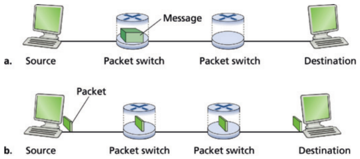

Hình 1.28 Vận chuyển thông điệp end-to-end: (a) không có phân đoạn thông điệp; (b) có phân đoạn thông điệp

c. Mất bao lâu để chuyển file từ host nguồn tới host đích khi dùng phân đoạn thông điệp? So sánh kết quả này với câu trả lời của bạn ở phần (a) và nhận xét.

d. Ngoài việc giảm độ trễ, còn những lý do nào để dùng phân đoạn thông điệp?

e. Thảo luận các nhược điểm của phân đoạn thông điệp.

P32. Thử nghiệm với hoạt hình tương tác Message Segmentation trên Web site của sách. Độ trễ trong hoạt hình tương tác có tương ứng với độ trễ trong bài trước không? Độ trễ lan truyền của liên kết ảnh hưởng thế nào đến tổng độ trễ end-to-end đối với chuyển mạch gói (có phân đoạn thông điệp) và đối với chuyển mạch thông điệp?

P33. Xét việc gửi một file lớn F bit từ Host A tới Host B. Có ba liên kết (và hai switch) giữa A và B, và các liên kết không bị tắc nghẽn (tức là không có độ trễ hàng đợi). Host A chia file thành các segment mỗi segment S bit và thêm 80 bit header vào mỗi segment, tạo thành các packet có L = 80 + S bit. Mỗi liên kết có tốc độ truyền R bps. Tìm giá trị S làm tối thiểu độ trễ chuyển file từ Host A tới Host B. Bỏ qua độ trễ lan truyền.

P34. Có những ứng dụng cho phép bạn gọi điện từ một PC tới một điện thoại thông thường. Điều này có nghĩa là cuộc gọi thoại phải đi qua cả Internet lẫn một mạng điện thoại. Thảo luận cách điều này có thể được thực hiện.

### Bài thực hành Wireshark (Wireshark Lab)

“Nói cho tôi và tôi sẽ quên. Chỉ cho tôi và tôi sẽ nhớ. Cho tôi tham gia và tôi sẽ hiểu.”

Tục ngữ Trung Quốc Hiểu biết của một người về giao thức mạng thường có thể được đào sâu rất nhiều bằng cách xem chúng hoạt động và thử nghiệm với chúng—quan sát chuỗi thông điệp được trao đổi giữa hai thực thể giao thức, đi sâu vào chi tiết hoạt động của giao thức, khiến giao thức thực hiện những hành động nhất định, và quan sát những hành động này cùng hệ quả của chúng. Việc này có thể được thực hiện trong các kịch bản mô phỏng hoặc trong một môi trường mạng thực như Internet.

Các hoạt hình tương tác trên Web site của sách theo cách tiếp cận thứ nhất. Trong các bài thực hành Wireshark, chúng ta sẽ theo cách tiếp cận thứ hai. Bạn sẽ chạy các ứng dụng mạng trong nhiều kịch bản khác nhau bằng một máy tính trên bàn của bạn, ở nhà, hoặc trong phòng thí nghiệm. Bạn sẽ quan sát các giao thức mạng trong máy tính của bạn, tương tác và trao đổi thông điệp với các thực thể giao thức đang chạy ở nơi khác trên Internet. Do đó, bạn và máy tính của bạn sẽ là một phần không thể thiếu của các bài thực hành trực tiếp này.

Bạn sẽ quan sát—và bạn sẽ học—bằng cách làm.

Công cụ cơ bản để quan sát các thông điệp được trao đổi giữa các thực thể giao thức đang chạy được gọi là packet sniffer. Như tên gọi gợi ý, một packet sniffer sao chép (sniff) một cách thụ động các thông điệp được gửi đi từ và nhận bởi máy tính của bạn; nó cũng hiển thị nội dung của các trường giao thức khác nhau trong các thông điệp bắt được này. Một ảnh chụp màn hình của packet sniffer Wireshark được cho trong Hình 1.29. Wireshark là một packet sniffer miễn phí chạy trên các máy tính Windows, Linux/Unix và Mac. Xuyên suốt cuốn sách, bạn sẽ thấy các bài thực hành Wireshark cho phép bạn khám phá một số giao thức được học trong chương. Trong bài thực hành Wireshark đầu tiên này, bạn sẽ tải và cài đặt một bản Wireshark, truy cập một Web site, rồi bắt và xem xét các thông điệp giao thức được trao đổi giữa Web browser của bạn và Web server.

Bạn có thể tìm đầy đủ chi tiết về bài thực hành Wireshark đầu tiên này (bao gồm hướng dẫn cách tải và cài đặt Wireshark) tại Web site www. pearson.com/cs-resources và trên Web site của các tác giả http://gaia.cs.umass.edu/kurose_ross.

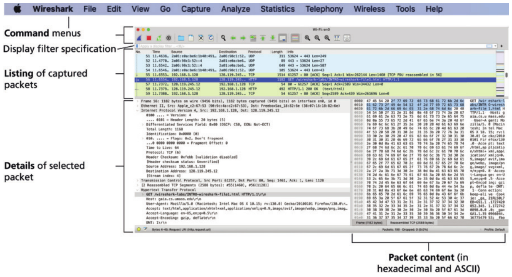

Hình 1.29 Một ảnh chụp màn hình Wireshark (Ảnh chụp màn hình Wireshark được in lại với sự cho phép của Wireshark Foundation.)

### PHỎNG VẤN VỚI... (AN INTERVIEW WITH...)


### Leonard Kleinrock

Leonard Kleinrock là giáo sư xuất sắc (distinguished professor) ngành khoa học máy tính tại University of California, Los Angeles. Việc ông xây dựng lý thuyết toán học về các nguyên lý packet-switching vào năm 1961 đã khởi đầu cho công nghệ đứng sau Internet. Năm 1969, máy tính của ông tại UCLA trở thành nút đầu tiên của Internet và từ đó nhóm của ông đã truyền đi thông điệp đầu tiên của Internet. Ông nhận bằng B.E.E. từ City College of New York (CCNY) và bằng thạc sĩ cùng tiến sĩ ngành kỹ thuật điện từ MIT.

#### Điều gì khiến ông quyết định chuyên sâu về công nghệ mạng/Internet?

Khi là nghiên cứu sinh tiến sĩ tại MIT năm 1959, tôi nhìn quanh và thấy hầu hết bạn cùng lớp đang nghiên cứu lý thuyết thông tin và lý thuyết mã hóa, một lĩnh vực được tạo ra bởi nhà nghiên cứu vĩ đại Claude Shannon. Tôi đánh giá rằng ông ấy đã giải quyết hầu hết các bài toán quan trọng rồi. Những bài toán nghiên cứu còn lại thì khó và với tôi dường như ít quan trọng hơn. Vì vậy tôi quyết định dấn thân vào một lĩnh vực mới mà chưa ai khác nghĩ tới. Tại MIT tôi được bao quanh bởi nhiều máy tính, và tôi thấy rõ rằng, sớm hay muộn, những cỗ máy này sẽ cần giao tiếp với nhau. Vào thời điểm đó, chưa có cách hiệu quả nào để chúng làm việc này và tôi nhận ra lời giải cho bài toán quan trọng này sẽ có tác động. Tôi có một cách tiếp cận cho bài toán này và vì vậy, cho nghiên cứu tiến sĩ của mình, tôi quyết định tạo ra một lý thuyết toán học để mô hình hóa, đánh giá, thiết kế và tối ưu các mạng dữ liệu hiệu quả và tin cậy.

#### Công việc đầu tiên của ông trong ngành máy tính là gì? Nó bao gồm những gì?

Suốt những năm trung học, tôi cần kiếm thu nhập để giúp đỡ gia đình. Khi đến lúc vào đại học, để có thể kiếm lương toàn thời gian vào ban ngày, tôi học Lớp buổi tối (Evening Session) tại CCNY từ 1951 đến 1957 để lấy bằng cử nhân kỹ thuật điện. Vào ban ngày, ban đầu tôi làm kỹ thuật viên và sau đó là trợ lý kỹ sư điện tại một công ty điện tử công nghiệp nhỏ tên là Photobell. Khi ở đó, tôi đã đưa công nghệ số vào dòng sản phẩm của họ. Về cơ bản, chúng tôi dùng các thiết bị quang điện để phát hiện sự hiện diện của những vật nhất định (hộp, người, v.v.) và tôi nhận ra rằng việc dùng một mạch mà khi đó được gọi là bistable multivibrator (bộ đa hài hai trạng thái bền) chính là thứ chúng tôi cần để đưa xử lý số vào lĩnh vực phát hiện này. Những mạch này hóa ra là các khối xây dựng của máy tính, và ngày nay được biết đến với tên flip-flops hoặc switch theo cách gọi thông dụng.

#### Ông đã nghĩ gì khi gửi thông điệp host-to-host đầu tiên (từ UCLA tới Stanford Research Institute)?

Thành thật mà nói, chúng tôi không hề biết tầm quan trọng của sự kiện đó. Chúng tôi đã không chuẩn bị một thông điệp đặc biệt mang ý nghĩa lịch sử, như rất nhiều nhà phát minh trong quá khứ đã làm (Samuel Morse với “What hath God wrought.” hay Alexander Graham Bell với “Watson, come here! I want you.” hay Neal Armstrong với “That's one small step for a man, one giant leap for mankind.”) Những người đó thật thông minh! Họ hiểu truyền thông và quan hệ công chúng. Chúng tôi chỉ đơn giản là những gã mọt sách và tất cả những gì chúng tôi muốn làm là chứng minh khả năng đăng nhập từ xa vào máy tính SRI. Vì vậy chúng tôi gõ chữ “L”, được nhận đúng, chúng tôi gõ chữ “o” cũng được nhận đúng, rồi chúng tôi gõ chữ “g” và máy tính host SRI bị crash! Vậy là, hóa ra thông điệp của chúng tôi có lẽ là thông điệp ngắn gọn nhất, tiên tri nhất và mạnh mẽ nhất có thể, cụ thể là “Lo!” như trong “Lo and behold” (tôi thêm câu đó sau này!).

Vài tháng trước khi nút đầu tiên được thiết lập, tôi được trích dẫn trong một thông cáo báo chí của UCLA rằng “Hiện nay, mạng máy tính vẫn đang ở giai đoạn sơ khai. Nhưng khi chúng lớn lên và trở nên tinh vi hơn, có lẽ chúng ta sẽ thấy sự lan rộng của ‘tiện ích máy tính’ (computer utilities), thứ mà, giống như các tiện ích điện và điện thoại hiện nay, sẽ phục vụ từng hộ gia đình và văn phòng trên khắp đất nước.”. Vì vậy tầm nhìn của tôi khi đó là Internet sẽ có mặt khắp nơi, luôn bật, luôn sẵn sàng, bất kỳ ai với bất kỳ thiết bị nào cũng có thể kết nối từ bất kỳ đâu vào bất kỳ lúc nào, và nó sẽ vô hình. Tuy nhiên, tôi hoàn toàn bỏ lỡ việc các mạng xã hội sẽ xuất hiện, chẳng hạn, tôi chưa bao giờ dự đoán rằng người mẹ 99-year-old (tuổi) của tôi sẽ dùng Internet cùng lúc với đứa cháu gái 5 year-old (tuổi) của tôi—và thực sự bà đã dùng!

#### Tầm nhìn của ông về tương lai của mạng là gì?

Phần dễ của tầm nhìn là dự đoán chính hạ tầng. Tôi dự đoán chúng ta sẽ thấy việc triển khai đáng kể các thiết bị không dây và di động trong các không gian thông minh để tạo ra thứ tôi thích gọi là Internet Vô hình (Invisible Internet). Bước này sẽ cho phép chúng ta bước ra khỏi thế giới ngầm của không gian mạng để đến thế giới vật lý của các không gian thông minh. Môi trường của chúng ta (bàn, tường, xe cộ, đồng hồ, thắt lưng, móng tay, cơ thể, v.v.) sẽ trở nên sống động với công nghệ, thông qua bộ chấp hành, cảm biến, logic, xử lý, lưu trữ, camera, micro, loa, màn hình và truyền thông. Công nghệ nhúng này sẽ cho phép môi trường của chúng ta cung cấp các dịch vụ IP bất cứ nơi đâu và bất cứ khi nào chúng ta muốn. Khi tôi bước vào một căn phòng, căn phòng sẽ biết tôi đã vào. Tôi sẽ có thể giao tiếp với môi trường của mình một cách tự nhiên, như bằng tiếng Anh nói, xúc giác (haptics), cử chỉ, và cuối cùng là qua các giao diện brain-Internet (não–Internet); các yêu cầu của tôi sẽ tạo ra phản hồi trình bày các trang Web cho tôi từ màn hình trên tường, qua kính mắt của tôi, dưới dạng lời nói, hình ảnh ba chiều (hologram), v.v. Nhìn xa hơn một chút, tôi thấy một tương lai mạng bao gồm các thành phần then chốt bổ sung sau. Tôi thấy các software agent thông minh được tùy biến, triển khai khắp mạng với chức năng khai phá dữ liệu, hành động trên dữ liệu đó, quan sát xu hướng, và thực hiện nhiệm vụ một cách động và thích ứng. Tôi thấy việc triển khai công nghệ blockchain cung cấp các sổ cái phân tán không thể chối cãi, bất biến, đi kèm với các hệ thống danh tiếng mang lại độ tin cậy cho nội dung và chức năng. Tôi thấy lượng traffic mạng nhiều hơn đáng kể được sinh ra không phải chủ yếu bởi con người, mà bởi các thiết bị nhúng, các software agent thông minh và các sổ cái phân tán. Tôi thấy những tập hợp lớn các hệ thống self-organizing (tự tổ chức) điều khiển mạng rộng lớn, nhanh chóng này. Tôi thấy lượng thông tin khổng lồ lướt qua mạng này tức thời, với thông tin này trải qua quá trình xử lý và lọc to lớn. Internet Vô hình về bản chất sẽ là một hệ thần kinh toàn cầu, thông minh, có mặt khắp nơi. Tôi thấy tất cả những điều này và hơn thế khi chúng ta lao về phía trước xuyên qua thế kỷ twenty-first (hai mươi mốt).

Phần khó hơn của tầm nhìn là dự đoán các ứng dụng và dịch vụ, vốn đã liên tục làm chúng ta ngạc nhiên theo những cách ngoạn mục (e-mail, công nghệ tìm kiếm, World Wide Web, blog, mạng peer-to-peer, mạng xã hội, nội dung do người dùng tạo, chia sẻ nhạc, ảnh và video, v.v.). Những ứng dụng này đã “come of the blue” (xuất hiện bất ngờ), đột ngột, không lường trước và bùng nổ. Hơn nữa, và quan trọng là, giờ đây chúng ta đang quan sát và phải đối mặt với sự trỗi dậy nhanh chóng và ảnh hưởng của công nghệ generative AI tiên tiến đầy ấn tượng. Điều này mở ra một lĩnh vực phong phú cho nghiên cứu và đổi mới sâu sắc trước những thách thức, rủi ro và khả năng trong tương lai. Thật là một thế giới tuyệt vời để thế hệ tiếp theo khám phá!

#### Những ai đã truyền cảm hứng cho ông trong sự nghiệp?

Hơn hẳn mọi người, đó là Claude Shannon từ MIT, một nhà nghiên cứu lỗi lạc có khả năng liên hệ các ý tưởng toán học của mình với thế giới vật lý theo những cách cực kỳ trực quan. Ông là một thành viên tuyệt vời trong hội đồng luận án tiến sĩ của tôi.

#### Ông có lời khuyên nào cho sinh viên bước vào lĩnh vực mạng/Internet không?

Internet và tất cả những gì nó mang lại là một biên giới mới rộng lớn, liên tục đầy những thách thức đáng kinh ngạc. Có chỗ cho sự đổi mới lớn lao. Đừng bị bó buộc bởi công nghệ ngày nay. Hãy vươn ra và tưởng tượng những gì có thể có rồi biến nó thành hiện thực.
