# 2 Tầng ứng dụng (Application Layer)


Các ứng dụng mạng là raisons d’être (lý do tồn tại) của một mạng máy tính—nếu chúng ta không thể hình dung ra bất kỳ ứng dụng hữu ích nào, sẽ chẳng cần đến hạ tầng mạng và các giao thức để hỗ trợ chúng. Kể từ khi Internet ra đời, quả thực đã có rất nhiều ứng dụng hữu ích và giải trí được tạo ra. Những ứng dụng này là động lực đằng sau thành công của Internet, được mọi người sử dụng ở nhà, trên xe, ở trường học, cơ quan chính phủ và doanh nghiệp, biến Internet thành một phần không thể thiếu trong hoạt động hằng ngày của họ.

Các ứng dụng Internet bao gồm các ứng dụng text-based (dựa trên văn bản) kinh điển trở nên phổ biến vào những năm 1970s và 1980s: e-mail văn bản, truy cập từ xa vào máy tính, truyền file, và newsgroup. Chúng bao gồm ứng dụng sát thủ (killer application) của giai đoạn mid-1990s, World Wide Web, bao gồm lướt Web, tìm kiếm và thương mại điện tử. Từ đầu thiên niên kỷ mới, những ứng dụng mới và cực kỳ hấp dẫn tiếp tục xuất hiện, bao gồm hội nghị video như Zoom, Facetime và Teams; video do người dùng tạo như YouTube; và phim theo yêu cầu như Netflix; và game trực tuyến nhiều người chơi như Second Life và World of Warcraft. Trong cùng giai đoạn này, chúng ta đã chứng kiến sự xuất hiện của một thế hệ ứng dụng mạng xã hội mới—như TikTok, Facebook, Instagram và X—vốn đã tạo ra những mạng lưới con người trên nền mạng router và liên kết truyền thông của Internet. Và gần đây nhất, cùng với sự xuất hiện của smartphone và sự phổ biến khắp nơi của truy cập Internet không dây 4G/5G, đã có vô số ứng dụng di động dựa trên vị trí, bao gồm các ứng dụng check-in, hẹn hò và dự báo road-traffic (giao thông đường bộ) phổ biến (như Yelp, Tinder và Waze), ứng dụng thanh toán di động (như WeChat và Apple Pay) và ứng dụng nhắn tin (như WeChat và WhatsApp). Rõ ràng, các ứng dụng Internet mới và thú vị không hề chậm lại. Có lẽ một số độc giả của cuốn sách này sẽ tạo ra thế hệ tiếp theo của các ứng dụng Internet sát thủ!

Trong chương này, chúng ta nghiên cứu các khía cạnh khái niệm và triển khai của ứng dụng mạng. Chúng ta bắt đầu bằng việc định nghĩa các khái niệm application-layer then chốt, bao gồm các dịch vụ mạng mà ứng dụng cần, client và server, process, và các giao diện transport-layer. Chúng ta xem xét chi tiết một số ứng dụng mạng, bao gồm Web, e-mail, DNS và video streaming. Sau đó chúng ta đề cập việc phát triển ứng dụng mạng, trên cả TCP và UDP. Cụ thể, chúng ta nghiên cứu giao diện socket và đi qua một số ứng dụng client-server đơn giản bằng Python. Chúng tôi cũng cung cấp một số bài tập lập trình socket vui và thú vị ở cuối chương.

Tầng ứng dụng là một nơi đặc biệt tốt để bắt đầu việc nghiên cứu giao thức của chúng ta. Đó là vùng đất quen thuộc. Chúng ta đã quen với nhiều ứng dụng dựa vào các giao thức mà chúng ta sẽ nghiên cứu. Nó sẽ giúp chúng ta cảm nhận tốt về bản chất của giao thức và sẽ giới thiệu cho chúng ta nhiều vấn đề giống như những vấn đề chúng ta sẽ gặp lại khi nghiên cứu các giao thức tầng giao vận, tầng mạng và tầng liên kết.

## 2.1 Các nguyên lý của ứng dụng mạng (Principles of Network Applications)

Giả sử bạn có ý tưởng cho một ứng dụng mạng mới. Có lẽ ứng dụng này sẽ là một dịch vụ tuyệt vời cho nhân loại, hoặc sẽ làm giáo sư của bạn hài lòng, hoặc sẽ mang lại cho bạn khối tài sản lớn, hoặc đơn giản là sẽ thú vị khi phát triển và sử dụng. Dù động lực là gì, giờ hãy xem xét cách bạn biến ý tưởng thành một ứng dụng mạng real-world (thực tế).

Cốt lõi của việc phát triển ứng dụng mạng là viết các chương trình chạy trên những end system khác nhau và giao tiếp với nhau qua mạng. Ví dụ, trong ứng dụng Web có hai chương trình riêng biệt giao tiếp với nhau: chương trình browser chạy trên host của người dùng (desktop, laptop, tablet, smartphone, v.v.); và chương trình Web server chạy trên host Web server. Một ví dụ khác, trong một ứng dụng Video on Demand như Netflix (xem Mục 2.5), có một chương trình Netflix-provided (do Netflix cung cấp) chạy trên smartphone, tablet, máy tính hoặc TV của người dùng; và một chương trình Netflix server chạy trên host Netflix server. Server thường (nhưng không phải luôn luôn) được đặt trong một data center, như minh họa trong Hình 2.1.

Do đó, khi phát triển ứng dụng mới, bạn cần viết phần mềm sẽ chạy trên nhiều end system. Phần mềm này có thể được viết, chẳng hạn, bằng C, Java hoặc Python. Quan trọng là, bạn không cần viết phần mềm chạy trên các thiết bị network-core (lõi mạng), như router hoặc switch link-layer. Thật vậy, ngay cả khi bạn muốn viết phần mềm ứng dụng cho các thiết bị network-core này, bạn cũng không thể làm vậy. Như chúng ta đã học trong Chương 1, và như minh họa trước đó trong Hình 1.25, các thiết bị network-core không hoạt động ở tầng ứng dụng mà hoạt động ở các tầng thấp hơn—cụ thể là ở tầng mạng và bên dưới. Thiết kế cơ bản này—cụ thể là, giới hạn phần mềm ứng dụng trong các end system—như minh họa trong Hình 2.1, đã tạo điều kiện cho việc phát triển và triển khai nhanh chóng một loạt rất lớn các ứng dụng mạng.

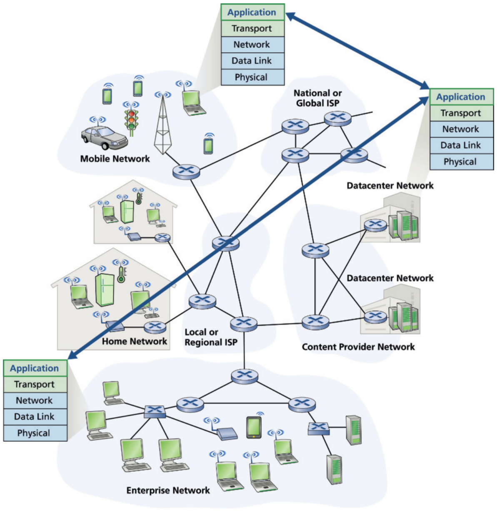

Hình 2.1 Giao tiếp cho một ứng dụng mạng diễn ra giữa các end system ở tầng ứng dụng

### 2.1.1 Kiến trúc ứng dụng mạng (Network Application Architectures)

Trước khi lao vào viết code phần mềm, bạn nên có một kế hoạch kiến trúc tổng quát cho ứng dụng của mình. Hãy nhớ rằng kiến trúc của một ứng dụng khác hẳn với kiến trúc mạng (ví dụ, kiến trúc Internet five-layer đã thảo luận trong Chương 1).

Từ góc nhìn của nhà phát triển ứng dụng, kiến trúc mạng là cố định và cung cấp một tập dịch vụ cụ thể cho ứng dụng. Ngược lại, kiến trúc ứng dụng do nhà phát triển ứng dụng thiết kế và quy định cách ứng dụng được cấu trúc trên các end system khác nhau. Khi chọn kiến trúc ứng dụng, một nhà phát triển ứng dụng nhiều khả năng sẽ dựa vào một trong hai mô hình kiến trúc chủ đạo được dùng trong các ứng dụng mạng hiện đại: kiến trúc client-server hoặc kiến trúc peer-to-peer ( P2P).

Trong kiến trúc client-server, có một host always-on (luôn bật), gọi là server, phục vụ yêu cầu từ nhiều host khác, gọi là client. Một ví dụ kinh điển là ứng dụng Web, trong đó một Web server always-on phục vụ yêu cầu từ các browser chạy trên các host client. Khi một Web server nhận một yêu cầu cho một object từ một host client, nó phản hồi bằng cách gửi object được yêu cầu tới host client. Lưu ý rằng với kiến trúc client-server, các client không giao tiếp trực tiếp với nhau; ví dụ, trong ứng dụng Web, hai browser không giao tiếp trực tiếp. Một đặc điểm khác của kiến trúc client-server là server có một địa chỉ cố định, well-known (ai cũng biết), gọi là địa chỉ IP (mà chúng ta sẽ thảo luận sớm). Vì server có một địa chỉ cố định, well-known, và vì server luôn bật, một client luôn có thể liên lạc với server bằng cách gửi một packet tới địa chỉ IP của server. Một số ứng dụng better-known (nổi tiếng hơn) với kiến trúc client-server bao gồm Web, e-mail và video streaming. Kiến trúc client-server được minh họa trong Hình 2.2(a).

Thường trong một ứng dụng client-server, một host single-server (một server duy nhất) không có khả năng theo kịp tất cả yêu cầu từ client. Ví dụ, một site social-networking (mạng xã hội) phổ biến có thể nhanh chóng bị quá tải nếu chỉ có một server xử lý tất cả yêu cầu. Vì lý do này, một data center, chứa một số lượng lớn host, thường được dùng để tạo ra một server ảo mạnh mẽ. Các dịch vụ Internet phổ biến nhất—như generative AI (chatbot, text to image/video, v.v.), công cụ tìm kiếm (ví dụ, Google, Bing, Baidu), thương mại Internet (ví dụ, Amazon, eBay, Alibaba), e-mail Web-based (ví dụ, Gmail và Yahoo Mail), mạng xã hội (ví dụ, TikTok, Facebook, Instagram, X và WeChat)—chạy trong một hoặc nhiều data center. Như đã thảo luận trong Mục 1.3.3, Google có hơn 20 data center phân bố khắp thế giới, cùng nhau xử lý tìm kiếm, YouTube, Gmail và các dịch vụ khác. Một data center có thể có hàng trăm nghìn server, vốn phải được cấp điện và bảo trì. Ngoài ra, các nhà cung cấp dịch vụ phải trả chi phí kết nối liên mạng và băng thông định kỳ để gửi dữ liệu từ data center của họ.

Trong kiến trúc P2P, có rất ít (hoặc không có) sự phụ thuộc vào các server chuyên dụng trong data center. Thay vào đó, ứng dụng khai thác giao tiếp trực tiếp giữa các cặp host kết nối không liên tục, gọi là peer. Các peer không thuộc sở hữu của nhà cung cấp dịch vụ, mà là các máy desktop và laptop do người dùng điều khiển, với hầu hết các peer đặt ở nhà, trường đại học và văn phòng. Vì các peer giao tiếp mà không đi qua một server chuyên dụng, kiến trúc này được gọi là peer-to-peer. Một ví dụ về ứng dụng P2P phổ biến là ứng dụng file-sharing (chia sẻ file) BitTorrent.

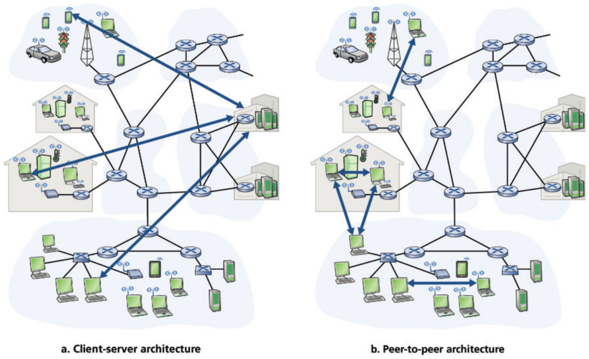

Hình 2.2 (a) Kiến trúc client-server; (b) Kiến trúc P2P

Một trong những đặc điểm hấp dẫn nhất của kiến trúc P2P là self-scalability (khả năng tự mở rộng) của chúng. Ví dụ, trong một ứng dụng P2P file-sharing, mặc dù mỗi peer tạo ra tải công việc bằng cách yêu cầu file, mỗi peer cũng bổ sung năng lực phục vụ cho hệ thống bằng cách phân phối file tới các peer khác. Kiến trúc P2P cũng tiết kiệm chi phí, vì chúng thường không cần hạ tầng server và băng thông server đáng kể (trái ngược với các thiết kế clients-server với datacenter). Tuy nhiên, các ứng dụng P2P đối mặt với thách thức về bảo mật, performance và độ tin cậy do cấu trúc phi tập trung cao của chúng. Vì những thách thức này, hầu hết ứng dụng ngày nay có kiến trúc client-server.

### 2.1.2 Các process giao tiếp (Processes Communicating)

Trước khi xây dựng ứng dụng mạng, bạn cũng cần hiểu cơ bản về cách các chương trình, chạy trên nhiều end system, giao tiếp với nhau. Theo thuật ngữ của hệ điều hành, thực ra không phải chương trình mà là process giao tiếp với nhau. Một process có thể được xem là một chương trình đang chạy trong một end system. Khi các process chạy trên cùng một end system, chúng có thể giao tiếp với nhau bằng giao tiếp liên tiến trình (interprocess communication), dùng các quy tắc do hệ điều hành của end system quản lý. Nhưng trong cuốn sách này, chúng ta không đặc biệt quan tâm đến cách các process trong cùng một host giao tiếp, mà quan tâm đến cách các process chạy trên các host khác nhau (với các hệ điều hành có thể khác nhau) giao tiếp.

Các process trên hai end system khác nhau giao tiếp với nhau bằng cách trao đổi thông điệp (message) qua mạng máy tính. Một process gửi tạo và gửi thông điệp vào mạng; một process nhận nhận các thông điệp này và có thể phản hồi bằng cách gửi thông điệp trở lại. Hình 2.1 minh họa rằng các process giao tiếp với nhau nằm ở tầng ứng dụng của protocol stack five-layer.

#### Process client và server (Client and Server Processes)

Một ứng dụng mạng gồm các cặp process gửi thông điệp cho nhau qua mạng. Ví dụ, trong ứng dụng Web, một process browser client trao đổi thông điệp với một process Web server. Với mỗi cặp process giao tiếp, chúng ta thường gán nhãn một trong hai process là client và process còn lại là server. Với Web, browser là một process client và Web server là một process server. Chúng ta định nghĩa process client và server như sau:

Trong bối cảnh một phiên giao tiếp giữa một cặp process, process khởi tạo giao tiếp (tức là, ban đầu liên lạc với process kia ở đầu phiên) được gán nhãn là client. Process chờ được liên lạc để bắt đầu phiên là server.

Ví dụ, trong Web, một process browser khởi tạo liên lạc với một process Web server; do đó process browser là client và process Web server là server. Khi không gây nhầm lẫn, đôi khi chúng ta cũng dùng thuật ngữ “phía client và phía server của một ứng dụng.” Ở cuối chương này, chúng ta sẽ đi qua code đơn giản cho cả phía client và phía server của ứng dụng mạng.

#### Giao diện giữa process và mạng máy tính (The Interface Between the Process and the Computer Network)

Như đã nêu ở trên, hầu hết ứng dụng gồm các cặp process giao tiếp, với hai process trong mỗi cặp gửi thông điệp cho nhau. Bất kỳ thông điệp nào gửi từ process này tới process khác đều phải đi qua mạng bên dưới. Một process gửi thông điệp vào, và nhận thông điệp từ, mạng thông qua một giao diện phần mềm gọi là socket. Hãy xét một phép so sánh để giúp chúng ta hiểu process và socket. Một process tương tự một ngôi nhà và socket của nó tương tự cánh cửa của ngôi nhà. Khi một process muốn gửi một thông điệp tới một process khác trên một host khác, nó đẩy thông điệp ra khỏi cửa (socket) của mình. Process gửi này giả định rằng có một hạ tầng vận chuyển ở phía bên kia cánh cửa sẽ vận chuyển thông điệp tới cửa của process đích. Khi thông điệp tới host đích, thông điệp đi qua cửa (socket) của process nhận, và process nhận sau đó xử lý thông điệp.

Hình 2.3 minh họa giao tiếp socket giữa hai process giao tiếp qua Internet. (Hình 2.3 giả định rằng giao thức giao vận bên dưới mà các process dùng là giao thức TCP của Internet.) Như minh họa trong hình này, socket là giao diện giữa tầng ứng dụng và tầng giao vận bên trong một host. Nó cũng được gọi là Giao diện lập trình ứng dụng (Application Programming Interface - API) giữa ứng dụng và mạng, vì socket là giao diện lập trình mà các ứng dụng mạng được xây dựng trên đó. Nhà phát triển ứng dụng kiểm soát mọi thứ ở phía application-layer của socket nhưng có rất ít quyền kiểm soát phía transport-layer của socket. Quyền kiểm soát duy nhất mà nhà phát triển ứng dụng có ở phía transport-layer là (1) lựa chọn giao thức giao vận và (2) có lẽ là khả năng cố định một vài tham số transport-layer như kích thước buffer tối đa và kích thước segment tối đa (sẽ được đề cập trong Chương 3). Một khi nhà phát triển ứng dụng chọn một giao thức giao vận (nếu có lựa chọn), ứng dụng được xây dựng bằng các dịch vụ transport-layer do giao thức đó cung cấp. Chúng ta sẽ khám phá socket khá chi tiết trong Mục 2.6.

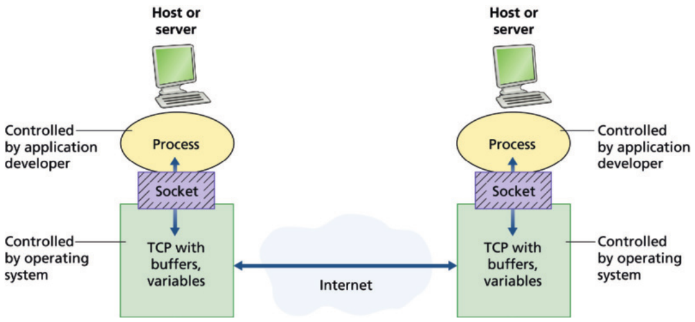

Hình 2.3 Process ứng dụng, socket, và giao thức giao vận bên dưới

#### Định địa chỉ process (Addressing Processes)

Để gửi thư bưu chính tới một đích cụ thể, đích cần có một địa chỉ. Tương tự, để một process chạy trên một host gửi packet tới một process chạy trên host khác, process nhận cần có một địa chỉ. Để xác định process nhận, cần chỉ định hai thông tin: (1) địa chỉ của host và (2) một định danh chỉ định process nhận trong host đích.

Trong Internet, host được xác định bằng địa chỉ IP của nó. Chúng ta sẽ thảo luận rất chi tiết về địa chỉ IP trong Chương 4. Hiện tại, tất cả những gì chúng ta cần biết là địa chỉ IP là một đại lượng 32-bit mà chúng ta có thể xem là định danh duy nhất của host. Ngoài việc biết địa chỉ của host mà thông điệp được gửi tới, process gửi cũng phải xác định process nhận (cụ thể hơn là socket nhận) đang chạy trong host. Thông tin này cần thiết vì nói chung một host có thể đang chạy nhiều ứng dụng mạng. Số port đích phục vụ mục đích này. Các ứng dụng phổ biến đã được gán các số port cụ thể. Ví dụ, một Web server được xác định bằng số port 80. Một process mail server (dùng giao thức SMTP) được xác định bằng số port 25. Danh sách các số port well-known cho tất cả giao thức chuẩn Internet có thể tìm thấy tại www.iana.org. Chúng ta sẽ xem xét chi tiết số port trong Chương 3.

### 2.1.3 Các dịch vụ giao vận dành cho ứng dụng (Transport Services Available to Applications)

Nhớ rằng socket là giao diện giữa process ứng dụng và giao thức transport-layer. Ứng dụng ở phía gửi đẩy thông điệp qua socket. Ở phía bên kia của socket, giao thức transport-layer có trách nhiệm đưa thông điệp tới socket của process nhận.

Nhiều mạng, bao gồm Internet, cung cấp nhiều hơn một giao thức transport-layer. Khi phát triển một ứng dụng, bạn phải chọn một trong các giao thức transport-layer sẵn có. Bạn đưa ra lựa chọn này như thế nào? Nhiều khả năng, bạn sẽ nghiên cứu các dịch vụ do các giao thức transport-layer sẵn có cung cấp, rồi chọn giao thức có dịch vụ phù hợp nhất với nhu cầu ứng dụng của bạn. Tình huống tương tự như việc chọn đi tàu hỏa hay máy bay để di chuyển giữa hai thành phố. Bạn phải chọn cái này hoặc cái kia, và mỗi phương thức vận chuyển cung cấp dịch vụ khác nhau. (Ví dụ, tàu hỏa cung cấp đón và trả khách (pickup and drop-off) ở trung tâm thành phố, trong khi máy bay cung cấp thời gian di chuyển ngắn hơn.)

Những dịch vụ nào mà một giao thức transport-layer có thể cung cấp cho các ứng dụng gọi nó? Chúng ta có thể phân loại tổng quát các dịch vụ khả dĩ theo bốn chiều: truyền dữ liệu tin cậy, throughput, định thời (timing) và bảo mật.

#### Truyền dữ liệu tin cậy (Reliable Data Transfer)

Như đã thảo luận trong Chương 1, packet có thể bị mất trong mạng máy tính. Ví dụ, một packet có thể làm tràn buffer trong router, hoặc có thể bị host hoặc router loại bỏ sau khi một số bit của nó bị hỏng. Đối với nhiều ứng dụng— như thư điện tử, truyền file, truyền tài liệu Web và các ứng dụng tài chính—mất dữ liệu có thể gây hậu quả nghiêm trọng (trong trường hợp sau, cho ngân hàng hoặc cho khách hàng!). Do đó, để hỗ trợ những ứng dụng này, cần làm gì đó để đảm bảo dữ liệu gửi bởi một đầu của ứng dụng được chuyển đúng và đầy đủ tới đầu kia của ứng dụng. Nếu một giao thức cung cấp dịch vụ chuyển dữ liệu được đảm bảo như vậy, nó được gọi là cung cấp truyền dữ liệu tin cậy (reliable data transfer). Một dịch vụ quan trọng mà giao thức transport-layer có thể cung cấp cho ứng dụng là truyền dữ liệu tin cậy process-to-process. Khi một giao thức giao vận cung cấp dịch vụ này, process gửi chỉ cần đưa dữ liệu của nó vào socket và biết với sự tin tưởng hoàn toàn rằng dữ liệu sẽ tới process nhận mà không có lỗi.

Khi một giao thức transport-layer không cung cấp truyền dữ liệu tin cậy, một phần dữ liệu gửi bởi process gửi có thể không bao giờ tới process nhận. Điều này có thể chấp nhận được với các ứng dụng loss-tolerant (chịu được mất mát), đáng chú ý nhất là các ứng dụng đa phương tiện như audio/video hội thoại có thể chịu được một lượng mất dữ liệu nhất định. Trong các ứng dụng đa phương tiện này, dữ liệu bị mất có thể gây ra một trục trặc nhỏ trong audio/video—không phải một suy giảm nghiêm trọng.

#### Throughput

Trong Chương 1, chúng ta đã giới thiệu khái niệm throughput khả dụng, mà trong bối cảnh một phiên giao tiếp giữa hai process dọc một đường mạng, là tốc độ mà process gửi có thể chuyển bit tới process nhận. Vì các phiên khác sẽ dùng chung băng thông dọc đường mạng, và vì các phiên khác này sẽ đến rồi đi, throughput khả dụng có thể dao động theo thời gian. Những quan sát này dẫn tới một dịch vụ tự nhiên khác mà một giao thức transport-layer có thể cung cấp, cụ thể là throughput khả dụng được đảm bảo ở một tốc độ chỉ định nào đó. Với dịch vụ như vậy, ứng dụng có thể yêu cầu một throughput được đảm bảo r bit/giây, và giao thức giao vận khi đó sẽ đảm bảo throughput khả dụng luôn ít nhất là r bit/giây. Một dịch vụ throughput được đảm bảo như vậy sẽ hấp dẫn nhiều ứng dụng. Ví dụ, nếu một ứng dụng điện thoại Internet mã hóa thoại ở 32 kbps, nó cần gửi dữ liệu vào mạng và có dữ liệu được chuyển tới ứng dụng nhận ở tốc độ này. Nếu giao thức giao vận không thể cung cấp throughput này, ứng dụng sẽ cần mã hóa ở tốc độ thấp hơn (và nhận đủ throughput để duy trì tốc độ mã hóa thấp hơn này) hoặc có thể phải bỏ cuộc, vì nhận được, chẳng hạn, một nửa throughput cần thiết thì gần như hoặc hoàn toàn vô dụng với ứng dụng điện thoại Internet này. Các ứng dụng có yêu cầu throughput được gọi là ứng dụng bandwidth-sensitive (nhạy cảm băng thông). Nhiều ứng dụng đa phương tiện hiện nay nhạy cảm băng thông, mặc dù một số ứng dụng đa phương tiện có thể dùng kỹ thuật mã hóa thích ứng để mã hóa thoại hoặc video số hóa ở tốc độ khớp với throughput khả dụng hiện tại.

Trong khi các ứng dụng bandwidth-sensitive có yêu cầu throughput cụ thể, các ứng dụng co giãn (elastic application) có thể sử dụng nhiều hay ít throughput tùy theo lượng sẵn có. Thư điện tử, truyền file và truyền Web đều là ứng dụng co giãn. Tất nhiên, throughput càng nhiều càng tốt. Có một câu ngạn ngữ nói rằng người ta không thể quá giàu, quá gầy, hay có quá nhiều throughput!

#### Định thời (Timing)

Một giao thức transport-layer cũng có thể cung cấp các đảm bảo về định thời. Cũng như đảm bảo throughput, đảm bảo định thời có thể có nhiều hình thức. Một ví dụ đảm bảo có thể là mỗi bit mà bên gửi bơm vào socket tới socket của bên nhận không muộn hơn 100 msec. Dịch vụ như vậy sẽ hấp dẫn các ứng dụng real-time tương tác, như điện thoại Internet, hội nghị video, metaverse và game nhiều người chơi, tất cả đều đòi hỏi ràng buộc định thời chặt chẽ cho việc chuyển dữ liệu để đạt hiệu quả, xem [Gauthier 1999; Ramjee 1994]. Ví dụ, độ trễ dài trong điện thoại Internet có xu hướng gây ra những khoảng ngừng không tự nhiên trong cuộc hội thoại; trong một game nhiều người chơi hoặc metaverse tương tác ảo, độ trễ dài giữa việc thực hiện một hành động và thấy phản hồi từ môi trường (ví dụ, từ một người chơi khác ở đầu kia của một kết nối end-to-end) khiến ứng dụng có cảm giác kém chân thực. Với các ứng dụng non-real-time, độ trễ thấp luôn tốt hơn độ trễ cao, nhưng không có ràng buộc chặt chẽ nào được đặt lên độ trễ end-to-end.

#### Bảo mật (Security)

Cuối cùng, một giao thức giao vận có thể cung cấp cho ứng dụng một hoặc nhiều dịch vụ bảo mật. Ví dụ, ở host gửi, một giao thức giao vận có thể mã hóa mọi dữ liệu truyền bởi process gửi, và ở host nhận, giao thức transport-layer có thể giải mã dữ liệu trước khi chuyển dữ liệu tới process nhận. Dịch vụ như vậy sẽ cung cấp tính bảo mật (confidentiality) giữa hai process, ngay cả khi dữ liệu bằng cách nào đó bị quan sát giữa process gửi và process nhận. Một giao thức giao vận cũng có thể cung cấp các dịch vụ bảo mật khác ngoài tính bảo mật, bao gồm toàn vẹn dữ liệu và xác thực end-point (đầu cuối), những chủ đề mà chúng ta sẽ đề cập chi tiết trong Chương 8.

### 2.1.4 Các dịch vụ giao vận do Internet cung cấp (Transport Services Provided by the Internet)

Cho đến giờ, chúng ta đã xem xét các dịch vụ giao vận mà một mạng máy tính có thể cung cấp nói chung. Giờ hãy cụ thể hơn và xem xét loại dịch vụ giao vận do Internet cung cấp. Internet (và, tổng quát hơn, các mạng TCP/IP) cung cấp hai giao thức giao vận cho ứng dụng, UDP và TCP. Khi bạn (với tư cách nhà phát triển ứng dụng) tạo một ứng dụng mạng mới cho Internet, một trong những quyết định đầu tiên bạn phải đưa ra là dùng UDP hay TCP. Mỗi giao thức này cung cấp một tập dịch vụ khác nhau cho các ứng dụng gọi nó. Hình 2.4 cho thấy yêu cầu dịch vụ của một số ứng dụng được chọn.

#### Các dịch vụ TCP (TCP Services)

Mô hình dịch vụ TCP bao gồm một dịch vụ connection-oriented (hướng kết nối) và một dịch vụ truyền dữ liệu tin cậy. Khi một ứng dụng gọi TCP làm giao thức giao vận, ứng dụng nhận được cả hai dịch vụ này từ TCP.

• Dịch vụ connection-oriented. TCP cho client và server trao đổi thông tin điều khiển transport-layer với nhau trước khi các thông điệp application-level bắt đầu lưu thông. Thủ tục so-called bắt tay (handshaking) này báo cho client và server, cho phép chúng chuẩn bị cho một đợt packet ồ ạt.

  Sau giai đoạn bắt tay, một kết nối TCP được gọi là tồn tại giữa socket của hai process. Kết nối này là một kết nối full-duplex (song công toàn phần) theo nghĩa hai process có thể gửi thông điệp cho nhau qua kết nối cùng lúc. Khi ứng dụng gửi xong thông điệp, nó phải hủy kết nối. Trong Chương 3, chúng ta sẽ thảo luận chi tiết dịch vụ connection-oriented và xem xét cách nó được triển khai.

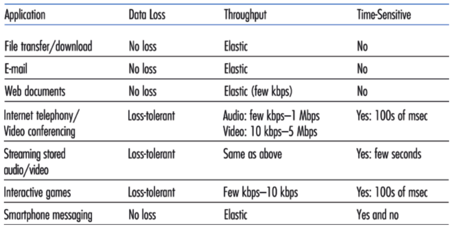

Hình 2.4 Yêu cầu của một số ứng dụng mạng được chọn

• Dịch vụ truyền dữ liệu tin cậy. Các process giao tiếp có thể dựa vào TCP để chuyển mọi dữ liệu được gửi mà không có lỗi và theo đúng thứ tự. Khi một phía của ứng dụng đưa một luồng byte vào socket, nó có thể trông cậy vào TCP để chuyển cùng luồng byte đó tới socket nhận, không thiếu hay trùng byte nào.

TCP cũng bao gồm một cơ chế congestion-control (điều khiển tắc nghẽn), một dịch vụ vì lợi ích chung của Internet hơn là vì lợi ích trực tiếp của các process giao tiếp. Cơ chế congestion-control của TCP tiết chế một process gửi (client hoặc server) khi mạng bị tắc nghẽn giữa bên gửi và bên nhận. Như chúng ta sẽ thấy trong Chương 3, điều khiển tắc nghẽn TCP cũng cố gắng giới hạn mỗi kết nối TCP ở phần chia công bằng của băng thông mạng.

#### Các dịch vụ UDP (UDP Services)

UDP là một giao thức giao vận no-frills (không rườm rà), nhẹ, cung cấp dịch vụ tối thiểu. UDP là phi kết nối (connectionless), nên không có bắt tay trước khi hai process bắt đầu giao tiếp. UDP cung cấp một dịch vụ truyền dữ liệu không tin cậy—tức là, khi một process gửi một thông điệp vào socket UDP, UDP không đảm bảo rằng thông điệp sẽ tới được process nhận. Hơn nữa, các thông điệp tới được process nhận có thể đến không theo thứ tự.

> Tiêu điểm bảo mật (Focus on Security)
>
> Bảo mật TCP (Securing TCP)
>
> Cả TCP lẫn UDP đều không cung cấp bất kỳ mã hóa nào—dữ liệu mà process gửi đưa vào socket của nó chính là dữ liệu đi qua mạng tới process đích. Vì vậy, chẳng hạn, nếu process gửi gửi một mật khẩu ở dạng cleartext (tức là, không mã hóa) vào socket của nó, mật khẩu cleartext sẽ đi qua mọi liên kết giữa bên gửi và bên nhận, có khả năng bị sniff và phát hiện tại bất kỳ liên kết trung gian nào. Vì quyền riêng tư và các vấn đề bảo mật khác đã trở nên thiết yếu với nhiều ứng dụng, cộng đồng Internet đã phát triển một cải tiến cho TCP, gọi là Transport Layer Security (TLS) [RFC 5246]. TCP-enhanced-with-TLS (TCP được tăng cường với TLS) không chỉ làm mọi thứ TCP truyền thống làm mà còn cung cấp các dịch vụ bảo mật process-to-process thiết yếu, bao gồm mã hóa, toàn vẹn dữ liệu và xác thực end-point. Chúng tôi nhấn mạnh rằng TLS không phải là giao thức giao vận Internet thứ ba, ngang hàng với TCP và UDP, mà là một cải tiến của TCP, với các cải tiến được triển khai ở tầng ứng dụng. Cụ thể, nếu một ứng dụng muốn dùng dịch vụ của TLS, nó cần đưa code TLS (các thư viện và lớp có sẵn, được tối ưu cao) vào cả phía client và phía server của ứng dụng. TLS có socket API riêng tương tự socket API TCP truyền thống. Khi một ứng dụng dùng TLS, process gửi đưa dữ liệu cleartext tới socket TLS; TLS ở host gửi sau đó mã hóa dữ liệu và đưa dữ liệu đã mã hóa tới socket TCP. Dữ liệu đã mã hóa đi qua Internet tới socket TCP ở process nhận. Socket nhận đưa dữ liệu đã mã hóa tới TLS, nơi giải mã dữ liệu.
>
> Cuối cùng, TLS đưa dữ liệu cleartext qua socket TLS của nó tới process nhận. Chúng ta sẽ đề cập TLS khá chi tiết trong Chương 8.

UDP không bao gồm cơ chế congestion-control, nên phía gửi của UDP có thể bơm dữ liệu xuống tầng bên dưới (tầng mạng) với bất kỳ tốc độ nào nó muốn. (Tuy nhiên, lưu ý rằng throughput end-to-end thực tế có thể thấp hơn tốc độ này do dung lượng truyền hạn chế của các liên kết trung gian hoặc do tắc nghẽn).

#### Các dịch vụ không được giao thức giao vận Internet cung cấp (Services Not Provided by Internet Transport Protocols)

Chúng ta đã tổ chức các dịch vụ giao thức giao vận theo bốn chiều: truyền dữ liệu tin cậy, throughput, định thời và bảo mật. Những dịch vụ nào trong số này được TCP và UDP cung cấp? Chúng ta đã lưu ý rằng TCP cung cấp truyền dữ liệu end-to-end tin cậy. Và chúng ta cũng biết rằng TCP có thể dễ dàng được tăng cường ở tầng ứng dụng với TLS để cung cấp dịch vụ bảo mật. Nhưng trong mô tả ngắn gọn của chúng ta về TCP và UDP, điều vắng mặt rõ rệt là bất kỳ đề cập nào về đảm bảo throughput hay định thời—những dịch vụ không được các giao thức giao vận Internet ngày nay cung cấp. Điều này có nghĩa là các ứng dụng time-sensitive (nhạy cảm thời gian) như hội nghị video không thể chạy trên Internet ngày nay? Câu trả lời rõ ràng là không— Internet đã và đang chạy các ứng dụng time-sensitive trong nhiều năm. Những ứng dụng này thường hoạt động khá tốt vì chúng được thiết kế để đối phó, ở mức cao nhất có thể, với sự thiếu đảm bảo này. Tuy vậy, thiết kế khéo léo cũng có giới hạn khi độ trễ quá mức, hoặc throughput end-to-end bị hạn chế. Tóm lại, Internet ngày nay thường có thể cung cấp dịch vụ thỏa đáng cho các ứng dụng time-sensitive, nhưng không thể cung cấp bất kỳ đảm bảo định thời hay throughput nào.

Hình 2.5 cho biết các giao thức giao vận được dùng bởi một số ứng dụng Internet phổ biến. Chúng ta thấy rằng e-mail, truy cập terminal từ xa, Web và truyền file đều dùng TCP. Những ứng dụng này chọn TCP chủ yếu vì TCP cung cấp truyền dữ liệu tin cậy, đảm bảo mọi dữ liệu cuối cùng sẽ tới đích. Vì các ứng dụng hội nghị video (như Zoom) thường có thể chịu được một ít mất mát nhưng cần một tốc độ tối thiểu để hiệu quả, các nhà phát triển ứng dụng hội nghị video thường thích chạy ứng dụng của họ trên UDP, qua đó né cơ chế điều khiển tắc nghẽn và overhead packet của TCP. Nhưng vì nhiều firewall được cấu hình để chặn (hầu hết các loại) traffic UDP, các ứng dụng điện thoại Internet thường được thiết kế để dùng TCP làm phương án dự phòng nếu giao tiếp UDP thất bại.

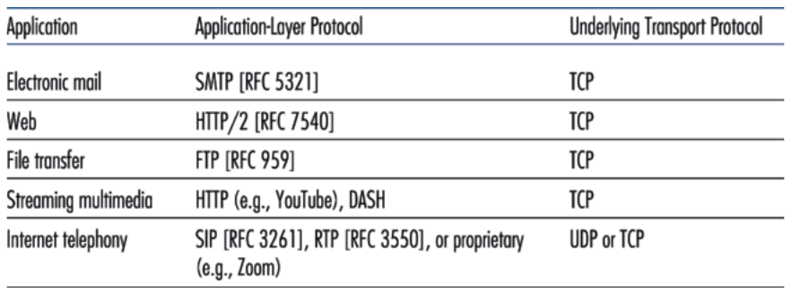

Hình 2.5 Các ứng dụng Internet phổ biến, giao thức application-layer của chúng và giao thức giao vận bên dưới của chúng

### 2.1.5 Giao thức tầng ứng dụng (Application-Layer Protocols)

Chúng ta vừa học rằng các process mạng giao tiếp với nhau bằng cách gửi thông điệp vào socket. Nhưng các thông điệp này được cấu trúc thế nào? Ý nghĩa của các trường khác nhau trong thông điệp là gì? Khi nào các process gửi thông điệp? Những câu hỏi này đưa chúng ta vào lĩnh vực của các giao thức application-layer. Một giao thức application-layer định nghĩa cách các process của một ứng dụng, chạy trên các end system khác nhau, chuyển thông điệp cho nhau. Cụ thể, một giao thức application-layer định nghĩa:

• Các loại thông điệp được trao đổi, ví dụ, thông điệp yêu cầu (request) và thông điệp phản hồi (response)

• Cú pháp của các loại thông điệp khác nhau, như các trường trong thông điệp và cách các trường được phân định

• Ngữ nghĩa của các trường, tức là, ý nghĩa của thông tin trong các trường

• Các quy tắc xác định khi nào và cách một process gửi thông điệp và phản hồi thông điệp

Một số giao thức application-layer được đặc tả trong RFC và do đó thuộc phạm vi công cộng. Ví dụ, giao thức application-layer của Web, HTTP (HyperText Transfer Protocol [RFC 7230]), có sẵn dưới dạng một RFC. Nếu một nhà phát triển browser tuân theo các quy tắc của RFC HTTP, browser sẽ có thể lấy các trang Web từ bất kỳ Web server nào cũng tuân theo các quy tắc của RFC HTTP. Nhiều giao thức application-layer khác là độc quyền và cố ý không công bố công khai. Ví dụ, Zoom dùng các giao thức application-layer độc quyền.

Điều quan trọng là phân biệt giữa ứng dụng mạng và giao thức application-layer.

Một giao thức application-layer chỉ là một phần của một ứng dụng mạng (dù là một phần rất quan trọng). Hãy xem vài ví dụ. Web là một ứng dụng client-server cho phép người dùng lấy tài liệu từ Web server theo yêu cầu. Ứng dụng Web gồm nhiều thành phần, bao gồm một chuẩn cho định dạng tài liệu (tức là, HTML), Web browser (ví dụ, Google Chrome và Microsoft Edge), Web server (ví dụ, Apache và các server của Microsoft), và một giao thức application-layer. Giao thức application-layer của Web, HTTP, định nghĩa định dạng và trình tự các thông điệp được trao đổi giữa browser và Web server. Do đó, HTTP chỉ là một phần (dù là một phần then chốt) của ứng dụng Web. Một ví dụ khác, chúng ta sẽ thấy trong Mục 2.5 rằng dịch vụ video của Netflix cũng có nhiều thành phần, bao gồm các server lưu trữ và truyền video, các server khác quản lý thanh toán và các chức năng client khác, các client (ví dụ, ứng dụng Netflix trên smartphone, tablet hoặc máy tính của bạn), và một giao thức application-level DASH định nghĩa định dạng và trình tự các thông điệp được trao đổi giữa một Netflix server và client. Do đó, DASH chỉ là một phần (dù là một phần then chốt) của ứng dụng Netflix.

### 2.1.6 Các ứng dụng mạng được đề cập trong cuốn sách này (Network Applications Covered in This Book)

Các ứng dụng mới đang được phát triển mỗi ngày. Thay vì đề cập một số lượng lớn ứng dụng Internet theo kiểu bách khoa toàn thư, chúng tôi đã chọn tập trung vào một số ít ứng dụng vừa phổ biến khắp nơi vừa quan trọng. Trong chương này, chúng ta thảo luận bốn ứng dụng quan trọng: Web, thư điện tử, dịch vụ thư mục (directory service), và video streaming. Chúng ta thảo luận Web trước, không chỉ vì nó là một ứng dụng cực kỳ phổ biến, mà còn vì giao thức application-layer của nó, HTTP, tương đối đơn giản và dễ hiểu. Sau đó chúng ta thảo luận thư điện tử, ứng dụng sát thủ đầu tiên của Internet. E-mail phức tạp hơn Web theo nghĩa nó sử dụng không chỉ một mà nhiều giao thức application-layer. Sau e-mail, chúng ta đề cập DNS, cung cấp một dịch vụ thư mục cho Internet. Hầu hết người dùng không tương tác trực tiếp với DNS; thay vào đó, người dùng gọi DNS gián tiếp thông qua các ứng dụng khác (bao gồm Web, truyền file và thư điện tử). DNS minh họa rất rõ cách một phần chức năng mạng cốt lõi (chuyển đổi network-name sang network-address) có thể được triển khai ở tầng ứng dụng trong Internet. Chúng ta hoàn tất phần nghiên cứu ứng dụng bằng việc thảo luận video streaming theo yêu cầu, bao gồm phân phối video lưu sẵn qua các mạng phân phối nội dung (content distribution network).

## 2.2 Web và HTTP (The Web and HTTP)

Cho đến đầu những năm 1990s, Internet chủ yếu được các nhà nghiên cứu, giới học thuật và sinh viên đại học dùng để đăng nhập vào host từ xa, truyền file từ host cục bộ tới host từ xa và ngược lại, nhận và gửi tin tức, và nhận và gửi thư điện tử. Mặc dù những ứng dụng này đã (và tiếp tục) cực kỳ hữu ích, Internet về cơ bản vẫn chưa được biết đến bên ngoài cộng đồng học thuật và nghiên cứu. Rồi, vào đầu những năm 1990s, một ứng dụng mới quan trọng đã xuất hiện—World Wide Web [Berners-Lee 1994]. Web là ứng dụng Internet đầu tiên thu hút sự chú ý của công chúng. Nó đã thay đổi mạnh mẽ cách con người tương tác bên trong và bên ngoài môi trường làm việc. Nó nâng Internet từ chỉ là một trong nhiều mạng dữ liệu lên thành về cơ bản mạng dữ liệu duy nhất.

Có lẽ điều hấp dẫn người dùng nhất là Web hoạt động theo yêu cầu. Người dùng nhận được thứ họ muốn, khi họ muốn. Điều này khác với phát thanh và truyền hình quảng bá truyền thống, vốn buộc người dùng phải dò kênh khi nhà cung cấp nội dung phát nội dung. Ngoài việc có sẵn theo yêu cầu, Web còn có nhiều đặc điểm hấp dẫn khác mà mọi người yêu thích và trân trọng. Bất kỳ cá nhân nào cũng cực kỳ dễ dàng đưa thông tin lên Web—ai cũng có thể trở thành nhà xuất bản với chi phí cực thấp. Hyperlink và công cụ tìm kiếm giúp chúng ta điều hướng qua một đại dương thông tin. Ảnh và video kích thích các giác quan của chúng ta. Form, JavaScript, video và nhiều công cụ khác cho phép chúng ta tương tác với trang và site. Và Web cùng các giao thức của nó đóng vai trò nền tảng cho generative AI, YouTube, e-mail Web-based (như Gmail), và hầu hết các ứng dụng Internet di động, bao gồm Instagram và Google Maps.

### 2.2.1 Tổng quan về HTTP (Overview of HTTP)

HyperText Transfer Protocol (HTTP) được định nghĩa trong [RFC 1945], [RFC 7230], [RFC 7540] và [RFC 9114]. Ngày nay đại đa số ứng dụng chạy trên HTTP, bao gồm duyệt Web, video streaming, mạng xã hội, và email giữa client và mail server. Ngoài ra, các ứng dụng smartphone thường giao tiếp với server qua HTTP.

HTTP được triển khai trong hai chương trình: một chương trình client và một chương trình server. Chương trình client và chương trình server, chạy trên các end system khác nhau, nói chuyện với nhau bằng cách trao đổi thông điệp HTTP. HTTP định nghĩa cấu trúc của các thông điệp này và cách client và server trao đổi thông điệp. Trước khi giải thích chi tiết HTTP, chúng ta nên điểm lại một số thuật ngữ Web.

Một trang Web (còn gọi là tài liệu) gồm các object. Một object đơn giản là một file—như một file HTML, một ảnh JPEG, một file Javascrpt, một file style sheet CCS, hoặc một video clip—có thể được định địa chỉ bằng một URL duy nhất. Hầu hết các trang Web gồm một file HTML gốc (base HTML file) và một số object được tham chiếu. Ví dụ, nếu một trang Web chứa văn bản HTML và năm ảnh JPEG, thì trang Web có sáu object: file HTML gốc cộng năm ảnh. File HTML gốc tham chiếu tới các object khác trong trang bằng URL của các object. Mỗi URL có hai thành phần: hostname của server chứa object và tên đường dẫn (path name) của object. Ví dụ, URL

```
http://www.someSchool.edu/someDepartment/picture.gif
```

có www.someSchool.edu là hostname và /someDepartment/picture.gif là tên đường dẫn. Vì Web browser (như Chrome và Edge) triển khai phía client của HTTP, trong bối cảnh Web, chúng ta sẽ dùng các từ browser và client thay thế cho nhau. Web server, triển khai phía server của HTTP, chứa các object Web, mỗi object có thể được định địa chỉ bằng một URL. Các Web server phổ biến bao gồm Apache, Nginx và Microsoft Internet Information Server.

HTTP định nghĩa cách Web client yêu cầu trang Web từ Web server và cách server truyền trang Web tới client. Chúng ta sẽ thảo luận chi tiết tương tác giữa client và server sau, nhưng ý tưởng chung được minh họa trong Hình 2.6. Khi người dùng yêu cầu một trang Web (ví dụ, nhấp vào một hyperlink), browser gửi các thông điệp yêu cầu HTTP cho các object trong trang tới server. Server nhận các yêu cầu và phản hồi bằng các thông điệp phản hồi HTTP chứa các object.

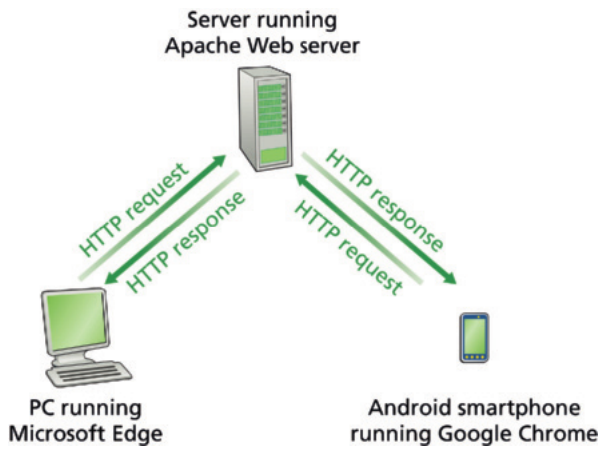

Hình 2.6 Hành vi request-response của HTTP

Tùy theo phiên bản HTTP, HTTP có thể dùng TCP hoặc UDP làm giao thức giao vận bên dưới. Việc dùng UDP là một phát triển tương đối mới. Trước hết chúng ta sẽ thảo luận HTTP giả định TCP là giao thức giao vận bên dưới. Sau đó chúng ta sẽ thảo luận HTTP trên UDP trong Mục 2.2.7. HTTP client trước hết khởi tạo một kết nối TCP với server. Khi kết nối được thiết lập, các process browser và server truy cập TCP thông qua giao diện socket của chúng. Như đã mô tả trong Mục 2.1, ở phía client, giao diện socket là cánh cửa giữa process client và kết nối TCP; ở phía server, nó là cánh cửa giữa process server và kết nối TCP. Client gửi các thông điệp yêu cầu HTTP vào giao diện socket của nó và nhận các thông điệp phản hồi HTTP từ giao diện socket của nó. Tương tự, HTTP server nhận thông điệp yêu cầu từ giao diện socket của nó và gửi thông điệp phản hồi vào giao diện socket của nó. Một khi client gửi một thông điệp vào giao diện socket, thông điệp đã ra khỏi tay client và “nằm trong tay” TCP. Nhớ lại từ Mục 2.1 rằng TCP cung cấp dịch vụ truyền dữ liệu tin cậy cho HTTP. Điều này hàm ý rằng mỗi thông điệp yêu cầu HTTP gửi bởi một process client cuối cùng sẽ tới server nguyên vẹn; tương tự, mỗi thông điệp phản hồi HTTP gửi bởi process server cuối cùng sẽ tới client nguyên vẹn. Ở đây chúng ta thấy một trong những lợi thế lớn của kiến trúc phân tầng—HTTP không cần lo lắng về dữ liệu bị mất hay chi tiết cách TCP phục hồi khi dữ liệu bị mất hoặc bị đảo thứ tự trong mạng. Đó là việc của TCP và các giao thức ở các tầng thấp hơn của protocol stack.

Điều quan trọng cần lưu ý là server gửi các file được yêu cầu tới client mà không lưu bất kỳ thông tin trạng thái nào về client. Nếu một client cụ thể yêu cầu cùng một object hai lần trong vòng vài giây, server không phản hồi bằng cách nói rằng nó vừa phục vụ object đó cho client; thay vào đó, server gửi lại object, vì nó đã hoàn toàn quên những gì nó làm trước đó. Vì HTTP server không duy trì thông tin nào về client, HTTP được gọi là một giao thức phi trạng thái (stateless protocol). Chúng tôi cũng lưu ý rằng Web dùng kiến trúc ứng dụng client-server, như đã mô tả trong Mục 2.1. Một Web server luôn bật, với một địa chỉ IP cố định, và nó phục vụ yêu cầu từ có thể hàng triệu browser khác nhau.

HTTP đã trải qua nhiều phiên bản. Phiên bản gốc của HTTP, HTTP/1.0, có từ đầu những năm 1990s [RFC 1945]. Kể từ đó HTTP/1.1 [RFC 7320] và HTTP/2 [RFC 7540] đã được triển khai rộng rãi. HTTP/1.0, HTTP/1.1 và HTTP/2 đều chạy trên TCP. Gần đây hơn, HTTP/3 đã được chuẩn hóa [RFC 9114] và đang được ưa chuộng dần. HTTP/3, thảo luận trong Mục 2.2.7, chạy trên UDP.

### 2.2.2 Kết nối không bền và kết nối bền (Non-Persistent and Persistent Connections)

Trong nhiều ứng dụng Internet, client và server giao tiếp trong một khoảng thời gian dài, với client đưa ra một loạt yêu cầu và server phản hồi từng yêu cầu. Tùy theo ứng dụng và cách ứng dụng đang được sử dụng, loạt yêu cầu có thể được đưa ra back-to-back (liên tiếp), định kỳ theo khoảng đều đặn, hoặc không liên tục. Khi tương tác client-server này diễn ra trên TCP, nhà phát triển ứng dụng cần đưa ra một quyết định quan trọng—mỗi cặp yêu cầu/phản hồi nên được gửi qua một kết nối TCP riêng, hay tất cả yêu cầu và các phản hồi tương ứng nên được gửi qua cùng một kết nối TCP? Trong cách tiếp cận thứ nhất, ứng dụng được gọi là dùng kết nối non-persistent (không bền); và trong cách tiếp cận thứ hai, kết nối bền (persistent connection). Để hiểu sâu vấn đề thiết kế này, hãy xem xét ưu điểm và nhược điểm của kết nối bền trong bối cảnh một ứng dụng cụ thể, cụ thể là HTTP, vốn có thể dùng cả kết nối non-persistent lẫn kết nối bền.

#### HTTP với kết nối không bền (HTTP with Non-Persistent Connections)

Hãy đi qua các bước truyền một trang Web từ server tới client trong trường hợp kết nối non-persistent. Giả sử trang gồm một file HTML gốc và 10 ảnh JPEG, và cả 11 object này nằm trên cùng một server. Giả sử thêm URL của file HTML gốc là

```
http://www.someSchool.edu/someDepartment/home.index
```

Đây là những gì xảy ra:

1. Process HTTP client khởi tạo một kết nối TCP tới server www. someSchool.edu trên số port 80, là số port mặc định cho HTTP. Gắn với kết nối TCP, sẽ có một socket ở client và một socket ở server.

2. HTTP client gửi một thông điệp yêu cầu HTTP tới server qua socket của nó. Thông điệp yêu cầu bao gồm tên đường dẫn /someDepartment/home.index. (Chúng ta sẽ thảo luận khá chi tiết về thông điệp HTTP bên dưới.)

3. Process HTTP server nhận thông điệp yêu cầu qua socket của nó, lấy object /someDepartment/home.index từ bộ lưu trữ của nó (RAM hoặc đĩa), đóng gói object trong một thông điệp phản hồi HTTP, và gửi thông điệp phản hồi tới client qua socket của nó.

4. Process HTTP server bảo TCP đóng kết nối TCP. (Nhưng TCP thực ra không kết thúc kết nối cho đến khi nó biết chắc rằng client đã nhận được thông điệp phản hồi nguyên vẹn.)

5. HTTP client nhận thông điệp phản hồi. Kết nối TCP kết thúc. Thông điệp cho biết object được đóng gói là một file HTML. Client trích xuất file từ thông điệp phản hồi, xem xét file HTML, và tìm thấy các tham chiếu tới 10 object JPEG.

6. Bốn bước đầu tiên sau đó được lặp lại cho từng object JPEG được tham chiếu.

Khi browser nhận được trang Web, nó hiển thị trang cho người dùng. Hai browser khác nhau có thể diễn giải (tức là, hiển thị cho người dùng) một trang Web theo những cách hơi khác nhau. HTTP không liên quan gì đến cách một trang Web được client diễn giải. Các đặc tả HTTP ([RFC 1945] và [RFC 7540]) chỉ định nghĩa giao thức giao tiếp giữa chương trình HTTP client và chương trình HTTP server.

Các bước trên minh họa việc dùng kết nối non-persistent, trong đó mỗi kết nối TCP được đóng sau khi server gửi object—kết nối không tồn tại lâu cho các object khác. Lưu ý rằng mỗi kết nối TCP non-persistent vận chuyển đúng một thông điệp yêu cầu và một thông điệp phản hồi. Do đó, trong ví dụ này, khi người dùng yêu cầu trang Web, 11 kết nối TCP được tạo ra.

Trước khi tiếp tục, hãy làm một phép tính back-of-the-envelope (nhẩm nhanh) để ước lượng lượng thời gian trôi qua từ khi client yêu cầu file HTML gốc cho đến khi toàn bộ file được client nhận. Để làm vậy, chúng ta định nghĩa round-trip time (RTT), là thời gian để một packet nhỏ đi từ client tới server rồi quay lại client. RTT bao gồm độ trễ packet-propagation (lan truyền packet), độ trễ packet-queuing (xếp hàng packet) tại các router và switch trung gian, và độ trễ packet-processing (xử lý packet). (Các độ trễ này đã được thảo luận trong Mục 1.4.) Giờ hãy xét điều gì xảy ra khi người dùng nhấp vào một hyperlink. Như minh họa trong Hình 2.7, điều này khiến browser khởi tạo một kết nối TCP giữa browser và Web server; việc này bao gồm một “bắt tay three-way (ba bước)”—client gửi một segment TCP nhỏ tới server, server xác nhận và phản hồi bằng một segment TCP nhỏ, và cuối cùng, client xác nhận lại với server. Hai phần đầu của bắt tay three-way tốn một RTT. Sau khi hoàn tất hai phần đầu của bắt tay, client gửi thông điệp yêu cầu HTTP kết hợp với phần thứ ba của bắt tay three-way (acknowledgment) vào kết nối TCP. Khi thông điệp yêu cầu tới server, server gửi file HTML vào kết nối TCP. Cặp yêu cầu/phản hồi HTTP này tốn thêm một RTT. Do đó, đại khái, tổng thời gian phản hồi là hai RTT cộng thời gian truyền file HTML tại server.

#### HTTP với kết nối bền (HTTP with Persistent Connections)

Kết nối non-persistent có một số nhược điểm. Thứ nhất, một kết nối brand-new (hoàn toàn mới) phải được thiết lập và duy trì cho mỗi object được yêu cầu. Với mỗi kết nối này, buffer TCP phải được cấp phát và biến TCP phải được giữ ở cả client và server. Điều này có thể đặt gánh nặng đáng kể lên Web server, vốn có thể đang phục vụ yêu cầu từ hàng trăm client khác nhau cùng lúc. Thứ hai, như chúng ta vừa mô tả, mỗi object chịu độ trễ chuyển giao hai RTT—một RTT để thiết lập kết nối TCP và một RTT để yêu cầu và nhận một object.

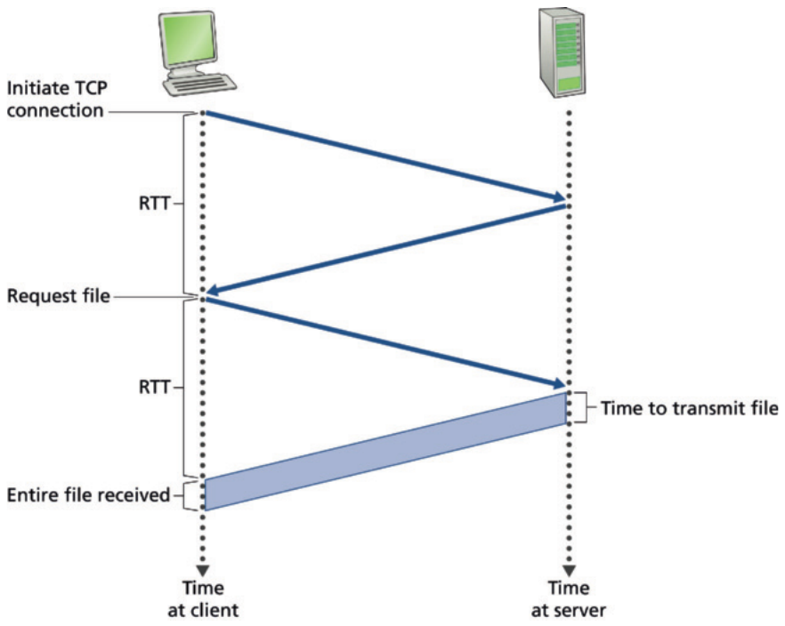

Hình 2.7 Phép tính back-of-the-envelope cho thời gian cần để yêu cầu và nhận một file HTML

Với kết nối bền, như được dùng trong HTTP/1.1 và HTTP/2, server để kết nối TCP mở sau khi gửi phản hồi. Các yêu cầu và phản hồi tiếp theo giữa cùng client và server có thể được gửi qua cùng kết nối. Cụ thể, toàn bộ một trang Web (trong ví dụ trên, file HTML gốc và 10 ảnh) có thể được gửi qua một kết nối TCP bền duy nhất. Hơn nữa, nhiều trang Web nằm trên cùng server có thể được gửi từ server tới cùng client qua một kết nối TCP bền duy nhất. Các yêu cầu object này có thể được thực hiện bằng “pipelining,” tức là, back-to-back, không chờ phản hồi cho các yêu cầu đang chờ. Thông thường, HTTP server đóng một kết nối khi nó không được dùng trong một khoảng thời gian nhất định (một khoảng timeout có thể cấu hình). Khi server nhận các yêu cầu back-to-back, nó gửi các object back-to-back.

### 2.2.3 Định dạng thông điệp HTTP (HTTP Message Format)

Các đặc tả HTTP [RFC 1945; RFC 7230; RFC 7540; RFC 9114] bao gồm định nghĩa các định dạng thông điệp HTTP. Có hai loại thông điệp HTTP, thông điệp yêu cầu và thông điệp phản hồi, cả hai đều được thảo luận bên dưới.

#### Thông điệp yêu cầu HTTP (HTTP Request Message)

Dưới đây là một thông điệp yêu cầu HTTP điển hình:

```
GET /somedir/page.html HTTP/1.1
Host: www.someschool.edu
Connection: close
User-agent: Mozilla/5.0
Accept-language: fr
```

Chúng ta có thể học được nhiều điều bằng cách xem kỹ thông điệp yêu cầu đơn giản này. Trước hết, chúng ta thấy thông điệp được viết bằng văn bản ASCII thông thường, để một người computer-literate (biết dùng máy tính) bình thường có thể đọc được. Thứ hai, chúng ta thấy thông điệp gồm năm dòng, mỗi dòng theo sau bởi một ký tự carriage return và một ký tự line feed. Dòng cuối theo sau bởi thêm một carriage return và line feed. Mặc dù thông điệp yêu cầu cụ thể này có năm dòng, một thông điệp yêu cầu có thể có nhiều dòng hơn nhiều hoặc chỉ một dòng. Dòng đầu tiên của thông điệp yêu cầu HTTP được gọi là dòng yêu cầu (request line); các dòng tiếp theo được gọi là các dòng header (header line). Dòng yêu cầu có ba trường: trường method, trường URL và trường phiên bản HTTP. Trường method có thể nhận nhiều giá trị khác nhau, bao gồm GET, POST, HEAD, PUT và DELETE. Đại đa số thông điệp yêu cầu HTTP dùng method GET. Method GET được dùng khi browser yêu cầu một object, với object được yêu cầu được xác định trong trường URL. Trong ví dụ này, browser đang yêu cầu object /somedir/page.html. Phiên bản thì tự giải thích (self-explanatory); trong ví dụ này, browser triển khai phiên bản HTTP/1.1.

Giờ hãy xem các dòng header trong ví dụ. Dòng header Host: www.someschool.edu chỉ định host nơi object nằm. Bạn có thể nghĩ rằng dòng header này không cần thiết, vì đã có sẵn một kết nối TCP tới host. Nhưng, như chúng ta sẽ thấy trong Mục 2.2.5, thông tin do dòng header host cung cấp là bắt buộc đối với Web proxy cache. Bằng cách đưa vào dòng header Connection: close, browser đang nói với server rằng nó không muốn bận tâm với kết nối bền; nó muốn server đóng kết nối sau khi gửi object được yêu cầu. Dòng header User-agent: chỉ định user agent, tức là, loại browser đang gửi yêu cầu tới server. Ở đây user agent là Mozilla/5.0, một browser Firefox. Dòng header này hữu ích vì server thực sự có thể gửi các phiên bản khác nhau của cùng một object tới các loại user agent khác nhau. (Mỗi phiên bản được định địa chỉ bằng cùng một URL.) Cuối cùng, header Accept-language: cho biết người dùng thích nhận phiên bản tiếng Pháp của object, nếu object như vậy tồn tại trên server; nếu không, server nên gửi phiên bản mặc định. Header Accept-language: chỉ là một trong nhiều header thương lượng nội dung (content negotiation header) có trong HTTP.

Sau khi xem một ví dụ, giờ hãy xem định dạng tổng quát của một thông điệp yêu cầu, như minh họa trong Hình 2.8. Chúng ta thấy định dạng tổng quát bám sát ví dụ trước đó. Tuy nhiên, bạn có thể đã để ý rằng sau các dòng header (và carriage return và line feed bổ sung) có một “entity body.” Entity body rỗng với method GET, nhưng được dùng với method POST. Một HTTP client thường dùng method POST khi người dùng điền một form—ví dụ, khi người dùng cung cấp từ khóa tìm kiếm cho một công cụ tìm kiếm. Với một thông điệp POST, người dùng vẫn đang yêu cầu một trang Web từ server, nhưng nội dung cụ thể của trang Web phụ thuộc vào những gì người dùng nhập vào các trường của form. Nếu giá trị của trường method là POST, thì entity body chứa những gì người dùng đã nhập vào các trường của form.

Sẽ là thiếu sót nếu chúng tôi không đề cập rằng một yêu cầu được tạo bằng form không nhất thiết phải dùng method POST. Thay vào đó, các form HTML thường dùng method GET và đưa dữ liệu đã nhập (trong các trường form) vào URL được yêu cầu. Ví dụ, nếu một form dùng method GET, có hai trường, và dữ liệu nhập vào hai trường là monkeys và bananas, thì URL sẽ có cấu trúc www.somesite.com/animalsearch?monkeys& bananas. Trong việc lướt Web day-to-day (hằng ngày), có lẽ bạn đã để ý các URL mở rộng kiểu này.

Method HEAD tương tự method GET. Khi server nhận một yêu cầu với method HEAD, nó phản hồi bằng một thông điệp HTTP nhưng bỏ qua object được yêu cầu. Các nhà phát triển ứng dụng thường dùng method HEAD để debug. Method PUT thường được dùng kết hợp với các công cụ xuất bản Web. Nó cho phép người dùng upload một object tới một đường dẫn (thư mục) cụ thể trên một Web server cụ thể. Method PUT cũng được dùng bởi các ứng dụng cần upload object lên Web server. Method DELETE cho phép người dùng, hoặc một ứng dụng, xóa một object trên Web server.

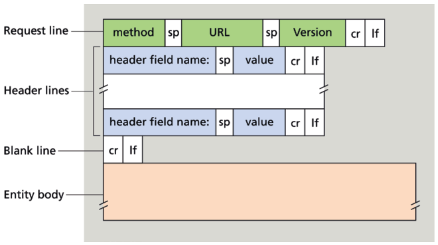

Hình 2.8 Định dạng tổng quát của một thông điệp yêu cầu HTTP

#### Thông điệp phản hồi HTTP (HTTP Response Message)

Dưới đây là một thông điệp phản hồi HTTP điển hình. Thông điệp phản hồi này có thể là phản hồi cho thông điệp yêu cầu ví dụ vừa thảo luận.

```
HTTP/1.1 200 OK
Connection: close
Date: Mon, 21 Oct 2024 18:58:21 GMT
Server: Apache/2.2.3 (CentOS)
Last-Modified: Sun, 20 Oct 2024 13:20:46 GMT
Content-Length: 6821
Content-Type: text/html
  (data data data data data ...)
```

Hãy xem kỹ thông điệp phản hồi này. Nó có ba phần: một dòng trạng thái (status line) ban đầu, sáu dòng header, và sau đó là entity body. Entity body là phần cốt lõi của thông điệp—nó chứa chính object được yêu cầu (được biểu diễn bằng data data data data data ...). Dòng trạng thái có ba trường: trường phiên bản giao thức, một mã trạng thái (status code), và một thông điệp trạng thái tương ứng. Trong ví dụ này, dòng trạng thái cho biết server đang dùng HTTP/1.1 và mọi thứ đều OK (tức là, server đã tìm thấy, và đang gửi, object được yêu cầu).

Giờ hãy xem các dòng header. Server dùng dòng header Connection: close để báo cho client rằng nó sẽ đóng kết nối TCP sau khi gửi thông điệp. Dòng header Date: cho biết thời gian và ngày khi phản hồi HTTP được server tạo và gửi. Lưu ý rằng đây không phải thời điểm object được tạo hay sửa đổi lần cuối; đó là thời điểm server lấy object từ hệ thống file của nó, chèn object vào thông điệp phản hồi, và gửi thông điệp phản hồi. Dòng header Server: cho biết thông điệp được tạo bởi một Apache Web server; nó tương tự dòng header User-agent: trong thông điệp yêu cầu HTTP. Dòng header Last-Modified: cho biết thời gian và ngày khi object được tạo hoặc sửa đổi lần cuối. Header Last-Modified:, mà chúng ta sẽ sớm đề cập chi tiết hơn, rất quan trọng cho việc cache object, cả ở client cục bộ lẫn trong các cache server mạng (còn gọi là proxy server). Dòng header Content-Length: cho biết số byte trong object đang được gửi. Dòng header Content-Type: cho biết object trong entity body là văn bản HTML. (Loại object được chỉ định chính thức bởi header Content-Type: chứ không phải bởi phần mở rộng file.)

Sau khi xem một ví dụ, giờ hãy xem xét định dạng tổng quát của một thông điệp phản hồi, được minh họa trong Hình 2.9. Định dạng tổng quát này của thông điệp phản hồi khớp với ví dụ thông điệp phản hồi trước đó. Hãy nói thêm vài lời về các mã trạng thái và cụm từ đi kèm. Mã trạng thái và cụm từ đi kèm cho biết kết quả của yêu cầu. Một số mã trạng thái phổ biến và cụm từ đi kèm bao gồm:

• 200 OK: Yêu cầu thành công và thông tin được trả về trong phản hồi.

• 301 Moved Permanently: Object được yêu cầu đã được di chuyển vĩnh viễn; URL mới được chỉ định trong header Location: của thông điệp phản hồi. Phần mềm client sẽ tự động lấy URL mới.

• 400 Bad Request: Đây là một mã lỗi chung cho biết yêu cầu không thể được server hiểu.

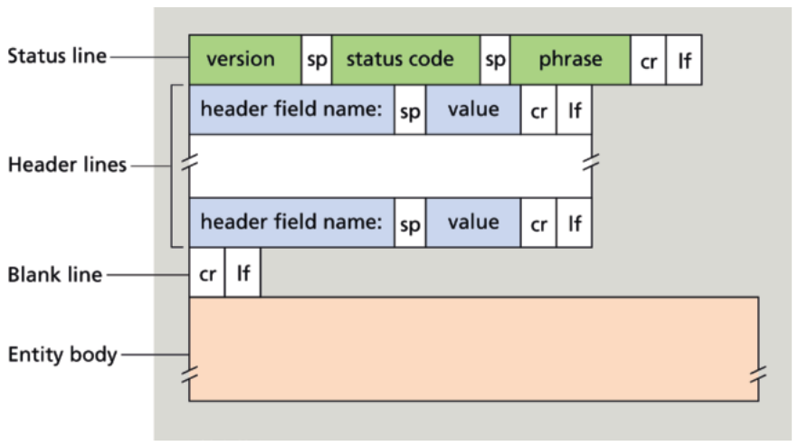

Hình 2.9 Định dạng tổng quát của một thông điệp phản hồi HTTP

• 404 Not Found: Tài liệu được yêu cầu không tồn tại trên server này.

• 505 HTTP Version Not Supported: Phiên bản giao thức HTTP được yêu cầu không được server hỗ trợ.

Bạn có muốn xem một thông điệp yêu cầu HTTP thực từ máy tính của bạn và phản hồi HTTP được Web server gửi lại không? Việc này rất dễ, và chúng tôi khuyên bạn hãy thử! Từ dấu nhắc dòng lệnh trên máy tính của bạn, nhập:

```
curl -v http://gaia.cs.umass.edu/kurose_ross/index.php
```

Lệnh curl ở trên sẽ gửi một yêu cầu HTTP GET tới Web server gaia. cs.umass.edu để lấy nội dung HTML /kurose_ross/index.php, là trang chủ của các tác giả cho cuốn sách này. Tùy chọn verbose (-v) sẽ khiến nội dung văn bản của thông điệp yêu cầu HTTP GET và phản hồi nhận được được hiển thị dưới dạng văn bản. Tất nhiên, nếu bạn muốn xem phản hồi nhận được trông thế nào khi được định dạng và hiển thị, chỉ cần nhập URL ở trên vào Web browser yêu thích của bạn.

Trong mục này, chúng ta đã thảo luận một số dòng header có thể được dùng trong các thông điệp yêu cầu và phản hồi HTTP. Đặc tả HTTP định nghĩa rất, rất nhiều dòng header khác có thể được chèn bởi browser, Web server và cache server mạng. Chúng ta mới chỉ đề cập một số nhỏ trong tổng số các dòng header. Chúng ta sẽ đề cập thêm vài dòng bên dưới và một số nhỏ khác khi thảo luận Web caching mạng trong Mục 2.2.5.

Browser quyết định đưa dòng header nào vào thông điệp yêu cầu như thế nào? Web server quyết định đưa dòng header nào vào thông điệp phản hồi như thế nào? Browser sẽ sinh các dòng header như một hàm của loại và phiên bản browser, cấu hình của người dùng cho browser và việc browser hiện có một phiên bản object được cache, nhưng có thể out-of-date (lỗi thời), hay không. Web server hành xử tương tự: Có các sản phẩm, phiên bản và cấu hình khác nhau, tất cả đều ảnh hưởng đến việc dòng header nào được đưa vào thông điệp phản hồi.

### 2.2.4 Tương tác người dùng–server: Cookie (User-Server Interaction: Cookies)

Chúng tôi đã đề cập ở trên rằng một HTTP server là phi trạng thái. Điều này đơn giản hóa thiết kế server và đã cho phép các kỹ sư phát triển các Web server high-performance có thể xử lý hàng nghìn kết nối TCP đồng thời. Tuy nhiên, một Web site thường muốn nhận diện người dùng, hoặc vì server muốn hạn chế quyền truy cập của người dùng hoặc vì nó muốn phục vụ nội dung như một hàm của danh tính người dùng. Cho những mục đích này, HTTP dùng cookie. Cookie, được định nghĩa trong [RFC 6265], cho phép các site theo dõi người dùng. Hầu hết các Web site thương mại lớn ngày nay đều dùng cookie.

Như minh họa trong Hình 2.10, công nghệ cookie có bốn thành phần: (1) một dòng header cookie trong thông điệp phản hồi HTTP; (2) một dòng header cookie trong thông điệp yêu cầu HTTP; (3) một file cookie được giữ trên end system của người dùng và được browser của người dùng quản lý; và (4) một cơ sở dữ liệu back-end tại Web site. Dùng Hình 2.10, hãy đi qua một ví dụ về cách cookie hoạt động. Giả sử Susan, người luôn truy cập Web bằng Google Chrome từ PC ở nhà, liên lạc với Amazon.com lần đầu tiên. Giả sử rằng trước đây cô đã từng ghé site eBay. Khi yêu cầu đến Amazon Web server, server tạo một số định danh duy nhất và tạo một mục trong cơ sở dữ liệu back-end của nó được đánh chỉ mục theo số định danh. Amazon Web server sau đó phản hồi browser của Susan, đưa vào phản hồi HTTP một header Set-cookie:, chứa số định danh. Ví dụ, dòng header có thể là:

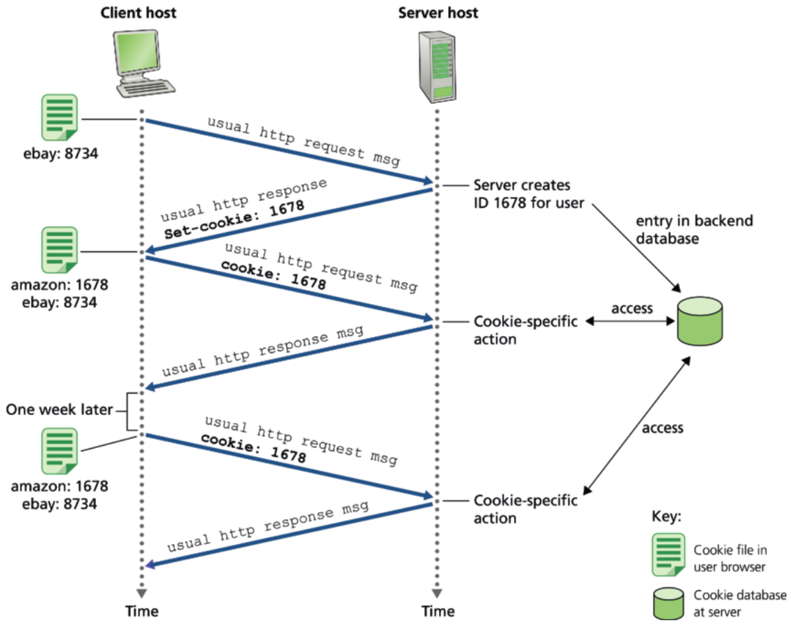

Hình 2.10 Giữ trạng thái người dùng bằng cookie

```
Set-cookie: 1678
```

Khi browser của Susan nhận thông điệp phản hồi HTTP, nó thấy header Set-cookie:. Browser sau đó thêm một dòng vào file cookie đặc biệt mà nó quản lý. Dòng này bao gồm hostname của server và số định danh trong header Set-cookie:. Lưu ý rằng file cookie đã có một mục cho eBay, vì Susan đã ghé site đó trước đây. Khi Susan tiếp tục duyệt site Amazon, mỗi lần cô yêu cầu một trang Web, browser của cô tham khảo file cookie, trích xuất số định danh của cô cho site này, và đặt một dòng header cookie bao gồm số định danh vào yêu cầu HTTP. Cụ thể, mỗi yêu cầu HTTP của cô tới Amazon server bao gồm dòng header:

```
Cookie: 1678
```

Bằng cách này, Amazon server có thể theo dõi hoạt động của Susan tại site Amazon. Mặc dù Web site Amazon không nhất thiết biết tên Susan, nó biết chính xác người dùng 1678 đã ghé những trang nào, theo thứ tự nào, và vào những thời điểm nào! Amazon dùng cookie để cung cấp dịch vụ giỏ hàng— Amazon có thể duy trì danh sách mọi món Susan định mua, để cô có thể thanh toán tất cả cùng lúc ở cuối phiên.

Nếu Susan quay lại site Amazon, chẳng hạn, một tuần sau, browser của cô sẽ tiếp tục đặt dòng header Cookie: 1678 vào các thông điệp yêu cầu. Amazon cũng gợi ý sản phẩm cho Susan dựa trên các trang Web cô đã ghé tại Amazon trước đây. Nếu Susan cũng đăng ký với Amazon—cung cấp họ tên đầy đủ, địa chỉ e-mail, địa chỉ bưu chính và thông tin thẻ tín dụng—Amazon khi đó có thể đưa thông tin này vào cơ sở dữ liệu của mình, qua đó gắn tên Susan với số định danh của cô (và tất cả các trang cô đã ghé tại site trước đây!). Đây là cách Amazon và các site e-commerce khác cung cấp “one-click shopping (mua sắm một cú nhấp)”—khi Susan chọn mua một món hàng trong lần ghé sau, cô không cần re-enter (nhập lại) tên, số thẻ tín dụng hay địa chỉ.

Từ thảo luận này, chúng ta thấy cookie có thể được dùng để nhận diện người dùng. Lần đầu tiên người dùng ghé một site, người dùng có thể cung cấp một định danh người dùng (có thể là tên của họ). Trong các phiên tiếp theo, browser chuyển một header cookie tới server, qua đó nhận diện người dùng với server. Do đó cookie có thể được dùng để tạo một tầng phiên người dùng trên nền HTTP phi trạng thái. Ví dụ, khi người dùng đăng nhập vào một ứng dụng e-mail Web-based, browser gửi thông tin cookie tới server, cho phép server nhận diện người dùng suốt phiên làm việc của người dùng với ứng dụng.

Mặc dù cookie thường đơn giản hóa trải nghiệm mua sắm Internet cho người dùng, chúng gây tranh cãi vì chúng cũng có thể bị xem là xâm phạm quyền riêng tư. Như chúng ta vừa thấy, bằng cách kết hợp cookie và thông tin tài khoản user-supplied (do người dùng cung cấp), một Web site có thể biết rất nhiều về một người dùng và có khả năng bán thông tin này cho bên thứ ba.

### 2.2.5 Browser caching (Browser Caching)

Trước đó chúng ta đã học trong Hình 2.7 rằng độ trễ tối thiểu từ khi browser của bạn lần đầu yêu cầu một object từ Web server đến khi browser nhận được object đó là 2RTT—một RTT để thiết lập kết nối TCP giữa browser và server, và một RTT nữa để gửi yêu cầu HTTP và nhận phản hồi HTTP. Chúng ta sẽ sớm học rằng phiên bản HTTP gần nhất ( HTTP/3) đã được tối ưu để chỉ cần một RTT để yêu cầu một trang web trong nhiều trường hợp. Nhưng liệu chúng ta có thể cắt độ trễ này xuống còn ít hơn một RTT không? Độ trễ bằng không chẳng phải tuyệt vời sao? Mặc dù điều này có vẻ thách thức định luật vật lý, nó thực sự có thể xảy ra với browser caching, một kỹ thuật được triển khai trong mọi Web browser hiện đại, và được dùng rộng rãi trên Web. Một ước tính cho rằng 75% yêu cầu Web nhận được phản hồi HTTP có kèm loại chỉ dẫn browser caching tường minh mà chúng ta sẽ nghiên cứu bên dưới [Web almanac 2021]. Với browser caching, một Web browser lưu cục bộ nội dung của các object Web nhận được gần đây trong browser cache của nó. Khi người dùng yêu cầu một object Web, browser trước hết kiểm tra xem object đó có được lưu trong browser cache cục bộ không. Nếu có, nó có thể hiển thị ngay object Web đó, mà không đưa ra yêu cầu mới tới Web server (và chịu độ trễ yêu cầu/phản hồi kéo theo), vì browser đã yêu cầu và nhận object đó trước đây từ Web server.

Mặc dù browser caching có thể giảm thời gian phản hồi user-perceived (người dùng cảm nhận) và giảm lượng traffic HTTP được chuyển qua Internet (những lợi ích chúng ta sẽ khám phá trong các bài tập end-of-chapter (cuối chương)), nó đặt ra một thách thức mới quan trọng—làm sao browser biết object hiện đang nằm trên Web server đã bị sửa đổi kể từ khi bản sao được cache tại client hay chưa? Một số loại object Web như ảnh, file JavaScript và file CSS hiếm khi thay đổi; các object khác như văn bản có thể thay đổi thường xuyên. Làm sao browser biết nội dung trong cache của nó còn up-to-date (cập nhật) hay đã cũ? May mắn thay, giao thức HTTP cung cấp các trường trong cả thông điệp HTTP GET lẫn thông điệp phản hồi để giúp server và browser quản lý browser caching [RFC 7232]:

• Cache-Control. Trường Cache-Control trong thông điệp phản hồi HTTP cho phép server chỉ định cách nội dung trong thông điệp trả lời HTTP nên được cache. Chỉ thị Cache Control:no-store bảo browser không cache/lưu nội dung cục bộ. Trong trường hợp này, browser sẽ luôn phải re-request (yêu cầu lại) nội dung từ server. Ngoài ra, server có thể chỉ dẫn tường minh cho browser về lượng thời gian một object có thể ở lại trong cache. Ví dụ, chỉ thị Cache-Control: max-age=3600 cho browser biết nội dung có thể được cache trong 3600 giây, nhưng sau đó phải được re-requested từ server. Nhiều chỉ thị Cache-Control khác được định nghĩa trong [RFC 7232].

• If-Modified-Since. HTTP cũng cung cấp một cơ chế trong thông điệp HTTP client-to-server, gọi là thông điệp GET có điều kiện (conditional GET), để hỗ trợ caching. Thông điệp GET có điều kiện là thông điệp HTTP GET thông thường có thêm một dòng header If-Modified-Since:. Với một GET có điều kiện, client yêu cầu tường minh một object, nhưng cho server biết rằng nó có object đó trong browser cache và object đó được thêm vào cache khi nào. HTTP server đến lượt mình sẽ trả lời bằng toàn bộ object nếu object đó đã thay đổi trong khoảng thời gian xen giữa; nếu không, nó chỉ đơn giản cho browser biết rằng bản sao (trong browser cache) của nó vẫn còn hiện hành và không gửi lại object.

Để minh họa cách GET có điều kiện hoạt động, hãy đi qua một ví dụ. Giả sử một browser trước đó đã yêu cầu một object, chẳng hạn kiwi.jpg, có object đó trong cache và đã ghi lại thời điểm kiwi.jpg được thêm vào cache. Tuy nhiên, khi người dùng sau đó yêu cầu lại object này, browser không chắc bản sao đã cache này có còn hiện hành hay không. Điều này có thể xảy ra vì server chưa bao giờ cung cấp thông tin cache-control, server trước đó đã cung cấp một chỉ thị cache-control với một max-age đã hết hạn, hoặc server đã chỉ dẫn browser cache object nhưng cũng chỉ dẫn browser luôn kiểm tra tường minh với server về độ mới của object. Trong trường hợp này, browser gửi một GET có điều kiện tới server:

```
GET /fruit/kiwi.jpg HTTP/1.1
Host: www.exotiquecuisine.com
If-modified-since: Fri, 13 Sep 2024 09:23:24
```

Giá trị của dòng header If-modified-since: cho biết object trong cache của browser được nhận vào 13 Sep 2024 lúc 9:23:24. GET có điều kiện này đang bảo server chỉ gửi object nếu object đã bị sửa đổi kể từ ngày được chỉ định. Giả sử object chưa bị sửa đổi kể từ 13 Sep 2024 09:23:24. Trong trường hợp này, Web server gửi một thông điệp phản hồi HTTP:

```
HTTP/1.1 304 Not Modified
Date: Fri, 8 Nov 2024 12:07:29
Server: Apache/2.4.62 (Unix)
(empty entity body)
```

Chúng ta thấy trong trường hợp này, Web server vẫn gửi một thông điệp phản hồi nhưng không đưa object được yêu cầu vào thông điệp phản hồi. 304 Not Modified trong dòng trạng thái cho browser biết bản sao của object trong cache của browser còn hiện hành và do đó bản sao đã cache của object có thể được dùng. Việc đưa object được yêu cầu vào chỉ lãng phí băng thông và tăng thời gian phản hồi user-perceived, đặc biệt nếu object lớn.

### 2.2.6 HTTP/2

HTTP/2 [RFC 7540], được chuẩn hóa năm 2015, là phiên bản HTTP mới đầu tiên kể từ HTTP/1.1, được chuẩn hóa năm 1997. Kể từ khi chuẩn hóa, HTTP/2 đã cất cánh, với khoảng 35% trong top 10 triệu website hỗ trợ HTTP/2 vào năm 2024 [W3Techs]. Hầu hết browser—bao gồm Google Chrome, Microsoft Edge, Safari, Opera và Firefox—cũng hỗ trợ HTTP/2. Mức sử dụng trong những năm gần đây đã giảm phần nào do sự xuất hiện của HTTP/3, thảo luận trong Mục 2.2.7. Các mục tiêu chính của HTTP/2 là giảm độ trễ cảm nhận bằng cách cho phép ghép kênh (multiplexing) yêu cầu và phản hồi trên một kết nối TCP duy nhất, cung cấp ưu tiên hóa yêu cầu và server push, và cung cấp nén hiệu quả các trường header HTTP. HTTP/2 không thay đổi các method HTTP, mã trạng thái, URL hay trường header. Thay vào đó, HTTP/2 thay đổi cách dữ liệu được định dạng và vận chuyển giữa client và server.

Để thấy động lực cần có HTTP/2, nhớ lại rằng HTTP/1.1 dùng kết nối TCP bền, cho phép một trang Web được gửi từ server tới client qua một kết nối TCP duy nhất. Bằng cách chỉ có một kết nối TCP cho mỗi trang Web, số socket tại server được giảm bớt và mỗi trang Web được vận chuyển nhận được phần chia công bằng của băng thông mạng (như thảo luận bên dưới). Nhưng các nhà phát triển Web browser nhanh chóng phát hiện rằng việc gửi mọi object trong một trang Web qua một kết nối TCP duy nhất gặp vấn đề Head of Line (HOL) blocking (nghẽn đầu hàng). Để hiểu HOL blocking, hãy xét một trang Web bao gồm một trang HTML gốc, một video clip lớn gần đầu trang Web, và nhiều object nhỏ bên dưới video. Giả sử thêm có một liên kết nút cổ chai tốc độ low-to-medium (thấp đến trung bình) (ví dụ, một liên kết không dây low-speed) trên đường giữa server và client. Khi dùng một kết nối TCP duy nhất, video clip sẽ mất nhiều thời gian để đi qua liên kết nút cổ chai, trong khi các object nhỏ bị trễ khi chờ phía sau video clip; tức là, video clip ở đầu hàng chặn các object nhỏ phía sau nó. Các browser HTTP/1.1 thường giải quyết vấn đề này bằng cách mở nhiều kết nối TCP song song, qua đó các object trong cùng trang web được gửi song song tới browser. Bằng cách này, các object nhỏ có thể tới và được render trong browser nhanh hơn nhiều, qua đó giảm độ trễ user-perceived.

Điều khiển tắc nghẽn TCP, thảo luận chi tiết trong Chương 3, cũng tạo cho browser một động cơ ngoài ý muốn để dùng nhiều kết nối TCP song song thay vì một kết nối bền duy nhất. Nói rất đại khái, điều khiển tắc nghẽn TCP nhằm cho mỗi kết nối TCP dùng chung một liên kết nút cổ chai một phần bằng nhau của băng thông khả dụng của liên kết đó; vì vậy nếu có n kết nối TCP hoạt động trên một liên kết nút cổ chai, thì mỗi kết nối nhận xấp xỉ 1n/th băng thông. Bằng cách mở nhiều kết nối TCP song song để vận chuyển một trang Web duy nhất, browser có thể “gian lận” và giành một phần lớn hơn của băng thông liên kết. Nhiều browser HTTP/1.1 mở tới sáu kết nối TCP song song không chỉ để né HOL blocking mà còn để có thêm băng thông.

Một trong các mục tiêu chính của HTTP/2 là loại bỏ (hoặc ít nhất giảm số lượng) các kết nối TCP song song để vận chuyển một trang Web duy nhất. Điều này không chỉ giảm số socket cần được mở và duy trì tại server, mà còn cho phép điều khiển tắc nghẽn TCP hoạt động như dự định. Nhưng với chỉ một kết nối TCP để vận chuyển một trang Web, HTTP/2 cần các cơ chế được thiết kế cẩn thận để tránh HOL blocking.

#### Cơ chế framing của HTTP/2 (HTTP/2 Framing)

Giải pháp của HTTP/2 cho HOL blocking là chia mỗi thông điệp thành các frame nhỏ, và đan xen (interleave) các thông điệp yêu cầu và phản hồi trên cùng kết nối TCP. Để hiểu điều này kỹ hơn, hãy xét lại ví dụ một trang Web gồm một video clip lớn và, chẳng hạn, 8 object nhỏ hơn. Do đó server sẽ nhận 9 yêu cầu đồng thời từ bất kỳ browser nào muốn xem trang Web này. Với mỗi yêu cầu này, server cần gửi 9 thông điệp phản hồi HTTP cạnh tranh nhau tới browser qua cùng kết nối TCP. Để đơn giản, giả sử mọi frame có độ dài cố định, video clip gồm 1000 frame, và mỗi object nhỏ hơn gồm hai frame. Với đan xen frame, sau khi gửi một frame từ video clip, frame đầu tiên của mỗi object nhỏ được gửi. Sau đó sau khi gửi frame thứ hai của video clip, frame cuối cùng của mỗi object nhỏ được gửi. Do đó, tất cả các object nhỏ hơn được gửi xong sau khi gửi tổng cộng 18 frame. Nếu không dùng đan xen, các object nhỏ hơn chỉ được gửi sau khi gửi 1016 frame. Do đó cơ chế framing của HTTP/2 có thể giảm đáng kể độ trễ user-perceived.

Khả năng chia một thông điệp HTTP thành các frame độc lập, đan xen chúng, rồi ráp lại ở đầu kia là cải tiến quan trọng nhất của HTTP/2. Việc framing được thực hiện bởi sub-layer (tầng con) framing của giao thức HTTP/2. Khi một server muốn gửi một phản hồi HTTP, phản hồi được xử lý bởi sub-layer framing, nơi nó được chia thành các frame. Trường header của phản hồi trở thành một frame, và phần body của thông điệp được chia thành một hoặc nhiều frame bổ sung. Các frame của phản hồi sau đó được sub-layer framing ở server đan xen với các frame của các phản hồi khác và gửi qua kết nối TCP bền duy nhất. Khi các frame tới client, trước hết chúng được ráp lại thành các thông điệp phản hồi gốc tại sub-layer framing rồi được browser xử lý như bình thường. Tương tự, các yêu cầu HTTP của client được chia thành frame và đan xen.

Ngoài việc chia mỗi thông điệp HTTP thành các frame độc lập, sublayer framing cũng mã hóa nhị phân các frame. Các giao thức nhị phân phân tích hiệu quả hơn, dẫn tới frame nhỏ hơn một chút, và ít error-prone (dễ lỗi) hơn.

#### Ưu tiên hóa thông điệp phản hồi và server push (Response Message Prioritization and Server Pushing)

Ưu tiên hóa thông điệp cho phép nhà phát triển tùy chỉnh mức ưu tiên tương đối của các yêu cầu để tối ưu tốt hơn performance của ứng dụng. Như chúng ta vừa học, sub-layer framing tổ chức thông điệp thành các luồng dữ liệu song song gửi tới cùng một bên yêu cầu. Khi một client gửi các yêu cầu đồng thời tới một server, nó có thể ưu tiên hóa các phản hồi nó đang yêu cầu bằng cách gán một trọng số giữa 1 và 256 cho mỗi thông điệp. Số càng cao cho biết mức ưu tiên càng cao. Dùng các trọng số này, server có thể gửi trước các frame của các phản hồi có mức ưu tiên cao nhất. Ngoài ra, client cũng nêu sự phụ thuộc của mỗi thông điệp vào các thông điệp khác bằng cách chỉ định ID của thông điệp mà nó phụ thuộc.

Một tính năng khác của HTTP/2 là khả năng server gửi nhiều phản hồi cho một yêu cầu client duy nhất. Tức là, ngoài phản hồi cho yêu cầu gốc, server có thể push thêm các object tới client, mà client không phải yêu cầu từng cái. Điều này khả thi vì trang HTML gốc cho biết các object sẽ cần để render đầy đủ trang Web. Vì vậy thay vì chờ các yêu cầu HTTP cho những object này, server có thể phân tích trang HTML, xác định các object cần thiết, và gửi chúng tới client trước khi nhận yêu cầu tường minh cho các object này. Server push loại bỏ độ trễ phụ do chờ các yêu cầu.

### 2.2.7 HTTP/3 và QUIC

Chúng ta vừa học về sự tiến hóa của giao thức HTTP, từ HTTP/1.0 tới HTTP/1.1 tới HTTP/2. Mặc dù ba giao thức đó có những khác biệt đáng kể, một đặc điểm chung quan trọng mà chúng có là tất cả đều chạy trên TCP. Nhưng điều đó không có nghĩa HTTP sẽ luôn chạy trên TCP! HTTP/3, được chuẩn hóa năm 2022 trong RFC 9114, đã tạo cơn sốt trong cộng đồng Internet. Nó đang nhanh chóng giành thị phần trên Web, bao gồm cho email, video/audio streaming và mạng xã hội, và đã trở thành phiên bản HTTP mặc định cho nhiều Web browser và ứng dụng smartphone phổ biến. Và đáng chú ý, HTTP/3 không chạy trên TCP mà trên UDP! Bạn có thể hỏi, sao lại thế được, khi UDP là một giao thức giao vận bare-bones (tối giản) không có truyền dữ liệu tin cậy, và do đó không có đảm bảo chuyển giao thông điệp HTTP? Chúng ta sẽ sớm tìm hiểu tận gốc bí ẩn hấp dẫn nhất này.

#### Giao thức giao vận QUIC (The QUIC Transport Protocol)

HTTP/3 chạy trên giao thức giao vận Quick UDP Internet Connections (QUIC). Vì vậy trước khi mô tả HTTP/3, chúng ta cần thảo luận giao thức giao vận QUIC, được chuẩn hóa năm 2021 trong RFC 9000. Giờ có thể bạn đang nghĩ, “Khoan đã! Chẳng phải các tác giả đã nói đi nói lại với chúng ta rằng Internet có đúng hai giao thức giao vận—UDP và TCP sao? Và giờ họ nói với chúng ta có một giao thức giao vận thứ ba gọi là QUIC? Vậy, Internet có hai hay ba giao thức giao vận?”

Hãy thử làm rõ điều này. Nói chặt chẽ, Internet vẫn chỉ có hai giao thức giao vận, TCP và UDP. Và thực ra, QUIC không thực sự là một giao thức tầng giao vận, mà là một sub-layer trong tầng ứng dụng dùng UDP để gửi và nhận packet qua Internet, như minh họa trong Hình 2.11. Do đó có chữ “UDP” trong tên, Quick UDP Internet Connections (QUIC).

Tuy nhiên, mặc dù QUIC, nói chặt chẽ, không phải là một giao thức transport-layer, từ góc nhìn của nhà phát triển ứng dụng thì nó là. Thật vậy, các nhà phát triển ứng dụng mạng có thể viết ứng dụng bằng cách tạo socket QUIC tương tự cách họ tạo socket TCP và UDP (thảo luận trong Mục 2.6). Khi ứng dụng thiết lập một socket QUIC, sublayer QUIC sau đó sẽ tạo một socket UDP, như mô tả trong Mục 2.6. Ứng dụng sau đó có thể gửi thông điệp vào và nhận thông điệp từ socket QUIC mà không cần bận tâm tới cơ chế bên trong của QUIC. Tóm lại, mặc dù trên thực tế QUIC là một sublayer của tầng ứng dụng, từ góc nhìn của nhà phát triển ứng dụng QUIC là một giao thức tầng giao vận mới.

#### Tại sao cần một “giao thức giao vận” mới? (Why a New “Transport Protocol”?)

Mặc dù QUIC là một giao thức tổng quát có thể được nhiều ứng dụng sử dụng, nó chủ yếu được thiết kế với mục tiêu cải thiện performance của Web. Hãy xem đâu là chỗ có thể cải thiện performance.

Trong quá khứ xa (khoảng cho đến 2005), hầu hết các giao dịch Web chạy trực tiếp trên TCP mà không có mã hóa nào. Nhưng qua nhiều năm, mã hóa và xác thực đã trở thành yêu cầu mặc định trong hầu hết các giao dịch Web, bao gồm lướt Web, tìm kiếm Web và email Web-based. Các dịch vụ bảo mật như vậy thường được cung cấp cho ứng dụng Web thông qua TLS như mô tả trong khung “Security in Focus” ở Mục 2.3 và chi tiết hơn trong Chương 8. Do đó, hầu hết các giao dịch Web HTTP/1.1 và HTTP/2 ngày nay dùng TLS chạy trên TCP (với TLS chạy trong một sub-layer của tầng ứng dụng, như mô tả trong khung bên). Nhưng thiết kế “TLS trên TCP” này (thường được gọi là https) cần hai giai đoạn bắt tay: một giai đoạn để thiết lập kết nối TCP và một giai đoạn tiếp theo để chia sẻ khóa mã hóa giữa client và server. Điều này có thể gây ra độ trễ không mong muốn cho các ứng dụng HTTP tương tác, bao gồm duyệt Web. Một trong những tính năng quan trọng nhất của QUIC là nó loại bỏ double-handshake (bắt tay kép) này bằng cách gộp giai đoạn bắt tay TLS vào bắt tay thiết lập kết nối ban đầu—và do đó có từ “Quick” trong “Quick Internet UDP Connections”.

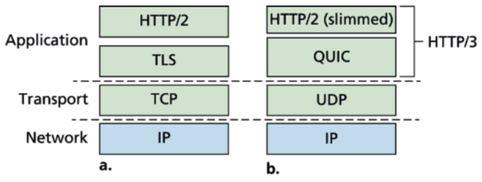

Hình 2.11 a. protocol stack HTTP bảo mật truyền thống; b. protocol stack HTTP/3 QUIC-based bảo mật

Cụ thể hơn, QUIC tích hợp một phiên bản gần đây của TLS, gọi là TLS 1.3, trực tiếp vào giao thức QUIC, loại bỏ nhu cầu một bắt tay TLS riêng. Bằng cách này, QUIC thực hiện cả thiết lập kết nối và thiết lập mã hóa trong một round trip, giảm độ trễ. Hơn nữa, khi kết nối lại, QUIC có thể dùng các tham số phiên và mã hóa đã lưu trước đó, cho phép truyền dữ liệu 0-RTT mà không chờ một bắt tay đầy đủ, giảm thêm thời gian thiết lập kết nối.

Ngoài việc giảm thời gian set-up (thiết lập) kết nối, QUIC cũng re-examines (xem xét lại) vấn đề HOL blocking, được giới thiệu trong Mục 2.2.6. Nhớ rằng HTTP/2 giải quyết vấn đề HOL blocking cho tình huống khi một object Web lớn đứng trước các object nhỏ hơn khác, tất cả đều đang được gửi qua một kết nối TCP duy nhất. HTTP/2 giải quyết vấn đề này bằng cách chia các thông điệp HTTP thành các frame nhỏ, và ghép kênh các frame từ các thông điệp HTTP khác nhau trên kết nối TCP duy nhất. Nhưng, hóa ra, HTTP/2 không giải quyết triệt để vấn đề HOL blocking. Trong HTTP/2, nhiều thông điệp được ghép kênh trên một kết nối TCP duy nhất. Nếu một packet bị mất trong kết nối này, TCP yêu cầu packet bị mất phải được truyền lại và xử lý trước khi các packet khác có thể được chuyển giao. Điều này làm trễ tất cả các thông điệp khác, ngay cả khi chúng không phụ thuộc vào packet bị mất. Hiện tượng này dẫn tới một dạng HOL blocking khác, trong đó một packet bị mất của một thông điệp HTTP chặn việc truyền các thông điệp HTTP khác. Vấn đề này đặc biệt nghiêm trọng trong môi trường không dây, nơi tỉ lệ mất gói có thể cao.

QUIC giải quyết điều này bằng cách dùng UDP thay vì TCP, rồi áp dụng data-transfer (truyền dữ liệu) tin cậy cho từng thông điệp riêng biệt bên trong cùng một kết nối QUIC. QUIC dùng thuật ngữ “stream” cho các luồng dữ liệu khác nhau (các thông điệp HTTP khác nhau trong bối cảnh HTTP) dùng chung cùng một kết nối QUIC. Cụ thể, QUIC không chỉ chia stream thành các frame nhỏ và ghép kênh các frame, mà còn quản lý mỗi stream độc lập bên trong một kết nối QUIC duy nhất, nghĩa là nếu một packet từ một stream bị mất, chỉ stream đó bị ảnh hưởng. Các stream khác có thể tiếp tục gửi và nhận dữ liệu mà không chờ packet bị mất được truyền lại, loại bỏ vấn đề HOL blocking vốn gây khổ cho TCP single-connection (một kết nối). Cơ chế bên trong của QUIC được thảo luận chi tiết hơn trong Mục 3.7.

#### Các dịch vụ QUIC (QUIC Services)

Giả sử bạn muốn phát triển một ứng dụng mạng mới. Bạn nên chạy ứng dụng trên UDP, TCP hay QUIC? Để đưa ra quyết định này, bạn sẽ muốn biết mỗi giao thức này sẽ cung cấp những dịch vụ gì cho ứng dụng của bạn. Chúng ta đã thảo luận các dịch vụ mà UDP và TCP cung cấp trong Mục 2.1.4. Giờ hãy tóm tắt các dịch vụ của QUIC để bạn có đầy đủ dữ kiện trong tay trước khi đưa ra quyết định quan trọng này.

Từ góc nhìn của nhà phát triển ứng dụng, các dịch vụ QUIC giống với TCP hơn là UDP.

• Giống TCP, QUIC là connection-oriented. Trước khi gửi dữ liệu, một kết nối QUIC được tạo giữa client và server. Kết nối này được thiết lập trên nền giao thức phi kết nối bare-bones UDP.

• Giống TCP, QUIC cung cấp truyền dữ liệu tin cậy, để ứng dụng biết rằng mọi thông điệp một phía gửi đi cuối cùng sẽ tới phía bên kia.

• Giống TCP, QUIC cung cấp dịch vụ điều khiển tắc nghẽn và điều khiển luồng (flow control).

Nhưng QUIC cung cấp thêm các dịch vụ vượt xa các dịch vụ do TCP cung cấp, những dịch vụ rất đáng mong muốn cho các ứng dụng trong Internet hiện đại:

• Built-in (tích hợp sẵn) Encryption: QUIC tích hợp TLS 1.3 (mà chúng ta sẽ học trong Chương 8) trực tiếp vào giao thức của nó, cung cấp giao tiếp được mã hóa theo mặc định. Điều này loại bỏ nhu cầu các bắt tay riêng cho TLS trên TCP, khiến các kết nối bảo mật nhanh hơn và hiệu quả hơn.

• Independent Data Streams (các luồng dữ liệu độc lập): QUIC cho phép nhiều stream (ví dụ, nhiều thông điệp HTTP) được gửi đồng thời qua một kết nối QUIC duy nhất. Các stream này độc lập, nên mất gói ở một stream không ảnh hưởng tới các stream khác, không như trong TCP, nơi mất mát ở một stream có thể làm trễ mọi stream. Hơn nữa, mỗi stream có thể được quản lý riêng, cho phép ứng dụng ưu tiên hóa các loại dữ liệu khác nhau, như video, văn bản hoặc thông điệp điều khiển, đảm bảo trải nghiệm người dùng mượt mà hơn.

• 0 - RTT Handshakes: Với các client quay lại, QUIC hỗ trợ bắt tay 0-RTT, cho phép dữ liệu được gửi ngay mà không chờ một bắt tay kết nối đầy đủ. Điều này tăng tốc việc kết nối lại tới dịch vụ, có lợi cho các ứng dụng latency-sensitive (nhạy cảm độ trễ) như lướt Web và chơi game.

• Connection Migration (di chuyển kết nối): QUIC hỗ trợ di chuyển kết nối, cho phép kết nối vẫn hoạt động nếu địa chỉ IP của client thay đổi (ví dụ, chuyển từ Wi-Fi sang di động cellular). Điều này cải thiện độ tin cậy cho người dùng di động, nơi điều kiện mạng thay đổi thường xuyên.

#### HTTP/3: Chạy Web trên QUIC (HTTP/3: Running the Web over QUIC)

HTTP/3, phiên bản mới nhất của HTTP, được thiết kế để giải quyết một số hạn chế trong các phiên bản trước, đặc biệt về performance, bảo mật và độ tin cậy trên các mạng hiện đại. Không như các phiên bản trước, HTTP/3 hoạt động trên giao thức QUIC, cung cấp tất cả các dịch vụ QUIC vừa mô tả. Kể từ khi phát hành, HTTP/3 đã được áp dụng ngày càng rộng. Các browser lớn như Chrome, Firefox, Edge và Safari giờ đều hỗ trợ HTTP/3 và đã dùng nó làm giao thức HTTP mặc định khi kết nối tới các server HTTP/3-compatible (tương thích). Các công ty Internet hàng đầu như Google cũng đã triển khai HTTP/3 để cải thiện trải nghiệm người dùng trên nhiều dịch vụ của họ, bao gồm tìm kiếm, phân phối video và hội nghị video.

HTTP/3 không thay đổi định dạng thông điệp của các giao thức HTTP trước đó. Thay đổi lớn duy nhất của nó so với HTTP/2 là thay vì dùng một kết nối TCP bền giữa client và server để gửi các thông điệp HTTP, nó dùng một kết nối QUIC bền. Chúng ta sẽ mô tả chi tiết hơn cách các thông điệp HTTP được gửi và nhận qua kết nối QUIC trong Mục 2.6.3.

Tóm lại, client và server HTTP/3 dùng các tính năng của QUIC—như thiết lập kết nối nhanh, mã hóa, ghép kênh các stream độc lập, ưu tiên hóa và di chuyển kết nối—để chuyển giao hiệu quả và an toàn nhiều object của một trang Web song song, đồng thời giảm độ trễ và đảm bảo truyền mượt mà, không gián đoạn.

## 2.3 Thư điện tử trong Internet (Electronic Mail in the Internet)

Thư điện tử đã tồn tại từ buổi đầu của Internet. Nó là ứng dụng phổ biến nhất khi Internet còn sơ khai [Segaller 1998], và đã trở nên tinh vi và mạnh mẽ hơn qua nhiều năm. Nó vẫn là một trong những ứng dụng quan trọng và được dùng nhiều nhất của Internet.

Trong mục này, chúng ta xem xét các giao thức application-layer là trung tâm của e-mail Internet. Nhưng trước khi đi vào thảo luận in-depth (chuyên sâu) về các giao thức này, hãy có một cái nhìn high-level (tổng quan) về hệ thống mail Internet và các thành phần then chốt của nó.

Hình 2.12 trình bày một cái nhìn high-level về hệ thống mail Internet. Từ sơ đồ này chúng ta thấy nó có ba thành phần chính: user agent, mail server, và Simple Mail Transfer Protocol (SMTP). Giờ chúng ta mô tả từng thành phần này trong bối cảnh một người gửi, Alice, gửi một thông điệp e-mail tới một người nhận, Bob. User agent cho phép người dùng đọc, trả lời, chuyển tiếp, lưu và soạn thông điệp. Ví dụ về user agent cho e-mail bao gồm Microsoft Outlook, Apple Mail, Gmail Web-based, ứng dụng Gmail chạy trên smartphone, v.v. Ngày nay, nhiều người dùng gửi email tới mail server của họ và nhận email từ mail server của họ thông qua các user agent HTTP-based như gmail và Yahoo! mail. Khi Alice soạn xong thông điệp, user agent của cô gửi thông điệp tới mail server của cô, nơi thông điệp được đặt vào hàng đợi thông điệp gửi đi của mail server. Khi Bob muốn đọc một thông điệp, user agent của anh lấy thông điệp từ mailbox của anh trong mail server của anh.

Mail server tạo thành lõi của hạ tầng e-mail. Mỗi người nhận, như Bob, có một mailbox nằm trong một trong các mail server. Mailbox của Bob quản lý và duy trì các thông điệp đã được gửi cho anh. Một thông điệp điển hình bắt đầu hành trình ở user agent của người gửi, rồi đi tới mail server của người gửi, rồi đi tới mail server của người nhận, nơi nó được đặt vào mailbox của người nhận. Khi Bob muốn truy cập các thông điệp trong mailbox, mail server chứa mailbox của anh xác thực Bob (bằng username và mật khẩu của anh). Mail server của Alice cũng phải xử lý các sự cố ở mail server của Bob. Nếu server của Alice không thể chuyển mail tới server của Bob, server của Alice giữ thông điệp trong một hàng đợi thông điệp và cố gắng truyền thông điệp sau. Việc thử lại thường được thực hiện khoảng mỗi 30 phút; nếu không thành công sau vài ngày, server xóa thông điệp và thông báo cho người gửi (Alice) bằng một thông điệp e-mail.

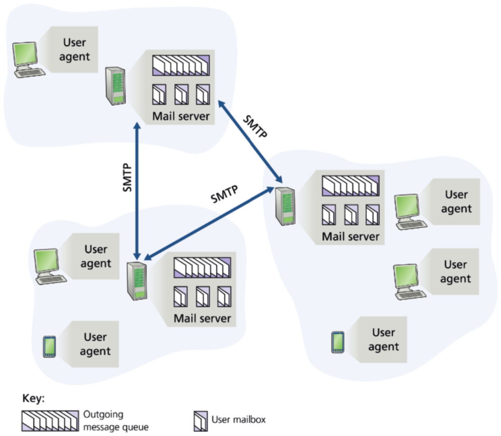

Hình 2.12 Cái nhìn high-level về hệ thống e-mail Internet

SMTP là giao thức application-layer chính cho thư điện tử Internet. Nó dùng dịch vụ truyền dữ liệu tin cậy của TCP để truyền mail từ mail server của người gửi tới mail server của người nhận. Như hầu hết các giao thức application-layer, SMTP có hai phía: một phía client, chạy trên mail server của người gửi, và một phía server, chạy trên mail server của người nhận. Cả phía client và phía server của SMTP đều chạy trên mọi mail server. Khi một mail server gửi mail tới các mail server khác, nó đóng vai SMTP client. Khi một mail server nhận mail từ các mail server khác, nó đóng vai SMTP server.

### 2.3.1 SMTP

SMTP, được định nghĩa trong RFC 5321, là trung tâm của thư điện tử Internet. Như đã đề cập ở trên, SMTP truyền thông điệp từ mail server của người gửi tới mail server của người nhận. SMTP lâu đời hơn HTTP rất nhiều. (RFC SMTP gốc có từ năm 1982, và SMTP đã tồn tại từ lâu trước đó.) Mặc dù SMTP có nhiều phẩm chất tuyệt vời, bằng chứng là sự phổ biến khắp nơi của nó trong Internet, nó vẫn là một công nghệ cũ (legacy) mang một số đặc điểm cổ lỗ. Ví dụ, nó giới hạn phần body (không chỉ header) của mọi thông điệp mail ở ASCII 7-bit đơn giản. Giới hạn này hợp lý vào đầu những năm 1980s khi dung lượng truyền khan hiếm và không ai e-mailing (gửi kèm qua thư) file đính kèm lớn hay file ảnh, audio hoặc video lớn. Nhưng ngày nay, trong kỷ nguyên đa phương tiện, giới hạn ASCII 7-bit hơi phiền toái—nó yêu cầu dữ liệu đa phương tiện nhị phân phải được mã hóa sang ASCII trước khi gửi qua SMTP; và nó yêu cầu thông điệp ASCII tương ứng phải được giải mã ngược về nhị phân sau khi vận chuyển bằng SMTP. Nhớ lại từ Mục 2.2 rằng HTTP không yêu cầu dữ liệu đa phương tiện phải được mã hóa ASCII trước khi truyền.

Để minh họa hoạt động cơ bản của SMTP, hãy đi qua một kịch bản thông thường. Giả sử Alice muốn gửi cho Bob một thông điệp ASCII đơn giản.

1. Alice gọi user agent cho e-mail của cô, cung cấp địa chỉ e-mail của Bob (ví dụ, bob@someschool.edu), soạn một thông điệp, và chỉ dẫn user agent gửi thông điệp.

2. User agent của Alice gửi thông điệp tới mail server của cô, nơi nó được đặt vào một hàng đợi thông điệp.

3. Phía client của SMTP, chạy trên mail server của Alice, thấy thông điệp trong hàng đợi thông điệp. Nó mở một kết nối TCP tới một SMTP server, chạy trên mail server của Bob.

4. Sau một số bước bắt tay SMTP ban đầu, SMTP client gửi thông điệp của Alice vào kết nối TCP.

5. Tại mail server của Bob, phía server của SMTP nhận thông điệp. Mail server của Bob sau đó đặt thông điệp vào mailbox của Bob.

6. Bob gọi user agent của anh để đọc thông điệp khi tiện.

Kịch bản được tóm tắt trong Hình 2.13.

Điều quan trọng cần nhận thấy là SMTP thường không dùng các mail server trung gian để gửi mail, ngay cả khi hai mail server nằm ở hai đầu đối diện của thế giới. Nếu server của Alice ở Hong Kong và server của Bob ở St. Louis, kết nối TCP là một kết nối trực tiếp giữa server ở Hong Kong và St. Louis. Cụ thể, nếu mail server của Bob bị sập, thông điệp vẫn ở lại mail server của Alice và chờ một lần thử mới—thông điệp không được đặt vào một mail server trung gian nào.

Giờ hãy xem kỹ hơn cách SMTP truyền một thông điệp từ một mail server gửi tới một mail server nhận. Chúng ta sẽ thấy giao thức SMTP có nhiều điểm tương đồng với các giao thức được dùng cho tương tác face-to-face (mặt đối mặt) của con người. Trước hết, SMTP client (chạy trên host mail server gửi) cho TCP thiết lập một kết nối tới port 25 tại SMTP server (chạy trên host mail server nhận). Nếu server bị sập, client thử lại sau. Khi kết nối này được thiết lập, server và client thực hiện một số bước bắt tay application-layer—giống như con người thường tự giới thiệu trước khi trao đổi thông tin với nhau, SMTP client và server tự giới thiệu trước khi truyền thông tin. Trong giai đoạn bắt tay SMTP này, SMTP client chỉ ra địa chỉ e-mail của người gửi (người tạo ra thông điệp) và địa chỉ e-mail của người nhận. Khi SMTP client và server đã giới thiệu với nhau, client gửi thông điệp. SMTP có thể trông cậy vào dịch vụ truyền dữ liệu tin cậy của TCP để đưa thông điệp tới server mà không có lỗi. Client sau đó lặp lại quá trình này trên cùng kết nối TCP nếu nó có các thông điệp khác cần gửi tới server; nếu không, nó chỉ dẫn TCP đóng kết nối.

Tiếp theo hãy xem một bản ghi ví dụ các thông điệp được trao đổi giữa một SMTP client (C) và một SMTP server (S). Hostname của client là crepes.fr và hostname của server là hamburger.edu. Các dòng văn bản ASCII có tiền tố C: chính xác là các dòng client gửi vào socket TCP của nó, và các dòng văn bản ASCII có tiền tố S: chính xác là các dòng server gửi vào socket TCP của nó. Bản ghi sau bắt đầu ngay khi kết nối TCP được thiết lập.

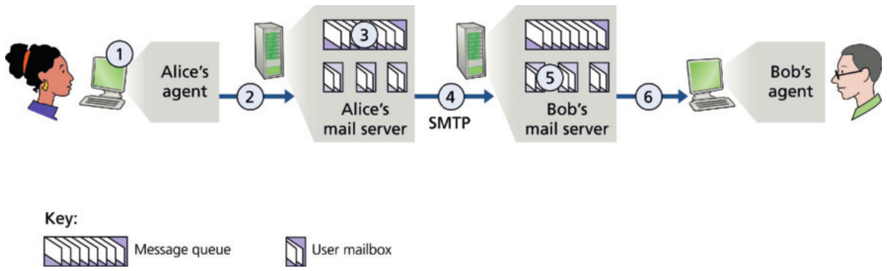

Hình 2.13 Alice gửi một thông điệp tới Bob

```
S: 220 hamburger.edu
C: HELO crepes.fr
S: 250 Hello crepes.fr, pleased to meet you
C: MAIL FROM: <alice@crepes.fr>
S: 250 alice@crepes.fr ... Sender ok
C: RCPT TO: <bob@hamburger.edu>
S: 250 bob@hamburger.edu ... Recipient ok
C: DATA
S: 354 Enter mail, end with ”.” on a line by itself
C: Do you like ketchup?
C: How about pickles?
C: .
S: 250 Message accepted for delivery
C: QUIT
S: 221 hamburger.edu closing connection
```

Trong ví dụ trên, client gửi một thông điệp (“Do you like ketchup? How about pickles?”) từ mail server crepes.fr tới mail server hamburger.edu. Trong cuộc hội thoại, client đưa ra năm lệnh: HELO (viết tắt của HELLO), MAIL FROM, RCPT TO, DATA và QUIT. Các lệnh này tự giải thích (self-explanatory). Client cũng gửi một dòng chỉ gồm một dấu chấm, cho server biết kết thúc thông điệp. (Theo thuật ngữ ASCII, mỗi thông điệp kết thúc bằng CRLF.CRLF, trong đó CR và LF lần lượt là carriage return và line feed.) Server đưa ra trả lời cho mỗi lệnh, với mỗi trả lời có một mã trả lời và một số giải thích English-language (bằng tiếng Anh) (tùy chọn). Chúng tôi đề cập ở đây rằng SMTP dùng kết nối bền: Nếu mail server gửi có nhiều thông điệp cần gửi tới cùng một mail server nhận, nó có thể gửi tất cả thông điệp qua cùng kết nối TCP. Với mỗi thông điệp, client bắt đầu quá trình bằng một MAIL FROM: crepes. fr mới, đánh dấu kết thúc thông điệp bằng một dấu chấm đứng riêng, và chỉ đưa ra QUIT sau khi mọi thông điệp đã được gửi.

Chúng tôi rất khuyến khích bạn dùng Telnet để thực hiện một cuộc hội thoại trực tiếp với một SMTP server. Để làm vậy, hãy gõ

```
telnet serverName 25
```

trong đó serverName là tên của một mail server cục bộ. Khi làm vậy, bạn chỉ đơn giản đang thiết lập một kết nối TCP giữa host cục bộ của bạn và mail server. Sau khi gõ dòng này, bạn sẽ nhận ngay trả lời 220 từ server. Sau đó gõ các lệnh SMTP HELO, MAIL FROM, RCPT TO, DATA, CRLF.CRLF và QUIT vào những thời điểm thích hợp. Chúng tôi cũng rất khuyến khích bạn làm Bài tập lập trình 3 ở cuối chương này. Trong bài tập đó, bạn sẽ xây dựng một user agent đơn giản triển khai phía client của SMTP. Nó sẽ cho phép bạn gửi một thông điệp e-mail tới một người nhận bất kỳ qua một mail server cục bộ.

### 2.3.2 Định dạng thông điệp mail (Mail Message Formats)

Khi Alice viết một lá thư snail-mail (thư bưu điện) thông thường cho Bob, cô có thể đưa vào đủ loại thông tin header phụ ở đầu thư, như địa chỉ của Bob, địa chỉ hồi âm của chính cô, và ngày tháng. Tương tự, khi một thông điệp e-mail được gửi từ người này tới người khác, một header chứa thông tin phụ đi trước phần body của chính thông điệp. Thông tin phụ này được chứa trong một loạt dòng header, được định nghĩa trong RFC 5322. Các dòng header và body của thông điệp được ngăn cách bởi một dòng trống (tức là, bởi CRLF). RFC 5322 đặc tả định dạng chính xác cho các dòng header mail cũng như diễn giải ngữ nghĩa của chúng. Như với HTTP, mỗi dòng header chứa văn bản đọc được, gồm một từ khóa theo sau là dấu hai chấm theo sau là một giá trị. Một số từ khóa là bắt buộc và số khác là tùy chọn. Mỗi header phải có một dòng header From: và một dòng header To:; một header có thể bao gồm một dòng header Subject: cũng như các dòng header tùy chọn khác. Điều quan trọng cần lưu ý là các dòng header này khác với các lệnh SMTP mà chúng ta đã học trong Mục 2.3.1 (mặc dù chúng chứa một số từ chung như “from” và “to”). Các lệnh trong mục đó là một phần của giao thức bắt tay SMTP; các dòng header được xem xét trong mục này là một phần của chính thông điệp mail.

Một header thông điệp điển hình trông như sau:

```
From: alice@crepes.fr
To: bob@hamburger.edu
Subject: Searching for the meaning of life.
```

Sau header thông điệp là một dòng trống; tiếp đó là phần body của thông điệp (bằng ASCII).

### 2.3.3 Các giao thức truy cập mail (Mail Access Protocols)

Khi SMTP đã chuyển thông điệp từ mail server của Alice tới mail server của Bob, thông điệp được đặt vào mailbox của Bob. Vì Bob (người nhận) chạy user agent trên host cục bộ của anh (ví dụ, smartphone hoặc PC), sẽ là tự nhiên nếu nghĩ tới việc đặt luôn một mail server trên host cục bộ của anh. Với cách tiếp cận này, mail server của Alice sẽ đối thoại trực tiếp với PC của Bob. Tuy nhiên, cách tiếp cận này có một vấn đề. Nhớ rằng một mail server quản lý các mailbox và chạy cả phía client lẫn phía server của SMTP. Nếu mail server của Bob nằm trên host cục bộ của anh, thì host của Bob sẽ phải luôn bật, và kết nối với Internet, để nhận mail mới, vốn có thể đến bất kỳ lúc nào. Điều này không thực tế với nhiều người dùng Internet. Thay vào đó, một người dùng điển hình chạy user agent trên host cục bộ nhưng truy cập mailbox của mình được lưu trên một mail server dùng chung always-on. Mail server này được dùng chung với những người dùng khác.

Giờ hãy xét đường đi mà một thông điệp e-mail đi qua khi nó được gửi từ Alice tới Bob. Chúng ta vừa học rằng tại một điểm nào đó dọc đường, thông điệp e-mail cần được đặt vào mail server của Bob. Việc này có thể được thực hiện đơn giản bằng cách cho user agent của Alice gửi thông điệp trực tiếp tới mail server của Bob. Tuy nhiên, thông thường user agent của người gửi không đối thoại trực tiếp với mail server của người nhận. Thay vào đó, như minh họa trong Hình 2.14, user agent của Alice dùng SMTP hoặc HTTP để chuyển thông điệp e-mail vào mail server của cô, rồi mail server của Alice dùng SMTP (với vai trò SMTP client) để chuyển tiếp thông điệp e-mail tới mail server của Bob. Tại sao lại là thủ tục two-step (hai bước)? Chủ yếu vì nếu không chuyển tiếp qua mail server của Alice, user agent của Alice không có cách nào xử lý khi mail server đích không thể truy cập được. Bằng cách để Alice trước hết đặt e-mail vào mail server của chính cô, mail server của Alice có thể liên tục thử gửi thông điệp tới mail server của Bob, chẳng hạn mỗi 30 phút, cho đến khi mail server của Bob hoạt động trở lại. (Và nếu mail server của Alice bị sập, thì cô có thể phàn nàn với quản trị viên hệ thống của mình!)

Nhưng vẫn còn một mảnh ghép bị thiếu! Làm thế nào một người nhận như Bob, chạy user agent trên host cục bộ của anh, lấy được các thông điệp của anh, vốn đang nằm trên một mail server? Lưu ý rằng user agent của Bob không thể dùng SMTP để lấy thông điệp vì việc lấy thông điệp là một thao tác pull (kéo), trong khi SMTP là một giao thức push (đẩy).

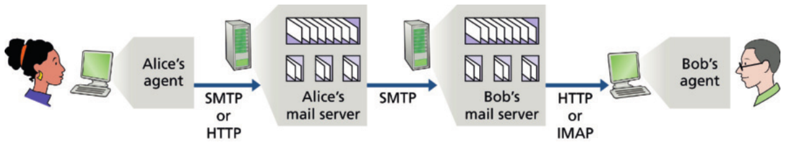

Hình 2.14 Các giao thức e-mail và các thực thể giao tiếp của chúng

Ngày nay, có hai cách phổ biến để Bob lấy e-mail từ mail server. Nếu Bob đang dùng e-mail Web-based hoặc một ứng dụng smartphone (như Gmail), thì user agent sẽ dùng HTTP để lấy e-mail của Bob. Trường hợp này yêu cầu mail server của Bob có một giao diện HTTP cũng như một giao diện SMTP (để giao tiếp với mail server của Alice). Phương pháp thay thế, thường được dùng với các mail client như Microsoft Outlook, là dùng Internet Mail Access Protocol (IMAP) được định nghĩa trong RFC 3501. Cả cách tiếp cận HTTP lẫn IMAP đều cho phép Bob quản lý các thư mục, được duy trì trong mail server của Bob. Bob có thể chuyển thông điệp vào các thư mục anh tạo, xóa thông điệp, đánh dấu thông điệp là quan trọng, v.v.

## 2.4 DNS—Dịch vụ thư mục của Internet (DNS—The Internet’s Directory Service)

Con người chúng ta có thể được nhận diện theo nhiều cách. Ví dụ, chúng ta có thể được nhận diện bằng tên ghi trên giấy khai sinh. Chúng ta có thể được nhận diện bằng số an sinh xã hội. Chúng ta có thể được nhận diện bằng số giấy phép lái xe. Mặc dù mỗi thứ đều có thể được dùng để nhận diện người, trong một bối cảnh nhất định, định danh này có thể phù hợp hơn định danh khác. Ví dụ, máy tính tại IRS (cơ quan tax-collecting (thu thuế) khét tiếng ở Hoa Kỳ) thích dùng số an sinh xã hội fixed-length (độ dài cố định) hơn là tên trên giấy khai sinh. Mặt khác, người bình thường thích tên trên giấy khai sinh dễ nhớ hơn là số an sinh xã hội. (Thật vậy, bạn có thể tưởng tượng việc nói, “Chào. Tên tôi là 132-67-9875. Xin giới thiệu chồng tôi, 178-87-1146.”)

Giống như con người có thể được nhận diện theo nhiều cách, host Internet cũng vậy. Một định danh cho một host là hostname của nó. Hostname—như www.facebook.com, www.google.com, gaia.cs.umass.edu—dễ nhớ và do đó được con người ưa chuộng. Tuy nhiên, hostname cung cấp rất ít, nếu có, thông tin về vị trí của host trong Internet. (Một hostname như www.eurecom.fr, kết thúc bằng mã quốc gia .fr, cho chúng ta biết host có lẽ ở Pháp, nhưng không nói gì nhiều hơn.) Hơn nữa, vì hostname có thể gồm các ký tự chữ-số variable-length (độ dài thay đổi), chúng sẽ khó được router xử lý. Vì những lý do này, host cũng được nhận diện bằng cái so-called địa chỉ IP.

Chúng ta sẽ thảo luận khá chi tiết về địa chỉ IP trong Chương 4, nhưng nói vài lời ngắn gọn về chúng bây giờ cũng hữu ích. Một địa chỉ IP gồm bốn byte và có cấu trúc phân cấp chặt chẽ. Một địa chỉ IP trông như 121.7.106.83, trong đó mỗi dấu chấm ngăn cách một trong các byte được biểu diễn ở dạng thập phân từ 0 tới 255. Một địa chỉ IP có tính phân cấp vì khi quét địa chỉ từ trái sang phải, chúng ta thu được thông tin ngày càng cụ thể hơn về nơi host được đặt trong Internet (tức là, trong mạng nào, trong mạng của các mạng). Tương tự, khi quét một địa chỉ bưu chính từ dưới lên trên, chúng ta thu được thông tin ngày càng cụ thể hơn về nơi người nhận được đặt.

### 2.4.1 Các dịch vụ do DNS cung cấp (Services Provided by DNS)

Chúng ta vừa thấy có hai cách để nhận diện một host—bằng hostname và bằng địa chỉ IP. Con người thích định danh hostname dễ nhớ hơn, trong khi router thích địa chỉ IP fixed-length, có cấu trúc phân cấp. Để dung hòa những ưu tiên này, chúng ta cần một dịch vụ thư mục chuyển hostname thành địa chỉ IP. Đây là nhiệm vụ chính của hệ thống tên miền (domain name system - DNS) của Internet. DNS là (1) một cơ sở dữ liệu phân tán được triển khai trong một phân cấp các DNS server, và (2) một giao thức application-layer cho phép host truy vấn cơ sở dữ liệu phân tán. Các DNS server thường là các máy UNIX chạy phần mềm Berkeley Internet Name Domain (BIND) [BIND 2025]. Giao thức DNS chạy trên UDP và dùng port 53. DNS thường được các giao thức application-layer khác sử dụng, bao gồm HTTP và SMTP, để chuyển các hostname user-supplied thành địa chỉ IP. Ví dụ, hãy xét điều gì xảy ra khi một browser (tức là, một HTTP client), chạy trên host của một người dùng nào đó, yêu cầu URL www.someschool.edu/index.html. Để host của người dùng có thể gửi một thông điệp yêu cầu HTTP tới Web server www.someschool.edu, host của người dùng trước hết phải lấy được địa chỉ IP của www.someschool.edu. Việc này được thực hiện như sau.

1. Cũng chính máy của người dùng chạy phía client của ứng dụng DNS.

2. Browser trích xuất hostname, www.someschool.edu, từ URL và chuyển hostname tới phía client của ứng dụng DNS.

3. DNS client gửi một truy vấn chứa hostname tới một DNS server.

4. DNS client cuối cùng nhận được một trả lời, bao gồm địa chỉ IP cho hostname.

5. Khi browser nhận được địa chỉ IP từ DNS, nó có thể khởi tạo một kết nối TCP tới process HTTP server đặt tại port 80 ở địa chỉ IP đó.

Từ ví dụ này chúng ta thấy DNS thêm một độ trễ bổ sung—đôi khi đáng kể—cho các ứng dụng Internet dùng nó. May mắn thay, như chúng ta thảo luận bên dưới, địa chỉ IP mong muốn thường được cache trong một DNS server “gần đó”, giúp giảm traffic mạng DNS cũng như độ trễ DNS trung bình. DNS cung cấp một vài dịch vụ quan trọng khác ngoài việc chuyển hostname thành địa chỉ IP:

• Host aliasing (bí danh host). Một host có hostname phức tạp có thể có một hoặc nhiều tên bí danh. Ví dụ, một hostname như relay1.west-coast. enterprise.com có thể có, chẳng hạn, hai bí danh như enterprise.com và www.enterprise.com. Trong trường hợp này, hostname relay1.west-coast.enterprise.com được gọi là một hostname chuẩn tắc (canonical hostname). Các hostname bí danh, khi có, thường dễ nhớ hơn hostname chuẩn tắc. DNS có thể được ứng dụng gọi để lấy hostname chuẩn tắc cho một hostname bí danh được cung cấp cũng như địa chỉ IP của host.

• Mail server aliasing (bí danh mail server). Vì những lý do hiển nhiên, rất đáng mong muốn khi địa chỉ e-mail dễ nhớ. Ví dụ, nếu Bob có tài khoản Yahoo Mail, địa chỉ e-mail của Bob có thể đơn giản là bob@yahoo.com. Tuy nhiên, hostname của mail server Yahoo phức tạp hơn và khó nhớ hơn nhiều so với chỉ yahoo.com (ví dụ, hostname chuẩn tắc có thể là kiểu như relay1.west-coast.yahoo.com). DNS có thể được một ứng dụng mail gọi để lấy hostname chuẩn tắc cho một hostname bí danh được cung cấp cũng như địa chỉ IP của host. Thực ra, record MX (xem bên dưới) cho phép mail server và Web server của một công ty có hostname giống hệt nhau (bí danh); ví dụ, Web server và mail server của một công ty đều có thể được gọi là enterprise.com.

• Load distribution (phân phối tải). DNS cũng được dùng để phân phối tải giữa các server nhân bản, như các Web server nhân bản. Các site bận rộn, như cnn.com, được nhân bản trên nhiều server, với mỗi server chạy trên một end system khác nhau và mỗi server có một địa chỉ IP khác nhau. Với các Web server nhân bản, một tập địa chỉ IP do đó được gắn với một hostname bí danh. Cơ sở dữ liệu DNS chứa tập địa chỉ IP này. Khi client đưa ra một truy vấn DNS cho một tên được ánh xạ tới một tập địa chỉ, server phản hồi bằng toàn bộ tập địa chỉ IP, nhưng xoay vòng thứ tự các địa chỉ trong mỗi trả lời. Vì client thường gửi thông điệp yêu cầu HTTP tới địa chỉ IP được liệt kê đầu tiên trong tập, việc xoay vòng DNS phân phối traffic giữa các server nhân bản. Xoay vòng DNS cũng được dùng cho e-mail để nhiều mail server có thể có cùng tên bí danh. Ngoài ra, các công ty phân phối nội dung như Akamai đã dùng DNS theo những cách tinh vi hơn [Nygren 2010] để cung cấp phân phối nội dung Web (xem Mục 2.5.3).

### Nguyên lý trong thực tế (Principles in Practice)

### DNS: Các chức năng mạng thiết yếu thông qua mô hình khách–chủ (DNS: Critical Network Functions Via the Client-Server Paradigm)

Giống HTTP và SMTP, giao thức DNS là một giao thức application-layer vì nó (1) chạy giữa các end system giao tiếp với nhau dùng mô hình client-server và

(2) dựa vào một giao thức giao vận end-to-end bên dưới để truyền thông điệp DNS giữa các end system giao tiếp. Tuy nhiên, theo một nghĩa khác, vai trò của DNS khá khác với các ứng dụng Web, truyền file và e-mail. Không như các ứng dụng này, DNS không phải là một ứng dụng mà người dùng tương tác trực tiếp. Thay vào đó, DNS cung cấp một chức năng cốt lõi của Internet—cụ thể là, chuyển hostname thành địa chỉ IP bên dưới của chúng, cho các ứng dụng người dùng và phần mềm khác trong Internet. Chúng ta đã lưu ý trong Mục 1.2 rằng phần lớn sự phức tạp trong kiến trúc Internet nằm ở các “rìa” của mạng. DNS, vốn triển khai quá trình chuyển đổi name-to-address (tên sang địa chỉ) thiết yếu bằng các client và server đặt ở rìa mạng, là thêm một ví dụ nữa của triết lý thiết kế đó.

DNS được đặc tả trong RFC 1034 và RFC 1035, và được cập nhật trong một số RFC bổ sung. Nó là một hệ thống phức tạp, và ở đây chúng ta chỉ chạm tới các khía cạnh then chốt trong hoạt động của nó. Độc giả quan tâm có thể tham khảo các RFC này, cuốn sách [Albitz 1993], và một mô tả gần đây về dịch vụ DNS của Akamai [Schomp 2020]. Xem thêm các bài hồi cứu [Mockapetris 1988; Mockapetris 2005] cũng cung cấp một mô tả hay về cái gì và tại sao của DNS.

### 2.4.2 Tổng quan cách DNS hoạt động (Overview of How DNS Works)

Giờ chúng ta trình bày một tổng quan high-level về cách DNS hoạt động. Thảo luận của chúng ta sẽ tập trung vào dịch vụ chuyển đổi hostname-to-IP-address.

Giả sử một ứng dụng nào đó (như một Web browser hoặc một mail client) chạy trên host của một người dùng cần chuyển một hostname thành một địa chỉ IP. Ứng dụng sẽ gọi phía client của DNS, chỉ định hostname cần chuyển đổi. (Trên nhiều máy UNIX-based, gethostbyname() là lời gọi hàm mà ứng dụng gọi để thực hiện chuyển đổi.) DNS trong host của người dùng sau đó tiếp quản, gửi một thông điệp truy vấn vào mạng. Mọi thông điệp truy vấn và trả lời DNS được gửi trong các UDP datagram tới port 53. Sau một độ trễ, từ vài mili giây đến vài giây, DNS trong host của người dùng nhận được một thông điệp trả lời DNS cung cấp ánh xạ mong muốn. Ánh xạ này sau đó được chuyển cho ứng dụng gọi. Do đó, từ góc nhìn của ứng dụng gọi trong host của người dùng, DNS là một hộp đen cung cấp một dịch vụ chuyển đổi đơn giản, dễ hiểu. Nhưng thực ra, hộp đen triển khai dịch vụ này rất phức tạp, gồm một số lượng lớn DNS server phân bố khắp toàn cầu, cũng như một giao thức application-layer đặc tả cách các DNS server và các host truy vấn giao tiếp.

Một thiết kế đơn giản cho DNS sẽ có một DNS server chứa tất cả các ánh xạ. Trong thiết kế tập trung này, client chỉ đơn giản hướng mọi truy vấn tới DNS server duy nhất, và DNS server phản hồi trực tiếp cho các client truy vấn. Mặc dù sự đơn giản của thiết kế này hấp dẫn, nó không phù hợp với Internet ngày nay, với số lượng host khổng lồ (và đang tăng). Các vấn đề của một thiết kế tập trung bao gồm:

• Một điểm lỗi duy nhất (single point of failure). Nếu DNS server bị sập, toàn bộ Internet cũng sập theo!

• Khối lượng traffic. Một DNS server duy nhất sẽ phải xử lý mọi truy vấn DNS (cho mọi yêu cầu HTTP và thông điệp e-mail được sinh ra từ hàng trăm triệu host).

• Cơ sở dữ liệu tập trung ở xa. Một DNS server duy nhất không thể “gần” tất cả các client truy vấn. Nếu chúng ta đặt DNS server duy nhất ở New York City, thì mọi truy vấn từ Úc phải đi tới phía bên kia địa cầu, có thể qua các liên kết chậm và tắc nghẽn. Điều này có thể dẫn tới độ trễ đáng kể.

• Bảo trì. DNS server duy nhất sẽ phải giữ record cho mọi host Internet. Cơ sở dữ liệu tập trung này không chỉ khổng lồ, mà còn phải được cập nhật thường xuyên để tính tới mọi host mới.

Tóm lại, một cơ sở dữ liệu tập trung trong một DNS server duy nhất đơn giản là không mở rộng được. Do đó, DNS được thiết kế phân tán. Thực ra, DNS là một ví dụ tuyệt vời về cách một cơ sở dữ liệu phân tán có thể được triển khai trong Internet.

#### Một cơ sở dữ liệu phân tán, phân cấp (A Distributed, Hierarchical Database)

Để giải quyết vấn đề quy mô, DNS dùng một số lượng lớn server, được tổ chức theo kiểu phân cấp và phân bố khắp thế giới. Không có DNS server đơn lẻ nào có tất cả các ánh xạ cho tất cả các host trong Internet. Thay vào đó, các ánh xạ được phân tán qua các DNS server. Ở mức xấp xỉ đầu tiên, có ba lớp DNS server—root DNS server, top-level domain (TLD) DNS server (server tên miền cấp cao nhất), và authoritative DNS server (server có thẩm quyền)—được tổ chức trong một phân cấp như minh họa trong Hình 2.15. Để hiểu cách ba lớp server này tương tác, giả sử một DNS client muốn xác định địa chỉ IP cho hostname www.amazon.com. Ở mức xấp xỉ đầu tiên, các sự kiện sau sẽ diễn ra. Client trước hết liên lạc với một trong các root server, server này trả về địa chỉ IP của các TLD server cho top-level domain com. Client sau đó liên lạc với một trong các TLD server này, server này trả về địa chỉ IP của một authoritative server cho amazon.com. Cuối cùng, client liên lạc với một trong các authoritative server cho amazon.com, server này trả về địa chỉ IP cho hostname www.amazon.com. Chúng ta sẽ sớm xem xét chi tiết hơn quá trình tra cứu DNS này. Nhưng trước hết hãy xem kỹ hơn ba lớp DNS server này:

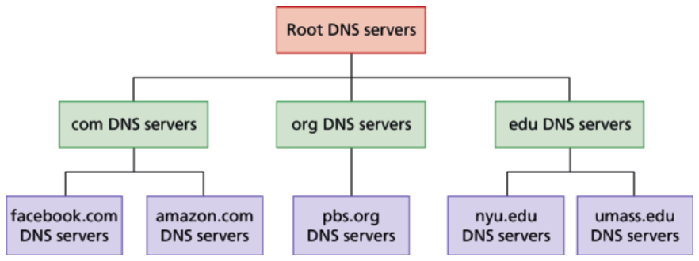

Hình 2.15 Một phần phân cấp của các DNS server

• Root DNS server. Có gần 2000 instance root server rải rác khắp thế giới, như minh họa trong Hình 2.16, phục vụ hàng chục tỉ truy vấn DNS mỗi ngày. Các root server này là bản sao của 13 root server khác nhau, được quản lý bởi 12 tổ chức khác nhau, và được điều phối thông qua Internet Assigned Numbers Authority [IANA 2025]. Danh sách đầy đủ các root name server, cùng với các tổ chức quản lý chúng và địa chỉ IP của chúng có thể tìm thấy tại [Root Servers 2025]. Các root name server cung cấp địa chỉ IP của các TLD server.

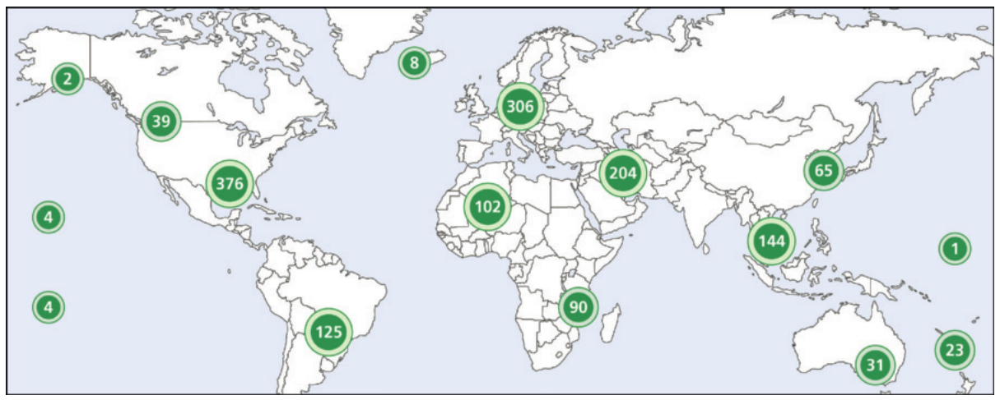

Hình 2.16 Số lượng và vị trí các root server (2024)

• Top-level domain (TLD) server. Với mỗi top-level domain— các top-level domain như com, org, net, edu và gov, và tất cả các top-level domain quốc gia như uk, fr, ca và jp—đều có một TLD server (hoặc cụm server). Công ty Verisign Global Registry Services duy trì các TLD server cho top-level domain com, và công ty Educause duy trì các TLD server cho top-level domain edu. Hạ tầng mạng hỗ trợ một TLD có thể lớn và phức tạp; xem [Osterweil 2012] để có một tổng quan hay về mạng Verisign. Xem [TLD list 2025] để có danh sách tất cả các top-level domain. Các TLD server cung cấp địa chỉ IP cho các authoritative DNS server.

• Authoritative DNS server. Mọi tổ chức có các host truy cập công khai (như Web server và mail server) trên Internet phải cung cấp các DNS record truy cập công khai ánh xạ tên của các host đó tới địa chỉ IP. Authoritative DNS server của một tổ chức chứa các DNS record này. Một tổ chức có thể chọn triển khai authoritative DNS server riêng để giữ các record này; hoặc, tổ chức có thể trả tiền để các record này được lưu trong một authoritative DNS server của một nhà cung cấp dịch vụ nào đó. Hầu hết các trường đại học và công ty lớn triển khai và duy trì authoritative DNS server chính và phụ (dự phòng) của riêng họ.

Root, TLD và authoritative DNS server đều thuộc phân cấp DNS server, như minh họa trong Hình 2.15. Có một loại DNS server quan trọng khác gọi là local DNS server (DNS server cục bộ). Một local DNS server không thực sự thuộc phân cấp server nhưng vẫn là trung tâm của kiến trúc DNS. Mỗi ISP—như một ISP dân dụng hoặc một ISP tổ chức—có một local DNS server (còn gọi là default name server). Khi một host kết nối tới một ISP, ISP cung cấp cho host địa chỉ IP của một hoặc nhiều local DNS server của nó (thường thông qua DHCP, được thảo luận trong Chương 4). Thay vì dùng local DNS server của ISP hoặc tổ chức của bạn, bạn cũng có thể cấu hình thiết bị để nhận dịch vụ DNS cục bộ từ một nhà cung cấp thương mại như Google (tại địa chỉ IP 8.8.8.8). Bạn có thể dễ dàng xác định địa chỉ IP của local DNS server của mình bằng cách truy cập các cửa sổ trạng thái mạng trong Windows hoặc UNIX. Local DNS server của một host thường “gần” host. Với một ISP tổ chức, local DNS server có thể nằm trên cùng LAN với host; với một ISP dân dụng, nó thường cách host không quá vài router. Khi một host đưa ra một truy vấn DNS, truy vấn được gửi tới local DNS server, server này đóng vai một proxy, chuyển tiếp truy vấn vào phân cấp DNS server, như chúng ta sẽ thảo luận chi tiết hơn bên dưới.

Hãy xem một ví dụ đơn giản. Giả sử host cse.nyu.edu muốn biết địa chỉ IP của gaia.cs.umass.edu. Cũng giả sử local DNS server của NYU cho cse.nyu.edu tên là dns.nyu.edu và một authoritative DNS server cho gaia.cs.umass.edu tên là dns.umass.edu. Như minh họa trong Hình 2.17, host cse.nyu.edu trước hết gửi một thông điệp truy vấn DNS tới local DNS server của nó, dns.nyu.edu. Thông điệp truy vấn chứa hostname cần chuyển đổi, cụ thể là, gaia.cs.umass.edu. Local DNS server chuyển tiếp thông điệp truy vấn tới một root DNS server. Root DNS server ghi nhận hậu tố edu và trả về cho local DNS server một danh sách địa chỉ IP của các TLD server chịu trách nhiệm cho edu. Local DNS server sau đó gửi lại thông điệp truy vấn tới một trong các TLD server này. TLD server ghi nhận hậu tố umass.edu và phản hồi bằng địa chỉ IP của authoritative DNS server cho University of Massachusetts, cụ thể là, dns.umass.edu. Cuối cùng, local DNS server gửi lại thông điệp truy vấn trực tiếp tới dns.umass.edu, server này phản hồi bằng địa chỉ IP của gaia.cs.umass.edu. Lưu ý rằng trong ví dụ này, để lấy được ánh xạ cho một hostname, tám thông điệp DNS đã được gửi: bốn thông điệp truy vấn và bốn thông điệp trả lời! Chúng ta sẽ sớm thấy cách DNS caching giảm traffic truy vấn này.

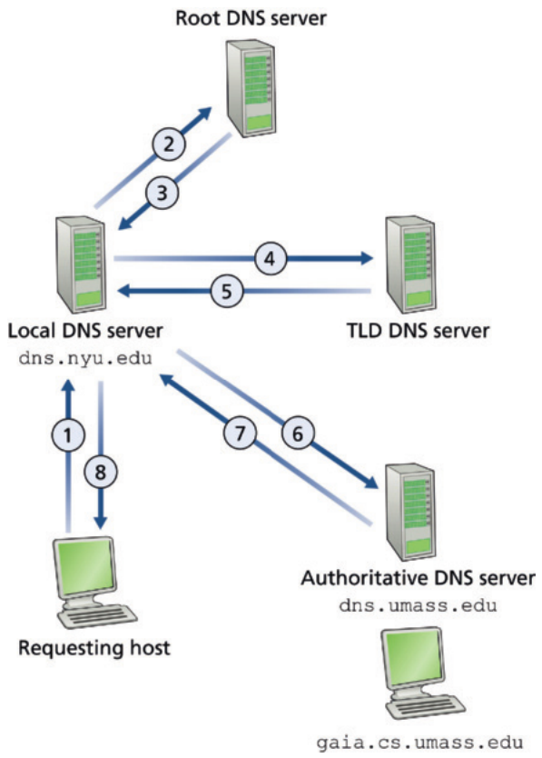

Hình 2.17 Tương tác của các DNS server khác nhau

Ví dụ trước của chúng ta giả định rằng TLD server biết authoritative DNS server cho hostname. Nói chung, điều này không phải lúc nào cũng đúng. Thay vào đó, TLD server có thể chỉ biết một DNS server trung gian, server này đến lượt mình biết authoritative DNS server cho hostname. Ví dụ, giả sử lại rằng University of Massachusetts có một DNS server cho trường, tên là dns.umass.edu. Cũng giả sử rằng mỗi khoa tại University of Massachusetts có DNS server riêng, và mỗi DNS server của khoa có thẩm quyền cho mọi host trong khoa. Trong trường hợp này, khi DNS server trung gian, dns.umass.edu, nhận một truy vấn cho một host có hostname kết thúc bằng cs.umass.edu, nó trả về cho dns.nyu.edu địa chỉ IP của dns.cs.umass.edu, server có thẩm quyền cho mọi hostname kết thúc bằng cs.umass.edu. Local DNS server dns.nyu.edu sau đó gửi truy vấn tới authoritative DNS server, server này trả ánh xạ mong muốn về local DNS server, server này đến lượt mình trả ánh xạ về host yêu cầu. Trong trường hợp này, tổng cộng 10 thông điệp DNS được gửi!

Ví dụ minh họa trong Hình 2.17 dùng cả truy vấn đệ quy (recursive query) lẫn truy vấn lặp (iterative query). Truy vấn gửi từ cse.nyu.edu tới dns.nyu.edu là một truy vấn đệ quy, vì truy vấn yêu cầu dns.nyu.edu lấy ánh xạ thay mặt nó. Tuy nhiên, ba truy vấn tiếp theo là lặp vì mọi trả lời đều được trả trực tiếp về dns.nyu.edu. Về lý thuyết, bất kỳ truy vấn DNS nào cũng có thể là lặp hoặc đệ quy. Ví dụ, Hình 2.18 cho thấy một chuỗi truy vấn DNS trong đó mọi truy vấn đều là đệ quy. Trên thực tế, các truy vấn thường theo mẫu trong Hình 2.17: Truy vấn từ host yêu cầu tới local DNS server là đệ quy, và các truy vấn còn lại là lặp.

#### DNS caching (DNS Caching)

Thảo luận của chúng ta cho đến giờ đã bỏ qua DNS caching, một tính năng cực kỳ quan trọng của hệ thống DNS. Thực ra, DNS khai thác rộng rãi DNS caching để cải thiện performance về độ trễ và giảm số thông điệp DNS dội qua dội lại khắp Internet. Ý tưởng đằng sau DNS caching rất đơn giản. Trong một chuỗi truy vấn, khi một DNS server nhận một trả lời DNS (chứa, ví dụ, một ánh xạ từ một hostname tới một địa chỉ IP), nó có thể cache ánh xạ trong bộ nhớ cục bộ. Ví dụ, trong Hình 2.17, mỗi lần local DNS server dns.nyu.edu nhận một trả lời từ một DNS server nào đó, nó có thể cache bất kỳ thông tin nào chứa trong trả lời. Nếu một cặp hostname/địa chỉ IP được cache trong một DNS server và một truy vấn khác tới DNS server cho cùng hostname, DNS server có thể cung cấp địa chỉ IP mong muốn, ngay cả khi nó không có thẩm quyền cho hostname đó. Vì host và ánh xạ giữa hostname và địa chỉ IP hoàn toàn không cố định vĩnh viễn, các DNS server loại bỏ thông tin đã cache sau một khoảng thời gian (thường đặt là hai ngày). Ví dụ, giả sử một host apricot.nyu.edu truy vấn dns.nyu.edu để lấy địa chỉ IP cho hostname cnn.com. Hơn nữa, giả sử vài giờ sau, một host NYU khác, chẳng hạn kiwi.nyu.edu, cũng truy vấn dns.nyu.edu với cùng hostname. Nhờ caching, local DNS server sẽ có thể trả về ngay địa chỉ IP của cnn.com cho host yêu cầu thứ hai này mà không phải truy vấn bất kỳ DNS server nào khác. Một local DNS server cũng có thể cache địa chỉ IP của các TLD server, qua đó cho phép local DNS server bỏ qua các root DNS server trong một chuỗi truy vấn. Thực ra, nhờ caching, các root server bị bỏ qua đối với tất cả trừ một phần rất nhỏ các truy vấn DNS.

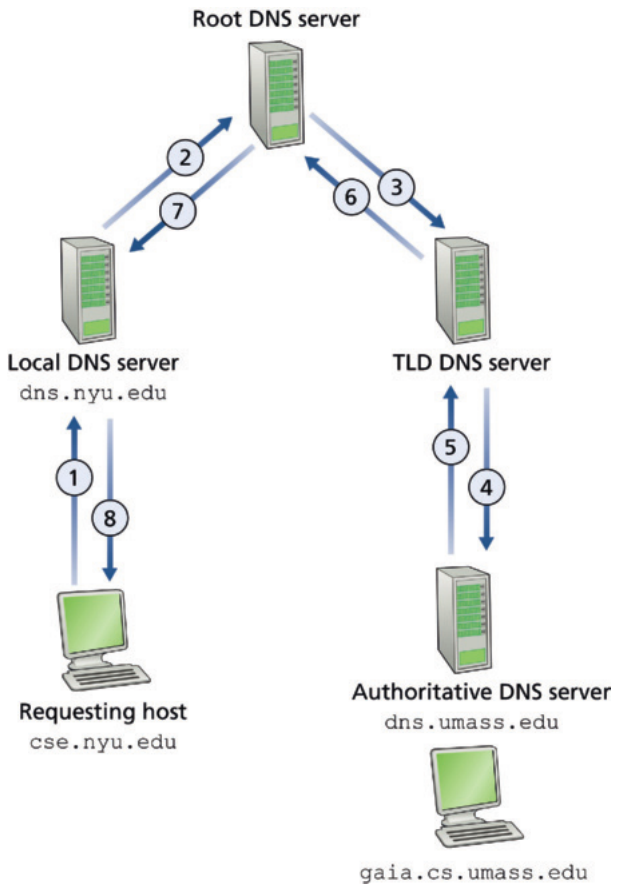

Hình 2.18 Truy vấn đệ quy trong DNS

### 2.4.3 DNS record và thông điệp DNS (DNS Records and Messages)

Các DNS server cùng nhau triển khai cơ sở dữ liệu phân tán DNS lưu trữ các resource record (RR), bao gồm các RR cung cấp ánh xạ hostname-to-IP address. Mỗi thông điệp trả lời DNS mang một hoặc nhiều resource record. Trong mục này và tiểu mục tiếp theo, chúng tôi cung cấp một tổng quan ngắn gọn về resource record và thông điệp DNS; có thể tìm thêm chi tiết trong [Albitz 1993] hoặc trong các RFC DNS [RFC 1034; RFC 1035].

Một resource record là một four-tuple (bộ bốn) chứa các trường sau:

```
(Name, Value, Type, TTL)
```

TTL là time to live (thời gian sống) của resource record; nó xác định khi nào một resource nên bị xóa khỏi cache. Trong các record ví dụ dưới đây, chúng ta bỏ qua trường TTL. Ý nghĩa của Name và Value phụ thuộc vào Type:

• Nếu Type=A, thì Name là một hostname và Value là địa chỉ IP cho hostname. Do đó, một record Type A cung cấp ánh xạ hostname-to-IP address chuẩn. Ví dụ, ( r e l a y 1 . b a r . f o o . c o m, 145.37.93.126, A) là một record Type A.

• Nếu Type=NS, thì Name là một domain (như foo.com) và Value là hostname của một authoritative DNS server biết cách lấy địa chỉ IP cho các host trong domain. Record này được dùng để định tuyến truy vấn DNS đi xa hơn trong chuỗi truy vấn. Ví dụ, (foo.com, dns.foo.com, NS) là một record Type NS.

• Nếu Type=CNAME, thì Value là một hostname chuẩn tắc cho hostname bí danh Name. Record này có thể cung cấp cho các host truy vấn tên chuẩn tắc của một hostname. Ví dụ, (foo.com, relay1.bar.foo.com, CNAME) là một record CNAME.

• Nếu Type=MX, thì Value là tên chuẩn tắc của một mail server có hostname bí danh Name. Ví dụ, (foo.com, mail.bar.foo.com, MX) là một record MX. Record MX cho phép hostname của mail server có bí danh đơn giản. Lưu ý rằng bằng cách dùng record MX, một công ty có thể có cùng tên bí danh cho mail server và cho một trong các server khác của mình (như Web server). Để lấy tên chuẩn tắc cho mail server, một DNS client sẽ truy vấn record MX; để lấy tên chuẩn tắc cho server kia, DNS client sẽ truy vấn record CNAME.

Nếu một DNS server có thẩm quyền cho một hostname cụ thể, thì DNS server sẽ chứa một record Type A cho hostname đó. (Ngay cả khi DNS server không có thẩm quyền, nó vẫn có thể chứa một record Type A trong cache.) Nếu một server không có thẩm quyền cho một hostname, thì server sẽ chứa một record Type NS cho domain bao gồm hostname đó; nó cũng sẽ chứa một record Type A cung cấp địa chỉ IP của DNS server trong trường Value của record NS. Ví dụ, giả sử một TLD server edu không có thẩm quyền cho host gaia.cs.umass.edu. Khi đó server này sẽ chứa một record cho một domain bao gồm host gaia.cs.umass.edu, ví dụ, (umass.edu, dns.umass.edu, NS). TLD server edu cũng sẽ chứa một record Type A, ánh xạ DNS server dns.umass.edu tới một địa chỉ IP, ví dụ, (dns.umass.edu, 128.119.40.111, A).

#### Thông điệp DNS (DNS Messages)

Trước đó trong mục này, chúng ta đã nhắc tới thông điệp truy vấn và trả lời DNS. Đây là hai loại thông điệp DNS duy nhất. Hơn nữa, cả thông điệp truy vấn và trả lời đều có cùng định dạng, như minh họa trong Hình 2.19. Ngữ nghĩa của các trường khác nhau trong một thông điệp DNS như sau:

• 12 byte đầu tiên là phần header, có một số trường. Trường đầu tiên là một số 16-bit định danh truy vấn. Định danh này được sao chép vào thông điệp trả lời cho truy vấn, cho phép client khớp các trả lời nhận được với các truy vấn đã gửi. Có một số cờ trong trường cờ. Một cờ truy vấn/trả lời 1-bit cho biết thông điệp là truy vấn (0) hay trả lời (1). Một cờ có thẩm quyền 1-bit được bật trong thông điệp trả lời khi một DNS server là authoritative server cho tên được truy vấn. Một cờ recursion-desired (mong muốn đệ quy) 1-bit được bật khi một client (host hoặc DNS server) muốn DNS server thực hiện đệ quy khi nó không có record. Một trường recursion-available (có hỗ trợ đệ quy) 1-bit được bật trong trả lời nếu DNS server hỗ trợ đệ quy. Trong header, cũng có bốn trường number-of (số lượng). Các trường này cho biết số lần xuất hiện của bốn loại phần dữ liệu theo sau header.

• Phần question chứa thông tin về truy vấn đang được thực hiện. Phần này bao gồm (1) một trường name chứa tên đang được truy vấn, và (2) một trường type cho biết loại câu hỏi đang được hỏi về tên đó—ví dụ, một địa chỉ host gắn với một tên (Type A) hoặc mail server cho một tên (Type MX).

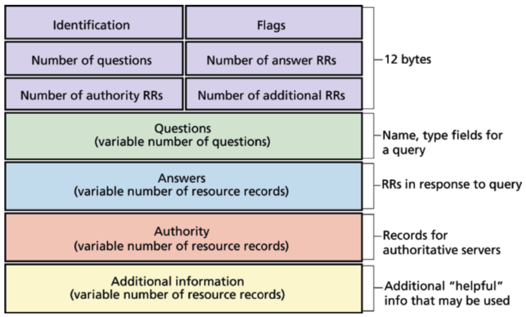

Hình 2.19 Định dạng thông điệp DNS

• Trong một trả lời từ DNS server, phần answer chứa các resource record cho tên được truy vấn ban đầu. Nhớ rằng trong mỗi resource record có Type (ví dụ, A, NS, CNAME và MX), Value và TTL. Một trả lời có thể trả về nhiều RR trong phần answer, vì một hostname có thể có nhiều địa chỉ IP (ví dụ, cho các Web server nhân bản, như đã thảo luận trước đó trong mục này).

• Phần authority chứa record của các authoritative server khác.

• Phần additional chứa các record hữu ích khác. Ví dụ, trường answer trong một trả lời cho truy vấn MX chứa một resource record cung cấp hostname chuẩn tắc của một mail server. Phần additional chứa một record Type A cung cấp địa chỉ IP cho hostname chuẩn tắc của mail server.

Bạn có muốn gửi một thông điệp truy vấn DNS trực tiếp từ host bạn đang làm việc tới một DNS server nào đó không? Việc này có thể dễ dàng thực hiện với chương trình nslookup, có sẵn trên hầu hết các nền tảng Windows và UNIX. Ví dụ, từ một host Windows, mở Command Prompt và gọi chương trình nslookup bằng cách đơn giản gõ “nslookup.” Sau khi gọi nslookup, bạn có thể gửi một truy vấn DNS tới bất kỳ DNS server nào (root, TLD hoặc authoritative). Sau khi nhận thông điệp trả lời từ DNS server, nslookup sẽ hiển thị các record có trong trả lời (ở định dạng human-readable (con người đọc được)). Thay vì chạy nslookup từ host của chính bạn, bạn có thể ghé một trong nhiều Web site cho phép bạn dùng nslookup từ xa. (Chỉ cần gõ “nslookup” vào một công cụ tìm kiếm và bạn sẽ được đưa tới một trong các site này.) Bài thực hành Wireshark về DNS ở cuối chương này sẽ cho phép bạn khám phá DNS chi tiết hơn nhiều.

#### Chèn record vào cơ sở dữ liệu DNS (Inserting Records into the DNS Database)

Thảo luận ở trên tập trung vào cách record được lấy từ cơ sở dữ liệu DNS. Có thể bạn đang thắc mắc ban đầu record được đưa vào cơ sở dữ liệu như thế nào. Hãy xem việc này được thực hiện ra sao trong bối cảnh một ví dụ cụ thể. Giả sử bạn vừa tạo một công ty startup mới thú vị tên là Network Utopia. Việc đầu tiên chắc chắn bạn sẽ muốn làm là đăng ký tên miền networkutopia.com tại một registrar (nhà đăng ký tên miền). Registrar là một thực thể thương mại xác minh tính duy nhất của tên miền, đưa tên miền vào cơ sở dữ liệu DNS (như thảo luận bên dưới), và thu của bạn một khoản phí nhỏ cho dịch vụ của họ. Trước năm 1999, một registrar duy nhất, Network Solutions, độc quyền đăng ký tên miền cho các domain com, net và org. Nhưng giờ có nhiều registrar cạnh tranh khách hàng, và Internet Corporation for Assigned Names and Numbers (ICANN) công nhận các registrar khác nhau. Danh sách đầy đủ các registrar được công nhận có tại http://www. internic.net. Năm 2024, các phép đo [Sommese 2024] cho thấy khoảng 75 nghìn tên miền mới được đăng ký mỗi ngày.

Khi bạn đăng ký tên miền networkutopia.com với một registrar nào đó, bạn cũng cần cung cấp cho registrar tên và địa chỉ IP của các authoritative DNS server chính và phụ của bạn. Giả sử tên và địa chỉ IP là dns1.networkutopia.com, dns2.networkutopia.com, 212.2.212.1, và 212.212.212.2. Với mỗi authoritative DNS server trong hai server này, registrar sau đó sẽ đảm bảo rằng một record Type NS và một record Type A được đưa vào các TLD server com. Cụ thể, với authoritative server chính cho networkutopia.com, registrar sẽ chèn hai resource record sau vào hệ thống DNS:

```
(networkutopia.com, dns1.networkutopia.com, NS)
(dns1.networkutopia.com, 212.212.212.1, A)
```

> Tiêu điểm bảo mật (Focus on Security)
>
> Các lỗ hổng DNS (DNS Vulnerabilities)
>
> Chúng ta đã thấy DNS là một thành phần thiết yếu của hạ tầng Internet, với nhiều dịch vụ quan trọng—bao gồm Web và e-mail—đơn giản là không thể hoạt động nếu thiếu nó. Do đó chúng ta tự nhiên đặt câu hỏi, DNS có thể bị tấn công như thế nào? DNS có phải là một con mồi dễ dàng, chờ bị đánh sập dịch vụ, đồng thời kéo theo hầu hết các ứng dụng Internet sập cùng không?
>
> Loại tấn công đầu tiên nghĩ tới là một cuộc tấn công DDoS bandwidth-flooding (làm ngập băng thông) (xem Mục 1.6) nhắm vào các DNS server. Ví dụ, kẻ tấn công có thể cố gửi tới mỗi DNS root server một trận lũ packet, nhiều đến mức phần lớn các truy vấn DNS hợp lệ không bao giờ được trả lời. Một cuộc tấn công DDoS large-scale (quy mô lớn) như vậy nhắm vào các DNS root server thực sự đã diễn ra vào ngày 21 tháng Mười, 2002. Trong cuộc tấn công này, những kẻ tấn công đã tận dụng một botnet để gửi hàng xe tải thông điệp ICMP ping tới mỗi địa chỉ trong 13 địa chỉ IP DNS root. (Thông điệp ICMP được thảo luận trong Mục 5.6. Hiện tại, chỉ cần biết rằng packet ICMP là các loại IP datagram đặc biệt.) May mắn thay, cuộc tấn công large-scale này gây thiệt hại tối thiểu, gần như hoặc hoàn toàn không ảnh hưởng tới trải nghiệm Internet của người dùng. Những kẻ tấn công đã thành công trong việc dồn một trận lũ packet vào các root server. Nhưng nhiều DNS root server được bảo vệ bởi các bộ lọc packet, được cấu hình để luôn chặn mọi thông điệp ICMP ping nhắm vào root server. Những server được bảo vệ này do đó không bị ảnh hưởng và hoạt động bình thường. Hơn nữa, hầu hết các local DNS server cache địa chỉ IP của các server top-level-domain, cho phép quá trình truy vấn thường bỏ qua các DNS root server.
>
> Một cuộc tấn công DDoS có khả năng hiệu quả hơn nhắm vào DNS là gửi một trận lũ truy vấn DNS tới các server top-level-domain, ví dụ, tới các server top-level-domain xử lý domain .com. Khó lọc các truy vấn DNS hướng tới DNS server hơn; và các server top-level-domain không dễ bị bỏ qua như root server. Một cuộc tấn công như vậy đã diễn ra nhắm vào nhà cung cấp dịch vụ top-level-domain Dyn vào ngày 21 tháng Mười, 2016. Cuộc tấn công DDoS này được thực hiện thông qua một số lượng lớn yêu cầu tra cứu DNS từ một botnet gồm khoảng một trăm nghìn thiết bị IoT như máy in, camera IP, gateway dân dụng và máy theo dõi trẻ em đã bị nhiễm malware Mirai. Trong gần trọn một ngày, Amazon, Twitter, Netflix, Github và Spotify bị gián đoạn.
>
> DNS có thể bị tấn công theo những cách khác. Trong một cuộc tấn công man-in-the-middle (người đứng giữa), kẻ tấn công chặn các truy vấn từ host và trả về các trả lời giả mạo. Trong tấn công DNS poisoning (đầu độc DNS), kẻ tấn công gửi các trả lời giả mạo tới một DNS server, lừa server chấp nhận các record giả mạo vào cache của nó. Bất kỳ cuộc tấn công nào trong số này đều có thể được dùng, chẳng hạn, để chuyển hướng một người dùng Web không nghi ngờ tới Web site của kẻ tấn công. DNS Security Extensions (DNSSEC [Gieben 2004; RFC 4033] đã được thiết kế và triển khai để bảo vệ chống lại các khai thác như vậy. DNSSEC, một phiên bản bảo mật của DNS, giải quyết nhiều cuộc tấn công khả dĩ này và đang ngày càng phổ biến trong Internet.

Bạn cũng sẽ phải đảm bảo rằng resource record Type A cho Web server www.networkutopia.com và resource record Type MX cho mail server mail.networkutopia.com được đưa vào các authoritative DNS server của bạn. (Cho đến gần đây, nội dung của mỗi DNS server được cấu hình tĩnh, ví dụ, từ một file cấu hình do người quản trị hệ thống tạo ra. Gần đây hơn, một tùy chọn UPDATE đã được thêm vào giao thức DNS để cho phép dữ liệu được thêm hoặc xóa động khỏi cơ sở dữ liệu thông qua thông điệp DNS. [RFC 2136] và [RFC 3007] đặc tả cập nhật động DNS.)

Khi tất cả các bước này hoàn tất, mọi người sẽ có thể ghé Web site của bạn và gửi e-mail tới nhân viên công ty bạn. Hãy kết thúc thảo luận về DNS bằng cách kiểm chứng rằng phát biểu này đúng. Việc kiểm chứng này cũng giúp củng cố những gì chúng ta đã học về DNS. Giả sử Alice ở Úc muốn xem trang Web www.networkutopia.com. Như đã thảo luận trước đó, host của cô trước hết sẽ gửi một truy vấn DNS tới local DNS server của cô. Local DNS server sau đó sẽ liên lạc với một TLD server com. (Local DNS server cũng sẽ phải liên lạc với một root DNS server nếu địa chỉ của TLD server com chưa được cache.) TLD server này chứa các resource record Type NS và Type A liệt kê ở trên, vì registrar đã cho chèn các resource record này vào tất cả các TLD server com. TLD server com gửi một trả lời tới local DNS server của Alice, với trả lời chứa hai resource record. Local DNS server sau đó gửi một truy vấn DNS tới 212.212.212.1, hỏi record Type A tương ứng với www.networkutopia.com. Record này cung cấp địa chỉ IP của Web server mong muốn, chẳng hạn 212.212.71.4, mà local DNS server chuyển lại cho host của Alice. Browser của Alice giờ có thể khởi tạo một kết nối TCP tới host 212.212.71.4 và gửi một yêu cầu HTTP qua kết nối. Phù! Có nhiều thứ diễn ra hơn những gì nhìn thấy khi người ta lướt Web!

## 2.5 Video streaming và mạng phân phối nội dung (Video Streaming and Content Distribution Networks)

Theo nhiều ước tính, video streaming—bao gồm Netflix, YouTube, AppleTV, Amazon Prime, v.v.—chiếm hơn 65% traffic Internet toàn cầu [Sandvine 2024] và gần 75% traffic mạng di động [Ericsson 2024]. Mục này chúng tôi sẽ cung cấp một tổng quan về cách các dịch vụ video streaming phổ biến được triển khai trong Internet ngày nay.

### 2.5.1 Video Internet (Internet Video)

Trong các ứng dụng streaming video lưu sẵn, phương tiện bên dưới là video được ghi sẵn, như một bộ phim, một chương trình truyền hình, một sự kiện thể thao được ghi sẵn, hoặc một video user-generated được ghi sẵn (như những video thường thấy trên YouTube). Các video ghi sẵn này được đặt trên server, và người dùng gửi yêu cầu tới server để xem video theo yêu cầu. Nhiều công ty Internet ngày nay cung cấp video streaming, bao gồm Netflix, YouTube (Google), Amazon và TikTok.

Nhưng trước khi đi vào thảo luận về video streaming, trước hết chúng ta nên có cảm nhận nhanh về chính phương tiện video. Một video là một chuỗi ảnh, thường được hiển thị ở một tốc độ không đổi, ví dụ, 24 hoặc 30 ảnh mỗi giây. Một ảnh không nén, được mã hóa số gồm một mảng pixel, với mỗi pixel được mã hóa thành một số bit để biểu diễn độ sáng và màu sắc. Một đặc điểm quan trọng của video là nó có thể được nén, qua đó đánh đổi chất lượng video với bit rate. Các thuật toán nén off-the-shelf (có sẵn) ngày nay có thể nén video về gần như bất kỳ bit rate mong muốn nào. Tất nhiên, bit rate càng cao, chất lượng ảnh càng tốt và trải nghiệm xem tổng thể của người dùng càng tốt.

Từ góc nhìn mạng, có lẽ đặc điểm nổi bật nhất của video là bit rate cao. Video Internet nén thường dao động từ 100 kbps cho video low-quality (chất lượng thấp) đến 25 Mbps cho video độ nét siêu cao (ultra high definition). Điều này có thể dẫn tới lượng traffic và lưu trữ khổng lồ, đặc biệt với video high-end (cao cấp). Ví dụ, một video 7 Mbps duy nhất với thời lượng một giờ sẽ tiêu tốn 3 gigabyte lưu trữ và traffic. Hơn hẳn mọi thứ khác, thước đo performance quan trọng nhất cho video streaming là throughput end-to-end trung bình. Để phát liên tục (continuous playout), mạng phải cung cấp cho ứng dụng streaming một throughput trung bình ít nhất bằng bit rate của video nén.

Chúng ta cũng có thể dùng nén để tạo nhiều phiên bản của cùng một video, mỗi phiên bản ở một mức chất lượng khác nhau. Ví dụ, chúng ta có thể dùng nén để tạo, chẳng hạn, ba phiên bản của cùng một video, ở tốc độ 300 kbps, 1 Mbps và 3 Mbps. Người dùng khi đó có thể quyết định muốn xem phiên bản nào như một hàm của băng thông khả dụng hiện tại của họ. Người dùng có kết nối Internet high-speed có thể chọn phiên bản 3 Mbps; người dùng xem video qua 3G với smartphone có thể chọn phiên bản 300 kbps.

### 2.5.2 HTTP streaming và DASH (HTTP Streaming and DASH)

Trong HTTP streaming, video đơn giản được lưu tại một HTTP server như một file thông thường với một URL cụ thể. Khi người dùng muốn xem video, client thiết lập một kết nối TCP với server và đưa ra một yêu cầu HTTP GET cho URL đó. Server sau đó gửi file video, trong một thông điệp phản hồi HTTP, nhanh nhất mà các giao thức mạng bên dưới và điều kiện traffic cho phép. Ở phía client, các byte được thu thập trong một buffer ứng dụng client. Khi số byte trong buffer này vượt quá một ngưỡng định trước, ứng dụng client bắt đầu phát—cụ thể, ứng dụng video streaming định kỳ lấy các frame video từ buffer ứng dụng client, giải nén các frame, và hiển thị chúng trên màn hình người dùng. Do đó, ứng dụng video streaming đang hiển thị video trong khi nó đang nhận và buffer các frame tương ứng với các phần sau của video.

Mặc dù HTTP streaming, như mô tả trong đoạn trước, đã được triển khai rộng rãi trong thực tế (ví dụ, bởi YouTube từ khi ra đời), nó có một nhược điểm lớn: Mọi client nhận cùng một bản mã hóa của video, bất chấp sự khác biệt lớn về lượng băng thông khả dụng cho một client, cả giữa các client khác nhau lẫn theo thời gian với cùng một client. Điều này đã dẫn tới sự phát triển của một loại streaming HTTP-based mới, thường được gọi là Dynamic Adaptive Streaming over HTTP (DASH). Trong DASH, video được mã hóa thành nhiều phiên bản khác nhau, với mỗi phiên bản có một bit rate khác nhau và, tương ứng, một mức chất lượng khác nhau. Client yêu cầu động các chunk (khúc) của các đoạn video dài vài giây. Khi lượng băng thông khả dụng cao, client tự nhiên chọn các chunk từ một phiên bản high-rate (tốc độ cao); và khi băng thông khả dụng thấp, nó tự nhiên chọn từ một phiên bản low-rate (tốc độ thấp). Client chọn từng chunk một bằng các thông điệp yêu cầu HTTP GET [Akhshabi 2011].

DASH cho phép các client có tốc độ truy cập Internet khác nhau stream video ở các tốc độ mã hóa khác nhau. Các client có kết nối 3G low-speed có thể nhận một phiên bản bit-rate thấp (và low-quality), và các client có kết nối cáp quang có thể nhận một phiên bản high-quality (chất lượng cao). DASH cũng cho phép client thích ứng với băng thông khả dụng nếu băng thông end-to-end khả dụng thay đổi trong phiên. Tính năng này đặc biệt quan trọng với người dùng di động, những người thường thấy băng thông khả dụng của họ dao động khi họ di chuyển so với các trạm gốc.

Với DASH, mỗi phiên bản video được lưu trong HTTP server, mỗi phiên bản có một URL khác nhau. HTTP server cũng có một file manifest, cung cấp một URL cho mỗi phiên bản cùng với bit rate của nó. Client trước hết yêu cầu file manifest và tìm hiểu về các phiên bản khác nhau. Client sau đó chọn từng chunk một bằng cách chỉ định một URL và một khoảng byte trong một thông điệp yêu cầu HTTP GET cho mỗi chunk. Trong khi tải các chunk, client cũng đo băng thông nhận được và chạy một thuật toán xác định tốc độ để chọn chunk sẽ yêu cầu tiếp theo. Tự nhiên, nếu client có nhiều video đã buffer và nếu băng thông nhận đo được cao, nó sẽ chọn một chunk từ một phiên bản high-bitrate. Và tự nhiên nếu client có ít video đã buffer và băng thông nhận đo được thấp, nó sẽ chọn một chunk từ một phiên bản low-bitrate. Do đó DASH cho phép client tự do chuyển đổi giữa các mức chất lượng khác nhau.

### 2.5.3 Mạng phân phối nội dung (Content Distribution Networks)

Ngày nay, nhiều công ty video Internet đang phân phối các luồng multi-Mbps on-demand tới hàng triệu người dùng mỗi ngày. YouTube, chẳng hạn, với một thư viện hàng trăm triệu video, phân phối hàng trăm triệu luồng video tới người dùng khắp thế giới mỗi ngày. Việc stream toàn bộ traffic này tới các địa điểm khắp thế giới trong khi đảm bảo phát liên tục và tính tương tác cao rõ ràng là một nhiệm vụ đầy thách thức.

Với một công ty video Internet, có lẽ cách tiếp cận đơn giản nhất để cung cấp dịch vụ video streaming là xây dựng một data center khổng lồ duy nhất, lưu tất cả video trong data center, và stream video trực tiếp từ data center tới client khắp thế giới. Nhưng có ba vấn đề lớn với cách tiếp cận này. Thứ nhất, nếu client ở xa data center, các packet server-to-client sẽ đi qua nhiều liên kết truyền thông và có khả năng đi qua nhiều ISP, với một số ISP có thể nằm ở các lục địa khác nhau. Nếu một trong các liên kết này cung cấp throughput thấp hơn tốc độ tiêu thụ video, throughput end-to-end cũng sẽ thấp hơn tốc độ tiêu thụ, dẫn tới những lần đứng hình khó chịu cho người dùng. (Nhớ lại từ Chương 1 rằng throughput end-to-end của một luồng bị chi phối bởi throughput tại liên kết nút cổ chai.) Khả năng điều này xảy ra tăng khi số liên kết trên đường end-to-end tăng. Nhược điểm thứ hai là một video phổ biến có khả năng sẽ được gửi nhiều lần qua cùng các liên kết truyền thông. Điều này không chỉ lãng phí băng thông mạng, mà chính công ty video Internet sẽ phải trả tiền cho ISP nhà cung cấp của mình (kết nối với data center) để gửi cùng các byte vào Internet lặp đi lặp lại. Vấn đề thứ ba với giải pháp này là một data center duy nhất đại diện cho một điểm lỗi duy nhất—nếu data center hoặc các liên kết của nó tới Internet bị sập, nó sẽ không thể phân phối bất kỳ luồng video nào.

Để đáp ứng thách thức phân phối lượng dữ liệu video khổng lồ tới người dùng phân bố khắp thế giới, hầu như tất cả các công ty video-streaming lớn đều sử dụng Mạng phân phối nội dung (Content Distribution Networks - CDN). Một CDN quản lý các server ở nhiều địa điểm phân tán về mặt địa lý, lưu bản sao các video (và các loại nội dung Web khác, bao gồm tài liệu, ảnh và audio) trong các server của nó, và cố gắng hướng mỗi yêu cầu người dùng tới một địa điểm CDN sẽ mang lại trải nghiệm người dùng tốt nhất. CDN có thể là một CDN riêng, tức là, thuộc sở hữu của chính nhà cung cấp nội dung; ví dụ, CDN của Google phân phối video YouTube và các loại nội dung khác. CDN cũng có thể là một CDN third-party (bên thứ ba) phân phối nội dung thay mặt cho nhiều nhà cung cấp nội dung; Akamai, Cloudflare và Amazon Cloudfront đều vận hành các CDN third-party. Một tổng quan rất dễ đọc về các CDN hiện đại là [Leighton 2009; Nygren 2010].

Các CDN thường áp dụng một trong hai triết lý đặt server khác nhau [Huang 2008]:

• Enter Deep (đi sâu vào). Một triết lý, do Akamai tiên phong, là đi sâu vào các mạng truy cập của các Nhà cung cấp dịch vụ Internet, bằng cách triển khai các cụm server tại các ISP truy cập khắp thế giới. (Mạng truy cập được mô tả trong Mục 1.3.) Akamai theo cách tiếp cận này với các cụm ở hàng nghìn địa điểm. Mục tiêu là tiến gần người dùng cuối, qua đó cải thiện độ trễ và throughput user-perceived bằng cách giảm số liên kết và router giữa người dùng cuối và CDN server mà nó nhận nội dung. Do thiết kế phân tán cao này, nhiệm vụ duy trì và quản lý các cụm trở nên đầy thách thức.

• Bring Home (đưa về nhà). Một triết lý thiết kế thứ hai, được Limelight và nhiều công ty CDN khác áp dụng, là đưa các ISP về nhà bằng cách xây dựng các cụm lớn tại một số ít hơn (ví dụ, vài chục) địa điểm. Thay vì đi vào bên trong các ISP truy cập, các CDN này thường đặt cụm của họ tại các Điểm trao đổi Internet (Internet Exchange Points - IXP) (xem Mục 1.3). So với triết lý thiết kế enter-deep, thiết kế bring-home thường dẫn tới overhead bảo trì và quản lý thấp hơn, có thể phải đánh đổi bằng độ trễ cao hơn và throughput thấp hơn tới người dùng cuối.

Khi các cụm đã được đặt, CDN nhân bản nội dung qua các cụm của nó. CDN có thể không muốn đặt bản sao của mọi video trong mỗi cụm, vì một số video hiếm khi được xem hoặc chỉ phổ biến ở một số quốc gia. Thực ra, nhiều CDN không push video tới các cụm của họ mà dùng một chiến lược pull đơn giản: Nếu một client yêu cầu một video từ một cụm không lưu video đó, thì cụm lấy video (từ một kho trung tâm hoặc từ một cụm khác) và lưu một bản sao cục bộ đồng thời stream video tới client. Khi bộ lưu trữ của một cụm đầy, nó xóa các video không được yêu cầu thường xuyên.

#### Hoạt động của CDN (CDN Operation)

Sau khi xác định hai cách tiếp cận chính để triển khai một CDN, giờ hãy đi sâu vào chi tiết cụ thể cách một CDN hoạt động. Khi một browser trong host của người dùng được chỉ dẫn lấy một video cụ thể (được xác định bằng một URL), CDN phải chặn yêu cầu để nó có thể (1) xác định một cụm CDN server phù hợp cho client đó tại thời điểm đó, và (2) chuyển hướng yêu cầu của client tới một server trong cụm đó. Chúng ta sẽ sớm thảo luận cách một CDN có thể xác định một cụm phù hợp. Nhưng trước hết hãy xem xét cơ chế đằng sau việc chặn và chuyển hướng một yêu cầu.

Hầu hết các CDN tận dụng DNS để chặn và chuyển hướng yêu cầu; một thảo luận thú vị về cách dùng DNS như vậy là [Vixie 2009]. Hãy xét một ví dụ đơn giản để minh họa cách DNS thường tham gia. Giả sử một nhà cung cấp nội dung, NetCinema, thuê công ty CDN third-party, KingCDN, để phân phối video tới khách hàng của mình. Trên các trang Web NetCinema, mỗi video được gán một URL bao gồm chuỗi “video” và một định danh duy nhất cho chính video đó; ví dụ, Transformers 7 có thể được gán http://video.netcinema.com/6Y7B23V. Sáu bước sau đó diễn ra, như minh họa trong Hình 2.20:

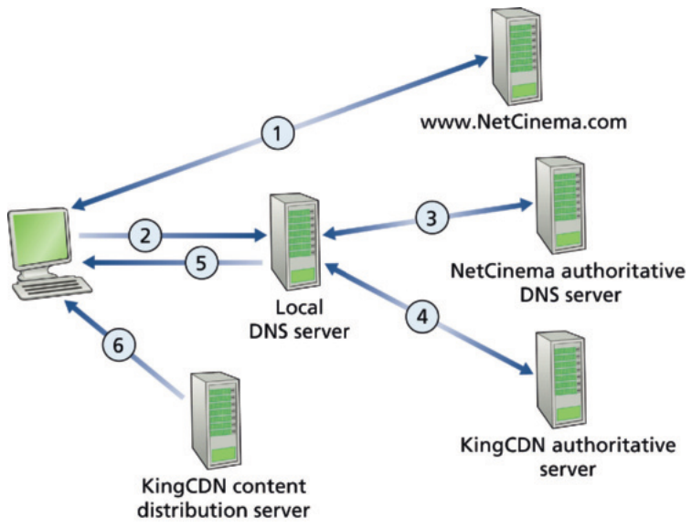

Hình 2.20 DNS chuyển hướng yêu cầu của người dùng tới một CDN server

1. Người dùng ghé trang Web tại NetCinema.

2. Khi người dùng nhấp vào liên kết http://video.netcinema.com/6Y7B23V, host của người dùng gửi một truy vấn DNS cho video.netcinema.com.

3. Local DNS Server (LDNS) của người dùng chuyển tiếp truy vấn DNS tới một authoritative DNS server cho NetCinema, server này nhận thấy chuỗi “video” trong hostname video.netcinema.com. Để “chuyển giao” truy vấn DNS cho KingCDN, thay vì trả về một địa chỉ IP, authoritative DNS server của NetCinema trả về cho LDNS một hostname trong domain của KingCDN, ví dụ, a1105.kingcdn.com.

4. Từ thời điểm này, truy vấn DNS đi vào hạ tầng DNS riêng của KingCDN. LDNS của người dùng sau đó gửi một truy vấn thứ hai, giờ cho a1105. kingcdn.com, và hệ thống DNS của KingCDN cuối cùng trả về địa chỉ IP của một content server KingCDN cho LDNS. Do đó chính tại đây, bên trong hệ thống DNS của KingCDN, CDN server mà client sẽ nhận nội dung được chỉ định.

5. LDNS chuyển tiếp địa chỉ IP của nút CDN content-serving (phục vụ nội dung) tới host của người dùng.

6. Khi client nhận được địa chỉ IP cho một content server KingCDN, nó thiết lập một kết nối TCP trực tiếp với server tại địa chỉ IP đó và đưa ra một yêu cầu HTTP GET cho video. Nếu dùng DASH, server trước hết sẽ gửi tới client một file manifest với một danh sách URL, mỗi URL cho một phiên bản của video, và client sẽ chọn động các chunk từ các phiên bản khác nhau.

#### Các chiến lược chọn cụm (Cluster Selection Strategies)

Cốt lõi của bất kỳ triển khai CDN nào là một chiến lược chọn cụm (cluster selection strategy), tức là, một cơ chế hướng động client tới một cụm server hoặc một data center trong CDN. Như chúng ta vừa thấy, CDN biết địa chỉ IP của LDNS server của client thông qua việc tra cứu DNS của client. Sau khi biết địa chỉ IP này, CDN cần chọn một cụm phù hợp dựa trên địa chỉ IP này. Các CDN thường dùng các chiến lược chọn cụm độc quyền. Giờ chúng ta điểm qua ngắn gọn một vài cách tiếp cận, mỗi cách có ưu điểm và nhược điểm riêng.

Một chiến lược đơn giản là gán client tới cụm gần nhất về mặt địa lý. Dùng các cơ sở dữ liệu geo-location (định vị địa lý) thương mại (như Quova [Quova 2025] và Max-Mind [MaxMind 2025]), mỗi địa chỉ IP LDNS được ánh xạ tới một vị trí địa lý. Khi nhận được một yêu cầu DNS từ một LDNS cụ thể, CDN chọn cụm gần nhất về mặt địa lý, tức là, cụm cách LDNS ít kilômét nhất “theo đường chim bay.” Một giải pháp như vậy có thể hoạt động khá tốt cho một phần lớn client [Agarwal 2009]. Tuy nhiên, với một số client, giải pháp có thể hoạt động kém, vì cụm gần nhất về mặt địa lý có thể không phải là cụm gần nhất xét theo độ dài hoặc số hop của đường mạng. Hơn nữa, một vấn đề cố hữu với mọi cách tiếp cận DNS-based là một số end-users (người dùng cuối) được cấu hình để dùng các LDNS đặt ở xa [Shaikh 2001; Mao 2002], trong trường hợp đó vị trí LDNS có thể xa vị trí của client. Hơn nữa, chiến lược đơn giản này bỏ qua sự biến thiên theo thời gian của độ trễ và băng thông khả dụng trên các đường Internet, luôn gán cùng một cụm cho một client cụ thể.

Để xác định cụm tốt nhất cho một client dựa trên điều kiện traffic hiện tại, các CDN có thể thay vào đó thực hiện các phép đo real-time định kỳ về performance độ trễ và mất mát giữa các cụm của họ và client. Ví dụ, một CDN có thể cho mỗi cụm của mình định kỳ gửi các probe (gói thăm dò) (ví dụ, thông điệp ping hoặc truy vấn DNS) tới tất cả các LDNS khắp thế giới. Một nhược điểm của cách tiếp cận này là nhiều LDNS được cấu hình để không phản hồi các probe như vậy.

#### CDN caching (CDN Caching)

Một CDN có thể có server ở hàng trăm hoặc hàng nghìn vị trí địa lý khác nhau. Việc đặt tất cả nội dung của nó ở tất cả các vị trí địa lý này không chỉ có thể gây chi phí phân phối mạng cao, mà còn có thể đòi hỏi dung lượng lưu trữ quá mức ở các vị trí khác nhau. Vì lý do này, một CDN thường đặt các tập con nội dung khác nhau ở các vị trí địa lý khác nhau. Vì mỗi vị trí thường sẽ định kỳ xóa một phần nội dung của nó để nhường chỗ cho nội dung mới hơn hoặc nội dung có nhu cầu cao hơn, các server đặt tại một vị trí cụ thể được gọi chung là một cache.

Một CDN có trong tay hai chiến lược cơ bản để đặt file video (và nội dung khác) vào cache của nó: push và pull. Trong chiến lược push, CDN dự báo video nào sẽ có nhu cầu cao nhất tại mỗi vị trí địa lý của nó. Các server trung tâm của CDN sau đó sẽ gửi tới mỗi vị trí địa lý những video mà nó dự kiến có nhu cầu cao nhất cho các vị trí đó. Như mô tả trong Mục 2.5.4, công ty video streaming Netflix theo cách tiếp cận push này. Trong chiến lược pull, khi người dùng đưa ra yêu cầu một video, người dùng trước hết được chuyển hướng tới một cache gần đó trong CDN. Nếu cache đó có bản sao của video, thì cache stream video tới người dùng bằng, chẳng hạn, giao thức DASH. Tuy nhiên, nếu có một cache miss—tức là nếu cache không có bản sao của video được yêu cầu—cache trước hết lấy video từ một trong các server trung tâm của CDN, lưu video vào cache cục bộ, và stream video tới người dùng yêu cầu. Để giảm độ trễ, khi cache đã nhận được phần đầu của video từ server CDN trung tâm, nó có thể bắt đầu streaming trong khi song song nhận phần còn lại của video. Như mô tả trong Mục 2.5.4, dịch vụ chia sẻ video YouTube theo cách tiếp cận pull này. Akamai (xem khung bên) kết hợp cả cách tiếp cận push và pull.

> Nghiên cứu tình huống (Case Study)
>
> Akamai: Sống ở rìa mạng (Akamai: Living on the Edge)
>
> trong một phần tư thế kỷ (for a Quarter Century)
>
> Akamai là người tiên phong trong việc phân phối nội dung qua CDN từ cuối những năm 1990’s [Spinrad 1999, Leighton 2000] và đã phát triển để cung cấp thêm các dịch vụ tính toán edge-based (dựa trên rìa mạng) tổng quát cho các công ty muốn cung cấp nội dung và tính toán “gần” khách hàng của công ty, tức là, ở rìa mạng. Cuối năm 2023, Akamai thực sự vận hành ở “quy mô Internet,” với hơn 360,000 server tại 4,200 vị trí rìa trong hơn 1,350 mạng, và chuyển giao hơn 175 Terabit dữ liệu mỗi giây tới người dùng cuối [Sitaraman 2023].
>
> Cốt lõi của CDN Akamai là (i) các thuật toán nhân bản/đặt nội dung mở rộng số instance nhân bản của nội dung, ví dụ, để đáp ứng các đám đông đột biến (flash crowd), theo nhu cầu, và cố gắng đặt nội dung đó “gần” người dùng yêu cầu, và (ii) một dịch vụ chuyển hướng, [Leighton 2000, Nygren 2010] tương tự như minh họa trong Hình 2.20, để hướng yêu cầu nội dung của người dùng tới một bản sao gần đó tại một server khả dụng. Mô tả chi tiết hơn về các thuật toán và dịch vụ của Akamai có thể tìm thấy tại tài liệu tham khảo ở trên.

> Nghiên cứu tình huống (Case Study)
>
> Data center và mạng của Google (Google’s Data Center and Network)
>
> Hạ tầng (Infrastructure)
>
> Để hỗ trợ một loạt dịch vụ khổng lồ của mình—bao gồm tìm kiếm, Gmail, lịch, video YouTube, bản đồ, tài liệu và mạng xã hội—Google đã triển khai một mạng riêng và hạ tầng data center rộng lớn. Hạ tầng toàn cầu của Google có hai tầng data center, được kết nối với nhau bằng một mạng riêng nội bộ và kết nối với các ISP tại hàng trăm điểm peering:
>
> • Data center quy mô lớn (Large Scale data centers). Google hiện có hai mươi ba “mega data center” ở Bắc và Nam Mỹ, châu Âu và châu Á [Google data
>
> centers 2024], với mỗi data center có khoảng chừng
>
> 100,000 server. Các data center large-scale này chịu trách nhiệm phục vụ
>
> nội dung động (và thường được cá nhân hóa), bao gồm kết quả tìm kiếm và
>
> thông điệp Gmail.
>
> • Network Edge sites (các site rìa mạng). Hơn 100 site Google Global Cache (GGC) và 140 site rìa mạng [Diot 2022] cho phép các ISP phục vụ nội dung Google tương đối tĩnh (ví dụ, YouTube và Google Play) từ bên trong mạng của chính họ. Các hệ thống quản lý traffic của Google hướng yêu cầu người dùng tới một vị trí rìa Google gần đó để phục vụ. Việc phục vụ yêu cầu người dùng near-to-the (gần) người dùng (và thường within-the-user’s-ISP (ngay trong ISP của người dùng)) này giúp đảm bảo trải nghiệm người dùng high-quality và giải phóng ISP khỏi việc phải chuyên chở traffic từ bên ngoài ISP của mình, qua mạng tới end-user (người dùng cuối).
>
> • Kết nối mạng (Network connectivity). Google vận hành mạng wide-area toàn cầu riêng của mình, gọi là B4 [Jain 2013] để kết nối các data center. Chúng ta sẽ thảo luận việc điều khiển và quản lý mạng B4 của Google trong Chương 5. Các Edge Points of Presence (POP) của Google kết nối tới ISP và các mạng riêng tại hơn 200 IXP (Hình 1.15) và tại hơn 100 cơ sở kết nối liên mạng khắp thế giới.
>
> • Google cloud. Ngoài hạ tầng large-scale và hạ tầng rìa cung cấp dịch vụ Google cho người dùng, Google cũng cung cấp dịch vụ cloud hosting và dịch vụ ứng dụng cho các dịch vụ Internet third-party. Ví dụ, Spotify dùng Google cloud để chạy các dịch vụ của nó (của Spotify). Vào mùa thu năm 2024, Google có data center Cloud ở 40 khu vực khắp thế giới [Statista Google Cloud 2024; Google Cloud 2025].
>
> Như đã nêu ở trên, tất cả các data center này được nối mạng với nhau bằng mạng riêng của chính Google. Khi người dùng đưa ra một truy vấn tìm kiếm, thường truy vấn trước hết được gửi qua ISP cục bộ tới một cache enter-deep gần đó, nơi nội dung tĩnh có thể được lấy ra; trong khi cung cấp nội dung tĩnh cho client, cache gần đó cũng chuyển tiếp truy vấn qua mạng riêng của Google tới một trong các mega data center, nơi kết quả tìm kiếm cá nhân hóa được lấy ra. Với một video YouTube, bản thân video có thể đến từ một trong các cache bring-home, trong khi các phần của trang Web bao quanh video có thể đến từ cache enter-deep gần đó, và các quảng cáo bao quanh video đến từ các data center.

### 2.5.4 Nghiên cứu tình huống: Netflix và YouTube (Case Studies: Netflix and YouTube)

Chúng ta kết thúc thảo luận về streaming video lưu sẵn bằng cách xem xét hai triển khai large-scale cực kỳ thành công: Netflix và YouTube. Chúng ta sẽ thấy mỗi hệ thống này theo một cách tiếp cận rất khác nhau, nhưng đều sử dụng nhiều nguyên lý nền tảng được thảo luận trong mục này.

#### Netflix

Tính đến năm 2025, Netflix là một trong những nhà cung cấp dịch vụ hàng đầu về phim và phim truyền hình trực tuyến ở Bắc Mỹ. Như chúng ta thảo luận bên dưới, việc phân phối video của Netflix có hai thành phần chính: Amazon cloud và hạ tầng CDN riêng của nó.

Netflix có một Web site xử lý nhiều chức năng, bao gồm đăng ký và đăng nhập người dùng, thanh toán, danh mục phim để duyệt và tìm kiếm, và một hệ thống gợi ý phim. Như minh họa trong Hình 2.21, Web site này (và các cơ sở dữ liệu backend liên quan) chạy hoàn toàn trên các server Amazon trong Amazon cloud. Ngoài ra, Amazon cloud xử lý các chức năng thiết yếu sau:

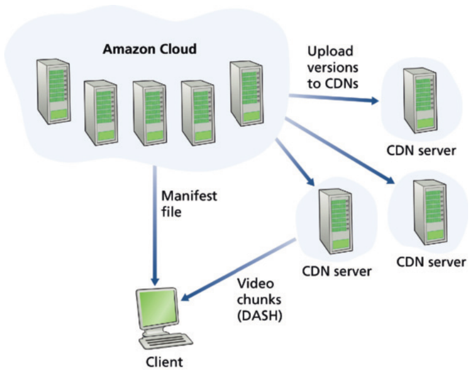

Hình 2.21 Nền tảng video streaming của Netflix

• Tiếp nhận nội dung (Content ingestion). Trước khi Netflix có thể phân phối một bộ phim cho khách hàng, nó phải tiếp nhận và xử lý bộ phim trước. Netflix nhận các phiên bản master từ studio của các bộ phim và upload chúng lên các host trong Amazon cloud.

• Xử lý nội dung (Content processing). Các máy trong Amazon cloud tạo nhiều định dạng khác nhau cho mỗi bộ phim, phù hợp với một loạt đa dạng các trình phát video client chạy trên máy tính desktop, smartphone và máy chơi game nối với TV. Một phiên bản khác nhau được tạo cho mỗi định dạng này và ở nhiều bit rate, cho phép streaming thích ứng qua HTTP bằng DASH.

• Upload các phiên bản lên CDN của nó (Uploading versions to its CDN). Khi tất cả các phiên bản của một bộ phim đã được tạo, các host trong Amazon cloud upload các phiên bản lên CDN của nó.

Khi Netflix lần đầu tung ra dịch vụ video streaming năm 2007, họ đã thuê ba công ty CDN third-party để phân phối nội dung video. Từ đó Netflix đã tạo CDN riêng của mình, gọi là Open Connect, từ đó giờ nó stream tất cả video. Để tạo CDN riêng, Netflix đã lắp đặt các rack server cả trong IXP lẫn bên trong chính các ISP dân dụng. Netflix hiện có rack server tại hơn 200 địa điểm IXP; xem [Bottger 2018] [Netflix Open Connect 2025] để có danh sách hiện tại các IXP chứa rack Netflix. Cũng có hàng trăm địa điểm ISP chứa rack Netflix; xem thêm [Netflix Open Connect 2025], nơi Netflix cung cấp cho các ISP đối tác tiềm năng hướng dẫn lắp đặt một rack Netflix (miễn phí) cho mạng của họ. Mỗi server trong rack có vài port Ethernet 10 Gbps và hơn 100 terabyte lưu trữ. Số server trong một rack khác nhau: các bản lắp đặt tại IXP thường có hàng chục server và chứa toàn bộ thư viện video streaming của Netflix, bao gồm nhiều phiên bản của các video để hỗ trợ DASH. Netflix không dùng pull-caching (Mục 2.5.4) để đưa nội dung vào các CDN server tại IXP và ISP. Thay vào đó, Netflix phân phối bằng cách push video tới các CDN server trong giờ off-peak (thấp điểm). Với những địa điểm không thể chứa toàn bộ thư viện, Netflix chỉ push các video phổ biến nhất, được xác định trên cơ sở day-to-day. Thiết kế CDN của Netflix được mô tả khá chi tiết trong các video YouTube [Netflix Video 1] và [Netflix Video 2]; xem thêm [Bottger 2018]. Một tổng quan xuất sắc và dễ tiếp cận về kiến trúc, thuật toán và hoạt động của Netflix là [Teixeira 2021].

Sau khi mô tả các thành phần của kiến trúc Netflix, hãy xem kỹ hơn tương tác giữa client và các server khác nhau tham gia vào việc chuyển giao phim. Như đã chỉ ra trước đó, các trang Web để duyệt thư viện video Netflix được phục vụ từ các server trong Amazon cloud. Khi người dùng chọn một bộ phim để phát, phần mềm Netflix, chạy trong Amazon cloud, trước hết xác định CDN server nào của nó có bản sao của bộ phim. Trong số các server có bộ phim, phần mềm sau đó xác định server “tốt nhất” cho yêu cầu của client đó. Nếu client đang dùng một ISP dân dụng có một rack CDN server Netflix được lắp đặt trong ISP đó, và rack này có bản sao của bộ phim được yêu cầu, thì một server trong rack này thường được chọn. Nếu không, một server tại một IXP gần đó thường được chọn.

Khi Netflix xác định được CDN server sẽ chuyển giao nội dung, nó gửi cho client địa chỉ IP của server cụ thể cũng như một file manifest, chứa URL cho các phiên bản khác nhau của bộ phim được yêu cầu. Client và CDN server đó sau đó tương tác trực tiếp bằng một phiên bản DASH độc quyền. Cụ thể, như mô tả trong Mục 2.5.2, client dùng header byte-range (khoảng byte) trong các thông điệp yêu cầu HTTP GET, để yêu cầu các chunk từ các phiên bản khác nhau của bộ phim. Netflix dùng các chunk dài khoảng bốn giây (four-seconds) [Adhikari 2012]. Trong khi các chunk đang được tải xuống, client đo throughput nhận được và chạy một thuật toán rate-determination (xác định tốc độ) để xác định chất lượng của chunk tiếp theo cần yêu cầu.

Netflix thể hiện nhiều nguyên lý then chốt được thảo luận trước đó trong mục này, bao gồm streaming thích ứng và phân phối CDN. Tuy nhiên, vì Netflix dùng CDN riêng của mình, chỉ phân phối video (chứ không phân phối trang Web), Netflix đã có thể đơn giản hóa và tùy biến thiết kế CDN của mình. Cụ thể, Netflix không cần dùng chuyển hướng DNS, như thảo luận trong Mục 2.5.3, để kết nối một client cụ thể tới một CDN server; thay vào đó, phần mềm Netflix (chạy trong Amazon cloud) trực tiếp bảo client dùng một CDN server cụ thể. Hơn nữa, CDN Netflix dùng push caching thay vì pull caching (Mục 2.5.4): nội dung được push vào các server vào những thời điểm định trước trong giờ off-peak, thay vì động trong các lần cache miss.

#### YouTube

Với hàng trăm giờ video được upload lên YouTube mỗi phút và vài tỉ lượt xem video mỗi ngày, YouTube không thể chối cãi là site video-sharing (chia sẻ video) lớn nhất thế giới. YouTube bắt đầu dịch vụ vào tháng Tư năm 2005 và được Google mua lại vào tháng Mười Một năm 2006. Mặc dù thiết kế và giao thức của Google/YouTube là độc quyền, thông qua một số nỗ lực đo lường độc lập, chúng ta có thể có hiểu biết cơ bản về cách YouTube hoạt động [Zink 2009; Torres 2011; Adhikari 2011a]. Giống Netflix, YouTube sử dụng rộng rãi công nghệ CDN để phân phối video [Torres 2011]. Tương tự Netflix, Google dùng CDN riêng để phân phối video YouTube, và đã lắp đặt các cụm server tại nhiều trăm địa điểm IXP và ISP khác nhau. Từ các địa điểm này và trực tiếp từ các data center khổng lồ của mình, Google phân phối video YouTube [Adhikari 2011a]. Tuy nhiên, không như Netflix, Google dùng pull caching, như mô tả trong Mục 2.5.3, và chuyển hướng DNS, cũng như mô tả trong Mục 2.5.3. Phần lớn thời gian, chiến lược cluster-selection của Google hướng client tới cụm có RTT giữa client và cụm thấp nhất; tuy nhiên, để cân bằng tải giữa các cụm, đôi khi client được hướng (qua DNS) tới một cụm xa hơn [Torres 2011].

Vài triệu video được upload lên YouTube mỗi ngày. Không chỉ video YouTube được stream từ server tới client qua HTTP, mà những người upload YouTube cũng upload video của họ từ client lên server qua HTTP. YouTube xử lý mỗi video nhận được, chuyển nó sang một định dạng video YouTube và tạo nhiều phiên bản ở các bit rate khác nhau. Việc xử lý này diễn ra hoàn toàn bên trong các data center của Google. (Xem nghiên cứu tình huống về hạ tầng mạng của Google trong Mục 2.5.3.)

## 2.6 Lập trình socket: Tạo ứng dụng mạng (Socket Programming: Creating Network Applications)

Giờ chúng ta đã xem xét một số ứng dụng mạng quan trọng, hãy khám phá cách các chương trình ứng dụng mạng thực sự được tạo ra. Nhớ lại từ Mục 2.1 rằng một ứng dụng mạng điển hình gồm một cặp chương trình—một chương trình client và một chương trình server—nằm trên hai end system khác nhau. Khi hai chương trình này được thực thi, một process client và một process server được tạo ra, và các process này giao tiếp với nhau bằng cách đọc từ, và ghi vào, socket. Khi tạo một ứng dụng mạng, nhiệm vụ chính của nhà phát triển do đó là viết code cho cả chương trình client và server.

Có hai loại ứng dụng mạng. Một loại là một bản triển khai có hoạt động được đặc tả trong một chuẩn giao thức, như một RFC hoặc một tài liệu chuẩn khác; một ứng dụng như vậy đôi khi được gọi là “mở,” vì các quy tắc đặc tả hoạt động của nó được mọi người biết. Với một bản triển khai như vậy, chương trình client và server phải tuân theo các quy tắc do RFC quy định. Ví dụ, chương trình client có thể là một bản triển khai phía client của giao thức HTTP, được mô tả trong Mục 2.2 và được định nghĩa chính xác trong RFC 2616; tương tự, chương trình server có thể là một bản triển khai của giao thức HTTP server, cũng được định nghĩa chính xác trong RFC 2616. Nếu một nhà phát triển viết code cho chương trình client và một nhà phát triển khác viết code cho chương trình server, và cả hai nhà phát triển đều tuân thủ cẩn thận các quy tắc của RFC, thì hai chương trình sẽ có thể tương tác với nhau. Thật vậy, nhiều ứng dụng mạng ngày nay liên quan tới giao tiếp giữa các chương trình client và server được tạo bởi các nhà phát triển độc lập—ví dụ, một browser Google Chrome giao tiếp với một Apache Web server, hoặc một client BitTorrent giao tiếp với tracker BitTorrent.

Loại ứng dụng mạng còn lại là một ứng dụng mạng độc quyền. Trong trường hợp này, chương trình client và server dùng một giao thức application-layer chưa được công bố công khai trong RFC hay nơi nào khác. Một nhà phát triển duy nhất (hoặc nhóm phát triển) tạo cả chương trình client và server, và nhà phát triển có toàn quyền kiểm soát những gì có trong code. Nhưng vì code không triển khai một giao thức mở, các nhà phát triển độc lập khác sẽ không thể phát triển code tương tác được với ứng dụng.

Trong mục này, chúng ta sẽ xem xét các vấn đề then chốt khi phát triển một ứng dụng client-server, và chúng ta sẽ “xắn tay áo” bằng cách xem code triển khai một ứng dụng client-server rất đơn giản. Trong giai đoạn phát triển, một trong những quyết định đầu tiên nhà phát triển phải đưa ra là ứng dụng sẽ chạy trên TCP hay trên UDP. Nhớ rằng TCP là hướng kết nối và cung cấp một kênh byte-stream (luồng byte) tin cậy mà qua đó dữ liệu chảy giữa hai end system. UDP là phi kết nối và gửi các packet dữ liệu độc lập từ end system này tới end system kia, không có bất kỳ đảm bảo nào về việc chuyển giao. Cũng nhớ rằng khi một chương trình client hoặc server triển khai một giao thức được định nghĩa bởi một RFC, nó nên dùng số port well-known gắn với giao thức đó; ngược lại, khi phát triển một ứng dụng độc quyền, nhà phát triển phải cẩn thận tránh dùng các số port well-known như vậy. (Số port đã được thảo luận ngắn gọn trong Mục 2.1. Chúng được đề cập chi tiết hơn trong Chương 3.)

Chúng tôi giới thiệu lập trình socket UDP và TCP thông qua một ứng dụng UDP đơn giản và một ứng dụng TCP đơn giản. Chúng tôi trình bày các ứng dụng UDP và TCP đơn giản bằng Python 3. Chúng tôi có thể đã viết code bằng Java, C hoặc C++, nhưng chúng tôi chọn Python chủ yếu vì Python thể hiện rõ các khái niệm socket then chốt. Với Python có ít dòng code hơn, và mỗi dòng có thể được giải thích cho lập trình viên mới vào nghề mà không gặp khó khăn. Nhưng không cần sợ nếu bạn không quen với Python. Bạn sẽ có thể dễ dàng theo dõi code nếu bạn có kinh nghiệm lập trình Java, C hoặc C++.

Nếu bạn quan tâm tới lập trình client-server với Java, bạn được khuyến khích xem Companion Website của cuốn sách này; thực ra, bạn có thể tìm thấy ở đó tất cả các ví dụ trong mục này (và các bài thực hành liên quan) bằng Java. Với độc giả quan tâm tới lập trình client-server bằng C, có một số tài liệu tham khảo tốt [Donahoo 2001; Stevens 1997; Frost 1994]; các ví dụ Python dưới đây của chúng tôi có hình thức và cảm giác tương tự C.

### 2.6.1 Lập trình socket với UDP (Socket Programming with UDP)

Trong tiểu mục này, chúng ta sẽ viết các chương trình client-server đơn giản dùng UDP; trong mục tiếp theo, chúng ta sẽ viết các chương trình tương tự dùng TCP.

Nhớ lại từ Mục 2.1 rằng các process chạy trên các máy khác nhau giao tiếp với nhau bằng cách gửi thông điệp vào socket. Chúng ta đã nói rằng mỗi process tương tự một ngôi nhà và socket của process tương tự một cánh cửa. Ứng dụng nằm ở một phía của cánh cửa trong ngôi nhà; giao thức transport-layer nằm ở phía bên kia của cánh cửa, ở thế giới bên ngoài. Nhà phát triển ứng dụng kiểm soát mọi thứ ở phía application-layer của socket; tuy nhiên, họ có rất ít quyền kiểm soát phía transport-layer.

Giờ hãy xem kỹ hơn tương tác giữa hai process giao tiếp dùng socket UDP. Trước khi process gửi có thể đẩy một packet dữ liệu ra cửa socket, khi dùng UDP, nó phải trước hết gắn một địa chỉ đích vào packet. Sau khi packet đi qua socket của bên gửi, Internet sẽ dùng địa chỉ đích này để định tuyến packet qua Internet tới socket trong process nhận. Khi packet tới socket nhận, process nhận sẽ lấy packet qua socket, rồi xem xét nội dung của packet và thực hiện hành động thích hợp.

Vậy có thể giờ bạn đang thắc mắc, cái gì được đưa vào địa chỉ đích gắn với packet? Như bạn có thể đoán, địa chỉ IP của host đích là một phần của địa chỉ đích. Bằng cách đưa địa chỉ IP đích vào packet, các router trong Internet sẽ có thể định tuyến packet qua Internet tới host đích. Nhưng vì một host có thể đang chạy nhiều process ứng dụng mạng, mỗi process có một hoặc nhiều socket, cũng cần xác định socket cụ thể trong host đích. Khi một socket được tạo, một định danh, gọi là số port, được gán cho nó. Vì vậy, như bạn có thể đoán, địa chỉ đích của packet cũng bao gồm số port của socket. Tóm lại, process gửi gắn vào packet một địa chỉ đích, gồm địa chỉ IP của host đích và số port của socket đích. Hơn nữa, như chúng ta sẽ sớm thấy, địa chỉ nguồn của bên gửi— gồm địa chỉ IP của host nguồn và số port của socket nguồn—cũng được gắn vào packet. Tuy nhiên, việc gắn địa chỉ nguồn vào packet thường không do code ứng dụng UDP thực hiện; thay vào đó nó được hệ điều hành bên dưới tự động thực hiện.

Chúng ta sẽ dùng ứng dụng client-server đơn giản sau để minh họa lập trình socket cho cả UDP và TCP:

1. Client đọc một dòng ký tự (dữ liệu) từ bàn phím và gửi dữ liệu tới server.

2. Server nhận dữ liệu và chuyển các ký tự thành chữ hoa.

3. Server gửi dữ liệu đã sửa đổi tới client.

4. Client nhận dữ liệu đã sửa đổi và hiển thị dòng đó trên màn hình.

Hình 2.22 làm nổi bật hoạt động socket-related (liên quan tới socket) chính của client và server giao tiếp qua dịch vụ giao vận UDP.

Giờ hãy “xắn tay áo” và xem cặp chương trình client-server cho một bản triển khai UDP của ứng dụng đơn giản này. Chúng tôi cũng cung cấp phân tích chi tiết, line-by-line (từng dòng) sau mỗi chương trình. Chúng ta sẽ bắt đầu với UDP client, sẽ gửi một thông điệp application-level đơn giản tới server. Để server có thể nhận và trả lời thông điệp của client, nó phải sẵn sàng và đang chạy—tức là, nó phải đang chạy như một process trước khi client gửi thông điệp.

Chương trình client được gọi là UDPClient.py, và chương trình server được gọi là UDPServer.py. Để nhấn mạnh các vấn đề then chốt, chúng tôi cố ý cung cấp code tối thiểu. “Code tốt” chắc chắn sẽ có thêm vài dòng phụ trợ, đặc biệt để xử lý các trường hợp lỗi. Với ứng dụng này, chúng tôi đã tùy ý chọn 12000 làm số port server.

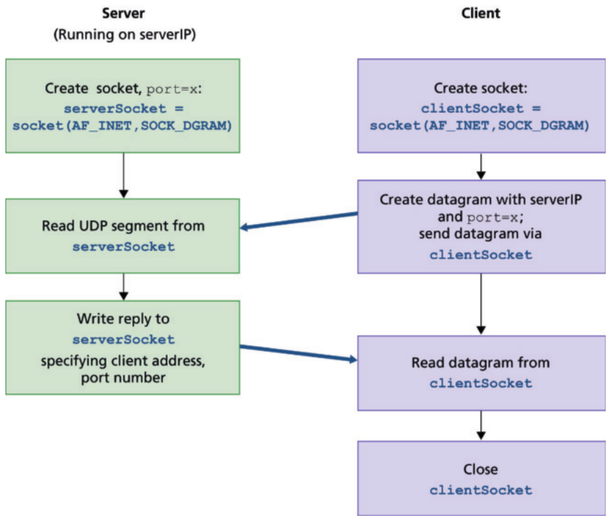

Hình 2.22 Ứng dụng client-server dùng UDP

#### UDPClient.py

Đây là code cho phía client của ứng dụng:

```
from socket import *
serverName = 'hostname'
serverPort = 12000
clientSocket = socket(AF_INET, SOCK_DGRAM)
message = input('Input lowercase sentence:')
clientSocket.sendto(message.encode(),(serverName, serverPort))
modifiedMessage, serverAddress = clientSocket.recvfrom(2048)
print(modifiedMessage.decode())
clientSocket.close()
```

Giờ hãy xem các dòng code khác nhau trong UDPClient.py.

```
from socket import *
```

Module socket tạo nền tảng cho mọi giao tiếp mạng trong Python. Bằng cách đưa dòng này vào, chúng ta sẽ có thể tạo socket trong chương trình của mình.

```
serverName = 'hostname'
serverPort = 12000
```

Dòng đầu tiên đặt biến serverName thành chuỗi ‘hostname’. Ở đây, chúng ta cung cấp một chuỗi chứa hoặc địa chỉ IP của server (ví dụ, “128.138.32.126”) hoặc hostname của server (ví dụ, “cis.poly.edu”). Nếu chúng ta dùng hostname, thì một phép tra cứu DNS sẽ tự động được thực hiện để lấy địa chỉ IP.) Dòng thứ hai đặt biến số nguyên serverPort thành 12000.

```
clientSocket = socket(AF_INET, SOCK_DGRAM)
```

Dòng này tạo socket của client, gọi là clientSocket. Tham số thứ nhất cho biết họ địa chỉ (address family); cụ thể, AF_INET cho biết mạng bên dưới đang dùng IPv4. (Đừng lo về điều này lúc này—chúng ta sẽ thảo luận IPv4 trong Chương 4.) Tham số thứ hai cho biết socket thuộc kiểu SOCK_DGRAM, nghĩa là nó là một socket UDP (chứ không phải socket TCP). Lưu ý rằng chúng ta không chỉ định số port của socket client khi tạo nó; thay vào đó chúng ta để hệ điều hành làm việc này cho chúng ta. Giờ cánh cửa của process client đã được tạo, chúng ta sẽ muốn tạo một thông điệp để gửi qua cánh cửa.

```
message = input('Input lowercase sentence:')
```

input() là một hàm built-in (dựng sẵn) trong Python. Khi lệnh này được thực thi, người dùng ở client được nhắc bằng dòng chữ “Input lowercase sentence:” Người dùng sau đó dùng bàn phím để nhập một dòng, dòng này được đặt vào biến message. Giờ chúng ta đã có một socket và một thông điệp, chúng ta sẽ muốn gửi thông điệp qua socket tới host đích.

```
clientSocket.sendto(message.encode(),(serverName, serverPort))
```

Ở dòng trên, trước hết chúng ta chuyển thông điệp từ kiểu string sang kiểu byte, vì chúng ta cần gửi byte vào socket; việc này được thực hiện bằng method encode(). Method sendto() gắn địa chỉ đích (serverName, serverPort) vào thông điệp và gửi packet kết quả vào socket của process, clientSocket. (Như đã đề cập trước đó, địa chỉ nguồn cũng được gắn vào packet, mặc dù việc này được thực hiện tự động chứ không tường minh bởi code.) Gửi một thông điệp client-to-server qua một socket UDP đơn giản như vậy đấy! Sau khi gửi packet, client chờ nhận dữ liệu từ server.

```
modifiedMessage,serverAddress = clientSocket.recvfrom(2048)
```

Với dòng trên, khi một packet từ Internet tới socket của client, dữ liệu của packet được đặt vào biến modifiedMessage và địa chỉ nguồn của packet được đặt vào biến serverAddress. Biến serverAddress chứa cả địa chỉ IP của server và số port của server. Chương trình UDPClient thực ra không cần thông tin địa chỉ server này, vì nó đã biết địa chỉ server ngay từ đầu; nhưng dòng Python này vẫn cung cấp địa chỉ server. Method recvfrom cũng nhận kích thước buffer 2048 làm đầu vào. (Kích thước buffer này dùng được cho hầu hết mục đích.)

```
print(modifiedMessage.decode())
```

Dòng này in modifiedMessage ra màn hình của người dùng, sau khi chuyển thông điệp từ byte sang string. Nó phải là dòng gốc người dùng đã gõ, nhưng giờ đã được viết hoa.

```
clientSocket.close()
```

Dòng này đóng socket. Process sau đó kết thúc.

#### UDPServer.py

Giờ hãy xem phía server của ứng dụng:

```
from socket import *
serverPort = 12000
serverSocket = socket(AF_INET, SOCK_DGRAM)
serverSocket.bind((", serverPort))
print("The server is ready to receive")
while True:
  message, clientAddress = serverSocket.recvfrom(2048)
  modifiedMessage = message.decode().upper()
  serverSocket.sendto(modifiedMessage.encode(),
clientAddress)
```

Lưu ý rằng phần đầu của UDPServer tương tự UDPClient. Nó cũng import module socket, cũng đặt biến số nguyên serverPort thành 12000, và cũng tạo một socket kiểu SOCK_DGRAM (một socket UDP). Dòng code đầu tiên khác đáng kể so với UDPClient là:

```
serverSocket.bind((", serverPort))
```

Dòng trên bind (tức là, gán) số port 12000 cho socket của server. Do đó, trong UDPServer, code (do nhà phát triển ứng dụng viết) đang gán tường minh một số port cho socket. Bằng cách này, khi bất kỳ ai gửi một packet tới port 12000 tại địa chỉ IP của server, packet đó sẽ được hướng tới socket này. UDPServer sau đó đi vào một vòng lặp while; vòng lặp while sẽ cho phép UDPServer nhận và xử lý packet từ client vô thời hạn. Trong vòng lặp while, UDPServer chờ một packet tới.

```
message, clientAddress = serverSocket.recvfrom(2048)
```

Dòng code này tương tự những gì chúng ta đã thấy trong UDPClient. Khi một packet tới socket của server, dữ liệu của packet được đặt vào biến message và địa chỉ nguồn của packet được đặt vào biến clientAddress. Biến clientAddress chứa cả địa chỉ IP của client và số port của client. Ở đây, UDPServer sẽ sử dụng thông tin địa chỉ này, vì nó cung cấp một địa chỉ hồi âm, tương tự địa chỉ hồi âm trong thư bưu chính thông thường. Với thông tin địa chỉ nguồn này, server giờ biết nó nên hướng trả lời của mình tới đâu.

```
modifiedMessage = message.decode().upper()
```

Dòng này là trái tim của ứng dụng đơn giản của chúng ta. Nó lấy dòng do client gửi và, sau khi chuyển thông điệp thành string, dùng method upper() để viết hoa nó.

```
serverSocket.sendto(modifiedMessage.encode(),clientAddress)
```

Dòng cuối này gắn địa chỉ của client (địa chỉ IP và số port) vào thông điệp đã viết hoa (sau khi chuyển string thành byte), và gửi packet kết quả vào socket của server. (Như đã đề cập trước đó, địa chỉ server cũng được gắn vào packet, mặc dù việc này được thực hiện tự động chứ không tường minh bởi code.) Internet sau đó sẽ chuyển packet tới địa chỉ client này. Sau khi server gửi packet, nó vẫn ở trong vòng lặp while, chờ một packet UDP khác tới (từ bất kỳ client nào chạy trên bất kỳ host nào).

Để kiểm tra cặp chương trình, bạn chạy UDPClient.py trên một host và UDPServer.py trên một host khác. Hãy chắc chắn đưa đúng hostname hoặc địa chỉ IP của server vào UDPClient.py. Tiếp theo, bạn thực thi UDPServer.py, chương trình server đã biên dịch, trên host server. Việc này tạo một process trong server ở trạng thái chờ cho đến khi được một client nào đó liên lạc. Sau đó bạn thực thi UDPClient.py, chương trình client đã biên dịch, trên client. Việc này tạo một process trong client. Cuối cùng, để dùng ứng dụng tại client, bạn gõ một câu rồi nhấn carriage return.

Để phát triển ứng dụng client-server UDP của riêng bạn, bạn có thể bắt đầu bằng cách sửa đổi nhẹ chương trình client hoặc server. Ví dụ, thay vì chuyển tất cả chữ cái thành chữ hoa, server có thể đếm số lần chữ s xuất hiện và trả về con số này. Hoặc bạn có thể sửa client để sau khi nhận một câu đã viết hoa, người dùng có thể tiếp tục gửi thêm câu tới server.

### 2.6.2 Lập trình socket với TCP (Socket Programming with TCP)

Không như UDP, TCP là một giao thức connection-oriented. Điều này có nghĩa là trước khi client và server có thể bắt đầu gửi dữ liệu cho nhau, trước hết chúng cần bắt tay và thiết lập một kết nối TCP. Một đầu của kết nối TCP được gắn với socket client và đầu kia được gắn với một socket server. Khi tạo kết nối TCP, chúng ta gắn với nó địa chỉ socket client (địa chỉ IP và số port) và địa chỉ socket server (địa chỉ IP và số port). Khi kết nối TCP đã được thiết lập, khi một phía muốn gửi dữ liệu tới phía kia, nó chỉ cần thả dữ liệu vào kết nối TCP qua socket của nó. Điều này khác với UDP, trong đó server phải gắn một địa chỉ đích vào packet trước khi thả nó vào socket.

Giờ hãy xem kỹ hơn tương tác của chương trình client và server trong TCP. Client có nhiệm vụ khởi tạo liên lạc với server. Để server có thể phản ứng với liên lạc ban đầu của client, server phải sẵn sàng. Điều này hàm ý hai điều. Thứ nhất, như trong trường hợp UDP, TCP server phải đang chạy như một process trước khi client cố gắng khởi tạo liên lạc. Thứ hai, chương trình server phải có một cánh cửa đặc biệt—chính xác hơn, một socket đặc biệt—chào đón một liên lạc ban đầu từ một process client chạy trên một host bất kỳ. Dùng phép so sánh ngôi nhà/cánh cửa cho process/socket, đôi khi chúng ta sẽ gọi liên lạc ban đầu của client là “gõ cửa chào đón.”

Khi process server đang chạy, process client có thể khởi tạo một kết nối TCP tới server. Việc này được thực hiện trong chương trình client bằng cách tạo một socket TCP. Khi client tạo socket TCP, nó chỉ định địa chỉ của socket chào đón trong server, cụ thể là, địa chỉ IP của host server và số port của socket. Sau khi tạo socket, client khởi tạo một bắt tay three-way và thiết lập một kết nối TCP với server. Bắt tay three-way, diễn ra trong tầng giao vận, hoàn toàn vô hình với chương trình client và server.

Trong bắt tay three-way, process client gõ vào cửa chào đón của process server. Khi server “nghe thấy” tiếng gõ, nó tạo một cánh cửa mới—chính xác hơn, một socket mới dành riêng cho client cụ thể đó. Trong ví dụ dưới đây, cửa chào đón là một đối tượng socket TCP mà chúng ta gọi là serverSocket; socket mới được tạo dành riêng cho client đang tạo kết nối được gọi là connectionSocket. Sinh viên lần đầu gặp socket TCP đôi khi nhầm lẫn socket chào đón (là điểm liên lạc ban đầu cho mọi client muốn giao tiếp với server), và mỗi socket kết nối server-side mới được tạo sau đó để giao tiếp với từng client.

Từ góc nhìn của ứng dụng, socket của client và socket kết nối của server được nối trực tiếp bằng một đường ống (pipe). Như minh họa trong Hình 2.23, process client có thể gửi các byte bất kỳ vào socket của nó, và TCP đảm bảo rằng process server sẽ nhận (qua socket kết nối) từng byte theo thứ tự đã gửi. Do đó TCP cung cấp một dịch vụ tin cậy giữa process client và server. Hơn nữa, giống như người ta có thể ra vào cùng một cánh cửa, process client không chỉ gửi byte vào mà còn nhận byte từ socket của nó; tương tự, process server không chỉ nhận byte từ mà còn gửi byte vào socket kết nối của nó. Chúng ta dùng cùng ứng dụng client-server đơn giản để minh họa lập trình socket với TCP: Client gửi một dòng dữ liệu tới server, server viết hoa dòng đó và gửi lại cho client. Hình 2.24 làm nổi bật hoạt động socket-related chính của client và server giao tiếp qua dịch vụ giao vận TCP.

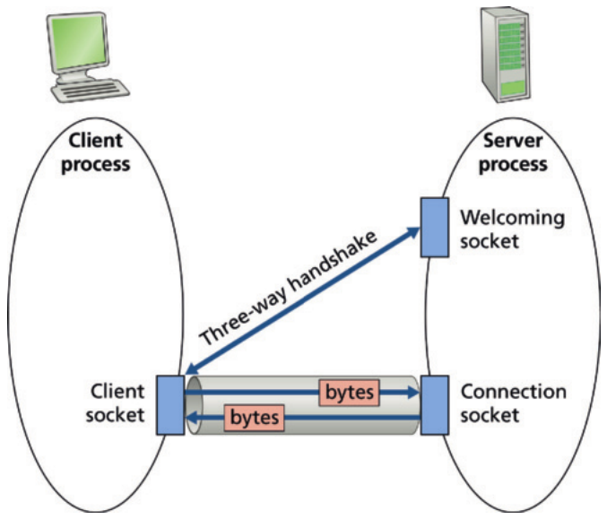

Hình 2.23 Process TCPServer có hai socket

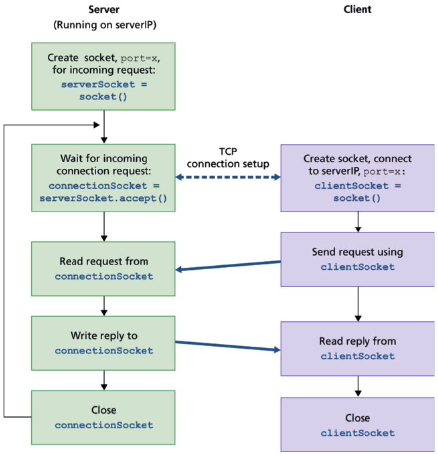

Hình 2.24 Ứng dụng client-server dùng TCP

#### TCPClient.py

Đây là code cho phía client của ứng dụng:

```
from socket import *
serverName = 'servername'
serverPort = 12000
clientSocket = socket(AF_INET, SOCK_STREAM)
clientSocket.connect((serverName,serverPort))
sentence = input('Input lowercase sentence:')
clientSocket.send(sentence.encode())
modifiedSentence = clientSocket.recv(1024)
print('From Server: ', modifiedSentence.decode())
clientSocket.close()
```

Giờ hãy xem các dòng khác nhau trong code khác đáng kể so với bản triển khai UDP. Dòng đầu tiên như vậy là việc tạo socket client.

```
clientSocket = socket(AF_INET, SOCK_STREAM)
```

Dòng này tạo socket của client, gọi là clientSocket. Tham số thứ nhất lại cho biết mạng bên dưới đang dùng IPv4. Tham số thứ hai cho biết socket thuộc kiểu SOCK_STREAM, nghĩa là nó là một socket TCP (chứ không phải socket UDP). Lưu ý rằng chúng ta lại không chỉ định số port của socket client khi tạo nó; thay vào đó chúng ta để hệ điều hành làm việc này cho chúng ta. Giờ dòng code tiếp theo rất khác với những gì chúng ta đã thấy trong UDPClient:

```
clientSocket.connect((serverName,serverPort))
```

Nhớ rằng trước khi client có thể gửi dữ liệu tới server (hoặc ngược lại) bằng socket TCP, một kết nối TCP phải được thiết lập trước giữa client và server. Dòng trên khởi tạo kết nối TCP giữa client và server. Tham số của method connect() là địa chỉ của phía server của kết nối. Sau khi dòng code này được thực thi, bắt tay three-way được thực hiện và một kết nối TCP được thiết lập giữa client và server.

```
sentence = input('Input lowercase sentence:')
```

Như với UDPClient, dòng trên lấy một câu từ người dùng. Chuỗi sentence tiếp tục thu thập ký tự cho đến khi người dùng kết thúc dòng bằng cách gõ carriage return. Dòng code tiếp theo cũng rất khác với UDPClient:

```
clientSocket.send(sentence.encode())
```

Dòng trên gửi câu qua socket của client và vào kết nối TCP. Lưu ý rằng chương trình không tạo tường minh một packet và gắn địa chỉ đích vào packet, như trường hợp với socket UDP. Thay vào đó chương trình client chỉ đơn giản thả các byte trong chuỗi sentence vào kết nối TCP. Client sau đó chờ nhận byte từ server.

```
modifiedSentence = clientSocket.recv(2048)
```

Khi các ký tự tới từ server, chúng được đặt vào chuỗi modifiedSentence. Các ký tự tiếp tục tích lũy trong modifiedSentence cho đến khi dòng kết thúc bằng một ký tự carriage return. Sau khi in câu đã viết hoa, chúng ta đóng socket của client:

```
clientSocket.close()
```

Dòng cuối này đóng socket và, do đó, đóng kết nối TCP giữa client và server. Nó khiến TCP ở client gửi một thông điệp TCP tới TCP ở server (xem Mục 3.5).

#### TCPServer.py

Giờ hãy xem chương trình server.

```
from socket import *
serverPort = 12000
serverSocket = socket(AF_INET,SOCK_STREAM)
serverSocket.bind(('',serverPort))
serverSocket.listen(1)
print('The server is ready to receive')
while True:
  connectionSocket, addr = serverSocket.accept()
  sentence = connectionSocket.recv(1024).decode()
  capitalizedSentence = sentence.upper()
  connectionSocket.send(capitalizedSentence.encode())
  connectionSocket.close()
```

Giờ hãy xem các dòng khác đáng kể so với UDPServer và TCPClient. Như với TCPClient, server tạo một socket TCP bằng:

```
serverSocket=socket(AF_INET,SOCK_STREAM)
```

Tương tự UDPServer, chúng ta gắn số port server, serverPort, với socket này:

```
serverSocket.bind((",serverPort))
```

Nhưng với TCP, serverSocket sẽ là socket chào đón của chúng ta. Sau khi thiết lập cánh cửa chào đón này, chúng ta sẽ chờ và lắng nghe một client nào đó gõ cửa:

```
serverSocket.listen(1)
```

Dòng này cho server lắng nghe các yêu cầu kết nối TCP từ client. Tham số chỉ định số kết nối xếp hàng tối đa (ít nhất 1).

```
connectionSocket, addr = serverSocket.accept()
```

Khi một client gõ vào cánh cửa này, chương trình gọi method accept() cho serverSocket, method này tạo một socket mới trong server, gọi là connectionSocket, dành riêng cho client cụ thể này. Client và server sau đó hoàn tất bắt tay, tạo một kết nối TCP giữa clientSocket của client và connectionSocket của server. Khi kết nối TCP đã được thiết lập, client và server giờ có thể gửi byte cho nhau qua kết nối. Với TCP, mọi byte gửi từ một phía không chỉ được đảm bảo tới phía kia mà còn được đảm bảo tới theo đúng thứ tự.

```
connectionSocket.close()
```

Trong chương trình này, sau khi gửi câu đã sửa đổi tới client, chúng ta đóng socket kết nối. Nhưng vì serverSocket vẫn mở, một client khác giờ có thể gõ cửa và gửi cho server một câu để sửa đổi. Điều này hoàn tất thảo luận của chúng ta về lập trình socket trong TCP. Bạn được khuyến khích chạy hai chương trình trên hai host riêng biệt, và cũng sửa đổi chúng để đạt các mục tiêu hơi khác. Bạn nên so sánh cặp chương trình UDP với cặp chương trình TCP và xem chúng khác nhau thế nào. Bạn cũng nên làm nhiều bài tập lập trình socket được mô tả ở cuối Chương 2 và 3. Cuối cùng, chúng tôi hy vọng một ngày nào đó, sau khi làm chủ những chương trình socket này và nâng cao hơn, bạn sẽ viết ứng dụng mạng phổ biến của riêng mình, trở nên rất giàu có và nổi tiếng, và nhớ tới các tác giả của cuốn sách này!

### 2.6.3 Lập trình socket với QUIC (Socket Programming with QUIC)

Chúng ta sẽ kết thúc mục này bằng một thảo luận high-level về cách một nhà phát triển ứng dụng sẽ dùng QUIC API để gửi thông điệp giữa client và server. Hãy xét điều gì xảy ra khi một Web browser dùng giao thức HTTP/3 để yêu cầu một trang Web từ một server cũng chạy HTTP/3. Thay vì khởi tạo một bắt tay TCP truyền thống, client khởi tạo một bắt tay QUIC trên nền UDP. QUIC kết hợp bắt tay TLS 1.3 vào bắt tay QUIC, nghĩa là thiết lập kết nối và thiết lập mã hóa được thực hiện song song, chứ không tuần tự như khi HTTP/2. Mặc dù UDP là phi kết nối, QUIC là connection-oriented, cho phép client và server giữ thông tin kết nối qua các yêu cầu HTTP khác nhau cho cùng hoặc khác trang Web.

Giờ hãy chuyển sự chú ý sang HTTP/3 server với một kết nối đã được thiết lập giữa client và server. Sau khi nhận (các) yêu cầu qua kết nối QUIC, server sẽ cần gửi các thông điệp HTTP, mỗi thông điệp đóng gói một object, tới client. HTTP/3 server sẽ dùng QUIC API để tạo một stream riêng và một stream ID tương ứng cho mỗi thông điệp nó muốn gửi. Ví dụ, server có thể tạo Stream 1 cho trang HTML gốc, tạo Stream 2 cho một object CSS, và Stream 3 cho một ảnh. Sau đó nó có thể gửi cả ba thông điệp này back-to-back vào kết nối QUIC. Khi HTTP/3 muốn gửi một thông điệp, nó chỉ định, cho QUIC API, QUIC connection ID và stream ID. Các nhiệm vụ như mã hóa, chia stream (tức là, thông điệp) thành các frame nhỏ hơn, và ghép kênh stream đều được sub-layer QUIC xử lý nội bộ. HTTP/3 server cũng có thể chỉ cho QUIC API rằng nó nên ưu tiên hóa các stream dựa trên tầm quan trọng của tài nguyên. Ví dụ, HTTP/3 server có thể bảo QUIC ưu tiên nội dung HTML (vì nó tạo nên cấu trúc cơ bản của trang web) và gửi nó trước các tài nguyên khác như ảnh hoặc JavaScript.

Quan trọng là, code HTTP/3 tương tác với QUIC API chứ không với socket API UDP bên dưới. Vì vậy từ góc nhìn của nhà phát triển ứng dụng HTTP/3, HTTP/3 chạy trên giao thức giao vận QUIC.

## 2.7 Tóm tắt (Summary)

Trong chương này, chúng ta đã nghiên cứu các khía cạnh khái niệm và triển khai của ứng dụng mạng. Chúng ta đã học về kiến trúc client-server phổ biến khắp nơi được nhiều ứng dụng Internet áp dụng và thấy cách nó được dùng trong các giao thức HTTP, SMTP và DNS. Chúng ta đã nghiên cứu khá chi tiết các giao thức application-level quan trọng này, và các ứng dụng tương ứng gắn với chúng (Web, truyền file, e-mail và DNS). Chúng ta cũng đã học về video streaming, và cách các hệ thống phân phối video hiện đại tận dụng CDN. Chúng ta đã xem xét cách socket API có thể được dùng để xây dựng ứng dụng mạng. Chúng ta đã đi qua việc dùng socket cho các dịch vụ giao vận end-to-end connection-oriented (TCP) và phi kết nối (UDP). Bước đầu tiên trong hành trình đi xuống kiến trúc mạng phân tầng giờ đã hoàn tất!

Ngay ở đầu cuốn sách này, trong Mục 1.1, chúng tôi đã đưa ra một định nghĩa khá mơ hồ, bare-bones về giao thức: “định dạng và thứ tự các thông điệp được trao đổi giữa hai hoặc nhiều thực thể giao tiếp, cũng như các hành động được thực hiện khi truyền và/hoặc nhận một thông điệp hoặc sự kiện khác.” Nội dung trong chương này, và đặc biệt là nghiên cứu chi tiết của chúng ta về các giao thức HTTP, SMTP và DNS, giờ đã bổ sung thực chất đáng kể cho định nghĩa này. Giao thức là một khái niệm then chốt trong mạng; nghiên cứu về giao thức ứng dụng giờ đã cho chúng ta cơ hội phát triển một cảm nhận trực quan hơn về bản chất của giao thức.

Trong Mục 2.1, chúng ta đã mô tả các mô hình dịch vụ mà TCP và UDP cung cấp cho các ứng dụng gọi chúng. Chúng ta còn xem kỹ hơn các mô hình dịch vụ này khi phát triển các ứng dụng đơn giản chạy trên TCP và UDP trong Mục 2.6. Tuy nhiên, chúng ta mới nói rất ít về cách TCP và UDP cung cấp các mô hình dịch vụ này. Ví dụ, chúng ta biết TCP cung cấp một dịch vụ dữ liệu tin cậy, nhưng chúng ta chưa nói nó làm điều đó như thế nào. Trong chương tiếp theo, chúng ta sẽ xem xét kỹ không chỉ cái gì, mà còn cách thức và tại sao của các giao thức giao vận.

Được trang bị kiến thức về cấu trúc ứng dụng Internet và các giao thức application-level, giờ chúng ta sẵn sàng đi xuống sâu hơn trong protocol stack và xem xét tầng giao vận trong Chương 3.

### Bài tập về nhà và câu hỏi (Homework Problems and Questions)

#### Câu hỏi ôn tập Chương 2 (Chapter 2 Review Questions)

##### Mục 2.1

R1. Liệt kê năm ứng dụng Internet không độc quyền và các giao thức application-layer mà chúng dùng.

R2. Sự khác biệt giữa kiến trúc mạng và kiến trúc ứng dụng là gì?

R3. Với một phiên giao tiếp giữa một cặp process, process nào là client và process nào là server?

R4. Giao diện phần mềm mà một process gửi thông điệp vào, và nhận thông điệp từ, là gì?

R5. Thông tin nào được một process chạy trên một host dùng để xác định một process chạy trên host khác?

R6. Giả sử bạn muốn thực hiện một giao dịch từ một client từ xa tới một server nhanh nhất có thể. Bạn sẽ dùng UDP hay TCP? Tại sao?

R7. Tham chiếu Hình 2.4, chúng ta thấy không ứng dụng nào được liệt kê trong Hình 2.4 yêu cầu đồng thời không mất dữ liệu và định thời. Bạn có thể hình dung ra một ứng dụng yêu cầu không mất dữ liệu và cũng rất time-sensitive không?

R8. Liệt kê bốn lớp dịch vụ tổng quát mà một giao thức giao vận có thể cung cấp. Với mỗi lớp dịch vụ, cho biết UDP hay TCP (hoặc cả hai) cung cấp dịch vụ như vậy.

R9. Nhớ rằng TCP có thể được tăng cường với TLS để cung cấp các dịch vụ bảo mật process-to-process, bao gồm mã hóa. TLS hoạt động ở tầng giao vận hay tầng ứng dụng? Nếu nhà phát triển ứng dụng muốn TCP được tăng cường với TLS, nhà phát triển phải làm gì?

##### Mục 2.2–2.4

R10. Giao thức bắt tay (handshaking protocol) có nghĩa là gì?

R11. Tại sao HTTP, SMTP và IMAP chạy trên TCP thay vì trên UDP?

R12. Hãy xét một site e-commerce muốn giữ hồ sơ mua hàng cho mỗi khách hàng. Mô tả cách việc này có thể được thực hiện bằng cookie.

R13. Làm thế nào QUIC có thể là connection-oriented mặc dù nó chạy trên UDP?

R14. Trong code HTTP/3, socket UDP, TCP hay QUIC được mở và đóng?

R15. Liệt kê một số ứng dụng nhắn tin phổ biến. Chúng có dùng cùng giao thức với SMS không?

R16. Alice dùng Gmail và Bob dùng Yahoo! Mail. Giả sử Alice gửi một thông điệp email tới Bob. Liệt kê chuỗi các giao thức ứng dụng được dùng để đưa thông điệp từ Alice tới Bob.

R17. In header của một thông điệp e-mail bạn mới nhận gần đây. Có bao nhiêu dòng header Received:? Phân tích từng dòng header trong thông điệp.

R18. Vấn đề HOL blocking trong HTTP/1.1 là gì? HTTP/2 cố gắng giải quyết nó như thế nào? Vấn đề HOL trong HTTP/2 là gì? HTTP/3 giải quyết nó như thế nào.

### Bài tập (Problems)

P1. Đúng hay sai?

R19. Có thể nào Web server và mail server của một tổ chức có chính xác cùng một bí danh cho một hostname (ví dụ, foo.com) không? Kiểu của RR chứa hostname của mail server sẽ là gì?

R20. Xem lại các e-mails bạn đã nhận, và xem xét header của một thông điệp được gửi từ một người dùng. Có thể xác định từ header địa chỉ IP của host đã gửi thông điệp không? Làm tương tự cho một thông điệp gửi từ một tài khoản Gmail.

#### Mục 2.5

R21. Các CDN thường áp dụng một trong hai triết lý đặt server khác nhau. Nêu tên và mô tả ngắn gọn chúng.

R22. Ngoài các cân nhắc network-related (liên quan tới mạng) như độ trễ, mất mát và performance băng thông, còn có những yếu tố quan trọng khác khi thiết kế một chiến lược chọn CDN server. Chúng là gì?

#### Mục 2.6

R23. Trong Mục 2.6, UDP server được mô tả chỉ cần một socket, trong khi TCP server cần hai socket. Tại sao? Nếu TCP server phải hỗ trợ n kết nối đồng thời, mỗi kết nối từ một host client khác nhau, TCP server sẽ cần bao nhiêu socket?

R24. Với ứng dụng client-server trên TCP được mô tả trong Mục 2.6, tại sao chương trình server phải được thực thi trước chương trình client? Với ứng dụng client-server trên UDP, tại sao chương trình client có thể được thực thi trước chương trình server?

a. Một người dùng yêu cầu một trang Web gồm một ít văn bản và ba ảnh. Với trang này, client sẽ gửi một thông điệp yêu cầu và nhận bốn thông điệp phản hồi.

b. Hai trang Web khác nhau (ví dụ, www.mit.edu/research.html và www.mit.edu/students.html) có thể được gửi qua cùng một kết nối bền.

c. Với kết nối không bền (nonpersistent) giữa browser và origin server, một segment TCP duy nhất có thể mang hai thông điệp yêu cầu HTTP khác nhau.

d. Header Date: trong thông điệp phản hồi HTTP cho biết object trong phản hồi được sửa đổi lần cuối khi nào.

e. Thông điệp phản hồi HTTP không bao giờ có message body rỗng.

P2. SMS, iMessage, Wechat và WhatsApp đều là các hệ thống nhắn tin real-time trên smartphone. Sau khi tìm hiểu trên Internet, với mỗi hệ thống này hãy viết một đoạn về các giao thức chúng dùng. Sau đó viết một đoạn giải thích chúng khác nhau thế nào.

P3. Hãy xét một HTTP client muốn lấy một tài liệu Web tại một URL cho trước. Địa chỉ IP của HTTP server ban đầu chưa biết. Những giao thức giao vận và application-layer nào ngoài HTTP cần thiết trong kịch bản này?

P4. Hãy xét chuỗi ký tự ASCII sau được Wireshark bắt khi browser gửi một thông điệp HTTP GET (tức là, đây là nội dung thực của một thông điệp HTTP GET). Các ký tự &lt;cr&gt;&lt;lf&gt; là các ký tự carriage return và line-feed (tức là, chuỗi ký tự in nghiêng (italized) &lt;cr&gt; trong văn bản dưới đây biểu diễn ký tự carriage-return duy nhất có ở vị trí đó trong header HTTP). Trả lời các câu hỏi sau, chỉ ra nơi trong thông điệp HTTP GET dưới đây bạn tìm thấy câu trả lời.

```
GET /cs453/index.html HTTP/1.1<cr><lf>Host: gai
a.cs.umass.edu<cr><lf>User-Agent: Mozilla/5.0 (
Windows;U; Windows NT 5.1; en-US; rv:1.7.2) Gec
ko/20040804 Netscape/7.2 (ax) <cr><lf>Accept:ex
t/xml, application/xml, application/xhtml+xml, text
/html;q=0.9, text/plain;q=0.8,image/png,*/*;q=0.5
<cr><lf>Accept-Language: en-us,en;q=0.5<cr><lf>Accept-
Encoding: zip,deflate<cr><lf>Accept-Charset: ISO
-8859-1,utf-8;q=0.7,*;q=0.7<cr><lf>Keep-Alive: 300<cr>
<lf>Connection:keep-alive<cr><lf><cr><lf>
```

a. URL của tài liệu được browser yêu cầu là gì?

b. Browser đang chạy phiên bản HTTP nào?

c. Browser yêu cầu kết nối non-persistent hay kết nối bền?

d. Địa chỉ IP của host mà browser đang chạy trên đó là gì?

e. Loại browser nào khởi tạo thông điệp này? Tại sao loại browser lại cần thiết trong một thông điệp yêu cầu HTTP?

P5. Văn bản dưới đây cho thấy trả lời được gửi từ server để phản hồi thông điệp HTTP GET ở câu trên. Trả lời các câu hỏi sau, chỉ ra nơi trong thông điệp dưới đây bạn tìm thấy câu trả lời.

```
HTTP/1.1 200 OK<cr><lf>Date: Tue, 07 Mar 2008
12:39:45GMT<cr><lf>Server: Apache/2.0.52 (Fedora)
<cr><lf>Last-Modified: Sat, 10 Dec2005 18:27:46
GMT<cr><lf>ETag: “526c3-f22-a88a4c80”<cr><lf>Accept-
Ranges: bytes<cr><lf>Content-Length: 3874<cr><lf>
Keep-Alive: timeout=max=100<cr><lf>Connection:
Keep-Alive<cr><lf>Content-Type: text/html; charset=
ISO-8859-1<cr><lf><cr><lf><!doctype html public {“-
//w3c//dtd html 4.0transitional//en”><lf><html><lf>
<head><lf> <meta http-equiv=”Content-Type”
content=”text/html; charset=iso-8859-1”><lf> <meta
name=”GENERATOR” content=”Mozilla/4.79 [en] (Windows NT
5.0; U) Netscape]”><lf> <title>CMPSCI 453 / 591 /
NTU-ST550ASpring 2005 homepage</title><lf></head><lf>
<much more document text following here (not shown)>
```

a. Server có tìm thấy tài liệu thành công hay không? Trả lời tài liệu được cung cấp vào lúc nào?

b. Tài liệu được sửa đổi lần cuối khi nào?

c. Có bao nhiêu byte trong tài liệu được trả về?

d. 5 byte đầu tiên của tài liệu được trả về là gì? Server có đồng ý một kết nối bền không?

P6. Lấy đặc tả HTTP/1.1 (RFC 2616). Trả lời các câu hỏi sau:

a. Giải thích cơ chế được dùng để báo hiệu giữa client và server nhằm cho biết một kết nối bền đang được đóng. Client, server hay cả hai có thể báo hiệu việc đóng kết nối?

b. HTTP cung cấp những dịch vụ mã hóa nào?

c. Một client có thể mở ba hoặc nhiều kết nối đồng thời với một server cho trước không?

d. Server hoặc client đều có thể đóng một kết nối giao vận giữa chúng nếu một trong hai phát hiện kết nối đã rảnh trong một thời gian. Có thể nào một phía bắt đầu đóng kết nối trong khi phía kia đang truyền dữ liệu qua kết nối này không? Giải thích.

P7. Giả sử trong Web browser bạn nhấp vào một liên kết để lấy một trang Web. Địa chỉ IP cho URL liên quan chưa được cache trong host cục bộ của bạn, nên cần một phép tra cứu DNS để lấy địa chỉ IP. Giả sử n DNS server được ghé trước khi host của bạn nhận được địa chỉ IP từ DNS; các lần ghé liên tiếp chịu RTT là RTT<sub>1</sub>, . . . , RTT<sub>n</sub>. Giả sử thêm trang Web gắn với liên kết chứa đúng một object, gồm một lượng nhỏ văn bản HTML. Gọi RTT<sub>0</sub> là RTT giữa host cục bộ và server chứa object. Giả sử thời gian truyền object bằng không, bao nhiêu thời gian trôi qua từ khi client nhấp vào liên kết cho đến khi client nhận được object?

P8. Tham chiếu Bài P7, giả sử file HTML tham chiếu tám object rất nhỏ trên cùng server. Bỏ qua thời gian truyền, bao nhiêu thời gian trôi qua với

a. HTTP non-persistent không có kết nối TCP song song?

b. HTTP non-persistent với browser được cấu hình cho 6 kết nối song song?

c. HTTP bền (Persistent HTTP)?

P9. Hãy xét một liên kết ngắn, 10-meter, qua đó bên gửi có thể truyền với tốc độ 150 bit/giây theo cả hai chiều. Giả sử các packet chứa dữ liệu dài 100,000 bit, và các packet chỉ chứa điều khiển (ví dụ, ACK hoặc bắt tay) dài 200 bit. Giả sử N kết nối song song mỗi kết nối nhận 1N/ băng thông liên kết. Giờ hãy xét giao thức HTTP, và giả sử mỗi object được tải về dài 100 Kbit, và object được tải về ban đầu chứa 10 object được tham chiếu từ cùng bên gửi. Các lượt tải song song qua các instance song song của HTTP non-persistent có hợp lý trong trường hợp này không? Giờ hãy xét HTTP bền. Bạn có kỳ vọng lợi ích đáng kể so với trường hợp non-persistent không? Biện minh và giải thích câu trả lời của bạn.

P10. Hãy xét kịch bản được giới thiệu trong bài trước. Giờ giả sử liên kết được Bob dùng chung với bốn người dùng khác. Bob dùng các instance song song của HTTP non-persistent, và bốn người dùng kia dùng HTTP non-persistent không có tải song song.

a. Các kết nối song song của Bob có giúp anh lấy trang Web nhanh hơn không? Tại sao có hoặc không?

b. Nếu cả năm người dùng đều mở năm instance song song của HTTP non-persistent, thì các kết nối song song của Bob có còn có lợi không? Tại sao có hoặc không?

P11. Viết một chương trình TCP đơn giản cho một server nhận các dòng đầu vào từ một client và in các dòng ra standard output của server. (Bạn có thể làm việc này bằng cách sửa đổi chương trình TCPServer.py trong sách.) Biên dịch và thực thi chương trình của bạn. Trên bất kỳ máy nào khác có Web browser, đặt proxy server trong browser là host đang chạy chương trình server của bạn; cũng cấu hình số port phù hợp. Browser của bạn giờ sẽ gửi các thông điệp yêu cầu GET tới server của bạn, và server của bạn sẽ hiển thị các thông điệp trên standard output. Dùng nền tảng này để xác định browser của bạn có sinh thông điệp GET có điều kiện cho các object được cache cục bộ hay không.

P12. Hãy xét việc gửi qua HTTP/2 một trang Web gồm một video clip, và năm ảnh. Giả sử video clip được vận chuyển dưới dạng 2000 frame, và mỗi ảnh có ba frame.

a. Nếu tất cả các frame video được gửi trước không đan xen, cần bao nhiêu “thời gian frame (frame time)” cho đến khi cả năm ảnh được gửi?

b. Nếu các frame được đan xen, cần bao nhiêu thời gian frame cho đến khi cả năm ảnh được gửi.

P13. Hãy xét trang Web trong bài 12. Giờ ưu tiên hóa HTTP/2 được áp dụng. Giả sử tất cả các ảnh được ưu tiên hơn video clip, và ảnh thứ nhất được ưu tiên hơn ảnh thứ hai, ảnh thứ hai hơn ảnh thứ ba, v.v. Cần bao nhiêu thời gian frame cho đến khi ảnh thứ hai được gửi?

P14. Sự khác biệt giữa MAIL FROM: trong SMTP và From: trong chính thông điệp mail là gì?

P15. SMTP đánh dấu kết thúc phần body thông điệp như thế nào? Còn HTTP thì sao? HTTP có thể dùng cùng phương pháp như SMTP để đánh dấu kết thúc phần body thông điệp không? Giải thích.

P16. Đọc RFC 5321 về SMTP. MTA là viết tắt của gì? Hãy xét e-mail spam nhận được sau (được sửa đổi từ một e-mail spam thực). Giả sử chỉ người khởi tạo e-mail spam này là độc hại và mọi host khác đều trung thực, hãy xác định host độc hại đã tạo ra e-mail spam này.

```
From - Fri Nov 07 13:41:30 2008
Return-Path: <tennis5@pp33head.com>
Received: from barmail.cs.umass.edu (barmail.cs.umass.
edu
[128.119.240.3]) by cs.umass.edu (8.13.1/8.12.6) for
<hg@cs.umass.edu>; Fri, 7 Nov 2008 13:27:10 -0500
Received: from asusus-4b96 (localhost [127.0.0.1]) by
barmail.cs.umass.edu (Spam Firewall) for <hg@cs.umass.
edu>; Fri, 7
Nov 2008 13:27:07 -0500 (EST)
Received: from asusus-4b96 ([58.88.21.177]) by barmail.
cs.umass.edu
for <hg@cs.umass.edu>; Fri, 07 Nov 2008 13:27:07 -0500
(EST)
Received: from [58.88.21.177] by inbnd55.exchangeddd.
com; Sat, 8
Nov 2008 01:27:07 +0700
From: ‘’Jonny’’ <tennis5@pp33head.com>
To: <hg@cs.umass.edu>

Subject: How to secure your savings
```

P17. a. Cơ sở dữ liệu who is là gì?

b. Dùng các cơ sở dữ liệu whois khác nhau trên Internet để lấy tên của hai DNS server. Cho biết bạn đã dùng cơ sở dữ liệu whois nào.

c. Dùng nslookup trên host cục bộ của bạn để gửi truy vấn DNS tới ba DNS server: local DNS server của bạn và hai DNS server bạn tìm được ở phần (b). Thử truy vấn các record Type A, NS và MX. Tóm tắt những gì bạn tìm được.

d. Dùng nslookup để tìm một Web server có nhiều địa chỉ IP. Web server của tổ chức của bạn (trường học hoặc công ty) có nhiều địa chỉ IP không?

e. Dùng cơ sở dữ liệu whois ARIN để xác định dải địa chỉ IP mà trường đại học của bạn dùng.

f. Mô tả cách một kẻ tấn công có thể dùng cơ sở dữ liệu whois và công cụ nslookup để do thám một tổ chức trước khi tiến hành tấn công.

g. Thảo luận vì sao cơ sở dữ liệu whois nên được công khai.

P18. Trong bài này, chúng ta dùng công cụ dig hữu ích có trên các host Unix và Linux để khám phá phân cấp DNS server. Nhớ rằng trong Hình 2.17, một DNS server trong phân cấp DNS ủy quyền một truy vấn DNS cho một DNS server thấp hơn trong phân cấp, bằng cách gửi lại cho DNS client tên của DNS server lower-level (cấp thấp hơn) đó. Trước hết đọc man page của dig, rồi trả lời các câu hỏi sau.

a. Bắt đầu với một root DNS server (từ một trong các root server [a-m]. root-servers.net), khởi tạo một chuỗi truy vấn địa chỉ IP cho Web server của khoa bạn bằng dig. Hiển thị danh sách tên các DNS server trong chuỗi ủy quyền khi trả lời truy vấn của bạn.

b. Lặp lại phần (a) cho một số Web site phổ biến, như google.com, yahoo.com hoặc amazon.com.

P19. Giả sử bạn có thể truy cập cache trong các local DNS server của khoa bạn. Bạn có thể đề xuất một cách để xác định đại khái các Web server (bên ngoài khoa bạn) phổ biến nhất với người dùng trong khoa không? Giải thích.

P20. Giả sử khoa của bạn có một local DNS server cho tất cả máy tính trong khoa. Bạn là một người dùng thông thường (tức là, không phải quản trị viên mạng/hệ thống). Bạn có thể xác định liệu một Web site bên ngoài có khả năng đã được truy cập từ một máy tính trong khoa bạn vài giây trước không? Giải thích.

P21. Hãy xét một hệ thống DASH có N phiên bản video (ở N tốc độ và chất lượng khác nhau) và N phiên bản audio (ở N tốc độ và chất lượng khác nhau). Giả sử chúng ta muốn cho phép trình phát chọn bất kỳ lúc nào bất kỳ phiên bản nào trong N phiên bản video và bất kỳ phiên bản nào trong N phiên bản audio.

a. Nếu chúng ta tạo các file sao cho audio được trộn cùng video, để server chỉ gửi một luồng media tại một thời điểm, server sẽ cần lưu bao nhiêu file (mỗi file một URL khác nhau)?

b. Nếu server thay vào đó gửi riêng các luồng audio và video và để client đồng bộ các luồng, server sẽ cần lưu bao nhiêu file?

P22. Cài đặt và biên dịch các chương trình Python TCPClient và UDPClient trên một host và TCPServer và UDPServer trên một host khác.

a. Giả sử bạn chạy TCPClient trước khi chạy TCPServer. Điều gì xảy ra? Tại sao?

b. Giả sử bạn chạy UDPClient trước khi chạy UDPServer. Điều gì xảy ra? Tại sao?

c. Điều gì xảy ra nếu bạn dùng số port khác nhau cho phía client và phía server?

P23. Giả sử trong UDPClient.py, sau khi tạo socket, chúng ta thêm dòng:

```
clientSocket.bind((", 5432))
```

Có cần thay đổi UDPServer.py không? Số port cho các socket trong UDPClient và UDPServer là gì? Trước khi thay đổi này chúng là gì?

P24. Chúng ta đã thấy socket TCP của Internet coi dữ liệu được gửi là một luồng byte nhưng socket UDP nhận biết ranh giới thông điệp. Một ưu điểm và một nhược điểm của API byte-oriented (hướng byte) so với việc để API nhận biết tường minh và bảo toàn ranh giới thông điệp application-defined (do ứng dụng định nghĩa) là gì?

P25. Apache Web server là gì? Nó có giá bao nhiêu? Hiện tại nó có những chức năng gì?

### Bài tập lập trình socket (Socket Programming Assignments)

Companion Website bao gồm sáu bài tập lập trình socket. Bốn bài tập đầu tiên được tóm tắt bên dưới. Bài tập thứ năm sử dụng giao thức ICMP và được tóm tắt ở cuối Chương 5. Chúng tôi rất khuyến khích sinh viên hoàn thành vài, nếu không phải tất cả, các bài tập này. Sinh viên có thể tìm thấy đầy đủ chi tiết của các bài tập này, cũng như các đoạn code Python quan trọng, tại Web site www.pearsonhighered.com/cs-resources.

#### Bài tập 1: Web server (Assignment 1: Web Server)

Trong bài tập này, bạn sẽ phát triển một Web server đơn giản bằng Python chỉ có khả năng xử lý một yêu cầu. Cụ thể, Web server của bạn sẽ (i) tạo một socket kết nối khi được một client (browser) liên lạc; (ii) nhận yêu cầu HTTP từ kết nối này; (iii) phân tích yêu cầu để xác định file cụ thể đang được yêu cầu; (iv) lấy file được yêu cầu từ hệ thống file của server; (v) tạo một thông điệp phản hồi HTTP gồm file được yêu cầu đứng sau các dòng header; và (vi) gửi phản hồi qua kết nối TCP tới browser yêu cầu.

Nếu một browser yêu cầu một file không có trong server của bạn, server của bạn nên trả về thông điệp lỗi “404 Not Found”.

Trong Companion Website, chúng tôi cung cấp code khung cho server của bạn. Nhiệm vụ của bạn là hoàn thiện code, chạy server, rồi kiểm tra server bằng cách gửi yêu cầu từ các browser chạy trên các host khác nhau. Nếu bạn chạy server trên một host đã có một Web server đang chạy, thì bạn nên dùng một port khác port 80 cho Web server của mình.

#### Bài tập 2: UDP pinger (Assignment 2: UDP Pinger)

Trong bài tập lập trình này, bạn sẽ viết một chương trình ping client bằng Python. Client của bạn sẽ gửi một thông điệp ping đơn giản tới một server, nhận một thông điệp pong tương ứng từ server, và xác định độ trễ giữa lúc client gửi thông điệp ping và lúc nhận thông điệp pong. Độ trễ này được gọi là Round Trip Time (RTT). Chức năng do client và server cung cấp tương tự chức năng do chương trình ping chuẩn có trong các hệ điều hành hiện đại cung cấp. Tuy nhiên, các chương trình ping chuẩn dùng Internet Control Message Protocol (ICMP) (mà chúng ta sẽ học trong Chương 5). Ở đây chúng ta sẽ tạo một chương trình ping UDP-based không chuẩn (nhưng đơn giản!).

Chương trình ping của bạn phải gửi 10 thông điệp ping tới server đích qua UDP. Với mỗi thông điệp, client của bạn phải xác định và in RTT khi thông điệp pong tương ứng được trả về. Vì UDP là một giao thức không tin cậy, một packet do client hoặc server gửi có thể bị mất. Vì lý do này, client không thể chờ vô thời hạn một trả lời cho thông điệp ping. Bạn nên cho client chờ tối đa một giây để nhận trả lời từ server; nếu không nhận được trả lời, client nên giả định packet đã bị mất và in một thông điệp tương ứng.

Trong bài tập này, bạn sẽ được cung cấp code hoàn chỉnh cho server (có trong Companion Website). Nhiệm vụ của bạn là viết code client, sẽ rất giống code server. Bạn nên nghiên cứu kỹ code server trước. Sau đó bạn có thể viết code client, thoải mái cắt và dán các dòng từ code server.

#### Bài tập 3: Mail client (Assignment 3: Mail Client)

Mục tiêu của bài tập lập trình này là tạo một mail client đơn giản gửi e-mail tới bất kỳ người nhận nào. Client của bạn sẽ cần thiết lập một kết nối TCP với một mail server (ví dụ, một mail server của Google), đối thoại với mail server bằng giao thức SMTP, gửi một thông điệp e-mail tới một người nhận (ví dụ, bạn của bạn) qua mail server, và cuối cùng đóng kết nối TCP với mail server.

Với bài tập này, Companion Website cung cấp code khung cho client của bạn. Nhiệm vụ của bạn là hoàn thiện code và kiểm tra client bằng cách gửi e-mail tới các tài khoản người dùng khác nhau. Bạn cũng có thể thử gửi qua các server khác nhau (ví dụ, qua một mail server của Google và qua mail server của trường đại học của bạn).

#### Bài tập 4: Web proxy (Assignment 4: Web Proxy)

Trong bài tập này, bạn sẽ phát triển một Web proxy. Khi proxy của bạn nhận một yêu cầu HTTP cho một object từ một browser, nó tạo một yêu cầu HTTP mới cho cùng object và gửi nó tới origin server. Khi proxy nhận phản hồi HTTP tương ứng với object từ origin server, nó tạo một phản hồi HTTP mới, bao gồm object, và gửi nó tới client.

Với bài tập này, Companion Website cung cấp code khung cho proxy server. Nhiệm vụ của bạn là hoàn thiện code, rồi kiểm tra nó bằng cách cho các browser khác nhau yêu cầu object Web qua proxy của bạn.

### Bài thực hành Wireshark: HTTP, DNS (Wireshark Labs: HTTP, DNS)

Sau khi đã làm quen bước đầu với packet sniffer Wireshark trong Lab 1, giờ chúng ta sẵn sàng dùng Wireshark để khảo sát các giao thức đang hoạt động. Trong bài thực hành này, chúng ta sẽ khám phá một số khía cạnh của giao thức HTTP: tương tác GET/reply cơ bản, định dạng thông điệp HTTP, lấy các file HTML lớn, lấy

### Bài thực hành Wireshark: DNS (Wireshark Lab: DNS)

Trong bài thực hành này, chúng ta xem kỹ hơn phía client của DNS, giao thức chuyển hostname Internet thành địa chỉ IP. Nhớ lại từ Mục 2.5 rằng vai trò của client trong DNS tương đối đơn giản—một client gửi một truy vấn tới local DNS server của nó và nhận lại một phản hồi. Nhiều thứ có thể diễn ra bên dưới, vô hình với các DNS client, khi các DNS server phân cấp giao tiếp với nhau để phân giải đệ quy hoặc lặp các file HTML của client có URL nhúng, kết nối bền và non-persistent, và xác thực và bảo mật HTTP.

Như với mọi bài thực hành Wireshark, mô tả đầy đủ của bài thực hành này có tại Web site của sách, www.pearsonhighered.com/cs-resources.

truy vấn DNS. Tuy nhiên, từ quan điểm của DNS client, giao thức khá đơn giản—một truy vấn được gửi tới local DNS server và một phản hồi được nhận từ server đó. Chúng ta quan sát DNS hoạt động trong bài thực hành này.

Như với mọi bài thực hành Wireshark, mô tả đầy đủ của bài thực hành này có tại Web site của sách, www.pearsonhighered.com/cs-resources.

### PHỎNG VẤN VỚI... (AN INTERVIEW WITH...)


### Paul Mockapetris

Paul Mockapetris được biết đến nhiều nhất với tư cách người tạo ra Domain Name System (DNS), và đã viết bản triển khai đầu tiên của SMTP, giao thức mail của Internet. Hiện tại, ông là thành viên hội đồng quản trị và Chief Scientist tại ThreatSTOP, một dịch vụ ngăn chặn mối đe dọa realtime dùng DNS.

Trước đó ông là Chief Scientist và thành viên hội đồng quản trị của Nominum, CTO tại Urban Media, Siara, Fiberlane và Software.com và giám đốc kỹ thuật tại @Home. Ông từng là chủ tịch IETF, quản lý chương trình tại ARPA, và giám đốc bộ phận tại USC Information Sciences Institute. Ông đã dành 10 năm tại UC Irvine với dự án DCS, và 4 năm tại MIT với Architecture Machine Group trước khi nó trở thành Media Lab.

Ông nhận “giấy phép tập lái” (learner's permits) ngành Vật lý và Kỹ thuật điện từ MIT năm 1971, và bằng Ph.D. ngành Thông tin và Khoa học máy tính từ UC Irvine. Ông là thành viên khóa đầu tiên của Internet Hall of Fame, và là Doctor Honoris Causa của các trường đại học Miguel Hernandez và Ramon Llull. Ông đã nhận ACM Software System Award, IEEE Internet award và ACM Sigcomm award, và là Fellow của ACM, IEEE và US National Academy of Engineering.

#### Điều gì khiến ông quan tâm tới máy tính và mạng máy tính?

Lần đầu tiên tôi tiếp xúc với máy tính là khi còn là học sinh trung học tham gia một khóa lập trình mùa hè tại MIT, một trong nhiều khóa được mở vào thời đó. Stu Madnick dạy chúng tôi lập trình trên các máy IBM 1620s, và tôi đã xoay xở để được truy cập vài máy khác.

Khi là sinh viên chuyên ngành Vật lý tại MIT, tôi cần thu nhập, nên tôi nhận một công việc lập trình mới vào nghề với Nicholas Negroponte với tư cách nhân viên đầu tiên của Architecture Machine Group, nhóm sau này phát triển thành Media Lab. Các hệ thống timesharing khổng lồ là tiền tuyến của nghiên cứu máy tính khi đó, nhưng tất cả những gì chúng tôi có là vài máy minicomputer được tặng và một ổ cứng đắt tiền. Vì vậy chúng tôi xây dựng một cụm dùng chung thiết bị I/O và một hệ thống file. Tôi đồng tác giả MagicOS với Steve Gregory. Chúng tôi hầu như không biết rằng trong khi hỗ trợ các kiến trúc sư khác nhau và dự án của họ, chúng tôi đã xây dựng một thứ thuộc hàng tiên tiến nhất của nghiên cứu máy tính. Tôi cũng làm việc tại IBM Cambridge Scientific Center về công nghệ máy ảo và tại Draper Labs về code bay cho tên lửa. Cuối cùng, cố vấn Vật lý của tôi và người đứng đầu trung tâm IBM đã thuyết phục tôi rằng máy tính mới là tương lai của tôi, chứ không phải Vật lý.

Để làm PhD, tôi đi về phía tây tới UC Irvine và dự án Distributed Computing System do Dave Farber dẫn dắt. Đây là một cụm minicomputer được nối với nhau bằng một ring LAN – cloud computing từ hơn 50 năm trước! Tất cả dựa trên việc truyền thông điệp giữa các process có tên. Dave và UC Irvine đã giới thiệu tôi với VLSI tại Caltech, ARPAnet quay số, và USC Information Sciences Institute, hay ISI

#### ISI thời đó như thế nào?

Trụ sở của ISI là một tòa nhà cao tầng đối diện bờ Thái Bình Dương, chật kín máy tính và các nhà nghiên cứu ARPA, làm mọi thứ từ VLSI tới AI tới mạng. Tôi được nhận làm trợ lý nghiên cứu, có tất cả tài nguyên máy tính tôi có thể dùng và một kết nối trên backbone ARPAnet trong khi làm luận án.

#### Vậy ông bắt đầu với DNS như thế nào?

Năm 1982 tôi hoàn thành luận án và nhận một vị trí toàn thời gian tại ISI. Tôi đã làm việc về email và performance của TCP, nhưng nó không thỏa mãn. Sếp của tôi, Jon Postel, gợi ý rằng tôi có thể nghĩ về vấn đề đặt tên trong mạng. Đã có một số ý tưởng về “domain name” cho email, và một số người nghĩ chúng ta cần một cách mới để quản lý file HOST.TXT. Thậm chí đã có một số thiết kế hiện có có thể được dùng.

Thiết kế DNS tôi tạo ra kết hợp kinh nghiệm của tôi trước ISI, các ý tưởng vay mượn từ các hệ thống đặt tên khác và đóng góp từ cộng đồng. Đặc biệt, DCS và Magic OS đã dạy tôi rất nhiều về cách xây dựng hệ thống phân tán với liên kết lỏng (loose coupling). Tôi không lặp lại những sai lầm tôi đã mắc với cách đặt tên của DCS và Magic OS.

Thiết kế được cố ý làm tổng quát và có thể mở rộng; ứng dụng đầu tiên của nó là tổ chức dữ liệu của chính nó và cho phép nhiều tổ chức quản lý tên và dữ liệu riêng biệt của họ trong khi vẫn khiến không gian tên trông liền mạch với người dùng cuối; ứng dụng thứ hai của nó là vấn đề HOSTS.TXT; và sau đó là định tuyến email. Hệ thống đạt được độ tin cậy nhờ có các server dư thừa có thể bù đắp cho cả sự cố mạng lẫn sự cố server.

Các đặc tả của DNS đã được sửa đổi vài lần để đáp ứng phản hồi từ cộng đồng mạng rồi được công bố dưới dạng RFC năm 1983; sau đó chúng được sửa đổi và công bố thành RFC 1034 và 1035 năm 1986. Các cột mốc khác năm đó là những máy đầu tiên dựa vào DNS và không có HOSTS.TXT làm dự phòng, cũng như những người khác bổ sung vào đặc tả DNS.

#### Nó có thực sự đơn giản như vậy không?

Đặc tả thì tốt, nhưng để DNS được chấp nhận, nó phải được triển khai và triển khai khắp Internet. SRI, nơi duy trì file HOSTS.TXT, sẵn lòng quản trị hệ thống kế nhiệm của nó. Tôi đã viết bản triển khai đầu tiên, Jeeves, được triển khai trên các hệ thống timesharing DEC để làm vài thế hệ root server đầu tiên. UC Berkeley viết bind, bản triển khai UNIX đầu tiên, và ARPA tài trợ cho bản phân phối Berkeley UNIX mang bind đi khắp thế giới. Tôi đã dạy nhiều lớp về DNS. Jon Postel đã tạo một kế hoạch chuyển đổi từ HOSTS.TXT sang DNS. Internet mang ơn rất lớn tất cả những cá nhân đã tin theo kế hoạch DNS và thúc đẩy nó; đã có rất nhiều người hoài nghi. Những điều đơn giản cũng phải suy nghĩ lại. Ví dụ, các hệ thống email phải xử lý các tình huống khi một domain cụ thể không phân giải được tại một thời điểm, và mail phải được xếp hàng để chuyển sau.

#### Ông có hài lòng với sự tiến hóa sau này của DNS không?

Đến cuối những năm 1980s, cả ARPA lẫn NSF đều quyết định rằng DNS không còn là nghiên cứu nữa và họ nên chuyển sang việc khác. Có phần nghịch lý, điều đó dẫn tôi trở thành một quản lý chương trình của ARPA. Có lẽ tôi nên mang DNS tới các nhà đầu tư mạo hiểm ở Sand Hill Road, nhưng tôi không biết thế giới đó.

NSF đã mở đường cho việc khai thác thương mại DNS bằng cách cho phép các registry thu phí tên miền. Internet mở rộng quy mô cùng với DNS. DNS thời đầu được dẫn dắt bởi ý tưởng không tưởng của tôi rằng cuối cùng ai cũng sẽ có domain riêng, có lẽ tương tự các danh tính số hoặc ví số chúng ta có ngày nay. Nhưng DNS không chỉ phục vụ riêng cộng đồng nghiên cứu mạng, nó đã lan sang các trường đại học nói chung, rồi thế giới thương mại, và rồi thế giới nói chung. Ngày nay các công ty Internet lớn chi phối thảo luận về DNS trong IETF và các chính phủ muốn lợi ích của họ được phục vụ.

Sau nhiều năm rời xa DNS, tôi quay lại làm việc về bảo vệ DNS hay DNS cho bảo mật. Đây là dịch vụ được bán tại một loạt startup. Ý tưởng cơ bản là bạn muốn tránh dùng các tên miền dẫn bạn tới những nơi hoặc nội dung không mong muốn. Đó là một lớp bảo mật cực kỳ hiệu quả về chi phí, nhưng khá rắc rối khi các chính phủ và những bên khác dùng nó để kiểm duyệt Internet của bạn. Trong khi đó, những kẻ xấu cố gắng tránh bị nhận diện. Nhìn chung, một nút thắt Gordian của công nghệ và chính sách mà có lẽ có thể được giải bằng cách để mọi người tự kiểm soát không gian tên của mình. Đó là một trong nhiều vấn đề Internet tạo ra căng thẳng giữa việc thuê ngoài các nhiệm vụ phức tạp và việc giữ quyền kiểm soát cá nhân.

#### Ông có lời khuyên nào cho sinh viên dựa trên kinh nghiệm của mình không?

Thứ nhất, hãy luôn khám phá. Ví dụ, tôi bảo tất cả nghiên cứu sinh PhD rằng bước đầu tiên của họ nên là tới thư viện và xem xét các luận án PhD gần đây để định hình kỳ vọng. Nếu bạn muốn trở thành giáo sư, ít nhất hãy học một chút về cách thế giới startup/doanh nhân vận hành. Thứ hai, cơ hội thường tốt nhất ở nơi hai lĩnh vực khác nhau giao nhau. Máy tính, giống như toán học, có phần lớn giá trị khi được ứng dụng. Sinh học và máy tính sinh ra là dành cho nhau. Thứ ba, hãy mong nhìn ra những nơi mà quan niệm thông thường sai và bạn thấy quả low-hanging (quả thấp, dễ hái). Nhiều người nói với tôi về việc không thể gửi dữ liệu qua hệ thống truyền hình cáp vì môi trường nhiễu, nhưng tôi tin rằng định luật Moore và xử lý tín hiệu số sẽ biến nó thành khả thi, nên đã đánh cược vào startup đầu tiên của mình.

Nhưng trên hết hãy tập hợp những người cố vấn tuyệt vời hoặc những người có thể truyền cảm hứng cho bạn. Trong trường hợp của tôi (theo thứ tự chữ cái): Dave Farber, Bob Kahn, Nicholas Negroponte, Jon Postel, Steve Squires và Ed Thorpe, để kể tên một vài người.
