# 3 Tầng giao vận (Transport Layer)


Nằm giữa tầng ứng dụng và tầng mạng, tầng giao vận là một phần trung tâm của kiến trúc mạng phân tầng. Nó có vai trò thiết yếu là cung cấp dịch vụ truyền thông trực tiếp cho các process ứng dụng chạy trên các host khác nhau. Cách tiếp cận sư phạm chúng tôi dùng trong chương này là xen kẽ giữa thảo luận về các nguyên lý transport-layer và thảo luận về cách các nguyên lý này được hiện thực trong các giao thức hiện có; như thường lệ, đặc biệt nhấn mạnh vào các giao thức Internet, cụ thể là các giao thức transport-layer TCP và UDP.

Chúng ta sẽ bắt đầu bằng việc thảo luận mối quan hệ giữa tầng giao vận và tầng mạng. Điều này đặt nền cho việc xem xét chức năng thiết yếu đầu tiên của tầng giao vận—mở rộng dịch vụ chuyển giao của tầng mạng giữa hai end system thành dịch vụ chuyển giao giữa hai process application-layer chạy trên các end system. Chúng ta sẽ minh họa chức năng này khi đề cập giao thức giao vận phi kết nối của Internet, UDP.

Sau đó chúng ta sẽ quay lại các nguyên lý và đối mặt với một trong những vấn đề cơ bản nhất trong mạng máy tính—làm thế nào hai thực thể có thể giao tiếp tin cậy qua một môi trường có thể làm mất và hỏng dữ liệu. Thông qua một loạt kịch bản ngày càng phức tạp (và thực tế!), chúng ta sẽ xây dựng một loạt kỹ thuật mà các giao thức giao vận dùng để giải quyết vấn đề này. Sau đó chúng ta sẽ cho thấy cách các nguyên lý này được thể hiện trong TCP, giao thức giao vận connection-oriented của Internet.

Tiếp theo chúng ta sẽ chuyển sang một vấn đề cơ bản quan trọng thứ hai trong mạng—điều khiển tốc độ truyền của các thực thể transport-layer để tránh, hoặc phục hồi khỏi, tắc nghẽn trong mạng. Chúng ta sẽ xem xét nguyên nhân và hậu quả của tắc nghẽn, cũng như các kỹ thuật congestion-control thường dùng. Sau khi có hiểu biết vững chắc về các vấn đề đằng sau điều khiển tắc nghẽn, chúng ta sẽ nghiên cứu một số cách tiếp cận khác nhau đối với điều khiển tắc nghẽn trong các “phiên bản” (flavor) khác nhau của TCP.

## 3.1 Giới thiệu và các dịch vụ tầng giao vận (Introduction and Transport-Layer Services)

Trong hai chương trước, chúng ta đã chạm tới vai trò của tầng giao vận và các dịch vụ nó cung cấp. Hãy nhanh chóng điểm lại những gì chúng ta đã học về tầng giao vận.

Một giao thức transport-layer cung cấp giao tiếp logic (logical communication) giữa các process ứng dụng chạy trên các host khác nhau. Với giao tiếp logic, ý chúng tôi là từ góc nhìn của ứng dụng, cứ như thể các host chạy các process được nối trực tiếp với nhau; trong thực tế, các host có thể ở hai phía đối diện của hành tinh, được nối qua vô số router và đủ loại liên kết. Các process ứng dụng dùng giao tiếp logic do tầng giao vận cung cấp để gửi thông điệp cho nhau, không phải lo về chi tiết của hạ tầng vật lý dùng để chuyên chở các thông điệp này. Hình 3.1 minh họa khái niệm giao tiếp logic.

Như minh họa trong Hình 3.1, các giao thức transport-layer được hiện thực trong các end system chứ không phải trong router mạng. Ở phía gửi, tầng giao vận chuyển các thông điệp application-layer nhận được từ một process ứng dụng gửi thành các packet transport-layer, được gọi là segment transport-layer theo thuật ngữ Internet. Chúng ta đã học trong Mục 1.5.2 rằng việc này được thực hiện bằng cách ( có thể) chia các thông điệp ứng dụng thành các khúc nhỏ hơn và thêm một header transport-layer vào mỗi khúc để tạo segment transport-layer. Tầng giao vận sau đó chuyển segment xuống tầng mạng tại end system gửi, nơi segment được đóng gói trong một packet network-layer (một datagram) và gửi tới đích. Điều quan trọng cần lưu ý là router mạng chỉ hành động trên các trường network-layer của datagram; tức là, chúng không xem xét các trường của segment transport-layer được đóng gói cùng datagram. Ở phía nhận, tầng mạng trích xuất segment transport-layer từ datagram và chuyển segment lên tầng giao vận. Tầng giao vận sau đó xử lý segment nhận được, làm cho dữ liệu trong segment sẵn sàng cho ứng dụng nhận.

Có thể có nhiều hơn một giao thức transport-layer dành cho các ứng dụng mạng. Ví dụ, Internet có hai giao thức—TCP và UDP. Mỗi giao thức này cung cấp một tập dịch vụ transport-layer khác nhau cho ứng dụng gọi nó.

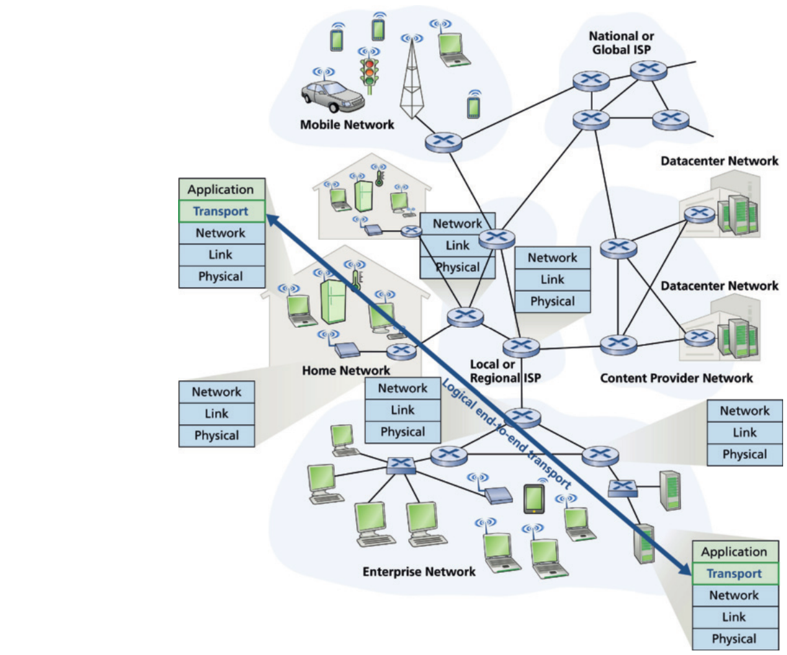

Hình 3.1 Tầng giao vận cung cấp giao tiếp logic chứ không phải vật lý giữa các process ứng dụng

### 3.1.1 Quan hệ giữa tầng giao vận và tầng mạng (Relationship Between Transport and Network Layers)

Nhớ rằng tầng giao vận nằm ngay trên tầng mạng trong protocol stack. Trong khi một giao thức transport-layer cung cấp giao tiếp logic giữa các process chạy trên các host khác nhau, một giao thức network-layer cung cấp giao tiếp logic- giữa các host. Sự phân biệt này tinh tế nhưng quan trọng. Hãy xem xét sự phân biệt này với sự trợ giúp của một phép so sánh với gia đình.

Hãy xét hai ngôi nhà, một ở Bờ Đông và một ở Bờ Tây, với mỗi ngôi nhà là nơi ở của một tá đứa trẻ. Bọn trẻ ở nhà Bờ Đông là anh chị em họ của bọn trẻ ở nhà Bờ Tây. Bọn trẻ ở hai nhà thích viết thư cho nhau—mỗi đứa viết cho mỗi anh chị em họ mỗi tuần, với mỗi lá thư được chuyển bằng dịch vụ bưu chính truyền thống trong một phong bì riêng. Do đó, mỗi nhà gửi 144 lá thư tới nhà kia mỗi tuần. (Bọn trẻ này sẽ tiết kiệm được nhiều tiền nếu chúng có e-mail!) Ở mỗi nhà, có một đứa trẻ—Ann ở nhà Bờ Tây và Bill ở nhà Bờ Đông—chịu trách nhiệm thu gom thư và phân phát thư. Mỗi tuần Ann đi tới tất cả anh chị em ruột của mình, thu gom thư, và đưa thư cho một người đưa thư postal-service (của bưu điện), người ghé nhà hằng ngày. Khi thư tới nhà Bờ Tây, Ann cũng có nhiệm vụ phân phát thư cho anh chị em ruột của mình. Bill có một nhiệm vụ tương tự ở Bờ Đông.

Trong ví dụ này, dịch vụ bưu chính cung cấp giao tiếp logic giữa hai ngôi nhà—dịch vụ bưu chính chuyển thư từ nhà tới nhà, chứ không phải từ người tới người. Mặt khác, Ann và Bill cung cấp giao tiếp logic giữa các anh chị em họ—Ann và Bill nhận thư từ, và chuyển thư tới, anh chị em ruột của họ. Lưu ý rằng từ góc nhìn của các anh chị em họ, Ann và Bill chính là dịch vụ thư, mặc dù Ann và Bill chỉ là một phần (phần end-system) của quá trình chuyển giao end-to-end. Ví dụ gia đình này là một phép so sánh hay để giải thích tầng giao vận liên quan thế nào tới tầng mạng:

thông điệp ứng dụng = thư trong phong bì process = anh chị em họ host ( còn gọi là end system) = ngôi nhà giao thức transport-layer = Ann và Bill giao thức network-layer = dịch vụ bưu chính ( bao gồm người đưa thư)

Tiếp tục phép so sánh này, lưu ý rằng Ann và Bill làm mọi công việc trong ngôi nhà tương ứng của họ; họ không tham gia, chẳng hạn, vào việc phân loại thư ở bất kỳ trung tâm thư trung gian nào hay vào việc chuyển thư từ trung tâm thư này sang trung tâm thư khác. Tương tự, các giao thức transport-layer sống trong các end system. Bên trong một end system, một giao thức giao vận chuyển thông điệp từ các process ứng dụng tới rìa mạng (tức là, tầng mạng) và ngược lại, nhưng nó không có tiếng nói nào về cách các thông điệp được chuyển bên trong lõi mạng. Thực ra, như minh họa trong Hình 3.1, các router trung gian không hành động trên, cũng không nhận biết, bất kỳ thông tin nào mà tầng giao vận có thể đã thêm vào thông điệp ứng dụng. Tiếp tục câu chuyện gia đình, giờ giả sử khi Ann và Bill đi nghỉ, một cặp anh chị em họ khác—chẳng hạn, Susan và Harvey—thay thế họ và đảm nhận việc thu gom và phân phát thư household-internal (trong nội bộ gia đình). Không may cho hai gia đình, Susan và Harvey không thu gom và phân phát theo đúng cách như Ann và Bill. Vì là những đứa trẻ nhỏ hơn, Susan và Harvey nhận và gửi thư ít thường xuyên hơn và thỉnh thoảng làm mất thư (đôi khi bị con chó nhà gặm nát). Do đó, cặp anh em họ (cousin-pair) Susan và Harvey không cung cấp cùng tập dịch vụ (tức là, cùng mô hình dịch vụ) như Ann và Bill. Theo cách tương tự, một mạng máy tính có thể cung cấp nhiều giao thức giao vận, với mỗi giao thức cung cấp một mô hình dịch vụ khác nhau cho ứng dụng.

Các dịch vụ khả dĩ mà Ann và Bill có thể cung cấp rõ ràng bị ràng buộc bởi các dịch vụ khả dĩ mà dịch vụ bưu chính cung cấp. Ví dụ, nếu dịch vụ bưu chính không cung cấp một giới hạn tối đa về thời gian chuyển thư giữa hai ngôi nhà (ví dụ, ba ngày), thì Ann và Bill không có cách nào đảm bảo một độ trễ tối đa cho việc chuyển thư giữa bất kỳ cặp anh chị em họ nào. Theo cách tương tự, các dịch vụ mà một giao thức giao vận có thể cung cấp thường bị ràng buộc bởi mô hình dịch vụ của giao thức network-layer bên dưới. Nếu giao thức network-layer không thể cung cấp đảm bảo độ trễ hoặc băng thông cho các segment transport-layer gửi giữa các host, thì giao thức transport-layer không thể cung cấp đảm bảo độ trễ hoặc băng thông cho các thông điệp ứng dụng gửi giữa các process.

Tuy vậy, một số dịch vụ có thể được giao thức giao vận cung cấp ngay cả khi giao thức mạng bên dưới không cung cấp dịch vụ tương ứng ở tầng mạng. Ví dụ, như chúng ta sẽ thấy trong chương này, một giao thức giao vận có thể cung cấp dịch vụ truyền dữ liệu tin cậy cho một ứng dụng ngay cả khi giao thức mạng bên dưới không tin cậy, tức là, ngay cả khi giao thức mạng làm mất, làm sai lệch, hoặc nhân đôi packet. Một ví dụ khác (mà chúng ta sẽ khám phá trong Chương 8 khi thảo luận bảo mật mạng), một giao thức giao vận có thể dùng mã hóa để đảm bảo các thông điệp ứng dụng không bị kẻ xâm nhập đọc, ngay cả khi tầng mạng không thể đảm bảo tính bảo mật của các segment transport-layer.

### 3.1.2 Tổng quan về tầng giao vận trong Internet (Overview of the Transport Layer in the Internet)

Nhớ rằng Internet cung cấp hai giao thức transport-layer riêng biệt cho tầng ứng dụng. Một trong các giao thức này là UDP (User Datagram Protocol), cung cấp một dịch vụ phi kết nối, không tin cậy cho ứng dụng gọi nó. Giao thức thứ hai là TCP (Transmission Control Protocol), cung cấp một dịch vụ connection-oriented, tin cậy cho ứng dụng gọi nó. Khi thiết kế một ứng dụng mạng, nhà phát triển ứng dụng phải chỉ định một trong hai giao thức giao vận này. Như chúng ta đã thấy trong Mục 2.6, nhà phát triển ứng dụng chọn giữa UDP và TCP khi tạo socket.

Để đơn giản hóa thuật ngữ, chúng ta gọi packet transport-layer là một segment. Tuy nhiên, chúng tôi đề cập rằng tài liệu Internet (ví dụ, các RFC) cũng gọi packet transport-layer của TCP là segment nhưng thường gọi packet của UDP là datagram. Tuy nhiên, cũng chính tài liệu Internet này cũng dùng thuật ngữ datagram cho packet network-layer! Với một cuốn sách nhập môn về mạng máy tính như cuốn này, chúng tôi tin rằng sẽ ít gây nhầm lẫn hơn nếu gọi cả packet TCP và UDP là segment, và dành thuật ngữ datagram cho packet network-layer.

Trước khi tiếp tục phần giới thiệu ngắn gọn về UDP và TCP, sẽ hữu ích nếu nói vài lời về tầng mạng của Internet. (Chúng ta sẽ học chi tiết về tầng mạng trong Chương 4 và 5.) Giao thức network-layer của Internet có một cái tên—IP, viết tắt của Internet Protocol. IP cung cấp giao tiếp logic giữa các host. Mô hình dịch vụ IP là một dịch vụ chuyển giao best-effort (nỗ lực tối đa). Điều này có nghĩa là IP “nỗ lực hết sức” để chuyển segment giữa các host giao tiếp, nhưng nó không đảm bảo gì cả. Cụ thể, nó không đảm bảo chuyển giao segment, không đảm bảo chuyển giao segment theo thứ tự, và không đảm bảo tính toàn vẹn của dữ liệu trong segment. Vì những lý do này, IP được gọi là một dịch vụ không tin cậy. Chúng tôi cũng đề cập ở đây rằng mỗi host có ít nhất một địa chỉ network-layer, cái so-called địa chỉ IP. Chúng ta sẽ xem xét chi tiết việc định địa chỉ IP trong Chương 4; với chương này chúng ta chỉ cần nhớ rằng mỗi host có một địa chỉ IP.

Sau khi lướt qua mô hình dịch vụ IP, giờ hãy tóm tắt các mô hình dịch vụ do UDP và TCP cung cấp. Trách nhiệm cơ bản nhất của UDP và TCP là mở rộng dịch vụ chuyển giao của IP giữa hai end system thành dịch vụ chuyển giao giữa hai process chạy trên các end system. Việc mở rộng chuyển giao host-to-host thành chuyển giao process-to-process được gọi là ghép kênh và phân kênh tầng giao vận (transport-layer multiplexing and demultiplexing). Chúng ta sẽ thảo luận ghép kênh và phân kênh transport-layer trong mục tiếp theo. UDP và TCP cũng cung cấp kiểm tra toàn vẹn bằng cách đưa các trường error-detection (phát hiện lỗi) vào header của segment. Hai dịch vụ transport-layer tối thiểu này—chuyển giao dữ liệu process-to-process và kiểm tra lỗi—là hai dịch vụ duy nhất mà UDP cung cấp! Cụ thể, giống IP, UDP là một dịch vụ không tin cậy—nó không đảm bảo dữ liệu gửi bởi một process sẽ tới nguyên vẹn (hoặc tới được!) process đích. UDP được thảo luận chi tiết trong Mục 3.3.

Mặt khác, TCP cung cấp thêm một số dịch vụ cho ứng dụng. Trước hết và quan trọng nhất, nó cung cấp truyền dữ liệu tin cậy. Dùng điều khiển luồng, số thứ tự (sequence number), acknowledgment, và timer (những kỹ thuật chúng ta sẽ khám phá chi tiết trong chương này), TCP đảm bảo dữ liệu được chuyển từ process gửi tới process nhận, đúng và theo thứ tự. Do đó TCP chuyển dịch vụ không tin cậy của IP giữa các end system thành một dịch vụ vận chuyển dữ liệu tin cậy giữa các process. TCP cũng cung cấp điều khiển tắc nghẽn. Điều khiển tắc nghẽn không hẳn là một dịch vụ cung cấp cho ứng dụng gọi nó mà là một dịch vụ cho Internet nói chung, một dịch vụ vì lợi ích chung. Việc này được thực hiện bằng cách điều tiết tốc độ mà phía gửi của các kết nối TCP có thể gửi traffic vào mạng. Mặt khác, traffic UDP không được điều tiết. Một ứng dụng dùng giao vận UDP có thể gửi với bất kỳ tốc độ nào nó muốn, trong bao lâu tùy thích.

Một giao thức cung cấp truyền dữ liệu tin cậy và điều khiển tắc nghẽn tất yếu phức tạp. Chúng ta sẽ cần vài mục để đề cập các nguyên lý truyền dữ liệu tin cậy và điều khiển tắc nghẽn, và thêm các mục để đề cập chính giao thức TCP. Các chủ đề này được khảo sát trong Mục 3.4 đến 3.7. Cách tiếp cận trong chương này là xen kẽ giữa các nguyên lý cơ bản và giao thức TCP. Ví dụ, trước hết chúng ta sẽ thảo luận truyền dữ liệu tin cậy trong bối cảnh tổng quát rồi thảo luận cách TCP cụ thể cung cấp truyền dữ liệu tin cậy. Tương tự, trước hết chúng ta sẽ thảo luận điều khiển tắc nghẽn trong bối cảnh tổng quát rồi thảo luận cách các phiên bản khác nhau của TCP thực hiện điều khiển tắc nghẽn. Nhưng trước khi đi vào tất cả những điều thú vị này, trước hết hãy xem ghép kênh và phân kênh transport-layer.

## 3.2 Ghép kênh và phân kênh (Multiplexing and Demultiplexing)

Trong mục này, chúng ta thảo luận ghép kênh và phân kênh transport-layer, tức là, mở rộng dịch vụ chuyển giao host-to-host do tầng mạng cung cấp thành dịch vụ chuyển giao process-to-process cho các ứng dụng chạy trên các host. Để giữ thảo luận cụ thể, chúng ta sẽ thảo luận dịch vụ transport-layer cơ bản này trong bối cảnh Internet. Tuy nhiên, chúng tôi nhấn mạnh rằng một dịch vụ ghép kênh/phân kênh là cần thiết cho mọi mạng máy tính.

Tại host đích, tầng giao vận nhận segment từ tầng mạng ngay bên dưới. Tầng giao vận có trách nhiệm chuyển dữ liệu trong các segment này tới process ứng dụng thích hợp đang chạy trong host. Hãy xem một ví dụ. Giả sử bạn đang ngồi trước máy tính, và bạn đang tải các trang Web trong khi chạy một phiên Zoom và hai phiên ssh. Do đó bạn có bốn process ứng dụng mạng đang chạy—hai process ssh, một process Zoom, và một process HTTP. Khi tầng giao vận trong máy tính của bạn nhận dữ liệu từ tầng mạng bên dưới, nó cần hướng dữ liệu nhận được tới một trong bốn process này. Giờ hãy xem việc này được thực hiện như thế nào.

Trước hết nhớ lại từ Mục 2.6 rằng một process (là một phần của ứng dụng mạng) có thể có một hoặc nhiều socket, những cánh cửa mà qua đó dữ liệu đi từ mạng vào process và qua đó dữ liệu đi từ process ra mạng. Do đó, như minh họa trong Hình 3.2, tầng giao vận trong host nhận thực ra không chuyển dữ liệu trực tiếp tới một process, mà tới một socket trung gian. Vì tại bất kỳ thời điểm nào có thể có nhiều hơn một socket trong host nhận, mỗi socket có một định danh duy nhất. Định dạng của định danh phụ thuộc vào việc socket là socket UDP hay TCP, như chúng ta sẽ thảo luận ngay sau đây.

Giờ hãy xét cách một host nhận hướng một segment transport-layer đến tới socket thích hợp. Mỗi segment transport-layer có một tập trường trong segment cho mục đích này. Ở đầu nhận, tầng giao vận xem xét các trường này để xác định socket nhận rồi hướng segment tới socket đó. Công việc chuyển dữ liệu trong một segment transport-layer tới đúng socket được gọi là phân kênh (demultiplexing). Công việc thu gom các khúc dữ liệu tại host nguồn từ các socket khác nhau, đóng gói mỗi khúc dữ liệu với thông tin header (sẽ được dùng sau này trong phân kênh) để tạo segment, và chuyển các segment xuống tầng mạng được gọi là ghép kênh (multiplexing). Lưu ý rằng tầng giao vận trong host ở giữa trong Hình 3.2 phải phân kênh các segment đến từ tầng mạng bên dưới tới process P<sub>1</sub> hoặc P<sub>2</sub> bên trên; việc này được thực hiện bằng cách hướng dữ liệu của segment đến tới socket của process tương ứng. Tầng giao vận trong host ở giữa cũng phải thu gom dữ liệu gửi đi từ các socket này, tạo các segment transport-layer, và chuyển các segment này xuống tầng mạng. Mặc dù chúng tôi đã giới thiệu ghép kênh và phân kênh trong bối cảnh các giao thức giao vận Internet, điều quan trọng là nhận ra rằng chúng là mối quan tâm bất cứ khi nào một giao thức duy nhất ở một tầng (ở tầng giao vận hoặc nơi khác) được nhiều giao thức ở tầng cao hơn kế tiếp sử dụng.

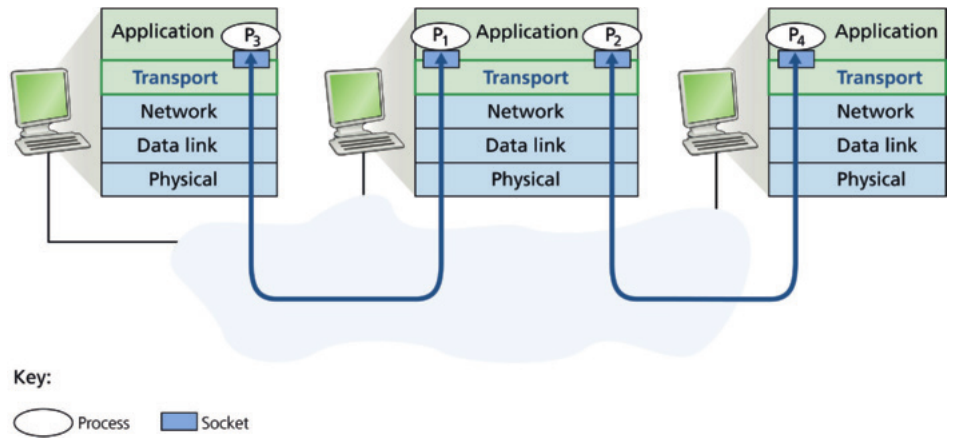

Hình 3.2 Ghép kênh và phân kênh transport-layer

Để minh họa công việc phân kênh, hãy nhớ lại phép so sánh gia đình trong mục trước. Mỗi đứa trẻ được nhận diện bằng tên của mình. Khi Bill nhận một xấp thư từ người đưa thư, cậu thực hiện một thao tác phân kênh bằng cách xem thư được gửi cho ai rồi tự tay đưa thư cho anh chị em ruột của mình. Ann thực hiện một thao tác ghép kênh khi cô thu gom thư từ anh chị em ruột và đưa thư đã thu gom cho người đưa thư.

Giờ chúng ta đã hiểu vai trò của ghép kênh và phân kênh transport-layer, hãy xem nó thực sự được thực hiện trong một host như thế nào. Từ thảo luận ở trên, chúng ta biết ghép kênh transport-layer yêu cầu (1) các socket có định danh duy nhất, và (2) mỗi segment có các trường đặc biệt cho biết socket mà segment sẽ được chuyển tới. Các trường đặc biệt này, minh họa trong Hình 3.3, là trường số port nguồn (source port number field) và trường số port đích (destination port number field). (Segment UDP và TCP cũng có các trường khác, như thảo luận trong các mục tiếp theo của chương này.) Mỗi số port là một số 16-bit, từ 0 đến 65535. Các số port từ 0 đến 1023 được gọi là số port well-known và bị hạn chế, nghĩa là chúng được dành riêng cho các giao thức ứng dụng well-known như HTTP (dùng số port 80) và FTP (dùng số port 21). Danh sách các số port well-known được cho trong RFC 1700 và được cập nhật tại http://www.iana.org [RFC 3232]. Khi chúng ta phát triển một ứng dụng mới (như ứng dụng đơn giản được phát triển trong Mục 2.6), chúng ta phải gán cho ứng dụng một số port.

Giờ hẳn đã rõ cách tầng giao vận có thể hiện thực dịch vụ phân kênh: Mỗi socket trong host có thể được gán một số port, và khi một segment tới host, tầng giao vận xem xét số port đích trong segment và hướng segment tới socket tương ứng. Dữ liệu của segment sau đó đi qua socket vào process được gắn với nó. Như chúng ta sẽ thấy, về cơ bản đây là cách UDP làm. Tuy nhiên, chúng ta cũng sẽ thấy rằng ghép kênh/phân kênh trong TCP tinh tế hơn một chút.

Hình 3.3 Các trường port-number nguồn và đích trong một segment transport-layer

### Ghép kênh và phân kênh phi kết nối với UDP (Connectionless Multiplexing and Demultiplexing with UDP)

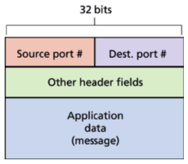

Nhớ lại từ Mục 2.6.1 rằng chương trình Python chạy trong một host có thể tạo một socket UDP bằng dòng

```
clientSocket = socket (AF_INET, SOCK_DGRAM)
```

Khi một socket UDP được tạo theo cách này, tầng giao vận tự động gán một số port cho socket. Cụ thể, tầng giao vận gán một số port trong khoảng 1024 đến 65535 hiện không được bất kỳ port UDP nào khác trong host sử dụng. Ngoài ra, chúng ta có thể thêm một dòng vào chương trình Python sau khi tạo socket để gắn một số port cụ thể (chẳng hạn, 19157) với socket UDP này qua method bind() của socket:

```
clientSocket.bind((’’, 19157))
```

Nếu nhà phát triển ứng dụng viết code đang hiện thực phía server của một “giao thức well-known,” thì nhà phát triển sẽ phải gán số port well-known tương ứng. Thông thường, phía client của ứng dụng để tầng giao vận tự động (và trong suốt) gán số port, trong khi phía server của ứng dụng gán một số port cụ thể.

Với các số port được gán cho socket UDP, giờ chúng ta có thể mô tả chính xác ghép kênh/phân kênh UDP. Giả sử một process trong Host A, với port UDP 19157, muốn gửi một khúc dữ liệu ứng dụng tới một process có port UDP 46428 trong Host B. Tầng giao vận trong Host A tạo một segment transport-layer bao gồm dữ liệu ứng dụng, số port nguồn ( 19157 ) , số port đích ( 46428), và hai giá trị khác (sẽ được thảo luận sau, nhưng không quan trọng với thảo luận hiện tại). Tầng giao vận sau đó chuyển segment kết quả xuống tầng mạng. Tầng mạng đóng gói segment trong một IP datagram và thực hiện một nỗ lực best-effort để chuyển segment tới host nhận. Nếu segment tới Host B nhận, tầng giao vận tại host nhận xem xét số port đích trong segment ( 46428) và chuyển segment tới socket của nó được xác định bằng port 46428. Lưu ý rằng Host B có thể đang chạy nhiều process, mỗi process có socket UDP riêng và số port tương ứng. Khi các segment UDP tới từ mạng, Host B hướng (phân kênh) mỗi segment tới socket thích hợp bằng cách xem xét số port đích của segment.

Điều quan trọng cần lưu ý là một socket UDP được xác định đầy đủ bởi một two-tuple (bộ hai) gồm một địa chỉ IP đích và một số port đích. Do đó, nếu hai segment UDP có địa chỉ IP nguồn và/hoặc số port nguồn khác nhau, nhưng có cùng địa chỉ IP đích và số port đích, thì hai segment sẽ được hướng tới cùng process đích qua cùng socket đích.

Giờ có thể bạn đang thắc mắc, mục đích của số port nguồn là gì? Như minh họa trong Hình 3.4, trong segment A-to-B, số port nguồn đóng vai trò một phần của “địa chỉ hồi âm”—khi B muốn gửi một segment trở lại A, port đích trong segment B-to-A sẽ lấy giá trị từ giá trị port nguồn của segment A-to-B. (Địa chỉ hồi âm đầy đủ là địa chỉ IP của A và số port nguồn.) Ví dụ, hãy nhớ lại chương trình UDP server được nghiên cứu trong Mục 2.7. Trong UDPServer.py, server dùng method recvfrom() để trích xuất số port client-side (nguồn) từ segment nó nhận từ client; sau đó nó gửi một segment mới tới client, với số port nguồn được trích xuất đóng vai trò số port đích trong segment mới này.

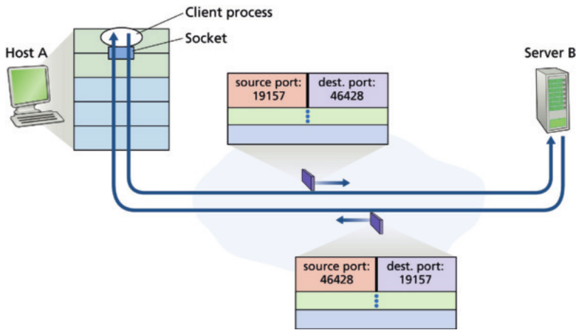

Hình 3.4 Sự đảo ngược số port nguồn và đích

### Ghép kênh và phân kênh hướng kết nối với TCP (Connection-Oriented Multiplexing and Demultiplexing with TCP)

Để hiểu phân kênh TCP, chúng ta phải xem kỹ socket TCP và việc thiết lập kết nối TCP. Một khác biệt tinh tế giữa socket TCP và socket UDP là socket TCP được xác định bởi một four-tuple: (địa chỉ IP nguồn, số port nguồn, địa chỉ IP đích, số port đích). Do đó, khi một segment TCP tới một host từ mạng, host dùng cả bốn giá trị để hướng (phân kênh) segment tới socket thích hợp. Cụ thể, và trái ngược với UDP, hai segment TCP đến có địa chỉ IP nguồn hoặc số port nguồn khác nhau sẽ (ngoại trừ segment TCP mang yêu cầu connection-establishment (thiết lập kết nối) ban đầu) được hướng tới hai socket khác nhau, ngay cả khi chúng có cùng địa chỉ IP đích và số port đích. Để hiểu sâu hơn, hãy xem xét lại ví dụ lập trình client-server TCP trong Mục 2.6.2:

• Ứng dụng TCP server có một “socket chào đón,” chờ các yêu cầu connection-establishment từ TCP client (xem Hình 2.24) trên số port 12000.

• TCP client tạo một socket và gửi một segment yêu cầu thiết lập kết nối bằng các dòng:

```
clientSocket = socket (AF_INET, SOCK_STREAM)
clientSocket.connect((serverName,12000))
```

• Một yêu cầu connection-establishment không gì khác hơn là một segment TCP có số port đích 12000 và một bit connection-establishment đặc biệt được bật trong header TCP (thảo luận trong Mục 3.5). Segment cũng bao gồm một số port nguồn do client chọn.

• Khi hệ điều hành host của máy tính chạy process server nhận segment connection-request (yêu cầu kết nối) đến có port đích 12000, nó định vị process server đang chờ chấp nhận kết nối trên số port 12000. Process server sau đó tạo một socket mới:

```
connectionSocket, addr = serverSocket.accept()
```

• Ngoài ra, tầng giao vận tại server ghi nhận bốn giá trị sau trong segment connection-request: (1) số port nguồn trong segment, (2) địa chỉ IP của host nguồn, (3) số port đích trong segment, và (4) địa chỉ IP của chính nó. Socket kết nối mới được tạo được xác định bởi bốn giá trị này; mọi segment đến sau đó có port nguồn, địa chỉ IP nguồn, port đích và địa chỉ IP đích khớp với bốn giá trị này sẽ được phân kênh tới socket này. Khi kết nối TCP giờ đã được thiết lập, client và server giờ có thể gửi dữ liệu cho nhau.

Host server có thể hỗ trợ nhiều socket kết nối TCP đồng thời, với mỗi socket gắn với một process, và với mỗi socket được xác định bởi four-tuple riêng của nó. Khi một segment TCP tới host, cả bốn trường (địa chỉ IP nguồn, port nguồn, địa chỉ IP đích, port đích) được dùng để hướng (phân kênh) segment tới socket thích hợp.

> Tiêu điểm bảo mật (Focus on Security)
>
> Quét port (Port Scanning)
>
> Chúng ta đã thấy một process server kiên nhẫn chờ trên một port mở để được một client từ xa liên lạc. Một số port được dành riêng cho các ứng dụng well-known (ví dụ, Web, FTP, DNS và SMTP server); các port khác được các ứng dụng phổ biến dùng theo quy ước (ví dụ, Microsoft Windows SQL server lắng nghe yêu cầu trên port UDP 1434). Do đó, nếu chúng ta xác định được một port đang mở trên một host, chúng ta có thể ánh xạ port đó tới một ứng dụng cụ thể đang chạy trên host. Điều này rất hữu ích cho các quản trị viên hệ thống, những người thường quan tâm tới việc biết ứng dụng mạng nào đang chạy trên các host trong mạng của họ. Nhưng những kẻ tấn công, để “thăm dò địa bàn,” cũng muốn biết port nào đang mở trên các host mục tiêu. Nếu một host được phát hiện đang chạy một ứng dụng có lỗ hổng bảo mật đã biết (ví dụ, một SQL server lắng nghe trên port 1434 từng bị lỗi tràn buffer, cho phép người dùng từ xa thực thi code tùy ý trên host dễ bị tấn công, một lỗ hổng bị worm Slammer khai thác [Kristoff 2023]), thì host đó đã chín muồi để bị tấn công.
>
> Xác định ứng dụng nào đang lắng nghe trên port nào là một nhiệm vụ tương đối dễ. Thật vậy có một số chương trình thuộc phạm vi công cộng, gọi là port scanner, làm đúng việc đó. Có lẽ được dùng rộng rãi nhất trong số này là nmap, có miễn phí tại http://nmap.org và có sẵn trong hầu hết các bản phân phối Linux. Với TCP, nmap quét tuần tự các port, tìm các port đang chấp nhận kết nối TCP. Với UDP, nmap lại quét tuần tự các port, tìm các port UDP phản hồi các segment UDP được truyền tới. Trong cả hai trường hợp, nmap trả về một danh sách các port mở, đóng hoặc không thể truy cập. Một host chạy nmap có thể cố gắng quét bất kỳ host mục tiêu nào ở bất kỳ đâu trong Internet.

Tình huống được minh họa trong Hình 3.5, trong đó Host C khởi tạo hai phiên HTTP tới server B, và Host A khởi tạo một phiên HTTP tới B. Host A và C và server B mỗi máy có địa chỉ IP duy nhất của riêng mình—lần lượt là A, C và B. Host C gán hai số port nguồn khác nhau (26145 và 7532) cho hai kết nối HTTP của nó. Vì Host A chọn số port nguồn độc lập với C, nó cũng có thể gán port nguồn 26145 cho kết nối HTTP của nó. Nhưng đây không phải vấn đề—server B vẫn có thể phân kênh đúng hai kết nối có cùng số port nguồn, vì hai kết nối có địa chỉ IP nguồn khác nhau.

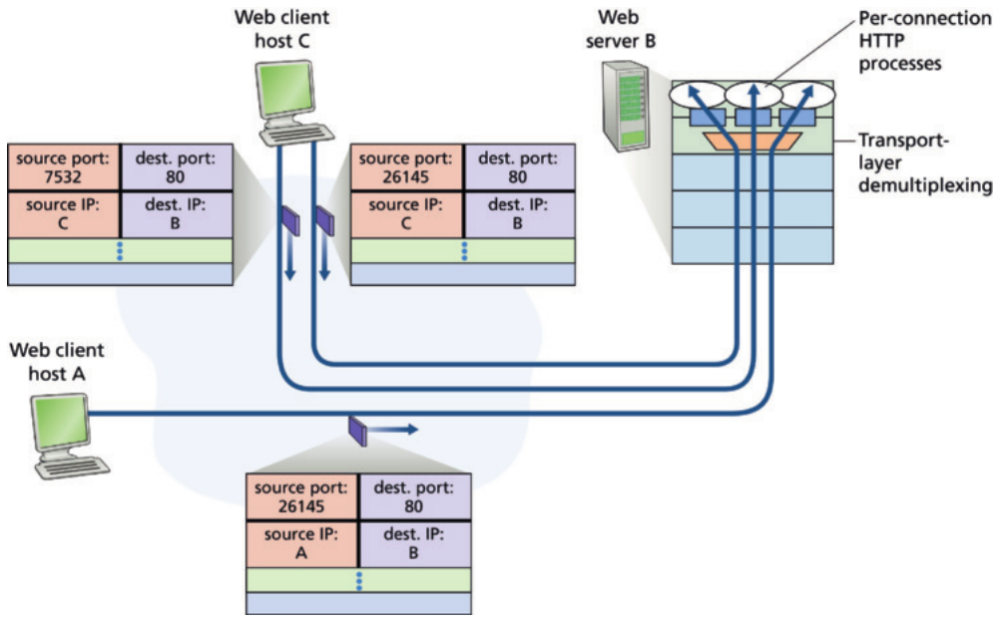

Hình 3.5 Hai client, dùng cùng số port đích (80) để giao tiếp với cùng ứng dụng Web server

### Web server và TCP (Web Servers and TCP)

Trước khi kết thúc thảo luận này, sẽ bổ ích nếu nói thêm vài lời về Web server và cách chúng dùng số port. Hãy xét một host chạy một Web server, như một Apache Web server, trên port 80. Khi client (ví dụ, browser) gửi segment tới server, mọi segment sẽ có port đích 80. Cụ thể, cả các segment connection-establishment ban đầu lẫn các segment mang thông điệp yêu cầu HTTP đều sẽ có port đích 80. Như chúng ta vừa mô tả, server phân biệt các segment từ các client khác nhau bằng địa chỉ IP nguồn và số port nguồn.

Hình 3.5 cho thấy một Web server sinh ra một process mới cho mỗi kết nối. Như minh họa trong Hình 3.5, mỗi process này có socket kết nối riêng, qua đó các yêu cầu HTTP đến và các phản hồi HTTP được gửi đi. Tuy nhiên, chúng tôi đề cập rằng không phải lúc nào cũng có tương ứng one-to-one (một đối một) giữa socket kết nối và process. Thực ra, các Web server high-performing (hiệu năng cao) ngày nay thường chỉ dùng một process, và tạo một thread mới với một socket kết nối mới cho mỗi kết nối client mới. (Một thread có thể được xem là một subprocess nhẹ.) Nếu bạn đã làm bài tập lập trình đầu tiên trong Chương 2, bạn đã xây dựng một Web server làm đúng việc này. Với một server như vậy, tại bất kỳ thời điểm nào có thể có nhiều socket kết nối (với các định danh khác nhau) gắn với cùng một process.

Nếu client và server đang dùng HTTP bền, thì suốt thời gian của kết nối bền, client và server trao đổi thông điệp HTTP qua cùng socket server. Tuy nhiên, nếu client và server dùng HTTP non-persistent, thì một kết nối TCP mới được tạo và đóng cho mỗi yêu cầu/phản hồi, và do đó một socket mới được tạo và sau đó đóng cho mỗi yêu cầu/phản hồi. Việc tạo và đóng socket thường xuyên này có thể ảnh hưởng nghiêm trọng tới performance của một Web server bận rộn (mặc dù có thể dùng một số thủ thuật hệ điều hành để giảm nhẹ vấn đề). Độc giả quan tâm tới các vấn đề hệ điều hành xung quanh HTTP bền và non-persistent được khuyến khích xem [Nielsen 1997; Nahum 2002].

Giờ chúng ta đã thảo luận ghép kênh và phân kênh transport-layer, hãy tiếp tục và thảo luận một trong các giao thức giao vận của Internet, UDP. Trong mục tiếp theo, chúng ta sẽ thấy UDP thêm rất ít vào giao thức network-layer ngoài một dịch vụ ghép kênh/phân kênh.

## 3.3 Giao vận phi kết nối: UDP (Connectionless Transport: UDP)

Trong mục này, chúng ta sẽ xem kỹ UDP, cách nó hoạt động, và nó làm gì. Chúng tôi khuyến khích bạn tham khảo lại Mục 2.1, bao gồm tổng quan về mô hình dịch vụ UDP, và Mục 2.6.1, thảo luận lập trình socket dùng UDP.

Để tạo động lực cho thảo luận về UDP, giả sử bạn quan tâm tới việc thiết kế một giao thức giao vận no-frills, bare-bones. Bạn có thể làm việc này như thế nào? Trước hết bạn có thể nghĩ tới việc dùng một giao thức giao vận rỗng. Cụ thể, ở phía gửi, bạn có thể nghĩ tới việc lấy thông điệp từ process ứng dụng và chuyển chúng trực tiếp xuống tầng mạng; và ở phía nhận, bạn có thể nghĩ tới việc lấy thông điệp đến từ tầng mạng và chuyển chúng trực tiếp tới process ứng dụng. Nhưng như chúng ta đã học trong mục trước, chúng ta phải làm nhiều hơn không làm gì một chút! Tối thiểu, tầng giao vận phải cung cấp một dịch vụ ghép kênh/phân kênh để chuyển dữ liệu giữa tầng mạng và đúng process application-level.

UDP, được định nghĩa trong [RFC 768], làm gần như ít nhất mà một giao thức giao vận có thể làm. Ngoài chức năng ghép kênh/phân kênh và một chút kiểm tra lỗi nhẹ, nó không thêm gì vào IP. Thực ra, nếu nhà phát triển ứng dụng chọn UDP thay vì TCP, thì ứng dụng gần như đang nói chuyện trực tiếp với IP. UDP lấy thông điệp từ process ứng dụng, gắn các trường số port nguồn và đích cho dịch vụ ghép kênh/phân kênh, thêm hai trường nhỏ khác, và chuyển segment kết quả xuống tầng mạng. Tầng mạng đóng gói segment transport-layer vào một IP datagram rồi thực hiện một nỗ lực best-effort để chuyển segment tới host nhận. Nếu segment tới host nhận, UDP dùng số port đích để chuyển dữ liệu của segment tới đúng process ứng dụng. Lưu ý rằng với UDP không có bắt tay giữa các thực thể transport-layer gửi và nhận trước khi gửi một segment. Vì lý do này, UDP được gọi là phi kết nối.

DNS là một ví dụ về một giao thức application-layer thường dùng UDP. Khi ứng dụng DNS trong một host muốn đưa ra một truy vấn, nó xây dựng một thông điệp truy vấn DNS và chuyển thông điệp tới UDP. Không thực hiện bất kỳ bắt tay nào với thực thể UDP chạy trên end system đích, UDP host-side (phía host) thêm các trường header vào thông điệp và chuyển segment kết quả xuống tầng mạng. Tầng mạng đóng gói segment UDP vào một datagram và gửi datagram tới một name server. Ứng dụng DNS tại host truy vấn sau đó chờ trả lời cho truy vấn của nó. Nếu nó không nhận được trả lời (có thể vì mạng bên dưới làm mất truy vấn hoặc trả lời), nó có thể thử gửi lại truy vấn, thử gửi truy vấn tới một name server khác, hoặc thông báo cho ứng dụng gọi rằng nó không thể nhận được trả lời.

Giờ có thể bạn đang thắc mắc tại sao một nhà phát triển ứng dụng lại chọn xây dựng ứng dụng trên UDP thay vì trên TCP. Chẳng phải TCP luôn tốt hơn, vì TCP cung cấp dịch vụ truyền dữ liệu tin cậy, trong khi UDP thì không? Câu trả lời là không, vì một số ứng dụng phù hợp hơn với UDP vì các lý do sau:

• Kiểm soát application-level tốt hơn đối với dữ liệu nào được gửi, và khi nào. Với UDP, ngay khi một process ứng dụng chuyển dữ liệu tới UDP, UDP sẽ đóng gói dữ liệu trong một segment UDP và ngay lập tức chuyển segment xuống tầng mạng. Mặt khác, TCP có một cơ chế congestion-control tiết chế bên gửi TCP transport-layer khi một hoặc nhiều liên kết giữa host nguồn và host đích bị tắc nghẽn quá mức. TCP cũng sẽ tiếp tục gửi lại một segment cho đến khi việc nhận segment đã được đích xác nhận, bất kể việc chuyển giao tin cậy mất bao lâu. Vì các ứng dụng real-time thường cần một tốc độ gửi tối thiểu, không muốn làm trễ quá mức việc truyền segment, và có thể chịu được một ít mất dữ liệu, mô hình dịch vụ của TCP không đặc biệt phù hợp với nhu cầu của các ứng dụng này. Như thảo luận bên dưới, các ứng dụng này có thể dùng UDP và hiện thực, như một phần của ứng dụng, bất kỳ chức năng bổ sung nào cần thiết ngoài dịch vụ segment-delivery (chuyển giao segment) no-frills của UDP.

• Không thiết lập kết nối. Như chúng ta sẽ thảo luận sau, TCP dùng một bắt tay three-way trước khi bắt đầu truyền dữ liệu. UDP cứ thế phóng đi mà không có bất kỳ thủ tục sơ bộ chính thức nào. Do đó UDP không gây thêm độ trễ thiết lập nào để thiết lập kết nối. Đây có lẽ là lý do chính tại sao DNS thường chạy trên UDP thay vì TCP—DNS sẽ chậm hơn nhiều nếu chạy trên TCP. Chúng ta đã học trong Mục 2.2 rằng HTTP/1 và HTTP/2 dùng TCP thay vì UDP, vì độ tin cậy là thiết yếu với các trang Web có văn bản. Nhưng, như chúng ta đã thảo luận trong Mục 2.2, độ trễ connection-establishment của TCP trong HTTP là một yếu tố quan trọng góp phần vào độ trễ khi tải tài liệu Web. Thật vậy, HTTP/3 dùng giao thức QUIC (Quick UDP Internet Connection, [RFC 9000; RFC 9002]), dùng UDP làm giao thức giao vận bên dưới và hiện thực độ tin cậy ở tầng ứng dụng trên nền UDP. Chúng ta sẽ xem kỹ hơn QUIC trong Mục 3.8.

• Không có trạng thái kết nối. TCP duy trì trạng thái kết nối trong các end system. Trạng thái kết nối này bao gồm buffer nhận và gửi, các tham số congestion-control, và các tham số số thứ tự và số acknowledgment. Chúng ta sẽ thấy trong Mục 3.5 rằng thông tin trạng thái này cần thiết để hiện thực dịch vụ truyền dữ liệu tin cậy của TCP và để cung cấp điều khiển tắc nghẽn. Mặt khác, UDP không duy trì trạng thái kết nối và không theo dõi bất kỳ tham số nào trong số này. Vì lý do này, một server dành cho một ứng dụng cụ thể thường có thể hỗ trợ nhiều client hoạt động hơn nhiều khi ứng dụng chạy trên UDP thay vì TCP.

• Overhead header packet nhỏ. Segment TCP có 20 byte overhead header trong mỗi segment, trong khi UDP chỉ có 8 byte overhead.

Hình 3.6 liệt kê các ứng dụng Internet phổ biến và các giao thức giao vận chúng dùng. Như chúng ta kỳ vọng, e-mail, truy cập terminal từ xa và truyền file chạy trên TCP—tất cả các ứng dụng này cần dịch vụ truyền dữ liệu tin cậy của TCP. Chúng ta đã học trong Chương 2 rằng các phiên bản đầu của HTTP chạy trên TCP nhưng các phiên bản HTTP gần đây hơn chạy trên UDP, cung cấp điều khiển lỗi và điều khiển tắc nghẽn riêng (cùng các dịch vụ khác) ở tầng ứng dụng. Tuy vậy, nhiều ứng dụng quan trọng chạy trên UDP thay vì TCP. Ví dụ, UDP được dùng để chuyên chở dữ liệu quản lý mạng (SNMP; xem Mục 5.7). UDP được ưu tiên hơn TCP trong trường hợp này, vì các ứng dụng quản lý mạng thường phải chạy khi mạng đang ở trạng thái căng thẳng—chính xác là khi truyền dữ liệu tin cậy, congestion-controlled (có điều khiển tắc nghẽn) khó đạt được. Ngoài ra, như chúng ta đã đề cập trước đó, DNS thường chạy trên UDP, qua đó tránh được độ trễ connection-establishment của TCP nhưng DNS cũng có thể chạy trên TCP. Như minh họa trong Hình 3.6, cả UDP và TCP đôi khi được dùng ngày nay với các ứng dụng đa phương tiện, như điện thoại Internet, hội nghị video real-time, và streaming audio và video lưu sẵn. Chúng tôi chỉ đề cập bây giờ rằng tất cả các ứng dụng này có thể chịu được một lượng nhỏ mất gói, nên truyền dữ liệu tin cậy không hoàn toàn thiết yếu cho sự thành công của ứng dụng. Hơn nữa, các ứng dụng real-time, như điện thoại Internet và hội nghị video, phản ứng rất kém với điều khiển tắc nghẽn của TCP. Vì những lý do này, các nhà phát triển ứng dụng đa phương tiện có thể chọn chạy ứng dụng của họ trên UDP thay vì TCP. Khi tỉ lệ mất gói thấp, và với việc một số tổ chức chặn traffic UDP vì lý do bảo mật (xem Chương 8), TCP trở thành một giao thức ngày càng hấp dẫn cho việc vận chuyển streaming media.

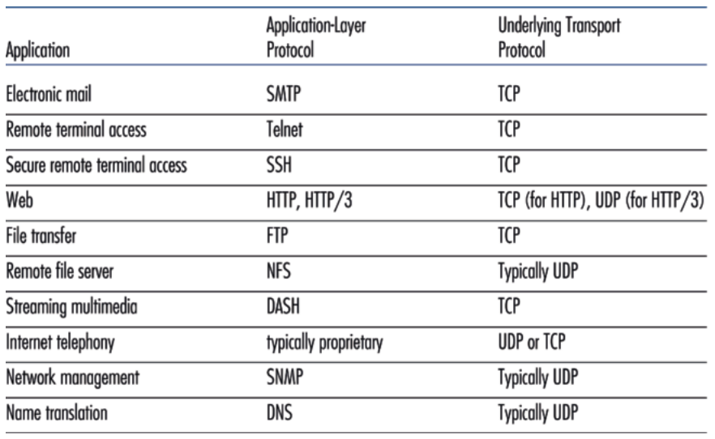

Hình 3.6 Các ứng dụng Internet phổ biến và giao thức giao vận bên dưới của chúng

Mặc dù thường được thực hiện ngày nay, việc chạy ứng dụng đa phương tiện trên UDP cần được thực hiện cẩn thận. Như chúng ta đã đề cập ở trên, UDP không có điều khiển tắc nghẽn. Nhưng điều khiển tắc nghẽn là cần thiết để ngăn mạng rơi vào trạng thái tắc nghẽn trong đó rất ít công việc hữu ích được thực hiện. Nếu mọi người bắt đầu stream video high-bit-rate mà không dùng bất kỳ điều khiển tắc nghẽn nào, sẽ có tràn packet nhiều tới mức tại các router rất ít packet UDP có thể đi qua thành công đường source-to-destination (nguồn tới đích). Hơn nữa, tỉ lệ mất cao do các bên gửi UDP không kiểm soát gây ra sẽ khiến các bên gửi TCP (mà, như chúng ta sẽ thấy, có giảm tốc độ gửi khi gặp tắc nghẽn) giảm mạnh tốc độ của chúng. Do đó, việc thiếu điều khiển tắc nghẽn trong UDP có thể dẫn tới tỉ lệ mất cao giữa bên gửi và bên nhận UDP, và việc chèn ép các phiên TCP. Nhiều nhà nghiên cứu đã đề xuất các cơ chế mới để buộc mọi nguồn, bao gồm nguồn UDP, thực hiện điều khiển tắc nghẽn thích ứng [Mahdavi 1997; Floyd 2000; Kohler 2006: RFC 4340].

Trước khi thảo luận cấu trúc segment UDP, chúng tôi đề cập rằng một ứng dụng có thể có truyền dữ liệu tin cậy khi dùng UDP. Việc này có thể thực hiện nếu độ tin cậy được xây dựng trong chính ứng dụng (ví dụ, bằng cách thêm cơ chế acknowledgment và truyền lại, như những cơ chế chúng ta sẽ nghiên cứu trong mục tiếp theo). Chúng ta đã đề cập trước đó rằng giao thức QUIC hiện thực độ tin cậy ở application-layer trên nền UDP. Xây dựng độ tin cậy trực tiếp vào ứng dụng cho phép ứng dụng “vừa có bánh vừa được ăn bánh.” Tức là, các process ứng dụng có thể giao tiếp tin cậy mà không bị ràng buộc transmission-rate (tốc độ truyền) do cơ chế congestion-control của TCP áp đặt.

### 3.3.1 Cấu trúc segment UDP (UDP Segment Structure)

Cấu trúc segment UDP, minh họa trong Hình 3.7, được định nghĩa trong RFC 768. Dữ liệu ứng dụng chiếm trường dữ liệu của segment UDP. Ví dụ, với DNS, trường dữ liệu chứa một thông điệp truy vấn hoặc một thông điệp phản hồi. Với một ứng dụng streaming audio, các mẫu audio lấp đầy trường dữ liệu. Header UDP chỉ có bốn trường, mỗi trường gồm hai byte. Như đã thảo luận trong mục trước, các số port cho phép host đích chuyển dữ liệu ứng dụng tới đúng process đang chạy trên end system đích (tức là, để thực hiện chức năng phân kênh). Trường length chỉ định số byte trong segment UDP (header cộng dữ liệu). Cần một giá trị độ dài tường minh vì kích thước trường dữ liệu có thể khác nhau từ segment UDP này sang segment tiếp theo. Checksum được host nhận dùng để kiểm tra xem lỗi có bị đưa vào segment hay không. Thực ra, checksum cũng được tính trên một vài trường trong header IP ngoài segment UDP. Nhưng chúng ta bỏ qua chi tiết này để thấy được rừng xuyên qua cây. Chúng ta sẽ thảo luận cách tính checksum bên dưới. Các nguyên lý cơ bản của phát hiện lỗi được mô tả trong Mục 6.2. Trường length chỉ định độ dài của segment UDP, bao gồm header, tính bằng byte.

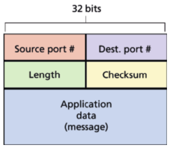

Hình 3.7 Cấu trúc segment UDP

### 3.3.2 Checksum UDP (UDP Checksum)

Checksum UDP cung cấp phát hiện lỗi. Tức là, checksum được dùng để xác định xem các bit trong segment UDP có bị thay đổi hay không (ví dụ, do nhiễu trong liên kết hoặc khi được lưu trong router) khi nó di chuyển từ nguồn tới đích. UDP ở phía gửi thực hiện phép bù một (1s complement) của tổng tất cả các word 16-bit trong segment, với mọi tràn số gặp phải trong quá trình cộng được quay vòng (wrap around). Kết quả này được đặt vào trường checksum của segment UDP. Ở đây chúng tôi đưa ra một ví dụ đơn giản về cách tính checksum. Bạn có thể tìm chi tiết về hiện thực hiệu quả phép tính trong RFC 1071 và performance trên dữ liệu thực trong [Stone 1998; Stone 2000]. Ví dụ, giả sử chúng ta có ba word 16-bit sau:

```
0110011001100000
0101010101010101
1000111100001100
```

Tổng của hai word 16-bit đầu tiên là

```
0110011001100000
0101010101010101
1011101110110101
```

Cộng word thứ ba vào tổng trên cho ra

```
1011101110110101
1000111100001100
0100101011000010
```

Lưu ý rằng phép cộng cuối này bị tràn, và được quay vòng. Phép bù 1 có được bằng cách chuyển tất cả các 0 thành 1 và chuyển tất cả các 1 thành 0. Do đó, phép bù 1 của tổng 0100101011000010 là 1011010100111101, trở thành checksum. Tại bên nhận, cả bốn word 16-bit được cộng lại, bao gồm checksum. Nếu không có lỗi nào được đưa vào packet, thì rõ ràng tổng tại bên nhận sẽ là 1111111111111111. Nếu một trong các bit là 0, thì chúng ta biết lỗi đã được đưa vào packet. Có thể bạn thắc mắc tại sao UDP lại cung cấp checksum ngay từ đầu, vì nhiều giao thức link-layer (bao gồm giao thức Ethernet phổ biến) cũng cung cấp kiểm tra lỗi. Lý do là không có đảm bảo rằng mọi liên kết giữa nguồn và đích đều cung cấp kiểm tra lỗi; tức là, một trong các liên kết có thể dùng một giao thức link-layer không cung cấp kiểm tra lỗi. Hơn nữa, ngay cả khi segment được truyền đúng qua một liên kết, vẫn có thể có lỗi bit bị đưa vào khi segment được lưu trong bộ nhớ của router. Vì cả độ tin cậy link-by-link (từng liên kết) lẫn phát hiện lỗi in-memory (trong bộ nhớ) đều không được đảm bảo, UDP phải cung cấp phát hiện lỗi ở tầng giao vận, trên cơ sở end-end, nếu dịch vụ truyền dữ liệu end-end phải cung cấp phát hiện lỗi. Đây là một ví dụ của nguyên lý end-end nổi tiếng trong thiết kế hệ thống [Saltzer 1984], phát biểu rằng vì một số chức năng (phát hiện lỗi, trong trường hợp này) phải được hiện thực trên cơ sở end-end: “các chức năng đặt ở các mức thấp hơn có thể dư thừa hoặc ít giá trị khi so với chi phí cung cấp chúng ở mức cao hơn.”

Vì IP được cho là chạy trên gần như bất kỳ giao thức layer-2 nào, sẽ hữu ích nếu tầng giao vận cung cấp kiểm tra lỗi như một biện pháp an toàn. Mặc dù UDP cung cấp kiểm tra lỗi, nó không làm gì để phục hồi khỏi lỗi. Một số hiện thực UDP đơn giản loại bỏ segment bị hỏng; số khác chuyển segment bị hỏng tới ứng dụng kèm một cảnh báo.

Đến đây là kết thúc thảo luận về UDP. Chúng ta sẽ sớm thấy TCP cung cấp truyền dữ liệu tin cậy cho các ứng dụng của nó cũng như các dịch vụ khác mà UDP không cung cấp. Tất nhiên, TCP cũng phức tạp hơn UDP. Tuy nhiên, trước khi thảo luận TCP, sẽ hữu ích nếu lùi lại một bước và trước hết thảo luận các nguyên lý nền tảng của truyền dữ liệu tin cậy.

## 3.4 Các nguyên lý truyền dữ liệu tin cậy (Principles of Reliable Data Transfer)

Trong mục này, chúng ta xét vấn đề truyền dữ liệu tin cậy trong một bối cảnh tổng quát. Điều này phù hợp vì vấn đề hiện thực truyền dữ liệu tin cậy xảy ra không chỉ ở tầng giao vận, mà còn ở tầng liên kết và tầng ứng dụng. Do đó vấn đề tổng quát này có tầm quan trọng trung tâm đối với mạng. Thật vậy, nếu phải xác định một danh sách “top-ten” các vấn đề quan trọng cơ bản trong toàn bộ lĩnh vực mạng, đây sẽ là một ứng viên dẫn đầu danh sách. Trong mục tiếp theo, chúng ta sẽ thấy TCP dùng nhiều nguyên lý mà chúng ta sắp mô tả.

Hình 3.8 minh họa khung cho nghiên cứu của chúng ta về truyền dữ liệu tin cậy. Trừu tượng dịch vụ được cung cấp cho các thực thể upper-layer (tầng trên) là một kênh tin cậy qua đó dữ liệu có thể được truyền. Với một kênh tin cậy, không bit dữ liệu được truyền nào bị hỏng (lật từ 0 thành 1, hoặc ngược lại) hay bị mất, và tất cả đều được chuyển giao theo thứ tự đã gửi. Đây chính xác là mô hình dịch vụ mà TCP cung cấp cho các ứng dụng Internet gọi nó.

Trách nhiệm của một giao thức truyền dữ liệu tin cậy là hiện thực trừu tượng dịch vụ này. Nhiệm vụ này trở nên khó khăn bởi thực tế là tầng bên dưới giao thức truyền dữ liệu tin cậy có thể không tin cậy. Ví dụ, TCP là một giao thức truyền dữ liệu tin cậy được hiện thực trên nền một tầng mạng end-to-end không tin cậy (IP). Tổng quát hơn, tầng bên dưới hai điểm cuối giao tiếp tin cậy có thể gồm một liên kết vật lý duy nhất (như trong trường hợp một giao thức truyền dữ liệu link-level) hoặc một liên mạng toàn cầu (như trong trường hợp một giao thức transport-level). Tuy nhiên, cho mục đích của chúng ta, chúng ta có thể xem tầng thấp hơn này đơn giản là một kênh point-to-point (điểm-điểm) không tin cậy.

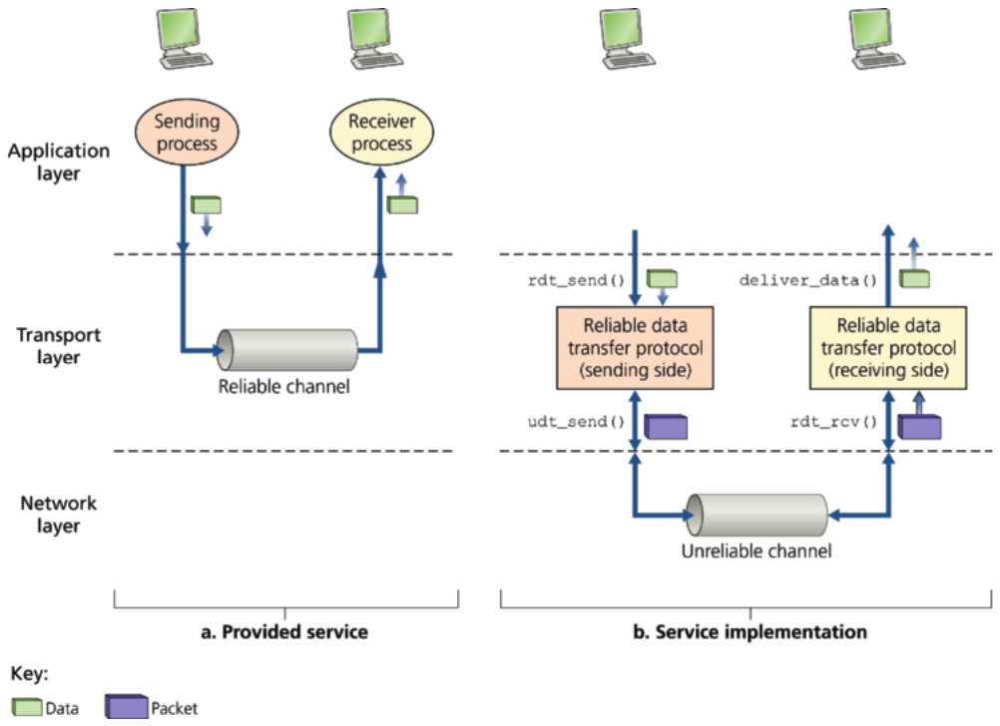

Hình 3.8 Truyền dữ liệu tin cậy: Mô hình dịch vụ và hiện thực dịch vụ

Trong mục này, chúng ta sẽ phát triển dần phía gửi và phía nhận của một giao thức truyền dữ liệu tin cậy, xét các mô hình kênh bên dưới ngày càng phức tạp. Ví dụ, chúng ta sẽ xét những cơ chế giao thức nào cần thiết khi kênh bên dưới có thể làm hỏng bit hoặc làm mất toàn bộ packet. Một giả định chúng ta sẽ dùng xuyên suốt thảo luận ở đây là các packet sẽ được chuyển giao theo thứ tự đã gửi, với một số packet có thể bị mất; tức là, kênh bên dưới sẽ không đảo thứ tự packet. Hình 3.8(b) minh họa các giao diện cho giao thức truyền dữ liệu của chúng ta. Phía gửi của giao thức truyền dữ liệu sẽ được gọi từ bên trên bằng một lời gọi rdt_send(). Nó sẽ chuyển dữ liệu cần chuyển giao tới tầng trên ở phía nhận. (Ở đây rdt là viết tắt của reliable data transfer protocol và _send cho biết phía gửi của rdt đang được gọi. Bước đầu tiên trong việc phát triển bất kỳ giao thức nào là chọn một cái tên hay!) Ở phía nhận, rdt_rcv() sẽ được gọi khi một packet tới từ phía nhận của kênh. Khi giao thức rdt muốn chuyển dữ liệu lên tầng trên, nó sẽ làm vậy bằng cách gọi deliver_data(). Trong phần sau, chúng ta dùng thuật ngữ “packet” thay vì “segment” transport-layer. Vì lý thuyết được phát triển trong mục này áp dụng cho mạng máy tính nói chung chứ không chỉ cho tầng giao vận Internet, thuật ngữ chung “packet” có lẽ phù hợp hơn ở đây.

Trong mục này, chúng ta chỉ xét trường hợp truyền dữ liệu một chiều, tức là, truyền dữ liệu từ phía gửi tới phía nhận. Trường hợp truyền dữ liệu hai chiều tin cậy (tức là, full-duplex) về mặt khái niệm không khó hơn nhưng tẻ nhạt hơn đáng kể để giải thích. Mặc dù chúng ta chỉ xét truyền dữ liệu một chiều, điều quan trọng cần lưu ý là phía gửi và phía nhận của giao thức vẫn sẽ cần truyền packet theo cả hai chiều, như chỉ ra trong Hình 3.8. Chúng ta sẽ sớm thấy rằng, ngoài việc trao đổi các packet chứa dữ liệu cần truyền, phía gửi và phía nhận của rdt cũng sẽ cần trao đổi các packet điều khiển qua lại. Cả phía gửi và phía nhận của rdt gửi packet sang phía kia bằng một lời gọi udt_send() (trong đó udt là viết tắt của unreliable data transfer).

### 3.4.1 Xây dựng một giao thức truyền dữ liệu tin cậy (Building a Reliable Data Transfer Protocol)

Giờ chúng ta đi qua một loạt giao thức, mỗi giao thức phức tạp hơn, đi tới một giao thức truyền dữ liệu tin cậy, hoàn hảo.

#### Truyền dữ liệu tin cậy trên một kênh hoàn toàn tin cậy: rdt1.0 (Reliable Data Transfer over a Perfectly Reliable Channel: rdt1.0)

Trước hết chúng ta xét trường hợp đơn giản nhất, trong đó kênh bên dưới hoàn toàn tin cậy. Bản thân giao thức, mà chúng ta sẽ gọi là rdt1.0, là tầm thường. Các định nghĩa máy trạng thái hữu hạn (finite-state machine - FSM) cho bên gửi và bên nhận rdt1.0 được minh họa trong Hình 3.9. FSM trong Hình 3.9(a) định nghĩa hoạt động của bên gửi, trong khi FSM trong Hình 3.9(b) định nghĩa hoạt động của bên nhận. Điều quan trọng cần lưu ý là có các FSM riêng cho bên gửi và cho bên nhận. Các FSM bên gửi và bên nhận trong Hình 3.9 mỗi FSM chỉ có một trạng thái. Các mũi tên trong mô tả FSM cho biết sự chuyển trạng thái của giao thức từ trạng thái này sang trạng thái khác. (Vì mỗi FSM trong Hình 3.9 chỉ có một trạng thái, một chuyển trạng thái tất yếu là từ trạng thái duy nhất quay lại chính nó; chúng ta sẽ sớm thấy các sơ đồ trạng thái phức tạp hơn.) Sự kiện gây ra chuyển trạng thái được ghi phía trên đường ngang gán nhãn chuyển trạng thái, và các hành động được thực hiện khi sự kiện xảy ra được ghi phía dưới đường ngang. Khi không có hành động nào được thực hiện cho một sự kiện, hoặc không có sự kiện nào xảy ra mà một hành động được thực hiện, chúng ta sẽ dùng ký hiệu Λ lần lượt bên dưới hoặc bên trên đường ngang, để biểu thị tường minh việc thiếu hành động hoặc sự kiện. Trạng thái ban đầu của FSM được chỉ ra bằng mũi tên nét đứt. Mặc dù các FSM trong Hình 3.9 chỉ có một trạng thái, các FSM chúng ta sẽ sớm thấy có nhiều trạng thái, nên việc xác định trạng thái ban đầu của mỗi FSM sẽ quan trọng.

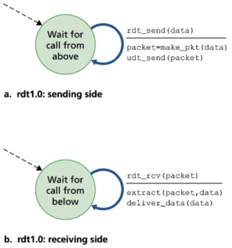

Hình 3.9 rdt1.0—Một giao thức cho kênh hoàn toàn tin cậy

Phía gửi của rdt đơn giản chấp nhận dữ liệu từ tầng trên qua sự kiện rdt_send(data), tạo một packet chứa dữ liệu (qua hành động make_pkt(data)) và gửi packet vào kênh. Trong thực tế, sự kiện rdt_send(data) sẽ là kết quả của một lời gọi thủ tục (ví dụ, tới rdt_send()) bởi ứng dụng upper-layer.

Ở phía nhận, rdt nhận một packet từ kênh bên dưới qua sự kiện rdt_rcv(packet), lấy dữ liệu ra khỏi packet (qua hành động extract (packet, data)) và chuyển dữ liệu lên tầng trên (qua hành động deliver_data(data)). Trong thực tế, sự kiện rdt_rcv(packet) sẽ là kết quả của một lời gọi thủ tục (ví dụ, tới rdt_rcv()) từ giao thức lower-layer (tầng dưới).

Trong giao thức đơn giản này, không có sự khác biệt giữa một đơn vị dữ liệu và một packet. Ngoài ra, mọi luồng packet đều từ bên gửi tới bên nhận; với một kênh hoàn toàn tin cậy, bên nhận không cần cung cấp bất kỳ phản hồi nào cho bên gửi vì không có gì có thể sai! Lưu ý rằng chúng ta cũng đã giả định rằng bên nhận có thể nhận dữ liệu nhanh như tốc độ bên gửi gửi dữ liệu. Do đó, bên nhận không cần yêu cầu bên gửi chậm lại!

#### Truyền dữ liệu tin cậy trên một kênh có lỗi bit: rdt2.0 (Reliable Data Transfer over a Channel with Bit Errors: rdt2.0)

Một mô hình thực tế hơn của kênh bên dưới là mô hình trong đó các bit trong packet có thể bị hỏng. Các lỗi bit như vậy thường xảy ra trong các thành phần vật lý của mạng khi một packet được truyền, lan truyền, hoặc được buffer. Tạm thời chúng ta sẽ tiếp tục giả định rằng mọi packet được truyền đều được nhận (mặc dù bit của chúng có thể bị hỏng) theo thứ tự đã gửi.

Trước khi phát triển một giao thức để giao tiếp tin cậy qua một kênh như vậy, trước hết hãy xét cách con người có thể xử lý tình huống như vậy. Hãy xét cách chính bạn có thể đọc một thông điệp dài qua điện thoại. Trong một kịch bản điển hình, người ghi thông điệp có thể nói “OK” sau mỗi câu đã được nghe, hiểu và ghi lại. Nếu người ghi thông điệp nghe thấy một câu bị méo, bạn được yêu cầu nhắc lại câu bị méo đó. Giao thức message-dictation (đọc chép thông điệp) này dùng cả acknowledgment khẳng định (“OK”) lẫn acknowledgment phủ định (“Xin nhắc lại.”). Các thông điệp điều khiển này cho phép bên nhận cho bên gửi biết những gì đã được nhận đúng, và những gì đã được nhận có lỗi và do đó cần nhắc lại. Trong bối cảnh mạng máy tính, các giao thức truyền dữ liệu tin cậy dựa trên việc truyền lại như vậy được gọi là các giao thức ARQ (Automatic Repeat reQuest).

Về cơ bản, cần ba khả năng giao thức bổ sung trong các giao thức ARQ để xử lý sự hiện diện của lỗi bit:

• Phát hiện lỗi (Error detection). Thứ nhất, cần một cơ chế cho phép bên nhận phát hiện khi lỗi bit đã xảy ra.

  Nhớ lại từ mục trước rằng UDP dùng trường checksum Internet cho chính mục đích này. Trong Chương 6, chúng ta sẽ xem xét chi tiết hơn các kỹ thuật error-detection and-correction (phát hiện và sửa lỗi); các kỹ thuật này cho phép bên nhận phát hiện và có thể sửa lỗi bit của packet. Hiện tại, chúng ta chỉ cần biết rằng các kỹ thuật này yêu cầu các bit thêm (ngoài các bit dữ liệu gốc cần truyền) được gửi từ bên gửi tới bên nhận; các bit này sẽ được tập hợp vào trường checksum của packet dữ liệu rdt2.0.

• Phản hồi từ bên nhận (Receiver feedback). Vì bên gửi và bên nhận thường chạy trên các end system khác nhau, có thể cách nhau hàng nghìn dặm, cách duy nhất để bên gửi biết được góc nhìn của bên nhận về thế giới (trong trường hợp này, packet có được nhận đúng hay không) là bên nhận cung cấp phản hồi tường minh cho bên gửi. Các trả lời acknowledgment khẳng định (ACK) và phủ định (NAK) trong kịch bản message-dictation là ví dụ về phản hồi như vậy. Giao thức rdt2.0 của chúng ta cũng sẽ gửi các packet ACK và NAK từ bên nhận về bên gửi. Về nguyên tắc, các packet này chỉ cần dài một bit; ví dụ, giá trị 0 có thể biểu thị NAK và giá trị 1 có thể biểu thị ACK.

• Truyền lại (Retransmission). Một packet được nhận có lỗi tại bên nhận sẽ được bên gửi truyền lại.

Hình 3.10 cho thấy biểu diễn FSM của rdt2.0, một giao thức truyền dữ liệu dùng phát hiện lỗi, acknowledgment khẳng định, và acknowledgment phủ định.

Phía gửi của rdt2.0 có hai trạng thái. Ở trạng thái ngoài cùng bên trái, giao thức send-side (phía gửi) đang chờ dữ liệu được chuyển xuống từ tầng trên. Khi sự kiện rdt_send(data) xảy ra, bên gửi sẽ tạo một packet (sndpkt) chứa dữ liệu cần gửi, cùng với checksum của packet (ví dụ, như đã thảo luận trong Mục 3.3.2 cho trường hợp segment UDP), rồi gửi packet qua thao tác udt_send(sndpkt). Ở trạng thái ngoài cùng bên phải, giao thức bên gửi đang chờ một packet ACK hoặc NAK từ bên nhận. Nếu nhận được một packet ACK (ký hiệu rdt_rcv(rcvpkt) && isACK(rcvpkt) trong Hình 3.10 tương ứng với sự kiện này), bên gửi biết rằng packet được truyền gần nhất đã được nhận đúng và do đó giao thức quay về trạng thái chờ dữ liệu từ tầng trên. Nếu nhận được NAK, giao thức truyền lại packet cuối và chờ một ACK hoặc NAK được bên nhận trả về để phản hồi packet dữ liệu được truyền lại. Điều quan trọng cần lưu ý là khi bên gửi ở trạng thái wait-for-ACK-or-NAK (chờ ACK hoặc NAK), nó không thể nhận thêm dữ liệu từ tầng trên; tức là, sự kiện rdt_send() không thể xảy ra; điều đó chỉ xảy ra sau khi bên gửi nhận được một ACK và rời trạng thái này. Do đó, bên gửi sẽ không gửi một mẩu dữ liệu mới cho đến khi nó chắc chắn rằng bên nhận đã nhận đúng packet hiện tại. Vì hành vi này, các giao thức như rdt2.0 được gọi là giao thức stop-and-wait (dừng và chờ).

FSM receiver-side (phía nhận) của rdt2.0 vẫn có một trạng thái duy nhất. Khi packet tới, bên nhận trả lời bằng một ACK hoặc một NAK, tùy theo packet nhận được có bị hỏng hay không. Trong Hình 3.10, ký hiệu rdt_rcv(rcvpkt) && corrupt(rcvpkt) tương ứng với sự kiện trong đó một packet được nhận và bị phát hiện có lỗi.

Giao thức rdt2.0 có vẻ như hoạt động nhưng, không may, nó có một lỗi chết người. Cụ thể, chúng ta chưa tính tới khả năng packet ACK hoặc NAK có thể bị hỏng! (Trước khi tiếp tục, bạn nên nghĩ về cách vấn đề này có thể được khắc phục.) Không may, sơ suất nhỏ của chúng ta không vô hại như nó có vẻ. Tối thiểu, chúng ta sẽ cần thêm các bit checksum vào packet ACK/NAK để phát hiện các lỗi như vậy. Câu hỏi khó hơn là giao thức nên phục hồi thế nào khỏi lỗi trong packet ACK hoặc NAK. Khó khăn ở đây là nếu một ACK hoặc NAK bị hỏng, bên gửi không có cách nào biết được bên nhận đã nhận đúng mẩu dữ liệu được truyền cuối cùng hay chưa.

Hãy xét ba khả năng xử lý ACK hoặc NAK bị hỏng:

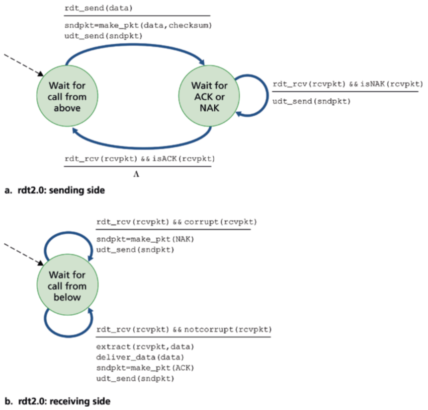

Hình 3.10 rdt2.0— Một giao thức cho kênh có lỗi bit

• Với khả năng thứ nhất, hãy xét điều một người có thể làm trong kịch bản message-dictation. Nếu người nói không hiểu câu trả lời “OK” hoặc “Xin nhắc lại” từ bên nhận, người nói có lẽ sẽ hỏi, “Bạn nói gì vậy?” (qua đó đưa vào giao thức của chúng ta một loại packet sender-to-receiver (từ bên gửi tới bên nhận) mới). Bên nhận sau đó sẽ nhắc lại câu trả lời. Nhưng nếu câu “Bạn nói gì vậy?” của người nói bị hỏng thì sao? Bên nhận, không biết câu bị méo là một phần của bài đọc chép hay là yêu cầu nhắc lại câu trả lời cuối, có lẽ sau đó sẽ phản hồi bằng “Bạn nói gì vậy?” Và rồi, tất nhiên, phản hồi đó có thể bị méo. Rõ ràng, chúng ta đang đi vào một con đường khó khăn.

• Cách thứ hai là thêm đủ bit checksum để cho phép bên gửi không chỉ phát hiện, mà còn phục hồi khỏi, lỗi bit. Điều này giải quyết vấn đề trước mắt cho một kênh có thể làm hỏng packet nhưng không làm mất chúng.

• Cách tiếp cận thứ ba là bên gửi đơn giản gửi lại packet dữ liệu hiện tại khi nó nhận được một packet ACK hoặc NAK bị méo. Tuy nhiên, cách tiếp cận này đưa packet trùng lặp vào kênh sender-to-receiver. Khó khăn cơ bản với packet trùng lặp là bên nhận không biết ACK hoặc NAK nó gửi cuối cùng có được bên gửi nhận đúng hay không. Do đó, nó không thể biết a priori (trước) liệu một packet đến chứa dữ liệu mới hay là một lần truyền lại!

Một giải pháp đơn giản cho vấn đề mới này (và là giải pháp được áp dụng trong hầu hết mọi giao thức truyền dữ liệu hiện có, bao gồm TCP) là thêm một trường mới vào packet dữ liệu và cho bên gửi đánh số các packet dữ liệu bằng cách đặt một số thứ tự (sequence number) vào trường này. Bên nhận khi đó chỉ cần kiểm tra số thứ tự này để xác định packet nhận được có phải là một lần truyền lại hay không. Với trường hợp đơn giản của giao thức stop-and-wait này, một số thứ tự 1-bit là đủ, vì nó sẽ cho phép bên nhận biết bên gửi đang gửi lại packet đã truyền trước đó (số thứ tự của packet nhận được có cùng số thứ tự với packet nhận được gần nhất) hay một packet mới (số thứ tự thay đổi, tiến “về phía trước” theo số học modulo-2). Vì hiện tại chúng ta đang giả định một kênh không làm mất packet, bản thân các packet ACK và NAK không cần chỉ ra số thứ tự của packet chúng đang xác nhận. Bên gửi biết rằng một packet ACK hoặc NAK nhận được (bị méo hay không) được tạo ra để phản hồi packet dữ liệu được truyền gần nhất của nó.

Hình 3.11 và 3.12 cho thấy mô tả FSM cho rdt2.1, phiên bản sửa lỗi của rdt2.0. Các FSM bên gửi và bên nhận của rdt2.1 giờ mỗi FSM có số trạng thái gấp đôi trước đó. Điều này vì trạng thái giao thức giờ phải phản ánh packet hiện đang được gửi (bởi bên gửi) hoặc được mong đợi (tại bên nhận) nên có số thứ tự 0 hay 1. Lưu ý rằng các hành động trong những trạng thái mà một packet 0-numbered đang được gửi hoặc mong đợi là ảnh gương rdt2.1 receiver của những hành động mà một packet 1-numbered đang được gửi hoặc mong đợi; khác biệt duy nhất liên quan tới việc xử lý số thứ tự.

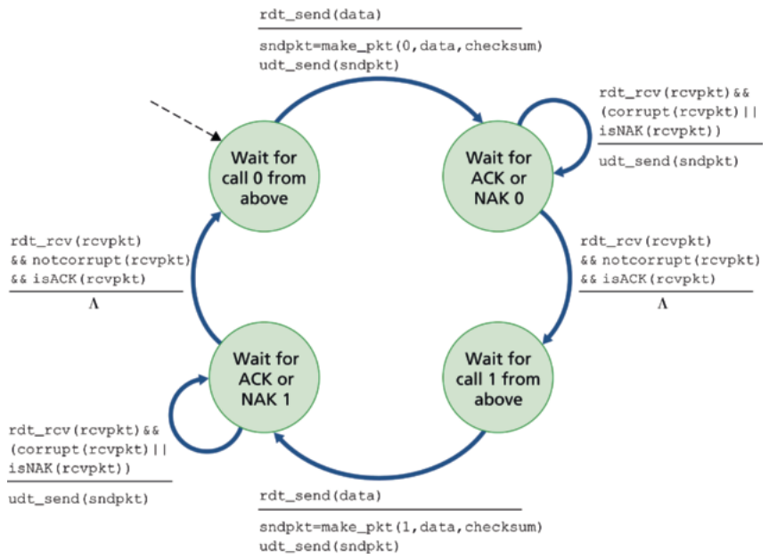

Hình 3.11 Bên gửi rdt2.1

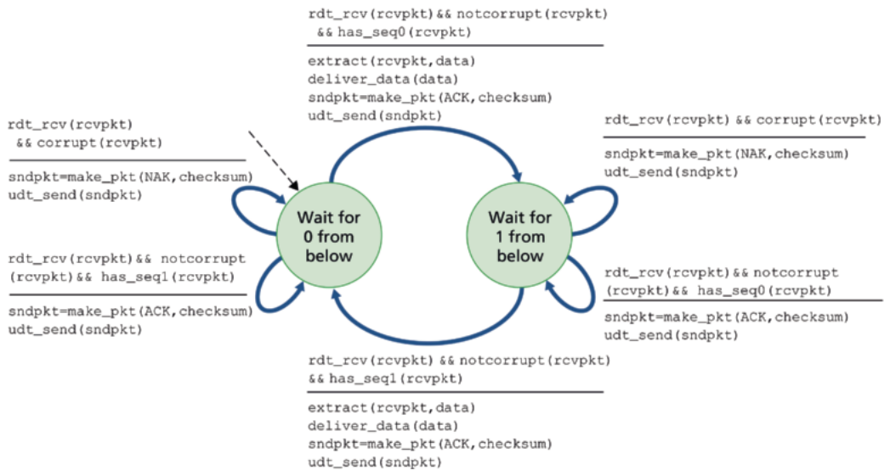

Hình 3.12 Bên nhận rdt2.1

Giao thức rdt2.1 dùng cả acknowledgment khẳng định lẫn phủ định từ bên nhận tới bên gửi. Khi một packet out-of-order (sai thứ tự) được nhận, bên nhận gửi một acknowledgment khẳng định cho packet nó đã nhận. Khi một packet bị hỏng được nhận, bên nhận gửi một acknowledgment phủ định. Chúng ta có thể đạt được cùng hiệu quả như một NAK nếu, thay vì gửi một NAK, chúng ta gửi một ACK cho packet được nhận đúng gần nhất. Một bên gửi nhận được hai ACK cho cùng một packet (tức là, nhận ACK trùng lặp) biết rằng bên nhận đã không nhận đúng packet theo sau packet đang được ACK hai lần. Giao thức truyền dữ liệu tin cậy NAK-free (không dùng NAK) của chúng ta cho kênh có lỗi bit là rdt2.2, minh họa trong Hình 3.13 và 3.14. Một thay đổi tinh tế giữa rtdt2.1 và rdt2.2 là bên nhận giờ phải đưa số thứ tự của packet đang được xác nhận vào một thông điệp ACK (việc này được thực hiện bằng cách đưa tham số ACK, 0 hoặc ACK, 1 vào make_pkt() trong FSM bên nhận), và bên gửi giờ phải kiểm tra số thứ tự của packet đang được xác nhận bởi một thông điệp ACK nhận được (việc này được thực hiện bằng cách đưa tham số 0 hoặc 1 vào isACK() trong FSM bên gửi).

#### Truyền dữ liệu tin cậy trên một kênh có mất mát và lỗi bit: rdt3.0 (Reliable Data Transfer over a Lossy Channel with Bit Errors: rdt3.0)

Giờ giả sử rằng ngoài việc làm hỏng bit, kênh bên dưới còn có thể làm mất packet, một sự kiện not-uncommon (không hiếm) trong các mạng máy tính ngày nay (bao gồm Internet). Giao thức giờ phải giải quyết thêm hai mối quan tâm: làm thế nào phát hiện mất gói và phải làm gì khi mất gói xảy ra. Việc dùng checksum, số thứ tự, packet ACK và truyền lại— những kỹ thuật đã được phát triển trong rdt2.2—sẽ cho phép chúng ta giải quyết mối quan tâm thứ hai. Xử lý mối quan tâm thứ nhất sẽ cần thêm một cơ chế giao thức mới.

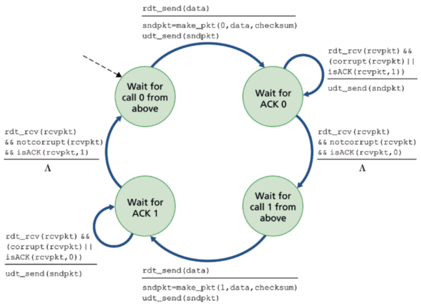

Hình 3.13 Bên gửi rdt2.2

Có nhiều cách tiếp cận khả dĩ để xử lý mất gói (một vài cách trong số đó được khám phá trong các bài tập ở cuối chương). Ở đây, chúng ta sẽ đặt gánh nặng phát hiện và phục hồi khỏi packet bị mất lên bên gửi. Giả sử bên gửi truyền một packet dữ liệu và hoặc packet đó, hoặc ACK của bên nhận cho packet đó, bị mất. Trong cả hai trường hợp, bên gửi không nhận được trả lời nào từ bên nhận. Nếu bên gửi sẵn sàng chờ đủ lâu để chắc chắn rằng một packet đã bị mất, nó có thể đơn giản truyền lại packet dữ liệu. Bạn nên tự thuyết phục mình rằng giao thức này thực sự hoạt động.

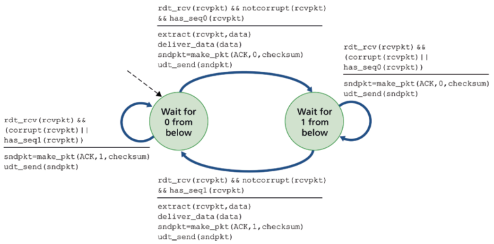

Hình 3.14 Bên nhận rdt2.2

Nhưng bên gửi phải chờ bao lâu để chắc chắn rằng có gì đó đã bị mất? Bên gửi rõ ràng phải chờ ít nhất bằng một độ trễ round-trip giữa bên gửi và bên nhận (có thể bao gồm buffer tại các router trung gian) cộng với bất kỳ lượng thời gian nào cần để xử lý một packet tại bên nhận. Trong nhiều mạng, độ trễ tối đa worst-case (trường hợp xấu nhất) này rất khó thậm chí để ước lượng, chưa nói tới biết chắc chắn. Hơn nữa, giao thức lý tưởng nên phục hồi khỏi mất gói càng sớm càng tốt; chờ một độ trễ worst-case có thể đồng nghĩa với một khoảng chờ dài cho tới khi phục hồi lỗi được khởi tạo. Do đó cách tiếp cận được áp dụng trong thực tế là bên gửi chọn một cách khôn ngoan một giá trị thời gian sao cho mất gói có khả năng, mặc dù không chắc chắn, đã xảy ra. Nếu không nhận được ACK trong khoảng thời gian này, packet được truyền lại. Lưu ý rằng nếu một packet trải qua một độ trễ đặc biệt lớn, bên gửi có thể truyền lại packet ngay cả khi cả packet dữ liệu lẫn ACK của nó đều không bị mất. Điều này tạo ra khả năng có packet dữ liệu trùng lặp trong kênh sender-to-receiver. May mắn thay, giao thức rdt2.2 đã có đủ chức năng (tức là, số thứ tự) để xử lý trường hợp packet trùng lặp.

Từ góc nhìn của bên gửi, truyền lại là liều thuốc vạn năng. Bên gửi không biết một packet dữ liệu bị mất, một ACK bị mất, hay packet hoặc ACK chỉ đơn giản bị trễ quá mức. Trong mọi trường hợp, hành động đều giống nhau: truyền lại. Hiện thực một cơ chế truyền lại time-based (dựa trên thời gian) cần một countdown timer có thể ngắt bên gửi sau khi một khoảng thời gian cho trước đã hết. Do đó bên gửi sẽ cần có khả năng (1) khởi động timer mỗi lần một packet (hoặc packet first-time (lần đầu) hoặc một lần truyền lại) được gửi, (2) phản hồi một ngắt timer (thực hiện các hành động thích hợp), và (3) dừng timer.

Hình 3.15 cho thấy FSM bên gửi cho rdt3.0, một giao thức truyền dữ liệu tin cậy qua một kênh có thể làm hỏng hoặc mất packet; trong các bài tập về nhà, bạn sẽ được yêu cầu cung cấp FSM bên nhận cho rdt3.0. Hình 3.16 cho thấy cách giao thức hoạt động khi không có packet bị mất hoặc bị trễ và cách nó xử lý packet dữ liệu bị mất. Trong Hình 3.16, thời gian tiến từ đỉnh sơ đồ xuống đáy sơ đồ; lưu ý rằng thời điểm nhận một packet tất yếu muộn hơn thời điểm gửi packet do độ trễ truyền và lan truyền. Trong Hình 3.16(b)–(d), các dấu ngoặc send-side cho biết thời điểm timer được đặt và sau đó hết giờ. Một vài khía cạnh tinh tế hơn của giao thức này được khám phá trong các bài tập ở cuối chương. Vì số thứ tự packet luân phiên giữa 0 và 1, giao thức rdt3.0 đôi khi được gọi là giao thức alternating-bit (bit luân phiên).

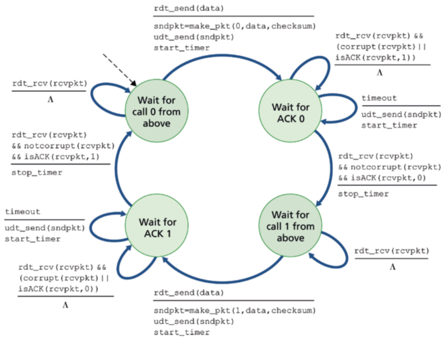

Hình 3.15 Bên gửi rdt3.0

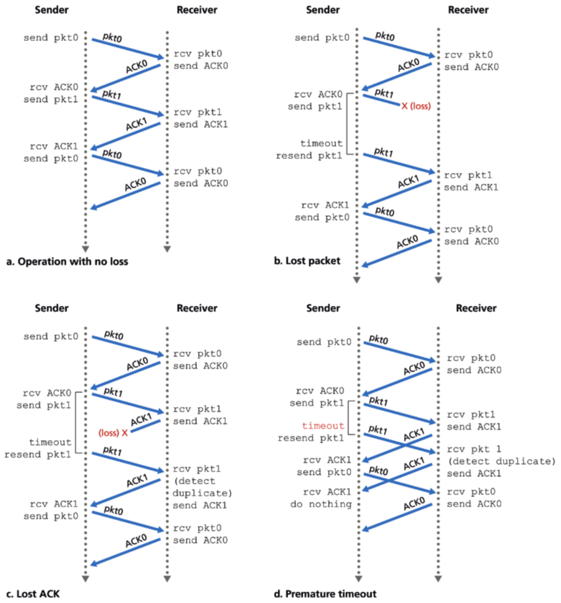

Hình 3.16 Hoạt động của rdt3.0, giao thức alternating-bit

Giờ chúng ta đã tập hợp các yếu tố then chốt của một giao thức truyền dữ liệu. Checksum, số thứ tự, timer, và các packet acknowledgment khẳng định và phủ định mỗi thứ đều đóng một vai trò thiết yếu và cần thiết trong hoạt động của giao thức. Giờ chúng ta đã có một giao thức truyền dữ liệu tin cậy hoạt động được!

### 3.4.2 Các giao thức truyền dữ liệu tin cậy pipeline (Pipelined Reliable Data Transfer Protocols)

Giao thức rdt3.0 là một giao thức đúng về chức năng, nhưng khó có ai hài lòng với performance của nó, đặc biệt trong các mạng high-speed ngày nay. Cốt lõi của vấn đề performance của rdt3.0 là thực tế nó là một giao thức stop-and-wait.

Để thấy tác động performance của hành vi stop-and-wait này, hãy xét một trường hợp lý tưởng hóa gồm hai host, một đặt ở Bờ Tây Hoa Kỳ và một đặt ở Bờ Đông, như minh họa trong Hình 3.17. Độ trễ lan truyền round-trip speed-of-light (theo tốc độ ánh sáng) giữa hai end system này, RTT, xấp xỉ 30 mili giây. Giả sử chúng được nối bằng một kênh có tốc độ truyền, R, là 1 Gbps (10<sup>9</sup> bit mỗi giây). Với kích thước packet, L, là 1,000 byte ( 8,000 bit) mỗi packet, bao gồm cả trường header và dữ liệu, thời gian cần để thực sự truyền packet vào liên kết 1 Gbps là

d<sub>trans</sub> = L/R = (8000 bits)/(10<sup>9</sup> bits/sec) = 8 microseconds

Hình 3.18(a) cho thấy rằng với giao thức stop-and-wait của chúng ta, nếu bên gửi bắt đầu gửi packet tại t = 0, thì tại t = L/R = 8 micro giây, bit cuối cùng đi vào kênh ở phía gửi. Packet sau đó thực hiện hành trình cross-country (xuyên lục địa) 15-msec, với bit cuối cùng của packet xuất hiện tại bên nhận tại t = RTT/2 + L/R = 15.008 msec. Giả sử để đơn giản rằng packet ACK cực kỳ nhỏ (để chúng ta có thể bỏ qua thời gian truyền của chúng) và bên nhận có thể gửi ACK ngay khi bit cuối cùng của packet dữ liệu được nhận, ACK xuất hiện trở lại tại bên gửi tại t = RTT + L/R = 30.008 msec. Tại thời điểm này, bên gửi giờ có thể truyền thông điệp tiếp theo. Do đó, trong 30.008 msec, bên gửi chỉ gửi trong 0.008 msec. Nếu chúng ta định nghĩa độ sử dụng (utilization) của bên gửi (hoặc của kênh) là tỉ lệ thời gian bên gửi thực sự bận gửi bit vào kênh, phân tích trong Hình 3.18(a) cho thấy giao thức stop-and-wait có độ sử dụng bên gửi khá thảm hại, U<sub>sender</sub>, là

U<sub>sender</sub> = (L/R)/(RTT+L/R) = .008/30.008 = 0.00027

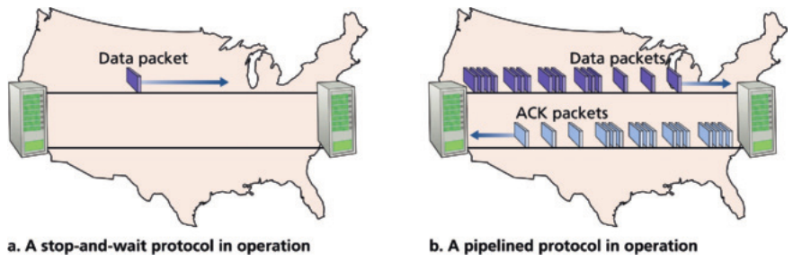

Hình 3.17 Giao thức stop-and-wait so với giao thức pipeline

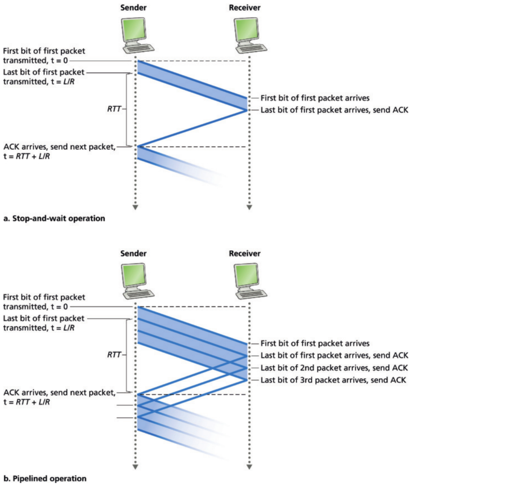

Hình 3.18 Gửi stop-and-wait và gửi pipeline

Tức là, bên gửi chỉ bận 2.7 phần trăm của một phần trăm thời gian! Nhìn theo cách khác, bên gửi chỉ có thể gửi 1,000 byte trong 30.008 mili giây, một throughput hiệu dụng chỉ 267 kbps—mặc dù có sẵn một liên kết 1 Gbps! Hãy tưởng tượng người quản lý mạng không vui vừa trả cả gia tài cho một liên kết dung lượng gigabit nhưng chỉ đạt được throughput 267 kilobit mỗi giây! Đây là một ví dụ sinh động về cách các giao thức mạng có thể giới hạn khả năng do phần cứng mạng bên dưới cung cấp. Ngoài ra, chúng ta đã bỏ qua thời gian protocol-processing (xử lý giao thức) lower-layer tại bên gửi và bên nhận, cũng như độ trễ xử lý và hàng đợi sẽ xảy ra tại bất kỳ router trung gian nào giữa bên gửi và bên nhận. Đưa các hiệu ứng này vào chỉ làm tăng thêm độ trễ và làm nổi bật thêm performance kém.

Giải pháp cho vấn đề performance cụ thể này rất đơn giản: Thay vì hoạt động theo kiểu stop-and-wait, bên gửi được phép gửi nhiều packet mà không chờ acknowledgment, như minh họa trong Hình 3.17(b). Hình 3.18(b) cho thấy nếu bên gửi được phép truyền ba packet trước khi phải chờ acknowledgment, độ sử dụng của bên gửi về cơ bản tăng gấp ba. Vì nhiều packet sender-to-receiver in-transit (đang trên đường truyền) có thể được hình dung như đang lấp đầy một đường ống, kỹ thuật này được gọi là pipelining. Pipelining có các hệ quả sau đối với các giao thức truyền dữ liệu tin cậy:

• Khoảng số thứ tự phải được tăng lên, vì mỗi packet in-transit (không tính các lần truyền lại) phải có một số thứ tự duy nhất và có thể có nhiều packet in-transit chưa được xác nhận.

• Phía gửi và phía nhận của giao thức có thể phải buffer nhiều hơn một packet. Tối thiểu, bên gửi sẽ phải buffer các packet đã được truyền nhưng chưa được xác nhận. Việc buffer các packet được nhận đúng cũng có thể cần thiết tại bên nhận, như thảo luận bên dưới.

• Khoảng số thứ tự cần thiết và yêu cầu buffer sẽ phụ thuộc vào cách một giao thức truyền dữ liệu phản hồi các packet bị mất, bị hỏng và bị trễ quá mức. Có thể xác định hai cách tiếp cận cơ bản đối với phục hồi lỗi pipeline: Go-Back-N và selective repeat (lặp lại có chọn lọc).

### 3.4.3 Go-Back-N (GBN)

Trong một giao thức Go-Back-N (GBN), bên gửi được phép truyền nhiều packet (khi có sẵn) mà không chờ acknowledgment, nhưng bị ràng buộc không có quá một số tối đa cho phép, N , packet chưa được xác nhận trong pipeline. Chúng ta mô tả khá chi tiết giao thức GBN trong mục này. Nhưng trước khi đọc tiếp, bạn được khuyến khích thử hoạt hình GBN (một hoạt hình tương tác tuyệt vời) trên Web site đi kèm. Hình 3.19 cho thấy góc nhìn của bên gửi về khoảng số thứ tự trong một giao thức GBN. Nếu chúng ta định nghĩa base là số thứ tự của packet chưa được xác nhận cũ nhất và nextseqnum là số thứ tự nhỏ nhất chưa dùng (tức là, số thứ tự của packet tiếp theo sẽ được gửi), thì có thể xác định bốn khoảng trong miền số thứ tự. Các số thứ tự trong khoảng [0,base-1] tương ứng với các packet đã được truyền và xác nhận. Khoảng [base,nextseqnum-1] tương ứng với các packet đã được gửi nhưng chưa được xác nhận. Các số thứ tự trong khoảng [nextseqnum,base+N-1] có thể được dùng cho các packet có thể được gửi ngay lập tức, nếu dữ liệu từ tầng trên tới. Cuối cùng, các số thứ tự lớn hơn hoặc bằng base+N không thể được dùng cho đến khi một packet chưa được xác nhận hiện đang trong pipeline (cụ thể, packet có số thứ tự base) đã được xác nhận.

Như gợi ý trong Hình 3.19, khoảng số thứ tự cho phép đối với các packet đã truyền nhưng chưa được xác nhận có thể được xem như một cửa sổ kích thước N trên miền số thứ tự. Khi giao thức hoạt động, cửa sổ này trượt về phía trước trên không gian số thứ tự. Vì lý do này, N thường được gọi là kích thước cửa sổ (window size) và bản thân giao thức GBN là một giao thức sliding-window (cửa sổ trượt). Có thể bạn đang thắc mắc tại sao ngay từ đầu chúng ta lại giới hạn số packet đang chờ, chưa được xác nhận ở giá trị N. Tại sao không cho phép số lượng không giới hạn các packet như vậy? Chúng ta sẽ thấy trong Mục 3.5 rằng điều khiển luồng là một lý do để áp đặt giới hạn lên bên gửi. Chúng ta sẽ xem xét một lý do khác để làm vậy trong Mục 3.7, khi nghiên cứu điều khiển tắc nghẽn TCP. Trong thực tế, số thứ tự của packet được mang trong một trường fixed-length trong header packet. Nếu k là số bit trong trường số thứ tự packet, khoảng số thứ tự do đó là [ 0, 2<sup>k</sup> − 1]. Với một khoảng số thứ tự hữu hạn, mọi phép tính số học liên quan tới số thứ tự khi đó phải được thực hiện bằng số học modulo 2<sup>k</sup>. (Tức là, không gian số thứ tự có thể được xem như một vòng kích thước 2<sup>k</sup>, trong đó số thứ tự 2<sup>k</sup> − 1 được theo ngay sau bởi số thứ tự 0.) Nhớ rằng rdt3.0 có một số thứ tự 1-bit và một khoảng số thứ tự [ 0, 1]. Một vài bài tập ở cuối chương này khám phá các hệ quả của một khoảng số thứ tự hữu hạn. Chúng ta sẽ thấy trong Mục 3.5 rằng TCP có một trường số thứ tự 32-bit, trong đó số thứ tự TCP đếm byte trong luồng byte thay vì đếm packet. Hình 3.20 và 3.21 đưa ra một mô tả FSM mở rộng của phía gửi và phía nhận của một giao thức GBN ACK-based, NAK-free. Chúng ta gọi mô tả FSM này là FSM mở rộng (extended FSM) vì chúng ta đã thêm các biến (tương tự các biến programming-language) cho base và nextseqnum, và thêm các thao tác trên các biến này và các hành động có điều kiện liên quan tới các biến này. Lưu ý rằng đặc tả FSM mở rộng giờ bắt đầu trông giống một đặc tả programming-language. [Bochman 1984] cung cấp một khảo sát xuất sắc về các mở rộng bổ sung cho kỹ thuật FSM cũng như các kỹ thuật programming-language-based khác để đặc tả giao thức. Bên gửi GBN phải phản hồi ba loại sự kiện:

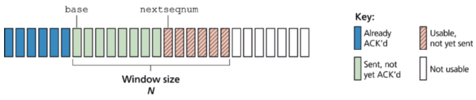

Hình 3.19 Góc nhìn của bên gửi về số thứ tự trong Go-Back-N

• Lời gọi từ bên trên (Invocation from above). Khi rdt_send() được gọi từ bên trên, trước hết bên gửi kiểm tra xem cửa sổ có đầy không, tức là, có N packet đang chờ, chưa được xác nhận hay không. Nếu cửa sổ chưa đầy, một packet được tạo và gửi, và các biến được cập nhật thích hợp. Nếu cửa sổ đầy, bên gửi đơn giản trả dữ liệu lại cho tầng trên, một chỉ dấu ngầm rằng cửa sổ đầy. Tầng trên khi đó có lẽ sẽ phải thử lại sau. Trong một hiện thực thực tế, bên gửi nhiều khả năng sẽ hoặc buffer (nhưng không gửi ngay) dữ liệu này, hoặc có một cơ chế đồng bộ (ví dụ, một semaphore hoặc một cờ) cho phép tầng trên gọi rdt_send() chỉ khi cửa sổ chưa đầy.

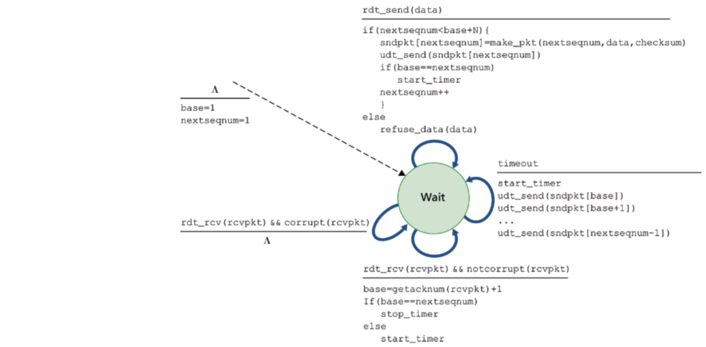

Hình 3.20 Mô tả FSM mở rộng của bên gửi GBN

• Nhận một ACK (Receipt of an ACK). Trong giao thức GBN của chúng ta, một acknowledgment cho một packet có số thứ tự n sẽ được coi là một acknowledgment tích lũy (cumulative acknowledgment), cho biết mọi packet có số thứ tự tới và bao gồm n đã được nhận đúng tại bên nhận. Chúng ta sẽ quay lại vấn đề này ngay khi xem xét phía nhận của GBN.

• Một sự kiện timeout (A timeout event). Tên của giao thức, “Go-Back-N,” xuất phát từ hành vi của bên gửi khi có packet bị mất hoặc bị trễ quá mức. Như trong giao thức stop-and-wait, một timer sẽ lại được dùng để phục hồi khỏi packet dữ liệu hoặc packet acknowledgment bị mất. Nếu timeout xảy ra, bên gửi gửi lại mọi packet đã được gửi trước đó nhưng chưa được xác nhận. Bên gửi của chúng ta trong Hình 3.20 chỉ dùng một timer duy nhất, có thể được xem là timer cho packet đã truyền nhưng chưa được xác nhận cũ nhất. Nếu nhận được một ACK nhưng vẫn còn các packet đã truyền nhưng chưa được xác nhận khác, timer được khởi động lại. Nếu không còn packet đang chờ, chưa được xác nhận nào, timer được dừng. Các hành động của bên nhận trong GBN cũng đơn giản. Nếu một packet có số thứ tự n được nhận đúng và đúng thứ tự (tức là, dữ liệu được chuyển lên tầng trên gần nhất đến từ một packet có số thứ tự n − 1), bên nhận gửi một ACK cho packet n và chuyển phần dữ liệu của packet lên tầng trên. Trong mọi trường hợp khác, bên nhận loại bỏ packet và gửi lại một ACK cho packet in-order (đúng thứ tự) được nhận gần nhất. Lưu ý rằng vì các packet được chuyển lên tầng trên từng cái một, nếu packet k đã được nhận và chuyển giao, thì mọi packet có số thứ tự nhỏ hơn k cũng đã được chuyển giao. Do đó, việc dùng acknowledgment tích lũy là một lựa chọn tự nhiên cho GBN. Trong giao thức GBN của chúng ta, bên nhận loại bỏ một packet đã được nhận đúng nhưng có số thứ tự lớn hơn expectedseqnum. Ví dụ, nếu bên nhận GBN đang chờ một packet có số thứ tự n, và một packet có số thứ tự n + 2 tới, packet đó bị bên nhận GBN trong Hình 3.21 loại bỏ, mặc dù dữ liệu trong packet đến cuối cùng sẽ cần được chuyển lên tầng trên tại bên nhận. Tại sao không buffer (nhưng không ACK) dữ liệu nhận được trong packet n + 2, rồi ACK và chuyển giao packet này sau, sau khi cuối cùng nhận đúng một packet có số thứ tự n + 1? Mặc dù nhu cầu buffer ở bên nhận đưa thêm độ phức tạp vào bên nhận GBN và cần nhiều bộ nhớ bên nhận hơn, việc buffer dữ liệu correctly-received (được nhận đúng) có số thứ tự larger-than-expected (lớn hơn mong đợi) này thực sự thường được thực hiện trong thực tế. Hình 3.22 cho thấy hoạt động của giao thức GBN cho trường hợp kích thước cửa sổ bốn packet. Vì giới hạn kích thước cửa sổ này, bên gửi gửi các packet 0 đến 3 nhưng sau đó phải chờ một hoặc nhiều packet trong số này được xác nhận trước khi tiếp tục. Khi mỗi ACK kế tiếp (ví dụ, ACK0 và ACK1) được nhận, cửa sổ trượt về phía trước và bên gửi có thể truyền một packet mới (lần lượt pkt4 và pkt5). Ở phía nhận, packet 2 bị mất và do đó các packet 3, 4 và 5 bị phát hiện sai thứ tự và bị loại bỏ. Trước khi kết thúc thảo luận về GBN, đáng lưu ý rằng một hiện thực giao thức này trong một protocol stack nhiều khả năng sẽ có cấu trúc tương tự FSM mở rộng trong Hình 3.20. Hiện thực cũng nhiều khả năng ở dạng các thủ tục khác nhau hiện thực các hành động cần thực hiện để phản hồi các sự kiện khác nhau có thể xảy ra. Trong lập trình event-based (hướng sự kiện) như vậy, các thủ tục khác nhau được gọi hoặc bởi các thủ tục khác trong protocol stack, hoặc là kết quả của một ngắt. Ở bên gửi, các sự kiện này sẽ là (1) một lời gọi từ thực thể upper-layer để gọi rdt_send(), (2) một ngắt timer, và (3) một lời gọi từ tầng dưới để gọi rdt_rcv() khi một packet tới. Các bài tập lập trình ở cuối chương này sẽ cho bạn cơ hội thực sự hiện thực các thủ tục này trong một môi trường mạng mô phỏng, nhưng thực tế.

  Giao thức GBN kết hợp gần như tất cả các kỹ thuật mà chúng ta sẽ gặp khi nghiên cứu các thành phần truyền dữ liệu tin cậy của TCP trong Mục 3.5. Các kỹ thuật này bao gồm việc dùng số thứ tự, acknowledgment tích lũy, checksum, và một thao tác timeout/truyền lại.

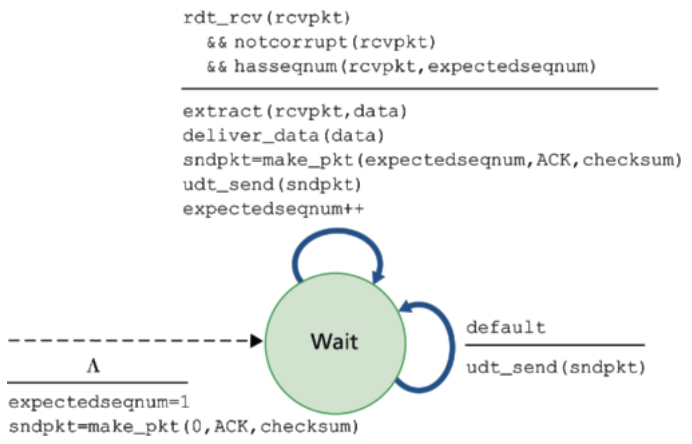

Hình 3.21 Mô tả FSM mở rộng của bên nhận GBN

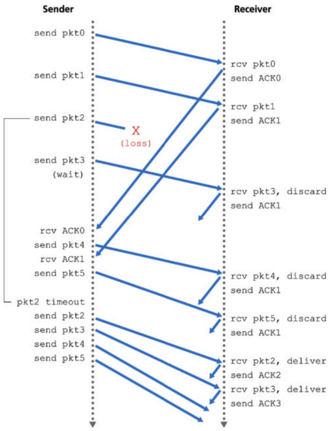

Hình 3.22 Go-Back-N khi hoạt động

### 3.4.4 Selective Repeat (SR)

Giao thức GBN cho phép bên gửi có khả năng “lấp đầy pipeline” trong Hình 3.17 bằng packet, qua đó tránh các vấn đề độ sử dụng kênh mà chúng ta đã lưu ý với các giao thức stop-and-wait. Tuy nhiên, có những kịch bản trong đó bản thân GBN gặp vấn đề performance. Cụ thể, khi kích thước cửa sổ và tích bandwidth-delay đều lớn, nhiều packet có thể ở trong pipeline. Một lỗi packet duy nhất do đó có thể khiến GBN truyền lại một số lượng lớn packet, nhiều packet không cần thiết nếu chúng đã được nhận đúng nhưng out-of-order và do đó được buffer tại bên nhận. Khi xác suất lỗi kênh tăng, pipeline có thể bị lấp đầy bởi các lần truyền lại không cần thiết này. Hãy tưởng tượng, trong kịch bản message-dictation của chúng ta, nếu mỗi khi một từ bị méo, 1,000 từ xung quanh (ví dụ, kích thước cửa sổ 1,000 từ) phải được nhắc lại. Việc đọc chép sẽ bị chậm lại bởi tất cả các từ được nhắc lại.

Như tên gọi gợi ý, các giao thức selective-repeat tránh các lần truyền lại không cần thiết bằng cách để bên gửi chỉ truyền lại những packet đã được nhận có lỗi (tức là, bị mất hoặc bị hỏng) tại bên nhận. Việc truyền lại riêng lẻ, as-needed (khi cần) này sẽ yêu cầu bên nhận xác nhận riêng từng packet được nhận đúng. Một kích thước cửa sổ N sẽ lại được dùng để giới hạn số packet đang chờ, chưa được xác nhận trong pipeline. Tuy nhiên, không như GBN, bên gửi có thể đã nhận được ACK cho một số packet trong cửa sổ. Hình 3.23 cho thấy góc nhìn của bên gửi SR về không gian số thứ tự. Hình 3.24 trình bày chi tiết các hành động khác nhau của bên gửi SR.

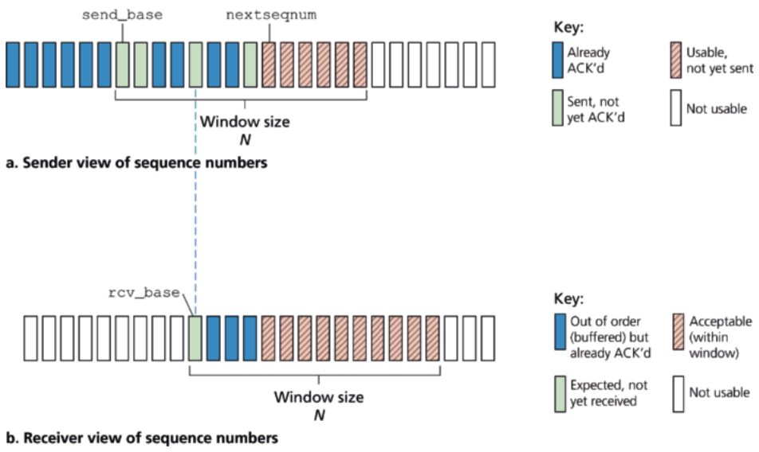

Hình 3.23 Góc nhìn của bên gửi và bên nhận selective-repeat (SR) về không gian sequence-number

Bên nhận SR sẽ xác nhận một packet được nhận đúng bất kể nó có đúng thứ tự hay không. Các packet out-of-order được buffer cho đến khi mọi packet bị thiếu (tức là, các packet có số thứ tự thấp hơn) được nhận, lúc đó một loạt packet có thể được chuyển lên tầng trên theo thứ tự. Hình 3.25 liệt kê các hành động khác nhau của bên nhận SR. Hình 3.26 cho thấy một ví dụ về hoạt động SR khi có packet bị mất. Lưu ý rằng trong Hình 3.26, bên nhận ban đầu buffer các packet 3, 4 và 5, và chuyển chúng cùng với packet 2 lên tầng trên khi packet 2 cuối cùng được nhận. Hoạt động SR

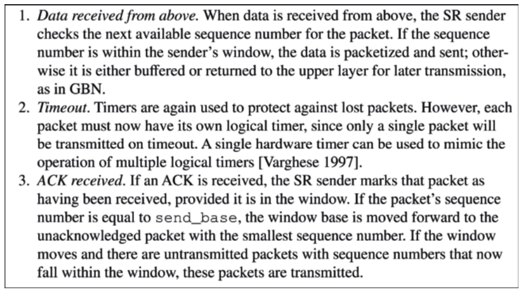

Hình 3.24 Các sự kiện và hành động của bên gửi SR

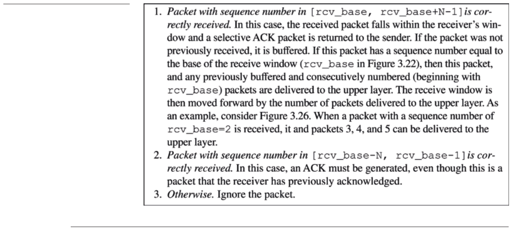

Hình 3.25 Các sự kiện và hành động của bên nhận SR

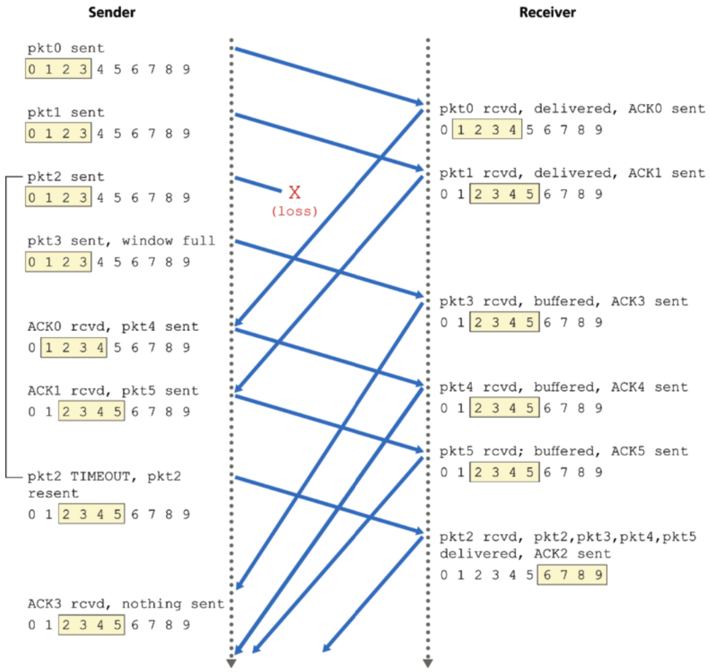

Hình 3.26 Hoạt động SR

Điều quan trọng cần lưu ý là ở Bước 2 trong Hình 3.25, bên nhận xác nhận lại (thay vì bỏ qua) các packet đã nhận có số thứ tự nhất định nằm dưới base của cửa sổ hiện tại. Bạn nên tự thuyết phục mình rằng việc xác nhận lại này thực sự cần thiết. Với các không gian số thứ tự của bên gửi và bên nhận trong Hình 3.23, chẳng hạn, nếu không có ACK nào cho packet send_base lan truyền từ bên nhận tới bên gửi, bên gửi cuối cùng sẽ truyền lại packet send_base, mặc dù rõ ràng (với chúng ta, không phải với bên gửi!) rằng bên nhận đã nhận packet đó. Nếu bên nhận không xác nhận packet này, cửa sổ của bên gửi sẽ không bao giờ tiến về phía trước! Ví dụ này minh họa một khía cạnh quan trọng của các giao thức SR (và nhiều giao thức khác nữa). Bên gửi và bên nhận không phải lúc nào cũng có góc nhìn giống hệt nhau về những gì đã được nhận đúng và những gì chưa. Với các giao thức SR, điều này có nghĩa là cửa sổ bên gửi và bên nhận không phải lúc nào cũng trùng nhau.

Hãy kết thúc thảo luận về các giao thức truyền dữ liệu tin cậy bằng việc xét một giả định còn lại trong mô hình kênh bên dưới. Nhớ rằng chúng ta đã giả định packet không thể bị đảo thứ tự trong kênh giữa bên gửi và bên nhận. Đây thường là một giả định hợp lý khi bên gửi và bên nhận được nối bằng một dây vật lý duy nhất. Tuy nhiên, khi “kênh” nối hai bên là một mạng, việc đảo thứ tự packet có thể xảy ra. Một biểu hiện của việc đảo thứ tự packet là các bản sao cũ của một packet có số thứ tự hoặc số acknowledgment là x có thể xuất hiện, mặc dù cả cửa sổ của bên gửi lẫn của bên nhận đều không chứa x. Với việc đảo thứ tự packet, kênh có thể được xem về cơ bản như đang buffer packet và tự phát phát ra các packet này tại bất kỳ thời điểm nào trong tương lai. Vì số thứ tự có thể được dùng lại, cần cẩn thận để phòng ngừa các packet trùng lặp như vậy. Cách tiếp cận được áp dụng trong thực tế là đảm bảo một số thứ tự không được dùng lại cho đến khi bên gửi “chắc chắn” rằng mọi packet đã gửi trước đó có số thứ tự x không còn trong mạng. Việc này được thực hiện bằng cách giả định rằng một packet không thể “sống” trong mạng lâu hơn một khoảng thời gian tối đa cố định nào đó. Thời gian sống tối đa của packet khoảng ba phút được giả định trong các mở rộng TCP cho mạng high-speed [RFC 7323]. [Sunshine 1978] mô tả một phương pháp dùng số thứ tự sao cho các vấn đề đảo thứ tự có thể được tránh hoàn toàn.

## 3.5 Giao vận hướng kết nối: TCP (Connection-Oriented Transport: TCP)

Giờ chúng ta đã đề cập các nguyên lý nền tảng của truyền dữ liệu tin cậy, hãy chuyển sang TCP—giao thức giao vận transport-layer, connection-oriented, tin cậy của Internet. Trong mục này, chúng ta sẽ thấy rằng để cung cấp truyền dữ liệu tin cậy, TCP dựa vào nhiều nguyên lý nền tảng đã thảo luận trong mục trước, bao gồm phát hiện lỗi, truyền lại, acknowledgment tích lũy, timer, và các trường header cho số thứ tự và số acknowledgment. TCP được định nghĩa trong RFC 793 và được cập nhật trong nhiều RFC bổ sung qua nhiều năm, bao gồm RFC 1122, RFC 2018, RFC 5681 và RFC 7323. Những thay đổi này và các thay đổi khác đã được tập hợp cùng với đặc tả TCP gốc RFC 793 thành một RFC mới [RFC 9293] chính thức “thay thế” (obsoletes) RFC 793.

### 3.5.1 Kết nối TCP (The TCP Connection)

TCP được gọi là connection-oriented vì trước khi một process ứng dụng có thể bắt đầu gửi dữ liệu tới process khác, hai process trước hết phải “bắt tay” với nhau—tức là, chúng phải gửi cho nhau một số segment sơ bộ để thiết lập các tham số của việc truyền dữ liệu tiếp theo. Như một phần của việc thiết lập kết nối TCP, cả hai phía của kết nối sẽ khởi tạo nhiều biến trạng thái TCP (nhiều biến trong số đó sẽ được thảo luận trong mục này và trong Mục 3.7) gắn với kết nối TCP.

“Kết nối” TCP không phải là một mạch TDM hay FDM end-to-end như trong một mạng circuit-switched. Thay vào đó, “kết nối” là một kết nối logic, với trạng thái chung chỉ nằm trong TCP của hai end system giao tiếp. Nhớ rằng vì giao thức TCP chỉ chạy trong các end system chứ không chạy trong các phần tử mạng trung gian (router và switch link-layer), các phần tử mạng trung gian không duy trì trạng thái kết nối TCP. Thực ra, các router trung gian hoàn toàn không biết gì về kết nối TCP; chúng thấy datagram, không phải kết nối.

Một kết nối TCP cung cấp dịch vụ full-duplex: Nếu có một kết nối TCP giữa Process A trên một host và Process B trên một host khác, thì dữ liệu application-layer có thể chảy từ Process A tới Process B cùng lúc với dữ liệu application-layer chảy từ Process B tới Process A. Một kết nối TCP cũng luôn là point-to-point, tức là, giữa một bên gửi duy nhất và một bên nhận duy nhất. Cái so-called “multicasting” (xem tài liệu bổ sung trực tuyến của cuốn sách này)—việc truyền dữ liệu từ một bên gửi tới nhiều bên nhận trong một thao tác gửi duy nhất—là không thể với TCP. Với TCP, hai host là bạn đồng hành còn ba là đám đông!

Giờ hãy xem cách một kết nối TCP được thiết lập. Giả sử một process chạy trong một host muốn khởi tạo một kết nối với một process khác trong một host khác. Nhớ rằng process khởi tạo kết nối được gọi là process client, trong khi process kia được gọi là process server. Process ứng dụng client trước hết thông báo cho tầng giao vận client rằng nó muốn thiết lập một kết nối tới một process trong server. Nhớ lại từ Mục 2.6.2, một chương trình client Python làm việc này bằng cách đưa ra lệnh

```
clientSocket.connect((serverName,serverPort))
```

trong đó serverName là tên của server và serverPort xác định process trên server. TCP ở client sau đó tiến hành thiết lập một kết nối TCP với TCP ở server. Ở cuối mục này chúng ta sẽ thảo luận khá chi tiết thủ tục connection-establishment. Hiện tại chỉ cần biết rằng client trước hết gửi một segment TCP đặc biệt; server phản hồi bằng một segment TCP đặc biệt thứ hai; và cuối cùng client lại phản hồi bằng một segment đặc biệt thứ ba. Hai segment đầu không mang payload, tức là, không có dữ liệu application-layer; segment thứ ba có thể mang payload. Vì ba segment được gửi giữa hai host, thủ tục connection-establishment này thường được gọi là bắt tay three-way.

> Lịch sử tình huống (Case History)
>
> Vinton Cerf, Robert Kahn và TCP/IP (Vinton Cerf, Robert Kahn, and TCP/IP)
>
> Vào đầu những năm 1970s, các mạng packet-switched bắt đầu phát triển mạnh, với ARPAnet—tiền thân của Internet—chỉ là một trong nhiều mạng. Mỗi mạng này có giao thức riêng. Hai nhà nghiên cứu, Vinton Cerf và Robert Kahn, nhận ra tầm quan trọng của việc kết nối các mạng này với nhau và đã phát minh ra một giao thức cross-network (liên mạng) gọi là TCP/IP, viết tắt của Transmission Control Protocol/Internet Protocol. Mặc dù Cerf và Kahn ban đầu xem giao thức như một thực thể duy nhất, sau đó nó được tách thành hai phần, TCP và IP, hoạt động riêng biệt. Cerf và Kahn đã công bố một bài báo về TCP/IP vào tháng Năm năm 1974 trên IEEE Transactions on Communications Technology [Cerf 1974].
>
> Giao thức TCP/IP, vốn là cơm ăn nước uống của Internet ngày nay, được nghĩ ra trước PC, máy trạm, smartphone và tablet, trước sự phổ biến của Ethernet, cáp và DSL, WiFi, và các công nghệ mạng truy cập khác, và trước Web, mạng xã hội và video streaming. Cerf và Kahn thấy nhu cầu về một giao thức mạng, một mặt, hỗ trợ rộng rãi cho các ứng dụng yet-to-be-defined (chưa được định nghĩa) và, mặt khác, cho phép các host và giao thức link-layer bất kỳ tương tác với nhau.
>
> Năm 2004, Cerf và Kahn nhận Giải thưởng Turing của ACM, được coi là “Giải Nobel của ngành Máy tính” cho “công trình tiên phong về liên mạng, bao gồm thiết kế và hiện thực các giao thức truyền thông cơ bản của Internet, TCP/IP, và cho vai trò lãnh đạo đầy cảm hứng trong lĩnh vực mạng.”

Khi một kết nối TCP đã được thiết lập, hai process ứng dụng có thể gửi dữ liệu cho nhau. Hãy xét việc gửi dữ liệu từ process client tới process server. Process client chuyển một luồng dữ liệu qua socket (cánh cửa của process), như mô tả trong Mục 2.6. Khi dữ liệu đi qua cánh cửa, dữ liệu nằm trong tay TCP đang chạy trong client. Như minh họa trong Hình 3.27, TCP hướng dữ liệu này tới send buffer (buffer gửi) của kết nối, là một trong các buffer được dành riêng trong bắt tay three-way ban đầu. Thỉnh thoảng, TCP sẽ lấy các khúc dữ liệu từ send buffer và chuyển dữ liệu xuống tầng mạng. Thú vị là, đặc tả TCP gốc [RFC 793] rất thoải mái về việc chỉ định khi nào TCP nên thực sự gửi dữ liệu đã buffer, nêu rằng TCP nên “gửi dữ liệu đó trong các segment khi nó thấy tiện.” Lượng dữ liệu tối đa có thể được lấy và đặt vào một segment bị giới hạn bởi kích thước segment tối đa (maximum segment size - MSS). MSS thường được đặt bằng cách trước hết xác định độ dài của frame link-layer lớn nhất có thể được gửi bởi host gửi cục bộ (cái so-called đơn vị truyền tối đa (maximum transmission unit), MTU), rồi đặt MSS để đảm bảo một segment TCP (khi được đóng gói trong một IP datagram) cộng độ dài header TCP/IP (thường 40 byte) sẽ vừa trong một frame link-layer duy nhất. Cả giao thức link-layer Ethernet và PPP đều có MTU 1,500 byte. Do đó, một giá trị MSS điển hình là 1460 byte. Cũng đã có những cách tiếp cận được đề xuất để khám phá path MTU—frame link-layer lớn nhất có thể được gửi trên mọi liên kết từ nguồn tới đích [RFC 1191]—và đặt MSS dựa trên giá trị path MTU. Lưu ý rằng MSS là lượng dữ liệu application-layer tối đa trong segment, không phải kích thước tối đa của segment TCP bao gồm header. (Thuật ngữ này gây nhầm lẫn, nhưng chúng ta phải chấp nhận nó, vì nó đã ăn sâu.)

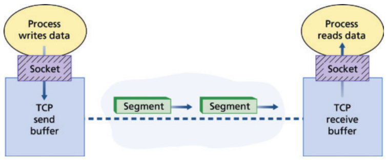

Hình 3.27 Send buffer và receive buffer của TCP

TCP ghép mỗi khúc dữ liệu client với một header TCP, qua đó tạo thành các segment TCP. Các segment được chuyển xuống tầng mạng, nơi chúng được đóng gói riêng trong các IP datagram network-layer. Các IP datagram sau đó được gửi vào mạng. Khi TCP nhận một segment ở đầu kia, dữ liệu của segment được đặt vào receive buffer (buffer nhận) của kết nối TCP, như minh họa trong Hình 3.27. Ứng dụng đọc luồng dữ liệu từ buffer này. Mỗi phía của kết nối có send buffer riêng và receive buffer riêng. (Bạn có thể xem hoạt hình tương tác flow-control (điều khiển luồng) trực tuyến trên website của các tác giả, http://gaia.cs.umass.edu/kurose_ross, hoặc tại website của nhà xuất bản, https://media.pearsoncmg.com/ov2/ph/esm/ecs_kurose_compnetwork_9/cw/ cung cấp một hoạt hình về send buffer và receive buffer.)

Từ thảo luận này chúng ta thấy một kết nối TCP gồm các buffer, biến, và một kết nối socket tới một process trong một host, và một tập buffer, biến, và kết nối socket khác tới một process trong một host khác. Như đã đề cập trước đó, không có buffer hay biến nào được cấp phát cho kết nối trong các phần tử mạng (router, switch và repeater) giữa các host.

### 3.5.2 Cấu trúc segment TCP (TCP Segment Structure)

Sau khi xem qua kết nối TCP, hãy xem xét cấu trúc segment TCP. Segment TCP gồm các trường header và một trường dữ liệu. Trường dữ liệu chứa một khúc dữ liệu ứng dụng. Như đã đề cập ở trên, MSS giới hạn kích thước tối đa của trường dữ liệu của segment. Khi TCP gửi một file lớn, như một ảnh là một phần của trang Web, nó thường chia file thành các khúc kích thước MSS (trừ khúc cuối, thường nhỏ hơn MSS). Tuy nhiên, các ứng dụng tương tác thường truyền các khúc dữ liệu nhỏ hơn MSS; ví dụ, với các ứng dụng đăng nhập từ xa như Telnet và ssh, trường dữ liệu trong segment TCP thường chỉ một byte. Vì header TCP thường là 20 byte (nhiều hơn header UDP 12 byte), các segment do Telnet và ssh gửi có thể chỉ dài 21 byte.

Hình 3.28 cho thấy cấu trúc của segment TCP. Như với UDP, header bao gồm số port nguồn và đích, được dùng để ghép kênh/phân kênh dữ liệu từ/tới các ứng dụng upper-layer. Ngoài ra, như với UDP, header bao gồm một trường checksum. Header segment TCP cũng chứa các trường sau:

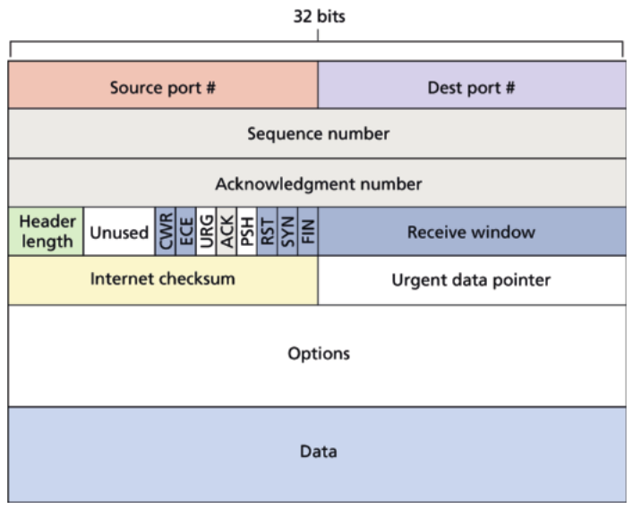

Hình 3.28 Cấu trúc segment TCP

• Trường số thứ tự 32-bit và trường số acknowledgment 32-bit được bên gửi và bên nhận TCP dùng để hiện thực dịch vụ truyền dữ liệu tin cậy, như thảo luận bên dưới.

• Trường receive window (cửa sổ nhận) 16-bit được dùng cho điều khiển luồng. Chúng ta sẽ sớm thấy nó được dùng để cho biết số byte mà bên nhận sẵn sàng chấp nhận.

• Trường header length (độ dài header) 4-bit chỉ định độ dài của header TCP tính bằng word 32-bit. Header TCP có thể có độ dài thay đổi do trường options của TCP. (Thông thường, trường options rỗng, nên độ dài của header TCP điển hình là 20 byte.)

• Trường options tùy chọn và variable-length được dùng khi bên gửi và bên nhận thương lượng kích thước segment tối đa (MSS) hoặc làm hệ số co giãn cửa sổ (window scaling factor) để dùng trong mạng high-speed. Một tùy chọn time-stamping (đóng dấu thời gian) cũng được định nghĩa. Xem RFC 854 và RFC 1323 để biết thêm chi tiết.

• Trường flag chứa 6 bit. Bit ACK được dùng để cho biết giá trị mang trong trường acknowledgment là hợp lệ; tức là, segment chứa một acknowledgment cho một segment đã được nhận thành công. Các bit RST, SYN và FIN được dùng để thiết lập và hủy kết nối, như chúng ta sẽ thảo luận ở cuối mục này. Các bit CWR và ECE được dùng trong thông báo tắc nghẽn tường minh (explicit congestion notification), như thảo luận trong Mục 3.7.2. Bật bit PSH cho biết bên nhận nên chuyển dữ liệu lên tầng trên ngay lập tức. Cuối cùng, bit URG được dùng để cho biết có dữ liệu trong segment này mà thực thể upper-layer sending-side (phía gửi) đã đánh dấu là “khẩn cấp.” Vị trí của byte cuối cùng của dữ liệu khẩn cấp này được chỉ ra bởi trường urgent data pointer 16-bit. TCP phải thông báo cho thực thể upper-layer receiving-side (phía nhận) khi có dữ liệu khẩn cấp và chuyển cho nó một con trỏ tới cuối dữ liệu khẩn cấp. (Trong thực tế, PSH, URG và urgent data pointer không được dùng. Tuy nhiên, chúng tôi đề cập các trường này cho đầy đủ.)

Kinh nghiệm giảng dạy của chúng tôi là sinh viên đôi khi thấy thảo luận về định dạng packet khá khô khan và có lẽ hơi nhàm chán. Để có một cái nhìn vui vẻ và giàu tưởng tượng về các trường header TCP, đặc biệt nếu bạn yêu thích Legos<sup>TM</sup> như chúng tôi, hãy xem [Pomeranz 2010].

#### Số thứ tự và số acknowledgment (Sequence Numbers and Acknowledgment Numbers)

Hai trong số các trường quan trọng nhất trong header segment TCP là trường số thứ tự và trường số acknowledgment. Các trường này là một phần thiết yếu của dịch vụ truyền dữ liệu tin cậy của TCP. Nhưng trước khi thảo luận cách các trường này được dùng để cung cấp truyền dữ liệu tin cậy, trước hết hãy giải thích chính xác TCP đặt gì vào các trường này.

TCP xem dữ liệu là một luồng byte không có cấu trúc, nhưng có thứ tự. Việc TCP dùng số thứ tự phản ánh góc nhìn này ở chỗ số thứ tự được tính trên luồng byte được truyền chứ không phải trên chuỗi segment được truyền. Do đó số thứ tự cho một segment là số byte-stream (thứ tự trong luồng byte) của byte đầu tiên trong segment. Hãy xem một ví dụ. Giả sử một process trong Host A muốn gửi một luồng dữ liệu tới một process trong Host B qua một kết nối TCP. TCP trong Host A sẽ ngầm đánh số mỗi byte trong luồng dữ liệu. Giả sử luồng dữ liệu gồm một file 500,000 byte, MSS là 1,000 byte, và byte đầu tiên của luồng dữ liệu được đánh số 0. Như minh họa trong Hình 3.29, TCP tạo 500 segment từ luồng dữ liệu. Segment đầu tiên được gán số thứ tự 0, segment thứ hai được gán số thứ tự 1,000, segment thứ ba được gán số thứ tự 2,000, v.v. Mỗi số thứ tự được chèn vào trường số thứ tự trong header của segment TCP tương ứng.

Giờ hãy xét số acknowledgment. Chúng phức tạp hơn số thứ tự một chút. Nhớ rằng TCP là full-duplex, nên Host A có thể đang nhận dữ liệu từ Host B trong khi nó gửi dữ liệu tới Host B (như một phần của cùng kết nối TCP). Mỗi segment tới từ Host B có một số thứ tự cho dữ liệu chảy từ B tới A. Số acknowledgment mà Host A đặt vào segment của nó là số thứ tự của byte tiếp theo mà Host A đang mong đợi từ Host B. Nên xem vài ví dụ để hiểu chuyện gì đang diễn ra ở đây. Giả sử Host A đã nhận tất cả các byte được đánh số 0 đến 535 từ B và giả sử nó sắp gửi một segment tới Host B. Host A đang chờ byte 536 và tất cả các byte tiếp theo trong luồng dữ liệu của Host B. Vì vậy Host A đặt 536 vào trường số acknowledgment của segment nó gửi tới B.

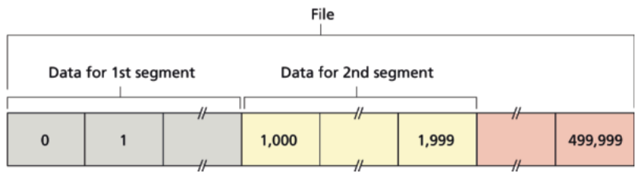

Hình 3.29 Chia dữ liệu file thành các segment TCP

Một ví dụ khác, giả sử Host A đã nhận một segment từ Host B chứa các byte 0 đến 535 và một segment khác chứa các byte 900 đến 1,000. Vì lý do nào đó Host A chưa nhận được các byte 536 đến 899. Trong ví dụ này, Host A vẫn đang chờ byte 536 (và sau đó) để re-create (tái tạo) luồng dữ liệu của B. Do đó, segment tiếp theo của A tới B sẽ chứa 536 trong trường số acknowledgment. Vì TCP chỉ xác nhận các byte tới byte bị thiếu đầu tiên trong luồng, TCP được gọi là cung cấp acknowledgment tích lũy.

Ví dụ cuối này cũng đặt ra một vấn đề quan trọng nhưng tinh tế. Host A nhận segment thứ ba (byte 900 đến 1,000) trước khi nhận segment thứ hai (byte 536 đến 899). Do đó, segment thứ ba đến sai thứ tự. Vấn đề tinh tế là: Một host làm gì khi nó nhận các segment out-of-order trong một kết nối TCP? Thú vị là, các RFC TCP không áp đặt quy tắc nào ở đây và để quyết định cho các lập trình viên hiện thực TCP. Về cơ bản có hai lựa chọn: hoặc (1) bên nhận loại bỏ ngay các segment out-of-order (mà, như chúng ta đã thảo luận trước đó, có thể đơn giản hóa thiết kế bên nhận), hoặc (2) bên nhận giữ các byte out-of-order và chờ các byte bị thiếu lấp đầy các khoảng trống. Rõ ràng, lựa chọn thứ hai hiệu quả hơn về băng thông mạng, và là cách tiếp cận được dùng trong thực tế.

Trong Hình 3.29, chúng ta giả định số thứ tự ban đầu là không. Thực ra, cả hai phía của một kết nối TCP chọn ngẫu nhiên một số thứ tự ban đầu. Việc này được thực hiện để giảm thiểu khả năng một segment vẫn còn trong mạng từ một kết nối already-terminated (đã kết thúc) trước đó giữa hai host bị nhầm là một segment hợp lệ trong một kết nối sau giữa cùng hai host này (cũng tình cờ dùng cùng số port như kết nối cũ) [Sunshine 1978].

#### Telnet: Một nghiên cứu tình huống về số thứ tự và số acknowledgment (Telnet: A Case Study for Sequence and Acknowledgment Numbers)

Telnet, được định nghĩa trong RFC 854, là một giao thức application-layer phổ biến dùng cho đăng nhập từ xa. Nó chạy trên TCP và được thiết kế để hoạt động giữa bất kỳ cặp host nào. Không như các ứng dụng truyền dữ liệu khối lượng lớn được thảo luận trong Chương 2, Telnet là một ứng dụng tương tác. Chúng ta thảo luận một ví dụ Telnet ở đây, vì nó minh họa rất rõ số thứ tự và số acknowledgment của TCP. Chúng tôi lưu ý rằng người dùng giờ thích dùng giao thức SSH hơn Telnet, vì dữ liệu gửi trong một kết nối Telnet (bao gồm cả mật khẩu!) không được mã hóa, khiến Telnet dễ bị tấn công nghe lén.

Giả sử Host A khởi tạo một phiên Telnet với Host B. Vì Host A khởi tạo phiên, nó được gán nhãn là client, và Host B được gán nhãn là server. Mỗi ký tự người dùng gõ (tại client) sẽ được gửi tới host từ xa; host từ xa sẽ gửi lại một bản sao của mỗi ký tự, ký tự này sẽ được hiển thị trên màn hình của người dùng Telnet. “Echo back” (gửi vọng lại) này được dùng để đảm bảo các ký tự người dùng Telnet thấy đã được nhận và xử lý tại site từ xa. Do đó mỗi ký tự đi qua mạng hai lần giữa lúc người dùng nhấn phím và lúc ký tự được hiển thị trên màn hình của người dùng.

Giờ giả sử người dùng gõ một chữ cái duy nhất, ‘C,’ rồi đi lấy cà phê. Hãy xem xét các segment TCP được gửi giữa client và server. Như minh họa trong Hình 3.30, chúng ta giả sử số thứ tự bắt đầu lần lượt là 42 và 79 cho client và server. Nhớ rằng số thứ tự của một segment là số thứ tự của byte đầu tiên trong trường dữ liệu. Do đó, segment đầu tiên gửi từ client sẽ có số thứ tự 42; segment đầu tiên gửi từ server sẽ có số thứ tự 79. Nhớ rằng số acknowledgment là số thứ tự của byte dữ liệu tiếp theo mà host đang chờ. Sau khi kết nối TCP được thiết lập nhưng trước khi bất kỳ dữ liệu nào được gửi, client đang chờ byte 79 và server đang chờ byte 42.

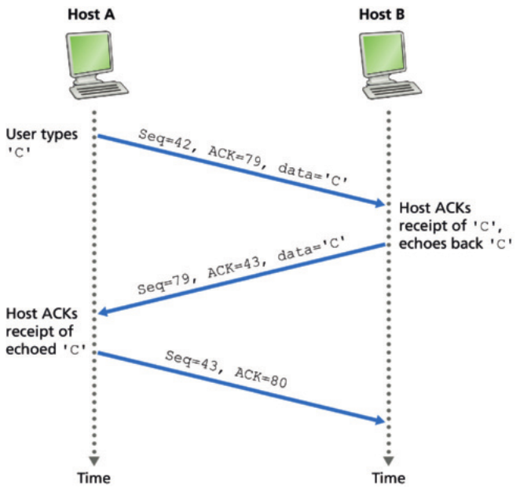

Hình 3.30 Số thứ tự và số acknowledgment cho một ứng dụng Telnet đơn giản trên TCP

Như minh họa trong Hình 3.30, ba segment được gửi. Segment đầu tiên được gửi từ client tới server, chứa biểu diễn ASCII 1-byte của chữ ‘C’ trong trường dữ liệu. Segment đầu tiên này cũng có 42 trong trường số thứ tự, như chúng ta vừa mô tả. Ngoài ra, vì client chưa nhận được bất kỳ dữ liệu nào từ server, segment đầu tiên này sẽ có 79 trong trường số acknowledgment.

Segment thứ hai được gửi từ server tới client. Nó phục vụ hai mục đích. Thứ nhất, nó cung cấp một acknowledgment cho dữ liệu server đã nhận. Bằng cách đặt 43 vào trường acknowledgment, server đang nói với client rằng nó đã nhận thành công mọi thứ tới byte 42 và giờ đang chờ các byte từ 43 trở đi. Mục đích thứ hai của segment này là gửi vọng lại chữ ‘C.’ Do đó, segment thứ hai có biểu diễn ASCII của ‘C’ trong trường dữ liệu. Segment thứ hai này có số thứ tự 79, số thứ tự ban đầu của luồng dữ liệu server-to-client (từ server tới client) của kết nối TCP này, vì đây là byte dữ liệu đầu tiên mà server gửi. Lưu ý rằng acknowledgment cho dữ liệu client-to-server được mang trong một segment mang dữ liệu server-to-client; acknowledgment này được gọi là được piggyback (cõng) trên segment dữ liệu server-to-client.

Segment thứ ba được gửi từ client tới server. Mục đích duy nhất của nó là xác nhận dữ liệu nó đã nhận từ server. (Nhớ rằng segment thứ hai chứa dữ liệu—chữ ‘C’—từ server tới client.) Segment này có trường dữ liệu rỗng (tức là, acknowledgment không được piggyback cùng bất kỳ dữ liệu client-to-server nào). Segment có 80 trong trường số acknowledgment vì client đã nhận luồng byte tới byte có số thứ tự 79 và giờ đang chờ các byte từ 80 trở đi. Có thể bạn thấy lạ khi segment này cũng có số thứ tự vì segment không chứa dữ liệu. Nhưng vì TCP có trường số thứ tự, segment cần có một số thứ tự nào đó.

### 3.5.3 Ước lượng thời gian khứ hồi và timeout (Round-Trip Time Estimation and Timeout)

TCP, giống giao thức rdt của chúng ta trong Mục 3.4, dùng một cơ chế timeout/truyền lại để phục hồi khỏi các segment bị mất. Mặc dù điều này đơn giản về mặt khái niệm, nhiều vấn đề tinh tế nảy sinh khi chúng ta hiện thực một cơ chế timeout/truyền lại trong một giao thức thực tế như TCP. Có lẽ câu hỏi hiển nhiên nhất là độ dài của các khoảng timeout. Rõ ràng, timeout nên lớn hơn round-trip time (RTT) của kết nối, tức là, thời gian từ khi một segment được gửi đến khi nó được xác nhận. Nếu không, các lần truyền lại không cần thiết sẽ được gửi. Nhưng lớn hơn bao nhiêu? Ngay từ đầu nên ước lượng RTT như thế nào? Có nên gắn một timer với mỗi segment chưa được xác nhận không? Quá nhiều câu hỏi! Thảo luận của chúng ta trong mục này dựa trên công trình TCP trong [Jacobson 1988] và các khuyến nghị IETF hiện tại về quản lý timer TCP [RFC 6298].

#### Ước lượng thời gian khứ hồi (Estimating the Round-Trip Time)

Hãy bắt đầu nghiên cứu về quản lý timer TCP bằng cách xét cách TCP ước lượng round-trip time giữa bên gửi và bên nhận. Việc này được thực hiện như sau. RTT mẫu, ký hiệu SampleRTT, cho một segment là lượng thời gian giữa khi segment được gửi (tức là, được chuyển cho IP) và khi nhận được một acknowledgment cho segment. Thay vì đo một SampleRTT cho mỗi segment được truyền, hầu hết các hiện thực TCP chỉ thực hiện một phép đo SampleRTT tại một thời điểm. Tức là, tại bất kỳ thời điểm nào, SampleRTT chỉ đang được ước lượng cho một trong các segment đã truyền nhưng hiện chưa được xác nhận, dẫn tới một giá trị SampleRTT mới xấp xỉ mỗi RTT một lần. Ngoài ra, TCP không bao giờ tính SampleRTT cho một segment đã được truyền lại; nó chỉ đo SampleRTT cho các segment đã được truyền một lần [Karn 1987]. (Một bài tập ở cuối chương yêu cầu bạn xét tại sao.)

Hiển nhiên, các giá trị SampleRTT sẽ dao động từ segment này sang segment khác do tắc nghẽn trong router và do tải thay đổi trên các end system. Vì sự dao động này, bất kỳ giá trị SampleRTT nào cũng có thể không điển hình. Để ước lượng một RTT điển hình, do đó tự nhiên là lấy một dạng trung bình nào đó của các giá trị SampleRTT. TCP duy trì một giá trị trung bình, gọi là EstimatedRTT, của các giá trị SampleRTT. Khi có một SampleRTT mới, TCP cập nhật EstimatedRTT theo công thức sau:

EstimatedRTT = (1 - α) · EstimatedRTT + α · SampleRTT

Công thức trên được viết dưới dạng một câu lệnh programming-language—giá trị mới của EstimatedRTT là một tổ hợp có trọng số của giá trị trước đó của EstimatedRTT và giá trị mới của SampleRTT. Giá trị khuyến nghị của α là α = 0.125 (tức là, 1/8) [RFC 6298], khi đó công thức trên trở thành:

```
EstimatedRTT = 0.875 · EstimatedRTT + 0.125 · SampleRTT
```

Lưu ý rằng EstimatedRTT là một trung bình có trọng số của các giá trị SampleRTT. Như thảo luận trong một bài tập về nhà ở cuối chương này, trung bình có trọng số này đặt nhiều trọng số lên các mẫu gần đây hơn các mẫu cũ. Điều này là tự nhiên, vì các mẫu gần đây phản ánh tốt hơn tình trạng tắc nghẽn hiện tại trong mạng. Trong thống kê, một trung bình như vậy được gọi là trung bình động có trọng số mũ (exponential weighted moving average - EWMA). Từ “exponential” xuất hiện trong EWMA vì trọng số của một SampleRTT cho trước suy giảm nhanh theo hàm mũ khi các lần cập nhật diễn ra. Trong các bài tập về nhà, bạn sẽ được yêu cầu suy ra số hạng mũ trong EstimatedRTT.

Hình 3.31 cho thấy các giá trị SampleRTT và EstimatedRTT với giá trị α = 1/8 cho một kết nối TCP giữa gaia.cs.umass.edu (ở Amherst, Massachusetts) tới fantasia.eurecom.fr (ở miền nam nước Pháp). Rõ ràng, các biến thiên trong SampleRTT được làm mượt trong phép tính EstimatedRTT.

Ngoài việc có một ước lượng RTT, cũng có giá trị nếu có một thước đo độ biến thiên của RTT. [RFC 6298] định nghĩa độ biến thiên RTT, DevRTT, là một ước lượng về mức SampleRTT thường lệch khỏi EstimatedRTT:

DevRTT = (1 - β) · DevRTT + β · | SampleRTT - EstimatedRTT | Lưu ý rằng DevRTT là một EWMA của độ chênh lệch giữa SampleRTT và EstimatedRTT. Nếu các giá trị SampleRTT ít dao động, thì DevRTT sẽ nhỏ; mặt khác, nếu dao động nhiều, DevRTT sẽ lớn. Giá trị khuyến nghị của β là 0.25.

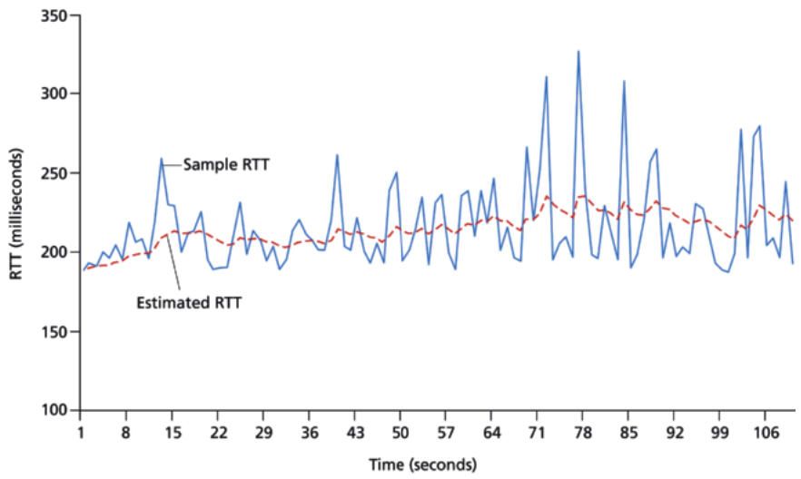

Hình 3.31 Các mẫu RTT và ước lượng RTT

#### Đặt và quản lý khoảng timeout truyền lại (Setting and Managing the Retransmission Timeout Interval)

Với các giá trị EstimatedRTT và DevRTT, nên dùng giá trị nào cho khoảng timeout của TCP? Rõ ràng, khoảng này nên lớn hơn hoặc bằng EstimatedRTT, nếu không các lần truyền lại không cần thiết sẽ được gửi. Nhưng khoảng timeout không nên lớn hơn EstimatedRTT quá nhiều; nếu không, khi một segment bị mất, TCP sẽ không truyền lại segment nhanh chóng, dẫn tới độ trễ truyền dữ liệu lớn. Do đó mong muốn đặt timeout bằng EstimatedRTT cộng một biên độ nào đó. Biên độ nên lớn khi có nhiều dao động trong các giá trị SampleRTT; nó nên nhỏ khi có ít dao động. Giá trị của DevRTT do đó nên phát huy tác dụng ở đây. Tất cả các cân nhắc này được tính đến trong phương pháp của TCP để xác định khoảng timeout truyền lại:

```
TimeoutInterval = EstimatedRTT + 4 · DevRTT
```

### Nguyên lý trong thực tế (Principles in Practice)

TCP cung cấp truyền dữ liệu tin cậy bằng cách dùng acknowledgment khẳng định và timer theo cách gần giống như chúng ta đã nghiên cứu trong Mục 3.4. TCP xác nhận dữ liệu đã được nhận đúng, và sau đó truyền lại segment khi segment hoặc acknowledgment tương ứng của chúng được cho là đã bị mất hoặc bị hỏng. Một số phiên bản TCP cũng có một cơ chế NAK ngầm—với cơ chế fast retransmit (truyền lại nhanh) của TCP, việc nhận ba ACK trùng lặp cho một segment cho trước đóng vai trò một NAK ngầm cho segment tiếp theo, kích hoạt truyền lại segment đó trước timeout. TCP dùng chuỗi số để cho phép bên nhận xác định các segment bị mất hoặc trùng lặp. Giống như trường hợp giao thức truyền dữ liệu tin cậy của chúng ta, rdt3.0, bản thân TCP không thể biết chắc một segment, hoặc ACK của nó, bị mất, bị hỏng, hay bị trễ quá mức. Ở bên gửi, phản ứng của TCP sẽ như nhau: truyền lại segment đang xét.

TCP cũng dùng pipelining, cho phép bên gửi có nhiều segment đã truyền nhưng yet-to-be-acknowledged (chưa được xác nhận) đang chờ tại bất kỳ thời điểm nào. Chúng ta đã thấy trước đó rằng pipelining có thể cải thiện đáng kể throughput của một phiên khi tỉ lệ kích thước segment so với độ trễ round-trip nhỏ. Số cụ thể các segment đang chờ, chưa được xác nhận mà bên gửi có thể có được xác định bởi các cơ chế flow-control và congestion-control của TCP. Điều khiển luồng TCP được thảo luận ở cuối mục này; điều khiển tắc nghẽn TCP được thảo luận trong Mục 3.7. Tạm thời, chúng ta chỉ cần biết rằng bên gửi TCP dùng pipelining.

Giá trị TimeoutInterval ban đầu được khuyến nghị là 1 giây [RFC 6298]. Ngoài ra, khi timeout xảy ra, giá trị TimeoutInterval được nhân đôi để tránh một timeout sớm xảy ra cho một segment tiếp theo sẽ sớm được xác nhận. Tuy nhiên, ngay khi một segment được nhận và EstimatedRTT được cập nhật, TimeoutInterval lại được tính bằng công thức trên.

### 3.5.4 Truyền dữ liệu tin cậy (Reliable Data Transfer)

Nhớ rằng dịch vụ network-layer của Internet (dịch vụ IP) là không tin cậy. IP không đảm bảo chuyển giao datagram, không đảm bảo chuyển giao datagram in-order, và không đảm bảo tính toàn vẹn của dữ liệu trong datagram. Với dịch vụ IP, datagram có thể làm tràn buffer router và không bao giờ tới đích, datagram có thể đến sai thứ tự, và các bit trong datagram có thể bị hỏng (lật từ 0 thành 1 và ngược lại). Vì các segment transport-layer được mang qua mạng bởi IP datagram, các segment transport-layer cũng có thể gặp những vấn đề này.

TCP tạo một dịch vụ truyền dữ liệu tin cậy trên nền dịch vụ best-effort không tin cậy của IP. Dịch vụ truyền dữ liệu tin cậy của TCP đảm bảo rằng luồng dữ liệu mà một process đọc ra từ receive buffer TCP của nó không bị hỏng, không có khoảng trống, không trùng lặp, và đúng thứ tự; tức là, luồng byte giống hệt luồng byte đã được end system ở phía bên kia của kết nối gửi. Cách TCP cung cấp truyền dữ liệu tin cậy liên quan tới nhiều nguyên lý mà chúng ta đã nghiên cứu trong Mục 3.4.

Trong phần phát triển các kỹ thuật truyền dữ liệu tin cậy trước đó, đơn giản nhất về mặt khái niệm là giả định rằng một timer riêng được gắn với mỗi segment đã truyền nhưng chưa được xác nhận. Mặc dù điều này tuyệt vời về lý thuyết, quản lý timer có thể đòi hỏi overhead đáng kể. Do đó, các thủ tục quản lý timer TCP được khuyến nghị [RFC 6298] chỉ dùng một timer truyền lại duy nhất, ngay cả khi có nhiều segment đã truyền nhưng chưa được xác nhận. Giao thức TCP được mô tả trong mục này tuân theo khuyến nghị single-timer (một timer) này.

Chúng ta sẽ thảo luận cách TCP cung cấp truyền dữ liệu tin cậy theo hai bước tăng dần. Trước hết chúng tôi trình bày một mô tả rất đơn giản hóa về một bên gửi TCP chỉ dùng timeout để phục hồi khỏi các segment bị mất; sau đó chúng tôi trình bày một mô tả đầy đủ hơn dùng acknowledgment trùng lặp bên cạnh timeout. Trong thảo luận tiếp theo, chúng ta giả sử dữ liệu chỉ được gửi theo một chiều, từ Host A tới Host B, và Host A đang gửi một file lớn.

Hình 3.32 trình bày một mô tả rất đơn giản hóa về một bên gửi TCP. Chúng ta thấy có ba sự kiện chính liên quan tới truyền và truyền lại dữ liệu trong bên gửi TCP: dữ liệu nhận được từ ứng dụng bên trên; timer hết giờ; và nhận ACK. Khi sự kiện chính thứ nhất xảy ra, TCP nhận dữ liệu từ ứng dụng, đóng gói dữ liệu trong một segment, và chuyển segment cho IP. Lưu ý rằng mỗi segment bao gồm một số thứ tự là số byte-stream của byte dữ liệu đầu tiên trong segment, như mô tả trong Mục 3.5.2. Cũng lưu ý rằng nếu timer chưa chạy cho một segment nào khác, TCP khởi động timer khi segment được chuyển cho IP. (Sẽ hữu ích nếu nghĩ về timer như được gắn với segment chưa được xác nhận cũ nhất.) Khoảng hết hạn của timer này là TimeoutInterval, được tính từ EstimatedRTT và DevRTT, như mô tả trong Mục 3.5.3.

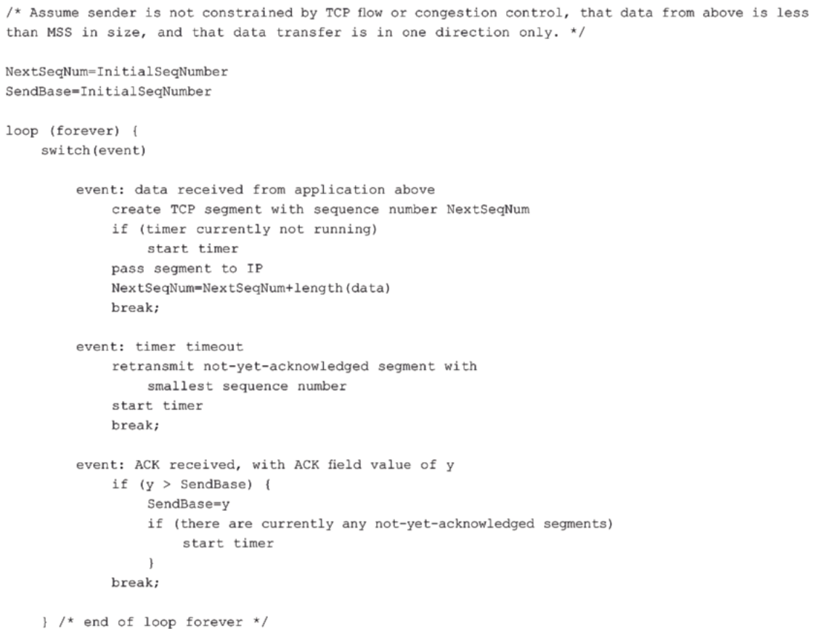

Hình 3.32 Bên gửi TCP đơn giản hóa

Sự kiện chính thứ hai là timeout. TCP phản hồi sự kiện timeout bằng cách truyền lại segment đã gây ra timeout. TCP sau đó khởi động lại timer.

Sự kiện chính thứ ba mà bên gửi TCP phải xử lý là sự xuất hiện của một segment acknowledgment (ACK) từ bên nhận (cụ thể hơn, một segment chứa giá trị trường ACK hợp lệ). Khi sự kiện này xảy ra, TCP so sánh giá trị ACK y với biến SendBase của nó. Biến trạng thái TCP SendBase là số thứ tự của byte chưa được xác nhận cũ nhất. (Do đó SendBase–1 là số thứ tự của byte cuối cùng được biết là đã được nhận đúng và theo thứ tự tại bên nhận.) Như đã chỉ ra trước đó, TCP dùng acknowledgment tích lũy, nên y xác nhận việc nhận tất cả các byte trước byte số y. Nếu y > SendBase, thì ACK đang xác nhận một hoặc nhiều segment chưa được xác nhận trước đó. Do đó bên gửi cập nhật biến SendBase của nó; nó cũng khởi động lại timer nếu hiện có bất kỳ segment not-yet-acknowledged (chưa được xác nhận) nào.

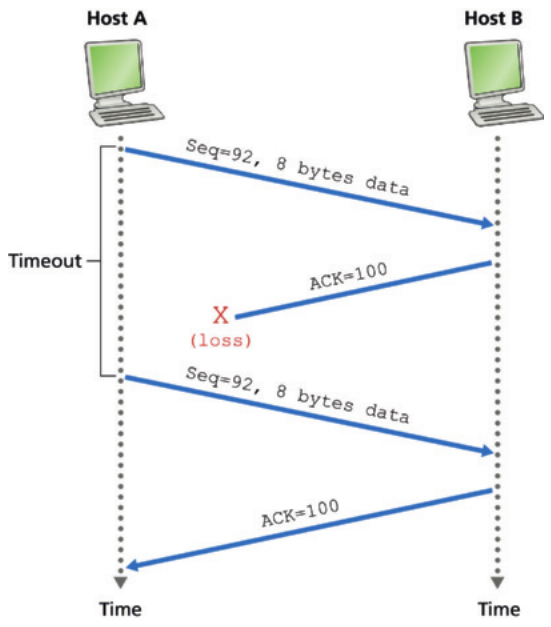

Hình 3.33 Truyền lại do acknowledgment bị mất

#### Một vài kịch bản thú vị (A Few Interesting Scenarios)

Chúng ta vừa mô tả một phiên bản rất đơn giản hóa về cách TCP cung cấp truyền dữ liệu tin cậy. Nhưng ngay cả phiên bản rất đơn giản hóa này cũng có nhiều điểm tinh tế. Để có cảm nhận tốt về cách giao thức này hoạt động, giờ hãy đi qua một vài kịch bản đơn giản. Hình 3.33 mô tả kịch bản thứ nhất, trong đó Host A gửi một segment tới Host B. Giả sử segment này có số thứ tự 92 và chứa 8 byte dữ liệu. Sau khi gửi segment này, Host A chờ một segment từ B với số acknowledgment 100. Mặc dù segment từ A được nhận tại B, acknowledgment từ B tới A bị mất. Trong trường hợp này, sự kiện timeout xảy ra, và Host A truyền lại cùng segment. Tất nhiên, khi Host B nhận lần truyền lại, nó nhận thấy từ số thứ tự rằng segment chứa dữ liệu đã được nhận. Do đó, TCP trong Host B sẽ loại bỏ các byte trong segment được truyền lại.

Trong kịch bản thứ hai, minh họa trong Hình 3.34, Host A gửi hai segment liền nhau.

Segment thứ nhất có số thứ tự 92 và 8 byte dữ liệu, và segment thứ hai có số thứ tự 100 và 20 byte dữ liệu. Giả sử cả hai segment đến B nguyên vẹn, và B gửi hai acknowledgment riêng cho mỗi segment này. Acknowledgment thứ nhất có số acknowledgment 100; cái thứ hai có số acknowledgment 120. Giờ giả sử không acknowledgment nào tới Host A trước timeout. Khi sự kiện timeout xảy ra, Host A gửi lại segment thứ nhất có số thứ tự 92 và khởi động lại timer. Chừng nào ACK cho segment thứ hai tới trước timeout mới, segment thứ hai sẽ không được truyền lại.

Trong kịch bản thứ ba và cuối cùng, giả sử Host A gửi hai segment, đúng như trong ví dụ thứ hai. Acknowledgment của segment thứ nhất bị mất trong mạng, nhưng ngay trước sự kiện timeout, Host A nhận một acknowledgment với số acknowledgment 120. Do đó Host A biết rằng Host B đã nhận mọi thứ tới byte 119; vì vậy Host A không gửi lại segment nào trong hai segment. Kịch bản này được minh họa trong Hình 3.35.

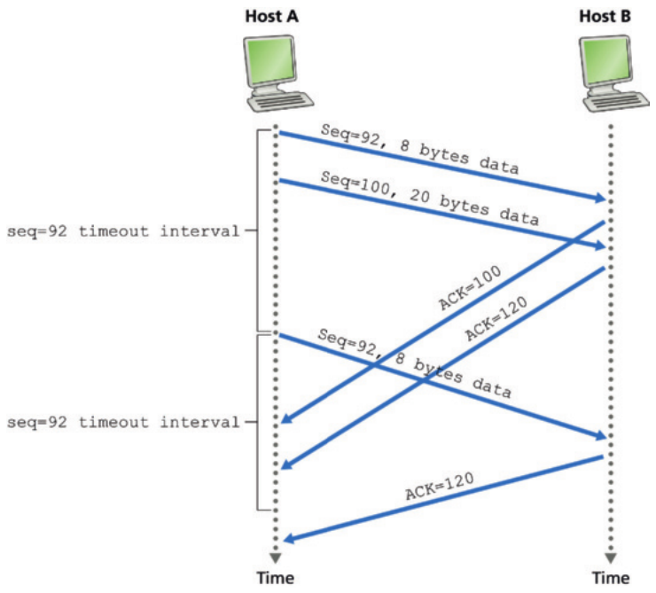

Hình 3.34 Segment 100 không được truyền lại

#### Truyền lại nhanh (Fast Retransmit)

Một trong các vấn đề với truyền lại timeout-triggered (do timeout kích hoạt) là khoảng timeout có thể tương đối dài. Khi một segment bị mất, khoảng timeout dài này buộc bên gửi trì hoãn việc gửi lại packet bị mất, qua đó tăng độ trễ end-to-end. May mắn thay, bên gửi thường có thể suy ra mất gói từ rất sớm trước khi sự kiện timeout xảy ra bằng cách để ý cái so-called ACK trùng lặp (duplicate ACK). Một ACK trùng lặp là một ACK xác nhận lại một segment mà bên gửi đã nhận được acknowledgment trước đó. Để hiểu phản ứng của bên gửi với một ACK trùng lặp, chúng ta phải xem tại sao bên nhận lại gửi một ACK trùng lặp ngay từ đầu.

Khi một bên nhận TCP nhận một segment có số thứ tự lớn hơn số thứ tự in-order mong đợi tiếp theo, nó phát hiện một khoảng trống trong luồng dữ liệu—tức là, một segment bị thiếu. Khoảng trống này có thể là kết quả của các segment bị mất hoặc bị đảo thứ tự trong mạng. Vì TCP dùng ACK tích lũy, khi phát hiện một khoảng trống, bên nhận TCP đơn giản xác nhận lại (tức là, tạo một ACK trùng lặp cho) byte dữ liệu in-order cuối cùng nó đã nhận. Vì bên gửi dùng pipelining, có thể có nhiều segment đang trên đường giữa bên gửi và bên nhận. Nếu một segment in-flight (đang trên đường) bị mất, nhiều khả năng sẽ có nhiều ACK trùng lặp back-to-back được bên nhận TCP tạo ra. Do đó, nếu bên gửi TCP nhận ba ACK trùng lặp cho cùng dữ liệu (tức là, nhận một ACK gốc cho dữ liệu này rồi nhận thêm ba ACK cho cùng dữ liệu này), nó coi đây là dấu hiệu rằng segment theo sau segment đã được ACK bốn lần đã bị mất. (Trong các bài tập về nhà, chúng ta xét câu hỏi tại sao bên gửi chờ ba ACK trùng lặp, thay vì chỉ một ACK trùng lặp.) Trong trường hợp nhận được ba ACK trùng lặp, bên gửi TCP thực hiện truyền lại nhanh (fast retransmit) [RFC 5681], truyền lại segment bị thiếu trước khi timer của segment đó hết hạn.

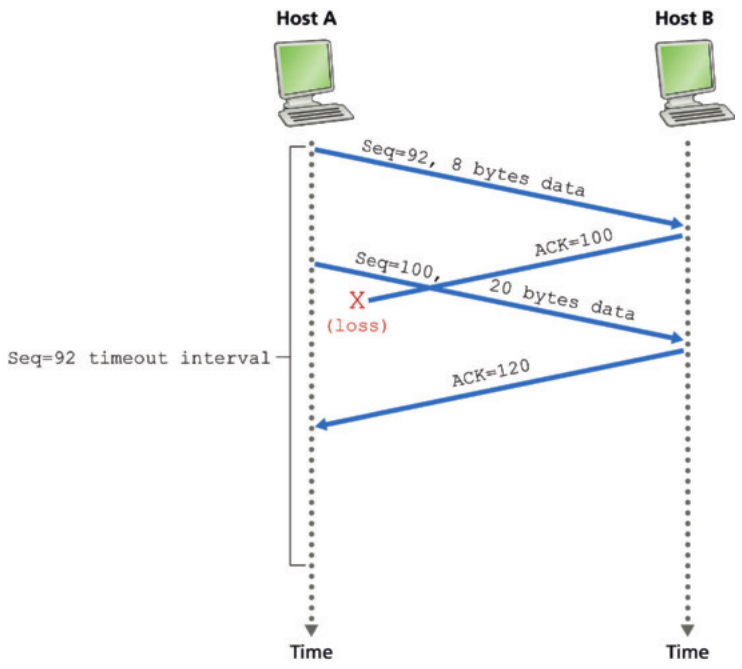

Hình 3.35 Một acknowledgment tích lũy tránh truyền lại segment thứ nhất

#### GBN hay Selective Repeat? (Go-Back-N or Selective Repeat?)

Hãy kết thúc nghiên cứu về cơ chế error-recovery (phục hồi lỗi) của TCP bằng việc xét câu hỏi sau: TCP là giao thức GBN hay SR? Nhớ rằng acknowledgment của TCP là tích lũy và các segment được nhận đúng nhưng out-of-order không được bên nhận ACK riêng lẻ. Do đó, như minh họa trong Hình 3.32 (xem thêm Hình 3.19), bên gửi TCP chỉ cần duy trì số thứ tự nhỏ nhất của một byte đã truyền nhưng chưa được xác nhận (SendBase) và số thứ tự của byte tiếp theo sẽ được gửi (NextSeqNum). Theo nghĩa này, TCP trông rất giống một giao thức GBN-style (kiểu GBN). Nhưng có một số khác biệt nổi bật giữa TCP và Go-Back-N. Nhiều hiện thực TCP sẽ buffer các segment được nhận đúng nhưng out-of-order [Stevens 1994]. Cũng hãy xét điều gì xảy ra khi bên gửi gửi một chuỗi segment 1, 2, . . . , N, và tất cả các segment đến bên nhận đúng thứ tự không lỗi. Giả sử thêm acknowledgment cho packet n < N bị mất, nhưng N − 1 acknowledgment còn lại tới bên gửi trước các timeout tương ứng của chúng. Trong ví dụ này, GBN sẽ truyền lại không chỉ packet n, mà còn tất cả các packet tiếp theo n + 1, n + 2, . . . , N. Mặt khác, TCP sẽ truyền lại nhiều nhất một segment, cụ thể là, segment n. Hơn nữa, TCP thậm chí sẽ không truyền lại segment n nếu acknowledgment cho segment n + 1 tới trước timeout của segment n.

Một sửa đổi được đề xuất cho TCP, cái so-called selective acknowledgment (xác nhận có chọn lọc) [RFC 2018], cho phép bên nhận TCP xác nhận có chọn lọc các segment out-of-order thay vì chỉ xác nhận tích lũy segment in-order được nhận đúng cuối cùng. Khi kết hợp với truyền lại có chọn lọc— bỏ qua việc truyền lại các segment đã được bên nhận xác nhận có chọn lọc—TCP trông rất giống giao thức SR tổng quát của chúng ta. Do đó, cơ chế error-recovery của TCP có lẽ được phân loại tốt nhất là một lai ghép giữa giao thức GBN và SR.

### 3.5.5 Điều khiển luồng (Flow Control)

Nhớ rằng các host ở mỗi phía của một kết nối TCP dành riêng một receive buffer cho kết nối. Khi kết nối TCP nhận các byte đúng và theo thứ tự, nó đặt dữ liệu vào receive buffer. Process ứng dụng liên quan sẽ đọc dữ liệu từ buffer này, nhưng không nhất thiết ngay lúc dữ liệu tới. Thật vậy, ứng dụng nhận có thể bận với một nhiệm vụ khác và có thể thậm chí không cố đọc dữ liệu cho đến rất lâu sau khi nó tới. Nếu ứng dụng tương đối chậm trong việc đọc dữ liệu, bên gửi có thể rất dễ làm tràn receive buffer của kết nối bằng cách gửi quá nhiều dữ liệu quá nhanh.

TCP cung cấp một dịch vụ flow-control cho các ứng dụng của nó để loại bỏ khả năng bên gửi làm tràn buffer của bên nhận. Do đó điều khiển luồng là một dịch vụ speed-matching (khớp tốc độ)—khớp tốc độ bên gửi đang gửi với tốc độ ứng dụng nhận đang đọc. Như đã lưu ý trước đó, một bên gửi TCP cũng có thể bị tiết chế do tắc nghẽn trong mạng IP; dạng điều khiển bên gửi này được gọi là điều khiển tắc nghẽn, một chủ đề chúng ta sẽ khám phá chi tiết trong Mục 3.6 và 3.7. Mặc dù các hành động do điều khiển luồng và điều khiển tắc nghẽn thực hiện tương tự nhau (tiết chế bên gửi), chúng rõ ràng được thực hiện vì những lý do rất khác nhau. Không may, nhiều tác giả dùng các thuật ngữ thay thế cho nhau, và độc giả tinh ý nên phân biệt chúng. Giờ hãy thảo luận cách TCP cung cấp dịch vụ flow-control. Để thấy rừng thay vì chỉ thấy cây, xuyên suốt mục này chúng ta giả sử hiện thực TCP là sao cho bên nhận TCP loại bỏ các segment out-of-order.

TCP cung cấp điều khiển luồng bằng cách cho bên gửi duy trì một biến gọi là receive window (cửa sổ nhận). Nói một cách không chính thức, receive window được dùng để cho bên gửi biết khoảng bao nhiêu không gian buffer trống có sẵn tại bên nhận. Vì TCP là full-duplex, bên gửi ở mỗi phía của kết nối duy trì một receive window riêng. Hãy khảo sát receive window trong bối cảnh truyền file. Giả sử Host A đang gửi một file lớn tới Host B qua một kết nối TCP. Host B cấp phát một receive buffer cho kết nối này; ký hiệu kích thước của nó là RcvBuffer. Thỉnh thoảng, process ứng dụng trong Host B đọc từ buffer. Định nghĩa các biến sau:

• LastByteRead: số thứ tự của byte cuối cùng trong luồng dữ liệu được process ứng dụng trong B đọc từ buffer

• LastByteRcvd: số thứ tự của byte cuối cùng trong luồng dữ liệu đã tới từ mạng và đã được đặt vào receive buffer tại B

Vì TCP không được phép làm tràn buffer đã cấp phát, chúng ta phải có

```
LastByteRcvd – LastByteRead ≤ RcvBuffer
```

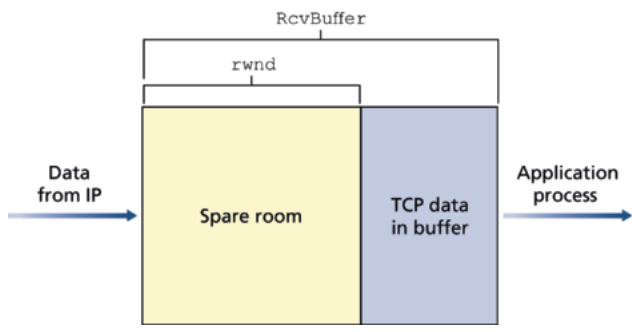

Hình 3.36 Receive window (rwnd) và receive buffer

```
(RcvBuffer)
```

Receive window, ký hiệu rwnd được đặt bằng lượng chỗ trống trong buffer:

```
rwnd = RcvBuffer – [LastByteRcvd – LastByteRead]
```

Vì chỗ trống thay đổi theo thời gian, rwnd là động. Biến rwnd được minh họa trong Hình 3.36.

Kết nối dùng biến rwnd như thế nào để cung cấp dịch vụ flow-control? Host B cho Host A biết nó có bao nhiêu chỗ trống trong buffer kết nối bằng cách đặt giá trị hiện tại của rwnd vào trường receive window của mọi segment nó gửi tới A. Ban đầu, Host B đặt rwnd = RcvBuffer. Lưu ý rằng để làm được việc này, Host B phải theo dõi một số biến connection-specific (riêng cho kết nối).

Đến lượt mình, Host A theo dõi hai biến, LastByteSent và LastByteAcked, có ý nghĩa hiển nhiên. Lưu ý rằng hiệu giữa hai biến này, LastByteSent – LastByteAcked, là lượng dữ liệu chưa được xác nhận mà A đã gửi vào kết nối. Bằng cách giữ lượng dữ liệu chưa được xác nhận nhỏ hơn giá trị của rwnd, Host A được đảm bảo rằng nó không làm tràn receive buffer tại Host B. Do đó, Host A đảm bảo trong suốt vòng đời của kết nối rằng

```
LastByteSent – LastByteAcked ≤ rwnd
```

Có một vấn đề kỹ thuật nhỏ với cơ chế này. Để thấy điều này, giả sử receive buffer của Host B bị đầy nên rwnd = 0. Sau khi quảng bá rwnd = 0 cho Host A, cũng giả sử rằng B không có gì để gửi cho A. Giờ hãy xét điều gì xảy ra. Khi process ứng dụng tại B làm trống buffer, TCP không gửi segment mới với giá trị rwnd mới tới Host A; thực vậy, TCP chỉ gửi một segment tới Host A nếu nó có dữ liệu cần gửi hoặc có acknowledgment cần gửi. Do đó, Host A không bao giờ được thông báo rằng đã có chỗ trống trong receive buffer của Host B—Host A bị chặn và không thể truyền thêm dữ liệu! Để giải quyết vấn đề này, đặc tả TCP yêu cầu Host A tiếp tục gửi các segment có một byte dữ liệu khi receive window của B bằng không. Các segment này sẽ được bên nhận xác nhận. Cuối cùng buffer sẽ bắt đầu trống và các acknowledgment sẽ chứa một giá trị rwnd khác không.

Site trực tuyến tại cho cuốn sách này cung cấp một hoạt hình tương tác minh họa hoạt động của receive window TCP.

Sau khi mô tả dịch vụ flow-control của TCP, chúng tôi đề cập ngắn gọn ở đây rằng UDP không cung cấp điều khiển luồng và do đó, segment có thể bị mất tại bên nhận do tràn buffer. Ví dụ, hãy xét việc gửi một loạt segment UDP từ một process trên Host A tới một process trên Host B. Với một hiện thực UDP điển hình, UDP sẽ nối các segment vào một buffer finite-sized (kích thước hữu hạn) “đứng trước” socket tương ứng (tức là, cánh cửa tới process). Process đọc từng segment trọn vẹn một lần từ buffer. Nếu process không đọc segment từ buffer đủ nhanh, buffer sẽ tràn và segment sẽ bị loại bỏ.

### 3.5.6 Quản lý kết nối TCP (TCP Connection Management)

Trong tiểu mục này, chúng ta xem kỹ hơn cách một kết nối TCP được thiết lập và hủy. Mặc dù chủ đề này có vẻ không đặc biệt hấp dẫn, nó quan trọng vì việc thiết lập kết nối TCP có thể tăng đáng kể độ trễ cảm nhận (perceaved) *(ghi chú: sách in perceaved; đúng là perceived)* (ví dụ, khi lướt Web). Hơn nữa, nhiều cuộc tấn công mạng phổ biến nhất—bao gồm tấn công SYN flood cực kỳ phổ biến (xem khung bên về tấn công SYN flood)—khai thác các lỗ hổng trong quản lý kết nối TCP. Trước hết hãy xem cách một kết nối TCP được thiết lập. Giả sử một process chạy trong một host (client) muốn khởi tạo một kết nối với một process khác trong một host khác (server). Process ứng dụng client trước hết thông báo cho TCP client rằng nó muốn thiết lập một kết nối tới một process trong server. TCP trong client sau đó tiến hành thiết lập một kết nối TCP với TCP trong server theo cách sau:

• Bước 1. TCP client-side trước hết gửi một segment TCP đặc biệt tới TCP server-side. Segment đặc biệt này không chứa dữ liệu application-layer. Nhưng một trong các bit cờ trong header của segment (xem Hình 3.28), bit SYN, được đặt bằng 1. Vì lý do này, segment đặc biệt này được gọi là segment SYN. Ngoài ra, client chọn ngẫu nhiên một số thứ tự ban đầu ( client_isn) và đặt số này vào trường số thứ tự của segment TCP SYN ban đầu. Segment này được đóng gói trong một IP datagram và gửi tới server. Đã có nhiều quan tâm tới việc ngẫu nhiên hóa đúng cách việc chọn client_isn để tránh một số cuộc tấn công bảo mật [RFC 4987].

• Bước 2. Khi IP datagram chứa segment TCP SYN tới host server (giả sử nó có tới!), server trích xuất segment TCP SYN từ datagram, cấp phát buffer và biến TCP cho kết nối, và gửi một segment connection-granted (chấp nhận kết nối) tới TCP client. (Chúng ta sẽ thấy trong Chương 8 rằng việc cấp phát các buffer và biến này trước khi hoàn tất bước thứ ba của bắt tay three-way khiến TCP dễ bị một cuộc tấn công denial-of-service (từ chối dịch vụ) gọi là SYN flooding.) Segment connection-granted này cũng không chứa dữ liệu application-layer. Tuy nhiên, nó chứa ba mẩu thông tin quan trọng trong header của segment. Thứ nhất, bit SYN được đặt bằng 1. Thứ hai, trường acknowledgment của header segment TCP được đặt bằng client_isn+1. Cuối cùng, server chọn số thứ tự ban đầu của riêng nó (server_isn) và đặt giá trị này vào trường số thứ tự của header segment TCP. Segment connection-granted này về thực chất đang nói, “Tôi đã nhận packet SYN của bạn để bắt đầu một kết nối với số thứ tự ban đầu của bạn, client_isn. Tôi đồng ý thiết lập kết nối này. Số thứ tự ban đầu của riêng tôi là server_isn.” Segment connection-granted được gọi là segment SYNACK.

• Bước 3. Khi nhận segment SYNACK, client cũng cấp phát buffer và biến cho kết nối. Host client sau đó gửi cho server thêm một segment nữa; segment cuối này xác nhận segment connection-granted của server (client làm vậy bằng cách đặt giá trị server_isn+1 vào trường acknowledgment của header segment TCP). Bit SYN được đặt bằng không, vì kết nối đã được thiết lập. Giai đoạn thứ ba này của bắt tay three-way có thể mang dữ liệu client-to-server trong payload của segment.

Khi ba bước này đã hoàn tất, các host client và server có thể gửi segment chứa dữ liệu cho nhau. Trong mỗi segment tương lai này, bit SYN sẽ được đặt bằng không. Lưu ý rằng để thiết lập kết nối, ba packet được gửi giữa hai host, như minh họa trong Hình 3.37. Vì lý do này, thủ tục connection-establishment này thường được gọi là bắt tay three-way. Một số khía cạnh của bắt tay three-way TCP được khám phá trong các bài tập về nhà (Tại sao cần số thứ tự ban đầu? Tại sao cần bắt tay three-way, thay vì bắt tay two-way (hai bước)?). Thú vị là một người leo núi đá và một người belayer (người đứng bên dưới người leo núi và có nhiệm vụ xử lý dây an toàn của người leo) dùng một giao thức giao tiếp three-way-handshake giống hệt của TCP để đảm bảo cả hai phía đã sẵn sàng trước khi người leo bắt đầu leo. Vì TCP client khởi tạo một bắt tay three-way cần chờ nhận một thông điệp SYNACK từ server trước khi biết rằng server đã chấp nhận kết nối và trạng thái của kết nối đã được khởi tạo, có vẻ như độ trễ một RTT là cố hữu trong việc thiết lập kết nối đối với bất kỳ giao thức bắt tay nào như vậy (ví dụ, giao thức TLS mà chúng ta sẽ nghiên cứu trong Chương 8, hoặc giao thức QUIC mà chúng ta đã nghiên cứu trong Chương 2 và sẽ quay lại sau trong chương này). Tuy nhiên, nếu client và server đã từng giao tiếp trước đó, có thể dùng một kỹ thuật gọi là “fast open” (mở nhanh) để giảm thời gian bắt tay xuống không! Tức là, một client có thể gửi dữ liệu ngay lập tức tới một server connection-oriented mà nó đã từng giao tiếp trước đó mà không phải thực hiện hai bước đầu của bắt tay 3-way truyền thống.

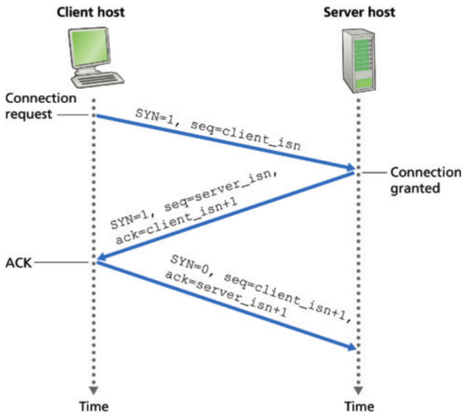

Hình 3.37 Bắt tay three-way của TCP: trao đổi segment

Ý tưởng then chốt đằng sau fast open, đôi khi còn được gọi là bắt tay 0 - RTT, là trong một bắt tay three-way truyền thống, client cũng có thể yêu cầu server cung cấp cho nó một cookie fast-open, mã hóa tất cả thông tin kết nối cần thiết trong một kết nối tương lai. Cookie này được lưu tại client và server. Lần tới khi client muốn thiết lập kết nối với server này, nó gửi cookie fast-open cùng với dữ liệu application-layer trong thông điệp đầu tiên tới server. Server kiểm tra cookie, và thấy nó chấp nhận được, sẽ chấp nhận kết nối, thiết lập các tham số của kết nối từ cookie, và phản hồi dữ liệu application-layer của client chứa trong thông điệp ban đầu, bằng dữ liệu phản hồi application-layer của server—qua đó hoàn toàn tránh được độ trễ một RTT trong bắt tay three-way trước khi dữ liệu có thể được gửi.

Điều quan trọng cần lưu ý là fast-open chỉ là một tối ưu tiềm năng cho client; server có thể không chấp nhận cookie fast-open vì lý do chính sách, ví dụ, server không còn muốn giao tiếp với client đó, hoặc muốn buộc client đó xác thực lại (ví dụ, trong trường hợp bắt tay TLS). Chỉ vì một client mang cookie tới server, không có nghĩa server phải ăn (chấp nhận) cookie! Tất nhiên, cookie fast-open phải được tạo một cách an toàn về mật mã, dùng các kỹ thuật chúng ta sẽ nghiên cứu trong Chương 8. TCP Fast Open được mô tả trong RFC 7413; TLS (xem Chương 8 và RFC 8446) và các giao thức QUIC [RFC 9000; RFC 9002] cũng hỗ trợ fast open zero-RTT.

Cuộc vui nào cũng có lúc tàn, và điều này cũng đúng với một kết nối TCP. Bất kỳ process nào trong hai process tham gia một kết nối TCP đều có thể kết thúc kết nối. Khi một kết nối kết thúc, các “tài nguyên” (tức là, buffer và biến) trong các host được giải phóng. Ví dụ, giả sử client quyết định đóng kết nối, như minh họa trong Hình 3.38. Process ứng dụng client đưa ra một lệnh close. Điều này khiến TCP client gửi một segment TCP đặc biệt tới process server. Segment đặc biệt này có một bit cờ trong header của segment, bit FIN (xem Hình 3.28), được đặt bằng 1. Khi server nhận segment này, nó gửi lại cho client một segment acknowledgment. Server sau đó gửi segment tắt kết nối của riêng nó, có bit FIN được đặt bằng 1. Cuối cùng, client xác nhận segment tắt kết nối của server. Tại thời điểm này, mọi tài nguyên trong hai host giờ đều được giải phóng.

Trong vòng đời của một kết nối TCP, giao thức TCP chạy trong mỗi host thực hiện các chuyển trạng thái qua nhiều trạng thái TCP khác nhau. Hình 3.39 minh họa một chuỗi trạng thái TCP điển hình mà TCP client đi qua. TCP client bắt đầu ở trạng thái CLOSED. Ứng dụng ở phía client khởi tạo một kết nối TCP mới (bằng cách tạo một đối tượng Socket trong các ví dụ Python của chúng ta từ Chương 2). Điều này khiến TCP trong client gửi một segment SYN tới TCP trong server. Sau khi gửi segment SYN, TCP client đi vào trạng thái SYN_SENT. Trong khi ở trạng thái SYN_SENT, TCP client chờ một segment từ TCP server bao gồm acknowledgment cho segment trước đó của client và có bit SYN được đặt bằng 1. Khi đã nhận được segment như vậy, TCP client đi vào trạng thái ESTABLISHED. Trong khi ở trạng thái ESTABLISHED, TCP client có thể gửi và nhận các segment TCP chứa dữ liệu payload (tức là, application-generated (do ứng dụng tạo ra)).

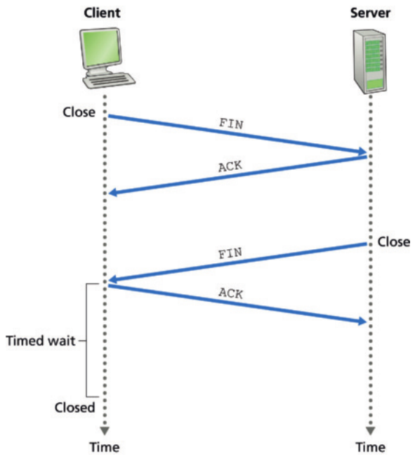

Hình 3.38 Đóng một kết nối TCP

Giả sử ứng dụng client quyết định nó muốn đóng kết nối. (Lưu ý rằng server cũng có thể chọn đóng kết nối.) Điều này khiến TCP client gửi một segment TCP có bit FIN được đặt bằng 1 và đi vào trạng thái FIN_WAIT_1. Trong khi ở trạng thái FIN_WAIT_1, TCP client chờ một segment TCP từ server có acknowledgment. Khi nhận được segment này, TCP client đi vào trạng thái FIN_WAIT_2. Trong khi ở trạng thái FIN_WAIT_2, client chờ một segment khác từ server có bit FIN được đặt bằng 1; sau khi nhận segment này, TCP client xác nhận segment của server và đi vào trạng thái TIME_WAIT. Trạng thái TIME_WAIT cho phép TCP client gửi lại acknowledgment cuối cùng trong trường hợp ACK bị mất. Thời gian ở trạng thái TIME_WAIT là implementation-dependent (phụ thuộc hiện thực), nhưng các giá trị điển hình là 30 giây, 1 phút và 2 phút. Sau khi chờ, kết nối chính thức đóng và mọi tài nguyên ở phía client (bao gồm số port) được giải phóng.

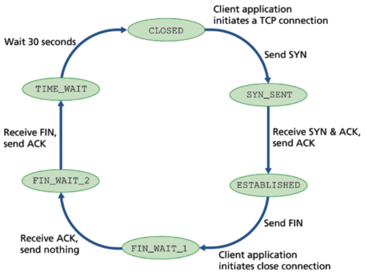

Hình 3.39 Một chuỗi trạng thái TCP điển hình mà một TCP client đi qua

Hình 3.40 minh họa chuỗi trạng thái mà TCP server-side thường đi qua, giả sử client bắt đầu việc hủy kết nối. Các chuyển trạng thái là self-explanatory. Trong hai sơ đồ state-transition (chuyển trạng thái) này, chúng ta chỉ cho thấy cách một kết nối TCP được thiết lập và tắt bình thường. Chúng ta chưa mô tả điều gì xảy ra trong một số kịch bản bất thường, ví dụ, khi cả hai phía của một kết nối muốn khởi tạo hoặc tắt cùng lúc. Nếu bạn quan tâm tìm hiểu về điều này và các vấn đề nâng cao khác liên quan tới TCP, bạn được khuyến khích xem cuốn sách toàn diện của Stevens [Stevens 1994].

Thảo luận ở trên đã giả định rằng cả client và server đều sẵn sàng giao tiếp, tức là, server đang lắng nghe trên port mà client gửi segment SYN tới. Hãy xét điều gì xảy ra khi một host nhận một segment TCP có số port hoặc địa chỉ IP nguồn không khớp với bất kỳ socket đang hoạt động nào trong host. Ví dụ, giả sử một host nhận một packet TCP SYN có port đích 80, nhưng host không chấp nhận kết nối trên port 80 (tức là, nó không chạy Web server trên port 80). Khi đó host sẽ gửi một segment reset đặc biệt tới nguồn. Segment TCP này có bit cờ RST (xem Mục 3.5.2) được đặt bằng 1. Do đó, khi một host gửi một segment reset, nó đang nói với nguồn “Tôi không có socket cho segment đó. Xin đừng gửi lại segment.” Khi một host nhận một packet UDP có số port đích không khớp với một socket UDP đang hoạt động, host gửi một ICMP datagram đặc biệt, như thảo luận trong Chương 5.

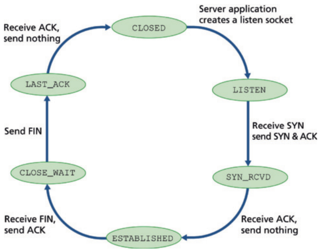

Hình 3.40 Một chuỗi trạng thái TCP điển hình mà một TCP server-side đi qua

> Tiêu điểm bảo mật (Focus on Security)
>
> Tấn công SYN flood (The Syn Flood Attack)
>
> Chúng ta đã thấy trong thảo luận về bắt tay three-way của TCP rằng một server cấp phát và khởi tạo các biến và buffer kết nối để phản hồi một SYN nhận được. Server sau đó gửi một SYNACK để phản hồi, và chờ một segment ACK từ client. Nếu client không gửi ACK để hoàn tất bước thứ ba của bắt tay 3-way này, cuối cùng (thường sau một phút hoặc hơn) server sẽ kết thúc kết nối half-open (mở một nửa) và thu hồi các tài nguyên đã cấp phát.
>
> Giao thức quản lý kết nối TCP này tạo tiền đề cho một cuộc tấn công Từ chối dịch vụ (Denial of Service - DoS) kinh điển gọi là tấn công SYN flood. Trong cuộc tấn công này, (những) kẻ tấn công gửi một số lượng lớn segment TCP SYN, mà không hoàn tất bước bắt tay thứ ba. Với trận lũ segment SYN này, tài nguyên kết nối của server bị cạn kiệt khi chúng được cấp phát (nhưng không bao giờ được dùng!) cho các kết nối half-open; các client hợp lệ sau đó bị từ chối dịch vụ. Các cuộc tấn công SYN flooding như vậy nằm trong số những cuộc tấn công DoS đầu tiên được ghi nhận. 30 năm sau, các cuộc tấn công SYN flooding vẫn chiếm 14% số cuộc tấn công DoS [Fastly 2024]. May mắn thay, một biện pháp phòng thủ hiệu quả gọi là SYN cookie [RFC 4987] giờ đã được triển khai trong hầu hết các hệ điều hành lớn. SYN cookie hoạt động như sau:
>
> • Khi server nhận một segment SYN, nó không biết segment đến từ một người dùng hợp lệ hay là một phần của cuộc tấn công SYN flood. Vì vậy, thay vì tạo một kết nối TCP half-open cho SYN này, server tạo một số thứ tự TCP ban đầu là một hàm phức tạp (hàm băm) của địa chỉ IP nguồn và đích và số port của segment SYN, cũng như một số bí mật chỉ server biết. Số thứ tự ban đầu được chế tác cẩn thận này là cái so-called “cookie.” Server sau đó gửi cho client một packet SYNACK với số thứ tự ban đầu đặc biệt này. Quan trọng là, server không nhớ cookie hay bất kỳ thông tin trạng thái nào khác tương ứng với SYN.
>
> • Một client hợp lệ sẽ trả về một segment ACK. Khi server nhận ACK này, nó phải xác minh rằng ACK tương ứng với một SYN nào đó đã gửi trước đó. Nhưng việc này được thực hiện thế nào nếu server không lưu gì về các segment SYN? Như bạn có thể đã đoán, nó được thực hiện bằng cookie. Nhớ rằng với một ACK hợp lệ, giá trị trong trường acknowledgment bằng số thứ tự ban đầu trong SYNACK (giá trị cookie trong trường hợp này) cộng một (xem Hình 3.37). Server khi đó có thể chạy cùng hàm băm dùng địa chỉ IP nguồn và đích và số port trong SYNACK (giống như trong SYN gốc) và số bí mật. Nếu kết quả của hàm cộng một bằng giá trị acknowledgment (cookie) trong SYNACK của client, server kết luận rằng ACK tương ứng với một segment SYN trước đó và do đó hợp lệ. Server sau đó tạo một kết nối mở hoàn toàn cùng với một socket.
>
> • Mặt khác, nếu client không trả về segment ACK, thì SYN gốc không gây hại gì cho server, vì server chưa cấp phát bất kỳ tài nguyên nào để phản hồi SYN giả mạo ban đầu.

Điều này hoàn tất phần giới thiệu về điều khiển lỗi và điều khiển luồng trong TCP. Trong Mục 3.7, chúng ta sẽ quay lại TCP và xem xét khá sâu điều khiển tắc nghẽn TCP. Tuy nhiên, trước khi làm vậy, trước hết chúng ta lùi lại một bước và xem xét các vấn đề congestion-control trong một bối cảnh rộng hơn.

## 3.6 Các nguyên lý điều khiển tắc nghẽn (Principles of Congestion Control)

Trong các mục trước, chúng ta đã xem xét cả các nguyên lý chung lẫn các cơ chế TCP cụ thể được dùng để cung cấp một dịch vụ truyền dữ liệu tin cậy khi đối mặt với mất gói. Chúng tôi đã đề cập trước đó rằng, trong thực tế, mất mát như vậy thường là kết quả của việc tràn buffer router khi mạng bị tắc nghẽn. Do đó việc truyền lại packet chữa một triệu chứng của tắc nghẽn mạng (mất một segment transport-layer cụ thể) nhưng không chữa nguyên nhân của tắc nghẽn mạng—quá nhiều nguồn cố gửi dữ liệu với tốc độ quá cao. Để chữa nguyên nhân của tắc nghẽn mạng, cần các cơ chế tiết chế bên gửi khi đối mặt với tắc nghẽn mạng.

Trong mục này, chúng ta xét vấn đề điều khiển tắc nghẽn trong một bối cảnh tổng quát, tìm hiểu tại sao tắc nghẽn là điều xấu, tắc nghẽn mạng biểu hiện thế nào trong performance mà các ứng dụng upper-layer nhận được, và các cách tiếp cận khác nhau có thể được áp dụng để tránh, hoặc phản ứng với, tắc nghẽn mạng. Nghiên cứu tổng quát hơn về điều khiển tắc nghẽn này là phù hợp vì, giống như truyền dữ liệu tin cậy, nó ở vị trí cao trong danh sách “top-ten” các vấn đề quan trọng cơ bản trong mạng. Mục tiếp theo chứa một nghiên cứu chi tiết về thuật toán congestion-control của TCP.

### 3.6.1 Nguyên nhân và cái giá của tắc nghẽn (The Causes and the Costs of Congestion)

Hãy bắt đầu nghiên cứu tổng quát về điều khiển tắc nghẽn bằng cách xem xét ba kịch bản ngày càng phức tạp trong đó tắc nghẽn xảy ra. Trong mỗi trường hợp, chúng ta sẽ xem tại sao tắc nghẽn xảy ra ngay từ đầu và cái giá của tắc nghẽn (xét về tài nguyên không được tận dụng hết và performance kém mà các end system nhận được). Chúng ta sẽ không (vội) tập trung vào cách phản ứng với, hoặc tránh, tắc nghẽn mà tập trung vào vấn đề đơn giản hơn là hiểu điều gì xảy ra khi các host tăng tốc độ truyền và mạng trở nên tắc nghẽn.

#### Kịch bản thứ nhất: Hai bên gửi, một router với buffer vô hạn (Scenario 1: Two Senders, a Router with Infinite Buffers)

Chúng ta bắt đầu bằng việc xét có lẽ kịch bản tắc nghẽn đơn giản nhất có thể: Hai host (A và B) mỗi host có một kết nối dùng chung một hop duy nhất giữa nguồn và đích, như minh họa trong Hình 3.41.

Hãy giả sử ứng dụng trong Host A đang gửi dữ liệu vào kết nối (ví dụ, chuyển dữ liệu tới giao thức transport-level qua một socket)

Kịch bản tắc nghẽn 1: Hai kết nối dùng chung một hop duy nhất với với tốc độ trung bình λ<sub>in</sub> byte/giây. Dữ liệu này là dữ liệu gốc theo nghĩa mỗi đơn vị dữ liệu chỉ được gửi vào socket một lần. Giao thức transport-level bên dưới là một giao thức đơn giản. Dữ liệu được đóng gói và gửi đi; không thực hiện phục hồi lỗi (ví dụ, truyền lại), điều khiển luồng hay điều khiển tắc nghẽn. Bỏ qua overhead bổ sung do thêm thông tin header transport- và lower-layer, tốc độ mà Host A đưa traffic tới router trong kịch bản thứ nhất này do đó là λ<sub>in</sub> byte/giây. Host B hoạt động theo cách tương tự, và để đơn giản chúng ta giả sử nó cũng đang gửi với tốc độ λ<sub>in</sub> byte/giây. Các packet từ Host A và B đi qua một router và qua một liên kết ra dùng chung có dung lượng R. Router có buffer cho phép nó lưu các packet đến khi tốc độ packet-arrival (packet đến) vượt quá dung lượng của liên kết ra. Trong kịch bản thứ nhất này, chúng ta giả sử router có không gian buffer vô hạn.

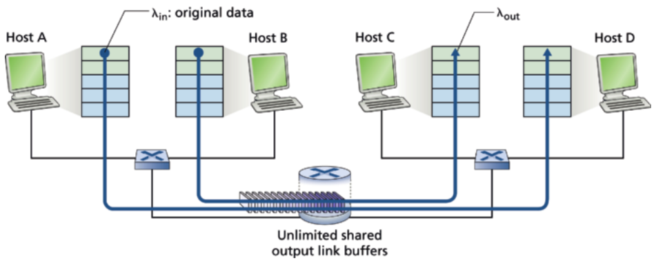

Hình 3.41 buffer vô hạn

Hình 3.42 vẽ performance của kết nối của Host A trong kịch bản thứ nhất này. Đồ thị bên trái vẽ throughput per-connection (mỗi kết nối) (số byte mỗi giây tại bên nhận) như một hàm của tốc độ connection-sending (gửi của kết nối). Với tốc độ gửi giữa 0 và R/2, throughput tại bên nhận bằng tốc độ gửi của bên gửi—mọi thứ bên gửi gửi đều được nhận tại bên nhận với một độ trễ hữu hạn. Tuy nhiên, khi tốc độ gửi trên R/2, throughput chỉ là R/2. Giới hạn trên của throughput này là hệ quả của việc dùng chung dung lượng liên kết giữa hai kết nối. Liên kết đơn giản không thể chuyển packet tới một bên nhận với tốc độ steady-state (trạng thái ổn định) vượt quá R/2. Bất kể Host A và B đặt tốc độ gửi cao đến đâu, mỗi host sẽ không bao giờ thấy throughput cao hơn R/2.

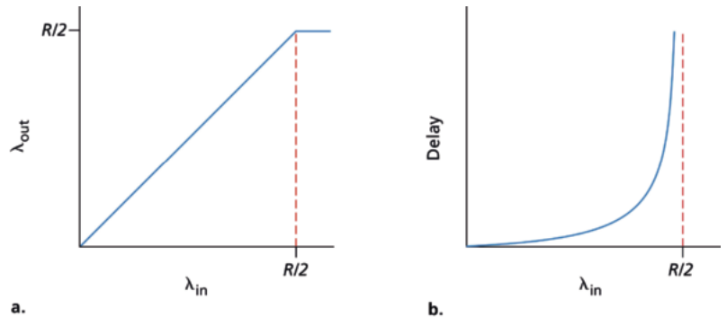

Hình 3.42 Kịch bản tắc nghẽn 1: Throughput và độ trễ như một hàm của tốc độ gửi của host

Đạt được throughput per-connection là R/2 thực ra có vẻ là điều tốt, vì liên kết được tận dụng đầy đủ trong việc chuyển packet tới đích của chúng. Tuy nhiên, đồ thị right-hand (bên phải) trong Hình 3.42 cho thấy hệ quả của việc hoạt động gần dung lượng liên kết. Khi tốc độ gửi tiến tới R/2 (từ bên trái), độ trễ trung bình ngày càng lớn. Khi tốc độ gửi vượt R/2, số packet xếp hàng trung bình trong router là không bị chặn, và độ trễ trung bình giữa nguồn và đích trở thành vô hạn (giả sử các kết nối hoạt động ở các tốc độ gửi này trong một khoảng thời gian vô hạn và có lượng buffer vô hạn). Do đó, trong khi hoạt động ở throughput tổng gần R có thể là lý tưởng từ góc độ throughput, nó còn xa mới lý tưởng từ góc độ độ trễ. Ngay cả trong kịch bản (cực kỳ) lý tưởng hóa này, chúng ta đã tìm ra một cái giá của mạng tắc nghẽn—độ trễ hàng đợi lớn xảy ra khi tốc độ packet-arrival tiến gần dung lượng liên kết.

#### Kịch bản thứ hai: Hai bên gửi và một router với buffer hữu hạn (Scenario 2: Two Senders and a Router with Finite Buffers)

Giờ hãy sửa đổi nhẹ kịch bản 1 theo hai cách sau (xem Hình 3.43). Thứ nhất, lượng buffer của router được giả định là hữu hạn. Một hệ quả của giả định real-world này là packet sẽ bị loại bỏ khi tới một buffer already-full (đã đầy). Thứ hai, chúng ta giả định mỗi kết nối là tin cậy. Nếu một packet chứa một segment transport-level bị loại bỏ tại router, bên gửi cuối cùng sẽ truyền lại nó. Vì packet có thể được truyền lại, giờ chúng ta phải cẩn thận hơn với việc dùng thuật ngữ tốc độ gửi. Cụ thể, hãy lại ký hiệu tốc độ ứng dụng gửi dữ liệu gốc vào socket là λ<sub>in</sub> byte/giây. Tốc độ tầng giao vận gửi segment (chứa dữ liệu gốc và dữ liệu truyền lại) vào mạng sẽ được ký hiệu là λ′<sub>in</sub> byte/giây. λ′<sub>in</sub> đôi khi được gọi là tải đưa vào (offered load) mạng.

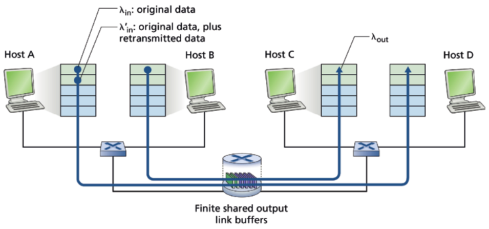

Hình 3.43 Kịch bản 2: Hai host (có truyền lại) và một router với buffer hữu hạn

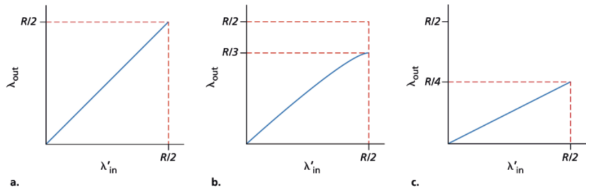

Hình 3.44 Performance kịch bản 2 với buffer hữu hạn

Performance đạt được trong kịch bản 2 giờ sẽ phụ thuộc mạnh vào cách thực hiện truyền lại. Trước hết, hãy xét trường hợp phi thực tế rằng Host A có thể bằng cách nào đó (một cách kỳ diệu!) xác định một buffer trong router có trống hay không và do đó chỉ gửi packet khi có buffer trống. Trong trường hợp này, không có mất mát nào xảy ra, λ<sub>in</sub> sẽ bằng λ′<sub>in</sub>, và throughput của kết nối sẽ bằng λ<sub>in</sub>. Trường hợp này được minh họa trong Hình 3.44(a). Từ góc độ throughput, performance là lý tưởng—mọi thứ được gửi đều được nhận. Lưu ý rằng tốc độ gửi trung bình của host không thể vượt R/2 trong kịch bản này, vì mất gói được giả định không bao giờ xảy ra.

Tiếp theo hãy xét trường hợp thực tế hơn một chút rằng bên gửi chỉ truyền lại khi biết chắc một packet đã bị mất. (Một lần nữa, giả định này hơi gượng. Tuy nhiên, có thể host gửi đặt timeout đủ lớn để gần như chắc chắn rằng một packet chưa được xác nhận đã bị mất.) Trong trường hợp này, performance có thể trông giống như minh họa trong Hình 3.44(b). Để hiểu điều gì đang xảy ra ở đây, hãy xét trường hợp tải đưa vào, λ′<sub>in</sub> (tốc độ truyền dữ liệu gốc cộng truyền lại), bằng R/2. Theo Hình 3.44(b), tại giá trị tải đưa vào này, tốc độ dữ liệu được chuyển tới ứng dụng nhận là R/3. Do đó, trong 0.5 Runits dữ liệu được truyền, 0.333 R byte/giây (trung bình) là dữ liệu gốc và 0.166 R byte/giây (trung bình) là dữ liệu truyền lại. Ở đây chúng ta thấy một cái giá khác của mạng tắc nghẽn—bên gửi phải thực hiện truyền lại để bù cho các packet bị loại bỏ (bị mất) do tràn buffer.

Cuối cùng, hãy xét trường hợp bên gửi có thể hết giờ sớm và truyền lại một packet đã bị trễ trong hàng đợi nhưng chưa bị mất. Trong trường hợp này, cả packet dữ liệu gốc và bản truyền lại đều có thể tới bên nhận. Tất nhiên, bên nhận chỉ cần một bản sao của packet này và sẽ loại bỏ bản truyền lại. Trong trường hợp này, công việc router đã làm để chuyển tiếp bản sao truyền lại của packet gốc là lãng phí, vì bên nhận đã nhận bản gốc của packet này. Router lẽ ra đã dùng dung lượng truyền của liên kết tốt hơn để gửi một packet khác. Đây là thêm một cái giá nữa của mạng tắc nghẽn—các lần truyền lại không cần thiết của bên gửi khi đối mặt với độ trễ lớn có thể khiến router dùng băng thông liên kết để chuyển tiếp các bản sao không cần thiết của một packet. Hình 3.44(c) cho thấy throughput so với tải đưa vào khi mỗi packet được giả định được router chuyển tiếp (trung bình) hai lần. Vì mỗi packet được chuyển tiếp hai lần, throughput sẽ có giá trị tiệm cận R/4 khi tải đưa vào tiến tới R/2.

#### Kịch bản thứ ba: Bốn bên gửi, router với buffer hữu hạn, và đường đi nhiều hop (Scenario 3: Four Senders, Routers with Finite Buffers, and Multihop Paths)

Trong kịch bản tắc nghẽn cuối cùng, bốn host truyền packet, mỗi host qua các đường two-hop (hai hop) chồng lấn nhau, như minh họa trong Hình 3.45. Chúng ta lại giả định mỗi host dùng một cơ chế timeout/truyền lại để hiện thực một dịch vụ truyền dữ liệu tin cậy, tất cả các host có cùng giá trị λ<sub>in</sub>, và tất cả các liên kết router có dung lượng R byte/giây.

Hãy xét kết nối từ Host A tới Host C, đi qua router R1 và R2. Kết nối A–C dùng chung router R1 với kết nối D–B và dùng chung router R2 với kết nối B–D. Với các giá trị λ<sub>in</sub> cực nhỏ, tràn buffer hiếm khi xảy ra (như trong kịch bản tắc nghẽn 1 và 2), và throughput xấp xỉ bằng tải đưa vào. Với các giá trị λ<sub>in</sub> lớn hơn một chút, throughput tương ứng cũng lớn hơn, vì nhiều dữ liệu gốc hơn đang được truyền vào mạng và chuyển tới đích, và tràn buffer vẫn hiếm. Do đó, với các giá trị λ<sub>in</sub> nhỏ, việc tăng λ<sub>in</sub> dẫn tới việc tăng λ<sub>out</sub>.

Sau khi xét trường hợp traffic cực thấp, tiếp theo hãy xem xét trường hợp λ<sub>in</sub> (và do đó λ′<sub>in</sub>) cực lớn. Hãy xét router R2. Traffic A–C đến router R2 (đến R2 sau khi được chuyển tiếp từ R1) có thể có tốc độ đến tại R2 nhiều nhất là R, dung lượng của liên kết từ R1 tới R2, bất kể giá trị của λ<sub>in</sub>. Nếu λ′<sub>in</sub> cực lớn với mọi kết nối (bao gồm kết nối B–D), thì tốc độ đến của traffic B–D tại R2 có thể lớn hơn nhiều so với traffic A–C. Vì traffic A–C và B–D phải cạnh tranh tại router R2 để giành lượng không gian buffer hạn chế, lượng traffic A–C đi qua R2 thành công (tức là, không bị mất do tràn buffer) ngày càng nhỏ khi tải đưa vào từ B–D ngày càng lớn. Ở giới hạn, khi tải đưa vào tiến tới vô cùng, một buffer trống tại R2 ngay lập tức bị lấp đầy bởi một packet B–D, và throughput của kết nối A–C tại R2 tiến về không. Điều này, đến lượt nó, hàm ý rằng throughput end-to-end của A–C tiến về không ở giới hạn traffic nặng. Những cân nhắc này dẫn tới sự đánh đổi giữa tải đưa vào và throughput minh họa trong Hình 3.46.

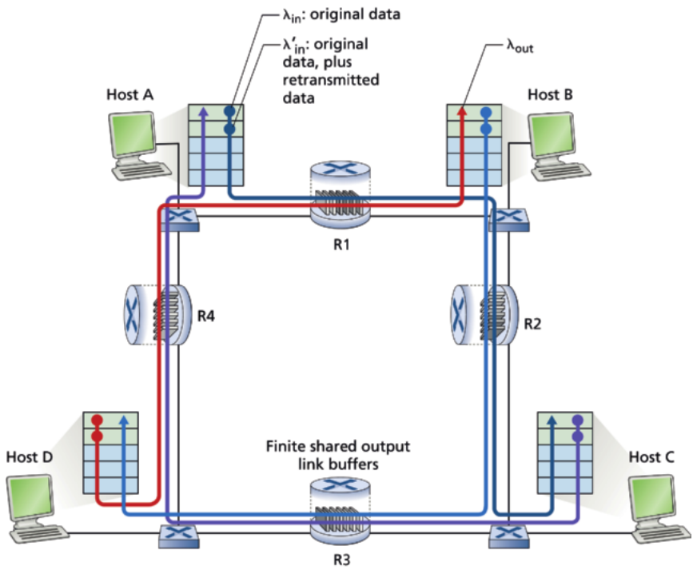

Hình 3.45 Bốn bên gửi, router với buffer hữu hạn, và đường đi nhiều hop

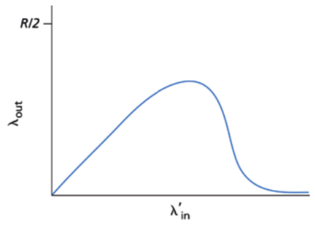

Hình 3.46 Performance kịch bản 3 với buffer hữu hạn và đường đi nhiều hop

Lý do của việc throughput cuối cùng giảm khi tải đưa vào tăng trở nên hiển nhiên khi xét lượng công việc lãng phí mà mạng thực hiện. Trong kịch bản high-traffic (traffic cao) mô tả ở trên, mỗi khi một packet bị loại bỏ tại một router second-hop (hop thứ hai), công việc router first-hop (hop thứ nhất) đã làm để chuyển tiếp packet tới router second-hop cuối cùng thành “lãng phí.” Mạng sẽ tốt như nhau (chính xác hơn, tệ như nhau) nếu router thứ nhất đơn giản loại bỏ packet đó và giữ trạng thái rảnh. Nói đúng trọng tâm hơn, dung lượng truyền được dùng tại router thứ nhất để chuyển tiếp packet tới router thứ hai lẽ ra đã có thể được dùng có lợi hơn nhiều để truyền một packet khác. (Ví dụ, khi chọn một packet để truyền, có thể tốt hơn nếu router ưu tiên các packet đã đi qua một số router upstream (thượng nguồn).) Vì vậy ở đây chúng ta thấy thêm một cái giá nữa của việc loại bỏ packet do tắc nghẽn—khi một packet bị loại bỏ dọc đường, dung lượng truyền đã được dùng tại mỗi liên kết upstream để chuyển tiếp packet đó tới điểm nó bị loại bỏ cuối cùng thành lãng phí.

Với những hiểu biết mới về cái giá của tắc nghẽn—độ trễ hàng đợi tăng khi tốc độ packet đến một liên kết tắc nghẽn tiến gần dung lượng của nó (Hình 3.42), throughput application-to-application (giữa các ứng dụng) giảm do sự hiện diện của các packet được truyền lại (Hình 3.44), và khả năng sụp đổ do tắc nghẽn (congestion collapse) (Hình 3.46)—nhu cầu về một dạng điều khiển tắc nghẽn nào đó là rõ ràng.

Trước khi xem xét các cách tiếp cận giải quyết vấn đề điều khiển tắc nghẽn, hãy lùi lại một bước và xem vấn đề cơ bản mà các giao thức này đang cố giải quyết. Hình 3.47 cho thấy N kết nối transport-layer đi qua một liên kết nút cổ chai dùng chung có tốc độ truyền tối đa R bps. Liên kết nút cổ chai của một kết nối là liên kết dọc đường end-to-end, sao cho nếu các bên gửi có traffic đi qua liên kết đó tăng dần tốc độ truyền, liên kết đó trên mỗi đường end-to-end của các kết nối đó sẽ là liên kết đầu tiên gặp mất mát do tắc nghẽn. Thông thường, chúng ta chỉ gọi một liên kết là nút cổ chai khi nó ở trạng thái tắc nghẽn. Một giả định phổ biến [Cardwell 2017; Kleinrock 2018] và thường tốt cả về lý thuyết lẫn thực tế [Hu 2024] là một kết nối có nhiều nhất một liên kết nút cổ chai. Các kết nối có đường source-to-destination khác nhau có thể có liên kết nút cổ chai khác nhau.

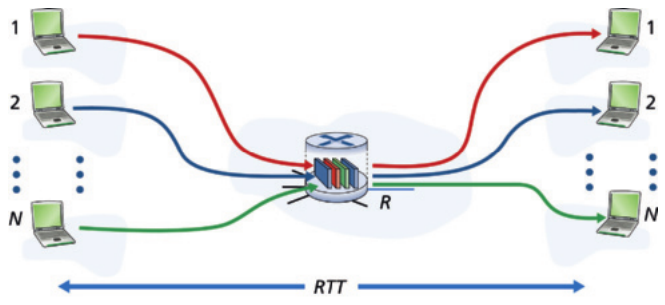

Hình 3.47 N kết nối dùng chung một liên kết nút cổ chai dung lượng R

Liên kết nút cổ chai của một đường đi đóng vai trò quan trọng trong điều khiển tắc nghẽn. Giả sử một liên kết nút cổ chai ở trạng thái tắc nghẽn, tức là, tốc độ đến của traffic tới liên kết nút cổ chai gần với dung lượng của liên kết, R. Nếu N kết nối tăng tốc độ gửi, liên kết nút cổ chai sẽ không thể cung cấp thêm throughput nào cho các kết nối, vì liên kết đã bị tắc nghẽn và luôn bận truyền traffic trong trạng thái tắc nghẽn này. Do đó, throughput end-to-end tổng mà N kết nối đi qua liên kết nút cổ chai đó đạt được sẽ được xác định bởi tốc độ truyền của nút cổ chai, R. Và nếu dung lượng của liên kết được chia công bằng (xem Mục 7.3.4) giữa N kết nối này, thì mỗi kết nối sẽ có throughput R/N . Một phép so sánh có thể giúp hình dung điều này. Hãy nghĩ N kết nối trong Hình 3.47 như các ống nước nối với một ống dùng chung duy nhất có lưu lượng nước ra tối đa R lít/giây. Đầu ra của ống khi đó được chia đều giữa N ống tách ra từ ống duy nhất đó và dẫn tới mỗi đích trong N đích. Từ kinh nghiệm, chúng ta biết rằng nếu tổng lưu lượng vào của N kết nối vượt quá R lít/giây, ống dùng chung vẫn không thể đưa ra nhiều hơn lưu lượng tối đa R lít nước mỗi giây, và do đó không đường ống end-end nào có thể đạt lưu lượng hơn R/N lít/giây.

Với hiểu biết này và giờ quay lại lĩnh vực mạng máy tính, chúng ta có thể thấy mục tiêu của điều khiển tắc nghẽn nên là để N kết nối trong Hình 3.47 đặt tốc độ gửi của tầng giao vận sao cho tốc độ gửi tổng của chúng gần, nhưng không vượt quá, dung lượng liên kết nút cổ chai. Một tốc độ gửi tổng thấp hơn tốc độ lý tưởng này đôi khi sẽ để liên kết rảnh khi các bên gửi còn dữ liệu cần gửi; một tốc độ gửi tổng cao hơn tốc độ lý tưởng này sẽ chịu tất cả các hậu quả tiêu cực của tắc nghẽn liên kết mà chúng ta vừa nghiên cứu.

Do đó hai câu hỏi cơ bản nảy ra ngay lập tức:

• Làm thế nào một kết nối biết rằng một liên kết trên đường source-to-destination của nó bị tắc nghẽn, tức là, có một liên kết nút cổ chai? Chúng ta sẽ giải quyết câu hỏi này trong Mục 7.6.2.

• Làm thế nào các kết nối điều tiết riêng tốc độ gửi của chúng sao cho tốc độ gửi tổng của chúng gần, nhưng không vượt quá, dung lượng liên kết nút cổ chai của đường đi? Chúng ta sẽ thấy các phiên bản khác nhau của điều khiển tắc nghẽn TCP giải quyết câu hỏi này thế nào trong Mục 7.3.

### 3.6.2 Các cách tiếp cận điều khiển tắc nghẽn đầu cuối và có mạng hỗ trợ (End-to-end and Network-assisted Approaches to Congestion Control)

Trong Mục 3.7, chúng ta sẽ xem xét rất chi tiết cách tiếp cận cụ thể của TCP đối với điều khiển tắc nghẽn. Ở đây, chúng ta xác định hai cách tiếp cận tổng quát đối với điều khiển tắc nghẽn được áp dụng trong thực tế và thảo luận các kiến trúc mạng và giao thức congestion-control cụ thể thể hiện các cách tiếp cận này.

Ở mức cao nhất, chúng ta có thể phân biệt các cách tiếp cận congestion-control dựa vào việc tầng mạng có cung cấp hỗ trợ tường minh cho tầng giao vận cho mục đích congestion-control hay không:

Điều khiển tắc nghẽn end-to-end. Trong một cách tiếp cận end-to-end đối với điều khiển tắc nghẽn, tầng mạng không cung cấp hỗ trợ tường minh nào cho tầng giao vận cho mục đích congestion-control. Ngay cả sự hiện diện của tắc nghẽn mạng cũng phải được các end system suy ra chỉ dựa trên hành vi mạng quan sát được (ví dụ, mất gói và độ trễ). Chúng ta sẽ sớm thấy trong Mục 3.7.1 và 3.7.2 rằng TCP theo cách tiếp cận end-to-end này đối với điều khiển tắc nghẽn, vì tầng IP không được yêu cầu cung cấp phản hồi cho host về tắc nghẽn mạng. Chúng ta sẽ xem xét một vài “phiên bản” khác nhau của TCP. Trong một số phiên bản, mất segment (được chỉ ra bởi timeout hoặc việc nhận ba acknowledgment trùng lặp) được coi là dấu hiệu tắc nghẽn mạng, và TCP giảm kích thước cửa sổ tương ứng. Chúng ta sẽ thấy các phiên bản TCP khác dùng độ trễ round-trip và/hoặc throughput đo được của kết nối để xác định tốc độ gửi.

• Điều khiển tắc nghẽn network-assisted (có mạng hỗ trợ). Với điều khiển tắc nghẽn network-assisted, router cung cấp phản hồi tường minh cho bên gửi và/hoặc bên nhận về trạng thái tắc nghẽn của mạng. Phản hồi này có thể đơn giản như một bit duy nhất chỉ ra tắc nghẽn tại một liên kết—một cách tiếp cận được dùng trong các kiến trúc IBM SNA [Schwartz 1982], DEC DECnet [Jain 1989; Ramakrishnan 1990] thời đầu, và các kiến trúc mạng ATM [Black 1995]. Phản hồi tinh vi hơn cũng có thể. Ví dụ, trong điều khiển tắc nghẽn ATM Available Bite Rate (ABR), một router thông báo cho bên gửi tốc độ gửi tối đa của host mà nó (router) có thể hỗ trợ trên một liên kết ra. Như đã lưu ý ở trên, các phiên bản Internet-default (mặc định của Internet) của IP và TCP áp dụng cách tiếp cận end-to-end đối với điều khiển tắc nghẽn. Tuy nhiên, chúng ta sẽ thấy trong Mục 3.7.3 rằng, gần đây hơn, IP và TCP cũng có thể tùy chọn hiện thực điều khiển tắc nghẽn network-assisted.

• Với điều khiển tắc nghẽn network-assisted, thông tin tắc nghẽn thường được phản hồi từ mạng tới bên gửi theo một trong hai cách, như minh họa trong Hình 3.48. Phản hồi trực tiếp có thể được gửi từ một router mạng tới bên gửi. Dạng thông báo này thường có hình thức một choke packet (về cơ bản nói rằng, “Tôi bị tắc nghẽn!”). Dạng thông báo thứ hai và phổ biến hơn xảy ra khi một router đánh dấu/cập nhật một trường trong một packet đi từ bên gửi tới bên nhận để chỉ ra tắc nghẽn. Khi nhận một packet được đánh dấu, bên nhận sau đó thông báo cho bên gửi về chỉ dấu tắc nghẽn. Dạng thông báo sau này mất trọn một round-trip time.

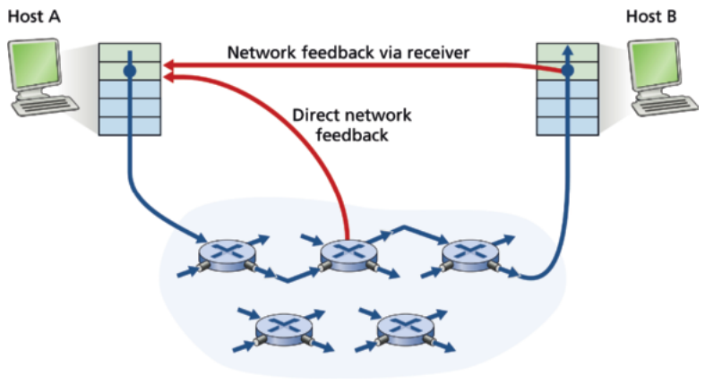

Hình 3.48 Hai con đường phản hồi cho thông tin tắc nghẽn network-indicated (do mạng chỉ ra)

## 3.7 Điều khiển tắc nghẽn TCP (TCP Congestion Control)

Trong mục này, chúng ta quay lại nghiên cứu về TCP. Như chúng ta đã học trong Mục 3.5, TCP cung cấp một dịch vụ giao vận tin cậy giữa hai process chạy trên các host khác nhau. Một thành phần then chốt khác của TCP là cơ chế congestion-control của nó. Như đã chỉ ra trong mục trước, cái mà chúng ta có thể gọi là TCP “Classic” (cổ điển)—phiên bản TCP được chuẩn hóa trong [RFC 2581; RFC 5681]—dùng điều khiển tắc nghẽn end-to-end thay vì điều khiển tắc nghẽn network-assisted, vì tầng IP không cung cấp phản hồi tường minh nào cho các end system về tắc nghẽn mạng. Trước hết chúng ta sẽ đề cập sâu phiên bản TCP “classic” này trong Mục 3.7.1. Trong Mục 3.7.2, sau đó chúng ta sẽ xem các phiên bản TCP mới hơn dùng điều khiển tắc nghẽn end-end theo những cách khác với, tức là, “classic TCP. Trong Mục 3.7.3, chúng ta sẽ nghiên cứu một phiên bản TCP dùng một chỉ dấu tắc nghẽn tường minh do tầng mạng cung cấp. Sau đó chúng ta sẽ đề cập thách thức cung cấp sự công bằng giữa các luồng tầng giao vận phải dùng chung một liên kết tắc nghẽn trong Mục 3.7.4.

### 3.7.1 Điều khiển tắc nghẽn TCP đầu cuối cổ điển (Classic End-End TCP Congestion Control)

Cách tiếp cận của TCP là cho mỗi bên gửi giới hạn tốc độ gửi traffic vào kết nối của nó như một hàm của tắc nghẽn mạng cảm nhận được. Nếu một bên gửi TCP cảm nhận có ít tắc nghẽn trên đường giữa nó và đích, thì bên gửi TCP tăng tốc độ gửi; nếu bên gửi cảm nhận có tắc nghẽn dọc đường, thì bên gửi giảm tốc độ gửi. Nhưng cách tiếp cận này đặt ra ba câu hỏi. Thứ nhất, một bên gửi TCP giới hạn tốc độ gửi traffic vào kết nối của nó như thế nào? Thứ hai, một bên gửi TCP cảm nhận có tắc nghẽn trên đường giữa nó và đích như thế nào? Và thứ ba, bên gửi nên dùng thuật toán nào để thay đổi tốc độ gửi như một hàm của tắc nghẽn end-to-end cảm nhận được?

Giờ có nhiều “phiên bản” điều khiển tắc nghẽn TCP khác nhau được dùng trong Internet. [Ware 2024] báo cáo về mức sử dụng của khoảng một tá phiên bản điều khiển tắc nghẽn TCP được dùng rộng rãi nhất như quan sát trên Top 10K Web site. Trong mục này chúng ta sẽ học cách và lý do bốn thuật toán điều khiển tắc nghẽn TCP trong số này—TCP “Classic”, TCP Vegas, CUBIC TCP và BBR—trả lời ba câu hỏi trên theo những cách khác nhau.

Hãy bắt đầu nghiên cứu về điều khiển tắc nghẽn TCP với TCP “Classic”, và xem xét cách một bên gửi TCP giới hạn tốc độ gửi traffic vào kết nối của nó. Trong Mục 3.5, chúng ta đã thấy mỗi phía của một kết nối TCP gồm một receive buffer, một send buffer, và một số biến (LastByteRead, rwnd, v.v.). Cơ chế congestion-control TCP hoạt động tại bên gửi theo dõi thêm một biến, cửa sổ tắc nghẽn (congestion window). Cửa sổ tắc nghẽn, ký hiệu cwnd, áp đặt một ràng buộc lên tốc độ mà một bên gửi TCP có thể gửi traffic vào mạng. Cụ thể, lượng dữ liệu chưa được xác nhận tại một bên gửi không được vượt quá giá trị nhỏ nhất của cwnd và rwnd, tức là:

```
LastByteSent – LastByteAcked <= min{cwnd,rwnd}
```

Để tập trung vào điều khiển tắc nghẽn (thay vì điều khiển luồng), từ giờ hãy giả sử receive buffer TCP lớn tới mức có thể bỏ qua ràng buộc receive-window; do đó, lượng dữ liệu chưa được xác nhận tại bên gửi chỉ bị giới hạn bởi cwnd. Chúng ta cũng sẽ giả sử bên gửi luôn có dữ liệu để gửi, tức là, mọi segment trong cửa sổ tắc nghẽn đều được gửi.

Ràng buộc trên giới hạn lượng dữ liệu chưa được xác nhận tại bên gửi và do đó gián tiếp giới hạn tốc độ gửi của bên gửi. Để thấy điều này, hãy xét một kết nối mà mất mát và độ trễ truyền packet là không đáng kể. Khi đó, đại khái, ở đầu mỗi RTT, ràng buộc cho phép bên gửi gửi cwnd byte dữ liệu vào kết nối; ở cuối RTT bên gửi nhận acknowledgment cho dữ liệu này. Do đó tốc độ gửi của bên gửi xấp xỉ cwnd/RTT byte/giây. Bằng cách điều chỉnh giá trị cwnd, bên gửi do đó có thể điều chỉnh tốc độ gửi dữ liệu vào kết nối.

Tiếp theo hãy xét cách một bên gửi TCP cổ điển cảm nhận có tắc nghẽn trên đường giữa nó và đích. Hãy định nghĩa một “sự kiện mất mát” (loss event) tại một bên gửi TCP là sự xuất hiện của hoặc một timeout hoặc việc nhận ba ACK trùng lặp từ bên nhận. (Nhớ lại thảo luận trong Mục 3.5.4 về sự kiện timeout trong Hình 3.32 và sửa đổi tiếp theo để bao gồm truyền lại nhanh khi nhận ba ACK trùng lặp.) Khi có tắc nghẽn quá mức, một (hoặc nhiều) buffer router dọc đường bị tràn, khiến một datagram (chứa một segment TCP) bị loại bỏ. Datagram bị loại bỏ, đến lượt nó, dẫn tới một sự kiện mất mát tại bên gửi—hoặc timeout hoặc nhận ba ACK trùng lặp—được bên gửi coi là dấu hiệu tắc nghẽn trên đường sender-to-receiver. Chúng ta nên lưu ý rằng trong khi TCP cổ điển suy ra tắc nghẽn qua một sự kiện mất mát, có những sự kiện đo được khác (ví dụ, thay đổi RTT) đóng vai trò chỉ dấu tắc nghẽn trong các phiên bản điều khiển tắc nghẽn TCP khác mà chúng ta sẽ nghiên cứu.

Sau khi xét cách tắc nghẽn được phát hiện trong TCP cổ điển, tiếp theo hãy xét trường hợp lạc quan hơn khi mạng congestion-free (không tắc nghẽn), tức là, khi sự kiện mất mát không xảy ra. Trong trường hợp này, acknowledgment cho các segment chưa được xác nhận trước đó sẽ được nhận tại bên gửi TCP. Như chúng ta sẽ thấy, TCP cổ điển sẽ coi việc các acknowledgment này tới là dấu hiệu mọi thứ đều ổn—các segment được truyền vào mạng đang được chuyển thành công tới đích—và sẽ dùng acknowledgment để tăng kích thước cửa sổ tắc nghẽn (và do đó tốc độ truyền). Lưu ý rằng nếu acknowledgment tới với tốc độ tương đối chậm (ví dụ, nếu đường end-end có độ trễ cao hoặc chứa một liên kết low-bandwidth (băng thông thấp)), thì cửa sổ tắc nghẽn sẽ tăng với tốc độ tương đối chậm. Mặt khác, nếu acknowledgment tới với tốc độ cao, thì cửa sổ tắc nghẽn sẽ tăng nhanh hơn. Vì TCP dùng acknowledgment để kích hoạt (hay làm nhịp) việc tăng kích thước cửa sổ tắc nghẽn, TCP được gọi là self-clocking (tự làm nhịp). Với cơ chế điều chỉnh giá trị cwnd để điều khiển tốc độ gửi, câu hỏi thiết yếu vẫn còn đó: Một bên gửi TCP riêng lẻ nên xác định tốc độ nó nên gửi như thế nào? Nếu các bên gửi TCP cùng nhau gửi quá nhanh, chúng có thể làm tắc nghẽn mạng, dẫn tới loại sụp đổ do tắc nghẽn mà chúng ta đã thấy trong Hình 3.46. Thật vậy, thuật toán congestion-control TCP cổ điển mà chúng ta sẽ sớm nghiên cứu được phát triển để đáp lại hiện tượng sụp đổ do tắc nghẽn Internet được quan sát [Jacobson 1988] dưới các phiên bản TCP trước đó. Tuy nhiên, nếu các bên gửi TCP quá thận trọng và gửi quá chậm, chúng có thể không tận dụng hết băng thông trong mạng; tức là, các bên gửi TCP có thể gửi với tốc độ cao hơn mà không làm tắc nghẽn mạng. Vậy các bên gửi TCP xác định tốc độ gửi thế nào để chúng không làm tắc nghẽn mạng nhưng đồng thời tận dụng hết băng thông khả dụng? Các bên gửi TCP có được điều phối tường minh không, hay có một cách tiếp cận phân tán trong đó các bên gửi TCP có thể đặt tốc độ gửi chỉ dựa trên thông tin cục bộ? TCP cổ điển trả lời các câu hỏi này bằng các nguyên tắc định hướng sau:

• Một segment bị mất hàm ý tắc nghẽn, và do đó, tốc độ của bên gửi TCP nên được giảm khi một segment bị mất. Nhớ lại từ thảo luận trong Mục 3.5.4, rằng một sự kiện timeout hoặc việc nhận bốn acknowledgment cho một segment cho trước (một ACK gốc rồi ba ACK trùng lặp) được hiểu là một chỉ dấu “sự kiện mất mát” ngầm của segment theo sau segment được ACK bốn lần, kích hoạt truyền lại segment bị mất. Từ góc độ congestion-control, câu hỏi là bên gửi TCP nên giảm kích thước cửa sổ tắc nghẽn, và do đó tốc độ gửi, như thế nào để phản hồi sự kiện mất mát được suy ra này.

• Một segment được xác nhận cho biết mạng đang chuyển các segment của bên gửi tới bên nhận, và do đó, tốc độ của bên gửi có thể được tăng khi một ACK tới cho một segment chưa được xác nhận trước đó. Việc acknowledgment tới được coi là dấu hiệu ngầm rằng mọi thứ đều ổn—segment đang được chuyển thành công từ bên gửi tới bên nhận, và do đó mạng không bị tắc nghẽn. Do đó kích thước congestion-window có thể được tăng.

• Dò băng thông (Bandwidth probing). Với ACK chỉ ra một đường source-to-destination congestion-free và sự kiện mất mát chỉ ra một đường tắc nghẽn, chiến lược của TCP để điều chỉnh tốc độ truyền là tăng tốc độ khi ACK tới cho đến khi một sự kiện mất mát xảy ra, lúc đó, tốc độ truyền được giảm. Do đó bên gửi TCP tăng tốc độ truyền để dò tốc độ mà tại đó tắc nghẽn bắt đầu, lùi lại khỏi tốc độ đó, rồi bắt đầu dò lại để xem tốc độ bắt đầu tắc nghẽn có thay đổi không. Hành vi của bên gửi TCP có lẽ tương tự một đứa trẻ đòi (và nhận được) ngày càng nhiều kẹo cho đến khi cuối cùng bị nói “Không!”, lùi lại một chút, nhưng rồi ngay sau đó lại bắt đầu đòi tiếp. Lưu ý rằng không có tín hiệu tường minh nào về trạng thái tắc nghẽn từ mạng—ACK và sự kiện mất mát đóng vai trò tín hiệu ngầm— và mỗi bên gửi TCP hành động dựa trên thông tin cục bộ một cách bất đồng bộ với các bên gửi TCP khác.

Với tổng quan về điều khiển tắc nghẽn TCP này, giờ chúng ta có thể xét chi tiết thuật toán congestion-control TCP nổi tiếng, mà chúng ta gọi là TCP “classic” và được mô tả lần đầu trong [Jacobson 1988] và được chuẩn hóa trong [RFC 5681]. Thuật toán có ba thành phần chính: (1) slow start (khởi động chậm), (2) congestion avoidance (tránh tắc nghẽn), và (3) fast recovery (phục hồi nhanh). Slow start và congestion avoidance là các thành phần bắt buộc của TCP, khác nhau ở cách chúng tăng kích thước cwnd khi nhận ACK. Chúng ta sẽ sớm thấy slow start tăng kích thước cwnd nhanh hơn (bất chấp tên gọi!) so với congestion avoidance. Fast recovery được khuyến nghị, nhưng không bắt buộc, cho các bên gửi TCP.

#### Khởi động chậm (Slow Start)

Khi một kết nối TCP bắt đầu, giá trị cwnd thường được khởi tạo ở giá trị nhỏ 1 MSS [RFC 3390], dẫn tới tốc độ gửi ban đầu xấp xỉ MSS/RTT. Ví dụ, nếu MSS = 500 byte và RTT = 200 msec, tốc độ gửi ban đầu kết quả chỉ khoảng 20 kbps. Vì băng thông khả dụng cho bên gửi TCP có thể lớn hơn nhiều so với MSS/RTT, bên gửi TCP muốn tìm nhanh lượng băng thông khả dụng. Do đó, ở trạng thái slow-start, giá trị cwnd bắt đầu ở 1 MSS và tăng 1 MSS mỗi khi một segment được truyền được xác nhận lần đầu. Trong ví dụ của Hình 3.49, TCP gửi segment đầu tiên vào mạng và chờ acknowledgment. Khi acknowledgment này tới, bên gửi TCP tăng cửa sổ tắc nghẽn thêm một MSS và gửi đi hai segment maximum-sized (kích thước tối đa). Các segment này sau đó được xác nhận, với bên gửi tăng cửa sổ tắc nghẽn thêm 1 MSS cho mỗi segment được xác nhận, cho cửa sổ tắc nghẽn 4 MSS, v.v. Quá trình này dẫn tới việc tốc độ gửi tăng gấp đôi mỗi RTT. Do đó, tốc độ gửi TCP bắt đầu chậm nhưng tăng nhanh theo hàm mũ trong giai đoạn slow-start.

Nhưng khi nào sự tăng trưởng hàm mũ này nên kết thúc? Slow start cung cấp một vài câu trả lời cho câu hỏi này. Thứ nhất, nếu có một sự kiện mất mát (tức là, tắc nghẽn) được chỉ ra bởi timeout, bên gửi TCP đặt giá trị cwnd bằng 1 và bắt đầu lại quá trình slow-start. Nó cũng đặt giá trị của một biến trạng thái thứ hai, ssthresh (short-hand (viết tắt) cho “slow-start threshold”) bằng cwnd/2—một nửa giá trị congestion-window khi phát hiện tắc nghẽn. Cách thứ hai mà slow start có thể kết thúc gắn trực tiếp với giá trị ssthresh. Vì ssthresh bằng một nửa giá trị cwnd khi tắc nghẽn được phát hiện lần gần nhất, có thể hơi liều lĩnh nếu tiếp tục nhân đôi cwnd khi nó đạt hoặc vượt giá trị ssthresh. Do đó, khi giá trị cwnd bằng ssthresh, slow-start kết thúc và TCP chuyển sang chế độ congestion avoidance. Như chúng ta sẽ thấy, TCP tăng cwnd thận trọng hơn khi ở chế độ congestion-avoidance. Thuật toán slow-start có nguồn gốc từ [Jacobson 1988]; một cách tiếp cận tương tự slow-start cũng được đề xuất độc lập trong [Jain 1986].

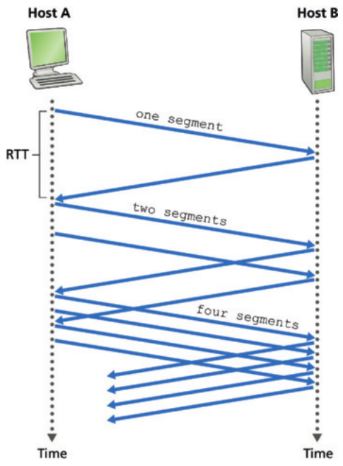

Hình 3.49 TCP slow-start

#### Tránh tắc nghẽn (Congestion Avoidance)

Khi vào trạng thái congestion-avoidance, giá trị cwnd xấp xỉ một nửa giá trị của nó khi gặp tắc nghẽn lần gần nhất—tắc nghẽn có thể ở ngay góc phố! Do đó, thay vì nhân đôi giá trị cwnd mỗi RTT, TCP áp dụng một cách tiếp cận thận trọng hơn và chỉ tăng giá trị cwnd thêm một MSS mỗi RTT [RFC 5681]. Việc này có thể được thực hiện theo nhiều cách. Một cách tiếp cận phổ biến là bên gửi TCP tăng cwnd thêm MSS/cwnd byte mỗi khi một acknowledgment mới tới. Ví dụ, nếu MSS là 1,460 byte và cwnd là 14,600 byte, thì 10 segment đang được gửi trong một RTT. Mỗi ACK tới (giả sử một ACK mỗi segment) tăng kích thước cửa sổ tắc nghẽn thêm 1/10 MSS, và do đó, giá trị cửa sổ tắc nghẽn sẽ tăng thêm một MSS khi cả 10 ACK đã được nhận.

Nhưng điều gì xảy ra khi một sự kiện mất mát được suy ra (bởi timeout hoặc việc nhận ba ACK trùng lặp) trong congestion avoidance? Khi timeout xảy ra trong congestion avoidance, thuật toán congestion-avoidance của TCP hành xử giống như trong trường hợp slow-start: giá trị cwnd được đặt bằng 1 MSS, và giá trị ssthresh được cập nhật bằng một nửa giá trị cwnd khi sự kiện mất mát xảy ra. Nếu mất mát được suy ra bởi một sự kiện ba ACK trùng lặp, chúng ta biết rằng mạng vẫn đang tiếp tục chuyển một số segment từ bên gửi tới bên nhận (như được chỉ ra bởi việc nhận ACK trùng lặp). Vì vậy hành vi của TCP cổ điển với loại sự kiện mất mát này ít quyết liệt hơn so với mất mát timeout-indicated (do timeout chỉ ra): TCP giảm một nửa giá trị cwnd (cộng thêm 3 MSS để tính tới ba ACK trùng lặp đã nhận) và đặt giá trị ssthresh bằng một nửa giá trị cwnd khi nhận được ba ACK trùng lặp.

Nếu TCP (tùy chọn) hiện thực fast-recovery, nó sẽ thao tác giá trị cwnd theo cách hơi khác so với trong congestion avoidance, cụ thể là tăng cwnd thêm 1 MSS cho mỗi ACK trùng lặp nhận được cho segment bị thiếu. Ngay khi một ACK tới xác nhận dữ liệu mới, hoặc một timeout xảy ra, TCP lần lượt quay về giai đoạn slow-start, hoặc congestion-avoidance. Các phiên bản trước của cuốn sách này thảo luận Fast Recovery chi tiết hơn, và cung cấp một mô tả FSM chi tiết của TCP cổ điển; xem Web site của nhà xuất bản hoặc Web site của các tác giả (https://gaia.cs.umass.edu/kurose_ross) để có thông tin lưu trữ này.

Một trong những phiên bản TCP sớm nhất, được gọi là TCP Tahoe, luôn cắt cửa sổ tắc nghẽn xuống 1 MSS và vào giai đoạn slow-start sau một sự kiện mất mát timeout-indicated hoặc triple-duplicate-ACK-indicated (do ba ACK trùng lặp chỉ ra). Phiên bản điều khiển tắc nghẽn TCP tiếp theo, TCP Reno, đưa vào thay đổi phản ứng ít quyết liệt hơn với tắc nghẽn được chỉ ra bởi ba ACK trùng lặp, tức là, bằng cách giảm một nửa giá trị cwnd (và cộng thêm ba).

Hình 3.50 minh họa sự tiến triển của cửa sổ tắc nghẽn TCP cho cả Reno và Tahoe. Trong hình này, ngưỡng ban đầu bằng 8 MSS. Với tám vòng truyền đầu tiên, Tahoe và Reno thực hiện các hành động giống hệt nhau. Cửa sổ tắc nghẽn tăng nhanh theo hàm mũ trong slow start và chạm ngưỡng ở vòng truyền thứ tư. Cửa sổ tắc nghẽn sau đó tăng tuyến tính cho đến khi một sự kiện triple duplicate- ACK (ba ACK trùng lặp) xảy ra, ngay sau vòng truyền 8. Lưu ý rằng cửa sổ tắc nghẽn là 12 MSS khi sự kiện mất mát này xảy ra. Giá trị ssthresh sau đó được đặt bằng 0.5 cwnd = 6 MSS. Với TCP Reno, cửa sổ tắc nghẽn được đặt bằng cwnd = 9 MSS rồi tăng tuyến tính. Với TCP Tahoe, cửa sổ tắc nghẽn được đặt bằng 1 MSS và tăng theo hàm mũ cho đến khi đạt giá trị ssthresh, lúc đó nó tăng tuyến tính.

#### Điều khiển tắc nghẽn TCP: Nhìn lại (TCP Congestion Control: Retrospective)

Sau khi đi sâu vào chi tiết slow start, congestion avoidance và fast recovery, giờ là lúc đáng để lùi lại và nhìn khu rừng thay vì từng cái cây. Bỏ qua giai đoạn slow-start ban đầu khi một kết nối bắt đầu và giả sử các mất mát được chỉ ra bởi ba ACK trùng lặp thay vì timeout, điều khiển tắc nghẽn của TCP gồm việc tăng tuyến tính (cộng) cwnd thêm một MSS mỗi RTT rồi giảm một nửa (nhân) cwnd khi có sự kiện ba duplicate-ACK. Vì lý do này, điều khiển tắc nghẽn TCP thường được gọi là một dạng điều khiển tắc nghẽn additive-increase, multiplicative-decrease (tăng cộng, giảm nhân) (AIMD). Điều khiển tắc nghẽn AIMD tạo ra hành vi “răng cưa” minh họa trong Hình 3.51, cũng minh họa rất rõ trực giác trước đó của chúng ta về việc TCP “dò” băng thông—TCP tăng tuyến tính kích thước cửa sổ tắc nghẽn (và do đó tốc độ truyền) cho đến khi xảy ra một sự kiện ba duplicate-ACK. Sau đó nó giảm kích thước cửa sổ tắc nghẽn đi một nửa nhưng rồi lại bắt đầu tăng tuyến tính, dò xem có thêm băng thông khả dụng không. Thuật toán AIMD của TCP được phát triển dựa trên một lượng khổng lồ hiểu biết kỹ thuật và thực nghiệm với điều khiển tắc nghẽn trong các mạng đang vận hành. Khá đáng kinh ngạc, mười năm sau khi TCP được phát triển và triển khai, các phân tích lý thuyết cho thấy thuật toán congestion-control của TCP đóng vai trò một thuật toán asynchronous-optimization (tối ưu bất đồng bộ) phân tán dẫn tới việc một số khía cạnh quan trọng của performance người dùng và mạng được tối ưu đồng thời [Kelly 1998]! Một lý thuyết phong phú về điều khiển tắc nghẽn từ đó đã được phát triển [Srikant 2012].

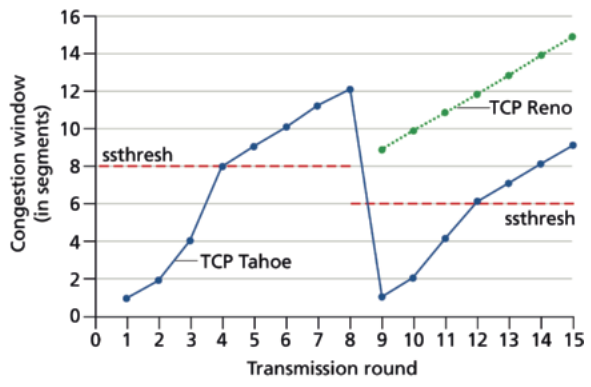

Hình 3.50 Sự tiến triển của cửa sổ tắc nghẽn TCP (Tahoe và Reno)


Hình 3.51 Điều khiển tắc nghẽn additive-increase, multiplicative-decrease (AIMD)

#### Mô tả vĩ mô về throughput của TCP Reno (Macroscopic Description of TCP Reno Throughput)

Với hành vi saw-toothed (răng cưa) của TCP Reno, sẽ tự nhiên khi xét throughput trung bình (tức là, tốc độ trung bình) của một kết nối TCP Reno long-lived (sống lâu) có thể là bao nhiêu. Trong phân tích này, chúng ta sẽ bỏ qua các giai đoạn slow-start xảy ra sau các sự kiện timeout. (Các giai đoạn này thường rất ngắn, vì bên gửi thoát khỏi giai đoạn nhanh theo hàm mũ.) Trong một khoảng round-trip cụ thể, tốc độ TCP gửi dữ liệu là một hàm của cửa sổ tắc nghẽn và RTT hiện tại. Khi kích thước cửa sổ là w byte và round-trip time hiện tại là RTT giây, thì tốc độ truyền của TCP xấp xỉ w/ RTT. TCP sau đó dò thêm băng thông bằng cách tăng w thêm 1 MSS mỗi RTT cho đến khi một sự kiện mất mát xảy ra. Ký hiệu W là giá trị của w khi một sự kiện mất mát xảy ra. Giả sử RTT và W xấp xỉ không đổi trong suốt thời gian của kết nối, tốc độ truyền TCP dao động từ W/ ( 2 • RTT) đến W/RTT .

Các giả định này dẫn tới một mô hình vĩ mô rất đơn giản hóa cho hành vi steady- state (trạng thái ổn định) của TCP. Mạng loại bỏ một packet từ kết nối khi tốc độ tăng tới W/RTT ; tốc độ khi đó bị cắt một nửa rồi tăng MSS/RTT mỗi RTT cho đến khi lại đạt W/RTT . Quá trình này lặp đi lặp lại. Vì throughput (tức là, tốc độ) của TCP tăng tuyến tính giữa hai giá trị cực trị, ta có

throughput trung bình của một kết nối = 0.75•W/RTT

Dùng mô hình rất lý tưởng hóa này cho động lực steady-state của TCP, chúng ta cũng có thể suy ra một biểu thức thú vị liên hệ tỉ lệ mất mát của một kết nối với băng thông khả dụng của nó [Mathis 1997]. Việc suy dẫn này được phác thảo trong các bài tập về nhà. Một mô hình tinh vi hơn đã được thấy là khớp thực nghiệm với dữ liệu đo được là [Padhye 2000].

### 3.7.2 Các thuật toán điều khiển tắc nghẽn TCP đầu cuối gần đây (Recent End-End TCP Congestion Control Algorithms)

Trong 25 năm qua, nhiều thuật toán điều khiển tắc nghẽn TCP end-end mới đã được phát triển và triển khai. Thật vậy, các phép đo gần đây [Ware 2024] về các thuật toán điều khiển tắc nghẽn được dùng bởi top 10K web site phổ biến nhất [Durumeric 2025] đã cho thấy các thuật toán điều khiển tắc nghẽn TCP “classic” mà chúng ta đã nghiên cứu trong mục trước phần lớn đã bị thay thế bởi các phiên bản điều khiển tắc nghẽn TCP mới hơn (cụ thể là BBR, và trước đó là TCP CUBIC) mà chúng ta sẽ nghiên cứu trong mục này. Như chúng ta sẽ thấy, một số cách tiếp cận mới hơn này thay đổi tương đối nhỏ các cách tiếp cận loss-as-an-indication-of-congestion (coi mất mát là dấu hiệu tắc nghẽn) của TCP cổ điển, trong khi số khác theo một cách tiếp cận khác về cơ bản.

#### TCP CUBIC: cải tiến việc tăng cộng (TCP CUBIC: improving on additive increase)

Với cách tiếp cận additive-increase, multiplicative-decrease của TCP Reno đối với điều khiển tắc nghẽn, người ta có thể tự nhiên tự hỏi liệu đây có phải là cách tốt nhất để “dò” một tốc độ gửi packet vừa dưới ngưỡng kích hoạt mất gói hay không. Thật vậy, cắt tốc độ gửi một nửa (hoặc tệ hơn, cắt tốc độ gửi xuống một packet mỗi RTT như trong TCP Tahoe) rồi tăng khá chậm theo thời gian có thể quá thận trọng. Nếu trạng thái của liên kết tắc nghẽn nơi mất gói xảy ra không thay đổi nhiều, thì có lẽ tốt hơn là tăng nhanh tốc độ gửi để tiến gần tốc độ gửi pre-loss (trước khi mất) rồi chỉ sau đó mới dò băng thông thận trọng. Hiểu biết này là cốt lõi của một phiên bản TCP gọi là TCP CUBIC [Ha 2008; RFC 8312] và tiền thân của nó, BIC [Xu 2004].

TCP CUBIC chỉ khác TCP Reno một chút. Một lần nữa, cửa sổ tắc nghẽn chỉ được tăng khi nhận ACK. CUBIC chỉ thay đổi giai đoạn congestion avoidance, như sau:

• Gọi W<sub>max</sub> là kích thước cửa sổ điều khiển tắc nghẽn của TCP khi mất mát được phát hiện lần gần nhất, và gọi K là thời điểm tương lai khi kích thước cửa sổ của TCP CUBIC sẽ lại đạt W<sub>max</sub>, giả sử không có mất mát. Một số tham số CUBIC có thể điều chỉnh xác định giá trị K, tức là, kích thước cửa sổ tắc nghẽn của giao thức sẽ đạt W<sub>max</sub> nhanh đến mức nào.

• CUBIC TCP tăng cửa sổ tắc nghẽn như một hàm của lập phương khoảng cách giữa thời điểm hiện tại, t, và K . Do đó, khi t còn xa K, các lần tăng kích thước cửa sổ tắc nghẽn lớn hơn nhiều so với khi t gần K. Tức là, CUBIC tăng nhanh tốc độ gửi của TCP để tiến gần tốc độ pre-loss, W<sub>max</sub>, và chỉ sau đó mới dò băng thông thận trọng khi tiến gần W<sub>max</sub>.

• Khi t lớn hơn K, quy tắc lập phương hàm ý các lần tăng cửa sổ tắc nghẽn của CUBIC nhỏ khi t vẫn gần K (điều này tốt nếu mức tắc nghẽn của liên kết gây mất mát không thay đổi nhiều) nhưng sau đó tăng nhanh khi t vượt K (điều này cho phép CUBIC tìm nhanh hơn một điểm hoạt động mới nếu mức tắc nghẽn của liên kết đã gây mất mát đã thay đổi đáng kể).

Theo các quy tắc này, performance lý tưởng hóa của TCP Reno và TCP CUBIC được so sánh trong Hình 3.52, phỏng theo [Huston 2017]. Chúng ta thấy giai đoạn slow start kết thúc tại t<sub>0</sub>. Sau đó, khi mất mát do tắc nghẽn xảy ra tại t<sub>1</sub>, t<sub>2</sub>, và t<sub>3</sub>, CUBIC tăng nhanh hơn tới gần W<sub>max</sub> (qua đó hưởng throughput tổng thể cao hơn TCP Reno). Chúng ta có thể thấy bằng đồ thị cách TCP CUBIC cố gắng duy trì luồng càng lâu càng tốt ngay dưới ngưỡng tắc nghẽn (mà bên gửi không biết). Lưu ý rằng tại t<sub>3</sub>, mức tắc nghẽn có lẽ đã giảm đáng kể, cho phép cả TCP Reno và TCP CUBIC đạt tốc độ gửi cao hơn W<sub>max</sub>. TCP CUBIC ban đầu được triển khai rộng rãi. Trong khi các phép đo thực hiện khoảng năm 2000 trên các Web server phổ biến cho thấy gần như tất cả đều chạy TCP cổ điển [Padhye 2001], đến năm 2014, các phép đo trên 5000 Web server phổ biến nhất cho thấy gần 50% đang chạy một phiên bản TCP CUBIC [Yang 2014]. CUBIC cũng là phiên bản TCP mặc định được dùng trong hệ điều hành Linux. Tuy nhiên, đến năm 2024, mức sử dụng BBR đã vượt đáng kể CUBIC, và thực vậy vượt cả tất cả các phiên bản điều khiển tắc nghẽn TCP khác— cộng lại [Ware 2024]!


Hình 3.52 Tốc độ gửi trong congestion avoidance của TCP: TCP Reno và TCP CUBIC

#### TCP Vegas: Điều khiển tắc nghẽn dựa trên độ trễ (TCP Vegas: Delay-based Congestion Control)

TCP cổ điển, CUBIC, và nhiều phiên bản TCP khác dựa trên việc dùng mất segment, được suy ra từ một sự kiện timeout TCP hoặc một sự kiện triple-duplicate-ACK làm dấu hiệu tắc nghẽn. TCP Vegas [Brakmo 1995] là một cách tiếp cận congestion-control end-to-end dùng độ trễ RTT đo được để chủ động phát hiện sự khởi phát tắc nghẽn, hy vọng là trước khi mất gói xảy ra.

Trong TCP Vegas, bên gửi đo RTT của đường source-to-destination cho mọi packet được xác nhận. Gọi RTT<sub>min</sub> là giá trị nhỏ nhất của các phép đo này tại một bên gửi; điều này xảy ra khi đường đi không tắc nghẽn và packet trải qua độ trễ hàng đợi tối thiểu. Nếu kích thước cửa sổ tắc nghẽn của TCP Vegas là cwnd, thì tốc độ throughput không tắc nghẽn sẽ là cwnd/RTT<sub>min</sub>. Trực giác đằng sau TCP Vegas là nếu throughput sender-measured (bên gửi đo) thực tế gần giá trị này, tốc độ gửi TCP có thể được tăng vì (theo định nghĩa và theo phép đo) đường đi chưa bị tắc nghẽn. Tuy nhiên, nếu throughput sender-measured thực tế nhỏ hơn đáng kể so với tốc độ throughput không tắc nghẽn, đường đi đang tắc nghẽn và bên gửi TCP Vegas sẽ giảm tốc độ gửi. Chi tiết có thể tìm thấy trong [Brakmo 1995].

Trong khi TCP Vegas nằm trong số những giao thức tắc nghẽn Internet đầu tiên sử dụng RTT đo được, nhiều giao thức khác cũng đã áp dụng cách tiếp cận delay-based. Xem [Al-Saadi 2019] để có khảo sát về các giao thức này và thảo luận rộng hơn về việc dùng độ trễ làm tín hiệu tắc nghẽn.

#### BBR: Băng thông nút cổ chai và thời gian lan truyền khứ hồi (BBR: Bottleneck Bandwidth and Round-trip propagation time)

TCP Vegas hoạt động dựa trên trực giác rằng các bên gửi TCP nên “Giữ đường ống vừa đầy, nhưng không đầy hơn” [Kleinrock 2018]. “Giữ đường ống đầy” có nghĩa là liên kết nút cổ chai của đường ống, thứ giới hạn throughput của nó, nên được giữ bận truyền, làm việc hữu ích. “Nhưng không đầy hơn” có nghĩa là không được lợi gì (ngoài độ trễ tăng!) nếu để các hàng đợi lớn tích tụ trong khi đường ống được giữ đầy. Giao thức congestion-control BBR (Bottleneck Bandwidth and RTT) [Cardwell 2017], ban đầu được Google phát triển và giờ đã ở phiên bản thứ ba [Cardwell 2024], cũng dựa trên hiểu biết này. Tính đến năm 2024, BBR đã trở thành phiên bản điều khiển tắc nghẽn TCP được triển khai rộng rãi nhất [Ware 2024].

Để hiểu BBR, hãy nhớ lại thảo luận về liên kết nút cổ chai trong Mục 3.6.1 và Hình 3.48, và lại xét N kết nối đi qua một liên kết nút cổ chai. Giờ hãy xét điều gì xảy ra khi mỗi kết nối này cho phép ngày càng nhiều packet chưa được xác nhận ở trạng thái in-flight từ bên gửi tới bên nhận. Số packet in-flight, n<sub>inflight</sub>, khác một cách tinh tế với giá trị λ′ in được vẽ trên các trục x (x-axes) trong Hình 3.42, 3.44 và 3.46:

• Thứ nhất, λ′<sub>in</sub> thuần túy là một thước đo tốc độ truyền, trong khi số packet inflight là một số đếm số packet in-flight. Lưu ý rằng n<sub>inflight</sub>, cũng ngầm là một hàm của lượng thời gian packet ở trạng thái in-flight, tức là, RTT. Về trực giác, nếu mục tiêu của chúng ta là “giữ đường ống vừa đầy” thì điều quan trọng là tính tới thực tế rằng một đường ống RTT dài hơn có thể chứa nhiều packet hơn một đường ống RTT ngắn hơn.

• Thứ hai, nếu mục tiêu của chúng ta là “Giữ đường ống vừa đầy, nhưng không đầy hơn,” thì chúng ta muốn giữ hàng đợi liên kết tương đối ngắn. Việc buffer sẽ cần thiết để hấp thụ các dao động thống kê trong tốc độ đến tức thời, nhưng nên tránh các hàng đợi kéo dài.

• Thứ ba, chúng ta nên xét ảnh hưởng của dung lượng truyền liên kết lên số packet in-flight mà một đường ống có thể chứa. Về trực giác, chúng ta kỳ vọng rằng khi dung lượng các liên kết của đường đi tăng, nó có thể chứa nhiều packet in-flight hơn. Thật vậy, điều khiển tắc nghẽn cho “đường ống dài, béo”—các kết nối có liên kết large-bandwidth (băng thông lớn) và RTT lớn, hay tương đương là tích bandwidth-delay lớn— đã được nghiên cứu hàng thập kỷ [RFC 1072]. Như thảo luận bên dưới, chúng ta sẽ thấy rằng có thể coi tích bandwidth • delay là một xấp xỉ cho lượng dữ liệu in-flight trung bình mà các kết nối (ví dụ, N kết nối trong Hình 3.47) có thể hỗ trợ mà không mất mát.

Hình 3.53 minh họa trực giác đằng sau BBR. Hãy xét điều gì xảy ra khi các bên gửi tăng n<sub>inflight</sub>. Ban đầu, throughput của các kết nối cũng tăng. Ngoài ra, RTT không đổi. Chúng ta có thể nghĩ về dữ liệu in-flight như được phân bố đều khắp đường ống và không có hàng đợi liên kết, RTT chỉ gồm độ trễ lan truyền. Khi lượng dữ liệu in-flight đạt tích băng thông

• độ trễ của các kết nối, đường ống “vừa đủ đầy.” Tăng thêm lượng traffic in-flight sẽ dẫn tới một hàng đợi dữ liệu in-flight tại liên kết nút cổ chai (với phần còn lại về khái niệm được phân bố đều khắp đường ống). Như minh họa ở phần dưới của Hình 3.53, tăng n<sub>inflight</sub> vượt quá tích bandwidth • delay sẽ không tăng throughput, vì đã có (trong mô hình xấp xỉ này) một hàng đợi kéo dài của dữ liệu in-flight tại liên kết nút cổ chai và liên kết đó do đó luôn bận. Tăng n vượt quá tích bandwidth • delay cũng làm RTT tăng, do độ trễ hàng đợi tăng tại liên kết nút cổ chai.


Hình 3.53 RTT và throughput so với lượng dữ liệu in-flight

Với những cân nhắc này, điểm tại đó n<sub>inflight</sub> bằng tích bandwidth • delay có thể được coi là một điểm hoạt động “lý tưởng”— đường ống được giữ vừa đầy, nhưng không đầy hơn. Các hiểu biết trên chỉ dựa trên các tốc độ trung bình, và trong thực tế sẽ có các biến thiên thống kê trong tốc độ đến của traffic tại hàng đợi nút cổ chai. Để có một cách xử lý hình thức hơn theo lý thuyết hàng đợi về độ trễ và throughput trong một mô hình bottleneck-link (liên kết nút cổ chai), đi tới về cơ bản cùng kết luận như phân tích trường hợp trung bình của chúng ta ở trên, xem [Kleinrock 2018].

BBR hoạt động bằng cách đo trực tiếp RTT, ước lượng tích bandwidth • delay, và đặt giá trị n<sub>inflight</sub> tương ứng. BBR hoạt động ở hai thang thời gian. Ở các khoảng thời gian lớn, BBR giảm n<sub>inflight</sub> để làm cạn pipeline, và để xem có RTT mới thấp hơn không. Ở các khoảng thời gian ngắn hơn, BBR luân chuyển qua ba giai đoạn:

• Tăng tốc (Acceleration). BBR tăng tốc độ gửi, tăng n<sub>inflight</sub>, cho đến khi đạt một cao nguyên throughput, như minh họa trong Hình 3.53, và do đó đã bão hòa dung lượng liên kết per-flow (mỗi luồng) khả dụng.

• Đi đều (Cruising). BBR gửi với tốc độ mà mạng đang chuyển dữ liệu, như được thể hiện qua các ACK nhận được.

• Giảm tốc (Deceleration). BBR gửi với tốc độ chậm hơn tốc độ mạng đang chuyển dữ liệu, giảm n<sub>inflight</sub>, giảm áp lực hàng đợi, và tìm một RTT thấp hơn.

BBR cũng có một cơ chế điều nhịp truyền (transmission pacing) để đảm bảo một loạt lớn segment không bị gửi back-to-back. Chi tiết hoạt động của BBRv3 được mô tả trong [Cardwell 2024]. Một mối lo ngại với các phiên bản BBR trước là tính công bằng (xem Mục 7.3.4) của nó đối với các luồng TCP cạnh tranh dùng cách tiếp cận loss-based (dựa trên mất mát) truyền thống đối với điều khiển tắc nghẽn (ví dụ, TCP CUBIC hoặc Reno) tại liên kết nút cổ chai [Ware 2019], một mối lo ngại được giải quyết tường minh trong BBRv3.

### 3.7.3 Thông báo tắc nghẽn tường minh có mạng hỗ trợ (Network-Assisted Explicit Congestion Notification)

Trong mục trước, chúng ta đã thảo luận một số cách tiếp cận end-to-end đối với điều khiển tắc nghẽn trong TCP “classic”, CUBIC TCP, TCP Vegas và BBR. Các cách tiếp cận này theo hướng end-to-end đối với điều khiển tắc nghẽn ở chỗ chúng dùng các quan sát tại bên gửi TCP về mất gói, RTT, và throughput đạt được để thực hiện điều khiển tắc nghẽn.

Các mở rộng cho cả IP và TCP [RFC 3168] đã được đề xuất, hiện thực và triển khai, được gọi chung là Explicit Congestion Notification (ECN), cho phép mạng báo hiệu tường minh tắc nghẽn tới bên gửi và bên nhận TCP. Như minh họa trong Hình 3.54, cả TCP và IP đều tham gia vào ECN.

Ở tầng mạng, hai bit (với tổng cộng bốn giá trị khả dĩ) trong trường Type of Service của header IP datagram (mà chúng ta sẽ thảo luận trong Mục 4.3) được dùng cho ECN. Có hai cách đặt các bit này. Một cách đặt các bit ECN được router dùng để cho biết nó (router) đang bị tắc nghẽn. Chỉ dấu tắc nghẽn này sau đó được mang trong IP datagram được đánh dấu tới host đích, host này sau đó thông báo cho host gửi, như minh họa trong Hình 3.54. RFC 3168 không cung cấp định nghĩa về khi nào một router bị tắc nghẽn; quyết định đó là một lựa chọn cấu hình do nhà sản xuất router tạo khả năng, và do nhà vận hành mạng quyết định. Tuy nhiên, trực giác là bit chỉ dấu tắc nghẽn có thể được bật để báo hiệu sự khởi phát tắc nghẽn tới bên gửi trước khi mất mát thực sự xảy ra. Cách đặt thứ hai của các bit ECN được host gửi dùng để thông báo cho router rằng bên gửi và bên nhận là ECN-capable (hỗ trợ ECN), và do đó có khả năng hành động để phản hồi tắc nghẽn mạng ECN-indicated (do ECN chỉ ra).


Hình 3.54 Thông báo tắc nghẽn tường minh: điều khiển tắc nghẽn network-assisted

Như minh họa trong Hình 3.54, khi TCP trong host nhận nhận được một chỉ dấu tắc nghẽn ECN qua một datagram nhận được, TCP trong host nhận thông báo cho TCP trong host gửi về chỉ dấu tắc nghẽn bằng cách bật bit ECE (Explicit Congestion Notification Echo) (xem Hình 3.28) trong một segment TCP ACK receiver-to-sender (từ bên nhận tới bên gửi). Bên gửi TCP, đến lượt mình, phản ứng với một ACK có chỉ dấu tắc nghẽn bằng cách giảm một nửa cửa sổ tắc nghẽn, như nó sẽ phản ứng với một segment bị mất khi dùng truyền lại nhanh, và bật bit CWR (Congestion Window Reduced) trong header của segment TCP sender-to-receiver được truyền tiếp theo.

Các giao thức transport-layer khác ngoài TCP cũng có thể sử dụng ECN network-layer-signaled (do tầng mạng báo hiệu). Datagram Congestion Control Protocol (DCCP) [RFC 4340] cung cấp một dịch vụ không tin cậy low-overhead (overhead thấp), congestion-controlled, UDP-like (giống UDP) dùng ECN. DCTCP (Data Center TCP) [Alizadeh 2010; RFC 8257] và DCQCN (Data Center Quantized Congestion Notification) [Zhu 2015] được thiết kế riêng cho mạng data center, cũng sử dụng ECN. Các phép đo Internet gần đây cho thấy hơn 80% Web server phổ biến và các đường đi từ các Web server này tới client của chúng hỗ trợ khả năng ECN [Lim 2022].

### 3.7.4 Tính công bằng (Fairness)

Hãy xét K kết nối TCP, mỗi kết nối có một đường end-to-end khác nhau, mỗi kết nối theo cách tiếp cận AIMD loss-based đối với điều khiển tắc nghẽn. Mỗi kết nối này đi qua một liên kết nút cổ chai (xem Mục 7.6.2) có tốc độ truyền R bps. (Với liên kết nút cổ chai, ý chúng tôi là với mỗi kết nối, tất cả các liên kết khác dọc đường của kết nối không bị tắc nghẽn và có dung lượng truyền dồi dào so với dung lượng truyền của liên kết nút cổ chai.) Giả sử mỗi kết nối đang truyền một file lớn và không có traffic UDP nào đi qua liên kết nút cổ chai. Một cơ chế congestion-control được gọi là công bằng nếu tốc độ truyền trung bình của mỗi kết nối xấp xỉ R/K; tức là, mỗi kết nối nhận được phần chia bằng nhau của dung lượng liên kết.


Hình 3.55 Hai kết nối TCP dùng chung một liên kết nút cổ chai duy nhất

Thuật toán AIMD của TCP có công bằng không, đặc biệt khi các kết nối TCP khác nhau có thể bắt đầu ở các thời điểm khác nhau và do đó có thể có kích thước cửa sổ khác nhau tại một thời điểm cho trước? [Chiu 1989] cung cấp một giải thích thanh lịch và trực quan về lý do điều khiển tắc nghẽn TCP hội tụ để cung cấp phần chia bằng nhau dung lượng của một liên kết nút cổ chai giữa các kết nối TCP cạnh tranh.

Hãy xét trường hợp đơn giản của hai kết nối TCP dùng chung một liên kết duy nhất có tốc độ truyền R, như minh họa trong Hình 3.55. Giả sử hai kết nối có cùng MSS và RTT (để nếu chúng có cùng kích thước cửa sổ tắc nghẽn, thì chúng có cùng throughput), chúng có một lượng lớn dữ liệu cần gửi, và không có kết nối TCP hay UDP datagram nào khác đi qua liên kết dùng chung này. Ngoài ra, bỏ qua giai đoạn slow-start của TCP và giả sử các kết nối TCP luôn hoạt động ở chế độ CA (AIMD).

Hình 3.56 vẽ throughput mà hai kết nối TCP đạt được. Nếu TCP phải chia dung lượng liên kết đều giữa hai kết nối, thì throughput đạt được nên nằm dọc mũi tên 45-degree (phần chia bằng nhau của dung lượng liên kết.) xuất phát từ gốc tọa độ. Lý tưởng, tổng hai throughput nên bằng R. (Chắc chắn, mỗi kết nối nhận một phần chia bằng nhau, nhưng bằng không, của dung lượng liên kết không phải là một tình huống mong muốn!) Vì vậy mục tiêu nên là các throughput đạt được nằm đâu đó gần giao điểm của đường chia dung lượng bằng nhau và đường tận dụng đầy đủ trong Hình 3.56.


Hình 3.56 Throughput mà kết nối TCP 1 và 2 đạt được

Giả sử kích thước cửa sổ TCP sao cho tại một thời điểm cho trước, kết nối 1 và 2 đạt các throughput được chỉ ra bởi điểm A trong Hình 3.56. Vì lượng dung lượng liên kết hai kết nối cùng tiêu thụ nhỏ hơn R, không có mất mát nào xảy ra, và cả hai kết nối sẽ tăng cửa sổ thêm 1 MSS mỗi RTT do thuật toán congestion-avoidance của TCP. Do đó, throughput chung của hai kết nối tiến dọc một đường 45-degree (tăng bằng nhau cho cả hai kết nối) bắt đầu từ điểm A. Cuối cùng, dung lượng liên kết hai kết nối cùng tiêu thụ sẽ lớn hơn R, và cuối cùng mất gói sẽ xảy ra. Giả sử kết nối 1 và 2 gặp mất gói khi chúng đạt các throughput được chỉ ra bởi điểm B. Kết nối 1 và 2 sau đó giảm cửa sổ đi một nửa. Các throughput đạt được kết quả do đó ở điểm C, ở giữa một vector bắt đầu tại B và kết thúc tại gốc tọa độ. Vì mức dùng dung lượng chung nhỏ hơn R tại điểm C, hai kết nối lại tăng throughput dọc một đường 45-degree bắt đầu từ C. Cuối cùng, mất mát lại xảy ra, chẳng hạn tại điểm D, và hai kết nối lại giảm kích thước cửa sổ đi một nửa, v.v. Bạn nên tự thuyết phục mình rằng dung lượng hai kết nối đạt được cuối cùng dao động dọc đường chia dung lượng bằng nhau. Bạn cũng nên tự thuyết phục mình rằng hai kết nối sẽ hội tụ về hành vi này bất kể chúng ở đâu trong không gian two-dimensional (hai chiều)! Mặc dù có một số giả định lý tưởng hóa đằng sau kịch bản này, nó vẫn cung cấp một cảm nhận trực quan về lý do TCP dẫn tới việc chia đều dung lượng giữa các kết nối.

Trong kịch bản lý tưởng hóa của chúng ta, chúng ta đã giả định chỉ có các kết nối TCP đi qua liên kết nút cổ chai, các kết nối có cùng giá trị RTT, và chỉ một kết nối TCP duy nhất gắn với một cặp host-destination (host–đích). Trong thực tế, các điều kiện này thường không được đáp ứng, và các ứng dụng client-server do đó có thể nhận được những phần dung lượng liên kết rất không đều. Cụ thể, người ta đã chỉ ra rằng khi nhiều kết nối dùng chung một nút cổ chai, các phiên có RTT nhỏ hơn có thể giành dung lượng khả dụng tại liên kết đó nhanh hơn khi nó được giải phóng (tức là, mở cửa sổ tắc nghẽn nhanh hơn) và do đó sẽ hưởng throughput cao hơn các kết nối có RTT lớn hơn [Lakshman 1997].

#### Tính công bằng và UDP (Fairness and UDP)

Chúng ta vừa thấy cách điều khiển tắc nghẽn TCP điều tiết tốc độ truyền của ứng dụng qua cơ chế cửa sổ tắc nghẽn. Nhiều ứng dụng đa phương tiện, như điện thoại Internet và hội nghị video, thường không chạy trên TCP vì chính lý do này—chúng không muốn tốc độ truyền của mình bị tiết chế, ngay cả khi mạng rất tắc nghẽn. Thay vào đó, các ứng dụng này thích chạy trên UDP, vốn không có điều khiển tắc nghẽn built-in. Khi chạy trên UDP, ứng dụng có thể bơm audio và video vào mạng với tốc độ không đổi và thỉnh thoảng mất packet, thay vì giảm tốc độ về mức “công bằng” khi tắc nghẽn và không mất packet nào. Từ góc nhìn của TCP, các ứng dụng đa phương tiện chạy trên UDP không công bằng—chúng không hợp tác với các kết nối khác cũng không điều chỉnh tốc độ truyền thích hợp. Vì điều khiển tắc nghẽn TCP sẽ giảm tốc độ truyền khi tắc nghẽn (mất mát) tăng, trong khi các nguồn UDP không cần làm vậy, các nguồn UDP có thể chèn ép traffic TCP. Một số cơ chế congestion-control đã được đề xuất cho Internet để ngăn traffic UDP làm throughput của Internet đình trệ [Floyd 1999; Floyd 2000; Kohler 2006; RFC 4340].

#### Tính công bằng và các kết nối TCP song song (Fairness and Parallel TCP Connections)

Nhưng ngay cả khi chúng ta có thể buộc traffic UDP hành xử công bằng, vấn đề công bằng vẫn chưa được giải quyết hoàn toàn. Điều này vì không có gì ngăn một ứng dụng TCP-based dùng nhiều kết nối song song. Ví dụ, Web browser thường dùng nhiều kết nối TCP song song để truyền nhiều object trong một trang Web. (Số kết nối chính xác có thể cấu hình trong hầu hết các browser.) Khi một ứng dụng dùng nhiều kết nối song song, nó nhận được phần băng thông lớn hơn trong một liên kết tắc nghẽn. Ví dụ, hãy xét một liên kết tốc độ R hỗ trợ chín ứng dụng client-server đang chạy, với mỗi ứng dụng dùng một kết nối TCP. Nếu một ứng dụng mới xuất hiện và cũng dùng một kết nối TCP, thì mỗi ứng dụng nhận được xấp xỉ cùng tốc độ truyền R/10. Nhưng nếu ứng dụng mới này thay vào đó dùng 11 kết nối TCP song song, thì ứng dụng mới nhận được một phần phân bổ không công bằng hơn R/2. Vì traffic Web rất phổ biến trong Internet, nhiều kết nối song song không phải hiếm.

Đến đây kết thúc thảo luận về điều khiển tắc nghẽn TCP. Có lẽ không có giao thức Internet nào khác nhận được nhiều nghiên cứu và chú ý như vậy trong tài liệu nghiên cứu và trong triển khai. Một tài nguyên xuất sắc để học thêm về điều khiển tắc nghẽn TCP là [Peterson 2025].

## 3.8 Sự tiến hóa của chức năng tầng giao vận (Evolution of Transport-Layer Functionality)

Thảo luận của chúng ta về các giao thức giao vận Internet cụ thể trong chương này đã tập trung vào UDP và TCP—hai “con ngựa thồ” của tầng giao vận Internet. Tuy nhiên, như chúng ta đã thấy, bốn thập kỷ kinh nghiệm với hai giao thức này đã xác định những hoàn cảnh mà không giao thức nào phù hợp lý tưởng, và vì vậy thiết kế và hiện thực chức năng tầng giao vận đã tiếp tục tiến hóa kể từ khi các giao thức này được chuẩn hóa lần đầu. Chúng ta đã xét một số tiến bộ trong sự tiến hóa của TCP trong Mục 3.5 và 3.7.2.

Datagram Congestion Control Protocol (DCCP) [RFC 4340] cung cấp một dịch vụ không tin cậy low-overhead, message-oriented (hướng thông điệp), UDP-like, nhưng với một dạng điều khiển tắc nghẽn application-selected (do ứng dụng chọn) tương thích với TCP. Một trong các dạng điều khiển tắc nghẽn có thể chọn của DCCP là giao thức TCP-Friendly Rate Control (TFRC) [RFC 5348], làm mượt hành vi “răng cưa” (xem Hình 3.50) trong điều khiển tắc nghẽn TCP, trong khi duy trì một tốc độ gửi long-term (dài hạn) “khá” gần với TCP. Với tốc độ gửi mượt hơn TCP, TFRC well-suited (rất phù hợp) cho các ứng dụng đa phương tiện như điện thoại IP hoặc streaming media. TFRC là một giao thức “equation-based” (dựa trên phương trình) dùng tỉ lệ mất gói đo được làm đầu vào cho một phương trình [Padhye 2000] ước lượng throughput của TCP sẽ là bao nhiêu nếu một phiên TCP gặp tỉ lệ mất mát đó. Tốc độ này sau đó được lấy làm tốc độ gửi mục tiêu của TFRC. DCCP được hình dung để dùng trong các ứng dụng như streaming media có thể khai thác sự đánh đổi giữa tính kịp thời và độ tin cậy của việc chuyển giao dữ liệu, nhưng muốn phản ứng với tắc nghẽn mạng. Nếu một ứng dụng dùng DCCP cần truyền dữ liệu tin cậy hoặc semi-reliable (bán tin cậy), thì việc này sẽ được thực hiện bên trong chính ứng dụng, nhiều khả năng dùng các cơ chế chúng ta đã nghiên cứu trong Mục 3.4. Ngoài những thay đổi này, tầng giao vận đã chứng kiến một thay đổi còn chấn động hơn trong thập kỷ qua—việc chuyển truyền dữ liệu tin cậy, điều khiển luồng, điều khiển tắc nghẽn và các dịch vụ khác của TCP lên tầng ứng dụng dưới dạng các module application-level cung cấp các dịch vụ TCP-like (giống TCP) trên UDP. Giao thức well-known nhất minh họa xu hướng này là giao thức QUIC (Quick UDP Internet Connections) [RFC 9000; RFC 9002], mà chúng ta đã nghiên cứu trước đó trong bối cảnh HTTP/3 ở Mục 2.2, và sẽ xét chi tiết hơn bên dưới.

Ngày nay, một nhà thiết kế ứng dụng vẫn có thể chọn giữa các dịch vụ TCP và UDP gốc được hiện thực trong hệ điều hành. Nhưng giờ có lựa chọn thứ ba—một nhà thiết kế ứng dụng có thể “tự xây” các dịch vụ tầng giao vận trong tầng ứng dụng, trên nền UDP dùng QUIC. Các tác giả của một phiên bản QUIC trước đó [Langley 2017] lưu ý rằng việc hiện thực các chức năng transport-layer trong tầng ứng dụng có nghĩa là các thay đổi có thể được thực hiện cho QUIC ở “thang thời gian application-update (cập nhật ứng dụng),” tức là, với tốc độ ra tính năng nhanh hơn nhiều so với thang thời gian cập nhật TCP hoặc UDP. Hoặc, như RFC 1263 gợi ý khá hài hước, “để có thể thiết kế và phân phối giao thức trong thời gian ngắn hơn thời gian một ủy ban chuẩn cần để thống nhất một thời điểm họp chấp nhận được.” Giờ hãy xem kỹ hơn QUIC, cũng sẽ là một điểm kết thúc đẹp cho nghiên cứu của chúng ta về tầng giao vận, vì QUIC dùng nhiều cách tiếp cận cho truyền dữ liệu tin cậy, điều khiển tắc nghẽn và quản lý kết nối mà chúng ta đã nghiên cứu trong chương này. Trước khi đọc tiếp, bạn có thể muốn xem lại thảo luận về QUIC trong Mục 2.2.7 và Hình 2.11. Một số tính năng chính của QUIC bao gồm:

• Hướng kết nối và bảo mật (Connection-Oriented and Secure). Giống TCP, QUIC là một giao thức connection-oriented giữa hai điểm cuối. Điều này cần một bắt tay giữa các điểm cuối để thiết lập trạng thái kết nối QUIC. Hai trong số các mẩu trạng thái kết nối này là connection ID nguồn và đích. Mọi packet QUIC đều được mã hóa, và như gợi ý trong Hình 3.57, QUIC kết hợp các bắt tay cần để thiết lập trạng thái kết nối với các bắt tay cần cho xác thực và mã hóa (các chủ đề transport layer security (TLS) mà chúng ta sẽ nghiên cứu trong Chương 8) để cung cấp việc thiết lập kết nối nhanh hơn nhiều so với trường hợp cần nhiều RTT để trước hết thiết lập một kết nối TCP, rồi thiết lập một kết nối TLS trên kết nối TCP.

• Stream. QUIC cho phép nhiều “stream” application-level khác nhau được ghép kênh qua một kết nối QUIC duy nhất. Một stream là một trừu tượng cho việc chuyển giao dữ liệu bi-directional (hai chiều), in-order, tin cậy giữa hai điểm cuối QUIC. Mỗi kết nối có một connection ID, và mỗi stream trong một kết nối có một stream ID; cả hai ID này đều được chứa trong header packet QUIC (cùng với thông tin header khác). Dữ liệu từ nhiều stream có thể được chứa trong một segment QUIC duy nhất, được mang qua UDP. Stream Control Transmission Protocol (SCTP) [RFC 4960; RFC 3286] là một giao thức tin cậy, message-oriented ra đời trước, đã tiên phong khái niệm nhiều “stream” application-level khác nhau được ghép kênh qua một kết nối SCTP duy nhất.

• Truyền dữ liệu tin cậy, TCP-friendly (thân thiện với TCP), congestion-controlled. Như minh họa trong Hình 3.57, QUIC cung cấp truyền dữ liệu tin cậy cho từng stream QUIC riêng biệt. Hình 3.57(a) cho thấy trường hợp HTTP/1.1 gửi nhiều yêu cầu HTTP qua một kết nối TCP duy nhất. Vì TCP cung cấp chuyển giao byte in-order, tin cậy, điều này có nghĩa là nhiều yêu cầu HTTP phải được chuyển giao in-order tại HTTP server đích. Do đó, nếu các byte từ một yêu cầu HTTP bị mất, các yêu cầu HTTP còn lại không thể được chuyển giao cho đến khi các byte bị mất đó được truyền lại và được TCP tại HTTP server nhận đúng—cái so-called vấn đề HOL blocking mà chúng ta đã gặp trong Mục 2.2.5. Vì QUIC cung cấp chuyển giao in-order tin cậy trên cơ sở per-stream (từng stream), một segment UDP bị mất chỉ ảnh hưởng tới những stream có dữ liệu được mang trong segment đó; các thông điệp HTTP trong các stream khác có thể tiếp tục được nhận và chuyển tới ứng dụng. QUIC cung cấp truyền dữ liệu tin cậy dùng các cơ chế acknowledgement tương tự của TCP, như đặc tả trong [RFC 5681].

• Điều khiển tắc nghẽn của QUIC dựa trên TCP NewReno [RFC 6582], một sửa đổi nhỏ của giao thức TCP Reno mà chúng ta đã nghiên cứu trong Mục 3.7.2. Đặc tả của QUIC về phát hiện mất mát và điều khiển tắc nghẽn [RFC 9002] ghi chú: “ Độc giả quen với phát hiện mất mát và điều khiển tắc nghẽn của TCP sẽ thấy ở đây các thuật toán tương ứng với các thuật toán TCP well-known.” Vì chúng ta đã nghiên cứu kỹ điều khiển tắc nghẽn của TCP trong Mục 3.7, chúng ta sẽ thấy rất quen thuộc khi đọc chi tiết đặc tả thuật toán điều khiển tắc nghẽn của QUIC!


Hình 3.57 (a) HTTP1.1 dùng TLS trên TCP; HTTP3 dùng QUIC

## 3.9 Tóm tắt (Summary)

Chúng ta bắt đầu chương này bằng việc nghiên cứu các dịch vụ mà một giao thức transport-layer có thể cung cấp cho ứng dụng mạng. Ở một thái cực, giao thức transport-layer có thể rất đơn giản và cung cấp một dịch vụ no-frills cho ứng dụng, chỉ cung cấp chức năng ghép kênh/phân kênh cho các process giao tiếp. Giao thức UDP của Internet là một ví dụ về giao thức transport-layer no-frills như vậy. Ở thái cực kia, một giao thức transport-layer có thể cung cấp nhiều loại đảm bảo cho ứng dụng, như chuyển giao dữ liệu tin cậy, đảm bảo độ trễ và đảm bảo băng thông. Tuy vậy, các dịch vụ mà một giao thức giao vận có thể cung cấp thường bị ràng buộc bởi mô hình dịch vụ của giao thức network-layer bên dưới. Nếu giao thức network-layer không thể cung cấp đảm bảo độ trễ hoặc băng thông cho các segment transport-layer, thì giao thức transport-layer không thể cung cấp đảm bảo độ trễ hoặc băng thông cho các thông điệp gửi giữa các process.

Chúng ta đã học trong Mục 3.4 rằng một giao thức transport-layer có thể cung cấp truyền dữ liệu tin cậy ngay cả khi tầng mạng bên dưới không tin cậy. Chúng ta đã thấy việc cung cấp truyền dữ liệu tin cậy có nhiều điểm tinh tế, nhưng nhiệm vụ có thể hoàn thành bằng cách kết hợp cẩn thận acknowledgment, timer, truyền lại và số thứ tự.

Mặc dù chúng ta đã đề cập truyền dữ liệu tin cậy trong chương này, chúng ta nên nhớ rằng truyền dữ liệu tin cậy có thể được cung cấp bởi các giao thức link-, network-, transport-, hoặc application-layer. Bất kỳ tầng nào trong bốn tầng trên của protocol stack đều có thể hiện thực acknowledgment, timer, truyền lại và số thứ tự và cung cấp truyền dữ liệu tin cậy cho tầng bên trên. Thực ra, qua nhiều năm, các kỹ sư và nhà khoa học máy tính đã độc lập thiết kế và hiện thực các giao thức link-, network-, transport-, và application-layer cung cấp truyền dữ liệu tin cậy (mặc dù nhiều giao thức trong số này đã lặng lẽ biến mất).

Trong Mục 3.5, chúng ta đã xem kỹ TCP, giao thức transport-layer connection-oriented và tin cậy của Internet. Chúng ta đã học rằng TCP phức tạp, liên quan tới quản lý kết nối, điều khiển luồng và ước lượng round-trip time, cũng như truyền dữ liệu tin cậy. Thực ra, TCP thực tế còn phức tạp hơn mô tả của chúng ta—chúng tôi cố ý không thảo luận nhiều bản vá, sửa lỗi và cải tiến TCP được hiện thực rộng rãi trong các phiên bản TCP khác nhau. Tuy nhiên, tất cả sự phức tạp này đều được ẩn khỏi ứng dụng mạng. Nếu một client trên một host muốn gửi dữ liệu tin cậy tới một server trên host khác, nó chỉ đơn giản mở một socket TCP tới server và bơm dữ liệu vào socket đó. Ứng dụng client-server hoàn toàn vô tư không biết gì về sự phức tạp của TCP.

Trong Mục 3.6, chúng ta đã xem xét điều khiển tắc nghẽn từ một góc nhìn rộng, và trong Mục 3.7, chúng ta đã cho thấy cách TCP hiện thực điều khiển tắc nghẽn. Chúng ta đã học rằng điều khiển tắc nghẽn là bắt buộc cho well-being (sự khỏe mạnh) của mạng. Không có điều khiển tắc nghẽn, một mạng có thể dễ dàng bị kẹt cứng, với rất ít hoặc không có dữ liệu được vận chuyển end-to-end. Trong Mục 3.7, chúng ta đã học rằng TCP cổ điển hiện thực một cơ chế congestion-control end-to-end tăng cộng tốc độ truyền khi đường đi của kết nối TCP được đánh giá là congestion-free, và giảm nhân tốc độ truyền khi mất mát xảy ra. Cơ chế này cũng cố gắng cho mỗi kết nối TCP đi qua một liên kết tắc nghẽn một phần chia bằng nhau của băng thông liên kết. Chúng ta cũng đã nghiên cứu một số biến thể mới hơn của điều khiển tắc nghẽn TCP cố gắng xác định tốc độ gửi của TCP nhanh hơn TCP cổ điển, dùng cách tiếp cận delay-based hoặc thông báo tắc nghẽn tường minh từ mạng (thay vì cách tiếp cận loss-based) để xác định tốc độ gửi của TCP. Chúng ta cũng đã xem xét khá sâu tác động của việc thiết lập kết nối TCP và slow start lên độ trễ. Chúng ta đã quan sát rằng trong nhiều kịch bản quan trọng, việc thiết lập kết nối và slow start góp phần đáng kể vào độ trễ end-to-end. Chúng tôi nhấn mạnh một lần nữa rằng mặc dù điều khiển tắc nghẽn TCP đã tiến hóa qua nhiều năm, nó vẫn là một lĩnh vực nghiên cứu chuyên sâu và nhiều khả năng sẽ tiếp tục tiến hóa trong những năm tới. Để khép lại chương này, trong Mục 3.8, chúng ta đã nghiên cứu các phát triển gần đây trong việc hiện thực nhiều chức năng của tầng giao vận—truyền dữ liệu tin cậy, điều khiển tắc nghẽn, thiết lập kết nối, và hơn nữa—trong tầng ứng dụng dùng giao thức QUIC.

Trong Chương 1, chúng tôi đã nói rằng một mạng máy tính có thể được phân chia thành “rìa mạng” và “lõi mạng.” Rìa mạng bao gồm mọi thứ xảy ra trong các end system. Giờ đã đề cập tầng ứng dụng và tầng giao vận, thảo luận của chúng ta về rìa mạng đã hoàn tất. Đã đến lúc khám phá lõi mạng! Hành trình này bắt đầu trong hai chương tiếp theo, nơi chúng ta sẽ nghiên cứu tầng mạng, và tiếp tục sang Chương 6, nơi chúng ta sẽ nghiên cứu tầng liên kết.

### Bài tập về nhà và câu hỏi (Homework Problems and Questions)

#### Câu hỏi ôn tập Chương 3 (Chapter 3 Review Questions)

##### Mục 3.1–3.3

R1. Giả sử tầng mạng cung cấp dịch vụ sau. Tầng mạng trong host nguồn chấp nhận một segment kích thước tối đa 1,200 byte và một địa chỉ host đích từ tầng giao vận. Tầng mạng khi đó đảm bảo chuyển segment tới tầng giao vận tại host đích. Giả sử nhiều process ứng dụng mạng có thể đang chạy tại host đích.

a. Thiết kế giao thức transport-layer đơn giản nhất có thể để đưa dữ liệu ứng dụng tới process mong muốn tại host đích. Giả sử hệ điều hành trong host đích đã gán một số port 4-byte cho mỗi process ứng dụng đang chạy.

b. Sửa đổi giao thức này để nó cung cấp một “địa chỉ hồi âm” cho process đích.

c. Trong các giao thức của bạn, tầng giao vận có “phải làm gì” trong lõi của mạng máy tính không?

R2. Hãy xét một hành tinh nơi mọi người thuộc một gia đình sáu người, mỗi gia đình sống trong ngôi nhà riêng, mỗi ngôi nhà có một địa chỉ duy nhất, và mỗi người trong một ngôi nhà có một tên duy nhất. Giả sử hành tinh này có một dịch vụ thư chuyển thư từ nhà nguồn tới nhà đích. Dịch vụ thư yêu cầu rằng

(1) thư phải ở trong phong bì, và (2) địa chỉ của nhà đích (và không gì khác) phải được viết rõ trên phong bì. Giả sử mỗi gia đình có một thành viên đại diện thu gom và phân phát thư cho các thành viên khác trong gia đình. Các lá thư không nhất thiết cho biết gì về người nhận thư.

a. Dùng lời giải cho Bài R1 ở trên làm cảm hứng, hãy mô tả một giao thức mà các đại diện có thể dùng để chuyển thư từ một thành viên gia đình gửi tới một thành viên gia đình nhận.

b. Trong giao thức của bạn, dịch vụ thư có bao giờ phải mở phong bì và xem xét lá thư để cung cấp dịch vụ không?

R3. Hãy xét một kết nối TCP giữa Host A và Host B. Giả sử các segment TCP đi từ Host A tới Host B có số port nguồn x và số port đích y. Số port nguồn và đích cho các segment đi từ Host B tới Host A là gì?

R4. Mô tả tại sao một nhà phát triển ứng dụng có thể chọn chạy một ứng dụng trên UDP thay vì TCP.

R5. Tại sao traffic thoại và video thường được gửi qua TCP thay vì UDP trong Internet ngày nay? (Gợi ý: Câu trả lời chúng tôi tìm không liên quan gì tới cơ chế congestion-control của TCP.)

R6. Một ứng dụng có thể hưởng truyền dữ liệu tin cậy ngay cả khi ứng dụng chạy trên UDP không? Nếu có, bằng cách nào?

R7. Giả sử một process trong Host C có một socket UDP với số port 6789. Giả sử cả Host A và Host B mỗi host gửi một segment UDP tới Host C với số port đích 6789. Cả hai segment này có được hướng tới cùng socket tại Host C không? Nếu có, làm thế nào process tại Host C biết hai segment này xuất phát từ hai host khác nhau?

R8. Giả sử một Web server chạy trong Host C trên port 80. Giả sử Web server này dùng kết nối bền, và hiện đang nhận yêu cầu từ hai Host khác nhau, A và B. Tất cả các yêu cầu có được gửi qua cùng socket tại Host C không? Nếu chúng được chuyển qua các socket khác nhau, cả hai socket có port 80 không? Thảo luận và giải thích.

##### Mục 3.4

R9. Trong các giao thức rdt của chúng ta, tại sao chúng ta cần đưa vào số thứ tự?

R10. Trong các giao thức rdt của chúng ta, tại sao chúng ta cần đưa vào timer?

R11. Giả sử độ trễ khứ hồi (roundtrip) giữa bên gửi và bên nhận là hằng số và bên gửi biết trước. Timer có còn cần thiết trong giao thức rdt 3.0 không, giả sử packet có thể bị mất? Giải thích.

R12. Ghé xem hoạt hình tương tác Go-Back-N trên Web site đi kèm.

a. Cho nguồn gửi năm packet, rồi tạm dừng hoạt hình trước khi bất kỳ packet nào trong năm packet tới đích. Sau đó hủy packet đầu tiên và tiếp tục hoạt hình. Mô tả điều gì xảy ra.

b. Lặp lại thí nghiệm, nhưng giờ để packet đầu tiên tới đích và hủy acknowledgment đầu tiên. Mô tả lại điều gì xảy ra.

c. Cuối cùng, thử gửi sáu packet. Điều gì xảy ra?

R13. Lặp lại R12, nhưng giờ với hoạt hình tương tác Selective Repeat. Selective Repeat và Go-Back-N khác nhau thế nào?

##### Mục 3.5

R14. Đúng hay sai?

a. Host A đang gửi cho Host B một file lớn qua một kết nối TCP. Giả sử Host B không có dữ liệu để gửi cho Host A. Host B sẽ không gửi acknowledgment cho Host A vì Host B không thể piggyback acknowledgment lên dữ liệu.

b. Kích thước rwnd của TCP không bao giờ thay đổi trong suốt thời gian của kết nối.

c. Giả sử Host A đang gửi cho Host B một file lớn qua một kết nối TCP. Số byte chưa được xác nhận mà A gửi không thể vượt quá kích thước receive buffer.

d. Giả sử Host A đang gửi một file lớn tới Host B qua một kết nối TCP. Nếu số thứ tự cho một segment của kết nối này là m, thì số thứ tự cho segment tiếp theo nhất thiết sẽ là m + 1.

e. Segment TCP có một trường trong header cho rwnd.

f. Giả sử SampleRTT cuối cùng trong một kết nối TCP bằng 1 giây. Giá trị hiện tại của TimeoutInterval cho kết nối nhất thiết sẽ ≥ 1 giây.

g. Giả sử Host A gửi một segment có số thứ tự 38 và 4 byte dữ liệu qua một kết nối TCP tới Host B. Trong cùng segment này, số acknowledgment nhất thiết là 42.

R15. Giả sử Host A gửi hai segment TCP liền nhau tới Host B qua một kết nối TCP. Segment thứ nhất có số thứ tự 90; segment thứ hai có số thứ tự 110.

a. Có bao nhiêu dữ liệu trong segment thứ nhất?

b. Giả sử segment thứ nhất bị mất nhưng segment thứ hai tới B. Trong acknowledgment mà Host B gửi tới Host A, số acknowledgment sẽ là bao nhiêu?

R16. Hãy xét ví dụ Telnet được thảo luận trong Mục 3.5. Vài giây sau khi người dùng gõ chữ ‘ C,’ người dùng gõ chữ ‘ R.’ Sau khi gõ chữ ‘ R,’ có bao nhiêu segment được gửi, và gì được đặt vào trường số thứ tự và trường acknowledgment của các segment?

### Bài tập (Problems)

#### Mục 3.7

R17. Giả sử có hai kết nối TCP đi qua một liên kết nút cổ chai tốc độ R bps nào đó. Cả hai kết nối đều có một file khổng lồ cần gửi (theo cùng một chiều qua liên kết nút cổ chai). Việc truyền các file bắt đầu cùng lúc. TCP muốn cấp cho mỗi kết nối tốc độ truyền bao nhiêu?

R18. Đúng hay sai? Hãy xét điều khiển tắc nghẽn trong TCP. Khi timer hết hạn tại bên gửi, giá trị ssthresh được đặt bằng một nửa giá trị trước đó của nó.

R19. Trong thảo luận về TCP splitting trong khung bên ở Mục 3.7, có khẳng định rằng thời gian phản hồi với TCP splitting xấp xỉ 4. RTT<sub>FE</sub> + RTT<sub>BE</sub> + thời gian xử lý. Hãy biện minh cho khẳng định này.

P1. Giả sử Client A khởi tạo một phiên Telnet với Server S. Cùng khoảng thời gian đó, Client B cũng khởi tạo một phiên Telnet với Server S. Hãy đưa ra các số port nguồn và đích khả dĩ cho

a. Các segment gửi từ A tới S.

b. Các segment gửi từ B tới S.

c. Các segment gửi từ S tới A.

d. Các segment gửi từ S tới B.

e. Nếu A và B là các host khác nhau, có thể nào số port nguồn trong các segment từ A tới S giống với số port nguồn từ B tới S không?

f. Còn nếu chúng là cùng một host thì sao?

P2. Hãy xét Hình 3.5. Giá trị port nguồn và đích trong các segment đi từ server về các process của client là gì? Địa chỉ IP trong các datagram network-layer mang các segment transport-layer là gì?

P3. UDP và TCP dùng phép bù một (1s complement) cho checksum. Giả sử bạn có ba byte 8-bit sau: 01010011, 01100110, 01110100. Phép bù 1 của tổng các byte 8-bit này là gì? (Lưu ý rằng mặc dù UDP và TCP dùng word 16-bit khi tính checksum, trong bài này bạn được yêu cầu xét các tổng 8-bit.) Trình bày toàn bộ cách làm. Tại sao UDP lấy phép bù 1 của tổng; tức là, tại sao không dùng luôn tổng? Với cơ chế bù 1, bên nhận phát hiện lỗi như thế nào? Có thể nào một lỗi 1-bit không bị phát hiện không? Còn lỗi 2-bit thì sao?

P4. a. Giả sử bạn có 2 byte sau: 01011100 và 01100101. Phép bù 1 của tổng 2 byte này là gì?

b. Giả sử bạn có 2 byte sau: 11011010 và 01100101. Phép bù 1 của tổng 2 byte này là gì?

c. Với các byte trong phần (a), hãy đưa ra một ví dụ trong đó một bit bị lật ở mỗi byte trong 2 byte mà phép bù 1 vẫn không thay đổi.

P5. Giả sử bên nhận UDP tính checksum Internet cho segment UDP nhận được và thấy nó khớp với giá trị mang trong trường checksum. Bên nhận có thể hoàn toàn chắc chắn rằng không có lỗi bit nào xảy ra không? Giải thích.

P6. Hãy xét động lực của chúng ta khi sửa giao thức rdt2.1. Chỉ ra rằng bên nhận, minh họa trong Hình 3.58, khi hoạt động với bên gửi minh họa trong Hình 3.11, có thể dẫn bên gửi và bên nhận vào trạng thái deadlock, trong đó mỗi bên đang chờ một sự kiện sẽ không bao giờ xảy ra.

P7. Trong giao thức rdt3.0, các packet ACK đi từ bên nhận tới bên gửi không có số thứ tự (mặc dù chúng có một trường ACK chứa số thứ tự của packet chúng đang xác nhận). Tại sao các packet ACK của chúng ta không cần số thứ tự?

P8. Vẽ FSM cho phía nhận của giao thức rdt3.0.

P9. Đưa ra một vết (trace) hoạt động của giao thức rdt3.0 khi packet dữ liệu và packet acknowledgment bị méo. Vết của bạn nên tương tự vết được dùng trong Hình 3.16.

P10. Hãy xét một kênh có thể làm mất packet nhưng có độ trễ tối đa đã biết. Sửa đổi giao thức rdt2.1 để bao gồm timeout và truyền lại ở bên gửi. Lập luận một cách không chính thức tại sao giao thức của bạn có thể giao tiếp đúng qua kênh này.


Hình 3.58 Một bên nhận không đúng cho giao thức rdt 2.1

P11. Hãy xét bên nhận rdt2.2 trong Hình 3.14, và việc tạo một packet mới trong self-transition (tự chuyển trạng thái) (tức là, chuyển từ trạng thái về chính nó) ở các trạng thái Wait-for- 0-from-below và Wait-for- 1-from-below: sndpkt=make_pkt(ACK,1,checksum) và sndpkt=make_pkt (ACK,0,checksum). Giao thức có hoạt động đúng không nếu hành động này bị bỏ khỏi self-transition ở trạng thái Wait-for-1-from-below? Biện minh câu trả lời của bạn. Nếu sự kiện này bị bỏ khỏi self-transition ở trạng thái Wait-for-0-from-below thì sao? [Gợi ý: Trong trường hợp sau, hãy xét điều gì sẽ xảy ra nếu packet sender-to-receiver đầu tiên bị hỏng.]

P12. Phía gửi của rdt3.0 đơn giản bỏ qua (tức là, không hành động gì với) mọi packet nhận được có lỗi hoặc có giá trị sai trong trường acknum của một packet acknowledgment. Giả sử trong những hoàn cảnh như vậy, rdt3.0 đơn giản truyền lại packet dữ liệu hiện tại. Giao thức có còn hoạt động không? (Gợi ý: Hãy xét điều gì sẽ xảy ra nếu chỉ có lỗi bit; không có mất packet nhưng có thể xảy ra timeout sớm. Hãy xét packet thứ n được gửi bao nhiêu lần, ở giới hạn khi n tiến tới vô cùng.)

P13. Hãy xét giao thức rdt 3.0. Vẽ một sơ đồ cho thấy nếu kết nối mạng giữa bên gửi và bên nhận có thể đảo thứ tự thông điệp (tức là, hai thông điệp lan truyền trong môi trường giữa bên gửi và bên nhận có thể bị đảo thứ tự), thì giao thức alternating-bit sẽ không hoạt động đúng (hãy chắc chắn bạn xác định rõ nó không hoạt động đúng theo nghĩa nào). Sơ đồ của bạn nên có bên gửi ở bên trái và bên nhận ở bên phải, với trục thời gian chạy xuống dưới trang, cho thấy việc trao đổi thông điệp dữ liệu (D) và acknowledgment (A). Hãy chắc chắn bạn chỉ ra số thứ tự gắn với mỗi segment dữ liệu hoặc acknowledgment.

P14. Hãy xét một giao thức truyền dữ liệu tin cậy chỉ dùng acknowledgment phủ định. Giả sử bên gửi chỉ thỉnh thoảng gửi dữ liệu. Giao thức NAK-only (chỉ dùng NAK) có tốt hơn giao thức dùng ACK không? Tại sao? Giờ giả sử bên gửi có nhiều dữ liệu cần gửi và kết nối end-to-end gặp ít mất mát. Trong trường hợp thứ hai này, giao thức NAK-only có tốt hơn giao thức dùng ACK không? Tại sao?

P15. Hãy xét ví dụ cross-country minh họa trong Hình 3.17. Kích thước cửa sổ phải lớn bao nhiêu để độ sử dụng kênh lớn hơn 98 phần trăm? Giả sử kích thước một packet là 1,500 byte, bao gồm cả trường header và dữ liệu.

P16. Giả sử một ứng dụng dùng rdt 3.0 làm giao thức tầng giao vận. Vì giao thức stop-and-wait có độ sử dụng kênh rất thấp (như thấy trong ví dụ cross-country), các nhà thiết kế ứng dụng này để bên nhận liên tục gửi lại một số (nhiều hơn hai) ACK 0 và ACK 1 luân phiên ngay cả khi dữ liệu tương ứng chưa tới bên nhận. Thiết kế ứng dụng này có tăng độ sử dụng kênh không? Tại sao? Có vấn đề tiềm ẩn nào với cách tiếp cận này không? Giải thích.

P17. Hãy xét hai thực thể mạng, A và B, được nối bởi một kênh bi-directional hoàn hảo (tức là, mọi thông điệp gửi đi sẽ được nhận đúng; kênh sẽ không làm hỏng, làm mất, hay re-order (đảo thứ tự) packet). A và B phải chuyển các thông điệp dữ liệu cho nhau theo kiểu luân phiên: Trước hết, A phải chuyển một thông điệp tới B, rồi B phải chuyển một thông điệp tới A, rồi A phải chuyển một thông điệp tới B, v.v. Nếu một thực thể ở trạng thái mà nó không nên cố chuyển thông điệp tới phía kia, và có một sự kiện như lời gọi rdt_send(data) từ bên trên cố chuyển dữ liệu xuống để truyền tới phía kia, lời gọi từ bên trên này có thể đơn giản bị bỏ qua bằng một lời gọi rdt_unable_to_send(data), thông báo cho tầng trên rằng hiện tại nó không thể gửi dữ liệu. [Lưu ý: Giả định đơn giản hóa này được đưa ra để bạn không phải lo về việc buffer dữ liệu.]

Vẽ một đặc tả FSM cho giao thức này (một FSM cho A, và một FSM cho B!). Lưu ý rằng bạn không phải lo về cơ chế tin cậy ở đây; điểm chính của câu hỏi này là tạo một đặc tả FSM phản ánh hành vi đồng bộ của hai thực thể. Bạn nên dùng các sự kiện và hành động sau có cùng ý nghĩa như giao thức rdt1.0 trong Hình 3.9: rdt_send(data), packet = make_pkt(data), u d t _ s e n d ( p a c k e t ) , r d t _ r c v ( p a c k e t ), e x t r a c t (packet,data), deliver_data(data). Hãy chắc chắn giao thức của bạn phản ánh sự luân phiên nghiêm ngặt của việc gửi giữa A và B. Ngoài ra, hãy chắc chắn chỉ ra các trạng thái ban đầu cho A và B trong mô tả FSM của bạn.

P18. Trong giao thức SR tổng quát mà chúng ta đã nghiên cứu trong Mục 3.4.4, bên gửi truyền một thông điệp ngay khi nó có sẵn (nếu nó nằm trong cửa sổ) mà không chờ acknowledgment. Giờ giả sử chúng ta muốn một giao thức SR gửi thông điệp theo từng cặp. Tức là, bên gửi sẽ gửi một cặp thông điệp và sẽ chỉ gửi cặp thông điệp tiếp theo khi nó biết cả hai thông điệp trong cặp đầu đã được nhận đúng.

Giả sử kênh có thể làm mất thông điệp nhưng sẽ không làm hỏng hay đảo thứ tự thông điệp. Thiết kế một giao thức error-control (điều khiển lỗi) cho việc truyền thông điệp tin cậy một chiều. Đưa ra mô tả FSM của bên gửi và bên nhận. Mô tả định dạng của các packet gửi giữa bên gửi và bên nhận, và ngược lại. Nếu bạn dùng bất kỳ lời gọi thủ tục nào khác ngoài những lời gọi trong Mục 3.4 (ví dụ, udt_send(), start_timer(), rdt_rcv(), v.v.), hãy nêu rõ hành động của chúng. Đưa ra một ví dụ (một vết dòng thời gian của bên gửi và bên nhận) cho thấy giao thức của bạn phục hồi khỏi một packet bị mất như thế nào.

P19. Hãy xét một kịch bản trong đó Host A muốn gửi packet đồng thời tới Host B và C. A được nối tới B và C qua một kênh quảng bá— một packet do A gửi được kênh mang tới cả B và C. Giả sử kênh quảng bá nối A, B và C có thể độc lập làm mất và làm hỏng packet (và vì vậy, chẳng hạn, một packet gửi từ A có thể được B nhận đúng, nhưng C thì không). Thiết kế một giao thức error-control stop-and-wait-like (kiểu dừng và chờ) để truyền tin cậy packet từ A tới B và C, sao cho A sẽ không nhận dữ liệu mới từ tầng trên cho đến khi nó biết cả B và C đã nhận đúng packet hiện tại. Đưa ra mô tả FSM của A và C. (Gợi ý: FSM cho B về cơ bản nên giống như cho C.) Ngoài ra, đưa ra mô tả (các) định dạng packet được dùng.

P20. Hãy xét một kịch bản trong đó Host A và Host B muốn gửi thông điệp tới Host C. Host A và C được nối bởi một kênh có thể làm mất và làm hỏng (nhưng không đảo thứ tự) thông điệp. Host B và C được nối bởi một kênh khác (độc lập với kênh nối A và C) có cùng tính chất. Tầng giao vận tại Host C nên luân phiên chuyển thông điệp từ A và B lên tầng trên (tức là, trước hết nó nên chuyển dữ liệu từ một packet từ A, rồi dữ liệu từ một packet từ B, v.v.). Thiết kế một giao thức error-control stop-and-wait-like để truyền tin cậy packet từ A và B tới C, với chuyển giao luân phiên tại C như mô tả ở trên. Đưa ra mô tả FSM của A và C. (Gợi ý: FSM cho B về cơ bản nên giống như cho A.) Ngoài ra, đưa ra mô tả (các) định dạng packet được dùng.

P21. Giả sử chúng ta có hai thực thể mạng, A và B. B có một nguồn thông điệp dữ liệu sẽ được gửi tới A theo các quy ước sau. Khi A nhận một yêu cầu từ tầng trên để lấy thông điệp dữ liệu (D) tiếp theo từ B, A phải gửi một thông điệp yêu cầu (R) tới B trên kênh A-to-B. Chỉ khi B nhận một thông điệp R nó mới có thể gửi một thông điệp dữ liệu (D) trở lại A trên kênh B-to-A. A nên chuyển đúng một bản sao của mỗi thông điệp D lên tầng trên. Thông điệp R có thể bị mất (nhưng không bị hỏng) trong kênh A-to-B; thông điệp D, khi đã gửi, luôn được chuyển đúng. Độ trễ dọc cả hai kênh là không biết trước và biến thiên.

Thiết kế (đưa ra mô tả FSM của) một giao thức kết hợp các cơ chế thích hợp để bù cho kênh A-to-B loss-prone (dễ mất mát) và hiện thực việc chuyển thông điệp lên tầng trên tại thực thể A, như thảo luận ở trên. Chỉ dùng những cơ chế thực sự cần thiết.

P22. Hãy xét giao thức GBN với kích thước cửa sổ bên gửi là 4 và khoảng số thứ tự là 1,024. Giả sử tại thời điểm t, packet in-order tiếp theo mà bên nhận đang chờ có số thứ tự k. Giả sử môi trường không đảo thứ tự thông điệp. Trả lời các câu hỏi sau:

a. Các tập số thứ tự khả dĩ bên trong cửa sổ của bên gửi tại thời điểm t là gì? Biện minh câu trả lời của bạn.

b. Tất cả các giá trị khả dĩ của trường ACK trong mọi thông điệp khả dĩ hiện đang lan truyền về bên gửi tại thời điểm t là gì? Biện minh câu trả lời của bạn.

P23. Trong câu hỏi này, chúng ta sẽ xét mối quan hệ giữa kích thước không gian số thứ tự và kích thước cửa sổ bên gửi Selective Repeat pipeline, xem Hình 3.26.

a. Hãy xét bên gửi và bên nhận SR với kích thước cửa sổ 3 packet. Giả sử thêm kích thước không gian số thứ tự là 4 packet. Vẽ một ví dụ về các hành động của bên gửi và bên nhận SR (gửi packet, ACK packet) với kích thước cửa sổ 3 này cho thấy cách một bên nhận SR có thể nhầm lẫn chuyển hai bản sao của một packet giống hệt nhau lên tầng trên tại bên nhận. [Hãy xét trường hợp bên gửi gửi ba packet liên tiếp, và các ACK cho các packet này bị mất.]

b. Hãy xét các giao thức GBN và SR. Giả sử không gian số thứ tự có kích thước k. Cửa sổ bên gửi lớn nhất cho phép là bao nhiêu để tránh xảy ra các vấn đề như trong câu trả lời của bạn cho

a. ở trên, cho mỗi giao thức này?

P24. Trả lời đúng hoặc sai cho các câu hỏi sau và biện minh ngắn gọn câu trả lời của bạn:

a. Với giao thức SR, bên gửi có thể nhận một ACK cho một packet nằm ngoài cửa sổ hiện tại của nó.

b. Với GBN, bên gửi có thể nhận một ACK cho một packet nằm ngoài cửa sổ hiện tại của nó.

c. Giao thức alternating-bit giống giao thức SR với kích thước cửa sổ bên gửi và bên nhận bằng 1.

d. Giao thức alternating-bit giống giao thức GBN với kích thước cửa sổ bên gửi và bên nhận bằng 1.

P25. Chúng tôi đã nói rằng một ứng dụng có thể chọn UDP làm giao thức giao vận vì UDP cung cấp khả năng kiểm soát ứng dụng tốt hơn (so với TCP) đối với dữ liệu nào được gửi trong một segment và khi nào.

Tại sao ứng dụng có nhiều quyền kiểm soát hơn đối với dữ liệu nào được gửi trong một segment?

Tại sao ứng dụng có nhiều quyền kiểm soát hơn đối với khi nào segment được gửi?

P26. Hãy xét việc truyền một file khổng lồ L byte từ Host A tới Host B. Giả sử MSS là 536 byte.

a. Giá trị tối đa của L là bao nhiêu để số thứ tự TCP không bị cạn kiệt? Nhớ rằng trường số thứ tự TCP có 4 byte.

b. Với L bạn tìm được ở (a), hãy tìm thời gian cần để truyền file. Giả sử tổng cộng 66 byte header giao vận, mạng và data-link được thêm vào mỗi segment trước khi packet kết quả được gửi ra qua một liên kết 155 Mbps. Bỏ qua điều khiển luồng và điều khiển tắc nghẽn để A có thể bơm các segment ra liền nhau và liên tục.

P27. Host A và B đang giao tiếp qua một kết nối TCP, và Host B đã nhận từ A tất cả các byte tới byte 126. Giả sử Host A sau đó gửi hai segment tới Host B back-to-back. Segment thứ nhất và thứ hai lần lượt chứa 80 và 40 byte dữ liệu. Trong segment thứ nhất, số thứ tự là 127, số port nguồn là 302, và số port đích là 80. Host B gửi một acknowledgment mỗi khi nó nhận một segment từ Host A.

a. Trong segment thứ hai gửi từ Host A tới B, số thứ tự, số port nguồn và số port đích là gì?

b. Nếu segment thứ nhất tới trước segment thứ hai, trong acknowledgment của segment tới đầu tiên, số acknowledgment, số port nguồn và số port đích là gì?

c. Nếu segment thứ hai tới trước segment thứ nhất, trong acknowledgment của segment tới đầu tiên, số acknowledgment là gì?

d. Giả sử hai segment do A gửi tới B đúng thứ tự. Acknowledgment thứ nhất bị mất và acknowledgment thứ hai tới sau khoảng timeout đầu tiên. Vẽ một sơ đồ thời gian, cho thấy các segment này và tất cả các segment và acknowledgment khác được gửi. (Giả sử không có mất packet nào thêm.) Với mỗi segment trong hình của bạn, đưa ra số thứ tự và số byte dữ liệu; với mỗi acknowledgment bạn thêm vào, đưa ra số acknowledgment.

P28. Host A và B được nối trực tiếp bằng một liên kết 100 Mbps. Có một kết nối TCP giữa hai host, và Host A đang gửi cho Host B một file khổng lồ qua kết nối này. Host A có thể gửi dữ liệu ứng dụng vào socket TCP của nó với tốc độ cao tới 120 Mbps nhưng Host B chỉ có thể đọc ra từ receive buffer TCP với tốc độ tối đa 50 Mbps. Mô tả ảnh hưởng của điều khiển luồng TCP.

P29. SYN cookie đã được thảo luận trong Mục 3.5.6.

a. Tại sao server cần dùng một số thứ tự ban đầu đặc biệt trong SYNACK?

b. Giả sử một kẻ tấn công biết rằng một host mục tiêu dùng SYN cookie. Kẻ tấn công có thể tạo kết nối half-open hoặc mở hoàn toàn bằng cách đơn giản gửi một packet ACK tới mục tiêu không? Tại sao có hoặc không?

c. Giả sử một kẻ tấn công thu thập một lượng lớn số thứ tự ban đầu do server gửi. Kẻ tấn công có thể khiến server tạo nhiều kết nối mở hoàn toàn bằng cách gửi ACK với các số thứ tự ban đầu đó không? Tại sao?

P30. Hãy xét mạng minh họa trong Kịch bản 2 ở Mục 3.6.1. Giả sử cả hai host gửi A và B có một số giá trị timeout cố định.

a. Hãy lập luận rằng việc tăng kích thước buffer hữu hạn của router có thể làm giảm throughput (λ<sub>out</sub>).

b. Giờ giả sử cả hai host điều chỉnh động giá trị timeout (như TCP làm) dựa trên độ trễ buffer tại router. Tăng kích thước buffer có giúp tăng throughput không? Tại sao?

P31. Giả sử năm giá trị SampleRTT đo được (xem Mục 3.5.3) là 106 ms, 120 ms , 140 ms , 90 ms và 115 ms . Hãy tính EstimatedRTT sau khi nhận được từng giá trị SampleRTT này, dùng giá trị α = 0.125 và giả sử giá trị EstimatedRTT là 100 ms ngay trước khi nhận mẫu đầu tiên trong năm mẫu này. Cũng hãy tính DevRTT sau khi nhận được từng mẫu, giả sử giá trị β = 0.25 và giả sử giá trị DevRTT là 5 ms ngay trước khi nhận mẫu đầu tiên trong năm mẫu này. Cuối cùng, hãy tính TimeoutInterval của TCP sau khi nhận được từng mẫu này.

P32. Hãy xét thủ tục của TCP để ước lượng RTT. Giả sử α = 0.1. Gọi SampleRTT<sub>1</sub> là mẫu RTT gần nhất, gọi SampleRTT<sub>2</sub> là mẫu RTT gần nhất tiếp theo, v.v.

a. Với một kết nối TCP cho trước, giả sử bốn acknowledgment đã được trả về với các mẫu RTT tương ứng: SampleRTT<sub>4</sub>, SampleRTT<sub>3</sub>, SampleRTT<sub>2</sub>, và SampleRTT<sub>1</sub>. Biểu diễn EstimatedRTT theo bốn mẫu RTT.

b. Tổng quát hóa công thức của bạn cho n mẫu RTT.

c. Với công thức ở phần (b) cho n tiến tới vô cùng. Nhận xét tại sao thủ tục lấy trung bình này được gọi là trung bình động hàm mũ (exponential moving average).

P33. Trong Mục 3.5.3, chúng ta đã thảo luận việc TCP ước lượng RTT. Bạn nghĩ tại sao TCP tránh đo SampleRTT cho các segment được truyền lại?

P34. Mối quan hệ giữa biến SendBase trong Mục 3.5.4 và biến LastByteRcvd trong Mục 3.5.5 là gì?

P35. Mối quan hệ giữa biến LastByteRcvd trong Mục 3.5.5 và biến y trong Mục 3.5.4 là gì?

P36. Trong Mục 3.5.4, chúng ta đã thấy TCP chờ cho đến khi nhận ba ACK trùng lặp trước khi thực hiện truyền lại nhanh. Bạn nghĩ tại sao các nhà thiết kế TCP chọn không thực hiện truyền lại nhanh sau khi nhận được ACK trùng lặp đầu tiên cho một segment?

P37. So sánh GBN, SR và TCP (không có delayed ACK). Giả sử giá trị timeout của cả ba giao thức đủ dài để năm segment dữ liệu liên tiếp và các ACK tương ứng có thể được nhận (nếu không bị mất trong kênh) lần lượt bởi host nhận (Host B) và host gửi (Host A). Giả sử Host A gửi năm segment dữ liệu tới Host B, và segment thứ hai (gửi từ A) bị mất. Cuối cùng, cả năm segment dữ liệu đều được Host B nhận đúng.

a. Host A đã gửi tổng cộng bao nhiêu segment và Host B đã gửi tổng cộng bao nhiêu ACK? Số thứ tự của chúng là gì? Trả lời câu hỏi này cho cả ba giao thức.

b. Nếu giá trị timeout của cả ba giao thức dài hơn nhiều so với 5 RTT, thì giao thức nào chuyển giao thành công cả năm segment dữ liệu trong khoảng thời gian ngắn nhất?

P38. Trong mô tả về TCP của chúng ta, giá trị ngưỡng, ssthresh, được đặt là ssthresh=cwnd/2 ở một vài chỗ và giá trị ssthresh được nói là được đặt bằng một nửa kích thước cửa sổ khi một sự kiện mất mát xảy ra. Tốc độ mà bên gửi đang gửi khi sự kiện mất mát xảy ra có nhất thiết xấp xỉ bằng cwnd segment mỗi RTT không? Giải thích câu trả lời của bạn. Nếu câu trả lời là không, bạn có thể đề xuất một cách khác để đặt ssthresh không?

P39. Hãy xét Hình 3.44(b). Nếu λ′<sub>in</sub> tăng vượt R/2, λ<sub>out</sub> có thể tăng vượt R/3 không? Giải thích. Giờ hãy xét Hình 3.44(c). Nếu λ′<sub>in</sub> tăng vượt R/2, λ<sub>out</sub> có thể tăng vượt R/4 không với giả định một packet sẽ được chuyển tiếp trung bình hai lần từ router tới bên nhận? Giải thích.

P40. Hãy xét Hình 3.59. Giả sử TCP Reno là giao thức có hành vi như minh họa ở trên, hãy trả lời các câu hỏi sau. Trong mọi trường hợp, bạn nên đưa ra một thảo luận ngắn biện minh cho câu trả lời.

a. Xác định các khoảng thời gian khi TCP slow start đang hoạt động.


Hình 3.59 Kích thước cửa sổ TCP như một hàm của thời gian

b. Xác định các khoảng thời gian khi TCP congestion avoidance đang hoạt động.

c. Sau vòng truyền thứ 16, mất segment được phát hiện bởi ba ACK trùng lặp hay bởi timeout?

d. Sau vòng truyền thứ 22, mất segment được phát hiện bởi ba ACK trùng lặp hay bởi timeout?

e. Giá trị ban đầu của ssthresh tại vòng truyền đầu tiên là bao nhiêu?

f. Giá trị ssthresh tại vòng truyền thứ 18 là bao nhiêu?

g. Giá trị ssthresh tại vòng truyền thứ 24 là bao nhiêu?

h. Segment thứ 70 được gửi trong vòng truyền nào?

i. Giả sử một mất packet được phát hiện sau vòng thứ 26 bằng việc nhận ba ACK trùng lặp, giá trị của kích thước cửa sổ tắc nghẽn và của ssthresh sẽ là bao nhiêu?

j. Giả sử dùng TCP Tahoe (thay vì TCP Reno), và giả sử ba ACK trùng lặp được nhận tại vòng thứ 16. ssthresh và kích thước cửa sổ tắc nghẽn tại vòng thứ 19 là bao nhiêu?

k. Lại giả sử dùng TCP Tahoe, và có một sự kiện timeout tại vòng thứ 22. Có bao nhiêu packet đã được gửi đi từ vòng thứ 17 tới vòng thứ 22, tính cả hai đầu?

P41. Tham chiếu Hình 3.56, minh họa sự hội tụ của thuật toán AIMD của TCP. Giả sử thay vì giảm nhân, TCP giảm kích thước cửa sổ một lượng không đổi. Thuật toán AIAD kết quả có hội tụ về một thuật toán chia đều không? Biện minh câu trả lời của bạn bằng một sơ đồ tương tự Hình 3.56.

P42. Trong Mục 3.5.4, chúng ta đã thảo luận việc nhân đôi khoảng timeout sau một sự kiện timeout. Cơ chế này là một dạng điều khiển tắc nghẽn. Tại sao TCP cần một cơ chế congestion-control window-based (dựa trên cửa sổ) (như đã nghiên cứu trong Mục 3.7) bên cạnh cơ chế doubling-timeout-interval (nhân đôi khoảng timeout) này?

P43. Host A đang gửi một file khổng lồ tới Host B qua một kết nối TCP. Trên kết nối này không bao giờ có mất packet và các timer không bao giờ hết hạn. Ký hiệu tốc độ truyền của liên kết nối Host A với Internet là R bps. Giả sử process trong Host A có khả năng gửi dữ liệu vào socket TCP của nó với tốc độ S bps, trong đó S = 10 • R. Giả sử thêm receive buffer TCP đủ lớn để chứa toàn bộ file, và send buffer chỉ chứa được một phần trăm file. Điều gì sẽ ngăn process trong Host A liên tục chuyển dữ liệu vào socket TCP với tốc độ S bps? Điều khiển luồng TCP? Điều khiển tắc nghẽn TCP? Hay thứ gì khác? Hãy trình bày chi tiết.

P44. Hãy xét việc gửi một file lớn từ một host tới host khác qua một kết nối TCP không có mất mát.

a. Giả sử TCP dùng AIMD cho điều khiển tắc nghẽn mà không có slow start. Giả sử cwnd tăng 1 MSS mỗi khi một loạt ACK được nhận và giả sử round-trip time xấp xỉ không đổi, mất bao lâu để cwnd tăng từ 6 MSS lên 12 MSS (giả sử không có sự kiện mất mát)?

b. Throughput trung bình (theo MSS và RTT) cho kết nối này tính tới thời điểm time = 6 RTT là bao nhiêu?

P45. Hãy xét Hình 3.52. Giả sử tại t<sub>3</sub>, tốc độ gửi mà tại đó mất mát do tắc nghẽn xảy ra tiếp theo giảm xuống 0.75*W<sub>max</sub> (tất nhiên các bên gửi TCP không biết điều này). Hãy cho thấy sự tiến triển của cả TCP Reno và TCP CUBIC trong hai vòng nữa mỗi giao thức (Gợi ý: lưu ý rằng thời điểm TCP Reno và TCP CUBIC phản ứng với mất mát do tắc nghẽn có thể không còn giống nhau nữa).

P46. Lại xét Hình 3.52. Giả sử tại t<sub>3</sub>, tốc độ gửi mà tại đó mất mát do tắc nghẽn xảy ra tiếp theo tăng lên 1.5*W<sub>max</sub>. Hãy cho thấy sự tiến triển của cả TCP Reno và TCP CUBIC trong ít nhất hai vòng nữa mỗi giao thức (Gợi ý: xem gợi ý trong P45).

P47. Nhớ lại mô tả vĩ mô về throughput TCP. Trong khoảng thời gian từ khi tốc độ của kết nối biến thiên từ W ( /2 • RTT) đến W/RTT , chỉ một packet bị mất (ở ngay cuối khoảng thời gian).

a. Chứng minh rằng tỉ lệ mất mát (tỉ lệ packet bị mất) bằng


b. Dùng kết quả trên để chứng minh rằng nếu một kết nối có tỉ lệ mất mát L, thì tốc độ trung bình của nó xấp xỉ bằng


P48. Giả sử chỉ một kết nối TCP (Reno) duy nhất dùng một liên kết 10 Mbps không buffer bất kỳ dữ liệu nào. Giả sử liên kết này là liên kết tắc nghẽn duy nhất giữa host gửi và host nhận. Giả sử bên gửi TCP có một file khổng lồ cần gửi tới bên nhận, và receive buffer của bên nhận lớn hơn nhiều so với cửa sổ tắc nghẽn. Chúng ta cũng đưa ra các giả định sau: kích thước mỗi segment TCP là 1,500 byte; độ trễ lan truyền two-way (hai chiều) của kết nối này là 150 msec; và kết nối TCP này luôn ở giai đoạn congestion avoidance, tức là, bỏ qua slow start.

a. Kích thước cửa sổ tối đa (tính bằng segment) mà kết nối TCP này có thể đạt được là bao nhiêu?

b. Kích thước cửa sổ trung bình (tính bằng segment) và throughput trung bình (tính bằng bps) của kết nối TCP này là bao nhiêu?

c. Kết nối TCP này mất bao lâu để lại đạt cửa sổ tối đa sau khi phục hồi khỏi một mất packet?

P49. Hãy xét kịch bản được mô tả trong bài trước. Giả sử liên kết 10 Mbps có thể buffer một số hữu hạn segment. Hãy lập luận rằng để liên kết luôn bận gửi dữ liệu, chúng ta muốn chọn kích thước buffer ít nhất bằng tích của tốc độ liên kết C và độ trễ lan truyền two-way giữa bên gửi và bên nhận.

P50. Lặp lại Bài 48, nhưng thay liên kết 10 Mbps bằng liên kết 10 Gbps. Lưu ý rằng trong câu trả lời cho phần c, bạn sẽ nhận ra rằng mất rất nhiều thời gian để kích thước cửa sổ tắc nghẽn đạt kích thước cửa sổ tối đa sau khi phục hồi khỏi một mất packet. Phác thảo một giải pháp để giải quyết vấn đề này.

P51. Gọi T (đo bằng RTT) là khoảng thời gian mà một kết nối TCP cần để tăng kích thước cửa sổ tắc nghẽn từ W/2 lên W, trong đó W là kích thước cửa sổ tắc nghẽn tối đa. Hãy lập luận rằng T là một hàm của throughput trung bình của TCP.

P52. Hãy xét một thuật toán AIMD của TCP đơn giản hóa trong đó kích thước cửa sổ tắc nghẽn được đo bằng số segment, không phải bằng byte. Trong tăng cộng, kích thước cửa sổ tắc nghẽn tăng một segment mỗi RTT. Trong giảm nhân, kích thước cửa sổ tắc nghẽn giảm một nửa (nếu kết quả không phải số nguyên, làm tròn xuống số nguyên gần nhất). Giả sử hai kết nối TCP, C<sub>1</sub> và C<sub>2</sub>, dùng chung một liên kết tắc nghẽn duy nhất có tốc độ 30 segment mỗi giây. Giả sử cả C<sub>1</sub> và C<sub>2</sub> đều ở giai đoạn congestion avoidance. RTT của kết nối C<sub>1</sub> là 50 msec và RTT của kết nối C<sub>2</sub> là 100 msec. Giả sử khi tốc độ dữ liệu trong liên kết vượt tốc độ của liên kết, mọi kết nối TCP đều gặp mất segment dữ liệu.

a. Nếu cả C<sub>1</sub> và C<sub>2</sub> tại thời điểm t<sub>0</sub> có cửa sổ tắc nghẽn 10 segment, kích thước cửa sổ tắc nghẽn của chúng sau 1000 msec là bao nhiêu?

b. Về lâu dài, hai kết nối này có nhận được phần chia băng thông bằng nhau của liên kết tắc nghẽn không? Giải thích.

P53. Hãy xét mạng được mô tả trong bài trước. Giờ giả sử hai kết nối TCP, C1 và C2 , có cùng RTT 100 msec. Giả sử tại thời điểm t<sub>0</sub>, kích thước cửa sổ tắc nghẽn của C1 là 15 segment nhưng kích thước cửa sổ tắc nghẽn của C2 là 10 segment.

a. Kích thước cửa sổ tắc nghẽn của chúng sau 2200 msec là bao nhiêu?

b. Về lâu dài, hai kết nối này có nhận được phần chia băng thông xấp xỉ bằng nhau của liên kết tắc nghẽn không?

c. Chúng ta nói hai kết nối là đồng bộ, nếu cả hai kết nối đạt kích thước cửa sổ tối đa cùng lúc và đạt kích thước cửa sổ tối thiểu cùng lúc. Về lâu dài, hai kết nối này cuối cùng có đồng bộ không? Nếu có, kích thước cửa sổ tối đa của chúng là bao nhiêu?

d. Việc đồng bộ này có giúp cải thiện độ sử dụng của liên kết dùng chung không? Tại sao? Phác thảo một ý tưởng để phá vỡ sự đồng bộ này.

P54. Hãy xét một sửa đổi cho thuật toán điều khiển tắc nghẽn của TCP. Thay vì tăng cộng, chúng ta có thể dùng tăng nhân. Một bên gửi TCP tăng kích thước cửa sổ thêm một hằng số dương nhỏ a(0 < a < 1) mỗi khi nhận một ACK hợp lệ. Tìm quan hệ hàm giữa tỉ lệ mất mát L và cửa sổ tắc nghẽn tối đa W. Hãy lập luận rằng với TCP được sửa đổi này, bất kể throughput trung bình của TCP, một kết nối TCP luôn mất cùng lượng thời gian để tăng kích thước cửa sổ tắc nghẽn từ W/2 lên W.

P55. Trong thảo luận về tương lai của TCP trong Mục 3.7, chúng tôi đã lưu ý rằng để đạt throughput 10 Gbps, TCP chỉ có thể chịu được xác suất mất segment là 2 • 10<sup>−10</sup> (hay tương đương, một sự kiện mất mát cho mỗi 5,000,000,000 segment). Hãy trình bày cách suy ra các giá trị 2 • 10<sup>−10</sup> (1 trên 5,000,000) cho các giá trị RTT và MSS cho trong Mục 3.7. Nếu TCP cần hỗ trợ một kết nối 100 Gbps, mức mất mát chịu được sẽ là bao nhiêu?

P56. Trong thảo luận về điều khiển tắc nghẽn TCP trong Mục 3.7, chúng ta đã ngầm giả định rằng bên gửi TCP luôn có dữ liệu để gửi. Giờ hãy xét trường hợp bên gửi TCP gửi một lượng lớn dữ liệu rồi rảnh (vì không còn dữ liệu để gửi) tại t<sub>1</sub>. TCP vẫn rảnh trong một khoảng thời gian tương đối dài rồi muốn gửi thêm dữ liệu tại t<sub>2</sub>. Ưu điểm và nhược điểm của việc để TCP dùng các giá trị cwnd và ssthresh từ t<sub>1</sub> khi bắt đầu gửi dữ liệu tại t<sub>2</sub> là gì? Bạn sẽ khuyến nghị phương án thay thế nào? Tại sao?

P57. Trong bài này, chúng ta khảo sát xem UDP hoặc TCP có cung cấp một mức độ xác thực end-point nào không.

a. Hãy xét một server nhận một yêu cầu trong một packet UDP và phản hồi yêu cầu đó trong một packet UDP (ví dụ, như một DNS server làm). Nếu một client có địa chỉ IP X giả mạo địa chỉ của nó bằng địa chỉ Y, server sẽ gửi phản hồi tới đâu?

b. Giả sử một server nhận một SYN có địa chỉ IP nguồn Y, và sau khi phản hồi bằng một SYNACK, nhận một ACK có địa chỉ IP nguồn Y với số acknowledgment đúng. Giả sử server chọn một số thứ tự ban đầu ngẫu nhiên và không có “man-in-the-middle,” server có thể chắc chắn rằng client thực sự ở Y (chứ không ở một địa chỉ X nào khác đang giả mạo Y) không?

P58. Trong bài này, chúng ta xét độ trễ do giai đoạn slow-start của TCP gây ra. Hãy xét một client và một Web server được nối trực tiếp bằng một liên kết tốc độ R. Giả sử client muốn lấy một object có kích thước đúng bằng 15 S, trong đó S là kích thước segment tối đa (MSS). Ký hiệu round-trip time giữa client và server là RTT (giả định không đổi). Bỏ qua header giao thức, hãy xác định thời gian để lấy object (bao gồm thiết lập kết nối TCP) khi

a. 4 S/R > S/R + RTT > 2 S/R

b. S/R + RTT > 4 S/R

c. S/R > RTT.

### Bài tập lập trình (Programming Assignments)

#### Hiện thực một giao thức giao vận tin cậy (Implementing a Reliable Transport Protocol)

Trong bài tập lập trình thực hành này, bạn sẽ viết code transport-level phía gửi và phía nhận để hiện thực một giao thức truyền dữ liệu tin cậy đơn giản. Có hai phiên bản của bài thực hành này, phiên bản alternating-bit-protocol và phiên bản GBN. Bài thực hành này sẽ thú vị—hiện thực của bạn sẽ khác rất ít so với những gì cần thiết trong một tình huống real-world.

Vì có lẽ bạn không có các máy độc lập (với một OS bạn có thể sửa đổi), code của bạn sẽ phải chạy trong một môi trường phần cứng/phần mềm mô phỏng. Tuy nhiên, giao diện lập trình được cung cấp cho các routine của bạn—code sẽ gọi các thực thể của bạn từ bên trên và từ bên dưới— rất gần với những gì được làm trong một môi trường UNIX thực. (Thật vậy, các giao diện phần mềm được mô tả trong bài tập lập trình này thực tế hơn nhiều so với các bên gửi và bên nhận vòng lặp vô hạn mà nhiều sách mô tả.) Việc dừng và khởi động timer cũng được mô phỏng, và các ngắt timer sẽ khiến routine xử lý timer của bạn được kích hoạt.

Toàn bộ bài thực hành, cũng như code bạn sẽ cần biên dịch cùng code của mình, có tại Web site của sách: www.pearsonhighered.com/cs-resources.

### Bài thực hành Wireshark: Khám phá TCP (Wireshark Lab: Exploring TCP)

Trong bài thực hành này, bạn sẽ dùng Web browser để truy cập một file từ một Web server. Như trong các bài thực hành Wireshark trước, bạn sẽ dùng Wireshark để bắt các packet tới máy tính của bạn. Không như các bài thực hành trước, bạn cũng sẽ có thể tải xuống một packet trace Wireshark-readable (Wireshark đọc được) từ Web server mà bạn đã tải file. Trong trace server này, bạn sẽ thấy các packet được tạo ra bởi chính lần truy cập Web server của bạn. Bạn sẽ phân tích các trace client- và server-side để khám phá các khía cạnh của TCP.

Cụ thể, bạn sẽ đánh giá performance của kết nối TCP giữa máy tính của bạn và Web server. Bạn sẽ theo dõi hành vi cửa sổ của TCP, và suy ra mất packet, truyền lại, hành vi điều khiển luồng và điều khiển tắc nghẽn, và roundtrip time ước lượng.

Như với mọi bài thực hành Wireshark, mô tả đầy đủ của bài thực hành này có tại Web site của sách, www.pearsonhighered.com/cs-resources.

### Bài thực hành Wireshark: Khám phá UDP (Wireshark Lab: Exploring UDP)

Trong bài thực hành ngắn này, bạn sẽ bắt và phân tích packet của ứng dụng yêu thích dùng UDP (ví dụ, DNS hoặc một ứng dụng đa phương tiện như Skype). Như chúng ta đã học trong Mục 3.3, UDP là một giao thức giao vận đơn giản, no-frills. Trong bài thực hành này, bạn sẽ khảo sát các trường header trong segment UDP cũng như cách tính checksum.

Như với mọi bài thực hành Wireshark, mô tả đầy đủ của bài thực hành này có tại Web site của sách, www.pearsonhighered.com/cs-resources.

### PHỎNG VẤN VỚI... (AN INTERVIEW WITH...)


### Van Jacobson

Van Jacobson làm việc tại Google và trước đó là Research Fellow tại PARC. Trước đó, ông là co-founder (đồng sáng lập) và Chief Scientist của Packet Design. Trước đó nữa, ông là Chief Scientist tại Cisco. Trước khi gia nhập Cisco, ông là trưởng Network Research Group tại Lawrence Berkeley National Laboratory và giảng dạy tại UC Berkeley và Stanford. Van nhận ACM SIGCOMM Award năm 2001 cho đóng góp trọn đời xuất sắc cho lĩnh vực mạng truyền thông và IEEE Kobayashi Award năm 2002 cho “đóng góp vào việc hiểu tắc nghẽn mạng và phát triển các cơ chế điều khiển tắc nghẽn cho phép Internet mở rộng quy mô thành công”. Ông được bầu vào U.S. National Academy of Engineering năm 2004.

#### Xin ông mô tả một hoặc hai dự án thú vị nhất mà ông đã làm trong sự nghiệp. Những thách thức lớn nhất là gì?

Courtesy of Van Jacobson Trường học dạy chúng ta rất nhiều cách tìm câu trả lời. Trong mọi bài toán thú vị tôi đã làm, thách thức là tìm ra câu hỏi đúng. Khi Mike Karels và tôi bắt đầu xem xét tắc nghẽn TCP, chúng tôi đã dành nhiều tháng nhìn chằm chằm vào các trace giao thức và packet hỏi “Tại sao nó thất bại?”. Một ngày trong văn phòng của Mike, một trong hai chúng tôi nói “Lý do tôi không hiểu tại sao nó thất bại là vì tôi không hiểu nó đã từng hoạt động như thế nào ngay từ đầu.” Hóa ra đó là câu hỏi đúng và nó buộc chúng tôi tìm ra “ack clocking” làm TCP hoạt động. Sau đó, phần còn lại thật dễ.

#### Tổng quát hơn, ông thấy tương lai của mạng và Internet ra sao?

Với hầu hết mọi người, Web chính là Internet. Dân mê mạng mỉm cười lịch sự vì chúng tôi biết Web là một ứng dụng chạy trên Internet nhưng nếu họ đúng thì sao? Internet là về việc cho phép các cuộc hội thoại giữa các cặp host. Web là về việc sản xuất và tiêu thụ thông tin phân tán. “Lan truyền thông tin” là một góc nhìn rất tổng quát về truyền thông mà trong đó “hội thoại theo cặp” chỉ là một tập con nhỏ bé. Chúng ta cần chuyển vào cái lều lớn hơn. Mạng ngày nay xử lý các phương tiện quảng bá (radio, PON, v.v.) bằng cách giả vờ đó là một dây point-to-point. Điều đó cực kỳ kém hiệu quả. Terabits-per-second dữ liệu đang được trao đổi khắp Thế giới qua USB hoặc smartphone nhưng chúng ta không biết cách coi đó là “mạng”. Các ISP đang bận rộn thiết lập cache và CDN để phân phối video và audio có khả năng mở rộng. Caching là một phần cần thiết của giải pháp nhưng không có phần nào của mạng ngày nay—từ Lý thuyết Thông tin, Hàng đợi hay Traffic xuống tới các đặc tả giao thức Internet—cho chúng ta biết cách thiết kế và triển khai nó. Tôi nghĩ và hy vọng rằng trong vài năm tới, mạng sẽ tiến hóa để đón nhận tầm nhìn lớn hơn nhiều về truyền thông nằm bên dưới Web.

#### Những ai đã truyền cảm hứng cho ông trong sự nghiệp?

Khi tôi học cao học, Richard Feynman đã ghé thăm và có một buổi thuyết trình chuyên đề. Ông nói về một phần của lý thuyết Lượng tử mà tôi đã vật lộn suốt học kỳ và lời giải thích của ông đơn giản và sáng sủa đến mức những gì từng là thứ vô nghĩa khó hiểu với tôi trở nên hiển nhiên và tất yếu. Khả năng nhìn thấy và truyền đạt sự đơn giản nằm bên dưới thế giới phức tạp của chúng ta với tôi dường như là một món quà hiếm có và tuyệt vời.

#### Ông có khuyến nghị gì cho sinh viên muốn theo nghề khoa học máy tính và mạng?

Đó là một lĩnh vực tuyệt vời—máy tính và mạng có lẽ đã có tác động tới xã hội lớn hơn bất kỳ phát minh nào kể từ cuốn sách. Mạng về cơ bản là kết nối mọi thứ, và nghiên cứu nó giúp bạn tạo ra các kết nối trí tuệ: Cách kiến tìm thức ăn & điệu nhảy của ong minh họa thiết kế giao thức tốt hơn RFC, kẹt xe hay đám đông rời một sân vận động chật cứng là bản chất của tắc nghẽn, và sinh viên tìm chuyến bay về trường trong một trận bão tuyết post-Thanksgiving (sau Lễ Tạ ơn) là cốt lõi của định tuyến động. Nếu bạn quan tâm tới nhiều thứ và muốn tạo ra tác động, thật khó tưởng tượng một lĩnh vực nào tốt hơn.
