# 4 Tầng mạng: Data Plane (The Network Layer: Data Plane)


Chúng ta đã học trong chương trước rằng tầng giao vận cung cấp nhiều dạng giao tiếp process-to-process bằng cách dựa vào dịch vụ giao tiếp host-to-host của tầng mạng. Chúng ta cũng đã học rằng tầng giao vận làm vậy mà không biết gì về cách tầng mạng thực sự triển khai dịch vụ này. Vì vậy có lẽ giờ bạn đang thắc mắc, có gì bên dưới lớp vỏ của dịch vụ giao tiếp host-to-host, điều gì làm nó vận hành?

Trong chương này và chương tiếp theo, chúng ta sẽ học chính xác cách tầng mạng có thể cung cấp dịch vụ giao tiếp host-to-host. Chúng ta sẽ thấy rằng không như tầng giao vận và tầng ứng dụng, có một phần của tầng mạng trong mỗi host và router trong mạng. Vì điều này, các giao thức network-layer nằm trong số những giao thức thách thức nhất (và do đó nằm trong số những giao thức thú vị nhất!) trong protocol stack.

Vì tầng mạng có thể nói là tầng phức tạp nhất trong protocol stack, chúng ta sẽ có rất nhiều nội dung cần đề cập ở đây. Thật vậy, có nhiều nội dung tới mức chúng ta đề cập tầng mạng trong hai chương. Chúng ta sẽ thấy tầng mạng có thể được phân tách thành hai phần tương tác, data plane (mặt phẳng dữ liệu) và control plane (mặt phẳng điều khiển). Trong Chương 4, trước hết chúng ta sẽ đề cập các chức năng data plane của tầng mạng—các chức năng per-router (trong từng router) ở tầng mạng xác định cách một datagram (tức là, một packet network-layer) đến trên một trong các liên kết vào của router được chuyển tiếp tới một trong các liên kết ra của router đó. Chúng ta sẽ đề cập cả chuyển tiếp IP truyền thống (trong đó việc chuyển tiếp dựa trên địa chỉ đích của datagram) lẫn chuyển tiếp tổng quát (generalized forwarding) (trong đó việc chuyển tiếp và các chức năng khác có thể được thực hiện dùng giá trị của nhiều trường khác nhau trong header của datagram). Chúng ta sẽ nghiên cứu chi tiết các giao thức IPv4 và IPv6 và việc định địa chỉ. Trong Chương 5, chúng ta sẽ đề cập các chức năng control plane của tầng mạng—logic network-wide (toàn mạng) điều khiển cách một datagram được định tuyến giữa các router dọc một đường end-to-end từ host nguồn tới host đích. Chúng ta sẽ đề cập các thuật toán định tuyến, cũng như các giao thức định tuyến, như OSPF và BGP, đang được dùng rộng rãi trong Internet ngày nay. Theo truyền thống, các giao thức định tuyến control-plane và các chức năng chuyển tiếp data-plane này được triển khai cùng nhau, một khối, bên trong một router. Software-defined networking (SDN - mạng định nghĩa bằng phần mềm) tách tường minh data plane và control plane bằng cách triển khai các chức năng control plane này như một dịch vụ riêng, thường trong một “controller” từ xa. Chúng ta cũng sẽ đề cập các controller SDN trong Chương 5.

Sự phân biệt giữa các chức năng data-plane và control-plane trong tầng mạng là một khái niệm quan trọng cần ghi nhớ khi bạn học về tầng mạng—nó sẽ giúp cấu trúc suy nghĩ của bạn về tầng mạng và phản ánh một góc nhìn hiện đại về vai trò của tầng mạng trong mạng máy tính.

## 4.1 Tổng quan về tầng mạng (Overview of Network Layer)

Hình 4.1 cho thấy một mạng đơn giản với hai host, H1 và H2, và một số router trên đường giữa H1 và H2. Giả sử H1 đang gửi thông tin tới H2, và hãy xét vai trò của tầng mạng trong các host này và trong các router trung gian. Tầng mạng trong H1 lấy các segment từ tầng giao vận trong H1, đóng gói mỗi segment vào một datagram, rồi gửi các datagram tới router gần nó, R1. Tại host nhận, H2, tầng mạng nhận các datagram từ router gần nó R2, trích xuất các segment transport-layer, và chuyển các segment lên tầng giao vận tại H2. Vai trò data-plane chính của mỗi router là chuyển tiếp datagram từ các liên kết vào tới các liên kết ra của nó; vai trò chính của control plane mạng là điều phối các hành động chuyển tiếp cục bộ, per-router này để các datagram cuối cùng được truyền end-to-end, dọc các đường router giữa host nguồn và host đích. Lưu ý rằng các router trong Hình 4.1 được vẽ với một protocol stack bị cắt bớt, tức là, không có tầng trên nào phía trên tầng mạng, vì router không chạy các giao thức application-and transport-layer như những giao thức chúng ta đã xem xét trong Chương 2 và 3.

### 4.1.1 Chuyển tiếp và định tuyến: Data plane và control plane (Forwarding and Routing: The Data and Control Planes)

Vai trò chính của tầng mạng đơn giản một cách đánh lừa—di chuyển packet từ một host gửi tới một host nhận. Để làm vậy, có thể xác định hai chức năng network-layer quan trọng:

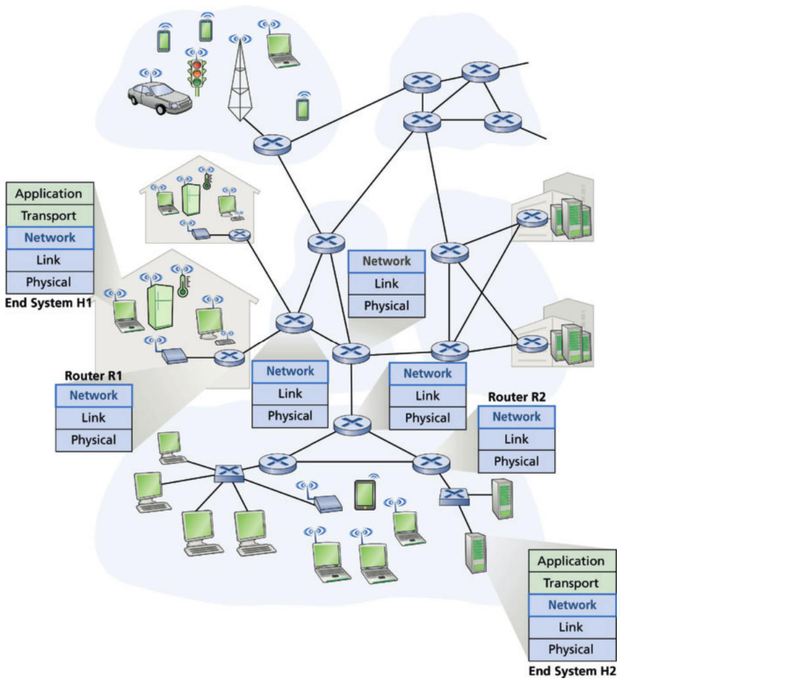

Hình 4.1 Tầng mạng

• Chuyển tiếp (Forwarding). Khi một packet tới liên kết vào của một router, router phải chuyển packet tới liên kết ra thích hợp. Ví dụ, một packet đến từ Host H1 tới Router R1 trong Hình 4.1 phải được chuyển tiếp tới router tiếp theo trên đường tới H2. Như chúng ta sẽ thấy, chuyển tiếp chỉ là một chức năng (dù là chức năng phổ biến và quan trọng nhất!) được triển khai trong data plane. Trong trường hợp tổng quát hơn, mà chúng ta sẽ đề cập trong Mục 4.4, một packet cũng có thể bị chặn không cho ra khỏi router (ví dụ, nếu packet xuất phát từ một host gửi độc hại đã biết, hoặc nếu packet hướng tới một host đích bị cấm), hoặc có thể bị nhân bản và gửi qua nhiều liên kết ra.

• Định tuyến (Routing). Tầng mạng phải xác định tuyến hay đường đi mà packet đi qua khi chúng chảy từ bên gửi tới bên nhận. Các thuật toán tính các đường đi này được gọi là thuật toán định tuyến (routing algorithm). Một thuật toán định tuyến sẽ xác định, chẳng hạn, đường dọc theo đó packet chảy từ H1 tới H2 trong Hình 4.1. Định tuyến được triển khai trong control plane của tầng mạng. Các thuật ngữ chuyển tiếp và định tuyến thường được dùng thay thế cho nhau bởi các tác giả thảo luận về tầng mạng. Chúng ta sẽ dùng các thuật ngữ này chính xác hơn nhiều trong cuốn sách này. Chuyển tiếp chỉ hành động router-local (cục bộ trong router) chuyển một packet từ một giao diện liên kết vào tới giao diện liên kết ra thích hợp. Chuyển tiếp diễn ra ở thang thời gian rất ngắn (thường vài nano giây), và do đó thường được triển khai bằng phần cứng. Định tuyến chỉ quá trình network-wide xác định các đường end-to-end mà packet đi từ nguồn tới đích. Định tuyến diễn ra ở thang thời gian dài hơn nhiều (thường vài giây), và như chúng ta sẽ thấy thường được triển khai bằng phần mềm. Dùng phép so sánh lái xe của chúng ta, hãy xét chuyến đi từ Pennsylvania tới Florida mà người du hành của chúng ta đã thực hiện ở Mục 1.3.1. Trong chuyến đi này, người lái xe đi qua nhiều nút giao trên đường tới Florida. Chúng ta có thể nghĩ về chuyển tiếp như quá trình đi qua một nút giao duy nhất: Một chiếc xe vào nút giao từ một con đường và xác định nên đi đường nào để rời nút giao. Chúng ta có thể nghĩ về định tuyến như quá trình lập kế hoạch chuyến đi từ Pennsylvania tới Florida: Trước khi lên đường, người lái đã tham khảo bản đồ và chọn một trong nhiều đường khả dĩ, với mỗi đường gồm một chuỗi đoạn đường nối với nhau tại các nút giao.

  Một yếu tố then chốt trong mỗi router mạng là bảng chuyển tiếp (forwarding table) của nó. Một router chuyển tiếp một packet bằng cách xem xét giá trị của một hoặc nhiều trường trong header của packet đến, rồi dùng các giá trị header này để tra chỉ mục vào bảng chuyển tiếp. Giá trị lưu trong mục bảng chuyển tiếp cho các giá trị đó cho biết giao diện liên kết ra tại router đó mà packet sẽ được chuyển tiếp tới. Ví dụ, trong Hình 4.2, một packet có giá trị trường header 0110 tới một router. Router tra chỉ mục vào bảng chuyển tiếp và xác định giao diện liên kết ra cho packet này là giao diện 2. Router sau đó chuyển tiếp nội bộ packet tới giao diện 2. Trong Mục 4.2, chúng ta sẽ nhìn vào bên trong một router và xem xét chức năng chuyển tiếp chi tiết hơn nhiều. Chuyển tiếp là chức năng then chốt được thực hiện bởi chức năng data-plane của tầng mạng.

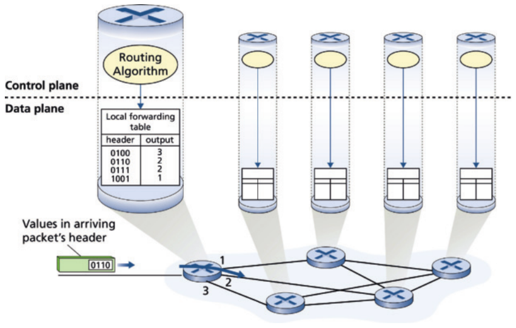

Hình 4.2 Thuật toán định tuyến xác định các giá trị trong bảng chuyển tiếp (forward tables)

#### Control plane: Cách tiếp cận truyền thống (Control Plane: The Traditional Approach)

Nhưng giờ chắc chắn bạn đang thắc mắc ngay từ đầu bảng chuyển tiếp của router được cấu hình như thế nào. Đây là một vấn đề thiết yếu, một vấn đề phơi bày sự tương tác quan trọng giữa chuyển tiếp (trong data plane) và định tuyến (trong control plane). Như minh họa trong Hình 4.2, thuật toán định tuyến xác định nội dung bảng chuyển tiếp của các router. Trong ví dụ này, một thuật toán định tuyến chạy trong mỗi router và cả chức năng chuyển tiếp lẫn định tuyến đều nằm trong một router. Như chúng ta sẽ thấy trong Mục 5.3 và 5.4, chức năng thuật toán định tuyến trong một router giao tiếp với chức năng thuật toán định tuyến trong các router khác để tính các giá trị cho bảng chuyển tiếp của nó. Việc giao tiếp này được thực hiện thế nào? Bằng cách trao đổi các thông điệp định tuyến chứa thông tin định tuyến theo một giao thức định tuyến! Chúng ta sẽ đề cập các thuật toán và giao thức định tuyến trong Mục 5.2 đến 5.4.

Các mục đích riêng biệt và khác nhau của chức năng chuyển tiếp và định tuyến có thể được minh họa thêm bằng cách xét trường hợp giả định (và phi thực tế, nhưng khả thi về kỹ thuật) của một mạng trong đó mọi bảng chuyển tiếp được cấu hình trực tiếp bởi các nhà vận hành mạng là con người có mặt trực tiếp tại router. Trong trường hợp này, sẽ không cần giao thức định tuyến nào! Tất nhiên, các nhà vận hành con người sẽ cần tương tác với nhau để đảm bảo bảng chuyển tiếp được cấu hình sao cho packet tới được đích dự định. Cũng nhiều khả năng việc cấu hình bởi con người sẽ error-prone hơn và phản ứng với thay đổi trong topology mạng chậm hơn nhiều so với một giao thức định tuyến. Do đó chúng ta may mắn vì mọi mạng đều có cả chức năng chuyển tiếp lẫn định tuyến!

#### Control plane: Cách tiếp cận SDN (Control Plane: The SDN Approach)

Cách tiếp cận triển khai chức năng định tuyến minh họa trong Hình 4.2— với mỗi router có một thành phần định tuyến giao tiếp với thành phần định tuyến của các router khác—là cách tiếp cận truyền thống được các nhà cung cấp router áp dụng trong sản phẩm của họ, ít nhất là cho tới gần đây. Tuy nhiên, quan sát của chúng ta rằng con người có thể cấu hình thủ công bảng chuyển tiếp gợi ý rằng có thể có những cách khác để chức năng control-plane xác định nội dung của các bảng chuyển tiếp data-plane.

Hình 4.3 cho thấy một cách tiếp cận thay thế trong đó một controller từ xa, tách biệt về mặt vật lý, tính toán và phân phối các bảng chuyển tiếp để mọi router trong một mạng sử dụng. Lưu ý rằng các thành phần data plane của Hình 4.2 và 4.3 giống hệt nhau. Trong Hình 4.3; tuy nhiên, chức năng định tuyến control-plane được tách khỏi router vật lý—thiết bị định tuyến chỉ thực hiện chuyển tiếp, trong khi controller từ xa tính toán và phân phối bảng chuyển tiếp. Controller từ xa có thể được triển khai trong một data center từ xa với độ tin cậy và dự phòng cao, và có thể được quản lý bởi ISP hoặc một bên thứ ba nào đó. Các router và controller từ xa có thể giao tiếp như thế nào? Bằng cách trao đổi các thông điệp chứa bảng chuyển tiếp và các mẩu thông tin định tuyến khác. Cách tiếp cận control-plane minh họa trong Hình 4.3 là cốt lõi của software-defined networking (SDN), trong đó mạng là “software-defined” vì controller tính bảng chuyển tiếp và tương tác với router được triển khai bằng phần mềm. Ngày càng nhiều, các bản triển khai phần mềm này cũng mở, tức là, tương tự code Linux OS, code được công khai, cho phép các ISP (và các nhà nghiên cứu và sinh viên mạng!) đổi mới và đề xuất thay đổi cho phần mềm điều khiển chức năng network-layer. Chúng ta sẽ đề cập control plane SDN trong Mục 5.5.

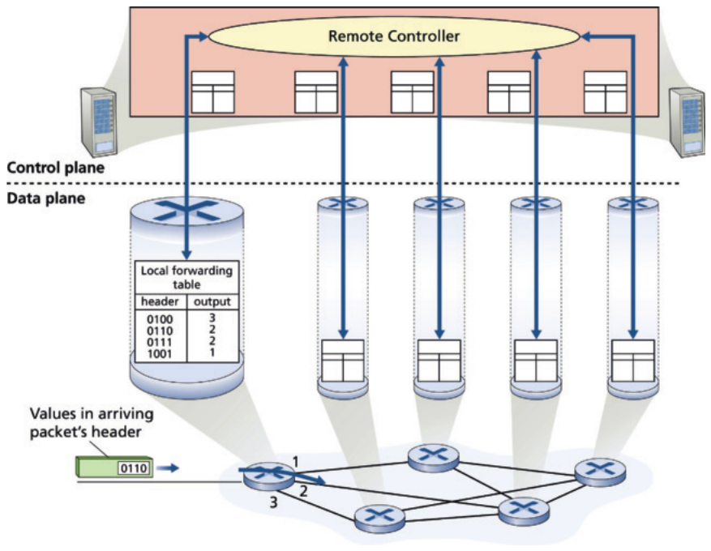

Hình 4.3 Một controller từ xa xác định và phân phối các giá trị trong bảng chuyển tiếp

### 4.1.2 Mô hình dịch vụ mạng (Network Service Model)

Trước khi đi sâu vào data plane của tầng mạng, hãy kết thúc phần giới thiệu bằng cách nhìn rộng hơn và xét các loại dịch vụ khác nhau mà tầng mạng có thể cung cấp. Khi tầng giao vận tại một host gửi truyền một packet vào mạng (tức là, chuyển nó xuống tầng mạng tại host gửi), tầng giao vận có thể dựa vào tầng mạng để chuyển packet tới đích không? Khi nhiều packet được gửi, chúng có được chuyển tới tầng giao vận ở host nhận theo thứ tự đã gửi không? Lượng thời gian giữa việc gửi hai lần truyền packet liên tiếp có bằng lượng thời gian giữa lúc nhận chúng không? Mạng có cung cấp phản hồi nào về tắc nghẽn trong mạng không? Câu trả lời cho các câu hỏi này và các câu hỏi khác được xác định bởi mô hình dịch vụ do tầng mạng cung cấp. Mô hình dịch vụ mạng định nghĩa các đặc tính của việc chuyển giao packet end-to-end giữa host gửi và host nhận.

Giờ hãy xét một số dịch vụ khả dĩ mà tầng mạng có thể cung cấp. Các dịch vụ này có thể bao gồm:

• Chuyển giao được đảm bảo (Guaranteed delivery). Dịch vụ này đảm bảo một packet do một host nguồn gửi cuối cùng sẽ tới host đích.

• Chuyển giao được đảm bảo với độ trễ bị chặn (Guaranteed delivery with bounded delay). Dịch vụ này không chỉ đảm bảo chuyển giao packet, mà chuyển giao trong một giới hạn độ trễ host-to-host chỉ định (ví dụ, trong vòng 100 msec).

• Chuyển giao packet in-order (đúng thứ tự). Dịch vụ này đảm bảo packet tới đích theo thứ tự đã gửi.

• Băng thông tối thiểu được đảm bảo (Guaranteed minimal bandwidth). Dịch vụ network-layer này mô phỏng hành vi của một liên kết truyền có bit rate chỉ định (ví dụ, 1 Mbps) giữa host gửi và host nhận. Chừng nào host gửi truyền bit (như một phần của packet) với tốc độ dưới bit rate chỉ định, thì mọi packet cuối cùng đều được chuyển tới host đích.

• Bảo mật (Security). Tầng mạng có thể mã hóa mọi datagram tại nguồn và giải mã chúng tại đích, qua đó cung cấp tính bảo mật cho mọi segment transport-layer.

Đây chỉ là một danh sách một phần các dịch vụ mà tầng mạng có thể cung cấp— có vô số biến thể khả dĩ.

Tầng mạng của Internet cung cấp một dịch vụ duy nhất, gọi là dịch vụ best-effort. Với dịch vụ best-effort, packet không được đảm bảo được nhận theo thứ tự đã gửi, thậm chí việc chuyển giao cuối cùng của chúng cũng không được đảm bảo. Không có đảm bảo về độ trễ end-to-end cũng không có đảm bảo băng thông tối thiểu. Có vẻ như dịch vụ best-effort là một cách nói giảm cho việc không có dịch vụ nào cả—một mạng không chuyển packet nào tới đích vẫn thỏa định nghĩa dịch vụ chuyển giao best-effort! Các kiến trúc mạng khác đã định nghĩa và triển khai các mô hình dịch vụ vượt xa dịch vụ best-effort của Internet. Ví dụ, kiến trúc mạng ATM [Black 1995] cung cấp độ trễ in-order được đảm bảo, độ trễ bị chặn, và băng thông tối thiểu được đảm bảo. Cũng đã có các mở rộng mô hình dịch vụ được đề xuất cho kiến trúc Internet; ví dụ, kiến trúc Intserv [RFC 1633] nhằm cung cấp đảm bảo độ trễ end-end và giao tiếp congestion-free. Thú vị là, bất chấp các phương án well-developed (hoàn thiện) này, mô hình dịch vụ best-effort cơ bản của Internet kết hợp với việc cấp phát băng thông đầy đủ và các giao thức application-level bandwidth-adaptive (thích ứng băng thông) như giao thức streaming đa phương tiện DASH mà chúng ta đã gặp trong Chương 2 có thể nói đã chứng tỏ là hơn cả “đủ tốt” để cho phép một loạt ứng dụng đáng kinh ngạc, bao gồm các dịch vụ video streaming như Netflix và các ứng dụng hội nghị real-time như Zoom và Facetime.

#### Tổng quan Chương 4 (An Overview of Chapter 4)

Sau khi đã cung cấp tổng quan về tầng mạng, chúng ta sẽ đề cập thành phần data-plane của tầng mạng trong các mục tiếp theo của chương này. Trong Mục 4.2, chúng ta sẽ đi sâu vào các hoạt động phần cứng bên trong của một router, bao gồm xử lý packet vào và ra, cơ chế chuyển mạch nội bộ của router, và hàng đợi và lập lịch packet. Trong Mục 4.3, chúng ta sẽ xem xét chuyển tiếp IP truyền thống, trong đó packet được chuyển tiếp tới các port ra dựa trên địa chỉ IP đích của chúng. Chúng ta sẽ gặp việc định địa chỉ IP, các giao thức IPv4 và IPv6 nổi tiếng và hơn nữa. Trong Mục 4.4, chúng ta sẽ đề cập chuyển tiếp tổng quát hơn, trong đó packet có thể được chuyển tiếp tới port ra dựa trên một số lượng lớn giá trị header (tức là, không chỉ dựa trên địa chỉ IP đích). Packet có thể bị chặn hoặc nhân bản tại router, hoặc có thể bị ghi lại một số giá trị trường header—tất cả dưới sự điều khiển của phần mềm. Dạng chuyển tiếp packet tổng quát hơn này là một thành phần then chốt của data plane mạng hiện đại, bao gồm data plane trong các mạng software-defined (SDN). Trong Mục 4.5, chúng ta sẽ học về các “middlebox” có thể thực hiện các chức năng ngoài chuyển tiếp.

Chúng tôi đề cập thoáng qua ở đây rằng các thuật ngữ chuyển tiếp (forwarding) và chuyển mạch (switching) thường được các nhà nghiên cứu và người làm thực tế computer-networking dùng thay thế cho nhau; chúng tôi cũng sẽ dùng cả hai thuật ngữ thay thế cho nhau trong cuốn sách này. Nhân tiện nói về thuật ngữ, cũng đáng đề cập hai thuật ngữ khác thường được dùng thay thế cho nhau, nhưng chúng tôi sẽ dùng cẩn thận hơn. Chúng tôi sẽ dành thuật ngữ packet switch để chỉ một thiết bị packet-switching tổng quát truyền một packet từ giao diện liên kết vào tới giao diện liên kết ra, theo giá trị trong các trường header của packet. Nhưng trong cuốn sách này chúng tôi sẽ phân biệt hai loại packet switch: router, sẽ được nghiên cứu sâu trong chương này, và switch, sẽ được nghiên cứu sâu trong Chương 6. Nhớ lại từ Mục 1.5.2 rằng các packet network-layer (tức là, tầng 3) được gọi là datagram và các packet link-layer (tức là, tầng 2) được gọi là frame, và cả datagram lẫn frame đều có các trường header riêng. Router đưa ra quyết định chuyển tiếp dựa trên giá trị header-field trong datagram network-layer, trong khi switch đưa ra quyết định chuyển tiếp dựa trên giá trị header-field trong frame link-layer. Do đó router được coi là thiết bị network-layer và switch được coi là thiết bị link-layer. Vì trọng tâm của chúng ta trong chương này là tầng mạng, chúng ta sẽ chủ yếu dùng thuật ngữ router thay cho packet switch.

## 4.2 Bên trong một router có gì? (What’s Inside a Router?)

Giờ chúng ta đã có tổng quan về data plane và control plane trong tầng mạng, sự phân biệt quan trọng giữa chuyển tiếp và định tuyến, và các dịch vụ và chức năng của tầng mạng, hãy chuyển sự chú ý sang chức năng chuyển tiếp của nó—việc truyền thực sự packet từ các liên kết vào của router tới các liên kết ra thích hợp tại router đó.

Một cái nhìn high-level về kiến trúc router tổng quát được minh họa trong Hình 4.4. Có thể xác định bốn thành phần router:

• Port vào (Input ports). Một port vào thực hiện một số chức năng then chốt. Nó thực hiện chức năng tầng vật lý kết cuối một liên kết vật lý đến tại router; điều này được minh họa ở ô ngoài cùng bên trái của port vào và ô ngoài cùng bên phải của port ra trong Hình 4.4. Một port vào cũng thực hiện các chức năng link-layer cần thiết để tương tác với tầng liên kết ở phía bên kia của liên kết đến; điều này được biểu diễn bằng các ô ở giữa trong port vào và port ra. Có lẽ thiết yếu nhất, một chức năng tra cứu (lookup) cũng được thực hiện tại port vào; việc này sẽ diễn ra ở ô ngoài cùng bên phải của port vào. Chính ở đây bảng chuyển tiếp được tham khảo để xác định port ra của router mà một packet đến sẽ được chuyển tiếp tới qua switching fabric. Các packet điều khiển (ví dụ, packet mang thông tin giao thức định tuyến) được chuyển tiếp từ một port vào tới bộ xử lý định tuyến. Lưu ý rằng thuật ngữ “port” ở đây—chỉ các giao diện vào và ra vật lý của router—khác hẳn với các port phần mềm gắn với các ứng dụng mạng và socket được thảo luận trong Chương 2 và 3. Trong thực tế, số port mà một router hỗ trợ có thể từ một số tương đối nhỏ ở các router doanh nghiệp, tới hàng trăm port 10 Gbps ở một router tại rìa của ISP, nơi số đường đến có xu hướng lớn nhất. Ví dụ, edge router Juniper MX2020 hỗ trợ tới 800 port Ethernet 100 Gbps, với tổng dung lượng hệ thống router là 800 Tbps [Juniper MX 2020 2025].

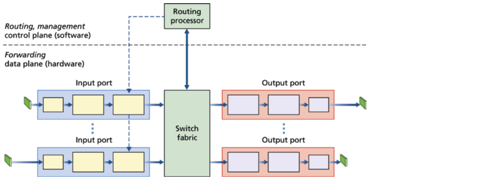

Hình 4.4 Kiến trúc router

• Switching fabric (cơ cấu chuyển mạch). Switching fabric nối các port vào của router với các port ra của nó. Switching fabric này nằm hoàn toàn bên trong router—một mạng bên trong một router mạng!

• Port ra (Output ports). Một port ra lưu các packet nhận từ switching fabric và truyền các packet này trên liên kết ra bằng cách thực hiện các chức năng link-layer và physical-layer cần thiết. Khi một liên kết là hai chiều (tức là, mang traffic theo cả hai chiều), một port ra thường được ghép cặp với port vào của liên kết đó trên cùng line card.

• Bộ xử lý định tuyến (Routing processor). Bộ xử lý định tuyến thực hiện các chức năng control-plane. Trong các router truyền thống, nó thực thi các giao thức định tuyến (mà chúng ta sẽ nghiên cứu trong Mục 5.3 và 5.4), duy trì bảng định tuyến và thông tin trạng thái liên kết gắn kèm, và tính bảng chuyển tiếp cho router. Trong các router SDN, bộ xử lý định tuyến chịu trách nhiệm giao tiếp với controller từ xa để (cùng các hoạt động khác) nhận các mục bảng chuyển tiếp do controller từ xa tính, và cài đặt các mục này vào các port vào của router. Bộ xử lý định tuyến cũng thực hiện các chức năng quản lý mạng mà chúng ta sẽ nghiên cứu trong Mục 5.7.

Các port vào, port ra và switching fabric của router hầu như luôn được triển khai bằng phần cứng, như minh họa trong Hình 4.4. Để thấy tại sao cần triển khai bằng phần cứng, hãy xét rằng với một liên kết vào 100 Gbps và một IP datagram 64-byte, port vào chỉ có 5.12 ns để xử lý datagram trước khi một datagram khác có thể tới. Nếu N port được gộp trên một line card (như thường làm trong thực tế), pipeline datagram-processing phải hoạt động nhanh hơn N lần—quá nhanh cho triển khai bằng phần mềm. Phần cứng chuyển tiếp có thể được triển khai hoặc dùng thiết kế phần cứng riêng của nhà cung cấp router, hoặc được xây dựng dùng các chip merchant-silicon (silicon thương mại) mua về (ví dụ, như được bán bởi các công ty như Intel và Broadcom).

Trong khi data plane hoạt động ở thang thời gian nano giây, các chức năng điều khiển của router—thực thi các giao thức định tuyến, phản hồi các liên kết gắn kèm bật hoặc tắt, giao tiếp với controller từ xa (trong trường hợp SDN) và thực hiện các chức năng quản lý—hoạt động ở thang thời gian mili giây hoặc giây. Các chức năng control plane này do đó thường được triển khai bằng phần mềm và chạy trên bộ xử lý định tuyến (thường là một CPU truyền thống). Trước khi đi sâu vào chi tiết bên trong router, hãy quay lại phép so sánh ở đầu chương này, trong đó việc chuyển tiếp packet được so sánh với xe vào và rời một nút giao. Giả sử nút giao là một vòng xuyến, và khi một chiếc xe vào vòng xuyến, cần một chút xử lý. Hãy xét thông tin nào cần cho việc xử lý này:

• Chuyển tiếp destination-based (dựa trên đích). Giả sử chiếc xe dừng ở một trạm vào và cho biết đích cuối cùng của nó (không phải ở vòng xuyến địa phương, mà là đích cuối cùng của hành trình). Một nhân viên ở trạm vào tra cứu đích cuối cùng, xác định lối ra vòng xuyến dẫn tới đích cuối cùng đó, và bảo người lái đi lối ra nào.

• Chuyển tiếp tổng quát (Generalized forwarding). Nhân viên cũng có thể xác định lối ra của xe dựa trên nhiều yếu tố khác ngoài đích. Ví dụ, lối ra được chọn có thể phụ thuộc vào xuất xứ của xe, chẳng hạn bang đã cấp biển số xe. Xe từ một tập bang nhất định có thể được hướng dùng một lối ra (dẫn tới đích qua một con đường chậm), trong khi xe từ các bang khác có thể được hướng dùng một lối ra khác (dẫn tới đích qua đường cao tốc). Quyết định tương tự có thể được đưa ra dựa trên mẫu xe, hãng và năm sản xuất của xe. Hoặc một chiếc xe bị đánh giá không đủ điều kiện lưu hành có thể bị chặn và không được phép đi qua vòng xuyến. Trong trường hợp chuyển tiếp tổng quát, bất kỳ số yếu tố nào cũng có thể góp phần vào lựa chọn lối ra của nhân viên cho một chiếc xe cho trước.

Khi chiếc xe vào vòng xuyến (có thể đầy các xe khác đi vào từ các đường vào khác và hướng tới các lối ra vòng xuyến khác), nó cuối cùng rời đi tại lối ra vòng xuyến được chỉ định, nơi nó có thể gặp các xe khác rời vòng xuyến tại lối ra đó.

Chúng ta có thể dễ dàng nhận ra các thành phần router chính trong Hình 4.4 trong phép so sánh này—đường vào và trạm vào tương ứng với port vào (với chức năng tra cứu để xác định port ra cục bộ); vòng xuyến tương ứng với switch fabric; và đường ra khỏi vòng xuyến tương ứng với port ra. Với phép so sánh này, sẽ bổ ích nếu xét nơi có thể xảy ra nút cổ chai. Điều gì xảy ra nếu xe tới cực nhanh (ví dụ, vòng xuyến ở Đức hoặc Ý!) nhưng nhân viên trạm thì chậm? Nhân viên phải làm việc nhanh đến mức nào để đảm bảo không có ùn tắc trên đường vào? Ngay cả với một nhân viên cực nhanh, điều gì xảy ra nếu xe đi qua vòng xuyến chậm—ùn tắc có còn xảy ra không? Và điều gì xảy ra nếu hầu hết các xe vào ở tất cả các lối vào của vòng xuyến đều muốn rời vòng xuyến ở cùng một lối ra—ùn tắc có thể xảy ra ở lối ra hay nơi khác không? Vòng xuyến nên hoạt động thế nào nếu chúng ta muốn gán mức ưu tiên cho các xe khác nhau, hoặc chặn một số xe vào vòng xuyến ngay từ đầu? Tất cả những câu hỏi này tương tự các câu hỏi thiết yếu mà các nhà thiết kế router và switch phải đối mặt.

Trong các tiểu mục sau, chúng ta sẽ xem xét chi tiết hơn các chức năng của router. [Turner 1988; McKeown 1997a; Partridge 1998; Iyer 2008; Serpanos 2011; Zilberman 2019] cung cấp thảo luận về các kiến trúc router cụ thể. Để cụ thể và đơn giản, ban đầu trong mục này chúng ta sẽ giả định quyết định chuyển tiếp chỉ dựa trên địa chỉ đích của packet, thay vì một tập tổng quát các trường header packet. Chúng ta sẽ đề cập trường hợp chuyển tiếp packet tổng quát hơn trong Mục 4.4.

### 4.2.1 Xử lý port vào và chuyển tiếp dựa trên đích (Input Port Processing and Destination-Based Forwarding)

Một cái nhìn chi tiết hơn về xử lý đầu vào được minh họa trong Hình 4.5. Như vừa thảo luận, chức năng line-termination (kết cuối đường truyền) và xử lý link-layer của port vào triển khai tầng vật lý và tầng liên kết cho liên kết vào riêng lẻ đó. Việc tra cứu thực hiện tại port vào là trung tâm hoạt động của router—chính ở đây router dùng bảng chuyển tiếp để tra port ra mà một packet đến sẽ được chuyển tiếp tới qua switching fabric. Bảng chuyển tiếp hoặc được bộ xử lý định tuyến tính và cập nhật (dùng một giao thức định tuyến để tương tác với các bộ xử lý định tuyến trong các router mạng khác) hoặc được nhận từ một controller SDN từ xa. Bảng chuyển tiếp được sao chép từ bộ xử lý định tuyến tới các line card qua một bus riêng (ví dụ, một bus PCI) được biểu thị bằng đường nét đứt từ bộ xử lý định tuyến tới các line card vào trong Hình 4.4. Với một bản sao bóng (shadow copy) như vậy ở mỗi line card, quyết định chuyển tiếp có thể được đưa ra cục bộ, tại mỗi port vào, mà không cần gọi bộ xử lý định tuyến tập trung trên cơ sở per-packet (từng packet) và do đó tránh được nút cổ chai xử lý tập trung.

Giờ hãy xét trường hợp “đơn giản nhất” rằng port ra mà một packet đến sẽ được chuyển mạch tới dựa trên địa chỉ đích của packet. Trong trường hợp địa chỉ IP 32-bit, một bản triển khai brute-force (vét cạn) của bảng chuyển tiếp sẽ có một mục cho mỗi địa chỉ đích khả dĩ. Vì có hơn 4 tỉ địa chỉ khả dĩ, phương án này hoàn toàn không thể.

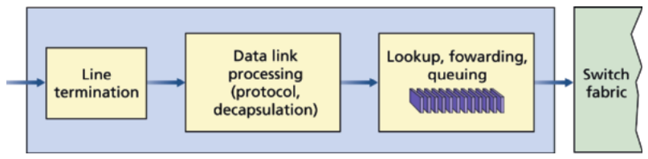

Hình 4.5 Xử lý port vào

Như một ví dụ về cách vấn đề quy mô này có thể được xử lý, giả sử router của chúng ta có bốn liên kết, được đánh số 0 đến 3, và packet sẽ được chuyển tiếp tới các giao diện liên kết như sau: Rõ ràng, với ví dụ này, không cần có 4 tỉ mục trong bảng chuyển tiếp của router. Chẳng hạn, chúng ta có thể có bảng chuyển tiếp sau chỉ với bốn mục: Với kiểu bảng chuyển tiếp này, router khớp một tiền tố (prefix) của địa chỉ đích của packet với các mục trong bảng; nếu có khớp, router chuyển tiếp packet tới một liên kết gắn với mục khớp. Ví dụ, giả sử địa chỉ đích của packet là 11001000 00010111 00010110 10100001; vì tiền tố 21-bit của địa chỉ này khớp với mục đầu tiên trong bảng, router chuyển tiếp packet tới giao diện liên kết 0. Nếu một tiền tố không khớp với mục nào trong ba mục đầu, thì router chuyển tiếp packet tới giao diện mặc định 3. Mặc dù điều này nghe có vẻ khá đơn giản, có một điểm tinh tế rất quan trọng ở đây. Có thể bạn đã để ý rằng một địa chỉ đích có thể khớp với nhiều hơn một mục. Ví dụ, 24 bit đầu tiên của địa chỉ 11001000 00010111 00011000 10101010 khớp với mục thứ hai trong bảng, và 21 bit đầu tiên của địa chỉ khớp với mục thứ ba trong bảng. Khi có nhiều mục khớp, router dùng quy tắc khớp tiền tố dài nhất (longest prefix matching rule); tức là, nó tìm mục khớp dài nhất trong bảng và chuyển tiếp packet tới giao diện liên kết gắn với mục khớp tiền tố dài nhất. Chúng ta sẽ thấy chính xác tại sao quy tắc prefix-matching dài nhất này được dùng khi nghiên cứu chi tiết hơn việc định địa chỉ Internet trong Mục 4.3.

| Dải địa chỉ đích (Destination Address Range) | Giao diện liên kết (Link Interface) |
|---|---|
| 11001000 00010111 00010000 00000000 |  |
| đến (through) | 0 |
| 11001000 00010111 00010111 11111111 |  |
| 11001000 00010111 00011000 00000000 |  |
| đến (through) | 1 |
| 11001000 00010111 00011000 11111111 |  |
| 11001000 00010111 00011001 00000000 |  |
| đến (through) | 2 |
| 11001000 00010111 00011111 11111111 |  |
| Còn lại (Otherwise) | 3 |

| Tiền tố (Prefix) | Giao diện liên kết (Link Interface) |
|---|---|
| 11001000 00010111 00010 | 0 |
| 11001000 00010111 00011000 | 1 |
| 11001000 00010111 00011 | 2 |
| Còn lại (Otherwise) | 3 |

Khi đã có bảng chuyển tiếp, việc tra cứu về mặt khái niệm là đơn giản— logic phần cứng chỉ cần tìm trong bảng chuyển tiếp mục khớp tiền tố dài nhất. Nhưng ở tốc độ truyền Gigabit, việc tra cứu này phải được thực hiện trong vài nano giây (nhớ lại ví dụ trước đó về một liên kết 10 Gbps và một IP datagram 64-byte). Trong thực tế, Ternary Content Addressable Memory (TCAM) thường được dùng để tra cứu địa chỉ [Yu 2004]. Với một TCAM, một địa chỉ IP 32-bit được đưa vào bộ nhớ kết hợp (associative memory), bộ nhớ này trả về nội dung của mục bảng chuyển tiếp cho địa chỉ đó trong một chu kỳ clock. TCAMS cực kỳ phù hợp cho tra cứu địa chỉ IP, vì bộ nhớ kết hợp “ternary” (ba trạng thái) cho phép địa chỉ cần tra có các giá trị bit 0, 1, hoặc * (không quan tâm). Như chúng ta sẽ sớm thấy, các giá trị bit “không quan tâm” này sẽ là thiết yếu để giữ bảng tra cứu địa chỉ nhỏ. Các router và switch Cisco Catalyst 6500 và 7600 Series có thể chứa một triệu mục bảng chuyển tiếp TCAM [Cisco TCAM 2025]; switch Aurora của Intel có thể chứa tới hơn 1.2M mục [Rios 2022]. Vì TCAM đắt và tiêu thụ nhiều năng lượng, các cách tiếp cận lai kết hợp bộ nhớ static random-access memory (SRAM) cũng đã được đề xuất [Luo 2012; Rios 2022]; và các cách tiếp cận tra cứu thuần “thuật toán” cũng được dùng trong thực tế [Arista 2023].

Khi port ra của một packet đã được xác định qua việc tra cứu, packet có thể được gửi vào switching fabric. Trong một số thiết kế, một packet có thể tạm thời bị chặn không vào được switching fabric nếu các packet từ các port vào khác hiện đang dùng fabric. Một packet bị chặn sẽ được xếp hàng tại port vào rồi được lập lịch để đi qua fabric vào một thời điểm sau. Chúng ta sẽ sớm xem kỹ hơn việc chặn, xếp hàng và lập lịch packet (ở cả port vào và port ra). Mặc dù “tra cứu” có thể nói là hành động quan trọng nhất trong xử lý port vào, nhiều hành động khác cũng phải được thực hiện: (1) xử lý physical- và link-layer phải diễn ra, như đã thảo luận trước đó; (2) số phiên bản, checksum và trường time-to-live (thời gian sống) của packet—tất cả mà chúng ta sẽ nghiên cứu trong Mục 4.3—phải được kiểm tra và hai trường sau được ghi lại; và (3) các bộ đếm dùng cho quản lý mạng (như số IP datagram đã nhận) phải được cập nhật.

Hãy kết thúc thảo luận về xử lý port vào bằng việc lưu ý rằng các bước tại port vào gồm tra địa chỉ IP đích (“match” - khớp) rồi gửi packet vào switching fabric tới port ra chỉ định (“action” - hành động) là một trường hợp cụ thể của một trừu tượng “match plus action” tổng quát hơn được thực hiện trong nhiều thiết bị mạng, không chỉ router. Trong các switch link-layer (đề cập trong Chương 6), địa chỉ đích link-layer được tra cứu và một số hành động có thể được thực hiện ngoài việc gửi frame vào switching fabric hướng tới port ra. Trong Chương 8 chúng ta sẽ nghiên cứu firewall, là các thiết bị lọc bỏ các packet đến được chọn. Trong firewall, một packet đến có header khớp một tiêu chí cho trước (ví dụ, một tổ hợp địa chỉ IP nguồn/đích và số port transport-layer) có thể bị loại bỏ (action). Trong Mục 4.3, chúng ta sẽ thảo luận NAT (network address translator). Trong một NAT, một packet đến có số port transport-layer khớp một giá trị cho trước sẽ bị ghi lại số port trước khi chuyển tiếp (action). Thật vậy, trừu tượng “match plus action” [Bosshart 2013] vừa mạnh mẽ vừa phổ biến trong các thiết bị mạng ngày nay, và là trung tâm của khái niệm chuyển tiếp tổng quát mà chúng ta sẽ nghiên cứu trong Mục 4.4.

### 4.2.2 Chuyển mạch (Switching)

Switching fabric là trái tim của router, vì chính qua fabric này mà các packet thực sự được chuyển mạch (tức là, chuyển tiếp) từ một port vào tới một port ra. Chuyển mạch có thể được thực hiện theo nhiều cách, như minh họa trong Hình 4.6:

• Chuyển mạch qua bộ nhớ (Switching via memory). Các router đơn giản nhất, sớm nhất là các máy tính truyền thống, với việc chuyển mạch giữa port vào và port ra được thực hiện dưới sự điều khiển trực tiếp của CPU (bộ xử lý định tuyến). Port vào và port ra hoạt động như các thiết bị I/O truyền thống trong một hệ điều hành truyền thống. Một port vào có packet đến trước hết báo hiệu cho bộ xử lý định tuyến qua một ngắt. Packet sau đó được sao chép từ port vào vào bộ nhớ bộ xử lý. Bộ xử lý định tuyến sau đó trích xuất địa chỉ đích từ header, tra port ra thích hợp trong bảng chuyển tiếp, và sao chép packet vào buffer của port ra. Trong kịch bản này, nếu băng thông bộ nhớ sao cho tối đa B packet mỗi giây có thể được ghi vào, hoặc đọc từ, bộ nhớ, thì throughput chuyển tiếp tổng thể (tổng tốc độ packet được truyền từ port vào tới port ra) phải nhỏ hơn B/2. Cũng lưu ý rằng hai packet không thể được chuyển tiếp cùng lúc, ngay cả khi chúng có port đích khác nhau, vì chỉ một thao tác đọc/ghi bộ nhớ có thể được thực hiện tại một thời điểm qua bus hệ thống dùng chung.

• Một số router hiện đại chuyển mạch qua bộ nhớ. Tuy nhiên, một khác biệt lớn so với các router thời đầu là việc tra địa chỉ đích và lưu packet vào vị trí bộ nhớ thích hợp được thực hiện bằng xử lý trên các line card vào. Theo một số mặt, các router chuyển mạch qua bộ nhớ trông rất giống các bộ đa xử lý shared-memory (bộ nhớ dùng chung), với việc xử lý trên line card chuyển mạch (ghi) packet vào bộ nhớ của port ra thích hợp. Các switch dòng Catalyst 8500 của Cisco [Cisco 8500 2021] chuyển mạch nội bộ packet qua một bộ nhớ dùng chung.

• Chuyển mạch qua bus (Switching via a bus). Trong cách tiếp cận này, một port vào truyền một packet trực tiếp tới port ra qua một bus dùng chung, không có sự can thiệp của bộ xử lý định tuyến. Việc này thường được thực hiện bằng cách cho port vào thêm vào đầu packet một nhãn (header) switch-internal (nội bộ switch) cho biết port ra cục bộ mà packet này đang được truyền tới và truyền packet lên bus. Mọi port ra đều nhận packet, nhưng chỉ port khớp với nhãn sẽ giữ packet. Nhãn sau đó được gỡ bỏ tại port ra, vì nhãn này chỉ được dùng bên trong switch để đi qua bus. Nếu nhiều packet tới router cùng lúc, mỗi packet ở một port vào khác nhau, tất cả trừ một packet phải chờ vì chỉ một packet có thể đi qua bus tại một thời điểm. Vì mọi packet đều phải đi qua bus duy nhất, tốc độ chuyển mạch của router bị giới hạn bởi tốc độ bus; trong phép so sánh vòng xuyến của chúng ta, điều này giống như vòng xuyến chỉ có thể chứa một xe tại một thời điểm.

  Tuy vậy, chuyển mạch qua bus thường đủ cho các router hoạt động trong các mạng cục bộ nhỏ và mạng doanh nghiệp. Cisco Catalyst 9600 chuyển mạch qua một backplane bus, trong khi Cisco Catalyst 9200 chuyển mạch qua một ring (một bus có hướng với hai đầu nối với nhau) [Cisco 9000 2022].

• Chuyển mạch qua mạng liên kết nối (Switching via an interconnection network). Một cách để vượt qua giới hạn băng thông của một bus dùng chung duy nhất là dùng một mạng liên kết nối tinh vi hơn, như những mạng đã được dùng trong quá khứ để nối các bộ xử lý trong kiến trúc máy tính đa xử lý.

  Một crossbar switch là một mạng liên kết nối gồm N2 bus nối N port vào với N port ra, như minh họa trong Hình 4.6. Mỗi bus dọc cắt mỗi bus ngang tại một điểm giao (crosspoint), có thể được mở hoặc đóng bất kỳ lúc nào bởi bộ điều khiển switch fabric (có logic là một phần của chính switching fabric). Khi một packet tới từ port A và cần được chuyển tiếp tới port Y, bộ điều khiển switch đóng điểm giao tại giao điểm của bus A và Y, và port A sau đó gửi packet lên bus của nó, packet này được (chỉ) bus Y nhận. Lưu ý rằng một packet từ port B có thể được chuyển tiếp tới port X cùng lúc, vì các packet A-to-Y và B-to-X dùng các bus vào và ra khác nhau. Do đó, không như hai cách chuyển mạch trước, crossbar switch có khả năng chuyển tiếp nhiều packet song song. Một crossbar switch là non-blocking (không chặn)—một packet đang được chuyển tiếp tới một port ra sẽ không bị chặn không tới được port ra đó chừng nào không có packet nào khác hiện đang được chuyển tiếp tới port ra đó. Tuy nhiên, nếu hai packet từ hai port vào khác nhau cùng hướng tới một port ra, thì một packet sẽ phải chờ ở đầu vào, vì chỉ một packet có thể được gửi qua bất kỳ bus nào tại một thời điểm.

• Các mạng liên kết nối tinh vi hơn dùng nhiều tầng phần tử chuyển mạch để cho phép các packet từ các port vào khác nhau tiến tới cùng một port ra cùng lúc qua switching fabric multi-stage (nhiều tầng). Xem [Tobagi 1990] để có khảo sát về các kiến trúc switch.

  Dòng Cisco 8000 dùng một mạng liên kết nối leaf-spine two-stage (hai tầng) [Cisco 8000 2020]. Cisco CRS dùng một chiến lược chuyển mạch non-blocking three-stage (ba tầng). Dung lượng chuyển mạch của một router cũng có thể được mở rộng bằng cách chạy nhiều switching fabric song song. Trong cách tiếp cận này, các port vào và port ra được nối tới N switching fabric hoạt động song song. Một port vào chia một packet thành K khúc nhỏ hơn, và gửi (“phun”) các khúc qua K trong số N switching fabric này tới port ra được chọn, port này ráp K khúc lại thành packet gốc.

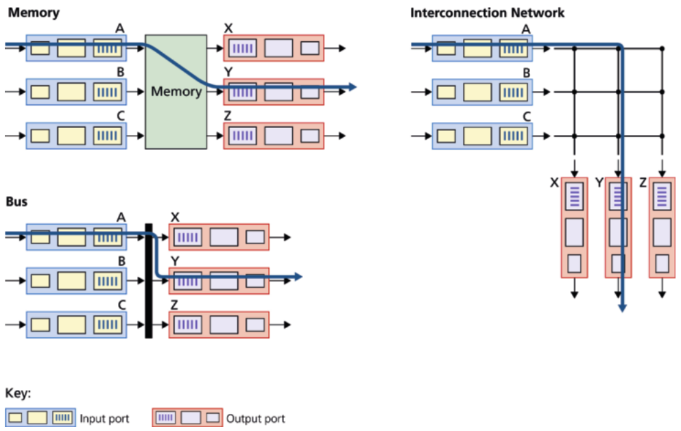

Hình 4.6 Ba kỹ thuật chuyển mạch

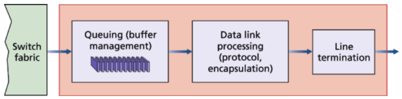

Hình 4.7 Xử lý port ra

### 4.2.3 Xử lý port ra (Output Port Processing)

Xử lý port ra, minh họa trong Hình 4.7, lấy các packet đã được lưu trong bộ nhớ của port ra và truyền chúng qua liên kết ra. Việc này bao gồm chọn (tức là, lập lịch) và de-queueing (lấy ra khỏi hàng đợi) packet để truyền, và thực hiện các chức năng truyền link-layer và physical-layer cần thiết.

### 4.2.4 Hàng đợi xảy ra ở đâu? (Where Does Queuing Occur?)

Nếu chúng ta xét chức năng port vào và port ra và các cấu hình minh họa trong Hình 4.6, rõ ràng hàng đợi packet có thể hình thành ở cả port vào lẫn port ra, giống như chúng ta đã xác định các trường hợp xe có thể chờ ở lối vào và lối ra của nút giao thông trong phép so sánh vòng xuyến. Vị trí và mức độ xếp hàng (ở hàng đợi port vào hoặc hàng đợi port ra) sẽ phụ thuộc vào tải traffic, tốc độ tương đối của switching fabric, và tốc độ đường truyền. Giờ hãy xét các hàng đợi này chi tiết hơn một chút, vì khi các hàng đợi này lớn lên, bộ nhớ của router cuối cùng có thể cạn kiệt và mất gói sẽ xảy ra khi không còn bộ nhớ để lưu các packet đến. Nhớ rằng trong các thảo luận trước, chúng ta đã nói packet bị “mất trong mạng” hoặc “bị loại bỏ tại một router.” Chính ở đây, tại các hàng đợi này bên trong một router, các packet như vậy thực sự bị loại bỏ và mất.

Giả sử tốc độ đường vào và ra (tốc độ truyền) đều có tốc độ truyền giống nhau là R<sub>line</sub> packet mỗi giây, và có N port vào và N port ra. Để đơn giản thêm thảo luận, hãy giả sử mọi packet có cùng độ dài cố định, và packet tới các port vào một cách đồng bộ. Tức là, thời gian gửi một packet trên bất kỳ liên kết nào bằng thời gian nhận một packet trên bất kỳ liên kết nào, và trong một khoảng thời gian như vậy, hoặc không hoặc một packet có thể tới trên một liên kết vào. Định nghĩa tốc độ truyền của switching fabric R<sub>switch</sub> là tốc độ packet có thể được chuyển từ port vào tới port ra. Nếu R<sub>switch</sub> nhanh hơn R<sub>line</sub> N lần, thì chỉ có xếp hàng không đáng kể xảy ra tại các port vào. Điều này vì ngay cả trong trường hợp xấu nhất, khi tất cả N đường vào đều đang nhận packet, và tất cả packet đều được chuyển tiếp tới cùng một port ra, mỗi lô N packet (một packet mỗi port vào) có thể được giải phóng qua switch fabric trước khi lô tiếp theo tới.

#### Xếp hàng ở đầu vào (Input Queueing)

Nhưng điều gì xảy ra nếu switch fabric không đủ nhanh (so với tốc độ đường vào) để truyền mọi packet đến qua fabric mà không trễ? Trong trường hợp này, việc xếp hàng packet cũng có thể xảy ra tại các port vào, vì packet phải vào hàng đợi port vào để chờ tới lượt được truyền qua switching fabric tới port ra. Để minh họa một hệ quả quan trọng của việc xếp hàng này, hãy xét một crossbar switching fabric và giả sử (1) mọi tốc độ liên kết đều giống nhau, (2) một packet có thể được truyền từ bất kỳ port vào nào tới một port ra cho trước trong cùng lượng thời gian cần để nhận một packet trên một liên kết vào, và (3) packet được chuyển từ một hàng đợi vào cho trước tới hàng đợi ra mong muốn theo kiểu FCFS. Nhiều packet có thể được truyền song song, chừng nào port ra của chúng khác nhau. Tuy nhiên, nếu hai packet ở đầu hai hàng đợi vào cùng hướng tới một hàng đợi ra, thì một trong các packet sẽ bị chặn và phải chờ ở hàng đợi vào—switching fabric chỉ có thể truyền một packet tới một port ra cho trước tại một thời điểm.

Hình 4.8 cho thấy một ví dụ trong đó hai packet ở đầu hàng đợi vào của chúng cùng hướng tới port ra upper-right (trên bên phải). Giả sử switch fabric chọn truyền packet từ đầu hàng đợi upper-left (trên bên trái). Trong trường hợp này, packet đầu tiên trong hàng đợi lower-left (dưới bên trái) phải chờ. Nhưng không chỉ packet đầu tiên này phải chờ, mà packet thứ hai đang xếp sau packet đó trong hàng đợi lower-left cũng phải chờ, mặc dù không có tranh chấp nào cho port ra middle-right (giữa bên phải) (đích của packet thứ hai trong hàng đợi dưới). Hiện tượng này được gọi là head-of-the-line (HOL) blocking (nghẽn đầu hàng) trong một switch input-queued (xếp hàng ở đầu vào)—một packet đang xếp trong một hàng đợi vào phải chờ để được truyền qua fabric (mặc dù port ra của nó rảnh) vì nó bị chặn bởi một packet khác ở đầu hàng. [Karol 1987] chỉ ra rằng do HOL blocking, hàng đợi vào sẽ tăng tới độ dài không bị chặn (nói không chính thức, điều này tương đương nói rằng mất gói đáng kể sẽ xảy ra) theo một số giả định ngay khi tốc độ đến của packet trên các liên kết vào chỉ đạt 58 phần trăm dung lượng của chúng. Một số giải pháp cho HOL blocking được thảo luận trong [McKeown 1997].

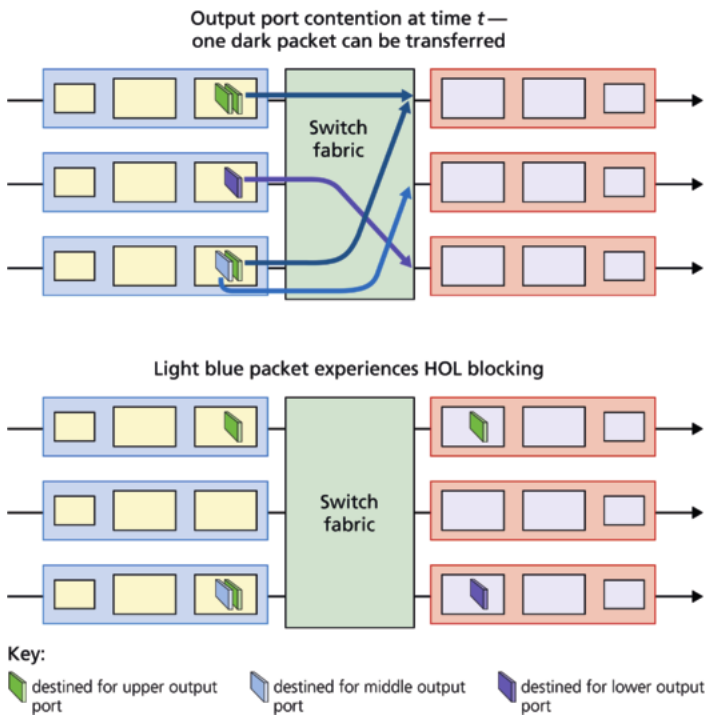

Hình 4.8 HOL blocking tại một switch input-queued

#### Xếp hàng ở đầu ra (Output Queueing)

Tiếp theo hãy xét liệu việc xếp hàng có thể xảy ra tại các port ra của switch không. Giả sử R<sub>switch</sub> lại nhanh hơn R<sub>line</sub> N lần và các packet tới mỗi port trong N port vào đều hướng tới cùng một port ra. Trong trường hợp này, trong thời gian cần để gửi một packet duy nhất lên liên kết ra, N packet mới sẽ tới port ra này (một từ mỗi port trong N port vào). Vì port ra chỉ có thể truyền một packet duy nhất trong một đơn vị thời gian (thời gian truyền packet), N packet đến sẽ phải xếp hàng (chờ) để được truyền qua liên kết ra. Sau đó N packet nữa có thể tới trong thời gian cần để truyền chỉ một trong N packet vừa được xếp hàng trước đó. Và cứ thế. Do đó, hàng đợi packet có thể hình thành tại các port ra ngay cả khi switching fabric nhanh hơn tốc độ đường của port N lần. Cuối cùng, số packet xếp hàng có thể tăng đủ lớn để làm cạn bộ nhớ khả dụng tại port ra.

Khi không đủ bộ nhớ để buffer một packet đến, phải quyết định hoặc loại bỏ packet đến (một chính sách gọi là drop-tail (bỏ đuôi)) hoặc loại bỏ một hoặc nhiều packet already-queued (đã xếp hàng) để nhường chỗ cho packet mới tới. Trong một số trường hợp, có thể có lợi nếu loại bỏ (hoặc đánh dấu header của) một packet trước khi buffer đầy để cung cấp tín hiệu tắc nghẽn cho bên gửi. Việc đánh dấu này có thể được thực hiện dùng các bit Explicit Congestion Notification mà chúng ta đã nghiên cứu trong Mục 3.7.2. Một số chính sách packet-dropping (loại bỏ packet) và -marking (đánh dấu) chủ động (được gọi chung là các thuật toán quản lý hàng đợi tích cực (active queue management - AQM)) đã được đề xuất và phân tích [Labrador 1999, Hollot 2002]. Một trong những thuật toán AQM được nghiên cứu và triển khai rộng rãi nhất là thuật toán Random Early Detection (RED) [Christiansen 2001]. Các chính sách AQM gần đây hơn bao gồm PIE (Proportional Integral controller Enhanced [RFC 8033]), và CoDel [Nichols 2012].

Việc xếp hàng ở port ra được minh họa trong Hình 4.9. Tại thời điểm t, một packet đã tới mỗi port vào, mỗi packet hướng tới port ra trên cùng. Giả sử tốc độ đường giống nhau và một switch hoạt động ở gấp ba lần tốc độ đường, một đơn vị thời gian sau (tức là, trong thời gian cần để nhận hoặc gửi một packet), cả ba packet gốc đã được truyền tới port ra và đang xếp hàng chờ truyền. Trong đơn vị thời gian tiếp theo, một trong ba packet này sẽ được truyền qua liên kết ra. Trong ví dụ của chúng ta, hai packet mới đã tới phía vào của switch; một trong các packet này hướng tới port ra trên cùng này. Một hệ quả của việc xếp hàng như vậy là bộ lập lịch packet (packet scheduler) tại port ra phải chọn một packet, trong số những packet đang xếp hàng, để truyền—một chủ đề chúng ta sẽ đề cập trong mục tiếp theo.

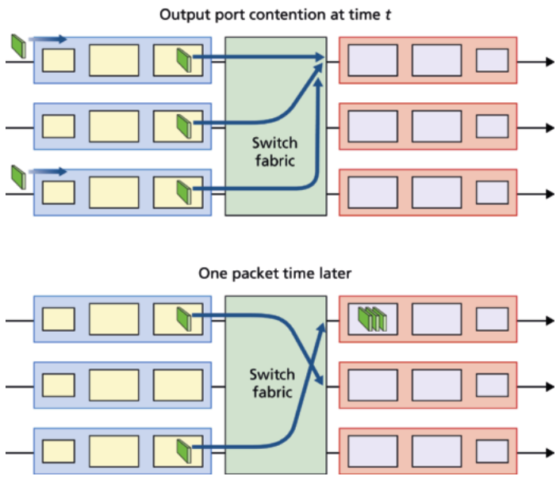

Hình 4.9 Xếp hàng ở port ra

#### Bao nhiêu buffer là “đủ”? (How Much Buffering Is “Enough?”)

Nghiên cứu ở trên của chúng ta đã cho thấy cách một hàng đợi packet hình thành khi các loạt packet tới port vào hoặc (nhiều khả năng hơn) port ra của router, và tốc độ đến của packet tạm thời vượt quá tốc độ packet có thể được chuyển tiếp. Sự không khớp này kéo dài càng lâu, hàng đợi sẽ càng dài, cho đến khi cuối cùng buffer của một port đầy và packet bị loại bỏ. Một câu hỏi tự nhiên là nên cấp phát bao nhiêu buffer tại một port. Hóa ra câu trả lời cho câu hỏi này phức tạp hơn nhiều so với người ta có thể tưởng tượng và có thể dạy chúng ta khá nhiều về sự tương tác tinh tế giữa các bên gửi congestion-aware (nhận biết tắc nghẽn) ở rìa mạng và lõi mạng!

Trong nhiều năm, quy tắc kinh nghiệm [RFC 3439] cho việc định kích thước buffer là lượng buffer (B) nên bằng một round-trip time trung bình (RTT, chẳng hạn 250 msec) nhân dung lượng liên kết (C). Do đó, một liên kết 10-Gbps với RTT 250 msec sẽ cần một lượng buffer bằng B = RTT • C = 2.5 Gbits buffer. Kết quả này dựa trên một phân tích động lực hàng đợi của một số tương đối nhỏ luồng TCP [Villamizar 1994]. Tuy nhiên, các nỗ lực lý thuyết và thực nghiệm gần đây hơn [Appenzeller 2004] gợi ý rằng khi một số lượng lớn luồng TCP độc lập (N) đi qua một liên kết, lượng buffer cần thiết là B = RTT • C/√N. Trong các mạng lõi, nơi một số lượng lớn luồng TCP thường đi qua các liên kết router backbone lớn, giá trị N có thể lớn, với việc giảm kích thước buffer cần thiết trở nên khá đáng kể. [Appenzeller 2004; Wischik 2005; Beheshti 2008] cung cấp các thảo luận rất dễ đọc về vấn đề buffer-sizing (định kích thước buffer) từ góc độ lý thuyết, triển khai và vận hành.

Thật hấp dẫn khi nghĩ rằng nhiều buffer hơn chắc chắn tốt hơn—buffer lớn hơn sẽ cho phép router hấp thụ các dao động lớn hơn trong tốc độ đến của packet, qua đó giảm tỉ lệ mất gói của router. Nhưng buffer lớn hơn cũng có nghĩa độ trễ hàng đợi có thể dài hơn. Với game thủ và người dùng hội nghị từ xa tương tác, hàng chục mili giây đều quan trọng. Tăng lượng buffer per-hop (mỗi hop) lên gấp 10 lần để giảm mất gói có thể tăng độ trễ end-end lên gấp 10 lần! RTT tăng cũng khiến các bên gửi TCP kém nhạy và phản ứng chậm hơn với tắc nghẽn mới chớm và/hoặc mất gói. Các cân nhắc delay-based này cho thấy buffer là một con dao double-edged (hai lưỡi)—buffer có thể được dùng để hấp thụ các dao động thống kê short-term (ngắn hạn) trong traffic nhưng cũng có thể dẫn tới độ trễ tăng và các mối lo đi kèm. Buffer hơi giống muối—vừa đủ muối làm món ăn ngon hơn, nhưng quá nhiều làm nó không ăn được!

Trong thảo luận ở trên, chúng ta đã ngầm giả định rằng nhiều bên gửi độc lập đang cạnh tranh băng thông và buffer tại một liên kết tắc nghẽn. Mặc dù đây có lẽ là một giả định tuyệt vời cho các router trong lõi mạng, ở rìa mạng điều này có thể không đúng. Hình 4.10(a) cho thấy một router gia đình gửi các segment TCP tới một game server từ xa. Theo [Nichols 2012], giả sử mất 20 ms để truyền một packet (chứa một segment TCP của game thủ), độ trễ hàng đợi ở những nơi khác trên đường tới game server là không đáng kể, và RTT là 200 ms. Như minh họa trong Hình 4.10(b), giả sử tại thời điểm t = 0, một loạt 25 packet tới hàng đợi. Một trong các packet xếp hàng này sau đó được truyền mỗi 20 ms một lần, sao cho tại t = 200 msec, ACK đầu tiên tới, đúng lúc packet thứ 21 đang được truyền. ACK này tới khiến bên gửi TCP gửi một packet khác, packet này được xếp hàng tại liên kết ra của router gia đình. Tại t = 220, ACK tiếp theo tới, và một segment TCP khác được game thủ phát ra và được xếp hàng, khi packet thứ 22 đang được truyền, v.v. Bạn nên tự thuyết phục mình rằng trong kịch bản này, ACK clocking dẫn tới một packet mới tới hàng đợi mỗi khi một packet đang xếp hàng được gửi, dẫn tới kích thước hàng đợi tại liên kết ra của router gia đình luôn là năm packet! Tức là, end-end-pipe (đường ống đầu cuối) đầy (chuyển packet tới đích ở tốc độ nút cổ chai của đường là một packet mỗi 20 ms), nhưng lượng độ trễ hàng đợi là không đổi và kéo dài. Kết quả là, game thủ không hài lòng với độ trễ, và phụ huynh (người thậm chí biết wireshark!) bối rối vì họ không hiểu tại sao độ trễ kéo dài và quá lớn, ngay cả khi không có traffic nào khác trên mạng gia đình.

Kịch bản trên về độ trễ dài do buffer kéo dài được gọi là bufferbloat và minh họa rằng không chỉ throughput quan trọng, mà độ trễ tối thiểu cũng quan trọng [Kleinrock 2018], và rằng sự tương tác giữa các bên gửi ở rìa mạng và các hàng đợi bên trong mạng thực sự có thể phức tạp và tinh tế. Chuẩn DOCSIS 3.1 cho mạng cáp mà chúng ta sẽ nghiên cứu trong Chương 6, gần đây đã thêm một cơ chế AQM cụ thể [RFC 8033, RFC 8034] để chống bufferbloat, đồng thời bảo toàn performance throughput khối lượng lớn.

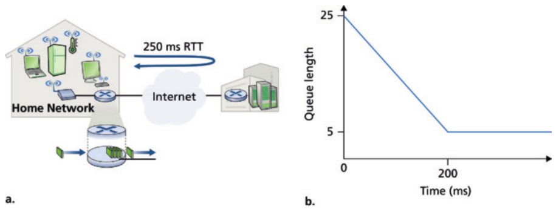

Hình 4.10 Bufferbloat: hàng đợi kéo dài

### 4.2.5 Lập lịch packet (Packet Scheduling)

Giờ hãy quay lại câu hỏi xác định thứ tự các packet đang xếp hàng được truyền qua một liên kết ra. Vì chắc chắn chính bạn đã nhiều lần phải chờ trong những hàng dài và quan sát cách khách hàng đang chờ được phục vụ, bạn hẳn đã quen với nhiều quy tắc xếp hàng (queueing discipline) thường dùng trong router. Đầu tiên là first-come-first-served (FCFS - đến trước phục vụ trước, còn gọi là first-in-first-out, FIFO). Người Anh nổi tiếng với việc xếp hàng FCFS kiên nhẫn và trật tự tại các trạm xe buýt và ở chợ (“Ồ, bạn đang xếp hàng à?”). Các nước khác hoạt động trên cơ sở ưu tiên, với một lớp khách hàng đang chờ được phục vụ ưu tiên hơn các khách hàng đang chờ khác. Cũng có xếp hàng round-robin (xoay vòng), trong đó khách hàng lại được chia thành các lớp (như trong xếp hàng ưu tiên) nhưng mỗi lớp khách hàng được phục vụ lần lượt.

#### Vào trước ra trước (First-in-First-Out (FIFO))

Hình 4.11 cho thấy trừu tượng mô hình hàng đợi cho quy tắc link-scheduling (lập lịch liên kết) FIFO. Các packet đến hàng đợi ra của liên kết chờ được truyền nếu liên kết hiện đang bận truyền một packet khác. Nếu không đủ không gian buffer để giữ packet đến, chính sách packet-discarding (loại bỏ packet) của hàng đợi khi đó xác định packet sẽ bị loại bỏ (mất) hay các packet khác sẽ bị xóa khỏi hàng đợi để nhường chỗ cho packet đến, như đã thảo luận ở trên. Trong thảo luận bên dưới, chúng ta sẽ bỏ qua việc loại bỏ packet. Khi một packet được truyền xong hoàn toàn qua liên kết ra (tức là, được phục vụ), nó được xóa khỏi hàng đợi.

Quy tắc lập lịch FIFO (còn gọi là first-come-first-served, hay FCFS) chọn packet để truyền trên liên kết theo đúng thứ tự chúng tới hàng đợi liên kết ra. Tất cả chúng ta đều quen với xếp hàng FIFO ở các trung tâm dịch vụ, nơi khách hàng đến xếp vào cuối hàng chờ duy nhất, giữ đúng thứ tự, và được phục vụ khi tới đầu hàng. Hình 4.12 cho thấy hàng đợi FIFO khi hoạt động. Việc packet đến được biểu thị bằng các mũi tên đánh số phía trên dòng thời gian trên, với con số cho biết thứ tự packet tới. Các lần packet rời đi riêng lẻ được hiển thị phía dưới dòng thời gian dưới. Thời gian một packet được phục vụ (được truyền) được biểu thị bằng chiều dài ngang của hình chữ nhật giữa hai dòng thời gian. Trong các ví dụ ở đây, hãy giả sử mỗi packet mất ba đơn vị thời gian để được truyền. Theo quy tắc FIFO, packet rời đi theo đúng thứ tự chúng tới. Lưu ý rằng sau khi packet 4 rời đi, liên kết vẫn rảnh (vì các packet 1 đến 4 đã được truyền và xóa khỏi hàng đợi) cho đến khi packet 5 tới.

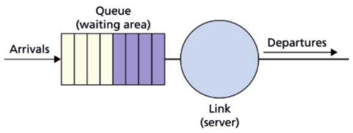

Hình 4.11 Trừu tượng hàng đợi FIFO

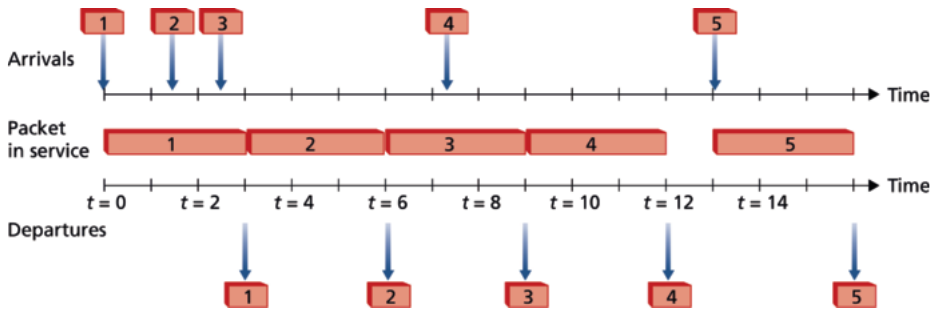

Hình 4.12 Hàng đợi FIFO khi hoạt động

#### Xếp hàng ưu tiên (Priority Queuing)

Theo xếp hàng ưu tiên, các packet tới liên kết ra được phân loại vào các lớp ưu tiên khi tới hàng đợi, như minh họa trong Hình 4.13. Trong thực tế, một nhà vận hành mạng có thể cấu hình hàng đợi sao cho các packet mang thông tin quản lý mạng (ví dụ, như được chỉ ra bởi số port TCP/UDP nguồn hoặc đích) được ưu tiên hơn traffic người dùng; ngoài ra, các packet voice-over-IP real-time có thể được ưu tiên hơn traffic non-real-time như packet e-mail. Mỗi lớp ưu tiên thường có hàng đợi riêng. Khi chọn một packet để truyền, quy tắc xếp hàng ưu tiên sẽ truyền một packet từ lớp ưu tiên cao nhất có hàng đợi không rỗng (tức là, có packet đang chờ truyền). Việc chọn giữa các packet trong cùng lớp ưu tiên thường được thực hiện theo kiểu FIFO.

Hình 4.14 minh họa hoạt động của một hàng đợi ưu tiên với hai lớp ưu tiên. Các packet 1, 3 và 4 thuộc lớp high-priority (ưu tiên cao), và các packet 2 và 5 thuộc lớp low-priority (ưu tiên thấp). Packet 1 tới và, thấy liên kết rảnh, bắt đầu truyền. Trong khi truyền packet 1, các packet 2 và 3 tới và lần lượt được xếp vào hàng đợi low-and high-priority. Sau khi truyền packet 1, packet 3 (một packet high-priority) được chọn để truyền trước packet 2 (mặc dù tới sớm hơn, là một packet low-- priority). Khi kết thúc truyền packet 3, packet 2 sau đó bắt đầu truyền. Packet 4 (một packet high-priority) tới trong khi truyền packet 2 (một packet low-priority). Theo quy tắc xếp hàng ưu tiên non-preemptive (không giành quyền), việc truyền một packet không bị ngắt khi đã bắt đầu. Trong trường hợp này, packet 4 xếp hàng chờ truyền và bắt đầu được truyền sau khi việc truyền packet 2 hoàn tất.

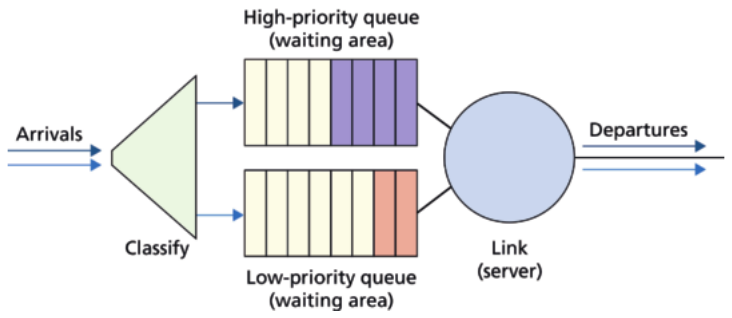

Hình 4.13 Mô hình xếp hàng ưu tiên

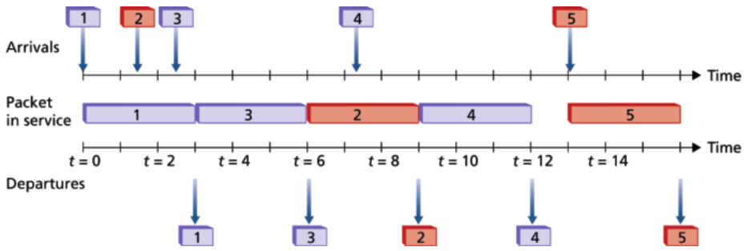

Hình 4.14 Hàng đợi ưu tiên khi hoạt động

### Nguyên lý trong thực tế (Principles in Practice)

### Trung lập mạng (Net Neutrality)

Chúng ta đã thấy các cơ chế lập lịch packet (ví dụ, các quy tắc lập lịch traffic ưu tiên như ưu tiên nghiêm ngặt, và WFQ) có thể được dùng để cung cấp các mức dịch vụ khác nhau cho các “lớp” traffic khác nhau. Định nghĩa chính xác cái gì tạo thành một “lớp” traffic là do ISP quyết định, nhưng có thể dựa trên bất kỳ tập trường nào trong header IP datagram. Ví dụ, trường port trong header IP datagram có thể được dùng để phân loại datagram theo “dịch vụ well-know” gắn với port đó: datagram quản lý mạng SNMP (port 161) có thể được gán vào lớp ưu tiên cao hơn datagram giao thức e-mail IMAP (port 143, hoặc 993) và do đó nhận dịch vụ tốt hơn. Một ISP cũng có thể dùng địa chỉ IP nguồn của datagram để ưu tiên các datagram được gửi bởi một số công ty (những công ty có lẽ đã trả tiền cho ISP để có đặc quyền này) hơn các datagram gửi từ các công ty khác (những công ty chưa trả tiền); một ISP thậm chí có thể chặn traffic có địa chỉ IP nguồn thuộc một công ty, hoặc quốc gia nhất định. Có nhiều cơ chế cho phép một ISP cung cấp các mức dịch vụ khác nhau cho các lớp traffic khác nhau. Câu hỏi thực sự là chính sách và luật pháp nào xác định một ISP thực sự được làm gì. Tất nhiên, các luật này sẽ khác nhau theo quốc gia; xem [Smithsonian 2017] để có một khảo sát ngắn. Ở đây, chúng ta sẽ xét ngắn gọn chính sách của Mỹ về cái đã được gọi là “trung lập mạng” (net neutrality).

Thuật ngữ “net neutrality” không có một định nghĩa chính xác, nhưng Lệnh về Bảo vệ và Thúc đẩy một Internet Mở (Order on Protecting and Promoting an Open Internet) tháng Ba 2015 [FCC 2015] của Ủy ban Truyền thông Liên bang Mỹ (US Federal Communications Commission) đưa ra ba quy tắc “rõ ràng, ranh giới sáng tỏ” mà giờ thường gắn với net neutrality:

• “Không chặn (No Blocking). . . . Một người tham gia cung cấp dịch vụ truy cập Internet băng rộng, . . . không được chặn nội dung, ứng dụng, dịch vụ hợp pháp, hoặc thiết bị non-harmful (vô hại), tùy thuộc vào quản lý mạng hợp lý.”

• “Không bóp băng thông (No Throttling). . . . Một người tham gia cung cấp dịch vụ truy cập Internet băng rộng, . . . không được làm suy giảm hoặc làm giảm chất lượng traffic Internet hợp pháp dựa trên nội dung Internet, ứng dụng, hoặc dịch vụ, hoặc việc dùng một thiết bị non-harmful, tùy thuộc vào quản lý mạng hợp lý.”

• “Không ưu tiên trả phí (No Paid Prioritization). . . . Một người tham gia cung cấp dịch vụ truy cập Internet băng rộng, . . . không được tham gia ưu tiên trả phí. “Ưu tiên trả phí” chỉ việc quản lý mạng của nhà cung cấp băng rộng để trực tiếp hoặc gián tiếp ưu ái một số traffic hơn traffic khác, bao gồm thông qua việc dùng các kỹ thuật như định hình traffic (traffic shaping), ưu tiên hóa, đặt trước tài nguyên, hoặc các dạng quản lý traffic ưu đãi khác, . . .”

Khá thú vị là, trước khi có Lệnh này, các hành vi của ISP vi phạm hai quy tắc đầu đã được quan sát [Faulhaber 2012]. Năm 2005, một ISP ở North Carolina đã đồng ý dừng việc chặn khách hàng của mình dùng Vonage, một dịch vụ voice-over-IP cạnh tranh với dịch vụ điện thoại của chính ISP. Năm 2007, Comcast bị phán quyết là đã can thiệp vào traffic BitTorrent P2P bằng cách tạo nội bộ và gửi các packet TCP RST tới bên gửi và bên nhận BitTorrent, khiến họ đóng kết nối BitTorrent [FCC 2008].

Cả hai phía của cuộc tranh luận về net neutrality đã được tranh luận quyết liệt, chủ yếu tập trung vào mức độ net neutrality mang lại lợi ích cho khách hàng, đồng thời thúc đẩy đổi mới. Xem [Peha 2006, Faulhaber 2012, Economides 2017, Madhyastha 2017].

Lệnh FCC 2015 về Bảo vệ và Thúc đẩy một Internet Mở, vốn cấm ISP chặn, bóp băng thông hoặc cung cấp ưu tiên trả phí, đã bị thay thế bởi Lệnh Khôi phục Tự do Internet (Restoring Internet Freedom Order) của FCC năm 2017, [FCC 2017] vốn bãi bỏ các lệnh cấm này và thay vào đó tập trung vào tính minh bạch của ISP. Năm 2024, FCC đã khôi phục phần lớn Lệnh FCC 2015 (thực chất là bãi bỏ việc bãi bỏ năm 2017) và cũng re-re-classified (phân loại lại lần nữa) dịch vụ truy cập Internet băng rộng (BIAS) là “dịch vụ viễn thông” thay vì “dịch vụ thông tin” [FCC 2024]. Tuy nhiên, việc phân loại lại có vẻ vô hại này có nghĩa là dịch vụ truy cập Internet băng rộng sẽ chịu sự quản lý của chính phủ Mỹ nhiều hơn đáng kể. Với nhiều quan tâm và nhiều thay đổi như vậy, có lẽ có thể nói chắc rằng chúng ta còn lâu mới thấy chương cuối cùng được viết về net neutrality ở Hoa Kỳ, hay ở nơi khác.

#### Round robin và xếp hàng công bằng có trọng số (Round Robin and Weighted Fair Queuing (WFQ))

Theo quy tắc xếp hàng round robin, packet được phân loại vào các lớp như với xếp hàng ưu tiên. Tuy nhiên, thay vì có một thứ tự ưu tiên phục vụ nghiêm ngặt giữa các lớp, một bộ lập lịch round robin luân phiên phục vụ giữa các lớp. Ở dạng đơn giản nhất của lập lịch round robin, một packet lớp 1 được truyền, theo sau là một packet lớp 2, theo sau là một packet lớp 1, theo sau là một packet lớp 2, v.v. Một quy tắc xếp hàng so-called work-conserving (bảo toàn công việc) sẽ không bao giờ để liên kết rảnh khi có packet (thuộc bất kỳ lớp nào) đang xếp hàng chờ truyền. Một quy tắc round robin work-conserving tìm một packet của một lớp cho trước nhưng không tìm thấy sẽ ngay lập tức kiểm tra lớp tiếp theo trong chuỗi round robin.

Hình 4.15 minh họa hoạt động của một hàng đợi round robin two-class (hai lớp). Trong ví dụ này, các packet 1, 2 và 4 thuộc lớp 1, và các packet 3 và 5 thuộc lớp thứ hai. Packet 1 bắt đầu truyền ngay khi tới hàng đợi ra. Các packet 2 và 3 tới trong khi truyền packet 1 và do đó xếp hàng chờ truyền. Sau khi truyền packet 1, bộ lập lịch liên kết tìm một packet lớp 2 và do đó truyền packet 3. Sau khi truyền packet 3, bộ lập lịch tìm một packet lớp 1 và do đó truyền packet 2. Sau khi truyền packet 2, packet 4 là packet đang xếp hàng duy nhất; do đó nó được truyền ngay sau packet 2.

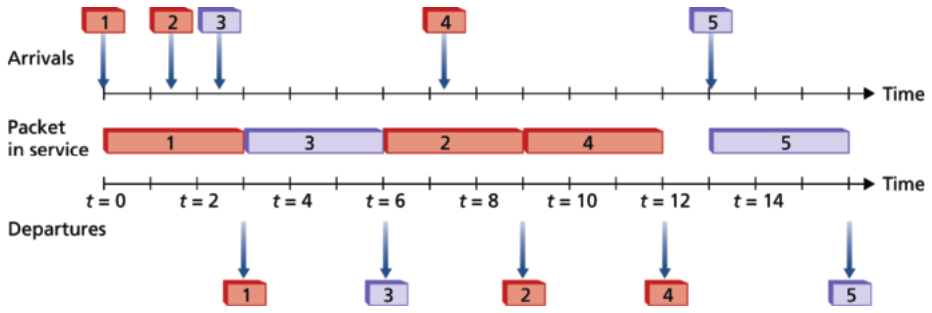

Hình 4.15 Hàng đợi round robin two-class khi hoạt động

Một dạng tổng quát của xếp hàng round robin đã được triển khai rộng rãi trong router là quy tắc so-called xếp hàng công bằng có trọng số (weighted fair queuing - WFQ) [Demers 1990; Parekh 1993. WFQ được minh họa trong Hình 4.16. Ở đây, các packet đến được phân loại và xếp hàng vào vùng chờ per-class (theo lớp) thích hợp. Như trong lập lịch round robin, một bộ lập lịch WFQ sẽ phục vụ các lớp theo kiểu vòng tròn—trước hết phục vụ lớp 1, rồi phục vụ lớp 2, rồi phục vụ lớp 3, rồi (giả sử có ba lớp) lặp lại mẫu phục vụ. WFQ cũng là một quy tắc xếp hàng work-conserving và do đó sẽ ngay lập tức chuyển sang lớp tiếp theo trong chuỗi phục vụ khi nó thấy một hàng đợi lớp rỗng.

WFQ khác round robin ở chỗ mỗi lớp có thể nhận một lượng phục vụ khác nhau trong bất kỳ khoảng thời gian nào. Cụ thể, mỗi lớp, i, được gán một trọng số, w<sub>i</sub>. Theo WFQ, trong bất kỳ khoảng thời gian nào có packet lớp i cần gửi, lớp i khi đó sẽ được đảm bảo nhận một phần phục vụ bằng w<sub>i</sub>/(Σw<sub>j</sub>), trong đó tổng ở mẫu số được lấy trên tất cả các lớp cũng có packet đang xếp hàng chờ truyền. Trong trường hợp xấu nhất, ngay cả khi tất cả các lớp đều có packet xếp hàng, lớp i vẫn được đảm bảo nhận một phần w<sub>i</sub>/(Σw<sub>j</sub>) băng thông, trong đó trong trường hợp xấu nhất này tổng ở mẫu số là trên tất cả các lớp. Do đó, với một liên kết có tốc độ truyền R, lớp i sẽ luôn đạt throughput ít nhất R • w<sub>i</sub>/(Σw<sub>j</sub>). Mô tả của chúng ta về WFQ đã được lý tưởng hóa, vì chúng ta chưa xét thực tế rằng packet là rời rạc và việc truyền một packet sẽ không bị ngắt để bắt đầu truyền packet khác; [Demers 1990; Parekh 1993] thảo luận vấn đề packet hóa này.

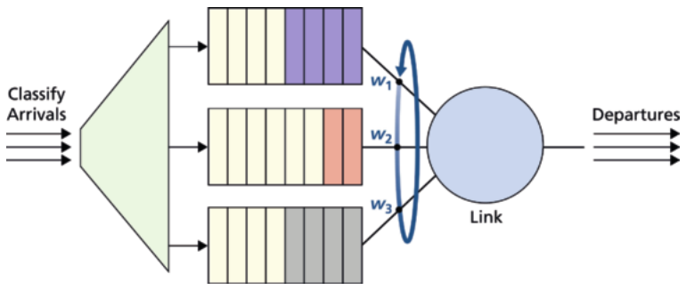

Hình 4.16 Xếp hàng công bằng có trọng số

## 4.3 Giao thức Internet (IP): IPv4, định địa chỉ, IPv6, và hơn nữa (The Internet Protocol (IP): IPV4, Addressing, IPV6, and More)

Nghiên cứu về tầng mạng cho đến giờ trong Chương 4—khái niệm thành phần data plane và control plane của tầng mạng, sự phân biệt giữa chuyển tiếp và định tuyến, việc xác định các mô hình dịch vụ mạng khác nhau, và cái nhìn vào bên trong router—thường không đề cập tới bất kỳ kiến trúc hay giao thức mạng máy tính cụ thể nào. Trong mục này, chúng ta sẽ tập trung vào các khía cạnh then chốt của tầng mạng trên Internet ngày nay và Internet Protocol (IP) nổi tiếng. Có hai phiên bản IP đang được dùng ngày nay. Trước hết chúng ta sẽ xem xét giao thức IP phiên bản 4 được triển khai rộng rãi, thường được gọi đơn giản là IPv4 [RFC 791] trong Mục 4.3.1. Chúng ta sẽ xem xét IP phiên bản 6 [RFC 2460; RFC 4291], được đề xuất để thay thế IPv4, trong Mục 4.3.4. Ở giữa, chúng ta sẽ chủ yếu đề cập việc định địa chỉ Internet—một chủ đề có vẻ khá khô khan và detail-oriented (thiên về chi tiết) nhưng chúng ta sẽ thấy là thiết yếu để hiểu tầng mạng của Internet hoạt động thế nào. Làm chủ việc định địa chỉ IP là làm chủ chính tầng mạng của Internet!

### 4.3.1 Định dạng datagram IPv4 (IPV4 Datagram Format)

Nhớ rằng packet network-layer của Internet được gọi là datagram. Chúng ta bắt đầu nghiên cứu IP với tổng quan về cú pháp và ngữ nghĩa của datagram IPv4. Có thể bạn đang nghĩ rằng không gì khô khan hơn cú pháp và ngữ nghĩa của các bit trong một packet. Tuy vậy, datagram đóng vai trò trung tâm trong Internet—mọi sinh viên và người làm chuyên nghiệp về mạng đều cần thấy nó, thấm nó, và làm chủ nó. (Và chỉ để thấy rằng header giao thức thực sự có thể thú vị để học, hãy xem [Pomeranz 2010]). Định dạng datagram IPv4 được minh họa trong Hình 4.17. Các trường then chốt trong datagram IPv4 như sau:

• Số phiên bản (Version number). 4 bit này chỉ định phiên bản giao thức IP của datagram. Bằng cách xem số phiên bản, router có thể xác định cách diễn giải phần còn lại của IP datagram. Các phiên bản IP khác nhau dùng các định dạng datagram khác nhau. Định dạng datagram cho IPv4 được minh họa trong Hình 4.17. Định dạng datagram cho phiên bản IP mới (IPv6) được thảo luận trong Mục 4.3.4.

• Độ dài header (Header length). Vì một datagram IPv4 có thể chứa số lượng tùy chọn (option) thay đổi (được đưa vào header datagram IPv4), 4 bit này cần để xác định nơi trong IP datagram mà payload (ví dụ, segment transport-layer được đóng gói trong datagram này) thực sự bắt đầu. Hầu hết IP datagram không chứa tùy chọn, nên IP datagram điển hình có header 20-byte.

• Loại dịch vụ (Type of service). Các bit type of service ( TOS) được đưa vào header IPv4 để cho phép phân biệt các loại IP datagram khác nhau với nhau. Ví dụ, có thể hữu ích nếu phân biệt các datagram real-time (như những datagram được dùng bởi ứng dụng điện thoại IP) với traffic non-real-time (ví dụ, FTP). Mức dịch vụ cụ thể được cung cấp là một vấn đề chính sách do quản trị viên mạng xác định và cấu hình cho router đó. Chúng ta cũng đã học trong Mục 3.7 rằng hai trong các bit TOS được dùng cho Explicit Congestion Notification.

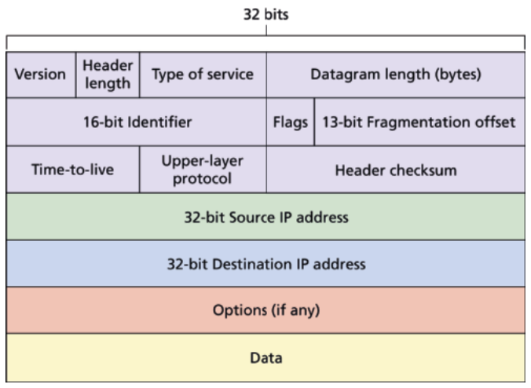

Hình 4.17 Định dạng datagram IPV4

• Độ dài datagram (Datagram length). Đây là tổng độ dài của IP datagram (header cộng dữ liệu), tính bằng byte. Vì trường này dài 16 bit, kích thước tối đa lý thuyết của IP datagram là 65,535 byte. Tuy nhiên, datagram hiếm khi lớn hơn 1,500 byte, cho phép một IP datagram vừa trong trường payload của một frame Ethernet kích thước tối đa.

• Identifier, cờ, fragmentation offset (Identifier, flags, fragmentation offset). Ba trường này liên quan tới cái so-called phân mảnh IP (IP fragmentation), khi một IP datagram lớn bị chia thành nhiều IP datagram nhỏ hơn rồi được chuyển tiếp độc lập tới đích, nơi chúng được ráp lại trước khi dữ liệu payload của chúng (xem bên dưới) được chuyển lên tầng giao vận tại host đích. Thú vị là, phiên bản IP mới, IPv6, không cho phép phân mảnh. Chúng ta sẽ không đề cập phân mảnh ở đây; nhưng độc giả có thể tìm thấy thảo luận chi tiết trực tuyến, trong số các tài liệu “đã nghỉ hưu” từ các phiên bản trước của cuốn sách này.

• Time-to-live. Trường time-to-live (TTL) được đưa vào để đảm bảo datagram không lưu thông mãi mãi (do, chẳng hạn, một vòng lặp định tuyến long-lived) trong mạng. Trường này được giảm đi một mỗi khi datagram được một router xử lý. Nếu trường TTL đạt 0, router phải loại bỏ datagram đó.

• Giao thức (Protocol). Trường này thường chỉ được dùng khi một IP datagram tới đích cuối cùng. Giá trị của trường này cho biết giao thức transport-layer cụ thể mà phần dữ liệu của IP datagram này nên được chuyển tới. Ví dụ, giá trị 6 cho biết phần dữ liệu được chuyển tới TCP, trong khi giá trị 17 cho biết dữ liệu được chuyển tới UDP. Để có danh sách tất cả các giá trị khả dĩ, xem [IANA Protocol Numbers 2025]. Lưu ý rằng số protocol trong IP datagram có vai trò tương tự vai trò của trường số port trong segment transport-layer. Số protocol là chất keo gắn tầng mạng và tầng giao vận với nhau, trong khi số port là chất keo gắn tầng giao vận và tầng ứng dụng với nhau. Chúng ta sẽ thấy trong Chương 6 rằng frame link-layer cũng có một trường đặc biệt gắn tầng liên kết với tầng mạng.

• Checksum header (Header checksum). Checksum header giúp router phát hiện lỗi bit trong một IP datagram nhận được. Checksum header được tính bằng cách coi mỗi 2 byte trong header là một số và cộng các số này dùng số học bù 1 (1s complement). Như đã thảo luận trong Mục 3.3, phép bù một của tổng này, gọi là Internet checksum, được lưu trong trường checksum. Một router tính checksum header cho mỗi IP datagram nhận được và phát hiện tình trạng lỗi nếu checksum mang trong header datagram không bằng checksum được tính. Router thường loại bỏ các datagram bị phát hiện có lỗi. Lưu ý rằng checksum phải được tính lại và lưu lại tại mỗi router, vì trường TTL, và có thể cả trường options, sẽ thay đổi. Một thảo luận thú vị về các thuật toán nhanh để tính Internet checksum là [RFC 1071]. Một câu hỏi thường được đặt ra tại thời điểm này là, tại sao TCP/IP thực hiện kiểm tra lỗi ở cả tầng giao vận lẫn tầng mạng? Có vài lý do cho sự lặp lại này. Thứ nhất, lưu ý rằng chỉ header IP được tính checksum ở tầng IP, trong khi checksum TCP/UDP được tính trên toàn bộ segment TCP/UDP. Thứ hai, TCP/UDP và IP không nhất thiết phải thuộc cùng một protocol stack. Về nguyên tắc, TCP có thể chạy trên một giao thức network-layer khác (ví dụ, ATM) [Black 1995]) và IP có thể mang dữ liệu sẽ không được chuyển tới TCP/UDP.

• Địa chỉ IP nguồn và đích (Source and destination IP addresses). Khi một nguồn tạo một datagram, nó chèn địa chỉ IP của mình vào trường địa chỉ IP nguồn và chèn địa chỉ của đích cuối cùng vào trường địa chỉ IP đích.

  Thường host nguồn xác định địa chỉ đích qua một phép tra cứu DNS, như đã thảo luận trong Chương 2. Chúng ta sẽ thảo luận chi tiết việc định địa chỉ IP trong Mục 4.3.2.

• Tùy chọn (Options). Các trường options cho phép mở rộng header IP. Các tùy chọn header được dự định để hiếm khi dùng—do đó quyết định tiết kiệm overhead bằng cách không đưa thông tin trong các trường options vào mọi header datagram. Tuy nhiên, chỉ riêng sự tồn tại của options đã làm phức tạp vấn đề— vì header datagram có thể có độ dài thay đổi, người ta không thể xác định a priori (trước) trường dữ liệu sẽ bắt đầu ở đâu. Ngoài ra, vì một số datagram có thể cần xử lý options và số khác thì không, lượng thời gian cần để xử lý một IP datagram tại router có thể thay đổi rất nhiều. Những cân nhắc này trở nên đặc biệt quan trọng cho việc xử lý IP trong các router và host high-performance. Vì những lý do này và các lý do khác, options IP không được đưa vào header IPv6, như thảo luận trong Mục 4.3.4.

• Dữ liệu (payload) (Data (payload)). Cuối cùng, chúng ta tới trường cuối cùng và quan trọng nhất—raison d’etre (lý do tồn tại) của datagram ngay từ đầu! Trong hầu hết các trường hợp, trường dữ liệu của IP datagram chứa segment transport-layer (TCP hoặc UDP) cần được chuyển tới đích. Tuy nhiên, trường dữ liệu có thể mang các loại dữ liệu khác, như thông điệp ICMP (thảo luận trong Mục 5.6). Lưu ý rằng một IP datagram có tổng cộng 20 byte header (giả sử không có options). Nếu datagram mang một segment TCP, thì mỗi datagram mang tổng cộng 40 byte header ( 20 byte header IP cộng 20 byte header TCP) cùng với thông điệp application-layer.

### 4.3.2 Định địa chỉ IPv4 (IPV4 Addressing)

Giờ chúng ta chuyển sự chú ý sang việc định địa chỉ IPv4. Mặc dù có thể bạn đang nghĩ rằng định địa chỉ hẳn là một chủ đề đơn giản, hy vọng đến cuối mục này bạn sẽ bị thuyết phục rằng định địa chỉ Internet không chỉ là một chủ đề hấp dẫn, tinh tế và thú vị mà còn có tầm quan trọng trung tâm đối với Internet. Một cách trình bày xuất sắc về định địa chỉ IPv4 có thể tìm thấy trong chương đầu tiên của [Stewart 1999].

Tuy nhiên, trước khi thảo luận việc định địa chỉ IP, chúng ta cần nói vài lời về cách host và router được kết nối vào Internet. Một host thường chỉ có một liên kết duy nhất vào mạng; khi IP trong host muốn gửi một datagram, nó làm vậy qua liên kết này. Ranh giới giữa host và liên kết vật lý được gọi là một giao diện (interface). Giờ hãy xét một router và các giao diện của nó. Vì nhiệm vụ của router là nhận một datagram trên một liên kết và chuyển tiếp datagram trên một liên kết khác, một router tất yếu có hai hoặc nhiều liên kết mà nó được nối tới. Ranh giới giữa router và bất kỳ liên kết nào của nó cũng được gọi là một giao diện. Do đó một router có nhiều giao diện, mỗi giao diện cho một liên kết của nó. Vì mọi host và router đều có khả năng gửi và nhận IP datagram, IP yêu cầu mỗi giao diện host và router có địa chỉ IP riêng. Do đó, về mặt kỹ thuật một địa chỉ IP gắn với một giao diện, chứ không phải với host hay router chứa giao diện đó.

Mỗi địa chỉ IP dài 32 bit (tương đương, 4 byte), và do đó có tổng cộng 2<sup>32</sup> (hay xấp xỉ 4 tỉ) địa chỉ IP khả dĩ. Các địa chỉ này thường được viết theo cái so-called ký pháp dotted-decimal (thập phân có chấm), trong đó mỗi byte của địa chỉ được viết ở dạng thập phân và được ngăn cách bằng một dấu chấm với các byte khác trong địa chỉ. Ví dụ, hãy xét địa chỉ IP 193.32.216.9. 193 là giá trị thập phân tương đương của 8 bit đầu tiên của địa chỉ; 32 là giá trị thập phân tương đương của 8 bit thứ hai của địa chỉ, v.v. Do đó, địa chỉ 193.32.216.9 ở ký pháp nhị phân là

```
11000001 00100000 11011000 00001001
```

Mỗi giao diện trên mọi host và router trong Internet toàn cầu phải có một địa chỉ IP duy nhất toàn cầu (trừ các giao diện phía sau NAT, như thảo luận trong Mục 4.3.3). Tuy nhiên, các địa chỉ này không thể được chọn một cách willy-nilly (tùy tiện). Một phần địa chỉ IP của một giao diện sẽ được xác định bởi subnet mà nó được nối tới.

Hình 4.18 cung cấp một ví dụ về định địa chỉ IP và giao diện. Trong hình này, một router (với ba giao diện) được dùng để nối bảy host. Hãy xem kỹ các địa chỉ IP được gán cho các giao diện host và router, vì có vài điều cần lưu ý. Ba host ở phần upper-left (trên bên trái) của Hình 4.18, và giao diện router mà chúng được nối tới, đều có địa chỉ IP dạng 223.1.1.xxx. Tức là, chúng đều có cùng 24 bit ngoài cùng bên trái trong địa chỉ IP. Bốn giao diện này cũng được nối với nhau bởi một mạng không chứa router nào. Mạng này có thể được nối bằng một Ethernet LAN, trong trường hợp đó các giao diện sẽ được nối bằng một switch Ethernet (như chúng ta sẽ thảo luận trong Chương 6), hoặc bằng một điểm truy cập không dây (như chúng ta sẽ thảo luận trong Chương 7). Tạm thời chúng ta sẽ biểu diễn mạng không router nối các host này như một đám mây, và đi sâu vào bên trong các mạng như vậy trong Chương 6 và 7.

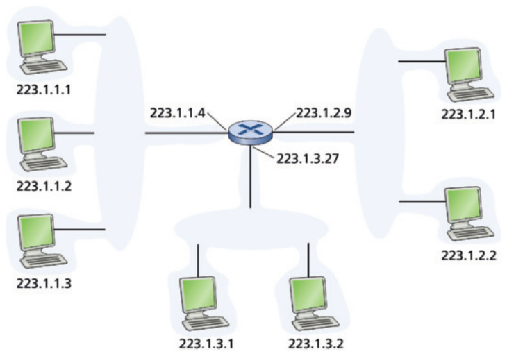

Hình 4.18 Địa chỉ giao diện và subnet

Theo thuật ngữ IP, mạng này nối ba giao diện host và một giao diện router tạo thành một subnet (mạng con) [RFC 950]. (Một subnet còn được gọi là một IP network hay đơn giản là một network trong tài liệu Internet.) Việc định địa chỉ IP gán một địa chỉ cho subnet này: 223.1.1.0/24, trong đó ký pháp th/e 24 ( “slash-24”), đôi khi được gọi là subnet mask (mặt nạ mạng con), cho biết 24 bit ngoài cùng bên trái của đại lượng 32-bit định nghĩa địa chỉ subnet. Do đó subnet 223.1.1.0/24 gồm ba giao diện host ( 223.1.1.1, 223.1.1.2, và 223.1.1.3) và một giao diện router ( 223.1.1.4 ) . Bất kỳ host bổ sung nào gắn vào subnet 223.1.1.0/24 sẽ được yêu cầu có địa chỉ dạng 223.1.1.xxx. Có hai subnet bổ sung được minh họa trong Hình 4.18: mạng 223.1.2.0/24 và subnet 223.1.3.0/24. Hình 4.19 minh họa ba IP subnet có trong Hình 4.18.

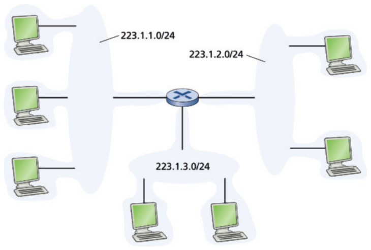

Hình 4.19 Địa chỉ subnet

Định nghĩa subnet của IP không bị giới hạn ở các đoạn Ethernet nối nhiều host tới một giao diện router. Để hiểu thêm ở đây, hãy xét Hình 4.20, cho thấy ba router được nối với nhau bằng các liên kết point-to-point. Mỗi router có ba giao diện, một cho mỗi liên kết point-to-point và một cho liên kết quảng bá nối trực tiếp router với một cặp host. Có những subnet nào ở đây? Ba subnet, 223.1.1.0/24, 223.1.2.0/24, và 223.1.3.0/24, tương tự các subnet chúng ta đã gặp trong Hình 4.18. Nhưng lưu ý rằng cũng có thêm ba subnet trong ví dụ này: một subnet, 223.1.9.0/24, cho các giao diện nối router R1 và R2; một subnet khác, 223.1.8.0/24, cho các giao diện nối router R2 và R3; và một subnet thứ ba, 223.1.7.0/24, cho các giao diện nối router R3 và R1. Với một hệ thống router và host được nối với nhau tổng quát, chúng ta có thể dùng công thức sau để xác định các subnet trong hệ thống:

Để xác định các subnet, hãy tách mỗi giao diện khỏi host hoặc router của nó, tạo ra các đảo mạng cô lập, với các giao diện kết cuối các điểm cuối của các mạng cô lập. Mỗi mạng cô lập này được gọi là một subnet.

Nếu áp dụng thủ tục này cho hệ thống được nối trong Hình 4.20, chúng ta có sáu đảo hay subnet.

Từ thảo luận ở trên, rõ ràng một tổ chức (như một công ty hoặc cơ sở học thuật) có nhiều đoạn Ethernet và liên kết point-to-point sẽ có nhiều subnet, với mọi thiết bị trên một subnet cho trước có cùng địa chỉ subnet. Về nguyên tắc, các subnet khác nhau có thể có địa chỉ subnet khá khác nhau. Tuy nhiên, trong thực tế, địa chỉ subnet của chúng thường có nhiều điểm chung. Để hiểu tại sao, tiếp theo hãy chuyển sự chú ý sang cách việc định địa chỉ được xử lý trong Internet toàn cầu.

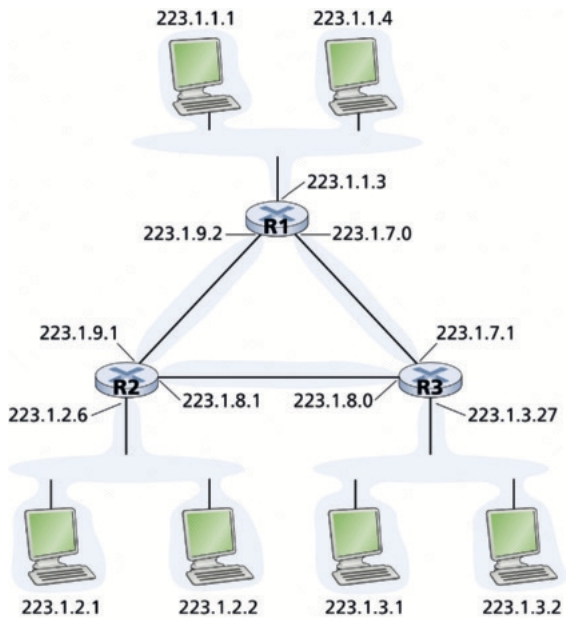

Hình 4.20 Ba router nối sáu subnet

Chiến lược gán địa chỉ của Internet được gọi là Classless Interdomain Routing (CIDR—phát âm là cider) [RFC 4632]. CIDR tổng quát hóa khái niệm định địa chỉ subnet. Như với định địa chỉ subnet, địa chỉ IP 32-bit được chia thành hai phần và lại có dạng dotted-decimal a . b . c . d/x, trong đó x cho biết số bit trong phần đầu của địa chỉ.

x bit có trọng số cao nhất của một địa chỉ dạng a . b . c . d/x tạo thành phần mạng của địa chỉ IP, và thường được gọi là prefix (tiền tố, hay network prefix) của địa chỉ. Một tổ chức thường được gán một khối địa chỉ liên tiếp, tức là, một dải địa chỉ có tiền tố chung (xem phần Principles in Practice). Trong trường hợp này, địa chỉ IP của các thiết bị trong tổ chức sẽ dùng chung tiền tố chung. Khi đề cập giao thức định tuyến BGP của Internet trong Mục 5.4, chúng ta sẽ thấy chỉ x bit tiền tố đầu này được các router bên ngoài mạng của tổ chức xét. Tức là, khi một router bên ngoài tổ chức chuyển tiếp một datagram có địa chỉ đích bên trong tổ chức, chỉ cần xét x bit đầu của địa chỉ. Điều này giảm đáng kể kích thước bảng chuyển tiếp trong các router này, vì một mục duy nhất dạng a . b . c . d/x sẽ đủ để chuyển tiếp packet tới bất kỳ đích nào trong tổ chức.

32- xbits còn lại của một địa chỉ có thể được coi là phân biệt giữa các thiết bị trong tổ chức, tất cả đều có cùng network prefix. Đây là các bit sẽ được xét khi chuyển tiếp packet tại các router bên trong tổ chức. Các bit lower-order (bậc thấp) này có thể (hoặc không) có thêm một cấu trúc chia subnet, như đã thảo luận ở trên. Ví dụ, giả sử 21 bit đầu của địa chỉ được CIDR hóa a..b.c.d/21 chỉ định network prefix của tổ chức và chung cho địa chỉ IP của mọi thiết bị trong tổ chức đó. 11 bit còn lại khi đó xác định các host cụ thể trong tổ chức. Cấu trúc nội bộ của tổ chức có thể sao cho 11 bit ngoài cùng bên phải này được dùng để chia subnet trong tổ chức, như đã thảo luận ở trên. Ví dụ, a.b.c.d/24 có thể chỉ một subnet cụ thể trong tổ chức.

Trước khi CIDR được áp dụng, phần mạng của một địa chỉ IP bị ràng buộc dài 8, 16, hoặc 24 bit, một cơ chế định địa chỉ gọi là classful addressing (định địa chỉ theo lớp), vì các subnet có địa chỉ subnet 8-, 16-, và 24-bit lần lượt được gọi là mạng lớp A, B và C. Yêu cầu phần subnet của địa chỉ IP dài đúng 1, 2, hoặc 3 byte hóa ra gây vấn đề cho việc hỗ trợ số lượng tổ chức đang tăng nhanh với các subnet nhỏ và medium-sized (cỡ vừa). Một subnet lớp C ( /24) chỉ có thể chứa tới 2<sup>8</sup> − 2 = 254 host (hai trong số 2<sup>8</sup> = 256 địa chỉ được dành cho mục đích đặc biệt)—quá nhỏ cho nhiều tổ chức. Tuy nhiên, một subnet lớp B ( / 1 6), hỗ trợ tới 65,634 host, lại quá lớn. Theo classful addressing, một tổ chức có, chẳng hạn, 2,000 host thường được cấp một địa chỉ subnet lớp B ( /16). Điều này dẫn tới việc cạn kiệt nhanh không gian địa chỉ lớp B và tận dụng kém không gian địa chỉ đã gán. Ví dụ, tổ chức dùng địa chỉ lớp B cho 2,000 host của mình được cấp đủ không gian địa chỉ cho tới 65,534 giao diện—để lại hơn 63,000 địa chỉ không thể được các tổ chức khác dùng.

### Nguyên lý trong thực tế (Principles in Practice)

Ví dụ này về một ISP kết nối tám tổ chức với Internet minh họa rất rõ cách các địa chỉ được CIDR hóa được cấp phát cẩn thận hỗ trợ việc định tuyến. Giả sử, như minh họa trong Hình 4.21, ISP (mà chúng ta sẽ gọi là Fly-By-Night-ISP) quảng bá với thế giới bên ngoài rằng nó nên được gửi bất kỳ datagram nào có 20 bit địa chỉ đầu khớp 200.23.16.0/20. Phần còn lại của thế giới không cần biết rằng trong khối địa chỉ 200.23.16.0/20 thực ra có tám tổ chức khác, mỗi tổ chức có subnet riêng. Khả năng dùng một tiền tố duy nhất để quảng bá nhiều mạng này thường được gọi là address aggregation (gộp địa chỉ) (còn gọi là route aggregation hay route summarization).

Address aggregation hoạt động cực kỳ tốt khi địa chỉ được cấp phát theo khối cho các ISP rồi từ ISP cho các tổ chức khách hàng. Nhưng điều gì xảy ra khi địa chỉ không được cấp phát theo kiểu phân cấp như vậy? Ví dụ, điều gì sẽ xảy ra nếu Fly-By-Night-ISP mua lại ISPs-R-Us rồi cho Tổ chức 1 kết nối Internet thông qua công ty con ISPs-R-Us? Như minh họa trong Hình 4.21, công ty con ISPs-R-Us sở hữu khối địa chỉ 199.31.0.0/16, nhưng không may các địa chỉ IP của Tổ chức 1 nằm ngoài khối địa chỉ này. Nên làm gì ở đây? Chắc chắn, Tổ chức 1 có thể đánh số lại tất cả router và host của mình để có địa chỉ trong khối địa chỉ ISPs-R-Us. Nhưng đây là một giải pháp tốn kém, và Tổ chức 1 rất có thể sẽ được chuyển sang một công ty con khác trong tương lai. Giải pháp thường được áp dụng là Tổ chức 1 giữ các địa chỉ IP của mình trong 200.23.18.0/23. Trong trường hợp này, như minh họa trong Hình 4.22, Fly-By-Night-ISP tiếp tục quảng bá khối địa chỉ 200.23.16.0/20 và ISPs-R-Us tiếp tục quảng bá 199.31.0.0/16. Tuy nhiên, ISPs-R-Us giờ cũng quảng bá khối địa chỉ cho Tổ chức 1, 200.23.18.0/23. Khi các router khác trong Internet rộng hơn thấy các khối địa chỉ 200.23.16.0/20 (từ Fly-By-Night-ISP) và 200.23.18.0/23 (từ ISPs-R-Us) và muốn định tuyến tới một địa chỉ trong khối 200.23.18.0/23, chúng sẽ dùng khớp tiền tố dài nhất (xem Mục 4.2.1), và định tuyến về phía ISPs-R-Us, vì nó quảng bá tiền tố địa chỉ dài nhất (tức là, most-specific (cụ thể nhất)) khớp với địa chỉ đích.

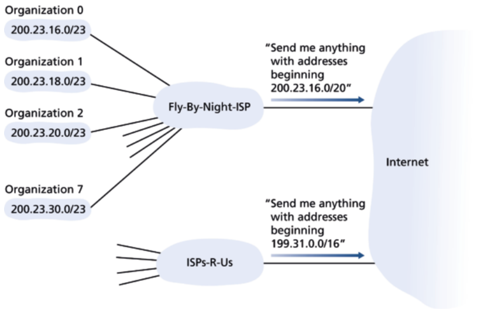

Hình 4.21 Định địa chỉ phân cấp và gộp tuyến

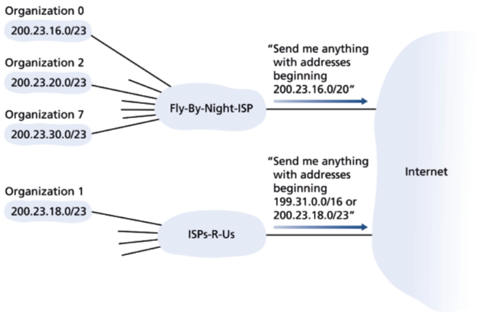

Hình 4.22 ISPs-R-Us có một tuyến cụ thể hơn tới Tổ chức 1

Sẽ là thiếu sót nếu chúng tôi không đề cập thêm một loại địa chỉ IP khác, địa chỉ IP quảng bá 255.255.255.255. Khi một host gửi một datagram có địa chỉ đích 255.255.255.255, thông điệp được chuyển tới mọi host trên cùng subnet. Router có thể tùy chọn chuyển tiếp thông điệp sang các subnet lân cận (mặc dù thường thì không).

Sau khi đã nghiên cứu chi tiết việc định địa chỉ IP, chúng ta cần biết ngay từ đầu host và subnet lấy địa chỉ như thế nào. Hãy bắt đầu bằng việc xem cách một tổ chức lấy một khối địa chỉ cho các thiết bị của mình, rồi xem cách một thiết bị (như một host) được gán một địa chỉ từ trong khối địa chỉ của tổ chức.

#### Lấy một khối địa chỉ (Obtaining a Block of Addresses)

Để lấy một khối địa chỉ IP dùng trong subnet của một tổ chức, quản trị viên mạng có thể trước hết liên hệ ISP của mình, ISP sẽ cung cấp địa chỉ từ một khối địa chỉ lớn hơn đã được cấp cho ISP. Ví dụ, bản thân ISP có thể đã được cấp khối địa chỉ 200.23.16.0/20. Đến lượt mình, ISP có thể chia khối địa chỉ của nó thành tám khối địa chỉ liên tiếp equal-sized (kích thước bằng nhau) và cấp một trong các khối địa chỉ này cho mỗi tổ chức trong số tối đa tám tổ chức mà ISP này hỗ trợ, như minh họa dưới đây. (Chúng tôi đã gạch dưới phần subnet của các địa chỉ này để bạn tiện theo dõi.)

| Khối của ISP (ISP’s block): | 200.23.16.0/20 | 11001000 00010111 00010000 00000000 |
|---|---|---|
| Tổ chức (Organization 0) | 200.23.16.0/23 | 11001000 00010111 00010000 00000000 |
| Tổ chức (Organization 1) | 200.23.18.0/23 | 11001000 00010111 00010010 00000000 |
| Tổ chức (Organization 2) | 200.23.20.0/23 | 11001000 00010111 00010100 00000000 |
| . . . . . . |  | . . . |
| Tổ chức (Organization 7) | 200.23.30.0/23 | 11001000 00010111 00011110 00000000 |

Mặc dù lấy một tập địa chỉ từ một ISP là một cách để có một khối địa chỉ, đó không phải cách duy nhất. Rõ ràng, cũng phải có cách để chính ISP lấy được một khối địa chỉ. Có một cơ quan toàn cầu nào chịu trách nhiệm cuối cùng về quản lý không gian địa chỉ IP và cấp phát khối địa chỉ cho ISP và các tổ chức khác không? Thực sự có! Địa chỉ IP được quản lý dưới thẩm quyền của Internet Corporation for Assigned Names and Numbers (ICANN) [ICANN 2025], dựa trên các hướng dẫn nêu trong [RFC 7020]. Vai trò của tổ chức phi lợi nhuận ICANN không chỉ là cấp phát địa chỉ IP, mà còn quản lý các DNS root server. Nó cũng có nhiệm vụ rất gây tranh cãi là gán tên miền và giải quyết tranh chấp tên miền. ICANN cấp phát địa chỉ cho các cơ quan đăng ký Internet khu vực (regional Internet registry) (ví dụ, ARIN, RIPE, APNIC và LACNIC, cùng nhau tạo thành Address Supporting Organization của ICANN [ASO-ICANN 2025]), và xử lý việc cấp phát/quản lý địa chỉ trong khu vực của họ.

#### Lấy địa chỉ host: Dynamic Host Configuration Protocol (Obtaining a Host Address: The Dynamic Host Configuration Protocol)

Khi một tổ chức đã lấy được một khối địa chỉ, nó có thể gán các địa chỉ IP riêng lẻ cho các giao diện host và router trong tổ chức. Quản trị viên hệ thống thường cấu hình thủ công địa chỉ IP vào router (thường từ xa, với một công cụ quản lý mạng). Địa chỉ host cũng có thể được cấu hình thủ công, nhưng thường việc này được thực hiện bằng Dynamic Host Configuration Protocol (DHCP) [RFC 2131]. DHCP cho phép một host lấy (được cấp) một địa chỉ IP tự động. Quản trị viên mạng có thể cấu hình DHCP sao cho một host cho trước nhận cùng một địa chỉ IP mỗi lần kết nối vào mạng, hoặc một host có thể được gán một địa chỉ IP tạm thời sẽ khác nhau mỗi lần host kết nối vào mạng. Ngoài việc gán địa chỉ IP cho host, DHCP cũng cho phép host biết thêm thông tin, như subnet mask của nó, địa chỉ của router first-hop (thường được gọi là default gateway), và địa chỉ của local DNS server.

Vì khả năng của DHCP tự động hóa các khía cạnh network-related của việc kết nối một host vào mạng, nó thường được gọi là một giao thức plug-and-play (cắm là chạy) hoặc zeroconf (zero-configuration - không cần cấu hình). Khả năng này khiến nó rất hấp dẫn với quản trị viên mạng, người nếu không sẽ phải thực hiện các nhiệm vụ này thủ công! DHCP cũng đang được dùng rộng rãi trong các mạng truy cập Internet dân dụng, mạng doanh nghiệp, và trong LAN không dây, nơi host tham gia và rời mạng thường xuyên. Hãy xét, chẳng hạn, một sinh viên mang laptop từ phòng ký túc xá tới thư viện tới lớp học. Nhiều khả năng ở mỗi địa điểm, sinh viên sẽ kết nối vào một subnet mới và do đó sẽ cần một địa chỉ IP mới ở mỗi địa điểm. DHCP cực kỳ phù hợp với tình huống này, vì có nhiều người dùng đến và đi, và địa chỉ chỉ cần trong một khoảng thời gian hạn chế. Giá trị của khả năng plug-and-play của DHCP là rõ ràng, vì không thể tưởng tượng được một quản trị viên hệ thống có thể cấu hình lại laptop ở mỗi địa điểm, và rất ít sinh viên (ngoại trừ những người học một lớp mạng máy tính!) có chuyên môn để tự cấu hình laptop.

DHCP là một giao thức client-server. Một client thường là một host mới tới muốn lấy thông tin cấu hình mạng, bao gồm một địa chỉ IP cho chính nó. Trong trường hợp đơn giản nhất, mỗi subnet (theo nghĩa định địa chỉ của Hình 4.20) sẽ có một DHCP server. Nếu không có server nào trên subnet, cần một DHCP relay agent (tác nhân chuyển tiếp) (thường là một router) biết địa chỉ của một DHCP server cho mạng đó. Hình 4.23 cho thấy một DHCP server gắn vào subnet 223.1.2/24, với router đóng vai relay agent cho các client mới tới gắn vào subnet 223.1.1/24 và 223.1.3/24. Trong thảo luận bên dưới, chúng ta sẽ giả sử có một DHCP server trên subnet.

Với một host mới tới, giao thức DHCP là một quá trình four-step (bốn bước), như minh họa trong Hình 4.24 cho thiết lập mạng minh họa trong Hình 4.23. Trong hình này, yiaddr (như trong “your Internet address”) cho biết địa chỉ đang được cấp cho client mới tới. Bốn bước là:

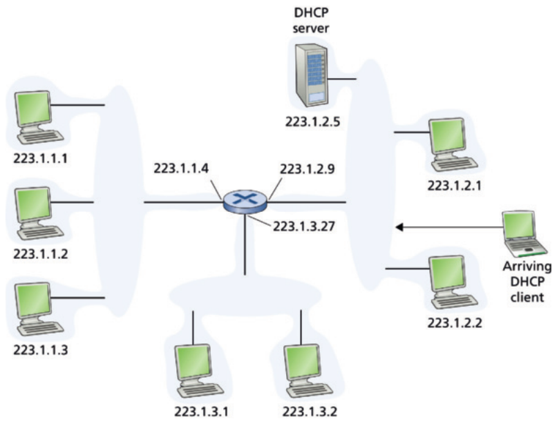

Hình 4.23 DHCP client và server

• Khám phá DHCP server (DHCP server discovery). Nhiệm vụ đầu tiên của một host mới tới là tìm một DHCP server để tương tác. Việc này được thực hiện bằng một thông điệp DHCP discover, mà client gửi trong một packet UDP tới port 67. Packet UDP được đóng gói trong một IP datagram. Nhưng datagram này nên được gửi tới ai? Host thậm chí không biết địa chỉ IP của mạng mà nó đang gắn vào, chưa nói tới địa chỉ của một DHCP server cho mạng này. Do đó, DHCP client tạo một IP datagram chứa thông điệp DHCP discover cùng với địa chỉ IP đích quảng bá 255.255.255.255 và địa chỉ IP nguồn “this host” 0.0.0.0. DHCP client chuyển IP datagram xuống tầng liên kết, tầng này sau đó quảng bá frame này tới mọi nút gắn vào subnet (chúng ta sẽ đề cập chi tiết quảng bá link-layer trong Mục 6.4).

• (Các) đề nghị từ DHCP server (DHCP server offer(s)). Một DHCP server nhận thông điệp DHCP discover phản hồi client bằng một thông điệp DHCP offer được quảng bá tới mọi nút trên subnet, lại dùng địa chỉ IP quảng bá 255.255.255.255. (Có thể bạn muốn nghĩ về lý do trả lời này của server cũng phải được quảng bá). Vì có thể có nhiều DHCP server trên subnet, client có thể thấy mình ở vị trí đáng ghen tị là được chọn giữa nhiều đề nghị. Mỗi thông điệp offer của server chứa transaction ID của thông điệp discover nhận được, địa chỉ IP đề xuất cho client, network mask, và một thời gian thuê (lease time) địa chỉ IP—lượng thời gian địa chỉ IP sẽ còn hiệu lực. Server thường đặt lease time vài giờ hoặc vài ngày [Droms 2002].

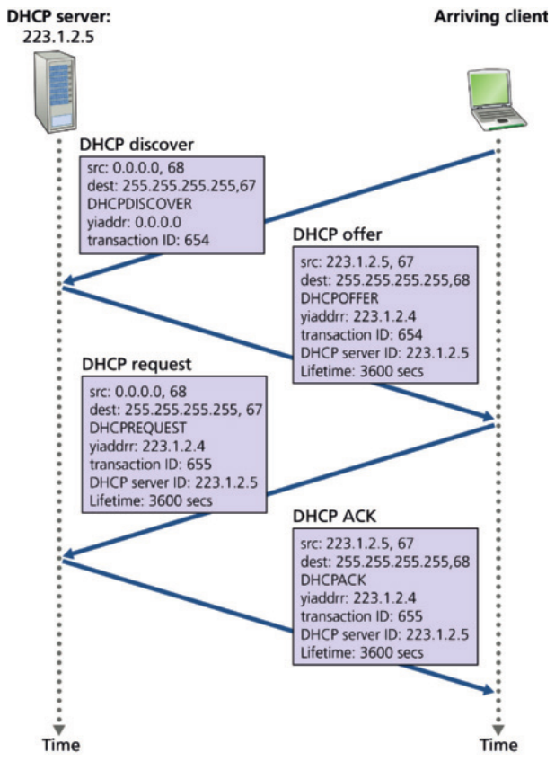

Hình 4.24 Tương tác client-server của DHCP

• Yêu cầu DHCP (DHCP request). Client mới tới sẽ chọn trong số một hoặc nhiều đề nghị của server và phản hồi đề nghị đã chọn bằng một thông điệp DHCP request, gửi lại các tham số cấu hình.

• DHCP ACK. Server phản hồi thông điệp DHCP request bằng một thông điệp DHCP ACK, xác nhận các tham số được yêu cầu.

Khi client nhận DHCP ACK, tương tác hoàn tất và client có thể dùng địa chỉ IP DHCP-allocated (do DHCP cấp) trong thời hạn thuê. Vì một client có thể muốn dùng địa chỉ của nó sau khi hết hạn thuê, DHCP cũng cung cấp một cơ chế cho phép client gia hạn thuê một địa chỉ IP. Về khía cạnh di động, DHCP có một nhược điểm rất đáng kể. Vì một địa chỉ IP mới được lấy từ DHCP mỗi khi một nút kết nối vào một subnet mới, một kết nối TCP tới một ứng dụng từ xa không thể được duy trì khi một nút di động di chuyển giữa các subnet. Trong Chương 7, chúng ta sẽ học cách các mạng di động cellular cho phép một host giữ địa chỉ IP và các kết nối TCP đang diễn ra khi nó di chuyển giữa các trạm gốc trong mạng cellular của một nhà cung cấp. Thêm chi tiết về DHCP có thể tìm thấy trong [Droms 2002] và [dhc 2025]. Một bản triển khai tham chiếu mã nguồn mở của DHCP có sẵn từ Internet Systems Consortium [ISC 2025].

### 4.3.3 Network Address Translation (NAT)

Với thảo luận của chúng ta về địa chỉ Internet và định dạng datagram IPv4, giờ chúng ta đã biết rõ rằng mọi thiết bị IP-capable (có khả năng IP) đều cần một địa chỉ IP. Với sự phổ biến của các subnet văn phòng nhỏ, văn phòng tại nhà (small office, home office - SOHO), điều này dường như hàm ý rằng bất cứ khi nào một SOHO muốn cài đặt một LAN để nối nhiều máy, ISP sẽ cần cấp phát một dải địa chỉ để bao tất cả các thiết bị IP của SOHO (bao gồm điện thoại, tablet, thiết bị chơi game, IP TV, máy in và hơn nữa). Nếu subnet lớn lên, một khối địa chỉ lớn hơn sẽ phải được cấp phát. Nhưng nếu ISP đã cấp phát các phần liên tiếp của dải địa chỉ hiện tại của mạng SOHO thì sao? Và chủ nhà điển hình nào muốn (hoặc cần) biết cách quản lý địa chỉ IP ngay từ đầu? May mắn thay, có một cách tiếp cận cấp phát địa chỉ đơn giản hơn đã được dùng ngày càng rộng rãi trong những kịch bản như vậy: network address translation (NAT - chuyển đổi địa chỉ mạng) [RFC 2663; RFC 3022; Huston 2004, Zhang 2007; Huston 2017].

Hình 4.25 cho thấy hoạt động của một router NAT-enabled (hỗ trợ NAT). Router NAT-enabled, đặt trong nhà, có một giao diện là một phần của mạng gia đình ở bên phải Hình 4.25. Việc định địa chỉ trong mạng gia đình giống hệt như chúng ta đã thấy ở trên—cả bốn giao diện trong mạng gia đình có cùng địa chỉ subnet 10.0.0.0/24. Không gian địa chỉ 10.0.0.0/8 là một trong ba phần của không gian địa chỉ IP được dành riêng trong [RFC 1918] cho một mạng riêng (private network) hoặc một miền với địa chỉ riêng (realm with private addresses), như mạng gia đình trong Hình 4.25. Một miền với địa chỉ riêng chỉ một mạng có địa chỉ chỉ có ý nghĩa với các thiết bị trong mạng đó. Để thấy tại sao điều này quan trọng, hãy xét thực tế rằng có hàng trăm nghìn mạng gia đình, nhiều mạng dùng cùng không gian địa chỉ, 10.0.0.0/24. Các thiết bị trong một mạng gia đình cho trước có thể gửi packet cho nhau dùng định địa chỉ 10.0.0.0/24. Tuy nhiên, các packet được chuyển tiếp ra ngoài mạng gia đình vào Internet toàn cầu lớn hơn rõ ràng không thể dùng các địa chỉ này (làm địa chỉ nguồn hoặc đích) vì có hàng trăm nghìn mạng dùng khối địa chỉ này. Tức là, các địa chỉ 10.0.0.0/24 chỉ có thể có ý nghĩa trong mạng gia đình cho trước. Nhưng nếu địa chỉ riêng chỉ có ý nghĩa trong một mạng cho trước, việc định địa chỉ được xử lý thế nào khi packet được gửi tới hoặc nhận từ Internet toàn cầu, nơi địa chỉ tất yếu phải là duy nhất? Câu trả lời nằm ở việc hiểu NAT.

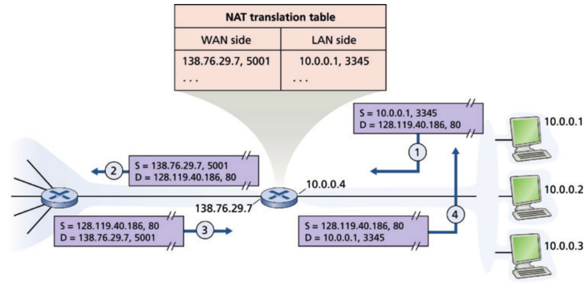

Hình 4.25 Chuyển đổi địa chỉ mạng

Router NAT-enabled không trông giống một router với thế giới bên ngoài. Thay vào đó router NAT hành xử với thế giới bên ngoài như một thiết bị duy nhất với một địa chỉ IP duy nhất. Trong Hình 4.25, mọi traffic rời router gia đình ra Internet lớn hơn có địa chỉ IP nguồn 138.76.29.7, và mọi traffic vào router gia đình phải có địa chỉ đích 138.76.29.7. Về bản chất, router NAT-enabled đang ẩn chi tiết của mạng gia đình khỏi thế giới bên ngoài. (Nhân tiện, có thể bạn thắc mắc các máy tính mạng gia đình lấy địa chỉ từ đâu và router lấy địa chỉ IP duy nhất của nó từ đâu. Thường thì câu trả lời là như nhau—DHCP! Router lấy địa chỉ từ DHCP server của ISP, và router chạy một DHCP server để cung cấp địa chỉ cho các máy tính trong không gian địa chỉ của mạng gia đình NAT-DHCP-router-controlled (do router NAT kiêm DHCP điều khiển).)

Nếu mọi datagram tới router NAT từ WAN đều có cùng địa chỉ IP đích (cụ thể, địa chỉ của giao diện WAN-side (phía WAN) của router NAT), thì làm sao router biết host nội bộ nào mà nó nên chuyển tiếp một datagram cho trước tới? Mẹo là dùng một bảng chuyển đổi NAT (NAT translation table) tại router NAT, và đưa số port cũng như địa chỉ IP vào các mục của bảng.

Hãy xét ví dụ trong Hình 4.25. Giả sử một người dùng ngồi trong mạng gia đình phía sau host 10.0.0.1 yêu cầu một trang Web trên một Web server (port 80) có địa chỉ IP 128.119.40.186. Host 10.0.0.1 gán số port nguồn (tùy ý) 3345 và gửi datagram vào LAN. Router NAT nhận datagram, tạo một số port nguồn mới 5001 cho datagram, thay địa chỉ IP nguồn bằng địa chỉ IP WAN-side 138.76.29.7 của nó, và thay số port nguồn gốc 3345 bằng số port nguồn mới 5001. Khi tạo một số port nguồn mới, router NAT có thể chọn bất kỳ số port nguồn nào hiện không có trong bảng chuyển đổi NAT. (Lưu ý rằng vì trường số port dài 16 bit, giao thức NAT có thể hỗ trợ hơn 60,000 kết nối đồng thời với một địa chỉ IP WAN-side duy nhất cho router!) NAT trong router cũng thêm một mục vào bảng chuyển đổi NAT. Web server, hoàn toàn không biết rằng datagram đến chứa yêu cầu HTTP đã bị router NAT thao tác, phản hồi bằng một datagram có địa chỉ đích là địa chỉ IP của router NAT, và có số port đích là 5001. Khi datagram này tới router NAT, router tra chỉ mục bảng chuyển đổi NAT dùng địa chỉ IP đích và số port đích để lấy địa chỉ IP ( 10.0.0.1) và số port đích ( 3345) thích hợp cho browser trong mạng gia đình. Router sau đó ghi lại địa chỉ đích và số port đích của datagram, và chuyển tiếp datagram vào mạng gia đình.

Như gợi ý trong Hình 4.25, NAT được dùng rộng rãi trong mạng gia đình và mạng doanh nghiệp, tức là, mạng rìa mà các thiết bị người dùng được gắn trực tiếp. Thật vậy, địa chỉ IP được gán cho laptop hoặc điện thoại của bạn trong hầu hết mọi mạng bạn tham gia sẽ có một private network prefix 10.0.0.0/8, 172.16.0.0/12, hoặc 192.168.0.0/16. Nhưng NAT cũng hữu ích cho ISP. Ví dụ, hãy xét một nhà cung cấp mạng truy cập cable-based (dựa trên cáp) cần gán địa chỉ IP cho giao diện của hàng chục nghìn router gateway gia đình trong mạng của nó (với mỗi mạng gia đình đó cũng dùng NAT nội bộ, như trong Hình 4.25). Thay vì gán địa chỉ công khai cho tất cả các router gia đình này, ISP cũng muốn dùng NAT để gán địa chỉ IP riêng cho các router này. Trong trường hợp này, một datagram xuất phát từ một thiết bị trong nhà sẽ đi qua hai mạng NAT’ed trên đường tới Internet lớn hơn—mạng gia đình, và mạng ISP. Cái so-called Carrier-grade NAT (NAT cấp nhà mạng) triển khai việc chuyển đổi NAT ở high-speeds (tốc độ cao) cho một số lượng lớn thiết bị bên trong ISP. Ngoài ra, [RFC 6598] đã tạo một khối địa chỉ riêng mới, 100.64.0.0/10, cho mục đích ISP-only (chỉ ISP dùng). Việc này được thực hiện để tránh trường hợp một NAT gia đình/doanh nghiệp ở hop đầu và một NAT của ISP chọn dùng các không gian địa chỉ IP riêng chồng lấn nhau.

NAT đã được triển khai rộng rãi trong những năm gần đây. Nhưng NAT không phải không có người phản đối. Thứ nhất, người ta có thể lập luận rằng, số port được dùng để định địa chỉ process, không phải để định địa chỉ host. Sự vi phạm này thực sự có thể gây vấn đề cho các server chạy trên mạng gia đình, vì, như chúng ta đã thấy trong Chương 2, các process server chờ yêu cầu đến tại các số port well-known và các peer trong một giao thức P2P cần chấp nhận kết nối đến khi đóng vai server. Làm thế nào một peer có thể kết nối tới một peer khác nằm sau một NAT server, và có một địa chỉ NAT DHCP-provided (do DHCP cung cấp)? Các giải pháp kỹ thuật cho những vấn đề này bao gồm các công cụ NAT traversal (vượt NAT) [RFC 5389, RFC 5128, Ford 2005].

Các lập luận “triết học” hơn cũng đã được những người theo chủ nghĩa thuần túy kiến trúc đưa ra chống lại NAT. Ở đây, mối lo là router được dự định là thiết bị tầng 3 (tức là, network-layer), và chỉ nên xử lý packet tới tầng mạng. NAT vi phạm nguyên lý rằng các host nên nói chuyện trực tiếp với nhau, không có các nút can thiệp sửa đổi địa chỉ IP, chưa nói tới số port. Chúng ta sẽ quay lại cuộc tranh luận này sau trong Mục 4.5, khi đề cập middlebox.

> Tiêu điểm bảo mật (Focus on Security)
>
> Kiểm tra datagram: Firewall và (Inspecting Datagrams: Firewalls and)
>
> Hệ thống phát hiện xâm nhập (Intrusion Detection Systems)
>
> Giả sử bạn được giao nhiệm vụ quản trị một mạng gia đình, khoa, trường đại học hoặc doanh nghiệp. Kẻ tấn công, biết dải địa chỉ IP của mạng bạn, có thể dễ dàng gửi IP datagram tới các địa chỉ trong dải của bạn. Các datagram này có thể làm đủ trò ranh mãnh, bao gồm lập bản đồ mạng của bạn bằng quét ping và quét port, làm sập các host dễ bị tấn công bằng packet sai định dạng, quét các port TCP/UDP mở trên các server trong mạng của bạn, và lây nhiễm host bằng cách đưa malware vào packet. Là quản trị viên mạng, bạn sẽ làm gì với tất cả những kẻ xấu ngoài kia, mỗi kẻ đều có khả năng gửi packet độc hại vào mạng của bạn? Hai cơ chế phòng thủ phổ biến chống lại tấn công bằng packet độc hại là firewall và hệ thống phát hiện xâm nhập (intrusion detection system - IDS).
>
> Là quản trị viên mạng, trước hết bạn có thể thử cài đặt một firewall giữa mạng của bạn và Internet. (Hầu hết các router truy cập ngày nay có khả năng firewall.) Firewall kiểm tra các trường header datagram và segment, từ chối cho các datagram đáng ngờ vào mạng nội bộ. Ví dụ, một firewall có thể được cấu hình để chặn mọi packet ICMP echo request (xem Mục 5.6), qua đó ngăn kẻ tấn công thực hiện một cuộc quét port truyền thống trên dải địa chỉ IP của bạn. Firewall cũng có thể chặn packet dựa trên địa chỉ IP nguồn và đích và số port. Ngoài ra, firewall có thể được cấu hình để theo dõi kết nối TCP, chỉ cho phép vào các datagram thuộc các kết nối được chấp thuận.
>
> Bảo vệ bổ sung có thể được cung cấp bằng một IDS. Một IDS, thường đặt ở ranh giới mạng, thực hiện “kiểm tra packet sâu” (deep packet inspection), xem xét không chỉ các trường header mà còn cả payload trong datagram (bao gồm dữ liệu application-layer). Một IDS có một cơ sở dữ liệu chữ ký packet (packet signature) được biết là thuộc các cuộc tấn công. Cơ sở dữ liệu này được tự động cập nhật khi các cuộc tấn công mới được phát hiện. Khi packet đi qua IDS, IDS cố gắng khớp các trường header và payload với các chữ ký trong cơ sở dữ liệu chữ ký. Nếu tìm thấy khớp như vậy, một cảnh báo được tạo. Một hệ thống ngăn chặn xâm nhập (intrusion prevention system - IPS) tương tự IDS, ngoại trừ nó thực sự chặn packet ngoài việc tạo cảnh báo. Chúng ta sẽ khám phá firewall và IDS chi tiết hơn trong Mục 4.5 và lại trong Chương 8.
>
> Firewall và IDS có thể bảo vệ hoàn toàn mạng của bạn khỏi mọi cuộc tấn công không? Câu trả lời rõ ràng là không, vì kẻ tấn công liên tục tìm ra các cuộc tấn công mới mà chưa có chữ ký. Nhưng firewall và IDS signature-based (dựa trên chữ ký) truyền thống hữu ích trong việc bảo vệ mạng của bạn khỏi các cuộc tấn công đã biết.

### 4.3.4 IPV6

Vào đầu những năm 1990s, Internet Engineering Task Force bắt đầu một nỗ lực phát triển giao thức kế nhiệm IPv4. Một động lực chính cho nỗ lực này là nhận thức rằng không gian địa chỉ IPv4 32-bit đang bắt đầu bị dùng hết, với các subnet và nút IP mới được gắn vào Internet (và được cấp phát địa chỉ IP duy nhất) với tốc độ chóng mặt. Để đáp ứng nhu cầu về một không gian địa chỉ IP lớn này, một giao thức IP mới, IPv6, đã được phát triển. Các nhà thiết kế IPv6 cũng nhân cơ hội này để tinh chỉnh và bổ sung các khía cạnh khác của IPv4, dựa trên kinh nghiệm vận hành tích lũy với IPv4.

Thời điểm địa chỉ IPv4 sẽ được cấp phát hết hoàn toàn (và do đó không mạng mới nào có thể gắn vào Internet) là chủ đề của tranh luận đáng kể. Ước tính của hai người đứng đầu nhóm làm việc Address Lifetime Expectations của IETF là địa chỉ sẽ cạn kiệt lần lượt vào năm 2008 và 2018 [Solensky 1996]. Vào tháng Hai 2011, IANA đã cấp phát nốt pool cuối cùng còn lại của các địa chỉ IPv4 chưa gán cho một cơ quan đăng ký khu vực. Mặc dù các cơ quan đăng ký này vẫn còn địa chỉ IPv4 khả dụng trong pool của họ, một khi các địa chỉ này cạn kiệt, sẽ không còn khối địa chỉ khả dụng nào có thể được cấp phát từ một pool trung tâm [Huston 2011a]. Một khảo sát gần đây về sự cạn kiệt address-space (không gian địa chỉ) IPv4, và các bước đã thực hiện để kéo dài tuổi thọ của không gian địa chỉ là [Richter 2015]; một phân tích gần đây về việc sử dụng địa chỉ IPv4 là [Huston 2025].

Mặc dù các ước tính vào mid-1990s về sự cạn kiệt địa chỉ IPv4 gợi ý rằng có thể còn khá nhiều thời gian cho tới khi không gian địa chỉ IPv4 cạn kiệt, người ta nhận ra rằng cần thời gian đáng kể để triển khai một công nghệ mới trên quy mô rộng lớn như vậy, và vì vậy quá trình phát triển IP phiên bản 6 ( IPv6) [RFC 2460] đã được bắt đầu [RFC 1752]. (Một câu hỏi often-asked (thường gặp) là chuyện gì đã xảy ra với IPv5? Ban đầu người ta hình dung giao thức ST-2 sẽ trở thành IPv5, nhưng ST-2 sau đó bị bỏ.) Một nguồn thông tin xuất sắc về IPv6 là [Huitema 1998].

#### Định dạng datagram IPv6 (IPV6 Datagram Format)

Định dạng của datagram IPv6 được minh họa trong Hình 4.26. Các thay đổi quan trọng nhất được đưa vào IPv6 thể hiện rõ trong định dạng datagram:

• Khả năng định địa chỉ mở rộng (Expanded addressing capabilities). IPv6 tăng kích thước địa chỉ IP từ 32 lên 128 bit. Điều này đảm bảo thế giới sẽ không hết địa chỉ IP. Giờ, mọi hạt cát trên hành tinh đều có thể IP-addressable (có địa chỉ IP). Ngoài địa chỉ unicast và multicast, IPv6 đã đưa vào một loại địa chỉ mới, gọi là địa chỉ anycast, cho phép một datagram được chuyển tới bất kỳ host nào trong một nhóm host. (Tính năng này có thể được dùng, chẳng hạn, để gửi một HTTP GET tới site mirror gần nhất trong số các site mirror chứa một tài liệu cho trước.)

• Một header 40-byte tinh gọn (A streamlined 40-byte header). Như thảo luận bên dưới, một số trường IPv4 đã bị bỏ hoặc trở thành tùy chọn. Header fixed-length kết quả cho phép router xử lý IP datagram nhanh hơn. Một cách mã hóa options mới cho phép xử lý options linh hoạt hơn.

• Gán nhãn luồng (Flow labeling). IPv6 có một định nghĩa khó nắm bắt về luồng (flow). RFC 2460 nêu rằng điều này cho phép “gán nhãn các packet thuộc các luồng cụ thể mà bên gửi yêu cầu xử lý đặc biệt, như chất lượng dịch vụ non-default (không mặc định) hoặc dịch vụ real-time.” Ví dụ, việc truyền audio và video có lẽ có thể được coi là một luồng. Mặt khác, các ứng dụng truyền thống hơn, như truyền file và e-mail, có thể không được coi là luồng.

  Có thể traffic được mang bởi một người dùng high-priority (ví dụ, ai đó trả tiền để có dịch vụ tốt hơn cho traffic của mình) cũng được coi là một luồng. Tuy nhiên, điều rõ ràng là các nhà thiết kế IPv6 đã thấy trước nhu cầu cuối cùng là có khả năng phân biệt giữa các luồng, ngay cả khi ý nghĩa chính xác của một luồng vẫn chưa được xác định.

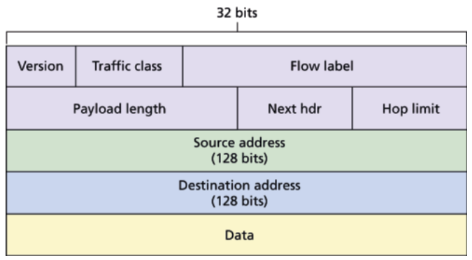

Hình 4.26 Định dạng datagram IPV6

Như đã lưu ý ở trên, việc so sánh Hình 4.26 với Hình 4.17 cho thấy cấu trúc đơn giản hơn, tinh gọn hơn của datagram IPv6. Các trường sau được định nghĩa trong IPv6:

• Phiên bản (Version). Trường 4-bit này xác định số phiên bản IP. Không có gì ngạc nhiên, IPv6 mang giá trị 6 trong trường này. Lưu ý rằng đặt giá trị 4 vào trường này không tạo ra một datagram IPv4 hợp lệ. (Nếu được như vậy, cuộc sống sẽ đơn giản hơn nhiều—xem thảo luận bên dưới về việc chuyển đổi từ IPv4 sang IPv6.)

• Lớp traffic (Traffic class). Trường traffic class 8-bit, giống trường TOS trong IPv4, có thể được dùng để ưu tiên một số datagram trong một luồng, hoặc có thể được dùng để ưu tiên các datagram từ một số ứng dụng (ví dụ, voice-over-IP) hơn các datagram từ các ứng dụng khác (ví dụ, e-mail SMTP).

• Nhãn luồng (Flow label). Như đã thảo luận ở trên, trường 20-bit này được dùng để xác định một luồng datagram.

• Độ dài payload (Payload length). Giá trị 16-bit này được coi là một số nguyên không dấu cho biết số byte trong datagram IPv6 theo sau header datagram fixed-length, 40-byte.

• Header tiếp theo (Next header). Trường này xác định giao thức mà nội dung (trường dữ liệu) của datagram này sẽ được chuyển tới (ví dụ, tới TCP hoặc UDP).

  Trường dùng cùng các giá trị như trường protocol trong header IPv4.

• Giới hạn hop (Hop limit). Nội dung của trường này được giảm đi một bởi mỗi router chuyển tiếp datagram. Nếu số đếm hop limit đạt không, router phải loại bỏ datagram đó.

• Địa chỉ nguồn và đích (Source and destination addresses). Các định dạng khác nhau của địa chỉ IPv6 128-bit được mô tả trong RFC 4291.

• Dữ liệu (Data). Đây là phần payload của datagram IPv6. Khi datagram tới đích, payload sẽ được lấy ra khỏi IP datagram và chuyển tới giao thức được chỉ định trong trường next header.

Thảo luận ở trên đã xác định mục đích của các trường có trong datagram IPv6. So sánh định dạng datagram IPv6 trong Hình 4.26 với định dạng datagram IPv4 mà chúng ta đã thấy trong Hình 4.17, chúng ta nhận thấy một số trường xuất hiện trong datagram IPv4 không còn có trong datagram IPv6:

• Phân mảnh/ráp lại (Fragmentation/reassembly). IPv6 không cho phép phân mảnh và ráp lại tại các router trung gian; các thao tác này chỉ có thể được thực hiện bởi nguồn và đích. Nếu một datagram IPv6 mà router nhận được quá lớn để được chuyển tiếp qua liên kết ra, router đơn giản loại bỏ datagram và gửi một thông điệp lỗi ICMP “Packet Too Big” (xem Mục 5.6) về bên gửi. Bên gửi khi đó có thể gửi lại dữ liệu, dùng kích thước IP datagram nhỏ hơn. Phân mảnh và ráp lại là một thao tác time-consuming (tốn thời gian); việc loại bỏ chức năng này khỏi router và đặt hẳn nó vào các end system tăng tốc đáng kể việc chuyển tiếp IP trong mạng.

• Checksum header (Header checksum). Vì các giao thức transport-layer (ví dụ, TCP và UDP) và link-layer (ví dụ, Ethernet) trong các tầng Internet đã thực hiện checksum, các nhà thiết kế IP có lẽ cảm thấy chức năng này đủ dư thừa ở tầng mạng để có thể loại bỏ. Một lần nữa, xử lý nhanh packet IP là mối quan tâm trung tâm. Nhớ lại từ thảo luận về IPv4 trong Mục 4.3.1 rằng vì header IPv4 chứa một trường TTL (tương tự trường hop limit trong IPv6 ) , checksum header IPv4 cần được tính lại tại mỗi router. Như với phân mảnh và ráp lại, đây cũng là một thao tác tốn kém trong IPv4.

• Tùy chọn (Options). Trường options không còn là một phần của header IP chuẩn. Tuy nhiên, nó không biến mất. Thay vào đó, trường options là một trong các next header khả dĩ được trỏ tới từ bên trong header IPv6. Tức là, giống như header giao thức TCP hoặc UDP có thể là next header trong một packet IP, trường options cũng vậy. Việc loại bỏ trường options dẫn tới một header IP fixed-length, 40-byte.

#### Chuyển đổi từ IPv4 sang IPv6 (Transitioning from IPV4 to IPV6)

Giờ chúng ta đã thấy các chi tiết kỹ thuật của IPv6, hãy xét một vấn đề rất thực tế: Internet công cộng, vốn dựa trên IPv4, sẽ được chuyển sang IPv6 như thế nào? Vấn đề là trong khi các hệ thống IPv6-capable mới có thể được làm backward-compatible (tương thích ngược), tức là, có thể gửi, định tuyến và nhận datagram IPv4, các hệ thống IPv4-capable đã triển khai không có khả năng xử lý datagram IPv6. Có thể có một số phương án [Huston 2011b, RFC 4213]. Một phương án là tuyên bố một flag day (ngày chuyển đổi)—một thời điểm và ngày cho trước khi mọi máy Internet sẽ bị tắt và nâng cấp từ IPv4 lên IPv6. Lần chuyển đổi công nghệ lớn gần nhất (từ dùng NCP sang dùng TCP cho dịch vụ giao vận tin cậy) đã xảy ra gần 40 năm trước. Ngay cả khi đó [RFC 801], khi Internet còn nhỏ bé và vẫn được quản trị bởi một số ít “phù thủy,” người ta đã nhận ra rằng một flag day như vậy là không thể. Một flag day liên quan tới hàng tỉ thiết bị còn không thể tưởng tượng hơn ngày nay.

Cách tiếp cận chuyển đổi IPv4-to-IPv6 được áp dụng rộng rãi nhất trong thực tế liên quan tới tunneling (đường hầm) [RFC 4213]. Ý tưởng cơ bản đằng sau tunneling—một khái niệm then chốt có ứng dụng trong nhiều kịch bản khác ngoài chuyển đổi IPv4-to-IPv6, bao gồm việc dùng rộng rãi trong các mạng di động cellular all-IP mà chúng ta sẽ đề cập trong Chương 7—như sau. Giả sử hai nút IPv6 (trong ví dụ này, B và E trong Hình 4.27) muốn tương tác bằng datagram IPv6 nhưng được nối với nhau qua các router IPv4 trung gian. Chúng ta gọi tập router IPv4 trung gian giữa hai router IPv6 là một đường hầm (tunnel), như minh họa trong Hình 4.27. Với tunneling, nút IPv6 ở phía gửi của đường hầm (trong ví dụ này, B) lấy toàn bộ datagram IPv6 và đặt nó vào trường dữ liệu (payload) của một datagram IPv4. Datagram IPv4 này sau đó được định địa chỉ tới nút IPv6 ở phía nhận của đường hầm (trong ví dụ này, E) và gửi tới nút đầu tiên trong đường hầm (trong ví dụ này, C ) . Các router IPv4 trung gian trong đường hầm định tuyến datagram IPv4 này giữa chúng, giống như với bất kỳ datagram nào khác, hoàn toàn không biết rằng bản thân datagram IPv4 chứa một datagram IPv6 hoàn chỉnh. Nút IPv6 ở phía nhận của đường hầm cuối cùng nhận datagram IPv4 (nó là đích của datagram IPv4!), xác định rằng datagram IPv4 chứa một IPv6datagram (bằng cách nhận thấy trường số protocol trong datagram IPv4 là 41 [RFC 4213], cho biết payload IPv4 là một datagram IPv6), trích xuất datagram IPv6, rồi định tuyến datagram IPv6 đúng như khi nó nhận datagram IPv6 từ một láng giềng IPv6 nối trực tiếp.

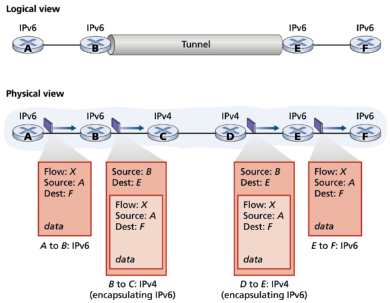

Hình 4.27 Tunneling

Chúng tôi kết thúc mục này bằng việc lưu ý rằng mặc dù việc áp dụng IPv6 ban đầu chậm cất cánh [Lawton 2001; Huston 2008b], đà phát triển đang tăng lên. [NIST IPv6 2025] đã khảo sát gần 1400 domain của chính phủ Mỹ và thấy khoảng 40 phần trăm dịch vụ mail, web và DNS được cấu hình cho IPv6. Ở phía client, Google báo cáo rằng gần 50 phần trăm client truy cập dịch vụ Google làm vậy qua IPv6 [Google IPv6 2025]. Năm 2022, Akamai lưu ý rằng mức áp dụng của end-user (người dùng cuối) trong khoảng xấp xỉ 44 đến 62 phần trăm cho 6 trong top 10 nền kinh tế toàn cầu, dựa trên tỉ lệ yêu cầu tới CDN Akamai đối với nội dung IPv4 + IPv6 dual-stacked (ngăn xếp kép). [Nygren 2022] Để thấy sự tăng trưởng của những con số này, Google đã báo cáo tỉ lệ áp dụng IPv6 chỉ 1 phần trăm năm 2012. Sự phổ biến của các thiết bị như điện thoại IP-enabled và các thiết bị di động khác tạo thêm động lực cho việc triển khai IPv6 rộng rãi hơn.

Một bài học quan trọng chúng ta có thể học từ kinh nghiệm IPv6 là cực kỳ khó thay đổi các giao thức network-layer. Từ đầu những năm 1990s, nhiều giao thức network-layer mới đã được quảng bá rầm rộ là cuộc cách mạng lớn tiếp theo cho Internet, nhưng hầu hết các giao thức này cho đến nay mới thâm nhập hạn chế. Các giao thức này bao gồm IPv6, các giao thức multicast, và các giao thức đặt trước tài nguyên; thảo luận về hai lớp giao thức sau có thể tìm thấy trong phần bổ sung trực tuyến của cuốn sách này. Thật vậy, đưa giao thức mới vào tầng mạng giống như thay móng một ngôi nhà—rất khó làm mà không phá cả ngôi nhà hoặc ít nhất tạm thời di dời cư dân của ngôi nhà. Mặt khác, Internet đã chứng kiến việc triển khai nhanh chóng các giao thức mới ở tầng ứng dụng. Các ví dụ kinh điển, tất nhiên, là Web, nhắn tin, streaming media, hội nghị video, game phân tán, và nhiều dạng mạng xã hội. Đưa giao thức application-layer mới vào giống như sơn thêm một lớp sơn mới cho ngôi nhà—tương đối dễ làm, và nếu bạn chọn màu hấp dẫn, những người khác trong khu phố sẽ bắt chước bạn. Tóm lại, trong tương lai, chắc chắn chúng ta có thể kỳ vọng thấy những thay đổi trong tầng mạng của Internet, nhưng những thay đổi này nhiều khả năng sẽ xảy ra ở thang thời gian chậm hơn nhiều so với những thay đổi sẽ xảy ra ở tầng ứng dụng.

## 4.4 Chuyển tiếp tổng quát và SDN (Generalized Forwarding and SDN)

Nhớ rằng Mục 4.2.1 đã mô tả chuyển tiếp destination-based là hai bước tra một địa chỉ IP đích (“match”), rồi gửi packet vào switching fabric tới port ra chỉ định (“action”). Giờ hãy xét một mô hình “match-plus-action” tổng quát hơn đáng kể, trong đó “match” có thể được thực hiện trên nhiều trường header thuộc các giao thức khác nhau ở các tầng khác nhau trong protocol stack. “Action” có thể bao gồm chuyển tiếp packet tới một hoặc nhiều port ra (như trong chuyển tiếp destination-based), cân bằng tải packet qua nhiều giao diện ra dẫn tới một dịch vụ (như trong cân bằng tải), ghi lại giá trị header (như trong NAT), chủ ý chặn/loại bỏ một packet (như trong firewall), gửi một packet tới một server đặc biệt để xử lý và hành động thêm (như trong DPI), và hơn nữa.

Trong chuyển tiếp tổng quát, một bảng match-plus-action tổng quát hóa khái niệm bảng chuyển tiếp destination-based mà chúng ta đã gặp trong Mục 4.2.1. Vì quyết định chuyển tiếp có thể được đưa ra dùng địa chỉ nguồn và đích network-layer và/hoặc link-layer, các thiết bị chuyển tiếp minh họa trong Hình 4.28 được mô tả chính xác hơn là “packet switch” thay vì “router” tầng 3 hoặc “switch” tầng 2. Do đó, trong phần còn lại của mục này, và trong Mục 5.5, chúng ta sẽ gọi các thiết bị này là packet switch, áp dụng thuật ngữ đang được dùng rộng rãi trong tài liệu SDN.

Hình 4.28 cho thấy một bảng match-plus-action trong mỗi packet switch, với bảng được tính, cài đặt và cập nhật bởi một controller từ xa. Chúng tôi lưu ý rằng mặc dù các thành phần điều khiển tại từng packet switch có thể tương tác với nhau (ví dụ, theo cách tương tự như trong Hình 4.2), trong thực tế, các khả năng match-plus-action tổng quát được triển khai qua một controller từ xa tính, cài đặt và cập nhật các bảng này. Bạn có thể dành một phút so sánh Hình 4.2, 4.3 và 4.28—bạn nhận thấy những điểm giống và khác nào giữa chuyển tiếp destination-based minh họa trong Hình 4.2 và 4.3, và chuyển tiếp tổng quát minh họa trong Hình 4.28? Thảo luận tiếp theo của chúng ta về chuyển tiếp tổng quát sẽ dựa trên Open-Flow [McKeown 2008, ONF 2025, Casado 2014, Tourrilhes 2014]—một chuẩn rất nổi bật đã tiên phong khái niệm trừu tượng chuyển tiếp match-plus-action và controller, cũng như cuộc cách mạng SDN nói chung [Feamster 2013]. Chúng ta sẽ chủ yếu xét OpenFlow 1.0, phiên bản đã đưa vào các trừu tượng và chức năng SDN then chốt một cách đặc biệt rõ ràng và súc tích. Các phiên bản OpenFlow sau đưa thêm các khả năng nhờ kinh nghiệm thu được qua triển khai và sử dụng; các phiên bản hiện tại và trước đây của chuẩn OpenFlow có thể tìm thấy tại [ONF 2025]. Mỗi mục trong bảng chuyển tiếp match-plus-action, được gọi là flow table (bảng luồng) trong OpenFlow, bao gồm:

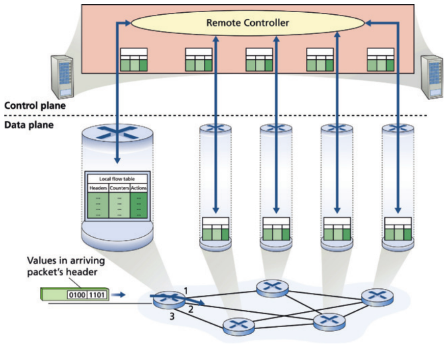

Hình 4.28 Chuyển tiếp tổng quát: Mỗi packet switch chứa một bảng match-plus-action được một controller từ xa tính và phân phối

• Một tập giá trị trường header mà một packet đến sẽ được khớp với. Như trong trường hợp chuyển tiếp destination-based, việc khớp hardware-based (dựa trên phần cứng) được thực hiện nhanh nhất trong bộ nhớ TCAM, với hơn một triệu mục địa chỉ đích là khả dĩ [Bosshart 2013]. Một packet không khớp mục flow table nào có thể bị loại bỏ hoặc được gửi tới controller từ xa để xử lý thêm. Trong thực tế, một flow table có thể được triển khai bằng nhiều flow table vì lý do performance hoặc chi phí [Bosshart 2013], nhưng ở đây chúng ta sẽ tập trung vào trừu tượng của một flow table duy nhất.

• Một tập bộ đếm được cập nhật khi packet được khớp với các mục flow table. Các bộ đếm này có thể bao gồm số packet đã được khớp bởi mục bảng đó, và thời gian kể từ lần cập nhật cuối của mục bảng.

• Một tập hành động cần thực hiện khi một packet khớp một mục flow table. Các hành động này có thể là chuyển tiếp packet tới một port ra cho trước, loại bỏ packet, tạo bản sao của packet và gửi chúng tới nhiều port ra, và/hoặc ghi lại các trường header được chọn.

Chúng ta sẽ khám phá chi tiết hơn việc khớp và hành động lần lượt trong Mục 4.4.1 và 4.4.2. Sau đó chúng ta sẽ nghiên cứu cách tập hợp network-wide các quy tắc khớp per-packet switch có thể được dùng để triển khai một loạt chức năng bao gồm định tuyến, chuyển mạch layer-2, firewall, load-balancing (cân bằng tải), mạng ảo, và hơn nữa trong Mục 4.4.3. Để kết thúc, chúng tôi lưu ý rằng flow table về cơ bản là một API, trừu tượng qua đó hành vi của từng packet switch có thể được lập trình; chúng ta sẽ thấy trong Mục 4.4.3 rằng các hành vi network-wide cũng có thể được lập trình tương tự bằng cách lập trình/cấu hình thích hợp các bảng này trong một tập hợp packet switch mạng [Casado 2014].

### 4.4.1 Khớp (Match)

Hình 4.29 cho thấy 11 trường packet-header và ID port vào có thể được khớp trong một quy tắc match-plus-action OpenFlow 1.0. Nhớ lại từ Mục 1.5.2 rằng một frame link-layer (tầng 2) tới một packet switch sẽ chứa một datagram network-layer (tầng 3) làm payload, datagram này đến lượt mình thường chứa một segment transport-layer (tầng 4). Quan sát đầu tiên của chúng ta là trừu tượng khớp của OpenFlow cho phép khớp trên các trường được chọn từ ba tầng header giao thức (do đó khá trơ trẽn thách thức nguyên lý phân tầng mà chúng ta đã nghiên cứu trong Mục 1.5). Vì chúng ta chưa đề cập tầng liên kết, chỉ cần nói rằng địa chỉ MAC nguồn và đích minh họa trong Hình 4.29 là các địa chỉ link-layer gắn với giao diện gửi và nhận của frame; bằng cách chuyển tiếp dựa trên địa chỉ Ethernet thay vì địa chỉ IP, chúng ta có thể thấy một thiết bị OpenFlow-enabled có thể hoạt động như một router (thiết bị layer-3) chuyển tiếp datagram cũng như một switch (thiết bị layer-2) chuyển tiếp frame. Trường Ethernet type tương ứng với giao thức tầng trên (ví dụ, IP) mà payload của frame sẽ được de-multiplexed (phân kênh) tới, và các trường VLAN liên quan tới cái so-called mạng cục bộ ảo (virtual local area network) mà chúng ta sẽ nghiên cứu trong Chương 6. Tập 12 giá trị có thể được khớp trong đặc tả OpenFlow 1.0 đã tăng lên 41 giá trị trong các đặc tả Open-Flow gần đây hơn [Bosshart 2014]. Ingress port chỉ port vào tại packet switch mà packet được nhận trên đó. Địa chỉ nguồn IP, địa chỉ đích IP, trường IP protocol và các trường IP type of service của packet đã được thảo luận trước đó trong Mục 4.3.1. Các trường số port nguồn và đích transport-layer cũng có thể được khớp.

Các mục flow table cũng có thể có ký tự đại diện (wildcard). Ví dụ, một địa chỉ IP 128.119.\*.\* trong flow table sẽ khớp với trường địa chỉ tương ứng của bất kỳ datagram nào có 128.119 là 16 bit đầu của địa chỉ. Mỗi mục flow table cũng có một mức ưu tiên gắn kèm. Nếu một packet khớp nhiều mục flow table, mục khớp được chọn và hành động tương ứng sẽ là của mục có ưu tiên cao nhất mà packet khớp.

Cuối cùng, chúng ta nhận thấy không phải mọi trường trong header IP đều có thể được khớp. Ví dụ OpenFlow không cho phép khớp dựa trên trường TTL hoặc trường độ dài datagram. Tại sao một số trường được phép khớp, còn số khác thì không? Chắc chắn, câu trả lời liên quan tới sự đánh đổi giữa chức năng và độ phức tạp. “Nghệ thuật” trong việc chọn một trừu tượng là cung cấp đủ chức năng để hoàn thành một nhiệm vụ (trong trường hợp này là triển khai, cấu hình và quản lý một loạt chức năng network-layer trước đây được triển khai qua nhiều loại thiết bị network-layer), mà không over-burdening (đè nặng) trừu tượng bằng quá nhiều chi tiết và tính tổng quát đến mức nó trở nên cồng kềnh và không dùng được. Butler Lampson đã có câu nói nổi tiếng [Lampson 1983]:

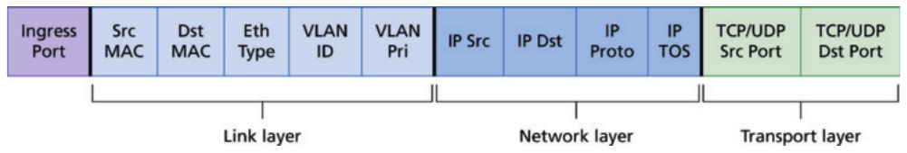

Hình 4.29 Các trường khớp packet, flow table OpenFlow 1.0

Làm một việc một lúc, và làm tốt việc đó. Một giao diện nên nắm bắt những yếu tố thiết yếu tối thiểu của một trừu tượng. Đừng tổng quát hóa; các tổng quát hóa nói chung là sai.

Với thành công của OpenFlow, có thể đoán rằng các nhà thiết kế của nó thực sự đã chọn trừu tượng tốt. Thêm chi tiết về việc khớp trong OpenFlow có thể tìm thấy trong [ONF 2025].

### 4.4.2 Hành động (Action)

Mỗi mục flow table cũng có một danh sách không hoặc nhiều hành động xác định việc xử lý sẽ được áp dụng cho một packet khớp mục flow table. Nếu có nhiều hành động, chúng được thực hiện theo thứ tự chỉ định trong danh sách. Trong số các hành động khả dĩ quan trọng nhất là:

• Chuyển tiếp (Forwarding). Một packet đến có thể được chuyển tiếp tới một port ra vật lý cụ thể, quảng bá qua mọi port (trừ port nó tới) hoặc multicast qua một tập port được chọn. Packet có thể được đóng gói và gửi tới controller từ xa cho thiết bị này. Controller đó khi đó có thể (hoặc không) thực hiện hành động nào đó với packet, bao gồm cài đặt các mục flow table mới, và có thể trả packet về thiết bị để chuyển tiếp theo tập quy tắc flow table đã cập nhật.

• Loại bỏ (Dropping). Một mục flow table không có hành động cho biết một packet khớp nên bị loại bỏ.

• Modify-field (sửa trường). Giá trị trong 10 trường packet-header (tất cả các trường tầng 2, 3 và 4 minh họa trong Hình 4.29 trừ trường IP Protocol) có thể được re-written (ghi lại) trước khi packet được chuyển tiếp tới port ra được chọn.

### 4.4.3 Các ví dụ OpenFlow về khớp cộng hành động khi hoạt động (OpenFlow Examples of Match-plus-action in Action)

Sau khi xét cả thành phần khớp và hành động của chuyển tiếp tổng quát, hãy kết hợp các ý tưởng này trong bối cảnh mạng mẫu minh họa trong Hình 4.30. Mạng có 6 host (h1, h2, h3, h4, h5 và h6) và ba packet switch (s1, s2 và s3), mỗi switch có bốn giao diện cục bộ (đánh số 1 đến 4). Chúng ta sẽ xét một số hành vi network-wide mà chúng ta muốn triển khai, và các mục flow table trong s1, s2 và s3 cần để triển khai hành vi này.

#### Ví dụ thứ nhất: Chuyển tiếp đơn giản (A First Example: Simple Forwarding)

Như một ví dụ rất đơn giản, giả sử hành vi chuyển tiếp mong muốn là các packet từ h5 hoặc h6 hướng tới h3 hoặc h4 sẽ được chuyển tiếp từ s3 tới s1, rồi từ s1 tới s2 (do đó hoàn toàn tránh dùng liên kết giữa s3 và s2). Mục flow table trong s1 sẽ là:

| Flow table (s1 Flow Table (Example 1)) |
|---|
| Khớp – Hành động (Match Action) |
| Ingress Port = 1 ; IP Src = 10.3.\*.\* ; IP Dst = 10.2.\*.\* Forward(4) |
| . . . . . . |

Tất nhiên, chúng ta cũng sẽ cần một mục flow table trong s3 để các datagram gửi từ h5 hoặc h6 được chuyển tiếp tới s1 qua giao diện ra 3:

| Flow table (s3 Flow Table (Example 1)) |
|---|
| Khớp – Hành động (Match Action) |
| IP Src = 10.3.\*.\* ; IP Dst = 10.2.\*.\* Forward(3) |
| . . . . . . |

Cuối cùng, chúng ta cũng sẽ cần một mục flow table trong s2 để hoàn tất ví dụ thứ nhất này, để các datagram tới từ s1 được chuyển tiếp tới đích của chúng, host h3 hoặc h4:

| Flow table (s2 Flow Table (Example 1)) |
|---|
| Khớp – Hành động (Match Action) |
| Ingress port = 2 ; IP Dst = 10.2.0.3 Forward(3) |
| Ingress port = 2 ; IP Dst = 10.2.0.4 Forward(4) |
| . . . . . . |

#### Ví dụ thứ hai: Cân bằng tải (A Second Example: Load Balancing)

Ví dụ thứ hai, hãy xét một kịch bản load-balancing, trong đó các datagram từ h3 hướng tới 10.1.\*.\* sẽ được chuyển tiếp qua liên kết trực tiếp giữa s2 và s1, trong khi các datagram từ h4 hướng tới 10.1.\*.\* sẽ được chuyển tiếp qua liên kết giữa s2 và s3 (rồi từ s3 tới s1). Lưu ý rằng hành vi này không thể đạt được với chuyển tiếp destination-based của IP. Trong trường hợp này, flow table trong s2 sẽ là:

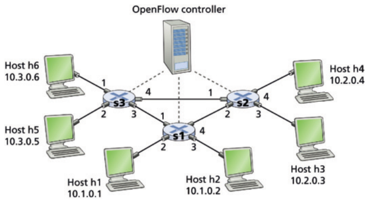

Hình 4.30 Mạng match-plus-action OpenFlow với ba packet switch, 6 host, và một controller OpenFlow

| Flow table (s2 Flow Table (Example 2)) |
|---|
| Khớp – Hành động (Match Action) |
| Ingress port = 3; IP Dst = 10.1.\*.\* Forward(2) |
| Ingress port = 4; IP Dst = 10.1.\*.\* Forward(1) |
| . . . . . . |

Các mục flow table cũng cần có tại s1 để chuyển tiếp các datagram nhận từ s2 tới h1 hoặc h2; và các mục flow table cần có tại s3 để chuyển tiếp các datagram nhận trên giao diện 4 từ s2 qua giao diện 3 về phía s1. Hãy thử tìm ra các mục flow table này tại s1 và s3.

#### Ví dụ thứ ba: Firewall (A Third Example: Firewalling)

Ví dụ thứ ba, hãy xét một kịch bản firewall trong đó s2 chỉ muốn nhận (trên bất kỳ giao diện nào của nó) traffic gửi từ các host gắn vào s3.

| Flow table (s2 Flow Table (Example 3)) |
|---|
| Khớp – Hành động (Match Action) |
| IP Src = 10.3.\*.\* IP Dst = 10.2.0.3 Forward(3) |
| IP Src = 10.3.\*.\* IP Dst = 10.2.0.4 Forward(4) |
| . . . . . . |

Nếu không có mục nào khác trong flow table của s2, thì chỉ traffic từ 10.3.\*.\* được chuyển tiếp tới các host gắn vào s2.

Mặc dù ở đây chúng ta chỉ xét một vài kịch bản cơ bản, tính linh hoạt và ưu điểm của chuyển tiếp tổng quát hy vọng đã rõ. Trong các bài tập về nhà, chúng ta sẽ khám phá cách flow table có thể được dùng để tạo nhiều hành vi logic khác nhau, bao gồm mạng ảo—hai hoặc nhiều mạng tách biệt về logic (mỗi mạng có hành vi chuyển tiếp riêng biệt và độc lập)—dùng cùng tập packet switch và liên kết vật lý. Trong Mục 5.5, chúng ta sẽ quay lại flow table khi nghiên cứu các controller SDN tính toán và phân phối flow table, và giao thức dùng để giao tiếp giữa một packet switch và controller của nó.

Các flow table match-plus-action mà chúng ta đã thấy trong mục này thực ra là một dạng khả năng lập trình hạn chế, chỉ định cách một router nên chuyển tiếp và thao tác (ví dụ, thay đổi một trường header) một datagram, dựa trên việc khớp giữa giá trị header của datagram và các điều kiện khớp. Người ta có thể tưởng tượng một dạng khả năng lập trình còn phong phú hơn—một ngôn ngữ lập trình với các cấu trúc higher-level (mức cao hơn) như biến, phép toán số học và Boolean đa dụng, biến, hàm, và câu lệnh điều kiện, cũng như các cấu trúc được thiết kế riêng cho việc xử lý datagram ở tốc độ đường truyền. P4 (Programming Protocol-independent Packet Processors) [P4 2020] là một ngôn ngữ như vậy, và đã thu hút sự quan tâm và ủng hộ đáng kể kể từ khi ra đời năm năm trước [Bosshart 2014].

### 4.4.4 Middlebox (Middleboxes)

Router là những con ngựa thồ của tầng mạng, và trong chương này, chúng ta đã học cách chúng thực hiện công việc “cơm ăn nước uống” là chuyển tiếp IP datagram về phía đích. Nhưng trong chương này, và trong các chương trước, chúng ta cũng đã gặp các thiết bị mạng khác (“hộp”) bên trong mạng nằm trên đường dữ liệu và thực hiện các chức năng khác ngoài chuyển tiếp. Chúng ta đã gặp Web cache trong Mục 2.2.5; bộ chia kết nối TCP (TCP connection splitter) trong mục 3.7; và chuyển đổi địa chỉ mạng (NAT), firewall, và hệ thống phát hiện xâm nhập trong Mục 4.3.4. Chúng ta đã học trong Mục 4.4 rằng chuyển tiếp tổng quát cho phép một router hiện đại dễ dàng và tự nhiên thực hiện firewall và cân bằng tải bằng các thao tác “match plus action” tổng quát. Trong 20 năm qua, chúng ta đã thấy sự tăng trưởng to lớn của các middlebox như vậy, mà RFC 3234 định nghĩa là:

“bất kỳ hộp trung gian nào thực hiện các chức năng ngoài các chức năng chuẩn, bình thường của một router IP trên đường dữ liệu giữa một host nguồn và host đích”

Chúng ta có thể xác định tổng quát ba loại dịch vụ do middlebox thực hiện:

• Chuyển đổi NAT (NAT Translation). Như chúng ta đã thấy trong Mục 4.3.4, các hộp NAT triển khai việc định địa chỉ mạng riêng, ghi lại địa chỉ IP và số port trong header datagram.

• Dịch vụ bảo mật (Security Services). Firewall chặn traffic dựa trên giá trị header-field hoặc chuyển hướng packet để xử lý thêm, như kiểm tra packet sâu (deep packet inspection - DPI). Hệ thống phát hiện xâm nhập (IDS) có thể phát hiện các mẫu định trước và lọc packet tương ứng. Bộ lọc e-mail application-level chặn các e-mails bị coi là rác, phishing hoặc gây mối đe dọa bảo mật khác.

• Nâng cao performance (Performance Enhancement). Các middlebox này thực hiện các dịch vụ như nén, cache nội dung, và cân bằng tải yêu cầu dịch vụ (ví dụ, một yêu cầu HTTP, hoặc một truy vấn công cụ tìm kiếm) tới một trong một tập server có thể cung cấp dịch vụ mong muốn.

  Nhiều middlebox khác [RFC 3234] cung cấp các khả năng thuộc ba loại dịch vụ này, trong cả mạng có dây lẫn mạng di động không dây [Wang 2011]. Với sự phổ biến của middlebox kéo theo nhu cầu vận hành, quản lý và nâng cấp các thiết bị này. Các hộp phần cứng chuyên dụng riêng, các software stack riêng, và các kỹ năng quản lý/vận hành riêng dẫn tới chi phí vận hành và vốn đáng kể. Do đó có lẽ không ngạc nhiên khi các nhà nghiên cứu đang khám phá việc dùng phần cứng phổ thông (mạng, tính toán và lưu trữ) với phần mềm chuyên dụng xây dựng trên một software stack chung—chính xác là cách tiếp cận được dùng trong SDN một thập kỷ trước—để triển khai các dịch vụ này. Cách tiếp cận này được gọi là ảo hóa chức năng mạng (network function virtualization - NFV) [Mijumbi 2016]. Một cách tiếp cận thay thế cũng đã được khám phá là thuê ngoài chức năng middlebox lên cloud [Sherry 2012].

  Trong nhiều năm, kiến trúc Internet có sự tách biệt rõ ràng giữa tầng mạng và các tầng giao vận/ứng dụng. Trong những “ngày xưa tốt đẹp” này, tầng mạng gồm các router, hoạt động trong lõi mạng, để chuyển tiếp datagram về phía đích chỉ dùng các trường trong header IP datagram. Tầng giao vận và tầng ứng dụng được triển khai trong các host hoạt động ở rìa mạng. Các host trao đổi packet với nhau trong các segment transport-layer và thông điệp application-layer. Middlebox ngày nay rõ ràng vi phạm sự tách biệt này: một hộp NAT, nằm giữa router và host, ghi lại địa chỉ IP network-layer và số port transport-layer; một firewall in-network (trong mạng) chặn các datagram đáng ngờ dùng các trường header application-layer (ví dụ, HTTP), transport-layer và network-layer; các gateway bảo mật e-mail được chèn vào giữa người gửi e-mail (độc hại hay không) và người nhận e-mail dự định, lọc các thông điệp e-mail application-layer dựa trên địa chỉ IP trong danh sách trắng/đen cũng như nội dung thông điệp e-mail. Trong khi có những người coi middlebox như vậy là một thứ hơi quái gở về kiến trúc [Garfinkel 2003], những người khác đã chấp nhận triết lý rằng middlebox như vậy “tồn tại vì những lý do quan trọng và lâu dài”—rằng chúng đáp ứng một nhu cầu quan trọng—và rằng chúng ta sẽ có nhiều hơn, chứ không ít hơn, middlebox trong tương lai [Walfish 2004].

## 4.5 Các nguyên lý kiến trúc của Internet (Architectural Principles of the Internet)

Với thành công phi thường của Internet, người ta có thể tự nhiên thắc mắc về các nguyên lý kiến trúc đã dẫn dắt sự phát triển của thứ có thể nói là hệ thống kỹ thuật lớn nhất và phức tạp nhất từng được loài người xây dựng. RFC 1958, có tựa đề “Architectural Principles of the Internet,” gợi ý rằng các nguyên lý này, nếu thực sự tồn tại, là thực sự tối thiểu:

“Nhiều thành viên của cộng đồng Internet sẽ lập luận rằng không có

kiến trúc nào, mà chỉ có một truyền thống, vốn không được ghi lại trong

25 năm đầu (hoặc ít nhất không phải bởi IAB). Tuy nhiên, nói rất tổng quát,

cộng đồng tin rằng mục tiêu là kết nối, công cụ là Internet

Hình 4.31 Đồng hồ cát Internet narrow-waisted (eo hẹp)

Protocol, và trí tuệ nằm ở hai đầu (end to end) thay vì ẩn trong mạ- (net-)

ng.” [RFC 1958]

Vậy là chúng ta đã có nó! Mục tiêu là cung cấp kết nối, sẽ chỉ có một giao thức network-layer (giao thức IP nổi tiếng mà chúng ta đã nghiên cứu trong chương này), và “trí tuệ” (có thể nói là “độ phức tạp”) sẽ được đặt ở rìa mạng, thay vì trong lõi mạng. Hãy xem chi tiết hơn một chút hai cân nhắc cuối này.

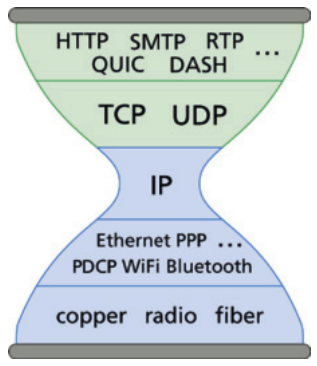

### Đồng hồ cát IP (The IP Hourglass)

Đến giờ, chúng ta đã quá quen với protocol stack Internet five-layer mà chúng ta gặp lần đầu trong Hình 1.24. Một cách hình dung khác của stack này, minh họa trong Hình 4.31 và đôi khi được gọi là “đồng hồ cát IP,” minh họa “eo hẹp” của kiến trúc Internet phân tầng. Trong khi Internet có nhiều giao thức ở tầng vật lý, liên kết, giao vận và ứng dụng, chỉ có một giao thức tầng mạng—giao thức IP. Đây là giao thức duy nhất phải được triển khai bởi từng thiết bị trong hàng tỉ thiết bị Internet-connected. Eo hẹp này đã đóng vai trò thiết yếu trong sự tăng trưởng phi thường của Internet. Sự đơn giản tương đối của giao thức IP, và thực tế nó là yêu cầu phổ quát duy nhất cho kết nối Internet đã cho phép một loạt phong phú các mạng—với các công nghệ link-layer bên dưới rất khác nhau, từ Ethernet tới WiFi tới cellular tới mạng quang trở thành một phần của Internet. [Clark 1997] lưu ý rằng vai trò của eo hẹp, mà ông gọi là một “tầng bắc cầu” (spanning layer), là “ . . . ẩn những khác biệt chi tiết giữa các công nghệ [bên dưới] khác nhau này và trình bày một giao diện dịch vụ thống nhất cho các ứng dụng bên trên.” Đối với tầng IP nói riêng: “Tầng bắc cầu IP đạt được mục đích của nó như thế nào? Nó định nghĩa một tập dịch vụ cơ bản, được thiết kế cẩn thận để có thể được xây dựng từ một loạt rộng các công nghệ mạng bên dưới. Phần mềm, như một phần của tầng Internet [tức là, tầng mạng], chuyển những gì mỗi công nghệ lower-layer này cung cấp thành dịch vụ chung của tầng Internet.”

Để có thảo luận về eo hẹp, bao gồm các ví dụ ngoài Internet, xem [Beck 2019; Akhshabi 2011]. Chúng tôi lưu ý ở đây rằng khi kiến trúc Internet bước vào mid-life (tuổi trung niên) (chắc chắn, tuổi 40 đến 50 năm của Internet đủ điều kiện để coi là trung niên!), người ta có thể nhận thấy “eo hẹp” của nó có lẽ thực sự đang to ra một chút (như thường xảy ra ở tuổi trung niên!) qua sự trỗi dậy của middlebox.

Để có một góc nhìn gần đây thú vị (và hồi cứu) về thiết kế đồng hồ cát Internet, chúng tôi khuyên đọc [Davie 2024].

### Lập luận đầu cuối (The End-to-End Argument)

Nguyên lý thứ ba trong RFC 1958—rằng “trí tuệ nằm ở hai đầu thay vì ẩn trong mạng”—nói về việc đặt chức năng trong mạng. Ở đây, chúng ta đã thấy rằng cho đến khi middlebox trỗi dậy gần đây, hầu hết chức năng Internet thực sự được đặt ở rìa mạng. Đáng lưu ý rằng, trái ngược trực tiếp với mạng điện thoại thế kỷ 20—vốn có các điểm cuối “ngu” (non-programmable - không lập trình được) và switch thông minh—Internet luôn có các điểm cuối thông minh (máy tính lập trình được), cho phép đặt chức năng phức tạp tại các điểm cuối đó. Nhưng một lập luận có nguyên tắc hơn cho việc thực sự đặt chức năng tại các điểm cuối đã được đưa ra trong một bài báo cực kỳ có ảnh hưởng [Saltzer 1984] trình bày rõ “lập luận end-to-end.” Nó phát biểu:

“ . . . có một danh sách các chức năng mà mỗi chức năng có thể được triển khai theo một trong vài cách: bởi hệ thống con truyền thông, bởi client của nó, như một liên doanh, hoặc có lẽ dư thừa, mỗi bên làm phiên bản riêng của mình. Khi lập luận về lựa chọn này, các yêu cầu của ứng dụng cung cấp cơ sở cho một lớp lập luận, như sau:

Chức năng đang xét chỉ có thể được triển khai đầy đủ và đúng đắn với kiến thức và sự giúp đỡ của ứng dụng đứng tại các điểm cuối của hệ thống truyền thông. Do đó, cung cấp chức năng đang xét đó như một tính năng của chính hệ thống truyền thông là không thể. (Đôi khi một phiên bản chưa đầy đủ của chức năng do hệ thống truyền thông cung cấp có thể hữu ích như một cải tiến performance.)

Chúng tôi gọi dòng lập luận chống lại việc triển khai chức năng low-level này là “lập luận end-to-end.”

Một ví dụ minh họa lập luận end-to-end là truyền dữ liệu tin cậy. Vì packet có thể bị mất trong mạng (ví dụ, ngay cả khi không có tràn buffer, một router đang giữ một packet xếp hàng có thể bị sập, hoặc một phần mạng nơi packet đang xếp hàng bị tách rời do sự cố liên kết), các điểm cuối (trong trường hợp này qua giao thức TCP) phải thực hiện điều khiển lỗi. Như chúng ta sẽ thấy trong Chương 6, một số giao thức link-layer thực sự thực hiện điều khiển lỗi cục bộ, nhưng chỉ riêng điều khiển lỗi cục bộ này là “chưa đầy đủ” và không đủ để cung cấp truyền dữ liệu tin cậy end-to-end. Và vì vậy truyền dữ liệu tin cậy phải được triển khai ở hai đầu.

RFC 1958 cố ý chỉ đưa vào hai tài liệu tham khảo, cả hai đều là “các bài báo nền tảng về kiến trúc Internet.” Một trong số đó là chính bài báo end-to-end [Saltzer 1984]; bài báo thứ hai [Clark 1988] thảo luận triết lý thiết kế của các DARPA Internet Protocol. Cả hai đều là những bài “phải đọc” thú vị cho bất kỳ ai quan tâm tới kiến trúc Internet. Các bài follow-ons (tiếp nối) của [Clark 1988] là [Blumenthal 2001; Clark 2005] xem xét lại kiến trúc Internet trong bối cảnh môi trường phức tạp hơn nhiều mà Internet ngày nay phải hoạt động. Hai cuốn sách sâu sắc và thought-provoking (gợi suy nghĩ) về kiến trúc Internet là [Clark 2018; Zave 2024].

## 4.6 Tóm tắt (Summary)

Trong chương này, chúng ta đã đề cập các chức năng data plane của tầng mạng— các chức năng per-router xác định cách packet đến trên một trong các liên kết vào của router được chuyển tiếp tới một trong các liên kết ra của router đó. Chúng ta bắt đầu bằng việc xem chi tiết các hoạt động bên trong của router, nghiên cứu chức năng port vào và port ra và chuyển tiếp destination-based, cơ chế chuyển mạch nội bộ của router, quản lý hàng đợi packet và hơn nữa. Chúng ta đã đề cập cả chuyển tiếp IP truyền thống (trong đó việc chuyển tiếp dựa trên địa chỉ đích của datagram) lẫn chuyển tiếp tổng quát (trong đó việc chuyển tiếp và các chức năng khác có thể được thực hiện dùng giá trị của nhiều trường khác nhau trong header của datagram) và đã thấy tính linh hoạt của cách tiếp cận sau. Chúng ta cũng đã nghiên cứu chi tiết các giao thức IPv4 và IPv6, và việc định địa chỉ Internet, mà chúng ta thấy sâu sắc hơn, tinh tế hơn và thú vị hơn nhiều so với chúng ta có thể đã kỳ vọng. Chúng ta đã hoàn tất nghiên cứu về data plane network-layer với việc nghiên cứu middlebox, và một thảo luận rộng về kiến trúc Internet.

Với hiểu biết mới về data plane network-layer, giờ chúng ta đã sẵn sàng đi sâu vào control plane của tầng mạng trong Chương 5!

### Bài tập về nhà và câu hỏi (Homework Problems and Questions)

#### Câu hỏi ôn tập Chương 4 (Chapter 4 Review Questions)

##### Mục 4.1

R1. Hãy điểm lại một số thuật ngữ được dùng trong cuốn sách này. Nhớ rằng tên của một packet transport-layer là segment và tên của một packet link-layer là frame. Tên của một packet network-layer là gì? Nhớ rằng cả router lẫn switch link-layer đều được gọi là packet switch. Sự khác biệt cơ bản giữa một router và một switch link-layer là gì?

R2. Chúng ta đã lưu ý rằng chức năng tầng mạng có thể được chia tổng quát thành chức năng data plane và chức năng control plane. Các chức năng chính của data plane là gì? Của control plane là gì?

R3. Chúng ta đã phân biệt giữa chức năng chuyển tiếp và chức năng định tuyến được thực hiện ở tầng mạng. Những khác biệt then chốt giữa định tuyến và chuyển tiếp là gì?

R4. Vai trò của bảng chuyển tiếp trong một router là gì?

R5. Chúng ta đã nói rằng mô hình dịch vụ của tầng mạng “định nghĩa các đặc tính của việc vận chuyển packet end-to-end giữa host gửi và host nhận.” Mô hình dịch vụ của tầng mạng Internet là gì? Mô hình dịch vụ của Internet đưa ra những đảm bảo gì về việc chuyển giao datagram host-to-host?

##### Mục 4.2

R6. Trong Mục 4.2, chúng ta đã thấy một router thường gồm các port vào, port ra, một switching fabric và một bộ xử lý định tuyến. Thành phần nào trong số này được triển khai bằng phần cứng và thành phần nào bằng phần mềm? Tại sao? Quay lại khái niệm data plane và control plane của tầng mạng, cái nào được triển khai bằng phần cứng và cái nào bằng phần mềm? Tại sao?

R7. Thảo luận tại sao mỗi port vào trong một router high-speed lưu một bản sao bóng của bảng chuyển tiếp.

R8. Chuyển tiếp destination-based có nghĩa là gì? Nó khác chuyển tiếp tổng quát thế nào (giả sử bạn đã đọc Mục 4.4, cách tiếp cận nào trong hai cách được Software-Defined Networking áp dụng)?

R9. Giả sử một packet đến khớp hai hoặc nhiều mục trong bảng chuyển tiếp của một router. Với chuyển tiếp destination-based truyền thống, router áp dụng quy tắc nào để xác định quy tắc nào trong số này nên được áp dụng để xác định port ra mà packet đến nên được chuyển mạch tới?

R10. Ba loại switching fabric được thảo luận trong Mục 4.2. Liệt kê và mô tả ngắn gọn từng loại. Loại nào, nếu có, có thể gửi nhiều packet qua fabric song song?

R11. Mô tả cách mất gói có thể xảy ra tại port vào. Mô tả cách loại bỏ mất gói tại port vào (mà không dùng buffer vô hạn).

R12. Mô tả cách mất gói có thể xảy ra tại port ra. Có thể ngăn mất mát này bằng cách tăng tốc độ switch fabric không?

R13. HOL blocking là gì? Nó xảy ra ở port vào hay port ra?

R14. Trong Mục 4.2, chúng ta đã nghiên cứu các quy tắc lập lịch packet FIFO, Priority, Round Robin (RR) và Weighted Fair Queueing (WFQ)? Quy tắc xếp hàng nào trong số này đảm bảo mọi packet rời đi theo thứ tự chúng tới?

R15. Đưa ra một ví dụ cho thấy tại sao một nhà vận hành mạng có thể muốn một lớp packet được ưu tiên hơn một lớp packet khác.

R16. Sự khác biệt thiết yếu giữa lập lịch packet RR và WFQ là gì? Có trường hợp nào (Gợi ý: Hãy xét các trọng số WFQ) mà RR và WFQ sẽ hành xử giống hệt nhau không?

##### Mục 4.3

R17. Giả sử Host A gửi cho Host B một segment TCP được đóng gói trong một IP datagram. Khi Host B nhận datagram, làm sao tầng mạng trong Host B biết nó nên chuyển segment (tức là, payload của datagram) tới TCP thay vì tới UDP hay một giao thức upper-layer nào khác?

R18. Trường nào trong header IP có thể được dùng để đảm bảo một packet được chuyển tiếp qua không quá N router?

R19. Nhớ rằng chúng ta đã thấy Internet checksum được dùng trong cả segment transport-layer (trong header UDP và TCP, lần lượt Hình 3.7 và 3.29) lẫn trong datagram network-layer (header IP, Hình 4.17). Giờ hãy xét một segment tầng giao vận được đóng gói trong một IP datagram. Checksum trong header segment và header datagram có được tính trên byte chung nào trong IP datagram không? Giải thích câu trả lời của bạn.

R20. Khi một datagram lớn bị phân mảnh thành nhiều datagram nhỏ hơn, các datagram nhỏ hơn này được ráp lại thành một datagram lớn duy nhất ở đâu?

R21. Router có địa chỉ IP không? Nếu có, bao nhiêu?

R22. Giá trị nhị phân 32-bit tương đương của địa chỉ IP 223.1.3.27 là gì?

R23. Ghé một host dùng DHCP để lấy địa chỉ IP, network mask, router mặc định và địa chỉ IP của local DNS server. Liệt kê các giá trị này.

R24. Giả sử có ba router giữa một host nguồn và một host đích. Bỏ qua phân mảnh, một IP datagram gửi từ host nguồn tới host đích sẽ đi qua bao nhiêu giao diện? Bao nhiêu bảng chuyển tiếp sẽ được tra chỉ mục để chuyển datagram từ nguồn tới đích?

R25. Giả sử một ứng dụng sinh ra các khúc 40 byte dữ liệu mỗi 20 msec, và mỗi khúc được đóng gói trong một segment TCP rồi một IP datagram. Bao nhiêu phần trăm mỗi datagram sẽ là overhead, và bao nhiêu phần trăm là dữ liệu ứng dụng?

R26. Giả sử bạn mua một router không dây và nối nó với cable modem. Cũng giả sử ISP của bạn gán động cho thiết bị được kết nối (tức là, router không dây của bạn) một địa chỉ IP. Cũng giả sử bạn có năm PC ở nhà dùng 802.11 để kết nối không dây tới router không dây. Địa chỉ IP được gán cho năm PC như thế nào? Router không dây có dùng NAT không? Tại sao có hoặc không?

R27. Thuật ngữ “route aggregation” (gộp tuyến) có nghĩa là gì? Tại sao việc router thực hiện route aggregation lại hữu ích?

R28. Một giao thức “plug-and-play” hoặc “zero-conf” có nghĩa là gì?

R29. Địa chỉ mạng riêng (private network address) là gì? Một datagram có địa chỉ mạng riêng có bao giờ nên xuất hiện trong Internet công cộng lớn hơn không? Giải thích.

R30. So sánh và đối chiếu các trường header IPv4 và IPv6. Chúng có trường chung nào không?

R31. Người ta nói rằng khi IPv6 tạo đường hầm qua các router IPv4, IPv6 coi các đường hầm IPv4 như các giao thức link-layer. Bạn có đồng ý với phát biểu này không? Tại sao có hoặc không?

##### Mục 4.4

R32. Chuyển tiếp tổng quát khác chuyển tiếp destination-based như thế nào?

R33. Sự khác biệt giữa một bảng chuyển tiếp mà chúng ta đã gặp trong chuyển tiếp destination-based ở Mục 4.1 và flow table của Open-Flow mà chúng ta đã gặp trong Mục 4.4 là gì?

### Bài tập (Problems)

R34. Thao tác “match plus action” của một router hoặc switch có nghĩa là gì? Trong trường hợp packet switch chuyển tiếp destination-based, cái gì được khớp và hành động nào được thực hiện? Trong trường hợp SDN, hãy nêu ba trường có thể được khớp, và ba hành động có thể được thực hiện.

R35. Nêu ba trường header trong một IP datagram có thể được “khớp” trong chuyển tiếp tổng quát OpenFlow 1.0. Ba trường header IP datagram nào không thể được “khớp” trong OpenFlow?

P1. Hãy xét mạng dưới đây.

a. Trình bày bảng chuyển tiếp trong router A, sao cho mọi traffic hướng tới host H3 được chuyển tiếp qua giao diện 3.

b. Bạn có thể viết ra một bảng chuyển tiếp trong router A, sao cho mọi traffic từ H1 hướng tới host H3 được chuyển tiếp qua giao diện 3, trong khi mọi traffic từ H2 hướng tới host H3 được chuyển tiếp qua giao diện 4 không? (Gợi ý: Đây là một câu hỏi mẹo.)

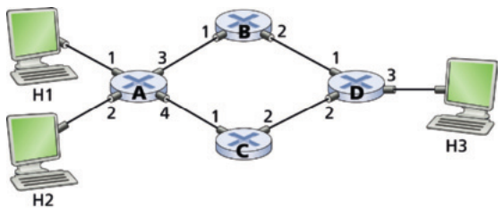

P2. Giả sử hai packet tới hai port vào khác nhau của một router vào đúng cùng một thời điểm. Cũng giả sử không có packet nào khác ở bất kỳ đâu trong router.

a. Giả sử hai packet sẽ được chuyển tiếp tới hai port ra khác nhau. Có thể chuyển tiếp hai packet qua switch fabric cùng lúc khi fabric dùng một bus dùng chung không?

b. Giả sử hai packet sẽ được chuyển tiếp tới hai port ra khác nhau. Có thể chuyển tiếp hai packet qua switch fabric cùng lúc khi fabric dùng chuyển mạch qua bộ nhớ không?

c. Giả sử hai packet sẽ được chuyển tiếp tới cùng một port ra. Có thể chuyển tiếp hai packet qua switch fabric cùng lúc khi fabric dùng crossbar không?

P3. Trong Mục 4.2.4, có nói rằng nếu R _ switch nhanh hơn R _ line N lần, thì chỉ có xếp hàng không đáng kể xảy ra tại các port vào, ngay cả khi mọi packet đều được chuyển tiếp tới cùng một port ra. Giờ giả sử R _ switch = R _ line, nhưng mọi packet đều được chuyển tiếp tới các port ra khác nhau. Gọi D là thời gian truyền một packet. Như một hàm của D, độ trễ hàng đợi đầu vào tối đa cho một packet là bao nhiêu đối với switching fabric (a) bộ nhớ, (b) bus, và (c) crossbar?

P4. Hãy xét switch minh họa dưới đây. Giả sử mọi datagram có cùng độ dài cố định, switch hoạt động theo kiểu đồng bộ, chia khe thời gian, và trong một khe thời gian một datagram có thể được truyền từ một port vào tới một port ra. Switch fabric là crossbar nên nhiều nhất một datagram có thể được truyền tới một port ra cho trước trong một khe thời gian, nhưng các port ra khác nhau có thể nhận datagram từ các port vào khác nhau trong một khe thời gian duy nhất. Số khe thời gian tối thiểu cần để truyền các packet minh họa từ port vào tới port ra của chúng là bao nhiêu, giả sử bất kỳ thứ tự lập lịch hàng đợi vào nào bạn muốn (tức là, không cần có HOL blocking)? Số khe lớn nhất cần là bao nhiêu, giả sử thứ tự lập lịch worst-case mà bạn có thể nghĩ ra, giả sử một hàng đợi vào non-empty (không rỗng) không bao giờ rảnh?

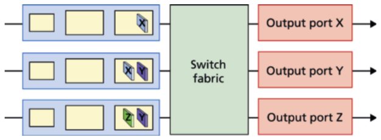

P5. Giả sử chính sách lập lịch WFQ được áp dụng cho một buffer hỗ trợ ba lớp, và giả sử các trọng số là 0.5, 0.25 và 0.25 cho ba lớp.

a. Giả sử mỗi lớp có một số lượng lớn packet trong buffer. Ba lớp có thể được phục vụ theo trình tự nào để đạt các trọng số WFQ? (Với lập lịch round robin, một trình tự tự nhiên là 123123123 . . . ) .

b. Giả sử lớp 1 và 2 có một số lượng lớn packet trong buffer, và không có packet lớp 3 nào trong buffer. Ba lớp có thể được phục vụ theo trình tự nào để đạt các trọng số WFQ?

P6. Hãy xét hình dưới đây. Trả lời các câu hỏi sau:

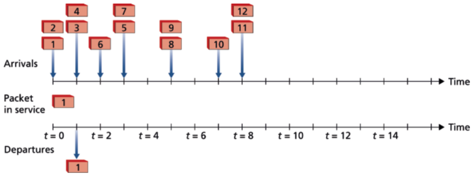

a. Giả sử phục vụ FIFO, hãy chỉ ra thời điểm mỗi packet 2 đến 12 rời hàng đợi. Với mỗi packet, độ trễ giữa lúc nó tới và lúc bắt đầu khe mà nó được truyền là bao nhiêu? Trung bình của độ trễ này trên cả 12 packet là bao nhiêu?

b. Giờ giả sử phục vụ ưu tiên, và giả sử các packet odd-numbered (số lẻ) có ưu tiên cao, và các packet even-numbered (số chẵn) có ưu tiên thấp. Chỉ ra thời điểm mỗi packet 2 đến 12 rời hàng đợi. Với mỗi packet, độ trễ giữa lúc nó tới và lúc bắt đầu khe mà nó được truyền là bao nhiêu? Trung bình của độ trễ này trên cả 12 packet là bao nhiêu?

c. Giờ giả sử phục vụ round robin. Giả sử các packet 1, 2, 3, 6, 11 và 12 thuộc lớp 1, và các packet 4, 5, 7, 8, 9 và 10 thuộc lớp

2. Chỉ ra thời điểm mỗi packet 2 đến 12 rời hàng đợi. Với mỗi packet, độ trễ giữa lúc nó tới và lúc nó rời đi là bao nhiêu? Độ trễ trung bình trên cả 12 packet là bao nhiêu?

d. Giờ giả sử phục vụ weighted fair queueing (WFQ). Giả sử các packet odd-numbered thuộc lớp 1, và các packet even-numbered thuộc lớp 2. Lớp 1 có trọng số WFQ là 2, trong khi lớp 2 có trọng số WFQ là 1. Lưu ý rằng có thể không đạt được một lịch WFQ lý tưởng như mô tả trong sách, vì vậy hãy chỉ ra tại sao bạn chọn packet cụ thể để phục vụ tại mỗi khe thời gian. Với mỗi packet, độ trễ giữa lúc nó tới và lúc nó rời đi là bao nhiêu? Độ trễ trung bình trên cả 12 packet là bao nhiêu?

e. Bạn nhận thấy gì về độ trễ trung bình trong cả bốn trường hợp (FIFO, RR, ưu tiên và WFQ)?

P7. Hãy xét lại hình cho P6.

a. Giả sử phục vụ ưu tiên, với các packet 1, 4, 5, 6 và 11 là packet high-priority. Các packet còn lại có ưu tiên thấp. Chỉ ra các khe mà mỗi packet 2 đến 12 rời hàng đợi.

b. Giờ giả sử dùng phục vụ round robin, với các packet 1, 4, 5, 6 và 11 thuộc một lớp traffic, và các packet còn lại thuộc lớp traffic thứ hai. Chỉ ra các khe mà mỗi packet 2 đến 12 rời hàng đợi.

c. Giờ giả sử dùng phục vụ WFQ, với các packet 1, 4, 5, 6 và 11 thuộc một lớp traffic, và các packet còn lại thuộc lớp traffic thứ hai. Lớp 1 có trọng số WFQ là 1, trong khi lớp 2 có trọng số WFQ là 2 (lưu ý rằng các trọng số này khác với câu hỏi trước). Chỉ ra các khe mà mỗi packet 2 đến 12 rời hàng đợi. Xem thêm lưu ý trong câu hỏi trên về phục vụ WFQ.

P8. Hãy xét một mạng datagram dùng địa chỉ host 32-bit. Giả sử một router có bốn liên kết, đánh số 0 đến 3, và packet sẽ được chuyển tiếp tới các giao diện liên kết như sau:

| Dải địa chỉ đích (Destination Address Range) | Giao diện liên kết (Link Interface) |
|---|---|
| 11100000 00000000 00000000 00000000 |  |
| đến (through) | 0 |
| 11100000 00111111 11111111 11111111 |  |
| 11100000 01000000 00000000 00000000 |  |
| đến (through) | 1 |
| 11100000 01000000 11111111 11111111 |  |
| 11100000 01000001 00000000 00000000 |  |
| đến (through) | 2 |
| 11100001 01111111 11111111 11111111 |  |
| Còn lại (Otherwise) | 3 |

a. Đưa ra một bảng chuyển tiếp có năm mục, dùng khớp tiền tố dài nhất, và chuyển tiếp packet tới đúng giao diện liên kết.

b. Mô tả cách bảng chuyển tiếp của bạn xác định giao diện liên kết thích hợp cho các datagram có địa chỉ đích:

```
11001000 10010001 01010001 01010101
11100001 01000000 11000011 00111100
11100001 10000000 00010001 01110111
```

P9. Hãy xét một mạng datagram dùng địa chỉ host 8-bit. Giả sử một router dùng khớp tiền tố dài nhất và có bảng chuyển tiếp sau: Với mỗi giao diện trong bốn giao diện, hãy đưa ra dải địa chỉ host đích tương ứng và số địa chỉ trong dải.

| Khớp tiền tố (Prefix Match) | Giao diện (Interface) |
|---|---|
| 00 | 0 |
| 010 | 1 |
| 011 | 1 |
| 10 | 2 |
| 11 | 3 |

P10. Hãy xét một mạng datagram dùng địa chỉ host 8-bit. Giả sử một router dùng khớp tiền tố dài nhất và có bảng chuyển tiếp sau: Với mỗi giao diện trong bốn giao diện, hãy đưa ra dải địa chỉ host đích tương ứng và số địa chỉ trong dải.

| Khớp tiền tố (Prefix Match) | Giao diện (Interface) |
|---|---|
| 1 | 0 |
| 10 | 1 |
| 111 | 2 |
| còn lại (otherwise) | 3 |

P11. Hãy xét một router nối ba subnet: Subnet 1, Subnet 2 và Subnet 3. Giả sử mọi giao diện trong mỗi subnet trong ba subnet này phải có tiền tố 223.1.17/24. Cũng giả sử Subnet 1 phải hỗ trợ ít nhất 60 giao diện, Subnet 2 phải hỗ trợ ít nhất 90 giao diện, và Subnet 3 phải hỗ trợ ít nhất 12 giao diện. Đưa ra ba địa chỉ mạng (dạng a.b.c.d/x) thỏa các ràng buộc này.

P12. Trong Mục 4.2.2, một bảng chuyển tiếp ví dụ (dùng khớp tiền tố dài nhất) được đưa ra. Viết lại bảng chuyển tiếp này dùng ký pháp a.b.c.d/x thay vì ký pháp chuỗi nhị phân.

P13. Trong Bài P8, bạn được yêu cầu đưa ra một bảng chuyển tiếp (dùng khớp tiền tố dài nhất). Viết lại bảng chuyển tiếp này dùng ký pháp a.b.c.d/x thay vì ký pháp chuỗi nhị phân.

P14. Hãy xét một subnet có tiền tố 128.119.40.128/26. Đưa ra một ví dụ về một địa chỉ IP (dạng xxx.xxx.xxx.xxx) có thể được gán cho mạng này. Giả sử một ISP sở hữu khối địa chỉ dạng 128.119.40.64/26. Giả sử nó muốn tạo bốn subnet từ khối này, với mỗi khối có cùng số địa chỉ IP. Các tiền tố (dạng a.b.c.d/x) cho bốn subnet là gì?

P15. Hãy xét topology minh họa trong Hình 4.20. Ký hiệu ba subnet có host (bắt đầu theo chiều kim đồng hồ tại vị trí 12:00) là Mạng A, B và C. Ký hiệu các subnet không có host là Mạng D, E và F.

a. Gán địa chỉ mạng cho mỗi subnet trong sáu subnet này, với các ràng buộc sau: Mọi địa chỉ phải được cấp phát từ 214.97.254/23; Subnet A phải có đủ địa chỉ để hỗ trợ 250 giao diện; Subnet B phải có đủ địa chỉ để hỗ trợ 120 giao diện; và Subnet C phải có đủ địa chỉ để hỗ trợ 120 giao diện. Tất nhiên, các subnet D, E và F mỗi subnet phải có khả năng hỗ trợ hai giao diện. Với mỗi subnet, việc gán nên có dạng a.b.c.d/x hoặc a.b.c.d/x − e.f.g.h/y.

b. Dùng câu trả lời của bạn cho phần (a), đưa ra các bảng chuyển tiếp (dùng khớp tiền tố dài nhất) cho mỗi router trong ba router.

P16. Dùng dịch vụ whois tại American Registry for Internet Numbers (http://www.arin.net/whois) để xác định các khối địa chỉ IP của ba trường đại học. Dịch vụ whois có thể được dùng để xác định chắc chắn vị trí địa lý của một địa chỉ IP cụ thể không? Dùng www.max-mind.com để xác định vị trí của các Web server tại mỗi trường đại học này.

P17. Giả sử datagram bị giới hạn ở 1,500 byte (bao gồm header) giữa Host A nguồn và Host B đích. Giả sử header IP 20-byte, cần bao nhiêu datagram để gửi một MP3 gồm 5 triệu byte? Giải thích cách bạn tính câu trả lời.

P18. Hãy xét thiết lập mạng trong Hình 4.25. Giả sử ISP thay vào đó gán cho router địa chỉ 24.34.112.235 và địa chỉ mạng của mạng gia đình là 192.168.1/24.

a. Gán địa chỉ cho mọi giao diện trong mạng gia đình.

b. Giả sử mỗi host có hai kết nối TCP đang diễn ra, tất cả tới port 80 tại host 128.119.40.86. Đưa ra sáu mục tương ứng trong bảng chuyển đổi NAT.

P19. Giả sử bạn quan tâm tới việc phát hiện số host phía sau một NAT. Bạn quan sát thấy tầng IP đóng dấu một số định danh (identification number) tuần tự lên mỗi packet IP. Số định danh của packet IP đầu tiên do một host tạo là một số ngẫu nhiên, và số định danh của các packet IP tiếp theo được gán tuần tự. Giả sử mọi packet IP do các host phía sau NAT tạo đều được gửi ra thế giới bên ngoài.

a. Dựa trên quan sát này, và giả sử bạn có thể sniff mọi packet do NAT gửi ra ngoài, bạn có thể phác thảo một kỹ thuật đơn giản phát hiện số host duy nhất phía sau NAT không? Biện minh câu trả lời của bạn.

b. Nếu số định danh không được gán tuần tự mà gán ngẫu nhiên, kỹ thuật của bạn có còn hoạt động không? Biện minh câu trả lời của bạn.

P20. Hãy xét mạng SDN OpenFlow minh họa trong Hình 4.30. Giả sử hành vi chuyển tiếp mong muốn cho các datagram tới s2 như sau:

• mọi datagram tới trên port vào 1 từ host h5 hoặc h6 hướng tới host h1 hoặc h2 nên được chuyển tiếp qua port ra 2;

• mọi datagram tới trên port vào 2 từ host h1 hoặc h2 hướng tới host h5 hoặc h6 nên được chuyển tiếp qua port ra 1;

• mọi datagram đến trên port vào 1 hoặc 2 và hướng tới host h3 hoặc h4 nên được chuyển tới host được chỉ định;

• host h3 và h4 nên có khả năng gửi datagram cho nhau.

Đặc tả các mục flow table trong s2 triển khai hành vi chuyển tiếp này.

P21. Hãy xét lại mạng SDN OpenFlow minh họa trong Hình 4.30. Giả sử hành vi chuyển tiếp mong muốn cho các datagram tới từ host h3 hoặc h4 tại s2 như sau:

• mọi datagram tới từ host h3 và hướng tới h1, h2, h5 hoặc h6 nên được chuyển tiếp theo chiều kim đồng hồ trong mạng;

• mọi datagram tới từ host h4 và hướng tới h1, h2, h5 hoặc h6 nên được chuyển tiếp theo chiều counter-clockwise (ngược chiều kim đồng hồ) trong mạng.

Đặc tả các mục flow table trong s2 triển khai hành vi chuyển tiếp này.

P22. Hãy xét lại kịch bản từ P21 ở trên. Đưa ra các mục flow table tại các packet switch s1 và s3, sao cho mọi datagram đến có địa chỉ nguồn là h3 hoặc h4 được định tuyến tới các host đích được chỉ định trong trường địa chỉ đích của IP datagram. (Gợi ý: Các quy tắc bảng chuyển tiếp của bạn nên bao gồm các trường hợp một datagram đến hướng tới một host gắn trực tiếp hoặc nên được chuyển tiếp tới một router lân cận để cuối cùng chuyển tới host ở đó.)

P23. Hãy xét lại mạng SDN OpenFlow minh họa trong Hình 4.30. Giả sử chúng ta muốn switch s2 hoạt động như một firewall. Đặc tả flow table trong s2 triển khai các hành vi firewall sau (đặc tả một flow table khác nhau cho mỗi hành vi trong bốn hành vi firewall dưới đây) cho việc chuyển giao datagram hướng tới h3 và h4. Bạn không cần đặc tả hành vi chuyển tiếp trong s2 chuyển tiếp traffic tới các router khác.

• Chỉ traffic tới từ host h1 và h6 mới được chuyển tới host h3 hoặc h4 (tức là, traffic tới từ host h2 và h5 bị chặn).

• Chỉ traffic TCP được phép chuyển tới host h3 hoặc h4 (tức là, traffic UDP bị chặn).

• Chỉ traffic hướng tới h3 mới được chuyển giao (tức là, mọi traffic tới h4 bị chặn).

• Chỉ traffic UDP từ h1 và hướng tới h3 mới được chuyển giao. Mọi traffic khác bị chặn.

P24. Hãy xét protocol stack Internet trong Hình 1.24 và 4.31. Bạn có coi giao thức ICMP là một giao thức network-layer hay một giao thức transport-layer không? Biện minh câu trả lời của bạn.

### Bài thực hành Wireshark: IP (Wireshark Lab: IP)

Trên Web site của cuốn sách này, www.pearsonhighered.com/cs-resources, bạn sẽ tìm thấy một bài thực hành Wireshark khảo sát hoạt động của giao thức IP, và đặc biệt là định dạng IP datagram.

### PHỎNG VẤN VỚI... (AN INTERVIEW WITH...)


### Vinton G. Cerf

Vinton G. Cerf đã giữ chức Phó Chủ tịch và Chief Internet Evangelist cho Google từ năm 2005. Ông đã làm việc hơn 15 năm tại MCI ở nhiều vị trí khác nhau, kết thúc nhiệm kỳ ở đó với chức Phó Chủ tịch Cấp cao về Chiến lược Công nghệ. Ông được biết đến rộng rãi là co-designer (đồng thiết kế) của các giao thức TCP/IP và kiến trúc của Internet. Trong thời gian từ 1976 đến 1982 tại US Department of Defense Advanced Research Projects Agency (DARPA), ông đóng vai trò then chốt dẫn dắt việc phát triển Internet và các kỹ thuật truyền thông packet và bảo mật Internet-related. Ông nhận Huân chương Tự do của Tổng thống Mỹ năm 2005 và Huân chương Công nghệ Quốc gia Mỹ năm 1997. Ông có bằng BS ngành Toán từ Stanford University và bằng MS và PhD ngành khoa học máy tính từ UCLA.

#### Điều gì đưa ông đến với chuyên ngành mạng?

Tôi đang làm lập trình viên tại UCLA vào cuối những năm 1960s. Công việc của tôi được hỗ trợ bởi US Defense Advanced Research Projects Agency (khi đó gọi là ARPA và giờ là DARPA). Tôi làm việc trong phòng thí nghiệm của Giáo sư Leonard Kleinrock tại Network Measurement Center của Arpanet mới được tạo ra. Nút đầu tiên của Arpanet được lắp đặt tại UCLA vào ngày 1 tháng Chín, 1969. Tôi chịu trách nhiệm lập trình một máy tính dùng để thu thập thông tin performance về Arpanet và báo cáo thông tin này để so sánh với các mô hình toán học và dự đoán performance của mạng.

Một số nghiên cứu sinh khác và tôi được giao trách nhiệm làm việc với cái so-called giao thức host-level của Arpanet—các thủ tục và định dạng cho phép nhiều loại máy tính khác nhau trên mạng tương tác với nhau. Đó là một cuộc khám phá hấp dẫn vào một thế giới mới (đối với tôi) của tính toán và truyền thông phân tán.

#### Khi lần đầu thiết kế giao thức, ông có hình dung IP sẽ trở nên phổ biến khắp nơi như ngày nay không?

Khi Bob Kahn và tôi lần đầu làm việc về điều này năm 1973, tôi nghĩ chúng tôi chủ yếu rất tập trung vào câu hỏi trung tâm: Làm thế nào để các mạng packet không đồng nhất tương tác với nhau, giả sử chúng ta không thể thực sự thay đổi chính các mạng đó? Chúng tôi hy vọng tìm được cách cho phép một tập hợp tùy ý các mạng packet-switched được nối với nhau một cách trong suốt, để các máy tính host có thể giao tiếp end-to-end mà không phải thực hiện bất kỳ chuyển đổi nào ở giữa. Tôi nghĩ chúng tôi biết mình đang làm việc với một công nghệ mạnh mẽ và có thể mở rộng, nhưng tôi nghi ngờ chúng tôi có một hình dung rõ ràng về thế giới sẽ như thế nào với hàng tỉ máy tính đều được kết nối với nhau trên Internet.

#### Giờ ông hình dung gì về tương lai của mạng và Internet? Ông nghĩ những thách thức/trở ngại lớn nào đang chờ phía trước trong sự phát triển của chúng?

Tôi tin rằng bản thân Internet và mạng nói chung sẽ tiếp tục phát triển mạnh. Đã có hàng tỉ thiết bị Internet-enabled trên Internet, bao gồm các thiết bị như điện thoại di động, tủ lạnh, thiết bị trợ lý số cá nhân, server gia đình, TV, cũng như loạt laptop, server thông thường, v.v. Các thách thức lớn bao gồm hỗ trợ di động, thời lượng pin, dung lượng của các liên kết truy cập vào mạng, và khả năng mở rộng lõi quang của mạng một cách không giới hạn. Việc mở rộng Internet ra liên hành tinh là một dự án đang tiến triển tốt tại NASA và các cơ quan vũ trụ khác. Chúng ta vẫn cần hoàn tất việc bổ sung IPv6 [định địa chỉ 128-bit] vào định dạng packet IPv4 gốc [địa chỉ 32-bit]. Danh sách còn dài!

#### Ai đã truyền cảm hứng cho ông trong sự nghiệp?

Đồng nghiệp của tôi Bob Kahn; người hướng dẫn luận án của tôi, Gerald Estrin; bạn thân nhất của tôi, Steve Crocker (chúng tôi gặp nhau ở trường trung học và anh ấy đã giới thiệu tôi với máy tính năm 1960!); và hàng nghìn kỹ sư tiếp tục phát triển Internet ngày nay.

#### Ông có lời khuyên nào cho sinh viên bước vào lĩnh vực mạng/Internet không?

Hãy nghĩ vượt ra ngoài những giới hạn của các hệ thống hiện có—hãy tưởng tượng điều gì có thể; nhưng rồi hãy làm công việc khó khăn là tìm ra cách đi tới đó từ hiện trạng. Hãy dám mơ ước. “Internet of Things” là giai đoạn lớn tiếp theo của sự mở rộng Internet cùng với các khoản đầu tư và ứng dụng khổng lồ vào Trí tuệ Nhân tạo và Học máy. An toàn, bảo mật, quyền riêng tư, độ tin cậy và tính tự chủ đều cần được chú ý. Đối phó với thông tin sai lệch, thông tin xuyên tạc và trách nhiệm giải trình nằm ở vị trí cao trong chương trình nghị sự của các thách thức khác cần được giải quyết. Việc mở rộng Internet mặt đất ra liên hành tinh bắt đầu như một thiết kế mang tính suy đoán nhưng đang trở thành hiện thực. Có thể mất hàng thập kỷ để triển khai điều này, từng sứ mệnh một, nhưng xin mượn ý câu nói: “Tầm với của con người nên vượt quá những gì họ nắm được, nếu không thì thiên đường để làm gì?”
