# 5 Tầng mạng: Control plane (The Network Layer: Control plane)


Trong chương này, chúng ta sẽ hoàn tất hành trình qua tầng mạng bằng việc đề cập control-plane của tầng mạng—logic network-wide điều khiển không chỉ cách một datagram được định tuyến dọc một đường end-to-end từ host nguồn tới host đích, mà còn cách các thành phần và dịch vụ network-layer được cấu hình và quản lý. Trong Mục 5.2, chúng ta sẽ đề cập các thuật toán định tuyến truyền thống để tính đường đi chi phí thấp nhất trong một đồ thị; các thuật toán này là cơ sở cho hai giao thức định tuyến Internet được triển khai rộng rãi: OSPF và BGP, mà chúng ta sẽ đề cập lần lượt trong Mục 5.3 và 5.4. Như chúng ta sẽ thấy, OSPF là một giao thức định tuyến hoạt động bên trong mạng của một ISP duy nhất. BGP là một giao thức định tuyến dùng để nối tất cả các mạng trong Internet; do đó BGP thường được gọi là “chất keo” giữ Internet gắn kết với nhau. Theo truyền thống, các giao thức định tuyến control-plane được triển khai cùng với các chức năng chuyển tiếp data-plane, một khối, bên trong một router. Như chúng ta đã học trong phần giới thiệu Chương 4, software-defined networking (SDN) tách biệt rõ ràng data plane và control plane, triển khai các chức năng control-plane trong một dịch vụ “controller” riêng, khác biệt và ở xa, với các thành phần chuyển tiếp của các router mà nó điều khiển. Chúng ta sẽ đề cập các controller SDN trong Mục 5.5.

Trong Mục 5.6 và 5.7, chúng ta sẽ đề cập một số chi tiết cụ thể của việc quản lý một mạng IP: ICMP (Internet Control Message Protocol) và SNMP (Simple Network Management Protocol).

## 5.1 Giới thiệu (Introduction)

Hãy nhanh chóng thiết lập bối cảnh cho nghiên cứu về control plane mạng bằng cách nhớ lại Hình 4.2 và 4.3. Ở đó, chúng ta đã thấy bảng chuyển tiếp (trong trường hợp chuyển tiếp destination-based) và flow table (trong trường hợp chuyển tiếp tổng quát) là các yếu tố chính liên kết data plane và control plane của tầng mạng. Chúng ta đã học rằng các bảng này chỉ định hành vi chuyển tiếp data-plane cục bộ của một router. Chúng ta đã thấy trong trường hợp chuyển tiếp tổng quát, các hành động được thực hiện có thể bao gồm không chỉ chuyển tiếp một packet tới port ra của router, mà còn loại bỏ một packet, nhân bản một packet, và/hoặc ghi lại các trường packet-header tầng 2, 3 hoặc 4.

Trong chương này, chúng ta sẽ nghiên cứu cách các bảng chuyển tiếp và flow table đó được tính, duy trì và cài đặt. Trong phần giới thiệu tầng mạng ở Mục 4.1, chúng ta đã học rằng có hai cách tiếp cận khả dĩ để làm vậy.

• Điều khiển per-router (theo từng router). Hình 5.1 minh họa trường hợp một thuật toán định tuyến chạy trong mỗi router; cả chức năng chuyển tiếp lẫn định tuyến đều nằm trong mỗi router. Mỗi router có một thành phần định tuyến giao tiếp với các thành phần định tuyến trong các router khác để tính các giá trị cho bảng chuyển tiếp của nó. Cách tiếp cận điều khiển per-router này đã được dùng trong Internet hàng thập kỷ. Các giao thức OSPF và BGP mà chúng ta sẽ nghiên cứu trong Mục 5.3 và 5.4 dựa trên cách tiếp cận điều khiển per-router này.

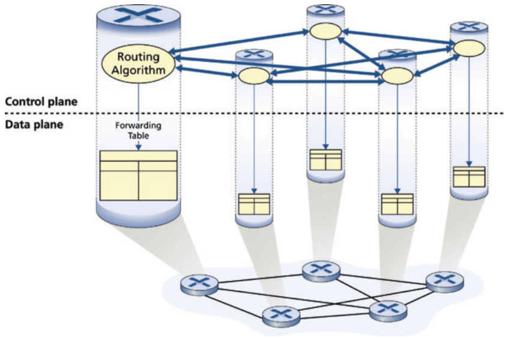

Hình 5.1 Điều khiển per-router: Các thành phần thuật toán định tuyến riêng lẻ tương tác trong control plane

• Điều khiển tập trung về logic (Logically centralized control). Hình 5.2 minh họa trường hợp trong đó một controller tập trung về logic tính toán và phân phối các bảng chuyển tiếp để mọi router sử dụng. Như chúng ta đã thấy trong Mục 4.4 và 4.5, trừu tượng match-plus-action tổng quát cho phép router thực hiện chuyển tiếp IP truyền thống cũng như một tập phong phú các chức năng khác (chia tải, firewall và NAT) mà trước đây được triển khai trong các middlebox riêng.

Controller tương tác với một control agent (CA - tác nhân điều khiển) trong mỗi router qua một giao thức well-defined (được định nghĩa rõ) để cấu hình và quản lý flow table của router đó. Thông thường, CA có chức năng tối thiểu; nhiệm vụ của nó là giao tiếp với controller, và làm theo lệnh của controller. Không như các thuật toán định tuyến trong Hình 5.1, các CA không tương tác trực tiếp với nhau cũng không tham gia tích cực vào việc tính bảng chuyển tiếp. Đây là một phân biệt then chốt giữa điều khiển per-router và điều khiển tập trung về logic.

Với điều khiển “tập trung về logic” [Levin 2012] ý chúng tôi là dịch vụ điều khiển định tuyến được truy cập như thể nó là một điểm dịch vụ trung tâm duy nhất, mặc dù dịch vụ nhiều khả năng được triển khai qua nhiều server vì lý do fault-tolerance (chịu lỗi) và khả năng mở rộng performance. Như chúng ta sẽ thấy trong Mục 5.5, SDN áp dụng khái niệm controller tập trung về logic này—một cách tiếp cận đang được dùng ngày càng nhiều trong các triển khai thực tế. [Cisco Trends 2020] lưu ý rằng SDN đã được áp dụng rộng rãi trong các data center (64%), WAN (58%) và mạng truy cập (40%) vào năm 2020. Trong Mục 5.5, chúng ta sẽ nghiên cứu ORION SDN của Google [Ferguson 2021], mà Google dùng để điều khiển các mạng bên trong data center của mình cũng như WAN toàn cầu nối các data center này.

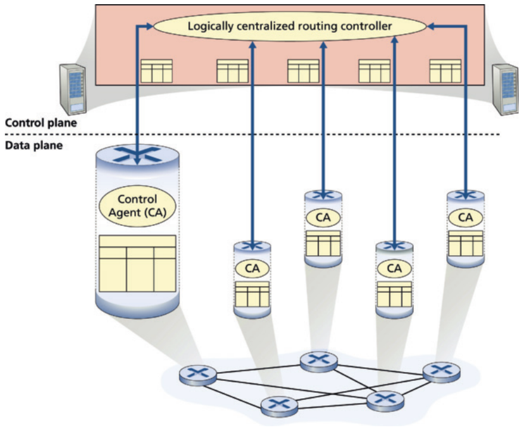

Hình 5.2 Điều khiển tập trung về logic: Một controller riêng biệt, thường ở xa, tương tác với các control agent (CA) cục bộ

## 5.2 Các thuật toán định tuyến (Routing Algorithms)

Trong mục này, chúng ta sẽ nghiên cứu các thuật toán định tuyến, có mục tiêu xác định các đường đi (tương đương, tuyến) tốt, từ bên gửi tới bên nhận, qua mạng router. Thông thường, một đường đi “tốt” là đường có chi phí thấp nhất. Tuy nhiên, chúng ta sẽ thấy trong thực tế, các mối quan tâm real-world như vấn đề chính sách (ví dụ, một quy tắc như “router x, thuộc tổ chức Y, không nên chuyển tiếp bất kỳ packet nào xuất phát từ mạng thuộc sở hữu của tổ chức Z ”) cũng có vai trò. Chúng tôi lưu ý rằng dù control plane mạng áp dụng cách tiếp cận điều khiển per-router hay cách tiếp cận tập trung về logic, luôn phải có một chuỗi router well-defined mà packet sẽ đi qua khi đi từ host gửi tới host nhận. Do đó, các thuật toán định tuyến tính các đường đi này có tầm quan trọng cơ bản, và là một ứng viên khác cho danh sách top-10 các khái niệm mạng quan trọng cơ bản của chúng ta.

Một đồ thị được dùng để mô hình hóa các bài toán định tuyến. Nhớ rằng một đồ thị G = (N, E) là một tập N các nút và một tập hợp E các cạnh, trong đó mỗi cạnh là một cặp nút từ N. Trong bối cảnh định tuyến network-layer, các nút trong đồ thị biểu diễn router—những điểm tại đó các quyết định packet-forwarding được đưa ra—và các cạnh nối các nút này biểu diễn các liên kết vật lý giữa các router này. Một trừu tượng đồ thị như vậy của một mạng máy tính được minh họa trong Hình 5.3. Khi nghiên cứu giao thức định tuyến inter-domain (liên miền) BGP, chúng ta sẽ thấy các nút biểu diễn mạng, và cạnh nối hai nút như vậy biểu diễn kết nối trực tiếp (được gọi là peering) giữa hai mạng. Để xem một số đồ thị biểu diễn bản đồ mạng thực, xem CAIDA 2025; NetworkingChannel Diot 2021]; để có thảo luận về mức độ các mô hình graph-based khác nhau mô hình hóa Internet tốt đến đâu, xem [Zegura 1997, Faloutsos 1999, Li 2004].

Như minh họa trong Hình 5.3, một cạnh cũng có một giá trị biểu diễn chi phí của nó. Thông thường, chi phí của một cạnh có thể phản ánh chiều dài vật lý của liên kết tương ứng (ví dụ, một liên kết xuyên đại dương có thể có chi phí cao hơn một liên kết mặt đất short-haul (cự ly ngắn)), tốc độ liên kết, hoặc chi phí tiền tệ gắn với một liên kết. Cho mục đích của chúng ta, chúng ta sẽ đơn giản coi chi phí cạnh là cho trước và không lo về cách chúng được xác định. Với bất kỳ cạnh (x, y) nào trong E, chúng ta ký hiệu c(x, y) là chi phí của cạnh giữa nút x và y. Nếu cặp (x, y) không thuộc E, chúng ta đặt c(x, y) = ∞. Ngoài ra, ở đây chúng ta chỉ xét đồ thị vô hướng (tức là, đồ thị có cạnh không có hướng) trong thảo luận, sao cho cạnh (x, y) giống cạnh (y, x) và c(x, y) = c(y, x); tuy nhiên, các thuật toán chúng ta sẽ nghiên cứu có thể dễ dàng mở rộng cho trường hợp liên kết có hướng với chi phí khác nhau theo mỗi chiều. Ngoài ra, một nút y được gọi là láng giềng của nút x nếu (x, y) thuộc E.

Vì chi phí được gán cho các cạnh khác nhau trong trừu tượng đồ thị, một mục tiêu tự nhiên của thuật toán định tuyến là xác định các đường đi ít tốn kém nhất giữa nguồn và đích. Để bài toán này chính xác hơn, nhớ rằng một đường đi trong một đồ thị G = (N, E) là một chuỗi nút (x<sub>1</sub>, x<sub>2</sub>, . . . , x<sub>p</sub>) sao cho mỗi cặp (x<sub>1</sub>, x<sub>2</sub>), (x<sub>2</sub>, x<sub>3</sub>), . . . , (x<sub>p−1</sub>, x<sub>p</sub>) là các cạnh trong E. Chi phí của một đường đi (x<sub>1</sub>, x<sub>2</sub>, . . . , x<sub>p</sub>) đơn giản là tổng tất cả chi phí cạnh dọc đường đi, tức là, c(x<sub>1</sub>, x<sub>2</sub>) + c(x<sub>2</sub>, x<sub>3</sub>) + ⋅ ⋅ ⋅ + c(x<sub>p−1</sub>, x<sub>p</sub>). Với bất kỳ hai nút x và y nào, thường có nhiều đường đi giữa hai nút, với mỗi đường có một chi phí. Một hoặc nhiều đường trong số này là đường least-cost (chi phí thấp nhất). Do đó bài toán least-cost là rõ ràng: Tìm một đường đi giữa nguồn và đích có chi phí thấp nhất. Trong Hình 5.3, chẳng hạn, đường least-cost giữa nút nguồn u và nút đích w là ( u , x , y , w) với chi phí đường đi 3. Lưu ý rằng nếu mọi cạnh trong đồ thị có cùng chi phí, đường least-cost cũng là đường ngắn nhất (tức là, đường có số liên kết ít nhất giữa nguồn và đích).

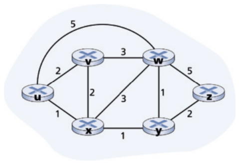

Hình 5.3 Mô hình đồ thị trừu tượng của một mạng máy tính

Như một bài tập đơn giản, hãy thử tìm đường least-cost từ nút u tới z trong Hình 5.3 và suy ngẫm một chút về cách bạn đã tính đường đó. Nếu bạn giống hầu hết mọi người, bạn đã tìm đường từ u tới z bằng cách xem Hình 5.3, lần theo vài tuyến từ u tới z, và bằng cách nào đó tự thuyết phục rằng đường bạn chọn có chi phí thấp nhất trong mọi đường khả dĩ. (Bạn có kiểm tra cả 17 đường khả dĩ giữa u và z không? Có lẽ không!) Phép tính như vậy là một ví dụ về thuật toán định tuyến tập trung (centralized routing algorithm) —thuật toán định tuyến được chạy ở một nơi, bộ não của bạn, với thông tin đầy đủ về mạng. Nói chung, một cách chúng ta có thể phân loại thuật toán định tuyến là dựa trên việc chúng tập trung hay phi tập trung.

• Một thuật toán định tuyến tập trung tính đường least-cost giữa một nguồn và đích dùng kiến thức toàn cục, đầy đủ về mạng. Tức là, thuật toán lấy kết nối giữa mọi nút và mọi chi phí liên kết làm đầu vào. Điều này khi đó yêu cầu thuật toán bằng cách nào đó lấy được thông tin này trước khi thực sự thực hiện phép tính. Bản thân phép tính có thể được chạy tại một site (ví dụ, một controller tập trung về logic như trong Hình 5.2) hoặc có thể được nhân bản trong thành phần định tuyến của mỗi router (ví dụ, như trong Hình 5.1). Tuy nhiên, đặc điểm phân biệt then chốt ở đây là thuật toán có thông tin đầy đủ về kết nối và chi phí liên kết. Các thuật toán có thông tin trạng thái toàn cục thường được gọi là thuật toán link-state (LS - trạng thái liên kết), vì thuật toán phải biết chi phí của mỗi liên kết trong mạng. Chúng ta sẽ nghiên cứu các thuật toán LS trong Mục 5.2.1.

• Trong một thuật toán định tuyến phi tập trung, việc tính đường least-cost được các router thực hiện theo cách lặp, phân tán. Không nút nào có thông tin đầy đủ về chi phí của mọi liên kết mạng. Thay vào đó, mỗi nút bắt đầu chỉ với kiến thức về chi phí các liên kết gắn trực tiếp của nó. Sau đó, thông qua một quá trình lặp tính toán và trao đổi thông tin với các nút láng giềng, một nút dần dần tính được đường least-cost tới một đích hoặc tập đích. Thuật toán định tuyến phi tập trung mà chúng ta sẽ nghiên cứu bên dưới trong Mục 5.2.2 được gọi là thuật toán distance-vector (DV - vector khoảng cách), vì mỗi nút duy trì một vector ước lượng chi phí (khoảng cách) tới mọi nút khác trong mạng. Các thuật toán phi tập trung như vậy, với trao đổi thông điệp tương tác giữa các router láng giềng có lẽ phù hợp tự nhiên hơn với các control plane nơi router tương tác trực tiếp với nhau, như trong Hình 5.1.

Một cách tổng quát thứ hai để phân loại thuật toán định tuyến là dựa trên việc chúng tĩnh hay động. Trong các thuật toán định tuyến tĩnh, tuyến thay đổi rất chậm theo thời gian, thường do sự can thiệp của con người (ví dụ, một người chỉnh sửa thủ công chi phí một liên kết). Các thuật toán định tuyến động thay đổi đường định tuyến khi tải traffic mạng hoặc topology thay đổi. Một thuật toán động có thể được chạy định kỳ hoặc phản hồi trực tiếp với thay đổi topology hoặc chi phí liên kết. Trong khi các thuật toán động nhạy hơn với thay đổi mạng, chúng cũng dễ gặp các vấn đề như vòng lặp định tuyến và dao động tuyến.

Một cách thứ ba để phân loại thuật toán định tuyến là dựa trên việc chúng load-sensitive (nhạy tải) hay load-insensitive (không nhạy tải). Trong một thuật toán load-sensitive, chi phí liên kết thay đổi động để phản ánh mức tắc nghẽn hiện tại trong liên kết bên dưới. Nếu một chi phí cao được gắn với một liên kết đang tắc nghẽn, thuật toán định tuyến sẽ có xu hướng chọn các tuyến đi vòng liên kết tắc nghẽn đó. Trong khi các thuật toán định tuyến ARPAnet thời đầu là load-sensitive [McQuillan 1980], đã gặp một số khó khăn [Huitema 1998]. Các thuật toán định tuyến Internet ngày nay (như RIP, OSPF và BGP) là load-insensitive, vì chi phí của một liên kết không phản ánh tường minh mức tắc nghẽn hiện tại (hoặc quá khứ gần) của nó.

### 5.2.1 Thuật toán định tuyến trạng thái liên kết (The Link-State (LS) Routing Algorithm)

Nhớ rằng trong một thuật toán link-state, topology mạng và mọi chi phí liên kết đều đã biết, tức là, có sẵn làm đầu vào cho thuật toán LS. Trong thực tế, điều này được thực hiện bằng cách cho mỗi nút quảng bá các packet link-state tới mọi nút khác trong mạng, với mỗi packet link-state chứa danh tính và chi phí của các liên kết gắn với nó. Trong thực tế (ví dụ, với giao thức định tuyến OSPF của Internet, thảo luận trong Mục 5.3), điều này thường được thực hiện bằng một thuật toán quảng bá link-state [Perlman 1999]. Kết quả của việc quảng bá của các nút là mọi nút đều có một cái nhìn giống hệt và đầy đủ về mạng. Mỗi nút khi đó có thể chạy thuật toán LS và tính cùng tập đường least-cost như mọi nút khác.

Thuật toán định tuyến link-state chúng tôi trình bày dưới đây được gọi là thuật toán Dijkstra, đặt theo tên người phát minh. Một thuật toán liên quan chặt chẽ là thuật toán Prim; xem [Cormen 2001] để có thảo luận chung về các thuật toán đồ thị. Thuật toán Dijkstra tính đường least-cost từ một nút (nguồn, mà chúng ta sẽ gọi là u) tới mọi nút khác trong mạng. Thuật toán Dijkstra là lặp và có tính chất là sau lần lặp thứ k của thuật toán, các đường least-cost được biết tới k nút đích, và trong số các đường least-cost tới mọi nút đích, k đường này sẽ có k chi phí nhỏ nhất. Hãy định nghĩa ký hiệu sau:

• D(v): chi phí của đường least-cost từ nút nguồn tới đích v tính tới lần lặp này của thuật toán.

• p(v): nút trước đó (láng giềng của v) dọc đường least-cost hiện tại từ nguồn tới v.

• N′: tập con các nút; v thuộc N′ nếu đường least-cost từ nguồn tới v đã được biết chắc chắn.

Thuật toán định tuyến tập trung gồm một bước khởi tạo theo sau là một vòng lặp. Số lần vòng lặp được thực thi bằng số nút trong mạng. Khi kết thúc, thuật toán sẽ tính xong các đường ngắn nhất từ nút nguồn u tới mọi nút khác trong mạng.

#### Thuật toán trạng thái liên kết cho nút nguồn u (Link-State (LS) Algorithm for Source Node u)

```
1  Initialization:
2  N’ = {u}
3  for all nodes v
4    if v is a neighbor of u
5      then D(v) = c(u, v)
6    else D(v) = ∞
7
8  Loop
9  find w not in N’ such that D(w) is a minimum
10 add w to N’
11 update D(v) for each neighbor v of w and not in N’:
12       D(v) = min(D(v), D(w)+ c(w, v) )
13   /* new cost to v is either old cost to v or known
14   least path cost to w plus cost from w to v */
15 until N’= N
```

Ví dụ, hãy xét mạng trong Hình 5.3 và tính các đường least-cost từ u tới mọi đích khả dĩ. Một tóm tắt dạng bảng về phép tính của thuật toán được cho trong Bảng 5.1, trong đó mỗi dòng trong bảng cho giá trị các biến của thuật toán ở cuối lần lặp. Hãy xét chi tiết vài bước đầu.

• Trong bước khởi tạo, các đường least-cost hiện biết từ u tới các láng giềng gắn trực tiếp của nó, v, x và w, được khởi tạo lần lượt là 2, 1 và 5. Đặc biệt lưu ý rằng chi phí tới w được đặt bằng 5 (mặc dù chúng ta sẽ sớm thấy một đường lesser-cost (chi phí thấp hơn) thực sự tồn tại) vì đây là chi phí của liên kết trực tiếp (một hop) từ u tới w. Chi phí tới y và z được đặt bằng vô cùng vì chúng không nối trực tiếp với u.

• Trong lần lặp đầu tiên, chúng ta tìm trong số các nút chưa được thêm vào tập N′ và tìm nút có chi phí thấp nhất tính tới cuối lần lặp trước. Nút đó là x, với chi phí 1, và do đó x được thêm vào tập N′. Dòng 12 của thuật toán LS sau đó được thực hiện để cập nhật D(v) cho mọi nút v, cho ra kết quả minh họa ở dòng thứ hai (Bước 1) trong Bảng 5.1. Chi phí của đường tới v không đổi. Chi phí của đường tới w (là 5 ở cuối bước khởi tạo) qua nút x được thấy có chi phí 4. Do đó đường lower-cost này được chọn và nút trước của w dọc đường ngắn nhất từ u được đặt là x. Tương tự, chi phí tới y (qua x) được tính là 2, và bảng được cập nhật tương ứng.

| bước (step) | N′ | D(v), p(v) | D(w), p(w) | D(x), p(x) | D(y), p(y) | D(z), p(z) |
|---|---|---|---|---|---|---|
| 0 | u | 2, u | 5, u | 1, u | ∞ | ∞ |
| 1 | ux | 2, u | 4, x |  | 2, x | ∞ |
| 2 | uxy | 2, u | 3, y |  |  | 4, y |
| 3 | uxyv |  | 3, y |  |  | 4, y |
| 4 | uxyvw |  |  |  |  |  |
| 5 | uxyvwz |  |  |  |  |  |

Bảng 5.1 Chạy thuật toán link-state trên mạng trong Hình 5.3

• Trong lần lặp thứ hai, các nút v và y được thấy có đường least-cost (2), và chúng ta phá thế hòa một cách tùy ý và thêm y vào tập N′ để N′ giờ chứa u, x , và y. Chi phí tới các nút còn lại chưa có trong N′, tức là, các nút v, w , và z, được cập nhật qua dòng 12 của thuật toán LS, cho ra kết quả minh họa ở hàng thứ ba trong Bảng 5.1.

• Và cứ thế . . .

Khi thuật toán LS kết thúc, chúng ta có, với mỗi nút, nút trước của nó dọc đường least-cost từ nút nguồn. Với mỗi nút trước, chúng ta cũng có nút trước của nó, và cứ theo cách này chúng ta có thể dựng toàn bộ đường đi từ nguồn tới mọi đích. Bảng chuyển tiếp trong một nút, chẳng hạn nút u, khi đó có thể được dựng từ thông tin này bằng cách lưu, với mỗi đích, nút next-hop (hop tiếp theo) trên đường least-cost từ u tới đích. Hình 5.4 cho thấy các đường least-cost kết quả và bảng chuyển tiếp trong u cho mạng trong Hình 5.3.

Độ phức tạp tính toán của thuật toán này là bao nhiêu? Tức là, với n nút (không tính nguồn), cần bao nhiêu phép tính trong trường hợp xấu nhất để tìm các đường least-cost từ nguồn tới mọi đích? Trong lần lặp đầu tiên, chúng ta cần tìm qua cả n nút để xác định nút, w, không thuộc N′ có chi phí nhỏ nhất. Trong lần lặp thứ hai, chúng ta cần kiểm tra n − 1 nút để xác định chi phí nhỏ nhất; trong lần lặp thứ ba n − 2 nút, v.v. Nhìn chung, tổng số nút chúng ta cần tìm qua trong tất cả các lần lặp là n(n + 1)/2, và do đó chúng ta nói rằng bản triển khai trên của thuật toán LS có độ phức tạp worst-case bậc n bình phương: O (n<sup>2</sup>). (Một bản triển khai tinh vi hơn của thuật toán này, dùng một cấu trúc dữ liệu gọi là heap, có thể tìm giá trị nhỏ nhất ở dòng 9 trong thời gian logarit thay vì tuyến tính, qua đó giảm độ phức tạp.)

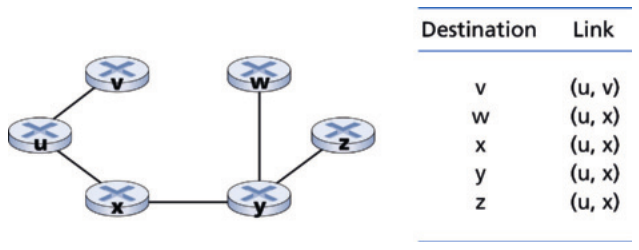

Hình 5.4 Đường chi phí thấp nhất và bảng chuyển tiếp cho nút u

Trước khi kết thúc thảo luận về thuật toán LS, hãy xét một bệnh lý có thể nảy sinh. Hình 5.5 cho thấy một topology mạng đơn giản trong đó chi phí liên kết bằng tải được mang trên liên kết, chẳng hạn phản ánh độ trễ sẽ gặp phải. Trong ví dụ này, chi phí liên kết không đối xứng; tức là, c(u, v) chỉ bằng c(v, u) nếu tải mang trên cả hai chiều của liên kết (u, v) như nhau. Trong ví dụ này, nút z khởi tạo một đơn vị traffic hướng tới w, nút x cũng khởi tạo một đơn vị traffic hướng tới w, và nút y bơm vào một lượng traffic bằng e, cũng hướng tới w. Định tuyến ban đầu được minh họa trong Hình 5.5(a) với chi phí liên kết tương ứng với lượng traffic được mang.

Khi thuật toán LS được chạy lần tiếp theo, nút y xác định (dựa trên chi phí liên kết minh họa trong Hình 5.5(a)) rằng đường theo chiều kim đồng hồ tới w có chi phí 1, trong khi đường ngược chiều kim đồng hồ tới w (mà nó đang dùng) có chi phí 1 + e. Do đó đường least-cost của y tới w giờ là theo chiều kim đồng hồ. Tương tự, x xác định rằng đường least-cost mới của nó tới w cũng theo chiều kim đồng hồ, dẫn tới chi phí minh họa trong Hình 5.5(b). Khi thuật toán LS được chạy lần tiếp theo, các nút x, y và z đều phát hiện một đường zero-cost (chi phí bằng không) tới w theo chiều ngược kim đồng hồ, và đều định tuyến traffic của chúng sang các tuyến ngược chiều kim đồng hồ. Lần tiếp theo thuật toán LS được chạy, x y, , và z đều định tuyến traffic sang các tuyến theo chiều kim đồng hồ.

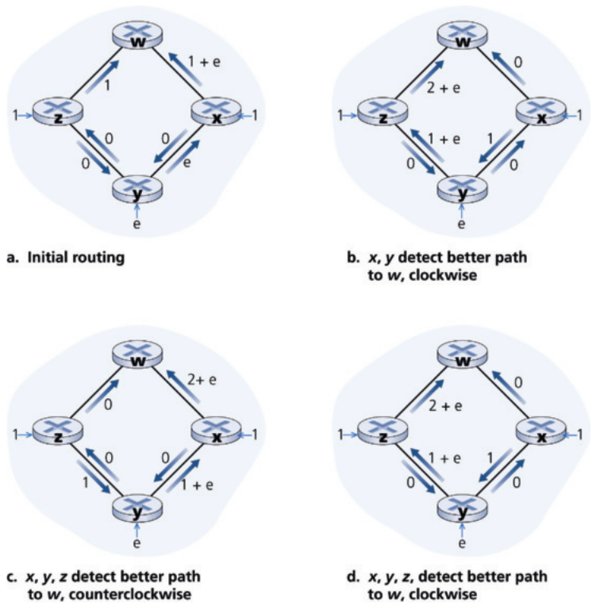

Hình 5.5 Dao động với định tuyến congestion-sensitive (nhạy tắc nghẽn)

Có thể làm gì để ngăn các dao động như vậy (có thể xảy ra trong bất kỳ thuật toán nào, không chỉ thuật toán LS, dùng một thước đo liên kết dựa trên tắc nghẽn hoặc delay-based)? Một giải pháp là bắt buộc chi phí liên kết không phụ thuộc vào lượng traffic được mang—một giải pháp không chấp nhận được vì một mục tiêu của định tuyến là tránh các liên kết bị tắc nghẽn nặng (ví dụ, high-delay (độ trễ cao)). Một giải pháp khác là đảm bảo không phải mọi router đều chạy thuật toán LS cùng lúc. Đây có vẻ là một giải pháp hợp lý hơn, vì chúng ta hy vọng rằng ngay cả khi các router chạy thuật toán LS với cùng chu kỳ, thời điểm thực thi thuật toán sẽ không giống nhau ở mỗi nút. Thú vị là, các nhà nghiên cứu đã thấy rằng router trong Internet có thể self-synchronize (tự đồng bộ) với nhau [Floyd Synchronization 1994]. Tức là, mặc dù ban đầu chúng thực thi thuật toán với cùng chu kỳ nhưng tại các thời điểm khác nhau, thời điểm thực thi thuật toán cuối cùng có thể trở nên, và duy trì, đồng bộ tại các router. Một cách tránh self-synchronization như vậy là để mỗi router ngẫu nhiên hóa thời điểm nó gửi đi quảng bá liên kết.

Sau khi nghiên cứu thuật toán LS, hãy xét thuật toán định tuyến chính khác được dùng trong thực tế ngày nay—thuật toán định tuyến distance-vector.

### 5.2.2 Thuật toán định tuyến vector khoảng cách (The Distance-Vector (DV) Routing Algorithm)

Trong khi thuật toán LS là một thuật toán dùng thông tin toàn cục, thuật toán distance-vector (DV) là lặp, bất đồng bộ và phân tán. Nó phân tán ở chỗ mỗi nút nhận một số thông tin từ một hoặc nhiều láng giềng gắn trực tiếp, thực hiện một phép tính, rồi phân phối kết quả phép tính trở lại các láng giềng. Nó lặp ở chỗ quá trình này tiếp tục cho đến khi không còn thông tin nào được trao đổi giữa các láng giềng. (Thú vị là, thuật toán cũng self-terminating (tự kết thúc)—không có tín hiệu nào báo rằng việc tính toán nên dừng; nó chỉ đơn giản dừng.) Thuật toán bất đồng bộ ở chỗ nó không yêu cầu mọi nút hoạt động đồng bước với nhau. Chúng ta sẽ thấy một thuật toán bất đồng bộ, lặp, self-terminating, phân tán thú vị và vui hơn nhiều so với một thuật toán tập trung!

Trước khi trình bày thuật toán DV, sẽ có ích nếu thảo luận một quan hệ quan trọng tồn tại giữa chi phí của các đường least-cost. Gọi d<sub>x</sub> (y) là chi phí của đường least-cost từ nút x tới nút y. Khi đó các chi phí thấp nhất liên hệ với nhau bởi phương trình Bellman-Ford nổi tiếng, cụ thể là,

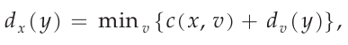 (5.1)

trong đó min<sub>v</sub> trong phương trình được lấy trên tất cả láng giềng của x. Phương trình Bellman-Ford khá trực quan. Thật vậy, sau khi đi từ x tới v, nếu sau đó chúng ta đi theo đường least-cost từ v tới y, chi phí đường đi sẽ là c(x, v) + d<sub>v</sub> (y). Vì chúng ta phải bắt đầu bằng việc đi tới một láng giềng v nào đó, chi phí thấp nhất từ x tới y là giá trị nhỏ nhất của c(x, v) + d<sub>v</sub> (y) lấy trên mọi láng giềng v.

Nhưng với những ai có thể hoài nghi về tính đúng đắn của phương trình, hãy kiểm tra nó cho nút nguồn u và nút đích z trong Hình 5.3. Nút nguồn u có ba láng giềng: các nút v, x và w. Bằng cách đi dọc các đường khác nhau trong đồ thị, dễ thấy rằng d<sub>v</sub> (z) = 5 , d<sub>x</sub> (z) = 3, và d<sub>w</sub> (z) = 3. Thay các giá trị này vào Phương trình 5.1, cùng với chi phí c(u, v) = 2, c(u, x) = 1, và c(u, w) = 5, cho d<sub>u</sub> (z) = m i n { 2 + 5, 5 + 3, 1 + 3} = 4, rõ ràng là đúng và chính xác là kết quả mà thuật toán Dijkstra đã cho chúng ta cho cùng mạng. Việc kiểm chứng nhanh này hẳn giúp xua tan mọi hoài nghi bạn có thể có.

Phương trình Bellman-Ford không chỉ là một sự tò mò trí tuệ. Nó thực sự có tầm quan trọng thực tiễn đáng kể: lời giải của phương trình Bellman-Ford cung cấp các mục trong bảng chuyển tiếp của nút x. Để thấy điều này, gọi v* là bất kỳ nút láng giềng nào đạt giá trị nhỏ nhất trong Phương trình 5.1. Khi đó, nếu nút x muốn gửi một packet tới nút y dọc một đường least-cost, nó nên trước hết chuyển tiếp packet tới nút v*. Do đó, bảng chuyển tiếp của nút x sẽ chỉ định nút v* là router next-hop cho đích cuối cùng y. Một đóng góp thực tiễn quan trọng khác của phương trình Bellman-Ford là nó gợi ý dạng giao tiếp neighbor-to-neighbor (láng giềng với láng giềng) sẽ diễn ra trong thuật toán DV.

Ý tưởng cơ bản như sau. Mỗi nút x bắt đầu với D<sub>x</sub>(y), một ước lượng chi phí của đường least-cost từ chính nó tới nút y, với mọi nút, y, trong N. Gọi D<sub>x</sub> = [ D<sub>x</sub>(y): y in N] là vector khoảng cách (distance vector) của nút x, là vector các ước lượng chi phí từ x tới mọi nút khác, y, trong N. Với thuật toán DV, mỗi nút x duy trì thông tin định tuyến sau:

• Với mỗi láng giềng v, chi phí c(x, v) từ x tới láng giềng gắn trực tiếp, v

• Distance vector của nút x, tức là, D<sub>x</sub> = [ D<sub>x</sub>(y): y in N], chứa ước lượng của x về chi phí tới mọi đích, y, trong N

• Distance vector của mỗi láng giềng, tức là, D<sub>v</sub> = [ D<sub>v</sub>(y): y in N] cho mỗi láng giềng v của x

Trong thuật toán phân tán, bất đồng bộ, thỉnh thoảng, mỗi nút gửi một bản sao distance vector của nó tới mỗi láng giềng. Khi một nút x nhận một distance vector mới từ bất kỳ láng giềng w nào, nó lưu distance vector của w, rồi dùng phương trình Bellman-Ford để cập nhật distance vector của chính nó như sau:

D<sub>x</sub>(y) = min<sub>v</sub> {c(x, v) + D<sub>v</sub>(y)} với mỗi nút y trong N

Nếu distance vector của nút x đã thay đổi do bước cập nhật này, nút x khi đó sẽ gửi distance vector đã cập nhật tới mỗi láng giềng, các láng giềng này đến lượt mình có thể cập nhật distance vector của chúng. Kỳ diệu thay, chừng nào mọi nút tiếp tục trao đổi distance vector một cách bất đồng bộ, mỗi ước lượng chi phí D<sub>x</sub>(y) hội tụ về d<sub>x</sub> (y), chi phí thực của đường least-cost từ nút x tới nút y [Bertsekas 1991]!

#### Thuật toán vector khoảng cách (Distance-Vector (DV) Algorithm)

Tại mỗi nút, x:

<pre>
1  Initialization:
2    for all destinations y in N:
3       D<sub>x</sub>(y)= c(x, y)/* if y is not a neighbor then c(x, y)= ∞ */
4    for each neighbor w
5      D<sub>w</sub>(y) = ? for all destinations y in N
6    for each neighbor w
7      send distance vector D<sub>x</sub> = [D<sub>x</sub>(y): y in N] to w
8
9  loop
10   wait  (until I see a link cost change to some neighbor w or
11         until I receive a distance vector from some neighbor w)
12
13   for each y in N:
14     D<sub>x</sub>(y) = min<sub>v</sub>{c(x, v) + D<sub>v</sub>(y)}
15
16 if D<sub>x</sub>(y) changed for any destination y
17      send distance vector D<sub>x</sub> = [D<sub>x</sub>(y): y in N] to all neighbors
18
19 forever
</pre>

Trong thuật toán DV, một nút x cập nhật ước lượng distance-vector của nó khi nó hoặc thấy thay đổi chi phí ở một trong các liên kết gắn trực tiếp hoặc nhận một cập nhật distance-vector từ một láng giềng nào đó. Nhưng để cập nhật bảng chuyển tiếp của chính nó cho một đích y cho trước, điều nút x thực sự cần biết không phải là khoảng cách shortest-path (đường ngắn nhất) tới y mà là nút láng giềng v\*(y) là router next-hop dọc đường ngắn nhất tới y. Như bạn có thể đoán, router next-hop v \*(y) là láng giềng v đạt giá trị nhỏ nhất ở Dòng 14 của thuật toán DV. (Nếu có nhiều láng giềng v đạt giá trị nhỏ nhất, thì v\*(y) có thể là bất kỳ láng giềng cực tiểu hóa nào.) Do đó, ở Dòng 13–14, với mỗi đích y, nút x cũng xác định v \* (y) và cập nhật bảng chuyển tiếp cho đích y.

Nhớ rằng thuật toán LS là một thuật toán tập trung theo nghĩa nó yêu cầu mỗi nút trước hết lấy được bản đồ đầy đủ của mạng trước khi chạy thuật toán Dijkstra. Thuật toán DV là phi tập trung và không dùng thông tin toàn cục như vậy. Thật vậy, thông tin duy nhất một nút sẽ có là chi phí của các liên kết tới các láng giềng gắn trực tiếp và thông tin nó nhận từ các láng giềng này. Mỗi nút chờ cập nhật từ bất kỳ láng giềng nào (Dòng 10–11), tính distance vector mới khi nhận một cập nhật (Dòng 14), và phân phối distance vector mới tới các láng giềng (Dòng 16–17). Các thuật toán DV-like (kiểu DV) được dùng trong nhiều giao thức định tuyến trong thực tế, bao gồm RIP và BGP của Internet, ISO IDRP, Novell IPX, và ARPAnet gốc.

Hình 5.6 minh họa hoạt động của thuật toán DV cho mạng three-node (ba nút) đơn giản minh họa ở đầu hình. Hoạt động của thuật toán được minh họa theo kiểu đồng bộ, trong đó mọi nút đồng thời nhận distance vector từ láng giềng, tính distance vector mới, và thông báo cho láng giềng nếu distance vector của chúng đã thay đổi. Sau khi nghiên cứu ví dụ này, bạn nên tự thuyết phục mình rằng thuật toán cũng hoạt động đúng theo kiểu bất đồng bộ, với việc tính toán của nút và việc sinh/nhận cập nhật xảy ra bất kỳ lúc nào.

Cột ngoài cùng bên trái của hình hiển thị ba bảng định tuyến ban đầu cho mỗi nút trong ba nút. Ví dụ, bảng ở góc upper-left (trên bên trái) là bảng định tuyến ban đầu của nút x. Trong một bảng định tuyến cụ thể, mỗi hàng là một distance vector—cụ thể, bảng định tuyến của mỗi nút bao gồm distance vector của chính nó và của mỗi láng giềng. Do đó, hàng đầu tiên trong bảng định tuyến ban đầu của nút x là D<sub>x</sub> = [ D<sub>x</sub>(x) , D<sub>x</sub>(y) , D<sub>x</sub>(z)] = [0, 2, 7]. Hàng thứ hai và thứ ba trong bảng này lần lượt là các distance vector nhận gần nhất từ nút y và z. Vì khi khởi tạo nút x chưa nhận được gì từ nút y hay z, các mục ở hàng thứ hai và thứ ba được khởi tạo bằng vô cùng.

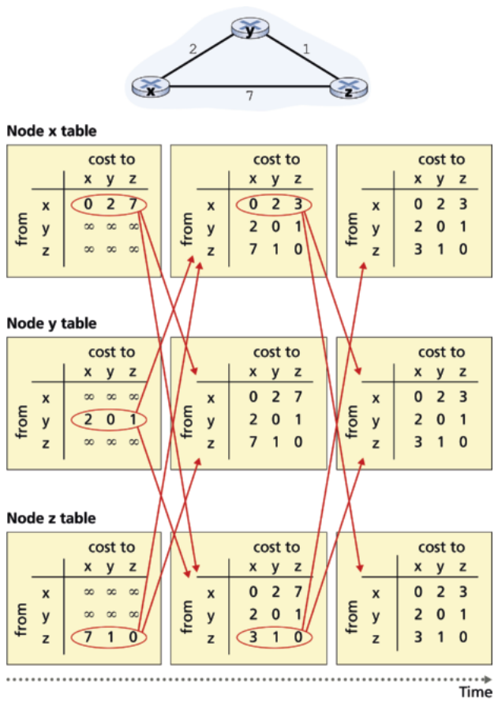

Hình 5.6 Thuật toán distance-vector (DV) khi hoạt động

Sau khi khởi tạo, mỗi nút gửi distance vector của nó tới mỗi láng giềng trong hai láng giềng. Điều này được minh họa trong Hình 5.6 bằng các mũi tên từ cột bảng thứ nhất tới cột bảng thứ hai. Ví dụ, nút x gửi distance vector D<sub>x</sub> = [ 0, 2, 7] tới cả nút y và z. Sau khi nhận các cập nhật, mỗi nút tính lại distance vector của chính nó. Ví dụ, nút x tính

D<sub>x</sub>(x) = 0

D<sub>x</sub>(y) = min{c(x, y) + D<sub>y</sub>(y), c(x, z) + D<sub>z</sub>(y)} = min{2 + 0, 7 + 1} = 2

D<sub>x</sub>(z) = min{c(x, y) + D<sub>y</sub>(z), c(x, z) + D<sub>z</sub>(z)} = min{2 + 1, 7 + 0} = 3

Do đó cột thứ hai hiển thị, với mỗi nút, distance vector mới của nút cùng với các distance vector vừa nhận từ láng giềng. Lưu ý, ví dụ, ước lượng của nút x cho chi phí thấp nhất tới nút z, D<sub>x</sub>(z), đã thay đổi từ 7 thành 3. Cũng lưu ý rằng với nút x, nút láng giềng y đạt giá trị nhỏ nhất ở dòng 14 của thuật toán DV; do đó, ở giai đoạn này của thuật toán, tại nút x chúng ta có v* (y) = y và v * (z) = y.

Sau khi các nút tính lại distance vector, chúng lại gửi các distance vector đã cập nhật tới láng giềng (nếu có thay đổi). Điều này được minh họa trong Hình 5.6 bằng các mũi tên từ cột bảng thứ hai tới cột bảng thứ ba. Lưu ý rằng chỉ nút x và z gửi cập nhật: distance vector của nút y không thay đổi nên nút y không gửi cập nhật. Sau khi nhận các cập nhật, các nút tính lại distance vector và cập nhật bảng định tuyến, được hiển thị ở cột thứ ba.

Quá trình nhận distance vector đã cập nhật từ láng giềng, tính lại các mục bảng định tuyến, và thông báo cho láng giềng về chi phí đã thay đổi của đường least-cost tới một đích tiếp tục cho đến khi không còn thông điệp cập nhật nào được gửi. Tại thời điểm này, vì không có thông điệp cập nhật nào được gửi, sẽ không có phép tính bảng định tuyến nào nữa và thuật toán sẽ vào trạng thái tĩnh lặng (quiescent); tức là, mọi nút sẽ đang thực hiện việc chờ ở Dòng 10–11 của thuật toán DV. Thuật toán ở trạng thái tĩnh lặng cho đến khi một chi phí liên kết thay đổi, như thảo luận tiếp theo.

#### Thuật toán vector khoảng cách: thay đổi chi phí liên kết và sự cố liên kết (Distance-Vector Algorithm: Link-Cost Changes and Link Failure)

Khi một nút chạy thuật toán DV phát hiện một thay đổi chi phí liên kết từ chính nó tới một láng giềng (Dòng 10–11), nó cập nhật distance vector (Dòng 13–14) và, nếu có thay đổi chi phí của đường least-cost, thông báo cho láng giềng (Dòng 16–17) về distance vector mới. Hình 5.7(a) minh họa một kịch bản trong đó chi phí liên kết từ y tới x thay đổi từ 4 thành 1. Ở đây chúng ta chỉ tập trung vào các mục bảng khoảng cách của y và z tới đích x. Thuật toán DV khiến chuỗi sự kiện sau xảy ra:

• Tại thời điểm t<sub>0</sub>, y phát hiện thay đổi link-cost (chi phí đã thay đổi từ 4 thành 1), cập nhật distance vector, và thông báo cho láng giềng về thay đổi này vì distance vector của nó đã thay đổi.

• Tại thời điểm t<sub>1</sub>, z nhận cập nhật từ y và cập nhật bảng của nó. Nó tính một chi phí thấp nhất mới tới x (đã giảm từ chi phí 5 xuống chi phí 2) và gửi distance vector mới tới láng giềng.

• Tại thời điểm t<sub>2</sub>, y nhận cập nhật của z và cập nhật bảng khoảng cách. Các chi phí thấp nhất của y không thay đổi và do đó y không gửi thông điệp nào tới z. Thuật toán vào trạng thái tĩnh lặng.

Do đó, chỉ cần hai lần lặp để thuật toán DV đạt trạng thái tĩnh lặng. Tin tốt về việc chi phí giữa x và y giảm đã lan truyền nhanh qua mạng. Giờ hãy xét điều gì có thể xảy ra khi một chi phí liên kết tăng. Giả sử chi phí liên kết giữa x và y tăng từ 4 lên 60, như minh họa trong Hình 5.7(b).

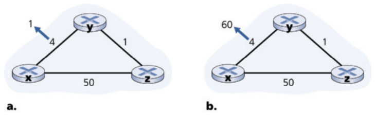

Hình 5.7 Thay đổi chi phí liên kết

1. Trước khi chi phí liên kết thay đổi, D<sub>y</sub>(x) = 4, D<sub>y</sub>(z) = 1, D<sub>z</sub>(y) = 1, và D<sub>z</sub>(x) = 5. Tại thời điểm t<sub>0</sub>, y phát hiện thay đổi link-cost (chi phí đã thay đổi từ 4 thành 60). y tính đường minimum-cost (chi phí nhỏ nhất) mới tới x có chi phí là

D<sub>y</sub>(x) = min{c(y, x) + D<sub>x</sub>(x), c(y, z) + D<sub>z</sub>(x)} = min{60 + 0, 1 + 5} = 6

Tất nhiên, với cái nhìn toàn cục về mạng, chúng ta có thể thấy chi phí mới này qua z là sai. Nhưng thông tin duy nhất nút y có là chi phí trực tiếp của nó tới x là 60 và z lần gần nhất đã nói với y rằng z có thể tới x với chi phí 5. Vì vậy để tới x, y giờ sẽ định tuyến qua z, hoàn toàn kỳ vọng rằng z sẽ có thể tới x với chi phí 5. Tính tới t<sub>1</sub> chúng ta có một vòng lặp định tuyến—để tới x, y định tuyến qua z, và z định tuyến qua y. Một vòng lặp định tuyến giống như

một hố đen—một packet hướng tới x tới y hoặc z tính tới t<sub>1</sub> sẽ nảy qua lại giữa hai nút này mãi mãi (hoặc cho tới khi bảng chuyển tiếp thay đổi).

2. Vì nút y đã tính một chi phí nhỏ nhất mới tới x, nó thông báo cho z về distance vector mới tại thời điểm t<sub>1</sub>.

3. Một lúc nào đó sau t<sub>1</sub>, z nhận distance vector mới của y, cho biết chi phí nhỏ nhất của y tới x là 6. z biết nó có thể tới y với chi phí 1 và do đó tính một chi phí thấp nhất mới tới x là D<sub>z</sub>(x) = min { 50 + 0, 1 + 6} = 7. Vì chi phí thấp nhất của z tới x đã tăng, nó sau đó thông báo cho y về distance vector mới tại t<sub>2</sub>.

4. Theo cách tương tự, sau khi nhận distance vector mới của z, y xác định D<sub>y</sub>(x) = 8 và gửi cho z distance vector của nó. z sau đó xác định D<sub>z</sub>(x) = 9 và gửi cho y distance vector của nó, v.v.

Quá trình sẽ tiếp tục bao lâu? Bạn nên tự thuyết phục mình rằng vòng lặp sẽ kéo dài 44 lần lặp (trao đổi thông điệp giữa y và z)— cho đến khi z cuối cùng tính chi phí của đường qua y lớn hơn 50. Tại thời điểm này, z sẽ (cuối cùng!) xác định rằng đường least-cost của nó tới x là qua kết nối trực tiếp tới x. y khi đó sẽ định tuyến tới x qua z. Kết quả của tin xấu về việc tăng chi phí liên kết thực sự đã lan truyền chậm! Điều gì sẽ xảy ra nếu chi phí liên kết c(y, x) đã thay đổi từ 4 thành 10,000 và chi phí c(z, x) là 9,999? Vì những kịch bản như vậy, vấn đề chúng ta đã thấy đôi khi được gọi là vấn đề count-to-infinity (đếm tới vô cùng).

#### Thuật toán vector khoảng cách: thêm poisoned reverse (Distance-Vector Algorithm: Adding Poisoned Reverse)

Kịch bản vòng lặp cụ thể vừa mô tả có thể tránh được bằng một kỹ thuật gọi là poisoned reverse (đảo ngược đầu độc). Ý tưởng đơn giản—nếu z định tuyến qua y để tới đích x, thì z sẽ quảng bá cho y rằng khoảng cách của nó tới x là vô cùng, tức là, z sẽ quảng bá cho y rằng D<sub>z</sub>(x) = ∞ (mặc dù z biết thực ra D<sub>z</sub>(x) = 5). z sẽ tiếp tục nói lời nói dối vô hại này với y chừng nào nó còn định tuyến tới x qua y. Vì y tin rằng z không có đường tới x, y sẽ không bao giờ cố định tuyến tới x qua z, chừng nào z tiếp tục định tuyến tới x qua y (và nói dối về việc đó).

Giờ hãy xem poisoned reverse giải quyết vấn đề vòng lặp cụ thể chúng ta đã gặp trước đó trong Hình 5.5(b) như thế nào. Do poisoned reverse, bảng khoảng cách của y cho biết D<sub>z</sub>(x) = ∞. Khi chi phí của liên kết (x, y) thay đổi từ 4 thành 60 tại thời điểm t<sub>0</sub>, y cập nhật bảng và tiếp tục định tuyến trực tiếp tới x, dù với chi phí cao hơn là 60, và thông báo cho z về chi phí mới của nó tới x, tức là, D<sub>y</sub>(x) = 60 . Sau khi nhận cập nhật tại t<sub>1</sub>, z ngay lập tức chuyển tuyến tới x sang qua liên kết trực tiếp (z, x) với chi phí 50. Vì đây là một đường least-cost mới tới x, và vì đường đi không còn đi qua y, z giờ thông báo cho y rằng D<sub>z</sub>(x) = 50 tại t<sub>2</sub>. Sau khi nhận cập nhật từ z, y cập nhật bảng khoảng cách với D<sub>y</sub>(x) = 51. Ngoài ra, vì z giờ nằm trên đường least-cost của y tới x, y đầu độc đường ngược từ z tới x bằng cách thông báo cho z tại thời điểm t<sub>3</sub> rằng D<sub>y</sub>(x) = ∞ (mặc dù y biết thực ra D<sub>y</sub>(x) = 51).

Poisoned reverse có giải quyết vấn đề count-to-infinity tổng quát không? Không. Bạn nên tự thuyết phục mình rằng các vòng lặp liên quan tới ba nút trở lên (thay vì chỉ hai nút láng giềng trực tiếp) sẽ không bị kỹ thuật poisoned reverse phát hiện.

#### So sánh thuật toán định tuyến LS và DV (A Comparison of LS and DV Routing Algorithms)

Thuật toán DV và LS theo các cách tiếp cận bổ sung cho nhau trong việc tính định tuyến. Trong thuật toán DV, mỗi nút chỉ nói chuyện với các láng giềng nối trực tiếp, nhưng nó cung cấp cho láng giềng các ước lượng least-cost từ chính nó tới mọi nút (mà nó biết) trong mạng. Thuật toán LS cần thông tin toàn cục. Do đó, khi được triển khai trong mỗi router, ví dụ, như trong Hình 4.2 và 5.1, mỗi nút sẽ cần giao tiếp với mọi nút khác (qua quảng bá), nhưng nó chỉ cho chúng biết chi phí của các liên kết nối trực tiếp với nó. Hãy kết thúc nghiên cứu về thuật toán LS và DV bằng một so sánh nhanh một số thuộc tính của chúng. Nhớ rằng N là tập nút (router) và E là tập cạnh (liên kết).

• Độ phức tạp thông điệp (Message complexity). Chúng ta đã thấy LS yêu cầu mỗi nút biết chi phí của mỗi liên kết trong mạng. Điều này yêu cầu gửi O ( |N||E|) thông điệp. Ngoài ra, mỗi khi một chi phí liên kết thay đổi, chi phí liên kết mới phải được gửi tới mọi nút. Thuật toán DV yêu cầu trao đổi thông điệp giữa các láng giềng nối trực tiếp ở mỗi lần lặp. Chúng ta đã thấy thời gian cần để thuật toán hội tụ có thể phụ thuộc vào nhiều yếu tố. Khi chi phí liên kết thay đổi, thuật toán DV sẽ lan truyền kết quả của chi phí liên kết đã thay đổi chỉ khi chi phí liên kết mới dẫn tới thay đổi đường least-cost cho một trong các nút gắn với liên kết đó.

• Tốc độ hội tụ (Speed of convergence). Chúng ta đã thấy bản triển khai LS của chúng ta là một thuật toán O (| N |<sup>2</sup>) cần O(|N| |E|)) thông điệp. Thuật toán DV có thể hội tụ chậm và có thể có vòng lặp định tuyến trong khi thuật toán đang hội tụ. DV cũng gặp vấn đề count-to-infinity.

• Độ bền vững (Robustness). Điều gì có thể xảy ra nếu một router hỏng, hành xử sai, hoặc bị phá hoại? Với LS, một router có thể quảng bá một chi phí sai cho một trong các liên kết gắn với nó (nhưng không cho liên kết khác). Một nút cũng có thể làm hỏng hoặc loại bỏ bất kỳ packet nào nó nhận như một phần của quảng bá LS. Nhưng một nút LS chỉ tính bảng chuyển tiếp của chính nó; các nút khác thực hiện các phép tính tương tự cho chính chúng. Điều này có nghĩa là các phép tính tuyến phần nào tách biệt với LS, cung cấp một mức độ bền vững. Với DV, một nút có thể quảng bá các đường least-cost sai tới bất kỳ hoặc mọi đích. (Thật vậy, năm 1997, một router trục trặc trong một ISP nhỏ đã cung cấp cho các router backbone quốc gia thông tin định tuyến sai. Điều này khiến các router khác làm ngập router trục trặc bằng traffic và khiến những phần lớn của Internet bị ngắt kết nối tới vài giờ [Neumann 1997].) Tổng quát hơn, chúng tôi lưu ý rằng, ở mỗi lần lặp, phép tính của một nút trong DV được chuyển tới láng giềng rồi gián tiếp tới láng giềng của láng giềng ở lần lặp tiếp theo. Theo nghĩa này, một phép tính sai của một nút có thể lan khắp toàn bộ mạng với DV.

Cuối cùng, không thuật toán nào là người thắng hiển nhiên so với thuật toán kia; thật vậy, cả hai thuật toán đều được dùng trong Internet.

## 5.3 Định tuyến nội AS trong Internet: OSPF (Intra-AS Routing in the Internet: OSPF)

Trong nghiên cứu về thuật toán định tuyến cho đến giờ, chúng ta đã xem mạng đơn giản như một tập hợp router được nối với nhau. Một router không phân biệt được với router khác theo nghĩa mọi router đều thực thi cùng thuật toán định tuyến để tính đường định tuyến qua toàn bộ mạng. Trong thực tế, mô hình này và cái nhìn về một tập router đồng nhất đều thực thi cùng thuật toán định tuyến là quá đơn giản vì hai lý do quan trọng:

• Quy mô (Scale). Khi số router trở nên lớn, overhead liên quan tới việc giao tiếp, tính toán và lưu thông tin định tuyến trở nên quá lớn. Internet ngày nay gồm hàng trăm triệu router. Lưu thông tin định tuyến cho các đích khả dĩ tại mỗi router này rõ ràng sẽ cần lượng bộ nhớ khổng lồ. Overhead cần để quảng bá cập nhật kết nối và chi phí liên kết giữa tất cả các router sẽ rất lớn! Một thuật toán distance-vector lặp giữa số lượng router lớn như vậy chắc chắn sẽ không bao giờ hội tụ. Rõ ràng, phải làm gì đó để giảm độ phức tạp của việc tính tuyến trong một mạng lớn như Internet.

• Tự chủ quản trị (Administrative autonomy). Như đã mô tả trong Mục 1.3, Internet là một mạng của các ISP, với mỗi ISP gồm mạng router riêng. Một ISP nói chung muốn vận hành mạng của mình theo ý muốn (ví dụ, chạy bất kỳ thuật toán định tuyến nào nó chọn trong mạng của mình) hoặc ẩn các khía cạnh tổ chức nội bộ của mạng khỏi bên ngoài. Lý tưởng nhất, một tổ chức nên có khả năng vận hành và quản trị mạng của mình theo ý muốn, trong khi vẫn có thể kết nối mạng của mình với các mạng bên ngoài khác.

Cả hai vấn đề này có thể được giải quyết bằng cách tổ chức router thành các hệ tự trị (autonomous system - AS), với mỗi AS gồm một nhóm router dưới cùng sự kiểm soát quản trị. Thường các router trong một ISP, và các liên kết nối chúng, tạo thành một AS duy nhất. Tuy nhiên, một số ISP chia mạng của họ thành nhiều AS. Cụ thể, một số ISP tier-1 dùng một AS khổng lồ cho toàn bộ mạng, trong khi số khác chia ISP thành hàng chục AS được nối với nhau. Một hệ tự trị được xác định bởi số hệ tự trị (autonomous system number - ASN) duy nhất toàn cầu của nó [RFC 1930]. Số AS, giống địa chỉ IP, được các cơ quan đăng ký khu vực của ICANN gán [ICANN 2025].

Các router trong cùng AS đều chạy cùng thuật toán định tuyến và có thông tin về nhau. Thuật toán định tuyến chạy bên trong một hệ tự trị được gọi là giao thức định tuyến intra-autonomous (nội hệ tự trị).

### Open Shortest Path First (OSPF)

Định tuyến OSPF và người anh em họ gần gũi của nó, IS-IS, được dùng rộng rãi cho định tuyến intra-AS trong Internet. Chữ Open trong OSPF cho biết đặc tả giao thức định tuyến được công khai (ví dụ, trái ngược với giao thức EIGRP của Cisco, vốn chỉ gần đây mới trở nên mở [Savage 2015], sau khoảng 20 năm là một giao thức Cisco-proprietary (độc quyền của Cisco)). Phiên bản OSPF gần nhất, phiên bản 2, được định nghĩa trong [RFC 2328], một tài liệu công khai.

OSPF là một giao thức link-state dùng flooding (làm ngập) thông tin link-state và một thuật toán đường least-cost Dijkstra. Với OSPF, mỗi router dựng một bản đồ topology đầy đủ (tức là, một đồ thị) của toàn bộ hệ tự trị. Mỗi router sau đó chạy cục bộ thuật toán shortest-path của Dijkstra để xác định một cây shortest-path tới mọi subnet, với chính nó là nút gốc. Chi phí từng liên kết được quản trị viên mạng cấu hình (xem khung bên, Principles and Practice: Setting OSPF Weights). Quản trị viên có thể chọn đặt mọi chi phí liên kết bằng 1, qua đó đạt định tuyến minimum-hop (ít hop nhất), hoặc có thể chọn đặt trọng số liên kết tỉ lệ nghịch với dung lượng liên kết để không khuyến khích traffic dùng các liên kết low-bandwidth. OSPF không bắt buộc chính sách về cách đặt trọng số liên kết (đó là việc của quản trị viên mạng), mà cung cấp cơ chế (giao thức) để xác định định tuyến đường least-cost cho tập trọng số liên kết cho trước.

### Nguyên lý trong thực tế (Principles in Practice)

### Đặt trọng số liên kết OSPF (Setting OSPF Link Weights)

Thảo luận của chúng ta về định tuyến link-state đã ngầm giả định rằng trọng số liên kết được đặt, một thuật toán định tuyến như OSPF được chạy, và traffic chảy theo bảng định tuyến được thuật toán LS tính. Xét về nhân quả, trọng số liên kết được cho trước (tức là, chúng có trước) và dẫn tới (qua thuật toán Dijkstra) các đường định tuyến làm tối thiểu tổng chi phí. Theo góc nhìn này, trọng số liên kết phản ánh chi phí sử dụng một liên kết (ví dụ, nếu trọng số liên kết tỉ lệ nghịch với dung lượng, thì việc dùng các liên kết high-capacity (dung lượng cao) sẽ có trọng số nhỏ hơn và do đó hấp dẫn hơn từ góc độ định tuyến) và thuật toán Dijkstra dùng để tối thiểu tổng chi phí.

Trong thực tế, quan hệ nhân quả giữa trọng số liên kết và đường định tuyến có thể bị đảo ngược, với các nhà vận hành mạng cấu hình trọng số liên kết để có được các đường định tuyến đạt một số mục tiêu kỹ thuật traffic (traffic engineering) nhất định [Fortz 2000, Fortz 2002]. Ví dụ, giả sử một nhà vận hành mạng có ước lượng luồng traffic đi vào mạng tại mỗi điểm vào và hướng tới mỗi điểm ra.

Nhà vận hành khi đó có thể muốn thiết lập một định tuyến cụ thể cho các luồng ingress-to-egress (từ điểm vào tới điểm ra) làm tối thiểu độ sử dụng tối đa trên mọi liên kết của mạng. Nhưng với một thuật toán định tuyến như OSPF, các “núm vặn” chính của nhà vận hành để tinh chỉnh định tuyến luồng qua mạng là trọng số liên kết. Do đó, để đạt mục tiêu tối thiểu độ sử dụng liên kết tối đa, nhà vận hành phải tìm tập trọng số liên kết đạt mục tiêu này. Đây là một sự đảo ngược quan hệ nhân quả—định tuyến luồng mong muốn đã biết, và trọng số liên kết OSPF phải được tìm sao cho thuật toán định tuyến OSPF dẫn tới định tuyến luồng mong muốn này.

Với OSPF, một router quảng bá thông tin định tuyến tới mọi router khác trong hệ tự trị, không chỉ tới các router láng giềng. Một router quảng bá thông tin link-state mỗi khi có thay đổi trạng thái của một liên kết (ví dụ, thay đổi chi phí hoặc thay đổi trạng thái lên/xuống). Nó cũng quảng bá trạng thái liên kết định kỳ (ít nhất mỗi 30 phút một lần), ngay cả khi trạng thái liên kết không thay đổi. RFC 2328 ghi chú rằng “việc cập nhật định kỳ các quảng bá trạng thái liên kết này tăng độ bền vững cho thuật toán trạng thái liên kết.” Các quảng bá OSPF được chứa trong các thông điệp OSPF được IP mang trực tiếp, với giao thức upper-layer 89 cho OSPF. Do đó, bản thân giao thức OSPF phải triển khai các chức năng như truyền thông điệp tin cậy và quảng bá link-state. Giao thức OSPF cũng kiểm tra liên kết có hoạt động không (qua một thông điệp HELLO gửi tới láng giềng gắn kèm) và cho phép một router OSPF lấy cơ sở dữ liệu trạng thái liên kết network-wide của một router láng giềng.

Một số tiến bộ thể hiện trong OSPF bao gồm:

• Bảo mật (Security). Các trao đổi giữa các router OSPF (ví dụ, cập nhật link-state) có thể được xác thực. Với xác thực, chỉ các router đáng tin mới có thể tham gia giao thức OSPF trong một AS, qua đó ngăn những kẻ xâm nhập độc hại (hoặc những sinh viên mạng mang kiến thức mới ra thử nghịch) chèn thông tin sai vào bảng router. Theo mặc định, packet OSPF giữa các router không được xác thực và có thể bị giả mạo. Có thể cấu hình hai loại xác thực—đơn giản và MD5 (xem Chương 8 để có thảo luận về MD5 và xác thực nói chung). Với xác thực đơn giản, cùng một mật khẩu được cấu hình trên mỗi router. Khi một router gửi một packet OSPF, nó đưa mật khẩu ở dạng plaintext. Rõ ràng, xác thực đơn giản không an toàn lắm. Xác thực MD5 dựa trên các khóa bí mật dùng chung được cấu hình trong mọi router. Với mỗi packet OSPF nó gửi, router tính hàm băm MD5 của nội dung packet OSPF nối thêm khóa bí mật. (Xem thảo luận về mã xác thực thông điệp trong Chương 8.) Sau đó router đưa giá trị băm kết quả vào packet OSPF. Router nhận, dùng khóa bí mật được cấu hình trước, sẽ tính hàm băm MD5 của packet và so sánh nó với giá trị băm mà packet mang, qua đó xác minh tính xác thực của packet. Số thứ tự cũng được dùng với xác thực MD5 để chống tấn công phát lại (replay attack).

• Nhiều đường cùng chi phí (Multiple same-cost paths). Khi nhiều đường tới một đích có cùng chi phí, OSPF cho phép dùng nhiều đường (tức là, không cần chọn một đường duy nhất để mang mọi traffic khi tồn tại nhiều đường equal-cost (chi phí bằng nhau)).

• Hỗ trợ tích hợp cho định tuyến unicast và multicast (Integrated support for unicast and multicast routing). Multicast OSPF (MOSPF) [RFC 1584] cung cấp các mở rộng đơn giản cho OSPF để hỗ trợ định tuyến multicast. MOSPF dùng cơ sở dữ liệu liên kết OSPF hiện có và thêm một loại quảng bá link-state mới vào cơ chế quảng bá link-state OSPF hiện có.

• Hỗ trợ phân cấp trong một AS (Support for hierarchy within a single AS). Một hệ tự trị OSPF có thể được cấu hình phân cấp thành các vùng (area). Mỗi vùng chạy thuật toán định tuyến link-state OSPF riêng, với mỗi router trong một vùng quảng bá trạng thái liên kết của nó tới mọi router khác trong vùng đó. Trong mỗi vùng, một hoặc nhiều router biên vùng (area border router) chịu trách nhiệm định tuyến packet ra ngoài vùng. Cuối cùng, đúng một vùng OSPF trong AS được cấu hình làm vùng backbone. Vai trò chính của vùng backbone là định tuyến traffic giữa các vùng khác trong AS. Backbone luôn chứa mọi router biên vùng trong AS và cũng có thể chứa các router non-border (không phải biên). Định tuyến inter-area (liên vùng) trong AS yêu cầu packet trước hết được định tuyến tới một router biên vùng (định tuyến intra-area (nội vùng)), rồi được định tuyến qua backbone tới router biên vùng nằm trong vùng đích, rồi được định tuyến tới đích cuối cùng.

OSPF là một giao thức tương đối phức tạp, và phần trình bày ở đây buộc phải ngắn gọn; [Huitema 1998; Moy 1998; RFC 2328] cung cấp thêm chi tiết.

## 5.4 Định tuyến giữa các ISP: BGP (Routing Among the ISPs: BGP)

Chúng ta vừa học rằng OSPF là một ví dụ về giao thức định tuyến intra-AS. Khi định tuyến một packet giữa nguồn và đích trong cùng một AS, tuyến mà packet đi theo hoàn toàn được xác định bởi giao thức định tuyến intra-AS. Tuy nhiên, để định tuyến một packet qua nhiều AS, chẳng hạn từ một smartphone ở Timbuktu tới một server trong một datacenter ở Silicon Valley, chúng ta cần một giao thức định tuyến inter-autonomous system (liên hệ tự trị). Vì một giao thức định tuyến inter-AS liên quan tới việc phối hợp giữa nhiều AS, các AS giao tiếp phải chạy cùng giao thức định tuyến inter-AS. Thực ra, trong Internet, mọi AS đều chạy cùng giao thức định tuyến inter-AS, gọi là Border Gateway Protocol, thường được biết đến là BGP [RFC 4271; Stewart 1999].

BGP có thể nói là giao thức quan trọng nhất trong tất cả các giao thức Internet (đối thủ duy nhất khác sẽ là giao thức IP mà chúng ta đã nghiên cứu trong Mục 4.3), vì nó là giao thức gắn hàng nghìn ISP trong Internet với nhau. Như chúng ta sẽ sớm thấy, BGP là một giao thức phi tập trung và bất đồng bộ theo tinh thần định tuyến distance-vector mô tả trong Mục 5.2.2. Mặc dù BGP là một giao thức phức tạp và thách thức, để hiểu Internet ở mức sâu, chúng ta cần làm quen với nền tảng và hoạt động của nó. Thời gian chúng ta dành để học BGP sẽ rất xứng đáng.

### 5.4.1 Vai trò của BGP (The Role of BGP)

Để hiểu trách nhiệm của BGP, hãy xét một AS và một router bất kỳ trong AS đó. Nhớ rằng mọi router đều có một bảng chuyển tiếp, đóng vai trò trung tâm trong quá trình chuyển tiếp packet đến tới các liên kết ra của router. Như chúng ta đã học, với các đích nằm trong cùng AS, các mục trong bảng chuyển tiếp của router được xác định bởi giao thức định tuyến intra-AS của AS. Nhưng còn các đích nằm ngoài AS thì sao? Đây chính là nơi BGP tới giải cứu.

Trong BGP, packet không được định tuyến tới một địa chỉ đích cụ thể, mà tới các tiền tố được CIDR hóa, với mỗi tiền tố biểu diễn một subnet hoặc một tập subnet. Trong thế giới BGP, một đích có thể có dạng 138.16.68/22, mà trong ví dụ này bao gồm 1,024 địa chỉ IP. Do đó, bảng chuyển tiếp của một router sẽ có các mục dạng (x, I), trong đó x là một tiền tố (như 138.16.68/22) và I là số giao diện của một trong các giao diện của router. Là một giao thức định tuyến inter-AS, BGP cung cấp cho mỗi router một phương tiện để:

1. Lấy thông tin khả năng tiếp cận tiền tố (prefix reachability) từ các AS láng giềng. Cụ thể, BGP cho phép mỗi subnet quảng bá sự tồn tại của nó tới phần còn lại của Internet. Một subnet hét lên, “Tôi tồn tại và tôi ở đây,” và BGP đảm bảo mọi router trong Internet biết về subnet này. Nếu không có BGP, mỗi subnet sẽ là một hòn đảo cô lập—đơn độc, không ai biết và phần còn lại của Internet không thể tiếp cận.

2. Xác định các tuyến “tốt nhất” tới các tiền tố. Một router có thể biết về hai hoặc nhiều tuyến khác nhau tới một tiền tố cụ thể. Để xác định tuyến tốt nhất, router sẽ chạy cục bộ một thủ tục route-selection (chọn tuyến) của BGP (dùng thông tin khả năng tiếp cận tiền tố mà nó lấy qua các router láng giềng). Tuyến tốt nhất sẽ được xác định dựa trên chính sách cũng như thông tin khả năng tiếp cận.

Giờ hãy đi sâu vào cách BGP thực hiện hai nhiệm vụ này.

### 5.4.2 Quảng bá thông tin tuyến BGP (Advertising BGP Route Information)

Hãy xét mạng minh họa trong Hình 5.8. Như chúng ta thấy, mạng đơn giản này có ba hệ tự trị: AS1, AS2 và AS3. Như minh họa, AS3 bao gồm một subnet có tiền tố x. Với mỗi AS, mỗi router là một gateway router hoặc một internal router. Một gateway router là một router ở rìa của một AS nối trực tiếp với một hoặc nhiều router trong các AS khác. Một internal router chỉ nối với các host và router trong AS của chính nó. Trong AS1, chẳng hạn, router 1c là một gateway router; các router 1a, 1b và 1d là internal router.

Hãy xét nhiệm vụ quảng bá thông tin khả năng tiếp cận cho tiền tố x tới mọi router minh họa trong Hình 5.8. Ở mức cao, việc này đơn giản. Thứ nhất, AS3 gửi một thông điệp BGP tới AS2, nói rằng x tồn tại và nằm trong AS3; hãy ký hiệu thông điệp này là “AS3 x”. Sau đó AS2 gửi một thông điệp BGP tới AS1, nói rằng x tồn tại và bạn có thể tới x bằng cách trước hết đi qua AS2 rồi tới AS3; hãy ký hiệu thông điệp đó là “AS2 AS3 x”. Bằng cách này, mỗi hệ tự trị sẽ không chỉ biết về sự tồn tại của x, mà còn biết về một đường các hệ tự trị dẫn tới x.

Mặc dù thảo luận trong đoạn trên về quảng bá thông tin khả năng tiếp cận BGP hẳn đã truyền đạt được ý tưởng chung, nó không chính xác theo nghĩa các hệ tự trị không thực sự gửi thông điệp cho nhau, mà là các router gửi. Để hiểu điều này, giờ hãy re-examine (xem xét lại) ví dụ trong Hình 5.8. Trong BGP, các cặp router trao đổi thông tin định tuyến qua các kết nối TCP semi-permanent (bán cố định) dùng port 179. Mỗi kết nối TCP như vậy, cùng với mọi thông điệp BGP gửi qua kết nối, được gọi là một kết nối BGP. Hơn nữa, một kết nối BGP trải qua hai AS được gọi là một kết nối external BGP (eBGP), và một phiên BGP giữa các router trong cùng AS được gọi là một kết nối internal BGP (iBGP). Ví dụ về các kết nối BGP cho mạng trong Hình 5.8 được minh họa trong Hình 5.9. Thường có một kết nối eBGP cho mỗi liên kết nối trực tiếp các gateway router trong các AS khác nhau; do đó, trong Hình 5.9, có một kết nối eBGP giữa gateway router 1c và 2a và một kết nối eBGP giữa gateway router 2c và 3a.

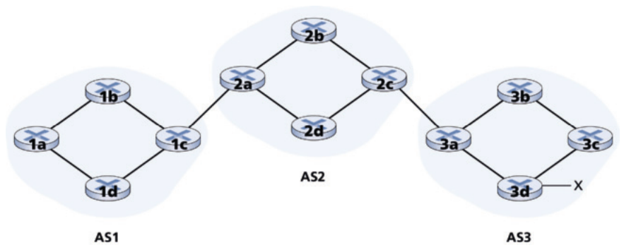

Hình 5.8 Mạng với ba hệ tự trị. AS3 bao gồm một subnet có tiền tố x

Cũng có các kết nối iBGP giữa các router trong mỗi AS. Cụ thể, Hình 5.9 hiển thị một cấu hình phổ biến gồm một kết nối BGP cho mỗi cặp router bên trong một AS, tạo ra một lưới kết nối TCP trong mỗi AS. Trong Hình 5.9, các kết nối eBGP được biểu diễn bằng nét đứt dài; các kết nối iBGP được biểu diễn bằng nét đứt ngắn. Lưu ý rằng các kết nối iBGP không phải lúc nào cũng tương ứng với các liên kết vật lý.

Để lan truyền thông tin khả năng tiếp cận, cả phiên iBGP và eBGP đều được dùng. Hãy xét lại việc quảng bá thông tin khả năng tiếp cận cho tiền tố x tới mọi router trong AS1 và AS2. Trong quá trình này, gateway router 3a trước hết gửi một thông điệp eBGP “AS3 x” tới gateway router 2c. Gateway router 2c sau đó gửi thông điệp iBGP “AS3 x” tới mọi router khác trong AS2, bao gồm gateway router 2a . Gateway router 2a sau đó gửi thông điệp eBGP “AS2 AS3 x” tới gateway router 1c. Cuối cùng, gateway router 1c dùng iBGP để gửi thông điệp “AS2 AS3 x” tới mọi router trong AS1. Sau khi quá trình này hoàn tất, mỗi router trong AS1 và AS2 đều biết về sự tồn tại của x và cũng biết một đường AS dẫn tới x.

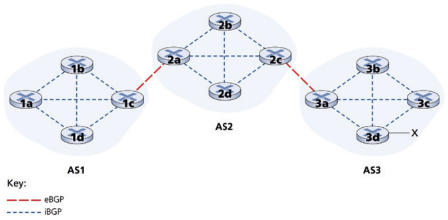

Hình 5.9 Các kết nối eBGP và iBGP

Tất nhiên, trong một mạng thực, từ một router cho trước có thể có nhiều đường khác nhau tới một đích cho trước, mỗi đường qua một chuỗi AS khác nhau. Ví dụ, hãy xét mạng trong Hình 5.10, là mạng gốc trong Hình 5.8, với thêm một liên kết vật lý từ router 1d tới router 3d. Trong trường hợp này, có hai đường từ AS1 tới x: đường “AS2 AS3 x” qua router 1c; và đường mới “AS3 x” qua router 1d.

### 5.4.3 Xác định các tuyến tốt nhất (Determining the Best Routes)

Như chúng ta vừa học, có thể có nhiều đường từ một router cho trước tới một subnet đích. Thực ra, trong Internet, router thường nhận thông tin khả năng tiếp cận về hàng chục đường khả dĩ khác nhau. Một router chọn giữa các đường này như thế nào (và rồi cấu hình bảng chuyển tiếp tương ứng)?

Trước khi giải quyết câu hỏi thiết yếu này, chúng ta cần giới thiệu thêm một chút thuật ngữ BGP. Khi một router quảng bá một tiền tố qua một kết nối BGP, nó đưa kèm tiền tố một số thuộc tính BGP. Theo thuật ngữ BGP, một tiền tố cùng với các thuộc tính của nó được gọi là một tuyến (route). Hai trong số các thuộc tính quan trọng hơn là AS-PATH và NEXT-HOP. Thuộc tính AS-PATH chứa danh sách các AS mà quảng bá đã đi qua, như chúng ta đã thấy trong các ví dụ trên. Để tạo giá trị AS-PATH, khi một tiền tố được chuyển tới một AS, AS thêm ASN của nó vào danh sách hiện có trong AS-PATH. Ví dụ, trong Hình 5.10, có hai tuyến từ AS1 tới subnet x: một tuyến dùng AS-PATH “AS2 AS3”; và một tuyến khác dùng AS-PATH “AS3”. Các router BGP cũng dùng thuộc tính AS-PATH để phát hiện và ngăn các quảng bá lặp vòng; cụ thể, nếu một router thấy AS của chính nó có trong danh sách đường, nó sẽ từ chối quảng bá.

Cung cấp liên kết thiết yếu giữa các giao thức định tuyến inter-AS và intra-AS, thuộc tính NEXT-HOP có một công dụng tinh tế nhưng quan trọng. NEXT-HOP là địa chỉ IP của giao diện router bắt đầu AS-PATH. Để hiểu thuộc tính này, hãy lại tham chiếu Hình 5.10. Như chỉ ra trong Hình 5.10, thuộc tính NEXT-HOP cho tuyến “AS2 AS3 x” từ AS1 tới x đi qua AS2 là địa chỉ IP của giao diện bên trái trên router 2a. Thuộc tính NEXT-HOP cho tuyến “AS3 x” từ AS1 tới x đi vòng qua AS2 là địa chỉ IP của giao diện ngoài cùng bên trái của router 3d. Tóm lại, trong ví dụ đơn giản này, mỗi router trong AS1 biết về hai tuyến BGP tới tiền tố x:

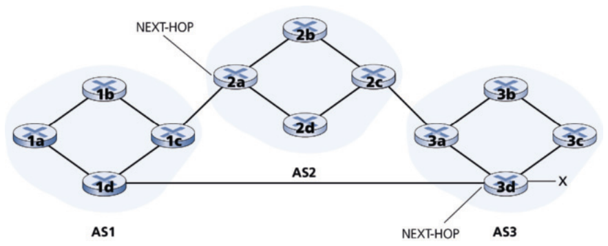

Hình 5.10 Mạng được bổ sung liên kết peering giữa AS1 và AS3

Địa chỉ IP của giao diện ngoài cùng bên trái cho router 2a; AS2 AS3; x

Địa chỉ IP của giao diện ngoài cùng bên trái của router 3d; AS3; x

Ở đây, mỗi tuyến BGP được viết dưới dạng một danh sách gồm ba thành phần: NEXT-HOP; AS-PATH; tiền tố đích. Trong thực tế, một tuyến BGP bao gồm thêm các thuộc tính, mà tạm thời chúng ta sẽ bỏ qua. Lưu ý rằng thuộc tính NEXT-HOP là địa chỉ IP của một router không thuộc AS1; tuy nhiên, subnet chứa địa chỉ IP này gắn trực tiếp với AS1.

#### Định tuyến khoai tây nóng (Hot Potato Routing)

Cuối cùng giờ chúng ta đã ở vị trí để nói về các thuật toán định tuyến BGP một cách chính xác. Chúng ta sẽ bắt đầu với một trong những thuật toán định tuyến đơn giản nhất, cụ thể là, định tuyến khoai tây nóng (hot potato routing).

Hãy xét router 1b trong mạng ở Hình 5.10. Như vừa mô tả, router này sẽ biết về hai tuyến BGP khả dĩ tới tiền tố x. Trong định tuyến khoai tây nóng, tuyến được chọn (trong số mọi tuyến khả dĩ) là tuyến có chi phí thấp nhất tới router NEXT-HOP bắt đầu tuyến đó. Trong ví dụ này, router 1b sẽ tham khảo thông tin định tuyến intra-AS của nó để tìm đường intra-AS least-cost tới router NEXT-HOP 2a và đường intra-AS least-cost tới router NEXT-HOP 3d, rồi chọn tuyến có đường least-cost nhỏ nhất trong hai đường này. Ví dụ, giả sử chi phí được định nghĩa là số liên kết đi qua. Khi đó chi phí thấp nhất từ router 1b tới router 2a là 2, chi phí thấp nhất từ router 1b tới router 3d là 3, và do đó router 2a sẽ được chọn. Router 1b sau đó sẽ tham khảo bảng chuyển tiếp của nó (được cấu hình bởi thuật toán intra-AS) và tìm giao diện I nằm trên đường least-cost tới router 2a. Sau đó nó thêm (x, I) vào bảng chuyển tiếp.

Các bước thêm một tiền tố outside-AS (ngoài AS) vào bảng chuyển tiếp của router cho định tuyến khoai tây nóng được tóm tắt trong Hình 5.11. Điều quan trọng cần lưu ý là khi thêm một tiền tố outside-AS vào bảng chuyển tiếp, cả giao thức định tuyến inter-AS (BGP) và giao thức định tuyến intra-AS (ví dụ, OSPF) đều được dùng.

Ý tưởng đằng sau định tuyến hot-potato là để router 1b đưa packet ra khỏi AS của nó nhanh nhất có thể (cụ thể hơn, với chi phí thấp nhất có thể) mà không lo về chi phí của các phần còn lại của đường đi bên ngoài AS của nó tới đích. Trong tên gọi “hot potato routing,” một packet tương tự với một củ khoai tây nóng đang bỏng trong tay bạn. Vì nó nóng bỏng, bạn muốn chuyền nó cho người khác (một AS khác) nhanh nhất có thể. Do đó định tuyến khoai tây nóng là một thuật toán ích kỷ—nó cố giảm chi phí trong AS của chính nó trong khi bỏ qua các thành phần khác của chi phí end-to-end bên ngoài AS của nó. Lưu ý rằng với định tuyến khoai tây nóng, hai router trong cùng một AS có thể chọn hai đường AS khác nhau tới cùng một tiền tố. Ví dụ, chúng ta vừa thấy router 1b sẽ gửi packet qua AS2 để tới x. Tuy nhiên, router 1d sẽ đi vòng qua AS2 và gửi packet trực tiếp tới AS3 để tới x.

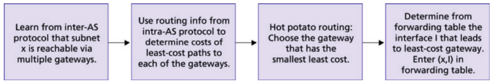

Hình 5.11 Các bước thêm đích outside-AS vào bảng chuyển tiếp của router

#### Thuật toán chọn tuyến (Route-Selection Algorithm)

Trong thực tế, BGP dùng một thuật toán phức tạp hơn định tuyến khoai tây nóng, nhưng vẫn kết hợp định tuyến khoai tây nóng. Với bất kỳ tiền tố đích cho trước nào, đầu vào của thuật toán route-selection của BGP là tập mọi tuyến tới tiền tố đó đã được router học và chấp nhận. Nếu chỉ có một tuyến như vậy, thì BGP hiển nhiên chọn tuyến đó. Nếu có hai hoặc nhiều tuyến tới cùng tiền tố, thì BGP lần lượt gọi các quy tắc loại trừ sau cho đến khi còn lại một tuyến:

1. Một tuyến được gán một giá trị local preference (ưu tiên cục bộ) như một trong các thuộc tính của nó (ngoài các thuộc tính AS-PATH và NEXT-HOP). Local preference của một tuyến có thể đã được router đặt hoặc có thể đã được học từ một router khác trong cùng AS. Giá trị của thuộc tính local preference là một quyết định chính sách hoàn toàn do quản trị viên mạng của AS quyết định. (Chúng ta sẽ sớm thảo luận khá chi tiết các vấn đề chính sách BGP.) Các tuyến có giá trị local preference cao nhất được chọn.

2. Từ các tuyến còn lại (tất cả đều có cùng giá trị local preference cao nhất), tuyến có AS-PATH ngắn nhất được chọn. Nếu quy tắc này là quy tắc duy nhất cho việc chọn tuyến, thì BGP sẽ đang dùng một thuật toán DV để xác định đường đi, trong đó thước đo khoảng cách dùng số hop AS thay vì số hop router.

3. Từ các tuyến còn lại (tất cả đều có cùng giá trị local preference cao nhất và cùng độ dài AS-PATH), định tuyến khoai tây nóng được dùng, tức là, tuyến có router NEXT-HOP gần nhất được chọn.

4. Nếu vẫn còn nhiều hơn một tuyến, router dùng định danh BGP để chọn tuyến; xem [Stewart 1999].

Ví dụ, hãy lại xét router 1b trong Hình 5.10. Nhớ rằng có đúng hai tuyến BGP tới tiền tố x, một tuyến đi qua AS2 và một tuyến đi vòng qua AS2. Cũng nhớ rằng nếu chỉ dùng riêng định tuyến khoai tây nóng, thì BGP sẽ định tuyến packet qua AS2 tới tiền tố x. Nhưng trong thuật toán route-selection ở trên, quy tắc 2 được áp dụng trước quy tắc 3, khiến BGP chọn tuyến đi vòng qua AS2, vì tuyến đó có AS PATH ngắn hơn. Vì vậy chúng ta thấy rằng với thuật toán route-selection ở trên, BGP không còn là một thuật toán ích kỷ—nó trước hết tìm các tuyến có đường AS ngắn (qua đó nhiều khả năng giảm độ trễ end-to-end).

Như đã lưu ý ở trên, BGP là chuẩn de facto cho định tuyến inter-AS của Internet. Để xem nội dung các bảng định tuyến BGP khác nhau (rất lớn!) trích từ các router trong các ISP tier-1, xem http://www.routeviews.org. Bảng định tuyến BGP thường chứa hơn nửa triệu tuyến (tức là, tiền tố và thuộc tính tương ứng). Thống kê về kích thước và đặc điểm của bảng định tuyến BGP được trình bày trong [Huston 2019b].

### 5.4.4 IP-Anycast

Ngoài việc là giao thức định tuyến inter-AS của Internet, BGP thường được dùng để triển khai dịch vụ IP-anycast [RFC 1546, RFC 7094], thường được dùng trong DNS. Để thấy động lực của IP-anycast, hãy xét rằng trong nhiều ứng dụng, chúng ta quan tâm tới (1) nhân bản cùng nội dung trên các server khác nhau ở nhiều vị trí địa lý phân tán khác nhau, và (2) cho mỗi người dùng truy cập nội dung từ server gần nhất. Ví dụ, một CDN có thể nhân bản video và các object khác trên các server ở các quốc gia khác nhau. Tương tự, hệ thống DNS có thể nhân bản các DNS record trên các DNS server khắp thế giới. Khi một người dùng muốn truy cập nội dung được nhân bản này, mong muốn là hướng người dùng tới server “gần nhất” có nội dung được nhân bản. Thuật toán route-selection của BGP cung cấp một cơ chế dễ dàng và tự nhiên để làm việc này.

Để thảo luận cụ thể, hãy mô tả cách một CDN có thể dùng IP-anycast. Như minh họa trong Hình 5.12, trong giai đoạn cấu hình IP-anycast, công ty CDN gán cùng một địa chỉ IP cho mỗi server của mình, và dùng BGP chuẩn để quảng bá địa chỉ IP này từ mỗi server. Khi một router BGP nhận nhiều quảng bá tuyến cho địa chỉ IP này, nó coi các quảng bá này như cung cấp các đường khác nhau tới cùng một vị trí vật lý (trong khi thực ra, các quảng bá là cho các đường khác nhau tới các vị trí vật lý khác nhau). Khi cấu hình bảng định tuyến, mỗi router sẽ dùng cục bộ thuật toán route-selection của BGP để chọn tuyến “tốt nhất” (ví dụ, gần nhất, như được xác định bởi số AS-hop) tới địa chỉ IP đó. Ví dụ, nếu một tuyến BGP (tương ứng với một vị trí) chỉ cách router một hop AS, và mọi tuyến BGP khác (tương ứng với các vị trí khác) cách hai hop AS trở lên, thì router BGP sẽ chọn định tuyến packet tới vị trí cách một hop. Sau giai đoạn address-advertisement (quảng bá địa chỉ) BGP ban đầu này, CDN có thể làm công việc chính là phân phối nội dung. Khi một client yêu cầu video, CDN trả về cho client địa chỉ IP chung được dùng bởi các server phân tán địa lý, bất kể client ở đâu. Khi client gửi một yêu cầu tới địa chỉ IP đó, các router Internet sau đó chuyển tiếp packet yêu cầu tới server “gần nhất”, như được định nghĩa bởi thuật toán route-selection của BGP.

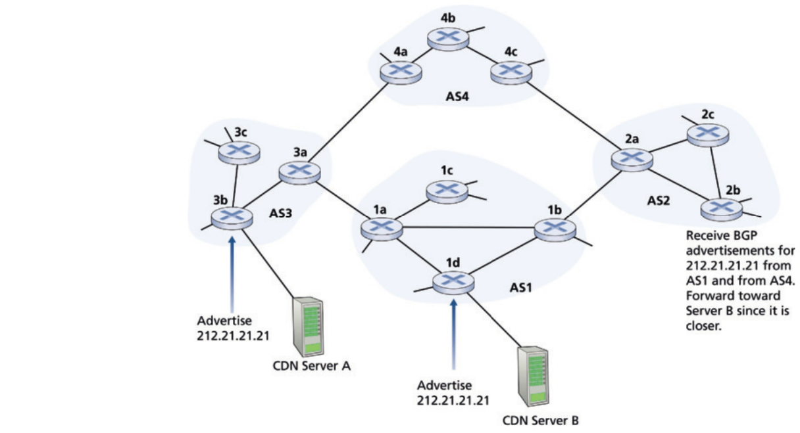

Hình 5.12 Dùng IP-anycast để đưa người dùng tới CDN server gần nhất

Mặc dù ví dụ CDN ở trên minh họa rất rõ cách IP-anycast có thể được dùng, trong thực tế, các CDN thường chọn không dùng IP-anycast vì các thay đổi định tuyến BGP có thể dẫn tới các packet khác nhau của cùng một kết nối TCP tới các instance khác nhau của Web server. Nhưng IP-anycast được hệ thống DNS dùng rộng rãi để hướng các truy vấn DNS tới root DNS server gần nhất. Nhớ lại từ Mục 2.4, hiện có 13 địa chỉ IP cho các root DNS server. Nhưng tương ứng với mỗi địa chỉ này, có nhiều DNS root server, với một số địa chỉ có hơn 100 DNS root server rải rác khắp mọi góc thế giới. Khi một truy vấn DNS được gửi tới một trong 13 địa chỉ IP này, IP anycast được dùng để định tuyến truy vấn tới DNS root server gần nhất chịu trách nhiệm cho địa chỉ đó. [Li 2018; Zhou 2023] trình bày các phép đo gần đây minh họa anycast Internet, việc sử dụng, performance và thách thức.

### 5.4.5 Chính sách định tuyến (Routing Policy)

Khi một router chọn một tuyến tới một đích, chính sách định tuyến của AS có thể lấn át mọi cân nhắc khác, như đường AS ngắn nhất hay định tuyến khoai tây nóng. Thật vậy, trong thuật toán route-selection, các tuyến trước hết được chọn theo thuộc tính local-preference, có giá trị được cố định bởi chính sách của AS cục bộ.

Hãy minh họa một số khái niệm cơ bản của chính sách định tuyến BGP bằng một ví dụ đơn giản. Hình 5.13 cho thấy sáu hệ tự trị được nối với nhau: A, B, C, W, X và Y. Điều quan trọng cần lưu ý là A, B, C, W, X và Y là các AS, không phải router. Hãy giả sử các hệ tự trị W, X và Y là ISP truy cập và A, B và C là các mạng nhà cung cấp backbone. Chúng ta cũng giả sử A, B và C gửi traffic trực tiếp cho nhau, và cung cấp đầy đủ thông tin BGP cho các mạng khách hàng của họ. Mọi traffic vào một mạng ISP truy cập phải hướng tới mạng đó, và mọi traffic rời một mạng ISP truy cập phải xuất phát từ mạng đó. W và Y rõ ràng là ISP truy cập. X là một ISP truy cập multi-homed (đa kết nối), vì nó được nối với phần còn lại của mạng qua hai nhà cung cấp khác nhau (một kịch bản ngày càng phổ biến trong thực tế). Tuy nhiên, giống W và Y, bản thân X phải là nguồn/đích của mọi traffic rời/vào X. Nhưng hành vi stub network (mạng cụt) này sẽ được triển khai và thực thi như thế nào? Làm thế nào ngăn X chuyển tiếp traffic giữa B và C? Việc này có thể dễ dàng thực hiện bằng cách kiểm soát cách các tuyến BGP được quảng bá. Cụ thể, X sẽ hoạt động như một mạng ISP truy cập nếu nó quảng bá (tới các láng giềng B và C) rằng nó không có đường tới bất kỳ đích nào khác ngoài chính nó. Tức là, mặc dù X có thể biết một đường, chẳng hạn XCY, tới mạng Y, nó sẽ không quảng bá đường này cho B. Vì B không biết X có đường tới Y, B sẽ không bao giờ chuyển tiếp traffic hướng tới Y (hoặc C) qua X. Ví dụ đơn giản này minh họa cách một chính sách quảng bá tuyến có chọn lọc có thể được dùng để triển khai các quan hệ định tuyến khách hàng/nhà cung cấp.

Tiếp theo hãy tập trung vào một mạng nhà cung cấp, chẳng hạn AS B. Giả sử B đã học được (từ A) rằng A có một đường AW tới W. Do đó B có thể cài đặt tuyến AW vào cơ sở thông tin định tuyến của nó. Rõ ràng, B cũng muốn quảng bá đường BAW cho khách hàng của nó, X, để X biết rằng nó có thể định tuyến tới W qua B. Nhưng B có nên quảng bá đường BAW cho C không? Nếu làm vậy, thì C có thể định tuyến traffic tới W qua BAW. Nếu A, B và C đều là nhà cung cấp backbone, thì B có thể có lý khi cảm thấy rằng nó không nên phải gánh gánh nặng (và chi phí!) chuyên chở traffic quá cảnh giữa A và C. B có thể có lý khi cảm thấy rằng đó là việc (và chi phí!) của A và C để đảm bảo C có thể định tuyến tới/từ khách hàng của A qua một kết nối trực tiếp giữa A và C. Hiện chưa có chuẩn chính thức nào quy định cách các ISP backbone định tuyến giữa họ với nhau. Tuy nhiên, một quy tắc kinh nghiệm mà các ISP thương mại tuân theo là mọi traffic chảy qua mạng backbone của một ISP phải có nguồn hoặc đích (hoặc cả hai) trong một mạng là khách hàng của ISP đó; nếu không traffic sẽ được đi nhờ miễn phí trên mạng của ISP. Các thỏa thuận peering riêng lẻ (sẽ quy định các câu hỏi như những câu nêu ở trên) thường được thương lượng giữa các cặp ISP và thường được giữ bí mật; [Huston 1999a; Huston 2012] cung cấp một thảo luận thú vị về các thỏa thuận peering. Để có mô tả chi tiết về cách chính sách định tuyến phản ánh quan hệ thương mại giữa các ISP, xem [Gao 2001; Dmitiropoulos 2007]. Để có thảo luận về các chính sách định tuyến BGP từ góc độ ISP, xem [Caesar 2005b].

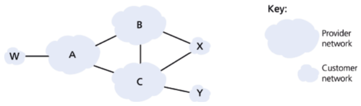

Hình 5.13 Một kịch bản chính sách BGP đơn giản

### Nguyên lý trong thực tế (Principles in Practice)

### Tại sao có các giao thức định tuyến liên AS và nội AS khác nhau? (Why Are There Different Inter-AS and Intra-AS Routing Protocols?)

Sau khi đã nghiên cứu chi tiết các giao thức định tuyến inter-AS và intra-AS cụ thể được triển khai trong Internet ngày nay, hãy kết thúc bằng việc xét có lẽ câu hỏi cơ bản nhất chúng ta có thể hỏi về các giao thức này ngay từ đầu (hy vọng, bạn đã thắc mắc điều này suốt từ đầu, và chưa bị lạc giữa rừng cây!): Tại sao lại dùng các giao thức định tuyến inter-AS và intra-AS khác nhau? Câu trả lời cho câu hỏi này đi vào cốt lõi của sự khác biệt giữa

các mục tiêu định tuyến bên trong một AS và giữa các AS:

• Chính sách (Policy). Giữa các AS, vấn đề chính sách chiếm ưu thế. Có thể rất quan trọng rằng traffic xuất phát từ một AS cho trước không được đi qua một AS cụ thể khác. Tương tự, một AS cho trước có thể rất muốn kiểm soát traffic quá cảnh nào nó chuyên chở giữa các AS khác. Chúng ta đã thấy BGP mang các thuộc tính đường và cung cấp phân phối có kiểm soát thông tin định tuyến để có thể đưa ra các quyết định định tuyến policy-based (dựa trên chính sách) như vậy. Bên trong một AS, mọi thứ trên danh nghĩa đều dưới cùng sự kiểm soát quản trị, và do đó vấn đề chính sách đóng vai trò ít quan trọng hơn nhiều trong việc chọn tuyến bên trong AS.

• Quy mô (Scale). Khả năng của một thuật toán định tuyến và cấu trúc dữ liệu của nó mở rộng để xử lý định tuyến tới/giữa số lượng lớn mạng là một vấn đề thiết yếu trong định tuyến inter-AS. Bên trong một AS, khả năng mở rộng ít là mối lo hơn. Có một điều, nếu một ISP duy nhất trở nên quá lớn, luôn có thể chia nó thành hai AS và thực hiện định tuyến inter-AS giữa hai AS mới. (Nhớ rằng OSPF cho phép xây dựng một phân cấp như vậy bằng cách chia một AS thành các vùng.)

• Performance. Vì định tuyến inter-AS rất hướng chính sách, chất lượng (ví dụ, performance) của các tuyến được dùng thường là mối quan tâm thứ yếu (tức là, một tuyến dài hơn hoặc tốn kém hơn thỏa một số tiêu chí chính sách có thể được chọn thay vì một tuyến ngắn hơn nhưng không thỏa tiêu chí đó). Thật vậy, chúng ta đã thấy rằng giữa các AS, thậm chí không có khái niệm chi phí (ngoài số hop AS) gắn với tuyến. Tuy nhiên, bên trong một AS duy nhất, các mối quan tâm chính sách như vậy ít quan trọng hơn, cho phép định tuyến tập trung hơn vào mức performance đạt được trên một tuyến.

Điều này hoàn tất phần giới thiệu ngắn về BGP. Hiểu BGP là quan trọng vì nó đóng vai trò trung tâm trong Internet. Chúng tôi khuyến khích bạn tham khảo các tài liệu BGP trong mục này (đặc biệt [Stewart 1999; Huston 2019a]) và các tài nguyên BGP trực tuyến xuất sắc có tại [NSRC 2025].

### 5.4.6 Ghép các mảnh lại: Có mặt trên Internet (Putting the Pieces Together: Obtaining Internet Presence)

Mặc dù tiểu mục này không nói về bản thân BGP, nó tập hợp nhiều giao thức và khái niệm chúng ta đã thấy cho đến giờ, bao gồm định địa chỉ IP, DNS và BGP.

Giả sử bạn vừa tạo một công ty nhỏ có một số server, bao gồm một Web server công khai mô tả sản phẩm và dịch vụ của công ty, một mail server mà nhân viên lấy thông điệp e-mail từ đó, và một DNS server. Tự nhiên, bạn muốn cả thế giới có thể ghé Web site của bạn để tìm hiểu về các sản phẩm và dịch vụ thú vị của bạn. Hơn nữa, bạn muốn nhân viên của mình có thể gửi và nhận e-mail với khách hàng tiềm năng khắp thế giới.

Để đạt các mục tiêu này, trước hết bạn cần có kết nối Internet, việc này được thực hiện bằng cách ký hợp đồng với, và kết nối tới, một ISP địa phương. Công ty của bạn sẽ có một gateway router, sẽ được nối tới một router trong ISP địa phương của bạn. Kết nối này có thể là một kết nối DSL qua hạ tầng điện thoại hiện có, một đường thuê riêng tới router của ISP, hoặc một trong nhiều giải pháp truy cập khác được mô tả trong Chương 1. Trong trường hợp đơn giản nhất, ISP địa phương cũng sẽ cung cấp cho bạn một dải địa chỉ IP, ví dụ, một dải địa chỉ /24 gồm 256 địa chỉ. Khi đã có kết nối vật lý và dải địa chỉ IP, bạn sẽ gán một trong các địa chỉ IP (trong dải của bạn) cho Web server, một cho mail server, một cho DNS server, một cho gateway router, và các địa chỉ IP khác cho các server và thiết bị mạng khác trong mạng công ty. (Trong trường hợp ISP của bạn đang dùng NAT, mô tả trong Mục 4.3.3, việc thiết lập địa chỉ server của bạn sẽ phức tạp hơn một chút.)

Ngoài việc ký hợp đồng với một ISP, bạn cũng sẽ cần ký hợp đồng với một nhà đăng ký Internet (registrar) để có một tên miền cho công ty, như mô tả trong Chương 2. Ví dụ, nếu tên công ty bạn là, chẳng hạn, Xanadu Inc., bạn tự nhiên sẽ cố lấy tên miền xanadu.com. Công ty của bạn cũng phải có mặt trong hệ thống DNS. Cụ thể, vì người ngoài sẽ muốn liên lạc DNS server của bạn để lấy địa chỉ IP của các server, bạn cũng sẽ cần cung cấp cho registrar địa chỉ IP của DNS server. Registrar khi đó sẽ đặt một mục cho DNS server của bạn (tên miền và địa chỉ IP tương ứng) vào các server top-level-domain .com, như mô tả trong Chương 2. Sau khi bước này hoàn tất, bất kỳ người dùng nào biết tên miền của bạn (ví dụ, xanadu.com) sẽ có thể lấy địa chỉ IP của DNS server của bạn qua hệ thống DNS.

Để mọi người có thể tìm ra địa chỉ IP của Web server, trong DNS server của bạn bạn sẽ cần đưa vào các mục ánh xạ tên host của Web server (ví dụ, www.xanadu.com) tới địa chỉ IP của nó. Bạn sẽ muốn có các mục tương tự cho các server công khai khác trong công ty, bao gồm mail server. Bằng cách này, nếu Alice muốn duyệt Web server của bạn, hệ thống DNS sẽ liên lạc DNS server của bạn, tìm địa chỉ IP của Web server, và đưa cho Alice. Alice khi đó có thể thiết lập một kết nối TCP trực tiếp với Web server của bạn.

Tuy nhiên, vẫn còn một bước cần thiết và thiết yếu nữa để cho phép người ngoài từ khắp thế giới truy cập Web server của bạn. Hãy xét điều gì xảy ra khi Alice, người biết địa chỉ IP của Web server của bạn, gửi một IP datagram (ví dụ, một segment TCP SYN) tới địa chỉ IP đó. Datagram này sẽ được định tuyến qua Internet, ghé một loạt router trong nhiều AS khác nhau, và cuối cùng tới Web server của bạn. Khi bất kỳ router nào nhận datagram, nó sẽ tìm một mục trong bảng chuyển tiếp để xác định nên chuyển tiếp datagram trên port ra nào. Do đó, mỗi router cần biết về sự tồn tại của tiền tố /24 của công ty bạn (hoặc một mục gộp nào đó). Làm thế nào một router biết về tiền tố của công ty bạn? Như chúng ta vừa thấy, nó biết từ BGP! Cụ thể, khi công ty bạn ký hợp đồng với một ISP địa phương và được gán một tiền tố (tức là, một dải địa chỉ), ISP địa phương sẽ dùng BGP để quảng bá tiền tố của bạn tới các ISP mà nó kết nối. Các ISP đó khi đó, đến lượt mình, sẽ dùng BGP để lan truyền quảng bá. Cuối cùng, mọi router Internet sẽ biết về tiền tố của bạn (hoặc về một mục gộp nào đó bao gồm tiền tố của bạn) và do đó có thể chuyển tiếp thích hợp các datagram hướng tới Web server và mail server của bạn.

## 5.5 Control plane SDN (The SDN Control Plane)

Trong mục này, chúng ta sẽ đi sâu vào control plane SDN—logic network-wide điều khiển việc chuyển tiếp packet giữa các thiết bị SDN-enabled của một mạng, cũng như cấu hình và quản lý các thiết bị này và dịch vụ của chúng. Nghiên cứu ở đây dựa trên thảo luận trước đó về chuyển tiếp SDN tổng quát trong Mục 4.4, vì vậy có thể bạn muốn xem lại mục đó, cũng như Mục 5.1 của chương này, trước khi tiếp tục. Như trong Mục 4.4, chúng ta sẽ lại áp dụng thuật ngữ dùng trong tài liệu SDN và gọi các thiết bị chuyển tiếp của mạng là “packet switch” (hoặc chỉ switch, với “packet” được ngầm hiểu), vì quyết định chuyển tiếp có thể được đưa ra dựa trên địa chỉ nguồn/đích network-layer, địa chỉ nguồn/đích link-layer, cũng như nhiều giá trị khác trong các trường packet-header tầng giao vận, mạng và link-layer. Thảo luận ở đây cũng sẽ là một nền tảng tốt cho thảo luận về control plane trong mạng di động 5G, vốn áp dụng một cách tiếp cận SDN-like (giống SDN). Có thể xác định bốn đặc điểm then chốt của một kiến trúc SDN [Kreutz 2015]:

• Chuyển tiếp flow-based (dựa trên luồng). Việc chuyển tiếp packet bởi các switch SDN-controlled có thể dựa trên bất kỳ số giá trị trường header nào trong header transport-layer, network-layer hoặc link-layer. Chúng ta đã thấy trong Mục 4.4 rằng trừu tượng OpenFlow 1.0 cho phép chuyển tiếp dựa trên mười một giá trị trường header khác nhau. Điều này trái ngược rõ rệt với cách tiếp cận truyền thống đối với chuyển tiếp router-based mà chúng ta đã nghiên cứu trong Mục 5.2–5.4, trong đó việc chuyển tiếp IP datagram chỉ dựa trên địa chỉ IP đích của datagram. Nhớ lại từ Hình 5.2 rằng các quy tắc chuyển tiếp packet được chỉ định trong flow table của switch; đó là nhiệm vụ của control plane SDN để tính toán, quản lý và cài đặt các mục flow table trong mọi switch của mạng.

• Tách data plane và control plane (Separation of data plane and control plane). Sự tách biệt này được minh họa rõ trong Hình 5.2 và 5.14. Data plane gồm các switch của mạng— các thiết bị tương đối đơn giản (nhưng nhanh) thực thi các quy tắc “match plus action” trong flow table của chúng. Control plane gồm các server và phần mềm xác định và quản lý flow table của các switch.

• Các chức năng điều khiển mạng: nằm ngoài các switch data plane (Network control functions: external to data-plane switches). Vì chữ “S” trong SDN là “software,” có lẽ không ngạc nhiên khi control plane SDN được triển khai bằng phần mềm. Tuy nhiên, không như router truyền thống, phần mềm này chạy trên các server vừa riêng biệt vừa ở xa các switch của mạng. Như minh họa trong Hình 5.14, bản thân control plane gồm hai thành phần—một controller SDN (hay network operating system [Gude 2008]) và một tập ứng dụng network-control (điều khiển mạng). Controller duy trì thông tin trạng thái mạng chính xác (ví dụ, trạng thái của các liên kết, switch và host ở xa); cung cấp thông tin này cho các ứng dụng network-control chạy trong control plane; và cung cấp phương tiện mà qua đó các ứng dụng này có thể giám sát, lập trình và điều khiển các thiết bị mạng bên dưới. Mặc dù controller trong Hình 5.14 được vẽ như một server trung tâm duy nhất, trong thực tế controller chỉ tập trung về logic; nó thường được triển khai trên nhiều server cung cấp performance phối hợp, có khả năng mở rộng và tính sẵn sàng cao.

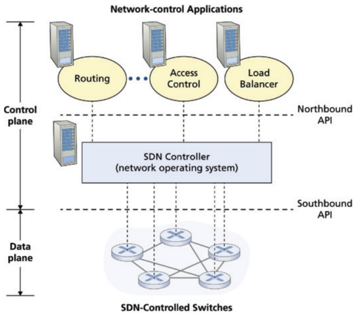

Hình 5.14 Các thành phần của kiến trúc SDN: các switch SDN-controlled, controller SDN, các ứng dụng network-control

• Một control plane mạng có thể lập trình (A programmable network control plane). Control plane mạng có thể lập trình được thông qua các ứng dụng network-control chạy trong control plane. Các ứng dụng này đại diện cho “bộ não” của control plane SDN, dùng các API do controller SDN cung cấp để chỉ định và điều khiển data plane trong các thiết bị mạng. Ví dụ, một ứng dụng network-control định tuyến có thể xác định các đường end-end giữa nguồn và đích (ví dụ, bằng cách thực thi thuật toán Dijkstra dùng thông tin node-state và link-state được controller SDN duy trì). Một ứng dụng mạng khác có thể thực hiện kiểm soát truy cập, tức là, xác định packet nào sẽ bị chặn tại một switch, như trong ví dụ thứ ba ở Mục 4.4.3. Thêm một ứng dụng khác có thể cho switch chuyển tiếp packet theo cách thực hiện cân bằng tải server (ví dụ thứ hai mà chúng ta đã xét trong Mục 4.4.3).

Từ thảo luận này, chúng ta có thể thấy SDN đại diện cho một sự “tách gói” (unbundling) đáng kể chức năng mạng—switch data plane, controller SDN và ứng dụng network-control là các thực thể riêng biệt mà mỗi thực thể có thể được cung cấp bởi các nhà cung cấp và tổ chức khác nhau. Điều này trái ngược với mô hình pre-SDN (trước SDN) trong đó một switch/router (cùng với phần mềm control plane nhúng và các bản triển khai giao thức) là một khối, tích hợp dọc, và được bán bởi một nhà cung cấp duy nhất. Sự tách gói chức năng mạng này trong SDN được so sánh với sự tiến hóa trước đây từ máy tính mainframe (nơi phần cứng, phần mềm hệ thống và ứng dụng được cung cấp bởi một nhà cung cấp duy nhất) sang máy tính cá nhân (với phần cứng, hệ điều hành và ứng dụng riêng biệt). Sự tách gói phần cứng máy tính, phần mềm hệ thống và ứng dụng đã dẫn tới một hệ sinh thái mở, phong phú được thúc đẩy bởi đổi mới trong cả ba lĩnh vực này; một hy vọng cho SDN là nó sẽ tiếp tục thúc đẩy và cho phép sự đổi mới phong phú như vậy.

Với hiểu biết về kiến trúc SDN trong Hình 5.14, nhiều câu hỏi tự nhiên nảy sinh. Flow table thực sự được tính ở đâu và như thế nào? Các bảng này được cập nhật thế nào để phản hồi các sự kiện tại các thiết bị SDN-controlled (ví dụ, một liên kết gắn kèm lên/xuống)? Và các mục flow table tại nhiều switch được phối hợp thế nào để dẫn tới chức năng network-wide được điều phối và nhất quán (ví dụ, các đường end-to-end để chuyển tiếp packet từ nguồn tới đích, hoặc các firewall phân tán được phối hợp)? Đó là vai trò của control plane SDN để cung cấp những khả năng này, và nhiều khả năng khác.

### 5.5.1 Control plane SDN: controller SDN và các ứng dụng điều khiển mạng SDN (The SDN Control Plane: SDN Controller and SDN Network-control Applications)

Hãy bắt đầu thảo luận về control plane SDN một cách trừu tượng, bằng việc xét các khả năng chung mà control plane phải cung cấp. Như chúng ta sẽ thấy, cách tiếp cận trừu tượng, “từ nguyên lý cơ bản” này sẽ dẫn chúng ta tới một kiến trúc tổng thể phản ánh cách các control plane SDN đã được triển khai trong thực tế. Như đã lưu ý ở trên, control plane SDN chia tổng quát thành hai thành phần—controller SDN và các ứng dụng network-control SDN. Hãy khám phá controller trước. Mặc dù nhiều controller SDN khác nhau đã được phát triển [Kreutz 2015] kể từ controller SDN đầu tiên [Gude 2008], cấu trúc của chúng có thể được tổ chức tổng quát thành ba tầng. Hãy xét các tầng này theo kiểu bottom-up (từ dưới lên) khác thường:

• Một tầng giao tiếp: giao tiếp giữa controller SDN và các thiết bị mạng được điều khiển (A communication layer). Rõ ràng, nếu một controller SDN sẽ điều khiển hoạt động của một switch, host hoặc thiết bị khác SDN-enabled ở xa, cần một giao thức để truyền thông tin giữa controller và thiết bị đó. Ngoài ra, một thiết bị phải có khả năng giao tiếp các sự kiện locally-observed (quan sát cục bộ) tới controller (ví dụ, một thông điệp cho biết một liên kết gắn kèm đã lên hoặc xuống, một thiết bị vừa tham gia mạng, hoặc một heartbeat cho biết một thiết bị đang chạy và hoạt động). Các sự kiện này cung cấp cho controller SDN một cái nhìn up-to-date về trạng thái mạng. Giao thức này tạo thành tầng thấp nhất của kiến trúc controller, như minh họa trong Hình 5.15. Việc giao tiếp giữa controller và các thiết bị được điều khiển đi qua cái được gọi là giao diện “southbound” (hướng nam) của controller. Trong Mục 5.5.2, chúng ta sẽ nghiên cứu OpenFlow—một giao thức cụ thể cung cấp chức năng giao tiếp này. OpenFlow được triển khai trong hầu hết, nếu không phải tất cả, các controller SDN.

• Một tầng state-management (quản lý trạng thái) network-wide. Các quyết định điều khiển cuối cùng do control plane SDN đưa ra—ví dụ, cấu hình flow table trong mọi switch để đạt chuyển tiếp end-end mong muốn, để triển khai cân bằng tải, hoặc để triển khai một khả năng firewall cụ thể—sẽ yêu cầu controller có thông tin up-to-date về trạng thái của host, liên kết, switch và các thiết bị SDN-controlled khác của mạng. Flow table của một switch chứa các bộ đếm có giá trị cũng có thể được các ứng dụng network-control sử dụng có lợi; do đó các giá trị này nên có sẵn cho các ứng dụng. Vì mục tiêu cuối cùng của control plane là xác định flow table cho các thiết bị được điều khiển khác nhau, một controller cũng có thể duy trì một bản sao các bảng này. Các mẩu thông tin này đều là ví dụ về “trạng thái” network-wide được controller SDN duy trì.

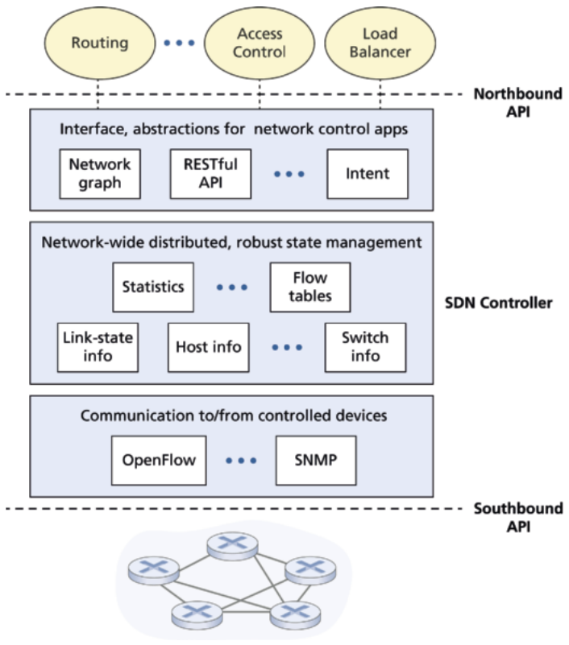

Hình 5.15 Các thành phần của một controller SDN

• Giao diện tới tầng ứng dụng điều khiển mạng (The interface to the network-control application layer). Controller tương tác với các ứng dụng network-control qua giao diện “northbound” (hướng bắc) của nó. API này cho phép các ứng dụng network-control đọc/ghi trạng thái mạng và flow table trong tầng state-management. Ứng dụng có thể đăng ký để được thông báo khi các sự kiện state-change (thay đổi trạng thái) xảy ra, để chúng có thể hành động để phản hồi các thông báo sự kiện mạng gửi từ các thiết bị SDN-controlled. Có thể cung cấp các loại API khác nhau; chúng ta sẽ thấy hai controller SDN phổ biến giao tiếp với ứng dụng của chúng dùng một giao diện request-response REST [Fielding 2000].

Chúng tôi đã lưu ý vài lần rằng một controller SDN có thể được coi là “tập trung về logic,” tức là, controller có thể được nhìn từ bên ngoài (ví dụ, từ góc nhìn của các thiết bị SDN-controlled và các ứng dụng network-control bên ngoài) như một dịch vụ một khối duy nhất. Tuy nhiên, các dịch vụ này và các cơ sở dữ liệu dùng để giữ thông tin trạng thái được triển khai trong thực tế bởi một tập server phân tán vì lý do chịu lỗi, tính sẵn sàng cao, hoặc performance. Với các chức năng controller được triển khai bởi một tập server, ngữ nghĩa của các hoạt động nội bộ của controller (ví dụ, duy trì thứ tự thời gian logic của sự kiện, tính nhất quán, đồng thuận, và hơn nữa) phải được xét đến [Panda 2013; Ferguson 2021]. Những mối quan tâm như vậy phổ biến trong nhiều hệ thống phân tán khác nhau; xem [Lamport 1989, Lampson 1996] để có các giải pháp thanh lịch cho những thách thức này. Các controller hiện đại như ONOS [ONOS 2025] và ORION [Ferguson 2021] (xem khung bên) đã đặt trọng tâm đáng kể vào việc kiến trúc một nền tảng controller tập trung về logic nhưng phân tán về vật lý, cung cấp các dịch vụ có khả năng mở rộng và tính sẵn sàng cao cho cả thiết bị được điều khiển lẫn ứng dụng network-control.

Kiến trúc mô tả trong Hình 5.15 rất giống kiến trúc của controller NOX được đề xuất ban đầu năm 2008 [Gude 2008], cũng như kiến trúc của các controller ngày nay (xem khung bên). Chúng ta sẽ đề cập một ví dụ về hoạt động controller trong Mục 5.5.3. Tuy nhiên, trước hết hãy xem xét giao thức OpenFlow, giao thức sớm nhất và giờ là một trong nhiều giao thức có thể được dùng để giao tiếp giữa một controller SDN và một thiết bị được điều khiển, nằm trong tầng giao tiếp của controller.

### 5.5.2 Giao thức OpenFlow (OpenFlow Protocol)

Giao thức OpenFlow [OpenFlow 2025] hoạt động giữa một controller SDN và một switch SDN-controlled hoặc thiết bị khác triển khai OpenFlow API mà chúng ta đã nghiên cứu trước đó trong Mục 4.4. Giao thức OpenFlow hoạt động trên TCP, với số port mặc định 6653.

Trong số các thông điệp quan trọng đi từ controller tới switch được điều khiển có:

• Cấu hình (Configuration). Thông điệp này cho phép controller truy vấn và đặt các tham số cấu hình của switch.

• Modify-State. Thông điệp này được controller dùng để thêm/xóa hoặc sửa đổi các mục trong flow table của switch, và để đặt thuộc tính port của switch.

• Read-State. Thông điệp này được controller dùng để thu thập thống kê và giá trị bộ đếm từ flow table và các port của switch.

• Send-Packet. Thông điệp này được controller dùng để gửi một packet cụ thể ra một port chỉ định tại switch được điều khiển. Bản thân thông điệp chứa packet cần gửi trong payload.

Trong số các thông điệp đi từ switch SDN-controlled tới controller có:

• Flow-Removed. Thông điệp này thông báo cho controller rằng một mục flow table đã bị xóa, ví dụ do timeout hoặc là kết quả của một thông điệp modify-state nhận được.

• Port-status. Thông điệp này được switch dùng để thông báo cho controller về một thay đổi trạng thái port.

• Packet-in. Nhớ lại từ Mục 4.4 rằng một packet tới một port switch và không khớp mục flow table nào được gửi tới controller để xử lý thêm. Các packet khớp cũng có thể được gửi tới controller, như một hành động được thực hiện khi khớp. Thông điệp packet-in được dùng để gửi các packet như vậy tới controller.

### 5.5.3 Tương tác data plane và control plane: một ví dụ (Data and Control Plane Interaction: An Example)

Để củng cố hiểu biết về tương tác giữa các switch SDN-controlled và controller SDN, hãy xét ví dụ minh họa trong Hình 5.16, trong đó thuật toán Dijkstra (mà chúng ta đã nghiên cứu trong Mục 5.2) được dùng để xác định các tuyến đường ngắn nhất. Kịch bản SDN trong Hình 5.16 có hai khác biệt quan trọng so với kịch bản per-router-control trước đó ở Mục 5.2.1 và 5.3, trong đó thuật toán Dijkstra được triển khai trong mỗi router và các cập nhật link-state được làm ngập giữa mọi router mạng:

• Thuật toán Dijkstra được thực thi như một ứng dụng riêng, bên ngoài các packet switch.

• Các packet switch gửi cập nhật liên kết tới controller SDN chứ không tới nhau.

Trong ví dụ này, hãy giả sử liên kết giữa switch s1 và s2 bị sập; rằng định tuyến đường ngắn nhất được triển khai, và do đó các quy tắc chuyển tiếp luồng vào và ra tại s1, s3 và s4 bị ảnh hưởng, nhưng hoạt động của s2 không đổi. Cũng giả sử OpenFlow được dùng làm giao thức tầng giao tiếp, và control plane không thực hiện chức năng nào khác ngoài định tuyến link-state.

1. Switch s1, gặp sự cố liên kết giữa nó và s2, thông báo cho controller SDN về thay đổi link-state bằng thông điệp port-status của OpenFlow.

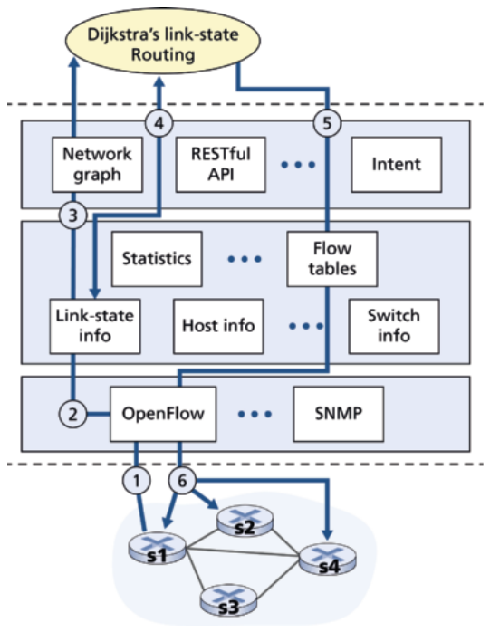

Hình 5.16 Kịch bản controller SDN: Thay đổi link-state

2. Controller SDN nhận thông điệp OpenFlow cho biết thay đổi link-state, và thông báo cho link-state manager (bộ quản lý trạng thái liên kết), bộ này cập nhật một cơ sở dữ liệu link-state.

3. Ứng dụng network-control triển khai định tuyến link-state Dijkstra trước đó đã đăng ký để được thông báo khi trạng thái liên kết thay đổi. Ứng dụng đó nhận thông báo về thay đổi link-state.

4. Ứng dụng định tuyến link-state tương tác với link-state manager để lấy trạng thái liên kết đã cập nhật; nó cũng có thể tham khảo các thành phần khác trong tầng state-management. Sau đó nó tính các đường least-cost mới.

5. Ứng dụng định tuyến link-state sau đó tương tác với flow table manager (bộ quản lý flow table), bộ này xác định các flow table cần cập nhật.

6. Flow table manager sau đó dùng giao thức OpenFlow để cập nhật các mục flow table tại các switch bị ảnh hưởng—s1 (giờ sẽ định tuyến packet hướng tới s2 qua s4), s2 (giờ sẽ bắt đầu nhận packet từ s1 qua switch trung gian s4), và s4 (giờ phải chuyển tiếp packet từ s1 hướng tới s2).

Ví dụ này đơn giản nhưng minh họa cách control plane SDN cung cấp các dịch vụ control-plane (trong trường hợp này, định tuyến network-layer) mà trước đây được triển khai bằng điều khiển per-router thực hiện trong mỗi router mạng. Giờ người ta có thể dễ dàng thấy một ISP SDN-enabled có thể dễ dàng chuyển từ định tuyến đường least-cost sang một cách tiếp cận định tuyến hand-tailored (được may đo thủ công) hơn như thế nào. Thật vậy, vì controller có thể tùy biến flow table theo ý muốn, nó có thể triển khai bất kỳ dạng chuyển tiếp nào nó muốn—đơn giản bằng cách thay đổi phần mềm application-control (điều khiển ứng dụng) của nó. Sự dễ dàng thay đổi này nên được đối chiếu với trường hợp control plane per-router truyền thống, nơi phần mềm trong mọi router (có thể được nhiều nhà cung cấp độc lập cung cấp cho ISP) phải được thay đổi.

### Nguyên lý trong thực tế (Principles in Practice)

### Nghiên cứu tình huống về controller SDN: ONOS và Orion (SDN Controller Case Studies: The ONOS and Orion Controllers)

Trong những ngày đầu của SDN, có một giao thức SDN duy nhất (OpenFlow [McKeown 2008; OpenFlow 2025]) và một controller SDN duy nhất (NOX [Gude 2008]). Từ đó, số lượng controller SDN nói riêng đã tăng đáng kể [Kreutz 2015].

Một số controller SDN là company-specific (riêng của công ty) và độc quyền, đặc biệt khi được dùng để điều khiển các mạng độc quyền nội bộ (ví dụ, bên trong hoặc giữa các data center của một công ty). Trong khung bên này chúng tôi mô tả hai controller SDN minh họa cách nguyên lý tập trung về logic được triển khai trong thực tế.

#### Controller ONOS (The ONOS Controller)

Open Network Operating System (ONOS<sup>®</sup>) [ONOS 2025] là một controller SDN open-source được tạo ra, phân phối và hỗ trợ bởi Open Networking Foundation [OpenNetworking 2025]. Hình 5.17 trình bày một cái nhìn đơn giản hóa về controller ONOS. Tương tự controller kinh điển trong Hình 5.15, có thể xác định ba tầng trong controller ONOS:

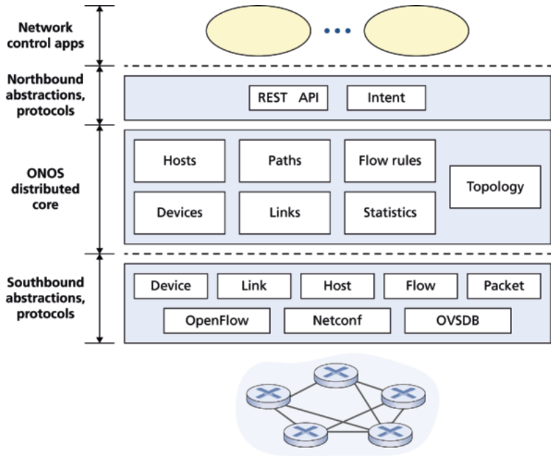

Hình 5.17 Kiến trúc controller ONOS

• Các trừu tượng và giao thức northbound (Northbound abstractions and protocols). Một đặc điểm độc đáo của ONOS là intent framework (khung ý định) của nó, cho phép một ứng dụng yêu cầu một dịch vụ high-level (ví dụ, thiết lập một kết nối giữa host A và Host B, hoặc ngược lại không cho phép Host A và host B giao tiếp) mà không cần biết chi tiết dịch vụ này được thực hiện thế nào. Thông tin trạng thái được cung cấp cho các ứng dụng network-control qua northbound API hoặc đồng bộ (qua truy vấn) hoặc bất đồng bộ (qua listener callback, ví dụ, khi trạng thái mạng thay đổi).

• Lõi phân tán (Distributed core). Trạng thái các liên kết, host và thiết bị của mạng được duy trì trong lõi phân tán của ONOS. ONOS được triển khai như một dịch vụ trên một tập server được nối với nhau, với mỗi server chạy một bản sao giống hệt của phần mềm ONOS; số server tăng mang lại dung lượng dịch vụ tăng. Lõi ONOS cung cấp các cơ chế nhân bản dịch vụ và phối hợp giữa các instance, cung cấp cho các ứng dụng bên trên và thiết bị mạng bên dưới trừu tượng các dịch vụ lõi tập trung về logic.

• Các trừu tượng và giao thức southbound (Southbound abstractions and protocols). Các trừu tượng southbound che giấu tính không đồng nhất của các host, liên kết, switch và giao thức bên dưới, cho phép lõi phân tán độc lập với cả thiết bị lẫn giao thức. Nhờ trừu tượng này, giao diện southbound bên dưới lõi phân tán ở mức logic cao hơn so với controller kinh điển của chúng ta trong Hình 5.14.

#### Orion

Orion [Ferguson 2021] là nền tảng SDN second-generation (thế hệ thứ hai) được dùng để điều khiển các mạng datacenter Jupiter của Google [Singh 2015] cũng như mạng wide-area B4 nội bộ [Jain 2013] kết nối toàn cầu các data center này. Hình 5.18 trình bày một cái nhìn high-level về Orion. Cấu trúc tổng thể và bối cảnh của Orion rất giống ONOS, minh họa trong Hình 5.17. Thật vậy, những người tạo ra Orion lưu ý [Ferguson 2021] rằng “kiến trúc của Orion . . . ánh xạ tới góc nhìn ONF trong sách giáo khoa” [ONF 2013]. Chúng ta thấy lõi Orion SDN ở trung tâm Hình 5.18, với một giao diện northbound tới các ứng dụng Orion, và một giao diện southbound tới các router và switch Orion-controlled. Nhưng chúng ta có thể tìm thấy nhiều khác biệt quan trọng so với ONOS bên dưới cái nhìn high-level chung này.

Mỗi mạng Google được chia thành một hoặc nhiều miền (domain), với một instance controller Orion SDN chịu trách nhiệm quản lý và điều khiển các thiết bị trong miền của nó. Việc dùng miền cố ý giới hạn phạm vi và tác động của bất kỳ sự cố nào, cũng như lượng công việc mà một controller Orion phải thực hiện.

Cốt lõi của lõi Orion là Network Information Base (NIB). NIB là một kho dữ liệu tập trung về logic, kết hợp với một hệ thống publication/subscribe (pub/sub) data-driven (hướng dữ liệu) cho phép các ứng dụng Orion và các thành phần lõi đọc/ghi dữ liệu NIB, cũng như nhận thông báo khi dữ liệu NIB thay đổi. Một kho dữ liệu tập trung về logic cũng có ưu điểm sắp thứ tự toàn cục các sự kiện mạng, giúp đáng kể cho việc debug và trouble-shooting (xử lý sự cố). [Ferguson 2021] lưu ý “Dựa trên nhiều năm kinh nghiệm, NIB là một trong những yếu tố thiết kế thành công nhất của chúng tôi.” Một Orion NIB có thể xử lý khoảng một triệu sự kiện đọc/ghi mỗi giây.

Các thành phần sau, được triển khai dưới dạng microservice, có trong lõi Orion:

• Topology Manager duy trì trạng thái của các liên kết, router và switch trong miền của controller Orion. Nó cũng truy vấn và nhận thống kê port lúc chạy.

• Config Manager cấu hình các thành phần trong miền của controller Orion bằng cách đặt các thuộc tính tham số cấu hình trong bảng NIB. Config Manager cũng có thể kiểm tra và xác nhận tính đúng đắn của cấu hình.

• Flow Manager đảm bảo trạng thái và hành vi mạng dự định được các ứng dụng đăng ký trong NIB khớp với trạng thái tập thể do các thiết bị được điều khiển báo cáo, và thực hiện đối soát trạng thái luồng, khi cần. Các ứng dụng Orion nằm trên lõi Orion và tương tác với nhau và với các thành phần Orion khác qua NIB. Routing Engine là ứng dụng định tuyến intra-domain (nội miền), và cung cấp thông tin topology trừu tượng và khả năng tiếp cận cần cho các ứng dụng định tuyến liên miền, ví dụ, Raven, và các ứng dụng định tuyến spline datacenter, ví dụ, IBR-C. Ứng dụng TE minh họa trong Hình 5.18 thực hiện kỹ thuật traffic và ứng dụng Path Exporter xuất trạng thái data-plane tới các dịch vụ bên ngoài Orion. Orion cho phép một cách tiếp cận quản lý và điều khiển mạng gọi là intent-based networking (mạng dựa trên ý định). [Ferguson 2021] lưu ý rằng “Các mạng Intent-based chỉ định các thay đổi quản lý hoặc thiết kế bằng cách mô tả end-state (trạng thái cuối) dự định mới của mạng (“cái gì”) thay vì quy định chuỗi sửa đổi để đưa mạng tới end-state đó (“như thế nào”). Ví dụ, topology mạng dự định được chỉ định dưới dạng một mô hình trừu tượng [Mogul 2020]. Đây là ý định high-level và có thẩm quyền ở chỗ nó khi đó yêu cầu các ứng dụng mạng lower-level (mức thấp hơn) (ví dụ, kích hoạt liên kết, ứng dụng định tuyến) giám sát, đặt và thay đổi cấu hình của chúng để ý định high-level này được đáp ứng. Do đó ý định lan truyền top-down (từ trên xuống) và ổn định ở các thang thời gian dài hơn; trạng thái mạng, và các thay đổi cần để đối soát trạng thái mạng với ý định high-level xảy ra từ dưới lên và thay đổi nhanh hơn khi điều kiện mạng thay đổi. Ý định, thiết lập cấu hình và trạng thái thiết bị được giám sát đều được lưu trong NIB, và cơ chế pub/sub của NIB được dùng để thông báo cho ứng dụng khi chúng cần hành động để phản hồi một giá trị NIB đã thay đổi. Để có thảo luận về intent-based networking của Orion, xem [Ferguson 2021].

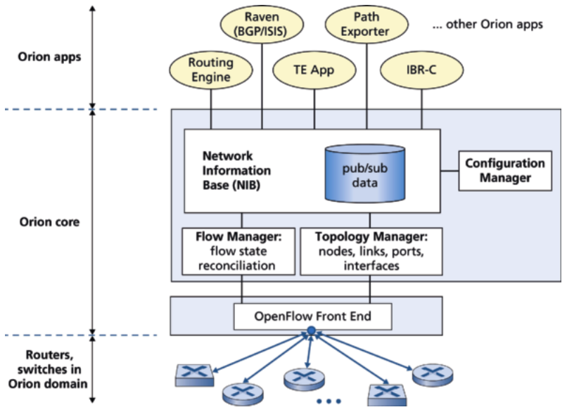

Hình 5.18 Orion SDN của Google

### 5.5.4 SDN: Quá khứ và tương lai (SDN: Past and Future)

Mặc dù sự quan tâm mạnh mẽ tới SDN là một hiện tượng tương đối gần đây, một số gốc rễ kỹ thuật của SDN—đặc biệt là việc tách data plane và control plane—có từ lâu hơn đáng kể. ARPAnet, tổ tiên của Internet ngày nay, cố ý nhấn mạnh một cách tiếp cận protocol-based (dựa trên giao thức) phi tập trung đối với điều khiển mạng. Tuy nhiên, hai mạng dữ liệu khác từ đầu những năm 1970’s hoàn toàn theo điều khiển tập trung và tách rõ data plane và control plane. TYMNET I [Tymes 1981] là một mạng dữ liệu virtual-circuit (mạch ảo) có một controller tập trung với một mạng điều khiển tree-based (dạng cây) tách biệt về vật lý nối các phần điều khiển của các nút TYMNET tới controller tập trung ở gốc cây. Tuy nhiên, data-plane của các nút TYMNET I có thể được nối theo một topology lưới tùy ý. Mạng Spider của AT&T [Fraser 1993] cũng có sự tách biệt rõ ràng data/control-plane, với một mạch ảo chuyên dụng dành để gửi thông điệp điều khiển tới/từ một nút và controller tập trung.

Trong những năm 1990s và sang những năm 2000s, việc tách data/control plane lại trở thành tâm điểm. [van der Merwe 1998] mô tả một khung điều khiển cho mạng ATM [Black 1995] với nhiều controller, mỗi controller điều khiển một số switch ATM. Năm 2004, [Feamster 2004; Lakshman 2004; RFC 3746] đều lập luận cho việc tách data plane và control plane của mạng. Ngoài điều khiển logically- centralized (tập trung về logic) và tách data/control plane, các thuộc tính khác thường gắn với SDN bao gồm ảo hóa mạng, phần mềm hóa (softwareization) và khả năng lập trình. [Feamster 2014; Anenousis 2021] đều đi sâu vào lịch sử các khái niệm nền tảng của SDN.

Dự án Ethane [Casado 2007] đã tiên phong khái niệm một mạng gồm các switch Ethernet flow-based đơn giản với flow table match-plus-action, một controller tập trung quản lý việc chấp nhận luồng và định tuyến, và việc chuyển tiếp các packet không khớp từ switch tới controller. Một mạng hơn 300 switch Ethane đã hoạt động năm 2007. Ethane nhanh chóng phát triển thành dự án OpenFlow, và phần còn lại (như người ta nói) là lịch sử!

Nhiều nỗ lực nghiên cứu nhằm phát triển các kiến trúc và khả năng SDN tương lai. Như chúng ta đã thấy, cuộc cách mạng SDN đang dẫn tới việc thay thế mang tính đột phá các switch và router một khối chuyên dụng (với cả data plane và control plane) bằng phần cứng chuyển mạch phổ thông đơn giản và một control plane phần mềm tinh vi. Một tổng quát hóa của SDN gọi là ảo hóa chức năng mạng (network functions virtualization - NFV) (mà chúng ta đã thảo luận trước đó trong Mục 4.5) tương tự nhằm thay thế đột phá các middlebox tinh vi (như middlebox có phần cứng chuyên dụng và phần mềm độc quyền cho cache/dịch vụ media) bằng các server, chuyển mạch và lưu trữ phổ thông đơn giản. Một thách thức quan trọng khác là cấu trúc các controller SDN để bền vững trước sự cố (ví dụ, router hoặc máy tính bị sập, mất kết nối) và có khả năng phục hồi nhanh khi sự cố xảy ra [Ferguson 2021; Krentsel 2024].

## 5.6 ICMP: Internet Control Message Protocol (ICMP: The Internet Control Message Protocol)

Internet Control Message Protocol (ICMP), được đặc tả trong [RFC 792], được host và router dùng để giao tiếp thông tin network-layer với nhau. Công dụng điển hình nhất của ICMP là báo lỗi. Ví dụ, khi chạy một phiên HTTP, có thể bạn đã gặp một thông điệp lỗi như “Destination network unreachable.” Thông điệp này có nguồn gốc từ ICMP. Tại một thời điểm nào đó, một router IP không thể tìm được đường tới host được chỉ định trong yêu cầu HTTP của bạn. Router đó đã tạo và gửi một thông điệp ICMP tới host của bạn cho biết lỗi.

ICMP thường được coi là một phần của IP, nhưng về kiến trúc nó nằm ngay trên IP, vì thông điệp ICMP được mang bên trong IP datagram. Tức là, thông điệp ICMP được mang như payload IP, giống như segment TCP hoặc UDP được mang như payload IP. Tương tự, khi một host nhận một IP datagram có ICMP được chỉ định là giao thức upper-layer (số giao thức upper-layer là 1), nó phân kênh nội dung của datagram tới ICMP, giống như nó sẽ phân kênh nội dung của datagram tới TCP hoặc UDP.

Thông điệp ICMP có một trường type và một trường code, và chứa header và 8 byte đầu tiên của IP datagram đã khiến thông điệp ICMP được tạo ra ngay từ đầu (để bên gửi có thể xác định datagram đã gây ra lỗi). Một số loại thông điệp ICMP được chọn được minh họa trong Hình 5.19. Lưu ý rằng thông điệp ICMP không chỉ được dùng để báo hiệu tình trạng lỗi.

Chương trình ping well-known gửi một thông điệp ICMP type 8 code 0 tới host được chỉ định. Host đích, thấy echo request, gửi lại một ICMP echo reply type 0 code 0. Hầu hết các bản triển khai TCP/IP hỗ trợ ping server trực tiếp trong hệ điều hành; tức là, server không phải là một process. Chương 11 của [Stevens 1990] cung cấp mã nguồn cho chương trình ping client. Lưu ý rằng chương trình client cần có khả năng chỉ dẫn hệ điều hành tạo một thông điệp ICMP type 8 code 0.

Trong Chương 1, chúng ta đã giới thiệu chương trình Traceroute, cho phép chúng ta lần theo một tuyến từ một host tới bất kỳ host nào khác trên thế giới. Thú vị là, Traceroute được triển khai bằng thông điệp ICMP. Để xác định tên và địa chỉ của các router giữa nguồn và đích, Traceroute ở nguồn gửi một loạt IP datagram thông thường tới đích. Mỗi datagram này mang một segment UDP với một số port UDP khó có khả năng được dùng. Datagram đầu tiên có TTL bằng 1, datagram thứ hai bằng 2, thứ ba bằng 3, v.v. Nguồn cũng khởi động timer cho mỗi datagram. Khi datagram thứ n tới router thứ n, router thứ n nhận thấy TTL của datagram vừa hết hạn. Theo quy tắc của giao thức IP, router phải loại bỏ một datagram khi TTL của datagram đã hết hạn. Ngoài ra, router thường gửi một thông điệp cảnh báo ICMP tới nguồn (type 11 code 0). Thông điệp cảnh báo này bao gồm tên của router và địa chỉ IP của nó. Khi thông điệp ICMP này về tới nguồn, nguồn lấy được round-trip time từ timer và tên cùng địa chỉ IP của router thứ n từ thông điệp ICMP.

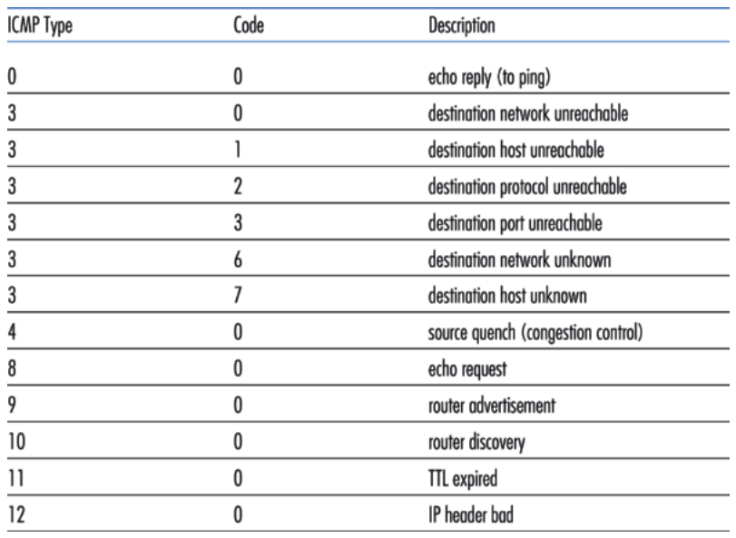

Hình 5.19 Các loại thông điệp ICMP

Làm sao một nguồn Traceroute biết khi nào dừng gửi segment UDP? Nhớ rằng nguồn tăng trường TTL cho mỗi datagram nó gửi. Do đó, một trong các datagram cuối cùng sẽ đi được tới tận host đích. Vì datagram này chứa một segment UDP với một số port khó có khả năng được dùng, host đích gửi một thông điệp ICMP port unreachable (type 3 code 3) về nguồn. Khi host nguồn nhận thông điệp ICMP cụ thể này, nó biết nó không cần gửi thêm packet thăm dò. (Chương trình Traceroute chuẩn thực ra gửi các bộ ba packet có cùng TTL; do đó, đầu ra Traceroute cung cấp ba kết quả cho mỗi TTL.)

Bằng cách này, host nguồn biết được số lượng và danh tính các router nằm giữa nó và host đích và round-trip time giữa hai host. Lưu ý rằng chương trình client Traceroute phải có khả năng chỉ dẫn hệ điều hành tạo datagram UDP với giá trị TTL cụ thể và cũng phải có khả năng được hệ điều hành thông báo khi thông điệp ICMP tới. Giờ bạn đã hiểu Traceroute hoạt động thế nào, có thể bạn muốn quay lại thử nghịch nó thêm.

Một phiên bản ICMP mới đã được định nghĩa cho IPv6 trong RFC 4443. Ngoài việc tổ chức lại các định nghĩa type và code ICMP hiện có, ICMPv6 cũng thêm các type và code mới cần cho chức năng IPv6 mới. Chúng bao gồm type “Packet Too Big” và mã lỗi “unrecognized IPv6 options”.

## 5.7 Quản lý mạng và SNMP, NETCONF/YANG (Network Management and SNMP, NETCONF/YANG)

Giờ đã tới cuối nghiên cứu về tầng mạng, chỉ còn link-layer phía trước, chúng ta đã biết rõ rằng một mạng gồm nhiều phần cứng và phần mềm phức tạp, tương tác—từ các liên kết, switch, router, host và các thiết bị khác tạo nên các thành phần vật lý của mạng tới nhiều giao thức điều khiển và phối hợp các thiết bị này. Khi hàng trăm hoặc hàng nghìn thành phần như vậy được một tổ chức tập hợp lại để tạo thành một mạng, công việc của quản trị viên mạng để giữ mạng “hoạt động” chắc chắn là một thách thức. Chúng ta đã thấy trong Mục 5.5 rằng controller tập trung về logic có thể giúp quá trình này trong bối cảnh SDN. Nhưng thách thức quản lý mạng đã có từ lâu trước SDN, với một tập phong phú các công cụ và cách tiếp cận quản lý mạng giúp quản trị viên mạng giám sát, quản lý và điều khiển mạng. Chúng ta sẽ nghiên cứu các công cụ và kỹ thuật này trong mục này, cũng như các công cụ và kỹ thuật mới đã co-evolved (đồng tiến hóa) cùng với SDN.

Một câu hỏi often-asked là “Quản lý mạng là gì?” Một định nghĩa well-conceived (được cân nhắc kỹ), single-sentence (một câu) (dù là một câu run-on (dài lê thê) khá dài) về quản lý mạng từ [Saydam 1996] là:

Quản lý mạng bao gồm việc triển khai, tích hợp và phối hợp phần cứng, phần mềm và các yếu tố con người để giám sát, kiểm tra, thăm dò, cấu hình, phân tích, đánh giá và điều khiển mạng và tài nguyên phần tử nhằm đáp ứng các yêu cầu real-time, performance vận hành và Chất lượng Dịch vụ (Quality of Service) với chi phí hợp lý.

Với định nghĩa rộng này, chúng ta sẽ chỉ đề cập những điều sơ đẳng của quản lý mạng trong mục này—kiến trúc, giao thức và dữ liệu được quản trị viên mạng dùng khi thực hiện nhiệm vụ của họ. Chúng ta sẽ không đề cập các quá trình decision-making (ra quyết định) của quản trị viên, nơi các chủ đề như xác định lỗi [Labovitz 1997; Steinder 2002; Feamster 2005; Wu 2005; Teixeira 2006], phát hiện bất thường [Lakhina 2005; Barford 2009], thiết kế/kỹ thuật mạng để đáp ứng các Thỏa thuận Mức Dịch vụ (Service Level Agreement - SLA’s) đã ký [Huston 1999a], và hơn nữa được xét đến. Do đó trọng tâm của chúng ta cố ý hẹp; độc giả quan tâm nên tham khảo các tài liệu này, các tổng quan xuất sắc trong [Subramanian 2000; Schonwalder 2010; Claise 2019], và cách trình bày chi tiết hơn về quản lý mạng có trên Web site của cuốn sách này.

### 5.7.1 Khung quản lý mạng (The Network Management Framework)

Hình 5.20 cho thấy các thành phần then chốt của quản lý mạng:

• Server quản lý (Managing server). Server quản lý là một ứng dụng, thường có người quản lý mạng (con người) tham gia, chạy trong một trạm quản lý mạng tập trung trong trung tâm vận hành mạng (network operations center - NOC). Server quản lý là trung tâm hoạt động của quản lý mạng: nó điều khiển việc thu thập, xử lý, phân tích và điều phối thông tin và lệnh quản lý mạng. Chính ở đây các hành động được khởi tạo để cấu hình, giám sát và điều khiển các thiết bị được quản lý của mạng. Trong thực tế, một mạng có thể có vài server quản lý như vậy.

• Thiết bị được quản lý (Managed device). Một thiết bị được quản lý là một thiết bị mạng (bao gồm phần mềm của nó) nằm trên một mạng được quản lý. Một thiết bị được quản lý có thể là một host, router, switch, middlebox, modem, nhiệt kế, hoặc thiết bị network-connected khác. Bản thân thiết bị sẽ có nhiều thành phần có thể quản lý (ví dụ, một giao diện mạng chỉ là một thành phần của một host hoặc router), và các tham số cấu hình cho các thành phần phần cứng và phần mềm này (ví dụ, một giao thức định tuyến intra-AS, như OSPF).

• Dữ liệu (Data). Mỗi thiết bị được quản lý sẽ có dữ liệu, còn gọi là “trạng thái,” gắn với nó. Có vài loại dữ liệu khác nhau. Dữ liệu cấu hình (configuration data) là thông tin thiết bị được người quản lý mạng cấu hình tường minh, ví dụ, một địa chỉ IP manager-assigned/configured (do người quản lý gán/cấu hình) hoặc tốc độ giao diện cho một giao diện thiết bị. Dữ liệu vận hành (operational data) là thông tin thiết bị thu được khi nó hoạt động, ví dụ, danh sách láng giềng trực tiếp trong giao thức OSPF. Thống kê thiết bị (device statistics) là các chỉ báo trạng thái và số đếm được cập nhật khi thiết bị hoạt động (ví dụ, số packet bị loại bỏ trên một giao diện, hoặc tốc độ quạt làm mát của thiết bị). Người quản lý mạng có thể truy vấn dữ liệu thiết bị từ xa, và trong một số trường hợp, điều khiển thiết bị từ xa bằng cách ghi giá trị dữ liệu thiết bị, như thảo luận bên dưới. Như minh họa trong Hình 5.20, server quản lý cũng duy trì bản sao riêng của dữ liệu cấu hình, vận hành và thống kê từ các thiết bị được quản lý cũng như dữ liệu network-wide (ví dụ, topology của mạng).

• Tác nhân quản lý mạng (Network management agent). Tác nhân quản lý mạng là một process phần mềm chạy trong thiết bị được quản lý giao tiếp với server quản lý, thực hiện các hành động cục bộ tại thiết bị được quản lý dưới sự chỉ huy và điều khiển của server quản lý. Tác nhân quản lý mạng tương tự tác nhân định tuyến mà chúng ta đã thấy trong Hình 5.2.

• Giao thức quản lý mạng (Network management protocol). Thành phần cuối cùng của một khung quản lý mạng là giao thức quản lý mạng. Giao thức này chạy giữa server quản lý và các thiết bị được quản lý, cho phép server quản lý truy vấn trạng thái của các thiết bị được quản lý và thực hiện hành động tại các thiết bị này qua các tác nhân của nó. Các tác nhân có thể dùng giao thức quản lý mạng để thông báo cho server quản lý về các sự kiện ngoại lệ (ví dụ, sự cố thành phần hoặc vi phạm ngưỡng performance). Điều quan trọng cần lưu ý là bản thân giao thức quản lý mạng không quản lý mạng. Thay vào đó, nó cung cấp các khả năng mà người quản lý mạng có thể dùng để quản lý (“giám sát, kiểm tra, thăm dò, cấu hình, phân tích, đánh giá và điều khiển”) mạng. Đây là một phân biệt tinh tế, nhưng quan trọng.

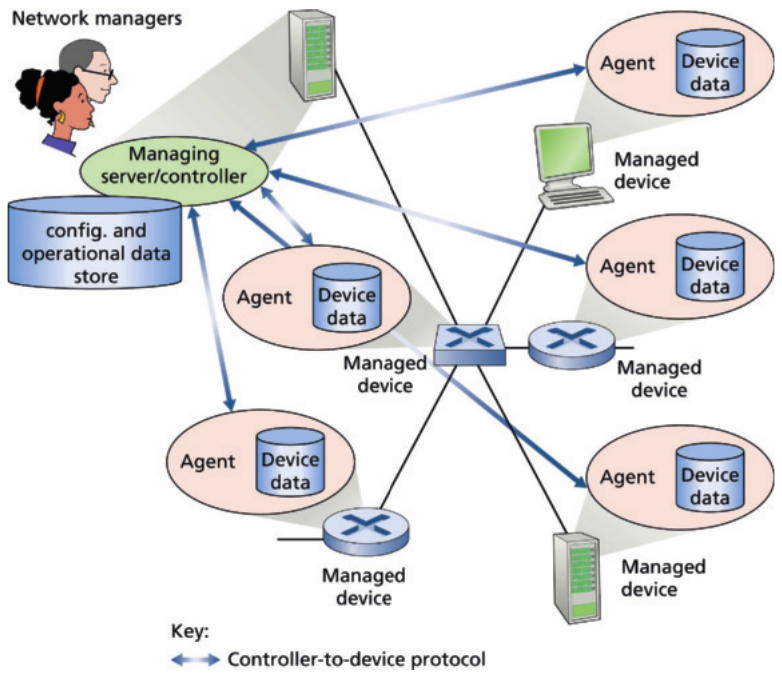

Hình 5.20 Các phần tử của quản lý mạng

Trong thực tế, có ba cách thường dùng mà một nhà vận hành mạng có thể quản lý mạng, dùng các thành phần mô tả ở trên:

• CLI. Một nhà vận hành mạng có thể đưa ra các lệnh Command Line Interface (CLI) trực tiếp tới thiết bị. Các lệnh này có thể được gõ trực tiếp trên console của thiết bị được quản lý (nếu nhà vận hành có mặt trực tiếp tại thiết bị), hoặc qua một kết nối Telnet hoặc secure shell (SSH), có thể qua script, giữa server/controller quản lý và thiết bị được quản lý. Các lệnh CLI là vendor- và device-specific (riêng theo nhà cung cấp và thiết bị) và có thể khá khó hiểu. Trong khi các phù thủy mạng dày dạn có thể dùng CLI để cấu hình thiết bị mạng hoàn hảo, việc dùng CLI dễ gây lỗi, và khó tự động hóa hoặc mở rộng hiệu quả cho các mạng lớn. Các thiết bị mạng consumer-oriented (hướng người tiêu dùng), như router không dây gia đình của bạn, có thể xuất ra một menu quản lý mà bạn (người quản lý mạng!) có thể truy cập qua HTTP để cấu hình thiết bị đó.

  Mặc dù cách tiếp cận này có thể hoạt động tốt cho các thiết bị đơn lẻ, đơn giản và ít error-prone hơn CLI, nó cũng không mở rộng được cho các mạng larger-sized (lớn hơn).

• SNMP/MIB. Trong cách tiếp cận này, nhà vận hành mạng có thể truy vấn/đặt dữ liệu chứa trong các object Management Information Base (MIB) của một thiết bị dùng Simple Network Management Protocol (SNMP). Một số MIB là device- và vendor-specific, trong khi các MIB khác (ví dụ, số IP datagram bị loại bỏ tại một router do lỗi trong header IP datagram, hoặc số segment UDP nhận được tại một host) là device-agnostic (độc lập thiết bị), cung cấp tính trừu tượng và tổng quát. Một nhà vận hành mạng thường nhất sẽ dùng cách tiếp cận này để truy vấn và giám sát trạng thái vận hành và thống kê thiết bị, rồi dùng CLI để chủ động điều khiển/cấu hình thiết bị. Chúng tôi lưu ý, quan trọng là, cả hai cách tiếp cận đều quản lý thiết bị riêng lẻ. Chúng ta sẽ đề cập SNMP và MIB, đã được dùng từ cuối những năm 1980s, trong Mục 5.7.2 bên dưới. Một hội thảo network-management do Internet Architecture Board triệu tập năm 2002 [RFC 3535] không chỉ ghi nhận giá trị của cách tiếp cận SNMP/MIB cho việc giám sát thiết bị mà còn ghi nhận các thiếu sót của nó, đặc biệt cho cấu hình thiết bị và quản lý mạng ở quy mô lớn. Điều này dẫn tới cách tiếp cận quản lý mạng gần đây nhất, dùng NETCONF và YANG.

• NETCONF/YANG. Cách tiếp cận NETCONF/YANG có cái nhìn trừu tượng hơn, network-wide và toàn diện hơn đối với quản lý mạng, với trọng tâm mạnh hơn nhiều vào quản lý cấu hình, bao gồm chỉ định các ràng buộc tính đúng đắn và cung cấp các thao tác quản lý nguyên tử trên nhiều thiết bị được điều khiển. YANG [RFC 6020] là một ngôn ngữ mô hình hóa dữ liệu được dùng để mô hình hóa dữ liệu cấu hình và vận hành. Giao thức NETCONF [RFC 6241] được dùng để truyền các hành động và dữ liệu YANG-compatible (tương thích YANG) tới/từ/giữa các thiết bị ở xa.

### 5.7.2 Simple Network Management Protocol (SNMP) và Management Information Base (MIB) (The Simple Network Management Protocol (SNMP) and the Management Information Base (MIB))

Simple Network Management Protocol phiên bản 3 (SNMPv3) [RFC 3410] là một giao thức application-layer được dùng để truyền các thông điệp điều khiển và thông tin network-management giữa một server quản lý và một tác nhân thực thi thay mặt server quản lý đó. Cách dùng SNMP phổ biến nhất là ở chế độ request-response trong đó một server quản lý SNMP gửi một yêu cầu tới một tác nhân SNMP, tác nhân nhận yêu cầu, thực hiện hành động nào đó, và gửi trả lời cho yêu cầu. Thông thường, một yêu cầu sẽ được dùng để truy vấn (lấy) hoặc sửa đổi (đặt) giá trị object MIB gắn với một thiết bị được quản lý. Cách dùng SNMP phổ biến thứ hai là để một tác nhân gửi một thông điệp không được yêu cầu, gọi là thông điệp trap, tới một server quản lý. Thông điệp trap được dùng để thông báo cho server quản lý về một tình huống ngoại lệ (ví dụ, một giao diện liên kết lên hoặc xuống) đã dẫn tới thay đổi giá trị object MIB.

Các object MIB được đặc tả trong một ngôn ngữ mô tả dữ liệu gọi là SMI (Structure of Management Information) [RFC 2578; RFC 2579; RFC 2580], một thành phần có tên khá kỳ lạ của khung quản lý mạng mà tên không gợi ý gì về chức năng của nó. Một ngôn ngữ định nghĩa hình thức được dùng để đảm bảo cú pháp và ngữ nghĩa của dữ liệu quản lý mạng được định nghĩa rõ và không mơ hồ. Các object MIB liên quan được tập hợp thành các module MIB. Tính đến cuối năm 2024, có hơn 400 RFC MIB-related và một số lượng lớn hơn nhiều module MIB vendor-specific (riêng).

SNMPv3 định nghĩa bảy loại thông điệp, được gọi chung là protocol data unit—PDU—như minh họa trong Bảng 5.2 và mô tả bên dưới.

• Các PDU GetRequest, GetNextRequest và GetBulkRequest đều được gửi từ một server quản lý tới một tác nhân để yêu cầu giá trị của một hoặc nhiều object MIB tại thiết bị được quản lý của tác nhân. Các object MIB có giá trị đang được yêu cầu được chỉ định trong phần variable binding của PDU. GetRequest, GetNextRequest và GetBulkRequest khác nhau ở độ chi tiết của yêu cầu dữ liệu. GetRequest có thể yêu cầu một tập giá trị MIB tùy ý; nhiều GetNextRequest có thể được dùng để duyệt tuần tự qua một danh sách hoặc bảng object MIB; GetBulkRequest cho phép trả về một khối dữ liệu lớn, tránh overhead phát sinh nếu nhiều thông điệp GetRequest hoặc GetNextRequest được gửi. Trong cả ba trường hợp, tác nhân phản hồi bằng một Response PDU chứa định danh object và giá trị tương ứng.

| Loại PDU (SNMPv3 PDU Type) | Sender-receiver | Mô tả (Description) |
|---|---|---|
| GetRequest | manager-to-agent | lấy giá trị của một hoặc nhiều instance object MIB |
| GetNextRequest | manager-to-agent | lấy giá trị của instance object MIB tiếp theo trong danh sách hoặc bảng |
| GetBulkRequest | manager-to-agent | lấy giá trị trong khối dữ liệu lớn, ví dụ, giá trị trong một bảng lớn |
| InformRequest | manager-to-manager | thông báo cho thực thể quản lý ở xa về giá trị MIB ở xa đối với quyền truy cập của nó |
| SetRequest | manager-to-agent | đặt giá trị của một hoặc nhiều instance object MIB |
| Response | agent-to-manager hoặc | được tạo để phản hồi |
|  | manager-to-manager | GetRequest, |
|  |  | GetNextRequest, |
|  |  | GetBulkRequest, |
|  |  | SetRequest PDU, hoặc |
|  |  | InformRequest |
| SNMPv2-Trap | agent-to-manager | thông báo cho manager về một sự kiện ngoại lệ # |

Bảng 5.2 Các loại PDU SNMPv3

• PDU SetRequest được server quản lý dùng để đặt giá trị của một hoặc nhiều object MIB trong một thiết bị được quản lý. Tác nhân trả lời bằng một Response PDU với trạng thái lỗi “noError” để xác nhận rằng giá trị thực sự đã được đặt.

• PDU InformRequest được server quản lý dùng để thông báo cho một server quản lý khác về thông tin MIB ở xa đối với server nhận.

• PDU Response thường được gửi từ thiết bị được quản lý tới server quản lý để phản hồi một thông điệp yêu cầu từ server đó, trả về thông tin được yêu cầu.

• Loại PDU SNMPv3 cuối cùng là thông điệp trap. Thông điệp trap được tạo bất đồng bộ; tức là, chúng không được tạo để phản hồi một yêu cầu nhận được mà để phản hồi một sự kiện mà server quản lý cần được thông báo. RFC 3418 định nghĩa các loại trap well-known bao gồm khởi động lạnh hoặc nóng của một thiết bị, một liên kết lên hoặc xuống, mất một láng giềng, hoặc một sự kiện xác thực thất bại. Một yêu cầu trap nhận được không cần server quản lý phản hồi.

Với bản chất request-response của SNMP, đáng lưu ý ở đây rằng mặc dù PDU SNMP có thể được mang qua nhiều giao thức giao vận khác nhau, PDU SNMP thường được mang trong payload của một UDP datagram. Thật vậy, RFC 3417 nêu rằng UDP là “ánh xạ giao vận được ưu tiên.” Tuy nhiên, vì UDP là một giao thức giao vận không tin cậy, không có đảm bảo một yêu cầu, hoặc phản hồi của nó, sẽ được nhận tại đích dự định. Thú vị là, chuẩn SNMP không bắt buộc bất kỳ thủ tục truyền lại cụ thể nào, hoặc thậm chí có truyền lại hay không ngay từ đầu. Nó chỉ yêu cầu server quản lý “cần hành động có trách nhiệm về tần suất và thời lượng truyền lại.” Điều này, tất nhiên, khiến người ta tự hỏi một giao thức “có trách nhiệm” nên hành động thế nào!

SNMP đã tiến hóa qua ba phiên bản. Các nhà thiết kế SNMPv3 đã nói rằng “SNMPv3 có thể được coi là SNMPv2 với thêm các khả năng bảo mật và quản trị” [RFC 3410]. Chắc chắn, có các thay đổi trong SNMPv3 so với SNMPv2, nhưng không đâu những thay đổi đó rõ rệt hơn trong lĩnh vực quản trị và bảo mật. Vai trò trung tâm của bảo mật trong SNMPv3 đặc biệt quan trọng, vì thiếu bảo mật đầy đủ đã dẫn tới việc SNMP được dùng chủ yếu để giám sát thay vì điều khiển (ví dụ, SetRequest hiếm khi được dùng trong SNMPv1). Một lần nữa, chúng ta thấy bảo mật—một chủ đề chúng ta sẽ đề cập chi tiết trong Chương 8 — là mối quan tâm thiết yếu, nhưng một lần nữa là mối quan tâm mà tầm quan trọng có lẽ được nhận ra hơi muộn và chỉ khi đó mới được “thêm vào.”

#### Management Information Base (MIB) (The Management Information Base (MIB))

Trước đó chúng ta đã học rằng dữ liệu trạng thái vận hành của một thiết bị được quản lý (và ở một mức độ nào đó dữ liệu cấu hình của nó) trong cách tiếp cận SNMP/MIB đối với quản lý mạng được biểu diễn dưới dạng các object được tập hợp vào một MIB cho thiết bị đó. Một object MIB có thể là một bộ đếm, như số IP datagram bị loại bỏ tại một router do lỗi trong header IP datagram; hoặc số lỗi carrier sense trong một card giao diện Ethernet; thông tin mô tả như phiên bản phần mềm chạy trên một DNS server; thông tin trạng thái như một thiết bị cụ thể có hoạt động đúng không; hoặc thông tin protocol-specific (riêng theo giao thức) như một đường định tuyến tới một đích. Các object MIB liên quan được tập hợp thành các module MIB. Có hơn 400 module MIB được định nghĩa trong các IETF RFC’s khác nhau; còn có nhiều MIB device- và vendor-specific hơn nữa. [RFC 4293] đặc tả module MIB định nghĩa các object được quản lý (bao gồm ipSystemStatsInDelivers) để quản lý các bản triển khai của Internet Protocol (IP) và Internet Control Message Protocol (ICMP) đi kèm. [RFC 4022] đặc tả module MIB cho TCP, và [RFC 4113] đặc tả module MIB cho UDP. Mặc dù các RFC MIB-related khá tẻ nhạt và khô khan để đọc, việc xét một ví dụ về object MIB vẫn bổ ích (tức là, giống như ăn rau, nó “tốt cho bạn”). Định nghĩa object-type ipSystem-StatsInDelivers từ [RFC 4293] định nghĩa một bộ đếm read-only 32-bit theo dõi số IP datagram đã được nhận tại thiết bị được quản lý và được chuyển thành công tới một giao thức upper-layer. Trong ví dụ dưới đây, Counter32 là một trong các kiểu dữ liệu cơ bản được định nghĩa trong SMI.

```
ipSystemStatsInDelivers OBJECT-TYPE
  SYNTAX Counter32
  MAX-ACCESS read-only
  STATUS current
  DESCRIPTION
    “The total number of datagrams successfully de-
    livered to IPuser-protocols (including ICMP).
    ...
::= { ipSystemStatsEntry 18 }
```

### 5.7.3 Network Configuration Protocol (NETCONF) và YANG (The Network Configuration Protocol (NETCONF) and YANG)

Giao thức NETCONF hoạt động giữa server quản lý và các thiết bị mạng được quản lý, cung cấp thông điệp để (i) lấy, đặt và sửa đổi dữ liệu cấu hình tại các thiết bị được quản lý; (ii) truy vấn dữ liệu vận hành và thống kê tại các thiết bị được quản lý; và (iii) đăng ký nhận thông báo do các thiết bị được quản lý tạo ra. Server quản lý chủ động điều khiển một thiết bị được quản lý bằng cách gửi cho nó các cấu hình, được đặc tả trong một tài liệu XML có cấu trúc, và kích hoạt một cấu hình tại thiết bị được quản lý. NETCONF dùng mô hình remote procedure call (RPC - gọi thủ tục từ xa), trong đó các thông điệp giao thức cũng được mã hóa bằng XML và được trao đổi giữa server quản lý và một thiết bị được quản lý qua một phiên connection-oriented an toàn như giao thức TLS (Transport Layer Security) (thảo luận trong Chương 8) trên TCP.

Hình 5.21 cho thấy một phiên NETCONF ví dụ. Trước hết, server quản lý thiết lập một kết nối an toàn tới thiết bị được quản lý. (Theo thuật ngữ NETCONF, server quản lý thực ra được gọi là “client” và thiết bị được quản lý là “server,” vì server quản lý thiết lập kết nối tới thiết bị được quản lý. Nhưng chúng ta sẽ bỏ qua điều đó ở đây để nhất quán với thuật ngữ server/client network-management longer-standing (lâu đời hơn) minh họa trong Hình 5.20.) Khi một kết nối an toàn đã được thiết lập, server quản lý và thiết bị được quản lý trao đổi các thông điệp &lt;hello&gt;, khai báo các “khả năng” của chúng—chức năng NETCONF bổ sung cho đặc tả NETCONF cơ sở trong [RFC 6241]. Các tương tác giữa server quản lý và thiết bị được quản lý có dạng một remote procedure call, dùng các thông điệp &lt;rpc&gt; và &lt;rpc-response&gt;. Các thông điệp này được dùng để lấy, đặt, truy vấn và sửa đổi cấu hình thiết bị, dữ liệu vận hành và thống kê, và để đăng ký nhận thông báo thiết bị. Bản thân các thông báo thiết bị được gửi chủ động từ thiết bị được quản lý tới server quản lý dùng các thông điệp &lt;notification&gt; của NETCONF. Một phiên được đóng bằng &lt;session-close message&gt;.

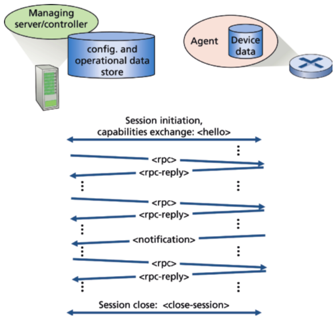

Hình 5.21 Phiên NETCONF giữa server/controller quản lý và thiết bị được quản lý

| Thao tác NETCONF (NETCONF Operation) | Mô tả (Description) |
|---|---|
| &lt;get-config&gt; | Lấy toàn bộ hoặc một phần của một cấu hình cho trước. Một thiết bị có thể có nhiều cấu hình. Luôn có<br>một running/configuration mô tả cấu hình hiện tại (đang chạy) của thiết bị. |
| &lt;get&gt; | Lấy toàn bộ hoặc một phần của cả dữ liệu trạng thái cấu hình và trạng thái vận hành. |
| &lt;edit-config&gt; | Thay đổi toàn bộ hoặc một phần của một cấu hình chỉ định tại thiết bị được quản lý. Nếu running/configuration được<br>chỉ định, thì cấu hình hiện tại (đang chạy) của thiết bị sẽ được thay đổi. Nếu thiết bị được quản lý có<br>thể đáp ứng yêu cầu, một &lt;rpc-reply&gt; được gửi chứa một phần tử &lt;ok&gt;; nếu không phản hồi &lt;rpc-error&gt;<br>được trả về. Khi có lỗi, trạng thái cấu hình của thiết bị có thể được roll-ed-back (quay lui) về trạng thái trước đó. |
| &lt;lock&gt;, &lt;unlock&gt; | Thao tác &lt;lock&gt; (&lt;unlock&gt;) cho phép server quản lý khóa (mở khóa) toàn bộ hệ thống kho dữ liệu<br>cấu hình của một thiết bị được quản lý. Khóa được dự định là short-lived (ngắn hạn) và cho phép client thực hiện một<br>thay đổi mà không lo tương tác với các lệnh NETCONF, SNMP hoặc CLIs khác từ các nguồn khác. |
| <create-<br>subscription>,<br>&lt;notification&gt; | Thao tác này khởi tạo một đăng ký thông báo sự kiện sẽ gửi &lt;notification&gt; sự kiện<br>bất đồng bộ cho các sự kiện quan tâm được chỉ định từ thiết bị được quản lý tới server quản lý, cho đến khi<br>đăng ký bị chấm dứt. |

Bảng 5.3 Một số thao tác NETCONF được chọn

Bảng 5.3 cho thấy một số thao tác NETCONF quan trọng mà server quản lý có thể thực hiện tại một thiết bị được quản lý. Như trong trường hợp SNMP, chúng ta thấy các thao tác lấy dữ liệu trạng thái vận hành (&lt;get&gt;), và cho thông báo sự kiện. Tuy nhiên, các thao tác &lt;get-config&gt;, &lt;edit-config&gt;, &lt;lock&gt; và &lt;unlock&gt; thể hiện sự nhấn mạnh đặc biệt của NETCONF vào cấu hình thiết bị. Dùng các thao tác cơ bản minh họa trong Bảng 5.3, cũng có thể tạo một tập giao dịch quản lý mạng tinh vi hơn hoặc hoàn tất nguyên tử (tức là, như một nhóm) và thành công trên một tập thiết bị, hoặc bị đảo ngược hoàn toàn và để các thiết bị ở trạng thái pre-transaction (trước giao dịch). Các giao dịch multi-device (nhiều thiết bị) như vậy—“cho phép nhà vận hành tập trung vào cấu hình của mạng như một tổng thể thay vì các thiết bị riêng lẻ” là một yêu cầu quan trọng của nhà vận hành được nêu trong [RFC 3535].

Mô tả đầy đủ về NETCONF nằm ngoài phạm vi ở đây; [RFC 6241, RFC 5277, Claise 2019; Schonwalder 2010] cung cấp nội dung in-depth hơn.

#### YANG

YANG là ngôn ngữ mô hình hóa dữ liệu được dùng để đặc tả chính xác cấu trúc, cú pháp và ngữ nghĩa của dữ liệu quản lý mạng được NETCONF dùng, gần giống như cách SMI được dùng để đặc tả MIB trong SNMP. Mọi định nghĩa YANG đều được chứa trong các module, và một tài liệu XML mô tả một thiết bị và các khả năng của nó có thể được tạo ra từ một module YANG.

YANG có một tập nhỏ các kiểu dữ liệu built-in (như trong trường hợp SMI) và cũng cho phép người mô hình hóa dữ liệu biểu đạt các ràng buộc phải được thỏa bởi một cấu hình NETCONF hợp lệ—một công cụ mạnh giúp đảm bảo các cấu hình NET-CONF thỏa các ràng buộc tính đúng đắn và nhất quán được chỉ định. YANG cũng được dùng để đặc tả các thông báo NETCONF.

Thảo luận đầy đủ hơn về YANG nằm ngoài phạm vi ở đây. Để biết thêm thông tin, chúng tôi giới thiệu độc giả quan tâm tới cuốn sách xuất sắc [Claise 2019].

## 5.8 Tóm tắt (Summary)

Giờ chúng ta đã hoàn tất hành trình two-chapter (hai chương) vào lõi mạng—một hành trình bắt đầu với nghiên cứu về data plane của tầng mạng trong Chương 4 và kết thúc ở đây với nghiên cứu về control plane của tầng mạng. Chúng ta đã học rằng control plane là logic network-wide điều khiển không chỉ cách một datagram được chuyển tiếp giữa các router dọc một đường end-to-end từ host nguồn tới host đích, mà còn cách các thành phần và dịch vụ network-layer được cấu hình và quản lý.

Chúng ta đã học rằng có hai cách tiếp cận tổng quát để xây dựng một control plane: điều khiển per-router truyền thống (trong đó một thuật toán định tuyến chạy trong mỗi router và thành phần định tuyến trong router giao tiếp với các thành phần định tuyến trong các router khác) và điều khiển software-defined networking (SDN) (trong đó một controller tập trung về logic tính toán và phân phối các bảng chuyển tiếp để mọi router sử dụng). Chúng ta đã nghiên cứu hai thuật toán định tuyến cơ bản để tính đường chi phí thấp nhất trong một đồ thị—định tuyến link-state và định tuyến distance-vector—trong Mục 5.2; các thuật toán này được ứng dụng trong cả điều khiển per-router lẫn điều khiển SDN. Các thuật toán này là cơ sở cho hai giao thức định tuyến Internet được triển khai rộng rãi, OSPF và BGP, mà chúng ta đã đề cập trong Mục 5.3 và 5.4. Chúng ta đã đề cập cách tiếp cận SDN đối với control plane network-layer trong Mục 5.5, khảo sát các ứng dụng network-control SDN, controller SDN, và giao thức OpenFlow để giao tiếp giữa controller và các thiết bị SDN-controlled. Trong Mục 5.6 và 5.7, chúng ta đã đề cập một số chi tiết cụ thể của việc quản lý một mạng IP: ICMP (Internet Control Message Protocol) và quản lý mạng dùng SNMP và NETCONF/YANG.

Sau khi hoàn tất nghiên cứu về tầng mạng, hành trình của chúng ta giờ đưa chúng ta xuống thêm một bước trong protocol stack, cụ thể là, tới tầng liên kết. Giống tầng mạng, tầng liên kết là một phần của mọi thiết bị network-connected. Nhưng chúng ta sẽ thấy trong chương tiếp theo rằng tầng liên kết có nhiệm vụ cục bộ hơn nhiều là chuyển packet giữa các nút trên cùng một liên kết hoặc LAN. Mặc dù nhiệm vụ này thoạt nhìn có vẻ khá đơn giản so với các nhiệm vụ của tầng mạng, chúng ta sẽ thấy tầng liên kết liên quan tới một số vấn đề quan trọng và hấp dẫn có thể khiến chúng ta bận rộn trong thời gian dài.

### Bài tập về nhà và câu hỏi (Homework Problems and Questions)

#### Câu hỏi ôn tập Chương 5 (Chapter 5 Review Questions)

##### Mục 5.1

R1. Một control plane dựa trên điều khiển per-router có nghĩa là gì? Trong những trường hợp như vậy, khi chúng ta nói control plane và data plane mạng được triển khai “một khối” (monolithically), ý chúng ta là gì?

R2. Một control plane dựa trên điều khiển tập trung về logic có nghĩa là gì? Trong những trường hợp như vậy, data plane và control plane được triển khai trong cùng một thiết bị hay trong các thiết bị riêng biệt? Giải thích.

##### Mục 5.2

R3. So sánh và đối chiếu các tính chất của một thuật toán định tuyến tập trung và một thuật toán định tuyến phân tán. Đưa ra một ví dụ về một giao thức định tuyến theo cách tiếp cận tập trung và một giao thức theo cách tiếp cận phi tập trung.

R4. So sánh và đối chiếu các thuật toán định tuyến link-state và distance-vector.

R5. Vấn đề “count to infinity” (đếm tới vô cùng) trong định tuyến distance vector là gì?

R6. Có cần mọi hệ tự trị dùng cùng thuật toán định tuyến intra-AS không? Tại sao có hoặc không?

##### Mục 5.3–5.4

R7. Tại sao các giao thức inter-AS và intra-AS khác nhau được dùng trong Internet?

R8. Đúng hay sai: Khi một router OSPF gửi thông tin trạng thái liên kết, nó chỉ được gửi tới những nút láng giềng gắn trực tiếp. Giải thích.

R9. Một vùng (area) trong một hệ tự trị OSPF có nghĩa là gì? Tại sao khái niệm vùng được đưa vào?

R10. Định nghĩa và đối chiếu các thuật ngữ sau: subnet, prefix và BGP route.

R11. BGP dùng thuộc tính NEXT-HOP như thế nào? Nó dùng thuộc tính AS-PATH như thế nào?

R12. Mô tả cách một quản trị viên mạng của một ISP upper-tier (cấp trên) có thể triển khai chính sách khi cấu hình BGP.

R13. Đúng hay sai: Khi một router BGP nhận một đường được quảng bá từ láng giềng, nó phải thêm danh tính của chính nó vào đường nhận được rồi gửi đường mới đó tới mọi láng giềng. Giải thích.

##### Mục 5.5

R14. Mô tả vai trò chính của tầng giao tiếp, tầng state-management network-wide,

### Bài tập (Problems)

và tầng ứng dụng network-control trong một controller SDN.

R15. Giả sử bạn muốn triển khai một giao thức định tuyến mới trong control plane SDN. Bạn sẽ triển khai giao thức đó ở tầng nào? Giải thích.

R16. Những loại thông điệp nào đi qua các API northbound và southbound của một controller SDN? Ai là bên nhận các thông điệp này được gửi từ controller qua giao diện southbound, và ai gửi thông điệp tới controller qua giao diện northbound?

R17. Mô tả mục đích của hai loại thông điệp Open-Flow (tùy bạn chọn) được gửi từ một thiết bị được điều khiển tới controller. Mô tả mục đích của hai loại thông điệp Openflow (tùy bạn chọn) được gửi từ controller tới một thiết bị được điều khiển.

R18. Mục đích của tầng trừu tượng dịch vụ (service abstraction layer) trong controller SDN OpenDaylight là gì?

#### Mục 5.6–5.7

R19. Nêu bốn loại thông điệp ICMP khác nhau

R20. Hai loại thông điệp ICMP nào được nhận tại host gửi đang chạy chương trình Traceroute?

R21. Định nghĩa các thuật ngữ sau trong bối cảnh SNMP: server quản lý, thiết bị được quản lý, tác nhân quản lý mạng và MIB.

R22. Mục đích của các thông điệp SNMP GetRequest và SetRequest là gì?

R23. Mục đích của thông điệp SNMP trap là gì?

P1. Nhìn vào Hình 5.3, hãy liệt kê các đường từ y tới u không chứa vòng lặp nào.

P2. Lặp lại Bài P1 cho các đường từ x tới z, z tới u, và z tới w.

P3. Hãy xét mạng sau. Với chi phí liên kết được chỉ ra, dùng thuật toán shortest-path của Dijkstra để tính đường ngắn nhất từ x tới mọi nút mạng. Trình bày cách thuật toán hoạt động bằng cách tính một bảng tương tự Bảng 5.1.

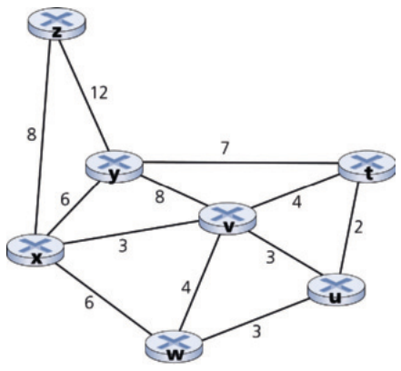

P4. Hãy xét mạng minh họa trong Bài P3. Dùng thuật toán Dijkstra, và trình bày cách làm bằng một bảng tương tự Bảng 5.1, hãy làm như sau:

a. Tính đường ngắn nhất từ t tới mọi nút mạng.

b. Tính đường ngắn nhất từ u tới mọi nút mạng.

c. Tính đường ngắn nhất từ v tới mọi nút mạng.

d. Tính đường ngắn nhất từ w tới mọi nút mạng.

e. Tính đường ngắn nhất từ y tới mọi nút mạng.

f. Tính đường ngắn nhất từ z tới mọi nút mạng.

P5. Hãy xét mạng minh họa dưới đây, và giả sử ban đầu mỗi nút biết chi phí tới mỗi láng giềng. Hãy xét thuật toán distance-vector và trình bày các mục bảng khoảng cách tại nút z.

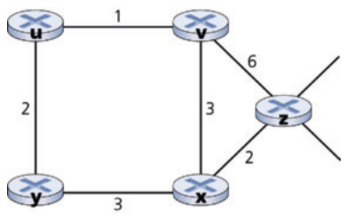

P6. Hãy xét một topology tổng quát (tức là, không phải mạng cụ thể minh họa ở trên) và một phiên bản đồng bộ của thuật toán distance-vector. Giả sử ở mỗi lần lặp, một nút trao đổi distance vector với láng giềng và nhận distance vector của chúng. Giả sử thuật toán bắt đầu với mỗi nút chỉ biết chi phí tới các láng giềng trực tiếp, số lần lặp tối đa cần trước khi thuật toán phân tán hội tụ là bao nhiêu? Biện minh câu trả lời của bạn.

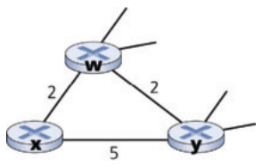

P7. Hãy xét đoạn mạng minh họa dưới đây. x chỉ có hai láng giềng gắn kèm, w và y. w có một đường minimum-cost tới đích u (không minh họa) bằng 5, và y có một đường minimum-cost tới u bằng 6. Các đường đầy đủ từ w và y tới u (và giữa w và y) không được minh họa. Mọi chi phí liên kết trong mạng đều có giá trị nguyên dương nghiêm ngặt.

a. Đưa ra distance vector của x cho các đích w, y và u.

b. Đưa ra một thay đổi link-cost cho c(x, w) hoặc c(x, y) sao cho x sẽ thông báo cho láng giềng về một đường minimum-cost mới tới u do thực thi thuật toán distance-vector.

c. Đưa ra một thay đổi link-cost cho c(x, w) hoặc c(x, y) sao cho x sẽ không thông báo cho láng giềng về một đường minimum-cost mới tới u do thực thi thuật toán distance-vector.

P8. Hãy xét topology three-node minh họa trong Hình 5.6. Thay vì có chi phí liên kết như minh họa trong Hình 5.6, chi phí liên kết là c(x, y) = 3, c(y, z) = 6, c(z, x) = 4. Tính các bảng khoảng cách sau bước khởi tạo và sau mỗi lần lặp của một phiên bản đồng bộ của thuật toán distance-vector (như chúng ta đã làm trong thảo luận trước đó về Hình 5.6).

P9. Hãy xét vấn đề count-to-infinity trong định tuyến distance vector. Vấn đề count-to-infinity có xảy ra nếu chúng ta giảm chi phí của một liên kết không? Tại sao? Còn nếu chúng ta nối hai nút không có liên kết thì sao?

P10. Hãy lập luận rằng với thuật toán distance-vector trong Hình 5.6, mỗi giá trị trong distance vector D(x) là non-increasing (không tăng) và cuối cùng sẽ ổn định trong một số bước hữu hạn.

P11. Hãy xét Hình 5.7. Giả sử có một router khác w, nối với router y và z. Chi phí của mọi liên kết được cho như sau: c(x, y) = 4, c(x, z) = 50, c(y, w) = 1, c(z, w) = 1, c(y, z) = 3. Giả sử poisoned reverse được dùng trong thuật toán định tuyến distance-vector.

a. Khi định tuyến distance vector đã ổn định, router w, y và z thông báo khoảng cách của chúng tới x cho nhau. Chúng nói với nhau những giá trị khoảng cách nào?

b. Giờ giả sử chi phí liên kết giữa x và y tăng lên 60. Có xảy ra vấn đề count-to-infinity ngay cả khi dùng poisoned reverse không? Tại sao có hoặc không? Nếu có vấn đề count-to-infinity, thì cần bao nhiêu lần lặp để định tuyến distance-vector lại đạt trạng thái ổn định? Biện minh câu trả lời của bạn.

c. Bạn sửa c(y, z) thế nào để hoàn toàn không có vấn đề count-to-infinity nếu c(y, x) thay đổi từ 4 thành 60?

P12. Mô tả cách các vòng lặp trong đường đi có thể được phát hiện trong BGP.

P13. Một router BGP có luôn chọn tuyến loop-free (không vòng lặp) có độ dài ASpath ngắn nhất không? Biện minh câu trả lời của bạn.

P14. Hãy xét mạng minh họa dưới đây. Giả sử AS3 và AS2 đang chạy OSPF làm giao thức định tuyến intra-AS. Giả sử AS1 và AS4 đang chạy RIP làm giao thức định tuyến intra-AS. Giả sử eBGP và iBGP được dùng cho giao thức định tuyến inter-AS. Ban đầu giả sử không có liên kết vật lý giữa AS2 và AS4.

a. Router 3c biết về tiền tố x từ giao thức định tuyến nào: OSPF, RIP, eBGP hay iBGP?

b. Router 3a biết về x từ giao thức định tuyến nào?

c. Router 1c biết về x từ giao thức định tuyến nào?

d. Router 1d biết về x từ giao thức định tuyến nào?

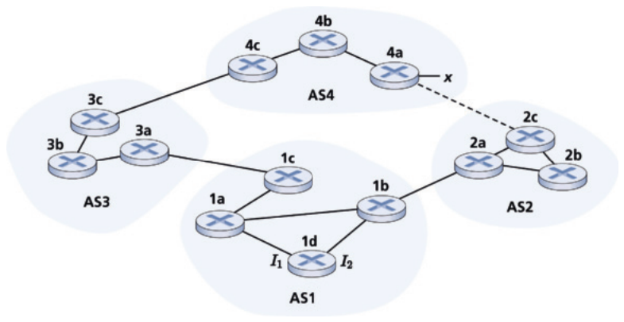

P15. Tham chiếu bài trước, khi router 1d biết về x nó sẽ đặt một mục (x, I) vào bảng chuyển tiếp.

a. I sẽ bằng I<sub>1</sub> hay I<sub>2</sub> cho mục này? Giải thích tại sao trong một câu.

b. Giờ giả sử có một liên kết vật lý giữa AS2 và AS4, minh họa bằng đường chấm. Giả sử router 1d biết rằng x có thể truy cập qua AS2 cũng như qua AS3. I sẽ được đặt bằng I<sub>1</sub> hay I<sub>2</sub>? Giải thích tại sao trong một câu.

c. Giờ giả sử có một AS khác, gọi là AS5, nằm trên đường giữa AS2 và AS4 (không minh họa trong sơ đồ). Giả sử router 1d biết rằng x có thể truy cập qua AS2 AS5 AS4 cũng như qua AS3 AS4. I sẽ được đặt bằng I<sub>1</sub> hay I<sub>2</sub>? Giải thích tại sao trong một câu.

P16. Hãy xét mạng sau. ISP B cung cấp dịch vụ backbone quốc gia cho ISP khu vực A. ISP C cung cấp dịch vụ backbone quốc gia cho ISP khu vực D. Mỗi ISP gồm một AS. B và C peer với nhau ở hai nơi dùng BGP. Hãy xét traffic đi từ A tới D. B muốn chuyển traffic đó cho C ở Bờ Tây (để C phải gánh chi phí chuyên chở traffic cross-country), trong khi C muốn nhận traffic qua điểm peering Bờ Đông với B (để B đã chuyên chở traffic xuyên quốc gia). C có thể dùng cơ chế BGP nào, để B chuyển giao traffic A-to-D tại điểm peering Bờ Đông của nó? Để trả lời câu hỏi này, bạn sẽ cần đào sâu vào đặc tả BGP.

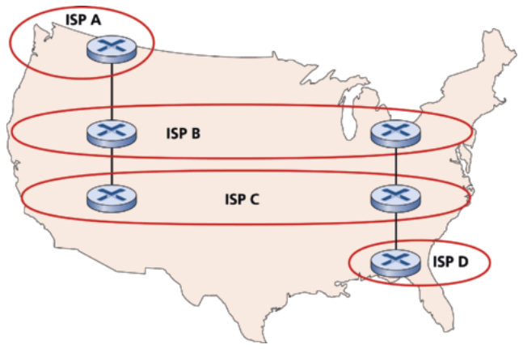

P17. Trong Hình 5.13, hãy xét thông tin đường đi tới các mạng cụt W, X và Y. Dựa trên thông tin có tại W và X, góc nhìn tương ứng của chúng về topology mạng là gì? Biện minh câu trả lời của bạn. Góc nhìn topology tại Y được minh họa dưới đây.

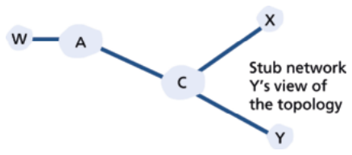

P18. Hãy xét Hình 5.13. B sẽ không bao giờ chuyển tiếp traffic hướng tới Y qua X dựa trên định tuyến BGP. Nhưng có một số ứng dụng rất phổ biến mà packet dữ liệu đi tới X trước rồi chảy tới Y. Hãy xác định một ứng dụng như vậy, và mô tả cách packet dữ liệu đi theo một đường không do định tuyến BGP đưa ra.

P19. Trong Hình 5.13, giả sử có một mạng cụt khác V là khách hàng của ISP A. Giả sử B và C có quan hệ peering, và A là khách hàng của cả B và C. Giả sử A muốn traffic hướng tới W chỉ đến từ B, và traffic hướng tới V từ B hoặc C. A nên quảng bá các tuyến của nó cho B và C như thế nào? C nhận được những tuyến AS nào?

P20. Giả sử AS X và Z không nối trực tiếp mà được nối qua AS Y. Giả sử thêm X có thỏa thuận peering với Y, và Y có thỏa thuận peering với Z. Cuối cùng, giả sử Z muốn quá cảnh toàn bộ traffic của Y nhưng không muốn quá cảnh traffic của X. BGP có cho phép Z triển khai chính sách này không?

P21. Hãy xét hai cách giao tiếp xảy ra giữa một thực thể quản lý và một thiết bị được quản lý: chế độ request-response và trapping. Ưu và nhược điểm của hai cách tiếp cận này là gì, xét về (1) overhead, (2) thời gian thông báo khi sự kiện ngoại lệ xảy ra, và

(3) độ bền vững đối với thông điệp bị mất giữa thực thể quản lý và thiết bị?

P22. Trong Mục 5.7, chúng ta đã thấy việc vận chuyển thông điệp SNMP trong UDP datagram không tin cậy là được ưu tiên. Bạn nghĩ tại sao các nhà thiết kế SNMP chọn UDP thay vì TCP làm giao thức giao vận cho SNMP?

### Bài tập lập trình socket 5: ICMP Ping (Socket Programming Assignment 5: ICMP Ping)

Ở cuối Chương 2, có bốn bài tập lập trình socket. Ở đây bạn sẽ tìm thấy bài tập thứ năm dùng ICMP, một giao thức được thảo luận trong chương này.

Ping là một ứng dụng mạng phổ biến dùng để kiểm tra từ một vị trí ở xa xem một host cụ thể có đang chạy và tiếp cận được không. Nó cũng thường được dùng để đo độ trễ giữa host client và host đích. Nó hoạt động bằng cách gửi các packet ICMP “echo request” (tức là, packet ping) tới host đích và lắng nghe các trả lời ICMP “echo response” (tức là, packet pong). Ping đo RTT, ghi lại mất gói, và tính một tóm tắt thống kê của nhiều lần trao đổi ping-pong (giá trị nhỏ nhất, trung bình, lớn nhất và độ lệch chuẩn của round-trip time).

Trong bài thực hành này, bạn sẽ viết ứng dụng Ping của riêng mình bằng Python. Ứng dụng của bạn sẽ dùng ICMP. Nhưng để giữ chương trình đơn giản, bạn sẽ không tuân theo chính xác đặc tả chính thức trong RFC

1739. Lưu ý rằng bạn chỉ cần viết phía client của chương trình, vì chức năng cần ở phía server được tích hợp sẵn trong hầu hết mọi hệ điều hành. Bạn có thể tìm đầy đủ chi tiết của bài tập này, cũng như các đoạn code Python quan trọng, tại Web site http://www.pearsonhighered.com/cs-resources.

### Bài tập lập trình: Định tuyến (Programming Assignment: Routing)

Trong bài tập lập trình này, bạn sẽ viết một tập thủ tục “phân tán” triển khai định tuyến distance-vector bất đồng bộ phân tán cho mạng minh họa dưới đây.

Bạn phải viết các routine sau sẽ “thực thi” bất đồng bộ trong môi trường giả lập được cung cấp cho bài tập này. Với nút 0, bạn sẽ viết các routine:

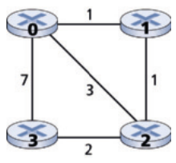

• rtinit0(). Routine này sẽ được gọi một lần ở đầu quá trình giả lập. rtinit0() không có tham số. Nó nên khởi tạo bảng khoảng cách trong nút 0 để phản ánh chi phí trực tiếp lần lượt 1, 3 và 7 tới các nút 1, 2 và 3. Trong hình trên, mọi liên kết đều hai chiều và chi phí theo cả hai chiều giống nhau. Sau khi khởi tạo bảng khoảng cách và bất kỳ cấu trúc dữ liệu nào khác cần cho các routine của nút 0, nó nên gửi cho các láng giềng nối trực tiếp (trong trường hợp này, 1, 2 và 3) chi phí của các đường minimum-cost tới mọi nút mạng khác. Thông tin minimum-cost này được gửi tới các nút láng giềng trong một packet cập nhật định tuyến bằng cách gọi routine tolayer2(), như mô tả trong bài tập đầy đủ. Định dạng của packet cập nhật định tuyến cũng được mô tả trong bài tập đầy đủ.

### Bài thực hành Wireshark: ICMP (Wireshark Lab: ICMP)

Trên Web site của cuốn sách này, www.pearsonhighered.com/cs-resources, bạn sẽ tìm thấy một bài thực hành Wireshark

• rtupdate0(struct rtpkt *rcvdpkt). Routine này sẽ được gọi khi nút 0 nhận một packet định tuyến được gửi cho nó bởi một trong các láng giềng nối trực tiếp. Tham số *rcvdpkt là một con trỏ tới packet đã nhận. rtupdate0() là “trái tim” của thuật toán distance-vector. Các giá trị nó nhận trong một packet cập nhật định tuyến từ một nút i nào khác chứa chi phí shortest-path hiện tại của i tới mọi nút mạng khác. rtupdate0() dùng các giá trị nhận được này để cập nhật bảng khoảng cách của chính nó (như được chỉ định bởi thuật toán distance-vector). Nếu chi phí nhỏ nhất của chính nó tới một nút khác thay đổi do cập nhật, nút 0 thông báo cho các láng giềng nối trực tiếp về thay đổi chi phí nhỏ nhất này bằng cách gửi cho chúng một packet định tuyến. Nhớ rằng trong thuật toán distance-vector, chỉ các nút nối trực tiếp mới trao đổi packet định tuyến. Do đó, nút 1 và 2 sẽ giao tiếp với nhau, nhưng nút 1 và 3 sẽ không giao tiếp với nhau.

Các routine tương tự được định nghĩa cho các nút 1, 2 và 3. Do đó, bạn sẽ viết tổng cộng tám thủ tục: rtinit0(), rtinit1(), rtinit2(), rtinit3(), rtupdate0(), rtupdate1(), rtupdate2(), và rtupdate3(). Các routine này cùng nhau sẽ triển khai một phép tính phân tán, bất đồng bộ các bảng khoảng cách cho topology và chi phí minh họa trong hình ở trang trước.

Bạn có thể tìm đầy đủ chi tiết của bài tập lập trình, cũng như code C bạn sẽ cần để tạo môi trường phần cứng/phần mềm mô phỏng, tại http://www.pearsonhighered.com/cs-resource. Một phiên bản Java của bài tập cũng có sẵn.

khảo sát việc dùng giao thức ICMP trong các lệnh ping và traceroute.

### PHỎNG VẤN VỚI... (AN INTERVIEW WITH...)


### Jennifer Rexford

Jennifer Rexford là Provost (Hiệu phó phụ trách học thuật) của Princeton University, nơi bà cũng là Giáo sư tại khoa Khoa học Máy tính. Nghiên cứu của bà có mục tiêu rộng là làm cho mạng máy tính dễ thiết kế và quản lý hơn, đặc biệt nhấn mạnh vào mạng có thể lập trình. Trước khi gia nhập đội ngũ giảng viên tại Princeton, bà đã làm việc tại AT&T trong tám năm, phát triển các kỹ thuật và công cụ đo lường mạng, kỹ thuật traffic và cấu hình router được triển khai trong mạng backbone của AT&T. Jennifer là co-author (đồng tác giả) của các cuốn sách “Web Protocols and Practice: Networking Protocols, Caching, and Traffic Measurement” (Addison-Wesley, 2001) và “The Real Internet Architecture: Past, Present, and Future Evolution” (Princeton University Press, 2024). Bà là chủ tịch ACM SIGCOMM từ 2003 đến 2007. Bà nhận bằng BSE ngành kỹ thuật điện từ Princeton University, và bằng PhD ngành kỹ thuật điện và khoa học máy tính từ University of Michigan. Jennifer đã nhận ACM Grace Murray Hopper Award, ACM SIGCOMM Award, IEEE Internet Award, và IEEE Alexander Graham Bell Medal. Bà là ACM Fellow, IEEE Fellow, và thành viên của National Academy of Engineering và National Academy of Sciences.

#### Xin bà mô tả một hoặc hai dự án thú vị nhất mà bà đã làm trong sự nghiệp. Những thách thức lớn nhất là gì?

Khi tôi là nhà nghiên cứu tại AT&T, một nhóm chúng tôi đã thiết kế một cách mới để quản lý định tuyến trong các mạng backbone của Nhà cung cấp dịch vụ Internet. Theo truyền thống, các nhà vận hành mạng cấu hình từng router riêng lẻ, và các router này chạy các giao thức phân tán để tính đường đi qua mạng. Chúng tôi tin rằng quản lý mạng sẽ đơn giản và linh hoạt hơn nếu các nhà vận hành mạng có thể trực tiếp kiểm soát cách router chuyển tiếp traffic dựa trên một cái nhìn network-wide về topology và traffic. Routing Control Platform (RCP) mà chúng tôi thiết kế và xây dựng có thể tính tuyến cho toàn bộ backbone của AT&T trên một máy tính phổ thông duy nhất, và có thể điều khiển các router cũ mà không cần sửa đổi. Với tôi, dự án này thú vị vì chúng tôi có một ý tưởng khiêu khích, một hệ thống hoạt động được, và cuối cùng là một triển khai thực tế trong một mạng đang vận hành. Tua nhanh vài năm, và software-defined networking (SDN) đã trở thành một công nghệ chủ đạo, và các giao thức chuẩn (như OpenFlow) và ngôn ngữ (như P4) đã giúp việc bảo các switch bên dưới phải làm gì dễ dàng hơn nhiều.

#### Bà nghĩ software-defined networking nên tiến hóa thế nào trong tương lai?

Trong một bước ngoặt lớn so với quá khứ, phần mềm điều khiển các thiết bị mạng có thể được tạo bởi nhiều lập trình viên khác nhau, không chỉ ở các công ty bán thiết bị mạng. Tuy nhiên, không như các ứng dụng chạy trên server hoặc smartphone, các ứng dụng SDN phải hoạt động cùng nhau để xử lý cùng traffic. Các nhà vận hành mạng không muốn thực hiện cân bằng tải trên một số traffic và định tuyến trên traffic khác; thay vào đó, họ muốn thực hiện cân bằng tải và định tuyến, cùng nhau, trên cùng traffic. Các nền tảng SDN tương lai nên cung cấp các trừu tượng lập trình tốt để kết hợp nhiều ứng dụng được viết độc lập với nhau. Rộng hơn, các trừu tượng lập trình tốt có thể giúp tạo ứng dụng dễ hơn, mà không phải lo về các chi tiết low-level như mục flow table, bộ đếm traffic, mẫu bit trong header packet, v.v. Ngoài ra, trong khi một controller SDN tập trung về logic, mạng vẫn gồm một tập hợp thiết bị phân tán. Các mạng có thể lập trình tương lai nên cung cấp các trừu tượng tốt để cập nhật một tập thiết bị phân tán, để quản trị viên mạng có thể suy luận về những gì xảy ra với packet đang trên đường trong khi các thiết bị được cập nhật. Các trừu tượng lập trình cho mạng có thể lập trình là một lĩnh vực thú vị cho nghiên cứu liên ngành giữa mạng máy tính, hệ thống phân tán và ngôn ngữ lập trình, với cơ hội thực sự cho tác động thực tiễn trong những năm tới.

#### Bà thấy tương lai của mạng và Internet ra sao?

Mạng là một lĩnh vực thú vị vì các ứng dụng và công nghệ bên dưới thay đổi liên tục. Chúng tôi luôn tái tạo chính mình! Ai có thể đoán trước thậm chí mười năm trước sự thống trị của smartphone, cho phép người dùng di động truy cập các ứng dụng hiện có cũng như các dịch vụ location-based mới? Sự xuất hiện của cloud computing đang thay đổi căn bản quan hệ giữa người dùng và các ứng dụng họ chạy, và các cảm biến và bộ chấp hành được nối mạng (“Internet of Things”) đang cho phép vô số ứng dụng mới (và lỗ hổng bảo mật!). Tốc độ đổi mới thực sự truyền cảm hứng.

Mạng bên dưới là một thành phần thiết yếu trong tất cả những đổi mới này. Tuy nhiên, mạng nổi tiếng là “cản đường”—giới hạn performance, làm tổn hại độ tin cậy, ràng buộc ứng dụng, và làm phức tạp việc triển khai và quản lý dịch vụ. Chúng ta nên phấn đấu làm cho mạng tương lai vô hình như không khí chúng ta thở, để nó không bao giờ cản đường các ý tưởng mới và dịch vụ giá trị. Để làm được điều này, chúng ta cần nâng mức trừu tượng lên trên các thiết bị và giao thức mạng riêng lẻ (và các từ viết tắt đi kèm!), để chúng ta có thể suy luận về mạng và các mục tiêu high-level của người dùng như một tổng thể.

#### Những ai đã truyền cảm hứng cho bà trong sự nghiệp?

Tôi đã từ lâu được truyền cảm hứng bởi Sally Floyd, người đã làm việc nhiều năm tại International Computer Science Institute. Nghiên cứu của bà luôn có mục đích, tập trung vào những thách thức quan trọng mà Internet đối mặt. Bà đào sâu vào những câu hỏi khó cho đến khi hiểu hoàn toàn vấn đề và không gian lời giải, và bà dồn nhiều năng lượng vào việc “biến mọi thứ thành hiện thực,” như đưa ý tưởng của mình vào các chuẩn giao thức và thiết bị mạng. Ngoài ra, bà đóng góp lại cho cộng đồng, thông qua công việc chuyên môn trong nhiều tổ chức chuẩn và nghiên cứu và bằng cách tạo ra các công cụ (như các trình mô phỏng ns-2 và ns-3 được dùng rộng rãi) giúp các nhà nghiên cứu khác thành công. Bà nghỉ hưu năm 2009, và qua đời năm 2019, nhưng ảnh hưởng của bà lên lĩnh vực sẽ còn được cảm nhận trong nhiều năm tới.

#### Bà có khuyến nghị gì cho sinh viên muốn theo nghề khoa học máy tính và mạng?

Mạng vốn là một lĩnh vực liên ngành. Áp dụng các kỹ thuật từ các lĩnh vực khác. Những đột phá trong mạng đến từ những lĩnh vực đa dạng như lý thuyết hàng đợi, lý thuyết trò chơi, lý thuyết điều khiển, hệ thống phân tán, tối ưu mạng, ngôn ngữ lập trình, học máy, thuật toán, cấu trúc dữ liệu, v.v. Tôi nghĩ rằng việc trở nên thông thạo một lĩnh vực liên quan, hoặc hợp tác chặt chẽ với các chuyên gia trong những lĩnh vực đó, là một cách tuyệt vời để đặt mạng trên một nền tảng vững chắc hơn, để chúng ta có thể học cách xây dựng những mạng xứng đáng với niềm tin của xã hội. Ngoài các lĩnh vực lý thuyết, mạng thú vị vì chúng ta tạo ra những sản phẩm thực mà người thực sử dụng. Làm chủ cách thiết kế và xây dựng hệ thống—bằng cách tích lũy kinh nghiệm về hệ điều hành, kiến trúc máy tính, v.v.—là một cách tuyệt vời khác để khuếch đại kiến thức mạng của bạn nhằm giúp làm cho thế giới tốt đẹp hơn.
