# 6 Tầng liên kết và LAN (The Link Layer and LANs)


Trong hai chương trước, chúng ta đã học rằng tầng mạng cung cấp một dịch vụ truyền thông giữa hai host mạng bất kỳ. Giữa hai host, datagram đi qua một loạt liên kết truyền thông, một số có dây và một số không dây, bắt đầu tại host nguồn, đi qua một loạt packet switch (switch và router) và kết thúc tại host đích. Khi tiếp tục đi xuống protocol stack, từ tầng mạng tới tầng liên kết, chúng ta tự nhiên thắc mắc packet được gửi qua từng liên kết riêng lẻ tạo nên đường truyền thông end-to-end như thế nào. Các datagram network-layer được đóng gói trong các frame link-layer thế nào để truyền qua một liên kết duy nhất? Có phải các giao thức link-layer khác nhau được dùng trên các liên kết khác nhau dọc đường truyền thông không? Xung đột truyền trên các liên kết quảng bá được giải quyết thế nào? Có định địa chỉ ở tầng liên kết không và, nếu có, việc định địa chỉ link-layer hoạt động thế nào với việc định địa chỉ network-layer mà chúng ta đã học trong Chương 4? Và chính xác sự khác biệt giữa một switch và một router là gì? Chúng ta sẽ trả lời các câu hỏi này và những câu hỏi quan trọng khác trong chương này.

Khi thảo luận về tầng liên kết, chúng ta sẽ thấy có hai loại kênh link-layer khác nhau về cơ bản. Loại thứ nhất là kênh quảng bá (broadcast channel), nối nhiều host trong LAN không dây, trong mạng vệ tinh, và trong mạng truy cập cáp lai hybrid fiber-coaxial (HFC). Vì nhiều host được nối với cùng một kênh truyền thông quảng bá, cần một cái so-called giao thức truy cập môi trường (medium access protocol) để điều phối việc truyền frame. Trong một số trường hợp, một bộ điều khiển trung tâm có thể được dùng để điều phối việc truyền; trong các trường hợp khác, chính các host điều phối việc truyền. Loại kênh link-layer thứ hai là liên kết truyền thông point-to-point, như liên kết thường thấy giữa hai router được nối bằng một liên kết long-distance (đường dài), hoặc giữa máy tính văn phòng của người dùng và switch Ethernet gần đó mà nó được nối tới. Điều phối truy cập một liên kết point-to-point đơn giản hơn; tài liệu tham khảo trên Web site của cuốn sách này có thảo luận chi tiết về Point-to-Point Protocol (PPP), được dùng trong các bối cảnh từ dịch vụ dial-up (quay số) qua đường điện thoại tới truyền frame point-to-point high-speed qua liên kết fiber-optic (cáp quang).

Chúng ta sẽ khám phá một số khái niệm và công nghệ link-layer quan trọng trong chương này. Chúng ta sẽ đi sâu hơn vào phát hiện và sửa lỗi, một chủ đề chúng ta đã chạm tới ngắn gọn trong Chương 3. Chúng ta sẽ xét các mạng đa truy cập (multiple access network) và LAN chuyển mạch, bao gồm Ethernet—công nghệ LAN có dây phổ biến nhất cho đến nay. Chúng ta cũng sẽ xem xét LAN ảo, và mạng data center. Mặc dù WiFi, và tổng quát hơn LAN không dây, là các chủ đề link-layer, chúng ta sẽ hoãn việc nghiên cứu các chủ đề quan trọng này tới Chương 7.

## 6.1 Giới thiệu tầng liên kết (Introduction to the Link Layer)

Hãy bắt đầu với một số thuật ngữ quan trọng. Trong chương này sẽ tiện nếu chúng ta gọi bất kỳ thiết bị nào chạy một giao thức link-layer (tức là, tầng 2) là một nút (node). Nút bao gồm host, router, switch và điểm truy cập WiFi (thảo luận trong Chương 7). Chúng ta cũng sẽ gọi các kênh truyền thông nối các nút kề nhau dọc đường truyền thông là liên kết (link). Để một datagram được truyền từ host nguồn tới host đích, nó phải được chuyển qua từng liên kết riêng lẻ trong đường end-to-end. Ví dụ, trong mạng công ty minh họa ở cuối Hình 6.1, hãy xét việc gửi một datagram từ một trong các host không dây tới một trong các server. Datagram này thực sự sẽ đi qua sáu liên kết: một liên kết WiFi giữa host gửi và điểm truy cập WiFi, một liên kết Ethernet giữa điểm truy cập và một switch link-layer; một liên kết giữa switch link-layer và router, một liên kết giữa hai router; một liên kết Ethernet giữa router và một switch link-layer; và cuối cùng một liên kết Ethernet giữa switch và server. Trên một liên kết cho trước, một nút truyền đóng gói datagram trong một frame link-layer và truyền frame vào liên kết.

Để hiểu sâu hơn về tầng liên kết và quan hệ của nó với tầng mạng, hãy xét một phép so sánh với giao thông vận tải. Hãy xét một đại lý du lịch đang lên kế hoạch chuyến đi cho một du khách đi từ Princeton, New Jersey, tới Lausanne, Thụy Sĩ. Đại lý du lịch quyết định rằng thuận tiện nhất cho du khách là đi limousine từ Princeton tới sân bay JFK, rồi máy bay từ sân bay JFK tới sân bay Geneva, và cuối cùng tàu hỏa từ sân bay Geneva tới ga tàu Lausanne. Khi đại lý du lịch đặt ba chặng này, trách nhiệm của công ty limousine Princeton là đưa du khách từ Princeton tới JFK; trách nhiệm của hãng hàng không là đưa du khách từ JFK tới Geneva; và trách nhiệm của dịch vụ tàu hỏa Thụy Sĩ là đưa du khách từ Geneva tới Lausanne. Mỗi chặng trong ba chặng của chuyến đi là “trực tiếp” giữa hai địa điểm “kề nhau”. Lưu ý rằng ba chặng vận chuyển được quản lý bởi các công ty khác nhau và dùng các phương thức vận chuyển hoàn toàn khác nhau (limousine, máy bay và tàu hỏa). Mặc dù các phương thức vận chuyển khác nhau, mỗi phương thức đều cung cấp dịch vụ cơ bản là chuyển hành khách từ một địa điểm tới một địa điểm kề nhau. Trong phép so sánh vận tải này, du khách là một datagram, mỗi chặng vận chuyển là một liên kết, phương thức vận chuyển là một giao thức link-layer, và đại lý du lịch là một giao thức định tuyến.

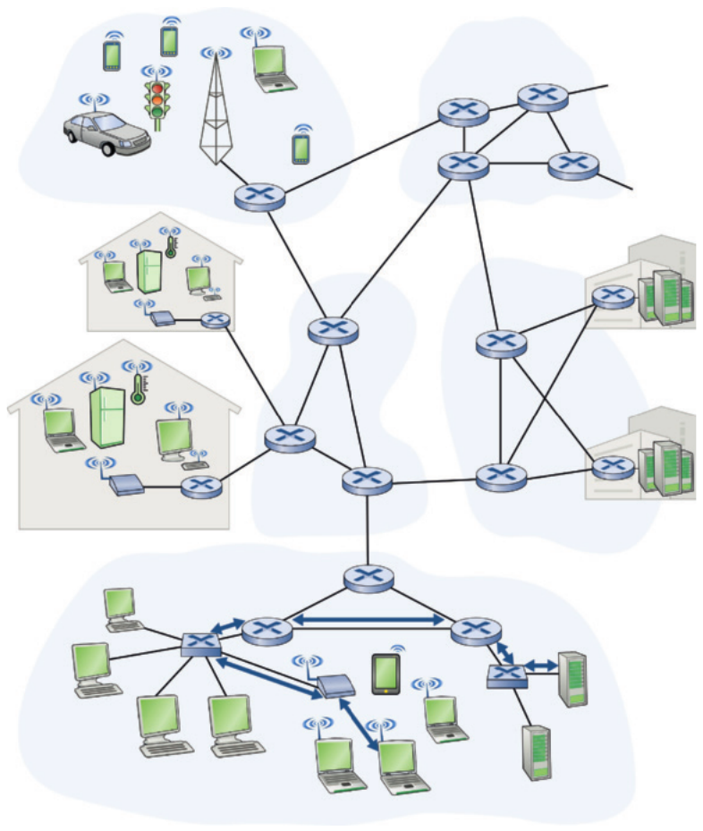

Hình 6.1 Sáu hop link-layer giữa host không dây và server

### 6.1.1 Các dịch vụ do tầng liên kết cung cấp (The Services Provided by the Link Layer)

Mặc dù dịch vụ cơ bản của bất kỳ tầng liên kết nào là chuyển một datagram từ một nút tới một nút kề qua một liên kết truyền thông duy nhất, chi tiết dịch vụ được cung cấp có thể khác nhau giữa các giao thức link-layer. Các dịch vụ khả dĩ mà một giao thức link-layer có thể cung cấp bao gồm:

• Đóng khung (Framing). Hầu hết mọi giao thức link-layer đóng gói mỗi datagram network-layer trong một frame link-layer trước khi truyền qua liên kết. Một frame gồm một trường dữ liệu, nơi datagram network-layer được chèn vào, và một số trường header. Cấu trúc của frame được giao thức link-layer đặc tả. Chúng ta sẽ thấy một số định dạng frame khác nhau khi xem xét các giao thức link-layer cụ thể ở nửa sau của chương này.

• Truy cập liên kết (Link access). Một giao thức điều khiển truy cập môi trường (medium access control - MAC) đặc tả các quy tắc theo đó một frame được truyền lên liên kết. Với các liên kết point-to-point có một bên gửi duy nhất ở một đầu liên kết và một bên nhận duy nhất ở đầu kia, giao thức MAC đơn giản (hoặc không tồn tại)—bên gửi có thể gửi một frame bất cứ khi nào liên kết rảnh. Trường hợp thú vị hơn là khi nhiều nút dùng chung một liên kết quảng bá duy nhất—cái so-called vấn đề đa truy cập (multiple access problem). Ở đây, giao thức MAC dùng để điều phối việc truyền frame của nhiều nút.

• Chuyển giao tin cậy (Reliable delivery). Khi một giao thức link-layer cung cấp dịch vụ chuyển giao tin cậy, nó đảm bảo chuyển mỗi datagram network-layer qua liên kết không có lỗi. Nhớ rằng một số giao thức transport-layer (như TCP) cũng cung cấp dịch vụ chuyển giao tin cậy. Tương tự dịch vụ chuyển giao tin cậy transport-layer, một dịch vụ chuyển giao tin cậy link-layer có thể đạt được bằng acknowledgment và truyền lại (xem Mục 3.4). Một dịch vụ chuyển giao tin cậy link-layer thường được dùng cho các liên kết dễ có tỉ lệ lỗi cao, như liên kết không dây, với mục tiêu sửa lỗi cục bộ— trên liên kết nơi lỗi xảy ra—thay vì buộc phải truyền lại dữ liệu end-to-end bởi một giao thức transport- hoặc application-layer.

  Tuy nhiên, chuyển giao tin cậy link-layer có thể bị coi là overhead không cần thiết cho các liên kết bit-error (lỗi bit) thấp, bao gồm cáp quang, cáp đồng trục, và nhiều liên kết đồng twisted-pair (xoắn đôi). Vì lý do này, nhiều giao thức link-layer có dây không cung cấp dịch vụ chuyển giao tin cậy.

• Phát hiện và sửa lỗi (Error detection and correction). Phần cứng link-layer trong một nút nhận có thể quyết định sai rằng một bit trong frame là không khi nó được truyền là một, và ngược lại. Các lỗi bit như vậy do suy hao tín hiệu và nhiễu điện từ gây ra. Vì không cần chuyển tiếp một datagram có lỗi, nhiều giao thức link-layer cung cấp một cơ chế phát hiện các lỗi bit như vậy. Việc này được thực hiện bằng cách để nút truyền đưa các bit error-detection vào frame, và để nút nhận thực hiện kiểm tra lỗi. Nhớ lại từ Chương 3 và 4 rằng tầng giao vận và tầng mạng của Internet cũng cung cấp một dạng phát hiện lỗi hạn chế—Internet checksum. Phát hiện lỗi ở tầng liên kết thường tinh vi hơn và được hiện thực bằng phần cứng.

  Sửa lỗi tương tự phát hiện lỗi, ngoại trừ bên nhận không chỉ phát hiện khi lỗi bit đã xảy ra trong frame mà còn xác định chính xác lỗi đã xảy ra ở đâu trong frame (rồi sửa các lỗi này).

### 6.1.2 Tầng liên kết được hiện thực ở đâu? (Where Is the Link Layer Implemented?)

Trước khi đi vào nghiên cứu chi tiết tầng liên kết, hãy kết thúc phần giới thiệu này bằng việc xét câu hỏi tầng liên kết được hiện thực ở đâu. Tầng liên kết của một host được hiện thực bằng phần cứng hay phần mềm? Nó được hiện thực trên một card hoặc chip riêng không, và nó giao tiếp với phần còn lại của phần cứng và các thành phần hệ điều hành của host như thế nào?

Hình 6.2 cho thấy một kiến trúc host điển hình. Khả năng Ethernet hoặc được tích hợp vào chipset bo mạch chủ hoặc được hiện thực qua một chip Ethernet chuyên dụng low-cost (giá rẻ). Phần lớn, tầng liên kết được hiện thực trên một chip gọi là network adapter (bộ điều hợp mạng), đôi khi còn được gọi là network interface controller (NIC). Network adapter hiện thực nhiều dịch vụ tầng liên kết bao gồm đóng khung, truy cập liên kết, phát hiện lỗi, v.v. Do đó, phần lớn chức năng của một bộ điều khiển link-layer được hiện thực bằng phần cứng. Ví dụ, các adapter dòng 800 của Intel [Intel 2025] hiện thực các giao thức Ethernet mà chúng ta sẽ nghiên cứu trong Mục 6.5; bộ điều khiển hệ thống con Atheros Fastconnect 6800 [Qualcomm 2025] hiện thực các giao thức 802.11 mà chúng ta sẽ nghiên cứu trong Chương 7.

Ở phía gửi, bộ điều khiển lấy một datagram đã được tạo và lưu trong bộ nhớ host bởi các tầng cao hơn của protocol stack, đóng gói datagram trong một frame link-layer (điền các trường khác nhau của frame), rồi truyền frame vào liên kết truyền thông, theo giao thức link-access. Ở phía nhận, một bộ điều khiển nhận toàn bộ frame, và trích xuất datagram network-layer. Nếu tầng liên kết thực hiện phát hiện lỗi, thì chính bộ điều khiển gửi đặt các bit error-detection trong header frame và chính bộ điều khiển nhận thực hiện phát hiện lỗi.

Hình 6.2 cho thấy mặc dù phần lớn tầng liên kết được hiện thực bằng phần cứng, một phần tầng liên kết được hiện thực bằng phần mềm chạy trên CPU của host. Các thành phần phần mềm của tầng liên kết hiện thực chức năng link-layer higher-level như ráp thông tin định địa chỉ link-layer và kích hoạt phần cứng bộ điều khiển. Ở phía nhận, phần mềm link-layer phản hồi các ngắt của bộ điều khiển (ví dụ, do nhận một hoặc nhiều frame), xử lý các tình trạng lỗi và chuyển một datagram lên tầng mạng. Do đó, tầng liên kết là sự kết hợp phần cứng và phần mềm—nơi trong protocol stack mà phần mềm gặp phần cứng.

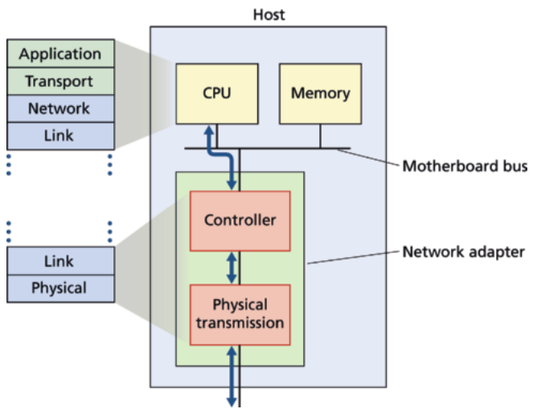

Hình 6.2 Network adapter: Quan hệ với các thành phần host khác và với chức năng protocol stack

## 6.2 Các kỹ thuật phát hiện và sửa lỗi (Error-Detection and -Correction Techniques)

Trong mục trước, chúng ta đã lưu ý rằng phát hiện và sửa lỗi bit-level— phát hiện và sửa sự hỏng bit trong một frame link-layer gửi từ một nút tới một nút láng giềng nối vật lý khác—là hai dịch vụ thường được tầng liên kết cung cấp. Chúng ta đã thấy trong Chương 3 rằng các dịch vụ error-detection and -correction cũng thường được cung cấp ở tầng giao vận. Trong mục này, chúng ta sẽ xem xét một vài kỹ thuật đơn giản nhất có thể được dùng để phát hiện và, trong một số trường hợp, sửa các lỗi bit như vậy. Một cách trình bày đầy đủ về lý thuyết và hiện thực của chủ đề này tự nó là chủ đề của nhiều cuốn sách giáo khoa (ví dụ, [Schwartz 1980] hoặc [Bertsekas 1991]), và cách trình bày của chúng ta ở đây buộc phải ngắn gọn. Mục tiêu ở đây là phát triển một cảm nhận trực quan về các khả năng mà kỹ thuật error-detection and -correction cung cấp và xem một vài kỹ thuật đơn giản hoạt động thế nào và được dùng thế nào trong thực tế ở tầng liên kết.

Hình 6.3 minh họa bối cảnh nghiên cứu. Tại nút gửi, dữ liệu, D, cần được bảo vệ khỏi lỗi bit được bổ sung các bit error-detection and - correction (EDC). Thông thường, dữ liệu cần bảo vệ không chỉ bao gồm datagram được chuyển xuống từ tầng mạng để truyền qua liên kết, mà còn thông tin định địa chỉ link-level, số thứ tự, và các trường khác trong header frame liên kết. Cả D và EDC được gửi tới nút nhận trong một frame link-level. Tại nút nhận, một chuỗi bit, D′ và EDC′ được nhận. Lưu ý rằng D′ và EDC′ có thể khác D và EDC gốc do các bit bị lật in-transit.

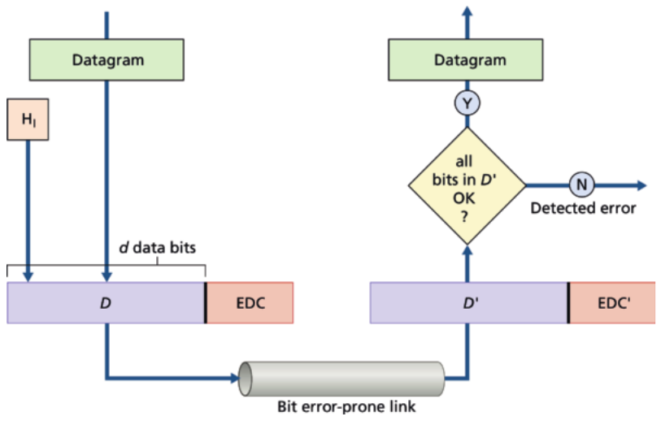

Hình 6.3 Kịch bản error-detection and -correction

Thách thức của bên nhận là xác định D′ có giống D gốc hay không, khi nó chỉ nhận được D′ và EDC′. Cách diễn đạt chính xác quyết định của bên nhận trong Hình 6.3 (chúng ta hỏi liệu một lỗi có được phát hiện, chứ không hỏi liệu một lỗi có xảy ra!) là quan trọng. Các kỹ thuật error-detection and -correction cho phép bên nhận đôi khi, nhưng không phải luôn luôn, phát hiện rằng lỗi bit đã xảy ra. Ngay cả khi dùng bit error-detection vẫn có thể có lỗi bit không được phát hiện; tức là, bên nhận có thể không biết rằng thông tin nhận được chứa lỗi bit. Do đó, bên nhận có thể chuyển một datagram bị hỏng lên tầng mạng, hoặc không biết rằng nội dung một trường trong header frame đã bị hỏng. Do đó chúng ta muốn chọn một cơ chế error-detection giữ xác suất xảy ra những trường hợp như vậy nhỏ. Nói chung, các kỹ thuật error-detection and -correction tinh vi hơn (tức là, những kỹ thuật có xác suất để lọt lỗi bit không phát hiện nhỏ hơn) chịu overhead lớn hơn—cần nhiều tính toán hơn để tính và truyền số lượng bit error-detection and -correction lớn hơn.

Giờ hãy xem xét ba kỹ thuật phát hiện lỗi trong dữ liệu truyền—kiểm tra chẵn lẻ (parity check) (để minh họa các ý tưởng cơ bản đằng sau phát hiện và sửa lỗi), các phương pháp checksum (thường được dùng ở tầng giao vận), và kiểm tra dư thừa vòng (cyclic redundancy check) (thường được dùng ở tầng liên kết trong adapter).

### 6.2.1 Kiểm tra chẵn lẻ (Parity Checks)

Có lẽ dạng phát hiện lỗi đơn giản nhất là dùng một bit chẵn lẻ (parity bit) duy nhất. Giả sử thông tin cần gửi, D trong Hình 6.4, có d bit. Trong một cơ chế chẵn lẻ chẵn (even parity), bên gửi đơn giản đưa vào một bit bổ sung và chọn giá trị của nó sao cho tổng số bit 1s trong d + 1 bit (thông tin gốc cộng một bit chẵn lẻ) là chẵn. Với cơ chế chẵn lẻ lẻ (odd parity), giá trị bit chẵn lẻ được chọn sao cho có một số lẻ bit 1s. Hình 6.4 minh họa một cơ chế chẵn lẻ chẵn, với bit chẵn lẻ duy nhất được lưu trong một trường riêng.

Hoạt động của bên nhận cũng đơn giản với một bit chẵn lẻ duy nhất. Bên nhận chỉ cần đếm số bit 1s trong d + 1 bit nhận được. Nếu tìm thấy một số lẻ bit 1-valued (có giá trị một) với cơ chế chẵn lẻ chẵn, bên nhận biết rằng ít nhất một lỗi bit đã xảy ra. Chính xác hơn, nó biết rằng một số lẻ lỗi bit nào đó đã xảy ra.

Nhưng điều gì xảy ra nếu một số chẵn lỗi bit xảy ra? Bạn nên tự thuyết phục mình rằng điều này sẽ dẫn tới một lỗi không được phát hiện. Nếu xác suất lỗi bit nhỏ và lỗi có thể được giả định xảy ra độc lập từ bit này sang bit khác, xác suất có nhiều lỗi bit trong một packet sẽ cực kỳ nhỏ. Trong trường hợp này, một bit chẵn lẻ duy nhất có thể đủ. Tuy nhiên, các phép đo đã cho thấy rằng, thay vì xảy ra độc lập, lỗi thường tụ lại thành “chùm” (burst). Trong điều kiện lỗi chùm, xác suất lỗi không được phát hiện trong một frame được bảo vệ bởi chẵn lẻ single-bit (một bit) có thể tiến tới 50 phần trăm [Spragins 1991]. Rõ ràng, cần một cơ chế error-detection bền vững hơn (và, may mắn thay, được dùng trong thực tế!). Nhưng trước khi xem xét các cơ chế error-detection được dùng trong thực tế, hãy xét một tổng quát hóa đơn giản của chẵn lẻ one-bit sẽ cho chúng ta hiểu biết về các kỹ thuật error-correction (sửa lỗi).

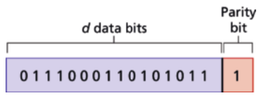

Hình 6.4 Chẵn lẻ chẵn one-bit

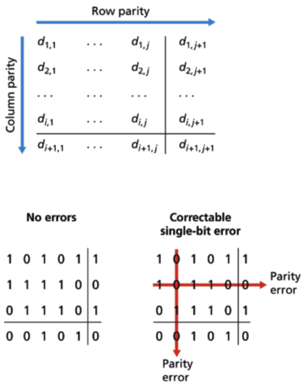

Hình 6.5 Chẵn lẻ chẵn two-dimensional (hai chiều)

Hình 6.5 cho thấy một tổng quát hóa two-dimensional của cơ chế chẵn lẻ single-bit. Ở đây, d bit trong D được chia thành i hàng và j cột. Một giá trị chẵn lẻ được tính cho mỗi hàng và cho mỗi cột. i + j + 1 bit chẵn lẻ kết quả tạo thành các bit error-detection của frame link-layer.

Giờ giả sử một lỗi bit duy nhất xảy ra trong d bit thông tin gốc. Với cơ chế chẵn lẻ two-dimensional này, chẵn lẻ của cả cột và hàng chứa bit bị lật sẽ bị sai. Do đó bên nhận không chỉ có thể phát hiện việc một lỗi bit duy nhất đã xảy ra, mà còn có thể dùng chỉ số cột và hàng của cột và hàng có lỗi chẵn lẻ để thực sự xác định bit bị hỏng và sửa lỗi đó! Hình 6.5 cho thấy một ví dụ trong đó bit 1-valued ở vị trí ( 2, 2) bị hỏng và chuyển thành 0—một lỗi vừa có thể phát hiện vừa có thể sửa tại bên nhận. Mặc dù thảo luận của chúng ta đã tập trung vào d bit thông tin gốc, một lỗi duy nhất trong chính các bit chẵn lẻ cũng có thể phát hiện và sửa được. Chẵn lẻ two-dimensional cũng có thể phát hiện (nhưng không sửa được!) bất kỳ tổ hợp hai lỗi nào trong một packet. Các tính chất khác của cơ chế chẵn lẻ two-dimensional được khám phá trong các bài tập ở cuối chương.

Khả năng bên nhận vừa phát hiện vừa sửa lỗi được gọi là sửa lỗi tiến (forward error correction - FEC). Các kỹ thuật này thường được dùng trong các thiết bị lưu trữ và phát audio như audio CD. Trong bối cảnh mạng, các kỹ thuật FEC có thể được dùng riêng, hoặc kết hợp với các kỹ thuật ARQ link-layer tương tự những kỹ thuật chúng ta đã xem xét trong Chương 3. Các kỹ thuật FEC có giá trị vì chúng có thể giảm số lần truyền lại cần thiết từ bên gửi. Có lẽ quan trọng hơn, chúng cho phép sửa lỗi ngay lập tức tại bên nhận. Điều này tránh phải chờ độ trễ lan truyền round-trip cần để bên gửi nhận một packet NAK và để packet truyền lại lan truyền về bên nhận—một ưu điểm có thể quan trọng cho các ứng dụng mạng real-time [Rubenstein 1998] hoặc các liên kết (như liên kết deep-space (không gian sâu)) có độ trễ lan truyền dài. Nghiên cứu xem xét việc dùng FEC trong các giao thức error-control bao gồm [Biersack 1992; Nonnenmacher 1998; Byers 1998; Shacham 1990].

### 6.2.2 Các phương pháp checksum (Checksumming Methods)

Trong các kỹ thuật checksum, d bit dữ liệu trong Hình 6.4 được coi như một chuỗi số nguyên k-bit. Một phương pháp checksum đơn giản là đơn giản cộng các số nguyên k-bit này và dùng tổng kết quả làm các bit error-detection. Internet checksum dựa trên cách tiếp cận này—các byte dữ liệu được coi là số nguyên 16-bit và được cộng lại. Phép bù một (1s complement) của tổng này khi đó tạo thành Internet checksum được mang trong header segment. Như đã thảo luận trong Mục 3.3, bên nhận kiểm tra checksum bằng cách lấy tổng bù 1s complement của dữ liệu nhận được (bao gồm checksum) và kiểm tra xem kết quả có toàn bit 1 không. Nếu bất kỳ bit nào là 1, một lỗi được chỉ ra. RFC 1071 thảo luận chi tiết thuật toán Internet checksum và hiện thực của nó. Trong các giao thức TCP và UDP, Internet checksum được tính trên mọi trường (bao gồm trường header và dữ liệu). Trong IP, checksum được tính trên header IP (vì segment UDP hoặc TCP có checksum riêng). Trong các giao thức khác, ví dụ, XTP [Strayer 1992], một checksum được tính trên header và một checksum khác được tính trên toàn bộ packet.

Các phương pháp checksum cần overhead packet tương đối ít. Ví dụ, checksum trong TCP và UDP chỉ dùng 16 bit. Tuy nhiên, chúng cung cấp bảo vệ tương đối yếu chống lỗi so với kiểm tra dư thừa vòng, được thảo luận bên dưới và thường được dùng ở tầng liên kết. Một câu hỏi tự nhiên tại thời điểm này là, Tại sao checksum được dùng ở tầng giao vận và kiểm tra dư thừa vòng được dùng ở tầng liên kết? Nhớ rằng tầng giao vận thường được hiện thực bằng phần mềm trong một host như một phần của hệ điều hành host. Vì phát hiện lỗi transport-layer được hiện thực bằng phần mềm, điều quan trọng là có một cơ chế error-detection đơn giản và nhanh như checksum. Mặt khác, phát hiện lỗi ở tầng liên kết được hiện thực trong phần cứng chuyên dụng ở adapter, có thể thực hiện nhanh các thao tác CRC phức tạp hơn. Feldmeier [Feldmeier 1995] trình bày các kỹ thuật hiện thực phần mềm nhanh không chỉ cho mã checksum có trọng số, mà cả CRC (xem bên dưới) và các mã khác.

### 6.2.3 Kiểm tra dư thừa vòng (Cyclic Redundancy Check (CRC))

Một kỹ thuật error-detection được dùng rộng rãi trong các mạng máy tính ngày nay dựa trên mã kiểm tra dư thừa vòng (cyclic redundancy check - CRC). Mã CRC còn được gọi là mã đa thức (polynomial code), vì có thể coi chuỗi bit cần gửi như một đa thức có hệ số là các giá trị 0 và 1 trong chuỗi bit, với các phép toán trên chuỗi bit được diễn giải như số học đa thức.

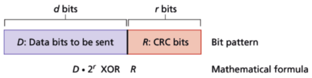

Hình 6.6 CRC

Mã CRC hoạt động như sau. Hãy xét mẩu dữ liệu d-bit, D, mà nút gửi muốn gửi tới nút nhận. Bên gửi và bên nhận trước hết phải thống nhất về một mẫu r + 1 bit, gọi là bộ sinh (generator), mà chúng ta sẽ ký hiệu là G. Chúng ta sẽ yêu cầu bit có trọng số cao nhất (ngoài cùng bên trái) của G là 1. Ý tưởng then chốt đằng sau mã CRC được minh họa trong Hình 6.6. Với một mẩu dữ liệu cho trước, D, bên gửi sẽ chọn r bit bổ sung, R, và nối chúng vào D sao cho mẫu d + r bit kết quả (được diễn giải như một số nhị phân) chia hết chính xác cho G (tức là, không có phần dư) dùng số học modulo-2. Do đó quá trình kiểm tra lỗi với CRC đơn giản: Bên nhận chia d + r bit nhận được cho G. Nếu phần dư khác không, bên nhận biết rằng một lỗi đã xảy ra; nếu không dữ liệu được chấp nhận là đúng.

Mọi phép tính CRC được thực hiện trong số học modulo-2 không có nhớ trong phép cộng hay mượn trong phép trừ. Điều này có nghĩa là phép cộng và phép trừ giống nhau, và cả hai đều tương đương với phép exclusive-or (XOR) theo bit của các toán hạng. Do đó, ví dụ,

```
1011 XOR 0101 = 1110
1001 XOR 1101 = 0100
```

Tương tự, chúng ta cũng có

```
1011 - 0101 = 1110
1001 - 1101 = 0100
```

Phép nhân và phép chia giống như trong số học base-2, ngoại trừ mọi phép cộng hay trừ cần thiết đều được thực hiện không có nhớ hay mượn. Như trong số học nhị phân thông thường, nhân với 2<sup>k</sup> dịch trái một mẫu bit k vị trí. Do đó, với D và R cho trước, đại lượng D • 2<sup>r</sup> XOR R cho ra mẫu d + r bit minh họa trong Hình 6.6. Chúng ta sẽ dùng đặc trưng đại số này của mẫu d + r bit từ Hình 6.6 trong thảo luận bên dưới.

Giờ hãy chuyển sang câu hỏi thiết yếu là bên gửi tính R như thế nào. Nhớ rằng chúng ta muốn tìm R sao cho tồn tại một n sao cho

D • 2<sup>r</sup> XOR R = nG

Tức là, chúng ta muốn chọn R sao cho G chia hết D • 2<sup>r</sup> XOR R không có phần dư. Nếu chúng ta XOR (tức là, cộng modulo-2, không có nhớ) R vào cả hai vế của phương trình trên, chúng ta có

D • 2<sup>r</sup> = nG XOR R

Phương trình này cho chúng ta biết rằng nếu chia D • 2<sup>r</sup> cho G, giá trị của phần dư chính xác là R. Nói cách khác, chúng ta có thể tính R là

R = remainder (D • 2<sup>r</sup>/G)

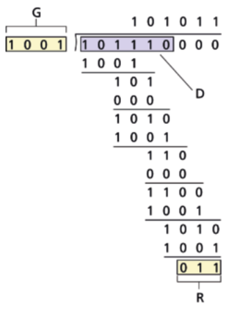

Hình 6.7 Một ví dụ tính CRC

Hình 6.7 minh họa phép tính này cho trường hợp D = 101110, d = 6, G = 1001, và r = 3. 9 bit được truyền trong trường hợp này là 101 110 011. Bạn nên tự kiểm tra các phép tính này và cũng kiểm tra rằng thực sự D • 2<sup>r</sup> = 101011 • G XOR R.

Các chuẩn quốc tế đã được định nghĩa cho các bộ sinh 8-, 12-, 16-, và 32-bit, G. Chuẩn CRC-32 32-bit, đã được áp dụng trong một số giao thức IEEE link-level, dùng bộ sinh

G<sub>CRC-32</sub> = 100000100110000010001110110110111

Mỗi chuẩn CRC có thể phát hiện lỗi chùm có độ dài ít hơn r + 1 bit. (Điều này có nghĩa là mọi lỗi bit liên tiếp có độ dài r bit trở xuống sẽ được phát hiện.) Hơn nữa, theo các giả định thích hợp, một chùm lỗi dài hơn r + 1 bit được phát hiện với xác suất 1 − 0.5<sup>r</sup>. Ngoài ra, mỗi chuẩn CRC có thể phát hiện bất kỳ số lẻ lỗi bit nào. Xem [Williams 1993] để có thảo luận về hiện thực kiểm tra CRC. Lý thuyết đằng sau mã CRC và các mã còn mạnh hơn nằm ngoài phạm vi cuốn sách này. Cuốn sách [Schwartz 1980] cung cấp một phần giới thiệu xuất sắc về chủ đề này.

## 6.3 Liên kết và giao thức đa truy cập (Multiple Access Links and Protocols)

Trong phần giới thiệu chương này, chúng ta đã lưu ý rằng có hai loại liên kết mạng: liên kết point-to-point và liên kết quảng bá. Một liên kết point-to-point gồm một bên gửi duy nhất ở một đầu liên kết và một bên nhận duy nhất ở đầu kia. Nhiều giao thức link-layer đã được thiết kế cho liên kết point-to-point; giao thức point-to-point (PPP) và high-level data link control (HDLC) là hai giao thức như vậy. Loại liên kết thứ hai, liên kết quảng bá, có thể có nhiều nút gửi và nhận đều được nối tới cùng một kênh quảng bá duy nhất, dùng chung. Thuật ngữ quảng bá (broadcast) được dùng ở đây vì khi bất kỳ nút nào truyền một frame, kênh quảng bá frame và mỗi nút khác nhận một bản sao. Ethernet và LAN không dây là ví dụ về các công nghệ link-layer quảng bá. Trong mục này, chúng ta sẽ lùi lại một bước khỏi các giao thức link-layer cụ thể và trước hết xem xét một vấn đề có tầm quan trọng trung tâm với tầng liên kết: làm thế nào điều phối truy cập của nhiều nút gửi và nhận vào một kênh quảng bá dùng chung—vấn đề đa truy cập. Kênh quảng bá thường được dùng trong LAN, các mạng tập trung về mặt địa lý trong một tòa nhà duy nhất (hoặc trong khuôn viên công ty hay trường đại học). Do đó, chúng ta sẽ xem cách các kênh đa truy cập được dùng trong LAN ở cuối mục này.

Tất cả chúng ta đều quen với khái niệm quảng bá—truyền hình đã dùng nó từ khi được phát minh. Nhưng truyền hình truyền thống là quảng bá one-way (một chiều) (tức là, một nút cố định truyền tới nhiều nút nhận), trong khi các nút trên một kênh quảng bá mạng máy tính có thể vừa gửi vừa nhận. Có lẽ một phép so sánh con người phù hợp hơn cho kênh quảng bá là một bữa tiệc cocktail, nơi nhiều người tụ tập trong một phòng lớn (không khí cung cấp môi trường quảng bá) để nói và nghe. Một phép so sánh tốt thứ hai là thứ mà nhiều độc giả quen thuộc—một lớp học—nơi (các) giáo viên và (các) học sinh tương tự dùng chung cùng một môi trường quảng bá duy nhất. Một vấn đề trung tâm trong cả hai kịch bản là xác định ai được nói (tức là, truyền vào kênh) và khi nào. Là con người, chúng ta đã phát triển một tập giao thức tinh vi để dùng chung kênh quảng bá:

“Cho mọi người cơ hội nói.” “Đừng nói cho tới khi được hỏi.” “Đừng độc chiếm cuộc trò chuyện.” “Giơ tay nếu bạn có câu hỏi.” “Đừng ngắt lời khi ai đó đang nói.”

“Đừng ngủ gật khi ai đó đang nói.”

Mạng máy tính tương tự có các giao thức—cái so-called giao thức đa truy cập (multiple access protocol)—mà các nút dùng để điều tiết việc truyền vào kênh quảng bá dùng chung. Như minh họa trong Hình 6.8, giao thức đa truy cập cần thiết trong nhiều bối cảnh mạng đa dạng, bao gồm cả mạng truy cập có dây và không dây, và mạng vệ tinh. Mặc dù về kỹ thuật mỗi nút truy cập kênh quảng bá qua adapter của nó, trong mục này, chúng ta sẽ gọi nút là thiết bị gửi và nhận. Trong thực tế, hàng trăm hoặc thậm chí hàng nghìn nút có thể giao tiếp trực tiếp qua một kênh quảng bá.

Vì mọi nút đều có khả năng truyền frame, nhiều hơn hai nút có thể truyền frame cùng lúc. Khi điều này xảy ra, mọi nút nhận nhiều frame cùng lúc; tức là, các frame được truyền va chạm (collide) tại mọi bên nhận. Thông thường, khi có va chạm, không nút nhận nào hiểu được bất kỳ frame nào đã được truyền; theo một nghĩa, tín hiệu của các frame va chạm bị rối vào nhau không gỡ được. Do đó, mọi frame liên quan đến va chạm bị mất, và kênh quảng bá bị lãng phí trong khoảng thời gian va chạm. Rõ ràng, nếu nhiều nút muốn truyền frame thường xuyên, nhiều lần truyền sẽ dẫn tới va chạm, và phần lớn băng thông của kênh quảng bá sẽ bị lãng phí.

Để đảm bảo kênh quảng bá làm việc hữu ích khi nhiều nút hoạt động, cần bằng cách nào đó điều phối việc truyền của các nút hoạt động. Công việc điều phối này là trách nhiệm của giao thức đa truy cập. Trong 50 năm qua, hàng nghìn bài báo và hàng trăm luận án tiến sĩ đã được viết về giao thức đa truy cập; một khảo sát toàn diện về 20 năm đầu của khối công trình này là [Rom 1990]. Hơn nữa, nghiên cứu tích cực về giao thức đa truy cập vẫn tiếp tục do sự xuất hiện liên tục của các loại liên kết mới, đặc biệt là các liên kết không dây mới. Qua nhiều năm, hàng chục giao thức đa truy cập đã được hiện thực trong nhiều công nghệ link-layer. Tuy vậy, chúng ta có thể phân loại hầu như bất kỳ giao thức đa truy cập nào thuộc một trong ba loại: giao thức phân chia kênh (channel partitioning protocol), giao thức truy cập ngẫu nhiên (random access protocol), và giao thức taking-turns (luân phiên). Chúng ta sẽ đề cập các loại giao thức đa truy cập này trong ba tiểu mục tiếp theo.

Hãy kết thúc tổng quan này bằng việc lưu ý rằng, lý tưởng nhất, một giao thức đa truy cập cho một kênh quảng bá tốc độ R bit mỗi giây nên có các đặc tính mong muốn sau:

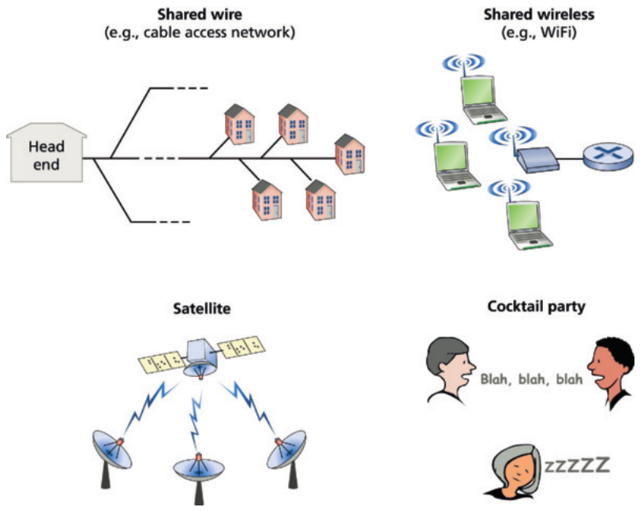

Hình 6.8 Các kênh đa truy cập khác nhau

1. Khi chỉ một nút có dữ liệu cần gửi, nút đó có throughput R bps.

2. Khi M nút có dữ liệu cần gửi, mỗi nút này có throughput R/M bps. Điều này không nhất thiết hàm ý mỗi nút trong M nút luôn có tốc độ tức thời R/M, mà là mỗi nút nên có tốc độ truyền trung bình R/M trong một khoảng thời gian được định nghĩa thích hợp nào đó.

3. Giao thức phi tập trung; tức là, không có nút điều khiển tập trung nào đại diện cho một điểm lỗi duy nhất của mạng.

4. Giao thức đơn giản, để hiện thực không tốn kém.

### 6.3.1 Giao thức phân chia kênh (Channel Partitioning Protocols)

Nhớ lại từ thảo luận đầu tiên ở Mục 1.3 rằng ghép kênh time-division (phân chia thời gian) (TDM) và ghép kênh frequency-division (phân chia tần số) (FDM) là hai kỹ thuật có thể được dùng để phân chia băng thông của một kênh quảng bá giữa mọi nút dùng chung kênh đó. Ví dụ, giả sử kênh hỗ trợ N nút và tốc độ truyền của kênh là R bps. TDM chia thời gian thành các khung thời gian (time frame) và chia tiếp mỗi khung thời gian thành N khe thời gian (time slot). (Khung thời gian TDM không nên bị nhầm với đơn vị dữ liệu link-layer được trao đổi giữa các adapter gửi và nhận, cũng được gọi là frame. Để giảm nhầm lẫn, trong tiểu mục này chúng ta sẽ gọi đơn vị dữ liệu link-layer được trao đổi là packet.) Mỗi khe thời gian sau đó được gán cho một trong N nút. Bất cứ khi nào một nút có packet cần gửi, nó truyền các bit của packet trong khe thời gian được gán của nó trong khung TDM xoay vòng. Thông thường, kích thước khe được chọn để một packet duy nhất có thể được truyền trong một thời gian khe. Hình 6.9 cho thấy một ví dụ TDM four-node (bốn nút) đơn giản. Quay lại phép so sánh bữa tiệc cocktail, một bữa tiệc cocktail TDM-regulated (được điều tiết theo TDM) sẽ cho một người dự tiệc nói trong một khoảng thời gian cố định, rồi cho người dự tiệc khác nói trong cùng lượng thời gian, v.v. Khi mọi người đã có cơ hội nói, mẫu sẽ lặp lại.

TDM hấp dẫn vì nó loại bỏ va chạm và hoàn toàn công bằng: Mỗi nút nhận một tốc độ truyền dành riêng R/N bps trong mỗi thời gian khung. Tuy nhiên, nó có hai nhược điểm lớn. Thứ nhất, một nút bị giới hạn ở tốc độ trung bình R/N bps ngay cả khi nó là nút duy nhất có packet cần gửi. Nhược điểm thứ hai là một nút phải luôn chờ tới lượt trong chuỗi truyền—lại nữa, ngay cả khi nó là nút duy nhất có frame cần gửi. Hãy tưởng tượng người dự tiệc là người duy nhất có điều gì đó để nói (và tưởng tượng đây là hoàn cảnh còn hiếm hơn khi mọi người đều muốn nghe người đó nói gì). Rõ ràng, TDM sẽ là một lựa chọn kém cho giao thức đa truy cập trong bữa tiệc cụ thể này.

Trong khi TDM dùng chung kênh quảng bá theo thời gian, FDM chia kênh R bps thành các tần số khác nhau (mỗi tần số có băng thông R/N ) và gán mỗi tần số cho một trong N nút. Do đó FDM tạo ra N kênh nhỏ hơn R/N bps từ một kênh R bps lớn hơn duy nhất. FDM chia sẻ cả ưu điểm lẫn nhược điểm của TDM. Nó tránh va chạm và chia băng thông công bằng giữa N nút. Tuy nhiên, FDM cũng chia sẻ một nhược điểm chính với TDM—một nút bị giới hạn ở băng thông R/N , ngay cả khi nó là nút duy nhất có packet cần gửi. Các kỹ thuật TDM và FDM được dùng rộng rãi trong các hệ thống cellular, WiFi, Bluetooth và vệ tinh mà chúng ta sẽ nghiên cứu trong Chương 7. Cả hai cũng được dùng trong mạng truy cập cáp, như chúng ta sẽ thấy sau trong chương này.

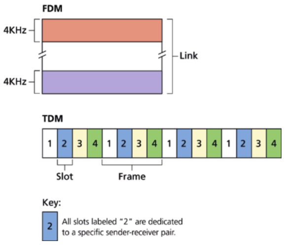

Hình 6.9 Một ví dụ TDM và FDM four-node

Một giao thức phân chia kênh thứ ba là đa truy cập phân chia theo mã (code division multiple access - CDMA). Trong khi TDM và FDM lần lượt gán khe thời gian và tần số cho các nút, CDMA gán một mã khác nhau cho mỗi nút. Mỗi nút sau đó dùng mã duy nhất của mình để mã hóa các bit dữ liệu nó gửi. Nếu các mã được chọn cẩn thận, mạng CDMA có tính chất tuyệt vời là các nút khác nhau có thể truyền đồng thời mà các bên nhận tương ứng vẫn nhận đúng các bit dữ liệu được mã hóa của một bên gửi (giả sử bên nhận biết mã của bên gửi) bất chấp việc truyền gây nhiễu của các nút khác. CDMA là một công nghệ nền tảng cho mạng di động 3G nhưng đã bị thay thế bởi các công nghệ khác trong mạng 4G và 5G. Bạn có thể tìm hiểu về CDMA trong Chương 7 của các phiên bản trước của cuốn sách này.

### 6.3.2 Giao thức truy cập ngẫu nhiên (Random Access Protocols)

Lớp tổng quát thứ hai của giao thức đa truy cập là giao thức truy cập ngẫu nhiên. Trong một giao thức truy cập ngẫu nhiên, một nút truyền luôn truyền ở tốc độ đầy đủ của kênh, cụ thể là, R bps. Khi có va chạm, mỗi nút liên quan tới va chạm liên tục truyền lại frame của nó (tức là, packet) cho đến khi frame của nó đi qua được mà không va chạm. Nhưng khi một nút gặp va chạm, nó không nhất thiết truyền lại frame ngay lập tức. Thay vào đó nó chờ một độ trễ ngẫu nhiên trước khi truyền lại frame. Mỗi nút liên quan tới va chạm chọn các độ trễ ngẫu nhiên độc lập. Vì các độ trễ ngẫu nhiên được chọn độc lập, có thể một trong các nút sẽ chọn một độ trễ đủ nhỏ hơn độ trễ của các nút va chạm khác và do đó sẽ có thể lách frame của nó vào kênh mà không va chạm.

Có hàng chục nếu không phải hàng trăm giao thức truy cập ngẫu nhiên được mô tả trong tài liệu [Rom 1990; Bertsekas 1991]. Trong mục này chúng ta sẽ mô tả một vài giao thức truy cập ngẫu nhiên well-known nhất—các giao thức ALOHA [Abramson 1970; Abramson 1985; Abramson 2009] và các giao thức đa truy cập cảm nhận sóng mang (carrier sense multiple access - CSMA) [Kleinrock 1975b]. Ethernet [Metcalfe 1976] là một giao thức CSMA phổ biến và được triển khai rộng rãi. Trong Chương 7, chúng ta sẽ đề cập việc dùng truy cập ngẫu nhiên trong giao thức CSMA/CA của WiFi.

#### ALOHA có khe (Slotted ALOHA)

Hãy bắt đầu nghiên cứu về giao thức truy cập ngẫu nhiên với một trong những giao thức truy cập ngẫu nhiên đơn giản nhất, giao thức slotted ALOHA. Trong mô tả slotted ALOHA, chúng ta giả định như sau:

• Mọi frame gồm đúng L bit.

• Thời gian được chia thành các khe kích thước L/R giây (tức là, một khe bằng thời gian truyền một frame).

• Các nút chỉ bắt đầu truyền frame ở đầu các khe.

• Các nút được đồng bộ để mỗi nút biết khi nào các khe bắt đầu.

• Nếu hai hoặc nhiều frame va chạm trong một khe, thì mọi nút phát hiện sự kiện va chạm trước khi khe kết thúc.

Gọi p là một xác suất, tức là, một số giữa 0 và 1. Hoạt động của slotted ALOHA trong mỗi nút đơn giản:

• Khi nút có một frame mới cần gửi, nó chờ tới đầu khe tiếp theo và truyền toàn bộ frame trong khe.

• Nếu không có va chạm, nút đã truyền thành công frame của nó và do đó không cần xét truyền lại frame. (Nút có thể chuẩn bị một frame mới để truyền, nếu có.)

• Nếu có va chạm, nút phát hiện va chạm trước cuối khe. Nút truyền lại frame của nó ở mỗi khe tiếp theo với xác suất p cho đến khi frame được truyền mà không va chạm.

Truyền lại với xác suất p, ý chúng tôi là nút thực chất tung một đồng xu lệch; sự kiện ngửa tương ứng với “truyền lại,” xảy ra với xác suất p. Sự kiện sấp tương ứng với “bỏ qua khe và tung đồng xu lại ở khe tiếp theo”; điều này xảy ra với xác suất (1 − p). Mọi nút liên quan tới va chạm tung đồng xu độc lập.

Slotted ALOHA có vẻ có nhiều ưu điểm. Không như phân chia kênh, slotted ALOHA cho phép một nút truyền liên tục ở tốc độ đầy đủ, R, khi nút đó là nút hoạt động duy nhất. (Một nút được gọi là hoạt động nếu nó có frame cần gửi.) Slotted ALOHA cũng rất phi tập trung, vì mỗi nút phát hiện va chạm và độc lập quyết định khi nào truyền lại. (Tuy nhiên, slotted ALOHA yêu cầu các khe được đồng bộ trong các nút; chúng ta sẽ sớm thảo luận một phiên bản không chia khe của giao thức ALOHA, cũng như các giao thức CSMA, không giao thức nào yêu cầu đồng bộ như vậy.) Slotted ALOHA cũng là một giao thức cực kỳ đơn giản.

Slotted ALOHA hoạt động tốt khi chỉ có một nút hoạt động, nhưng nó hiệu quả đến đâu khi có nhiều nút hoạt động? Có hai mối lo về hiệu quả ở đây. Thứ nhất, như minh họa trong Hình 6.10, khi có nhiều nút hoạt động, một phần nhất định các khe sẽ có va chạm và do đó sẽ bị “lãng phí.” Mối lo thứ hai là một phần khác của các khe sẽ trống vì mọi nút hoạt động đều kiềm chế không truyền do chính sách truyền xác suất. Các khe “không lãng phí” duy nhất sẽ là những khe trong đó đúng một nút truyền. Một khe trong đó đúng một nút truyền được gọi là khe thành công. Hiệu suất (efficiency) của một giao thức đa truy cập có khe được định nghĩa là tỉ lệ long-run (dài hạn) các khe thành công trong trường hợp có một số lượng lớn nút hoạt động, mỗi nút luôn có một số lượng lớn frame cần gửi. Lưu ý rằng nếu không dùng hình thức kiểm soát truy cập nào, và mỗi nút truyền lại ngay sau mỗi va chạm, hiệu suất sẽ bằng không. Slotted ALOHA rõ ràng tăng hiệu suất vượt quá không, nhưng bao nhiêu?

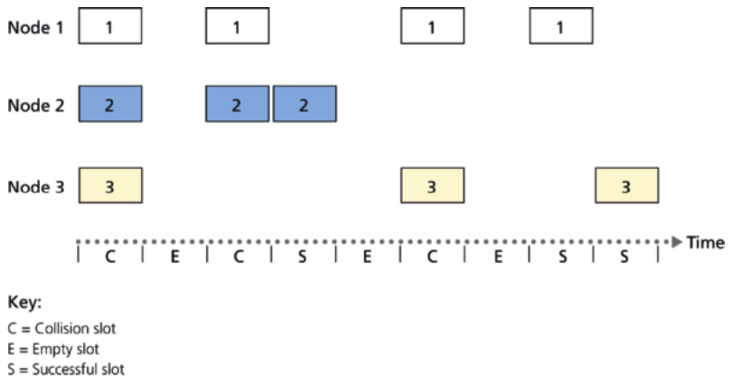

Hình 6.10 Các nút 1, 2 và 3 va chạm ở khe đầu tiên. Nút 2 cuối cùng thành công ở khe thứ tư, nút 1 ở khe thứ tám, và nút 3 ở khe thứ chín

Giờ chúng ta tiếp tục phác thảo cách suy ra hiệu suất tối đa của slotted ALOHA. Để giữ phép suy dẫn đơn giản, hãy sửa đổi giao thức một chút và giả sử mỗi nút cố truyền một frame ở mỗi khe với xác suất p. (Tức là, chúng ta giả sử mỗi nút luôn có frame cần gửi và nút truyền với xác suất p cho một frame mới cũng như cho một frame đã gặp va chạm.) Giả sử có N nút. Khi đó xác suất một khe cho trước là khe thành công là xác suất một trong các nút truyền và N − 1 nút còn lại không truyền. Xác suất một nút cho trước truyền là p; xác suất các nút còn lại không truyền là (1 − p)<sup>N−1</sup>. Do đó, xác suất một nút cho trước thành công là p(1 − p)<sup>N−1</sup>. Vì có N nút, xác suất bất kỳ nút nào trong N nút thành công là Np(1 − p)<sup>N−1</sup>.

Do đó, khi có N nút hoạt động, hiệu suất của slotted ALOHA là Np(1 − p)<sup>N−1</sup>. Để có hiệu suất tối đa cho N nút hoạt động, chúng ta phải tìm p* làm cực đại biểu thức này. (Xem các bài tập về nhà để có phác thảo tổng quát của phép suy dẫn này.) Và để có hiệu suất tối đa cho một số lượng lớn nút hoạt động, chúng ta lấy giới hạn của Np*( 1 − p*)<sup>N−1</sup> khi N tiến tới vô cùng. (Lại nữa, xem các bài tập về nhà.) Sau khi thực hiện các phép tính này, chúng ta sẽ thấy hiệu suất tối đa của giao thức được cho bởi 1/ e = 0.37. Tức là, khi một số lượng lớn nút có nhiều frame cần truyền, thì (tốt nhất) chỉ 37 phần trăm các khe làm việc hữu ích. Do đó, tốc độ truyền hiệu dụng của kênh không phải R bps mà chỉ 0.37 R bps! Một phân tích tương tự cũng cho thấy 37 phần trăm các khe trống và 26 phần trăm khe có va chạm. Hãy tưởng tượng người quản trị mạng tội nghiệp đã mua một hệ thống slotted ALOHA 100-Mbps, mong đợi có thể dùng mạng để truyền dữ liệu giữa một số lượng lớn người dùng với tốc độ tổng, chẳng hạn, 80 Mbps! Mặc dù kênh có khả năng truyền một frame cho trước ở tốc độ kênh đầy đủ 100 Mbps, về lâu dài, throughput thành công của kênh này sẽ nhỏ hơn 37 Mbps.

#### Aloha

Giao thức slotted ALOHA yêu cầu mọi nút đồng bộ việc truyền để bắt đầu ở đầu một khe. Giao thức ALOHA đầu tiên [Abramson 1970] thực ra là một giao thức không chia khe, hoàn toàn phi tập trung. Trong ALOHA thuần (pure ALOHA), khi một frame lần đầu tới (tức là, một datagram network-layer được chuyển xuống từ tầng mạng tại nút gửi), nút ngay lập tức truyền toàn bộ frame vào kênh quảng bá. Nếu một frame được truyền gặp va chạm với một hoặc nhiều lần truyền khác, nút khi đó sẽ ngay lập tức (sau khi truyền xong frame bị va chạm) truyền lại frame với xác suất p. Nếu không, nút chờ một thời gian truyền frame. Sau khi chờ này, nó truyền frame với xác suất p, hoặc chờ (giữ rảnh) thêm một thời gian frame với xác suất 1 − p.

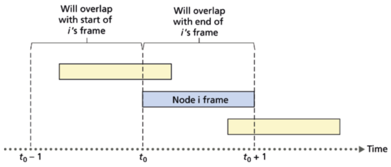

Hình 6.11 Các lần truyền gây nhiễu trong pure ALOHA

Để xác định hiệu suất tối đa của pure ALOHA, chúng ta tập trung vào một nút riêng lẻ. Chúng ta sẽ đưa ra cùng các giả định như trong phân tích slotted ALOHA và lấy thời gian truyền frame làm đơn vị thời gian. Tại bất kỳ thời điểm nào, xác suất một nút đang truyền một frame là p. Giả sử frame này bắt đầu truyền tại thời điểm t<sub>0</sub>. Như minh họa trong Hình 6.11, để frame này được truyền thành công, không nút nào khác được bắt đầu truyền trong khoảng thời gian [ t<sub>0</sub> − 1, t<sub>0</sub> ]. Một lần truyền như vậy sẽ chồng lấn với phần đầu của việc truyền frame của nút i. Xác suất mọi nút khác không bắt đầu truyền trong khoảng này là (1 − p)<sup>N−1</sup>. Tương tự, không nút nào khác được bắt đầu truyền trong khi nút i đang truyền, vì một lần truyền như vậy sẽ chồng lấn với phần sau của việc truyền của nút i. Xác suất mọi nút khác không bắt đầu truyền trong khoảng này cũng là (1 − p)<sup>N−1</sup>. Do đó, xác suất một nút cho trước truyền thành công là p(1 − p)<sup>2</sup>(<sup>N−1</sup>). Bằng cách lấy giới hạn như trong trường hợp slotted ALOHA, chúng ta thấy hiệu suất tối đa của giao thức pure ALOHA chỉ là 1/2e —đúng một nửa của slotted ALOHA. Đây là cái giá phải trả cho ( ) một giao thức ALOHA hoàn toàn phi tập trung.

#### Đa truy cập cảm nhận sóng mang (Carrier Sense Multiple Access (CSMA))

Trong cả slotted và pure ALOHA, quyết định truyền của một nút được đưa ra độc lập với hoạt động của các nút khác gắn với kênh quảng bá. Cụ thể, một nút không để ý xem một nút khác có tình cờ đang truyền khi nó bắt đầu truyền không, cũng không dừng truyền nếu một nút khác bắt đầu gây nhiễu việc truyền của nó. Trong phép so sánh bữa tiệc cocktail, các giao thức ALOHA khá giống một người dự tiệc thô lỗ tiếp tục huyên thuyên bất kể người khác có đang nói không. Là con người, chúng ta có các giao thức con người cho phép chúng ta không chỉ cư xử lịch sự hơn, mà còn giảm lượng thời gian “va chạm” với nhau trong cuộc trò chuyện và, do đó, tăng lượng dữ liệu chúng ta trao đổi trong cuộc trò chuyện. Cụ thể, có hai quy tắc quan trọng cho cuộc trò chuyện lịch sự của con người:

• Nghe trước khi nói. Nếu người khác đang nói, hãy chờ đến khi họ nói xong. Trong thế giới mạng, điều này được gọi là cảm nhận sóng mang (carrier sensing)—một nút nghe kênh trước khi truyền. Nếu một frame từ nút khác hiện đang được truyền vào kênh, một nút khi đó chờ cho đến khi nó không phát hiện việc truyền nào trong một khoảng thời gian ngắn rồi bắt đầu truyền.

• Nếu người khác bắt đầu nói cùng lúc, hãy dừng nói. Trong thế giới mạng, điều này được gọi là phát hiện va chạm (collision detection)—một nút truyền nghe kênh trong khi nó đang truyền. Nếu nó phát hiện một nút khác đang truyền một frame gây nhiễu, nó dừng truyền và chờ một lượng thời gian ngẫu nhiên trước khi lặp lại chu trình sense-and-transmit-when-idle (cảm nhận và truyền khi rảnh).

Hai quy tắc này được thể hiện trong họ giao thức đa truy cập cảm nhận sóng mang (CSMA) và CSMA với phát hiện va chạm (CSMA/CD) [Kleinrock 1975b; Metcalfe 1976; Lam 1980; Rom 1990]. Nhiều biến thể của CSMA và CSMA/CD đã được đề xuất. Ở đây, chúng ta sẽ xét một vài đặc tính quan trọng, và cơ bản nhất của CSMA và CSMA/CD.

> Lịch sử tình huống (Case History)
>
> Norm Abramson và Alohanet (Norm Abramson and Alohanet)
>
> Norm Abramson, một kỹ sư tiến sĩ, có niềm đam mê lướt sóng và quan tâm tới chuyển mạch gói. Sự kết hợp sở thích này đưa ông tới University of Hawaii năm 1969. Hawaii gồm nhiều đảo núi non, khiến việc lắp đặt và vận hành các mạng land-based (trên đất liền) trở nên khó khăn. Khi không lướt sóng, Abramson nghĩ về cách thiết kế một mạng thực hiện chuyển mạch gói qua sóng radio. Mạng ông thiết kế có một host trung tâm và một số nút phụ rải rác khắp quần đảo Hawaii. Mạng có hai kênh, mỗi kênh dùng một băng tần khác nhau. Kênh downlink quảng bá packet từ host trung tâm tới các host phụ; và kênh upstream gửi packet từ các host phụ tới host trung tâm. Ngoài việc gửi các packet thông tin, host trung tâm cũng gửi trên kênh downstream một acknowledgment cho mỗi packet nhận thành công từ các host phụ.
>
> Vì các host phụ truyền packet theo kiểu phi tập trung, va chạm trên kênh upstream chắc chắn xảy ra. Quan sát này đã dẫn Abramson nghĩ ra giao thức pure ALOHA, như mô tả trong chương này. Năm 1970, với tài trợ tiếp tục từ ARPA, Abramson đã kết nối ALOHAnet của ông với ARPAnet. Để biết lịch sử của AlohaNet, xem [Schwartz 2009]. Công trình của Abramson quan trọng không chỉ vì nó là ví dụ đầu tiên về một mạng packet radio, mà còn vì nó đã truyền cảm hứng cho Bob Metcalfe. Vài năm sau, Metcalfe đã sửa đổi giao thức ALOHA để tạo ra giao thức CSMA/CD và Ethernet LAN.

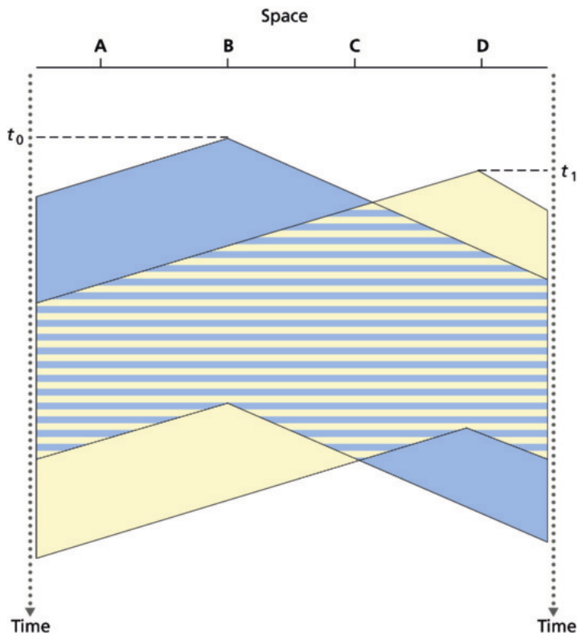

Hình 6.12 Sơ đồ space-time (không gian–thời gian) của hai nút CSMA với các lần truyền va chạm

Câu hỏi đầu tiên bạn có thể hỏi về CSMA là tại sao, nếu mọi nút đều thực hiện cảm nhận sóng mang, va chạm lại xảy ra ngay từ đầu? Suy cho cùng, một nút sẽ kiềm chế không truyền bất cứ khi nào nó cảm nhận một nút khác đang truyền. Câu trả lời cho câu hỏi có thể được minh họa tốt nhất bằng sơ đồ space-time [Molle 1987]. Hình 6.12 cho thấy một sơ đồ space-time của bốn nút (A, B, C, D) gắn vào một bus quảng bá tuyến tính. Trục ngang cho thấy vị trí của mỗi nút trong không gian; trục dọc biểu diễn thời gian.

Tại thời điểm t<sub>0</sub>, nút B cảm nhận kênh rảnh, vì hiện không có nút nào khác đang truyền. Do đó nút B bắt đầu truyền, với các bit của nó lan truyền theo cả hai chiều dọc môi trường quảng bá. Sự lan truyền đi xuống của các bit của B trong Hình 6.12 khi thời gian tăng cho thấy cần một lượng thời gian khác không để các bit của B thực sự lan truyền (dù ở gần tốc độ ánh sáng) dọc môi trường quảng bá. Tại thời điểm t<sub>1</sub> (t<sub>1</sub> > t<sub>0</sub>), nút D có một frame cần gửi. Mặc dù nút B đang truyền tại thời điểm t<sub>1</sub>, các bit do B truyền chưa tới D, và do đó D cảm nhận kênh rảnh tại t<sub>1</sub>. Theo giao thức CSMA, do đó D bắt đầu truyền frame của nó. Một thời gian ngắn sau, việc truyền của B bắt đầu gây nhiễu việc truyền của D tại D. Từ Hình 6.12, rõ ràng độ trễ lan truyền kênh end-to-end của một kênh quảng bá—thời gian để một tín hiệu lan truyền từ một nút tới nút khác—sẽ đóng vai trò thiết yếu trong việc xác định performance của nó. Độ trễ lan truyền này càng dài, khả năng một nút carrier-sensing chưa thể cảm nhận một lần truyền đã bắt đầu tại một nút khác trong mạng càng lớn.

#### Đa truy cập cảm nhận sóng mang với phát hiện va chạm (Carrier Sense Multiple Access with Collision Detection (CSMA/CD))

Trong Hình 6.12, các nút không thực hiện phát hiện va chạm; cả B và D đều tiếp tục truyền toàn bộ frame của chúng mặc dù va chạm đã xảy ra. Khi một nút thực hiện phát hiện va chạm, nó dừng truyền ngay khi phát hiện va chạm. Hình 6.13 cho thấy cùng kịch bản như trong Hình 6.12, ngoại trừ hai nút mỗi nút hủy việc truyền một thời gian ngắn sau khi phát hiện va chạm. Rõ ràng, thêm phát hiện va chạm vào một giao thức đa truy cập sẽ giúp performance của giao thức bằng cách không truyền toàn bộ một frame vô ích, bị hỏng (do nhiễu với một frame từ nút khác).

Trước khi phân tích giao thức CSMA/CD, giờ hãy tóm tắt hoạt động của nó từ góc nhìn của một adapter (trong một nút) gắn với một kênh quảng bá:

1. Adapter lấy một datagram từ tầng mạng, chuẩn bị một frame link-layer, và đặt frame vào buffer adapter.

2. Nếu adapter cảm nhận kênh rảnh (tức là, không có năng lượng tín hiệu nào đi vào adapter từ kênh), nó bắt đầu truyền frame. Mặt khác, nếu adapter cảm nhận kênh bận, nó chờ cho đến khi không cảm nhận năng lượng tín hiệu nào rồi bắt đầu truyền frame.

3. Trong khi truyền, adapter giám sát sự hiện diện của năng lượng tín hiệu đến từ các adapter khác dùng kênh quảng bá.

4. Nếu adapter truyền toàn bộ frame mà không phát hiện năng lượng tín hiệu từ các adapter khác, adapter đã xong với frame. Mặt khác, nếu adapter phát hiện năng lượng tín hiệu từ các adapter khác trong khi truyền, nó hủy việc truyền (tức là, nó dừng truyền frame).

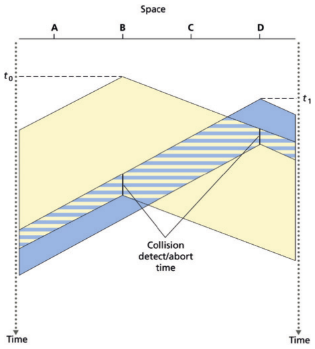

Hình 6.13 CSMA với phát hiện va chạm

5. Sau khi hủy, adapter chờ một lượng thời gian ngẫu nhiên rồi quay lại bước 2.

Nhu cầu chờ một lượng thời gian ngẫu nhiên (thay vì cố định) hy vọng là rõ ràng—nếu hai nút truyền frame cùng lúc rồi cả hai cùng chờ cùng một lượng thời gian cố định, chúng sẽ tiếp tục va chạm mãi mãi. Nhưng khoảng thời gian tốt để chọn thời gian backoff ngẫu nhiên là gì? Nếu khoảng lớn và số nút va chạm nhỏ, các nút có khả năng chờ một lượng thời gian lớn (với kênh vẫn rảnh) trước khi lặp lại bước sense-and-transmit-when-idle. Mặt khác, nếu khoảng nhỏ và số nút va chạm lớn, có khả năng các giá trị ngẫu nhiên được chọn sẽ gần như nhau, và các nút truyền sẽ lại va chạm. Điều chúng ta muốn là một khoảng ngắn khi số nút va chạm nhỏ, và dài khi số nút va chạm lớn.

Thuật toán binary exponential backoff (lùi theo hàm mũ nhị phân), được dùng trong Ethernet cũng như trong các giao thức đa truy cập mạng cáp DOCSIS [DOCSIS 3.1 2014], giải quyết thanh lịch vấn đề này. Cụ thể, khi truyền một frame đã gặp n va chạm, một nút chọn giá trị K ngẫu nhiên từ {0, 1, 2, . . . . 2<sup>n</sup> − 1} . Do đó, frame gặp càng nhiều va chạm, khoảng chọn K càng lớn. Với Ethernet, lượng thời gian thực tế một nút chờ là K • 512 thời gian bit (tức là, K nhân lượng thời gian cần để gửi 512 bit vào Ethernet) và giá trị tối đa n có thể nhận được giới hạn ở 10.

Hãy xem một ví dụ. Giả sử một nút cố truyền một frame lần đầu tiên và trong khi truyền nó phát hiện một va chạm. Nút sau đó chọn K = 0 với xác suất 0.5 hoặc chọn K = 1 với xác suất 0.5. Nếu nút chọn K = 0, thì nó ngay lập tức bắt đầu cảm nhận kênh. Nếu nút chọn K = 1, nó chờ 512 thời gian bit (ví dụ, 5.12 micro giây cho Ethernet 100 Mbps) trước khi bắt đầu chu trình sense-and-transmit-when-idle. Sau va chạm thứ hai, K được chọn với xác suất bằng nhau từ { 0,1,2,3}. Sau ba va chạm, K được chọn với xác suất bằng nhau từ { 0,1,2,3,4,5,6,7}. Sau 10 va chạm trở lên, K được chọn với xác suất bằng nhau từ {0,1,2, . . . , 1023}. Do đó, kích thước các tập mà K được chọn từ đó tăng theo hàm mũ với số va chạm; vì lý do này thuật toán này được gọi là binary exponential backoff.

Chúng tôi cũng lưu ý ở đây rằng mỗi khi một nút chuẩn bị một frame mới để truyền, nó chạy thuật toán CSMA/CD, không tính tới bất kỳ va chạm nào có thể đã xảy ra trong quá khứ gần. Vì vậy có thể một nút với frame mới sẽ ngay lập tức lách được một lần truyền thành công trong khi một số nút khác đang ở trạng thái exponential backoff.

#### Hiệu suất CSMA/CD (CSMA/CD Efficiency)

Khi chỉ một nút có frame cần gửi, nút có thể truyền ở tốc độ kênh đầy đủ (ví dụ, với Ethernet tốc độ điển hình là 10 Mbps, 100 Mbps hoặc 1 Gbps). Tuy nhiên, nếu nhiều nút có frame cần truyền, tốc độ truyền hiệu dụng của kênh có thể thấp hơn nhiều. Chúng ta định nghĩa hiệu suất của CSMA/CD là tỉ lệ long-run thời gian frame đang được truyền trên kênh mà không va chạm khi có một số lượng lớn nút hoạt động, với mỗi nút có một số lượng lớn frame cần gửi. Để trình bày một xấp xỉ closed-form (dạng đóng) của hiệu suất Ethernet, gọi d<sub>prop</sub> là thời gian tối đa để năng lượng tín hiệu lan truyền giữa hai adapter bất kỳ. Gọi d<sub>trans</sub> là thời gian truyền một frame maximum-size (kích thước tối đa) (xấp xỉ 1.2 msecs cho Ethernet 10 Mbps). Phép suy dẫn hiệu suất CSMA/CD nằm ngoài phạm vi cuốn sách này (xem [Lam 1980] và [Bertsekas 1991]). Ở đây chúng tôi đơn giản nêu xấp xỉ sau:

Hiệu suất (Efficiency) = 1/(1 + 5d<sub>prop</sub>/d<sub>trans</sub>)

Từ công thức này chúng ta thấy khi d<sub>prop</sub> tiến tới 0, hiệu suất tiến tới 1. Điều này khớp với trực giác rằng nếu độ trễ lan truyền bằng không, các nút va chạm sẽ hủy ngay lập tức mà không lãng phí kênh. Ngoài ra, khi d<sub>trans</sub> trở nên rất lớn, hiệu suất tiến tới 1. Điều này cũng trực quan vì khi một frame chiếm kênh, nó sẽ giữ kênh trong thời gian rất dài; do đó, kênh sẽ làm việc hữu ích phần lớn thời gian.

### 6.3.3 Giao thức luân phiên (Taking-Turns Protocols)

Nhớ rằng hai tính chất mong muốn của một giao thức đa truy cập là (1) khi chỉ một nút hoạt động, nút hoạt động có throughput R bps, và (2) khi M nút hoạt động, thì mỗi nút hoạt động có throughput gần R/M bps. Các giao thức ALOHA và CSMA có tính chất thứ nhất nhưng không có tính chất thứ hai. Điều này đã thúc đẩy các nhà nghiên cứu tạo ra một lớp giao thức khác— các giao thức taking-turns. Như với giao thức truy cập ngẫu nhiên, có hàng chục giao thức taking-turns, và mỗi giao thức có nhiều biến thể. Ở đây chúng ta sẽ thảo luận hai trong số các giao thức quan trọng hơn. Giao thức thứ nhất là giao thức thăm dò (polling protocol). Giao thức thăm dò yêu cầu một trong các nút được chỉ định làm nút điều khiển. Nút điều khiển thăm dò từng nút theo kiểu round-robin. Cụ thể, nút điều khiển trước hết gửi một thông điệp tới nút 1, nói rằng nó (nút 1) có thể truyền tới một số frame tối đa nào đó. Sau khi nút 1 truyền một số frame, nút điều khiển bảo nút 2 rằng nó (nút 2) có thể truyền tới số frame tối đa. (Nút điều khiển có thể xác định khi nào một nút đã gửi xong frame bằng cách quan sát việc thiếu tín hiệu trên kênh.) Thủ tục tiếp tục theo cách này, với nút điều khiển thăm dò từng nút theo vòng.

Giao thức thăm dò loại bỏ các va chạm và khe trống vốn gây khổ cho giao thức truy cập ngẫu nhiên. Điều này cho phép polling đạt hiệu suất cao hơn nhiều. Nhưng nó cũng có vài nhược điểm. Nhược điểm thứ nhất là giao thức đưa vào một độ trễ thăm dò—lượng thời gian cần để thông báo cho một nút rằng nó có thể truyền. Ví dụ, nếu chỉ một nút hoạt động, thì nút sẽ truyền với tốc độ thấp hơn R bps, vì nút điều khiển phải lần lượt thăm dò từng nút không hoạt động mỗi khi nút hoạt động đã gửi số frame tối đa. Nhược điểm thứ hai, có thể nghiêm trọng hơn, là nếu nút điều khiển hỏng, toàn bộ kênh ngừng hoạt động. Giao thức Bluetooth, mà chúng ta sẽ nghiên cứu trong Mục 7.5.1, là một ví dụ về giao thức thăm dò.

Giao thức taking-turns thứ hai là giao thức token-passing (chuyển thẻ bài). Trong giao thức này không có nút điều khiển. Một frame special-purpose (chuyên dụng) nhỏ gọi là token được trao đổi giữa các nút theo một thứ tự cố định nào đó. Ví dụ, nút 1 có thể luôn gửi token tới nút 2, nút 2 có thể luôn gửi token tới nút 3, và nút N có thể luôn gửi token tới nút 1. Khi một nút nhận token, nó chỉ giữ token nếu nó có frame cần truyền; nếu không, nó ngay lập tức chuyển tiếp token tới nút tiếp theo. Nếu một nút có frame cần truyền khi nhận token, nó gửi tới một số frame tối đa rồi chuyển tiếp token tới nút tiếp theo. Token passing là phi tập trung và hiệu quả cao. Nhưng nó cũng có vấn đề. Ví dụ, sự cố của một nút có thể làm sập toàn bộ kênh. Hoặc nếu một nút vô tình quên giải phóng token, thì một thủ tục phục hồi nào đó phải được gọi để đưa token trở lại lưu thông. Qua nhiều năm nhiều giao thức token-passing đã được phát triển, bao gồm giao thức fiber distributed data interface (FDDI) [Jain 1994] và giao thức IEEE 802.5 token ring [IEEE 802.5 2012], và mỗi giao thức đều phải giải quyết những vấn đề này cũng như các vấn đề hóc búa khác.

### 6.3.4 DOCSIS: Giao thức tầng liên kết cho truy cập Internet qua cáp (DOCSIS: The Link-Layer Protocol for Cable Internet Access)

Trong ba tiểu mục trước, chúng ta đã học về ba lớp tổng quát của giao thức đa truy cập: giao thức phân chia kênh, giao thức truy cập ngẫu nhiên, và giao thức luân phiên. Một mạng truy cập cáp sẽ là một nghiên cứu tình huống xuất sắc ở đây, vì chúng ta sẽ tìm thấy các khía cạnh của cả ba lớp giao thức đa truy cập này trong mạng truy cập cáp!

Nhớ lại từ Mục 1.2.1 rằng một mạng truy cập cáp thường nối vài nghìn cable modem dân dụng tới một hệ thống kết cuối cable modem (cable modem termination system - CMTS) tại headend của mạng cáp. Data-Over-Cable Service Interface Specifications (DOCSIS) [DOCSIS 3.1 2014; Hamzeh 2015] đặc tả kiến trúc mạng dữ liệu cáp và các giao thức của nó. DOCSIS dùng FDM để chia các đoạn mạng downstream (CMTS tới modem) và upstream (modem tới CMTS) thành nhiều kênh tần số. Mỗi kênh downstream rộng từ 24 MHz đến 192 MHz, với throughput tối đa xấp xỉ 1.6 Gbps mỗi kênh; mỗi kênh upstream có độ rộng kênh từ 6.4 MHz đến 96 MHz, với throughput upstream tối đa xấp xỉ 1 Gbps. Mỗi kênh upstream và downstream là một kênh quảng bá. Các frame được CMTS truyền trên kênh downstream được nhận bởi mọi cable modem nhận kênh đó; tuy nhiên, vì chỉ có một CMTS duy nhất truyền vào kênh downstream, không có vấn đề đa truy cập. Tuy nhiên, chiều upstream thú vị hơn và thách thức hơn về kỹ thuật, vì nhiều cable modem dùng chung cùng kênh upstream (tần số) tới CMTS, và do đó va chạm có thể xảy ra.

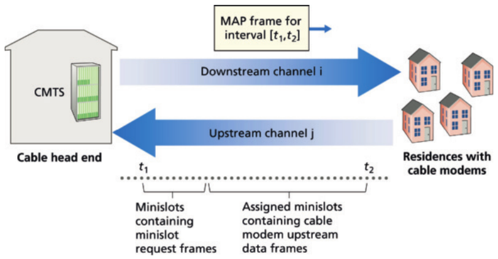

Hình 6.14 Các kênh upstream và downstream giữa CMTS và cable modem

Như minh họa trong Hình 6.14, mỗi kênh upstream được chia thành các khoảng thời gian (TDM-like - giống TDM), mỗi khoảng chứa một chuỗi mini-slots trong đó cable modem có thể truyền tới CMTS. CMTS cấp quyền tường minh cho từng cable modem truyền trong các mini-slots cụ thể. CMTS làm việc này bằng cách gửi một thông điệp điều khiển gọi là thông điệp MAP trên một kênh downstream để chỉ định cable modem nào (có dữ liệu cần gửi) có thể truyền trong mini-slot nào cho khoảng thời gian được chỉ định trong thông điệp điều khiển. Vì các mini-slots được cấp phát tường minh cho cable modem, CMTS có thể đảm bảo không có lần truyền va chạm nào trong một mini-slot.

Nhưng ngay từ đầu làm sao CMTS biết cable modem nào có dữ liệu cần gửi? Việc này được thực hiện bằng cách để cable modem gửi các frame mini-slot-request (yêu cầu khe nhỏ) tới CMTS trong một tập mini-slots khoảng đặc biệt dành riêng cho mục đích này, như minh họa trong Hình 6.14. Các frame mini-slot-request này được truyền theo kiểu truy cập ngẫu nhiên và do đó có thể va chạm với nhau. Một cable modem không thể cảm nhận kênh upstream có bận không cũng không phát hiện được va chạm. Thay vào đó, cable modem suy ra rằng frame mini-slot-request của nó đã gặp va chạm nếu nó không nhận được phản hồi cho yêu cầu cấp phát trong thông điệp điều khiển downstream tiếp theo. Khi suy ra có va chạm, một cable modem dùng binary exponential backoff để hoãn việc truyền lại frame mini-slot-request tới một khe thời gian tương lai. Khi có ít traffic trên kênh upstream, một cable modem thực ra có thể truyền frame dữ liệu trong các khe trên danh nghĩa được gán cho frame mini-slot-request (và do đó tránh phải chờ gán mini-slot).

Do đó một mạng truy cập cáp là một ví dụ tuyệt vời về các giao thức đa truy cập khi hoạt động—FDM, TDM, truy cập ngẫu nhiên, và khe thời gian được cấp phát tập trung tất cả trong một mạng!

## 6.4 Mạng cục bộ chuyển mạch (Switched Local Area Networks)

Sau khi đề cập mạng quảng bá và giao thức đa truy cập trong mục trước, giờ hãy chuyển sự chú ý sang mạng cục bộ chuyển mạch. Hình 6.15 cho thấy một mạng cục bộ chuyển mạch nối ba phòng ban, hai server và một router với bốn switch. Vì các switch này hoạt động ở tầng liên kết, chúng chuyển mạch frame link-layer (thay vì datagram network-layer), không nhận biết địa chỉ network-layer, và không dùng thuật toán định tuyến như OSPF để xác định đường đi qua mạng switch layer-2. Thay vì dùng địa chỉ IP, chúng ta sẽ sớm thấy chúng dùng địa chỉ link-layer để chuyển tiếp frame link-layer qua mạng switch. Chúng ta sẽ bắt đầu nghiên cứu LAN chuyển mạch bằng việc trước hết đề cập định địa chỉ link-layer (Mục 6.4.1). Sau đó chúng ta xem xét giao thức Ethernet nổi tiếng (Mục 6.4.2). Sau khi xem xét định địa chỉ link-layer và Ethernet, chúng ta sẽ xem cách switch link-layer hoạt động (Mục 6.4.3), rồi xem (Mục 6.4.4) cách các switch này thường được dùng để xây dựng LAN large-scale.

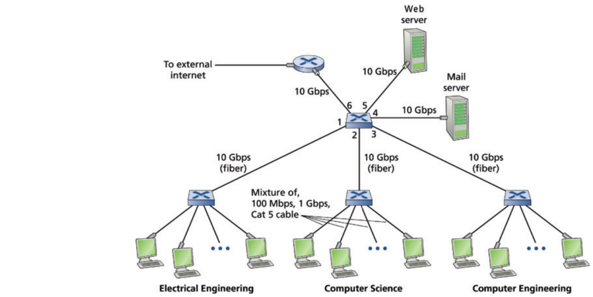

Hình 6.15 Một mạng tổ chức được nối với nhau bằng bốn switch

### 6.4.1 Định địa chỉ tầng liên kết và ARP (Link-Layer Addressing and ARP)

Host và router có địa chỉ link-layer. Giờ có thể bạn thấy điều này ngạc nhiên, nhớ lại từ Chương 4 rằng host và router cũng có địa chỉ network-layer. Có thể bạn đang hỏi, tại sao trên đời chúng ta lại cần có địa chỉ ở cả tầng mạng lẫn tầng liên kết? Ngoài việc mô tả cú pháp và chức năng của địa chỉ link-layer, trong mục này chúng tôi hy vọng làm sáng tỏ tại sao hai tầng địa chỉ lại hữu ích và, thực ra, không thể thiếu. Chúng ta cũng sẽ đề cập Address Resolution Protocol (ARP), cung cấp một cơ chế chuyển địa chỉ IP thành địa chỉ link-layer.

#### Địa chỉ MAC (MAC Addresses)

Thực ra, không phải host và router có địa chỉ link-layer mà là adapter của chúng (tức là, giao diện mạng) có địa chỉ link-layer. Một host hoặc router có nhiều giao diện mạng do đó sẽ có nhiều địa chỉ link-layer gắn với nó, giống như nó cũng sẽ có nhiều địa chỉ IP gắn với nó. Tuy nhiên, điều quan trọng cần lưu ý là các switch link-layer không có địa chỉ link-layer gắn với các giao diện nối tới host và router. Điều này vì nhiệm vụ của switch link-layer là chuyên chở datagram giữa host và router; một switch làm nhiệm vụ này một cách trong suốt, tức là, host hoặc router không phải định địa chỉ tường minh frame tới switch trung gian. Điều này được minh họa trong Hình 6.16. Một địa chỉ link-layer được gọi bằng nhiều tên: địa chỉ LAN, địa chỉ vật lý, hoặc địa chỉ MAC. Vì địa chỉ MAC có vẻ là thuật ngữ phổ biến nhất, từ giờ chúng ta sẽ gọi địa chỉ link-layer là địa chỉ MAC. Với hầu hết các LAN (bao gồm Ethernet và LAN không dây 802.11), địa chỉ MAC dài 6 byte, cho 2<sup>48</sup> địa chỉ MAC khả dĩ. Như minh họa trong Hình 6.16, các địa chỉ 6-byte này thường được biểu diễn ở ký pháp thập lục phân, với mỗi byte của địa chỉ được biểu diễn bằng một cặp số thập lục phân. Mặc dù địa chỉ MAC được thiết kế để cố định vĩnh viễn, giờ có thể thay đổi địa chỉ MAC của một adapter bằng phần mềm. Tuy nhiên, trong phần còn lại của mục này, chúng ta sẽ giả sử địa chỉ MAC của một adapter là cố định.

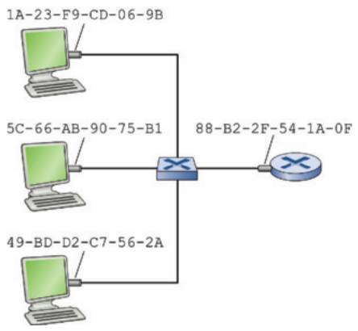

Hình 6.16 Mỗi giao diện nối với một LAN có một địa chỉ MAC duy nhất

Một tính chất thú vị của địa chỉ MAC là không có hai adapter nào có cùng địa chỉ. Điều này có vẻ ngạc nhiên khi adapter được nhiều công ty sản xuất ở nhiều quốc gia. Làm thế nào một công ty sản xuất adapter ở Đài Loan đảm bảo nó đang dùng địa chỉ khác với một công ty sản xuất adapter ở Bỉ? Câu trả lời là IEEE quản lý không gian địa chỉ MAC. Cụ thể, khi một công ty muốn sản xuất adapter, nó mua một khúc không gian địa chỉ gồm 2<sup>24</sup> địa chỉ với một khoản phí danh nghĩa. IEEE cấp phát khúc 2<sup>24</sup> địa chỉ bằng cách cố định 24 bit đầu của một địa chỉ MAC và để công ty tạo các tổ hợp duy nhất của 24 bit cuối cho mỗi adapter.

Địa chỉ MAC của một adapter có cấu trúc phẳng (trái với cấu trúc phân cấp) và không thay đổi bất kể adapter đi đâu. Một laptop có giao diện Ethernet luôn có cùng địa chỉ MAC, bất kể máy tính đi đâu. Một smartphone có giao diện 802.11 luôn có cùng địa chỉ MAC, bất kể smartphone đi đâu. Nhớ rằng, ngược lại, địa chỉ IP có cấu trúc phân cấp (tức là, một phần mạng và một phần host), và các địa chỉ IP của một host cần được thay đổi khi host di chuyển, tức là, thay đổi mạng mà nó gắn vào. Địa chỉ MAC của một adapter tương tự số an sinh xã hội của một người, cũng có cấu trúc định địa chỉ phẳng và không thay đổi bất kể người đó đi đâu. Một địa chỉ IP tương tự địa chỉ bưu chính của một người, có tính phân cấp và phải thay đổi bất cứ khi nào người đó chuyển nhà. Giống như một người có thể thấy hữu ích khi có cả địa chỉ bưu chính lẫn số an sinh xã hội, việc giao diện host và router có cả địa chỉ network-layer lẫn địa chỉ MAC là hữu ích.

Khi một adapter muốn gửi một frame tới một adapter đích nào đó, adapter gửi chèn địa chỉ MAC của adapter đích vào frame rồi gửi frame vào LAN. Như chúng ta sẽ sớm thấy, một switch thỉnh thoảng quảng bá một frame đến ra mọi giao diện của nó. Chúng ta sẽ thấy trong Chương 7 rằng 802.11 cũng quảng bá frame. Do đó, một adapter có thể nhận một frame không được gửi tới nó. Do đó, khi một adapter nhận một frame, nó sẽ kiểm tra xem địa chỉ MAC đích trong frame có khớp với địa chỉ MAC của chính nó không. Nếu khớp, adapter trích xuất datagram được bao bọc và chuyển datagram lên protocol stack. Nếu không khớp, adapter loại bỏ frame, mà không chuyển datagram network-layer lên. Do đó, chỉ đích mới bị ngắt khi frame được nhận.

Tuy nhiên, đôi khi một adapter gửi thực sự muốn mọi adapter khác trên LAN nhận và xử lý frame nó sắp gửi. Trong trường hợp này, adapter gửi chèn một địa chỉ quảng bá MAC đặc biệt vào trường địa chỉ đích của frame. Với các LAN dùng địa chỉ 6-byte (như Ethernet và 802.11), địa chỉ quảng bá là một chuỗi 48 bit 1s liên tiếp (tức là, FF-FF-FF-FF-FF-FF ở ký pháp thập lục phân).

#### Giao thức phân giải địa chỉ (Address Resolution Protocol (ARP))

Vì có cả địa chỉ network-layer (ví dụ, địa chỉ IP Internet) lẫn địa chỉ link-layer (tức là, địa chỉ MAC), cần chuyển đổi giữa chúng. Với Internet, đây là nhiệm vụ của Address Resolution Protocol (ARP) [RFC 826].

Để hiểu nhu cầu về một giao thức như ARP, hãy xét mạng minh họa trong Hình 6.17. Trong ví dụ đơn giản này, mỗi host và router có một địa chỉ IP duy nhất và một địa chỉ MAC duy nhất. Như thường lệ, địa chỉ IP được hiển thị ở ký pháp dotted-decimal và địa chỉ MAC được hiển thị ở ký pháp thập lục phân. Cho mục đích của thảo luận này, trong mục này chúng ta sẽ giả sử switch quảng bá mọi frame; tức là, bất cứ khi nào một switch nhận một frame trên một giao diện, nó chuyển tiếp frame trên mọi giao diện khác của nó. Trong mục tiếp theo, chúng tôi sẽ cung cấp một giải thích chính xác hơn về cách switch hoạt động.

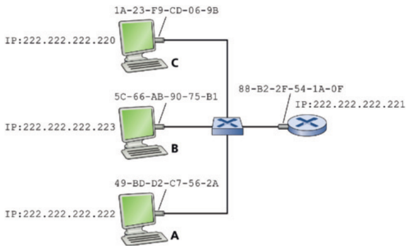

Hình 6.17 Mỗi giao diện trên một LAN có một địa chỉ IP và một địa chỉ MAC

### Nguyên lý trong thực tế (Principles in Practice)

### Giữ các tầng độc lập (Keeping the Layers Independent)

Có vài lý do tại sao giao diện host và router có địa chỉ MAC ngoài địa chỉ network-layer. Thứ nhất, LAN được thiết kế cho các giao thức network-layer tùy ý, không chỉ cho IP và Internet. Nếu adapter được gán địa chỉ IP thay vì địa chỉ MAC “trung lập”, thì adapter sẽ không dễ dàng hỗ trợ các giao thức network-layer khác (ví dụ, IPX hoặc DECnet).

Thứ hai, nếu adapter dùng địa chỉ network-layer thay vì địa chỉ MAC, địa chỉ network-layer sẽ phải được lưu trong RAM của adapter và được cấu hình lại mỗi khi adapter được di chuyển (hoặc bật nguồn). Một lựa chọn khác là không dùng bất kỳ địa chỉ nào trong adapter và để mỗi adapter chuyển dữ liệu (thường là một IP datagram) của mỗi frame nó nhận lên protocol stack. Tầng mạng khi đó có thể kiểm tra địa chỉ network-layer khớp. Một vấn đề với lựa chọn này là host sẽ bị ngắt bởi mọi frame gửi trên LAN, kể cả các frame hướng tới các host khác trên cùng LAN quảng bá. Tóm lại, để các tầng là những khối xây dựng phần lớn độc lập trong một kiến trúc mạng, các tầng khác nhau cần có cơ chế định địa chỉ riêng. Giờ chúng ta đã thấy ba loại địa chỉ: tên host cho tầng ứng dụng, địa chỉ IP cho tầng mạng, và địa chỉ MAC cho tầng liên kết.

Giờ giả sử host có địa chỉ IP 222.222.222.220 muốn gửi một IP datagram tới host 222.222.222.222. Trong ví dụ này, cả nguồn và đích đều nằm trong cùng subnet, theo nghĩa định địa chỉ của Mục 4.3.3. Để gửi một datagram, nguồn phải đưa cho adapter của nó không chỉ IP datagram mà còn địa chỉ MAC cho đích 222.222.222.222. Adapter gửi khi đó sẽ dựng một frame link-layer chứa địa chỉ MAC của đích và gửi frame vào LAN.

Câu hỏi quan trọng được giải quyết trong mục này là, Làm thế nào host gửi xác định địa chỉ MAC cho host đích có địa chỉ IP 222.222.222.222? Như bạn có thể đã đoán, nó dùng ARP. Một module ARP trong host gửi nhận bất kỳ địa chỉ IP nào trên cùng LAN làm đầu vào, và trả về địa chỉ MAC tương ứng. Trong ví dụ đang xét, host gửi 222.222.222.220 cung cấp cho module ARP của nó địa chỉ IP 222.222.222.222, và module ARP trả về địa chỉ MAC tương ứng 49-BD-D2-C7-56-2A. Vì vậy chúng ta thấy ARP phân giải một địa chỉ IP thành một địa chỉ MAC. Theo nhiều cách nó tương tự DNS (nghiên cứu trong Mục 2.5), vốn phân giải tên host thành địa chỉ IP. Tuy nhiên, một khác biệt quan trọng giữa hai bộ phân giải là DNS phân giải tên host cho các host ở bất kỳ đâu trong Internet, trong khi ARP chỉ phân giải địa chỉ IP cho các host và giao diện router trên cùng subnet. Nếu một nút ở California cố dùng ARP để phân giải địa chỉ IP của một nút ở Mississippi, ARP sẽ trả về lỗi.

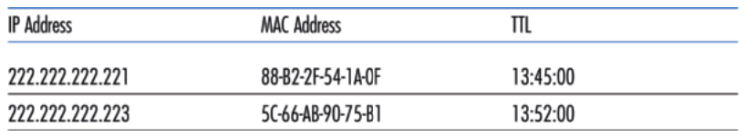

Hình 6.18 Một bảng ARP khả dĩ trong 222.222.222.220

Giờ chúng ta đã giải thích ARP làm gì, hãy xem nó hoạt động thế nào. Mỗi host và router có một bảng ARP trong bộ nhớ, chứa ánh xạ địa chỉ IP tới địa chỉ MAC. Hình 6.18 cho thấy một bảng ARP trong host 222.222.222.220 có thể trông thế nào. Bảng ARP cũng chứa một giá trị time-to-live (TTL), cho biết khi nào mỗi ánh xạ sẽ bị xóa khỏi bảng. Lưu ý rằng một bảng không nhất thiết chứa mục cho mọi host và router trên subnet; một số có thể chưa bao giờ được đưa vào bảng, và số khác có thể đã hết hạn. Thời gian hết hạn điển hình cho một mục là 20 phút kể từ khi một mục được đặt vào bảng ARP.

Giờ giả sử host 222.222.222.220 muốn gửi một datagram được IP-addressed (định địa chỉ IP) tới một host hoặc router khác trên subnet đó. Host gửi cần lấy địa chỉ MAC của đích khi biết địa chỉ IP. Nhiệm vụ này dễ nếu bảng ARP của bên gửi có một mục cho nút đích. Nhưng nếu bảng ARP hiện không có mục cho đích thì sao? Cụ thể, giả sử 222.222.222.220 muốn gửi một datagram tới 222.222.222.222. Trong trường hợp này, bên gửi dùng giao thức ARP để phân giải địa chỉ. Thứ nhất, bên gửi dựng một packet đặc biệt gọi là packet ARP. Một packet ARP có vài trường, bao gồm địa chỉ IP và MAC gửi và nhận. Cả packet truy vấn và phản hồi ARP đều có cùng định dạng. Mục đích của packet truy vấn ARP là truy vấn mọi host và router khác trên subnet để xác định địa chỉ MAC tương ứng với địa chỉ IP đang được phân giải.

Quay lại ví dụ, 222.222.222.220 chuyển một packet truy vấn ARP tới adapter cùng với chỉ dẫn rằng adapter nên gửi packet tới địa chỉ quảng bá MAC, cụ thể là, FF-FF-FF-FF-FF-FF. Adapter đóng gói packet ARP trong một frame link-layer, dùng địa chỉ quảng bá làm địa chỉ đích của frame, và truyền frame vào subnet. Nhớ lại phép so sánh số an sinh xã hội/địa chỉ bưu chính, một truy vấn ARP tương đương với một người hét lên trong một phòng làm việc ngăn ô đông người ở một công ty nào đó (chẳng hạn, AnyCorp): “Số an sinh xã hội của người có địa chỉ bưu chính là Cubicle 13, Room 112, AnyCorp, Palo Alto, California là gì?” Frame chứa truy vấn ARP được mọi adapter khác trên subnet nhận, và (vì địa chỉ quảng bá) mỗi adapter chuyển packet ARP bên trong frame lên module ARP của nó. Mỗi module ARP này kiểm tra xem địa chỉ IP của nó có khớp với địa chỉ IP đích trong packet ARP không. Module khớp gửi lại cho host truy vấn một packet ARP phản hồi với ánh xạ mong muốn. Host truy vấn 222.222.222.220 khi đó có thể cập nhật bảng ARP và gửi IP datagram của nó, được đóng gói trong một frame link-layer có MAC đích là của host hoặc router đã phản hồi truy vấn ARP trước đó.

Có vài điều thú vị cần lưu ý về giao thức ARP. Thứ nhất, thông điệp ARP truy vấn được gửi trong một frame quảng bá, trong khi thông điệp ARP phản hồi được gửi trong một frame chuẩn. Trước khi đọc tiếp bạn nên nghĩ về lý do tại sao. Thứ hai, ARP là plug-and-play; tức là, một bảng ARP được xây dựng tự động—nó không phải được quản trị viên hệ thống cấu hình. Và nếu một host bị ngắt kết nối khỏi subnet, mục của nó cuối cùng bị xóa khỏi các bảng ARP khác trong subnet.

Sinh viên thường thắc mắc ARP là giao thức link-layer hay giao thức network-layer. Như chúng ta đã thấy, một packet ARP được đóng gói trong một frame link-layer và do đó về kiến trúc nằm trên tầng liên kết. Tuy nhiên, một packet ARP có các trường chứa địa chỉ link-layer và do đó có thể nói là một giao thức link-layer, nhưng nó cũng chứa địa chỉ network-layer và do đó cũng có thể nói là một giao thức network-layer. Cuối cùng, ARP có lẽ được coi tốt nhất là một giao thức nằm vắt qua ranh giới giữa tầng liên kết và tầng mạng— không khớp gọn gàng vào protocol stack phân tầng đơn giản mà chúng ta đã nghiên cứu trong Chương 1. Đó là sự phức tạp của các giao thức real-world!

#### Gửi một datagram ra khỏi subnet (Sending a Datagram off the Subnet)

Giờ hẳn đã rõ ARP hoạt động thế nào khi một host muốn gửi một datagram tới một host khác trên cùng subnet. Nhưng giờ hãy xem tình huống phức tạp hơn khi một host trên một subnet muốn gửi một datagram network-layer tới một host ngoài subnet (tức là, qua một router sang subnet khác). Hãy thảo luận vấn đề này trong bối cảnh Hình 6.19, cho thấy một mạng đơn giản gồm hai subnet được nối với nhau bằng một router.

Có vài điều thú vị cần lưu ý về Hình 6.19. Mỗi host có đúng một địa chỉ IP và một adapter. Nhưng, như đã thảo luận trong Chương 4, một router có một địa chỉ IP cho mỗi giao diện của nó. Với mỗi giao diện router cũng có một module ARP (trong router) và một adapter. Vì router trong Hình 6.19 có hai giao diện, nó có hai địa chỉ IP, hai module ARP và hai adapter. Tất nhiên, mỗi adapter trong mạng có địa chỉ MAC riêng.

Cũng lưu ý rằng Subnet 1 có địa chỉ mạng 111.111.111/24 và Subnet 2 có địa chỉ mạng 222.222.222/24. Do đó, mọi giao diện nối với Subnet 1 có địa chỉ dạng 111.111.111.xxx và mọi giao diện nối với Subnet 2 có địa chỉ dạng 222.222.222.xxx.

Giờ hãy xem xét cách một host trên Subnet 1 sẽ gửi một datagram tới một host trên Subnet 2. Cụ thể, giả sử host 111.111.111.111 muốn gửi một IP datagram tới host 222.222.222.222. Host gửi chuyển datagram tới adapter của nó, như thường lệ. Nhưng host gửi cũng phải chỉ ra cho adapter một địa chỉ MAC đích thích hợp. Adapter nên dùng địa chỉ MAC nào? Người ta có thể bị cám dỗ đoán rằng địa chỉ MAC thích hợp là của adapter cho host 222.222.222.222, cụ thể là, 49-BD-D2-C7-56-2A. Tuy nhiên, phỏng đoán này sẽ sai! Nếu adapter gửi dùng địa chỉ MAC đó, thì không adapter nào trên Subnet 1 sẽ bận tâm chuyển IP datagram lên tầng mạng của nó, vì địa chỉ đích của frame sẽ không khớp địa chỉ MAC của bất kỳ adapter nào trên Subnet 1. Datagram sẽ chỉ đơn giản chết và lên thiên đường datagram.

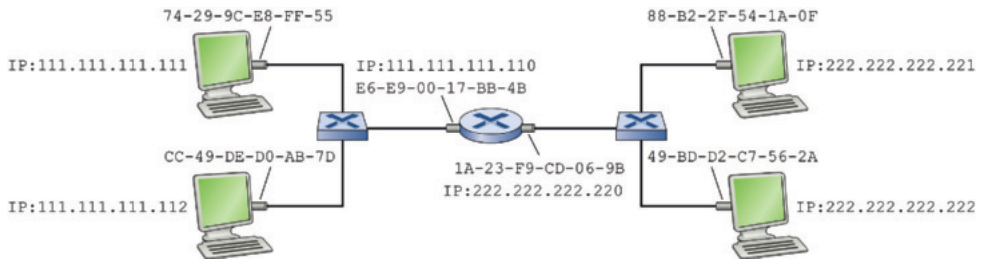

Hình 6.19 Hai subnet được nối với nhau bằng một router

Nếu nhìn kỹ Hình 6.19, chúng ta thấy rằng để một datagram đi từ 111.111.111.111 tới một host trên Subnet 2, datagram trước hết phải được gửi tới giao diện router 111.111.111.110, là địa chỉ IP của router first-hop trên đường tới đích cuối cùng. Do đó, địa chỉ MAC thích hợp cho frame là địa chỉ của adapter cho giao diện router 111.111.111.110, cụ thể là, E6-E9-00-17-BB-4B. Làm thế nào host gửi lấy được địa chỉ MAC cho 111.111.111.110? Tất nhiên là bằng ARP! Khi adapter gửi có địa chỉ MAC này, nó tạo một frame (chứa datagram được định địa chỉ tới 222.222.222.222) và gửi frame vào Subnet 1. Adapter router trên Subnet 1 thấy frame link-layer được gửi tới nó, và do đó chuyển frame tới tầng mạng của router. Hoan hô—IP datagram đã được chuyển thành công từ host nguồn tới router! Nhưng chúng ta chưa xong. Chúng ta vẫn phải chuyển datagram từ router tới đích. Router giờ phải xác định giao diện đúng mà datagram sẽ được chuyển tiếp lên. Như đã thảo luận trong Chương 4, việc này được thực hiện bằng cách tham khảo một bảng chuyển tiếp trong router. Bảng chuyển tiếp bảo router rằng datagram sẽ được chuyển tiếp qua giao diện router 222.222.222.220. Giao diện này sau đó chuyển datagram tới adapter của nó, adapter đóng gói datagram trong một frame mới và gửi frame vào Subnet 2. Lần này, địa chỉ MAC đích của frame thực sự là địa chỉ MAC của đích cuối cùng. Và router lấy địa chỉ MAC đích này như thế nào? Tất nhiên là từ ARP!

ARP cho Ethernet được định nghĩa trong RFC 826. Một phần giới thiệu hay về ARP được cho trong hướng dẫn TCP/IP, RFC 1180. Chúng ta sẽ khám phá ARP chi tiết hơn trong các bài tập về nhà.

### 6.4.2 Ethernet

Ethernet đã gần như chiếm lĩnh thị trường LAN có dây. Trong những năm 1980s và đầu những năm 1990s, Ethernet đã đối mặt với nhiều thách thức từ các công nghệ LAN khác, bao gồm token ring, FDDI và ATM. Một số công nghệ khác này đã thành công trong việc chiếm một phần thị trường LAN trong vài năm. Nhưng kể từ khi được phát minh vào mid-1970s, Ethernet đã tiếp tục tiến hóa và phát triển và đã giữ vị trí thống trị. Ngày nay, Ethernet cho đến nay là công nghệ LAN có dây phổ biến nhất, và nhiều khả năng sẽ vẫn như vậy trong tương lai gần. Có thể nói Ethernet đối với mạng cục bộ cũng như Internet đối với mạng toàn cầu.

Có nhiều lý do cho thành công của Ethernet. Thứ nhất, Ethernet là LAN high-speed đầu tiên được triển khai rộng rãi. Vì được triển khai sớm, các quản trị viên mạng trở nên rất quen thuộc với Ethernet—những điều kỳ diệu và những điểm kỳ quặc của nó—và ngại chuyển sang các công nghệ LAN khác khi chúng xuất hiện. Thứ hai, token ring, FDDI và ATM phức tạp và đắt hơn Ethernet, điều này càng làm các quản trị viên mạng ngại chuyển đổi. Thứ ba, lý do thuyết phục nhất để chuyển sang một công nghệ LAN khác (như FDDI hoặc ATM) thường là tốc độ dữ liệu cao hơn của công nghệ mới; tuy nhiên, Ethernet luôn đáp trả, tạo ra các phiên bản hoạt động ở tốc độ dữ liệu bằng hoặc cao hơn. Switched Ethernet (Ethernet chuyển mạch) cũng được giới thiệu vào đầu những năm 1990s, càng tăng thêm tốc độ dữ liệu hiệu dụng của nó. Cuối cùng, vì Ethernet đã rất phổ biến, phần cứng Ethernet (đặc biệt là adapter và switch) đã trở thành hàng phổ thông và rẻ đáng kể.

Ethernet LAN gốc được phát minh vào mid-1970s bởi Bob Metcalfe và David Boggs. Ethernet LAN gốc dùng một bus đồng trục để nối các nút. Topology bus cho Ethernet thực ra tồn tại suốt những năm 1980s và tới mid-1990s. Ethernet với topology bus là một LAN quảng bá—mọi frame được truyền đều tới và được xử lý bởi mọi adapter nối với bus. Nhớ rằng chúng ta đã đề cập giao thức đa truy cập CSMA/CD của Ethernet với binary exponential backoff trong Mục 6.3.2.

Đến cuối những năm 1990s, hầu hết các công ty và trường đại học đã thay LAN của họ bằng các bản lắp đặt Ethernet dùng topology sao hub-based (dựa trên hub). Trong một bản lắp đặt như vậy các host (và router) được nối trực tiếp tới một hub bằng dây đồng twisted-pair. Một hub là một thiết bị physical-layer hành động trên từng bit thay vì frame. Khi một bit, biểu diễn không hoặc một, tới từ một giao diện, hub đơn giản re-creates (tái tạo) bit, tăng cường độ năng lượng của nó, và truyền bit ra mọi giao diện khác. Do đó, Ethernet với topology sao hub-based cũng là một LAN quảng bá—bất cứ khi nào một hub nhận một bit từ một trong các giao diện, nó gửi một bản sao ra mọi giao diện khác. Cụ thể, nếu một hub nhận frame từ hai giao diện khác nhau cùng lúc, va chạm xảy ra và các nút đã tạo frame phải truyền lại.

Vào đầu những năm 2000s, Ethernet đã trải qua thêm một thay đổi tiến hóa lớn khác. Các bản lắp đặt Ethernet tiếp tục dùng topology sao, nhưng hub ở trung tâm được thay bằng một switch. Chúng ta sẽ xem xét sâu switched Ethernet sau trong chương này. Hiện tại, chúng tôi chỉ đề cập rằng một switch không chỉ “collision-less” (không va chạm) mà còn là một packet switch store-and-forward bona-fide (thực thụ); nhưng không như router, vốn hoạt động tới tầng 3, một switch chỉ hoạt động tới tầng 2.

#### Cấu trúc frame Ethernet (Ethernet Frame Structure)

Chúng ta có thể học được nhiều điều về Ethernet bằng cách xem xét frame Ethernet, được minh họa trong Hình 6.20. Để cho thảo luận về frame Ethernet một bối cảnh cụ thể, hãy xét việc gửi một IP datagram từ một host tới một host khác, với cả hai host trên cùng một Ethernet LAN (ví dụ, Ethernet LAN trong Hình 6.17.) (Mặc dù payload của frame Ethernet của chúng ta là một IP datagram, chúng tôi lưu ý rằng một frame Ethernet cũng có thể mang các packet network-layer khác.) Gọi adapter gửi, adapter A, có địa chỉ MAC AA-AA-AA-AA-AA-AA và adapter nhận, adapter B, có địa chỉ MAC BB-BB-BB-BB-BB-BB. Adapter gửi đóng gói IP datagram trong một frame Ethernet và chuyển frame xuống tầng vật lý. Adapter nhận nhận frame từ tầng vật lý, trích xuất IP datagram, và chuyển IP datagram lên tầng mạng. Trong bối cảnh này, giờ hãy xem xét sáu trường của frame Ethernet, như minh họa trong Hình 6.20.

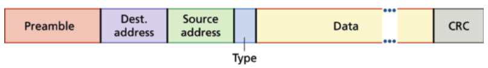

Hình 6.20 Cấu trúc frame Ethernet

• Trường dữ liệu (Data field) (46 đến 1,500 byte). Trường này mang IP datagram. Đơn vị truyền tối đa (MTU) của Ethernet là 1,500 byte. Điều này có nghĩa là nếu IP datagram vượt quá 1,500 byte, thì host phải phân mảnh datagram, như đã thảo luận trong Mục 4.3.2. Kích thước tối thiểu của trường dữ liệu là 46 byte. Điều này có nghĩa là nếu IP datagram nhỏ hơn 46 byte, trường dữ liệu phải được “nhồi” để lấp đầy tới 46 byte. Khi dùng nhồi, dữ liệu chuyển lên tầng mạng chứa cả phần nhồi cũng như IP datagram. Tầng mạng dùng trường độ dài trong header IP datagram để bỏ phần nhồi.

• Địa chỉ đích (Destination address) (6 byte). Trường này chứa địa chỉ MAC của adapter đích, BB-BB-BB-BB-BB-BB. Khi adapter B nhận một frame Ethernet có địa chỉ đích là BB-BB-BB-BB-BB-BB hoặc địa chỉ quảng bá MAC, nó chuyển nội dung trường dữ liệu của frame lên tầng mạng; nếu nó nhận một frame với bất kỳ địa chỉ MAC nào khác, nó loại bỏ frame.

• Địa chỉ nguồn (Source address) (6 byte). Trường này chứa địa chỉ MAC của adapter truyền frame lên LAN, trong ví dụ này, AA-AA-AA-AA-AA-AA.

• Trường kiểu (Type field) (2 byte). Trường kiểu cho phép Ethernet ghép kênh các giao thức network-layer. Để hiểu điều này, chúng ta cần nhớ rằng host có thể dùng các giao thức network-layer khác ngoài IP. Thực ra, một host cho trước có thể hỗ trợ nhiều giao thức network-layer dùng các giao thức khác nhau cho các ứng dụng khác nhau. Vì lý do này, khi frame Ethernet tới adapter B, adapter B cần biết nó nên chuyển (tức là, phân kênh) nội dung trường dữ liệu tới giao thức network-layer nào. IP và các giao thức network-layer khác (ví dụ, Novell IPX hoặc AppleTalk) mỗi giao thức có số kiểu chuẩn hóa riêng. Hơn nữa, giao thức ARP (thảo luận trong mục trước) có số kiểu riêng, và nếu frame đến chứa một packet ARP (tức là, có trường kiểu là 0806 thập lục phân), packet ARP sẽ được phân kênh lên giao thức ARP. Lưu ý rằng trường kiểu tương tự trường protocol trong datagram network-layer và các trường port-number trong segment transport-layer; tất cả các trường này đều dùng để gắn một giao thức ở một tầng với một giao thức ở tầng bên trên.

• Kiểm tra dư thừa vòng (Cyclic redundancy check) (CRC) (4 byte). Như đã thảo luận trong Mục 6.2.3, mục đích của trường CRC là cho phép adapter nhận, adapter B, phát hiện lỗi bit trong frame.

• Phần mở đầu (Preamble) (8bytes). Frame Ethernet bắt đầu bằng một trường preamble 8-byte. Mỗi byte trong 7 byte đầu của preamble có giá trị 10101010; byte cuối là 10101011. 7 byte đầu của preamble dùng để “đánh thức” các adapter nhận và đồng bộ đồng hồ của chúng với đồng hồ của bên gửi. Tại sao các đồng hồ lại mất đồng bộ? Hãy nhớ rằng adapter A nhằm truyền frame ở 10 Mbps, 100 Mbps hoặc 1 Gbps, tùy theo loại Ethernet LAN. Tuy nhiên, vì không gì hoàn hảo tuyệt đối, adapter A sẽ không truyền frame chính xác ở tốc độ mục tiêu; sẽ luôn có một độ trôi nào đó so với tốc độ mục tiêu, một độ trôi mà các adapter khác trên LAN không biết a priori. Một adapter nhận có thể khóa vào đồng hồ của adapter A đơn giản bằng cách khóa vào các bit trong 7 byte đầu của preamble. 2 bit cuối của byte thứ tám của preamble (hai bit 1s liên tiếp đầu tiên) báo cho adapter B rằng “thứ quan trọng” sắp tới.

Mọi công nghệ Ethernet đều cung cấp dịch vụ phi kết nối cho tầng mạng. Tức là, khi adapter A muốn gửi một datagram tới adapter B, adapter A đóng gói datagram trong một frame Ethernet và gửi frame vào LAN, mà không bắt tay trước với adapter B. Dịch vụ phi kết nối layer-2 này tương tự dịch vụ datagram layer-3 của IP và dịch vụ phi kết nối layer-4 của UDP. Các công nghệ Ethernet cung cấp một dịch vụ không tin cậy cho tầng mạng. Cụ thể, khi adapter B nhận một frame từ adapter A, nó chạy kiểm tra CRC trên frame, nhưng không gửi acknowledgment khi frame qua kiểm tra CRC cũng không gửi acknowledgment phủ định khi frame không qua kiểm tra CRC. Khi một frame không qua kiểm tra CRC, adapter B đơn giản loại bỏ frame. Do đó, adapter A không biết frame được truyền của nó có tới adapter B và qua kiểm tra CRC không. Việc thiếu vận chuyển tin cậy này (ở tầng liên kết) giúp Ethernet đơn giản và rẻ. Nhưng nó cũng có nghĩa là luồng datagram chuyển lên tầng mạng có thể có khoảng trống.

> Lịch sử tình huống (Case History)
>
> Bob Metcalfe và Ethernet (Bob Metcalfe and Ethernet)
>
> Khi là nghiên cứu sinh tiến sĩ tại Harvard University vào đầu những năm 1970s, Bob Metcalfe đã làm việc với ARPAnet tại MIT. Trong thời gian học, ông cũng tiếp xúc với công trình của Abramson về ALOHA và các giao thức truy cập ngẫu nhiên. Sau khi hoàn thành tiến sĩ và ngay trước khi bắt đầu công việc tại Xerox Palo Alto Research Center (Xerox PARC), ông đã thăm Abramson và các đồng nghiệp tại University of Hawaii trong ba tháng, tận mắt xem ALOHAnet. Tại Xerox PARC, Metcalfe tiếp xúc với các máy tính Alto, theo nhiều cách là tiền thân của máy tính cá nhân những năm 1980s. Metcalfe thấy nhu cầu nối mạng các máy tính này một cách không tốn kém. Vì vậy với kiến thức về ARPAnet, ALOHAnet và các giao thức truy cập ngẫu nhiên, Metcalfe—cùng đồng nghiệp David Boggs—đã phát minh ra Ethernet.
>
> Ethernet gốc của Metcalfe và Boggs chạy ở 2.94 Mbps và nối tới 256 host cách nhau tới một dặm. Metcalfe và Boggs đã thành công trong việc cho phần lớn các nhà nghiên cứu tại Xerox PARC giao tiếp qua các máy tính Alto của họ. Metcalfe sau đó đã tạo một liên minh giữa Xerox, Digital và Intel để thiết lập Ethernet thành một chuẩn Ethernet 10 Mbps, được IEEE phê chuẩn.
>
> Xerox không mấy quan tâm tới việc thương mại hóa Ethernet. Năm 1979, Metcalfe thành lập công ty riêng, 3Com, công ty đã phát triển và thương mại hóa công nghệ mạng, bao gồm công nghệ Ethernet. Cụ thể, 3Com đã phát triển và tiếp thị các card Ethernet vào đầu những năm 1980s cho các máy IBM PC cực kỳ phổ biến.
>
> Năm 2022, Metcalfe nhận ACM A.M. Turing Award (thường được gọi là “Giải Nobel của Khoa học Máy tính”) cho việc phát minh, chuẩn hóa và thương mại hóa Ethernet [ACM 2022].

Nếu có khoảng trống do các frame Ethernet bị loại bỏ, ứng dụng tại Host B có thấy khoảng trống không? Như chúng ta đã học trong Chương 3, điều này phụ thuộc vào việc ứng dụng dùng UDP hay TCP. Nếu ứng dụng dùng UDP, thì ứng dụng trong Host B thực sự sẽ thấy khoảng trống trong dữ liệu. Mặt khác, nếu ứng dụng dùng TCP, thì TCP trong Host B sẽ không xác nhận dữ liệu chứa trong các frame bị loại bỏ, khiến TCP trong Host A truyền lại. Lưu ý rằng khi TCP truyền lại dữ liệu, dữ liệu cuối cùng sẽ quay lại adapter Ethernet nơi nó bị loại bỏ. Do đó, theo nghĩa này, Ethernet thực sự truyền lại dữ liệu, mặc dù Ethernet không biết nó đang truyền một datagram brand-new với dữ liệu brand-new, hay một datagram chứa dữ liệu đã được truyền ít nhất một lần.

#### Các công nghệ Ethernet (Ethernet Technologies)

Trong thảo luận ở trên, chúng ta đã nói về Ethernet như thể nó là một chuẩn giao thức duy nhất. Nhưng thực ra, Ethernet có nhiều phiên bản khác nhau, với những từ viết tắt khá rối rắm như 10BASE-T, 10BASE-2, 100BASE-T, 1000BASE-LX, 10GBASE-T và 40GBASE-T. Những công nghệ này và nhiều công nghệ Ethernet khác đã được chuẩn hóa qua nhiều năm bởi nhóm làm việc IEEE 802.3 CSMA/CD (Ethernet) [IEEE 802.3 2020]. Mặc dù các từ viết tắt này có vẻ rối rắm, thực ra có trật tự đáng kể ở đây. Phần đầu của từ viết tắt chỉ tốc độ của chuẩn: 10, 100, 1000 hoặc 10G, lần lượt cho Ethernet 10 Megabit (mỗi giây), 100 Megabit, Gigabit, 10 Gigabit và 40 Gigabit. “BASE” chỉ baseband Ethernet (Ethernet băng gốc), nghĩa là môi trường vật lý chỉ mang traffic Ethernet; hầu như mọi chuẩn 802.3 đều cho baseband Ethernet. Phần cuối của từ viết tắt chỉ chính môi trường vật lý; Ethernet vừa là một đặc tả link-layer vừa là một đặc tả physical-layer và được mang qua nhiều môi trường vật lý bao gồm cáp đồng trục, dây đồng và cáp quang. Nói chung, “T” chỉ dây đồng twisted-pair.

Về mặt lịch sử, một Ethernet ban đầu được hình dung là một đoạn cáp đồng trục. Các chuẩn 10BASE-2 và 10BASE-5 thời đầu đặc tả Ethernet 10 Mbps trên hai loại cáp đồng trục, mỗi loại giới hạn chiều dài 500 mét. Có thể đạt các đoạn dài hơn bằng cách dùng một repeater (bộ lặp)—một thiết bị physical-layer nhận một tín hiệu ở phía vào, và tái tạo tín hiệu ở phía ra. Một cáp đồng trục tương ứng rất đẹp với góc nhìn của chúng ta về Ethernet như một môi trường quảng bá—mọi frame do một giao diện truyền đều được nhận tại các giao diện khác, và giao thức CSMA/CD của Ethernet giải quyết rất đẹp vấn đề đa truy cập. Các nút chỉ đơn giản gắn vào cáp, và voila, chúng ta có một mạng cục bộ!

Ethernet đã trải qua một loạt bước tiến hóa qua nhiều năm, và Ethernet ngày nay rất khác với các thiết kế bus-topology (topology bus) gốc dùng cáp đồng trục. Trong hầu hết các bản lắp đặt ngày nay, các nút được nối tới một switch qua các đoạn point-to-point làm bằng dây đồng hoặc cáp fiber-optic, như minh họa trong Hình 6.15–6.17.

Đến mid-2000s, nhiều chuẩn đã có cho Gigabit Ethernet, như tên gọi gợi ý, truyền bit ở một Gigabit mỗi giây. Giao thức MAC và định dạng frame Ethernet gốc từ 10 Mbs và 100 Mbps trước đó được giữ nguyên. Nhưng các tầng vật lý higher-speed (tốc độ cao hơn) được định nghĩa cho dây đồng twisted-pair ( 1000BASE-T), cáp quang (1000BASE-SX, 1000BASE-LX, 1000BASE-LX10, 1000BASE-BX10) và cáp đồng ( 1000BASE-CX). Khoảng cách Ethernet cho phép từ 10’s mét (cho twisted pair) tới 10’s kilômét cho một số tầng vật lý quang. Hình 6.21 cho thấy các chuẩn khác nhau này và giao thức MAC và định dạng frame Ethernet chung. Trong khi Gigabit Ethernet vẫn được dùng ngày nay, các chuẩn Ethernet tốc độ cao hơn đã được phát triển cho 10, 40, 100, 200 và 400 Gbps.

Hãy kết thúc thảo luận về công nghệ Ethernet bằng một câu hỏi có thể đã bắt đầu làm bạn băn khoăn. Thời của topology bus và topology sao hub-based, Ethernet rõ ràng là một liên kết quảng bá (như định nghĩa trong Mục 6.3) trong đó va chạm frame xảy ra khi các nút truyền cùng lúc. Để xử lý các va chạm này, chuẩn Ethernet bao gồm giao thức CSMA/CD, đặc biệt hiệu quả cho một LAN quảng bá có dây trải trên một vùng địa lý nhỏ. Nhưng nếu cách dùng Ethernet phổ biến ngày nay là topology sao switch-based, dùng chuyển mạch gói store-and-forward, liệu có thực sự còn cần một giao thức MAC Ethernet không? Như chúng ta sẽ sớm thấy, một switch điều phối việc truyền của nó và không bao giờ chuyển tiếp nhiều hơn một frame lên cùng một giao diện tại bất kỳ thời điểm nào. Hơn nữa, các switch hiện đại là full-duplex, nên một switch và một nút mỗi bên đều có thể gửi frame cho nhau cùng lúc mà không gây nhiễu. Nói cách khác, trong một Ethernet LAN switch-based không có va chạm và, do đó, không cần giao thức MAC!

Như chúng ta đã thấy, Ethernet ngày nay rất khác với Ethernet gốc được Metcalfe và Boggs hình dung hơn 40 năm trước—tốc độ đã tăng ba bậc độ lớn, frame Ethernet được mang qua nhiều môi trường, switched-Ethernets đã trở thành chủ đạo, và giờ ngay cả giao thức MAC cũng thường không cần thiết! Tất cả những thứ này có thực sự vẫn là Ethernet không? Câu trả lời, tất nhiên, là “có, theo định nghĩa.” Tuy nhiên, thú vị là, qua tất cả những thay đổi này, thực sự có một hằng số bền bỉ không thay đổi trong gần 50 năm—định dạng frame của Ethernet [Metcalfe 2025]. Có lẽ đây chính là trung tâm thực sự và vượt thời gian của chuẩn Ethernet.

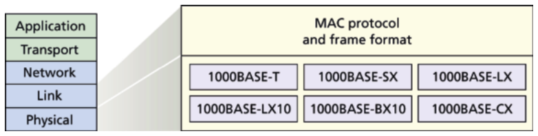

Hình 6.21 Các chuẩn Ethernet 100 Gbps: Một tầng liên kết chung, các tầng vật lý khác nhau

### 6.4.3 Switch tầng liên kết (Link-Layer Switches)

Cho đến giờ, chúng ta đã cố ý mơ hồ về việc một switch thực sự làm gì và hoạt động thế nào. Vai trò của switch là nhận các frame link-layer đến và chuyển tiếp chúng lên các liên kết ra; chúng ta sẽ nghiên cứu chi tiết chức năng chuyển tiếp này trong tiểu mục này. Chúng ta sẽ thấy bản thân switch trong suốt với các host và router trong subnet; tức là, một host/router định địa chỉ một frame tới một host/router khác (thay vì định địa chỉ frame tới switch) và vui vẻ gửi frame vào LAN, không biết rằng một switch sẽ nhận frame và chuyển tiếp nó. Tốc độ frame tới bất kỳ giao diện ra nào của switch có thể tạm thời vượt quá dung lượng liên kết của giao diện đó. Để xử lý vấn đề này, các giao diện ra của switch có buffer, gần giống như các giao diện ra của router có buffer cho datagram. Giờ hãy xem kỹ hơn cách switch hoạt động.

#### Chuyển tiếp và lọc (Forwarding and Filtering)

Lọc (filtering) là chức năng switch xác định một frame nên được chuyển tiếp tới giao diện nào đó hay nên đơn giản bị loại bỏ. Chuyển tiếp (forwarding) là chức năng switch xác định các giao diện mà frame nên được hướng tới, rồi chuyển frame tới các giao diện đó. Việc lọc và chuyển tiếp của switch được thực hiện bằng một bảng switch (switch table). Bảng switch chứa các mục cho một số, nhưng không nhất thiết tất cả, host và router trên một LAN. Một mục trong bảng switch chứa (1) một địa chỉ MAC, (2) giao diện switch dẫn tới địa chỉ MAC đó, và (3) thời điểm mục được đặt vào bảng. Một bảng switch ví dụ cho switch trên cùng trong Hình 6.15 được minh họa trong Hình 6.22. Mô tả này về chuyển tiếp frame có thể nghe tương tự thảo luận về chuyển tiếp datagram trong Chương 4. Thật vậy, trong thảo luận về chuyển tiếp tổng quát ở Mục 4.4, chúng ta đã học rằng nhiều packet switch hiện đại có thể được cấu hình để chuyển tiếp dựa trên địa chỉ MAC đích layer-2 (tức là, hoạt động như một switch layer-2) hoặc địa chỉ IP đích layer-3 (tức là, hoạt động như một router layer-3). Tuy vậy, chúng ta sẽ đưa ra phân biệt quan trọng rằng switch chuyển tiếp packet dựa trên địa chỉ MAC thay vì địa chỉ IP. Chúng ta cũng sẽ thấy rằng một bảng switch truyền thống (tức là, trong bối cảnh non-SDN (không phải SDN)) được xây dựng theo cách rất khác với bảng chuyển tiếp của router. Để hiểu cách lọc và chuyển tiếp của switch hoạt động, giả sử một frame có địa chỉ đích DD-DD-DD-DD-DD-DD tới switch trên giao diện x. Switch tra chỉ mục bảng của nó bằng địa chỉ MAC DD-DD-DD-DD-DD-DD. Có ba trường hợp khả dĩ:

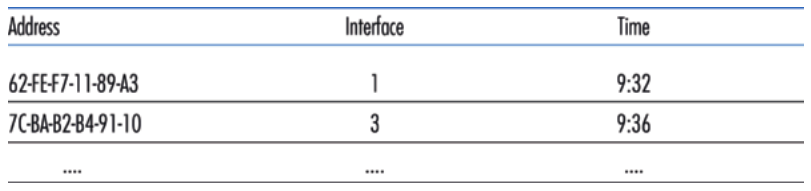

Hình 6.22 Một phần bảng switch cho switch trên cùng trong Hình 6.15

• Không có mục nào trong bảng cho DD-DD-DD-DD-DD-DD. Trong trường hợp này, switch chuyển tiếp các bản sao của frame tới các buffer ra đứng trước mọi giao diện trừ giao diện x. Nói cách khác, nếu không có mục cho địa chỉ đích, switch quảng bá frame.

• Có một mục trong bảng, gắn DD-DD-DD-DD-DD-DD với giao diện x. Trong trường hợp này, frame đến từ một đoạn LAN chứa adapter DD-DD-DD-DD-DD-DD. Vì không cần chuyển tiếp frame tới bất kỳ giao diện nào khác, switch thực hiện chức năng lọc bằng cách loại bỏ frame.

• Có một mục trong bảng, gắn DD-DD-DD-DD-DD-DD với giao diện y ≠ x. Trong trường hợp này, frame cần được chuyển tiếp tới đoạn LAN gắn với giao diện y. Switch thực hiện chức năng chuyển tiếp bằng cách đặt frame vào buffer ra đứng trước giao diện y.

Hãy đi qua các quy tắc này cho switch trên cùng trong Hình 6.15 và bảng switch của nó trong Hình 6.22. Giả sử một frame có địa chỉ đích 62-FE-F7-11-89-A3 tới switch từ giao diện 1. Switch xem bảng của nó và thấy đích nằm trên đoạn LAN nối với giao diện 1 (tức là, Kỹ thuật Điện). Điều này có nghĩa là frame đã được quảng bá trên đoạn LAN chứa đích. Do đó switch lọc (tức là, loại bỏ) frame. Giờ giả sử một frame có cùng địa chỉ đích tới từ giao diện 2. Switch lại xem bảng và thấy đích nằm theo hướng giao diện 1; do đó nó chuyển tiếp frame tới buffer ra đứng trước giao diện 1. Từ ví dụ này hẳn đã rõ rằng chừng nào bảng switch đầy đủ và chính xác, switch chuyển tiếp frame về phía đích mà không cần quảng bá. Theo nghĩa này, một switch “thông minh” hơn một hub. Nhưng ngay từ đầu bảng switch này được cấu hình thế nào? Có các giao thức link-layer tương đương với các giao thức định tuyến network-layer không? Hay một người quản lý quá tải phải cấu hình thủ công bảng switch?

#### Tự học (Self-Learning)

Một switch có tính chất tuyệt vời (đặc biệt với người quản trị mạng already-overworked (vốn đã quá tải)) là bảng của nó được xây dựng tự động, động và tự trị—không cần bất kỳ can thiệp nào từ quản trị viên mạng hay từ một giao thức cấu hình. Nói cách khác, switch là self-learning (tự học). Khả năng này được thực hiện như sau:

1. Bảng switch ban đầu rỗng.

2. Với mỗi frame đến nhận trên một giao diện, switch lưu vào bảng (1) địa chỉ MAC trong trường địa chỉ nguồn của frame, (2) giao diện mà frame tới từ đó, và (3) thời gian hiện tại. Bằng cách này, switch ghi lại trong bảng đoạn LAN nơi bên gửi nằm. Nếu mọi host trong LAN cuối cùng đều gửi một frame, thì mọi host cuối cùng sẽ được ghi vào bảng.

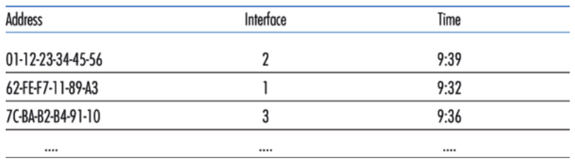

Hình 6.23 Switch học về vị trí của một adapter có địa chỉ 01-12-23-34-45-56

3. Switch xóa một địa chỉ trong bảng nếu không nhận được frame nào có địa chỉ đó làm địa chỉ nguồn sau một khoảng thời gian (aging time - thời gian lão hóa). Bằng cách này, nếu một PC được thay bằng một PC khác (với adapter khác), địa chỉ MAC của PC gốc cuối cùng sẽ bị xóa khỏi bảng switch.

Hãy đi qua tính chất self-learning cho switch trên cùng trong Hình 6.15 và bảng switch tương ứng trong Hình 6.22. Giả sử lúc 9:39 một frame có địa chỉ nguồn 01-12-23-34-45-56 tới từ giao diện 2. Giả sử địa chỉ này không có trong bảng switch. Khi đó switch thêm một mục mới vào bảng, như minh họa trong Hình 6.23.

Tiếp tục với cùng ví dụ này, giả sử aging time của switch này là 60 phút, và không có frame nào có địa chỉ nguồn 62-FE-F7-11-89-A3 tới switch giữa 9:32 và 10:32. Khi đó lúc 10:32, switch xóa địa chỉ này khỏi bảng.

Switch là thiết bị plug-and-play vì chúng không cần can thiệp từ quản trị viên mạng hay người dùng. Một quản trị viên mạng muốn lắp đặt một switch không cần làm gì hơn là nối các đoạn LAN với các giao diện switch. Quản trị viên không cần cấu hình bảng switch lúc lắp đặt hay khi một host bị gỡ khỏi một đoạn LAN. Switch cũng là full-duplex, nghĩa là bất kỳ giao diện switch nào cũng có thể gửi và nhận cùng lúc.

#### Các tính chất của chuyển mạch tầng liên kết (Properties of Link-Layer Switching)

Sau khi mô tả hoạt động cơ bản của một switch link-layer, giờ hãy xét các đặc điểm và tính chất của chúng. Chúng ta có thể xác định vài ưu điểm của việc dùng switch, thay vì các liên kết quảng bá như bus hoặc topology sao hub-based:

• Loại bỏ va chạm (Elimination of collisions). Trong một LAN xây dựng từ switch (và không có hub), không có băng thông lãng phí do va chạm! Switch buffer frame và không bao giờ truyền nhiều hơn một frame trên một đoạn tại bất kỳ thời điểm nào. Như với router, throughput tổng tối đa của một switch là tổng tốc độ mọi giao diện switch. Do đó, switch cải thiện performance đáng kể so với LAN có liên kết quảng bá.

• Liên kết không đồng nhất (Heterogeneous links). Vì switch cô lập liên kết này với liên kết khác, các liên kết khác nhau trong LAN có thể hoạt động ở tốc độ khác nhau và có thể chạy trên môi trường khác nhau. Ví dụ, switch trên cùng trong Hình 6.15 có thể có ba liên kết đồng 1000BASE-T 1 Gbps, hai liên kết cáp quang 100BASE-FX 100 Mbps, và một liên kết đồng 100BASE-T. Do đó, switch lý tưởng để kết hợp thiết bị cũ với thiết bị mới.

• Quản lý (Management). Ngoài việc tăng cường bảo mật (xem khung bên Focus on Security), switch còn giúp quản lý mạng dễ dàng hơn. Ví dụ, nếu một adapter trục trặc và liên tục gửi frame Ethernet (gọi là adapter lảm nhảm - jabbering adapter), switch có thể phát hiện vấn đề và ngắt kết nối nội bộ adapter trục trặc. Với tính năng này, quản trị viên mạng không cần ra khỏi giường và lái xe quay lại nơi làm việc để sửa vấn đề. Tương tự, một sợi cáp bị cắt chỉ ngắt kết nối host đang dùng sợi cáp đó để nối tới switch. Thời cáp đồng trục, nhiều người quản lý mạng đã mất hàng giờ “đi dọc đường dây” (hay chính xác hơn, “bò dưới sàn”) để tìm chỗ đứt cáp làm sập toàn bộ mạng. Switch cũng thu thập thống kê về sử dụng băng thông, tỉ lệ va chạm và loại traffic, và cung cấp thông tin này cho người quản lý mạng. Thông tin này có thể được dùng để debug và sửa vấn đề, và để lập kế hoạch LAN nên tiến hóa thế nào trong tương lai.

  Các nhà nghiên cứu đang khám phá việc thêm nhiều chức năng quản lý hơn nữa vào Ethernet LAN trong các triển khai nguyên mẫu [Casado 2007; Koponen 2011].

> Tiêu điểm bảo mật (Focus on Security)
>
> Nghe lén một LAN chuyển mạch: Switch (Sniffing a Switched Lan: Switch)
>
> Đầu độc (Poisoning)
>
> Khi một host được nối tới một switch, nó thường chỉ nhận các frame dành cho nó. Ví dụ, hãy xét một LAN chuyển mạch trong Hình 6.17. Khi host A gửi một frame tới host B, và có một mục cho host B trong bảng switch, thì switch sẽ chỉ chuyển tiếp frame tới host B. Nếu host C tình cờ đang chạy một sniffer, host C sẽ không thể nghe lén frame A-to-B này. Do đó, trong môi trường switched-LAN (trái với môi trường liên kết quảng bá như LAN 802.11 hoặc Ethernet LAN hub–based), kẻ tấn công khó nghe lén frame hơn. Tuy nhiên, vì switch quảng bá các frame có địa chỉ đích không có trong bảng switch, sniffer tại C vẫn có thể nghe lén một số frame không dành cho C. Hơn nữa, một sniffer sẽ có thể nghe lén mọi frame quảng bá Ethernet có địa chỉ đích quảng bá FF–FF–FF–FF–FF–FF. Một tấn công well-known nhắm vào switch, gọi là switch poisoning (đầu độc switch), là gửi hàng tấn packet tới switch với nhiều địa chỉ MAC nguồn giả khác nhau, qua đó lấp đầy bảng switch bằng các mục giả và không còn chỗ cho địa chỉ MAC của các host hợp lệ. Điều này khiến switch quảng bá hầu hết frame, mà sniffer khi đó có thể bắt được [Skoudis 2006]. Vì tấn công này khá phức tạp ngay cả với một kẻ tấn công tinh vi, switch ít dễ bị nghe lén hơn đáng kể so với hub và LAN không dây.

#### Switch so với router (Switches Versus Routers)

Như chúng ta đã học trong Chương 4, router là các packet switch store-and-forward chuyển tiếp packet dùng địa chỉ network-layer. Mặc dù switch cũng là một packet switch store-and-forward, nó khác cơ bản với router ở chỗ nó chuyển tiếp packet dùng địa chỉ MAC. Trong khi router là một packet switch layer-3, switch là một packet switch layer-2. Tuy nhiên, nhớ rằng chúng ta đã học trong Mục 4.4 rằng các switch hiện đại dùng thao tác “match plus action” có thể được dùng để chuyển tiếp một frame layer-2 dựa trên địa chỉ MAC đích của frame, cũng như một datagram layer-3 dùng địa chỉ IP đích của datagram. Thật vậy, chúng ta đã thấy các switch dùng chuẩn OpenFlow có thể thực hiện chuyển tiếp packet tổng quát dựa trên bất kỳ trường nào trong mười một trường header frame, datagram và transport-layer khác nhau.

Mặc dù switch và router khác nhau về cơ bản, các quản trị viên mạng thường phải chọn giữa chúng khi lắp đặt một thiết bị kết nối. Ví dụ, với mạng trong Hình 6.15, quản trị viên mạng hoàn toàn có thể đã dùng một router thay vì switch để nối các LAN phòng ban, server và router gateway internet. Thật vậy, một router sẽ cho phép giao tiếp giữa các phòng ban mà không tạo va chạm.

Vì cả switch và router đều là ứng viên cho thiết bị kết nối, ưu và nhược điểm của hai cách tiếp cận là gì?

Trước hết hãy xét ưu và nhược điểm của switch. Như đã đề cập ở trên, switch là plug-and-play, một tính chất được mọi quản trị viên mạng quá tải trên thế giới trân trọng. Switch cũng có thể có tốc độ lọc và chuyển tiếp tương đối cao—như minh họa trong Hình 6.24, switch chỉ phải xử lý frame tới tầng 2, trong khi router phải xử lý datagram tới tầng 3. Mặt khác, để ngăn frame quảng bá chạy vòng, topology hoạt động của một mạng chuyển mạch bị giới hạn ở một cây khung (spanning tree). Ngoài ra, một mạng chuyển mạch lớn sẽ cần bảng ARP lớn trong host và router và sẽ sinh ra lượng traffic và xử lý ARP đáng kể. Hơn nữa, switch dễ bị bão quảng bá (broadcast storm)—nếu một host bị trục trặc và truyền một luồng frame quảng bá Ethernet bất tận, các switch sẽ chuyển tiếp tất cả các frame này, khiến toàn bộ mạng sụp đổ.

Giờ hãy xét ưu và nhược điểm của router. Vì việc định địa chỉ mạng thường phân cấp (chứ không phẳng, như định địa chỉ MAC), packet thường không chạy vòng qua router ngay cả khi mạng có đường dư thừa. (Tuy nhiên, packet có thể chạy vòng khi bảng router bị cấu hình sai; nhưng như chúng ta đã học trong Chương 4, IP dùng một trường header datagram đặc biệt để giới hạn việc chạy vòng.) Do đó, packet không bị giới hạn ở một cây khung và có thể dùng đường tốt nhất giữa nguồn và đích. Vì router không có giới hạn cây khung, chúng đã cho phép Internet được xây dựng với một topology phong phú bao gồm, chẳng hạn, nhiều liên kết hoạt động giữa châu Âu và Bắc Mỹ. Một đặc điểm khác của router là chúng cung cấp bảo vệ firewall chống bão quảng bá layer-2. Tuy nhiên, có lẽ nhược điểm đáng kể nhất của router là chúng không plug-and-play—chúng và các host nối tới chúng cần được cấu hình địa chỉ IP. Ngoài ra, router thường có thời gian xử lý per-packet lớn hơn switch, vì chúng phải xử lý tới các trường layer-3. Cuối cùng, có hai cách phát âm từ router, hoặc “rootor” hoặc “rowter,” và người ta lãng phí rất nhiều thời gian tranh cãi về cách phát âm đúng [Perlman 1999].

Vì cả switch và router đều có ưu và nhược điểm (như tóm tắt trong Bảng 6.1), khi nào một mạng tổ chức (ví dụ, mạng khuôn viên trường đại học hoặc mạng khuôn viên công ty) nên dùng switch, và khi nào nên dùng router? Thông thường, các mạng nhỏ gồm vài trăm host có vài đoạn LAN. Switch là đủ cho các mạng nhỏ này, vì chúng cục bộ hóa traffic và tăng throughput tổng mà không cần cấu hình địa chỉ IP nào. Nhưng các mạng lớn hơn gồm hàng nghìn host thường bao gồm router bên trong mạng (ngoài switch). Router cung cấp sự cô lập traffic mạnh mẽ hơn, kiểm soát bão quảng bá, và dùng các tuyến “thông minh” hơn giữa các host trong mạng.

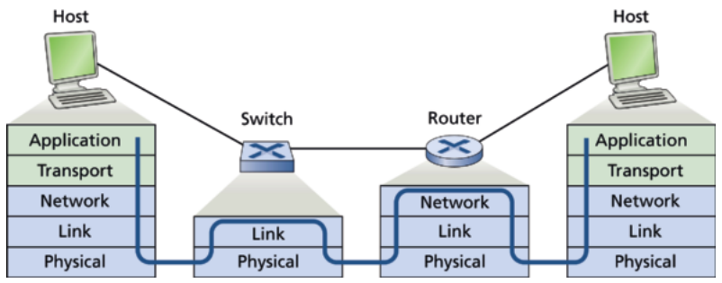

Hình 6.24 Xử lý packet trong switch, router và host

|  | Hubs | Routers | Switches |
|---|---|---|---|
| Cô lập traffic (Traffic isolation) | Không | Có | Có |
| Plug and play | Có | Không | Có |
| Định tuyến tối ưu (Optimal routing) | Không | Có | Không |

Bảng 6.1 So sánh các đặc điểm điển hình của các thiết bị kết nối phổ biến

### 6.4.4 Mạng cục bộ ảo (Virtual Local Area Networks (VLANs))

Trong thảo luận trước đó về Hình 6.15, chúng ta đã lưu ý rằng các LAN tổ chức hiện đại thường được cấu hình phân cấp, với mỗi nhóm làm việc (phòng ban) có LAN chuyển mạch riêng nối với LAN chuyển mạch của các nhóm khác qua một phân cấp switch. Mặc dù cấu hình như vậy hoạt động tốt trong một thế giới lý tưởng, thế giới thực thường còn xa mới lý tưởng. Có thể xác định ba nhược điểm trong cấu hình ở Hình 6.15:

• Thiếu cô lập traffic (Lack of traffic isolation). Mặc dù phân cấp cục bộ hóa traffic nhóm trong một switch duy nhất, traffic quảng bá (ví dụ, frame mang thông điệp ARP và DHCP hoặc frame có đích chưa được một switch self-learning học) vẫn phải đi qua toàn bộ mạng tổ chức. Giới hạn phạm vi của traffic quảng bá như vậy sẽ cải thiện performance của LAN. Có lẽ quan trọng hơn, cũng có thể mong muốn giới hạn traffic quảng bá LAN vì lý do bảo mật/quyền riêng tư. Ví dụ, nếu một nhóm chứa đội ngũ quản lý điều hành của công ty và một nhóm khác chứa những nhân viên bất mãn đang chạy packet sniffer Wireshark, người quản lý mạng có thể muốn traffic của các lãnh đạo không bao giờ tới được host của nhân viên. Kiểu cô lập này có thể được cung cấp bằng cách thay switch trung tâm trong Hình 6.15 bằng một router. Chúng ta sẽ sớm thấy sự cô lập này cũng có thể đạt được qua một giải pháp chuyển mạch (tầng 2).

• Sử dụng switch kém hiệu quả (Inefficient use of switches). Nếu thay vì ba nhóm, tổ chức có 10 nhóm, thì sẽ cần 10 switch first-level (cấp một). Nếu mỗi nhóm nhỏ, chẳng hạn dưới 10 người, thì một switch 96-port duy nhất có lẽ đủ lớn để chứa mọi người, nhưng switch duy nhất này sẽ không cung cấp cô lập traffic.

• Quản lý người dùng (Managing users). Nếu một nhân viên chuyển giữa các nhóm, đi dây vật lý phải được thay đổi để nối nhân viên tới một switch khác trong Hình 6.15. Nhân viên thuộc hai nhóm còn làm vấn đề khó hơn.

May mắn thay, mỗi khó khăn này có thể được xử lý bằng một switch hỗ trợ mạng cục bộ ảo (virtual local area network) (VLAN). Như tên gọi gợi ý, một switch hỗ trợ VLAN cho phép định nghĩa nhiều mạng cục bộ ảo trên một hạ tầng mạng cục bộ vật lý duy nhất. Các host trong một VLAN giao tiếp với nhau như thể chúng (và không host nào khác) được nối với switch. Trong một VLAN port-based (dựa trên port), các port (giao diện) của switch được người quản lý mạng chia thành các nhóm. Mỗi nhóm tạo thành một VLAN, với các port trong mỗi VLAN tạo thành một miền quảng bá (broadcast domain) (tức là, traffic quảng bá từ một port chỉ có thể tới các port khác trong nhóm). Hình 6.25 cho thấy một switch duy nhất với 16 port. Các port 2 đến 8 thuộc VLAN EE, trong khi các port 9 đến 15 thuộc VLAN CS (port 1 và 16 chưa được gán). VLAN này giải quyết mọi khó khăn nêu ở trên—frame VLAN EE và CS được cô lập với nhau, hai switch trong Hình 6.15 đã được thay bằng một switch duy nhất, và nếu người dùng tại port switch 8 gia nhập Khoa CS, nhà vận hành mạng chỉ đơn giản cấu hình lại phần mềm VLAN để port 8 giờ gắn với VLAN CS. Người ta có thể dễ dàng hình dung switch VLAN được cấu hình và hoạt động thế nào—người quản lý mạng khai báo một port thuộc một VLAN cho trước (với các port chưa khai báo thuộc một VLAN mặc định) bằng phần mềm quản lý switch, một bảng ánh xạ port-to-VLAN được duy trì bên trong switch; và phần cứng switch chỉ chuyển frame giữa các port thuộc cùng VLAN.

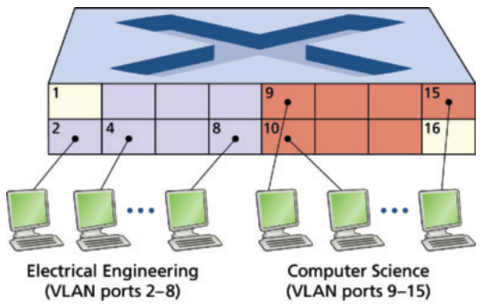

Hình 6.25 Một switch duy nhất với hai VLAN được cấu hình

Nhưng bằng cách cô lập hoàn toàn hai VLAN, chúng ta đã đưa vào một khó khăn mới! Làm thế nào traffic từ Khoa EE có thể được gửi tới Khoa CS? Một cách xử lý là nối một port switch VLAN (ví dụ, port 1 trong Hình 6.25) tới một router bên ngoài và cấu hình port đó thuộc cả VLAN EE và CS. Trong trường hợp này, mặc dù khoa EE và CS dùng chung cùng switch vật lý, cấu hình logic sẽ trông như thể khoa EE và CS có các switch riêng được nối qua một router. Một IP datagram đi từ khoa EE tới khoa CS trước hết sẽ đi qua VLAN EE để tới router rồi được router chuyển tiếp trở lại qua VLAN CS tới host CS. May mắn thay, các nhà sản xuất switch làm cho các cấu hình như vậy dễ dàng với người quản lý mạng bằng cách xây dựng một thiết bị duy nhất chứa cả switch VLAN lẫn router, nên không cần router bên ngoài riêng. Một bài tập về nhà ở cuối chương khám phá kịch bản này chi tiết hơn.

Quay lại Hình 6.15, giờ hãy giả sử thay vì có một khoa Kỹ thuật Máy tính riêng, một số giảng viên EE và CS được bố trí trong một tòa nhà riêng, nơi (tất nhiên!) họ cần truy cập mạng, và (tất nhiên!) họ muốn là một phần VLAN của khoa mình. Hình 6.26 cho thấy một switch 8-port thứ hai, trong đó các port switch đã được định nghĩa là thuộc VLAN EE hoặc CS, khi cần. Nhưng hai switch này nên được nối với nhau thế nào? Một giải pháp dễ là định nghĩa một port thuộc VLAN CS trên mỗi switch (tương tự cho VLAN EE) và nối các port này với nhau, như minh họa trong Hình 6.26(a). Tuy nhiên, giải pháp này không mở rộng được, vì N VLANS sẽ cần N port trên mỗi switch chỉ để nối hai switch.

Một cách tiếp cận có khả năng mở rộng hơn để nối các switch VLAN được gọi là VLAN trunking. Trong cách tiếp cận VLAN trunking minh họa trong Hình 6.26(b),

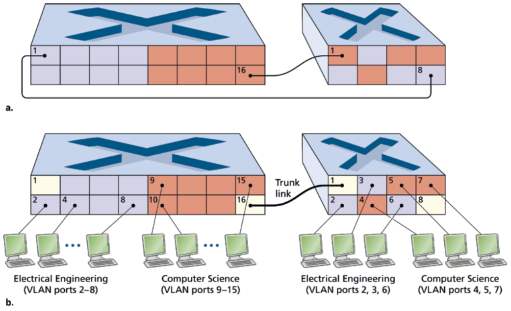

Hình 6.26 Nối hai switch VLAN với hai VLAN: (a) hai cáp (b) trunk

Frame Ethernet gốc (trên), frame Ethernet VLAN 802.1Q-tagged một port đặc biệt trên mỗi switch (port 16 trên switch bên trái và port 1 trên switch bên phải) được cấu hình làm trunk port để nối hai switch VLAN với nhau. Trunk port thuộc mọi VLAN, và frame gửi tới bất kỳ VLAN nào đều được chuyển tiếp qua liên kết trunk tới switch kia. Nhưng điều này lại đặt ra một câu hỏi khác: Làm sao một switch biết một frame tới trên trunk port thuộc về một VLAN cụ thể? IEEE đã định nghĩa một định dạng frame Ethernet mở rộng, 802.1Q, cho các frame đi qua một VLAN trunk. Như minh họa trong Hình 6.27, frame 802.1Q gồm frame Ethernet chuẩn với một VLAN tag four-byte được thêm vào header, mang định danh của VLAN mà frame thuộc về. VLAN tag được switch ở phía gửi của VLAN trunk thêm vào frame, rồi được switch ở phía nhận của trunk phân tích và gỡ bỏ. Bản thân VLAN tag gồm một trường Tag Protocol Identifier (TPID) 2-byte (với giá trị thập lục phân cố định 81-00), một trường Tag Control Information 2-byte chứa một trường định danh VLAN 12-bit, và một trường ưu tiên 3-bit có mục đích tương tự trường TOS của IP datagram.

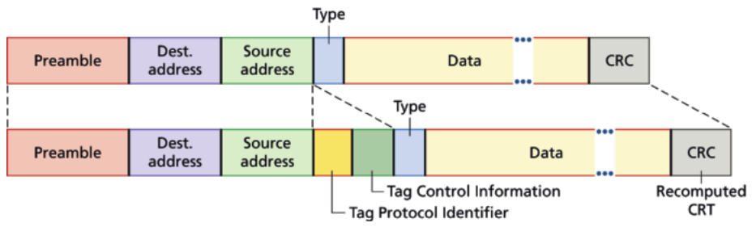

Hình 6.27 frame (dưới)

Trong thảo luận này, chúng ta mới chỉ lướt qua VLAN và tập trung vào VLAN port-based. Chúng ta cũng nên nhắc rằng VLAN có thể được định nghĩa theo vài cách khác. Trong VLAN MAC-based, người quản lý mạng chỉ định tập địa chỉ MAC thuộc mỗi VLAN; mỗi khi một thiết bị gắn vào một port, port đó được nối vào VLAN thích hợp dựa trên địa chỉ MAC của thiết bị. VLAN cũng có thể được định nghĩa dựa trên giao thức network-layer (ví dụ, IPv4, IPv6, hoặc Appletalk) và các tiêu chí khác. Xem chuẩn 802.1Q [IEEE 802.1q 2005] để biết thêm chi tiết. Cũng có thể mở rộng VLAN qua các IP router, cho phép các đảo LAN được nối với nhau để tạo thành một VLAN duy nhất có thể trải khắp địa cầu [Yu 2011]. Thật vậy, công nghệ VXLAN (Virtual Extensible LAN), mà chúng ta sẽ đề cập trong Mục 6.5.2, cho phép tạo các LAN ảo bao phủ khoảng cách địa lý lớn hơn VLAN.

## 6.5 Ảo hóa liên kết: Một mạng đóng vai tầng liên kết (Link Virtualization: A Network as a Link Layer)

Vì chương này bàn về các giao thức link-layer, và giờ chúng ta đã gần cuối chương, hãy suy ngẫm xem hiểu biết của chúng ta về thuật ngữ liên kết đã tiến hóa thế nào. Chúng ta bắt đầu chương này bằng cách xem liên kết như một sợi dây vật lý nối hai host đang giao tiếp. Khi học các giao thức đa truy cập, chúng ta thấy nhiều host có thể được nối bằng một sợi dây dùng chung và “sợi dây” nối các host có thể là phổ vô tuyến hoặc môi trường khác. Điều này dẫn chúng ta tới việc xem liên kết trừu tượng hơn một chút như một kênh, thay vì một sợi dây. Khi học Ethernet LAN (Hình 6.15), chúng ta thấy môi trường kết nối thực ra có thể là một hạ tầng chuyển mạch khá phức tạp. Tuy nhiên, suốt quá trình tiến hóa này, bản thân các host vẫn giữ quan điểm rằng môi trường kết nối đơn giản là một kênh link-layer nối hai hoặc nhiều host. Ví dụ, chúng ta đã thấy một host Ethernet có thể hoàn toàn không biết nó được nối tới các host LAN khác bằng một đoạn LAN ngắn duy nhất (Hình 6.17) hay bằng một LAN chuyển mạch phân tán về địa lý ( Hình 6.15) hay bằng một VLAN (Hình 6.26).

Trong trường hợp kết nối modem quay số giữa hai host, liên kết nối hai host thực ra là mạng điện thoại—một mạng viễn thông toàn cầu, tách biệt về logic, với các switch, liên kết và chồng giao thức riêng để truyền dữ liệu và báo hiệu. Tuy nhiên, từ góc nhìn link-layer của Internet, kết nối dial-up qua mạng điện thoại được xem như một “sợi dây” đơn giản. Theo nghĩa này, Internet ảo hóa mạng điện thoại, xem mạng điện thoại như một công nghệ link-layer cung cấp kết nối link-layer giữa hai host Internet. Có thể bạn còn nhớ từ thảo luận về mạng overlay trong Chương 2 rằng một mạng overlay tương tự xem Internet như phương tiện cung cấp kết nối giữa các nút overlay, tìm cách phủ lên Internet theo cùng cách Internet phủ lên mạng điện thoại.

Trong mục này, chúng ta sẽ đề cập hai công nghệ trong đó một liên kết ảo giữa hai thiết bị về logic hoạt động như một liên kết vật lý duy nhất, nhưng thực tế được hiện thực bằng một mạng phức tạp bên dưới gồm các thiết bị kết nối với nhau. Trong Mục 6.5.2 chúng ta sẽ đề cập công nghệ VXLAN đã nhắc ở trên. Nhưng ví dụ đầu tiên chúng ta sẽ xét trong Mục 6.5.1 là Multiprotocol Label Switching (MPLS). Khác với mạng điện thoại circuit-switched, bản thân MPLS là một mạng virtual-circuit packet-switched. Nó có định dạng packet và hành vi chuyển tiếp riêng. Do đó, từ góc nhìn sư phạm, thảo luận về MPLS phù hợp với việc học tầng mạng hoặc tầng liên kết đều được. Tuy nhiên, từ góc nhìn Internet, chúng ta có thể xem MPLS, giống như mạng điện thoại và switched-Ethernets, là một công nghệ link-layer dùng để kết nối các thiết bị IP. Phần trình bày về MPLS của chúng ta nhất thiết phải ngắn gọn, vì có thể viết (và đã có người viết) cả những cuốn sách về các mạng này. Chúng tôi giới thiệu [Davie 2000] để biết chi tiết về MPLS. Ở đây chúng ta sẽ tập trung chủ yếu vào cách MPLS phục vụ việc kết nối các thiết bị IP, mặc dù chúng ta cũng sẽ đi sâu hơn một chút vào các công nghệ bên dưới.

### 6.5.1 Chuyển mạch nhãn đa giao thức (Multiprotocol Label Switching (MPLS))

Multiprotocol Label Switching (MPLS) tiến hóa từ một số nỗ lực của ngành vào giai đoạn mid-to-late (giữa đến cuối) thập niên 1990 nhằm cải thiện tốc độ chuyển tiếp của IP router bằng cách áp dụng một khái niệm then chốt từ thế giới mạng virtual-circuit: nhãn fixed-length (độ dài cố định). Mục tiêu không phải là từ bỏ hạ tầng datagram-forwarding IP destination-based để chuyển sang hạ tầng dựa trên nhãn fixed-length và mạch ảo, mà là tăng cường nó bằng cách gắn nhãn có chọn lọc cho datagram và cho phép router chuyển tiếp datagram dựa trên nhãn fixed-length (thay vì địa chỉ IP đích) khi có thể. Quan trọng là, các kỹ thuật này hoạt động hand-in-hand (song hành) với IP, dùng định địa chỉ và định tuyến IP. IETF đã hợp nhất các nỗ lực này trong giao thức MPLS [RFC 3031, RFC 3032], thực chất là pha trộn các kỹ thuật VC vào một mạng datagram có định tuyến.

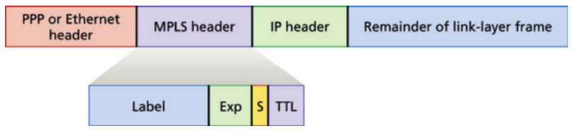

Hình 6.28 Header MPLS: Nằm giữa các header link- và network-layer

Hãy bắt đầu học MPLS bằng cách xét định dạng của một frame link-layer được xử lý bởi một router MPLS-capable. Hình 6.28 cho thấy một frame link-layer truyền giữa các thiết bị MPLS-capable có một header MPLS nhỏ được thêm vào giữa header layer-2 (ví dụ, Ethernet) và header layer-3 (tức là, IP). RFC 3032 định nghĩa định dạng header MPLS cho các liên kết như vậy; các header cho mạng ATM và frame-relayed cũng được định nghĩa trong các RFC khác. Trong số các trường của header MPLS có nhãn, 3 bit dành riêng cho sử dụng thử nghiệm, một bit S duy nhất, dùng để chỉ ra điểm kết thúc của một chuỗi header MPLS “xếp chồng” (một chủ đề nâng cao mà chúng ta sẽ không đề cập ở đây), và một trường time-to-live.

Từ Hình 6.28 có thể thấy ngay rằng một frame MPLS-enhanced chỉ có thể được gửi giữa các router đều có khả năng MPLS (vì một router non-MPLS-capable sẽ khá bối rối khi thấy một header MPLS ở chỗ nó đang mong đợi header IP!). Một router MPLS-capable thường được gọi là router label-switched, vì nó chuyển tiếp một frame MPLS bằng cách tra nhãn MPLS trong bảng chuyển tiếp rồi ngay lập tức chuyển datagram tới giao diện ra thích hợp. Do đó, router MPLS-capable không cần trích địa chỉ IP đích và thực hiện tra cứu so khớp tiền tố dài nhất trong bảng chuyển tiếp. Nhưng làm sao một router biết láng giềng của nó thực sự có khả năng MPLS, và làm sao một router biết nhãn nào cần gắn với một đích IP cho trước? Để trả lời các câu hỏi này, chúng ta cần xem xét tương tác giữa một nhóm router MPLS-capable.

Trong ví dụ ở Hình 6.29, các router R1 đến R4 có khả năng MPLS. R5 và R6 là IP router chuẩn. R1 đã quảng bá tới R2 và R3 rằng nó ( R1) có thể định tuyến tới đích A, và một frame nhận được có nhãn MPLS 6 sẽ được chuyển tiếp tới đích A. Router R3 đã quảng bá tới router R4 rằng nó có thể định tuyến tới đích A và D, và các frame đến có nhãn MPLS 10 và 12, tương ứng, sẽ được chuyển mạch về phía các đích đó. Router R2 cũng đã quảng bá tới router R4 rằng nó ( R2) có thể tới đích A, và một frame nhận được có nhãn MPLS 8 sẽ được chuyển mạch về phía A. Lưu ý rằng router R4 giờ ở vị trí thú vị là có hai đường MPLS để tới A: qua giao diện 0 với nhãn MPLS ra 10, và qua giao diện 1 với nhãn MPLS 8. Bức tranh tổng thể vẽ trong Hình 6.29 là các thiết bị IP R5, R6, A, và D được nối với nhau qua một hạ tầng MPLS (các router MPLS-capable R1, R2, R3, và R4) theo cách rất giống cách một LAN chuyển mạch hoặc một mạng ATM có thể nối các thiết bị IP với nhau. Và giống như LAN chuyển mạch hoặc mạng ATM, các router MPLS-capable R1 đến R4 làm điều đó mà không hề chạm tới header IP của packet.

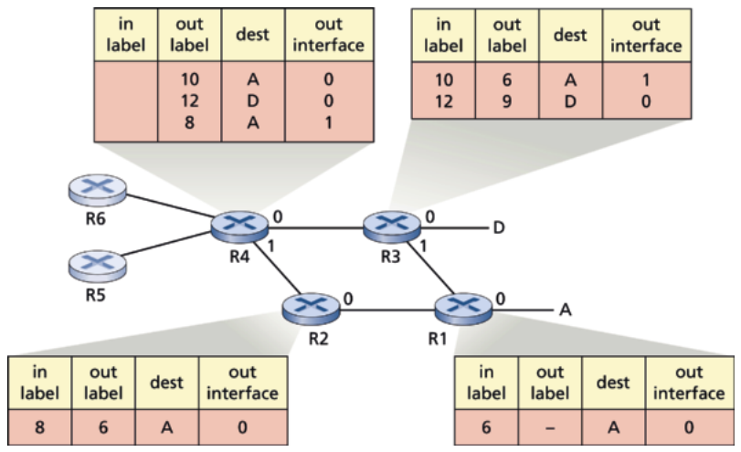

Hình 6.29 Chuyển tiếp MPLS-enhanced

Trong thảo luận trên, chúng ta chưa nêu giao thức cụ thể dùng để phân phối nhãn giữa các router MPLS-capable, vì chi tiết của việc báo hiệu này vượt xa phạm vi cuốn sách. Tuy nhiên, chúng ta lưu ý rằng nhóm làm việc IETF về MPLS đã chỉ định trong [RFC 3468] rằng một phần mở rộng của giao thức RSVP, gọi là RSVP-TE [RFC 3209], sẽ là trọng tâm nỗ lực của họ cho báo hiệu MPLS. Chúng ta cũng chưa bàn về việc MPLS thực sự tính đường cho packet giữa các router có khả năng MPLS thế nào, cũng như cách nó thu thập thông tin link-state (ví dụ, lượng băng thông liên kết chưa được MPLS đặt trước) để dùng trong các phép tính đường này. Các thuật toán định tuyến link-state hiện có (ví dụ, OSPF) đã được mở rộng để làm tràn (flood) thông tin này tới các router MPLS-capable. Điều thú vị là các thuật toán tính đường thực tế không được chuẩn hóa, và hiện là vendor-specific (riêng của từng nhà cung cấp).

Cho tới giờ, trọng tâm thảo luận về MPLS là việc MPLS thực hiện chuyển mạch dựa trên nhãn, không cần xét địa chỉ IP của packet. Tuy nhiên, ưu điểm thực sự của MPLS và lý do cho sự quan tâm hiện nay tới MPLS không nằm ở khả năng tăng tốc độ chuyển mạch, mà ở các khả năng quản lý traffic mới mà MPLS mang lại. Như đã nêu ở trên, R4 có hai đường MPLS tới A. Nếu việc chuyển tiếp được thực hiện ở tầng IP dựa trên địa chỉ IP, các giao thức định tuyến IP mà chúng ta đã học trong Chương 5 sẽ chỉ chỉ định một đường least-cost duy nhất tới A. Do đó, MPLS cung cấp khả năng chuyển tiếp packet dọc theo các tuyến không thể có khi dùng các giao thức định tuyến IP chuẩn. Đây là một dạng đơn giản của kỹ thuật traffic (traffic engineering) dùng MPLS [RFC 3346; RFC 3272; RFC 2702; Xiao 2000], trong đó nhà vận hành mạng có thể ghi đè định tuyến IP thông thường và ép một phần traffic hướng tới một đích cho trước đi theo một đường, và traffic khác hướng tới cùng đích đó đi theo đường khác (vì chính sách, performance, hoặc lý do nào khác).

Cũng có thể dùng MPLS cho nhiều mục đích khác. Nó có thể được dùng để khôi phục nhanh các đường chuyển tiếp MPLS, ví dụ, để định tuyến lại traffic qua một đường dự phòng (failover) đã tính trước khi liên kết hỏng [Kar 2000; Huang 2002; RFC 3469]. Cuối cùng, chúng ta lưu ý rằng MPLS có thể, và đã, được dùng để hiện thực so-called (cái gọi là) mạng riêng ảo (virtual private network - VPN). Khi hiện thực một VPN cho khách hàng, ISP dùng mạng MPLS-enabled của mình để nối các mạng khác nhau của khách hàng với nhau. MPLS có thể được dùng để cô lập cả tài nguyên lẫn định địa chỉ mà VPN của khách hàng dùng khỏi của những người dùng khác đi qua mạng ISP; xem [DeClercq 2002] để biết chi tiết. Chúng ta cũng sẽ đề cập VPN chi tiết hơn trong Mục 8.7.1.

Thảo luận về MPLS của chúng ta khá ngắn gọn, và chúng tôi khuyến khích bạn tham khảo [Davie 2000] và tài liệu tham khảo ở trên. Chúng ta lưu ý rằng MPLS nổi bật trước khi mạng software-defined phát triển, mà chúng ta đã học trong Chương 5, và nhiều khả năng traffic engineering của MPLS cũng có thể đạt được qua SDN và mô hình chuyển tiếp tổng quát mà chúng ta đã học trong Chương 4. Chỉ tương lai mới trả lời được liệu MPLS và SDN sẽ tiếp tục co-exist (cùng tồn tại), hay các công nghệ mới hơn (như SDN) cuối cùng sẽ thay thế MPLS.

### 6.5.2 VXLAN: Ethernet trên IP (VXLANs: Ethernet Over IP)

Các VLAN 802.1Q mà chúng ta đã học trong Mục 6.4.4 có hai giới hạn quan trọng—chúng bị ràng buộc không quá 4,096 VLAN (do trường định danh VLAN 12-bit trong VLAN tag 802.1Q) và phải nằm trong một hạ tầng LAN all-switched-Ethernet-end-to-end duy nhất. Có thể xây dựng các LAN ảo còn lớn hơn, hoặc nối các thiết bị layer-2 nằm khắp địa cầu vào một LAN ảo không? Câu trả lời cho cả hai câu hỏi là “Có!” , dùng một cách tiếp cận gọi là Virtual extensible Local-Area Networks, hay VXLAN [RFC 7348].

Hình 6.30 cho thấy trường hợp đơn giản của hai Ethernet LAN tách biệt về vật lý—một ở Sunnyvale, California và một ở Bangalore, Ấn Độ—được kết hợp thành một VXLAN logic duy nhất sao cho một frame Ethernet gửi từ một host trong đoạn Ethernet Sunnyvale có địa chỉ là địa chỉ MAC của một host trong Ethernet Bangalore sẽ được host đó ở Bangalore nhận! Điều này được thực hiện bằng cách tạo một đường hầm link-layer với một đầu mút trên một thiết bị trong LAN Sunnyvale và đầu mút kia trên một thiết bị trong LAN Bangalore. Một frame Ethernet đi vào đường hầm ở LAN Sunnyvale sẽ ra khỏi đường hầm ở LAN Bangalore. Một đường hầm VXLAN mở rộng một Ethernet, hay tổng quát hơn một subnet tầng 2, qua ranh giới mạng tầng 3. Có thể bạn còn nhớ chúng ta đã thấy tunneling được dùng trong Chương 4 để nối một mạng IPv6 tới một IPv6 khác qua một mạng IPv4 trung gian. Với VXLAN, chúng ta có thêm một ví dụ về việc toàn bộ một mạng (trong trường hợp này là mạng IP giữa các đầu mút đường hầm) được ảo hóa thành một liên kết logic duy nhất. Trong Chương 7, chúng ta cũng sẽ thấy tunneling được dùng rộng rãi trong mạng di động. Thật vậy, tunneling xuất hiện trong rất, rất nhiều bối cảnh mạng [Zave 2024].

Các đầu mút đường hầm VXLAN (VXLAN Tunnel Endpoints - VTEP) đóng vai trò then chốt trong VXLAN. Một VTEP là một switch hoặc router vật lý thông thường, hoặc một switch hoặc router ảo hóa trong data center, được cấu hình để hiện thực VXLAN. Trong Hình 6.30, Host A, ở Sunnyvale, gửi một frame Ethernet với địa chỉ MAC đích của Host B, ở Bangalore. Vì được gắn vật lý vào LAN Sunnyvale, VTEP x nhận frame và ghi nhận rằng nó hướng tới Host B, mà VTEP x biết nằm ở đầu kia của đường hầm. Sau đó VTEP x đặt toàn bộ frame Ethernet, cùng với một số thông tin header VXLAN bổ sung, vào payload của một UDP datagram chuẩn. Thông tin header này bao gồm một VXLAN Network Identifier (VNI) 24-bit, cho phép định danh 16 triệu VXLAN trên mỗi LAN mở rộng. Số lượng lớn LAN ảo mà VXLAN cho phép đặc biệt có giá trị trong các tình huống sử dụng ở data center.

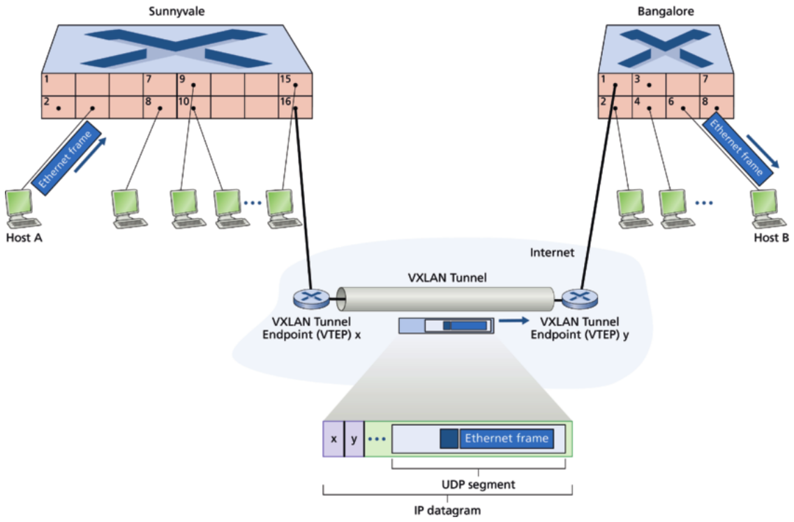

Hình 6.30 Một VXLAN chứa các đoạn ở Sunnyvale và Bangalore

UDP datagram, chứa frame Ethernet gốc và thông tin header, sau đó được đặt vào trong một IP datagram có địa chỉ là VTEP y, nơi hiện thực đầu kia của đường hầm VXLAN. Mạng IP giữa x và y sau đó chuyển IP datagram này tới y, như nó vẫn chuyển bất kỳ datagram nào, không biết gì về nội dung bên trong. VTEP y nhận datagram và nhận thấy nó chứa một UDP segment chứa một frame Ethernet VXLAN, trích ra và truyền frame Ethernet trên Ethernet Bangalore. Frame Ethernet gốc với địa chỉ MAC nguồn A và địa chỉ MAC đích B sau đó được Host B nhận.

Nếu bạn có thể hiểu thấu cách phân tầng khá bất thường của việc đóng gói một Ethernet datagram trong một UDP segment trong một IP datagram, như minh họa trong Hình 6.30, thì bạn đã thực sự nắm vững không chỉ khái niệm tunneling mà cả ảo hóa liên kết, và khái niệm toàn bộ một mạng đóng vai một liên kết ảo duy nhất!

Trong thảo luận ngắn gọn về VXLAN này, chúng ta đã bỏ qua một số vấn đề quan trọng. Ví dụ, làm sao VTEP x biết Host B nằm ở đầu kia của đường hầm, thông tin header VXLAN nào được đưa vào trong UDP datagram, và các tình huống sử dụng khác nhau cần số lượng lớn VXLAN là gì? Các nguồn thông tin tốt về chi tiết VXLAN và cách dùng chúng là [Arista VXLAN 2017; Cisco VXLAN 2014; Juniper VXLAN 2024; RFC 7348].

## 6.6 Mạng data center (Data Center Networking)

Các công ty Internet như Google, Microsoft, Amazon, và Alibaba đã xây dựng các data center khổng lồ, mỗi cái chứa hàng chục đến hàng trăm nghìn host. Như đã bàn ngắn gọn trong khung bên ở Mục 1.2, data center không chỉ được nối với Internet, mà bên trong còn chứa các mạng máy tính phức tạp, gọi là mạng data center, kết nối các host nội bộ của chúng. Trong mục này, chúng tôi giới thiệu ngắn gọn về mạng data center cho các ứng dụng đám mây.

Nói chung, data center phục vụ ba mục đích. Thứ nhất, chúng cung cấp nội dung như trang Web, kết quả tìm kiếm, chatbot AI, e-mail, hoặc video streaming cho người dùng. Thứ hai, chúng đóng vai hạ tầng tính toán massively-parallel (song song quy mô lớn) cho các tác vụ xử lý dữ liệu cụ thể, như tính toán chỉ mục phân tán cho máy tìm kiếm. Thứ ba, chúng cung cấp điện toán đám mây cho các công ty khác. Thật vậy, ngày nay một xu hướng lớn trong điện toán là các công ty dùng một nhà cung cấp đám mây như Amazon Web Services, Microsoft Azure, và Alibaba Cloud để xử lý về cơ bản mọi nhu cầu IT của họ.

### 6.6.1 Kiến trúc data center (Data Center Architectures)

Thiết kế data center là bí mật công ty được giữ kỹ, vì chúng thường mang lại lợi thế cạnh tranh then chốt cho các công ty điện toán đám mây hàng đầu. Năm 2024, chi phí xây một data center large-scale có thể từ hàng trăm triệu đô la đến hơn một tỷ đô la. Khoảng 45% chi phí có thể quy cho bản thân các host (cần được thay mỗi 3–4 năm); 25 phần trăm cho hạ tầng, bao gồm máy biến áp, hệ thống nguồn điện liên tục (UPS), máy phát điện cho các sự cố mất điện long-term, và hệ thống làm mát; 15 phần trăm cho chi phí tiện ích điện năng tiêu thụ; và 15 phần trăm cho mạng, bao gồm thiết bị mạng (switch, router, và bộ cân bằng tải), liên kết bên ngoài, và chi phí traffic transit. (Trong các tỉ lệ phần trăm này, chi phí thiết bị được khấu hao để áp dụng một thước đo chi phí chung cho các khoản mua one-time và chi phí liên tục như điện.) Mặc dù mạng không phải chi phí lớn nhất, đổi mới mạng là chìa khóa để giảm tổng chi phí và tối đa hóa performance [Greenberg 2009a].

Những con ong thợ trong một data center là các host. Các host trong data center, gọi là blade và trông giống hộp pizza, thường là host phổ thông bao gồm CPU, bộ nhớ, và lưu trữ đĩa. Các host được xếp trong rack, với mỗi rack thường có 20 đến 40 blade. Trên đỉnh mỗi rack có một switch, được đặt tên rất hợp là switch Top of Rack (TOR), kết nối các host trong rack với nhau và với các switch khác trong data center. Cụ thể, mỗi host trong rack có một giao diện mạng nối tới switch TOR của nó, và mỗi switch TOR có thêm các port có thể nối tới các switch khác. Ngày nay, host thường có kết nối Ethernet 40 Gbps hoặc 100 Gbps tới switch TOR của chúng [FB 2019; Greenberg 2015; Roy 2015; Singh 2015]. Mỗi host cũng được gán một địa chỉ IP data-center-internal riêng.

Mạng data center hỗ trợ hai loại traffic: traffic giữa client bên ngoài và host nội bộ, và traffic giữa các host nội bộ. Để xử lý các luồng giữa client bên ngoài và host nội bộ, mạng data center bao gồm một hoặc nhiều router biên (border router), nối mạng data center với Internet công cộng. Do đó, mạng data center kết nối các rack với nhau và nối các rack tới router biên. Hình 6.31 cho thấy một ví dụ về mạng data center. Thiết kế mạng data center, nghệ thuật thiết kế mạng kết nối và giao thức nối các rack với nhau và với router biên, đã trở thành một nhánh quan trọng của nghiên cứu mạng máy tính trong những năm gần đây. (Xem tài liệu tham khảo trong mục này.)

#### Cân bằng tải (Load Balancing)

Một data center đám mây, như cái được vận hành bởi Google, Microsoft, Amazon, và Alibaba, cung cấp đồng thời nhiều ứng dụng, như tìm kiếm, e-mail, và ứng dụng video. Để hỗ trợ request từ client bên ngoài, mỗi ứng dụng được gắn với một địa chỉ IP công khai mà client gửi request tới và nhận response từ đó. Bên trong data center, các request bên ngoài trước hết được hướng tới một bộ cân bằng tải (load balancer) có nhiệm vụ phân phối request tới các host, cân bằng tải giữa các host theo tải hiện tại của chúng [Patel 2013; Eisenbud 2016]. Một data center lớn thường có vài load balancer, mỗi cái dành cho một tập ứng dụng đám mây cụ thể. Một load balancer như vậy đôi khi được gọi là “layer-4 switch” vì nó ra quyết định dựa trên số port đích (tầng 4) cũng như địa chỉ IP đích trong packet. Khi nhận một request cho một ứng dụng cụ thể, load balancer chuyển tiếp nó tới một trong các host xử lý ứng dụng đó. (Sau đó host có thể gọi dịch vụ của các host khác để giúp xử lý request.) Load balancer không chỉ cân bằng khối lượng công việc giữa các host, mà còn cung cấp một chức năng NAT-like, dịch địa chỉ IP công khai bên ngoài sang địa chỉ IP nội bộ của host thích hợp, rồi dịch ngược lại cho các packet đi theo chiều ngược về client. Điều này ngăn client liên lạc trực tiếp với host, mang lại lợi ích bảo mật là che giấu cấu trúc mạng nội bộ và ngăn client tương tác trực tiếp với host.

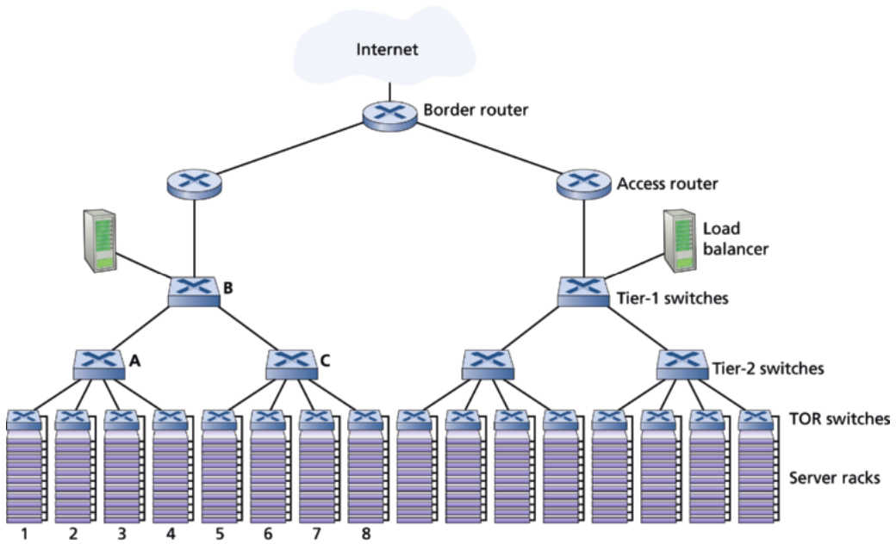

Hình 6.31 Một mạng data center với topology phân cấp

#### Kiến trúc phân cấp (Hierarchical Architecture)

Với một data center nhỏ chỉ chứa vài nghìn host, một mạng đơn giản gồm một router biên, một load balancer, và vài chục rack, tất cả được nối bằng một Ethernet switch duy nhất có thể là đủ. Nhưng để mở rộng tới hàng chục đến hàng trăm nghìn host, một data center thường dùng một phân cấp router và switch, như topology minh họa trong Hình 6.31. Ở đỉnh phân cấp, router biên nối tới các router truy cập (access router) (chỉ hai cái được vẽ trong Hình 6.31, nhưng có thể có nhiều hơn nhiều). Bên dưới mỗi access router có ba tầng switch. Mỗi access router nối tới một switch top-tier, và mỗi switch top-tier nối tới nhiều switch second-tier và một load balancer. Mỗi switch second-tier lần lượt nối tới nhiều rack qua switch TOR của các rack (switch third-tier). Mọi liên kết thường dùng Ethernet cho các giao thức link-layer và physical-layer, với sự pha trộn cáp đồng và cáp quang. Với một thiết kế phân cấp như vậy, có thể mở rộng một data center tới hàng trăm nghìn host.

Vì việc liên tục cung cấp ứng dụng với độ sẵn sàng cao là cực kỳ quan trọng với nhà cung cấp ứng dụng đám mây, data center cũng đưa thiết bị mạng dư thừa và liên kết dư thừa vào thiết kế (không vẽ trong Hình 6.31). Ví dụ, mỗi switch TOR có thể nối tới hai switch tier-2, và mỗi access router, switch tier-1, và switch tier-2 có thể được nhân đôi và tích hợp vào thiết kế [Cisco 2012; Greenberg 2009b]. Trong thiết kế phân cấp ở Hình 6.31, hãy quan sát rằng các host bên dưới mỗi access router tạo thành một subnet duy nhất. Để cục bộ hóa traffic quảng bá ARP, mỗi subnet này lại được chia thành các subnet VLAN nhỏ hơn, mỗi subnet gồm vài trăm host [Greenberg 2009a].

Mặc dù kiến trúc phân cấp truyền thống vừa mô tả giải quyết vấn đề quy mô, nó bị hạn chế về dung lượng host-to-host [Greenberg 2009b]. Để hiểu hạn chế này, hãy xét lại Hình 6.31, và giả sử mỗi host nối tới switch TOR của nó bằng một liên kết 10 Gbps, trong khi liên kết giữa các switch là liên kết Ethernet 100 Gbps. Hai host trong cùng rack luôn có thể giao tiếp ở tốc độ đầy đủ 10 Gbps, chỉ bị giới hạn bởi tốc độ của bộ điều khiển giao diện mạng của host. Tuy nhiên, nếu có nhiều luồng đồng thời trong mạng data center, tốc độ tối đa giữa hai host ở các rack khác nhau có thể thấp hơn nhiều. Để hiểu rõ vấn đề này, hãy xét một mẫu traffic gồm 40 luồng đồng thời giữa 40 cặp host ở các rack khác nhau. Cụ thể, giả sử mỗi host trong 10 host ở rack 1 trong Hình 6.31 gửi một luồng tới một host tương ứng ở rack 5. Tương tự, có mười luồng đồng thời giữa các cặp host ở rack 2 và 6, mười luồng đồng thời giữa rack 3 và 7, và mười luồng đồng thời giữa rack 4 và 8. Nếu mỗi luồng chia đều dung lượng liên kết với các luồng khác đi qua liên kết đó, thì 40 luồng đi qua liên kết A-to-B 100 Gbps (cũng như liên kết B-to-C 100 Gbps) mỗi luồng sẽ chỉ nhận được 100 Gbps/40 = 2.5 Gbps, thấp hơn đáng kể so với tốc độ giao diện mạng 10 Gbps. Vấn đề càng gay gắt hơn với các luồng giữa các host cần đi lên cao hơn trong phân cấp. Có vài giải pháp khả dĩ cho vấn đề này:

• Một giải pháp khả dĩ cho hạn chế này là triển khai switch và router higher-rate (tốc độ cao hơn). Nhưng điều này sẽ làm tăng đáng kể chi phí data center, vì switch và router có tốc độ port cao rất đắt.

• Giải pháp thứ hai cho vấn đề này, có thể áp dụng bất cứ khi nào có thể, là co-locate (đặt cùng chỗ) các dịch vụ và dữ liệu liên quan càng gần nhau càng tốt (ví dụ, trong cùng rack hoặc rack gần đó) [Roy 2015; Singh 2015] để giảm thiểu giao tiếp inter-rack qua các switch tier-2 hoặc tier-1. Nhưng cách này chỉ đi được tới một mức nào đó, vì một yêu cầu then chốt trong data center là sự linh hoạt trong việc bố trí tính toán và dịch vụ [Greenberg 2009b; Farrington 2010]. Ví dụ, một máy tìm kiếm Internet large-scale có thể chạy trên hàng nghìn host trải trên nhiều rack với yêu cầu băng thông đáng kể giữa mọi cặp host. Tương tự, một dịch vụ điện toán đám mây (như Amazon Web Services hoặc Microsoft Azure) có thể muốn đặt nhiều máy ảo tạo nên dịch vụ của một khách hàng lên các host vật lý có nhiều dung lượng nhất bất kể vị trí của chúng trong data center. Nếu các host vật lý này trải trên nhiều rack, các nút cổ chai mạng như mô tả ở trên có thể dẫn tới performance kém.

• Mảnh ghép cuối cùng của giải pháp là tăng khả năng kết nối giữa các switch TOR (thường gọi là access switch) và các switch tier-2 (thường gọi là aggregation switch), và giữa các switch tier-2 và switch tier-1 (thường gọi là core switch). Ví dụ, như minh họa trong Hình 6.32, mỗi switch TOR có thể được nối tới hai switch tier-2, từ đó cung cấp nhiều đường link- và switch-disjoint (không chung liên kết và switch) giữa các rack. Trong Hình 6.32, có bốn đường riêng biệt giữa switch tier-2 thứ nhất và switch tier-2 thứ hai, cùng nhau cung cấp dung lượng tổng 400 Gbps giữa hai switch tier-2 đầu tiên. Tăng mức độ kết nối giữa các tầng có hai lợi ích đáng kể: vừa tăng dung lượng vừa tăng độ tin cậy (nhờ đa dạng đường) giữa các switch. Trong data center của Facebook [FB 2019], mỗi TOR được nối tới 16 switch tier-2 khác nhau, và mỗi switch tier-2 được nối tới 16 switch tier-1 khác nhau.

Một hệ quả trực tiếp của việc tăng kết nối giữa các tầng trong mạng data center là định tuyến multi-path có thể trở thành first-class citizen (công dân hạng nhất) trong các mạng này. Mặc định các luồng là luồng đa đường. Một sơ đồ rất đơn giản để đạt định tuyến multi-path là Equal Cost Multi Path (ECMP) [RFC 2992], thực hiện lựa chọn next-hop ngẫu nhiên dọc theo các switch giữa nguồn và đích. Các sơ đồ nâng cao dùng cân bằng tải finer-grained (mịn hơn) cũng đã được đề xuất [Alizadeh 2014; Noormohammadpour 2018]. Trong khi các sơ đồ này thực hiện định tuyến multi-path ở mức luồng, cũng có các thiết kế định tuyến từng packet trong một luồng qua nhiều đường [He 2015; Raiciu 2010].

Phân cấp three-layer minh họa trong Hình 6.31 và 6.32 đã tiến hóa thành một fabric kết nối data-center two-layer gọi là topology leaf-spine [Alizadeh 2013], như minh họa trong Hình 6.33. Trong topology leaf-spine, access switch (gọi là leaf switch) được nối tới từng core switch (gọi là spine switch). Dung lượng kết nối của topology leaf-spine có thể mở rộng bằng cách nâng tốc độ liên kết giữa các nút leaf và spine, hoặc bằng cách thêm nhiều nút spine theo chiều ngang. Trong topology leaf-spine, mọi giao tiếp trong data center vượt ra ngoài access switch cần đúng hai bước nhảy switch, trái với số bước nhảy thay đổi và có thể lớn hơn trong các topology ở Hình 6.31 và 6.32.

Sự tiến hóa sang topology leaf-spine phản ánh sự gia tăng giao tiếp giữa các server trong data center (traffic so-called “east-west” (“đông–tây”)) trái với giao tiếp giữa một server và một đầu mút bên ngoài data-center (traffic gọi là “north-south” (“bắc–nam”)). Cũng có sự quan tâm ngày càng tăng tới các kết nối quang trực tiếp có thể cấu hình lại, dưới sự điều khiển SDN, giữa các leaf (hoặc aggregate) switch, qua đó bỏ qua nhu cầu về spine switch [Poutievski 2022].

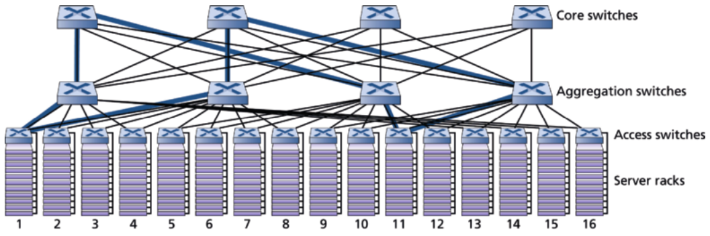

Hình 6.32 Một topology mạng dữ liệu three-tier, kết nối dày đặc

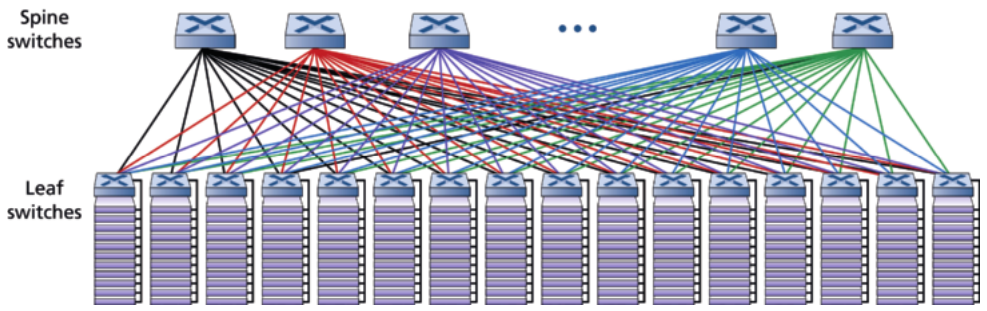

Hình 6.33 Kết nối switch leaf và spine

Mạng kết nối multi-switch phân tầng (tiered, multistage) như các mạng minh họa trong Hình 6.32 và 6.33 được gọi là mạng Clos, đặt theo tên Charles Clos, người đã nghiên cứu mạng như vậy [Clos 1953] trong bối cảnh chuyển mạch điện thoại. Từ đó, một lý thuyết phong phú về mạng Clos đã được phát triển, tìm thấy thêm ứng dụng trong mạng data center và trong mạng kết nối đa bộ xử lý. Với một số nhà vận hành data center lớn nhất, switch trong mạng kết nối đang được xây dựng in-house (nội bộ) từ silicon thương mại phổ thông, off-the-shelf [Greenberg 2009b; Roy 2015; Singh 2015; Poutievski 2022] thay vì mua từ các nhà cung cấp switch.

### 6.6.2 Các xu hướng trong mạng data center (Trends in Data Center Networking)

Mạng data center đang tiến hóa nhanh chóng, với các xu hướng được thúc đẩy bởi giảm chi phí, ảo hóa, ràng buộc vật lý, khả năng quản lý, khả năng mở rộng, và tùy biến.

#### Điều khiển và quản lý SDN tập trung (Centralized SDN Control and Management)

Vì một data center được quản lý bởi một tổ chức duy nhất, có lẽ tự nhiên là một số nhà vận hành data center lớn nhất, bao gồm Google, Microsoft, và Facebook, đang đón nhận khái niệm điều khiển tập trung logic SDN-like. Ví dụ, chúng ta đã học về nền tảng SDN Orion của Google dùng để điều khiển và quản lý các mạng data-center của họ cũng như mạng B4 wide-area kết nối các data center này. Kiến trúc của họ cũng phản ánh sự tách bạch rõ ràng giữa mặt phẳng dữ liệu (gồm các switch phổ thông tương đối đơn giản) và một mặt phẳng điều khiển software-based, như chúng ta đã thấy trong Mục 5.5. Do quy mô immense-scale (khổng lồ) của các data center, cấu hình tự động và quản lý trạng thái vận hành, như chúng ta đã gặp trong Mục 5.7, cũng là cực kỳ quan trọng [Vahdat 2024].

#### Ảo hóa (Virtualization)

Ảo hóa là động lực cho phần lớn sự tăng trưởng của điện toán đám mây và mạng data center nói chung. Máy ảo (Virtual Machines - VM) tách phần mềm chạy ứng dụng khỏi phần cứng vật lý. Sự tách biệt này cũng cho phép di chuyển liền mạch VM giữa các server vật lý, có thể nằm trên các rack khác nhau. Các giao thức Ethernet và IP chuẩn có những hạn chế trong việc cho phép di chuyển VM trong khi duy trì các kết nối mạng đang hoạt động giữa các server. Vì mọi mạng data center được quản lý bởi một cơ quan quản trị duy nhất, một giải pháp thanh lịch cho vấn đề là coi toàn bộ mạng data center như một mạng layer-2 phẳng duy nhất. Nhớ lại rằng trong một mạng Ethernet điển hình, giao thức ARP duy trì liên kết giữa địa chỉ IP và địa chỉ phần cứng (MAC) trên một giao diện. Để mô phỏng hiệu ứng của việc mọi host nối tới một switch “duy nhất”, cơ chế ARP được sửa đổi để dùng một hệ thống truy vấn kiểu DNS thay vì quảng bá, và thư mục duy trì một ánh xạ giữa địa chỉ IP gán cho một VM và switch vật lý mà VM đang nối tới trong mạng data center. Các sơ đồ có khả năng mở rộng hiện thực thiết kế cơ bản này đã được đề xuất trong [Mysore 2009; Greenberg 2009b] và đã được triển khai thành công trong các data center hiện đại.

#### Ràng buộc vật lý (Physical Constraints)

Khác với Internet diện rộng, mạng data center hoạt động trong môi trường không chỉ có dung lượng rất cao (liên kết 40 Gbps và 100 Gbps giờ là phổ biến) mà còn có độ trễ cực thấp (micro giây). Do đó, kích thước buffer nhỏ và các giao thức điều khiển tắc nghẽn như TCP và các biến thể của nó không mở rộng tốt trong data center. Trong data center, các giao thức điều khiển tắc nghẽn phải phản ứng nhanh và hoạt động trong chế độ mất mát cực thấp, vì khôi phục mất mát và timeout có thể dẫn tới kém hiệu quả cực độ. Một số cách tiếp cận để giải quyết vấn đề này đã được đề xuất và triển khai, từ các biến thể TCP data center-specific [Alizadeh 2010] tới việc hiện thực các công nghệ Remote Direct Memory Access (RDMA) trên Ethernet chuẩn [Zhu 2015; Moshref 2016; Guo 2016]. Lý thuyết lập lịch cũng đã được áp dụng để phát triển các cơ chế tách lập lịch luồng khỏi điều khiển tốc độ, cho phép các giao thức điều khiển tắc nghẽn rất đơn giản trong khi duy trì mức sử dụng liên kết cao [Alizadeh 2013; Hong 2012].

#### Mô-đun hóa và tùy biến phần cứng (Hardware Modularity and Customization)

Một xu hướng lớn khác là dùng các data center mô-đun dựa trên container vận chuyển (shipping container–based modular data centers - MDC) [YouTube 2009; Waldrop 2007]. Trong một MDC, nhà máy xây dựng, trong một container vận chuyển chuẩn 12-meter, một “data center mini” và vận chuyển container tới địa điểm data center. Mỗi container có tới vài nghìn host, xếp trong hàng chục rack, được đặt sát nhau. Tại địa điểm data center, nhiều container được nối với nhau và với Internet. Một khi một container đúc sẵn được triển khai tại data center, thường khó bảo trì nó. Do đó, mỗi container được thiết kế để suy giảm performance một cách nhẹ nhàng: khi các thành phần (server và switch) hỏng theo thời gian, container vẫn tiếp tục hoạt động nhưng với performance suy giảm. Khi nhiều thành phần đã hỏng và performance đã giảm dưới một ngưỡng, toàn bộ container được gỡ bỏ và thay bằng một container mới.

Xây dựng một data center từ container tạo ra các thách thức mạng mới. Với một MDC, có hai loại mạng: các mạng container-internal bên trong mỗi container và mạng lõi nối các container [Guo 2009; Farrington 2010]. Trong mỗi container, ở quy mô tới vài nghìn host, có thể xây dựng một mạng kết nối đầy đủ dùng các switch Gigabit Ethernet phổ thông rẻ tiền. Tuy nhiên, thiết kế mạng lõi, kết nối hàng trăm đến hàng nghìn container trong khi cung cấp băng thông host-to-host cao giữa các container cho các khối lượng công việc điển hình, vẫn là một bài toán khó. Một kiến trúc switch điện/quang lai để kết nối các container được mô tả trong [Farrington 2010].

#### Hiệu quả năng lượng và hiệu quả carbon (Energy-efficiency and Carbon-efficiency)

Chúng ta đã học trước đó rằng chi phí điện năng là một yếu tố đáng kể trong vận hành data center. Và với sự gia tăng kích thước và số lượng data center, điện năng giờ chiếm một phần non-negligible (không thể bỏ qua) trong tổng nhu cầu năng lượng. [Goldman 2024] ước tính rằng data center tiêu thụ khoảng 400 Terawatt giờ năng lượng năm 2024—giữa 1% và 2% lượng điện toàn cầu sử dụng. Nhu cầu đó được dự kiến tăng lên 3–4% lượng năng lượng toàn cầu sử dụng vào cuối thập kỷ, một phần do nhu cầu ngày càng tăng của các nhu cầu data- và compute-intensive (đòi hỏi nhiều dữ liệu và tính toán) của các ứng dụng AI-based, bao gồm các Mô hình Ngôn ngữ Lớn (Large Language Models). Do đó, nhiều nhà vận hành data center tập trung vào energy-efficiency (hiệu quả năng lượng), ví dụ, [Microsoft 2025]. Ngoài riêng energy-efficiency, sự nhấn mạnh ngày càng tăng vào tính bền vững của hạ tầng human-built (do con người xây dựng) đã dẫn tới sự nhấn mạnh vào hiệu quả carbon—tối ưu hóa vận hành để giảm tổng dấu chân carbon [Shenoy 2022].

Một xu hướng quan trọng cuối cùng là các nhà cung cấp đám mây lớn ngày càng tự xây dựng hoặc tùy biến hầu như mọi thứ trong data center của họ, bao gồm adapter mạng, switch router, TOR, phần mềm, và giao thức mạng [Greenberg 2015; Singh 2015]. Một xu hướng khác, do Amazon tiên phong, là cải thiện độ tin cậy bằng “vùng sẵn sàng (availability zones),” về cơ bản là nhân bản các data center riêng biệt trong các tòa nhà lân cận khác nhau. Bằng cách đặt các tòa nhà gần nhau (cách nhau vài kilômét), dữ liệu giao dịch có thể được đồng bộ giữa các data center trong cùng vùng sẵn sàng trong khi vẫn cung cấp khả năng chịu lỗi [Amazon 2014]. Nhiều đổi mới nữa trong thiết kế data center có lẽ sẽ còn tiếp tục xuất hiện.

## 6.7 Nhìn lại: Một ngày trong đời của một request trang Web (Retrospective: A Day in the Life of a Web Page Request)

Giờ chúng ta đã đề cập tầng liên kết trong chương này, và các tầng mạng, giao vận và ứng dụng trong các chương trước, hành trình đi xuống chồng giao thức của chúng ta đã hoàn tất! Ngay từ đầu cuốn sách (Mục 1.1), chúng tôi đã viết “phần lớn cuốn sách này liên quan đến các giao thức mạng máy tính,” và trong năm chương đầu, chúng ta chắc chắn đã thấy điều này thực sự đúng! Trước khi đi vào các chương chuyên đề trong phần hai của cuốn sách, chúng tôi muốn khép lại hành trình đi xuống chồng giao thức bằng một góc nhìn tích hợp, tổng thể về các giao thức đã học cho tới giờ. Một cách để có góc nhìn “bức tranh lớn” này là xác định nhiều (rất nhiều!) giao thức tham gia vào việc đáp ứng ngay cả request đơn giản nhất: tải một trang Web. Hình 6.34 minh họa bối cảnh của chúng ta: một sinh viên, Bob, nối một laptop tới Ethernet switch của trường và tải một trang Web (chẳng hạn trang chủ của www.google.com). Như giờ chúng ta đã biết, có rất nhiều thứ diễn ra “bên dưới nắp capo” để đáp ứng request có vẻ đơn giản này. Một bài lab Wireshark ở cuối chương này khảo sát chi tiết hơn các file trace chứa một số packet tham gia trong các kịch bản tương tự.

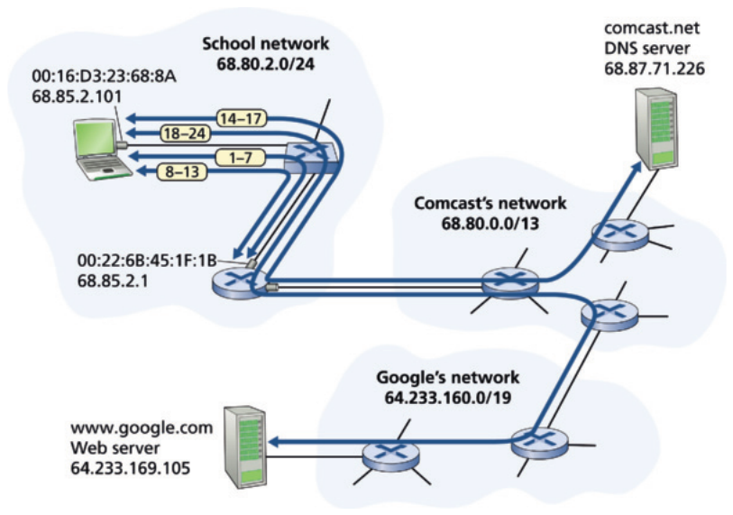

Hình 6.34 Một ngày trong đời của một request trang Web: Bối cảnh mạng và các hành động

### 6.7.1 Bắt đầu: DHCP, UDP, IP, và Ethernet (Getting Started: DHCP, UDP, IP, and Ethernet)

Giả sử Bob khởi động laptop rồi nối nó vào một cáp Ethernet nối tới Ethernet switch của trường, switch này lại được nối tới router của trường, như minh họa trong Hình 6.34. Router của trường được nối tới một ISP, trong ví dụ này là comcast.net. Trong ví dụ này, comcast.net cung cấp dịch vụ DNS cho trường; do đó, DNS server nằm trong mạng Comcast chứ không phải mạng trường. Chúng ta sẽ giả định DHCP server chạy bên trong router, như thường thấy.

Khi Bob lần đầu nối laptop vào mạng, anh ấy không thể làm gì (ví dụ, tải một trang Web) nếu không có địa chỉ IP. Do đó, hành động network-related đầu tiên mà laptop của Bob thực hiện là chạy giao thức DHCP để lấy địa chỉ IP, cũng như thông tin khác, từ DHCP server cục bộ:

1. Hệ điều hành trên laptop của Bob tạo một thông điệp DHCP request (Mục 4.3.3) và đặt thông điệp này trong một UDP segment (Mục 3.3) với port đích 67 (DHCP server) và port nguồn 68 (DHCP client). UDP segment sau đó được đặt trong một IP datagram (Mục 4.3.1) với địa chỉ IP đích quảng bá ( 255.255.255.255) và địa chỉ IP nguồn 0.0.0.0, vì laptop của Bob chưa có địa chỉ IP.

2. IP datagram chứa thông điệp DHCP request sau đó được đặt trong một frame Ethernet (Mục 6.4.2). Frame Ethernet có địa chỉ MAC đích FF:FF:FF:FF:FF:FF để frame được quảng bá tới mọi thiết bị nối với switch (hy vọng bao gồm một DHCP server); địa chỉ MAC nguồn của frame là của laptop của Bob, 00:16:D3:23:68:8A.

3. Frame Ethernet quảng bá chứa DHCP request là frame đầu tiên được laptop của Bob gửi tới Ethernet switch. Switch quảng bá frame đến trên mọi port ra, bao gồm port nối tới router.

4. Router nhận frame Ethernet quảng bá chứa DHCP request trên giao diện có địa chỉ MAC 00:22:6B:45:1F:1B và IP datagram được trích ra khỏi frame Ethernet. Địa chỉ IP đích quảng bá của datagram cho biết IP datagram này nên được các giao thức tầng trên tại nút này xử lý, nên payload của datagram (một UDP segment) do đó được phân kênh (demultiplex) (Mục 3.2) lên UDP, và thông điệp DHCP request được trích ra khỏi UDP segment. DHCP server giờ có thông điệp DHCP request.

5. Giả sử DHCP server chạy bên trong router có thể cấp phát địa chỉ IP trong khối CIDR (Mục 4.3.3) 68.85.2.0/24. Trong ví dụ này, mọi địa chỉ IP dùng trong trường do đó nằm trong khối địa chỉ của Comcast. Giả sử DHCP server cấp phát địa chỉ 68.85.2.101 cho laptop của Bob. DHCP server tạo một thông điệp DHCP ACK (Mục 4.3.3) chứa địa chỉ IP này, cũng như địa chỉ IP của DNS server ( 68.87.71.226), địa chỉ IP của router gateway mặc định ( 68.85.2.1), và khối subnet ( 68.85.2.0/24) (tương đương, “network mask”). Thông điệp DHCP được đặt trong một UDP segment, segment này được đặt trong một IP datagram, datagram này được đặt trong một frame Ethernet. Frame Ethernet có địa chỉ MAC nguồn là của giao diện router tới mạng nhà ( 00:22:6B:45:1F:1B) và địa chỉ MAC đích là của laptop của Bob ( 00:16:D3:23:68:8A).

6. Frame Ethernet chứa DHCP ACK được router gửi (unicast) tới switch. Vì switch là self-learning (Mục 6.4.3) và trước đó đã nhận một frame Ethernet (chứa DHCP request) từ laptop của Bob, switch biết cần chuyển tiếp một frame có địa chỉ 00:16:D3:23:68:8A chỉ tới port ra dẫn tới laptop của Bob.

7. Laptop của Bob nhận frame Ethernet chứa DHCP ACK, trích IP datagram từ frame Ethernet, trích UDP segment từ IP datagram, và trích thông điệp DHCP ACK từ UDP segment. DHCP client của Bob sau đó ghi lại địa chỉ IP của nó và địa chỉ IP của DNS server. Nó cũng cài địa chỉ của gateway mặc định vào bảng chuyển tiếp IP (Mục 4.1). Laptop của Bob sẽ gửi mọi datagram có địa chỉ đích nằm ngoài subnet 68.85.2.0/24 của nó tới gateway mặc định. Tại thời điểm này, laptop của Bob đã khởi tạo các thành phần mạng và sẵn sàng bắt đầu xử lý việc lấy trang Web. (Lưu ý rằng chỉ hai bước DHCP cuối trong bốn bước trình bày ở Chương 4 là thực sự cần thiết.)

### 6.7.2 Vẫn đang bắt đầu: DNS và ARP (Still Getting Started: DNS and ARP)

Khi Bob gõ URL www.google.com vào trình duyệt Web, anh ấy khởi đầu chuỗi sự kiện dài cuối cùng sẽ dẫn tới việc trang chủ Google được hiển thị bởi trình duyệt Web của anh ấy. Trình duyệt Web của Bob bắt đầu quá trình bằng cách tạo một TCP socket (Mục 2.7) sẽ được dùng để gửi HTTP request (Mục 2.2) tới www.google.com. Để tạo socket, laptop của Bob cần biết địa chỉ IP của www.google.com. Chúng ta đã học trong Mục 2.5 rằng giao thức DNS được dùng để cung cấp dịch vụ dịch name-to-IP-address này.

1. Do đó hệ điều hành trên laptop của Bob tạo một thông điệp truy vấn DNS (Mục 2.5.3), đặt chuỗi “www.google.com” vào phần câu hỏi của thông điệp DNS. Thông điệp DNS này sau đó được đặt trong một UDP segment với port đích 53 (DNS server). UDP segment sau đó được đặt trong một IP datagram với địa chỉ IP đích 68.87.71.226 (địa chỉ của DNS server trả về trong DHCP ACK ở bước 5) và địa chỉ IP nguồn 68.85.2.101.

2. Laptop của Bob sau đó đặt datagram chứa thông điệp truy vấn DNS vào một frame Ethernet. Frame này sẽ được gửi (được định địa chỉ, ở tầng liên kết) tới router gateway trong mạng trường của Bob. Tuy nhiên, mặc dù laptop của Bob biết địa chỉ IP của router gateway của trường ( 68.85.2.1) qua thông điệp DHCP ACK ở bước 5 ở trên, nó không biết địa chỉ MAC của router gateway. Để lấy địa chỉ MAC của router gateway, laptop của Bob cần dùng giao thức ARP (Mục 6.4.1).

3. Laptop của Bob tạo một thông điệp truy vấn ARP với địa chỉ IP đích 68.85.2.1 (gateway mặc định), đặt thông điệp ARP vào một frame Ethernet với địa chỉ đích quảng bá ( FF:FF:FF:FF:FF:FF) và gửi frame Ethernet tới switch, switch chuyển frame tới mọi thiết bị được nối, bao gồm router gateway.

4. Router gateway nhận frame chứa thông điệp truy vấn ARP trên giao diện tới mạng trường, và thấy địa chỉ IP đích 68.85.2.1 trong thông điệp ARP khớp với địa chỉ IP của giao diện của nó.

   Do đó router gateway chuẩn bị một ARP reply, cho biết địa chỉ MAC 00:22:6B:45:1F:1B của nó tương ứng với địa chỉ IP 68.85.2.1. Nó đặt thông điệp ARP reply vào một frame Ethernet, với địa chỉ đích 00:16:D3:23:68:8A (laptop của Bob) và gửi frame tới switch, switch chuyển frame tới laptop của Bob.

5. Laptop của Bob nhận frame chứa thông điệp ARP reply và trích địa chỉ MAC của router gateway ( 00:22:6B:45:1F:1B) từ thông điệp ARP reply.

6. Giờ đây laptop của Bob có thể (cuối cùng!) định địa chỉ frame Ethernet chứa truy vấn DNS tới địa chỉ MAC của router gateway. Lưu ý rằng IP datagram trong frame này có địa chỉ IP đích 68.87.71.226 (DNS server), trong khi frame có địa chỉ đích 00:22:6B:45:1F:1B (router gateway). Laptop của Bob gửi frame này tới switch, switch chuyển frame tới router gateway.

### 6.7.3 Vẫn đang bắt đầu: Định tuyến nội miền tới DNS server (Still Getting Started: Intra-Domain Routing to the DNS Server)

1. Router gateway nhận frame và trích IP datagram chứa truy vấn DNS. Router tra địa chỉ đích của datagram này ( 68.87.71.226) và xác định từ bảng chuyển tiếp rằng datagram nên được gửi tới router ngoài cùng bên trái trong mạng Comcast ở Hình 6.34. IP datagram được đặt trong một frame link-layer phù hợp với liên kết nối router của trường tới router Comcast ngoài cùng bên trái và frame được gửi qua liên kết này.

2. Router ngoài cùng bên trái trong mạng Comcast nhận frame, trích IP datagram, kiểm tra địa chỉ đích của datagram ( 68.87.71.226) và xác định giao diện ra để chuyển tiếp datagram về phía DNS server từ bảng chuyển tiếp của nó, bảng này đã được điền bởi giao thức intra-domain của Comcast (như RIP, OSPF hoặc IS-IS, Mục 5.3) cũng như giao thức inter-domain của Internet, BGP (Mục 5.4).

3. Cuối cùng IP datagram chứa truy vấn DNS tới DNS server. DNS server trích thông điệp truy vấn DNS, tra tên www.google.com trong cơ sở dữ liệu DNS của nó (Mục 2.5), và tìm thấy bản ghi tài nguyên DNS chứa địa chỉ IP ( 64.233.169.105) cho www.google.com. (giả sử nó hiện đang được cache trong DNS server).

   Nhớ lại rằng dữ liệu được cache này bắt nguồn từ DNS server có thẩm quyền (Mục 2.5.2) cho google.com. DNS server tạo một thông điệp DNS reply chứa ánh xạ hostname-to-IP-address này, và đặt thông điệp DNS reply vào một UDP segment, và segment vào trong một IP datagram có địa chỉ là laptop của Bob ( 68.85.2.101). Datagram này sẽ được chuyển tiếp ngược qua mạng Comcast tới router của trường và từ đó, qua Ethernet switch tới laptop của Bob.

4. Laptop của Bob trích địa chỉ IP của server www.google.com từ thông điệp DNS. Cuối cùng, sau rất nhiều công sức, laptop của Bob giờ đã sẵn sàng liên lạc với server www.google.com!

### 6.7.4 Tương tác Web client–server: TCP và HTTP (Web Client-Server Interaction: TCP and HTTP)

1. Giờ laptop của Bob đã có địa chỉ IP của www.google.com, nó có thể tạo TCP socket (Mục 2.7) sẽ được dùng để gửi thông điệp HTTP GET (Mục 2.2.3) tới www.google.com. Khi Bob tạo TCP socket, TCP trong laptop của Bob trước hết phải thực hiện bắt tay three-way (Mục 3.5.6) với TCP trong www.google.com. Do đó laptop của Bob trước hết tạo một TCP SYN segment với port đích 80 (cho HTTP), đặt TCP segment vào trong một IP datagram với địa chỉ IP đích 64.233.169.105 (www.google.com), đặt datagram vào trong một frame với địa chỉ MAC đích 00:22:6B:45:1F:1B (router gateway) và gửi frame tới switch.

2. Các router trong mạng trường, mạng Comcast, và mạng Google chuyển tiếp datagram chứa TCP SYN về phía www.google.com, dùng bảng chuyển tiếp trong mỗi router, như trong các bước 14–16 ở trên.

   Nhớ lại rằng các mục bảng chuyển tiếp router chi phối việc chuyển tiếp packet qua liên kết inter-domain giữa mạng Comcast và Google được xác định bởi giao thức BGP (Chương 5).

3. Cuối cùng, datagram chứa TCP SYN tới www.google.com. Thông điệp TCP SYN được trích từ datagram và được phân kênh tới welcome socket gắn với port 80. Một connection socket (Mục 2.6) được tạo cho kết nối TCP giữa HTTP server của Google và laptop của Bob. Một segment TCP SYNACK (Mục 3.5.6) được sinh ra, đặt vào trong một datagram có địa chỉ là laptop của Bob, và cuối cùng đặt vào trong một frame link-layer phù hợp với liên kết nối www. google.com tới router first-hop của nó.

4. Datagram chứa segment TCP SYNACK được chuyển tiếp qua mạng Google, Comcast, và mạng trường, cuối cùng tới bộ điều khiển Ethernet trong laptop của Bob. Datagram được phân kênh trong hệ điều hành tới TCP socket được tạo ở bước 18, socket này đi vào trạng thái đã kết nối.

5. Với socket trên laptop của Bob giờ (cuối cùng!) đã sẵn sàng gửi byte tới www. google.com, trình duyệt của Bob tạo thông điệp HTTP GET (Mục 2.2.3) chứa URL cần lấy. Thông điệp HTTP GET sau đó được ghi vào socket, với thông điệp GET trở thành payload của một TCP segment. TCP segment được đặt vào một datagram và được gửi và chuyển tới www.google.com như trong các bước 18–20 ở trên.

6. HTTP server tại www.google.com đọc thông điệp HTTP GET từ TCP socket, tạo một thông điệp HTTP response (Mục 2.2), đặt nội dung trang Web được yêu cầu vào phần thân của thông điệp HTTP response, và gửi thông điệp vào TCP socket.

7. Datagram chứa thông điệp HTTP reply được chuyển tiếp qua mạng Google, Comcast, và mạng trường, và tới laptop của Bob. Chương trình trình duyệt Web của Bob đọc HTTP response từ socket, trích html của trang Web từ phần thân HTTP response, và cuối cùng (cuối cùng!) hiển thị trang Web!

Kịch bản ở trên của chúng ta đã bao quát rất nhiều nền tảng mạng! Nếu bạn đã hiểu phần lớn hoặc toàn bộ ví dụ trên, thì bạn cũng đã đi được một chặng đường dài kể từ khi lần đầu đọc Mục 1.1, nơi chúng tôi đã viết “phần lớn cuốn sách này liên quan đến các giao thức mạng máy tính” và có thể bạn đã tự hỏi giao thức thực sự là gì! Dù ví dụ trên có vẻ chi tiết đến đâu, chúng ta đã bỏ qua một số giao thức bổ sung khả dĩ (ví dụ, NAT chạy trong router gateway của trường, truy cập không dây vào mạng trường, các giao thức bảo mật để truy cập mạng trường hoặc mã hóa segment hay datagram, các giao thức quản lý mạng), và các vấn đề cần cân nhắc (Web caching, phân cấp DNS) mà người ta sẽ gặp trong Internet công cộng. Chúng ta sẽ đề cập một số chủ đề này và hơn nữa trong phần hai của cuốn sách.

Cuối cùng, chúng ta lưu ý rằng ví dụ trên là một góc nhìn tích hợp và tổng thể, nhưng cũng rất “thực tế chi tiết (nuts and bolts),” về nhiều giao thức mà chúng ta đã học trong phần một của cuốn sách. Ví dụ tập trung vào “như thế nào” hơn là “tại sao.” Để có góc nhìn rộng hơn, suy ngẫm hơn về thiết kế giao thức mạng nói chung, bạn có thể muốn re-read (đọc lại) “Các nguyên lý kiến trúc của Internet (Architectural Principles of the Internet)” trong Mục 4.5, và các tài liệu tham khảo trong đó.

## 6.8 Tóm tắt (Summary)

Trong chương này, chúng ta đã khảo sát tầng liên kết—các dịch vụ của nó, các nguyên lý làm nền tảng cho hoạt động của nó, và một số giao thức cụ thể quan trọng sử dụng các nguyên lý này trong việc hiện thực các dịch vụ link-layer.

Chúng ta đã thấy dịch vụ cơ bản của tầng liên kết là chuyển một datagram network-layer từ một nút (host, switch, router, điểm truy cập WiFi) tới một nút kề. Chúng ta đã thấy mọi giao thức link-layer hoạt động bằng cách đóng gói một datagram network-layer trong một frame link-layer trước khi truyền frame qua liên kết tới nút kề. Tuy nhiên, ngoài chức năng đóng khung chung này, chúng ta đã học rằng các giao thức link-layer khác nhau cung cấp các dịch vụ truy cập liên kết, chuyển giao, và truyền rất khác nhau. Những khác biệt này một phần do sự đa dạng lớn của các loại liên kết mà giao thức link-layer phải hoạt động trên đó. Một liên kết point-to-point đơn giản có một bên gửi và một bên nhận duy nhất giao tiếp qua một “sợi dây” duy nhất. Một liên kết đa truy cập được chia sẻ giữa nhiều bên gửi và bên nhận; do đó, giao thức link-layer cho một kênh đa truy cập có một giao thức (giao thức đa truy cập của nó) để điều phối truy cập liên kết. Trong trường hợp VXLAN và MPLS, “liên kết” nối hai nút thực ra có thể tự nó là một mạng. Theo một nghĩa nào đó, ý tưởng một mạng được coi như một liên kết không nên có vẻ kỳ lạ. Ví dụ, một liên kết điện thoại nối một modem/máy tính gia đình tới một modem/router ở xa thực ra là một đường đi qua một mạng điện thoại tinh vi và phức tạp.

Trong số các nguyên lý làm nền tảng cho giao tiếp link-layer, chúng ta đã khảo sát các kỹ thuật error-detection and -correction (phát hiện và sửa lỗi), các giao thức đa truy cập, định địa chỉ link-layer, ảo hóa (VLAN), và việc xây dựng các LAN chuyển mạch mở rộng và mạng data center. Phần lớn sự tập trung ngày nay ở tầng liên kết là vào các mạng chuyển mạch này. Trong trường hợp phát hiện/sửa lỗi, chúng ta đã khảo sát làm thế nào có thể thêm các bit bổ sung vào header của frame để phát hiện, và trong một số trường hợp sửa, lỗi bit-flip có thể xảy ra khi frame được truyền qua liên kết. Chúng ta đã đề cập các sơ đồ parity và checksum đơn giản, cũng như kiểm tra dư thừa vòng (cyclic redundancy check) mạnh mẽ hơn. Sau đó chúng ta chuyển sang chủ đề các giao thức đa truy cập. Chúng ta đã xác định và học ba cách tiếp cận lớn để điều phối truy cập một kênh quảng bá: các cách tiếp cận phân chia kênh (TDM, FDM), các cách tiếp cận truy cập ngẫu nhiên (các giao thức ALOHA và giao thức CSMA), và các cách tiếp cận taking-turns (luân phiên) (polling và token passing). Chúng ta đã học mạng truy cập cáp và thấy nó dùng nhiều phương pháp đa truy cập này. Chúng ta đã thấy một hệ quả của việc nhiều nút chia sẻ một kênh quảng bá duy nhất là nhu cầu cung cấp địa chỉ nút ở tầng liên kết. Chúng ta đã học rằng địa chỉ link-layer khá khác với địa chỉ network-layer và rằng, trong trường hợp Internet, một giao thức đặc biệt (ARP—Address Resolution Protocol) được dùng để dịch giữa hai dạng định địa chỉ này và đã học chi tiết giao thức Ethernet cực kỳ thành công. Sau đó chúng ta khảo sát cách các nút chia sẻ một kênh quảng bá tạo thành một LAN và cách nhiều LAN có thể được nối với nhau để tạo thành LAN lớn hơn—tất cả mà không cần sự can thiệp của định tuyến network-layer để kết nối các nút cục bộ này. Chúng ta cũng đã học cách nhiều LAN ảo có thể được tạo trên một hạ tầng LAN vật lý duy nhất.

Chúng ta kết thúc việc học tầng liên kết bằng cách tập trung vào ảo hóa liên kết, dùng MPLS và VXLAN làm các nghiên cứu tình huống. Sau đó chúng ta đã đưa ra tổng quan về thiết kế mạng cho các data center khổng lồ ngày nay. Chúng ta khép lại chương này (và thực ra là năm chương đầu) bằng cách xác định nhiều giao thức cần thiết để lấy một trang Web đơn giản. Sau khi đề cập tầng liên kết, hành trình đi xuống chồng giao thức của chúng ta giờ đã kết thúc! Chắc chắn, tầng vật lý nằm bên dưới tầng liên kết, nhưng chi tiết của tầng vật lý có lẽ tốt nhất nên để cho một khóa học khác (ví dụ, về lý thuyết truyền thông, thay vì mạng máy tính). Tuy nhiên, chúng ta đã chạm tới vài khía cạnh của tầng vật lý trong chương này và trong Chương 1 (thảo luận về môi trường vật lý trong Mục 1.2). Chúng ta sẽ xét lại tầng vật lý khi học các đặc tính liên kết không dây trong chương tiếp theo.

Mặc dù hành trình đi xuống chồng giao thức của chúng ta đã kết thúc, việc học mạng máy tính của chúng ta vẫn chưa kết thúc. Trong hai chương tiếp theo, chúng ta đề cập mạng không dây và bảo mật mạng. Hai chủ đề này không vừa vặn với bất kỳ tầng đơn lẻ nào; thật vậy, mỗi chủ đề cắt ngang nhiều tầng. Do đó, hiểu các chủ đề này (được coi là chủ đề nâng cao trong một số giáo trình mạng) đòi hỏi một nền tảng vững chắc ở mọi tầng của chồng giao thức—một nền tảng mà việc học tầng liên kết của chúng ta giờ đã hoàn tất!

### Bài tập về nhà và câu hỏi (Homework Problems and Questions)

#### Câu hỏi ôn tập Chương 6 (Chapter 6 Review Questions)

##### Mục 6.1–6.2

R1. Hãy xét phép so sánh với giao thông vận tải trong Mục 6.1.1. Nếu hành khách tương tự một datagram, thì cái gì tương tự frame của tầng liên kết?

R2. Nếu mọi liên kết trong Internet đều cung cấp dịch vụ chuyển giao tin cậy, thì dịch vụ chuyển giao tin cậy của TCP có thừa không? Tại sao có hoặc tại sao không?

R3. Một số dịch vụ khả dĩ mà một giao thức link-layer có thể cung cấp cho tầng mạng là gì? Dịch vụ link-layer nào trong số này có dịch vụ tương ứng trong IP? Trong TCP?

##### Mục 6.3

R4. Giả sử hai nút bắt đầu truyền cùng lúc một packet độ dài L qua một kênh quảng bá tốc độ R. Ký hiệu độ trễ lan truyền giữa hai nút là d<sub>prop</sub>. Có xảy ra va chạm không nếu d<sub>prop</sub> < L/R? Tại sao có hoặc tại sao không?

R5. Trong Mục 6.3, chúng ta đã liệt kê bốn đặc điểm mong muốn của một kênh quảng bá. Slotted ALOHA có những đặc điểm nào trong số này? Token passing có những đặc điểm nào trong số này?

R6. Trong CSMA/CD, sau va chạm thứ năm, xác suất một nút chọn K = 4 là bao nhiêu? Kết quả K = 4 tương ứng với độ trễ bao nhiêu giây trên một Ethernet 10 Mbps?

R7. Mô tả các giao thức polling và token-passing dùng phép so sánh với các tương tác trong một bữa tiệc cocktail.

R8. Tại sao giao thức token-ring sẽ kém hiệu quả nếu một LAN có chu vi rất lớn?

##### Mục 6.4

R9. Không gian địa chỉ MAC lớn bao nhiêu? Không gian địa chỉ IPv4? Không gian địa chỉ IPv6?

R10. Giả sử các nút A, B, và C đều gắn vào cùng một LAN quảng bá (qua adapter của chúng). Nếu A gửi hàng nghìn IP datagram tới B với mỗi frame đóng gói có địa chỉ là địa chỉ MAC của B, adapter của C có xử lý các frame này không? Nếu có, adapter của C có chuyển các IP datagram trong các frame này lên tầng mạng C không? Câu trả lời của bạn sẽ thay đổi thế nào nếu A gửi frame với địa chỉ quảng bá MAC?

R11. Tại sao một truy vấn ARP được gửi trong một frame quảng bá? Tại sao một ARP response được gửi trong một frame với một địa chỉ MAC đích cụ thể?

R12. Với mạng trong Hình 6.19, router có hai module ARP, mỗi cái có bảng ARP riêng. Có thể cùng một địa chỉ MAC xuất hiện trong cả hai bảng không?

R13. So sánh cấu trúc frame của 10BASE-T, 100BASE-T, và Gigabit Ethernet. Chúng khác nhau thế nào?

### Bài tập (Problems)

R14. Hãy xét Hình 6.15. Có bao nhiêu mạng con, theo nghĩa định địa chỉ ở Mục 4.3?

R15. Số VLAN tối đa có thể cấu hình trên một switch hỗ trợ giao thức 802.1Q là bao nhiêu? Tại sao?

R16. Giả sử N switch hỗ trợ K nhóm VLAN cần được nối qua một giao thức trunking. Cần bao nhiêu port để nối các switch? Hãy giải thích câu trả lời.

P1. Giả sử nội dung thông tin của một packet là mẫu bit 1110 0110 1001 0101 và một sơ đồ parity chẵn đang được dùng. Giá trị của trường chứa các bit parity sẽ là gì trong trường hợp sơ đồ parity two-dimensional? Câu trả lời của bạn phải sao cho dùng một trường checksum minimum-length.

P2. Hãy chỉ ra (đưa một ví dụ khác với ví dụ trong Hình 6.5) rằng kiểm tra parity two-dimensional có thể sửa và phát hiện một lỗi bit đơn. Hãy chỉ ra (đưa một ví dụ về) một lỗi double-bit có thể được phát hiện nhưng không sửa được.

P3. Giả sử phần thông tin của một packet (D trong Hình 6.3) chứa 8 byte gồm biểu diễn ASCII nhị phân không dấu 8-bit của chuỗi “Internet”. Hãy tính Internet checksum cho dữ liệu này.

P4. Hãy xét bài trước, nhưng thay vào đó giả sử 10 byte này chứa

a. biểu diễn nhị phân của các số từ 1 đến 10.

b. biểu diễn ASCII của các chữ cái từ B đến K (chữ hoa).

c. biểu diễn ASCII của các chữ cái từ b đến k (chữ thường).

d. Hãy tính Internet checksum cho dữ liệu này.

P5. Hãy xét bộ sinh 5-bit, G = 10011, và giả sử D có giá trị 1010101010. Giá trị của R là gì?

P6. Hãy xét bài trước, nhưng giả sử D có giá trị

a. 1000100101. b. 0101101010.

c. 0110100011.

P7. Trong bài này, chúng ta khám phá một số tính chất của CRC. Với bộ sinh G (= 1001) cho trong Mục 6.2.3, hãy trả lời các câu hỏi sau.

a. Tại sao nó có thể phát hiện bất kỳ lỗi bit đơn nào trong dữ liệu D?

b. G ở trên có thể phát hiện bất kỳ số lẻ lỗi bit nào không? Tại sao?

P8. Trong Mục 6.3, chúng ta đã đưa ra phác thảo cách suy ra hiệu suất của slotted ALOHA. Trong bài này chúng ta sẽ hoàn thành phép suy ra đó.

a. Nhớ lại rằng khi có N nút hoạt động, hiệu suất của slotted ALOHA là Np(1 − p)<sup>N−1</sup>. Hãy tìm giá trị của p làm cực đại biểu thức này.

b. Dùng giá trị p tìm được ở (a), hãy tìm hiệu suất của slotted ALOHA bằng cách cho N tiến tới vô cùng. Gợi ý: (1 − 1/N)<sup>N</sup> tiến tới 1/e khi N tiến tới vô cùng.

P9. Hãy chỉ ra rằng hiệu suất tối đa của pure ALOHA là 1/2e. Lưu ý: Bài này dễ nếu bạn đã hoàn thành bài ở trên!

P10. Hãy xét hai nút, A và B, dùng giao thức slotted ALOHA để tranh chấp một kênh. Giả sử nút A có nhiều dữ liệu cần truyền hơn nút B, và xác suất truyền lại p<sub>A</sub> của nút A lớn hơn xác suất truyền lại của nút B, p<sub>B</sub>.

a. Hãy đưa ra công thức cho throughput trung bình của nút A. Hiệu suất tổng của giao thức với hai nút này là bao nhiêu?

b. Nếu p<sub>A</sub> = 2p<sub>B</sub>, throughput trung bình của nút A có lớn gấp đôi của nút B không? Tại sao có hoặc tại sao không? Nếu không, làm thế nào bạn có thể chọn p<sub>A</sub> và p<sub>B</sub> để điều đó xảy ra?

c. Tổng quát, giả sử có N nút, trong đó nút A có xác suất truyền lại 2p và mọi nút khác có xác suất truyền lại

p. Hãy đưa ra biểu thức tính throughput trung bình của nút A và của bất kỳ nút nào khác.

P11. Giả sử bốn nút hoạt động—các nút A, B, C và D—đang cạnh tranh truy cập một kênh dùng slotted ALOHA. Giả định mỗi nút có vô số packet cần gửi. Mỗi nút cố gắng truyền trong mỗi slot với xác suất p. Slot đầu tiên được đánh số slot 1, slot thứ hai được đánh số slot 2, và cứ thế.

a. Xác suất nút A thành công lần đầu tiên ở slot 4 là bao nhiêu?

b. Xác suất một nút nào đó (A, B, C hoặc D) thành công ở slot 5 là bao nhiêu?

c. Xác suất thành công đầu tiên xảy ra ở slot 4 là bao nhiêu?

d. Hiệu suất của hệ thống four-node này là bao nhiêu?

P12. Hãy vẽ đồ thị hiệu suất của slotted ALOHA và pure ALOHA theo hàm của p cho các giá trị N sau:

a. N = 10.

b. N = 30. c. N = 50.

P13. Hãy xét một kênh quảng bá với N nút và tốc độ truyền R bps. Giả sử kênh quảng bá dùng polling (với một nút polling bổ sung) để đa truy cập. Giả sử khoảng thời gian từ khi một nút hoàn tất truyền cho tới khi nút kế tiếp được phép truyền (tức là, độ trễ polling) là d<sub>poll</sub>. Giả sử trong một vòng polling, một nút cho trước được phép truyền tối đa Q bit. Throughput tối đa của kênh quảng bá là bao nhiêu?

P14. Hãy xét ba LAN được nối bởi hai router, như minh họa trong Hình 6.35.

a. Gán địa chỉ IP cho mọi giao diện. Với Subnet 1 dùng địa chỉ có dạng 192.168.1.xxx; với Subnet 2 dùng địa chỉ có dạng 192.168.2.xxx; và với Subnet 3 dùng địa chỉ có dạng 192.168.3.xxx.

b. Gán địa chỉ MAC cho mọi adapter.

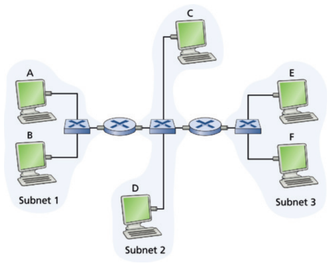

Hình 6.35 Ba subnet, được nối bởi các router

c. Hãy xét việc gửi một IP datagram từ Host E tới Host B. Giả sử mọi bảng ARP đều cập nhật. Liệt kê mọi bước, như đã làm cho ví dụ single-router trong Mục 6.4.1.

d. Lặp lại (c), giờ giả định bảng ARP trong host gửi rỗng (và các bảng khác đều cập nhật).

P15. Hãy xét Hình 6.35. Giờ chúng ta thay router giữa subnet 1 và 2 bằng một switch S1, và đặt nhãn router giữa subnet 2 và 3 là R1.

a. Hãy xét việc gửi một IP datagram từ Host E tới Host F. Host E có nhờ router R1 giúp chuyển tiếp datagram không? Tại sao? Trong frame Ethernet chứa IP datagram, các địa chỉ IP và MAC nguồn và đích là gì?

b. Giả sử E muốn gửi một IP datagram tới B, và giả định ARP cache của E không chứa địa chỉ MAC của B. E có thực hiện truy vấn ARP để tìm địa chỉ MAC của B không? Tại sao? Trong frame Ethernet (chứa IP datagram hướng tới B) được chuyển tới router R1, các địa chỉ IP và MAC nguồn và đích là gì?

c. Giả sử Host A muốn gửi một IP datagram tới Host B, và ARP cache của A không chứa địa chỉ MAC của B cũng như ARP cache của B không chứa địa chỉ MAC của A. Giả sử thêm rằng bảng chuyển tiếp của switch S1 chỉ chứa các mục cho Host B và router R1. Do đó, A sẽ quảng bá một thông điệp ARP request. Switch S1 sẽ thực hiện những hành động nào khi nhận được thông điệp ARP request? Router R1 có cũng nhận được thông điệp ARP request này không? Nếu có, R1 có chuyển tiếp thông điệp tới Subnet 3 không? Khi Host B nhận được thông điệp ARP request này, nó sẽ gửi lại cho Host A một thông điệp ARP response. Nhưng nó có gửi một thông điệp truy vấn ARP để hỏi địa chỉ MAC của A không? Tại sao? Switch S1 sẽ làm gì khi nhận được thông điệp ARP response từ Host B?

P16. Hãy xét bài trước, nhưng giờ giả sử router giữa subnet 2 và 3 được thay bằng một switch. Hãy trả lời các câu hỏi (a)–(c) trong bài trước trong bối cảnh mới này.

P17. Nhớ lại rằng với giao thức CSMA/CD, adapter chờ K • 512 thời gian bit sau một va chạm, trong đó K được rút ngẫu nhiên. Với K = 100, adapter chờ bao lâu trước khi quay lại Bước 2 với kênh quảng bá 100 Mbps? Với kênh quảng bá 1 Gbps?

P18. Giả sử các nút A và B nằm trên cùng một kênh quảng bá 10 Mbps, và độ trễ lan truyền giữa hai nút là 325 thời gian bit. Giả sử CSMA/CD và packet Ethernet được dùng cho kênh quảng bá này. Giả sử nút A bắt đầu truyền một frame và, trước khi nó xong, nút B bắt đầu truyền một frame. A có thể truyền xong trước khi phát hiện B đã truyền không? Tại sao có hoặc tại sao không? Nếu câu trả lời là có, thì A tin sai rằng frame của nó đã được truyền thành công mà không có va chạm. Gợi ý: Giả sử tại thời điểm t = 0 bit, A bắt đầu truyền một frame. Trong trường hợp xấu nhất, A truyền một frame minimum-sized dài 512 + 64 thời gian bit. Vậy A sẽ truyền xong frame tại t = 512 + 64 thời gian bit. Do đó, câu trả lời là không, nếu tín hiệu của B tới A trước thời gian bit t = 512 + 64 bit. Trong trường hợp xấu nhất, khi nào tín hiệu của B tới A?

P19. Giả sử các nút A và B nằm trên cùng một kênh quảng bá 10 Mbps, và độ trễ lan truyền giữa hai nút là 245 thời gian bit. Giả sử A và B gửi frame Ethernet cùng lúc, các frame va chạm, rồi A và B chọn các giá trị K khác nhau trong thuật toán CSMA/CD. Giả định không có nút nào khác hoạt động, các lần truyền lại từ A và B có thể va chạm không? Cho mục đích của chúng ta, chỉ cần giải ví dụ sau là đủ. Giả sử A và B bắt đầu truyền tại t = 0 thời gian bit. Cả hai phát hiện va chạm tại t = 245 t thời gian bit. Giả sử K<sub>A</sub> = 0 và K<sub>B</sub> = 1. B lên lịch truyền lại vào thời điểm nào? A bắt đầu truyền vào thời điểm nào? (Lưu ý: Các nút phải chờ kênh rỗi sau khi quay lại Bước 2—xem giao thức.) Tín hiệu của A tới B vào thời điểm nào? B có kiềm chế không truyền vào thời điểm đã lên lịch không?

P20. Trong bài này, bạn sẽ suy ra hiệu suất của một giao thức đa truy cập CSMA/CD-like. Trong giao thức này, thời gian được chia slot và mọi adapter được đồng bộ với các slot. Tuy nhiên, khác với slotted ALOHA, độ dài một slot (tính bằng giây) nhỏ hơn nhiều so với thời gian frame (thời gian để truyền một frame). Gọi S là độ dài một slot. Giả sử mọi frame có độ dài không đổi L = kRS, trong đó R là tốc độ truyền của kênh và k là một số nguyên lớn. Giả sử có N nút, mỗi nút có vô số frame cần gửi. Chúng ta cũng giả định d<sub>prop</sub> < S, để mọi nút có thể phát hiện va chạm trước khi kết thúc một thời gian slot. Giao thức như sau:

• Nếu, với một slot cho trước, không nút nào chiếm giữ kênh, mọi nút tranh chấp kênh; cụ thể, mỗi nút truyền trong slot với xác suất p. Nếu đúng một nút truyền trong slot, nút đó chiếm giữ kênh trong k − 1 slot tiếp theo và truyền toàn bộ frame của nó.

• Nếu một nút nào đó đang chiếm giữ kênh, mọi nút khác kiềm chế không truyền cho tới khi nút chiếm giữ kênh truyền xong frame của nó. Khi nút này đã truyền xong frame, mọi nút tranh chấp kênh. Lưu ý rằng kênh luân phiên giữa hai trạng thái: trạng thái hữu ích, kéo dài đúng k slot, và trạng thái không hữu ích, kéo dài một số slot ngẫu nhiên. Rõ ràng, hiệu suất kênh là tỉ số k/(k + x), trong đó x là số kỳ vọng các slot không hữu ích liên tiếp.

a. Với N và p cố định, hãy xác định hiệu suất của giao thức này.

b. Với N cố định, hãy xác định p làm cực đại hiệu suất.

c. Dùng p (là một hàm của N) tìm được ở (b), hãy xác định hiệu suất khi N tiến tới vô cùng.

d. Hãy chỉ ra rằng hiệu suất này tiến tới 1 khi độ dài frame trở nên lớn.

P21. Hãy xét Hình 6.35 trong bài P14. Hãy cung cấp địa chỉ MAC và địa chỉ IP cho các giao diện tại Host A, cả hai router, và Host F. Giả sử Host A gửi một datagram tới Host F. Hãy cho biết địa chỉ MAC nguồn và đích trong frame đóng gói IP datagram này khi frame được truyền (i) từ A tới router bên trái, (ii) từ router bên trái tới router bên phải, (iii) từ router bên phải tới F. Cũng hãy cho biết địa chỉ IP nguồn và đích trong IP datagram được đóng gói trong frame tại mỗi thời điểm này.

P22. Giờ giả sử router ngoài cùng bên trái trong Hình 6.35 được thay bằng một switch. Các host A, B, C, và D và router bên phải đều được star-connected (nối hình sao) vào switch này. Hãy cho biết địa chỉ MAC nguồn và đích trong frame đóng gói IP datagram này khi frame được truyền (i) từ A tới switch, (ii) từ switch tới router bên phải, (iii) từ router bên phải tới F. Cũng hãy cho biết địa chỉ IP nguồn và đích trong IP datagram được đóng gói trong frame tại mỗi thời điểm này.

P23. Hãy xét Hình 6.15. Giả sử mọi liên kết đều là 1 Gbps. Throughput tổng tối đa có thể đạt được giữa 9 host và 2 server trong mạng này là bao nhiêu? Bạn có thể giả định bất kỳ host hoặc server nào cũng có thể gửi tới bất kỳ host hoặc server nào khác. Tại sao?

P24. Giả sử ba switch phòng ban trong Hình 6.15 được thay bằng hub. Mọi liên kết đều là 1 Gbps. Giờ hãy trả lời các câu hỏi đặt ra trong bài P23.

P25. Giả sử mọi switch trong Hình 6.15 được thay bằng hub. Mọi liên kết đều là 1 Gbps. Giờ hãy trả lời các câu hỏi đặt ra trong bài P23.

P26. Hãy xét hoạt động của một switch tự học trong bối cảnh một mạng trong đó 6 nút có nhãn từ A đến F được nối hình sao vào một Ethernet switch. Giả sử (i) B gửi một frame tới E, (ii) E trả lời bằng một frame tới B, (iii) A gửi một frame tới B, (iv) B trả lời bằng một frame tới A. Bảng switch ban đầu rỗng. Hãy cho biết trạng thái của bảng switch trước và sau mỗi sự kiện này. Với mỗi sự kiện, hãy xác định (các) liên kết mà frame được truyền sẽ được chuyển tiếp trên đó, và giải thích ngắn gọn câu trả lời.

P27. Trong bài này, chúng ta khám phá việc dùng packet nhỏ cho các ứng dụng Voice-over-IP. Một trong những nhược điểm của kích thước packet nhỏ là một phần lớn băng thông liên kết bị tiêu tốn bởi các byte overhead. Để làm rõ điều này, giả sử packet gồm P byte và 5 byte header.

a. Hãy xét việc gửi trực tiếp một nguồn thoại được mã hóa số. Giả sử nguồn được mã hóa ở tốc độ không đổi 128 kbps. Giả định mỗi packet được lấp đầy hoàn toàn trước khi nguồn gửi packet vào mạng. Thời gian cần để lấp đầy một packet là độ trễ đóng gói (packetization delay). Theo L, hãy xác định độ trễ đóng gói tính bằng mili giây.

b. Độ trễ đóng gói lớn hơn 20 msec có thể gây ra tiếng vọng đáng chú ý và khó chịu. Hãy xác định độ trễ đóng gói với L = 1,500 byte (gần tương ứng với một packet Ethernet maximum-sized) và với L = 50 (tương ứng với một packet ATM).

c. Hãy tính độ trễ store-and-forward tại một switch duy nhất với tốc độ liên kết R = 622 Mbps cho L = 1,500 byte, và cho L = 50 byte.

d. Hãy nhận xét về ưu điểm của việc dùng kích thước packet nhỏ.

P28. Hãy xét VLAN một switch trong Hình 6.25, và giả định một router bên ngoài được nối tới port 1 của switch. Hãy gán địa chỉ IP cho các host EE và CS và giao diện router. Hãy lần theo các bước được thực hiện ở cả tầng mạng và tầng liên kết để chuyển một IP datagram từ một host EE tới một host CS (Gợi ý: Đọc lại thảo luận về Hình 6.19 trong bài).

P29. Hãy xét mạng MPLS minh họa trong Hình 6.29, và giả sử các router R5 và R6 giờ đã hỗ trợ MPLS. Giả sử chúng ta muốn thực hiện traffic engineering sao cho packet từ R6 hướng tới A được chuyển mạch tới A qua R6-R4-R3-R1, và packet từ R5 hướng tới A được chuyển mạch qua R5-R4-R2-R1. Hãy cho biết các bảng MPLS trong R5 và R6, cũng như bảng đã sửa đổi trong R4, để điều này khả thi.

P30. Hãy xét lại cùng kịch bản như bài trước, nhưng giả sử packet từ R6 hướng tới D được chuyển mạch qua R6-R4-R3, trong khi packet từ R5 hướng tới D được chuyển mạch qua R4-R2-R1-R3. Hãy cho biết các bảng MPLS trong mọi router để điều này khả thi.

P31. Trong bài này, bạn sẽ tổng hợp phần lớn những gì đã học về các giao thức Internet. Giả sử bạn bước vào một căn phòng, nối vào Ethernet, và muốn tải một trang Web. Tất cả các bước giao thức diễn ra là gì, bắt đầu từ lúc bật PC cho tới khi nhận được trang Web? Giả định không có gì trong DNS cache hay cache trình duyệt khi bạn bật PC. (Gợi ý: Các bước bao gồm việc dùng các giao thức Ethernet, DHCP, ARP, DNS, TCP, và HTTP.) Hãy chỉ rõ trong các bước cách bạn lấy địa chỉ IP và MAC của một router gateway.

P32. Hãy xét mạng data center với topology phân cấp trong Hình 6.31. Giờ giả sử có 80 cặp luồng, với mười luồng giữa rack thứ nhất và thứ chín, mười luồng giữa rack thứ hai và thứ mười, và cứ thế. Giả sử thêm rằng mọi liên kết trong mạng đều là 10 Gbps, trừ các liên kết giữa host và switch TOR, là 1 Gbps.

a. Mỗi luồng có cùng tốc độ dữ liệu; hãy xác định tốc độ tối đa của một luồng.

b. Với cùng mẫu traffic, hãy xác định tốc độ tối đa của một luồng cho topology kết nối dày đặc trong Hình 6.32.

c. Giờ giả sử có một mẫu traffic tương tự, nhưng liên quan tới 20 host trên mỗi rack và 160 cặp luồng. Hãy xác định tốc độ luồng tối đa cho hai topology.

P33. Hãy xét mạng phân cấp trong Hình 6.31 và giả sử data center cần hỗ trợ e-mail và phân phối video cùng các ứng dụng khác. Giả sử bốn rack server được dành cho e-mail và bốn rack được dành cho video. Với mỗi ứng dụng, cả bốn rack phải nằm dưới một switch tier-2 duy nhất vì các liên kết tier-2 tới tier-1 không có đủ băng thông để hỗ trợ traffic intra-application. Với ứng dụng e-mail, giả sử trong 99.9 phần trăm thời gian chỉ ba rack được dùng, và ứng dụng video có mẫu sử dụng giống hệt.

a. Ứng dụng e-mail cần dùng rack thứ tư trong bao nhiêu phần thời gian? Còn ứng dụng video thì sao?

b. Giả định việc sử dụng e-mail và việc sử dụng video độc lập, trong bao nhiêu phần thời gian (tương đương, xác suất là bao nhiêu để) cả hai ứng dụng cần rack thứ tư của chúng?

c. Giả sử chấp nhận được việc một ứng dụng thiếu server trong 0.001 phần trăm thời gian hoặc ít hơn (gây ra những giai đoạn suy giảm performance hiếm hoi cho người dùng). Hãy thảo luận cách topology trong Hình 6.32 có thể được dùng để chỉ bảy rack được gán chung cho hai ứng dụng (giả định topology có thể hỗ trợ toàn bộ traffic).

### Bài thực hành Wireshark: Ethernet (Wireshark Labs: 802.11 Ethernet)

Tại website Companion của giáo trình này, http://www.pearsonhighered.com/cs-resources/, bạn sẽ tìm thấy một bài lab Wireshark khảo sát hoạt động của giao thức IEEE 802.3 và định dạng frame Ethernet. Một bài lab Wireshark thứ hai khảo sát các trace packet thu được trong một kịch bản mạng gia đình.

### PHỎNG VẤN VỚI... (AN INTERVIEW WITH...)


### Amin Vahdat

Amin Vahdat là một Fellow và phó chủ tịch Kỹ thuật tại Google, nơi nhóm của ông chịu trách nhiệm cung cấp phần mềm và phần cứng Machine Learning industry-leading (dẫn đầu ngành) phục vụ Alphabet, Google và thế giới, cùng các công nghệ Trí tuệ Nhân tạo giúp các nhà phát triển ML có thêm sức mạnh và giải quyết những thách thức kinh doanh cấp bách nhất của khách hàng. Trước đây, ông là Tổng Giám đốc phụ trách hạ tầng phần cứng và phần mềm tính toán, lưu trữ, và mạng của Google. Cho tới năm 2019, ông là Trưởng nhóm Kỹ thuật của tổ chức Networking tại Google.

Trước khi gia nhập Google, Amin là Giáo sư Science Applications International Corporation (SAIC) ngành Khoa học và Kỹ thuật Máy tính tại UC San Diego (UCSD). Ông nhận bằng tiến sĩ khoa học máy tính tại University of California Berkeley, và là thành viên của National Academy of Engineering (NAE) và là một Fellow của Association for Computing Machinery (ACM).

Amin đã được ghi nhận với một số giải thưởng, bao gồm giải National Science Foundation (NSF) CAREER, giải UC Berkeley Distinguished EECS Alumni Award, Alfred P. Sloan Fellowship, giải SIGCOMM Networking Systems Award của Association for Computing Machinery, và giải Duke University David and Janet Vaughn Teaching Award. Gần đây nhất, Amin được trao giải thành tựu trọn đời SIGCOMM cho những đóng góp của ông cho data center và mạng diện rộng. Cuối cùng, ông được kết nạp vào National Academy of Engineering vào tháng Chín năm 2023 cho những đóng góp vào thiết kế và hiện thực các mạng datacenter và planet-scale (quy mô hành tinh) vận hành các hệ thống máy tính đám mây.

#### Những ai đã truyền cảm hứng cho ông trong sự nghiệp? Ông đã đến với điện toán và mạng như thế nào? Một số người có ảnh hưởng sớm tới ông là ai?

Khi là sinh viên đại học tại UC Berkeley, tôi được bao quanh bởi những người yêu việc học. Trong khi các giảng viên rõ ràng ở tuyến đầu của nghiên cứu, họ đồng thời cực kỳ đam mê nội dung môn học và việc truyền đạt hiểu biết của mình cho sinh viên. Cho đến ngày nay, tôi vẫn nhớ rõ các bài giảng và bài tập của Bryan Harvey, Paul Hilfinger, Dave Anderson, Carlo Sequin, Randy Katz, và rất nhiều người khác. Robert Brayton đã cho tôi công việc nghiên cứu đầu tiên về Automatic Test Pattern Generation và Randy Katz đã mở mắt tôi trước những điều kỳ diệu của hệ thống máy tính. Điều khiến tôi ấn tượng nhiều lần là một số người xuất sắc và thành đạt nhất ở biên giới của khoa học máy tính cũng rất khiêm tốn và hào phóng.

Tôi nhớ trong một buổi phỏng vấn cho kỳ thực tập mùa hè tại Xerox PARC vào năm thứ ba đại học, người phỏng vấn hỏi tôi, “Bạn muốn làm gì sau khi tốt nghiệp?” Trong khi câu trả lời nảy ra đầu tiên trong đầu tôi là, “nộp đơn xin việc kỹ sư phần mềm và làm việc ở một công ty,” thì qua một sự kết hợp nào đó của self-realization (tự nhận thức) và self-interest (tư lợi), tôi đã trả lời ngay lúc đó, “Tôi muốn học sau đại học và trở thành giáo sư.” Từ thời điểm đó tôi nhận ra rằng đây không chỉ là câu trả lời “đúng” mà là câu trả lời thật. Sau khi quan sát và học hỏi từ các giảng viên Berkeley, tôi nhận ra rằng tôi cũng rất muốn trở thành giáo sư, học ở biên giới tri thức, góp phần thúc đẩy hiểu biết khoa học, và truyền đạt hiểu biết đó cho sinh viên. Cuối cùng tôi đã có ba kỳ thực tập mang tính định hình tại Xerox PARC, nơi khai sinh phần lớn các phát minh làm nền tảng cho điện toán hiện đại, bao gồm máy tính cá nhân, giao diện người dùng đồ họa, Remote Procedure Call, con chuột, lập trình hướng đối tượng, Ethernet LAN, và rất nhiều thứ khác. Là một phần của văn hóa đã tạo ra những đột phá như vậy đã dạy tôi rất nhiều về xây dựng hệ thống, hợp tác và nghiên cứu cross-disciplinary (liên ngành).

#### Ông đến với mạng từ nền tảng hệ phân tán. Ông có thể nói một chút về việc đó đã diễn ra thế nào không?

Luôn thú vị khi thấy sự tình cờ đóng vai trò quan trọng thế nào trong công việc và góc nhìn của một người. Trọng tâm của tôi ở trường sau đại học là hệ điều hành và hệ phân tán. Dù tôi là người dùng mạng nhiệt tình, tôi còn lâu mới là chuyên gia. Năm 1999, khi tôi bắt đầu làm Giáo sư trợ lý (Assistant Professor) first-year (năm đầu) tại Duke University, mạng và Internet đang bùng nổ khắp giới học thuật và công nghiệp. Trưởng khoa ghé qua văn phòng tôi và nói “Chúng tôi đang lên kế hoạch phân công giảng dạy cho năm tới. Chúng ta chưa từng có khóa học đại học hay sau đại học nào về mạng. Tôi nghĩ anh sẽ hoàn hảo để thiết kế và đưa các lớp này vào chương trình.” Tôi đáp, “Nhưng tôi không biết gì về mạng cả.” Ông ấy rất tử tế đáp lại, “Anh sẽ nắm bắt nhanh thôi và, hơn nữa, anh là người giỏi nhất chúng ta có.”

Tôi không thể tưởng tượng điều này lại có tác động và lợi ích lớn đến thế với tôi. Nó dẫn tới một cuộc chạy nước rút về phía tôi để đọc nhiều nhất có thể, nhưng cũng để tranh thủ chuyên môn của các đồng nghiệp ở các trường đại học khác. Tôi nhanh chóng trở nên yêu thích nội dung này. Khái niệm các giao thức hoàn toàn phi tập trung trao đổi thông điệp để xấp xỉ tối ưu toàn cục theo cách phi tập trung và độc lập cho các bài toán kinh điển, hấp dẫn như định tuyến, điều khiển tắc nghẽn, và thậm chí truy cập môi trường đã mở ra cả một thế giới tư duy và góc nhìn mới. Tôi nhìn nội dung này qua lăng kính hệ phân tán và hệ điều hành, liên tục suy nghĩ về cách các ý tưởng trong những lĩnh vực đó có thể được áp dụng cho mạng và ngược lại. Sinh viên có thể thấy sự hào hứng và đam mê của tôi với nội dung này. Về phần mình, tôi cảm nhận sức nặng của việc dạy một nội dung mà tôi cảm thấy mình không phải chuyên gia.

Việc tôi may mắn được giao trách nhiệm dạy mạng đã dẫn tới một số kết quả. Thứ nhất, và có lẽ quan trọng nhất, vài năm sau tôi được ghi nhận với giải thưởng giảng dạy của Duke University cho các lớp mạng của mình. Tôi đã bước vào con đường tiến sĩ vì yêu việc giảng dạy và chắc chắn đã chọn giới học thuật vì giảng dạy. Cho đến ngày nay, khi sinh viên hỏi tôi về việc chọn sự nghiệp học thuật hay công nghiệp, câu hỏi ngược lại rất dễ là, “Bạn có yêu việc dạy học không?” Được ghi nhận tại một trường đại học đầy những giảng viên và sinh viên tuyệt vời vẫn là một điểm nhấn trong sự nghiệp. Để không nhận quá nhiều công lao, việc mạng là cơn sốt vào đầu những năm 2000 đã giúp ích, và vì thế sinh viên tự nhiên có xu hướng đồng điệu với niềm đam mê và sự tò mò của tôi.

Thứ hai, tôi thấy cơ hội kết hợp các lĩnh vực hệ điều hành truyền thống, mạng, và hệ phân tán để khám phá phần giao thoa thành cái mà tôi gọi là hệ thống mạng (networked systems). Khi còn là một nhà học thuật trẻ, tôi đã đề xuất thành lập một hội nghị mới để đưa các cộng đồng này lại với nhau xung quanh các ý tưởng về Networked Systems Design and Implementation (NSDI). Tôi làm chủ tịch ban chỉ đạo của hội nghị, ra mắt năm 2004. Một điểm nhấn cá nhân khác với tôi là hội nghị NSDI năm nay sẽ tôn vinh một số công trình có ảnh hưởng nhất về mạng và hệ phân tán xuất hiện tại NSDI hằng năm.

Thứ ba, việc giảng dạy đã ảnh hưởng sâu sắc tới tư duy nghiên cứu của chính tôi. Bài báo được trích dẫn nhiều nhất của tôi, về Epidemic Routing for Partially Connected Ad Hoc Networks, đã kết hợp các giao thức dịch tễ phân tán kinh điển với định tuyến trong mạng không dây. Sự kết hợp giữa ý tưởng và việc open-sourcing (mở mã nguồn) phần mềm cùng kết quả mô phỏng của chúng tôi đã báo trước lĩnh vực mạng delay-tolerant (chịu trễ) (DTN) vài năm sau đó. Khi sau này tôi tìm hiểu về các thách thức mở rộng trong lĩnh vực mới nổi là mạng datacenter, tôi tự nhiên cân nhắc cách người ta có thể tận dụng các ý tưởng từ siêu máy tính, giao thức đồng thuận, và bộ điều khiển tập trung trong các hệ phân tán như GFS và MapReduce để giải quyết các thách thức đó.

#### Sau công trình ban đầu về mạng kết nối data center, gần đây ông tập trung nhiều hơn vào quản lý và điều khiển tập trung logic, ở quy mô lớn (tức là ở “quy mô Google”). Sự tiến hóa đó đã diễn ra thế nào, và nó đang hướng tới đâu?

Ngoài các điểm trên, có một số cân nhắc khác – quản lý, độ tin cậy, và hiệu quả –đã dẫn tới mô hình Software Defined Networking mà chúng tôi phát triển cho các mạng datacenter, Jupiter, và wide-area, B4, của Google. Quản lý một mạng gồm các phần tử tự trị dần dần học trạng thái của mạng toàn cục để đưa ra quyết định cục bộ xấp xỉ tối ưu toàn cục vốn dĩ đầy thách thức. Làm điều đó trong bối cảnh Internet toàn cầu có nghĩa là không thể có điều phối toàn cục và không có bản thiết kế trung tâm, vì việc bất kỳ Autonomous System (“nút”) nào cũng có thể gắn vào Internet và bắt đầu giao tiếp toàn cầu mà không cần bất kỳ sự phân xử trung tâm nào là một trong những nền tảng của Internet, sự tăng trưởng theo hàm mũ, và tầm vươn toàn cầu của nó. Tuy nhiên, thời gian hội tụ inter-AS và độ tin cậy là một thách thức vì thông tin về trạng thái toàn cục cần thời gian để lan truyền và, rốt cuộc, chỉ là xấp xỉ.

Nhưng trong một tòa nhà duy nhất hoặc thậm chí trên một WAN toàn cầu riêng như cái chúng tôi đang thiết kế, vị trí và vai trò của mọi phần tử mạng được biết trước. Thay vì để một nút khởi động, trao đổi thông điệp với láng giềng, và học vai trò của nó trong mạng toàn cục, chúng tôi biết mình có thể cấu hình vai trò của mọi phần tử mạng vào một bộ điều khiển tập trung logic, bộ điều khiển này sau đó có thể thông báo cho mọi phần tử liên quan về các cấu hình mới và thay đổi. Điều này chuyển bài toán quản lý mạng từ quản lý cấu hình của từng phần tử mạng riêng lẻ sang quản lý cấu hình của một mạng logic, đơn giản hóa bài toán một cách đáng kể cả từ góc độ kỹ thuật lẫn từ góc độ gánh nặng nhận thức đối với người quản lý mạng. Hãy tưởng tượng yêu cầu con người về cơ bản đóng vai một bộ mô phỏng hoàn hảo cho sự tiến hóa của mạng dựa trên các trao đổi thông điệp theo cặp giữa hàng nghìn thực thể mạng – ngay cả người giỏi và giàu kinh nghiệm nhất cũng không thể theo kịp quy mô và độ phức tạp ngày càng tăng của mạng của chúng tôi!

Các bài toán kinh điển như traffic engineering, kiểm soát chấp nhận (admission control), và chất lượng dịch vụ phân biệt cũng trở nên dễ hơn đáng kể với điều khiển tập trung. Một nhận thức then chốt ở đây là mạng có tính bùng phát (bursty) cao và thay đổi nhanh. Ngay cả hệ thống traffic engineering hay kiểm soát chấp nhận phi tập trung tiên tiến nhất cũng sẽ có vòng điều khiển và thời gian hội tụ dài hơn một hệ thống tập trung. Với bản chất tiến hóa nhanh của mạng và nhu cầu thường phải phản hồi trong mili giây, hoặc thậm chí micro giây, trước các điều kiện mạng thay đổi, một bộ điều khiển tập trung logic có những ưu điểm cơ bản. Những ưu điểm này chuyển thành mức hiệu quả cao hơn vì cần giữ dự trữ ít “bộ đệm băng thông” hơn để xử lý độ trễ trong thời gian phản hồi.

#### Ông thấy tương lai của mạng và Internet ra sao - cả trong data center lẫn trong mạng diện rộng (và có lẽ cả trong mạng công cộng và mạng riêng nữa?

Trong cả mạng datacenter lẫn mạng wide-area, cơ hội chưa bao giờ lớn hơn. Trong datacenter, các yêu cầu giao tiếp có thể dự đoán, độ trễ ultra-low (cực thấp) và đồng thời băng thông cao của các khối lượng công việc ML, cùng với việc tính toán mở rộng tới hàng trăm nghìn bộ tăng tốc gắn kết chặt chẽ, có nghĩa là mật độ băng thông của mạng phải tăng 1-2 bậc độ lớn so với tính toán và lưu trữ truyền thống. Bước nhảy về mật độ này, cùng với các yêu cầu độ tin cậy then chốt của tính toán ML hỗ trợ giao tiếp đồng bộ, trong nhiều trường hợp là all-to-all, sẽ dẫn tới những thiết kế hoàn toàn mới tập trung vào quy mô, độ tin cậy, performance có thể dự đoán, và hiệu quả điện năng.

Trên phạm vi diện rộng, Internet ngày càng trở thành hạ tầng xã hội. Một bài tập tư duy thú vị ở đây là xác định cần những gì để đảm bảo không quá 5 phút ngừng hoạt động mỗi năm (99.999% độ sẵn sàng) cho phần lớn Internet trên toàn cầu và về cơ bản 100% độ sẵn sàng cho một tập con các khối lượng công việc. Đạt tới đó sẽ đòi hỏi các kiến trúc khác biệt về cơ bản cho kết nối end-to-end và đảm bảo end-to-end, rất khác với các đặc tính độ tin cậy tự phát, mang tính bottom-up (từ dưới lên) hơn của kết nối Internet hiện nay.

#### Ông có khuyến nghị gì cho sinh viên muốn theo nghề khoa học máy tính và mạng?

Vừa rộng vừa sâu là rất quan trọng. Một mặt, hiểu các yêu cầu và cơ hội cho mạng đòi hỏi hiểu biết rất tốt về phần cứng (switch, NIC, bộ tăng tốc, CPU, GPU, TPU), hệ điều hành, và hệ phân tán sử dụng mạng. Rốt cuộc, cũng cần một hiểu biết tương tự về các dịch vụ Internet end-to-end higher-level. Rất nhiều thách thức quy về các giả định về mạng. Hướng tới các thiết kế và mô hình mới có nghĩa là phải hiểu những cách mà mạng hiện tại còn thiếu sót.

Mặt khác, hiểu sâu về mạng cũng quan trọng không kém. Các giao thức mạng từ định tuyến tới điều khiển tắc nghẽn tới khả năng chịu lỗi tới bảo mật/xác thực là một số chủ đề kinh điển và phức tạp nhất trong toàn bộ ngành điện toán. Hiểu lịch sử về cách chúng ta đi tới các giải pháp như hiện nay, chi tiết về cách chúng hoạt động trên lý thuyết, và cả trong thực tế thông qua công việc rất hands-on (thực hành), là then chốt để xây dựng hiểu biết và trực giác sâu sắc cho các giải pháp và thiết kế sẽ cùng đưa chúng ta tiến lên thành công.
