# 7 Mạng không dây và di động (Wireless and Mobile Networks)

15 năm qua đã chứng kiến sự gia tăng ngoạn mục trong việc triển khai và sử dụng mạng không dây và di động. Năm 2008, số thuê bao Internet băng rộng cố định (có dây) xấp xỉ bằng số thuê bao băng rộng kết nối qua các công nghệ không dây. Mặc dù cả hai nhóm thuê bao đều đã tăng kể từ đó, giờ đây (năm 2025) số thuê bao không dây Internet-connected đã nhiều gấp năm lần số thuê bao có dây. Ước tính 60 phần trăm traffic trang Web được hướng tới thiết bị di động so với thiết bị cố định năm 2025 [Statista Mobile 2025]. Nhiều ưu điểm của truy cập không dây là hiển nhiên với mọi người—truy cập Internet toàn cầu ở bất cứ đâu, bất cứ lúc nào, không dây nối, qua một thiết bị nhẹ có tính di động cao. Ngày càng nhiều thiết bị như máy chơi game, đồ gia dụng, hệ thống an ninh, đồng hồ, kính mắt, ô tô, quần áo đeo được, và rất nhiều thứ khác đang được kết nối không dây với Internet. Thật vậy, một số người đã cho rằng một cuộc cách mạng công nghiệp lần thứ tư cực kỳ quan trọng [Schwab 2016]—được hiện thực nhờ mạng không dây và các hệ thống cyber-physical (thực–số) tích hợp thế giới vật lý và thế giới số—hiện đang diễn ra.

Những thách thức đặt ra khi kết nối mạng các thiết bị không dây và di động khác biệt đến mức so với mạng máy tính có dây truyền thống, một chương riêng dành cho việc học mạng không dây và di động (tức là, chương này) là phù hợp. Trong chương này, chúng ta sẽ đề cập cả nguyên lý lẫn thực tiễn của mạng không dây và di động. Trong Mục 7.1, chúng ta sẽ bắt đầu bằng việc thiết lập bối cảnh “bức tranh lớn”.

Là độc giả của cuốn sách này, giờ bạn đã biết chúng tôi là những người hâm mộ nhiệt thành của cách tiếp cận top-down. Nhưng rất nhiều khía cạnh của mạng không dây bắt nguồn từ bản chất phức tạp, time-varying (biến đổi theo thời gian), capacity-limited (giới hạn dung lượng), và dùng chung của kênh không dây vật lý, đến mức cần sớm nắm vững các kênh vô tuyến để hiểu được hầu như mọi khía cạnh khác của mạng không dây. Do đó, chúng ta sẽ bắt đầu việc học in-depth (chuyên sâu) về mạng không dây và di động theo hướng bottom-up, trong đó trước hết chúng ta sẽ học về các tính chất của kênh vô tuyến không dây trong Mục 7.2. Trong Mục 7.3, chúng ta sẽ tập trung vào mạng truy cập vô tuyến first-hop. Ở đây, chúng ta sẽ học về các kỹ thuật chia sẻ kênh vô tuyến, khám phá mạng và gắn kết thiết bị, lập lịch truyền frame, tiết kiệm năng lượng, và hơn nữa. Trong Mục 7.4, chúng ta sẽ học về “lõi” mạng không dây cung cấp các dịch vụ control-plane như quản lý định danh và di động cũng như kết nối data-plane tới Internet rộng lớn hơn. Xuyên suốt các Mục 7.2–7.4, chúng ta sẽ bắt đầu bằng việc xác định và học các nguyên lý cơ bản vượt lên trên bất kỳ công nghệ mạng cụ thể nào, rồi minh họa các nguyên lý này trong thực tế trong bối cảnh WiFi và mạng di động. Mục tiêu ở đây là tách “tại sao” và “như thế nào” khỏi “cái gì”. Có nhiều sách và tài liệu khác mô tả “cái gì” được làm trong một kiến trúc mạng không dây cụ thể. Thật vậy, có những chuẩn (khá khô khan), nhiều chuẩn dài hàng nghìn trang, mô tả “cái gì” rất chi tiết. Do đó các Mục 7.2–7.4 nhằm cung cấp nền tảng để hiểu “tại sao”—tại sao một kiến trúc được cấu trúc theo một cách nhất định, hay tại sao một giao thức chọn một cách tiếp cận cụ thể để hoàn thành một nhiệm vụ. Hiểu biết sâu hơn này cũng sẽ tồn tại lâu hơn nhiều so với vòng đời của bất kỳ công nghệ không dây cụ thể nào, giúp future-proof (không lỗi thời) kiến thức của bạn về mạng không dây và di động!

Tính di động của thiết bị là một đặc điểm độc đáo của mạng không dây đến mức chúng ta sẽ dành nguyên một mục (Mục 7.5) cho chủ đề quan trọng này. Mặc dù chúng ta tập trung chủ yếu vào mạng 5G và WiFi xuyên suốt chương này, còn có các kiến trúc mạng không dây khác cũng được triển khai rộng rãi. Do đó, trong Mục 7.6, chúng ta sẽ đề cập ngắn gọn Bluetooth, vệ tinh, và mạng không dây IoT. Mục 7.7 kết thúc chương này. Chúng ta sẽ để thảo luận về bảo mật trong mạng không dây sang chương tiếp theo.

## 7.1 Giới thiệu (Introduction)

Hình 7.1 cho thấy bối cảnh cho thảo luận của chúng ta về mạng không dây và di động. Chúng ta sẽ bắt đầu bằng việc giữ thảo luận đủ tổng quát để bao quát một phạm vi rộng các mạng, bao gồm mạng di động 5G, mạng cục bộ WiFi (WLAN), và mạng ad hoc bao gồm Bluetooth và mạng IoT.

Chúng ta có thể xác định các thành phần chung then chốt sau trong một mạng không dây:

• Mạng truy cập không dây (Wireless access networks). Ở mức cao nhất, một mạng không dây có một hoặc nhiều mạng truy cập không dây. Mạng truy cập không dây nằm ở “biên” ngoài cùng của toàn bộ mạng, kết nối thiết bị vào một mạng lớn hơn qua một kênh vô tuyến không dây. Một mạng truy cập có thể được xem như một loại mạng cục bộ, như đã học trong Chương 6: nó có phạm vi địa lý hạn chế, nằm dưới sự kiểm soát của một nhà cung cấp dịch vụ duy nhất, và chủ yếu cung cấp một dịch vụ link-layer. Trong mạng di động, mạng truy cập không dây được gọi là Radio Access Network (RAN). Trong mạng WiFi, mạng truy cập không dây thường được gọi là Wireless Local Area Network (WLAN).

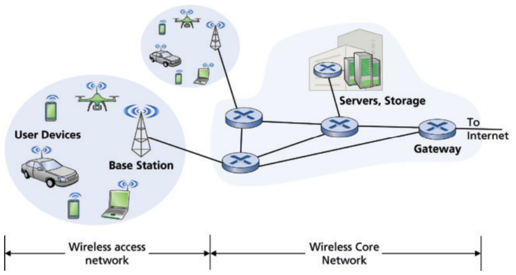

Hình 7.1 Các thành phần của một mạng không dây

• Mạng lõi không dây (Wireless core network). Mạng lõi không dây gồm các server, lưu trữ, router, và các liên kết (thường có dây) nằm giữa các thiết bị trong mạng truy cập của nhà cung cấp và mạng bên ngoài. Mạng lõi có thể phân tán về địa lý, ví dụ, với một số phần đặt cùng chỗ với hạ tầng trong mạng truy cập và các phần khác đặt ở các data center xa. Mạng lõi triển khai các dịch vụ control-plane và management-plane higher-level (ví dụ, cho định danh người dùng và thiết bị, di động, và quản lý access-security) cũng như các dịch vụ data-plane chuyển tiếp datagram từ thiết bị trong mạng truy cập tới Internet rộng lớn hơn, và ngược lại. Trong mạng di động, có một mạng lõi well-defined do nhà cung cấp mạng di động vận hành; chúng ta sẽ học mạng lõi 4G/5G trong Mục 7.4. Khác với 4G/5G, không có mạng lõi không dây tương ứng cho WiFi. Thay vào đó, một doanh nghiệp dùng cùng hạ tầng cho WLAN như hạ tầng nó dùng cho LAN có dây. Theo nghĩa này, doanh nghiệp xem WiFi chỉ như một công nghệ link-layer khác trong mạng doanh nghiệp của mình.

• Thiết bị không dây (Wireless devices). Một thiết bị không dây có thể là smartphone, máy tính bảng, hoặc laptop, hoặc một thiết bị IoT như cảm biến hay thiết bị gia dụng. Như trong trường hợp mạng có dây, chính các thiết bị này lưu trữ và chạy ứng dụng. Như minh họa trong Hình 7.1, thiết bị không dây gắn vào một mạng truy cập không dây. Chúng ta lưu ý rằng thiết bị không dây có thể có hoặc không di động—một chủ đề chúng ta sẽ quay lại trong Mục 7.5.

• Trạm gốc (Base station). Trạm gốc được cho là phần quan trọng nhất và độc đáo nhất của một mạng không dây, vì nó không có thành phần tương ứng trong mạng có dây. Một trạm gốc chịu trách nhiệm gửi và nhận packet tới và từ các thiết bị người dùng không dây được liên kết với trạm gốc đó. Nghĩa là, mọi thiết bị không dây gửi packet vào Internet và nhận packet từ Internet đều làm vậy qua một trạm gốc. Một trạm gốc thường sẽ chịu trách nhiệm cho nhiều thiết bị không dây được liên kết. Khi chúng ta nói một thiết bị không dây được “liên kết (associated)” với một trạm gốc, chúng ta muốn nói rằng (1) thiết bị nằm trong khoảng cách giao tiếp không dây của trạm gốc, và (2) thiết bị và trạm gốc đã thực thi một giao thức dẫn tới việc trạm gốc đóng vai trò chuyển tiếp packet giữa thiết bị và Internet rộng lớn hơn. Việc truyền frame từ trạm gốc tới các thiết bị được liên kết thường được nói là diễn ra trên kênh downstream hay downlink, trong khi việc truyền frame từ các thiết bị được liên kết tới trạm gốc diễn ra trên kênh upstream hay uplink.

• Trong mạng 5G, trạm gốc được gọi là gNodeB, viết tắt gNB, viết tắt của “Next Generation Node B” trong các chuẩn 5G. Trong mạng 4G, trạm gốc được gọi là eNodeB, viết tắt của “evolved Node B,” viết tắt là eNB. Đây có lẽ là những từ viết tắt kém trực quan nhất, kém self-explanatory (tự giải thích) nhất, và khó hiểu nhất trong toàn bộ ngành mạng! Vì lý do đó, và luôn ưu tiên dùng ngôn ngữ mô tả thay vì thuật ngữ chuyên môn, chúng ta sẽ gọi trạm gốc trong mạng 4G và 5G đơn giản là “trạm gốc (base station).” Tuy nhiên, nếu bạn định đào sâu vào các chuẩn kỹ thuật, hãy nhớ rằng “eNB” và “gNB” là thuật ngữ 3GPP cho “trạm gốc” trong mạng 4G hoặc 5G, tương ứng. Trong mạng WiFi, trạm gốc được gọi là Access Point (AP). Vì thuật ngữ đó mang tính mô tả hơn và được dùng phổ biến, đôi khi chúng ta cũng sẽ gọi trạm gốc WiFi là AP.

Thiết bị được liên kết với một trạm gốc thường được gọi là hoạt động ở chế độ hạ tầng (infrastructure mode), vì các dịch vụ mạng truyền thống (ví dụ, gán địa chỉ, định danh và quyền truy cập, và định tuyến) được cung cấp bởi hạ tầng mạng mà thiết bị được nối tới qua trạm gốc. Trong mạng ad hoc, thiết bị không dây không có hạ tầng như vậy để kết nối. Khi không có hạ tầng như vậy, bản thân các thiết bị phải self-organize (tự tổ chức) và tự cung cấp các dịch vụ như định tuyến, gán địa chỉ, dịch tên DNS-like, và hơn nữa. Mạng WiFi có thể hoạt động ở chế độ hạ tầng hoặc chế độ ad hoc, nhưng xuyên suốt chương này chúng ta sẽ giả định mạng WiFi có trạm gốc, tức là, hoạt động ở chế độ hạ tầng. Mạng Bluetooth, mà chúng ta sẽ học trong Mục 7.6, là ví dụ về mạng thuần ad hoc. [ Mohapatra 2004] cung cấp một nghiên cứu chi tiết về mạng ad hoc.

Khi một thiết bị di động di chuyển ra khỏi phạm vi của một trạm gốc và vào phạm vi của trạm gốc khác, nó sẽ thay đổi điểm gắn vào mạng lớn hơn, tức là, thay đổi trạm gốc mà nó được liên kết—một quá trình gọi là handoff hay handover (chuyển giao). Tính di động như vậy đặt ra nhiều câu hỏi đầy thách thức. Nếu một thiết bị không dây có thể di chuyển, làm thế nào tìm được vị trí hiện tại của thiết bị di động trong mạng để dữ liệu có thể được chuyển tiếp tới thiết bị đó? Việc định địa chỉ được thực hiện thế nào, khi một thiết bị có thể ở một trong nhiều vị trí khả dĩ? Nếu thiết bị di chuyển trong một kết nối TCP hoặc cuộc gọi thoại/video, datagram được chuyển tiếp thế nào để kết nối tiếp tục không gián đoạn? Chúng ta sẽ xem xét câu trả lời cho các câu hỏi này và nhiều câu hỏi mobility-related khác trong Mục 7.5.

Giờ hãy đi sâu hơn vào việc học mạng không dây, theo hướng bottom-up và bắt đầu ở biên mạng, với việc học các kênh vô tuyến không dây.

## 7.2 Tầng vật lý trong mạng không dây (The Physical Layer in Wireless Networks)

Có thể bạn đã nhận thấy việc học mạng của chúng ta cho tới giờ phần lớn tránh xa tầng vật lý. Một cuốn sách chỉ có thể đề cập một lượng nội dung có hạn, và hiểu biết về một vài đặc tính physical-layer đơn giản như tốc độ truyền bit, tỉ lệ lỗi bit, và độ trễ lan truyền đã đủ để hiểu nội dung chúng ta đã đề cập trong các Chương 2 đến 6. Nhưng điều này không đúng trong trường hợp mạng không dây! Do đó, trong mục này và mục tiếp theo, chúng ta sẽ đi sâu vào chi tiết tầng vật lý của mạng không dây. Chúng ta sẽ áp dụng góc nhìn computer-science nhiều hơn là góc nhìn EE truyền thống về kênh không dây, đưa ra một mô tả trực quan hơn về tầng vật lý thay vì một mô tả toán học chính xác hơn.

### 7.2.1 Các đặc tính của kênh không dây (Characteristics of wireless channels)

Ở mức cơ bản nhất, một dòng điện time-varying trong một ăngten tại một vị trí (bộ phát), tạo ra sóng điện từ (vô tuyến) lan truyền qua không gian và tạo ra một dòng điện trong (các) ăngten thu tại (các) vị trí khác. Bộ phát sẽ mã hóa thông tin vào tín hiệu điện từ bằng cách thay đổi (còn gọi là “điều chế (modulating)”) các đặc tính của sóng điện từ. Do thông tin được mã hóa trong tín hiệu điện từ, điều quan trọng là chúng ta hiểu một số đặc tính cơ bản này của sóng điện từ.

#### Sóng vô tuyến: Biên độ, tần số, và pha (Radio Waves: Amplitude, Frequency, and Phase)

Hình 7.2 cho thấy thành phần điện trường của một sóng điện từ—một hình có lẽ bạn còn nhớ từ một khóa vật lý nhập môn. Một sóng điện từ được đặc trưng bởi

• biên độ (amplitude): chiều cao của sóng tại một điểm cụ thể trong không gian và thời gian;

• bước sóng (wavelength) (λ): khoảng cách giữa hai đỉnh sóng liên tiếp trong sóng;

• thời gian chu kỳ (cycle time): thời gian giữa hai đỉnh sóng liên tiếp;

• tần số (frequency): 1/thời gian chu kỳ, đo bằng Hertz (Hz). Ví dụ, một sóng one-megahertz (MHz) có 1 × 106 chu kỳ/giây;

• pha (phase): phần chu kỳ đã đi qua cho tới thời điểm t. Như minh họa trong Hình 7.2, pha được đo từ một điểm tham chiếu theo thời gian, thường là khi biên độ của sóng bằng không và đang tăng. Pha cũng thường được biểu diễn bằng đơn vị góc, tức là, từ 0 đến 360 độ. Do đó, nếu pha bằng 75 phần trăm của một chu kỳ, điều này sẽ tương ứng với pha 270 độ. Sóng điện từ có hướng và lan truyền với tốc độ xấp xỉ tốc độ ánh sáng, 3 × 108 m/giây.

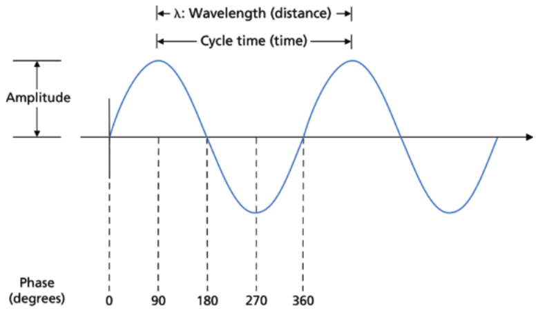

Hình 7.2 Sóng điện từ: biên độ, bước sóng, và pha

#### Truyền vô tuyến: Công suất, băng thông (Radio Transmission: Power, Bandwidth)

Một cách không chính thức, từ kinh nghiệm hằng ngày chúng ta hiểu rằng tín hiệu vô tuyến có thể mạnh hoặc yếu, và chúng có thể rõ hoặc đầy nhiễu rè (“nhiễu (noise)”). Tiếp theo hãy hình thức hóa các khái niệm này.

Công suất (power) là lượng năng lượng trên một đơn vị thời gian mà bộ phát đưa vào sóng điện từ phát ra của nó. Một cách không chính thức, chúng ta có thể xem công suất như cường độ của tín hiệu. Công suất được đo bằng đơn vị watt, thường là milliwatt (mW) trong mạng không dây. Các kỹ sư điện đôi khi thích đo công suất bằng decibel milliwatt (“dBm”), là logarit của tỉ số giữa công suất tín hiệu (đo bằng mW) và một mW. Nhưng ở đây chúng ta sẽ dùng thước đo tuyến tính mW phổ biến hơn.

Sóng điện từ lý tưởng trong Hình 7.2 chỉ có một tần số. Nghĩa là, toàn bộ năng lượng điện từ bức xạ tập trung tại một tần số cụ thể. Trong thực tế, công suất của bộ phát sẽ trải trên nhiều hơn một tần số. Hàm mật độ phổ công suất (power spectral density), minh họa trong Hình 7.3(a), đặc trưng cho lượng công suất có trong tín hiệu của bộ phát theo hàm của tần số. Một hàm mật độ phổ công suất thường có tâm quanh một tần số so-called tần số sóng mang (carrier frequency), như minh họa trong Hình 7.3(a). Tần số sóng mang trong ví dụ ở Hình 7.3(a) là 1 GHz.

Với khái niệm mật độ phổ công suất, giờ chúng ta có thể định nghĩa cẩn thận khái niệm băng thông (bandwidth) của tín hiệu vô tuyến—một khái niệm physical-layer then chốt trong mạng không dây. Băng thông của một tín hiệu vô tuyến, như tên gọi gợi ý, là độ rộng (đo bằng Hz) của dải tần số mà tín hiệu chiếm. Tín hiệu trong Hình 7.3(b), có băng thông 22 MHz, với công suất trải đều giữa 2.427 và 2.429 GHz. Chúng ta sẽ thấy trong Mục 7.6 rằng “kênh” 22-MHz-wide cụ thể này—tức là, một kênh vô tuyến với băng thông 22 MHz—tương ứng với kênh 6 trong một mạng WiFi.

Điều quan trọng cần lưu ý là khái niệm chính xác này về “băng thông” tín hiệu trong tầng vật lý không dây—độ rộng của dải tần số bị chiếm bởi một tín hiệu vô tuyến—rất khác với cách dùng khá không chính thức của thuật ngữ “băng thông” ở những chỗ khác trong ngành mạng để chỉ tốc độ truyền bit hoặc dung lượng của một liên kết. Sinh viên thường bị nhầm lẫn về điều này, cũng dễ hiểu. Trước hết, lưu ý rằng băng thông tín hiệu vô tuyến được đo bằng Hertz, trong khi tốc độ truyền của một liên kết được đo bằng bit trên giây (bps). Như chúng ta sẽ thấy, băng thông của một kênh vô tuyến (tính bằng Hertz) có liên quan đến tốc độ mà bit có thể được truyền qua một liên kết vô tuyến (tính bằng bit trên giây). Nói chung, băng thông càng lớn, tốc độ truyền bit càng cao. Ví dụ, một kênh WiFi 802.11n 20-MHz-wide (Mục 7.3.2) hỗ trợ tốc độ truyền tối đa 72.2 Mbps, trong khi một kênh WiFi 802.11n 40-MHz-wide có tốc độ truyền tối đa 150 Mbps [Intel 2024]. Nhưng như chúng ta sẽ thấy, quan hệ giữa băng thông kênh vô tuyến (đo bằng Hertz) và băng thông truyền của liên kết (đo bằng bit trên giây) khá phức tạp. Trong chương này chúng ta sẽ cẩn thận dùng thuật ngữ “băng thông” với nghĩa là độ rộng của dải tần số bị chiếm bởi một tín hiệu vô tuyến.

Từ kinh nghiệm hằng ngày (ví dụ, khi nghe radio AM, FM, hoặc vệ tinh) chúng ta biết rằng tín hiệu vô tuyến đôi khi có thể rõ nhưng lúc khác lại đầy nhiễu. Phần trên của Hình 7.4 cho thấy tín hiệu “sạch” gốc từ Hình 7.2, với tín hiệu nhiễu bổ sung xuất hiện giữa bộ phát và bộ thu (phần giữa của Hình 7.4), và tín hiệu nhận được (phần dưới của Hình 7.4). Nhìn vào phần giữa của tín hiệu nhận bị nhiễu, có lẽ bạn có thể thấy thách thức của việc trích xuất tín hiệu được truyền gốc từ tín hiệu nhận bị nhiễu. Có thể có nhiều nguồn nhiễu:

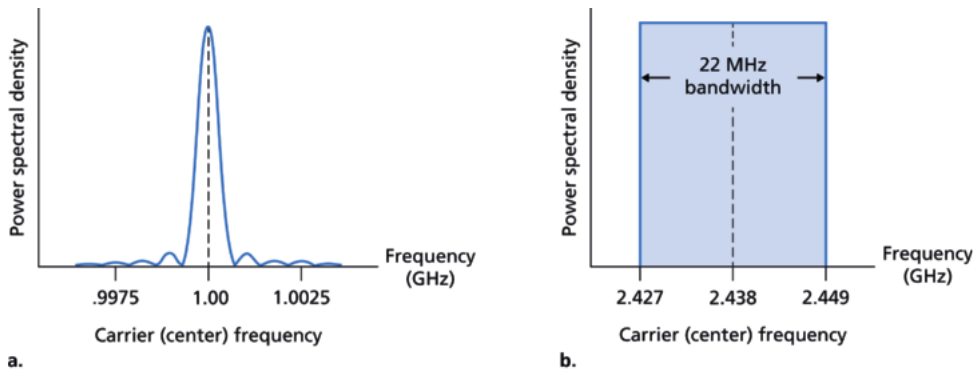

Hình 7.3 (a) Mật độ phổ công suất tín hiệu, (b) băng thông tín hiệu (lý tưởng hóa)

• Bộ phát gây nhiễu (Interfering transmitters). Một số dải tần số vô tuyến được dành cho sử dụng “không cấp phép (unlicensed)”, nghĩa là nhiều thiết bị công nghiệp và tiêu dùng có thể phát sóng vô tuyến trong dải đó, với điều kiện tuân theo giới hạn công suất. Một trong các dải này là dải 2.4–2.5 GHz, nơi máy báo khóc trẻ em, bộ mở cửa gara, và nhiều thiết bị gia đình khác đều có thể phát tín hiệu. Quan trọng hơn nữa, nhiều mạng—ví dụ, mạng WiFi, Bluetooth và Zigbee (IEEE 802.15.4)—dùng dải 2.4–2.5 GHz không cấp phép và làm vậy một cách không phối hợp. Tất nhiên, sẽ ổn khi đó là mạng WiFi của bạn dùng dải này, nhưng các mạng lân cận của người khác trông giống hệt nhiễu đối với mạng của bạn! Như câu nói, “Việc truyền mạng của người này là nhiễu của người khác.”

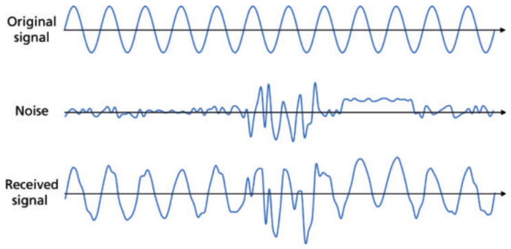

Hình 7.4 Tín hiệu gốc, nhiễu, và tín hiệu nhận bị nhiễu

• Nguồn bức xạ điện từ (EM radiators). Động cơ điện và lò vi sóng, đặc biệt các mẫu cũ có ít lớp chắn hơn, có thể phát ra sóng vô tuyến.

• Nhiễu nhiệt và nhiễu điện tử (Thermal and electronic noise). Các biến thiên nhiệt tự nhiên và khiếm khuyết trong mạch điện tử tại bộ phát hoặc bộ thu có thể thêm nhiễu vào tín hiệu.

#### Kênh vô tuyến: Nhiễu, tỉ số tín hiệu trên nhiễu (SNR), và dung lượng (Radio Channel: Noise, Signal-to-Noise (SNR) Ratio, and Capacity)

Tỉ số giữa công suất tín hiệu và công suất nhiễu được gọi là tỉ số tín hiệu trên nhiễu (signal-to-noise ratio - SNR). SNR thường được đo bằng decibel (dB):

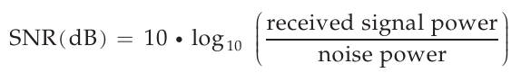

Lưu ý rằng giá trị SNR bằng 0 có nghĩa là lượng tín hiệu và nhiễu bằng nhau. Với mạng WiFi, giá trị SNR tối thiểu chấp nhận được trong một tín hiệu nhận là khoảng 20 dB [Meraki 2023]; giá trị tối thiểu chấp nhận được cho LTE dao động từ –5 đến 18 dB, tùy vào kỹ thuật điều chế được dùng; xem Mục 7.2.2 [Rohde and Schwarz 2013].

Với các khái niệm công suất, băng thông và nhiễu trong tay, giờ chúng ta sẵn sàng phát biểu một trong những kết quả quan trọng nhất trong lý thuyết truyền thông, định lý dung lượng Shannon (Shannon’s capacity theorem). Định lý Shannon liên hệ dung lượng kênh truyền thông, C—tốc độ tối đa khả dĩ mà dữ liệu có thể được truyền (đo bằng bit trên giây), error-free (không lỗi), qua kênh—với băng thông của kênh (B), và công suất tín hiệu nhận và công suất nhiễu (cả hai đều đo tuyến tính, ví dụ, bằng mW):

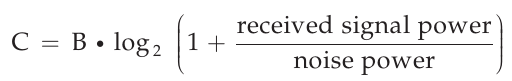

Điều quan trọng cần lưu ý là định lý dung lượng Shannon đưa ra một cận trên cho dung lượng kênh. Nó nói rằng bất kể dữ liệu được mã hóa và điều chế khéo léo thế nào vào tín hiệu không dây, lượng dữ liệu nhận được sẽ nhỏ hơn hoặc bằng C, với một băng thông kênh và SNR cho trước. Cũng có vài hệ quả thực tế quan trọng của định lý dung lượng Shannon:

• Tại một SNR cho trước, dung lượng kênh tối đa tăng tuyến tính theo băng thông kênh. Băng thông kênh rộng hơn có nghĩa là có tiềm năng truyền nhiều bit hơn mỗi giây.

• Trong trường hợp SNR cao, có rất ít lợi ích bổ sung khi bỏ thêm công sức để tăng SNR, vì dung lượng tối đa sẽ chỉ tăng theo logarit, tức là, dưới tuyến tính khi SNR tăng.

#### Các tính chất của kênh vô tuyến: suy hao đường truyền, đa đường, và trạm ẩn (Radio channel properties: path loss, multipath, and hidden terminals)

Một tín hiệu vô tuyến có thể thay đổi theo những cách quan trọng khi nó lan truyền từ bộ phát tới bộ thu. Cơ bản nhất, sóng mất cường độ khi lan truyền. Sự suy yếu này của tín hiệu vô tuyến khi lan truyền được gọi là suy hao đường truyền (path loss) hay suy giảm (attenuation). Trong trường hợp đường line-of-sight (tầm nhìn thẳng) không bị cản từ bộ phát tới bộ thu, tỉ số giữa công suất phát và công suất nhận giảm theo luật inverse-square (nghịch đảo bình phương):

Preceived/Ptransmitted ~ 1/(fd)2

trong đó Ptransmitted và Preceived lần lượt là công suất phát và công suất nhận, f là tần số của tín hiệu, và d là khoảng cách giữa bộ phát và bộ thu.

Trực giác đằng sau suy hao đường truyền bậc hai này được minh họa trong Hình 7.5. Vì diện tích bề mặt của một hình cầu tăng theo bình phương khoảng cách giữa tâm và bề mặt hình cầu, năng lượng đi qua một đơn vị diện tích ở khoảng cách d từ bên gửi bằng lượng năng lượng đi qua diện tích lớn hơn bốn lần ở khoảng cách 2d, và diện tích lớn hơn chín lần ở khoảng cách 3d. Số mũ suy hao đường truyền bằng 2 là cho so-called suy hao đường truyền free-space (không gian tự do) trong không khí. Số mũ suy hao đường truyền khoảng 3 là phổ biến trong môi trường đô thị ngoài trời, và số mũ suy hao đường truyền từ 4 trở lên là phổ biến trong các tòa nhà—khiến suy hao đường truyền càng trở thành một mối quan tâm quan trọng hơn.

Suy hao đường truyền bậc hai theo cả khoảng cách lẫn tần số có những hệ quả quan trọng cho truyền thông vô tuyến: vô tuyến tần số thấp (ví dụ, kHz) có xu hướng được dùng cho các ứng dụng vô tuyến long-distance, low-data-rate như dẫn đường vô tuyến, trong khi tần số cao (ví dụ, GHz) có xu hướng được dùng cho các ứng dụng mặt đất khoảng cách tương đối ngắn hơn bao gồm mạng di động và WiFi.

Sự suy giảm theo hàm mũ của công suất nhận theo khoảng cách dẫn tới bài toán trạm ẩn (hidden terminal problem), một hiện tượng sẽ chi phối thiết kế của các giao thức đa truy cập link-layer không dây như giao thức CSMA/CA của WiFi (Mục 7.3.1). Hình 7.6(a) minh họa trường hợp các nút A và B có thể “nghe” nhau, tức là, mức công suất nhận của tín hiệu của chúng ở trên một ngưỡng phát hiện. Tương tự, các nút B và C có thể nghe nhau. Tuy nhiên, do suy hao đường truyền, các nút A và C không thể nghe nhau vì mức công suất nhận của chúng đã giảm xuống dưới ngưỡng phát hiện. Do đó, các nút A và C bị “ẩn” với nhau. Người ta có thể thấy ngay trạm ẩn sẽ tác động thế nào tới các giao thức CSMA không dây—nếu A và C muốn truyền tới B chúng có thể lắng nghe kênh, không nghe thấy nhau đang truyền (do suy hao đường truyền), và vậy mà các lần truyền của chúng tới B sẽ giao thoa với nhau tại B. Hình 7.6(b) minh họa một kịch bản trạm ẩn khác trong đó tín hiệu của A và B bị chặn vật lý với nhau. Và cả trong trường hợp này, các lần truyền của chúng cũng giao thoa với nhau tại B. Rõ ràng, giao tiếp qua kênh không dây sẽ phức tạp hơn giao tiếp qua kênh có dây!

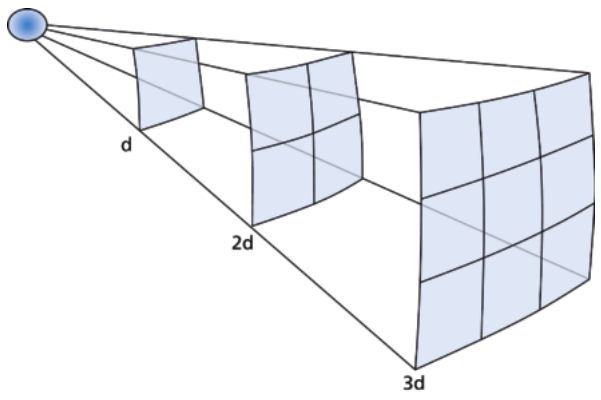

Hình 7.5 Suy hao đường truyền không gian tự do giảm theo bình phương khoảng cách giữa bộ phát và bộ thu

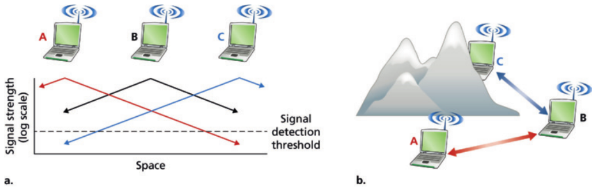

Hình 7.6 Trạm ẩn: A và B có thể nghe nhau, B và C có thể nghe nhau, nhưng A và C không thể nghe nhau

Luật nghịch đảo bình phương cũng cho biết công suất nhận giảm theo hàm mũ không chỉ theo khoảng cách, mà cả theo tần số. Sự suy giảm theo hàm mũ với tần số này cũng có những hệ quả rất quan trọng trong mạng không dây. Ví dụ, nó có nghĩa là chuyển từ một kênh fixed-bandwidth ở 5 GHz sang một kênh tương tự ở 50 GHz, sẽ dẫn tới công suất nhận được ở 50 GHz ít hơn 100 lần! Do đó, các kênh ở tần số cao hơn có xu hướng hoạt động ở phạm vi ngắn hơn, trong khi các kênh tần số thấp hơn có xu hướng được dùng để phủ khoảng cách xa hơn.

Hình 7.7 minh họa một đặc tính quan trọng khác của truyền thông không dây: tín hiệu đa đường (multipath). Trong hình này, một phần tín hiệu vô tuyến do bên gửi truyền đi theo một đường line-of-sight trực tiếp tới bên nhận, được biểu diễn về mặt khái niệm như một xung xanh lá nhận được trong Hình 7.7(a). Tuy nhiên, tín hiệu được truyền cũng phản xạ khỏi các vật thể (ví dụ, tòa nhà) trong môi trường và tới bên nhận tại các thời điểm hơi muộn hơn, vì các xung phản xạ đã đi quãng đường dài hơn từ bộ phát tới bộ thu. Các tín hiệu nhận đa đường này được biểu diễn bằng các xung đỏ và tím trong Hình 7.7(b). Do đa đường, việc thu một tín hiệu được truyền tại một thời điểm cho trước ở bên gửi bị trải ra theo thời gian ở bên nhận. Rõ ràng, đa đường sẽ làm phức tạp công việc tái tạo tín hiệu được truyền gốc của bên nhận.

Đa đường cũng đặt ra ràng buộc về tốc độ tối đa mà bộ phát có thể thay đổi tín hiệu truyền của nó, và do đó ràng buộc tốc độ mà bộ phát có thể truyền bit. Hình 7.8 cho thấy hai xung được truyền từ bên gửi. Bộ phát phải giãn cách các lần truyền tín hiệu/xung đủ xa sao cho tín hiệu LoS (xung xanh lá trong Hình 7.8) và mọi phản xạ đa đường của nó (các xung đỏ và tím) được nhận ở bên nhận trước khi tín hiệu/xung LoS tiếp theo được nhận. Nếu không làm vậy, hai xung và các phản xạ của chúng sẽ bị trộn lẫn theo thời gian ở bên nhận. Lượng thời gian tối thiểu receiver-dictated (do bên nhận quyết định) cần có giữa các thay đổi trong tín hiệu của bên gửi được gọi là thời gian kết hợp (coherence time) của bên nhận.

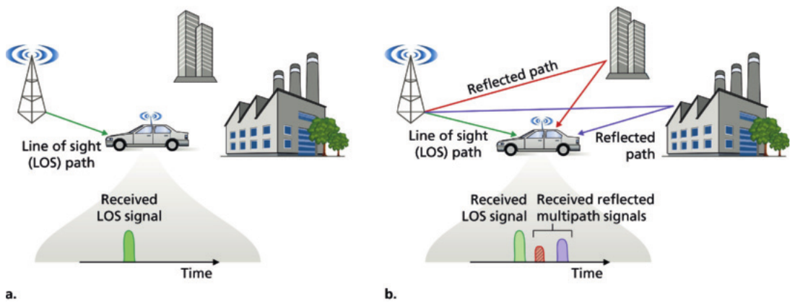

Hình 7.7 (a) Tín hiệu line-of-sight (LoS); (b) Thu tín hiệu LoS và tín hiệu phản xạ

#### Ăngten: MIMO (Antennas: MIMO)

Ăngten được triển khai trong hầu hết các trạm gốc và thiết bị di động và WiFi ngày nay chẳng giống chút nào ăngten thời ông bà (hay thậm chí thời cha mẹ) bạn! Bắt đầu từ đầu những năm 2000, mạng không dây bắt đầu chuyển từ các hệ thống có một ăngten duy nhất ở bộ phát và một ăngten duy nhất ở bộ thu, sang ăngten multiple-input and multiple-output (đa đầu vào đa đầu ra) (MIMO) dùng nhiều ăngten ở cả bộ phát và bộ thu. Như chúng ta sẽ thấy, các công nghệ MIMO đổi mới này đã cho phép mạng vô tuyến tăng đáng kể throughput liên kết (số bit mỗi giây được nhận thành công) giữa bộ phát và bộ thu. Một ưu điểm tức thì của việc có nhiều ăngten ở bộ thu hẳn đã rõ –N ăngten thu có nghĩa là (ở mức xấp xỉ đầu tiên) tổng tín hiệu nhận có công suất lớn hơn N lần. Nhưng hệ thống MIMO còn hơn thế rất nhiều!

MIMO đạt được ưu điểm so với các hệ thống single-antenna bằng cách khai thác nhiều đường giữa ăngten gửi và ăngten nhận theo một trong hai cách khác nhau về cơ bản:

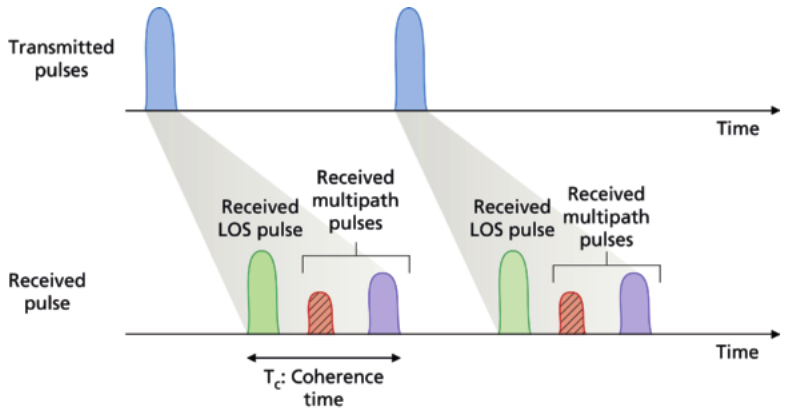

Hình 7.8 Phản xạ đa đường quyết định thời gian kết hợp

• Phân tập không gian MIMO (MIMO spatial diversity). Các kỹ thuật phân tập không gian MIMO gửi các luồng thông tin dư thừa từ bộ phát tới bộ thu, khai thác thực tế rằng tín hiệu vô tuyến đi trên các đường vật lý khác nhau giữa một hoặc nhiều ăngten phát tới một hoặc nhiều ăngten thu sẽ chịu các suy giảm khác nhau (ví dụ, hiệu ứng đa đường). Kỹ thuật này thiết yếu để chống lại tác động bất lợi của fading đa đường, trong đó phản xạ tín hiệu từ tòa nhà, cây cối, và các vật cản khác gây ra biến thiên cường độ tín hiệu. Bằng cách nhận nhiều bản sao của tín hiệu qua các đường khác nhau, hệ thống MIMO có thể kết hợp các tín hiệu này theo cách cực đại hóa cường độ tín hiệu và cực tiểu hóa tỉ lệ lỗi. Mặc dù các ăngten có thể chỉ cách nhau vài centimet (ví dụ, trên điện thoại di động), tín hiệu nhận trên các đường khác nhau thực sự có thể chịu các điều kiện kênh khá khác nhau.

• Hình 7.9(a) cho thấy trường hợp một ăngten phát và hai ăngten thu. Phân tập không gian cũng có thể được khai thác với nhiều ăngten phát, nhưng ở đây chúng ta sẽ tập trung vào trường hợp đơn giản nhất; xem [ Halperin 2010] để có phần giới thiệu dễ đọc về trường hợp tổng quát hơn.

• Giả sử bộ phát gửi một tín hiệu gốc, x. Ăngten trên nhận một tín hiệu y1 = H1, 1 (x), trong đó hàm H1, 1() biểu diễn cách tín hiệu được truyền đã bị thay đổi (ví dụ, về biên độ và pha) giữa ăngten phát duy nhất và ăngten thu phía trên. Tương tự, ăngten dưới nhận một tín hiệu khác y2 = H1, 2(x). Nhưng bộ thu nên làm gì với hai tín hiệu nhận khác nhau này? Đây là lúc các kỹ thuật signal-processing physical-layer vào cuộc. Đơn giản “cộng” các tín hiệu lại với nhau về cơ bản chỉ tái tạo hiệu ứng đa đường single-antenna. Thay vào đó, người ta có thể chọn tín hiệu yi có SNR lớn nhất. Hoặc người ta có thể trước hết căn chỉnh pha của các tín hiệu nhận (vốn có thể đã bị dịch do quá trình truyền) rồi cộng các tín hiệu lại một cách kết hợp (coherent), có thể đánh trọng số đóng góp của hai tín hiệu theo SNR của chúng. Đây chỉ là hai trong nhiều kỹ thuật có thể được dùng để khôi phục tín hiệu gốc từ nhiều tín hiệu nhận [Goldsmith 2005; Tze 2005].

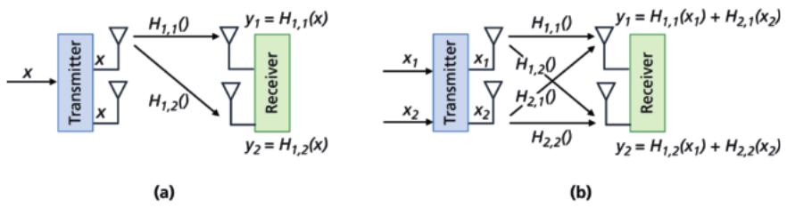

Hình 7.9 MIMO đơn giản (a) phân tập không gian, (b) ghép kênh không gian

• Ghép kênh không gian MIMO (MIMO spatial multiplexing). Trong trường hợp ghép kênh không gian MIMO, nhiều luồng thông tin khác nhau được gửi song song dọc theo các đường khác nhau từ ăngten phát tới ăngten thu. Điều này được minh họa trong Hình 7.9(b), cho thấy một ví dụ trong đó hai luồng thông tin khác nhau, x1 và x2 được truyền bởi hai ăngten phát khác nhau. Ở bộ thu, mỗi ăngten nhận một tín hiệu chứa cả hai luồng thông tin, với mỗi luồng thành phần đã chịu các suy giảm khác nhau. Ví dụ, tín hiệu nhận tại ăngten thu phía trên được biểu diễn bởi y1 = H1, 1 (x1) + H2, 1 (x2), trong đó tổng cho biết các tín hiệu được kết hợp trong không khí, rằng tín hiệu gốc x1 đã bị biến đổi theo H1, 1() trên đường tới ăngten thu phía trên, và rằng x2 đã bị biến đổi bởi H2, 1() trên đường tới ăngten phía trên này. Tín hiệu nhận tại ăngten phía dưới, y2, có cách diễn giải tương tự.

• Nhiệm vụ của bộ thu là xác định các tín hiệu gốc x1, x2, khi biết các tín hiệu nhận, y1, y2. Tất nhiên, H1, 1() và H2, 1() là chưa biết trong thực tế, nhưng chúng có thể được ước lượng nếu bên gửi và bên nhận phối hợp với nhau. Điều này, cùng với nhận xét rằng Hình 7.9(b) có hai phương trình (một cho y1, một cho y2) với hai ẩn (x1 và x2), gợi ý về loại thuật toán xử lý tín hiệu có thể được dùng ở bộ thu để tính các tín hiệu gốc, x1 và x2. Trong thực tế, bên gửi cũng có thể thực hiện mã hóa và điều chế giúp bên nhận cải thiện ước lượng cho x1 và x2.

Lý thuyết và thực tiễn của các kỹ thuật signal-processing MIMO vượt xa phạm vi những gì chúng ta có thể đề cập ở đây. Mục tiêu khiêm tốn của chúng ta ở đây là giới thiệu phân tập không gian và ghép kênh không gian và cho bạn cảm nhận về các loại xử lý tín hiệu làm nền tảng cho hệ thống MIMO. Độc giả được giới thiệu tới [Goldsmith 2005; Tze 2005; Halperin 2010] để có các trình bày in-depth hơn.

#### Định hướng búp sóng và ăngten định hướng (Beam Forming and Directional Antennas)

Beamforming (định hướng búp sóng) là việc hướng tín hiệu được truyền về phía một người dùng hoặc khu vực cụ thể thay vì bức xạ tín hiệu ra mọi hướng. Beamforming với ăngten định hướng tăng cường độ tín hiệu ở bộ thu, giảm giao thoa, và cải thiện performance truyền thông không dây tổng thể.

Beamforming thường được triển khai bằng một mảng ăngten. Bằng cách điều chỉnh pha và biên độ của tín hiệu tại mỗi ăngten phát, hệ thống có thể tạo giao thoa tăng cường theo hướng mong muốn và giao thoa triệt tiêu theo các hướng khác, tạo thành một “búp” sóng vô tuyến. Beam-forming có thể là động, với hệ thống liên tục điều chỉnh hướng búp sóng dựa trên vị trí của người dùng. Điều này đảm bảo chất lượng tín hiệu tối ưu ngay cả khi người dùng di chuyển. Beamforming có các lợi ích sau:

1. Tăng cường độ tín hiệu: Bằng cách tập trung tín hiệu theo một hướng cụ thể, beamforming tăng cường độ tín hiệu mà người dùng đích nhận được, dẫn tới tốc độ dữ liệu cao hơn và kết nối tin cậy hơn.

2. Giảm giao thoa: Beamforming giảm giao thoa với người dùng khác bằng cách giảm thiểu rò rỉ tín hiệu sang các hướng không mong muốn. Điều này dẫn tới performance tốt hơn trong môi trường dày đặc có nhiều thiết bị.

3. Cải thiện vùng phủ: Các búp sóng định hướng có thể mở rộng vùng phủ của mạng không dây, cung cấp kết nối tốt hơn ở rìa vùng phủ.

4. Tăng dung lượng: Bằng cách cho phép sử dụng phổ khả dụng hiệu quả hơn, beamforming có thể tăng dung lượng tổng thể của mạng, hỗ trợ nhiều người dùng hơn cùng lúc.

Beamforming được dùng rộng rãi trong WiFi, mạng di động hiện đại, và truyền thông vệ tinh.

#### MIMO đa người dùng (Multi-user MIMO (MU-MIMO))

Thảo luận MIMO ở trên của chúng ta cho tới giờ đã ngầm tập trung vào Single-user MIMO (SU-MIMO)—dùng nhiều ăngten ở bộ phát và/hoặc bộ thu để truyền tới một thiết bị duy nhất, như minh họa trong Hình 7.10(a). Trong thực tế, số ăngten trong các hệ thống như vậy là nhỏ, ví dụ, 2 đến 4 ăngten trong một trạm gốc WiFi. Trong mạng di động, các kỹ thuật MIMO cũng được dùng để gửi từ một bên gửi tới nhiều bên nhận cùng lúc. Điều này được gọi là Multi-user MIMO (MU-MIMO), hoặc đôi khi là Massive MIMO. MU-MIMO dùng các tập con ăngten khác nhau để truyền tới nhiều thiết bị khác nhau cùng lúc, như minh họa trong Hình 7.10(b). Mỗi tập con ăngten, đến lượt mình, dùng phân tập không gian MIMO để truyền nhiều tín hiệu có cùng thông tin tới một thiết bị. Ngoài ra, MU-MIMO thường dùng beamforming như vừa mô tả và minh họa trong Hình 7.10(b). Một ăngten MU-MIMO hiện đại cho trạm gốc 5G có thể chứa một mảng tới 64 phần tử phát beamforming, và một số lượng bằng hoặc tương tự phần tử ăngten thu [Ericsson 2024; Samsung 2021].

#### Phổ vô tuyến (Radio Spectrum)

Phổ vô tuyến là phạm vi của phổ điện từ từ 3 Hz đến 3 THz. Phổ vô tuyến được coi là tài sản quốc gia và do đó việc sử dụng nó được từng quốc gia quản lý, với một số phối hợp (nhưng không quản lý) do một cơ quan Liên Hợp Quốc gọi là International Telecommunication Union (ITU) cung cấp. Thông thường, một quốc gia gán các dải tần số cụ thể của phổ vô tuyến cho các mục đích sử dụng cụ thể. Một tấm poster đồ họa phổ biến (“phổ biến” ít nhất là trong giới mê vô tuyến!) [NTIA 2016] cho thấy việc phân bổ phổ vô tuyến của Hoa Kỳ cho các mục đích bao gồm dẫn đường vô tuyến hàng hải và hàng không; phát thanh AM, FM, và truyền hình mặt đất; phát sóng vệ tinh; định vị vô tuyến (ví dụ, GPS); vô tuyến nghiệp dư; thiên văn vô tuyến; radar thời tiết, thiết bị không dây tiêu dùng, và tất nhiên, cho các mạng không dây được đề cập trong các Mục 7.3 đến 7.6. Có hai lớp lớn các loại spectrum-use:

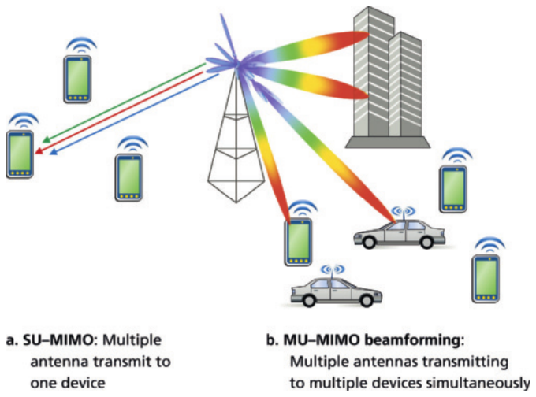

Hình 7.10 Beamforming trong MU-MIMO

• Phổ cấp phép (Licensed spectrum). Như tên gọi gợi ý, phải có một giấy phép government-issued (do chính phủ cấp) để vận hành một bộ phát trong một dải phổ cấp phép; điều này bao gồm các dải phổ được các nhà cung cấp mạng di động thương mại sử dụng (xem Bảng 7.1).

• Ở nhiều quốc gia, phổ được phân bổ cho các nhà cung cấp mạng di động thương mại qua các cuộc đấu giá phổ, đã tạo ra hàng chục đến hàng trăm tỷ đô la phí cấp phép ở Ấn Độ, Anh, và Hoa Kỳ. Một hệ quả của việc mua thương mại quyền sử dụng phổ đắt đỏ (cũng như chi phí cột ăngten và quyền tiếp cận đất đai cần để vận hành một mạng di động) là các dịch vụ thương mại di động (chẳng hạn khác với nhà cung cấp WiFi) phải định giá dịch vụ sao cho có thể bù mọi chi phí này và có lãi. Do sự khan hiếm và chi phí của phổ cấp phép, các phương pháp spectrum-sharing mới đang được phát triển để cho phép các thiết bị non-incumbent (tức là, thiết bị không gắn với bên được cấp phép phổ) dùng phổ cấp phép của bên đương nhiệm (incumbent) theo các quy tắc và điều kiện cụ thể. Ví dụ, ở Hoa Kỳ, dải CBRS 3.5GHz (xem Bảng 7.1) cho phép các trạm gốc di động (non-incumbents) truyền nếu không có radar hải quân (bên đương nhiệm) trong phổ. Nhiều cách tiếp cận đang được khám phá, bao gồm các sơ đồ vô tuyến nhận thức (cognitive radio) cảm nhận động và dùng phổ hiện không được sử dụng. Xem [Parvini 2023] để có một khảo sát gần đây.

| Dải phổ (tên không chính thức) (Spectrum band (informal name)) | Loại mạng (Network Type) | (L)icensed (U)nlicensed | Ghi chú (Comments) |
|---|---|---|---|
| 2.4 GHz ( 2.40 – 2.49 GHz) | WiFi, Bluetooth, Zigbee | U | WiFi: 802.11 b/g/n/ax . Xem Mục 7.3.2. Bluetooth: Xem Mục 7.6.1. |
| 5 GHz ( 5.17 – 5.83 GHz) | WiFi | U | 802.11 a/h/n/ac/ax . Xem Mục 7.3.2. |
| 6 GHz ( 5.9 – 7.12 GHz) | WiFi | U | 802.11 ax/be. Xem Mục 7.3.2. |
| < 1 GHz (various cellular “low- band” frequencies) (các tần số di động băng thấp) | di động (cellular) | L | 2G/3G/4G/5G. Xem Mục 7.2.2. Tần số low-band phủ khoảng cách xa hơn (hàng 10s dặm), nhưng ở tốc độ thấp hơn( 50 – 250 Mbps). |
| 1.8 GHz, 3.3 – 3.8 GHz, 6 GHz (các tần số di động “mid-band” khác nhau) | di động (cellular) | L | 2G/3G/4G/5G. Xem Mục 7.3.3. Tần số Midband là “điểm ngọt,” cân bằng giữa khoảng cách( 5 dặm) và tốc độ truyền (100 – 900 Mbps). |
| 3.5 GHz Citizens Broadband Radio Service (CBRS) | di động (cellular) | L/U | CBRS còn được gọi là “Private 5G”. |
| 26 GHz, 40 GHz, 50 GHz, 66 GHz (các tần số di động “high-band” khác nhau) | di động (cellular) | L | 5G. Xem Mục 7.3.2. Tần số High band, còn được gọi là tần số “sóng milimet (millimeter wave)”, phủ khoảng cách ngắn (< mile), nhưng ở tốc độ cao ( 3 Gbps < ) (tức là, dưới một dặm, tốc độ trên 3 Gbps). |
| 915 MHz( 902 – 928 MHz) | LoRa (IoT) | U | Xem Mục 7.6.3 |

Bảng 7.1 Các dải phổ phổ biến nhất ở Hoa Kỳ được mạng không dây sử dụng (non-exhaustive (chưa đầy đủ); tần số non-US hơi khác)

• Phổ không cấp phép (Unlicensed spectrum). Một phần phổ cũng có sẵn cho sử dụng không cấp phép. Điều này có nghĩa là các tổ chức và cá nhân có thể mua và dùng thiết bị (ví dụ, bộ mở cửa gara, máy báo khóc trẻ em, lò vi sóng, và nhiều thứ khác) và mạng không dây (đáng chú ý là mạng WiFi) hoạt động trong phổ không cấp phép mà không cần xin giấy phép. Tuy nhiên, các thiết bị này phải tuân theo các quy tắc sử dụng, ví dụ, giới hạn mức công suất truyền. Ngoài ra, vì nhiều thiết bị không phối hợp có thể truyền trong phổ không cấp phép, chúng có thể giao thoa với nhau. Xuyên suốt chương này chúng ta sẽ thấy các mạng không dây hoạt động trong phổ không cấp phép áp dụng nhiều cách tiếp cận khác nhau để tránh, giảm nhẹ, và phản ứng với giao thoa này.

Bảng 7.1 trình bày một danh sách non-exhaustive các dải phổ phổ biến nhất được mạng không dây sử dụng. Trong mục này, chúng ta đã đề cập rất nhiều nội dung về các đặc tính của kênh không dây, tất cả sẽ giúp ích cho chúng ta trong việc hiểu các tầng cao hơn của mạng không dây. Nhưng trước khi rời tầng vật lý, chúng ta cần đề cập thêm một khái niệm physical-layer nền tảng nữa—cách bit từ tầng liên kết được biến đổi thành ký hiệu (symbol) và cách ký hiệu sau đó được biến đổi thành dạng sóng được truyền.

### 7.2.2 Mã hóa và điều chế: từ bit tới ký hiệu tới dạng sóng (Coding and Modulation: from bits to symbols to waveforms)

Trong tiểu mục này, chúng ta sẽ đi “lên” chồng giao thức (trong khi vẫn ở tầng vật lý) và bàn về cách một bộ phát không dây nhóm các bit cần truyền thành các “ký hiệu (symbol)”, rồi các ký hiệu này được mã hóa thành dạng sóng để truyền qua kênh không dây. Ở bộ thu, ký hiệu sau đó được trích từ dạng sóng nhận được và dịch ngược thành bit.

Hình 7.11 cho thấy các bước chính trong truyền và nhận physical-layer. Các bit dữ liệu được tầng liên kết phía trên đưa xuống tầng vật lý ở bộ phát. Các bit này sau đó được xử lý thành dạng sóng điện từ lan truyền qua kênh tới bộ thu, nơi chúng được biến đổi ngược thành bit rồi được chuyển từ tầng vật lý lên tầng liên kết. Lý tưởng là các bit này cũng đi qua đường ống xử lý và truyền này càng nhanh càng tốt.

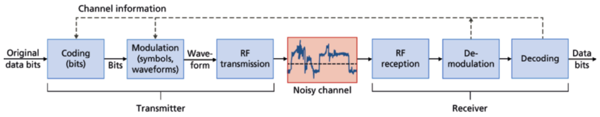

Hình 7.11 Các bước chính trong truyền và nhận physical-layer

#### Mã hóa tầng vật lý (Physical-layer coding)

Trong bước đầu tiên (“mã hóa (coding)”) các bit dữ liệu gốc từ tầng liên kết có thể được mở rộng, ví dụ, trong trường hợp đơn giản nhất, các bản sao dư thừa của các bit gốc có thể được thêm vào tập bit gốc để bảo vệ khỏi việc một số bit được truyền bị hỏng do nhiễu kênh. Điều quan trọng cần lưu ý là các bit được thêm vào ở tầng vật lý này là bổ sung cho các bit checksum hoặc CRC đã được thêm ở tầng liên kết, mà chúng ta đã học trong Chương 6. Nếu một frame link-layer chứa các bit checksum hoặc CRC, các bit này được tầng vật lý xử lý hoàn toàn giống như mọi bit khác trong frame link-layer, và do đó bản thân chúng cũng có thể được bảo vệ bởi các bit physical-layer được thêm vào!

Các bit được truyền cũng có thể được sắp xếp lại, ví dụ, rải các bit dư thừa giữa các bit được truyền, để một đợt nhiễu bùng phát không ảnh hưởng tới mọi bản sao của một bit. Bộ thu sau đó đảo ngược các bước mã hóa để khôi phục luồng bit gốc. Ví dụ, tám bit dữ liệu gốc

d1 d2 d3 d4 d5 d6 d7 d8

có thể được mở rộng (trong đó di’ ký hiệu một bản sao của bit thứ i) thành 16 bit:

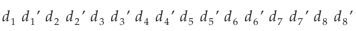

rồi được xáo trộn để tạo ra:

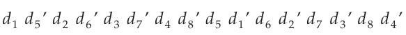

Nếu, ví dụ, ba bit liên tiếp gặp một đợt giao thoa bùng phát khi được truyền (trong đó x ký hiệu một bit mà bộ thu không thể trích ra từ tín hiệu nhận được):

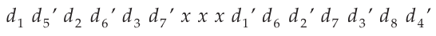

thì sau khi bộ thu giải xáo trộn các bit nhận được để có:

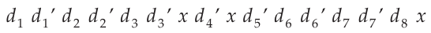

vẫn còn đủ bit nhận được để bộ thu khôi phục tám bit dữ liệu gốc, ngay cả khi có lỗi bùng phát. Có những kỹ thuật mã hóa tinh vi hơn nhiều cung cấp các kỹ thuật hiệu quả hơn mã dư thừa đơn giản minh họa ở trên, và thật vậy có cả những khóa học được dạy về chủ đề này; xem [Goldsmith 2005].

Cuối cùng, chúng ta lưu ý rằng các mũi tên nét đứt ở phần trên của Hình 7.11 từ bộ thu tới bộ phát biểu diễn phản hồi của bộ thu được bộ phát dùng để chọn kỹ thuật điều chế phù hợp nhất với các điều kiện kênh không dây hiện tại (nhưng luôn thay đổi)—một chủ đề chúng ta sẽ sớm xét ở cuối mục này.

#### Điều chế: biên độ, tần số, và pha (Modulation: amplitude, frequency, and phase)

Điều chế (modulation) nằm ở trung tâm tầng vật lý của bộ phát không dây. Điều chế nhận các bit đã mã hóa từ module mã hóa minh họa trong Hình 7.11 và tạo ra các dạng sóng mã hóa các bit này. Như minh họa trong Hình 7.12, có ba cách tiếp cận phổ biến để mã hóa thông tin vào một tín hiệu vô tuyến, đôi khi được gọi là tín hiệu sóng mang (carrier signal). Mỗi cách tiếp cận mã hóa thông tin bằng cách thay đổi hay “điều chế” một trong ba đặc tính radio-wave cơ bản đã bàn trong Mục 7.2.1: biên độ, tần số, hoặc pha của tín hiệu.

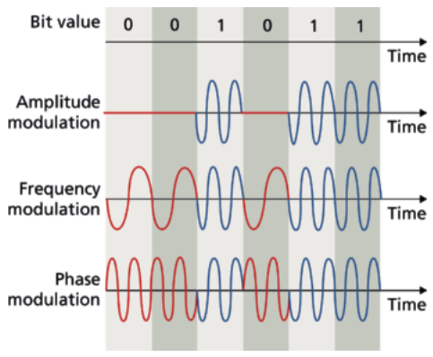

Hình 7.12 Điều chế biên độ, tần số, và pha

• Điều chế biên độ (Amplitude Modulation). Trong điều chế biên độ, còn gọi là khóa dịch biên độ (amplitude shift keying - ASK), giá trị bit được mã hóa vào tín hiệu sóng mang bằng cách thay đổi biên độ của tín hiệu giữa một vài giá trị rời rạc. Dòng thời gian “điều chế biên độ” trong Hình 7.12 cho thấy cách các giá trị 0- và 1-bit ở phần trên của hình cần được truyền trong các khoảng thời gian khác nhau được mã hóa bằng cách đặt biên độ tín hiệu sóng mang lần lượt là 0 hoặc 1.

• Điều chế tần số (Frequency Modulation). Trong điều chế tần số, còn gọi là khóa dịch tần số (frequency shift keying - FSK), giá trị bit được mã hóa vào tín hiệu sóng mang bằng cách thay đổi tần số của tín hiệu sóng mang trong các khoảng thời gian khác nhau. Dòng thời gian “điều chế tần số” trong Hình 7.12 cho thấy cách tần số của tín hiệu được đặt về một trong hai tần số để mã hóa một giá trị 0- hoặc 1-bit.

• Điều chế pha (Phase Modulation). Trong điều chế pha, còn gọi là khóa dịch pha (phase shift keying - PSK), giá trị bit được mã hóa vào tín hiệu sóng mang bằng cách thay đổi pha của tín hiệu sóng mang trong các khoảng thời gian khác nhau. Trong dòng thời gian “điều chế pha” ở Hình 7.12, tín hiệu đỏ có giá trị zero-and-increasing (bằng không và đang tăng) tại đầu một khoảng thời gian; pha này mã hóa giá trị 0-bit trong ví dụ này. Đường cong xanh lam lệch pha 180 độ so với đường cong đỏ; nó có giá trị zero-and-decreasing (bằng không và đang giảm) tại đầu một khoảng thời gian và mã hóa giá trị 1-bit.

Trong các ví dụ này, chúng ta thấy bộ thu có thể xác định giá trị bit 0 hay 1 được mã hóa vào tín hiệu vô tuyến tương tự của bộ phát đơn giản bằng cách đo biên độ, tần số, hoặc pha của tín hiệu vô tuyến. Lưu ý rằng khả năng phát hiện dịch tần số và dịch pha ngụ ý rằng đồng hồ ở bên gửi và bên nhận đã được đồng bộ cẩn thận.

#### Khóa dịch pha cầu phương (Quadrature Phase Shift Keying (QPSK))

Ví dụ của chúng ta trong Hình 7.12 cho thấy hai giá trị biên độ, tần số hoặc pha được dùng để mã hóa một giá trị bit đơn. Nhưng tại sao dừng ở hai giá trị? Tại sao không dùng nhiều hơn hai giá trị biên độ, pha, hoặc tần số để mã hóa nhiều hơn chỉ hai giá trị? Và tại sao không điều chế các giá trị biên độ, pha hoặc tần số cùng lúc để mã hóa thêm nhiều thông tin hơn nữa? Câu trả lời cho các câu hỏi này nằm ở trung tâm của các kỹ thuật điều chế physical-layer hiện đại được chuẩn hóa cho 4G/5G, WiFi, Bluetooth, và các mạng không dây khác.

Do đó, tiếp theo hãy xét việc nhóm các bit nối tiếp ra khỏi module mã hóa trong Hình 7.11 theo cặp, hai bit mỗi lần: nếu giá trị hai bit nối tiếp là một 0 theo sau bởi một 0 khác, chúng sẽ được nhóm lại và trở thành ký hiệu duy nhất “00”; nếu giá trị hai bit nối tiếp là một 0 theo sau bởi một 1, chúng sẽ được nhóm lại và trở thành một ký hiệu khác, “01”; nếu giá trị hai bit nối tiếp là một 1 theo sau bởi một 0, chúng sẽ được nhóm lại và trở thành ký hiệu, “10”; và giá trị hai bit nối tiếp là một 1 theo sau bởi một 1, chúng sẽ được nhóm lại và trở thành ký hiệu, “11”. Công việc truyền một luồng bit của bộ phát giờ được biến thành công việc truyền ký hiệu. Vì có bốn giá trị ký hiệu ( “00”, “01”, “10”, “11”) có thể được truyền, bốn giá trị dịch pha khác nhau sẽ rất phù hợp để biểu diễn bốn giá trị ký hiệu này. Cách tiếp cận dùng bốn giá trị pha để mã hóa bốn ký hiệu khác nhau (biểu diễn bốn cặp giá trị two-bit khác nhau) được gọi là Quadrature Phase Shift Keying (QPSK), minh họa trong Hình 7.13.

Lưu ý rằng trong QPSK, mọi tín hiệu có cùng biên độ nhưng có giá trị pha cách nhau 90 độ: 45° (đỏ), 135° (xanh lá), 225° (xanh lam), và 315° (tím). Bộ thu chỉ cần đo pha của tín hiệu để xác định ký hiệu nào trong bốn ký hiệu đang được truyền. Cũng lưu ý rằng tốc độ xử lý ký hiệu chỉ bằng một nửa tốc độ bit, để lại nhiều thời gian hơn cho xử lý tín hiệu ký hiệu so với signal-processing bit-by-bit. Một trang Web tương tác thú vị nơi bạn có thể tìm hiểu và thử nghiệm với tín hiệu QPSK là https://www.geogebra.org/m/enkymjtg

Bốn ký hiệu trong QPSK có thể được đặc trưng ngắn gọn trong một sơ đồ gọi là sơ đồ chòm sao (constellation diagram). Một điểm trong sơ đồ chòm sao mô tả pha của ký hiệu (đo bằng độ ngược chiều kim đồng hồ từ hướng đông, tức là, vị trí 3:00) và biên độ (đo bằng khoảng cách từ gốc tọa độ). Bốn ký hiệu QPSK được biểu diễn bằng các chấm đỏ trong Hình 7.14. Ví dụ, ký hiệu ở góc phần tư đông bắc có pha 45 độ. Như chúng ta mong đợi, bốn ký hiệu QPSK minh họa trong Hình 7.14 có cùng các pha 45°, 135°, 225°, và 315° và đều có cùng biên độ.

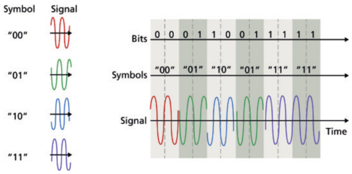

Hình 7.13 Khóa dịch pha cầu phương (Quadrature Phase Shift Keying - QPSK)

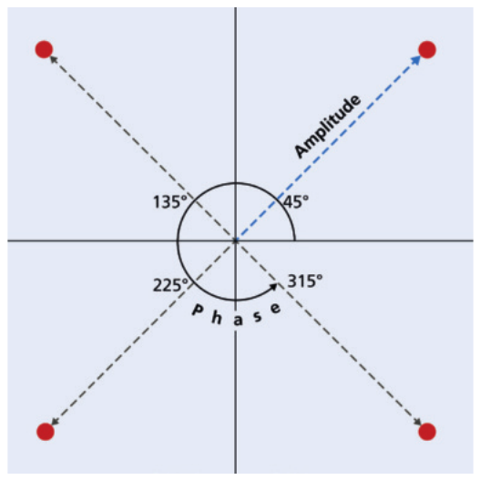

Hình 7.14 Sơ đồ chòm sao QPSK— bốn ký hiệu được biểu diễn bởi bốn dạng sóng tín hiệu có bốn pha khác nhau và biên độ giống hệt nhau

#### Điều chế biên độ cầu phương (Quadrature Amplitude Modulation (QAM))

Trong QPSK, chỉ pha của tín hiệu được điều chế. Trong điều chế biên độ cầu phương (quadrature amplitude modulation - QAM), cả pha và biên độ của tín hiệu đều được điều chế. QAM được minh họa rất rõ bằng sơ đồ chòm sao. Hình 7.15 cho thấy sơ đồ chòm sao cho 4-QAM, 16-QAM và 64-QAM. Con số đứng trước “-QAM” chỉ số ký hiệu trong phiên bản QAM này. 4-QAM về cơ bản giống QPSK và có 4 ký hiệu. Hình 7.15 cũng cho thấy các giá trị bit được mã hóa bởi một ký hiệu—2 bit cho 4-QAM, 4 bit cho 16-QAM, và 6 bit cho 64-QAM. 16-QAM, 64-QAM và 256-QAM được dùng trong mạng 4/5G và WiFi, với các QAM bậc cao hơn ( 1024, 4096) xuất hiện trong các chuẩn WiFi-6 và WiFi-7.

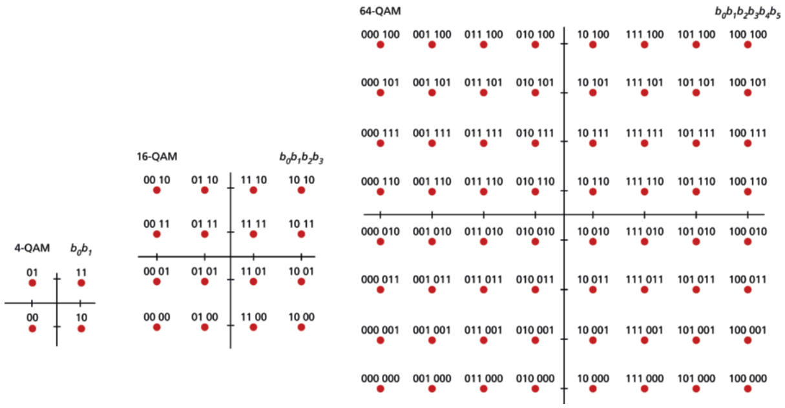

Hình 7.15 Mã hóa bit cho các chòm sao 4-QAM, 16-QAM, 64-QAM (cho WiFi)

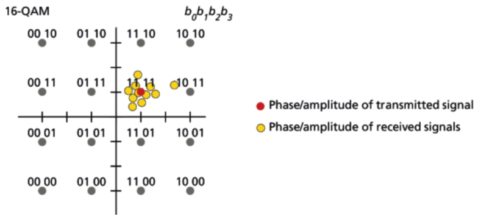

Hình 7.16 Tín hiệu 16-QAM-modulated được truyền so với nhận được

Sơ đồ chòm sao cũng có thể cho chúng ta thêm hiểu biết về cách nhiễu gây ra lỗi bit (hay chính xác hơn, lỗi ký hiệu). Hãy xét chòm sao 16-QAM trong Hình 7.16 và giả sử một bên gửi truyền ký hiệu “1111” biểu diễn bằng màu đỏ đặc. Do nhiễu điện từ và nhiễu đo lường thay đổi ở bộ thu, biên độ và pha của tín hiệu “1111” sẽ được nhận khác nhau mỗi lần tín hiệu đó được truyền. Các chấm yellow-shaded (tô vàng) trong Hình 7.16 biểu diễn các trường hợp khả dĩ của biên độ và pha đo được ở bộ thu. Hầu hết các chấm yellow-shaded, tương ứng với các giá trị biên độ và pha đo được, gần với biên độ và pha của ký hiệu “1111” hơn bất kỳ ký hiệu chòm sao nào khác. Trong các trường hợp này, bộ thu sẽ suy ra đúng rằng ký hiệu được truyền gốc là “1111”. Tuy nhiên, lưu ý rằng có một tín hiệu nhận được gần ký hiệu “1011” hơn ký hiệu “1111”; trong trường hợp này, bộ thu sẽ suy ra sai rằng ký hiệu “1011” đã được gửi, trong khi thực tế ký hiệu “1111” đã được truyền, dẫn tới việc nhận ký hiệu sai.

#### Điều chế thích ứng (Adaptive Modulation)

Hình 7.15 và 7.16 cũng gợi ý rằng khi sơ đồ chòm sao trở nên dày đặc hơn ở các QAM bậc cao hơn, ảnh hưởng của nhiễu và lỗi đo của bộ thu sẽ trở nên rõ rệt hơn. Điều này dẫn tới tỉ lệ symbol-error, và do đó tỉ lệ bit-error, cao hơn. Mặc dù tốc độ truyền cao hơn có vẻ luôn đáng mong muốn và do đó dùng một QAM higher-order cũng có vẻ luôn là ý hay, điều này sẽ không đúng nếu tỉ lệ lỗi quá cao! Nhận xét này đem lại một hiểu biết giá trị cho truyền thông không dây physical-layer—rằng việc bộ phát và bộ thu chọn một kỹ thuật điều chế phù hợp với điều kiện kênh là quan trọng.

Hình 7.17 minh họa hiểu biết này. Giả sử mục tiêu là giữ tỉ lệ lỗi bit (BER) dưới 10−4. Đồng thời, tất nhiên, chúng ta muốn đạt tốc độ bit cao nhất có thể với ràng buộc này. Hình 7.17 cho thấy nếu tỉ số signal-to-noise (tín hiệu trên nhiễu) (SNR, đo bằng dB) nhỏ hơn 13, thì nên dùng 4-QAM. Mặt khác, nếu SNR nằm giữa 13 và 17, thì có thể dùng 16-QAM, với tốc độ bit cao hơn tương ứng. Và nếu SNR cao hơn 17, thì có thể dùng 64-QAM. Khi SNR thay đổi theo thời gian, kỹ thuật điều chế mà bộ phát và bộ thu dùng có thể được thay đổi động để đạt throughput cao nhất có thể tại một thời điểm cho trước, với ràng buộc BER. Tất nhiên, điều này đòi hỏi bên gửi và bên nhận phối hợp để đo và báo cáo BER và SNR, và để phối hợp thay đổi kỹ thuật điều chế. Chúng ta sẽ thấy điều này được thực hiện thế nào khi học mạng không dây 4G/5G.

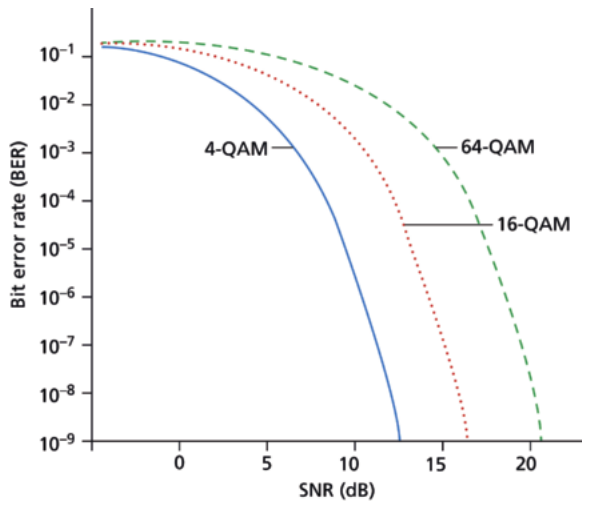

Hình 7.17 SNR so với BER cho 4-QAM, 16-QAM, và 64-QAM

Đến đây kết thúc thảo luận của chúng ta về tầng vật lý không dây. Chúng ta đã đi qua rất nhiều nội dung! Thật vậy, như đã lưu ý ở đầu mục này, mạng không dây là một ví dụ trong đó chức năng của các tầng dưới không thể dễ dàng được trừu tượng hóa bằng vài khái niệm easy-to-understand. Nếu bạn là nhà khoa học máy tính, tầng vật lý không dây có thể là lĩnh vực khá mới với bạn. Tuy nhiên, các khái niệm physical-layer chúng ta đã học trong mục này sẽ cung cấp một nền tảng tuyệt vời cho hiểu biết sâu hơn và rộng hơn về mạng không dây.

## 7.3 Mạng truy cập không dây (The Wireless Access Network)

Trong mục này, chúng ta sẽ đề cập các nguyên lý và thực tiễn làm nền tảng cho mạng truy cập không dây, bao gồm WLAN WiFi 802.11 và RAN 4/5G. Các chủ đề kênh vô tuyến và điều chế và mã hóa chúng ta vừa học là các chủ đề physical-layer; các nguyên lý và thực tiễn mạng truy cập chúng ta sẽ học trong mục này là các chủ đề link-layer, xây dựng trên nền tảng physical-layer này.

Chúng ta sẽ bắt đầu trong Mục 7.3.1 bằng việc học cách kênh vô tuyến được chia sẻ giữa nhiều thiết bị và trạm gốc trong một mạng truy cập. Vì chúng ta đã học bài toán đa truy cập trong Mục 6.3, ở đây chúng ta sẽ tập trung vào cách các kỹ thuật cơ bản đã học ở đó (FDM, TDM và truy cập ngẫu nhiên) được chuyên biệt hóa cho kênh không dây. Với nền tảng chung này, cùng với nền tảng từ Mục 7.2, chúng ta sẽ học hai mạng truy cập không dây chính: WLAN WiFi 802.11 và RAN 4/5G lần lượt trong các Mục 7.3.2 và 7.3.3. Sau đó chúng ta sẽ chuyển sang các chủ đề chuyên sâu hơn liên quan tới mạng truy cập không dây. Trong Mục 7.3.4, chúng ta sẽ học cách một thiết bị không dây phát hiện sự tồn tại của một mạng truy cập không dây và các bước ban đầu để gia nhập mạng đó. Trong Mục 7.3.5, chúng ta sẽ đi sâu hơn vào chia sẻ kênh, học về cấp phát băng thông và lập lịch truyền frame lên các kênh upstream và downstream. Mục 7.3.6 đề cập việc sử dụng năng lượng trong các thiết bị mạng không dây.

### 7.3.1 Chia sẻ kênh không dây (Sharing the wireless channel)

Trong Mục 6.3, chúng ta đã học về các cách tiếp cận khác nhau được dùng để chia sẻ một kênh đa truy cập:

• các kỹ thuật phân chia kênh, bao gồm ghép kênh time-division (TDM) và ghép kênh frequency-division (FDM);

• các giao thức truy cập ngẫu nhiên, bao gồm các giao thức Aloha và Carrier Sense Multiple Access (CSMA); và

• các giao thức taking-turns (luân phiên), bao gồm polling.

Ở đây chúng ta sẽ coi Mục 6.3 là kiến thức nền, nên có thể bạn muốn xem lại mục đó để ôn lại. Chúng ta sẽ thấy tất cả các kỹ thuật này đều được dùng trong các kiến trúc mạng không dây chúng ta sẽ học! Trong một số trường hợp, việc dùng chúng khá đơn giản. Nhưng trong các trường hợp khác, các cách tiếp cận cơ bản này được kết hợp hoặc mở rộng riêng cho mạng không dây. Trong tiểu mục này, chúng ta sẽ đề cập hai cách tiếp cận cụ thể để chia sẻ kênh không dây: (i)

Orthogonal Frequency Division Multiple Access (OFDMA), dùng trong mạng 4G, 5G và WiFi-6/7; và (ii) đa truy cập cảm nhận sóng mang với tránh va chạm (carrier sense multiple access with collision avoidance - CSMA/CA), dùng trong mọi thế hệ mạng WiFi. Chúng ta cũng sẽ học cách kênh vô tuyến vật lý được phân chia thành các kênh upstream và downstream cho việc truyền frame dữ liệu link-layer, đo kênh, khám phá mạng và hơn nữa.

#### FDM, OFDM: kênh và kênh con (FDM, OFDM: channels and subchannels)

Hình 7.18 cho thấy điểm xuất phát của thảo luận về OFDM. Hình 7.18(a) cho thấy một kênh băng rộng (wideband) duy nhất lý tưởng hóa, trong đó phổ công suất (xem Mục 7.2) được phân bố đều trên phổ tần số được dùng. Vì một kênh băng rộng duy nhất có thể khó triển khai trong thực tế (ví dụ, do các suy giảm khác nhau có mặt ở các tần số khác nhau), và vì thiết bị sẽ không cần toàn bộ băng thông của một kênh băng rộng, do đó một dải tần số thường được chia thành nhiều kênh băng hẹp (narrowband), mỗi kênh có băng thông nhỏ hơn, như minh họa trong Hình 7.18(b). Mỗi kênh băng hẹp trong Hình 7.18(b) được vẽ bằng một màu khác nhau. Hình này cũng cho thấy các băng bảo vệ (guard band) giữa các kênh băng hẹp—một dải tần số nhỏ trong đó không có tín hiệu nào được truyền, ngăn việc truyền của một kênh con giao thoa với việc truyền của kênh con lân cận.

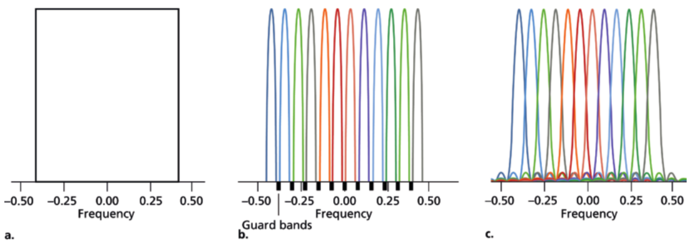

Hình 7.18 Phổ công suất của (a) một kênh băng rộng duy nhất lý tưởng hóa; (b) ghép kênh phân chia tần số (FDM) với 12 kênh con; (c) FDM trực giao (OFDM) với 12 kênh con

Ghép kênh phân chia tần số trực giao (Orthogonal frequency division multiplexing - OFDM) là một kỹ thuật điều chế các tín hiệu sóng mang của kênh con FDM sao cho các tín hiệu chồng lấn trên các kênh khác nhau triệt tiêu lẫn nhau, như minh họa trong Hình 7.18(c). OFDM không cần băng bảo vệ, do đó tận dụng đầy đủ hơn phổ kênh khả dụng. Lưu ý rằng diện tích dưới các đường cong mật độ phổ công suất trong Hình 7.18(c) nhiều hơn dưới các đường cong trong Hình 7.18(b). Nghĩa là, OFDM có hiệu quả phổ (spectral efficiency) cao hơn FDM có băng bảo vệ. Với phổ là một mặt hàng khan hiếm và đắt đỏ (xem Mục 7.2.1), hiệu quả phổ là quan trọng!

Trong Mục 7.4, chúng ta sẽ thấy mạng 4G/5G và WiFi định nghĩa cụ thể băng thông của các kênh và kênh con khác nhau của chúng thế nào.

#### Đa truy cập phân chia tần số trực giao (Orthogonal Frequency Division Multiple Access (OFDMA))

Orthogonal Frequency Division Multiplexing Access (OFDMA) kết hợp cả ghép kênh frequency-division và ghép kênh time-division. Hình 7.19 minh họa cách mỗi kênh con tần số OFDM được chia thành các minislot thời gian. Một OFDMA Resource Element (RE) là một minislot thời gian duy nhất tại một tần số kênh con. Như trong Hình 7.18(c), mỗi tần số kênh con trong Hình 7.19 được vẽ bằng một màu khác nhau, với 12 màu kênh con trong Hình 7.19 khớp với 12 màu kênh con trong Hình 7.18. RE là đơn vị nhỏ nhất của tài nguyên kênh OFDMA—một bộ phát có thể gửi đúng một ký hiệu (xem Mục 7.2.2), biểu diễn bằng một chấm đen trong Hình 7.19, trong một RE. Trong mạng 4G/5G, một RE chiếm băng thông kênh con 15 kHz và kéo dài 66.6 µsec. Trong mạng WiFi hỗ trợ OFDMA, một RE chiếm băng thông kênh con 78 kHz và kéo dài 12.8 µsec.

Mặc dù RE là đơn vị nhỏ nhất của tài nguyên kênh OFDMA, bản thân các RE không được dùng riêng lẻ. Thay vào đó, các RE kề nhau (cả về tần số và thời gian) được nhóm lại, với mọi ký hiệu được truyền dùng cùng kỹ thuật điều chế và cùng công suất. Trong mạng 4G/5G, một nhóm RE được gọi là khối tài nguyên (resource block - RB); trong mạng WiFi OFDM, một nhóm RE được gọi là Resource Unit (RU). Một trạm gốc hoặc thiết bị không dây truyền dữ liệu của nó dưới dạng ký hiệu trong một hoặc nhiều RB hoặc RU, như bàn trong Mục 7.3.5. Trong mạng 4G, một RB gồm 84 ký hiệu, chứa trong 7 minislot thời gian, mỗi minislot dài 66.6 µsec, và 12 kênh con tần số, mỗi kênh rộng 15 kHz, như minh họa trong Hình 7.19. Các kích thước RB/RU khác nhau được định nghĩa cho mạng 5G và WiFi.

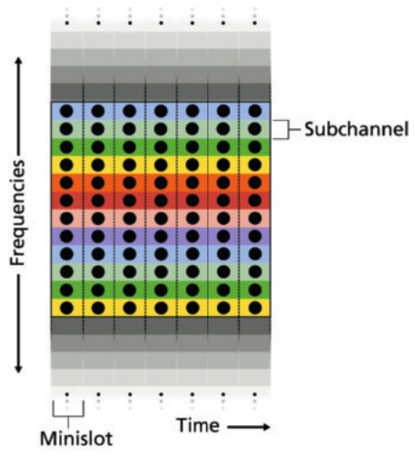

Hình 7.19 Đa truy cập phân chia tần số trực giao (Orthogonal Frequency Division Multiple Access - OFDMA): kết hợp ghép kênh phân chia tần số và phân chia thời gian

#### Truy cập ngẫu nhiên: Aloha và CSMA/CA (Random access: Aloha and CSMA/CA)

Trong Mục 6.3.2, chúng ta đã học rằng các giao thức truy cập ngẫu nhiên đơn giản (ví dụ, không có việc gán tập trung thời điểm truyền frame cho các nút truyền) và lý tưởng khi tải kênh thấp. Chúng ta đã học rằng trong Aloha, một nút đơn giản truyền bất cứ khi nào có dữ liệu cần gửi, dùng toàn bộ băng thông kênh. Nếu hai hoặc nhiều bộ phát gửi thông điệp cùng lúc, các lần truyền chồng lấn sẽ “va chạm,” và không cái nào được nhận thành công tại (các) đích. Điều quan trọng cần lưu ý là va chạm biểu hiện ở các tín hiệu chồng lấn, giao thoa nhận được tại đích (tức là, bộ thu) chứ không phải tại bên gửi hay các vị trí trung gian. Một cơ chế truyền lại higher-level sau đó được dùng để khôi phục từ các va chạm như vậy. Các giao thức Aloha lần đầu được phát triển cách đây hơn 50 năm cho mạng vệ tinh không dây [Abramson 1972; Schwartz 2009]. Như chúng ta sẽ thấy, chúng vẫn được dùng ngày nay trong mạng vệ tinh và IoT, và được triển khai trong một số chức năng control-plane chọn lọc trong mạng 4G/5G.

#### Đa truy cập cảm nhận sóng mang với tránh va chạm (Carrier Sense Multiple Access with Collision Avoidance (CSMA/CA))

Carrier Sense Multiple Access with Collision Avoidance (CSMA/CA) là phương pháp truy cập kênh ban đầu (và trong nhiều năm là duy nhất) được dùng trong mạng WiFi. Như sẽ bàn sau trong Mục 7.3.2, các chuẩn WiFi gần đây nhất (từ WiFi-6 trở đi) cung cấp cả CSMA/CA và OFDMA làm kỹ thuật truy cập kênh.

CSMA/CA là một giao thức đa truy cập cảm nhận sóng mang (CSMA) có cùng hành vi listen-before-transmit (nghe trước khi truyền) mà chúng ta đã học trong Mục 6.3.2. Tuy nhiên, CSMA/CA có các tính năng khác giải quyết hai thách thức đặc thù của môi trường không dây:

• Bài toán trạm ẩn (Hidden terminal problem). Do bài toán trạm ẩn, bộ phát thứ nhất thậm chí có thể không nghe thấy việc truyền từ một bộ phát thứ hai “ẩn” cũng đang gửi tới đích dự định của bộ phát thứ nhất.

• Không phát hiện va chạm (No collision detection). Khả năng phát hiện va chạm đòi hỏi khả năng gửi (tín hiệu của chính bộ phát) và nhận (để xác định liệu trạm khác có cũng đang truyền không) cùng lúc. Vì cường độ của tín hiệu không dây nhận được thường rất nhỏ so với cường độ tín hiệu được truyền của bên gửi, rất khó để một bộ phát không dây phát hiện va chạm với việc truyền đang diễn ra của chính nó (ngay cả tại bộ vô tuyến của chính nó), khiến việc dùng kỹ thuật phát hiện va chạm của CSMA/CD trở nên không khả thi. Vì CSMA/CA không dùng phát hiện va chạm, một khi một trạm bắt đầu truyền một frame, nó truyền toàn bộ frame; nghĩa là, một khi trạm đã bắt đầu, không có đường quay lại. Như người ta có thể đoán, việc truyền toàn bộ frame (đặc biệt frame dài) khi va chạm phổ biến có thể làm suy giảm đáng kể performance của giao thức đa truy cập.

Do hai thách thức này, va chạm tại đích thường phổ biến hơn trong mạng không dây so với mạng có dây. Do đó, CSMA/CA có một cơ chế xác nhận link-layer tường minh. Như minh họa trong Hình 7.20, khi trạm đích nhận đúng một frame (ví dụ, một frame nhận được đã qua kiểm tra bit-error CRC) nó chờ một khoảng thời gian ngắn gọi là Short Inter-frame Spacing (SIFS) rồi gửi lại một frame xác nhận. Nếu trạm truyền không nhận được xác nhận trong một khoảng thời gian cho trước, nó cho rằng đã có lỗi xảy ra và truyền lại frame, dùng giao thức CSMA/CA để truy cập kênh. Nếu không nhận được xác nhận sau một số lần truyền lại cố định nào đó, trạm truyền bỏ cuộc và loại bỏ frame.

Sau khi bàn về cách CSMA/CA dùng xác nhận link-layer, giờ chúng ta có thể mô tả giao thức CSMA/CA đầy đủ hơn. Giả sử một trạm (thiết bị không dây hoặc AP) có một frame cần truyền.

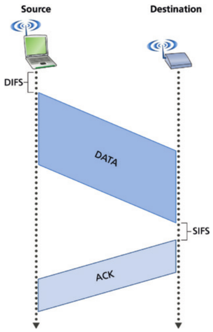

Hình 7.20 CSMA/CA dùng xác nhận link-layer

1. Nếu ban đầu trạm cảm nhận kênh rỗi, nó truyền frame sau một khoảng thời gian ngắn gọi là Distributed Inter-Frame Space (DIFS); xem Hình 7.20.

2. Ngược lại, trạm chọn một giá trị backoff ngẫu nhiên dùng binary exponential backoff (như chúng ta đã gặp trong Mục 6.3.2) và đếm ngược giá trị này sau DIFS khi kênh được cảm nhận là rỗi. Trong khi kênh được cảm nhận là bận, giá trị bộ đếm được giữ nguyên.

3. Khi bộ đếm về không (điều chỉ có thể xảy ra khi kênh được cảm nhận là rỗi), trạm truyền toàn bộ frame rồi chờ xác nhận.

4. Nếu nhận được xác nhận, trạm truyền biết frame của nó đã được nhận đúng tại trạm đích. Nếu trạm có frame khác cần gửi, nó bắt đầu lại giao thức CSMA/CA ở bước 2. Nếu không nhận được xác nhận, trạm truyền re-enters (vào lại) giai đoạn backoff ở bước 2, với giá trị ngẫu nhiên được chọn từ một khoảng lớn hơn.

Nhớ lại rằng với giao thức đa truy cập CSMA/CD của Ethernet ( Mục 6.3.2), một trạm bắt đầu truyền ngay khi kênh được cảm nhận là rỗi. Tuy nhiên, với CSMA/CA, trạm kiềm chế không truyền trong khi đếm ngược, ngay cả khi nó cảm nhận kênh rỗi. Tại sao CSMA/CD và CSMA/CA chọn các cách tiếp cận khác nhau ở đây?

Để trả lời câu hỏi này, hãy xét một kịch bản trong đó hai trạm đều có một frame dữ liệu cần truyền, nhưng không trạm nào truyền ngay vì mỗi trạm cảm nhận rằng một trạm thứ ba đang truyền. Với CSMA/CD của Ethernet, hai trạm sẽ đều truyền ngay khi phát hiện trạm thứ ba đã truyền xong. Điều này sẽ gây ra va chạm, vốn không phải vấn đề nghiêm trọng trong CSMA/CD, vì cả hai trạm sẽ hủy việc truyền và do đó tránh được việc truyền vô ích phần còn lại của frame. Tuy nhiên, trong mạng WiFi, tình hình khá khác. Vì bộ phát WiFi không phát hiện và hủy va chạm, một frame bị va chạm vẫn được truyền toàn bộ. Do đó, mục tiêu trong WiFi là tránh va chạm bất cứ khi nào có thể. Trong WiFi, nếu hai trạm cảm nhận kênh bận, cả hai lập tức vào backoff ngẫu nhiên, hy vọng chọn các giá trị backoff khác nhau. Nếu các giá trị này thực sự khác nhau, một trong hai trạm cuối cùng sẽ bắt đầu truyền trước trạm kia, và (nếu hai trạm không bị ẩn với nhau) “trạm thua” sẽ nghe thấy việc truyền của “trạm thắng”, dừng bộ đếm, và kiềm chế không truyền cho tới khi trạm thắng hoàn tất việc truyền. Bằng cách này, một va chạm tốn kém được tránh. Tất nhiên, va chạm vẫn có thể xảy ra với 802.11 trong kịch bản này: hai trạm có thể bị ẩn với nhau, hoặc hai trạm có thể chọn các giá trị backoff ngẫu nhiên đủ gần nhau đến mức việc truyền từ trạm bắt đầu trước chưa tới được trạm thứ hai. Nhớ lại rằng chúng ta đã gặp vấn đề này trước đó trong thảo luận về các thuật toán random-access trong bối cảnh Hình 6.12.

#### Xử lý trạm ẩn: RTS và CTS (Dealing with Hidden Terminals: RTS and CTS)

Giao thức CSMA/CA của WiFi còn có một sơ đồ đặt trước (reservation) khéo léo (nhưng tùy chọn) giúp tránh va chạm ngay cả khi có trạm ẩn. Nhớ lại từ Hình 7.6 rằng trong bài toán trạm ẩn, trạm A và B có thể nghe nhau, trạm B và C có thể nghe nhau, nhưng trạm A và C không thể nghe nhau. Giả sử A đang truyền một frame tới B, và giữa chừng việc truyền của A, C muốn gửi một frame tới B. Trạm C, không nghe thấy việc truyền từ A, trước hết sẽ chờ một khoảng DIFS rồi truyền frame, dẫn tới va chạm tại B. Do đó kênh sẽ bị lãng phí trong toàn bộ khoảng thời gian truyền của cả A và C.

Để tránh vấn đề này, giao thức CSMA/CA có một frame điều khiển Request to Send (RTS) ngắn tùy chọn và một frame điều khiển Clear to Send (CTS) ngắn để (ngầm) đặt trước quyền truy cập kênh. Hãy mô tả điều này trong bối cảnh phổ biến là một trạm muốn truyền một frame tới một điểm truy cập (AP). Khi một bên gửi muốn gửi một frame DATA, trước hết nó gửi một frame RTS tới AP, cho biết tổng thời gian cần để truyền frame DATA và frame xác nhận (ACK). Khi đích nhận frame RTS, nó phản hồi bằng cách quảng bá một frame CTS. Frame CTS này phục vụ hai mục đích: nó cho bên gửi sự cho phép tường minh để gửi và cũng chỉ thị các trạm khác trong phạm vi nghe của đích không gửi trong khoảng thời gian đã đặt trước.

Hình 7.21 cho thấy trước khi truyền một frame DATA, nguồn trước hết quảng bá một frame RTS, được mọi trạm trong phạm vi nghe nghe thấy, bao gồm AP. Lưu ý rằng các trạm ở bên phải AP không nằm trong khoảng cách nghe của bên gửi và không nhận RTS này. Tuy nhiên, AP sau đó phản hồi bằng một frame CTS, được mọi trạm trong phạm vi của nó nghe thấy, bao gồm bên gửi và các trạm khác ở bên phải AP. Các trạm khác này, sau khi nghe CTS, kiềm chế không truyền trong khoảng thời gian chỉ định trong frame CTS. Các frame RTS, CTS, DATA, và ACK được minh họa trong Hình 7.21. Việc dùng RTS/CTS cải thiện performance theo hai cách quan trọng:

• Bài toán trạm ẩn được giảm nhẹ, vì một frame DATA dài chỉ được truyền sau khi kênh đã được đặt trước.

• Vì frame RTS và CTS ngắn, một va chạm liên quan tới frame RTS hoặc CTS sẽ chỉ kéo dài trong thời lượng của frame RTS hoặc CTS ngắn đó. Một khi các frame RTS và CTS được truyền đúng, các frame DATA và ACK tiếp theo thường được truyền collision-free (không va chạm). Tuy nhiên, bạn nên tự thuyết phục mình rằng cơ chế RTS/CTS không phải lúc nào cũng đặt trước kênh thành công cho một thông điệp DATA, vì bản thân một thông điệp RTS/CTS có thể bị mất do fading kênh hoặc nhiễu. Bạn được khuyến khích xem hoạt ảnh CSMA/CA trên trang Web của giáo trình. Hoạt ảnh tương tác này minh họa giao thức CSMA/CA, bao gồm chuỗi trao đổi RTS/CTS.

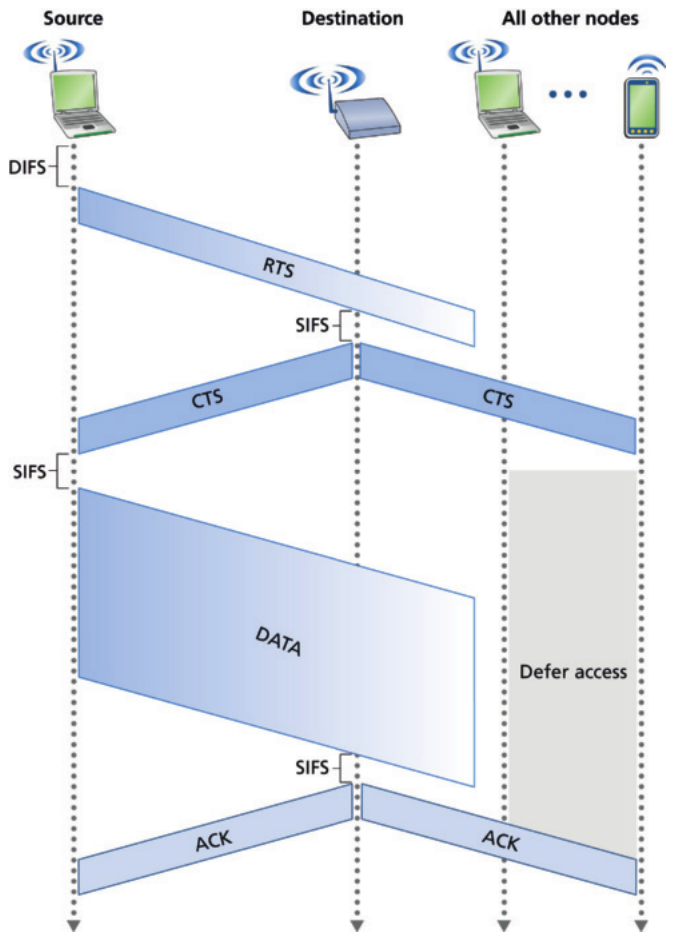

Hình 7.21 Tránh va chạm dùng RTS/CTS

Mặc dù trao đổi RTS/CTS có thể giúp giảm va chạm, nó cũng gây thêm độ trễ và tiêu tốn tài nguyên kênh. Vì lý do này, trao đổi RTS/CTS chỉ được dùng (nếu có) để đặt trước kênh cho việc truyền một frame DATA dài.

### 7.3.2 WiFi: LAN không dây 802.11 (WiFi: the 802.11 Wireless LAN)

Phổ biến ở nơi làm việc, gia đình, cơ sở giáo dục, quán cà phê, sân bay, sân vận động, và góc phố, LAN không dây giờ là một trong những công nghệ mạng truy cập quan trọng nhất của Internet. Mặc dù nhiều LAN không dây đã được phát triển trong những năm 1990, một công nghệ mạng cụ thể rõ ràng đã nổi lên là người chiến thắng: LAN không dây IEEE 802.11, còn gọi là WiFi. Giống như Ethernet đã thống trị LAN có dây, WiFi cũng đã thống trị LAN không dây. Các chuẩn 802.11 cho LAN không dây được tạo bởi ủy ban chuẩn IEEE 802.11 [IEEE 802.11 Standards 2024]. Từ năm 2000, một số chuẩn 802.11 (nhưng không phải tất cả) cũng đã được WiFi Alliance gắn thương hiệu “WiFi”, với các thế hệ WiFi được đánh số về mặt khái niệm khớp với khái niệm tương tự về các “thế hệ” được đánh số của chuẩn mạng di động. Mặc dù có một số chuẩn 802.11 không thuộc “thương hiệu” WiFi (và chẳng hạn hoạt động ở dải tần số cao hơn hoặc thấp hơn so với minh họa trong Bảng 7.3), chúng ta vẫn sẽ dùng các thuật ngữ “WiFi” và “802.11” thay thế cho nhau, vì mỗi chuẩn 802.11 thương mại chính tương ứng với một thế hệ WiFi, như minh họa trong Bảng 7.2.

#### Tổng quan về LAN không dây 802.11* (Overview of 802.11* Wireless LANs)

Chúng ta đã đề cập nhiều khía cạnh nền tảng của WiFi trong Mục 7.3.1, bao gồm CSMA/CA, OFDM, và OFDMA. Vậy là chúng ta đã có khởi đầu rất tốt trong việc hiểu WiFi! Trong mục này chúng ta sẽ đưa ra tổng quan về mạng WiFi, và bàn về cấu trúc kênh, định dạng frame, và việc liên mạng với Ethernet LAN có dây. Ở phần sau chương này, chúng ta cũng sẽ đề cập cách một thiết bị phát hiện và gắn vào một mạng WiFi ( Mục 7.3.4), việc lập lịch truyền frame WiFi (Mục 7.3.5) và cách một thiết bị tiết kiệm năng lượng trong mạng WiFi qua các chu kỳ ngủ/thức trong Mục 7.3.6. Chúng ta cũng sẽ đề cập cách một mạng không dây (bao gồm WiFi) hỗ trợ tính di động của thiết bị trong Mục 7.4.2.

Bảng 7.2 cho thấy sự tiến hóa của chuẩn IEEE 802.11. Một điều rút ra từ Bảng 7.2 là WiFi đã liên tục tăng throughput tối đa mà người dùng WiFi thấy được—suy cho cùng, nhiều hơn luôn tốt hơn! Mặc dù điều này đúng đặc biệt trong những ngày đầu của WiFi, mạng WiFi không phải lúc nào (hay thậm chí thường xuyên) được triển khai với mục đích cung cấp throughput duy trì tối đa cho một người dùng duy nhất. Thật vậy, tình huống sử dụng gần đây nhất thúc đẩy nhiều phát triển WiFi là triển khai dày đặc mạng WiFi trong các doanh nghiệp lớn, sân bay, sân vận động, và không gian công cộng, nơi một số lượng lớn người dùng muốn gửi và nhận dữ liệu cùng lúc. Trong triển khai dày đặc, trọng tâm là hỗ trợ hiệu quả nhiều người dùng đồng thời, thay vì cung cấp throughput tối đa cho một người dùng duy nhất.

Vì vậy, hãy nhìn xa hơn các cải thiện về throughput tối đa và đưa ra các nhận xét sau về sự tiến hóa của WiFi:

| Chuẩn (IEEE 802.11 standard) | Thế hệ WiFi (WiFi gen) | Năm (Year) | Tốc độ dữ liệu tối đa (Max data rate (theoretical)) | Tần số (Frequency (GHz)) | Băng thông (Bandwidth) | PHY |
|---|---|---|---|---|---|---|
| 802.11b |  | 1999 | 11 Mbps | 2.4 | 22 | Direct-sequence spread spectrum |
| 802.11g |  | 2003 | 54 Mbps | 2.4 | 20 | OFDM |
| 802.11n | WiFi 4 | 2009 | 600 Mbps | 2.4, 5 | 20, 40 | OFDM |
| 802.11ac | WiFi 5 | 2013 | 6.9 Gbps | 5 | 20, 40, 80, 160 | OFDM, MIMO |
| 802.11ax | WiFi 6 | 2020 | 9.5 Gbps | 2.4, 5 | 20, 40, 80, 160 | OFDM, OFDMA, MIMO |
| 802.11be | WiFi 7 | 2024 | 30 + Gbps | 2.4, 5, 6 | 20, 40, 80, 160, 320 | OFDM, OFDMA, MIMO |

Bảng 7.2 Sự tiến hóa của các chuẩn 802.11 chính

• Tần số (Frequency). Hầu hết mạng WiFi hoạt động trong các dải tần số không cấp phép (Một ngoại lệ là 802.11p cho giao tiếp xe với xe hoạt động trong một dải phổ cấp phép). Các dải được WiFi dùng đã mở rộng từ chỉ dải 2.4 GHz (mà chúng ta nhớ là đông đúc với nhiều thiết bị consumer-electronic là nguồn giao thoa tiềm ẩn cho mạng WiFi) sang dải 5 GHz và giờ cả dải 6 GHz. Một số chuẩn 802.11 (ví dụ, 802.11 ah) dùng các dải sub-1GHz, trong khi các chuẩn khác (802.11ad, 802.11ay) dùng dải so-called sóng milimet ở 60 GHz trở lên.

• Băng thông (Bandwidth). Băng thông được mạng WiFi dùng được chia thành các kênh có băng thông kênh khác nhau, với mỗi thế hệ WiFi kế tiếp tự hào về sự tăng băng thông kênh tối đa. Băng thông kênh tối thiểu là 20 MHz, với các băng thông kênh cao hơn đạt được bằng cách “gộp (bonding)” nhiều kênh 20 MHz kề nhau lại với nhau; xem Hình 7.43. Một mạng WiFi riêng lẻ sẽ chỉ hoạt động trên một trong các kênh này.

• Tầng vật lý (The Physical Layer). Tầng vật lý 802.11 đã tiến hóa từ một dạng điều chế spread-spectrum (trải phổ) liên quan tới dạng dùng trong mạng di động 3G sang OFDM rồi OFDMA, cùng kỹ thuật điều chế được dùng trong mạng 4G và 5G hỗ trợ các kịch bản triển khai dày đặc. Do một AP phải hỗ trợ một loạt thiết bị đời cũ, ví dụ, từ các thiết bị 802.11g cổ xưa tới các thiết bị WiFi6-capable hiện đại, một AP phải hỗ trợ OFDM, OFDMA, và CSMA/CA cùng lúc. Chúng ta sẽ sớm thấy thách thức kỹ thuật này được giải quyết thế nào.

Hình 7.22 minh họa các thành phần chính của kiến trúc LAN không dây 802.11. Khối xây dựng cơ bản được gọi là tập dịch vụ cơ bản (basic service set - BSS). Một BSS chứa hai hoặc nhiều nút không dây, với một trong các nút đó thường là một trạm gốc trung tâm, gọi là điểm truy cập (access point - AP) theo thuật ngữ 802.11. Hình 7.22 cho thấy AP trong mỗi BSS trong hai BSS nối tới một thiết bị kết nối (như switch hoặc router), thiết bị này lại dẫn tới Internet. Trong một mạng gia đình điển hình, có một AP, một switch tầng 2 và một router tầng 3 (thường tất cả được tích hợp trong một “hộp” vật lý) nối BSS tới Internet. Trong thảo luận dưới đây, đôi khi chúng ta sẽ hơi fast-and-loose (dễ dãi) với thuật ngữ 802.11 và gọi tổ hợp một AP cùng với một switch và có thể một router đơn giản là một “AP”. Nhưng theo chuẩn 802.11, AP là một thiết bị layer-2-only. Các thiết bị mạng chỉ có thể truyền/nhận tới/từ AP; giao tiếp device-to-device trực tiếp không thể xảy ra.

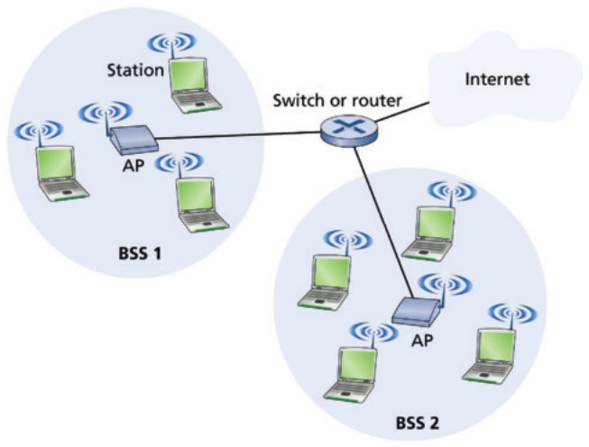

Hình 7.22 Các thành phần của LAN không dây 802.11

#### Cấu trúc kênh WiFi (WiFi channel structures)

Hình 7.23 cho thấy cách WiFi chia việc sử dụng các dải phổ 2.4 và 5 GHz thành các kênh, với mỗi kênh có một số hiệu kênh duy nhất. Trong dải 2.4 GHz, 802.11 định nghĩa 11 kênh chồng lấn một phần, mỗi kênh có băng thông 20 MHz. Ở đây, hai kênh là non-overlapping (không chồng lấn) khi và chỉ khi chúng cách nhau từ bốn kênh trở lên. Cụ thể, tập kênh 1, 6, và 11 là tập duy nhất gồm ba kênh non-overlapping. Điều này có nghĩa là nếu ba AP đều hoạt động trong cùng không gian vật lý dùng các kênh 1, 6, và 11, thì việc truyền trên ba mạng này sẽ không giao thoa với nhau. Tuy nhiên, nếu hai trong số các mạng hoạt động trên các kênh chồng lấn, thì các thiết bị trên hai mạng này có thể giao thoa với nhau. Tất nhiên, điều này có thể đặc biệt rắc rối khi nhiều mạng WiFi trong không gian vật lý được vận hành độc lập, ví dụ, mạng WiFi nhà bạn, và mọi mạng WiFi gia đình khác trong mọi căn hộ trong vòng 30 mét quanh căn hộ của bạn.

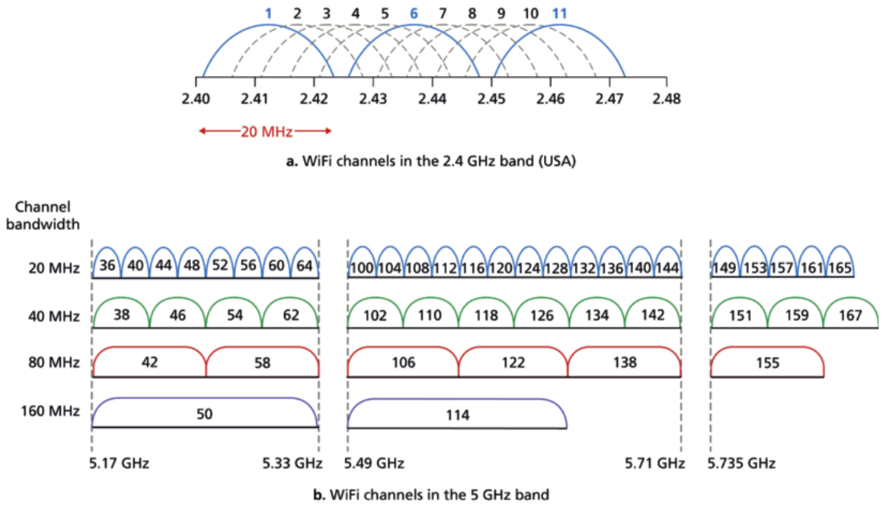

Hình 7.23 Các kênh WiFi trong dải 2.4 và 5 GHz

#### Tổng hợp lại: CSMA/CA, OFDM, và OFDMA trong WiFi 6 (Putting it all together: CSMA/CA, OFDM, and OFDMA in WiFi 6)

Như đã nêu trong Bảng 7.2, mọi chuẩn 802.11 trong 20 năm qua đều hỗ trợ ghép kênh phân chia tần số trực giao (OFDM), được dùng để tạo nhiều kênh WiFi riêng biệt trong Hình 7.23. Một AP WiFi có thể được cấu hình để hoạt động chỉ dùng một trong các kênh fixed-bandwidth này, với mọi thiết bị trong WLAN của AP giao tiếp với AP qua kênh duy nhất này. Hoặc, một AP có thể được gán một kênh chính rồi tăng động băng thông khả dụng bằng cách gộp một hoặc nhiều kênh phụ kề nhau với kênh chính. Với OFDM, một thiết bị hoặc AP dùng toàn bộ băng thông kênh khi truyền. Chúng ta cũng đã học rằng WiFi 6 (và các thế hệ sau) cũng hỗ trợ OFDMA, khác với OFDM thuần túy và đặc biệt hữu ích trong các kịch bản triển khai dày đặc. Chúng ta đã học trong Mục 7.3.1 rằng OFDMA chia một kênh thành nhiều kênh con và cho phép truyền tới/từ nhiều thiết bị cùng lúc, với mỗi thiết bị dùng một tập kênh con và timeslot khác nhau. Và chúng ta đã học trong Mục 7.3.1 rằng WiFi cũng dùng truy cập ngẫu nhiên CSMA/CA để chia sẻ kênh WiFi. Nhưng làm thế nào cả ba cách tiếp cận channel-sharing này—OFDM, OFDMA, và CSMA/CA—có thể được dùng trong cùng một mạng WiFi? Làm sao điều đó lại khả thi?

Câu trả lời cho câu hỏi này nằm ở việc mở rộng khéo léo cơ chế RTS/CTS cơ bản của WiFi—ban đầu được phát triển để giúp giải quyết bài toán trạm ẩn—để giải quyết cả bài toán co-existence (cùng tồn tại) của OFDM, OFDMA, và CSMA/CA. WiFi 6 đã đưa vào một loại thông điệp RTS mới, gọi là thông điệp RTS multi-user (MU-RTS). Theo hướng downlink, AP gửi một MU-RTS khi nó muốn khởi tạo việc truyền OFDMA tới nhiều thiết bị. MU-RTS chứa một danh sách các cấp phát resource unit (RU) OFDMA, cho biết AP sẽ dùng RU nào để gửi dữ liệu tới thiết bị nào cùng lúc, và khoảng thời gian kênh sẽ được dùng. MU-RTS được truyền dùng OFDM tới mọi thiết bị, dù có hỗ trợ OFDMA hay không, như một phần của giao thức CSMA/CA. Do đó, mọi thiết bị sẽ nhận được thông điệp MU-RTS. Một thiết bị OFDM-only sẽ phản hồi RTS bằng một CTS như đã bàn trước đó và như minh họa trong Hình 7.20. Một thiết bị OFDMA-capable phản hồi RTS bằng một CTS được truyền chỉ trên các tần số được gán cho thiết bị đó. Như với các thông điệp RTS/CTS thông thường, một thông điệp RTS có thể không thành công. Tuy nhiên, nếu trao đổi MU-RTS/CTS này thành công, AP giờ đã đặt trước kênh và sau đó có thể gửi RU tới nhiều thiết bị dùng OFDMA. Theo hướng uplink, việc truyền từ thiết bị tới AP cũng được AP điều phối, lại dùng thông điệp MU-RTS; xem [Meraki WiFi6 2020] để biết chi tiết.

Tương tác giữa CSMA/CA, OFDM, và OFDMA được minh họa trong Hình 7.24. Trong ví dụ này, có hai thiết bị 802.11g (pre-WiFi 4!) đời cũ, a và b, và năm thiết bị 802.11ax (WiFi 6). Trong ví dụ này, các thiết bị a và b giành được quyền dùng toàn bộ kênh OFDM lần lượt sau t0 và t1, dùng giao thức CSMA/CA. Tại t2, AP dùng CSMA/CA với cơ chế MU-RTS (trong thời gian và tại các tần số minh họa trong ô được tô xám bắt đầu tại t2) để đặt trước thành công kênh cho việc truyền RU OFDMA đồng thời tới các thiết bị 1, 2, 4, và 5 trong các RU minh họa. Tại t3, thiết bị b lại dùng CSMA/CA để giành quyền truy cập kênh và truyền một frame khác dùng OFDM. Tại t4, AP dùng cơ chế MU-RTS để đặt trước thành công kênh cho việc truyền RU OFDMA tới các thiết bị 1, 2, và 3 trong các RU minh họa.

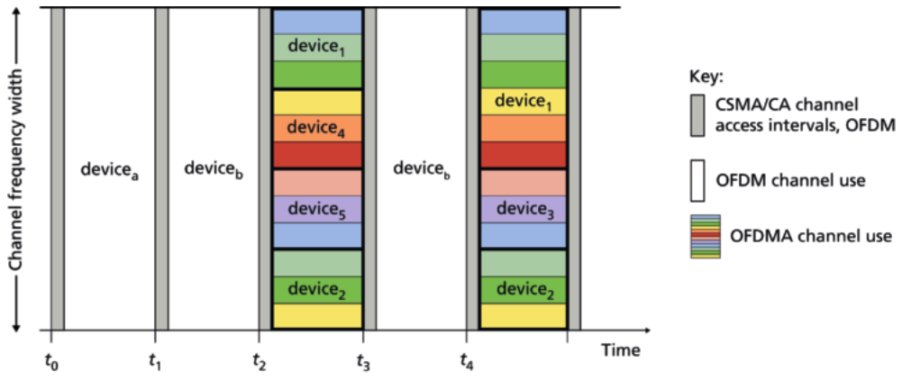

Hình 7.24 Các khoảng CSMA/CA, OFDM, và OFDMA

#### 7.3.2 802.11 MAC: tầng liên kết không dây WiFi (802.11 MAC: the WiFi wireless link layer)

Hình 7.25 mở rộng Hình 7.22, cho thấy điều khiển truy cập môi trường (medium access control - MAC) IEEE 802.11 như tầng liên kết không dây trong mạng WiFi. Lưu ý rằng MAC trong mọi thiết bị ở Hình 7.25 có các thành phần data-plane và control-plane. Nhiệm vụ của mặt phẳng dữ liệu MAC là vận chuyển frame link-layer tới và từ các ứng dụng người dùng cuối. Nhiệm vụ của mặt phẳng điều khiển MAC là triển khai các chức năng điều khiển như RTS/CTS, ACK và NAK, phát beacon (Mục 7.3.4) và điều khiển công suất (Mục 7.3.6). Vì các module mặt phẳng điều khiển MAC trong thiết bị và AP trao đổi thông điệp điều khiển trong các frame link-layer, một kết nối logic bằng nét đứt được vẽ giữa các module điều khiển ở hai bên liên kết không dây. Cả frame dữ liệu và frame điều khiển MAC đều được bộ lập lịch MAC lập lịch để truyền qua môi trường không dây (Mục 7.3.5).

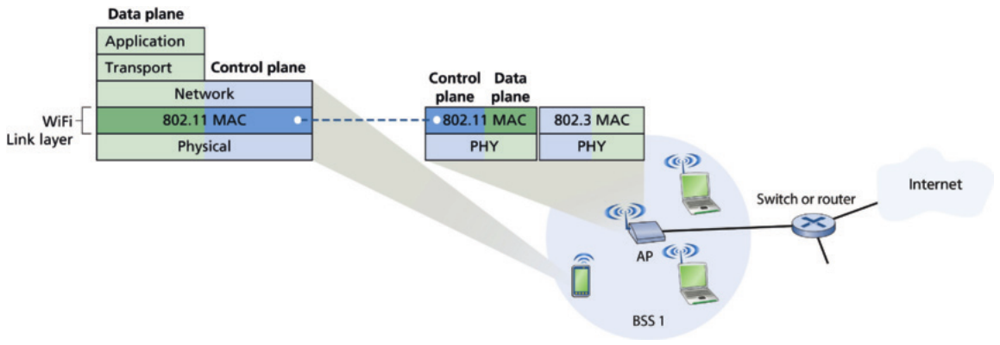

Hình 7.25 WiFi: tầng liên kết không dây

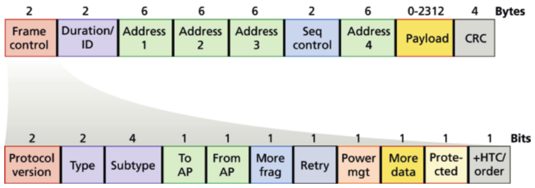

Hình 7.26 Định dạng frame 802.11 (các số chỉ độ dài trường tính bằng byte) và trường điều khiển frame (các số chỉ độ dài trường con tính bằng bit)

Lưu ý rằng thiết bị người dùng không dây trong Hình 7.25 triển khai cả năm tầng của chồng giao thức Internet. Tuy nhiên, AP là một thiết bị layer-2-only. Ở một phía của AP, tầng liên kết của AP dùng WiFi để giao tiếp với thiết bị người dùng; ở phía kia, tầng liên kết của AP kết nối với một tầng liên kết Ethernet để giao tiếp với router layer-3. Trong thực tế, các chức năng AP, Ethernet, và router layer-3 thường được đóng gói chung trong cùng một “hộp” cho các triển khai small-scale (ví dụ, nhà ở), về mặt kỹ thuật khiến hộp đó là một thiết bị layer-3.

Frame 802.11 được minh họa trong Hình 7.26. Mặc dù có nhiều điểm tương đồng với frame Ethernet, nó cũng chứa một số trường đặc thù cho việc dùng trong LAN không dây. Các số phía trên mỗi trường trong frame cho biết độ dài các trường tính bằng byte; các số phía trên mỗi trường con trong trường điều khiển frame cho biết độ dài trường con tính bằng bit. Trong Hình 7.26, không phải mọi trường được vẽ đều luôn được dùng, và có các trường tùy chọn bổ sung không được vẽ. Giờ hãy khảo sát các trường trong frame cũng như một số trường con quan trọng hơn trong trường điều khiển frame.

#### Trường payload và CRC (Payload and CRC Fields)

Ở trung tâm của frame là payload, thường gồm một IP datagram, một frame điều khiển MAC, hoặc một packet ARP. Mặc dù trường này được phép dài tới 2,312 byte, nó thường nhỏ hơn 1,500 byte. Như với frame Ethernet, một frame 802.11 bao gồm một kiểm tra dư thừa vòng (CRC) 32-bit để bên nhận có thể phát hiện lỗi bit trong frame nhận được. Như chúng ta đã thấy, lỗi bit phổ biến hơn nhiều trong LAN không dây so với LAN có dây, nên CRC càng hữu ích hơn ở đây.

#### Các trường địa chỉ (Address Fields)

Có lẽ khác biệt nổi bật nhất giữa frame 802.11 và frame Ethernet là frame 802.11 có bốn trường địa chỉ, mỗi trường có thể chứa một địa chỉ MAC 6-byte. Nhưng tại sao lại bốn trường địa chỉ? Chẳng phải một trường MAC nguồn và một trường MAC đích là đủ, như với Ethernet sao? Hóa ra cần ba trường địa chỉ cho mục đích liên mạng—cụ thể, để chuyển datagram network-layer từ một trạm không dây qua một AP tới một giao diện router. Trường địa chỉ thứ tư được dùng khi các thiết bị chuyển tiếp frame cho nhau ở chế độ ad hoc, không có AP. Vì ở đây chúng ta chỉ xét các mạng hạ tầng, hãy tập trung vào ba trường địa chỉ đầu tiên. Chuẩn 802.11 định nghĩa các trường này như sau:

• Address 2 là địa chỉ MAC của thiết bị truyền frame 802.11. Do đó, nếu một thiết bị không dây (non-AP) truyền frame, địa chỉ MAC của nó được chèn vào trường Address 2. Tương tự, nếu một AP truyền frame, địa chỉ MAC của AP được chèn vào trường Address 2.

• Address 1 là địa chỉ MAC của thiết bị không dây sẽ nhận frame. Do đó, nếu một thiết bị không dây (non-AP) truyền frame, Address 1 chứa địa chỉ MAC của AP đích. Tương tự, nếu một AP truyền frame, Address 1 chứa địa chỉ MAC của thiết bị không dây đích.

• Để hiểu Address 3, nhớ lại rằng BSS (gồm AP và các thiết bị không dây) là một phần của một subnet, và subnet này nối tới các subnet khác qua một giao diện router nào đó. Address 3 chứa địa chỉ MAC của giao diện router này.

Để hiểu rõ hơn mục đích của Address 3, hãy đi qua ví dụ trong Hình 7.27. Trong hình này, có hai AP, mỗi AP chịu trách nhiệm cho một số thiết bị không dây. Mỗi AP có một kết nối Ethernet tới một router, router này lại nối tới Internet toàn cầu. Chúng ta nên nhớ rằng AP là một thiết bị link-layer, và do đó không “nói” IP cũng không hiểu địa chỉ IP. Giờ hãy xét việc chuyển một datagram từ giao diện router R1 tới thiết bị không dây H1. Router không biết rằng có một AP giữa nó và H1; từ góc nhìn của router, H1 chỉ là một thiết bị trong một trong các subnet mà nó (router) được nối tới.

• Router, vốn biết địa chỉ IP của H1 (từ địa chỉ đích của datagram), dùng ARP để xác định địa chỉ MAC của H1, giống như trong một Ethernet LAN thông thường. Sau khi có địa chỉ MAC của H1, giao diện router R1 đóng gói datagram trong một frame Ethernet. Trường địa chỉ nguồn của frame này chứa địa chỉ MAC của R1, và trường địa chỉ đích chứa địa chỉ MAC của H1.

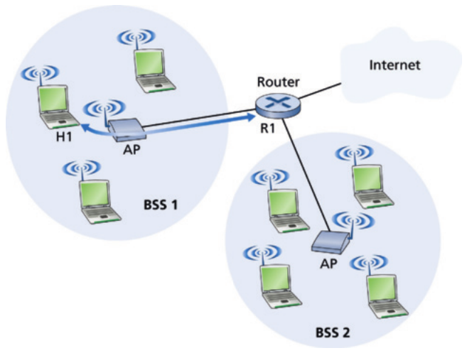

Hình 7.27 Việc dùng các trường địa chỉ trong frame 802.11: gửi frame giữa H1 và R1

• Khi frame Ethernet tới AP, AP chuyển frame Ethernet 802.3 thành frame 802.11 trước khi truyền frame vào kênh không dây. AP điền Address 1 và 2 lần lượt bằng địa chỉ MAC của H1 và địa chỉ MAC của chính nó, như mô tả ở trên. Với Address 3, AP chèn địa chỉ MAC của R1. Bằng cách này, H1 có thể xác định (từ Address 3) địa chỉ MAC của giao diện router đã gửi datagram vào subnet.

Giờ hãy xét điều gì xảy ra khi thiết bị không dây H1 phản hồi bằng cách truyền một datagram từ H1 tới R1.

• H1 tạo một frame 802.11, điền các trường Address 1 và 2 lần lượt bằng địa chỉ MAC của AP và địa chỉ MAC của H1, như mô tả ở trên. Với Address 3, H1 chèn địa chỉ MAC của R1.

• Khi AP nhận frame 802.11, nó chuyển frame thành một frame Ethernet. Trường địa chỉ nguồn của frame này là địa chỉ MAC của H1, và trường địa chỉ đích là địa chỉ MAC của R1. Do đó, Address 3 cho phép AP xác định địa chỉ MAC đích thích hợp khi xây dựng frame Ethernet.

Tóm lại, Address 3 đóng vai trò then chốt trong việc liên mạng BSS với một LAN có dây.

#### Các trường số thứ tự, thời lượng, và điều khiển frame (Sequence Number, Duration, and Frame Control Fields)

Nhớ lại rằng trong 802.11, bất cứ khi nào một trạm nhận đúng một frame từ trạm khác, nó gửi lại một xác nhận. Vì xác nhận có thể bị mất, trạm gửi có thể gửi nhiều bản sao của một frame cho trước. Như chúng ta đã thấy trong thảo luận về giao thức rdt2.1 (Mục 3.4.1), số thứ tự cho phép bên nhận phân biệt giữa một frame mới được truyền và việc truyền lại một frame trước đó. Trường số thứ tự trong frame 802.11 phục vụ đúng cùng mục đích ở tầng liên kết này như nó đã làm ở tầng giao vận trong Chương 3. Nhớ lại rằng giao thức 802.11 cho phép một trạm truyền đặt trước kênh trong một khoảng thời gian bao gồm thời gian truyền frame dữ liệu và thời gian truyền xác nhận. Lượng thời gian này (tính bằng micro giây) được đưa vào trường thời lượng (duration) của frame, cả cho frame dữ liệu lẫn cho frame RTS và CTS.

Như minh họa trong Hình 7.26, trường điều khiển frame bao gồm nhiều trường con. Chúng ta sẽ chỉ nói vài lời về một số trường con quan trọng hơn; để có thảo luận đầy đủ hơn, xem [Wikipedia 802.11_frame_types 2024]. Các trường type và subtype được dùng để định danh frame điều khiển và frame dữ liệu 802.11. Trong số các thông điệp điều khiển có các thông điệp RTS, CTS, và ACK mà chúng ta đã gặp trong Hình 7.21. Một số loại frame điều khiển được dùng khi một thiết bị gia nhập mạng, như bàn trong Mục 7.3.4. Bit quản lý nguồn (power management) được dùng (như tên gọi gợi ý) khi một thiết bị ngủ để tiết kiệm pin, như bàn trong Mục 7.3.6.

### 7.3.3 Mạng truy cập vô tuyến 5G (The 5G Radio Access Network)

Trong tiểu mục này, chúng ta sẽ đề cập các khía cạnh then chốt của Radio Access Network (RAN) trong mạng di động 4G và 5G. Chúng ta sẽ dựa nhiều vào nội dung nền tảng từ các mục trước của chương này về kênh không dây và đặc biệt là OFDMA. Ở đây chúng ta sẽ tập trung chủ yếu vào 5G, nhưng sẽ đề cập mạng di động 4G LTE khi thích hợp.

#### Các thành phần kiến trúc của mạng 5G: bức tranh lớn (Architectural components of 5G networks: the big picture)

Trước khi đi sâu vào bản thân RAN 5G, hãy đặt RAN trong bối cảnh mạng di động 5G rộng lớn hơn. Như minh họa trong Hình 7.28, một mạng di động 5G (và 3G và 4G) có hai thành phần chính—biên và lõi.

• Radio Access Network (RAN). RAN nằm ở biên của mạng 5G. Một RAN gồm (i) các thiết bị không dây end-user (được gọi là thiết bị người dùng (user equipment - UE) theo thuật ngữ di động) được gắn qua (ii) kênh vô tuyến không dây 5G cục bộ gọi là New Radio (NR), có lẽ để phân biệt với kênh vô tuyến 4G “cũ”, tới (iii) một trạm gốc, gọi là Next Generation Node (gNB). Như đã bàn trong Mục 7.1, vì danh pháp UE, NR, gNB khó hiểu và non-intuitive (phản trực giác), ở đây chúng ta sẽ dùng danh pháp trực quan và mô tả hơn là “trạm gốc (base station)” thay vì “gNB”, “thiết bị người dùng (user device)” thay vì “UE”, và “kênh không dây” hoặc “kênh vô tuyến” thay vì “NR.” RAN là phiên bản di động tương đương của một LAN không dây WiFi—nó chứa liên kết không dây first-hop giữa người dùng và mạng lớn hơn, các thiết bị người dùng không dây, và một trạm gốc 5G tương tự, nhưng multi-functional (đa chức năng), phức tạp và tinh vi hơn đáng kể so với, một điểm truy cập (AP) WiFi trong LAN không dây.

• 5G Core. 5G Core gồm các liên kết, router, server, và Core Network Function nằm giữa một RAN và một gateway từ mạng của nhà cung cấp di động vào Internet rộng lớn hơn, bao gồm các mạng của nhà cung cấp di động khác. Một mạng di động điển hình sẽ có một lõi duy nhất, với nhiều mạng biên gắn vào. Các liên kết và router trong lõi di động thường là có dây, dùng cùng các giao thức và công nghệ Internet mà chúng ta đã học trong các Chương 4, 5, và 6. Sự phân biệt giữa mặt phẳng dữ liệu và mặt phẳng điều khiển network-layer mà chúng ta đã đưa ra trước đó lần lượt trong các Chương 4 và 5, cũng rất hiện diện trong 5G, ngoại trừ việc mặt phẳng dữ liệu được gọi là mặt phẳng người dùng (user plane) theo thuật ngữ 5G. Thật vậy, sự tách biệt logic giữa mặt phẳng điều khiển và mặt phẳng người dùng nền tảng đến mức trong kiến trúc 5G (tất nhiên rồi!) nó thậm chí có từ viết tắt riêng trong các chuẩn 5G: CUPS, viết tắt của Control Plane and User Plane Separation!

• Điểm độc đáo trong 5G Core là tập các chức năng điều khiển và quản lý, gọi là 5G Core Network Functions, cung cấp các dịch vụ 5G như truy cập và cấp quyền RAN, và hỗ trợ di động user-device. Chúng ta sẽ học các dịch vụ này, minh họa bằng các ô xanh lam trong Hình 7.28, trong Mục 7.4. Vị trí triển khai các dịch vụ Core này sẽ khác nhau giữa các mạng 5G. Ví dụ, các server triển khai dịch vụ Core có thể được co-located (đặt cùng chỗ) tại trạm gốc trong trường hợp một mạng 5G riêng nhỏ, hoặc có thể được triển khai trong một data center nhỏ tách biệt về vật lý (thường gọi là edge-cloud) trong Core nhưng gần RAN, hoặc có thể được triển khai trong một data center lớn, physically-distant (xa về vật lý). Yêu cầu tuyệt đối duy nhất là các dịch vụ này có thể truy cập được qua IP. Mã ứng dụng người dùng cũng có thể chạy trên server tại trạm gốc hoặc trong 5G Core, giao tiếp với thiết bị không dây trong RAN để triển khai dịch vụ của ứng dụng. Điều này được gọi là local breakout, vì traffic client-server của ứng dụng người dùng không bao giờ rời mạng di động.

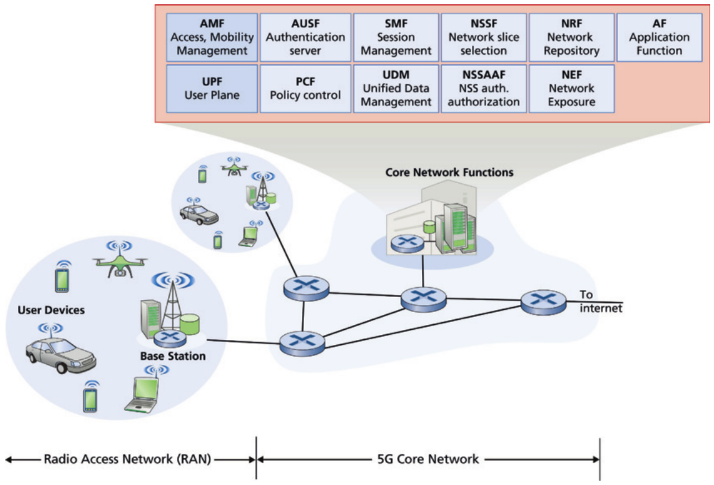

Hình 7.28 Các thành phần chính của một mạng 5G

#### RAN 4G, 5G: kênh vô tuyến vật lý (4G, 5G RAN: the physical radio channel)

RAN 4G và 5G triển khai chia sẻ kênh OFDMA, mà chúng ta đã học trong Mục 7.3.1. Trong mạng 4G, băng thông kênh con nhỏ nhất là 15 kHz, trong đó thời gian truyền cho một ký hiệu trong một minislot là 66 µsec. Trong mạng 5G, các băng thông kênh con lớn hơn (30, 60, 120, 240, 480, và 960 kHz) với độ dài minislot ngắn hơn theo tỉ lệ cũng được định nghĩa. Nhớ lại từ Mục 7.3.1 rằng một resource element (RE) là một minislot thời gian duy nhất trên một tần số sóng mang con OFDMA duy nhất. Cả mạng 4G và 5G đều gộp các RE lân cận (về tần số và thời gian) thành một Resource Block (RB). Khối tài nguyên là đơn vị tài nguyên kênh nhỏ nhất được một thiết bị truyền hoặc trạm gốc sử dụng trong mạng 4G và 5G. Trong mạng 4G, một RB gộp 84 ký hiệu (trên 12 sóng mang con lân cận, và trong 7 minislot thời gian liên tiếp), như minh họa trong Hình 7.29. Đây là cách gộp RE thành RB duy nhất trong mạng 4G. Trong mạng 5G, có một số cách khác nhau để gộp RE thành RB.

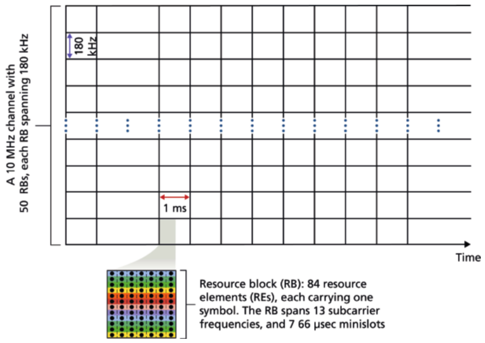

Hình 7.29 Resource Block 4G

Hình 7.29 cũng minh họa quan hệ giữa một kênh và một RB, cho thấy một kênh rộng 10 MHz gồm 50 RB time-parallel (song song về thời gian), mỗi RB dùng một trong 50 kênh con tần số khác nhau. Các băng thông kênh chuẩn cho mạng 4G là 1.4, 3, 5, 10, 15, và 20 MHz. 5G kết hợp mọi định nghĩa kênh 4G trước đó và thêm vào đó định nghĩa các kênh rộng tới 100 MHz.

Thậm chí còn có một mức gộp băng thông cao hơn cuối cùng trong mạng 4G/5G! Một băng (band) là tập hợp của một hoặc nhiều kênh, với mỗi kênh gồm một số sóng mang con (kênh con) khác nhau, như minh họa trong Hình 7.30. Các băng 5G khác nhau được 3GPP định nghĩa [3GPP TS 38.101-1 2024]. Nhớ lại từ Mục 7.2.1, rằng việc phân bổ phổ cấp phép trong các băng này cho các nhà cung cấp mạng di động được chính phủ các quốc gia thực hiện, thường qua đấu giá. Lượng phổ được cấp trên phạm vi quốc gia cho các nhà mạng trong các băng này khác nhau giữa các quốc gia. Một khi nhà vận hành mạng đã được phân bổ một băng tần, việc chia băng thành các kênh, và các kênh thành sóng mang con là do nhà vận hành đó quyết định.

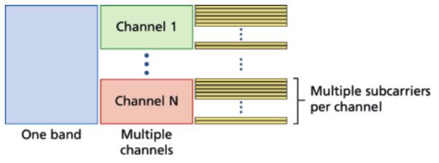

Hình 7.30 Băng, kênh, và sóng mang con

#### Vô tuyến RAN 4G, 5G: các kênh điều khiển và dữ liệu vật lý và logic (4G, 5G RAN Radio: physical and logical control and data channels)

Thảo luận ở trên của chúng ta tập trung vào tài nguyên kênh vô tuyến vật lý— tần số vô tuyến, minislot thời gian, và cấu trúc RB. Mỗi RB cũng có một hướng. Hướng downlink là từ trạm gốc tới thiết bị người dùng. Hướng uplink là từ thiết bị người dùng tới trạm gốc. Như chúng ta đã thấy trong các mạng biên có dây (ví dụ, cáp) ở Chương 6, thường có nhiều traffic downstream hơn đáng kể so với traffic uplink, với tỉ lệ xấp xỉ 10:1 [Sauter 2021; Mitra 2024] giữa traffic downlink và uplink trong mạng 4G/5G. Mỗi nhà vận hành mạng có thể đặt tỉ lệ tài nguyên kênh downlink so với uplink bằng cách xác định tỉ lệ các time slot OFDMA được gán cho mỗi hướng, một quá trình gọi là Time Division Duplexing (TDD). Cũng có thể nhóm tài nguyên theo tần số, với một dải tần số kênh được gán riêng cho truyền uplink hoặc downlink—một quá trình gọi là Frequency Division Duplexing (FDD).

Với việc gán tần số và time slot cho các RB uplink và downlink trong RAN, các RB sau đó được phân chia thành ba nhóm theo hướng downlink và ba nhóm theo hướng uplink. Các nhóm này được gọi là kênh vật lý downlink và kênh vật lý uplink. Các RB trong mỗi kênh vật lý được dùng cho cùng một mục đích. Ba trong số các kênh này theo hướng downlink:

• Physical Downlink Shared Channel (PDSCH). Kênh này mang mọi dữ liệu user-plane downstream, cũng như các thông điệp mặt phẳng điều khiển từ trạm gốc tới thiết bị người dùng cho mọi thiết bị người dùng.

• Physical Downlink Control Channel (PDCCH). Kênh này được dùng để thông báo cho thiết bị người dùng về các RB mà chúng sẽ nhận dữ liệu theo hướng downlink và các RB chúng có thể dùng để truyền dữ liệu theo hướng uplink.

• Physical Broadcast Channel (PBCH). Kênh này mang thông tin được trạm gốc quảng bá, cần thiết để một thiết bị người dùng phát hiện rồi gia nhập mạng di động, như bàn trong Mục 7.3.4.

và ba trong số các kênh này theo hướng uplink:

• Physical Uplink Shared Channel (PUSCH). Kênh này là bản tương đương upstream của PDSCH. Nó mang mọi dữ liệu user-plane upstream, cũng như các thông điệp mặt phẳng điều khiển từ thiết bị người dùng tới trạm gốc.

• Physical Random-Access Channel (PRACH). Kênh này được thiết bị người dùng dùng để yêu cầu kết nối tới trạm gốc, khi một thiết bị lần đầu gia nhập mạng. Như tên gọi gợi ý, các thiết bị truy cập kênh này dùng một sơ đồ random-access.

• Physical Uplink Control Channel (PUCCH). Một thiết bị dùng kênh này để yêu cầu trạm gốc cấp phát cho nó các RB trong PUSCH mà nó có thể dùng trong tương lai để truyền dữ liệu tới trạm gốc. PUCCH cũng mang dữ liệu đo lường, và ACK/NAK link-layer dùng cho truyền dữ liệu tin cậy. Cũng có nhiều kênh logic được định nghĩa theo hướng uplink và downlink, sau đó được ánh xạ lên các kênh vật lý uplink và downlink. Mọi thông tin chảy trên cùng một kênh logic có liên quan với nhau về ngữ nghĩa. Xem [Sauter 2021; electronicsnotes 2024] để biết chi tiết. Với các định nghĩa này về kênh uplink và downlink logic và vật lý của 5G, khái niệm băng tần và kênh trong Hình 7.30, và thảo luận của chúng ta về đặc tính của kênh vô tuyến trong Mục 7.2, rõ ràng từ “kênh (channel)” mang những nghĩa rất khác nhau trong các bối cảnh khác nhau và là một trong những từ được dùng nhiều nhất (hoặc có lẽ bị lạm dụng nhất) trong mạng không dây!

#### RAN 5G: tầng liên kết không dây (5G RAN: the wireless link layer)

Sau khi đã học chồng giao thức link-layer của WiFi trước đó, giờ hãy xem xét chồng giao thức link-layer trong RAN 5G.

Hình 7.31 cho thấy chồng giao thức RAN 5G, với góc nhìn mở rộng về các tầng con khác nhau trong tầng liên kết 5G. Lưu ý rằng như trong trường hợp WiFi, tầng liên kết ở cả thiết bị và trạm gốc đều có mặt phẳng người dùng và mặt phẳng điều khiển. Nhiệm vụ của mặt phẳng người dùng là chuyển frame link-layer từ ứng dụng của thiết bị tới trạm gốc và ngược lại. Nhiệm vụ của mặt phẳng điều khiển là điều khiển và cấu hình tài nguyên vô tuyến của RAN, cung cấp các chức năng điều khiển cho việc truyền frame user-plane (ví dụ, ARQ và chất lượng dịch vụ) và các dịch vụ bổ sung như di động thiết bị (Mục 7.4.2), gắn vào mạng (Mục 7.3.4), và điều khiển công suất (Mục 7.3.6). Vì các hành động mặt phẳng điều khiển link-layer thường liên quan tới trao đổi thông điệp giữa các chức năng điều khiển trong thiết bị và trạm gốc, một kết nối logic bằng nét đứt được vẽ giữa các module điều khiển trong các tầng con ở hai bên liên kết không dây trong Hình 7.31. Các thông điệp điều khiển gửi giữa trạm gốc và thiết bị người dùng được mang trong các frame link-layer qua một trong các kênh điều khiển vật lý 5G thích hợp.

Hình 7.31 cho thấy tầng liên kết RAN 5G được chia thành một số tầng con:

• Radio Resource Control (RRC) là chức năng control-plane chịu trách nhiệm (i) thiết lập, duy trì và giải phóng các kênh logic link-layer, (ii) quản lý trạng thái kết nối link-layer per-device ( Mục 7.3.4 và 7.3.6), (iii) quản lý các khía cạnh di động thiết bị (Mục 7.4), và (iv) thực hiện đo và báo cáo chất lượng kênh ( Mục 7.3.5). RRC hoàn thành công việc bằng cách cấu hình trạng thái link- và physical-layer cục bộ, dùng giao thức RRC [3GPP TS 38.331 2024] để gửi thông điệp điều khiển giữa trạm gốc và thiết bị người dùng.

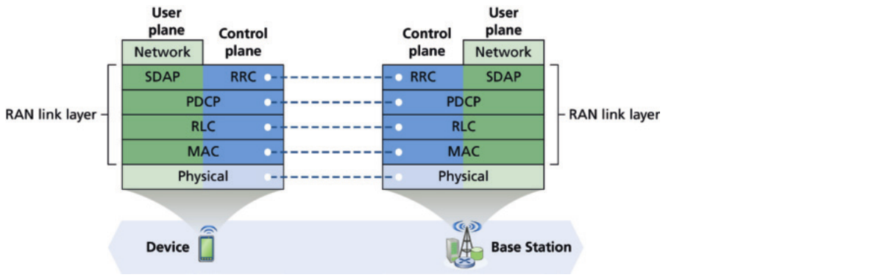

Hình 7.31 Chồng giao thức RAN 5G tại thiết bị người dùng và trạm gốc

• Service Data Adaptation Protocol (SDAP) là tầng con cao nhất trong mặt phẳng người dùng link-layer. Khi cần cung cấp đảm bảo Quality of Service cho các luồng packet, SDAP gán QoS Flow ID và ánh xạ các luồng lên tài nguyên vô tuyến bên dưới.

• Packet Data Convergence Protocol (PDCP) chịu trách nhiệm nén header IP và (tùy chọn) mã hóa và kiểm tra toàn vẹn thông điệp bằng mật mã.

• Radio Link Control (RLC) chịu trách nhiệm phân đoạn/ráp lại và truyền frame tin cậy dùng một giao thức ARQ (Automatic Repeat Request) đơn giản với số thứ tự, kiểm tra dư thừa vòng, và thông điệp ACK/NACK, như chúng ta đã học trong Chương 3.

• Tầng con Medium Access Control (MAC) chịu trách nhiệm lập lịch truyền các frame link-layer user- và control-plane giữa trạm gốc và thiết bị người dùng. Như đã học trước đó trong mục này, dữ liệu trong các frame này được phân đoạn thành các khúc nhỏ hơn rồi được ánh xạ lên các Resource Block OFDMA để truyền. Chúng ta sẽ đề cập lập lịch MAC trong Mục 7.3.5.

Trong khi frame link-layer WiFi trong Hình 7.26 tương đối đơn giản, frame RAN 5G phức tạp hơn đáng kể, phần lớn do có nhiều tầng con liên kết. Một frame link-layer 5G bao gồm một IP datagram hoặc một thông điệp control-plane RRC với các trường header SDAP, PDCP, RLC, và MAC được thêm vào. Mỗi tầng con thêm các trường header riêng, thường bao gồm một bit thông điệp người dùng/điều khiển, một số thứ tự hoặc định danh, một trường payload, và các trường khác cần để hoàn thành chức năng của tầng con. Thay vì mô tả chi tiết vất vả các trường này, chúng tôi sẽ đơn giản giới thiệu độc giả quan tâm tới Mục 6 trong mỗi tài liệu giao thức tầng con liên kết—của 3GPP [3GPP RRC TS 38.331 2024; 3GPP SDAP TS 38.300 2024; 3GPP PDCP TS 38.323 2024; 3GPP RLC TS 38.322 2024; 3GPP MAC TS 38.321 2024].

Hình 7.32 cho thấy một góc nhìn về đường ống điều khiển link-layer và packet-processing của trạm gốc 5G, một lần nữa nhấn mạnh sự tách biệt control- và user-plane. Chúng ta cũng lưu ý vai trò trung tâm, điều khiển của RRC.

Trong các mạng 2G, 3G, và 4G trước đây, một trạm gốc di động RAN được triển khai như một khối nguyên khối—về cơ bản là một “hộp” chuyên dụng của một nhà cung cấp duy nhất triển khai các chức năng chuẩn hóa của thế hệ đó. Bắt đầu với 5G, đã có xu hướng “phân rã (disaggregate)” các chức năng RAN thành nhiều khối chức năng tương tác với nhau qua các giao diện chuẩn hóa. Kiến trúc phân rã này cho phép nhiều nhà cung cấp đưa ra các bản triển khai cạnh tranh cho các phần của trạm gốc 5G, hạ rào cản gia nhập, và tăng cạnh tranh và đổi mới—tương tự một động lực then chốt mà chúng ta đã thấy đằng sau sự phát triển của SDN trong Chương 5.

Hình 7.33 cho thấy việc chia chức năng của một trạm gốc 5G thành một Radio Unit (RU), một Distributed Unit (DU), và một Central Unit (CU), cũng như các chức năng RAN được thực hiện trong mỗi khối. Việc các khối chức năng như vậy được đặt ở đâu trong RAN—tại trạm gốc, trong một edge cloud, hay trong một đám mây trung tâm—là một quyết định triển khai, thường bị chi phối bởi độ trễ truyền thông và các yêu cầu truyền thông real-time. Trong khi RU, DU, và CU là một phần của đặc tả 3GPP 5G [3GPP TS 38.300; 3GPP TS 38.401], O-RAN Alliance đưa việc phân rã này tiến thêm một bước bằng cách đặc tả các giao diện giữa các khối này [O-RAN Architecture 2024; Polese 2023].

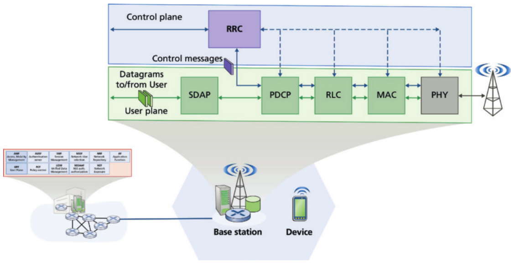

Hình 7.32 Đường ống điều khiển và packet-processing RAN của trạm gốc 5G

#### Triển khai mặt phẳng điều khiển RAN 5G (Implementing the 5G RAN control plane)

Việc phân rã trạm gốc 5G thành các khối chức năng RU, DU, và CU chỉ là một trong hai sự phân rã trong 5G. Dạng phân rã thứ hai xuất hiện trong mặt phẳng điều khiển 5G. Cụ thể, vì mặt phẳng điều khiển RRC tách biệt khỏi mặt phẳng người dùng (giống như mặt phẳng điều khiển và mặt phẳng dữ liệu Internet tách biệt nhau), có thể triển khai các chức năng RRC chuẩn hóa theo cách SDN-like hiện đại.

Hình 7.34 cho thấy một bản triển khai SDN-like của mặt phẳng điều khiển RAN. Thật bổ ích khi so sánh bản triển khai RRC nguyên khối gợi ý trong Hình 7.33 với bản triển khai RRC SDN trong Hình 7.34. Cụ thể, chừng nào bản triển khai re-factored (tái cấu trúc) trong Hình 7.34 triển khai mọi giao diện chức năng tới lõi di động và tới mặt phẳng người dùng như trong Hình 7.33, thì hai bản triển khai không thể phân biệt được với nhau đối với các thành phần khác của mạng 5G.

Một bộ điều khiển SD-RAN thường sẽ có các thành phần chính sau minh họa trong Hình 7.34:

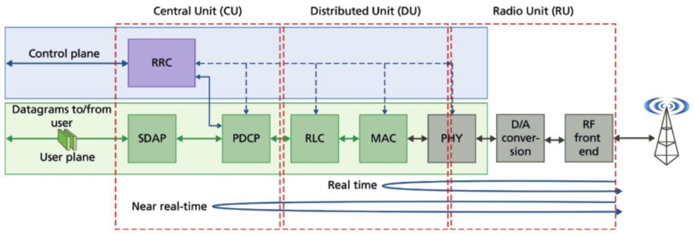

Hình 7.33 Phân rã: chia chức năng của một trạm gốc 5G thành ba “khối”

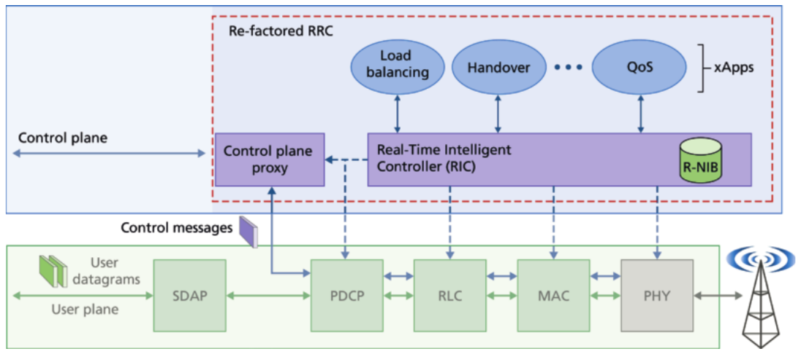

Hình 7.34 SD-RAN: một mặt phẳng điều khiển RAN software-defined

• Một proxy control-plane triển khai một giao diện 3GPP-compliant (tuân thủ chuẩn) giữa RAN và mặt phẳng điều khiển của 5G Core. Cụ thể, proxy mặt phẳng điều khiển của RAN phải triển khai giao diện service-based well-defined tới mỗi Core Network Function minh họa trong Hình 7.28 và được bàn sau trong Mục 7.4.

• Một bộ điều khiển thông minh real-time (RIC) phục vụ chức năng tương tự ở đây như bộ điều khiển SDN trong Hình 5.14. Bản thân RIC có ba thành phần chính:

• Một tầng giao tiếp tầng thấp truyền lệnh tới các thành phần RAN data-plane.

• Một tầng state-management RAN-wide (toàn RAN). Các quyết định điều khiển của RIC sẽ cần thông tin up-to-date (cập nhật) về trạng thái kênh, trạng thái kết nối và thông tin định danh cho mỗi thiết bị người dùng, cho các yêu cầu QoS, và nhiều thứ khác. Thông tin này được lưu trong RAN Node Information Base (R-NIB) cục bộ.

• Một giao diện tới một tập tiến trình điều khiển application-layer.

• Các tiến trình điều khiển RIC đưa ra quyết định điều khiển RAN liên quan tới cân bằng tải, handover thiết bị, cung cấp QoS, và hơn nữa. Các tiến trình này, gọi là xApp theo thuật ngữ OpenRAN, có thể truy cập thông tin trong R-NIB và được triển khai như các tiến trình phần mềm riêng biệt thực thi bên ngoài bản thân RIC, như minh họa trong Hình 7.34. Một tập xApp open-source có thể được tìm thấy tại [O-RAN xApp 2024]. OpenRAN [O-RAN Architecture 2024] là một trong những ví dụ nổi bật nhất về SD-RAN. OpenRAN là mở theo nghĩa có các giao diện chuẩn hóa, well-defined giữa các thành phần khác nhau của SD-RAN, cho phép các bản triển khai multi-vendor (nhiều nhà cung cấp) của các thành phần khác nhau của SD-RAN tương tác với nhau.

Để có thảo luận sâu sắc về việc phần mềm hóa RAN 5G, xem [Peterson 2024].

### 7.3.4 Khám phá: gắn vào một mạng không dây (Discovery: attaching to a wireless network)

Sau khi đã bàn chi tiết cả RAN di động và LAN WiFi, giờ hãy chuyển sự chú ý sang một khả năng cần có trong mọi mạng biên, bất kể đó là Ethernet LAN có dây, RAN 5G, hay WLAN WiFi—khả năng một thiết bị phát hiện sự tồn tại của hạ tầng mạng và “gắn” vào mạng đó. Quá trình này được gọi là liên kết mạng (network association).

#### Phát beacon (Beaconing)

Một trạm gốc, dù trong mạng 5G hay mạng WiFi, sẽ định kỳ truyền các thông điệp beacon, thông báo sự tồn tại của mạng truy cập và thông tin về đặc điểm của nó như tên, khả năng truyền (ví dụ, tốc độ truyền), và các tham số physical-layer về kênh vô tuyến của nó. Một thiết bị muốn gắn vào mạng sẽ quét thụ động các kênh không dây khả dĩ khác nhau, tìm các thông điệp beacon như vậy. Các chuẩn mạng không dây không chỉ định thuật toán mà một thiết bị dùng để chọn mạng nào trong số các mạng được quảng bá để liên kết—lựa chọn đó được để cho bạn (thiết bị hoặc người dùng) hoặc những người thiết kế firmware và phần mềm trong thiết bị không dây của bạn. Thông thường, một thiết bị có thể chọn liên kết với mạng mà nó đã liên kết gần đây nhất, có thể chọn từ một danh sách có thứ tự, hoặc có thể chọn gia nhập mạng có cường độ tín hiệu tốt nhất. Trong các mạng 5G công cộng, một thiết bị hầu như luôn ưu tiên liên kết với mạng 5G do nhà cung cấp đã phát hành thẻ SIM của thiết bị vận hành, và là nhà cung cấp mà thiết bị có gói dịch vụ trả phí.

#### Gắn vào mạng WiFi (Attaching to a WiFi network)

Sau khi quét các mạng khả dụng và chọn AP để liên kết, một thiết bị WiFi gửi một frame association request 802.11 tới AP. AP phản hồi bằng một frame association response, như minh họa trong Hình 7.35. Như bàn trong Mục 8.8, nhưng không minh họa trong Hình 7.35, một thiết bị sẽ xác thực mình với mạng dùng bảo mật WPA (WiFi Protected Access) sau khi nhận một beacon, và trước hoặc sau khi liên kết.

Một khi đã liên kết với một AP WiFi, thiết bị sẽ muốn gia nhập subnet (theo nghĩa định địa chỉ IP ở Mục 4.3.3) mà AP thuộc về. Do đó thiết bị thường sẽ gửi một thông điệp DHCP discovery (xem Hình 4.21) vào subnet qua AP để lấy một địa chỉ IP trên subnet. Một khi đã có địa chỉ, phần còn lại của thế giới sẽ xem thiết bị đó đơn giản là một thiết bị khác có địa chỉ IP trong subnet đó.

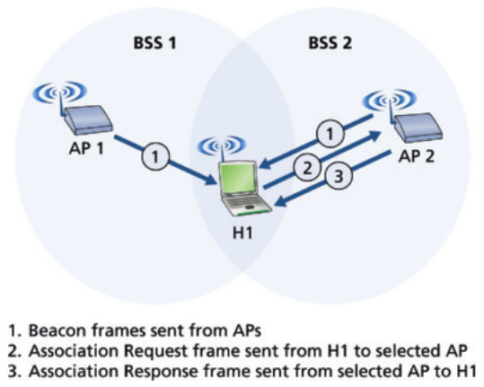

Hình 7.35 Liên kết với một mạng WiFi

#### Gắn vào mạng 5G (Attaching to a 5G network)

Quá trình mà một thiết bị gắn vào mạng 5G để có các kênh điều khiển và dữ liệu collision-free của riêng nó phức tạp hơn một chút so với gắn vào mạng WiFi. Cụ thể, thay vì tìm chỉ một thông điệp beacon duy nhất chứa mọi thông tin cần để gia nhập một mạng truy cập, một thiết bị 5G trải qua một quá trình nhiều bước để lấy thông tin cần thiết. Hình 7.36 minh họa quá trình này:

1. Mỗi trạm gốc quảng bá nhiều mẩu thông tin mà thiết bị cần để quyết định có gia nhập mạng hay không. Tín hiệu đồng bộ chính (primary synchronization signal - PSS) của mạng trước hết được thiết bị định vị và dùng để đồng bộ đồng hồ của nó với đồng hồ của trạm gốc. Tín hiệu đồng bộ phụ (secondary synchronization signal - SSS), cung cấp một định danh mạng ban đầu, sau đó được định vị. PSS và SSS được mọi trạm gốc 5G quảng bá mỗi 5 msec trên 127 sóng mang con trung tâm của mọi kênh 5G. Tiếp theo, thiết bị lấy Master Information Block (MIB) cho kênh đó, bao gồm thông tin về khoảng cách sóng mang con, và việc cell đó có đang mở cho liên kết hay không. PSS, SSS, và MIB cùng nhau tạo thành System Signal Block (SSB). Với thông tin này, thiết bị sau đó có thể định vị và nhận tới 20 System Information Block (SIB) mô tả mạng 5G và hoạt động của nó. Quan trọng nhất trong số này là SIB1, được truyền mỗi 80 ms và chứa:

• Mã quốc gia di động (mobile country code - MCC) và mã mạng di động (mobile network code - MNC) của nhà mạng vận hành kênh này,

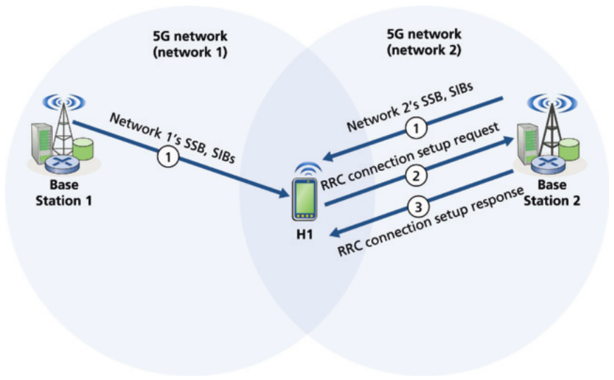

Hình 7.36 Liên kết với một mạng 5G

• định danh trạm gốc, và

• mức thu tối thiểu (chất lượng kênh) chấp nhận được.

2. Giờ giả sử thiết bị quyết định muốn liên kết với mạng 5G này. Tuy nhiên, trạm gốc thậm chí còn chưa biết sự tồn tại của thiết bị, và thiết bị chưa được cấp phát bất kỳ RB uplink nào có thể dùng để giao tiếp với trạm gốc. Do đó, thiết bị dùng kênh random-access upstream của cell để gửi một yêu cầu thiết lập kết nối Radio Resource Control (RRC) (về tinh thần tương tự frame association request 802.11) tới trạm gốc.

3. Ở bước 3, trạm gốc phản hồi thông điệp yêu cầu thiết lập kết nối của thiết bị bằng một thông điệp phản hồi thiết lập kết nối RRC (về tinh thần tương tự frame association response 802.11).

Tại thời điểm này, thiết bị người dùng và trạm gốc có thể trao đổi thông điệp điều khiển với nhau trong RAN. Nhưng thiết bị vẫn chưa gia nhập mạng 5G (!) vì nó chưa định danh hay xác thực mình với mạng, cũng chưa có địa chỉ IP. Chúng ta sẽ thấy thiết bị hoàn tất quá trình gia nhập mạng 5G thế nào khi đề cập 5G Core (Mục 7.4) và xác thực (Mục 8.8).

### 7.3.5 Lập lịch truyền qua RAN/WLAN (Scheduling transmissions over the RAN/WLAN)

Một trong những chức năng quan trọng nhất của tầng MAC là lập lịch thứ tự truyền dữ liệu theo hướng downlink từ trạm gốc tới thiết bị người dùng, và theo hướng ngược uplink. Đây là vai trò của bộ lập lịch MAC (MAC scheduler), đặc biệt quan trọng trong các kịch bản triển khai dày đặc (tức là, trong mạng 4/5G và các triển khai OFDMA WiFi 6/7), nơi có thể có hàng chục hoặc hàng trăm người dùng có dữ liệu cần truyền tại một thời điểm. Do đó, ở đây chúng ta sẽ tập trung vào kịch bản có một bộ lập lịch MAC trung tâm tại trạm gốc. Lập lịch truyền phân tán cũng là một chủ đề được quan tâm trong các môi trường random-access thuần túy (xem, ví dụ, [Liang 2010]), nhưng sẽ không được đề cập ở đây. Nhớ lại rằng trước đó chúng ta đã học lập lịch link-layer trong môi trường có dây ở Mục 4.2.5. Ở đó chúng ta thấy performance tổng thể ở tầng liên kết (ví dụ, đo bằng throughput và tổng hợp trên mọi traffic đi qua liên kết) về cơ bản độc lập với thứ tự truyền frame, vì một số lượng frame cố định được truyền mỗi giây bất kể việc chọn cụ thể frame nào để truyền. Tuy nhiên, trong môi trường không dây, điều này chắc chắn không đúng! Như đã học trong Mục 7.2, một trạm gốc có thể truyền ở tốc độ cao hơn (bằng cách dùng một sơ đồ điều chế higher-bitrate) tới một thiết bị gần về vật lý và có line-of-sight rõ ràng, so với tới một thiết bị ở xa và chịu hiệu ứng đa đường. Do đó, throughput của WLAN và RAN phụ thuộc vào việc thiết bị nào được lập lịch làm bên truyền và bên nhận. Ghép kênh không gian và phân tập không gian MIMO cung cấp thêm các bậc tự do để truyền một hoặc nhiều luồng tới một bên nhận cho trước. Beamforming còn mang lại một cơ hội khác nữa—gửi tới các tập bên nhận khác nhau cùng lúc. Và, tất nhiên, đặc tính kênh liên tục thay đổi theo thời gian. Do đó, performance link-layer không dây tổng hợp tổng thể sẽ phụ thuộc rất nhiều vào các lựa chọn lập lịch MAC!

Vì cả 3GPP lẫn các chuẩn WiFi đều không bắt buộc (hay thậm chí mô tả) thuật toán lập lịch MAC, việc chọn thuật toán lập lịch hoàn toàn nằm trong tay nhà vận hành mạng. Do đó lập lịch là một phần của “bí quyết” có thể phân biệt nhà cung cấp mạng này với nhà cung cấp khác. Thật vậy, nhiều nhà cung cấp phần cứng/phần mềm không dây và nhà cung cấp mạng không dây quảng cáo rằng cách tiếp cận tinh vi của họ với lập lịch MAC giúp họ khác biệt với đối thủ. Có bốn cân nhắc then chốt trong lập lịch MAC:

• Nhận biết chất lượng kênh (Channel quality awareness). Bộ lập lịch có xét đến ước lượng/đo lường chất lượng kênh vô tuyến giữa trạm gốc và thiết bị khi ra quyết định lập lịch không? Vì một thiết bị có kênh vô tuyến high-quality giữa nó và trạm gốc có thể gửi/nhận dữ liệu ở tốc độ cao hơn, một mạng có thể đạt throughput tổng hợp cao hơn bằng cách ưu tiên gửi tới các thiết bị có kênh vô tuyến chất lượng cao tới/từ trạm gốc.

• Công bằng giữa các thiết bị (Fairness among devices). Bộ lập lịch có cung cấp một mức độ công bằng (ví dụ, throughput xấp xỉ bằng nhau) giữa các thiết bị không? Nếu có, “công bằng” có nghĩa là gì? Ví dụ, một chính sách lập lịch chỉ truyền tới các thiết bị có kênh chất lượng cao nhất có thể đạt throughput cao nhưng không cung cấp công bằng throughput giữa các thiết bị. Nếu cần cung cấp công bằng, “cái giá” phải trả có thể là một mức giảm nào đó về throughput tổng hợp (so với throughput tối đa có thể đạt được khi không xét đến công bằng).

• Ưu tiên giữa các lớp traffic (Prioritization among classes of traffic). Bộ lập lịch có phân biệt giữa traffic control-plane và traffic user-plane không, ví dụ, bằng cách ưu tiên loại trước hơn loại sau, hoặc bằng cách cung cấp một lượng tài nguyên kênh tối thiểu cố định cho một hoặc cả hai lớp này? Bộ lập lịch có phân biệt giữa traffic có ràng buộc real-time (như ứng dụng điều khiển, và thoại và video tương tác) và traffic non-real-time (ví dụ, duyệt web) không. Thảo luận trước đó của chúng ta về lập lịch ưu tiên trong Mục 4.2.5 áp dụng được ở đây.

• Nhận biết chất lượng dịch vụ (Quality of Service (QoS) awareness). Bộ lập lịch có ra quyết định lập lịch sao cho các đảm bảo quality-of-service (performance) được cung cấp cho các thiết bị trong mạng không?

Hàng nghìn bài báo nghiên cứu đã được viết, và gần như cũng chừng ấy thuật toán lập lịch MAC đã được đề xuất, qua nhiều năm. Ở đây, chúng ta sẽ chỉ mô tả vài thuật toán tiêu biểu, áp dụng ký hiệu từ [Capozzi 2012]. Các khảo sát về thuật toán lập lịch MAC có thể được tìm thấy trong [Capozzi 2012; Haque 2023]. Hình 7.37 minh họa bốn thuật toán lập lịch MAC khác nhau, cho thấy dữ liệu (tức là, frame link-layer) xếp hàng tại trạm gốc để truyền tới sáu thiết bị downstream. Ở đây chúng ta sẽ tập trung vào lập lịch việc truyền downstream từ trạm gốc tới các thiết bị được liên kết với nó. Tuy nhiên, thảo luận của chúng ta cũng áp dụng được cho kênh upstream, vì trạm gốc cũng lập lịch kênh upstream và thông báo cho thiết bị về tài nguyên kênh upstream mà thiết bị có thể dùng, và khi nào. Với một kênh downstream OFDMA, quyết định của bộ lập lịch xác định frame xếp hàng của thiết bị nào sẽ được truyền trong resource block (RB) nào giữa thời điểm lập lịch hiện tại và thời điểm tiếp theo. Trong hệ thống 4G/5G, quyết định lập lịch được đưa ra mỗi 1 ms. Trong WiFi 6, thời gian giữa các quyết định lập lịch có thể còn ngắn hơn [Qualcomm 2021].

#### Lập lịch Round Robin (RR) (Round Robin (RR) Scheduling)

Nhớ lại thảo luận về lập lịch RR trong môi trường có dây ở Mục 4.2.5. Trong môi trường không dây, RR cấp phát số RB bằng nhau cho mỗi thiết bị cho vòng truyền tiếp theo. RR là channel-unaware và QoS-unaware. RR công bằng theo lượt, vì mỗi thiết bị được cấp phát số RB bằng nhau, nhưng không nhất thiết throughput-fair vì các thiết bị khác nhau có thể gặp điều kiện kênh khác nhau, và do đó đạt throughput khác nhau.

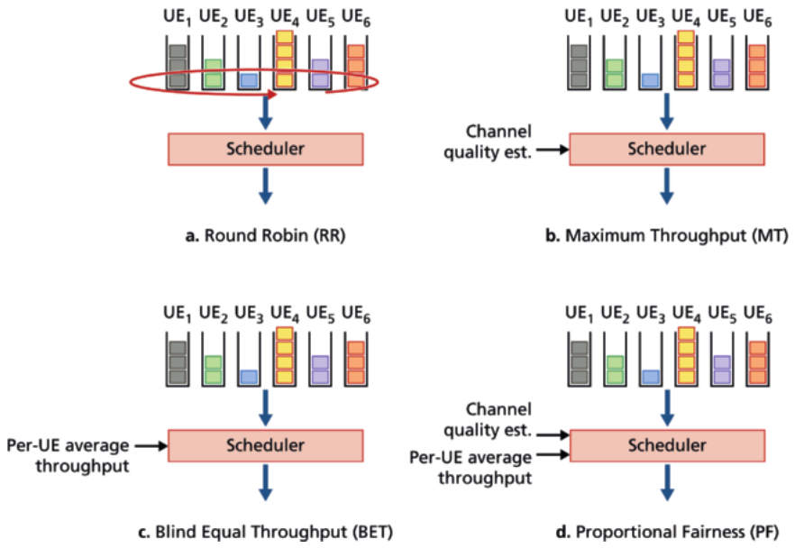

Hình 7.37 Bốn thuật toán lập lịch MAC, các phép đo được dùng

#### Lập lịch Maximum Throughput (MT) (Maximum Throughput (MT) scheduling)

Trong lập lịch MT, minh họa trong Hình 7.37(b), trạm gốc gán RB cho các thiết bị người dùng có chất lượng kênh đo được cao nhất cho RB đó và có dữ liệu cần gửi. Chất lượng kênh có thể được xác định theo nhiều cách khác nhau. Trong mạng 5G, trạm gốc định kỳ quảng bá các ký hiệu tín hiệu tham chiếu ở các vị trí đã biết trong resource block. Một thiết bị định kỳ gửi một Channel Quality Indication (CQI) 4-bit dựa trên việc thu đo được của nó đối với các tín hiệu tham chiếu này. Trong lập lịch MT, tại mỗi thời điểm lập lịch, t, trạm gốc tính:

dik (t): throughput kỳ vọng cho thiết bị i khi dùng RB thứ k tại thời điểm t. dik (t) được tính dùng các CQI device-reported từ mỗi thiết bị, i, mà đến lượt nó sẽ xác định kỹ thuật điều chế được dùng (xem, ví dụ, Bảng 5.2.2.1 trong [3GPP 38.214 2024]), mà đến lượt nó sẽ xác định số bit trên mỗi ký hiệu được truyền trong resource block k.

Bộ lập lịch MT sau đó tìm thiết bị, i, có kênh chất lượng báo cáo cao nhất trên mọi RB, k:

maxi,k {dik(t)},

và gán RBk cho thiết bị i. Quá trình lặp lại cho tới khi mọi RB đã được gán. Lưu ý rằng lập lịch MT là channel-aware, nhưng không công bằng. Thật vậy, trong trường hợp bất công nhất, thiết bị duy nhất có chất lượng kênh cao nhất trong mọi thiết bị có thể được gán mọi RB khả dụng, nếu có đủ dữ liệu để gửi tới thiết bị đó!

#### Thông lượng bằng nhau mù (Blind Equal Throughput (BET))

Thuật toán lập lịch BET, minh họa trong Hình 7.37(c), nhắm tường minh tới công bằng bằng cách cung cấp throughput trung bình bằng nhau cho mọi thiết bị người dùng. Trong BET, bộ lập lịch duy trì một ước lượng throughput trung bình của một thiết bị. Gọi ri (t) là throughput đo được mà thiết bị i đạt được trong khoảng thời gian t. Khi đó, trung bình động có trọng số mũ (exponentially weighted moving average - EWMA) của throughput thiết bị i tại thời điểm t, Ri (t), là:

Ri(t) = (1 − β) • ri(t) + β • Ri(t − 1),

trong đó tham số β (0 < β < 1) xác định tầm quan trọng tương đối của các giá trị Ri() gần đây hơn trong việc tính throughput trung bình; giá trị β cao hơn cho tầm quan trọng cao hơn đối với các giá trị gần đây. Có thể bạn còn nhớ rằng chúng ta đã gặp công thức EWMA này khi học cách TCP ước lượng thời gian round-trip trong Mục 3.5.3. BET đơn giản gán một RB cho thiết bị có throughput nhỏ nhất đang có dữ liệu xếp hàng chờ truyền ở trạm gốc. Quá trình lặp lại cho tới khi mọi RB đã được gán. Lập lịch BET là throughput-fair tường minh, QoS-unaware, và có thể nói phần nào channel-aware, ở chỗ nó dùng throughput per-device thực tế đạt được (vốn phụ thuộc vào chất lượng kênh).

#### Lập lịch công bằng tỉ lệ (Proportional Fairness (PF) scheduling)

Lập lịch PF tìm cách cân bằng giữa việc tối đa hóa performance (throughput) và cung cấp công bằng giữa các thiết bị. Gọi dik (t) và Ri (t) được định nghĩa như trên. Tại mỗi thời điểm lập lịch, t, bộ lập lịch PF tìm thiết bị i và resource block, k, đạt

maxi,k {dik(t)/Ri(t − 1)}

rồi gán RB k cho thiết bị i. Trực giác đằng sau PF là rõ ràng—vì dik (t) nằm ở tử số trong biểu thức cần cực đại hóa, giá trị throughput cao hơn sẽ làm tăng giá trị của biểu thức đang được cực đại hóa. Tương tự, vì Ri (t − 1) nằm ở mẫu số, một thiết bị người dùng có throughput trung bình thấp cũng sẽ làm tăng giá trị của biểu thức đang được cực đại hóa, ưu tiên các thiết bị đã chịu throughput thấp. Quá trình lặp lại cho tới khi mọi RB đã được gán. Lưu ý rằng lập lịch PF là channel-aware và nhắm tới cung cấp một mức độ công bằng.

Thảo luận ở trên của chúng ta mới chỉ chạm tới bề mặt của lập lịch WLAN và RAN. Các nguyên tắc lập lịch bổ sung, việc cung cấp đảm bảo quality-of-service qua đặt trước tài nguyên cứng hoặc mềm [Prasad 2023], lập lịch ưu tiên, lập lịch cho traffic real-time, và lập lịch ảo hóa [Peterson 2024] đều là các chủ đề quan trọng bổ sung trong lĩnh vực này.

### 7.3.6 Cân nhắc năng lượng: thức/ngủ (Energy considerations: wake/sleep)

Năng lượng là một tài nguyên quý giá trong thiết bị di động không dây, và do đó nhiều mạng không dây cung cấp các khả năng power-management tường minh cho phép thiết bị giảm thiểu lượng thời gian mà các chức năng cảm nhận, truyền, nhận và các mạch khác của chúng cần “bật.” Để làm điều này, một thiết bị thường sẽ luân phiên giữa trạng thái ngủ và thức (không khác gì một sinh viên buồn ngủ trong lớp học!)—thức khi có việc cần làm và ngủ khi không có việc gì. Các phép đo đã cho thấy một bộ vô tuyến LTE có thể tiêu thụ từ 1,000 đến 3, 500 mW năng lượng khi truyền hoặc nhận (hoặc chờ nhận), nhưng ít hơn 15 mW khi tắt nguồn—xấp xỉ một phần trăm mức sử dụng năng lượng on-state (trạng thái bật) [Huang 2012]. Các phép đo cũng cho thấy từ 20% đến hơn 50% năng lượng sử dụng trong các thiết bị 4G và 5G chạy các ứng dụng phổ biến được tiêu tốn cho giao tiếp [Xu 2020]. Do đó, việc sử dụng năng lượng communication-related đóng vai trò trung tâm trong quản lý năng lượng tổng thể của thiết bị di động.

Chúng ta có thể xác định hai cách tiếp cận chính đối với quản lý năng lượng qua các chu kỳ ngủ/thức của bộ vô tuyến:

• Trong các cách tiếp cận ngủ/thức có phối hợp (coordinated), một giao thức giữa thiết bị và trạm gốc có nhiệm vụ điều phối các chu kỳ ngủ/thức của thiết bị, với cả hai bên đều biết trạng thái ngủ/thức của thiết bị, và thời điểm thiết bị được lên lịch thức dậy tiếp theo. Với hiểu biết này, trạm gốc có thể xếp hàng các datagram đến hướng tới thiết bị đang ngủ, rồi truyền các datagram này tới thiết bị khi nó thức dậy. Cả mạng WiFi và 5G đều áp dụng cách tiếp cận ngủ/thức có phối hợp.

• Trong các cách tiếp cận wake-and-send (thức rồi gửi) không phối hợp, một thiết bị chỉ thức dậy khi nó có dữ liệu cần gửi. Ví dụ, điều này có thể xảy ra trong một thiết bị IoT, nơi một số đọc cảm biến thỉnh thoảng cần được truyền tới một server ghi log qua một trạm gốc. Sau khi thức dậy và truyền, thiết bị khi đó có thể chờ các thông điệp trạm gốc truyền lại cho nó để trả lời, rồi quay lại ngủ cho tới khi số đọc cảm biến tiếp theo cần được truyền. Mạng Bluetooth (Mục 7.5.1), LoRaWAN (xem Mục 7.5.3), và 4G LTE Narrowband IoT (NB-IoT) áp dụng cách tiếp cận wake-and-send không phối hợp.

#### Ngủ/thức có phối hợp trong mạng IEEE 802.11 (Coordinated sleep/wake in IEEE 802.11 networks)

Mạng 802.11 đã có các khả năng power-management ngay từ khi ra đời. Một thiết bị WiFi báo cho điểm truy cập rằng nó sắp ngủ bằng cách đặt bit power-management trong header của một frame 802.11 (xem Hình 7.26) bằng 1. Vì AP biết từ bit power-transmission đã được đặt rằng thiết bị sắp ngủ, AP sẽ buffer mọi frame đến hướng tới thiết bị đang ngủ cho tới khi thiết bị đó thức dậy. Khi thiết bị WiFi thức dậy, nó sẽ quét tìm một frame beacon từ AP chứa một Traffic Indication Map (TIM), cho biết những thiết bị có frame đang được buffer tại AP và chờ truyền tới thiết bị đang ngủ đó. Nếu không có frame nào được buffer cho thiết bị, nó có thể quay lại ngủ. Ngược lại, thiết bị sẽ gửi các thông điệp polling request tới AP, để yêu cầu AP truyền các frame đã buffer.

Một số khả năng power-management gần đây hơn cũng đã được thêm vào 802.11. WiFi 6 đã đưa vào Target Wake Time (TWT) cho phép một thiết bị thương lượng độ dài giai đoạn ngủ của nó với AP. Điều này có giá trị trong môi trường IoT nơi thiết bị có thể chỉ thỉnh thoảng báo cáo giá trị cảm biến. Giá trị TWT tối đa là 4 năm, 5 tháng, 16 ngày, 13 giờ, 37 phút, và 39.49 giây—một giấc ngủ rất dài! Chuẩn IEEE 802.11ah, được thiết kế riêng cho các ứng dụng IoT (xem Mục 7.5.3), thừa hưởng các khả năng power-saving của IEEE 802.11 và thêm các cải tiến khác, như giảm kích thước header, để tiết kiệm thêm năng lượng. Một tổng quan kỹ lưỡng và dễ đọc về các cơ chế energy-saving hiện đại của WiFi là [Guerin 2023].

#### Ngủ/thức có phối hợp trong mạng 5G (Coordinated sleep/wake in 5G networks)

Như trong trường hợp WiFi, khi một thiết bị người dùng không có gì để gửi hay nhận, không có lý do gì để bộ vô tuyến của nó liên tục “bật.” Do đó, thiết bị người dùng trong mạng 5G, giống như các thiết bị WiFi, cũng có thể trải qua các chu kỳ ngủ/thức. Có hai dạng chu kỳ ngủ/thức khác nhau của thiết bị 5G, gần tương ứng với một giấc ngủ nông (có lẽ giống một “giấc ngủ ngắn”), và một giấc ngủ sâu hơn. Hình 7.38 cho thấy cấu trúc của chu kỳ ngủ nông, gọi là Discontinuous Reception (DRX) trong Connected State. Ở đây, có hai giai đoạn của giấc ngủ nông này: chu kỳ DRX ngắn và chu kỳ DRX dài. Hai giai đoạn khác nhau, như tên gọi gợi ý, chỉ ở độ dài giai đoạn ngủ, đánh đổi giữa độ trễ (thời gian cho tới khi thiết bị nhận các datagram đã tới trạm gốc hướng tới thiết bị) và năng lượng tiêu tốn gắn với việc bật bộ vô tuyến, kiểm tra các việc truyền downlink đang chờ, và tắt bộ vô tuyến.

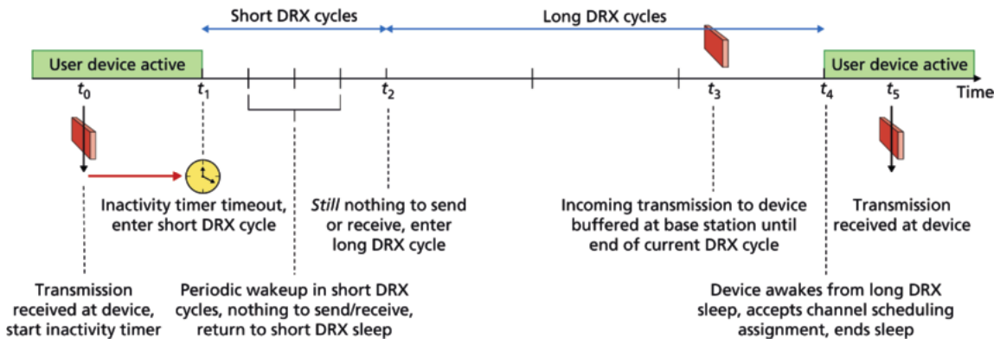

Hình 7.38 Chu kỳ ngủ nông của một thiết bị người dùng, với các chu kỳ DRX ngắn và dài

Trong ví dụ ở Hình 7.38, một thiết bị người dùng nhận một lần truyền từ trạm gốc tại t0 và khởi động một bộ định thời hoạt động. Tại t1, khi thiết bị không nhận được lần truyền nào kể từ t0 cũng không có gì cần truyền, bộ định thời hoạt động hết hạn, và thiết bị vào một chu kỳ ngủ DRX ngắn. Ở cuối mỗi chu kỳ DRX ngắn, thiết bị thức dậy và kiểm tra xem trạm gốc có đang quảng bá các lần truyền đang chờ tới nó không, hoặc nó có lần truyền nào của riêng mình cần gửi không. Trong ví dụ này, vì không có hoạt động nào cho thiết bị này qua vài chu kỳ ngủ ngắn, thiết bị sau đó vào một chu kỳ ngủ DRX dài tại t2. Thiết bị lại thức dậy ở cuối mỗi chu kỳ ngủ dài hơn để kiểm tra các lần truyền đến hoặc đi. Tại t3, một packet tới trạm gốc để truyền tới thiết bị này và được buffer, vì thiết bị đang ngủ. Ở cuối chu kỳ ngủ dài kết thúc tại t4, thiết bị thức dậy, thấy trạm gốc đang quảng bá một lần truyền cho thiết bị, vào trạng thái hoạt động, cuối cùng nhận một lần truyền từ trạm gốc tại t5, và khởi động lại bộ định thời không hoạt động của nó. Trong ví dụ này, mức tăng độ trễ mà packet đến phải chịu do thiết bị ngủ bằng t5–t3.

Có các trạng thái ngủ bổ sung của thiết bị người dùng còn dài hơn và sâu hơn các chu kỳ DRX minh họa trong Hình 7.38. Sau các khoảng thời gian không hoạt động còn dài hơn nữa, một thiết bị có thể vào trạng thái Idle hoặc trạng thái Inactive, nơi nó phải thực hiện thêm các bước để re-establish (thiết lập lại) sự hiện diện hoạt động của nó trong RAN trước khi có thể gửi hoặc nhận dữ liệu người dùng. Xem [Hailu 2019; Developedia 2021; Sauter 2021] để biết thêm chi tiết.

#### Không phối hợp, thức rồi gửi trong LoRaWAN (Uncoordinated, wake-and-send in LoRaWAN)

LoRa (xem Mục 7.5.3) [Sematech 2019a, 2019b; Sinha 2017] là một công nghệ mạng không dây low-power, low-bitrate, dành cho các thiết bị IoT tương đối đơn giản có nhiệm vụ điển hình là báo cáo dữ liệu đo cảm biến tới một gateway gần đó, thường trong vòng vài kilômét từ thiết bị. Loại thiết bị LoRa đơn giản nhất, gọi là thiết bị Class A, dùng bộ vô tuyến của nó theo cách tiếp cận wake-and-send không phối hợp để làm việc đó. Một thiết bị có dữ liệu cần gửi đơn giản thức dậy, truyền dữ liệu mà không có bất kỳ phối hợp nào với một nút gateway (hay thậm chí không biết có nút gateway hiện diện), tùy chọn chờ dữ liệu downlink từ nút gateway, rồi quay lại ngủ. Ở đây, tiết kiệm device-energy là một cân nhắc first-class (hàng đầu), với trạng thái ngủ thông thường của thiết bị chỉ thỉnh thoảng bị gián đoạn bởi việc wake-up device-initiated để truyền dữ liệu.

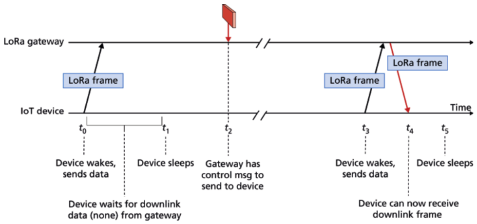

Hình 7.39 LoRa wake-and-send

Hình 7.39 cho thấy hành vi wake-and-send của LoRa. Tại t0, thiết bị IoT LoRa thức dậy và gửi một frame LoRa (ví dụ, chứa một số đo cảm biến) tới gateway LoRa. Thiết bị sau đó tìm thông điệp từ gateway, và không nhận được gì, quay lại ngủ tại t1. Tại t2, gateway có một thông điệp cần gửi tới thiết bị IoT nhưng phải chờ tới lần liên lạc tiếp theo của thiết bị (sau t3) trước khi gửi thông điệp. Thông điệp của gateway được nhận tạit4 và thiết bị quay lại ngủ tại t5.

Giống như LoRa Class A, các mạng Bluetooth Low Energy (BLE) và 4G LTE Narrowband IoT (NB-IoT) cũng hỗ trợ việc truyền wake-and-send device-initiated bởi thiết bị IoT. Tuy nhiên, trong các trường hợp này, thiết bị trước hết phải liên lạc với nút điều khiển hoặc trạm gốc khi thức dậy để được cấp phát các slot truyền trên kênh để gửi dữ liệu. Xem [Sauter 2021] để biết chi tiết.

## 7.4 Mạng lõi không dây (The Wireless Core Network)

Sau khi đã học về mạng truy cập không dây trong Mục 7.3, giờ chúng ta sẽ chuyển từ biên không dây vào lõi không dây. 5G Core cung cấp các dịch vụ control-plane và management-plane higher-level (ví dụ, để quản lý định danh user-device, bảo mật truy cập, di động, và hơn nữa) cũng như các dịch vụ data-plane để chuyển tiếp datagram giữa các thiết bị trong RAN 5G và Internet rộng lớn hơn.

Trong mục này chúng ta sẽ tập trung hoàn toàn vào mạng 5G thay vì đề cập cả mạng 5G và WiFi. Thật vậy, không có lý do gì để bàn về điều khiển và quản lý lõi cho mạng WiFi ở đây, vì các mạng IP truyền thống dùng cùng các cơ chế quản lý và control-plane cho cả Ethernet có dây và WiFi. Một doanh nghiệp xem WiFi, hay bất kỳ mạng biên không dây nào, chỉ như một công nghệ link-layer khác trong mạng của mình.

Người ta có thể thắc mắc tại sao mạng lõi lại là một thành phần kiến trúc trung tâm như vậy trong mạng di động, nhưng không phải trong các mạng IP truyền thống. Câu trả lời chắc chắn nằm ở nguồn gốc của 5G từ điện thoại di động. Mạng di động 1G và 2G về cơ bản là mạng telephone-only (chỉ điện thoại); mạng 3G vẫn chủ yếu là mạng điện thoại, với dữ liệu packet được ghép thêm như một dịch vụ bổ sung. Các mạng di động đời đầu này hỗ trợ các dịch vụ quản lý định danh người dùng (ví dụ, qua thẻ SIM); di động thiết bị trong mạng của một nhà cung cấp; chuyển vùng (roaming) giữa các mạng nhà cung cấp khác nhau; và kế toán, tính cước, thanh toán và quyết toán dịch vụ. Internet được triển khai lúc đó không hỗ trợ các dịch vụ như vậy. Mạng 4G và 5G giờ đã trở thành mạng “toàn IP” và đã áp dụng nhiều dịch vụ được tiên phong trong các mạng IP truyền thống. Tuy nhiên, việc hỗ trợ sẵn các dịch vụ như định danh, di động, roaming và tính cước dịch vụ—các dịch vụ chủ yếu được triển khai trong 5G Core—không được triển khai ở các ISP Internet truyền thống, và vẫn là một khác biệt đáng kể giữa mạng 4G/5G và các mạng IP truyền thống ngày nay.

Trong mục này, chúng ta sẽ đưa ra tổng quan về 5G Core và các dịch vụ của nó trong Mục 7.4.1. Chúng ta sẽ tập trung vào network function User Plane và việc sử dụng rộng rãi tunneling trong Mục 7.4.2 rồi đề cập định danh người dùng và vai trò của nó trong đăng ký và thiết lập phiên trong Mục 7.4.3. Di động là một chủ đề quan trọng đến mức chúng ta sẽ trình bày riêng trong Mục 7.5.

### 7.4.1 5G Core và các Network Function (The 5G Core and Network Functions)

Hình 7.40, phỏng theo [3GPP 23.501 2024], cho thấy một số thành phần then chốt của 5G Core. 5G Core áp dụng Service-Based Architecture (SBA), với các phần tử kiến trúc trong Core được định nghĩa theo các Network Function (NF) và các dịch vụ chúng cung cấp. Mặc dù các đặc tả 5G không chỉ định các chức năng này được triển khai thế nào, một mô tả service-based sẽ tự nhiên ánh xạ (như gợi ý bởi nhiều hình trong chương này) lên các microservice được triển khai trong một data center tập trung logic. Cách tiếp cận này khác đáng kể so với 4G và các kiến trúc mạng di động trước đó vốn định nghĩa các “thực thể” mạng truyền thống tương tác qua giao thức và thường được triển khai bằng thiết bị standalone single-function (“hộp”). Có lẽ phản ánh sự đoạn tuyệt với 4G này, các phần tử dịch vụ 5G có tên và chữ viết tắt hoàn toàn mới so với các phần tử tương ứng trong 4G, đôi khi gây đau đầu cho sinh viên học về mạng di động, những người có thể bị choáng ngợp bởi các tên và từ viết tắt trong thế giới mạng di động.

Nhiều đổi mới trong 5G Core—đặc biệt là sự tiến hóa từ “hộp” sang “dịch vụ,” cơ hội triển khai dịch vụ SDN-based, và sự tách biệt rõ ràng giữa mặt phẳng điều khiển và mặt phẳng người dùng—phản chiếu sự tiến hóa trước đó của mặt phẳng điều khiển Internet mà chúng ta đã học trong Chương 5.

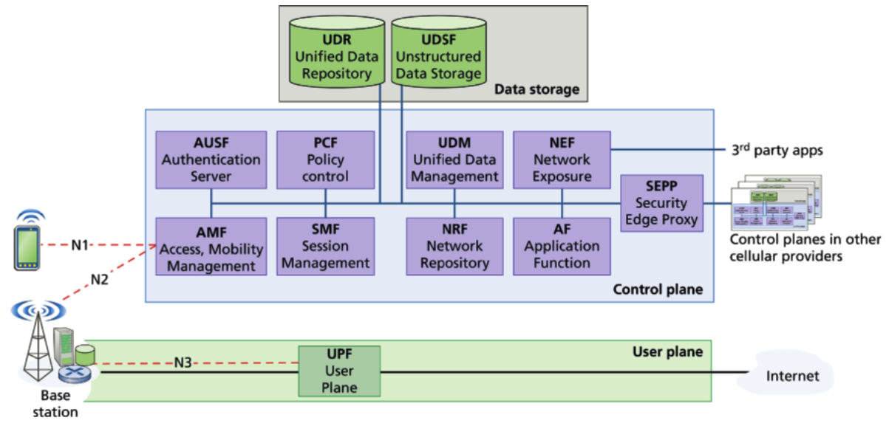

Hình 7.40 5G Core: các network function then chốt

#### Các Network Function 5G (5G Network Functions)

Nếu phải xác định “ba” Network Function quan trọng trung tâm nhất trong 5G Core, ba chức năng này sẽ là những ứng viên hàng đầu:

• User Plane Function (UPF) chịu trách nhiệm chuyển tiếp data-plane traffic giữa RAN và Internet rộng lớn hơn. Là network function 5G duy nhất trong mặt phẳng dữ liệu, rõ ràng nó đóng vai trò trung tâm. Như chúng ta sẽ thấy trong Mục 7.4.2, User Plane Function được cấu trúc như một relay có tunnel chuyển tiếp các IP datagram của người dùng giữa trạm gốc và Internet rộng lớn hơn. Mọi datagram được thiết bị truyền tới Internet rộng lớn hơn và ngược lại đều sẽ đi qua User Plane Function của thiết bị.

• Access, Mobility Management Function (AMF) đóng vai trò then chốt trong việc cấp quyền và thiết lập quyền truy cập của thiết bị tới các dịch vụ của mạng 5G và trong việc quản lý di động thiết bị (bàn trong Mục 7.5). AMF được cho là Network Function trung tâm trong mặt phẳng điều khiển 5G. Như chúng ta sẽ thấy, AMF làm việc với nhiều network function khác để triển khai các dịch vụ của nó. Ví dụ, AMF tương tác với Authentication Server Function (AUSF) để xác thực một thiết bị muốn gia nhập mạng 5G. AMF cũng là network function control-plane duy nhất trao đổi thông điệp điều khiển trực tiếp với thiết bị, qua giao diện N1 minh họa trong Hình 7.40, và là một trong chỉ hai network function trao đổi trực tiếp thông điệp điều khiển với trạm gốc (qua giao diện N2). Một giao diện được đánh số như N1 được gọi là điểm tham chiếu (reference point) theo thuật ngữ 3GPP và định nghĩa tương tác giữa một chức năng lõi 5G và một chức năng Core khác (hoặc thiết bị hoặc trạm gốc). [3GPP 23.501 2024] chuẩn hóa hơn 60 điểm tham chiếu như vậy.

• Session Management Function (SMF) quản lý mỗi phiên của thiết bị, bao gồm cấp phát và gán địa chỉ IP (ví dụ, các dịch vụ NAT và DHCP-like) và việc cài đặt trạng thái per-device cho các chức năng như kiểm soát truy cập policy-based, tính cước, và thiết lập chuyển tiếp data-plane của thiết bị qua UPF.

Dữ liệu và thông tin trạng thái về mạng, người dùng, và ứng dụng cũng chiếm vị trí nổi bật trong tập các network function. Thông tin hồ sơ, dịch vụ và xác thực của thiết bị được quản lý bởi Network Function Unified Data Management (UDM). UDM có thể lưu dữ liệu nội bộ trong bản triển khai chức năng của nó hoặc bên ngoài trong Unified Data Repository (UDR). Khi một Network Function chọn lưu dữ liệu bên ngoài trong Unified Data Repository và truy cập và cập nhật thông tin này từ xa, các giao dịch phi trạng thái (stateless) (về tinh thần tương tự tương tác client/server phi trạng thái trong HTTP) là khả thi, tự nhiên dẫn tới các bản triển khai network function có khả năng mở rộng và bền vững trong môi trường đám mây. Các network function khác và các ứng dụng third-party cũng có thể lưu và truy xuất dữ liệu tới và từ Unified Data Repository và Unstructured Data Storage Function (UDSF).

Trong Mục 7.3.3, chúng ta đã học rằng mã ứng dụng người dùng có thể chạy trên server trong 5G Core hoặc tại trạm gốc và giao tiếp với thiết bị để triển khai dịch vụ của ứng dụng, một khả năng gọi là local breakout. Network Exposure Function (NEF) và Application Function (AF) phơi bày dữ liệu mạng chọn lọc và các dịch vụ Network Function cho các ứng dụng local-breakout này, và ngược lại.

Đôi khi một Network Function chạy trong mạng 5G của một nhà vận hành sẽ cần tương tác với một thành phần tương ứng trong mạng 5G của nhà vận hành khác. Ví dụ, khi smartphone của bạn muốn gia nhập một mạng không do nhà cung cấp mạng mà bạn có gói thuê bao trả phí (gọi là mạng “nhà (home)” của bạn) vận hành, Authentication Server Function (AUSF) trong mạng bạn muốn gia nhập sẽ tương tác với AUSF ngang hàng trong mạng nhà của bạn để thực hiện xác thực và xác định tập dịch vụ khả dụng cho bạn. Các chức năng xác thực trong hai mạng này sẽ giao tiếp an toàn với nhau qua Network Function Security Edge Protection Proxy (SEPP) cục bộ của chúng.

Cuối cùng, cần có các khả năng để network function đăng ký dịch vụ của chúng và phát hiện số lượng có thể rất lớn các network function khác. Network Repository Function (NRF) cung cấp các dịch vụ đăng ký và phát hiện tự động này, loại bỏ nhu cầu cấu hình thủ công phức tạp. Policy Control Function (PCF) cung cấp các dịch vụ điều khiển, quản lý, và kho tập trung cho các quy tắc chính sách điều khiển dùng cho quản lý di động, chất lượng dịch vụ per-device, và roaming. Một khái niệm mới quan trọng được đưa vào 5G là phân lát mạng (network slicing), liên quan tới việc ảo hóa tài nguyên RAN và Core, và khả năng định nghĩa nhiều mạng logic chia sẻ tài nguyên vật lý bên dưới của mạng, theo cách rất giống như chúng ta đã học (trong Mục 6.5) rằng nhiều mạng riêng ảo (VPN) có thể hoạt động trên cùng tập tài nguyên mạng vật lý trong các mạng IP truyền thống. Network Slice Selection Function (NSSF) là network function đóng vai trò trung tâm trong phân lát mạng, một chủ đề vượt ngoài phạm vi cuốn sách này.

Như chúng ta sẽ thấy, một network function thường sẽ tương tác với các network function khác để triển khai dịch vụ của nó. Các network function có thể giao tiếp với nhau dùng vài kiểu tương tác khác nhau, và các chuẩn không bắt buộc hay khuyến nghị cách tiếp cận nào hơn cách khác. Dịch vụ NF có thể được truy cập dùng mô hình client-server request/response truyền thống mà chúng ta đã học trong Chương 2, mô hình này lại có thể được triển khai qua một giao thức như HTTP, hoặc bằng lời gọi thủ tục từ xa trong môi trường data center. Một dạng tương tác client-server khác là mô hình subscribe/notify (còn gọi là mô hình publish/subscribe trong tài liệu hệ phân tán) trong đó client đăng ký sự quan tâm tới một dịch vụ, và server thông báo cho client khi có kết quả từ dịch vụ (tức là, “đẩy (push)” kết quả tới các client đã đăng ký). Nhớ lại rằng chúng ta đã học trong Chương 5 rằng mô hình publish/subscribe là nguyên lý tổ chức trung tâm trong nền tảng SDN Orion của Google.

### 7.4.2 Chức năng mặt phẳng người dùng (User Plane Function)

Chúng ta đã học ở trên rằng User Plane Function chịu trách nhiệm điều khiển việc chuyển tiếp data-plane traffic giữa RAN và Internet rộng lớn hơn. Vì mặt phẳng dữ liệu 5G là một mạng all-IP, theo nhiều cách nó hoạt động đúng như những gì chúng ta đã thấy trong các Chương 4 và 5. Tuy nhiên, mặt phẳng điều khiển 5G cấu hình mặt phẳng dữ liệu để hỗ trợ hai dịch vụ then chốt không phải lúc nào cũng có trong các mạng IP truyền thống: hỗ trợ chất lượng dịch vụ (QoS) và tunneling. Hỗ trợ QoS của 5G là một chủ đề nâng cao vượt ngoài phạm vi cuốn sách này; xem [Sauter 2021] để có thảo luận. Trong tiểu mục này, chúng ta sẽ xét tunneling cùng với các chồng giao thức trong mặt phẳng dữ liệu 5G triển khai tunneling.

Nhớ lại từ các Chương 4 và 6 rằng tunneling cung cấp sự trừu tượng của một liên kết ảo giữa hai thiết bị IP. Trong môi trường 5G, một tunnel được thiết lập cho mỗi thiết bị giữa trạm gốc của nó và instance User Plane Function của nó, như minh họa trong Hình 7.41. Với tunneling, toàn bộ biển router và liên kết trong mạng backhaul giữa trạm gốc và User Plane Function được trừu tượng hóa thành một liên kết ảo duy nhất cho thiết bị đó.

Sau khi đã học chi tiết các chồng giao thức RAN trong Mục 7.3, giờ hãy tập trung vào các chồng giao thức data-plane tại trạm gốc và User Plane Function trong 5G Core. Như bàn trong Mục 7.4.3, Session Management Function sẽ thiết lập một tunnel giữa trạm gốc và User Plane Function của thiết bị khi thiết bị gia nhập mạng. Khi một User Plane Function nhận một datagram từ Internet bên ngoài hướng tới một thiết bị trong mặt phẳng dữ liệu của nó, User Plane Function đóng gói datagram đó trong một UDP segment dùng GPRS Tunneling Protocol (GTP) [3GPP TS 29.281 2022]. UDP datagram sau đó trở thành payload trong một IP datagram mới, được chuyển tiếp từ User Plane Function qua mạng backhaul tới trạm gốc, giống như bất kỳ IP datagram nào khác có địa chỉ là trạm gốc. Ở phía nhận, trạm gốc gỡ đóng gói UDP datagram được tunnel từ User Plane Function, trích IP datagram được đóng gói hướng tới thiết bị, và chuyển tiếp IP datagram đó qua RAN tới thiết bị. Như với việc dùng tunneling trong các mạng IPv4/v6 hỗn hợp (Mục 4.3), bạn nên khảo sát cẩn thận các địa chỉ trong datagram-within-a-datagram (datagram lồng trong datagram) ở Hình 7.41.

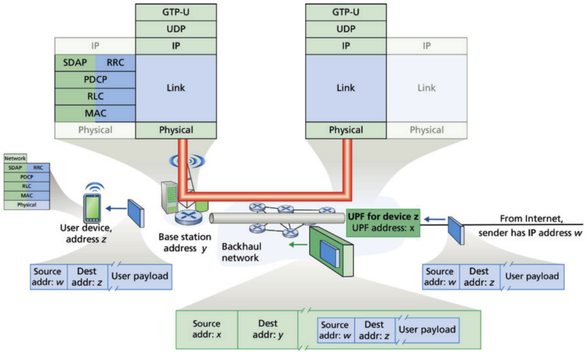

Hình 7.41 Chồng giao thức 5G, với tunneling

Chi tiết giao thức của giao thức tunneling khá đơn giản và có thể được tìm thấy trong [3GPP TS 29.281 2022]. Vì vậy thay vì đi sâu vào các chi tiết đó ở đây, hãy xét câu hỏi cơ bản hơn là tại sao ngay từ đầu tunneling lại được dùng. Trong Chương 4, chúng ta đã học rằng tunneling cho phép các mạng IPv4 và IPv6 tương tác với nhau. Nhưng lợi ích của việc bọc một datagram trong một datagram khi hoạt động trong một mạng 5G thuần túy là gì? Câu trả lời nằm ở tính di động của thiết bị, tức là, một thiết bị thay đổi trạm gốc mà nó được gắn vào (Mục 7.4) khi nó di chuyển qua mạng của nhà cung cấp di động.

Hãy xét lại ví dụ trong Hình 7.41. Không có tunneling, mọi router trong mạng backhaul sẽ cần duy trì thông tin up-to-date về vị trí của một thiết bị (tức là, trạm gốc mà thiết bị hiện đang gắn vào) để chuyển tiếp datagram tới thiết bị đó. Thật vậy, các router sẽ cần duy trì thông tin đó cho mọi thiết bị trong mạng của nhà cung cấp! Với tunneling, chỉ đầu mút tunnel (tức là, User Plane Function) cần biết định danh của trạm gốc mà thiết bị đang gắn vào; các router backhaul chỉ cần biết cách chuyển tiếp và định tuyến datagram tới và từ các trạm gốc. Do đó UPF đóng vai trò điểm neo (anchor point) để chuyển tiếp datagram từ thiết bị tới Internet rộng lớn hơn, và ngược lại, trong suốt thời gian thiết bị gắn vào mạng 5G, bất kể trạm gốc cụ thể mà thiết bị tình cờ gắn vào tại một thời điểm cho trước.

### 7.4.3 Định danh người dùng, đăng ký, và thiết lập phiên (User identity, registration, and session establishment)

Trong Mục 7.3.4, chúng ta đã học cách một thiết bị phát hiện sự tồn tại của mạng 5G và cách nó gắn ban đầu vào một trạm gốc. Nhớ lại rằng sau lần gắn ban đầu này, mặc dù thiết bị và trạm gốc có thể trao đổi thông điệp điều khiển, thiết bị vẫn chưa thực sự gia nhập mạng 5G—nó chưa trao đổi thông điệp điều khiển với 5G Core và do đó chưa thể, chẳng hạn, gửi hoặc nhận datagram data-plane qua một User Plane Function. Hãy bắt đầu thảo luận về cách một thiết bị gia nhập đầy đủ mạng 5G bằng cách xét trước hết cách thiết bị định danh mình với mạng.

#### Định danh: thẻ SIM (Identity: SIM Cards)

Như hầu hết chủ sở hữu điện thoại di động đều biết, một thiết bị 4G/5G cần một thẻ SIM (Subscriber Identity Module) vật lý, hoặc gần đây hơn là một eSIM software-only, để gắn vào mạng 4G/5G. SIM của bạn định danh duy nhất bạn và mạng “nhà” của bạn với mọi nhà cung cấp mạng di động trên toàn cầu. Trong thế giới mạng di động, SIM là định danh mạng toàn cầu của bạn!

Thông tin chứa trong SIM có thể khác nhau giữa các nhà cung cấp, nhưng nhìn chung sẽ bao gồm các thông tin sau:

• IMSI: International Mobile Subscriber Identity. Một IMSI có ba phần: một mã quốc gia di động (MCC) 3-digit (cơ số 10), một mã mạng di động (MNC) 2- hoặc 3-digit và một số định danh thuê bao di động (MSIN). MCC và MNC cùng nhau xác định mạng nhà của SIM, tức là, nhà cung cấp di động đã cấp thẻ SIM cho bạn và là nơi bạn có gói thuê bao. MSIN định danh duy nhất SIM trong mạng nhà. SIM của bạn cũng có số điện thoại di động của bạn và một tập dịch vụ di động liên kết mà bạn có thể truy cập khi gắn vào mạng nhà. Khi bạn ở một khu vực mạng nhà không phục vụ, bạn có thể gắn vào mạng của một nhà cung cấp khác, khi đó bạn được gọi là đang roaming trên một mạng khách (visited network). Bạn có thể có một tập dịch vụ khác khả dụng trên các mạng khách, tùy vào gói thuê bao của bạn với mạng nhà và các cơ chế tính cước/quyết toán giữa mạng nhà của bạn và mạng khách. Có thể có những mạng mà, rất bực bội, bạn đơn giản là không thể gia nhập.

• Khóa mật mã và mã PIN cũng được lưu trên SIM. Khóa mật mã được dùng để xác thực thiết bị khi nó gia nhập mạng 5G, như bàn dưới đây và trong Chương 8.

• Thông tin Local Area Identity liệt kê các mạng hiện tại và đã ghé thăm gần đây. Định danh cục bộ được dùng để xác định các mạng mà thiết bị có thể thử trước khi tìm dịch vụ mạng di động.

• Danh bạ và tin nhắn văn bản cũng có thể được lưu trên thẻ SIM.

#### Gia nhập mạng 5G: đăng ký và thiết lập phiên (Joining a 5G network: registration and session establishment)

Khi một thiết bị muốn gia nhập mạng 5G, có hai tập hành động quan trọng được thực hiện. Thứ nhất là đăng ký (registration), khi thiết bị định danh rồi xác thực mình với mạng, và ngược lại. Thứ hai là thiết lập PDU Session, cấp phát một địa chỉ IP cho thiết bị và tạo một đường data-plane giữa thiết bị và một User Plane Function. “PDU” là từ viết tắt của “Protocol Data Unit”—thuật ngữ 3GPP cho “packet.” Sau các bước này, thiết bị được gắn đầy đủ vào mạng, và sẵn sàng hoạt động (giao tiếp trong khi di động)!

Cả đăng ký và thiết lập phiên đều được thực hiện bởi các network function trong 5G Core, với Access and Mobility Management Function (AMF) đóng vai trò trung tâm trong quá trình này. AMF là Network Function duy nhất giao tiếp trực tiếp với trạm gốc và thiết bị. Nó điều phối xác thực (với AUSF) và thiết lập phiên (với SMF) trong 5G Core.

Giờ hãy xét ngắn gọn các bước liên quan tới đăng ký và thiết lập phiên, như minh họa trong Hình 7.42.

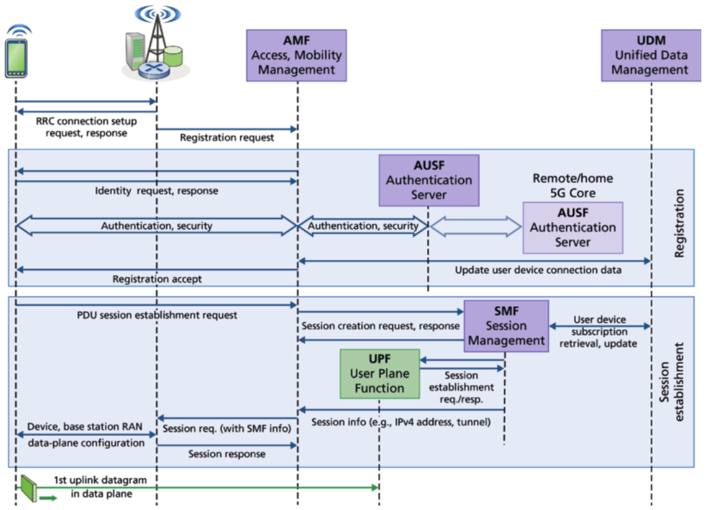

Hình 7.42 Đăng ký thiết bị và thiết lập phiên: tương tác giữa thiết bị, trạm gốc và các Core Network Function

• Đăng ký (Registration). Trước đó trong Mục 7.3.4, chúng ta đã học rằng thiết bị và trạm gốc trao đổi các thông điệp request/response thiết lập kết nối để thiết lập một kênh báo hiệu RAN giữa chúng. Sau trao đổi này, trạm gốc chọn một instance AMF cho thiết bị và gửi một yêu cầu đăng ký tới AMF đó cho thiết bị đó. AMF sau đó liên lạc với thiết bị, yêu cầu và nhận thông tin định danh thiết bị. Như minh họa trong Hình 7.42, thông tin đó sau đó được chuyển tới Authentication Function, chức năng này thực hiện xác thực hai chiều với thiết bị; chúng ta sẽ hoãn thảo luận về xác thực 5G tới Chương 8, nơi chúng ta sẽ đề cập chi tiết chủ đề này. Lưu ý rằng nếu mạng mà thiết bị đang gia nhập không phải mạng nhà của nó, Authentication Function cục bộ trong mạng khách sẽ đóng vai trò proxy tới Authentication Function trong mạng nhà của thiết bị, nơi sẽ thực sự thực hiện xác thực. Sau khi xác thực thành công, AMF đăng ký định danh và thông tin dịch vụ đã đăng ký của thiết bị trong UDM cục bộ, và trả về một thông điệp chấp nhận đăng ký cho thiết bị.

• Thiết lập phiên (Session establishment). Thiết bị khởi tạo quá trình thiết lập mặt phẳng dữ liệu của nó bằng cách gửi một yêu cầu thiết lập PDU session tới AMF, AMF lại chọn một SMF sẽ chịu trách nhiệm thiết lập và quản lý mặt phẳng dữ liệu của thiết bị, trong khi thiết bị gắn vào mạng. Sau khi xác minh qua User Data Management Function rằng các tham số phiên mà thiết bị yêu cầu là được phép, SMF chọn một instance User Plane Function và thiết lập tunnel của thiết bị giữa trạm gốc của nó và User Plane Function đó. SMF sau đó trả tunnel, thông tin địa chỉ IPv4, và thông tin phiên bổ sung về cho thiết bị qua AMF và trạm gốc. Bước cuối cùng là trạm gốc và thiết bị tương tác để cấu hình mặt phẳng dữ liệu RAN của thiết bị. Một khi xong việc này, thiết bị sẵn sàng gửi datagram vào Internet!

Ở trên, chúng ta chỉ minh họa các tương tác quan trọng nhất giữa thiết bị, trạm gốc, và các network function khác nhau trong đăng ký và thiết lập phiên. Chúng ta lưu ý rằng Policy Control Function và Charging Function cũng tham gia vào thiết lập phiên và cần thêm các bước bổ sung để cấu hình IPv6, nếu muốn. Để có thảo luận đầy đủ về quá trình này, xem [3GPP TS 23.502 2024], và thảo luận (34 trang khá dày đặc!) xung quanh các Hình 4.2.2.2.2-1 và 4.3.2.2.1.

## 7.5 Tính di động (Mobility)

Sau khi đã đề cập đặc tính của liên kết không dây và tầng vật lý của mạng không dây trong Mục 7.2, mạng truy cập không dây trong Mục 7.3 và mạng lõi không dây trong Mục 7.4, giờ hãy chuyển sự chú ý sang một trong những khía cạnh độc đáo và thú vị nhất của mạng không dây—nhu cầu hỗ trợ di động thiết bị. Thật vậy, chủ đề này quan trọng đến mức chúng ta dành nguyên một mục cho nó! Chúng ta sẽ bắt đầu trong Mục 7.5.1 bằng cách bàn về những thách thức do nhu cầu hỗ trợ thiết bị di động đặt ra cùng các nguyên lý và cách tiếp cận tổng quát để làm điều đó. Mặc dù WiFi tự nhiên hỗ trợ di động trong vùng lân cận của một điểm truy cập, chúng ta sẽ thấy WiFi (Mục 7.5.2) chỉ hỗ trợ hạn chế cho di động giữa các WLAN WiFi lân cận. Ngược lại, mạng di động đã có tính di động “gắn sẵn” như một dịch vụ first-class, “must-have” (bắt buộc phải có) ngay từ những ngày đầu do nguồn gốc của chúng từ thế giới điện thoại di động. Chúng ta sẽ đề cập sự hỗ trợ rộng rãi cho di động trong mạng 5G ở Mục 7.5.3. Trong Mục 7.5.4, chúng ta sẽ khép lại thảo luận về di động với các nhận xét về các nỗ lực trước đây của IETF nhằm hỗ trợ di động network-layer trong và giữa các mạng IP non-cellular, và có lẽ lý do vì sao dịch vụ Internet di động như vậy chưa được triển khai cho tới nay.

### 7.5.1 Các nguyên lý di động (Mobility Principles)

#### “Di động” là gì? (What is “mobility”?)

Hãy bắt đầu thảo luận về di động thiết bị bằng cách xem xét cẩn thận ngay từ đầu “di động” nghĩa là gì. Giả sử một thiết bị đang “bật” và giao tiếp trong khi di chuyển, và hãy xét xem thiết bị như vậy có thể di chuyển “xa” đến đâu trong khi giao tiếp không gián đoạn (ví dụ, duy trì các kết nối TCP đang diễn ra và không cần gia nhập tường minh bất kỳ mạng mới nào). Dựa trên sự phân biệt giữa định tuyến inter-domain và intra-domain, chúng ta có thể xác định ba kịch bản di động riêng biệt, tùy vào việc thiết bị có thể di chuyển mà không làm gián đoạn giao tiếp đang diễn ra trong và giữa các mạng truy cập (ví dụ, WLAN 802.11 hoặc RAN 5G) với mạng của một nhà cung cấp duy nhất, và trong và giữa nhiều mạng nhà cung cấp hay không.

• Di động chỉ trong một mạng truy cập duy nhất (Mobility only within a single access network). Ở một đầu của phổ, kịch bản (a) trong Hình 7.43, một thiết bị di động chỉ duy trì kết nối giao tiếp khi đang gắn vào một mạng truy cập cho trước. Trong kịch bản này, thiết bị phải ngắt kết nối khỏi trạm gốc trong một mạng truy cập, rồi kết nối tới một trạm gốc mới trong mạng truy cập khác, khi nó di chuyển giữa các mạng truy cập. Ví dụ, một sinh viên có thể ngắt kết nối khỏi mạng không dây của lớp học và tắt laptop hoặc smartphone, đi tới nhà ăn và kết nối vào mạng truy cập không dây ở đó trong khi ăn, rồi ngắt kết nối và tắt máy khỏi mạng nhà ăn, đi bộ tới thư viện, và kết nối vào mạng không dây của thư viện trong khi học. Trong trường hợp này, thiết bị lần lượt liên kết với (gia nhập), và sau đó hủy liên kết khỏi (rời), mỗi mạng truy cập không dây gặp phải. Trường hợp di động thiết bị hạn chế này có thể được xử lý hoàn toàn bằng các cơ chế mạng chúng ta đã học trong các Mục 7.3 và 7.4.

• Di động giữa các mạng truy cập trong mạng của một nhà cung cấp (Mobility among access networks within a single provider network). Sự quan tâm của chúng ta tới di động thiết bị thực sự bắt đầu với trường hợp (b), trong đó một thiết bị di chuyển giữa nhiều mạng truy cập trong mạng của một nhà cung cấp trong khi tiếp tục gửi và nhận IP datagram, và trong khi duy trì các kết nối higher-level (ví dụ, TCP). Ở đây, mạng sẽ cần cung cấp handover—việc chuyển trách nhiệm chuyển tiếp datagram tới/từ một trạm gốc sang trạm gốc khác khi thiết bị di chuyển giữa các WLAN hoặc RAN. Khi handover xảy ra trong các mạng truy cập thuộc một nhà cung cấp mạng duy nhất, mạng của nhà cung cấp đó tự điều phối handover.

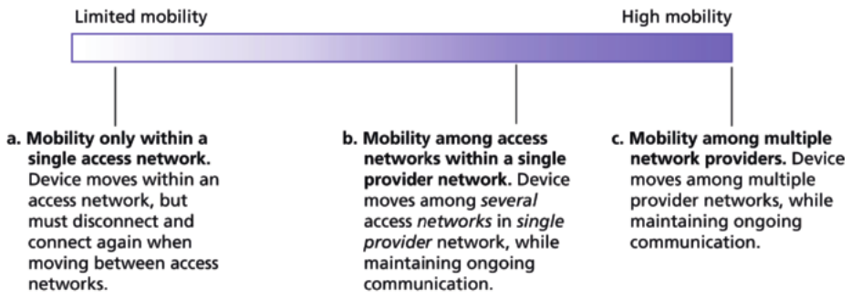

Hình 7.43 Các mức độ di động khác nhau, khi một thiết bị duy trì kết nối

• Di động giữa nhiều nhà cung cấp mạng (Mobility among multiple network providers). Khi một thiết bị di động roaming giữa nhiều mạng nhà cung cấp, như trong kịch bản (c) ở Hình 7.43, các nhà cung cấp phải phối hợp handover để đảm bảo giao tiếp đang diễn ra không bị gián đoạn. Handoff inter-provider này làm quá trình phức tạp hơn đáng kể.

Vì kịch bản (c) phức tạp hơn và ít xảy ra hơn khi các nhà cung cấp mạng di động mở rộng vùng phủ địa lý, ở đây chúng ta sẽ tập trung vào trường hợp (b). Xem Chương 7 trong các ấn bản trước của cuốn sách này, có trên trang Web của nhà xuất bản và của các tác giả, để có thảo luận về kịch bản (c).

#### Di động: thách thức và cách tiếp cận (Mobility: challenges and approaches)

Mọi cách tiếp cận hỗ trợ di động thiết bị giữa các mạng truy cập trong mạng của một nhà cung cấp duy nhất (trường hợp (b) trong Hình 7.43) đều phải xét ba câu hỏi cơ bản:

• Di động thiết bị chỉ được hỗ trợ ở tầng liên kết, hay tầng mạng cũng tham gia? Nếu di động chỉ được hỗ trợ ở tầng liên kết, một thiết bị có thể di chuyển giữa các mạng truy cập không dây (link-layer), nhưng điều này có thể giới hạn phạm vi di động của thiết bị trong khi giao tiếp không gián đoạn chỉ trong subnet hiện tại của nó (theo nghĩa định địa chỉ ở Mục 4.3). Đó là vì, chỉ với hỗ trợ di động link-layer, các datagram đến từ Internet rộng lớn hơn hướng tới thiết bị sẽ luôn được chuyển tiếp tới subnet này để chuyển tới thiết bị. Như chúng ta sẽ thấy trong Mục 7.5.3, đây là cách tiếp cận được áp dụng trong các mạng WiFi doanh nghiệp.

• Mặt khác, nếu di động thiết bị được hỗ trợ trên toàn bộ mạng của nhà cung cấp, sẽ cần hỗ trợ network-layer (và/hoặc higher-layer). Ví dụ, mạng lõi sẽ cần biết mạng truy cập cụ thể mà thiết bị di động hiện đang gắn vào, để các datagram đến từ Internet rộng lớn hơn có thể được chuyển tiếp tới subnet đó để chuyển tới thiết bị. Như chúng ta sẽ thấy trong Mục 7.5.3, đây là cách tiếp cận được áp dụng trong mạng di động 5G (và 3G và 4G).

• Tại sao handover được khởi tạo, và ai khởi tạo handover? Khi một thiết bị thay đổi điểm gắn vào mạng từ một trạm gốc sang trạm gốc khác, ngay từ đầu tại sao thay đổi đó được thực hiện? Như chúng ta đã thấy trong Mục 7.2, khi thiết bị di chuyển, chất lượng tín hiệu vô tuyến giữa nó và trạm gốc (và do đó throughput và độ trễ packet) có thể thay đổi. Do đó một thiết bị có thể đổi mạng truy cập để cải thiện performance. Tuy nhiên, bản thân mạng có thể chọn chuyển thiết bị từ mạng truy cập này sang mạng truy cập khác để load-balance (cân bằng tải) thiết bị giữa các mạng truy cập của nó. Các chuẩn WiFi và 5G không chỉ định thuật toán cụ thể mà trạm gốc dùng để xác định có thực hiện handover hay không, hay chọn trạm gốc đích nào. Quyết định đó được để cho nhà vận hành mạng và vẫn là một lĩnh vực nghiên cứu sôi động [Haghrah 2023].

• Một thiết bị không dây cũng thường sẽ đo chất lượng tín hiệu của mọi trạm gốc trong phạm vi và báo cáo thông tin đó lại cho trạm gốc mà nó hiện đang gắn vào. Chúng ta đã học trong Mục 7.3.5 rằng trong mạng 5G, trạm gốc định kỳ quảng bá các ký hiệu tín hiệu tham chiếu và thiết bị định kỳ báo cáo một chỉ báo chất lượng kênh (CQI) 4-bit tới trạm gốc dựa trên việc thu đo được của nó đối với các tín hiệu tham chiếu này. Các thiết bị WiFi đo cường độ tín hiệu nhận được từ các AP khác nhau và trả về một Received Signal Strength Indicator cho mỗi AP này. Các giá trị đo và báo cáo này sau đó có thể được dùng để quyết định liệu thiết bị có nên được handover sang một trạm gốc khác hay không. Một thiết bị hoặc mạng cũng có thể dự đoán di động thiết bị và cường độ tín hiệu vô tuyến trong tương lai (ví dụ, dùng machine learning) và chủ động thực hiện handover, thay vì chỉ dựa vào các phép đo hiện tại. Quyết định thực hiện handover có thể được khởi tạo và điều khiển chủ yếu bởi thiết bị, hoặc bởi mặt phẳng điều khiển trong các trạm gốc của mạng.

• Handoff được thực hiện thế nào? Khi một thiết bị đang liên kết với một trạm gốc được handoff sang trạm gốc khác, hai nhiệm vụ quan trọng phải được hoàn thành. Thứ nhất, trạng thái thiết bị (ví dụ, trạng thái đã xác thực của thiết bị, các dịch vụ được phép của thiết bị) trong mặt phẳng điều khiển WLAN hoặc RAN ở một trạm gốc phải được chuyển sang trạm gốc lân cận. Không có việc chuyển này, thiết bị sẽ phải hủy liên kết với trạm gốc cũ, và liên kết với trạm gốc mới. Thứ hai, để đảm bảo luồng datagram bi-directional (hai chiều) không gián đoạn tới và từ thiết bị di động, các bảng chuyển tiếp trong router và switch phải được sửa đổi để chuyển hướng datagram tới và từ thiết bị khi có một điểm gắn mới vào mạng.

Trong hai tiểu mục tiếp theo, chúng ta sẽ học cách các cân nhắc di động này được giải quyết trong các mạng WiFi của tổ chức (Mục 7.5.3) và mạng di động 5G (Mục 7.5.4).

### 7.5.2 Di động trong mạng WiFi (Mobility in a WiFi network)

Chuẩn WiFi IEEE 802.11 áp dụng một cách tiếp cận dứt khoát link-layer-only đối với di động, có lẽ không đáng ngạc nhiên vì 802.11 là một chuẩn link-layer. Do đó, di động WiFi chỉ được hỗ trợ giữa các điểm truy cập nằm trong cùng một subnet (theo nghĩa định địa chỉ ở Mục 4.3).

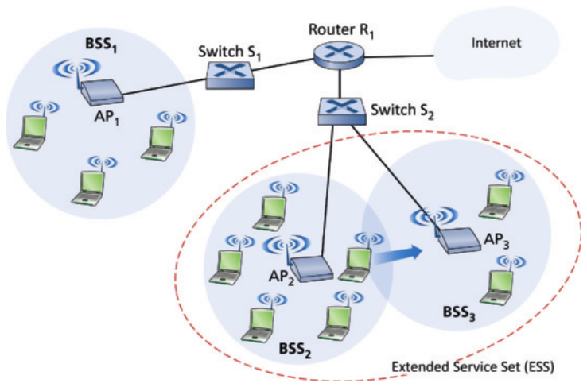

Hình 7.44 WiFi: handover trong ESS

Chúng ta đã học trong Mục 7.3.2 (Hình 7.22) rằng mạng WiFi truyền thống, gọi là Basic Service Set (BSS), chứa một AP duy nhất và một hoặc nhiều thiết bị không dây được gắn vào. Hình 7.44 cho thấy khái niệm Extended Service Set (ESS), gồm nhiều BSS (ví dụ, BSS2 và BSS3) và tập điểm truy cập của chúng (ví dụ, AP2 và AP3 trong Hình 7.44). Giả sử mỗi AP trong ESS dùng cùng SSID, một ESS về logic trông chỉ như một WLAN duy nhất từ cả góc nhìn của thiết bị lẫn góc nhìn network-layer, vì các thiết bị và AP trong ESS nằm trong cùng một subnet layer-3. Thật vậy, một thiết bị di chuyển giữa BSS2 và BSS3 trong Hình 7.44 thậm chí không di động từ góc nhìn network-layer, vì nó không bao giờ rời subnet của mình! Chuẩn IEEE 802.11 đã đưa vào Fast Basic Service Set Transition (FT) để tăng tốc xác thực 802.1X khi một thiết bị di chuyển giữa các AP trong một ESS, và để cho phép các AP gợi ý các AP thay thế mà thiết bị có thể muốn gắn vào trong ESS.

Ngoài các khả năng chuẩn 802.11 này, các nhà cung cấp thiết bị WiFi lớn cung cấp các giải pháp độc quyền hỗ trợ di động, ví dụ, để quản lý handover thiết bị giữa hai AP trong một ESS [Cisco 802.11r 2016].

### 7.5.3 Di động trong mạng 5G (Mobility in a 5G network)

Trong khi di động 802.11 xảy ra hoàn toàn ở tầng liên kết, di động trong mạng di động 5G là một công việc network-wide (toàn mạng), liên quan tới cả RAN và mạng 5G Core. Sự hỗ trợ rộng rãi của 5G cho di động thiết bị chắc chắn phản ánh nguồn gốc của nó từ thế giới điện thoại di động. Các thế hệ mạng di động sớm nhất đã cung cấp handover cuộc gọi với dịch vụ thoại không gián đoạn khi người dùng di chuyển từ cell này sang cell khác trong mạng của một nhà cung cấp, cũng như từ mạng của nhà cung cấp này sang mạng của nhà cung cấp khác. Với tính di động “gắn sẵn” trong các kiến trúc mạng di động sớm nhất, việc bổ sung dịch vụ dữ liệu di động diễn ra khá tự nhiên trong các thế hệ mạng di động sau.

Trong tiểu mục này, chúng ta sẽ tập trung vào quá trình handover trong mạng 5G. Như chúng ta sẽ thấy, handover được điều phối cẩn thận trong các mặt phẳng điều khiển RAN và 5G Core, và cũng liên quan tới việc cấu hình lại các mặt phẳng dữ liệu RAN và 5G Core của thiết bị, khiến nó thực sự là một hoạt động network-wide.

#### Handover trong mạng 5G (5G Handover)

Hãy xét một thiết bị 5G đang hoạt động hiện được liên kết với một trạm gốc trong một RAN (trạm gốc “nguồn” của handover) sẽ được handover sang một trạm gốc thứ hai (trạm gốc “đích”) trong một RAN khác. Giả sử thiết bị “đang hoạt động” theo nghĩa nó có một kết nối TCP đang diễn ra với một host ở xa trong Internet rộng lớn hơn và một kết nối data-plane đang hoạt động qua một tunnel tới/từ User Plane Function của nó trong Core (xem Mục 7.4.2). Sau handover, thiết bị sẽ được liên kết với trạm gốc đích, trạm gốc nguồn sẽ giải phóng xong trạng thái thiết bị mà nó đang duy trì, tunnel data-plane tới và từ thiết bị giờ sẽ kết thúc ở RAN thứ hai (giả sử cho đơn giản rằng đầu mút tunnel kia vẫn ở cùng User Plane Function), và mọi trạng thái thiết bị trong 5G Core sẽ phản ánh việc thiết bị giờ nằm ở trạm gốc newly-joined (mới gia nhập). Thật nhiều thay đổi cần được thực hiện!

Hình 7.45, phỏng theo các Hình 4.9.1.2.2-1 trong [3GPP TS 23.502 2024] và 9.2.3.2.1-1 trong [3GPP TS 38.300 2024], minh họa quá trình handover. Handover 5G bắt đầu trong các RAN, rồi hoàn tất trong Core. Hầu hết các tương tác handover minh họa trong Hình 7.45 nằm trong mặt phẳng điều khiển, nhưng tunnel data-plane giữa User Plane Function và trạm gốc mà người dùng được liên kết cũng sẽ thay đổi trong quá trình này. Chúng ta có thể xác định ba giai đoạn riêng biệt trong handover 5G:

• Ra quyết định handover (Making the handover decision). Handover bắt đầu trong RAN, với thiết bị đo chất lượng kênh vô tuyến của các trạm gốc mà nó có thể nghe thấy, rồi báo cáo các phép đo này tới trạm gốc nguồn. Nếu trạm gốc nguồn thấy handover là đáng mong muốn, nó gửi một thông điệp yêu cầu handover tới trạm gốc đích, trạm này sau đó quyết định có chấp nhận handover hay không và trả quyết định của mình (trong trường hợp ví dụ ở Hình 7.45, là một xác nhận tích cực) về trạm gốc nguồn.

• Chuyển thiết bị giữa các trạm gốc (Transferring the device between base stations). Trạm gốc nguồn, trạm gốc đích và thiết bị sau đó phối hợp để chuyển kết nối RAN của thiết bị từ trạm gốc nguồn sang trạm gốc đích. Quá trình này bắt đầu với việc trạm gốc nguồn gửi hai thông điệp: một thông điệp cấu hình lại tới thiết bị và một thông điệp trạng thái chuyển giao tới trạm gốc đích, chuyển trạng thái thiết bị sang trạm gốc đích. Thiết bị và trạm gốc đích sau đó có thể thiết lập một kết nối RAN mới. Quá trình hoàn tất khi thiết bị gửi một thông điệp hoàn tất cấu hình lại tới trạm gốc đích và các trạm gốc đích và nguồn thực hiện một lần bắt tay cuối cùng. Lưu ý rằng đầu mút của tunnel giữa trạm gốc và User Plane Function không thay đổi trong quá trình này. Tuy nhiên, thay vì chuyển datagram tới thiết bị qua RAN nguồn, trạm gốc nguồn thay vào đó bắt đầu chuyển tiếp các datagram có địa chỉ là thiết bị tới trạm gốc đích. Trạm gốc đích sẽ buffer các datagram này để chuyển tới thiết bị sau, đảm bảo không datagram đến nào hướng tới thiết bị bị mất trong quá trình handover.

Hình 7.45 Handover thiết bị: các hành động trong RAN và Core

• Cập nhật trạng thái thiết bị và tunnel UPF trong Core (Updating device state and UPF tunnel in the Core). Hoạt động handover giờ chuyển sang Core. Trạm gốc đích, giờ hoàn toàn phụ trách kết nối RAN của thiết bị, báo hiệu cho Session Management Function (SMF) qua AMF rằng nó là trạm gốc mới của thiết bị đang được handover. SMF sau đó báo hiệu cho User Plane Function thay đổi tunnel của thiết bị để kết thúc tại trạm gốc đích.

  User Plane Function sau đó gửi một dấu data-end tới trạm gốc nguồn, trạm này khi đó biết rằng đầu mút tunnel của thiết bị đã được chuyển và thông báo cho trạm gốc đích. Tại thời điểm này, trạm gốc đích có thể chuyển tới thiết bị mọi datagram đã buffer được trạm gốc nguồn chuyển tiếp tới nó trong handover. Ngoài ra, datagram giờ sẽ chảy trực tiếp từ User Plane Function của thiết bị tới trạm gốc đích. Sau một số bước bắt tay dọn dẹp, quá trình handover giờ hoàn tất!

Mặc dù mô tả ở trên có vẻ khá phức tạp, nó thực ra chỉ xét kịch bản handover đơn giản nhất! Một kịch bản phổ biến không được đề cập ở trên là trường hợp thiết bị đã tắt bộ vô tuyến để tiết kiệm năng lượng. Nhớ lại từ Mục 7.3 rằng sau các khoảng thời gian không hoạt động, có những giai đoạn ngủ còn dài hơn các chu kỳ ngủ DRX chúng ta đã gặp trong Hình 7.38. Trong các giai đoạn ngủ dài này, thiết bị trước hết sẽ vào trạng thái Idle rồi trạng thái Inactive. Ở trạng thái Idle, thiết bị phải thực hiện thêm các bước để re-establish (thiết lập lại) sự hiện diện hoạt động của nó trong RAN trước khi có thể gửi hoặc nhận dữ liệu người dùng. Ở trạng thái Inactive, các bước handover bổ sung phải được thực hiện ở cả RAN và Core. Cụ thể, nếu thiết bị di chuyển giữa các trạm gốc khi đang Idle hoặc Inactive, 5G Core thậm chí có thể không biết RAN mà thiết bị đang ở. Các thủ tục cập nhật vùng theo dõi (tracking area update) có thể được dùng để Core biết khu vực chung nơi thiết bị nằm. Các thủ tục paging sau đó có thể được Core dùng để xác định chính xác RAN của thiết bị. Các chủ đề này vượt ngoài phạm vi thảo luận ở đây; xem [Alsaeedy 2019] để có thảo luận.

Một handover phức tạp hơn cũng xảy ra khi thiết bị được handover từ RAN trong mạng di động của một nhà cung cấp sang RAN trong mạng của nhà cung cấp khác. Trong trường hợp này, nhà cung cấp di động mà thiết bị gắn vào thay đổi và cần báo hiệu inter-provider; xem [3GPP TS 138.300 2024] để biết chi tiết.

### 7.5.4 Di động Internet (Internet Mobility)

Internet truyền thống (non-cellular) ngày nay không có hạ tầng nào được triển khai rộng rãi cung cấp loại dịch vụ cho người dùng di động “đang di chuyển” như chúng ta đã thấy ở mạng di động 5G. Tuy nhiên, điều này không phải do thiếu giải pháp kỹ thuật để cung cấp các dịch vụ như vậy! Thật vậy, một kiến trúc và các giao thức Mobile IP [RFC 5944] đã được chuẩn hóa trong các RFC Internet hơn 25 năm trước. Độc giả quan tâm có thể tham khảo các ấn bản trước của cuốn sách này và [Perkins 1998] để có trình bày in-depth về Mobile IP. Và nghiên cứu vẫn tiếp tục về các giải pháp di động Internet mới, an toàn hơn và tổng quát hơn [Venkataramani 2014].

Với các giải pháp kỹ thuật của Mobile IP, có lẽ chính việc thiếu động lực kinh doanh và tình huống sử dụng [Arkko 2012] cùng với việc phát triển và triển khai kịp thời, first-mover (đi trước) các giải pháp di động thay thế trong mạng di động đã làm chùn bước việc triển khai Mobile IP. Nhớ lại rằng 25 năm trước, mạng di động 3G đã cung cấp một giải pháp cho dịch vụ thoại di động (“ứng dụng sát thủ (killer app)” cho người dùng di động) cũng như những bước đầu của dịch vụ dữ liệu di động toàn cầu. Đằng sau các dịch vụ này là mô hình thuê bao trả phí với một nhà cung cấp mạng nhà, và các thỏa thuận kinh doanh và thanh toán inter-provider cho phép người dùng roaming từ mạng nhà sang mạng khách. Internet truyền thống thiếu một hạ tầng kinh doanh như vậy để hỗ trợ roaming.

Ngày nay, kết nối Internet di động được cung cấp qua một giải pháp hai công nghệ—dịch vụ di động qua mạng di động khi chúng ta thực sự di động và “đang di chuyển” (tức là, phần giữa và phía phải nhất của phổ di động trong Hình 7.44) và dịch vụ Internet qua mạng 802.11 hoặc mạng có dây khi chúng ta đứng yên hoặc di chuyển cục bộ (tức là, phần giữa và phía trái nhất của phổ di động trong Hình 7.44). Có lẽ giải pháp dual-technology mà chúng ta đã có trong 25 năm này sẽ tiếp tục tồn tại trong tương lai.

Tuy nhiên, một thực tế không thể chối cãi là 15 năm trước số thuê bao kết nối Internet qua công nghệ băng rộng cố định (có dây) và qua công nghệ không dây xấp xỉ bằng nhau. Mặc dù cả hai nhóm thuê bao đều đã tăng kể từ đó, giờ số thuê bao không dây Internet-connected đã nhiều gấp năm lần số thuê bao có dây. Có một câu nói rằng khách hàng “bỏ phiếu bằng chân.” Đó có thể là một mô tả đặc biệt phù hợp cho những lựa chọn mà người dùng Internet có tính di động cao đã đưa ra.

## 7.6 Mạng Bluetooth, vệ tinh và IoT không dây (Bluetooth, Satellite and IoT Wireless Networks)

Trong ba mục vừa qua, chúng ta đã tập trung chủ yếu vào mạng WiFi và 5G. Nhưng đây không phải là những loại mạng không dây duy nhất được triển khai rộng rãi! Do đó, trong mục này, chúng ta sẽ đề cập ngắn gọn ba loại mạng không dây bổ sung— Bluetooth, vệ tinh, và mạng không dây IoT. Như chúng ta sẽ thấy, vì các mạng này cung cấp các dịch vụ chuyên biệt hơn mạng WiFi và 5G, chúng có kiến trúc và giao thức khác biệt một cách thú vị.

### 7.6.1 Mạng Bluetooth (Bluetooth networks)

Mạng Bluetooth đã nhanh chóng trở thành một phần của cuộc sống hằng ngày. Có thể bạn đã dùng một mạng Bluetooth như một công nghệ cable-replacement (thay thế cáp) để nối máy tính với bàn phím, chuột không dây, hoặc thiết bị ngoại vi khác. Hoặc có lẽ bạn đã dùng một mạng Bluetooth để nối tai nghe không dây, loa, đồng hồ, hoặc vòng đeo theo dõi sức khỏe với smartphone hoặc để nối smartphone với hệ thống âm thanh trên ô tô. Trong tất cả các trường hợp này, Bluetooth hoạt động ở phạm vi ngắn (hàng chục mét hoặc ít hơn), ở công suất thấp, và chi phí thấp. Vì lý do này, mạng Bluetooth đôi khi được gọi là mạng cá nhân không dây (wireless personal area network - WPAN) hoặc, do phạm vi hạn chế của chúng, piconet.

Mặc dù mạng Bluetooth nhỏ và tương đối đơn giản về thiết kế, chúng chứa đầy các kỹ thuật mạng link-level mà chúng ta đã học trước đó, bao gồm ghép kênh phân chia thời gian và phân chia tần số (Mục 6.3.1), backoff ngẫu nhiên (Mục 6.3.2), polling (Mục 6.3.3), phát hiện và sửa lỗi (Mục 6.2), và truyền dữ liệu tin cậy và điều khiển luồng (Chương 3). Và đó mới chỉ là xét tầng liên kết của Bluetooth!

Mạng Bluetooth hoạt động trong băng vô tuyến Industrial, Scientific, and Medical (ISM) 2.4 GHz không cấp phép cùng với các thiết bị gia dụng khác như lò vi sóng, bộ mở cửa gara, và điện thoại không dây. Do đó, mạng Bluetooth được thiết kế tường minh với nhiễu và giao thoa trong đầu. Kênh không dây Bluetooth được vận hành theo cách kết hợp TDM và FDM, với 79 kênh tần số và các time slot 625 micro giây trên mỗi kênh. Trong mỗi time slot, bên gửi truyền trên một trong 79 kênh. Bên gửi sau đó thay đổi kênh (tần số) được dùng theo cách pre-determined (định trước) từ slot này sang slot tiếp theo, như minh họa trong Hình 7.46.

Hình 7.46 Nhảy tần Bluetooth theo thời gian

Dạng nhảy kênh này, gọi là trải phổ nhảy tần (frequency-hopping spread spectrum - FHSS), được dùng để giao thoa từ một thiết bị khác hoạt động ở một tần số cho trước trong băng ISM chỉ giao thoa với giao tiếp Bluetooth trong một số ít slot. Ngoài ra, các slot có giao thoa đáng kể, biểu hiện ở tỉ số signal-to-noise thấp, có thể được loại bỏ một cách thích ứng khỏi mẫu nhảy tần. Nhiều mạng Bluetooth có thể co-exist (cùng tồn tại) trong cùng không gian vật lý chừng nào chúng dùng các mẫu nhảy tần khác nhau. Tốc độ dữ liệu Bluetooth có thể đạt tới 2 đến 3 Mbps.

Mạng Bluetooth là mạng ad hoc, vì không cần hạ tầng mạng (tức là, trạm gốc). Trong hầu hết các trường hợp sử dụng, giao tiếp Bluetooth chỉ giữa hai thiết bị, ví dụ, giữa tai nghe không dây và smartphone. Nhưng chuẩn Bluetooth cũng cho phép các thiết bị tự tổ chức thành mạng, và do đó cần một giao thức đa truy cập. Các thiết bị Bluetooth tự tổ chức thành một piconet gồm tới tám thiết bị hoạt động, như minh họa trong Hình 7.47. Một trong các thiết bị này được chỉ định làm bộ điều khiển tập trung, với các thiết bị còn lại đóng vai client trong vai trò “ngoại vi (peripheral)”. Nút điều khiển tập trung thực sự cai quản piconet—đồng hồ của nó xác định thời gian trong piconet (ví dụ, xác định ranh giới slot TDM), nó xác định chuỗi nhảy tần slot-to-slot, nó kiểm soát việc các thiết bị client gia nhập piconet, nó kiểm soát công suất (100 mW, 2.5 mW, hoặc 1 mW) mà thiết bị ngoại vi truyền, và (dùng polling) nó cấp quyền truyền cho một thiết bị ngoại vi khi thiết bị đó đã được chấp nhận vào mạng. Trong Bluetooth, giao tiếp chỉ xảy ra giữa nút trung tâm và nút ngoại vi; không có giao tiếp peripheral-to-peripheral trực tiếp.

Hình 7.47 Một piconet Bluetooth

Vì mạng ad hoc Bluetooth phải self-organizing (tự tổ chức), đáng xem xét cách chúng khởi tạo cấu trúc mạng. Khi một nút điều khiển tập trung muốn hình thành một mạng Bluetooth, trước hết nó phải xác định các thiết bị Bluetooth khác nào nằm trong phạm vi; đây là bài toán neighbor-discovery (khám phá láng giềng). Bộ điều khiển tập trung làm điều này bằng cách quảng bá một chuỗi 32 thông điệp inquiry, mỗi thông điệp trên một kênh tần số khác nhau, và lặp lại chuỗi truyền tới 128 lần. Một thiết bị client lắng nghe trên tần số nó chọn, hy vọng nghe được một trong các thông điệp inquiry của bộ điều khiển tập trung trên tần số này. Khi nghe được một thông điệp inquiry, nó lùi lại một khoảng thời gian ngẫu nhiên từ 0 đến 0.3 giây (để tránh va chạm với các nút phản hồi khác, gợi nhớ binary backoff của WiFi và Ethernet) rồi phản hồi bộ điều khiển tập trung bằng một thông điệp chứa device ID của nó.

Khi bộ điều khiển tập trung Bluetooth phát hiện các client tiềm năng trong phạm vi, nó có thể mời những client mà nó muốn gia nhập piconet của mình. Giai đoạn thứ hai này được gọi là Bluetooth paging (đừng nhầm với paging trong mạng 5G) và gợi nhớ việc các client 802.11 liên kết với một trạm gốc. Bộ điều khiển tập trung bắt đầu quá trình paging bằng cách lại gửi 32 thông điệp mời paging giống hệt nhau, giờ mỗi thông điệp có địa chỉ là một client cụ thể, nhưng lại dùng các tần số khác nhau, vì client chưa biết mẫu frequency-hopping. Một khi client trả lời thông điệp mời paging bằng một thông điệp ACK, bộ điều khiển tập trung gửi thông tin frequency-hopping, thông tin đồng bộ đồng hồ, và một địa chỉ thành viên hoạt động tới client. Cuối cùng nó poll client, giờ dùng mẫu frequency-hopping, để đảm bảo client đã được kết nối vào mạng.

Vì Bluetooth được thiết kế cho một tập dịch vụ cụ thể, hạn chế (khác với Internet và mạng 5G), thật bổ ích khi xem nhanh chồng giao thức của nó, minh họa trong Hình 7.48. Có lẽ nổi bật nhất, chồng giao thức Bluetooth thiếu cả tầng mạng lẫn tầng giao vận truyền thống! Việc thiếu tầng mạng có lẽ không đáng ngạc nhiên, vì mạng Bluetooth nhìn chung là single-hop với chỉ các lần truyền controller-to-peripheral, hoặc peripheral-to-controller, nên chuyển tiếp và định tuyến multi-hop không phải là mối quan tâm. Các mở rộng multi-hop của các cơ chế Bluetooth cơ bản có tồn tại trong Bluetooth Scatternet và gần đây hơn, các đặc tả Low Energy Mesh, nhưng chúng được triển khai cực kỳ hạn chế [Todtenberg 2019]. Nhiều dịch vụ transport-layer end-to-end của Internet—bao gồm truyền dữ liệu tin cậy, điều khiển luồng, phân đoạn, dịch vụ connection-oriented và connection-less và một API cho các ứng dụng upper-layer—được cung cấp trong tầng Logical Link Control and Adaptation Protocol (L2CAP) của Bluetooth. L2CAP cũng cung cấp một dịch vụ đặt trước các slot định kỳ cho việc truyền của một kết nối; điều này hữu ích cho các ứng dụng đa phương tiện có yêu cầu băng thông đã biết và thời gian cố định.

Trong thảo luận ở trên, chúng ta mới chỉ chạm tới mạng không dây Bluetooth. Các phiên bản Bluetooth gần đây hơn đã nhấn mạnh các cân nhắc low-energy và bảo mật. Để biết thêm thông tin về Bluetooth, độc giả quan tâm nên tham khảo [Colbach 2017; Todtenberg 2019; Sauter 2021; Bluetooth 2025].

Hình 7.48 Chồng giao thức Bluetooth

### Khám phá vị trí (Location Discovery)

### Định vị GPS và WiFi (GPS and Wifi Positioning)

Nhiều ứng dụng smartphone hữu ích và quan trọng nhất ngày nay là các ứng dụng di động location-based, bao gồm Foursquare, Yelp, Uber, Pokémon Go, và Waze. Các ứng dụng phần mềm này đều dùng một API cho phép chúng lấy vị trí địa lý hiện tại trực tiếp từ smartphone. Bạn đã bao giờ tự hỏi smartphone của bạn lấy vị trí địa lý thế nào chưa? Ngày nay, việc đó được thực hiện bằng cách kết hợp hai hệ thống: Global Positioning System (GPS) và WiFi Positioning System (WPS).

GPS, với một chòm sao 30 + vệ tinh, quảng bá thông tin vị trí và thời gian của vệ tinh, thông tin này lại được mỗi bộ thu GPS dùng để ước lượng vị trí địa lý của nó. Chính phủ Hoa Kỳ đã tạo ra hệ thống, duy trì nó, và cho phép bất kỳ ai có bộ thu GPS truy cập miễn phí. Các vệ tinh có đồng hồ nguyên tử rất ổn định được đồng bộ với nhau và với đồng hồ mặt đất. Các vệ tinh cũng biết vị trí của chúng với độ chính xác cao. Mỗi vệ tinh GPS liên tục quảng bá một tín hiệu vô tuyến chứa thời gian và vị trí hiện tại của nó. Nếu một bộ thu GPS lấy được thông tin này từ ít nhất bốn vệ tinh, nó có thể giải các phương trình trilateration (định vị ba điểm) để ước lượng vị trí của mình.

Tuy nhiên, GPS không phải lúc nào cũng cung cấp được vị trí địa lý chính xác nếu nó không có line-of-sight với ít nhất bốn vệ tinh GPS hoặc khi có giao thoa từ các hệ thống truyền thông high-frequency khác. Điều này đặc biệt đúng trong môi trường đô thị, nơi các tòa nhà cao thường chặn tín hiệu GPS. Đây là lúc các hệ thống định vị WiFi tới giải cứu. Các hệ thống định vị WiFi dùng cơ sở dữ liệu các điểm truy cập WiFi, được nhiều công ty Internet duy trì độc lập, bao gồm Google, Apple, và Microsoft. Mỗi cơ sở dữ liệu chứa thông tin về hàng triệu điểm truy cập WiFi, bao gồm SSID của mỗi điểm truy cập và một ước lượng vị trí địa lý của nó. Để hiểu cách một hệ thống định vị WiFi dùng cơ sở dữ liệu như vậy, hãy xét một smartphone Android cùng với dịch vụ định vị của Google. Từ mỗi điểm truy cập lân cận, smartphone nhận và đo cường độ tín hiệu của các tín hiệu beacon (xem Mục 7.3.4), vốn chứa SSID của điểm truy cập. Do đó smartphone có thể liên tục gửi thông điệp tới dịch vụ định vị của Google (trên đám mây) bao gồm SSID của các điểm truy cập lân cận và cường độ tín hiệu tương ứng. Nó cũng sẽ gửi vị trí GPS của mình (lấy qua các tín hiệu quảng bá vệ tinh, như mô tả ở trên) khi có. Dùng thông tin signal-strength, Google sẽ ước lượng khoảng cách giữa smartphone và mỗi điểm truy cập WiFi. Tận dụng các khoảng cách ước lượng này, nó sau đó có thể giải các phương trình trilateration để ước lượng vị trí địa lý của smartphone. Cuối cùng, ước lượng WiFi-based này được kết hợp với ước lượng satellite-based của GPS để tạo thành một ước lượng tổng hợp, sau đó được gửi lại smartphone và được các ứng dụng di động location-based sử dụng.

Nhưng có thể bạn vẫn đang thắc mắc làm thế nào Google (và Apple, Microsoft, v.v.) có được và duy trì cơ sở dữ liệu các điểm truy cập, và đặc biệt, vị trí địa lý của điểm truy cập? Nhớ lại rằng với một điểm truy cập cho trước, mọi smartphone Android lân cận sẽ gửi tới dịch vụ định vị của Google cường độ tín hiệu nhận được từ điểm truy cập cũng như vị trí ước lượng của smartphone.

Do hàng nghìn smartphone có thể đi qua điểm truy cập trong bất kỳ ngày nào, dịch vụ định vị của Google sẽ có rất nhiều dữ liệu để dùng trong việc ước lượng vị trí của điểm truy cập, lại bằng cách giải các phương trình trilateration.

Do đó, các điểm truy cập giúp smartphone xác định vị trí của chúng, và đến lượt mình smartphone giúp các điểm truy cập xác định vị trí của chúng!

### 7.6.2 Mạng vệ tinh (Satellite Networks)

Thế giới truyền thông vệ tinh đã tiến hóa ngoạn mục trong 10 năm qua. Cho tới 10 năm trước, các ứng dụng vệ tinh được triển khai chủ yếu dùng vệ tinh ở quỹ đạo địa tĩnh (geostationary orbit - GEO). Một vệ tinh địa tĩnh nằm ở độ cao khoảng 35,000 km trên xích đạo trái đất và quay cùng Trái Đất để nó giữ nguyên vị trí trên bầu trời so với người quan sát trên Trái Đất. Vệ tinh địa tĩnh đã được dùng hơn 60 năm, cho các ứng dụng bao gồm truyền hình quảng bá, cảm biến (ví dụ, thời tiết, cảm biến khí quyển hoặc bề mặt), và kết nối Internet ở những khu vực không được Internet mặt đất phục vụ [Hughes 2025].

Tuy nhiên, 10 năm qua đã chứng kiến sự quan tâm tăng vọt tới một lớp mạng vệ tinh khác, gọi là vệ tinh quỹ đạo thấp (low earth orbit - LEO). Trong khi các ứng dụng vẫn như cũ (đặc biệt là cảm biến và kết nối Internet), vệ tinh LEO (LEO) nhìn chung nhỏ hơn, rẻ hơn, và được đặt gần trái đất hơn nhiều so với các vệ tinh GEO. Nằm ở độ cao từ 500 đến 1,200 Km trên bề mặt, vệ tinh LEO do đó có RTT ngắn hơn nhiều ( ~30 msec) so với vệ tinh GEO ( ~800 msec). Tính đến tháng Mười Một năm 2022, chỉ có 6,800 vệ tinh đang hoạt động đã được phóng trong toàn bộ lịch sử. Nhưng chỉ trong năm năm (2019–2024) riêng Starlink đã phóng một số lượng tương đương ( 6,281) vệ tinh LEO [space.com 2024]. Ngày nay, hơn hẳn 90% mọi vệ tinh được phóng là vệ tinh LEO. Rõ ràng, có sự quan tâm to lớn gần đây tới mạng vệ tinh LEO!

#### Kiến trúc mạng vệ tinh LEO (LEO satellite network architecture)

Hình 7.49 cho thấy các thành phần chính của một mạng vệ tinh LEO:

• Vệ tinh LEO (LEO satellites). Ở phần trên của Hình 7.49, chúng ta thấy mạng các vệ tinh LEO đang quay quanh quỹ đạo, thường được gọi là một “chòm sao (constellation)” vệ tinh. Starlink báo cáo có hơn 6,750 vệ tinh trong chòm sao của mình; đầu năm 2025 có khoảng 650 vệ tinh LEO trong chòm sao Oneweb. Do độ cao tương đối thấp, vệ tinh LEO không địa tĩnh mà liên tục chuyển động so với mặt đất bên dưới, di chuyển với tốc độ 27,000 km/giờ so với mặt đất [Bhattacherjee 2019]. Như chúng ta sẽ thấy dưới đây, các phần tử mạng có tính di động cao này đưa toàn bộ chủ đề “di động mạng” sang một hướng hoàn toàn mới!

• Liên kết vệ tinh (Satellite links). Vùng phủ của bộ phát/thu không dây của một vệ tinh trên mặt đất bên dưới được gọi là footprint của nó. Theo hướng downlink, việc truyền của vệ tinh có bản chất quảng bá, vì chúng được nhận bởi mọi trạm trong footprint. Theo hướng uplink, việc truyền từ các trạm mặt đất khác nhau trong footprint của vệ tinh là unicast tới vệ tinh—một kênh đa truy cập kinh điển! Footprint của một vệ tinh LEO điển hình có đường kính 15 dặm. Một trạm mặt đất sẽ chỉ nằm trong footprint của búp sóng liên kết vệ tinh khoảng 10 phút, cho tới khi chuyển động của vệ tinh đưa nó ra khỏi tầm nhìn của trạm mặt đất. Bạn có thể xem footprint hiện tại và đang thay đổi của các chòm sao Starlink và Oneweb (bao gồm chi tiết cho vị trí của bạn trên trái đất) tại https://satellitemap.space/. Các vệ tinh cũng có thể được nối trực tiếp với nhau bằng các liên kết inter-satellite quang (ISL), mặc dù loại liên kết hạ tầng này chưa được dùng rộng rãi trong thực tế.

Hình 7.49 Các thành phần của một mạng vệ tinh LEO

• Trạm mặt đất (Ground stations). Trên hoặc gần bề mặt Trái Đất là các trạm mặt đất truyền và nhận datagram qua liên kết vệ tinh. Các trạm mặt đất này có thể chỉ được nối với vệ tinh hoặc có thể được nối cả với vệ tinh và với Internet mặt đất, khi đó trạm mặt đất đóng vai trò gateway giữa mạng vệ tinh và Internet mặt đất. Trạm mặt đất LEO thường có chảo nhỏ hoặc ăngten phẳng để giao tiếp vệ tinh. Tuy nhiên, một dịch vụ nhắn tin khẩn cấp SOS low-bandwidth qua vệ tinh hiện đã có cho một số điện thoại di động (Apple), và việc cung cấp thêm các dịch vụ dữ liệu 5G-like qua vệ tinh LEO đang được nghiên cứu.

#### Tính di động (Mobility)

Với vệ tinh LEO lao vút trên không ở tốc độ 27,000 km/giờ và với các trạm mặt đất mà bản thân có thể di động trên xe tải, tàu thuyền hoặc máy bay, các chòm sao LEOS là mạng không dây có tính di động cực độ! Tuy nhiên, trái với mạng WiFi và 5G, chính hạ tầng mạng LEO (vệ tinh), chứ không phải thiết bị người dùng, là nguồn chính của “tính di động”. Vì một trạm mặt đất chỉ gắn với một vệ tinh khoảng 10 phút, handover ground-station giữa các vệ tinh đang quay quanh quỹ đạo là sự kiện phổ biến và quan trọng, khi một vệ tinh di chuyển out-of-range (ra ngoài phạm vi) của trạm mặt đất, trong khi các vệ tinh khác vẫn in-range (trong phạm vi). Các phép đo gần đây gợi ý rằng handover vệ tinh kém well-developed (hoàn thiện) hơn nhiều so với handover 5G, với nghi vấn mất packet xảy ra trong handover [Kassem 2022]. Ngoài ra, khác với mạng 5G, không có cơ quan chuẩn hóa mạng vệ tinh LEO nào về tinh thần tương tự 3GPP trong thế giới mạng di động. Do đó, các bản triển khai mạng vệ tinh vẫn là độc quyền.

#### Một liên kết trên không hay một mạng trên không? (A link in the air or a network in the air?)

Hình 7.50 cho thấy hai cách tiếp cận khả dĩ để xây dựng mạng vệ tinh. Kiến trúc “ống cong (bent pipe)” (Hình 7.50(a)) coi mỗi vệ tinh như một liên kết, với trạm mặt đất ở mỗi đầu của mỗi liên kết. Do đó một đường end-to-end gồm một chuỗi liên kết vệ tinh single-hop, với packet quay về mặt đất từ bầu trời sau mỗi bước nhảy. Hình 7.50(b) cho thấy cách tiếp cận network-in-the-sky (mạng trên trời), trong đó các liên kết inter-satellite (ISL) nối trực tiếp các vệ tinh, và một packet có thể đi qua nhiều bước nhảy giữa các vệ tinh trước khi quay về mặt đất. Lưu ý rằng vì vệ tinh là non-stationary (không đứng yên) so với mặt đất và so với nhau, các liên kết ISL trong network-in-the-sky thay đổi động, khiến định tuyến trong mạng LEOS là một bài toán khó. Để có phần giới thiệu và tổng quan gần đây về mạng LEOS, xem [Bhattacherjee 2019; Al Homssi 2022; Kassem 2022].

Hình 7.50 Các liên kết trên trời hay một mạng trên trời?

### 7.6.3 Mạng Internet vạn vật (Internet of Things (IoT) networks)

Internet vạn vật (Internet of Things - IoT) [Manyika 2013] là việc kết nối các thiết bị, thường nhỏ và energy-constrained (hạn chế năng lượng), có khả năng tính toán để cảm nhận, giám sát, báo cáo, và điều khiển các hiện tượng trong thế giới vật lý. Vô số ứng dụng IoT trong nhiều lĩnh vực xuất hiện, bao gồm nhưng không giới hạn ở (i) sản xuất, nơi các đặc tính vật lý như áp suất, rung động, nhiệt độ, độ ẩm, trạng thái công tắc, và mức đồng hồ đo được giám sát, thường kèm theo các hành động được thực hiện; (ii) logistics và chuỗi cung ứng, nơi tài sản và điều kiện vận chuyển được giám sát và theo dõi; (iii) nông nghiệp và môi trường, nơi lượng mưa, nhiệt độ, gió, độ ẩm, theo dõi/sức khỏe động vật, và điều kiện đất được giám sát và tài nguyên được triển khai tương ứng; (iv) thành phố thông minh, nơi âm thanh, không khí, nước, thời tiết, chiếu sáng, giao thông, và đám đông được đo và các hệ thống và dịch vụ giao thông được giám sát, với các dịch vụ được kích hoạt và hủy kích hoạt để phản hồi; và (v) giám sát và chăm sóc sức khỏe cá nhân. Một số người đã mô tả tác động của IoT là lan tỏa và sâu sắc đến mức tạo thành một cuộc cách mạng công nghiệp lần thứ tư, hay “Industry 4.0” [Schwab 2016]. Với số thiết bị IoT được kết nối được triển khai nhiều gấp hơn ba lần tổng số PC, laptop, máy tính bảng, và điện thoại di động cộng lại vào cuối thập kỷ này [Statista IoT 2025], IoT đang trên đà sớm trở thành một thị trường $300 tỷ [Schwab 2016].

Với rất nhiều ứng dụng khác nhau với rất nhiều yêu cầu khác nhau, và một thị trường tiềm năng lớn như vậy, không đáng ngạc nhiên khi có nhiều công nghệ cạnh tranh khác nhau nhắm tới việc cung cấp dịch vụ mạng cho IoT. Mục tiêu khiêm tốn của chúng ta ở đây là đưa ra tổng quan về các công nghệ mạng không dây IoT này, vài trong số đó chúng ta đã học trước đó trong chương này, và đưa ra các chỉ dẫn để đọc thêm.

Hình 7.51, phỏng theo [Ahmad 2019], đưa ra một mô tả three-faceted (ba mặt) về các công nghệ mạng IoT, minh họa mức độ mà một công nghệ cụ thể nhấn mạnh vùng phủ, mức tiêu thụ năng lượng, và/hoặc tốc độ dữ liệu cao. Mỗi công nghệ minh họa trong Hình 7.51 nhấn mạnh hai trong ba đặc điểm này, nhưng không công nghệ nào nhấn mạnh cả ba. Điều này gợi ý rằng thay vì một kết cục winner-take-all (người thắng lấy tất cả) trong mạng IoT, nhiều khả năng chúng ta sẽ thấy các giải pháp khác nhau được áp dụng trong thực tế, tùy vào bối cảnh.

• Nhấn mạnh năng lượng thấp và tốc độ dữ liệu thấp (Emphasizing low energy and low data rate). IEEE 802.11ah, Bluetooth Low Energy (BLE) và Zigbee là ba công nghệ IoT không dây được thiết kế cho vùng phủ short-range. IEEE 802.11ah là một “biến thể” của WiFi, thừa hưởng phần lớn kiến trúc của WiFi, bao gồm cấu trúc BSS, khái niệm kênh, và một định dạng frame 802.11 stripped-down (rút gọn). IEEE 802.11ah cung cấp tốc độ dữ liệu từ 100’s kbps tới ~5 – 10 Mbps. Hoạt động trong băng không cấp phép 900 MHz và với các relay, các mạng này có thể trải rộng tới một kilômét trong thực tế. Bluetooth Low Energy (BLE) [Sauter 2021] là một mở rộng đáng kể của chuẩn Bluetooth gốc để hỗ trợ thiết bị IoT. Chúng ta đã học về mạng Bluetooth trước đó trong Mục 7.6.1 và trong Mục 7.3.6 chúng ta đã học rằng BLE (giống LoRa Class A, và 4G LTE Narrowband IoT) hỗ trợ việc truyền wake-and-send device-initiated bởi thiết bị IoT.

  Ra đời vào cuối những năm 1990, Zigbee [Gomez 2010] là một trong những công nghệ mạng IoT sớm nhất. Nó được xây dựng trên tầng vật lý và tầng MAC của chuẩn IEEE 802.15.4 cho mạng cá nhân không dây low-rate.

Hình 7.51 Các công nghệ truyền thông IoT và các điểm nhấn của chúng

• Nhấn mạnh năng lượng thấp và vùng phủ rộng hơn (Emphasizing low energy and wider area coverage). LoRaWAN [Jouhari 2023] (Long Range Wide Area Network) được chuẩn hóa bởi International Telecommunication Union (ITU). Chúng ta đã đề cập các cơ chế tiết kiệm năng lượng của LoRaWAN cho thiết bị Class A [Semtech 2019a] trong Mục 7.3.6; hoạt động của thiết bị Class B được đề cập trong [Semtech 2019b]. LoRaWAN là một chuẩn network-wide (trái với một chuẩn link-layer), với server, gateway, và thiết bị IoT hoạt động với tốc độ dữ liệu từ 0.3 kbit/s đến 50 kbit/s mỗi kênh trong băng không cấp phép 902 − 928 MHz. Mạng LoRaWAN trải trên diện rộng dùng một topology mạng star-of-star (sao của các sao), với một gateway LoRaWAN đóng vai nút trung tâm điều phối trong mỗi mạng sao biên. 4G Narrowband Internet of Things (NB-IoT) [Vaezi 2022] là một chuẩn 3GPP 4G, tự nhiên chứa nhiều đặc điểm kiến trúc của RAN 4G, bao gồm trạm gốc, thiết bị người dùng, OFDM downlink và FDMA single-carrier uplink—tất cả đều đã được học trước đó trong Mục 7.3. NB-IoT cũng hỗ trợ việc truyền wake-and-send device-initiated bởi thiết bị IoT mà chúng ta đã gặp trong Mục 7.6.1. Với băng thông kênh 200 kHz, tốc độ dữ liệu LTE NB-IoT bị giới hạn khoảng 250 Kbps.

• Nhấn mạnh vùng phủ rộng hơn và tốc độ dữ liệu cao hơn (Emphasizing wider area coverage and higher data rates). Long Term Evolution for Machines (LTE-M) là một chuẩn 3GPP LTE thứ hai, đầy đủ chức năng hơn, nhắm tới các ứng dụng IoT. Nó hỗ trợ di động thiết bị giữa các trạm gốc và có băng thông kênh lớn hơn 5 lần so với LTE NB-IoT. International Telecommunication Union (ITU), tổ chức làm việc với 3GPP để đặt tầm nhìn cho các chuẩn mạng di động, lưu ý rằng với 5G, trong khi “các chuẩn và đợt ra mắt ban đầu chủ yếu tập trung vào Mobile Broadband nâng cao, 5G được kỳ vọng sẽ ngày càng cho phép các mô hình kinh doanh mới và vô số tình huống sử dụng mới, đặc biệt là massive Machine Type Communications và Ultra-reliable and Low Latency Communications.” Hai nhóm ứng dụng truyền thông rộng sau này bao gồm IoT. Do đó, trong khi các chuẩn và triển khai 5G cho tới nay tập trung chủ yếu vào Mobile Broadband, công việc hỗ trợ IoT trong chuẩn 5G đang được tiến hành mạnh mẽ [Vaezi 2022; 3GPP TS 38.300 2024].

## 7.7 Tóm tắt (Summary)

Mạng di động không dây trước hết đã cách mạng hóa điện thoại và cũng đang có tác động ngày càng sâu sắc trong thế giới mạng máy tính. Với số thuê bao không dây Internet-connected đã nhiều gấp hơn năm lần số thuê bao có dây, và với khả năng truy cập vào hạ tầng mạng toàn cầu bất cứ lúc nào, bất cứ đâu, không dây nối, mạng không dây đang cung cấp kết nối Internet không dây gần như ở khắp mọi nơi và đã cho phép một tập dịch vụ di động, location-dependent mới đầy thú vị. Với tầm quan trọng của mạng không dây và di động, chúng ta đã dành nguyên một chương (chương này) cho chủ đề này. Chúng ta bắt đầu chương này với phần giới thiệu về mạng không dây và di động rồi bắt tay vào việc học bottom-up các nguyên lý và thực tiễn của chúng. Mặc dù chúng tôi rất ưa chuộng cách tiếp cận sư phạm top-down, chúng tôi thấy cần sớm nắm vững kênh vô tuyến bên dưới để hiểu hầu như mọi khía cạnh khác của mạng không dây. Do đó, chúng ta bắt đầu việc học in-depth về mạng không dây và di động trong Mục 7.2 với việc học các đặc tính độc đáo của kênh vô tuyến, rồi học cách bit được mã hóa thành ký hiệu và rồi thành dạng sóng được điều chế, truyền, và nhận qua kênh đó. Trong Mục 7.3 chúng ta chuyển sự chú ý sang mạng truy cập không dây, đề cập các kỹ thuật chia sẻ kênh vô tuyến, khám phá mạng và gắn thiết bị, lập lịch truyền frame, và tiết kiệm năng lượng. Xuyên suốt Mục 7.3, chúng ta đã dùng mạng WiFi và 5G để minh họa cách các nguyên lý đã học được đưa vào thực tiễn. Trong Mục 7.4 chúng ta sau đó đề cập mạng Core di động, một thành phần kiến trúc then chốt của mạng di động cung cấp hỗ trợ cho định danh toàn cầu, di động, và thuê bao dịch vụ—những dịch vụ thường không có trong Internet có dây truyền thống. Di động là một đặc điểm độc đáo của mạng không dây đến mức chúng ta đã dành nguyên một mục (7.5) cho chủ đề này. Mặc dù chúng ta đã tập trung chủ yếu vào mạng 5G và WiFi xuyên suốt chương này, chúng ta đã đề cập ngắn gọn ba kiến trúc mạng không dây quan trọng khác—Bluetooth, vệ tinh và mạng không dây IoT—trong Mục 7.6.

Mặc dù chúng ta đã dành nguyên một chương cho việc học mạng không dây và di động, sẽ cần cả một cuốn sách (hoặc hơn!) để khám phá đầy đủ lĩnh vực thú vị và đang mở rộng nhanh chóng này. Có thể dạy cả một khóa học chỉ riêng về chủ đề này—và một khóa học như vậy thực sự đang được một trong các co-authors (đồng tác giả) giảng dạy [Kurose 2025]. Chúng tôi khuyến khích bạn đào sâu hơn vào lĩnh vực này bằng cách tham khảo nhiều tài liệu đã nêu trong chương này.

### Bài tập về nhà và câu hỏi (Homework Problems and Questions)

#### Câu hỏi ôn tập Chương 7 (Chapter 7 Review Questions)

##### Mục 7.1

R1. Hãy trả lời các câu hỏi ôn tập sau về mạng truy cập không dây so với mạng lõi không dây. Mạng nào trong hai mạng này chứa thiết bị của người dùng? Mạng nào trong hai mạng này được gắn với Internet rộng lớn hơn? Mạng nào chứa (các) liên kết vô tuyến nối thiết bị người dùng vào mạng không dây?

R2. Một mạng không dây hoạt động ở “chế độ hạ tầng (infrastructure mode)” có nghĩa là gì? Nếu mạng không ở chế độ hạ tầng, nó ở chế độ hoạt động nào, và khác biệt giữa chế độ hoạt động đó và chế độ hạ tầng là gì?

##### Mục 7.2

R3. Hãy mô tả biên độ, tần số, và pha của một sóng điện từ nghĩa là gì. Bạn sẽ dùng đặc tính nào trong ba đặc tính này để xác định bước sóng?

R4. Băng thông của một tín hiệu vô tuyến có giống số bit mỗi giây được truyền qua kênh vô tuyến không?

R5. Hãy liệt kê hai nguồn góp phần gây nhiễu trong một kênh vô tuyến giữa bên gửi và bên nhận.

R6. Khác biệt giữa suy hao đường truyền và hiệu ứng đa đường trong việc truyền và nhận tín hiệu vô tuyến là gì?

R7. Hai nguyên nhân của bài toán “trạm ẩn” là gì?

R8. “Thời gian kết hợp (coherence time)” của một tín hiệu được truyền và được nhận tại bộ thu là gì?

R9. Khác biệt giữa phân tập không gian MIMO và ghép kênh không gian MIMO là gì?

R10. “Beamforming” nghĩa là gì?

R11. Khác biệt giữa phổ cấp phép và phổ không cấp phép là gì? 5G hoạt động chủ yếu trong phổ cấp phép hay không cấp phép? Còn WiFi thì sao?

R12. Khác biệt giữa mã hóa và điều chế ở tầng vật lý là gì?

R13. Ba đặc tính nào của một tín hiệu vô tuyến có thể được điều chế để mã hóa thông tin vào tín hiệu vô tuyến? (Gợi ý: xem câu hỏi R3.)

R14. Những đặc tính nào của tín hiệu vô tuyến được điều chế trong Quadrature Amplitude Modulation (QAM)?

R15. Khi một nút di động ngày càng xa trạm gốc, hai hành động nào mà trạm gốc có thể thực hiện để đảm bảo xác suất mất của một frame được truyền không tăng?

##### Mục 7.3

R16. Các điểm chung và khác biệt giữa FDM, OFDM, và OFDMA là gì?

R17. Trong CSMA/CA, một trạm muốn truyền một frame có thực hiện cảm nhận sóng mang không? Nó có thực hiện phát hiện va chạm không?

R18. Vai trò/mục đích của các thông điệp Request to Send (RTS) và Clear to Send (CTS) trong CSMA/CA là gì?

R19. Giả sử frame RTS và CTS IEEE 802.11 dài bằng frame DATA và ACK chuẩn. Có lợi ích gì khi dùng frame CTS và RTS không? Tại sao có hoặc tại sao không?

R20. Tại sao xác nhận được dùng trong 802.11 nhưng không dùng trong Ethernet có dây?

R21. Mạng WiFi “triển khai dày đặc (dense deployment)” nghĩa là gì? Nó khác thế nào so với, chẳng hạn, một triển khai WiFi trong một quán cà phê Internet?

R22. Quan hệ giữa một Resource Element và một Resource Block trong RAN 5G là gì?

R23. Hãy sắp xếp các cấu trúc 5G sau theo băng thông (từ rộng nhất tới hẹp nhất): kênh, băng, và kênh con.

R24. Hãy mô tả ngắn gọn (mỗi cái một câu) vai trò của Radio Resource Control (RRC), Service Data Adaptation Protocol (SDAP), Packet Data Convergence Protocol (PDCP), và Radio Link Control (RLC) trong một RAN 5G.

R25. Thuật ngữ “phân rã (disaggregation)” trong bối cảnh RAN 5G nghĩa là gì?

R26. Hãy mô tả vai trò của thông điệp “beacon” trong khám phá mạng.

R27. Khác biệt giữa quét chủ động và quét thụ động tìm beacon là gì?

R28. Mục đích của frame association request 802.11 là gì?

R29. Trong các nguyên tắc lập lịch frame MAC sau, nguyên tắc nào xét đến đặc tính kênh transmitter-to-receiver khi ra quyết định lập lịch: Round Robin (RR), Maximum Throughput (MT), Blind Equal Throughput (BET), và Proportional Fairness (PF)?

R30. Trong các nguyên tắc lập lịch frame MAC sau, nguyên tắc nào xét đến công bằng giữa người dùng khi ra quyết định lập lịch: Round Robin (RR), Maximum Throughput (MT), Blind Equal Throughput (BET), và Proportional Fairness (PF)?

R31. Trong các cách tiếp cận ngủ/thức có phối hợp để tiết kiệm năng lượng thiết bị, các phần tử mạng nào có hành động được điều phối?

##### Mục 7.4

R32. Mặt phẳng điều khiển so với mặt phẳng dữ liệu. Phát biểu nào sau đây mô tả đúng nhất khác biệt giữa mặt phẳng điều khiển và mặt phẳng dữ liệu?

a. Mặt phẳng điều khiển và mặt phẳng dữ liệu thực hiện cùng chức năng nhưng ở các tầng mạng khác nhau.

b. Mặt phẳng điều khiển sinh ra dữ liệu, trong khi mặt phẳng dữ liệu định tuyến dữ liệu.

c. Mặt phẳng dữ liệu chịu trách nhiệm chuyển tiếp các packet chứa dữ liệu người dùng, trong khi mặt phẳng điều khiển chịu trách nhiệm quản lý (cấu hình, giám sát) hạ tầng mạng thực hiện việc chuyển tiếp này.

R34. Vai trò của User Plane Function trong 5G Core là gì?

R35. Hai chức năng then chốt mà Access, Mobility Management Function (AMF) thực hiện trong 5G Core là gì?

R36. Tại sao tunnel được dùng trong mặt phẳng người dùng trong 5G Core?

R37. Năm mẩu thông tin được lưu trên thẻ SIM di động là gì?

R38. Đúng hay sai: quyết định có chấp nhận một thiết bị đến vào mạng 5G hay không luôn được đưa ra hoàn toàn trong mạng mà thiết bị đến đang gia nhập.

R39. Phần mềm hóa (Softwarization). Mục tiêu chính của việc phần mềm hóa mạng là gì?

a. Giảm kích thước vật lý của phần cứng mạng

b. Tăng tính linh hoạt và khả năng lập trình của mạng thông qua các giải pháp phần mềm

c. Thay thế toàn bộ phần cứng mạng bằng phần mềm

d. Tăng cường bảo mật vật lý của các thiết bị mạng

##### Mục 7.5

R40. Hai lý do khiến một thiết bị người dùng di động có thể được handover từ một trạm gốc sang trạm gốc khác là gì?

R41. Đúng hay sai: Trong khi 5G thực hiện handover từ một trạm gốc sang trạm gốc khác, WiFi không có khả năng như vậy để thực hiện handover từ một trạm gốc sang trạm gốc khác.

R42. Trong 5G, handover thiết bị được khởi tạo bởi thiết bị người dùng, trạm gốc nguồn, hay trạm gốc đích?

R43. Đúng hay sai: Trong handover 5G, các datagram user-plane hướng tới một thiết bị sẽ luôn đi qua đúng một trạm gốc.

R44. Đúng hay sai: Trong và sau handover 5G, các đầu mút tunnel của thiết bị giữa RAN và Core không thay đổi.

d. Mặt phẳng điều khiển là hardware-based, trong khi mặt phẳng dữ liệu là software-based.

R33. Khi nói 5G Core áp dụng một “kiến trúc service-based” thì có nghĩa là gì?

##### Mục 7.6

R45. Bạn nghĩ tại sao những người thiết kế Bluetooth chọn dùng frequency-hopping từ time slot này sang time slot tiếp theo, thay vì các kênh tần số cố định (ví dụ, như trong WiFi).

R46. Vai trò của tầng Logical Link Control and Adaptation (L2CAP) trong Bluetooth là gì?

R47. Đúng hay sai: Trong Bluetooth, giao tiếp chỉ xảy ra giữa nút trung tâm và nút ngoại vi; không có giao tiếp peripheral-to-peripheral trực tiếp.

R48. Hãy xét mạng vệ tinh GEO so với LEO. Khác biệt về thời gian khứ hồi ground-satellite-ground trong hai mạng này là gì? Trong mạng nào

### Bài tập (Problems)

vị trí tương đối giữa vệ tinh và trạm mặt đất thay đổi?

R49. Một đường end-to-end “bent-pipe” qua mạng vệ tinh LEO nghĩa là gì?

R50. Hãy xét ba lớp mạng IoT lớn: short-range công suất thấp (WiFi, Bluetooth Low Energy), wide-area công suất thấp (LoRaWAN), và di động truyền thống (LTE-M). Lớp nào trong ba lớp này có xu hướng có tốc độ dữ liệu thấp nhất? Lớp nào có xu hướng có footprint địa lý nhỏ nhất? Lớp nào có xu hướng tiêu thụ năng lượng cao nhất?

P1. Tốc độ công nghệ không dây. Hãy xét bốn công nghệ không dây sau mà chúng ta đã học trong chương này: WiFi, 5G, Bluetooth, và vệ tinh LEO. Hãy xếp hạng từng công nghệ này theo tốc độ liên kết mà một người dùng riêng lẻ có thể đạt được khi dùng công nghệ không dây này. Trong trường hợp có nhiều tốc độ có thể đạt được trong một họ công nghệ, hãy dùng tốc độ cao nhất có thể.

P2. Khoảng cách công nghệ không dây. Hãy xét bốn công nghệ không dây sau mà chúng ta đã học trong chương này: WiFi, 5G, Bluetooth, và vệ tinh LEO. Hãy xếp hạng từng công nghệ này theo khoảng cách vật lý mà giao tiếp có thể thực hiện được khi dùng công nghệ không dây này. Trong trường hợp có nhiều khoảng cách khả dĩ trong một họ công nghệ, hãy dùng khoảng cách xa nhất có thể.

P3. Độ trễ đa đường. Trong câu hỏi này, chúng ta sẽ xét kịch bản đa đường lý tưởng hóa minh họa dưới đây, cùng đường line-of-sight (LOS) và một đường phản xạ duy nhất. Hãy xét các tham số sau:

• h = 10 m

• d = 5000 m

• c = 3 × 10 m/sec (tốc độ ánh sáng)

• f = 5 GHz (tốc độ phát xung)

Hãy tính độ trễ từ khi một xung được gửi từ ăngten bên trái tới khi nó được nhận tại thiết bị bên phải (giả định độ trễ lan truyền bằng tốc độ ánh sáng), dọc theo đường line-of-sight, và dọc theo đường phản xạ duy nhất.

a. Thời gian từ khi một xung được gửi từ tháp trên đường phản xạ, cho tới khi nó được nhận tại thiết bị là bao nhiêu?

b. Xung i trên đường phản xạ sẽ tới trước hay sau xung i + 1 trên đường LOS? Giải thích.

P4. Suy hao đường truyền: ai có thể “nghe” ai? Trong câu hỏi này, chúng ta sẽ xét nút nào có thể “nghe” các nút khác đang truyền, theo hàm của khoảng cách và tần số. Hãy xét mạng 4-node dưới đây, trong đó các nút cách nhau theo các khoảng cách sau:

• dAB = dBA = dBC = dCB = 1

• dAC = dCA = 1.41

• dAD = dDA = dCD = dDC = 2.5

• dBD = dDB = 3.5

• f = 1 GHz

Nhớ lại rằng suy hao đường truyền của một tín hiệu vô tuyến giữa hai nút thay đổi (trong không gian tự do) theo ~( fd)2 Giả sử công suất phát (như nhau ở mọi nút) sao cho tại tần số f , có đủ công suất nhận để một bộ thu “nghe” được một bộ phát chừng nào khoảng cách d giữa bộ phát và bộ thu nhỏ hơn 3 đơn vị khoảng cách. Với cấu hình này, nút nào có thể “nghe” việc truyền của những nút nào khác?

P5. CSMA/CA. Ở bước 4 của giao thức CSMA/CA, một trạm truyền thành công một frame bắt đầu giao thức CSMA/CA cho frame thứ hai ở bước 2, thay vì ở bước 3. Những người thiết kế CSMA/CA có thể đã nghĩ tới lý do gì khi để một trạm như vậy không truyền frame thứ hai ngay lập tức (nếu kênh được cảm nhận là rỗi)?

P6. RTS/CTS trong WiFi. Giả sử một trạm 802.11b được cấu hình để luôn đặt trước kênh bằng chuỗi RTS/CTS. Giả sử trạm này đột nhiên muốn truyền 1,500 byte dữ liệu, và mọi trạm khác đang rỗi tại thời điểm này. Theo hàm của SIFS và DIFS, bỏ qua độ trễ lan truyền và giả định không có lỗi bit, hãy tính thời gian cần để truyền frame và nhận xác nhận.

P7. Dùng ACK trong WiFi. Tại sao ACK link-layer được dùng trong mạng WiFi (802.11)?

a. Khi nghe thấy ACK của bên nhận, mọi trạm khác sẽ ngừng truyền. Điều này giảm va chạm.

b. Do bài toán trạm ẩn, một nút đang truyền và không nghe thấy va chạm nào vẫn không biết liệu đã có va chạm tại bên nhận hay không.

c. Liên kết không dây nhiễu hơn liên kết có dây, nên lỗi mức bit dễ xảy ra hơn, khiến việc khôi phục lỗi link-layer có giá trị hơn so với trên các liên kết có dây less-noisy (ít nhiễu hơn).

d. Bên gửi có thể dùng sự khác biệt về cường độ tín hiệu trong một ACK để suy ra liệu bên nhận đang di chuyển về phía, hay ra xa, bên gửi.

P8. Truyền không dây end-end (đầu cuối) multi-hop. Hãy xét kịch bản minh họa trong hình dưới đây, trong đó có bốn nút không dây, A, B, C, và D. Vùng phủ vô tuyến của bốn nút được minh họa bằng các hình bầu dục tô bóng; mọi nút dùng chung cùng tần số. Khi A truyền, nó chỉ có thể được B nghe/nhận; khi B truyền, cả A và C có thể nghe/nhận từ B; khi C truyền, cả B và D có thể nghe/nhận từ C; khi D truyền, chỉ C có thể nghe/nhận từ D. Giờ giả sử mỗi nút có nguồn cung vô hạn các thông điệp mà nó muốn gửi tới mỗi nút khác. Nếu đích của một thông điệp không phải láng giềng trực tiếp, thì thông điệp phải được chuyển tiếp. Ví dụ, nếu A muốn gửi tới D, một thông điệp từ A trước hết phải được gửi tới B, B sau đó gửi thông điệp tới C, C sau đó gửi thông điệp tới D. Thời gian được chia slot, với thời gian truyền một thông điệp chiếm đúng một time slot, ví dụ, như trong slotted Aloha. Trong một slot, một nút có thể làm một trong các việc sau:

(i) gửi một thông điệp, (ii) nhận một thông điệp (nếu đúng một thông điệp đang được gửi tới nó), và (iii) giữ im lặng. Như mọi khi, nếu một nút nghe thấy hai hoặc nhiều lần truyền đồng thời, va chạm xảy ra và không thông điệp nào được truyền được nhận thành công. Ở đây bạn có thể giả định không có lỗi bit-level, và do đó nếu đúng một thông điệp được gửi, nó sẽ được nhận đúng bởi những nút nằm trong bán kính truyền của bên gửi.

a. Giờ giả sử một bộ điều khiển toàn tri (tức là, một bộ điều khiển biết trạng thái của mọi nút trong mạng) có thể ra lệnh cho mỗi nút làm bất cứ điều gì nó (bộ điều khiển toàn tri) muốn, tức là, gửi một thông điệp, nhận một thông điệp, hoặc giữ im lặng. Với bộ điều khiển toàn tri này, tốc độ tối đa mà một thông điệp dữ liệu có thể được chuyển từ C tới A là bao nhiêu, khi không có thông điệp nào khác giữa bất kỳ cặp nguồn/đích nào khác?

b. Giờ giả sử A gửi thông điệp tới B, và D gửi thông điệp tới C. Tốc độ tối đa kết hợp mà các thông điệp dữ liệu có thể chảy từ A tới B và từ D tới C là bao nhiêu?

c. Giờ giả sử A gửi thông điệp tới B, và C gửi thông điệp tới D. Tốc độ tối đa kết hợp mà các thông điệp dữ liệu có thể chảy từ A tới B và từ C tới D là bao nhiêu?

d. Giờ giả sử các liên kết không dây được thay bằng liên kết có dây. Hãy lặp lại các câu hỏi (a) đến (c) trong kịch bản có dây này.

e. Giờ giả sử chúng ta lại ở kịch bản không dây, và với mỗi thông điệp dữ liệu gửi từ nguồn tới đích, đích sẽ gửi một thông điệp ACK về nguồn (ví dụ, như trong TCP). Cũng giả sử mỗi thông điệp ACK chiếm một slot. Hãy lặp lại các câu hỏi (a)–(c) cho kịch bản này.

P9. Bluetooth. Hãy mô tả định dạng frame Bluetooth. Bạn sẽ phải đọc thêm ngoài giáo trình để tìm thông tin này. Có điều gì trong định dạng frame vốn giới hạn số nút trong một mạng ở tám nút hoạt động không? Giải thích.

P10. Tiết kiệm năng lượng trong WiFi. Nhớ lại rằng để triển khai tiết kiệm năng lượng (PS) trong WiFi, beacon WiFi chứa thông tin tiết kiệm năng lượng trong một traffic indication map (TIM). Phát biểu nào sau đây đúng về tiết kiệm năng lượng trong WiFi.

a. Tiết kiệm năng lượng trong WiFi được điều khiển bởi AP, AP chỉ thị client ngủ khi không có thông điệp nào cần gửi từ AP tới thiết bị.

b. Tiết kiệm năng lượng trong WiFi được điều khiển chủ yếu bởi thiết bị, thiết bị quyết định khi nào vào trạng thái doze (tức là, ngủ).

c. Tiết kiệm năng lượng trong WiFi được điều khiển hoàn toàn bởi thiết bị, và không có thông điệp báo hiệu/điều khiển nào liên quan tới điều khiển công suất được trao đổi giữa thiết bị và AP.

d. AP WiFi cho thiết bị biết khi nó có datagram đã buffer cần gửi tới thiết bị thông qua việc dùng một trường TIM (Traffic Indication Map) trong các frame beacon của AP.

e. Tương tự 4G/5G, AP sẽ gỡ bỏ tunnel device-specific giữa nó và router khi thiết bị đi ngủ.

f. Thiết bị client gửi một frame PS poll tới AP để yêu cầu AP gửi một frame mà AP có thể đã buffer hướng tới thiết bị.

g. AP gửi một frame PS poll tới thiết bị client để hỏi thiết bị có frame nào cần gửi không.

P11. Kết nối ở biên 4G/5G. Hãy chỉ ra thứ tự thực hiện mỗi bước sau của một thiết bị người dùng để kết nối tới trạm gốc trong mạng 4G/5G.

a. Định vị các tín hiệu tham chiếu được nhúng trong mỗi slot thứ 7 trên mỗi sóng mang con thứ ba trong không gian subcarrier-frequency x thời gian OFDM.

b. Định vị tín hiệu đồng bộ chính (PSS) và tín hiệu đồng bộ phụ (SSS) của kênh, được truyền mỗi 5 ms tại các vị trí ký hiệu pre-defined trong không gian subcarrier-frequency x thời gian OFDM.

c. Định vị/nhận Master Information Block (MIB), được trạm gốc quảng bá mỗi 40 ms, và cho biết (trong số các thông tin khác) băng thông của kênh.

d. Định vị/nhận một thông điệp System Information Block 1 (SIB1), được trạm gốc quảng bá mỗi 80 ms và cho biết (trong số các thông tin khác) mã quốc gia di động (MCC), mã mạng di động (MNC) của nhà mạng vận hành kênh này, và cell đang mở/đóng cho thiết bị gia nhập.

e. Định vị/nhận tín hiệu định danh cell, cung cấp tên cell, mã quốc gia di động (MCC), mã mạng di động (MNC) của nhà mạng vận hành cell này, và các khóa mật mã cần để thực hiện xác thực thiết bị người dùng.

P12. Lập lịch RAN. Trong câu hỏi này, chúng ta sẽ xét bài toán lập lịch RAN trong một trạm gốc 4G/5G, như minh họa trong hình dưới đây. Giả sử có 4 thiết bị người dùng ( UE1, . . . , UE4), mỗi thiết bị có một hàng đợi bit cần gửi từ trạm gốc tới thiết bị đó, như minh họa ở phần trên của hình dưới đây. Trong bài này, chúng ta sẽ xét bit cần gửi tới thiết bị thay vì frame link-layer. Giả sử tại thời điểm lập lịch này có thừa đủ bit trong mỗi hàng đợi thiết bị để lấp đầy cả 8 resource block cần lập lịch tại thời điểm lập lịch t này (tức là, không thiếu bit cần gửi!).

Bảng dưới đây cho thấy các giá trị Channel Quality Indicator (CQI) do thiết bị báo cáo về, số bit được mã hóa trong một ký hiệu ở mức CQI đó, và throughput trung bình mỗi thiết bị nhận được cho tới thời điểm t. Như trong OFDMA 4G, mỗi Resource Block (RB) chứa 84 ký hiệu; mọi ký hiệu trong một RB phải hướng tới cùng một thiết bị, nhưng các RB khác nhau có thể được cấp phát cho (hướng tới) các thiết bị khác nhau.

| Thiết bị (Device) | CQI báo cáo (Reported CQI) | Số bit / ký hiệu truyền ở CQI này (# bits / transmitted symbol at this CQI) | Throughput trung bình thiết bị đạt được cho tới thời điểm trước t (Past average throughput achieved by device until time t-1) |
|---|---|---|---|
| UE1, UE2 | 3 | 2 | 4,800 bit/đơn vị thời gian lập lịch |
| UE3 | 10 | 6 | 4,100 bit/đơn vị thời gian lập lịch |
| UE4 | 13 | 8 | 6,000 bit/đơn vị thời gian lập lịch |

a. Với lập lịch Round Robin (RR), bao nhiêu RB sẽ được gán cho UE1 tại thời điểm lập lịch này, t?

b. Với lập lịch RR, bao nhiêu RB sẽ được gán cho UE3 tại thời điểm lập lịch này, t?

c. Bao nhiêu bit sẽ được truyền tới UE1 trong một RB với lập lịch RR tại thời điểm này, t? (Gợi ý: Nhớ lại rằng mỗi RB chứa 84 ký hiệu, nhưng số bit gắn với mỗi ký hiệu sẽ phụ thuộc vào CQI được báo cáo.)

d. Với lập lịch Maximum Throughput (MT), bao nhiêu RB sẽ được gán cho UE3 tại thời điểm lập lịch này, t?

e. Với lập lịch MT, bao nhiêu RB sẽ được gán cho UE4 tại thời điểm lập lịch này, t?

f. Bao nhiêu bit sẽ được truyền tới UE4 trong một RB với lập lịch MT tại thời điểm này, t?

g. Với lập lịch Blind Equal Throughput (BET), bao nhiêu RB sẽ được gán cho UE1 tại thời điểm lập lịch này, t?

h. Với lập lịch Blind Equal Throughput (BET), bao nhiêu RB sẽ được gán cho UE3 tại thời điểm lập lịch này, t?

i. Với lập lịch Blind Equal Throughput (BET), bao nhiêu RB sẽ được gán cho UE4 tại thời điểm lập lịch này, t?

j. Với lập lịch Proportional Fairness (PF), bao nhiêu RB sẽ được gán cho UE1 tại thời điểm lập lịch này, t?

k. Với lập lịch PF, bao nhiêu RB sẽ được gán cho UE3 tại thời điểm lập lịch này, t?

l. Với lập lịch Proportional Fairness (PF), bao nhiêu RB sẽ được gán cho UE4 tại thời điểm lập lịch này, t?

P13. Tính đối ngẫu của di động: 4G/5G và chòm sao vệ tinh LEOS. Hãy xét các điểm giống và khác nhau giữa di động trong mạng 4G/5G và di động trong chòm sao vệ tinh LEOS, nhớ lại rằng (i) trong 4/5G, trạm gốc cố định, nhưng người dùng di động (ii) trong mạng LEOS, hạ tầng (vệ tinh LEO) di động, nhưng người dùng (tương đối) cố định.

Phát biểu nào sau đây là ĐÚNG về các điểm giống/khác nhau này:

a. Di động (ví dụ, thời gian liên kết, điểm liên kết tiếp theo) dễ dự đoán hơn trong mạng 4G/5G so với mạng LEOS.

b. Kênh vô tuyến biến đổi theo thời gian nhiều hơn (ví dụ, có nhiều đa đường hơn) trong 4G/5G.

c. Trong cả mạng 4G/5G và mạng LEOS, hạ tầng kiểm soát việc dùng các slot truyền theo cả hướng downstream (infrastructure-to-user) và upstream (user-to-infrastructure).

d. Trong mạng 4G/5G, mặc dù có di động, điểm gắn vào mạng của người dùng có thể không thay đổi trong khoảng thời gian một giờ.

e. Trong mạng LEOS, mặc dù có di động, điểm gắn vào mạng của người dùng có thể không thay đổi trong khoảng thời gian một giờ.

### Bài tập lập trình: Triển khai bộ lập lịch RAN 4G/5G (Programming Assignment: Implementing a 4G/5G RAN scheduler)

Trong bài lab này, bạn sẽ lập trình một bộ lập lịch RAN downlink triển khai lập lịch Maximum Throughput (MT), Blind Equal Throughput (BET), và Proportional Fairness (PF). Bạn sẽ lập trình việc này trong một môi trường mô phỏng mà, tại mỗi thời điểm lập lịch, sẽ cung cấp cho bộ lập lịch của bạn thông tin CQI per-UE, và số bit mới đến cần truyền per-UE. Bạn sẽ được cung cấp một bộ lập lịch Round Robin đã triển khai sẵn cho môi trường này, để bạn có một ví dụ có thể tổng quát hóa từ đó.

Toàn bộ bài lab, cũng như mã bạn sẽ cần biên dịch cùng với mã của mình, có tại trang Web của nhà xuất bản cuốn sách này: www.pearsonhighered.com/cs-resource và được nhân bản trên trang Web của giảng viên: http://gaia.cs.umass.edu/kurose_ross.

### Bài thực hành Wireshark: WiFi và 4G/5G (Wireshark Labs: WiFi and 4G/5G)

Tại trang Web của giáo trình này, www.pearsonhighered.com/cs-resources, cũng được nhân bản trên trang Web của giảng viên, http://gaia.cs.umass.edu/kurose_ross, bạn sẽ tìm thấy một bài lab Wireshark cho chương này bắt và nghiên cứu các frame 802.11 được trao đổi giữa một laptop không dây và một điểm truy cập. Cũng có một Wireshark Lab mới nghiên cứu tương tác giữa thiết bị người dùng và trạm gốc trong mạng 4G/5G và một lab Wireshark 5G thứ hai nghiên cứu di động.

### PHỎNG VẤN VỚI... (AN INTERVIEW WITH...)

### Deborah Estrin

Deborah Estrin là Giáo sư Khoa học Máy tính và Phó Trưởng khoa phụ trách Tác động tại Cornell Tech ở Thành phố New York và là Giáo sư Sức khỏe Cộng đồng tại Weill Cornell Medical College. Bà nhận bằng Ph.D. (1985) ngành Khoa học Máy tính tại M.I.T. và bằng B.S. (1980) tại UC Berkeley. Nghiên cứu ban đầu của Estrin tập trung vào thiết kế giao thức mạng, bao gồm multicast và định tuyến inter-domain. Năm 2002 Estrin thành lập Science and Technology Center NSF-funded tại UCLA, Center for Embedded Networked Sensing (CENS http://cens.ucla.edu.). CENS đã khởi động các lĩnh vực nghiên cứu hệ thống máy tính multi-disciplinary mới từ mạng cảm biến cho giám sát môi trường, tới cảm biến có sự tham gia (participatory sensing) và y tế di động. Như mô tả trong bài nói TEDMED 2013 của bà, bà khám phá cách các cá nhân có thể hưởng lợi từ các sản phẩm phụ dữ liệu lan tỏa của các tương tác số và IoT để quản lý sức khỏe. Giáo sư Estrin là thành viên được bầu của American Academy of Arts and Sciences (2007), National Academy of Engineering (2009), và National Academy of Medicine (2019). Bà là Fellow của IEEE, ACM, và AAAS. Bà đã được trao danh hiệu ACM-W Athena Lecturer đầu tiên (2006), giải Anita Borg Institute’s Women of Vision Award for Innovation (2007), giải IEEE Internet Award (2017), MacArthur Fellowship (2018), và IEEE John von Neumann Medal (2022). Bà đã nhận bằng tiến sĩ danh dự từ các trường Đại học EPFL (2008), Uppsala (2011), và Concordia (2023).

#### Xin bà mô tả một vài dự án thú vị nhất mà bà đã làm trong sự nghiệp. Những thách thức lớn nhất là gì?

Vào mid-90s (giữa thập niên chín mươi) tại USC và ISI, tôi đã rất may mắn được làm việc với những người như Steve Deering, Mark Handley, và Van Jacobson về thiết kế các giao thức định tuyến multicast (đặc biệt là PIM). Tôi đã cố gắng mang nhiều bài học thiết kế kiến trúc từ multicast vào thiết kế các mảng giám sát sinh thái, nơi lần đầu tiên tôi thực sự bắt đầu nghiêm túc với các ứng dụng và nghiên cứu đa ngành. Nhu cầu đổi mới kết hợp trong không gian xã hội và công nghệ là điều khiến tôi rất quan tâm tới lĩnh vực nghiên cứu gần đây nhất của mình, y tế di động. Những thách thức trong định tuyến multicast, cảm biến môi trường và y tế di động đa dạng như chính các miền bài toán, nhưng điểm chung của chúng là nhu cầu luôn mở mắt xem liệu chúng ta đã định nghĩa đúng bài toán hay chưa khi lặp đi lặp lại giữa thiết kế và triển khai, nguyên mẫu và thí điểm. Không bài toán nào trong số này có thể được giải chỉ bằng phân tích, hay bằng mô phỏng hay thậm chí trong các thí nghiệm phòng lab được dựng sẵn. Chúng thách thức khả năng của chúng tôi trong việc giữ kiến trúc sạch sẽ trước những bài toán và bối cảnh lộn xộn, và chúng đòi hỏi hợp tác rộng rãi.

#### Bà thấy những thay đổi và đổi mới nào sẽ diễn ra trong mạng không dây và di động trong tương lai?

Trong một ấn bản trước của bài phỏng vấn này tôi đã nói rằng tôi chưa bao giờ đặt nhiều niềm tin vào việc dự đoán tương lai, nhưng tôi đã tiếp tục suy đoán rằng chúng ta có thể thấy sự kết thúc của điện thoại phổ thông (tức là, những điện thoại không lập trình được và chỉ dùng cho thoại và nhắn tin) khi smartphone ngày càng mạnh và trở thành điểm truy cập Internet chính của nhiều người—và giờ không nhiều năm sau, điều đó rõ ràng đã thành sự thật. Tôi cũng đã dự đoán rằng chúng ta sẽ thấy sự phổ biến liên tục của SIM nhúng nhờ đó đủ loại thiết bị có khả năng giao tiếp qua mạng di động ở tốc độ dữ liệu thấp. Trong khi điều đó đã xảy ra, chúng ta thấy nhiều thiết bị và “Internet vạn vật” dùng WiFi nhúng và các dạng kết nối công suất thấp hơn, tầm ngắn hơn khác tới các hub cục bộ. Lúc đó tôi đã không lường trước sự xuất hiện của một thị trường thiết bị đeo tiêu dùng lớn hay các trợ lý giọng nói tương tác như Siri và Alexa, chưa nói tới các agent LLM-based. Đến khi ấn bản tiếp theo được xuất bản tôi kỳ vọng sự phổ biến rộng rãi của các ứng dụng sức khỏe cá nhân dưới dạng liệu pháp số, được vận hành bởi các agent đa phương thức.

#### Bà thấy tương lai của mạng và Internet ra sao?

Dữ liệu, ML, và Generative AI đều đã nổi lên như những lực lượng chi phối trong thiết kế Hệ thống Máy tính và Mạng nói chung. Nhu cầu độ trễ thấp của các ứng dụng thời gian thực tiếp tục thúc đẩy các thiết bị biên mạnh mẽ. Ngoài ra, việc quản lý tiêu thụ năng lượng và quyền riêng tư dữ liệu thúc đẩy các kiến trúc mới không nhất thiết sẽ xuất hiện chỉ từ các lực lượng thị trường thương mại. Đồng thời, hệ sinh thái thông tin đã trở nên nguyên khối hơn nhiều so với những thập kỷ trước. Đây là một thách thức cho mạng, Internet, và thẳng thắn mà nói là cho xã hội chúng ta.

#### Những ai đã truyền cảm hứng cho bà trong sự nghiệp?

Có ba người hiện lên trong tâm trí tôi. Thứ nhất, Dave Clark, bí quyết và người hùng under- sung (thầm lặng) của cộng đồng Internet. Tôi may mắn có mặt trong những ngày đầu để thấy ông ấy đóng vai “nguyên lý tổ chức” của IAB và quản trị Internet; người truyền giáo của đồng thuận thô và mã chạy được. Thứ hai, Scott Shenker, vì sự xuất sắc trí tuệ, chính trực, và kiên trì của ông. Tôi luôn cố gắng đạt tới, nhưng hiếm khi đạt được, sự rõ ràng của ông trong việc định nghĩa bài toán và giải pháp. Ông luôn là người đầu tiên tôi gửi email xin lời khuyên về mọi vấn đề lớn nhỏ. Thứ ba, chị gái tôi Judy Estrin, người đã có sự sáng tạo và cam kết để dành nửa đầu sự nghiệp đưa ý tưởng và khái niệm ra thị trường; và giờ có can đảm để nghiên cứu, viết, và tư vấn về cách xây dựng lại nó để hỗ trợ một nền dân chủ lành mạnh hơn.

#### Bà có khuyến nghị gì cho sinh viên muốn theo nghề khoa học máy tính và mạng?

Thứ nhất, hãy xây dựng một nền tảng vững chắc trong học tập, cân bằng với bất kỳ và mọi kinh nghiệm làm việc real-world (thực tế) mà bạn có thể có. Khi tìm môi trường làm việc, hãy tìm cơ hội trong những lĩnh vực vấn đề mà bạn thực sự quan tâm và với những đội ngũ thông minh mà bạn có thể học hỏi và cùng làm việc để xây dựng những thứ có ý nghĩa.
