# 8 Bảo mật trong mạng máy tính (Security in Computer Networks)


Ngay từ Mục 1.6, chúng ta đã mô tả một số lớp tấn công Internet phổ biến và gây thiệt hại hơn cả, bao gồm tấn công malware, từ chối dịch vụ, nghe lén (sniffing), giả mạo nguồn, và sửa đổi và xóa thông điệp. Mặc dù từ đó chúng ta đã học được rất nhiều về mạng máy tính, chúng ta vẫn chưa khảo sát cách bảo vệ mạng khỏi các tấn công đó. Được trang bị chuyên môn mới có về mạng máy tính và các giao thức Internet, giờ chúng ta sẽ học in-depth về giao tiếp an toàn và, đặc biệt, cách mạng máy tính có thể được bảo vệ khỏi những kẻ xấu đáng ghét đó.

Hãy giới thiệu Alice và Bob, hai người muốn giao tiếp và mong muốn làm vậy một cách “an toàn.” Vì đây là một giáo trình về mạng, chúng ta nên lưu ý rằng Alice và Bob có thể là hai router muốn trao đổi bảng định tuyến một cách an toàn, một client và server muốn thiết lập một kết nối giao vận an toàn, hoặc hai ứng dụng e-mail muốn trao đổi e-mail an toàn—tất cả đều là các nghiên cứu tình huống mà chúng ta sẽ xét sau trong chương này. Alice và Bob là những nhân vật well-known (quen thuộc) trong cộng đồng bảo mật, có lẽ vì tên của họ vui hơn một thực thể chung chung tên “A” muốn giao tiếp an toàn với một thực thể chung chung tên “B.” Chuyện tình yêu, liên lạc thời chiến, và giao dịch kinh doanh là những nhu cầu con người thường được nhắc tới cho giao tiếp an toàn; ưa chuộng cái đầu hơn hai cái sau, chúng tôi vui vẻ dùng Alice và Bob làm bên gửi và bên nhận, và hình dung họ trong kịch bản đầu tiên này. Chúng ta đã nói Alice và Bob muốn giao tiếp và mong muốn làm vậy một cách “an toàn,” nhưng chính xác điều này nghĩa là gì? Như chúng ta sẽ thấy, bảo mật (giống như tình yêu) là một thứ many-splendored (muôn màu); tức là, bảo mật có nhiều khía cạnh. Chắc chắn, Alice và Bob muốn nội dung giao tiếp của họ được giữ bí mật trước kẻ nghe lén. Có lẽ họ cũng muốn chắc chắn rằng khi đang giao tiếp, họ thực sự đang giao tiếp với nhau, và nếu giao tiếp của họ bị kẻ nghe lén can thiệp, thì sự can thiệp này được phát hiện.

Trong phần đầu của chương này, chúng ta sẽ đề cập các kỹ thuật mật mã cơ bản cho phép mã hóa giao tiếp, xác thực bên mà ta đang giao tiếp, và đảm bảo toàn vẹn thông điệp. Trong phần thứ hai của chương này, chúng ta sẽ khảo sát cách các nguyên lý mật mã cơ bản có thể được dùng để tạo ra các giao thức mạng an toàn. Một lần nữa theo cách tiếp cận top-down, chúng ta sẽ khảo sát các giao thức an toàn ở mỗi tầng trong (bốn tầng trên cùng), bắt đầu với tầng ứng dụng. Chúng ta sẽ khảo sát cách bảo mật e-mail, cách bảo mật một kết nối TCP, cách cung cấp bảo mật bao trùm ở tầng mạng, và cách bảo mật một LAN không dây. Trong phần thứ ba của chương này chúng ta sẽ xét bảo mật vận hành (operational security), liên quan tới việc bảo vệ mạng của tổ chức khỏi các tấn công. Cụ thể, chúng ta sẽ xem xét kỹ cách firewall và hệ thống phát hiện xâm nhập có thể tăng cường bảo mật cho mạng của một tổ chức.

## 8.1 Bảo mật mạng là gì? (What Is Network Security?)

Hãy bắt đầu việc học bảo mật mạng bằng cách quay lại với đôi tình nhân của chúng ta, Alice và Bob, những người muốn giao tiếp “an toàn.” Chính xác điều này nghĩa là gì? Chắc chắn, Alice muốn chỉ Bob có thể hiểu thông điệp mà cô ấy đã gửi, dù họ đang giao tiếp qua một môi trường không an toàn nơi một kẻ xâm nhập (Trudy, kẻ xâm nhập) có thể chặn bắt bất cứ thứ gì được truyền từ Alice tới Bob. Bob cũng muốn chắc chắn rằng thông điệp anh ấy nhận từ Alice thực sự do Alice gửi, và Alice muốn chắc chắn rằng người mà cô ấy đang giao tiếp thực sự là Bob. Alice và Bob cũng muốn chắc chắn rằng nội dung thông điệp của họ không bị thay đổi trên đường truyền. Họ cũng muốn được đảm bảo rằng ngay từ đầu họ có thể giao tiếp được (tức là, không ai từ chối họ quyền truy cập các tài nguyên cần để giao tiếp). Với các cân nhắc này, chúng ta có thể xác định các tính chất mong muốn sau của giao tiếp an toàn.

• Tính bí mật (Confidentiality). Chỉ bên gửi và bên nhận dự định mới có thể hiểu nội dung của thông điệp được truyền. Vì kẻ nghe lén có thể chặn bắt thông điệp, điều này nhất thiết đòi hỏi thông điệp phải được mã hóa theo cách nào đó để một thông điệp bị chặn bắt không thể được kẻ chặn bắt hiểu. Khía cạnh này của tính bí mật có lẽ là nghĩa được hiểu phổ biến nhất của thuật ngữ giao tiếp an toàn. Chúng ta sẽ học các kỹ thuật mật mã để mã hóa và giải mã dữ liệu trong Mục 8.2.

• Toàn vẹn thông điệp (Message integrity). Alice và Bob muốn đảm bảo rằng nội dung giao tiếp của họ không bị thay đổi, dù cố ý hay vô tình, trên đường truyền. Các mở rộng của kỹ thuật checksum mà chúng ta đã gặp trong các giao thức giao vận tin cậy và liên kết dữ liệu có thể được dùng để cung cấp toàn vẹn thông điệp như vậy. Chúng ta sẽ học toàn vẹn thông điệp trong Mục 8.3.

• Xác thực đầu mút (End-point authentication). Cả bên gửi và bên nhận đều phải có khả năng xác nhận danh tính của bên kia tham gia giao tiếp—để xác nhận rằng bên kia thực sự là người hoặc thứ mà họ tự xưng. Giao tiếp face-to-face (mặt đối mặt) giữa con người giải quyết vấn đề này dễ dàng bằng nhận diện thị giác. Khi các thực thể giao tiếp trao đổi thông điệp qua một môi trường mà chúng không thể nhìn thấy bên kia, xác thực không đơn giản như vậy. Khi một người dùng muốn truy cập hộp thư, làm thế nào mail server xác minh rằng người dùng đúng là người mà họ tự xưng? Chúng ta học xác thực end-point trong Mục 8.4.

• Bảo mật vận hành (Operational security). Hầu như mọi tổ chức (công ty, trường đại học, v.v.) ngày nay đều có mạng được gắn với Internet công cộng. Do đó các mạng này có thể bị xâm phạm. Kẻ tấn công có thể cố cài sâu (worm) vào các host trong mạng, lấy bí mật công ty, lập bản đồ cấu hình mạng nội bộ, và khởi động tấn công DoS. Chúng ta sẽ thấy trong Mục 8.9 rằng các thiết bị vận hành như firewall và hệ thống phát hiện xâm nhập được dùng để chống lại các tấn công nhắm vào mạng của một tổ chức. Firewall nằm giữa mạng của tổ chức và mạng công cộng, kiểm soát truy cập packet tới và từ mạng. Hệ thống phát hiện xâm nhập thực hiện “kiểm tra sâu packet (deep packet inspection)”, cảnh báo quản trị viên mạng về hoạt động đáng ngờ.

Sau khi đã xác định bảo mật mạng nghĩa là gì, tiếp theo hãy xét chính xác kẻ xâm nhập có thể truy cập những thông tin gì, và kẻ xâm nhập có thể thực hiện những hành động gì. Hình 8.1 minh họa kịch bản. Alice, bên gửi, muốn gửi dữ liệu tới Bob, bên nhận. Để trao đổi dữ liệu an toàn, trong khi đáp ứng các yêu cầu về tính bí mật, xác thực end-point, và toàn vẹn thông điệp, Alice và Bob sẽ trao đổi thông điệp điều khiển và thông điệp dữ liệu (theo cách rất giống cách bên gửi và bên nhận TCP trao đổi segment điều khiển và segment dữ liệu). Tất cả hoặc một số thông điệp này thường sẽ được mã hóa. Như đã bàn trong Mục 1.6, một kẻ xâm nhập có thể thực hiện

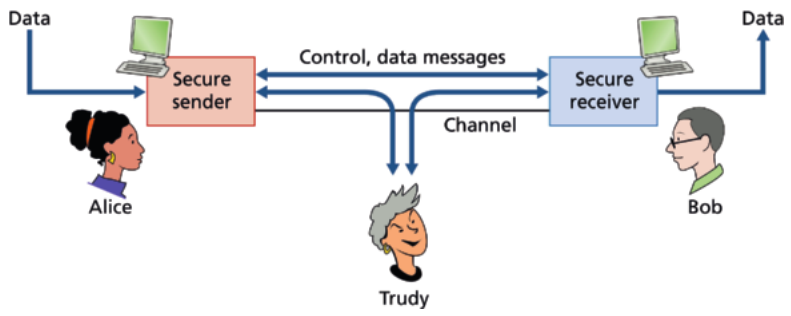

Hình 8.1 Bên gửi, bên nhận, và kẻ xâm nhập (Alice, Bob, và Trudy)

• nghe lén (eavesdropping)—nghe trộm và ghi lại các thông điệp điều khiển và dữ liệu trên kênh.

• sửa đổi, chèn, hoặc xóa thông điệp hay nội dung thông điệp.

Như chúng ta sẽ thấy, trừ khi có các biện pháp đối phó thích hợp, các khả năng này cho phép kẻ xâm nhập tiến hành nhiều loại tấn công bảo mật: rình mò giao tiếp (có thể đánh cắp mật khẩu và dữ liệu), mạo danh một thực thể khác, chiếm quyền một phiên đang diễn ra, từ chối dịch vụ cho người dùng mạng hợp pháp bằng cách làm quá tải tài nguyên hệ thống, v.v. Một bản tóm tắt các lỗ hổng như vậy được duy trì tại CERT Coordination Center [CERT 2025].

Sau khi đã xác định rằng thực sự có những mối đe dọa đang hoành hành trên Internet, đâu là các phiên bản Internet tương đương của Alice và Bob, những người bạn của chúng ta cần giao tiếp an toàn? Chắc chắn, Bob và Alice có thể là người dùng ở hai end system, ví dụ, một Alice thật và một Bob thật thực sự muốn trao đổi e-mail an toàn. Họ cũng có thể là các bên tham gia một giao dịch thương mại điện tử. Ví dụ, một Bob thật có thể muốn chuyển số thẻ tín dụng của mình một cách an toàn tới một Web server để mua một món hàng trực tuyến. Tương tự, một Alice thật có thể muốn tương tác trực tuyến với ngân hàng của mình. Bản thân các bên cần giao tiếp an toàn cũng có thể là một phần của hạ tầng mạng. Nhớ lại rằng hệ thống tên miền (DNS, xem Mục 2.4) hoặc các daemon định tuyến trao đổi thông tin định tuyến (xem Chương 5) đòi hỏi giao tiếp an toàn giữa hai bên. Điều tương tự cũng đúng với các ứng dụng quản lý mạng, một chủ đề chúng ta đã khảo sát trong Chương 5). Một kẻ xâm nhập có thể chủ động can thiệp vào các tra cứu DNS (như đã bàn trong Mục 2.4), các phép tính định tuyến (Mục 5.3 và 5.4), hoặc các chức năng quản lý mạng ( Mục 5.5 và 5.7) có thể tàn phá Internet.

Sau khi đã thiết lập khung, một vài định nghĩa quan trọng nhất, và nhu cầu về bảo mật mạng, tiếp theo hãy đi sâu vào mật mã học. Trong khi việc dùng mật mã để cung cấp tính bí mật là self-evident (hiển nhiên), chúng ta sẽ sớm thấy nó cũng là trung tâm của việc cung cấp xác thực end-point và toàn vẹn thông điệp—khiến mật mã học trở thành nền tảng của bảo mật mạng.

## 8.2 Các nguyên lý mật mã học (Principles of Cryptography)

Mặc dù mật mã học có một lịch sử lâu dài ít nhất từ thời Julius Caesar, các kỹ thuật mật mã hiện đại, bao gồm nhiều kỹ thuật được dùng trong Internet, dựa trên những tiến bộ đạt được trong 30 năm qua. Cuốn sách của Kahn, The Codebreakers [Kahn 1967], và cuốn sách của Singh, The Code Book: The Science of Secrecy from Ancient Egypt to Quantum Cryptography [Singh 1999], đem lại một cái nhìn hấp dẫn về lịch sử lâu dài của mật mã học. Một thảo luận đầy đủ về bản thân mật mã học đòi hỏi cả một cuốn sách [Kaufman 2002; Ferguson 2010; Bishop 2018] và vì vậy chúng ta chỉ chạm tới các khía cạnh thiết yếu của mật mã học, đặc biệt là khi chúng được áp dụng trên Internet. Chúng ta cũng lưu ý rằng mặc dù trọng tâm trong mục này sẽ là việc dùng mật mã cho tính bí mật, chúng ta sẽ sớm thấy các kỹ thuật mật mã gắn bó chặt chẽ với xác thực, toàn vẹn thông điệp, chống chối bỏ (nonrepudiation), và hơn nữa.

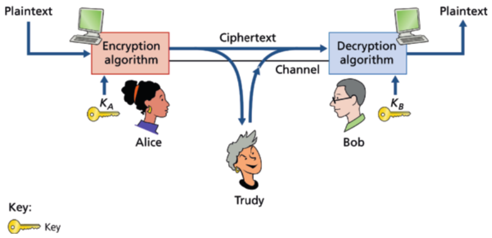

Hình 8.2 Các thành phần mật mã

Các kỹ thuật mật mã cho phép bên gửi ngụy trang dữ liệu để kẻ xâm nhập không thu được thông tin gì từ dữ liệu bị chặn bắt. Tất nhiên, bên nhận phải có khả năng khôi phục dữ liệu gốc từ dữ liệu đã ngụy trang. Hình 8.2 minh họa một số thuật ngữ quan trọng.

Giờ giả sử Alice muốn gửi một thông điệp tới Bob. Thông điệp của Alice ở dạng gốc (ví dụ, “Bob, I love you. Alice”) được gọi là bản rõ (plaintext), hay cleartext. Alice mã hóa thông điệp bản rõ của mình bằng một thuật toán mã hóa để thông điệp đã mã hóa, gọi là bản mã (ciphertext), trông khó hiểu đối với bất kỳ kẻ xâm nhập nào. Điều thú vị là, trong nhiều hệ thống mật mã hiện đại, bao gồm các hệ thống được dùng trong Internet, bản thân kỹ thuật mã hóa là đã biết—được công bố, chuẩn hóa, và có sẵn cho mọi người (ví dụ, [RFC 1321; RFC 3447; RFC 2420; NIST 2001, 2025), kể cả một kẻ xâm nhập tiềm năng! Rõ ràng, nếu mọi người đều biết phương pháp mã hóa dữ liệu, thì phải có thông tin bí mật nào đó ngăn kẻ xâm nhập giải mã dữ liệu được truyền. Đây là lúc khóa (key) vào cuộc.

Trong Hình 8.2, Alice cung cấp một khóa, K<sub>A</sub>, một chuỗi số hoặc ký tự, làm đầu vào cho thuật toán mã hóa. Thuật toán mã hóa nhận khóa và thông điệp bản rõ, m, làm đầu vào và tạo ra bản mã làm đầu ra. Ký hiệu K<sub>A</sub>(m) chỉ dạng bản mã (được mã hóa bằng khóa K<sub>A</sub>) của thông điệp bản rõ, m. Thuật toán mã hóa thực tế dùng khóa K<sub>A</sub> sẽ rõ ràng từ ngữ cảnh. Tương tự, Bob sẽ cung cấp một khóa, K<sub>B</sub>, cho thuật toán giải mã nhận bản mã và khóa của Bob làm đầu vào và tạo ra bản rõ gốc làm đầu ra. Nghĩa là, nếu Bob nhận một thông điệp đã mã hóa K<sub>A</sub>(m), anh ấy giải mã nó bằng cách tính K<sub>B</sub>(K<sub>A</sub>(m)) = m. Trong hệ thống khóa đối xứng (symmetric key), khóa của Alice và Bob giống hệt nhau và là bí mật. Trong hệ thống khóa công khai (public key), một cặp khóa được dùng. Một trong các khóa được cả Bob và Alice biết (thực ra, cả thế giới đều biết). Khóa kia chỉ được Bob hoặc Alice biết (nhưng không phải cả hai).

Trong hai tiểu mục tiếp theo, chúng ta xét chi tiết hơn các hệ thống khóa đối xứng và khóa công khai.

### 8.2.1 Mật mã khóa đối xứng (Symmetric Key Cryptography)

Mọi thuật toán mật mã đều liên quan tới việc thay thế thứ này bằng thứ khác, ví dụ, lấy một đoạn bản rõ rồi tính và thay bằng bản mã thích hợp để tạo thông điệp đã mã hóa. Trước khi học một hệ thống mật mã key-based hiện đại, hãy làm quen trước bằng cách học một thuật toán khóa đối xứng rất cũ, rất đơn giản được cho là của Julius Caesar, gọi là mật mã Caesar (Caesar cipher) (một cipher là một phương pháp mã hóa dữ liệu).

Với văn bản tiếng Anh, mật mã Caesar hoạt động bằng cách lấy mỗi chữ cái trong thông điệp bản rõ và thay bằng chữ cái đứng sau nó k chữ cái (cho phép quay vòng; tức là, chữ z được theo sau bởi chữ a) trong bảng chữ cái. Ví dụ, nếu k = 3, thì chữ a trong bản rõ trở thành d trong bản mã; b trong bản rõ trở thành e trong bản mã, v.v. Ở đây, giá trị k đóng vai trò khóa. Ví dụ, thông điệp bản rõ “bob, i love you. Alice” trở thành “ere, l oryh brx. dolfh” trong bản mã. Mặc dù bản mã thực sự trông như vô nghĩa, sẽ không mất nhiều thời gian để phá mã nếu bạn biết mật mã Caesar đang được dùng, vì chỉ có 25 giá trị khóa khả dĩ.

Một cải tiến của mật mã Caesar là mật mã thay thế đơn bảng (monoalphabetic cipher), cũng thay một chữ cái của bảng chữ cái bằng một chữ cái khác của bảng chữ cái. Tuy nhiên, thay vì thay thế theo một mẫu đều đặn (ví dụ, thay thế với độ dịch k cho mọi chữ cái), bất kỳ chữ cái nào cũng có thể được thay bằng bất kỳ chữ cái nào khác, miễn là mỗi chữ cái có một chữ cái thay thế duy nhất, và ngược lại. Quy tắc thay thế trong Hình 8.3 cho thấy một quy tắc khả dĩ để mã hóa bản rõ.

Thông điệp bản rõ “bob, i love you. Alice” trở thành “nkn, s gktc wky. Mgsbc.” Do đó, như trong trường hợp mật mã Caesar, cái này trông như vô nghĩa. Một mật mã đơn bảng cũng có vẻ tốt hơn mật mã Caesar ở chỗ có 26! (cỡ 10<sup>26</sup>) cách ghép cặp chữ cái khả dĩ thay vì 25 cách ghép cặp khả dĩ. Một cách tiếp cận brute-force (vét cạn) thử mọi 10<sup>26</sup> cách ghép cặp khả dĩ sẽ đòi hỏi quá nhiều công sức để là một cách khả thi phá thuật toán mã hóa và giải mã thông điệp. Tuy nhiên, bằng phân tích thống kê ngôn ngữ của bản rõ, ví dụ, biết rằng các chữ e và t là những chữ xuất hiện thường xuyên nhất trong văn bản tiếng Anh điển hình (chiếm 13 phần trăm và 9 phần trăm số lần xuất hiện chữ cái), và biết rằng một số cụm two-and three-letter (hai và ba chữ cái) cụ thể xuất hiện khá thường xuyên cùng nhau (ví dụ, “in,” “it,” “the,” “ion,” “ing,” v.v.) khiến việc phá mã này tương đối dễ. Nếu kẻ xâm nhập có hiểu biết nào đó về nội dung có thể có của thông điệp, thì việc phá mã còn dễ hơn nữa. Ví dụ, nếu Trudy kẻ xâm nhập là vợ của Bob và nghi ngờ Bob ngoại tình với Alice, thì cô ấy có thể đoán rằng các tên “bob” và “alice” xuất hiện trong văn bản. Nếu Trudy biết chắc rằng hai tên đó xuất hiện trong bản mã và có một bản sao của thông điệp bản mã ví dụ ở trên, thì cô ấy có thể ngay lập tức xác định bảy trong số 26 cặp chữ cái, khiến số khả năng cần kiểm tra bằng phương pháp brute-force giảm đi 10<sup>9</sup> lần. Thật vậy, nếu Trudy nghi ngờ Bob ngoại tình, cô ấy có thể cũng mong tìm thấy một số từ ngữ “đặc biệt” khác trong thông điệp. Khi xét xem Trudy có thể dễ dàng phá sơ đồ mã hóa của Bob và Alice đến mức nào, người ta có thể phân biệt ba kịch bản khác nhau, tùy vào thông tin mà kẻ xâm nhập có.

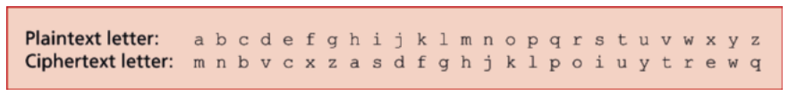

Hình 8.3 Một mật mã đơn bảng

• Tấn công ciphertext-only (chỉ có bản mã). Trong một số trường hợp, kẻ xâm nhập có thể chỉ truy cập được bản mã bị chặn bắt, không có thông tin chắc chắn nào về nội dung thông điệp bản rõ. Chúng ta đã thấy phân tích thống kê có thể giúp ích thế nào trong một tấn công ciphertext-only vào một sơ đồ mã hóa.

• Tấn công known-plaintext (biết bản rõ). Chúng ta đã thấy ở trên rằng nếu Trudy bằng cách nào đó biết chắc rằng “bob” và “alice” xuất hiện trong thông điệp bản mã, thì cô ấy có thể đã xác định các cặp (bản rõ, bản mã) cho các chữ cái a, l, i, c, e, b, và o. Trudy cũng có thể đã đủ may mắn để ghi lại mọi lần truyền bản mã rồi tìm thấy phiên bản đã giải mã của chính Bob cho một trong các lần truyền được viết nguệch ngoạc trên một mảnh giấy. Khi kẻ xâm nhập biết một số cặp (bản rõ, bản mã), chúng ta gọi đây là một tấn công known-plaintext vào sơ đồ mã hóa.

• Tấn công chosen-plaintext (chọn bản rõ). Trong một tấn công chosen-plaintext, kẻ xâm nhập có thể chọn thông điệp bản rõ và lấy được dạng bản mã tương ứng. Với các thuật toán mã hóa đơn giản chúng ta đã thấy cho tới giờ, nếu Trudy có thể khiến Alice gửi thông điệp, “The quick brown fox jumps over the lazy dog,” cô ấy có thể phá hoàn toàn sơ đồ mã hóa. Chúng ta sẽ sớm thấy rằng với các kỹ thuật mã hóa tinh vi hơn, một tấn công chosen-plaintext không nhất thiết có nghĩa là kỹ thuật mã hóa có thể bị phá.

Năm trăm năm trước, các kỹ thuật cải tiến mã hóa đơn bảng, gọi là mã hóa đa bảng (polyalphabetic encryption), đã được phát minh. Ý tưởng đằng sau mã hóa đa bảng là dùng nhiều mật mã đơn bảng, với một mật mã đơn bảng cụ thể để mã hóa một chữ cái ở một vị trí cụ thể trong thông điệp bản rõ. Do đó, cùng một chữ cái, xuất hiện ở các vị trí khác nhau trong thông điệp bản rõ, có thể được mã hóa khác nhau. Một ví dụ về sơ đồ mã hóa đa bảng được minh họa trong Hình 8.4. Nó có hai mật mã Caesar (với k = 5 và k = 19), biểu diễn thành các hàng. Chúng ta có thể chọn dùng hai mật mã Caesar này, C<sub>1</sub> và C<sub>2</sub>, theo mẫu lặp lại C<sub>1</sub>, C<sub>2</sub>, C<sub>2</sub>, C<sub>1</sub>, C<sub>2</sub>. Nghĩa là, chữ cái đầu tiên của bản rõ được mã hóa bằng C<sub>1</sub>, chữ thứ hai và thứ ba bằng C<sub>2</sub>, chữ thứ tư bằng C<sub>1</sub>, và chữ thứ năm bằng C<sub>2</sub>. Mẫu sau đó lặp lại, với chữ thứ sáu được mã hóa bằng C<sub>1</sub>, chữ thứ bảy bằng C<sub>2</sub>, v.v. Thông điệp bản rõ “bob, i love you.” do đó được mã hóa thành “ghu, n etox dhz.” Lưu ý rằng chữ b đầu tiên trong thông điệp bản rõ được mã hóa bằng C<sub>1</sub>, trong khi chữ b thứ hai được mã hóa bằng C<sub>2</sub>. Trong ví dụ này, “khóa” mã hóa và giải mã là hiểu biết về hai khóa Caesar ( k = 5, mẫu C<sub>1</sub>, C<sub>2</sub>, C<sub>2</sub>, C<sub>1</sub>, C<sub>2</sub>. k = 19 ) và

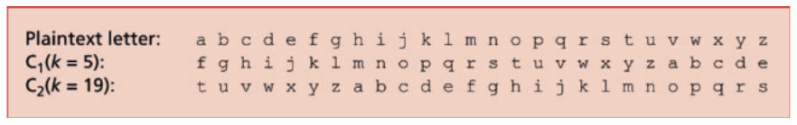

Hình 8.4 Một mật mã đa bảng dùng hai mật mã Caesar

#### Mật mã khối (Block Ciphers)

Giờ hãy tiến tới thời hiện đại và khảo sát cách mã hóa khóa đối xứng được thực hiện ngày nay. Chúng ta tập trung vào mật mã khối (block cipher), được dùng trong nhiều giao thức Internet an toàn, bao gồm PGP (cho e-mail an toàn), TLS (để bảo mật kết nối TCP), và IPsec (để bảo mật việc vận chuyển network-layer).

Trong một mật mã khối, thông điệp cần mã hóa được xử lý theo các khối k bit. Ví dụ, nếu k = 64, thì thông điệp được chia thành các khối 64-bit, và mỗi khối được mã hóa độc lập. Để mã hóa một khối, mật mã dùng một ánh xạ one-to-one (một–một) để ánh xạ khối k-bit cleartext thành một khối k-bit bản mã. Hãy xem một ví dụ. Giả sử k = 3, để mật mã khối ánh xạ đầu vào 3-bit (cleartext) thành đầu ra 3-bit (bản mã). Một ánh xạ khả dĩ được cho trong Bảng 8.1. Lưu ý rằng đây là một ánh xạ one-to-one; tức là, có một đầu ra khác nhau cho mỗi đầu vào. Mật mã khối này chia thông điệp thành các khối 3-bit và mã hóa mỗi khối theo ánh xạ ở trên. Bạn nên kiểm chứng rằng thông điệp 010110001111 được mã hóa thành 101000111001.

Tiếp tục với ví dụ khối 3-bit này, lưu ý rằng ánh xạ trong Bảng 8.1 chỉ là một ánh xạ trong nhiều ánh xạ khả dĩ. Có bao nhiêu ánh xạ khả dĩ? Để trả lời câu hỏi này, quan sát rằng một ánh xạ không gì khác hơn là một hoán vị của mọi đầu vào khả dĩ. Có 2<sup>3</sup> (= 8) đầu vào khả dĩ (liệt kê dưới các cột đầu vào). Tám đầu vào này có thể được hoán vị theo 8! = 40,320 cách khác nhau. Vì mỗi hoán vị này xác định một ánh xạ, có 40,320 ánh xạ khả dĩ. Chúng ta có thể xem mỗi ánh xạ này như một khóa—nếu Alice và Bob đều biết ánh xạ (khóa), họ có thể mã hóa và giải mã các thông điệp gửi giữa họ.

Tấn công brute-force cho mật mã này là thử giải mã bản mã bằng cách dùng mọi ánh xạ. Với chỉ 40,320 ánh xạ (khi k = 3), việc này có thể được hoàn thành nhanh chóng trên một PC để bàn. Để chặn tấn công brute-force, mật mã khối thường dùng các khối lớn hơn nhiều, gồm k = 64 bit hoặc thậm chí lớn hơn. Lưu ý rằng số ánh xạ khả dĩ cho một mật mã k-block tổng quát là 2<sup>k</sup>!, là con số thiên văn ngay cả với các giá trị k vừa phải (như k = 64).

Mặc dù mật mã khối full-table (bảng đầy đủ), như vừa mô tả, với các giá trị k vừa phải có thể tạo ra các sơ đồ mã hóa khóa đối xứng mạnh, không may chúng khó triển khai. Với k = 64 và với một ánh xạ cho trước, Alice và Bob sẽ cần duy trì một bảng với 2<sup>64</sup> giá trị đầu vào, là một nhiệm vụ không khả thi. Hơn nữa, nếu Alice và Bob muốn đổi khóa, mỗi người sẽ phải tạo lại bảng. Do đó, một mật mã khối full-table, cung cấp các ánh xạ định trước giữa mọi đầu vào và đầu ra (như trong ví dụ ở trên), đơn giản là không thể dùng được.

| đầu vào (input) | đầu ra (output) | đầu vào (input) | đầu ra (output) |
|---|---|---|---|
| 000 | 110 | 100 | 011 |
| 001 | 111 | 101 | 010 |
| 010 | 101 | 110 | 000 |
| 011 | 100 | 111 | 001 |

Bảng 8.1 Một mật mã khối 3-bit cụ thể

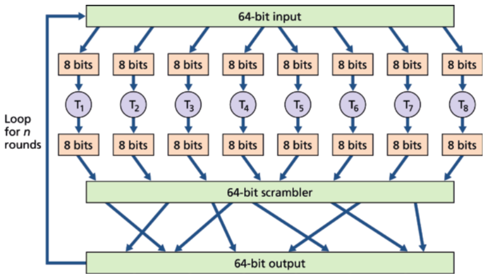

Hình 8.5 Một ví dụ về mật mã khối

Thay vào đó, mật mã khối thường dùng các hàm mô phỏng các bảng được hoán vị ngẫu nhiên. Một ví dụ (phỏng theo [Kaufman 2002]) về hàm như vậy với k = 64 bit được minh họa trong Hình 8.5. Hàm trước hết chia một khối 64-bit thành 8 khúc, mỗi khúc gồm 8 bit. Mỗi khúc 8-bit được xử lý bởi một bảng 8-bit sang 8-bit, có kích thước quản lý được. Ví dụ, khúc đầu tiên được xử lý bởi bảng ký hiệu T<sub>1</sub>. Tiếp theo, 8 khúc đầu ra được ráp lại thành một khối 64-bit. Vị trí của 64 bit trong khối sau đó được xáo trộn (hoán vị) để tạo ra một đầu ra 64-bit. Đầu ra này được đưa ngược lại đầu vào 64-bit, nơi một chu kỳ khác bắt đầu. Sau n chu kỳ như vậy, hàm cung cấp một khối bản mã 64-bit. Mục đích của các vòng là làm cho mỗi bit đầu vào ảnh hưởng tới hầu hết (nếu không phải tất cả) các bit đầu ra cuối cùng. (Nếu chỉ dùng một vòng, một bit đầu vào cho trước sẽ chỉ ảnh hưởng tới 8 trong 64 bit đầu ra.) Khóa cho thuật toán mật mã khối này sẽ là tám bảng hoán vị (giả sử hàm xáo trộn được công khai).

Ngày nay có một số mật mã khối phổ biến, bao gồm DES (viết tắt của Data Encryption Standard), 3 DES, và AES (viết tắt của Advanced Encryption Standard). Mỗi chuẩn này dùng các hàm, thay vì các bảng pre-determined, theo hướng của Hình 8.5 (dù phức tạp hơn và đặc thù cho mỗi mật mã). Mỗi thuật toán này cũng dùng một chuỗi bit làm khóa. Ví dụ, DES dùng khối 64-bit với khóa 56-bit. AES dùng khối 128-bit và có thể hoạt động với khóa dài 128, 192, và 256 bit. Khóa của một thuật toán xác định các ánh xạ và hoán vị “mini-table” cụ thể bên trong thuật toán. Tấn công brute-force cho mỗi mật mã này là duyệt qua mọi khóa, áp dụng thuật toán giải mã với mỗi khóa. Quan sát rằng với độ dài khóa n, có 2<sup>n</sup> khóa khả dĩ. NIST [NIST 2001] ước tính rằng một máy có thể phá DES 56-bit trong một giây (tức là, thử mọi 2<sup>56</sup> khóa trong một giây) sẽ cần khoảng 149 nghìn tỷ năm để phá một khóa AES 128-bit.

#### Chế độ móc xích khối mã (Cipher-Block Chaining)

Trong các ứng dụng mạng máy tính, chúng ta thường cần mã hóa các thông điệp dài hoặc các luồng dữ liệu dài. Nếu áp dụng mật mã khối như mô tả bằng cách đơn giản cắt thông điệp thành các khối k-bit và mã hóa độc lập từng khối, một vấn đề tinh tế nhưng quan trọng xảy ra. Để thấy điều này, quan sát rằng hai hoặc nhiều khối cleartext có thể giống hệt nhau. Ví dụ, cleartext trong hai hoặc nhiều khối có thể là “HTTP/1.1”. Với các khối giống hệt nhau này, tất nhiên mật mã khối sẽ tạo ra cùng bản mã. Kẻ tấn công có thể đoán cleartext khi thấy các khối bản mã giống hệt nhau và thậm chí có thể giải mã toàn bộ thông điệp bằng cách xác định các khối bản mã giống hệt nhau và dùng hiểu biết về cấu trúc giao thức bên dưới [Kaufman 2002].

Để giải quyết vấn đề này, chúng ta có thể trộn một chút ngẫu nhiên vào bản mã để các khối bản rõ giống hệt nhau tạo ra các khối bản mã khác nhau. Để giải thích ý tưởng này, gọi m(i) ký hiệu khối bản rõ thứ i, c(i) ký hiệu khối bản mã thứ i, và a ⊕ b ký hiệu phép exclusive-or (XOR) của hai chuỗi bit, a và b. (Nhớ lại rằng 0 ⊕ 0 = 1 ⊕ 1 = 0 và 0 ⊕ 1 = 1 ⊕ 0 = 1, và XOR của hai chuỗi bit được thực hiện theo kiểu bit-by-bit. Vậy, ví dụ, 10101010 ⊕ 11110000 = 01011010.) Ngoài ra, ký hiệu thuật toán mã hóa block-cipher với khóa S là K<sub>S</sub>. Ý tưởng cơ bản như sau. Bên gửi tạo một số k-bit ngẫu nhiên r(i) cho khối thứ i và tính c(i) = K<sub>S</sub>(m(i) ⊕ r(i)). Lưu ý rằng một số ngẫu nhiên k-bit mới được chọn cho mỗi khối. Bên gửi sau đó gửi c(1), r(1), c(2), r(2), c(3), r(3), v.v. Vì bên nhận nhận c(i) và r(i) , nó có thể khôi phục mỗi khối bản rõ bằng cách tính m(i) = K<sub>S</sub>( c(i)) ⊕ r(i). Điều quan trọng cần lưu ý là, mặc dù r(i) được gửi dạng rõ và do đó có thể bị Trudy nghe lén, cô ấy không thể lấy được bản rõ m(i) , vì cô ấy không biết khóa K<sub>S</sub>. Cũng lưu ý rằng nếu hai khối bản rõ m(i) và m(j) giống nhau, các khối bản mã tương ứng c(i) và c(j) sẽ khác nhau (chừng nào các số ngẫu nhiên r(i) và r(j) khác nhau, điều xảy ra với xác suất rất cao).

Ví dụ, hãy xét mật mã khối 3-bit trong Bảng 8.1. Giả sử bản rõ là 010010010. Nếu Alice mã hóa trực tiếp, không đưa vào yếu tố ngẫu nhiên, bản mã thu được trở thành 101101101. Nếu Trudy nghe lén bản mã này, vì mỗi khối trong ba khối mã giống nhau, cô ấy có thể đoán đúng rằng mỗi khối trong ba khối bản rõ giống nhau. Giờ giả sử thay vào đó Alice tạo các khối ngẫu nhiên r(1) = 001, r(2) = 111, và r(3) = 100 và dùng kỹ thuật ở trên để tạo bản mã c(1) = 100, c(2) = 010, và c(3) = 000. Lưu ý rằng ba khối bản mã khác nhau dù các khối bản rõ giống nhau. Alice sau đó gửi c(1) , r(1) , c(2) , và r(2) . Bạn nên kiểm chứng rằng Bob có thể lấy được bản rõ gốc bằng khóa dùng chung K<sub>S</sub>.

Độc giả tinh ý sẽ nhận thấy rằng việc đưa yếu tố ngẫu nhiên vào giải quyết một vấn đề nhưng tạo ra vấn đề khác: cụ thể, Alice phải truyền gấp đôi số bit so với trước. Thật vậy, với mỗi bit mã, giờ cô ấy cũng phải gửi một bit ngẫu nhiên, làm tăng gấp đôi băng thông cần thiết. Để vẹn cả đôi đường, mật mã khối thường dùng một kỹ thuật gọi là Cipher Block Chaining (CBC). Ý tưởng cơ bản là chỉ gửi một giá trị ngẫu nhiên cùng với thông điệp đầu tiên, rồi để bên gửi và bên nhận dùng các khối mã đã tính thay cho số ngẫu nhiên tiếp theo. Cụ thể, CBC hoạt động như sau:

1. Trước khi mã hóa thông điệp (hoặc luồng dữ liệu), bên gửi tạo một chuỗi k-bit ngẫu nhiên, gọi là Initialization Vector (IV). Ký hiệu vector khởi tạo này là c(0). Bên gửi gửi IV tới bên nhận dạng cleartext.

2. Với khối đầu tiên, bên gửi tính m(1) ⊕ c(0), tức là, tính exclusive-or của khối cleartext đầu tiên với IV. Sau đó nó chạy kết quả qua thuật toán block-cipher để lấy khối bản mã tương ứng; tức là, c(1) = K<sub>S</sub>(m(1) ⊕ c(0)). Bên gửi gửi khối đã mã hóa c(1) tới bên nhận.

3. Với khối thứ i, bên gửi tạo khối bản mã thứ i từ c(i) = K<sub>S</sub>(m(i) ⊕ c(i − 1)).

Giờ hãy khảo sát một số hệ quả của cách tiếp cận này. Thứ nhất, bên nhận vẫn có thể khôi phục thông điệp gốc. Thật vậy, khi bên nhận nhận c(i), nó giải mã bằng K<sub>S</sub> để có s(i) = m(i) ⊕ c(i − 1); vì bên nhận cũng biết c(i − 1) , nó sau đó lấy khối cleartext từ m(i) = s(i) ⊕ c(i − 1) . Thứ hai, ngay cả khi hai khối cleartext giống hệt nhau, các bản mã tương ứng (gần như luôn) sẽ khác nhau. Thứ ba, mặc dù bên gửi gửi IV dạng rõ, kẻ xâm nhập vẫn không thể giải mã các khối bản mã, vì kẻ xâm nhập không biết khóa bí mật, S. Cuối cùng, bên gửi chỉ gửi một khối overhead (IV), do đó làm tăng không đáng kể việc sử dụng băng thông cho các thông điệp dài (gồm hàng trăm khối).

Ví dụ, giờ hãy xác định bản mã cho mật mã khối 3-bit trong Bảng 8.1 với bản rõ 010010010 và IV = c(0) = 001. Bên gửi trước hết dùng IV để tính c(1) = K<sub>S</sub>(m(1) ⊕ c(0)) = 100. Bên gửi sau đó tính c(2) = K<sub>S</sub>(m(2) ⊕ c(1)) = K<sub>S</sub>(010 ⊕ 100) = 000, và c(3) = K<sub>S</sub>(m(3) ⊕ c(2)) = K<sub>S</sub>(010 ⊕ 000) = 101. Độc giả nên kiểm chứng rằng bên nhận, biết IV và K<sub>S</sub> có thể khôi phục bản rõ gốc.

CBC có một hệ quả quan trọng khi thiết kế các giao thức mạng an toàn: chúng ta sẽ cần cung cấp một cơ chế trong giao thức để phân phối IV từ bên gửi tới bên nhận. Chúng ta sẽ thấy điều này được thực hiện thế nào cho vài giao thức sau trong chương này.

### 8.2.2 Mật mã khóa công khai (Public Key Cryptography)

Trong hơn 2,000 năm (từ thời mật mã Caesar cho tới những năm 1970), giao tiếp mã hóa đòi hỏi hai bên giao tiếp chia sẻ một bí mật chung—khóa đối xứng dùng để mã hóa và giải mã. Một khó khăn với cách tiếp cận này là hai bên phải bằng cách nào đó thống nhất khóa dùng chung; nhưng bản thân việc đó đòi hỏi giao tiếp an toàn. Có lẽ các bên có thể gặp nhau trước và thống nhất khóa trực tiếp (ví dụ, hai đội trưởng bách nhân của Caesar có thể gặp nhau ở nhà tắm La Mã) và sau đó giao tiếp có mã hóa. Tuy nhiên, trong một thế giới nối mạng, các bên giao tiếp có thể không bao giờ gặp nhau và có thể không bao giờ trò chuyện trừ khi qua mạng.

Liệu hai bên có thể giao tiếp có mã hóa mà không có một khóa bí mật dùng chung được biết trước không? Năm 1976, Diffie và Hellman [Diffie 1976] đã trình bày một thuật toán (nay gọi là Diffie-Hellman Key Exchange) để làm đúng điều đó—một cách tiếp cận khác biệt triệt để và thanh lịch tuyệt vời đối với giao tiếp an toàn đã dẫn tới sự phát triển của các hệ thống mật mã khóa công khai ngày nay. Chúng ta sẽ sớm thấy các hệ thống mật mã khóa công khai cũng có vài tính chất tuyệt vời khiến chúng hữu ích không chỉ cho mã hóa, mà cả cho xác thực và chữ ký số. Điều thú vị là, người ta đã phát hiện ra rằng các ý tưởng tương tự như trong [Diffie 1976] và [RSA 1978] đã được phát triển độc lập vào đầu những năm 1970 trong một loạt báo cáo bí mật của các nhà nghiên cứu tại Communications-Electronics Security Group ở Vương quốc Anh [Ellis 1987]. Như thường thấy, những ý tưởng lớn có thể nảy sinh độc lập ở nhiều nơi; may mắn thay, các tiến bộ khóa công khai không chỉ diễn ra trong bí mật, mà cả trước công chúng.

Việc dùng mật mã khóa công khai về mặt khái niệm khá đơn giản. Giả sử Alice muốn giao tiếp với Bob. Như minh họa trong Hình 8.6, thay vì Bob và Alice chia sẻ một khóa bí mật duy nhất (như trong trường hợp hệ thống khóa đối xứng), Bob (người nhận thông điệp của Alice) thay vào đó có hai khóa—một khóa công khai (public key) có sẵn cho mọi người trên thế giới (bao gồm Trudy kẻ xâm nhập) và một khóa riêng (private key) chỉ Bob biết. Chúng ta sẽ dùng ký hiệu K<sup>+</sup><sub>B</sub> và K<sup>−</sup><sub>B</sub> để chỉ lần lượt khóa công khai và khóa riêng của Bob. Để giao tiếp với Bob, Alice trước hết lấy khóa công khai của Bob. Alice sau đó mã hóa thông điệp của mình, m, gửi Bob bằng khóa công khai của Bob và một thuật toán mã hóa đã biết (ví dụ, được chuẩn hóa); tức là, Alice tính K<sup>+</sup><sub>B</sub>(m). Bob nhận thông điệp đã mã hóa của Alice và dùng khóa riêng của mình và một thuật toán giải mã đã biết (ví dụ, được chuẩn hóa) để giải mã thông điệp đã mã hóa của Alice. Nghĩa là, Bob tính K<sup>−</sup><sub>B</sub>(K<sup>+</sup><sub>B</sub>(m)). Chúng ta sẽ thấy dưới đây rằng có các thuật toán và kỹ thuật mã hóa/giải mã để chọn khóa công khai và khóa riêng sao cho K<sup>−</sup><sub>B</sub>(K<sup>+</sup><sub>B</sub>(m)) = m; tức là, áp dụng khóa công khai của Bob, K<sub>B</sub><sup>+</sup>, cho một thông điệp m (để có K<sup>+</sup><sub>B</sub>(m)), rồi áp dụng khóa riêng của Bob, K<sup>−</sup><sub>B</sub>, cho phiên bản đã mã hóa của m (tức là, tính K<sup>−</sup><sub>B</sub>(K<sub>B</sub><sup>+</sup>(m))) sẽ trả lại m. Đây là một kết quả đáng chú ý! Bằng cách này, Alice có thể dùng khóa công khai của Bob để gửi một thông điệp bí mật tới Bob mà không ai trong số họ phải phân phối bất kỳ khóa bí mật nào! Chúng ta sẽ sớm thấy rằng chúng ta có thể hoán đổi mã hóa bằng khóa công khai và khóa riêng và có được cùng kết quả đáng chú ý—tức là, K<sup>−</sup><sub>B</sub>(K<sub>B</sub><sup>+</sup>(m)) = K<sup>+</sup><sub>B</sub>(K<sup>−</sup><sub>B</sub>(m)) = m.

Mặc dù mật mã public-key hấp dẫn, một mối lo ngại lập tức nảy ra. Vì khóa mã hóa của Bob là công khai, bất kỳ ai cũng có thể gửi một thông điệp đã mã hóa tới Bob, bao gồm Alice hoặc ai đó giả làm Alice. Trong trường hợp một khóa bí mật dùng chung duy nhất, việc bên gửi biết khóa bí mật ngầm định danh bên gửi đối với bên nhận. Tuy nhiên, trong trường hợp mật mã khóa công khai, điều này không còn đúng vì bất kỳ ai cũng có thể gửi một thông điệp đã mã hóa tới Bob bằng khóa công khai của Bob. Cần có một chữ ký số (digital signature), một chủ đề chúng ta sẽ học trong Mục 8.3, để gắn bên gửi với một thông điệp.

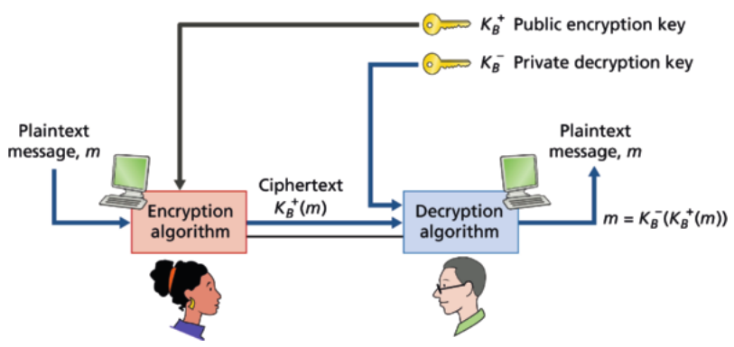

Hình 8.6 Mật mã khóa công khai

#### RSA

Mặc dù có thể có nhiều thuật toán giải quyết các mối lo ngại này, thuật toán RSA (đặt theo tên những người sáng lập, Ron Rivest, Adi Shamir, và Leonard Adleman) gần như đã trở thành đồng nghĩa với mật mã khóa công khai. Trước hết hãy xem RSA hoạt động thế nào rồi khảo sát tại sao nó hoạt động.

RSA dùng rất nhiều phép toán số học modulo-n. Vì vậy hãy ôn lại ngắn gọn số học modulo. Nhớ lại rằng x mod n đơn giản là số dư của x khi chia cho n; vậy, ví dụ, 19 mod 5 = 4. Trong số học modulo, người ta thực hiện các phép toán thông thường là cộng, nhân, và lũy thừa. Tuy nhiên, kết quả của mỗi phép toán được thay bằng số dư nguyên còn lại khi kết quả được chia cho n. Việc cộng và nhân với số học modulo được hỗ trợ bởi các tính chất tiện dụng sau:

[(a mod n) + (b mod n)] mod n = (a + b) mod n

[(a mod n) − (b mod n)] mod n = (a − b) mod n

[(a mod n) • (b mod n)] mod n = (a • b) mod n

Từ tính chất thứ ba suy ra rằng (a mod n)<sup>d</sup> mod n = a<sup>d</sup> mod n, là một đồng nhất thức mà chúng ta sẽ sớm thấy rất hữu ích.

Giờ giả sử Alice muốn gửi tới Bob một thông điệp RSA-encrypted, như minh họa trong Hình 8.6. Trong thảo luận về RSA, hãy luôn nhớ rằng một thông điệp không gì khác hơn là một mẫu bit, và mỗi mẫu bit có thể được biểu diễn duy nhất bằng một số nguyên (cùng với độ dài của mẫu bit). Ví dụ, giả sử một thông điệp là mẫu bit 1001; thông điệp này có thể được biểu diễn bằng số nguyên thập phân 9. Do đó, khi mã hóa một thông điệp bằng RSA, việc đó tương đương với mã hóa số nguyên duy nhất biểu diễn thông điệp.

RSA có hai thành phần liên quan với nhau:

• Việc chọn khóa công khai và khóa riêng

• Thuật toán mã hóa và giải mã

Để tạo khóa RSA công khai và riêng, Bob thực hiện các bước sau:

1. Chọn hai số nguyên tố lớn, p và q. p và q nên lớn đến mức nào? Giá trị càng lớn, càng khó phá RSA, nhưng càng mất nhiều thời gian để thực hiện mã hóa và giải mã. RSA Laboratories khuyến nghị tích của p và q ở cỡ 1,024 bit. Để có thảo luận về cách tìm số nguyên tố lớn, xem [Prime 2025].

2. Tính n = pq và z = (p − 1)(q − 1).

3. Chọn một số, e, nhỏ hơn n, không có ước chung (ngoài 1) với z. (Trong trường hợp này, e và z được gọi là nguyên tố cùng nhau.) Chữ e được dùng vì giá trị này sẽ được dùng trong mã hóa (encryption).

4. Tìm một số, d, sao cho ed − 1 chia hết chính xác (tức là, không có dư) cho z. Chữ d được dùng vì giá trị này sẽ được dùng trong giải mã (decryption). Nói cách khác, với e cho trước, chúng ta chọn d sao cho

ed mod z = 1

5. Khóa công khai mà Bob công bố cho thế giới, K<sub>B</sub><sup>+</sup>, là cặp số (n, e); khóa riêng của anh ấy, K<sup>−</sup><sub>B</sub>, là cặp số (n, d).

Việc mã hóa của Alice và giải mã của Bob được thực hiện như sau:

• Giả sử Alice muốn gửi cho Bob một mẫu bit được biểu diễn bởi số nguyên m (với m < n). Để mã hóa, Alice thực hiện phép lũy thừa m<sup>e</sup>, rồi tính số dư nguyên khi m<sup>e</sup> được chia cho n. Nói cách khác, giá trị đã mã hóa, c, của thông điệp bản rõ của Alice, m, là

c = m<sup>e</sup> mod n

• Mẫu bit tương ứng với bản mã c này được gửi tới Bob.

• Để giải mã thông điệp bản mã nhận được, c, Bob tính

m = c<sup>d</sup> mod n

việc này đòi hỏi dùng khóa riêng của anh ấy (n, d).

Như một ví dụ đơn giản về RSA, giả sử Bob chọn p = 5 và q = 7. (Phải thừa nhận, các giá trị này quá nhỏ để an toàn.) Khi đó n = 35 và z = 24. Bob chọn e = 5, vì 5 và 24 không có ước chung. Cuối cùng, Bob chọn d = 29, vì 5 • 29 − 1 (tức là, ed − 1) chia hết chính xác cho 24. Bob công khai hai giá trị, n = 35 và e = 5, và giữ bí mật giá trị d = 29. Quan sát hai giá trị công khai này, giả sử Alice giờ muốn gửi các chữ cái l, o, v, và e tới Bob. Diễn giải mỗi chữ cái như một số từ 1 đến 26 (với a là 1, và z là 26), Alice và Bob thực hiện mã hóa và giải mã lần lượt như minh họa trong Bảng 8.2 và 8.3. Lưu ý rằng trong ví dụ này, chúng ta xét mỗi chữ trong bốn chữ cái như một thông điệp riêng biệt. Một ví dụ thực tế hơn sẽ là chuyển bốn chữ cái thành biểu diễn ASCII 8-bit của chúng rồi mã hóa số nguyên tương ứng với mẫu bit 32-bit thu được. (Một ví dụ thực tế như vậy tạo ra những con số quá dài để in trong một giáo trình!)

| Chữ cái bản rõ (Plaintext<br>Letter) | m: biểu diễn<br>số (numeric representation) | m<sup>e</sup> | Bản mã (Ciphertext) c = m<sup>e</sup><br>mod n |
|---|---|---|---|
| l | 12 | 248832 | 17 |
| o | 15 | 759375 | 15 |
| v | 22 | 5153632 | 22 |
| e | 5 | 3125 | 10 |

Bảng 8.2 Mã hóa RSA của Alice, e = 5, n = 35

| Bản mã (Ciphertext) c | c<sup>d</sup> | m = c<sup>d</sup> mod n | Chữ cái bản rõ (Plaintext Letter) |
|---|---|---|---|
| 17 | 4819685721067509150915091411825223071697 | 12 | l |
| 15 | 127834039403948858939111232757568359375 | 15 | o |
| 22 | 851643319086537701956194499721106030592 | 22 | v |
| 10 | 1000000000000000000000000000000 | 5 | e |

Bảng 8.3 Giải mã RSA của Bob, d = 29, n = 35

Do ví dụ “đồ chơi” trong Bảng 8.2 và 8.3 đã tạo ra một số con số cực lớn, và do chúng ta đã thấy trước đó rằng p và q mỗi số nên dài vài trăm bit, vài vấn đề thực tế liên quan tới RSA nảy ra. Làm thế nào để chọn số nguyên tố lớn? Sau đó làm thế nào để chọn e và d? Làm thế nào để thực hiện lũy thừa với số lớn? Thảo luận về các vấn đề quan trọng này vượt ngoài phạm vi cuốn sách này; xem [Kaufman 2002] và các tài liệu tham khảo trong đó để biết chi tiết.

#### Khóa phiên (Session Keys)

Chúng ta lưu ý ở đây rằng phép lũy thừa mà RSA đòi hỏi là một quá trình khá time-consuming (tốn thời gian). Do đó, trong thực tế RSA thường được dùng kết hợp với mật mã khóa đối xứng. Ví dụ, nếu Alice muốn gửi cho Bob một lượng lớn dữ liệu đã mã hóa, cô ấy có thể làm như sau. Trước hết Alice chọn một khóa sẽ được dùng để mã hóa bản thân dữ liệu; khóa này được gọi là khóa phiên (session key), và được ký hiệu là K<sub>S</sub>. Alice phải thông báo cho Bob về khóa phiên, vì đây là khóa đối xứng dùng chung mà họ sẽ dùng với một mật mã khóa đối xứng (ví dụ, với DES hoặc AES). Alice mã hóa khóa phiên bằng khóa công khai của Bob, tức là, tính c = (K<sub>S</sub>)<sup>e</sup> mod n. Bob nhận khóa phiên RSA-encrypted, c, và giải mã nó để lấy khóa phiên, K<sub>S</sub>. Giờ Bob biết khóa phiên mà Alice sẽ dùng cho việc truyền dữ liệu đã mã hóa của cô ấy.

#### Tại sao RSA hoạt động? (Why Does RSA Work?)

Mã hóa/giải mã RSA có vẻ khá kỳ diệu. Tại sao bằng cách áp dụng thuật toán mã hóa rồi thuật toán giải mã, người ta lại khôi phục được thông điệp gốc? Để hiểu tại sao RSA hoạt động, lại ký hiệu n = pq, trong đó p và q là các số nguyên tố lớn dùng trong thuật toán RSA.

Nhớ lại rằng, với mã hóa RSA, một thông điệp (được biểu diễn duy nhất bằng một số nguyên), m, được lũy thừa lên mũ e dùng số học modulo-n, tức là,

c = m<sup>e</sup> mod n

Giải mã được thực hiện bằng cách nâng giá trị này lên lũy thừa d, lại dùng số học modulo-n. Kết quả của một bước mã hóa theo sau bởi một bước giải mã do đó là (m<sup>e</sup> mod n)<sup>d</sup> mod n. Giờ hãy xem chúng ta có thể nói gì về đại lượng này. Như đã đề cập trước đó, một tính chất quan trọng của số học modulo là (a mod n)<sup>d</sup> mod n = a<sup>d</sup> mod n với mọi giá trị a, n, và d. Do đó, dùng a = m<sup>e</sup> trong tính chất này, ta có

(m<sup>e</sup> mod n)<sup>d</sup> mod n = m<sup>ed</sup> mod n

Do đó còn lại việc chỉ ra rằng m<sup>ed</sup> mod n = m. Mặc dù chúng ta đang cố gỡ bỏ phần nào sự kỳ diệu về lý do RSA hoạt động, để chứng minh điều này, ở đây chúng ta sẽ cần dùng một kết quả khá kỳ diệu từ lý thuyết số. Cụ thể, chúng ta sẽ cần kết quả nói rằng nếu p và q là số nguyên tố, n = pq, và z = (p − 1)(q − 1), thì x<sup>y</sup> mod n bằng x<sup>(y mod z)</sup> mod n [Kaufman 2002]. Áp dụng kết quả này với x = m và y = ed ta có

m<sup>ed</sup> mod n = m<sup>(ed mod z)</sup> mod n

Nhưng nhớ rằng chúng ta đã chọn e và d sao cho ed mod z = 1. Điều này cho ta

m<sup>ed</sup> mod n = m<sup>1</sup> mod n = m

đó chính xác là kết quả chúng ta đang tìm! Bằng cách trước hết lũy thừa lên mũ e (tức là, mã hóa) rồi lũy thừa lên mũ d (tức là, giải mã), chúng ta thu được giá trị gốc, m. Tuyệt vời hơn nữa là thực tế rằng nếu chúng ta trước hết lũy thừa lên mũ d rồi lũy thừa lên mũ e—tức là, đảo thứ tự mã hóa và giải mã, thực hiện phép giải mã trước rồi áp dụng phép mã hóa—chúng ta cũng thu được giá trị gốc, m. Kết quả tuyệt vời này suy ra ngay từ số học modulo:

(m<sup>d</sup> mod n)<sup>e</sup> mod n = m<sup>de</sup> mod n = m<sup>ed</sup> mod n = (m<sup>e</sup> mod n)<sup>d</sup> mod n

Gần đây hơn, Elliptic Curve Cryptography (ECC) đã nổi lên như một lựa chọn thay thế RSA để dùng trong mật mã khóa công khai. Ưu điểm của mỗi loại được bàn trong [Gupta 2002; VMware 2025]. Bảo mật của RSA dựa trên thực tế rằng không có thuật toán nào đã biết để phân tích nhanh một số, trong trường hợp này là giá trị công khai n, thành các số nguyên tố p và q. Nếu ai đó biết p và q, thì với giá trị công khai e, người đó có thể dễ dàng tính khóa bí mật, d. Mặt khác, chưa biết liệu có tồn tại thuật toán nhanh để phân tích một số hay không, và theo nghĩa này, bảo mật của RSA không được đảm bảo. Bảo mật của ECC dựa trên độ khó của việc giải một bài toán khó tương tự. Với những tiến bộ gần đây trong điện toán lượng tử, và các thuật toán phân tích nhanh đã công bố cho máy tính lượng tử, có những lo ngại rằng RSA có thể không an toàn mãi mãi [MIT TR 2019; RSA 2024]. Mặc dù việc hiện thực thực tế các thuật toán này dường như vẫn còn xa trong tương lai, những lo ngại về mật mã hiện đại trong một thế giới post-quantum (hậu lượng tử) đủ nghiêm trọng đến mức National Institute of Standards and Technology của Hoa Kỳ đã kêu gọi, đánh giá, và đề xuất ba dự thảo chuẩn cho các thuật toán mật mã public-key quantum-resistant (kháng lượng tử) [NIST 2025].

#### Dùng mật mã khóa công khai để thống nhất một khóa dùng chung (Using Public Key Cryptography to Agree on a Shared Key)

Trong các mục sau, chúng ta sẽ thấy mật mã khóa công khai có thể được dùng không chỉ để cung cấp dịch vụ mã hóa, mà còn để cung cấp toàn vẹn thông điệp, chữ ký số, và xác thực. Nó cũng có thể được dùng để suy ra một khóa mật mã đối xứng—một bí mật dùng chung—cho hai thực thể giao tiếp chưa từng tương tác trước đây, và do đó chưa thể chọn trước bất kỳ bí mật dùng chung nào. Điều này hữu ích trong các ứng dụng client-server nơi client và server muốn mã hóa tương tác của họ bằng một khóa đối xứng dùng chung.

Cách tiếp cận để làm điều này được gọi là giao thức thỏa thuận khóa Diffie-Hellman (DH), đặt theo tên những người phát minh: Whitfield Diffie và Martin Hellman. Chúng ta sẽ thấy trong Mục 8.6 rằng DH là một thành phần trung tâm trong giao thức Transport Layer Security (TLS) được dùng để bảo mật giao tiếp transport-layer của Internet.

Giao thức DH dùng một số nguyên tố lớn p và một số lớn khác g nhỏ hơn p. Bob hoặc Alice chọn p và g và công khai các giá trị p và g, để chúng được cả hai biết (cũng như bởi mọi kẻ tấn công!). Alice và Bob sau đó độc lập chọn các giá trị riêng, lần lượt là SA và SB. Độ dài khuyến nghị của p, SA, và SB, là 2,048 bit hoặc hơn. Alice tính khóa công khai của mình, K<sub>A</sub><sup>+</sup>, bằng cách nâng g lên lũy thừa SA rồi lấy mod p

K<sub>A</sub><sup>+</sup> = g<sup>SA</sup> mod p

Bob tương tự tính khóa công khai của riêng mình K<sub>B</sub><sup>+</sup>:

K<sub>B</sub><sup>+</sup> = g<sup>SA</sup> mod p *(ghi chú: sách in g<sup>SA</sup>; đúng là g<sup>SB</sup>)*

Bảo mật của DH phụ thuộc vào thực tế rằng khi biết K<sub>A</sub><sup>+</sup>, g và p, cực kỳ khó xác định giá trị SA trong phương trình ở trên (tương tự cho việc xác định SB). Thật vậy, xác định các giá trị SA và SB khó ngang với việc phân tích giá trị công khai n trong RSA, thành các số nguyên tố RSA p và q.

Giờ hãy xem Alice và Bob tính một bí mật dùng chung thế nào, mà không bao giờ trao đổi tường minh bí mật dùng chung này. Alice tính bí mật dùng chung bằng cách lấy khóa công khai của Bob, K<sub>B</sub><sup>+</sup>, vốn mọi người đều biết, và nâng nó lên lũy thừa khóa bí mật của mình, SA modulo p:

Bí mật dùng chung Alice tính được = (K<sub>B</sub><sup>+</sup>)<sup>SA</sup> mod p

Tương tự, Bob tính:

Bí mật dùng chung Bob tính được = (K<sub>A</sub><sup>+</sup>)<sup>SA</sup> mod p *(ghi chú: sách in (K<sub>A</sub><sup>+</sup>)<sup>SA</sup>; đúng là (K<sub>A</sub><sup>+</sup>)<sup>SB</sup>)*

Giờ hãy kiểm chứng rằng Bob và Alice thực sự tính ra cùng một bí mật dùng chung. Ở đây chúng ta sẽ chỉ cần một chút thành thạo với số học modulo. Khóa dùng chung Alice tính được là (K<sub>B</sub><sup>+</sup>)<sup>SA</sup> mod p = ( g<sup>SB</sup> mod p) <sup>SA</sup> mod p, trong đó chúng ta đã dùng định nghĩa của K<sub>B</sub><sup>+</sup>. Và theo các quy tắc số học modulo, ( g<sup>SB</sup> mod p)<sup>SA</sup> mod p = g<sup>SB\*SA</sup> mod p = g<sup>SA\*SB</sup> mod p. Tương tự, khóa dùng chung Bob tính được là (K<sub>A</sub><sup>+</sup>)<sup>BA</sup> mod p \*(ghi chú: sách in <sup>BA</sup>; đúng là <sup>SB</sup>)\* = ( g<sup>SA</sup> mod p)<sup>SB</sup> mod p = g<sup>SA\*SB</sup> mod p, đúng bằng khóa dùng chung Alice tính được!

## 8.3 Toàn vẹn thông điệp và chữ ký số (Message Integrity and Digital Signatures)

Trong mục trước, chúng ta đã thấy mã hóa có thể được dùng thế nào để cung cấp tính bí mật cho hai thực thể giao tiếp. Trong mục này, chúng ta chuyển sang chủ đề mật mã quan trọng không kém là cung cấp toàn vẹn thông điệp (còn gọi là xác thực thông điệp - message authentication). Cùng với toàn vẹn thông điệp, chúng ta sẽ bàn hai chủ đề liên quan trong mục này: chữ ký số và xác thực end-point.

Chúng ta định nghĩa bài toán toàn vẹn thông điệp, một lần nữa, bằng Alice và Bob. Giả sử Bob nhận một thông điệp (có thể được mã hóa hoặc có thể ở dạng bản rõ) và anh ấy tin rằng thông điệp này do Alice gửi. Để xác thực thông điệp này, Bob cần xác minh:

1. Thông điệp thực sự bắt nguồn từ Alice.

2. Thông điệp không bị can thiệp trên đường tới Bob.

Chúng ta sẽ thấy trong các Mục 8.4 đến 8.7 rằng bài toán toàn vẹn thông điệp này là một mối quan tâm then chốt trong hầu như mọi giao thức mạng an toàn.

Như một ví dụ cụ thể, hãy xét một mạng máy tính dùng thuật toán định tuyến link-state (như OSPF) để xác định tuyến giữa mỗi cặp router trong mạng (xem Chương 5). Trong thuật toán link-state, mỗi router cần quảng bá một thông điệp link-state tới mọi router khác trong mạng. Thông điệp link-state của một router bao gồm danh sách các láng giềng nối trực tiếp và chi phí trực tiếp tới các láng giềng này. Một khi router nhận được thông điệp link-state từ mọi router khác, nó có thể tạo bản đồ đầy đủ của mạng, chạy thuật toán định tuyến least-cost của nó, và cấu hình bảng chuyển tiếp. Một tấn công tương đối dễ vào thuật toán định tuyến là Trudy phân phối các thông điệp link-state giả mạo với thông tin link-state sai. Do đó, cần có toàn vẹn thông điệp—khi router B nhận một thông điệp link-state từ router A, router B nên xác minh rằng router A thực sự đã tạo thông điệp và, hơn nữa, không ai đã can thiệp vào thông điệp trên đường truyền.

Trong mục này, chúng ta mô tả một kỹ thuật toàn vẹn thông điệp phổ biến được nhiều giao thức mạng an toàn sử dụng. Nhưng trước khi làm vậy, chúng ta cần đề cập một chủ đề quan trọng khác trong mật mã học—hàm băm mật mã.

### 8.3.1 Hàm băm mật mã (Cryptographic Hash Functions)

Như minh họa trong Hình 8.7, một hàm băm (hash function) nhận một đầu vào, m, và tính một chuỗi fixed-size H (m) gọi là giá trị băm (hash). Internet checksum (Chương 3) và CRC (Chương 6) đáp ứng định nghĩa này. Một hàm băm mật mã được yêu cầu có thêm tính chất sau:

• Về mặt tính toán không khả thi để tìm bất kỳ hai thông điệp khác nhau x và y nào sao cho H (x) = H (y) .

Một cách không chính thức, tính chất này có nghĩa là về mặt tính toán không khả thi để kẻ xâm nhập thay một thông điệp bằng một thông điệp khác được bảo vệ bởi hàm băm. Nghĩa là, nếu ( m, H (m)) là thông điệp và giá trị băm của thông điệp do bên gửi tạo ra, thì kẻ xâm nhập không thể giả mạo nội dung của một thông điệp khác, y, có cùng giá trị băm với thông điệp gốc.

Hãy tự thuyết phục rằng một checksum đơn giản, như Internet checksum, sẽ là một hàm băm mật mã kém. Thay vì thực hiện số học 1s complement (phép bù một) (như trong Internet checksum), hãy tính một checksum bằng cách coi mỗi ký tự như một byte và cộng các byte lại với nhau theo từng khúc 4-byte một. Giả sử Bob nợ Alice $100.99 và gửi một giấy nợ (IOU) tới Alice gồm chuỗi văn bản “IOU100.99BOB.” Biểu diễn ASCII (ở dạng thập lục phân) cho các chữ cái này là 49,4F,55, 31,30,30,2E,39,39,42,4F,42.

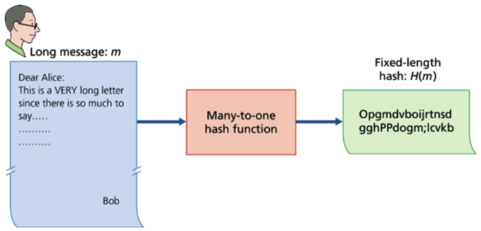

Hình 8.7 Hàm băm

Hình 8.8 (trên) cho thấy checksum 4-byte cho thông điệp này là B2 C1 D2 AC. Một thông điệp hơi khác (và đắt hơn nhiều đối với Bob) được minh họa ở nửa dưới của Hình 8.8. Các thông điệp “IOU100.99BOB” và “IOU900.19BOB” có cùng checksum. Do đó, thuật toán checksum đơn giản này vi phạm yêu cầu ở trên. Với dữ liệu gốc, rất đơn giản để tìm một tập dữ liệu khác có cùng checksum. Rõ ràng, cho mục đích bảo mật, chúng ta sẽ cần một hàm băm mạnh hơn checksum.

Thuật toán băm MD5 của Ron Rivest [RFC 1321] đang được dùng rộng rãi ngày nay. Nó tính một giá trị băm 128-bit theo một quá trình four-step gồm một bước đệm (thêm một bit một theo sau bởi đủ số bit không để độ dài thông điệp thỏa mãn một số điều kiện), một bước nối thêm (nối một biểu diễn 64-bit của độ dài thông điệp trước khi đệm), khởi tạo một bộ tích lũy, và một bước lặp cuối cùng trong đó các khối 16-word của thông điệp được xử lý (xáo trộn) trong bốn vòng. Để có mô tả về MD5 (bao gồm một bản triển khai mã nguồn C) xem [RFC 1321].

Thuật toán băm chính thứ hai được dùng ngày nay là Secure Hash Algorithm (SHA-1) [FIPS 1995]. Thuật toán này dựa trên các nguyên lý tương tự những nguyên lý dùng trong thiết kế MD4 [RFC 1320], tiền thân của MD5. SHA-1, một chuẩn liên bang Hoa Kỳ, được yêu cầu dùng bất cứ khi nào cần một thuật toán băm mật mã cho các ứng dụng liên bang. Nó tạo ra một message digest 160-bit. Độ dài đầu ra lớn hơn khiến SHA-1 an toàn hơn.

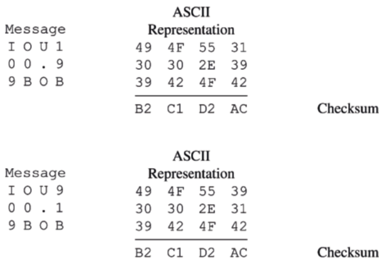

Hình 8.8 Thông điệp ban đầu và thông điệp gian lận có cùng checksum!

### 8.3.2 Mã xác thực thông điệp (Message Authentication Code)

Giờ hãy quay lại bài toán toàn vẹn thông điệp. Giờ chúng ta đã hiểu hàm băm, hãy thử lần đầu xem có thể thực hiện toàn vẹn thông điệp thế nào:

1. Alice tạo thông điệp m và tính giá trị băm H (m) (ví dụ, với SHA-1).

2. Alice sau đó nối H (m) vào thông điệp m, tạo một thông điệp mở rộng ( m, H (m)), và gửi thông điệp mở rộng tới Bob.

3. Bob nhận một thông điệp mở rộng (m, h) và tính H (m) . Nếu H (m) = h, Bob kết luận rằng mọi thứ đều ổn.

Cách tiếp cận này rõ ràng có lỗ hổng. Trudy có thể tạo một thông điệp giả m′ trong đó cô ấy nói mình là Alice, tính H ( m′ ) , và gửi Bob ( m′, H ( m′)). Khi Bob nhận thông điệp, mọi thứ đều khớp ở bước 3, nên Bob không nghi ngờ trò mờ ám nào.

Để thực hiện toàn vẹn thông điệp, ngoài việc dùng hàm băm mật mã, Alice và Bob sẽ cần một bí mật dùng chung s. Bí mật dùng chung này, không gì khác hơn là một chuỗi bit, được gọi là khóa xác thực (authentication key). Dùng bí mật dùng chung này, toàn vẹn thông điệp có thể được thực hiện như sau:

1. Alice tạo thông điệp m, nối s với m để tạo m + s, và tính giá trị băm H ( m + s ) (ví dụ, với SHA-1). H ( m + s ) được gọi là mã xác thực thông điệp (message authentication code - MAC).

2. Alice sau đó nối MAC vào thông điệp m, tạo một thông điệp mở rộng ( m, H ( m + s)), và gửi thông điệp mở rộng tới Bob.

3. Bob nhận một thông điệp mở rộng (m, h) và, biết s, tính MAC H(m + s). Nếu H(m + s) = h, Bob kết luận rằng mọi thứ đều ổn.

Tóm tắt thủ tục được minh họa trong Hình 8.9. Độc giả nên lưu ý rằng MAC ở đây (viết tắt của “message authentication code”) không giống MAC dùng trong các giao thức link-layer (viết tắt của “medium access control”)!

Một đặc điểm hay của MAC là nó không đòi hỏi thuật toán mã hóa. Thật vậy, trong nhiều ứng dụng, bao gồm thuật toán định tuyến link-state mô tả trước đó, các thực thể giao tiếp chỉ quan tâm tới toàn vẹn thông điệp và không quan tâm tới tính bí mật của thông điệp. Dùng MAC, các thực thể có thể xác thực các thông điệp chúng gửi cho nhau mà không phải tích hợp các thuật toán mã hóa phức tạp vào quá trình toàn vẹn.

Như bạn có thể đoán, một số chuẩn khác nhau cho MAC đã được đề xuất qua nhiều năm. Chuẩn phổ biến nhất ngày nay là HMAC, có thể được dùng với MD5 hoặc SHA-1. HMAC thực ra chạy dữ liệu và khóa xác thực qua hàm băm hai lần [Kaufman 2002; RFC 2104].

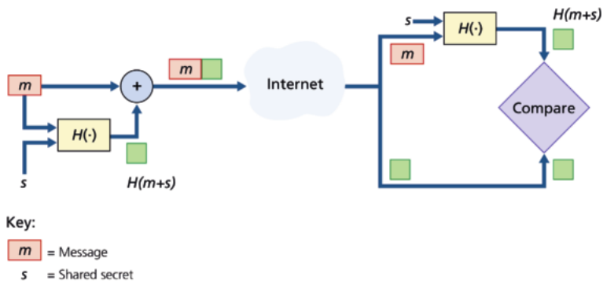

Hình 8.9 Mã xác thực thông điệp (MAC)

Vẫn còn một vấn đề quan trọng. Làm thế nào để phân phối khóa xác thực dùng chung tới các thực thể giao tiếp? Ví dụ, trong thuật toán định tuyến link-state, chúng ta sẽ cần bằng cách nào đó phân phối khóa xác thực bí mật tới mỗi router trong hệ tự trị. (Lưu ý rằng các router đều có thể dùng cùng một khóa xác thực.) Một quản trị viên mạng thực sự có thể làm điều này bằng cách đến tận nơi từng router. Hoặc, nếu quản trị viên mạng là người lười, và nếu mỗi router có khóa công khai riêng, quản trị viên mạng có thể phân phối khóa xác thực tới bất kỳ router nào bằng cách mã hóa nó bằng khóa công khai của router rồi gửi khóa đã mã hóa qua mạng tới router.

### 8.3.3 Chữ ký số (Digital Signatures)

Hãy nghĩ xem bạn đã ký tên lên giấy bao nhiêu lần trong tuần qua. Bạn ký séc, biên lai thẻ tín dụng, tài liệu pháp lý, và thư từ. Chữ ký của bạn xác nhận rằng bạn (chứ không phải ai khác) đã ghi nhận và/hoặc đồng ý với nội dung tài liệu. Trong thế giới số, người ta thường muốn chỉ ra chủ sở hữu hoặc người tạo một tài liệu, hoặc biểu thị sự đồng ý với nội dung tài liệu. Chữ ký số là một kỹ thuật mật mã để đạt được các mục tiêu này trong thế giới số.

Giống như chữ ký tay, việc ký số nên được thực hiện theo cách có thể kiểm chứng (verifiable) và không thể giả mạo (nonforgeable). Nghĩa là, phải có khả năng chứng minh rằng một tài liệu được một cá nhân ký thực sự do cá nhân đó ký (chữ ký phải kiểm chứng được) và chỉ cá nhân đó mới có thể ký tài liệu (chữ ký không thể bị giả mạo).

Giờ hãy xét cách thiết kế một sơ đồ chữ ký số. Quan sát rằng khi Bob ký một thông điệp, Bob phải đặt lên thông điệp thứ gì đó duy nhất đối với anh ấy. Bob có thể cân nhắc gắn một MAC làm chữ ký, trong đó MAC được tạo bằng cách nối khóa của anh ấy (duy nhất đối với anh ấy) vào thông điệp, rồi lấy giá trị băm. Nhưng để Alice kiểm chứng chữ ký, cô ấy cũng phải có một bản sao của khóa, khi đó khóa sẽ không còn duy nhất đối với Bob. Do đó, MAC sẽ không làm được việc ở đây.

Nhớ lại rằng với mật mã public-key, Bob có cả khóa công khai và khóa riêng, với cả hai khóa đều duy nhất đối với Bob. Do đó, mật mã public-key là một ứng viên tuyệt vời để cung cấp chữ ký số. Giờ hãy khảo sát cách làm. Giả sử Bob muốn ký số một tài liệu, m. Chúng ta có thể nghĩ về tài liệu như một file hoặc một thông điệp mà Bob sẽ ký và gửi. Như minh họa trong Hình 8.10, để ký tài liệu này, Bob đơn giản dùng khóa riêng của mình, K<sup>−</sup><sub>B</sub>, để tính K<sup>−</sup><sub>B</sub>(m). Thoạt đầu, có vẻ lạ khi Bob dùng khóa riêng của mình (mà, như chúng ta đã thấy trong Mục 8.2, được dùng để giải mã một thông điệp đã được mã hóa bằng khóa công khai của anh ấy) để ký một tài liệu. Nhưng nhớ lại rằng mã hóa và giải mã không gì khác hơn là các phép toán (lũy thừa lên mũ e hoặc d trong RSA; xem Mục 8.2) và nhớ lại rằng mục tiêu của Bob không phải là xáo trộn hay che giấu nội dung tài liệu, mà là ký tài liệu theo cách có thể kiểm chứng và không thể giả mạo. Chữ ký số của Bob cho tài liệu là K<sup>−</sup><sub>B</sub>(m). Chữ ký số K<sub>B</sub><sup>−</sup>(m) có đáp ứng yêu cầu của chúng ta là kiểm chứng được và không thể giả mạo không? Giả sử Alice có m và K<sup>−</sup><sub>B</sub>(m). Cô ấy muốn chứng minh trước tòa (vì thích kiện tụng) rằng Bob thực sự đã ký tài liệu và là người duy nhất có thể đã ký tài liệu. Alice lấy khóa công khai của Bob, K<sup>+</sup><sub>B</sub>, và áp dụng nó cho chữ ký số, K<sup>−</sup><sub>B</sub>(m), gắn với tài liệu, m. Nghĩa là, cô ấy tính K<sup>+</sup><sub>B</sub>(K<sub>B</sub><sup>−</sup>(m)), và voilà, với một màn trình diễn đầy kịch tính, cô ấy tạo ra m, khớp chính xác với tài liệu gốc! Alice sau đó lập luận rằng chỉ Bob mới có thể đã ký tài liệu, vì các lý do sau:

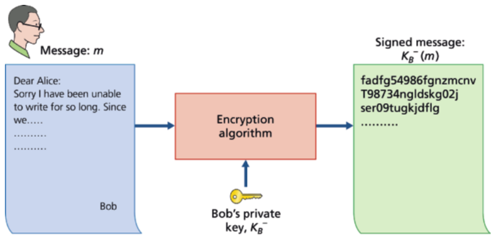

Hình 8.10 Tạo một chữ ký số cho một tài liệu

• Bất kỳ ai đã ký thông điệp đều phải đã dùng khóa riêng, K<sup>−</sup><sub>B</sub>, để tính chữ ký K<sup>−</sup><sub>B</sub>(m), sao cho K<sub>B</sub><sup>+</sup>( K<sub>B</sub><sup>−</sup>(m)) = m.

• Người duy nhất có thể biết khóa riêng, K<sup>−</sup><sub>B</sub>, là Bob. Nhớ lại từ thảo luận về RSA trong Mục 8.2 rằng biết khóa công khai, K<sup>+</sup><sub>B</sub>, không giúp gì cho việc tìm ra khóa riêng, K<sup>−</sup><sub>B</sub>. Do đó, người duy nhất có thể biết K<sup>−</sup><sub>B</sub> là người ngay từ đầu đã tạo cặp khóa, ( K<sub>B</sub><sup>+</sup>, K<sup>−</sup><sub>B</sub>), tức Bob. (Tuy nhiên, lưu ý rằng điều này giả định Bob chưa đưa K<sub>B</sub><sup>−</sup> cho ai, cũng không ai đánh cắp K<sub>B</sub><sup>−</sup> từ Bob.)

Cũng quan trọng cần lưu ý rằng nếu tài liệu gốc, m, bị sửa đổi thành một dạng khác, m′ , thì chữ ký mà Bob tạo cho m sẽ không hợp lệ cho m′ , vì K<sup>+</sup><sub>B</sub>(K<sup>−</sup><sub>B</sub>(m)) không bằng m′ . Do đó, chúng ta thấy chữ ký số cũng cung cấp toàn vẹn thông điệp, cho phép bên nhận xác minh rằng thông điệp không bị thay đổi cũng như nguồn gốc của thông điệp.

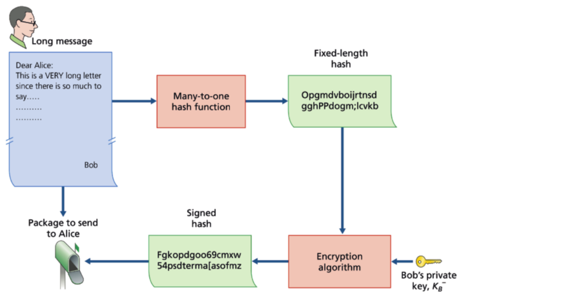

Hình 8.11 Gửi một thông điệp được ký số

Một mối lo ngại với việc ký dữ liệu bằng mã hóa là mã hóa và giải mã tốn kém về tính toán. Với overhead của mã hóa và giải mã, việc ký dữ liệu qua mã hóa/giải mã toàn bộ có thể là quá mức cần thiết. Một cách tiếp cận hiệu quả hơn là đưa hàm băm vào chữ ký số. Nhớ lại từ Mục 8.3.2 rằng một thuật toán băm nhận một thông điệp, m, có độ dài tùy ý và tính một “dấu vân tay” fixed-length của thông điệp, ký hiệu là H (m) . Dùng hàm băm, Bob ký giá trị băm của thông điệp thay vì bản thân thông điệp, tức là, Bob tính K<sup>−</sup><sub>B</sub>(H (m)). Vì H (m) nhìn chung nhỏ hơn nhiều so với thông điệp gốc m, công sức tính toán cần để tạo chữ ký số được giảm đáng kể.

Trong bối cảnh Bob gửi một thông điệp tới Alice, Hình 8.11 đưa ra tóm tắt thủ tục vận hành của việc tạo chữ ký số. Bob đưa thông điệp dài gốc của mình qua một hàm băm. Sau đó anh ấy ký số giá trị băm thu được bằng khóa riêng của mình. Thông điệp gốc (dạng cleartext) cùng với message digest đã ký số (từ đây gọi là chữ ký số) sau đó được gửi tới Alice. Hình 8.12 đưa ra tóm tắt thủ tục vận hành của chữ ký. Alice áp dụng khóa công khai của bên gửi cho thông điệp để có một kết quả băm. Alice cũng áp dụng hàm băm cho thông điệp cleartext để có kết quả băm thứ hai. Nếu hai giá trị băm khớp nhau, thì Alice có thể chắc chắn về tính toàn vẹn và tác giả của thông điệp.

Trước khi tiếp tục, hãy so sánh ngắn gọn chữ ký số với MAC, vì chúng có những điểm tương đồng, nhưng cũng có những khác biệt tinh tế quan trọng. Cả chữ ký số và MAC đều bắt đầu với một thông điệp (hoặc một tài liệu). Để tạo một MAC từ thông điệp, chúng ta nối một khóa xác thực vào thông điệp, rồi lấy giá trị băm của kết quả. Lưu ý rằng không có mã hóa khóa công khai hay khóa đối xứng nào tham gia vào việc tạo MAC. Để tạo một chữ ký số, chúng ta trước hết lấy giá trị băm của thông điệp rồi mã hóa thông điệp bằng khóa riêng của mình (dùng mật mã khóa công khai). Do đó, chữ ký số là một kỹ thuật “nặng hơn”, vì nó đòi hỏi một Public Key Infrastructure (PKI) bên dưới với các tổ chức chứng thực như mô tả dưới đây. Chúng ta sẽ thấy trong Mục 8.4 rằng PGP—một hệ thống e-mail an toàn phổ biến—dùng chữ ký số cho toàn vẹn thông điệp. Chúng ta đã thấy OSPF dùng MAC cho toàn vẹn thông điệp. Chúng ta sẽ thấy trong các Mục 8.5 và 8.6 rằng MAC cũng được dùng cho các giao thức bảo mật transport-layer và network-layer phổ biến.

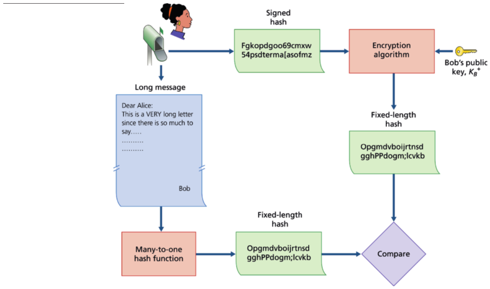

Hình 8.12 Kiểm chứng một thông điệp đã ký

#### Chứng thực khóa công khai (Public Key Certification)

Một ứng dụng quan trọng của chữ ký số là chứng thực khóa công khai, tức là, chứng nhận rằng một khóa công khai thuộc về một thực thể cụ thể. Chứng thực khóa công khai được dùng trong nhiều giao thức mạng an toàn phổ biến, bao gồm IPsec và TLS.

Để hiểu rõ vấn đề này, hãy xét một phiên bản Internet-commerce của trò “chơi khăm pizza” kinh điển. Alice kinh doanh giao pizza và nhận đơn qua Internet. Bob, một người mê pizza, gửi cho Alice một thông điệp bản rõ bao gồm địa chỉ nhà và loại pizza anh ấy muốn. Trong thông điệp này, Bob cũng đính kèm một chữ ký số (tức là, một giá trị băm đã ký của thông điệp bản rõ gốc) để chứng minh với Alice rằng anh ấy là nguồn thực sự của thông điệp. Để kiểm chứng chữ ký, Alice lấy khóa công khai của Bob (có thể từ một server khóa công khai hoặc từ thông điệp e-mail) và kiểm tra chữ ký số. Bằng cách này cô ấy chắc chắn rằng Bob, chứ không phải một kẻ chơi khăm tuổi teen nào đó, đã đặt hàng.

Tất cả nghe có vẻ ổn cho tới khi Trudy tinh quái xuất hiện. Như minh họa trong Hình 8.13, Trudy đang bày trò chơi khăm. Cô ấy gửi một thông điệp tới Alice trong đó cô ấy nói mình là Bob, đưa địa chỉ nhà của Bob, và đặt một chiếc pizza. Trong thông điệp này cô ấy cũng đính kèm khóa công khai của mình (của Trudy), mặc dù Alice đương nhiên cho rằng đó là khóa công khai của Bob. Trudy cũng gắn một chữ ký số, được tạo bằng khóa riêng của chính cô ấy (của Trudy). Sau khi nhận thông điệp, Alice áp dụng khóa công khai của Trudy (nghĩ rằng đó là của Bob) cho chữ ký số và kết luận rằng thông điệp bản rõ thực sự do Bob tạo. Bob sẽ rất ngạc nhiên khi người giao hàng mang tới nhà một chiếc pizza với pepperoni và cá cơm!

Chúng ta thấy từ ví dụ này rằng để mật mã khóa công khai hữu ích, bạn cần có khả năng kiểm chứng rằng bạn có khóa công khai thật của thực thể (người, router, trình duyệt, v.v.) mà bạn muốn giao tiếp. Ví dụ, khi Alice muốn giao tiếp với Bob bằng mật mã khóa công khai, cô ấy cần kiểm chứng rằng khóa công khai được cho là của Bob thực sự là của Bob. Việc gắn một khóa công khai với một thực thể cụ thể thường được thực hiện bởi một tổ chức chứng thực (Certification Authority - CA), có nhiệm vụ xác thực danh tính và cấp chứng chỉ. Một CA có các vai trò sau:

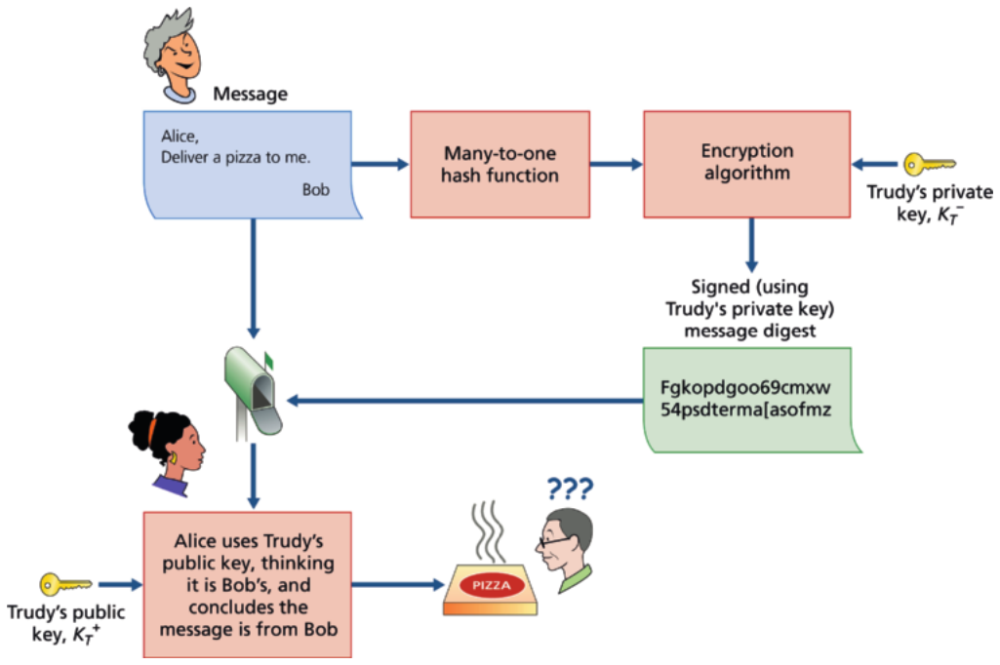

Hình 8.13 Trudy mạo danh Bob dùng mật mã khóa công khai

1. Một CA xác minh rằng một thực thể (một người, một router, v.v.) đúng là thực thể nó tự xưng. Không có thủ tục bắt buộc nào về cách thực hiện chứng thực. Khi làm việc với một CA, người ta phải tin rằng CA đã thực hiện xác minh danh tính đủ nghiêm ngặt. Ví dụ, nếu Trudy có thể bước vào CA Fly-by-Night (chộp giật) và đơn giản tuyên bố “Tôi là Alice” và nhận chứng chỉ gắn với danh tính của Alice, thì người ta không nên đặt nhiều niềm tin vào các khóa công khai được CA Fly-by-Night chứng thực. Mặt khác, người ta có thể (hoặc có thể không!) sẵn lòng tin một CA thuộc chương trình liên bang hoặc tiểu bang hơn. Bạn chỉ có thể tin danh tính gắn với một khóa công khai trong chừng mực bạn có thể tin CA và các kỹ thuật xác minh danh tính của nó. Chúng ta dệt nên một mạng lưới niềm tin rối rắm biết bao!

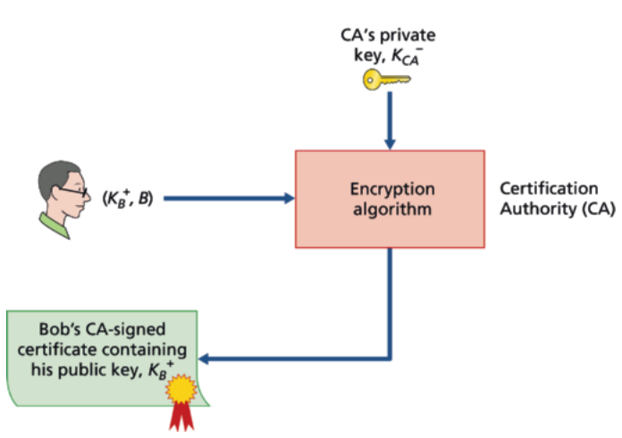

Hình 8.14 Bob được CA chứng thực khóa công khai

2. Một khi CA xác minh danh tính của thực thể, CA tạo một chứng chỉ (certificate) gắn khóa công khai của thực thể với danh tính. Chứng chỉ chứa khóa công khai và thông tin định danh duy nhất toàn cầu về chủ sở hữu khóa công khai (ví dụ, tên người hoặc địa chỉ IP). Chứng chỉ được CA ký số. Các bước này được minh họa trong Hình 8.14.

Giờ hãy xem chứng chỉ có thể được dùng thế nào để chống lại những kẻ chơi khăm pizza-ordering, như Trudy, và những kẻ không mong muốn khác. Khi Bob đặt hàng, anh ấy cũng gửi chứng chỉ CA-signed của mình. Alice dùng khóa công khai của CA để kiểm tra tính hợp lệ của chứng chỉ của Bob và trích khóa công khai của Bob.

Cả International Telecommunication Union (ITU) và IETF đều đã phát triển các chuẩn cho CA. ITU X.509 [ITU 2005a] đặc tả một dịch vụ xác thực cũng như một cú pháp cụ thể cho chứng chỉ. [RFC 1422] mô tả quản lý khóa CA-based để dùng với e-mail Internet an toàn. Nó tương thích với X.509 nhưng vượt xa X.509 bằng cách thiết lập các thủ tục và quy ước cho một kiến trúc quản lý khóa. Bảng 8.4 mô tả một số trường quan trọng trong một chứng chỉ.

| Tên trường (Field Name) | Mô tả (Description) |
|---|---|
| Phiên bản (Version) | Số phiên bản của đặc tả X.509 |
| Số sê-ri (Serial number) | Định danh duy nhất CA-issued cho một chứng chỉ |
| Chữ ký (Signature) | Chỉ định thuật toán CA dùng để ký chứng chỉ này |
| Tên bên cấp (Issuer name) | Danh tính của CA cấp chứng chỉ này, ở định dạng distinguished name (DN) [RFC 4514] |
| Thời hạn hiệu lực (Validity period) | Thời điểm bắt đầu và kết thúc thời hạn hiệu lực của chứng chỉ |
| Tên chủ thể (Subject name) | Danh tính của thực thể có khóa công khai gắn với chứng chỉ này, ở định dạng DN |
| Khóa công khai của chủ thể (Subject public key) | Khóa công khai của chủ thể cũng như chỉ báo về thuật toán khóa công khai (và tham số thuật toán) được<br>dùng với khóa này |

Bảng 8.4 Một số trường được chọn trong một khóa công khai X.509 và RFC 1422

## 8.4 Xác thực đầu mút (End-Point Authentication)

End-point authentication (xác thực đầu mút) là quá trình một thực thể chứng minh danh tính của mình với một thực thể khác qua mạng máy tính, ví dụ, một người dùng chứng minh danh tính của mình với một e-mail server. Là con người, chúng ta xác thực nhau theo nhiều cách: Chúng ta nhận ra khuôn mặt của nhau khi gặp, nhận ra giọng nói của nhau qua điện thoại, chúng ta được nhân viên hải quan xác thực khi đối chiếu chúng ta với ảnh trên hộ chiếu.

Trong mục này, chúng ta xét cách một bên có thể xác thực bên kia khi hai bên đang giao tiếp qua mạng. Ở đây chúng ta tập trung vào việc xác thực một bên “đang sống (live)”, tại thời điểm giao tiếp thực sự đang diễn ra. Một ví dụ cụ thể là một người dùng xác thực bản thân với một e-mail server. Đây là một bài toán hơi khác so với việc chứng minh rằng một thông điệp nhận được tại một thời điểm nào đó trong quá khứ thực sự đến từ bên gửi được tuyên bố, như đã học trong Mục 8.3.

Khi thực hiện xác thực qua mạng, các bên giao tiếp không thể dựa vào thông tin sinh trắc học, như diện mạo hay giọng nói. Thật vậy, chúng ta sẽ thấy trong các nghiên cứu tình huống sau rằng thường chính các phần tử mạng như router và các tiến trình client/server mới phải xác thực lẫn nhau. Ở đây, xác thực phải được thực hiện chỉ dựa trên các thông điệp và dữ liệu được trao đổi như một phần của một giao thức xác thực. Thông thường, một giao thức xác thực sẽ chạy trước khi hai bên giao tiếp chạy một giao thức nào đó khác (ví dụ, một giao thức truyền dữ liệu tin cậy, một giao thức trao đổi thông tin định tuyến, hoặc một giao thức e-mail). Giao thức xác thực trước hết thiết lập danh tính của các bên tới mức các bên đều hài lòng; chỉ sau khi xác thực các bên mới bắt tay vào công việc chính.

Như trong trường hợp chúng ta phát triển giao thức truyền dữ liệu tin cậy (rdt) trong Chương 3, ở đây chúng ta sẽ thấy bổ ích khi phát triển các phiên bản khác nhau của một giao thức xác thực, mà chúng ta sẽ gọi là ap (authentication protocol), và chỉ ra lỗ hổng trong mỗi phiên bản khi tiến hành. (Nếu bạn thích sự tiến hóa từng bước này của một thiết kế, bạn cũng có thể thích [Bryant 1988], kể lại một câu chuyện hư cấu giữa những người thiết kế một hệ thống xác thực open- network, và việc họ phát hiện ra nhiều vấn đề tinh tế liên quan.)

Giả sử Alice cần xác thực bản thân với Bob.

Có lẽ giao thức xác thực đơn giản nhất chúng ta có thể hình dung là giao thức trong đó Alice đơn giản gửi một thông điệp tới Bob nói rằng cô ấy là Alice. Giao thức này được minh họa trong Hình 8.15. Lỗ hổng ở đây là hiển nhiên—Bob không có cách nào thực sự biết người gửi thông điệp “I am Alice” thực sự là Alice. Ví dụ, Trudy (kẻ xâm nhập) cũng có thể gửi một thông điệp như vậy.

### Giao thức xác thực ap2.0 (Authentication Protocol ap2.0)

Nếu Alice có một địa chỉ mạng well-known (ví dụ, một địa chỉ IP) mà cô ấy luôn dùng để giao tiếp, Bob có thể cố xác thực Alice bằng cách xác minh rằng địa chỉ nguồn trên IP datagram mang thông điệp xác thực khớp với địa chỉ well-known của Alice. Trong trường hợp này, Alice sẽ được xác thực. Điều này có thể ngăn một kẻ xâm nhập network-naive (ngây ngô về mạng) mạo danh Alice, nhưng nó sẽ không ngăn được một sinh viên quyết tâm đang học cuốn sách này, hay nhiều người khác!

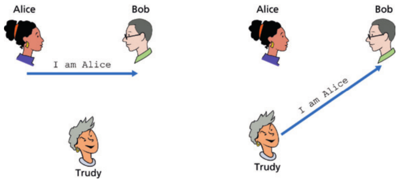

Hình 8.15 Giao thức ap1.0 và một kịch bản thất bại

Từ việc học tầng mạng và tầng liên kết dữ liệu, chúng ta biết rằng không khó lắm (ví dụ, nếu ai đó có quyền truy cập mã hệ điều hành và có thể build kernel hệ điều hành của riêng mình, như trường hợp với Linux và vài hệ điều hành miễn phí khác) để tạo một IP datagram, đặt bất kỳ địa chỉ IP nguồn nào chúng ta muốn (ví dụ, địa chỉ IP well-known của Alice) vào IP datagram, và gửi datagram qua giao thức link-layer tới router first-hop. Từ đó trở đi, datagram source-addressed sai sẽ được chuyển tiếp ngoan ngoãn tới Bob. Cách tiếp cận này, minh họa trong Hình 8.16, là một dạng giả mạo IP (IP spoofing). IP spoofing có thể tránh được nếu router first-hop của Trudy được cấu hình chỉ chuyển tiếp các datagram chứa địa chỉ IP nguồn của Trudy [RFC 2827]. Tuy nhiên, khả năng này không được triển khai hay thực thi phổ biến. Do đó Bob sẽ thật dại dột nếu giả định rằng người quản lý mạng của Trudy (có thể chính là Trudy) đã cấu hình router first-hop của Trudy chỉ chuyển tiếp các datagram có địa chỉ thích hợp.

### Giao thức xác thực ap3.0 (Authentication Protocol ap3.0)

Một cách tiếp cận kinh điển cho xác thực là dùng mật khẩu bí mật. Mật khẩu là một bí mật dùng chung giữa bên xác thực và người được xác thực. Gmail, Facebook, telnet, FTP, và nhiều dịch vụ khác dùng xác thực bằng mật khẩu. Do đó trong giao thức ap3.0, Alice gửi mật khẩu bí mật của mình tới Bob, như minh họa trong Hình 8.17.

Vì mật khẩu được dùng rất rộng rãi, chúng ta có thể nghĩ rằng giao thức ap3.0 khá an toàn. Nếu vậy, chúng ta đã sai! Lỗ hổng bảo mật ở đây rất rõ ràng. Nếu Trudy nghe lén giao tiếp của Alice, thì cô ấy có thể biết được mật khẩu của Alice. Kẻo bạn nghĩ điều này khó xảy ra, hãy xét thực tế rằng khi bạn Telnet tới một máy khác và đăng nhập, mật khẩu đăng nhập được gửi không mã hóa tới Telnet server. Ai đó nối vào LAN của Telnet client hoặc server có thể nghe lén (đọc và lưu) mọi packet được truyền trên LAN và do đó đánh cắp mật khẩu đăng nhập. Thực tế, đây là một cách tiếp cận well-known để đánh cắp mật khẩu (xem, ví dụ, [Jimenez 1997]). Mối đe dọa như vậy rõ ràng là rất thật, nên ap3.0 rõ ràng không ổn.

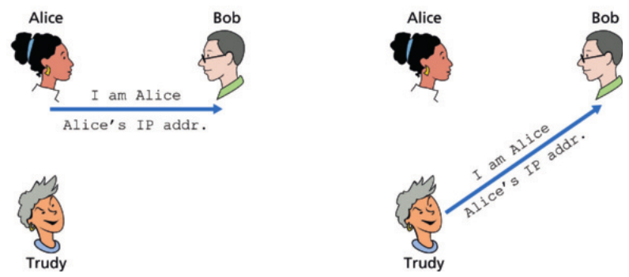

Hình 8.16 Giao thức ap2.0 và một kịch bản thất bại

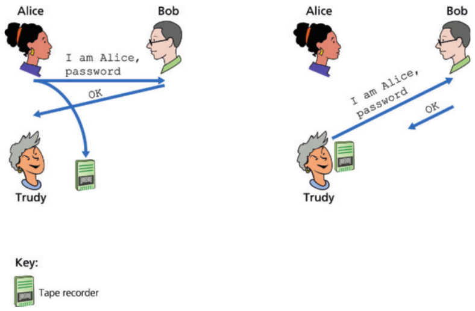

Hình 8.17 Giao thức ap3.0 và một kịch bản thất bại

### Giao thức xác thực ap3.1 (Authentication Protocol ap3.1)

Ý tưởng tiếp theo của chúng ta để sửa ap3.0 đương nhiên là mã hóa mật khẩu. Bằng cách mã hóa mật khẩu, chúng ta có thể ngăn Trudy biết được mật khẩu của Alice. Nếu giả định Alice và Bob chia sẻ một khóa bí mật đối xứng, K<sub>A−B</sub>, thì Alice có thể mã hóa mật khẩu và gửi thông điệp định danh của mình, “I am Alice,” và mật khẩu đã mã hóa tới Bob. Bob sau đó giải mã mật khẩu và, giả sử mật khẩu đúng, xác thực Alice. Bob cảm thấy yên tâm khi xác thực Alice vì Alice không chỉ biết mật khẩu, mà còn biết giá trị khóa bí mật dùng chung cần để mã hóa mật khẩu. Hãy gọi giao thức này là ap3.1.

Mặc dù đúng là ap3.1 ngăn Trudy biết được mật khẩu của Alice, việc dùng mật mã ở đây không giải quyết được bài toán xác thực. Bob có thể bị tấn công phát lại (playback attack): Trudy chỉ cần nghe lén giao tiếp của Alice, ghi lại phiên bản đã mã hóa của mật khẩu, và phát lại phiên bản mật khẩu đã mã hóa tới Bob để giả làm Alice. Việc dùng mật khẩu đã mã hóa trong ap3.1 không làm tình hình khác biệt rõ rệt so với giao thức ap3.0 trong Hình 8.17.

### Giao thức xác thực ap4.0 (Authentication Protocol ap4.0)

Kịch bản thất bại trong Hình 8.17 bắt nguồn từ việc Bob không thể phân biệt giữa lần xác thực ban đầu của Alice và lần phát lại sau đó của lần xác thực ban đầu của Alice. Nghĩa là, Bob không thể biết Alice có đang sống (tức là

Hình 8.18 Giao thức ap4.0 và một kịch bản thất bại

là, có thực sự đang ở đầu kia của kết nối hay không) hay các thông điệp anh ấy đang nhận là bản phát lại được ghi âm của một lần xác thực trước đó của Alice. Độc giả rất (rất) tinh ý sẽ nhớ lại rằng giao thức bắt tay three-way của TCP cũng cần giải quyết cùng bài toán này—phía server của một kết nối TCP không muốn chấp nhận một kết nối nếu segment SYN nhận được là một bản sao cũ (truyền lại) của một segment SYN từ một kết nối trước đó. Phía TCP server đã giải quyết bài toán xác định liệu client có thực sự đang sống như thế nào? Nó chọn một số thứ tự ban đầu chưa được dùng trong một thời gian rất dài, gửi số đó tới client, rồi chờ client phản hồi bằng một segment ACK chứa số đó. Chúng ta có thể áp dụng cùng ý tưởng ở đây cho mục đích xác thực.

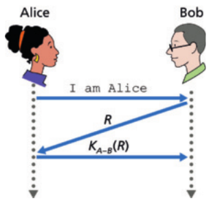

Một nonce là một số mà một giao thức sẽ chỉ dùng một lần trong đời. Nghĩa là, một khi giao thức dùng một nonce, nó sẽ không bao giờ dùng số đó nữa. Giao thức ap4.0 của chúng ta dùng nonce như sau:

1. Alice gửi thông điệp “I am Alice” tới Bob.

2. Bob chọn một nonce, R, và gửi nó tới Alice.

3. Alice mã hóa nonce bằng khóa bí mật đối xứng của Alice và Bob, K<sub>A−B</sub>, và gửi nonce đã mã hóa, K<sub>A−B</sub>(R), trở lại Bob. Như trong giao thức ap3.1, chính việc Alice biết K<sub>A−B</sub> và dùng nó để mã hóa một giá trị cho Bob biết rằng thông điệp anh ấy nhận được do Alice tạo ra. Nonce được dùng để đảm bảo rằng Alice đang sống.

4. Bob giải mã thông điệp nhận được. Nếu nonce đã giải mã bằng nonce anh ấy đã gửi Alice, thì Alice được xác thực.

Giao thức ap4.0 được minh họa trong Hình 8.18. Bằng cách dùng giá trị once-in-a-lifetime (một lần trong đời), R, rồi kiểm tra giá trị trả về, K<sub>A−B</sub>(R), Bob có thể chắc chắn rằng Alice vừa đúng là người cô ấy tự xưng (vì cô ấy biết giá trị khóa bí mật cần để mã hóa R) vừa đang sống (vì cô ấy đã mã hóa nonce, R, mà Bob vừa tạo).

Việc dùng nonce và mật mã khóa đối xứng tạo thành nền tảng của ap4.0. Một câu hỏi tự nhiên là liệu chúng ta có thể dùng nonce và mật mã khóa công khai (thay vì mật mã khóa đối xứng) để giải quyết bài toán xác thực hay không. Vấn đề này được khám phá trong các bài tập ở cuối chương.

## 8.5 Bảo mật thư điện tử (Securing E-Mail)

Trong các mục trước, chúng ta đã khảo sát các vấn đề cơ bản trong bảo mật mạng, bao gồm mật mã khóa đối xứng và khóa công khai, xác thực end-point, phân phối khóa, toàn vẹn thông điệp, và chữ ký số. Giờ chúng ta sẽ khảo sát cách các công cụ này được dùng để cung cấp bảo mật trong Internet.

Điều thú vị là, có thể cung cấp các dịch vụ bảo mật ở bất kỳ tầng nào trong bốn tầng trên cùng của chồng giao thức Internet. Khi bảo mật được cung cấp cho một giao thức application-layer cụ thể, ứng dụng dùng giao thức đó sẽ hưởng một hoặc nhiều dịch vụ bảo mật, như tính bí mật, xác thực, hoặc toàn vẹn. Khi bảo mật được cung cấp cho một giao thức transport-layer, mọi ứng dụng dùng giao thức đó đều hưởng các dịch vụ bảo mật của giao thức giao vận. Khi bảo mật được cung cấp ở tầng mạng trên cơ sở host-to-host, mọi segment transport-layer (và do đó mọi dữ liệu application-layer) đều hưởng các dịch vụ bảo mật của tầng mạng. Khi bảo mật được cung cấp trên cơ sở liên kết, thì dữ liệu trong mọi frame đi qua liên kết nhận được các dịch vụ bảo mật của liên kết.

Trong các Mục 8.5 đến 8.8, chúng ta khảo sát cách các công cụ bảo mật được dùng ở tầng ứng dụng, giao vận, mạng, và liên kết. Nhất quán với cấu trúc chung của cuốn sách này, chúng ta bắt đầu ở đỉnh chồng giao thức và bàn về bảo mật ở tầng ứng dụng. Cách tiếp cận của chúng ta là dùng một ứng dụng cụ thể, e-mail, làm nghiên cứu tình huống cho bảo mật application-layer. Sau đó chúng ta đi xuống chồng giao thức. Chúng ta sẽ khảo sát giao thức TLS (cung cấp bảo mật ở tầng giao vận), IPsec (cung cấp bảo mật ở tầng mạng), và bảo mật của giao thức LAN không dây IEEE 802.11.

Có thể bạn đang thắc mắc tại sao chức năng bảo mật được cung cấp ở nhiều hơn một tầng trong Internet. Chẳng phải chỉ cần cung cấp chức năng bảo mật ở tầng mạng là xong sao? Có hai câu trả lời cho câu hỏi này. Thứ nhất, mặc dù bảo mật ở tầng mạng có thể cung cấp “phủ toàn diện” bằng cách mã hóa mọi dữ liệu trong datagram (tức là, mọi segment transport-layer) và bằng cách xác thực mọi địa chỉ IP nguồn, nó không thể cung cấp bảo mật user-level. Ví dụ, một trang thương mại không thể dựa vào bảo mật IP-layer để xác thực một khách hàng đang mua hàng tại trang thương mại đó. Do đó, cần có chức năng bảo mật ở các tầng cao hơn cũng như phủ toàn diện ở các tầng thấp hơn. Thứ hai, nhìn chung triển khai các dịch vụ Internet mới, bao gồm dịch vụ bảo mật, ở các tầng cao hơn của chồng giao thức dễ hơn. Một ví dụ kinh điển là Pretty Good Privacy (PGP), cung cấp e-mail an toàn (được bàn sau trong mục này). Chỉ cần mã ứng dụng client và server, PGP là một trong những công nghệ bảo mật đầu tiên được dùng rộng rãi trong Internet.

### 8.5.1 Thư điện tử an toàn (Secure E-Mail)

Giờ chúng ta dùng các nguyên lý mật mã của các Mục 8.2 đến 8.3 để tạo một hệ thống e-mail an toàn. Chúng ta tạo thiết kế high-level này theo cách tăng dần, ở mỗi bước đưa vào các dịch vụ bảo mật mới. Khi thiết kế một hệ thống e-mail an toàn, hãy nhớ ví dụ nóng bỏng đã giới thiệu trong Mục 8.1— chuyện tình giữa Alice và Bob. Hãy hình dung Alice muốn gửi một thông điệp e-mail tới Bob, và Trudy muốn xâm nhập.

Trước khi lao vào thiết kế một hệ thống e-mail an toàn cho Alice và Bob, chúng ta nên xét xem các tính năng bảo mật nào là đáng mong muốn nhất đối với họ. Trước tiên và quan trọng nhất là tính bí mật. Như đã bàn trong Mục 8.1, cả Alice và Bob đều không muốn Trudy đọc thông điệp e-mail của Alice. Tính năng thứ hai mà Alice và Bob nhiều khả năng muốn thấy trong hệ thống e-mail an toàn là xác thực bên gửi. Cụ thể, khi Bob nhận thông điệp “I don’t love you anymore. I never want to see you again. Formerly yours, Alice,” anh ấy đương nhiên muốn chắc chắn rằng thông điệp đến từ Alice chứ không phải từ Trudy. Một tính năng khác mà đôi tình nhân sẽ đánh giá cao là toàn vẹn thông điệp, tức là, sự đảm bảo rằng thông điệp Alice gửi không bị sửa đổi trên đường tới Bob. Cuối cùng, hệ thống e-mail nên cung cấp xác thực bên nhận; tức là, Alice muốn chắc chắn rằng cô ấy thực sự đang gửi thư cho Bob chứ không phải cho ai khác (ví dụ, Trudy) đang mạo danh Bob.

Vậy hãy bắt đầu bằng việc giải quyết mối quan tâm hàng đầu, tính bí mật. Cách đơn giản nhất để cung cấp tính bí mật là Alice mã hóa thông điệp bằng công nghệ khóa đối xứng (như DES hoặc AES) và Bob giải mã thông điệp khi nhận. Như đã bàn trong Mục 8.2, nếu khóa đối xứng đủ dài, và nếu chỉ Alice và Bob có khóa, thì cực kỳ khó để bất kỳ ai khác (bao gồm Trudy) đọc được thông điệp. Mặc dù cách tiếp cận này đơn giản, nó có khó khăn cơ bản mà chúng ta đã bàn trong Mục 8.2—phân phối một khóa đối xứng sao cho chỉ Alice và Bob có bản sao của nó. Vì vậy chúng ta tự nhiên xét một cách tiếp cận thay thế—mật mã khóa công khai (dùng, ví dụ, RSA). Trong cách tiếp cận khóa công khai, Bob công bố công khai khóa công khai của mình (ví dụ, trên một server khóa công khai hoặc trên trang Web cá nhân), Alice mã hóa thông điệp của mình bằng khóa công khai của Bob, và cô ấy gửi thông điệp đã mã hóa tới địa chỉ e-mail của Bob. Khi Bob nhận thông điệp, anh ấy đơn giản giải mã nó bằng khóa riêng của mình. Giả sử Alice biết chắc rằng khóa công khai là khóa công khai của Bob, cách tiếp cận này là một phương tiện tuyệt vời để cung cấp tính bí mật mong muốn. Tuy nhiên, một vấn đề là mã hóa khóa công khai tương đối kém hiệu quả, đặc biệt với các thông điệp dài.

Để khắc phục vấn đề hiệu quả, hãy dùng một khóa phiên (đã bàn trong Mục 8.2.2). Cụ thể, Alice (1) chọn một khóa phiên đối xứng ngẫu nhiên, K<sub>S</sub>, (2) mã hóa thông điệp của mình, m, bằng khóa đối xứng, (3) mã hóa khóa đối xứng bằng khóa công khai của Bob, K<sub>B</sub><sup>+</sup>, (4) nối thông điệp đã mã hóa và khóa đối xứng đã mã hóa để tạo một “gói”, và (5) gửi gói tới địa chỉ e-mail của Bob. Các bước được minh họa trong Hình 8.19. (Trong hình này và các hình tiếp theo, dấu “+” được khoanh tròn biểu diễn phép nối và dấu “−” được khoanh tròn biểu diễn phép tách.) Khi Bob nhận gói, anh ấy (1) dùng khóa riêng của mình, K<sub>B</sub><sup>−</sup>, để lấy khóa đối xứng, K<sub>S</sub>, và (2) dùng khóa đối xứng K<sub>S</sub> để giải mã thông điệp m.

Sau khi đã thiết kế một hệ thống e-mail an toàn cung cấp tính bí mật, giờ hãy thiết kế một hệ thống khác cung cấp cả xác thực bên gửi và toàn vẹn thông điệp. Tạm thời giả sử Alice và Bob không còn quan tâm tới tính bí mật (họ muốn chia sẻ cảm xúc với mọi người!), và chỉ quan tâm tới xác thực bên gửi và toàn vẹn thông điệp. Để hoàn thành nhiệm vụ này, chúng ta dùng chữ ký số và message digest, như mô tả trong Mục 8.3. Cụ thể, Alice (1) áp dụng một hàm băm, H (ví dụ, MD5), cho thông điệp của mình, m, để có một message digest, (2) ký kết quả của hàm băm bằng khóa riêng của mình, K<sup>−</sup><sub>A</sub>, để tạo một chữ ký số, (3) nối thông điệp gốc (chưa mã hóa) với chữ ký để tạo một gói, và (4) gửi gói tới địa chỉ e-mail của Bob. Khi Bob nhận gói, anh ấy (1) áp dụng khóa công khai của Alice, K<sup>+</sup><sub>A</sub>, cho message digest đã ký và (2) so sánh kết quả của phép toán này với giá trị băm riêng của anh ấy, H, của thông điệp. Các bước được minh họa trong Hình 8.20. Như đã bàn trong Mục 8.3, nếu hai kết quả giống nhau, Bob có thể khá tự tin rằng thông điệp đến từ Alice và không bị thay đổi.

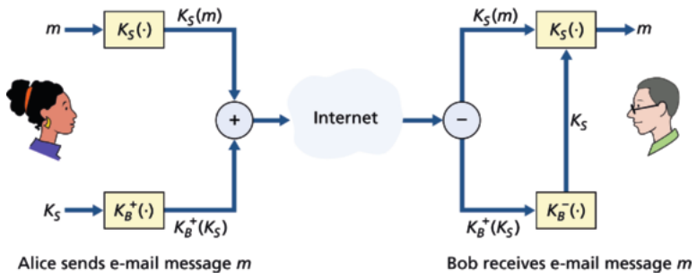

Hình 8.19 Alice dùng một khóa phiên đối xứng, K<sub>s</sub>, để gửi một e-mail bí mật tới Bob

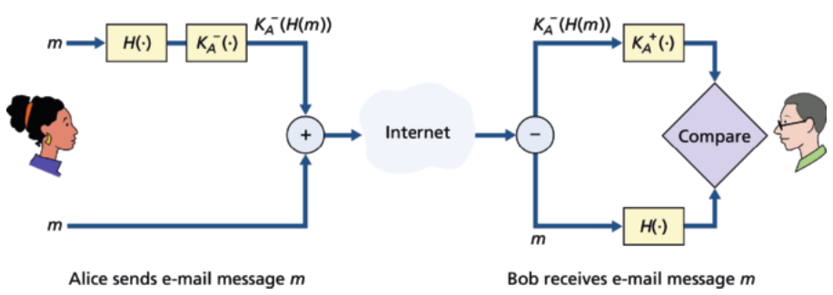

Hình 8.20 Dùng hàm băm và chữ ký số để cung cấp xác thực bên gửi và toàn vẹn thông điệp

Giờ hãy xét việc thiết kế một hệ thống e-mail cung cấp tính bí mật, xác thực bên gửi, và toàn vẹn thông điệp. Điều này có thể được thực hiện bằng cách kết hợp các thủ tục trong Hình 8.19 và 8.20. Alice trước hết tạo một gói sơ bộ, đúng như trong Hình 8.20, gồm thông điệp gốc của cô ấy cùng với một giá trị băm đã ký số của thông điệp. Sau đó cô ấy coi gói sơ bộ này như một thông điệp và đưa thông điệp mới này qua các bước phía bên gửi trong Hình 8.19, tạo một gói mới được gửi tới Bob. Các bước Alice áp dụng được minh họa trong Hình 8.21. Khi Bob nhận gói, anh ấy trước hết áp dụng phía của mình trong Hình 8.19 rồi phía của mình trong Hình 8.20. Hẳn đã rõ rằng thiết kế này đạt mục tiêu cung cấp tính bí mật, xác thực bên gửi, và toàn vẹn thông điệp. Lưu ý rằng, trong sơ đồ này, Alice dùng mật mã khóa công khai hai lần: một lần với khóa riêng của mình và một lần với khóa công khai của Bob. Tương tự, Bob cũng dùng mật mã khóa công khai hai lần— một lần với khóa riêng của mình và một lần với khóa công khai của Alice.

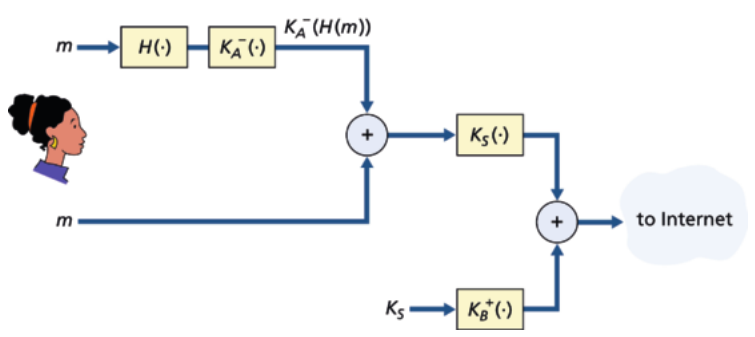

Hình 8.21 Alice dùng mật mã khóa đối xứng, mật mã khóa công khai, một hàm băm, và một chữ ký số để cung cấp tính bí mật, xác thực bên gửi, và toàn vẹn thông điệp

Thiết kế e-mail an toàn phác thảo trong Hình 8.21 có lẽ cung cấp bảo mật thỏa đáng cho hầu hết người dùng e-mail trong hầu hết các trường hợp. Tuy nhiên, vẫn còn một vấn đề quan trọng cần giải quyết. Thiết kế trong Hình 8.21 đòi hỏi Alice lấy khóa công khai của Bob, và đòi hỏi Bob lấy khóa công khai của Alice. Việc phân phối các khóa công khai này là một bài toán không tầm thường. Ví dụ, Trudy có thể mạo danh Bob và đưa cho Alice khóa công khai của chính mình trong khi nói rằng đó là khóa công khai của Bob, cho phép cô ấy nhận thông điệp dành cho Bob. Như chúng ta đã học trong Mục 8.3, một cách tiếp cận phổ biến để phân phối khóa công khai một cách an toàn là chứng thực khóa công khai bằng một CA.

### 8.5.2 PGP

Được Phil Zimmermann viết năm 1991, Pretty Good Privacy (PGP) là một ví dụ hay về sơ đồ mã hóa e-mail. Thiết kế PGP, về bản chất, giống thiết kế minh họa trong Hình 8.21. Tùy phiên bản, phần mềm PGP dùng MD5 hoặc SHA để tính message digest; CAST, triple-DES, hoặc IDEA cho mã hóa khóa đối xứng; và RSA cho mã hóa khóa công khai.

Khi PGP được cài đặt, phần mềm tạo một cặp khóa công khai cho người dùng. Khóa công khai có thể được đăng trên trang Web của người dùng hoặc đặt trên một server khóa công khai. Khóa riêng được bảo vệ bằng một mật khẩu. Mật khẩu phải được nhập mỗi lần người dùng truy cập khóa riêng. PGP cho người dùng lựa chọn ký số thông điệp, mã hóa thông điệp, hoặc vừa ký số vừa mã hóa. Hình 8.22 cho thấy một thông điệp PGP đã ký. Thông điệp này xuất hiện sau header MIME. Dữ liệu được mã hóa trong thông điệp là K<sup>−</sup><sub>A</sub>(H (m)), tức là, message digest đã ký số. Như đã bàn ở trên, để Bob kiểm chứng toàn vẹn của thông điệp, anh ấy cần truy cập được khóa công khai của Alice.

Hình 8.23 cho thấy một thông điệp PGP bí mật. Thông điệp này cũng xuất hiện sau header MIME. Tất nhiên, thông điệp bản rõ không được đưa vào trong thông điệp e-mail bí mật. Khi một bên gửi (như Alice) muốn cả tính bí mật và toàn vẹn, PGP chứa một thông điệp như trong Hình 8.23 bên trong thông điệp của Hình 8.22.

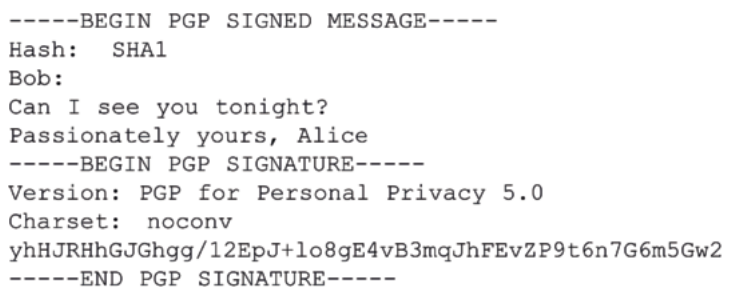

Hình 8.22 Một thông điệp PGP đã ký

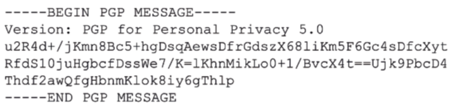

Hình 8.23 Một thông điệp PGP bí mật

PGP cũng cung cấp một cơ chế chứng thực khóa công khai, nhưng cơ chế này khá khác với CA thông thường. Khóa công khai PGP được chứng thực bởi một mạng lưới tin cậy (web of trust). Bản thân Alice có thể chứng thực bất kỳ cặp khóa/tên người dùng nào khi cô ấy tin rằng cặp đó thực sự thuộc về nhau. Ngoài ra, PGP cho phép Alice nói rằng cô ấy tin một người dùng khác đảm bảo cho tính xác thực của nhiều khóa hơn. Một số người dùng PGP ký khóa của nhau bằng cách tổ chức các buổi tiệc key-signing. Người dùng gặp nhau trực tiếp, trao đổi khóa công khai, và chứng thực khóa của nhau bằng cách ký chúng bằng khóa riêng của mình.

OpenPGP [OpenPGP 2025] là một hậu duệ mở của PGP gốc của Zimmerman, cung cấp tính bí mật dữ liệu, chữ ký số, và toàn vẹn thông điệp cho email và file dữ liệu dùng các kỹ thuật mã hóa khóa công khai và/hoặc đối xứng. OpenPGP được đặc tả trong [RFC 9580].

## 8.6 Bảo mật kết nối TCP và HTTP: TLS (Securing TCP and HTTP Connections: TLS)

Trong mục trước, chúng ta đã thấy các kỹ thuật mật mã có thể cung cấp tính bí mật, toàn vẹn dữ liệu, và xác thực end-point cho một ứng dụng cụ thể, cụ thể là e-mail. Trong mục này, chúng ta sẽ đi xuống một tầng trong chồng giao thức và khảo sát cách mật mã có thể tăng cường TCP và HTTP bằng các dịch vụ bảo mật, bao gồm tính bí mật, toàn vẹn dữ liệu, và xác thực end-point. Giao thức cung cấp các dịch vụ bảo mật này được gọi là giao thức Transport Layer Security (TLS).

Nhớ lại rằng chúng ta đã học trong Mục 2.2.6 rằng, nói một cách chặt chẽ, TLS là một giao thức application-layer cung cấp dịch vụ bảo mật giữa các tiến trình client và server dùng TLS. Về lịch sử, TLS đã được triển khai trên TCP, bảo mật các dịch vụ process-to-process bên dưới do TCP cung cấp. Chúng ta đã học trong Mục 2.2.6 rằng TLS giờ cũng chạy trên UDP như một phần của giao thức QUIC, cung cấp dịch vụ giao vận cho HTTP/3.

TLS có nguồn gốc từ giao thức Secure Socket Layer (SSL) trước đó được công bố và phát triển cho Netscape. Thật vậy, RFC 2246, đặc tả TLS1.0, đã ghi nhận “Những khác biệt giữa giao thức này và SSL 3.0 không lớn.” Chúng ta lưu ý ngắn gọn rằng các ý tưởng cơ bản đằng sau việc bảo mật TCP đã có trước công trình của Netscape (ví dụ, xem [Woo1994]).

TLS được triển khai rộng rãi. TLS được hỗ trợ bởi mọi trình duyệt Web và Web server phổ biến, được dùng mặc định trong HTTP/3, và được dùng bởi Gmail và về cơ bản mọi trang thương mại Internet (bao gồm Amazon, eBay, và TaoBao). Hàng trăm tỷ đô la được chi tiêu qua TLS mỗi năm. Thực tế, nếu bạn từng mua bất cứ thứ gì qua Internet bằng thẻ tín dụng, giao tiếp giữa trình duyệt của bạn và server cho giao dịch mua đó gần như chắc chắn đã đi qua TLS. (Bạn có thể nhận ra TLS đang được trình duyệt dùng khi URL bắt đầu bằng “https:” thay vì “http:”.) Phiên bản TLS hiện tại là TLS1.3, được đặc tả trong RFC 8446. TLS1.3 cải tiến so với các phiên bản trước bằng cách đưa vào bắt tay ban đầu nhanh hơn (như đã bàn trong Mục 2.2.6) và bằng cách loại bỏ các thuật toán và thủ tục mật mã cũ hơn và kém an toàn hơn. Để hiểu nhu cầu về TLS, hãy đi qua một kịch bản thương mại Internet điển hình. Bob đang lướt Web và tới trang Alice Incorporated, nơi bán nước hoa. Trang Alice Incorporated hiển thị một biểu mẫu trong đó Bob phải nhập loại nước hoa và số lượng mong muốn, địa chỉ, và số thẻ thanh toán của mình. Bob nhập thông tin này, nhấn Submit, và mong nhận được (qua đường bưu điện thông thường) nước hoa đã mua; anh ấy cũng mong thấy một khoản phí cho đơn hàng trong bảng sao kê thẻ thanh toán tiếp theo. Tất cả nghe có vẻ ổn, nhưng nếu không có biện pháp bảo mật nào được thực hiện, Bob có thể gặp vài bất ngờ.

• Nếu không dùng tính bí mật (mã hóa), một kẻ xâm nhập có thể chặn bắt đơn hàng của Bob và lấy thông tin thẻ thanh toán của anh ấy. Kẻ xâm nhập sau đó có thể mua hàng bằng tiền của Bob.

• Nếu không dùng toàn vẹn dữ liệu, một kẻ xâm nhập có thể sửa đơn hàng của Bob, khiến anh ấy mua số chai nước hoa nhiều gấp mười lần mong muốn.

• Cuối cùng, nếu không dùng xác thực server, một server có thể hiển thị logo nổi tiếng của Alice Incorporated trong khi thực tế trang được Trudy duy trì, kẻ đang mạo danh Alice Incorporated. Sau khi nhận đơn hàng của Bob, Trudy có thể lấy tiền của Bob và bỏ trốn. Hoặc Trudy có thể thực hiện đánh cắp danh tính bằng cách thu thập tên, địa chỉ, và số thẻ tín dụng của Bob.

TLS giải quyết các vấn đề này bằng cách cung cấp tính bí mật, toàn vẹn dữ liệu, xác thực server, và xác thực client cho các ứng dụng chạy phía trên nó.

### 8.6.1 Bức tranh lớn (The Big Picture)

Chúng ta bắt đầu bằng việc mô tả một phiên bản đơn giản hóa của TLS, một phiên bản sẽ cho phép chúng ta có hiểu biết big-picture về lý do và cách thức của TLS. Chúng ta sẽ gọi phiên bản đơn giản hóa này của TLS là “almost-TLS.” Sau khi mô tả almost-TLS, trong tiểu mục tiếp theo chúng ta sẽ mô tả TLS thật, điền đầy đủ chi tiết. Almost-TLS (và TLS) có ba giai đoạn: bắt tay (handshake), suy dẫn khóa (key derivation), và truyền dữ liệu. Giờ chúng ta mô tả ba giai đoạn này cho một phiên giao tiếp giữa một client (Bob) và một server (Alice), với Alice có một cặp khóa riêng/công khai và một chứng chỉ gắn danh tính của cô ấy với khóa công khai của cô ấy. Chúng ta sẽ mô tả TLS trong bối cảnh bảo mật kết nối TCP, nhưng nhớ rằng TLS cũng được dùng trong QUIC để bảo mật giao tiếp process-to-process qua UDP.

#### Bắt tay (Handshake)

Trong giai đoạn bắt tay, Bob cần (a) thiết lập một kết nối TCP với Alice, (b) xác minh rằng Alice thực sự là Alice, và (c) gửi cho Alice một khóa bí mật chủ (master secret key), sẽ được cả Alice và Bob dùng để tạo mọi khóa đối xứng họ cần cho phiên TLS. Ba bước này được minh họa trong Hình 8.24. Lưu ý rằng một khi kết nối TCP được thiết lập, Bob gửi cho Alice một thông điệp hello. Alice sau đó phản hồi bằng chứng chỉ của mình, chứa khóa công khai của cô ấy. Như đã bàn trong Mục 8.3, vì chứng chỉ đã được một CA chứng thực, Bob biết chắc rằng khóa công khai trong chứng chỉ thuộc về Alice. Bob sau đó tạo một Master Secret (MS) (sẽ chỉ được dùng cho phiên TLS này), mã hóa MS bằng khóa công khai của Alice để tạo Encrypted Master Secret (EMS), và gửi EMS tới Alice. Alice giải mã EMS bằng khóa riêng của mình để có MS. Sau giai đoạn này, cả Bob và Alice (và không ai khác) đều biết master secret cho phiên TLS này.

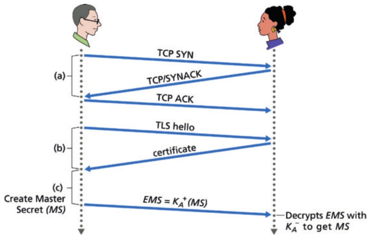

Hình 8.24 Bắt tay almost-TLS, bắt đầu với một kết nối TCP

#### Suy dẫn khóa (Key Derivation)

Về nguyên tắc, MS, giờ được Bob và Alice dùng chung, có thể được dùng làm khóa phiên đối xứng cho mọi việc mã hóa và kiểm tra toàn vẹn dữ liệu tiếp theo. Tuy nhiên, nhìn chung được coi là an toàn hơn khi Alice và Bob mỗi người dùng các khóa mật mã khác nhau, và cũng dùng các khóa khác nhau cho mã hóa và kiểm tra toàn vẹn. Do đó, cả Alice và Bob đều dùng MS để tạo bốn khóa:

• E<sub>B</sub> = khóa mã hóa phiên cho dữ liệu gửi từ Bob tới Alice

• M<sub>B</sub> = khóa HMAC phiên cho dữ liệu gửi từ Bob tới Alice, trong đó HMAC [RFC 2104] là một mã xác thực thông điệp (MAC) dạng băm được chuẩn hóa mà chúng ta đã gặp trong Mục 8.3.2

• E<sub>A</sub> = khóa mã hóa phiên cho dữ liệu gửi từ Alice tới Bob

• M<sub>A</sub> = khóa HMAC phiên cho dữ liệu gửi từ Alice tới Bob

Alice và Bob mỗi người tạo bốn khóa từ MS. Việc này có thể được thực hiện bằng cách đơn giản cắt MS thành bốn khóa. (Nhưng trong TLS thực tế thì phức tạp hơn một chút, như chúng ta sẽ thấy.) Ở cuối giai đoạn suy dẫn khóa, cả Alice và Bob đều có đủ bốn khóa. Hai khóa mã hóa sẽ được dùng để mã hóa dữ liệu; hai khóa HMAC sẽ được dùng để kiểm chứng toàn vẹn của dữ liệu.

#### Truyền dữ liệu (Data Transfer)

Giờ Alice và Bob dùng chung cùng bốn khóa phiên (E<sub>B</sub>, M<sub>B</sub>, E<sub>A</sub>, và M<sub>A</sub>), họ có thể bắt đầu gửi dữ liệu được bảo mật cho nhau qua kết nối TCP. Vì TCP là một giao thức byte-stream, một cách tiếp cận tự nhiên là TLS mã hóa dữ liệu ứng dụng ngay lập tức rồi chuyển dữ liệu đã mã hóa ngay lập tức cho TCP. Nhưng nếu làm vậy, chúng ta sẽ đặt HMAC cho việc kiểm tra toàn vẹn ở đâu? Chắc chắn chúng ta không muốn chờ tới cuối phiên TCP mới kiểm chứng toàn vẹn của mọi dữ liệu của Bob đã gửi trong toàn bộ phiên! Để giải quyết vấn đề này, TLS chia luồng dữ liệu thành các bản ghi (record), nối một HMAC vào mỗi bản ghi để kiểm tra toàn vẹn, rồi mã hóa bản ghi + HMAC. Để tạo HMAC, Bob đưa dữ liệu bản ghi cùng với khóa M<sub>B</sub> vào một hàm băm, như đã bàn trong Mục 8.3. Để mã hóa gói bản ghi + HMAC, Bob dùng khóa mã hóa phiên E<sub>B</sub> của mình. Gói đã mã hóa này sau đó được chuyển cho TCP để vận chuyển qua Internet.

Mặc dù cách tiếp cận này đi được một chặng đường dài, nó vẫn chưa bullet-proof (hoàn toàn chắc chắn) khi nói tới việc cung cấp toàn vẹn dữ liệu cho toàn bộ luồng thông điệp. Cụ thể, giả sử Trudy là một woman-in-the-middle (kẻ đứng giữa) và có khả năng chèn, xóa, và thay thế các segment trong luồng segment TCP gửi giữa Alice và Bob. Ví dụ, Trudy có thể bắt hai segment do Bob gửi, đảo thứ tự các segment, điều chỉnh số thứ tự TCP (vốn không được mã hóa), rồi gửi hai segment reverse-ordered tới Alice. Giả sử mỗi segment TCP đóng gói đúng một bản ghi, giờ hãy xem Alice sẽ xử lý các segment này thế nào.

1. TCP chạy trong Alice sẽ nghĩ mọi thứ đều ổn và chuyển hai bản ghi lên tầng con TLS.

2. TLS trong Alice sẽ giải mã hai bản ghi.

3. TLS trong Alice sẽ dùng HMAC trong mỗi bản ghi để kiểm chứng toàn vẹn dữ liệu của hai bản ghi.

4. TLS sau đó sẽ chuyển các luồng byte đã giải mã của hai bản ghi lên tầng ứng dụng; nhưng luồng byte đầy đủ mà Alice nhận được sẽ không đúng thứ tự do các bản ghi bị đảo!

Bạn được khuyến khích đi qua các kịch bản tương tự khi Trudy xóa segment hoặc khi Trudy phát lại segment.

Giải pháp cho vấn đề này, như có lẽ bạn đã đoán, là dùng số thứ tự. TLS làm điều này như sau. Bob duy trì một bộ đếm số thứ tự, bắt đầu từ không và được tăng cho mỗi bản ghi TLS anh ấy gửi. Bob không thực sự đưa số thứ tự vào bản thân bản ghi, nhưng khi tính HMAC, anh ấy đưa số thứ tự vào phép tính HMAC. Do đó, HMAC giờ là giá trị băm của dữ liệu cộng khóa HMAC M<sub>B</sub> cộng số thứ tự hiện tại. Alice theo dõi số thứ tự của Bob, cho phép cô ấy kiểm chứng toàn vẹn dữ liệu của một bản ghi bằng cách đưa số thứ tự thích hợp vào phép tính HMAC. Việc dùng số thứ tự TLS này ngăn Trudy thực hiện tấn công woman-in-the-middle, như sắp xếp lại hoặc phát lại segment. (Tại sao?)

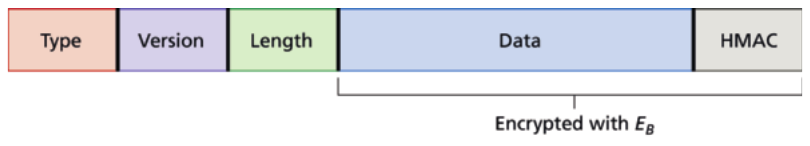

Hình 8.25 Định dạng bản ghi cho almost-TLS

#### Bản ghi TLS (TLS Record)

Bản ghi almost-TLS được minh họa trong Hình 8.25. Bản ghi gồm một trường type, trường version, trường length, trường data, và trường HMAC. Lưu ý rằng ba trường đầu tiên không được mã hóa. Trường type cho biết bản ghi là một thông điệp bắt tay hay một thông điệp chứa dữ liệu ứng dụng. Nó cũng được dùng để đóng kết nối TLS, như bàn dưới đây. TLS ở đầu nhận dùng trường length để trích các bản ghi TLS ra khỏi luồng byte TCP đến. Trường version thì self-explanatory (tự giải thích).

### 8.6.2 Bức tranh đầy đủ hơn: TLS 1.3 (A More Complete Picture: TLS 1.3)

Tiểu mục trước đã đề cập giao thức almost-TLS và cung cấp hiểu biết cơ bản về lý do và cách thức của TLS. Với hiểu biết cơ bản này, giờ chúng ta có thể đào sâu hơn một chút và khảo sát những điểm thiết yếu của giao thức TLS thực tế. Song song với việc đọc mô tả giao thức TLS này, bạn được khuyến khích hoàn thành bài lab Wireshark TLS, có trên trang Web của giáo trình.

Giao thức TLS đã trải qua một số thay đổi khi tiến hóa từ TLS 1.0 sang TLS 1.1 sang TLS 1.2 và giờ là TLS 1.3 [RFC 8446]. Một số thay đổi này được đưa vào do các lỗ hổng bảo mật được phát hiện trong các phiên bản trước hoặc để triển khai các thực hành tốt nhất mới nổi trong bảo mật. Các thay đổi khác được đưa vào để cải thiện performance của TLS, đặc biệt là để giảm thiểu số RTT cần để thiết lập một kết nối TLS—một chủ đề mà chúng ta đã gặp trước đó khi học sự tiến hóa của giao thức HTTP trong Chương 2. Bất chấp các thay đổi này, mục tiêu của TLS vẫn như cũ—cung cấp tính bí mật, toàn vẹn dữ liệu, và xác thực cho các tiến trình client và server giao tiếp qua TLS. Và như chúng ta sẽ thấy, TLS làm điều đó bằng các kỹ thuật bảo mật mật mã nền tảng mà chúng ta đã học trước đó trong chương này.

#### Bắt tay TLS 1.3 (TLS 1.3 Handshake)

Mục tiêu của bắt tay TLS 1.3 là để client và server thống nhất một cách an toàn bộ mật mã (cipher suite) sẽ được dùng để cung cấp tính bí mật, toàn vẹn dữ liệu, và xác thực; để thực hiện xác thực; và để thống nhất một Master Secret dùng chung mới gọi là khóa tạm thời (ephemeral key). Khóa tạm thời này sau đó được dùng để suy dẫn các khóa dùng chung khác được dùng sau đó trong phiên TLS-protected. Bắt tay TLS 1.3 trong trường hợp thông thường có các bước sau:

• Client Hello. Trong thông điệp Client Hello, client cho biết số phiên bản TLS (1.3 ) , lựa chọn một trong ba bộ mật mã và tham số, và một nonce để tránh tấn công phát lại. Các thành phần của một bộ mật mã là: (i) một kỹ thuật trao đổi khóa được dùng để tạo Master Secret, và một thuật toán băm SHA được dùng sau bắt tay để suy dẫn các khóa bổ sung từ Master Secret; (ii) một thuật toán Authenticated Encryption with Associated Data (AEAD) được dùng trong quá trình truyền dữ liệu. Thay vì dùng các thuật toán mã hóa và toàn vẹn thông điệp riêng biệt, AEAD duy nhất cung cấp cả tính bí mật và toàn vẹn cho dữ liệu được truyền, dùng (AES hoặc ChaCha20) để mã hóa. Để tạo Master Secret, trong mọi trường hợp một biến thể của thỏa thuận khóa Diffie-Hellman (DH), đã học trong Mục 8.2.2, được dùng.

• Server Hello, Finished. Server TLS 1.3 nói “hello” rồi ngay lập tức “goodbye.” Thông điệp Server Hello bao gồm chứng chỉ của server, bộ mật mã đã chọn, và một nonce server-generated. Vì thông điệp Client Hello chứa các giá trị (công khai) của client cần cho thỏa thuận khóa DH, server tạo các giá trị DH công khai và riêng của chính nó rồi tạo Master Secret dùng chung từ giá trị công khai của client và giá trị DH riêng của chính nó. Nó đưa các giá trị DH công khai của mình vào thông điệp Server Hello gửi client.

• Client Finished. Client kiểm chứng chữ ký và chứng chỉ và tạo bản Master Secret của riêng mình từ các giá trị key-agreement DH riêng của nó và giá trị DH công khai nhận được từ server. Thông điệp Finished chứa một giá trị băm đã ký của các thông điệp Client và Server Hello để kiểm chứng rằng các thông điệp này đã được nhận và không bị can thiệp. Bản thân thông điệp Finish được mã hóa và ký bằng một khóa suy dẫn từ Master Secret.

Một khi thông điệp Client Finished đã được gửi, client có thể ngay lập tức gửi các thông điệp ứng dụng (ví dụ, một thông điệp HTTP GET) tới server, với các thông điệp này và các phản hồi giờ được TLS bảo vệ. Như minh họa trong Hình 8.26, TLS 1.3 chỉ cần một RTT duy nhất—giảm so với hai hoặc nhiều RTT mà các phiên bản TLS trước cần.

Khi TLS 1.3 chạy trên TCP, một kết nối TCP phải được thiết lập trước khi bắt tay TLS có thể tiến hành. Do đó, khi chạy TLS 1.3 trên TCP, cần hai RTT trước khi client có thể bắt đầu gửi dữ liệu (như thông điệp HTTP request ban đầu). Ngược lại, khi dùng QUIC, TLS 1.3 không chạy trên QUIC mà thay vào đó được tích hợp vào nó. Trong QUIC, thông điệp Client Hello của TLS 1.3 là một phần của thông điệp thiết lập kết nối QUIC, được gửi qua UDP. Do đó, khi dùng QUIC, client chỉ cần chờ một RTT trước khi có thể bắt đầu gửi dữ liệu tới server. Với QUIC, cũng có thể không cần RTT nào (tức là, client có thể ngay lập tức bắt đầu gửi dữ liệu TLS-protected tới server) trong trường hợp client và server đã giao tiếp trước đó và khi đó đã thống nhất các tham số TLS sẽ dùng trong một kết nối TLS tương lai.

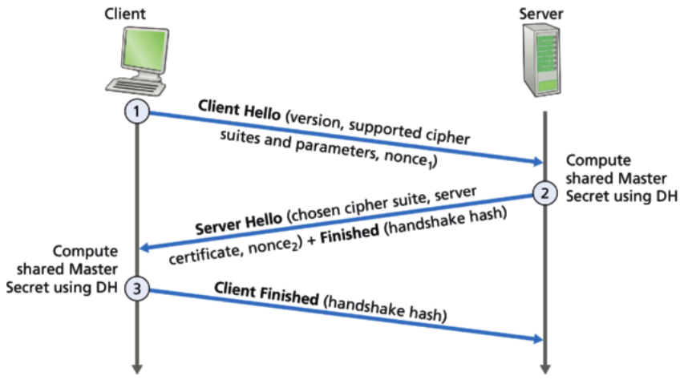

Hình 8.26 Bắt tay TLS 1.3

Có thể bạn đang thắc mắc tại sao lại có nonce trong bắt tay TLS. Chẳng phải số thứ tự đủ để ngăn tấn công phát lại segment sao? Câu trả lời là có, nhưng riêng chúng không ngăn được “tấn công phát lại kết nối (connection replay attack).” Hãy xét tấn công phát lại kết nối sau. Giả sử Trudy nghe lén mọi thông điệp giữa Alice và Bob. Ngày hôm sau, Trudy mạo danh Bob và gửi tới Alice đúng cùng chuỗi thông điệp mà Bob đã gửi tới Alice hôm trước. Nếu Alice không dùng nonce, cô ấy sẽ phản hồi bằng đúng cùng chuỗi thông điệp cô ấy đã gửi hôm trước. Alice sẽ không nghi ngờ trò mờ ám nào, vì mỗi thông điệp cô ấy nhận đều qua kiểm tra toàn vẹn. Nếu Alice là một server e-commerce, cô ấy sẽ nghĩ Bob đang đặt đơn hàng thứ hai (cho đúng cùng món hàng). Mặt khác, bằng cách đưa một nonce vào giao thức, Alice sẽ gửi các nonce khác nhau cho mỗi phiên TCP, khiến các khóa mã hóa khác nhau trong hai ngày. Do đó, khi Alice nhận các bản ghi TLS played-back (bị phát lại) từ Trudy, các bản ghi sẽ không qua được kiểm tra toàn vẹn, và giao dịch e-commerce giả mạo sẽ không thành công. Tóm lại, trong TLS, nonce được dùng để chống lại “tấn công phát lại kết nối” và số thứ tự được dùng để chống lại việc phát lại từng packet riêng lẻ trong một phiên đang diễn ra.

Các bản ghi TLS 1.3 chứa thông điệp bắt tay TLS và dữ liệu application-layer tiếp theo có định dạng như minh họa cho bản ghi almost-TLS trong Hình 8.25, ngoại trừ việc không cần HMAC tường minh, nhờ thuật toán AEAD cung cấp cả tính bí mật và toàn vẹn cho dữ liệu được truyền.

#### Đóng kết nối (Connection Closure)

Tại một thời điểm nào đó, Bob hoặc Alice sẽ muốn kết thúc phiên TLS. Một cách tiếp cận là để Bob kết thúc phiên TLS bằng cách đơn giản chấm dứt kết nối TCP bên dưới—tức là, để Bob gửi một segment TCP FIN tới Alice. Nhưng một thiết kế ngây thơ như vậy tạo điều kiện cho tấn công cắt cụt (truncation attack), trong đó Trudy một lần nữa chen vào giữa một phiên TLS đang diễn ra và kết thúc phiên sớm bằng một TCP FIN. Nếu Trudy làm vậy, Alice sẽ nghĩ cô ấy đã nhận đủ dữ liệu của Bob trong khi thực tế cô ấy chỉ nhận một phần. Giải pháp cho vấn đề này là chỉ ra trong trường type liệu bản ghi có dùng để kết thúc phiên TLS hay không. Bằng cách đưa vào một trường như vậy, nếu Alice nhận một TCP FIN trước khi nhận một bản ghi TLS đóng phiên, cô ấy sẽ biết có điều gì đó mờ ám đang diễn ra.

Đến đây hoàn tất phần giới thiệu về TLS. Chúng ta đã thấy nó dùng nhiều nguyên lý mật mã đã bàn trong các Mục 8.2 và 8.3. Độc giả muốn khám phá TLS ở mức sâu hơn nữa có thể đọc cuốn sách nền tảng của Rescorla về SSL/TLS [Rescorla 2001] cũng như các cập nhật gần đây hơn liên quan cụ thể tới TLS 1.3 [Cloudflare TLS 2018; Cloudflare TLS 2025].

## 8.7 Bảo mật tầng mạng: IPsec và mạng riêng ảo (Network-Layer Security: IPsec and Virtual Private Networks)

Giao thức bảo mật IP, thường được biết đến hơn là IPsec, cung cấp bảo mật ở tầng mạng. IPsec bảo mật các IP datagram giữa bất kỳ hai thực thể network-layer nào, bao gồm host và router. Như chúng ta sẽ sớm mô tả, nhiều tổ chức (công ty, cơ quan chính phủ, tổ chức non-profit (phi lợi nhuận), v.v.) dùng IPsec để tạo các mạng riêng ảo (VPN) chạy trên Internet công cộng.

Trước khi đi vào chi tiết IPsec, hãy lùi lại và xét việc cung cấp tính bí mật ở tầng mạng có nghĩa là gì. Với tính bí mật network-layer giữa một cặp thực thể mạng (ví dụ, giữa hai router, giữa hai host, hoặc giữa một router và một host), thực thể gửi mã hóa payload của mọi datagram nó gửi tới thực thể nhận. Payload đã mã hóa có thể là một TCP segment, một UDP segment, một thông điệp ICMP, v.v. Nếu có một dịch vụ network-layer như vậy, mọi dữ liệu gửi từ thực thể này tới thực thể kia—bao gồm e-mail, trang Web, thông điệp bắt tay TCP, và thông điệp quản lý (như ICMP và SNMP)—sẽ được che giấu khỏi bất kỳ bên thứ ba nào có thể đang nghe lén mạng. Vì lý do này, bảo mật network-layer được cho là cung cấp “phủ toàn diện”.

Ngoài tính bí mật, một giao thức bảo mật network-layer có thể cung cấp các dịch vụ bảo mật khác. Ví dụ, nó có thể cung cấp xác thực nguồn, để thực thể nhận có thể kiểm chứng nguồn của datagram được bảo mật. Một giao thức bảo mật network-layer có thể cung cấp toàn vẹn dữ liệu, để thực thể nhận có thể kiểm tra bất kỳ sự can thiệp nào vào datagram có thể đã xảy ra khi datagram đang trên đường truyền. Một dịch vụ bảo mật network-layer cũng có thể cung cấp ngăn chặn replay-attack, nghĩa là Bob có thể phát hiện mọi datagram trùng lặp mà kẻ tấn công có thể chèn vào. Chúng ta sẽ sớm thấy IPsec thực sự cung cấp cơ chế cho tất cả các dịch vụ bảo mật này, tức là, cho tính bí mật, xác thực nguồn, toàn vẹn dữ liệu, và ngăn chặn replay-attack.

### 8.7.1 IPsec và mạng riêng ảo (IPsec and Virtual Private Networks (VPNs))

Một tổ chức trải trên nhiều khu vực địa lý thường muốn có mạng IP riêng của mình, để các host và server của nó có thể gửi dữ liệu cho nhau một cách an toàn và bí mật. Để đạt mục tiêu này, tổ chức có thể thực sự triển khai một mạng vật lý stand-alone (độc lập)—bao gồm router, liên kết, và hạ tầng DNS—hoàn toàn tách biệt khỏi Internet công cộng. Một mạng tách rời như vậy, dành riêng cho một tổ chức cụ thể, được gọi là mạng riêng (private network). Không đáng ngạc nhiên, một mạng riêng có thể rất tốn kém, vì tổ chức cần mua, lắp đặt, và bảo trì hạ tầng mạng vật lý của riêng mình.

Thay vì triển khai và bảo trì một mạng riêng, nhiều tổ chức ngày nay tạo VPN trên Internet công cộng hiện có. Với VPN, traffic inter-office (giữa các văn phòng) của tổ chức được gửi qua Internet công cộng thay vì qua một mạng độc lập về vật lý. Nhưng để cung cấp tính bí mật, traffic inter-office được mã hóa trước khi đi vào Internet công cộng. Một ví dụ đơn giản về VPN được minh họa trong Hình 8.27. Ở đây tổ chức gồm một trụ sở chính, một văn phòng chi nhánh, và các nhân viên bán hàng lưu động thường truy cập Internet từ phòng khách sạn. (Chỉ một nhân viên bán hàng được vẽ trong hình.) Trong VPN này, bất cứ khi nào hai host trong trụ sở chính gửi IP datagram cho nhau hoặc bất cứ khi nào hai host trong văn phòng chi nhánh muốn giao tiếp, chúng dùng IPv4 good-old vanilla (thuần túy) (tức là, không có dịch vụ IPsec). Tuy nhiên, khi hai host của tổ chức giao tiếp qua một đường đi qua Internet công cộng, traffic được mã hóa trước khi đi vào Internet.

Để cảm nhận cách VPN hoạt động, hãy đi qua một ví dụ đơn giản trong bối cảnh Hình 8.27. Khi một host trong trụ sở chính gửi một IP datagram tới một nhân viên bán hàng ở khách sạn, router gateway ở trụ sở chính chuyển IPv4 datagram thuần túy thành một IPsec datagram rồi chuyển tiếp IPsec datagram này vào Internet. IPsec datagram này thực ra có một header IPv4 truyền thống, để các router trong Internet công cộng xử lý datagram như thể nó là một IPv4 datagram thông thường—đối với chúng, datagram là một datagram hoàn toàn bình thường. Nhưng, như minh họa trong Hình 8.27, payload của IPsec datagram bao gồm một header IPsec, được dùng cho xử lý IPsec; hơn nữa, payload của IPsec datagram được mã hóa. Khi IPsec datagram tới laptop của nhân viên bán hàng, OS trong laptop giải mã payload (và cung cấp các dịch vụ bảo mật khác, như kiểm chứng toàn vẹn dữ liệu) và chuyển payload chưa mã hóa lên giao thức upper-layer (ví dụ, tới TCP hoặc UDP).

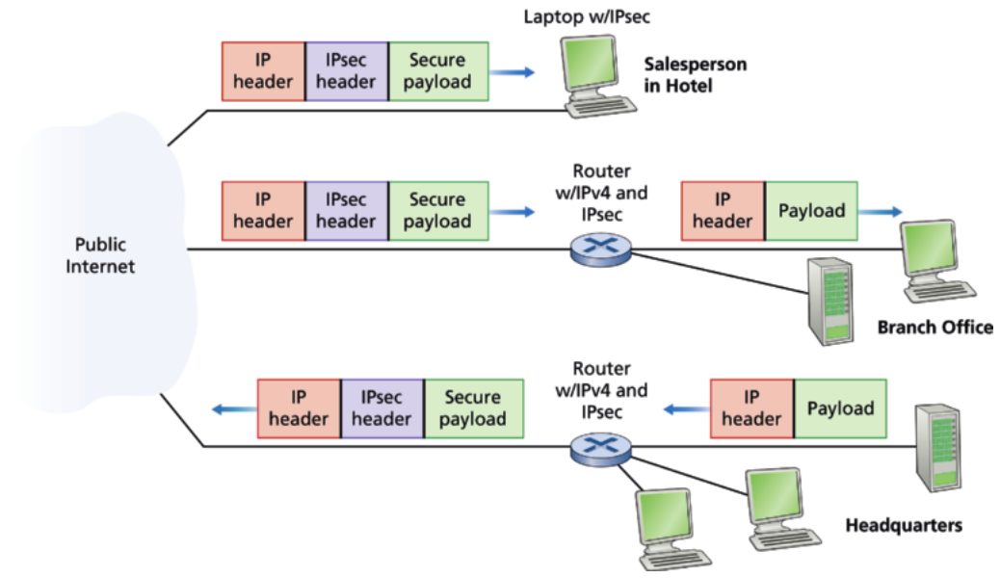

Hình 8.27 Mạng riêng ảo (VPN)

Chúng ta vừa đưa ra tổng quan high-level về cách một tổ chức có thể dùng IPsec để tạo VPN. Để thấy rừng thay vì chỉ thấy cây, chúng ta đã gạt sang một bên nhiều chi tiết quan trọng. Giờ hãy xem xét kỹ hơn.

### 8.7.2 Các giao thức AH và ESP (The AH and ESP Protocols)

IPsec là một con vật khá phức tạp—nó được định nghĩa trong hơn một chục RFC. Hai RFC quan trọng là RFC 4301, mô tả kiến trúc bảo mật IP tổng thể, và RFC 6071, đưa ra tổng quan về bộ giao thức IPsec. Mục tiêu của chúng ta trong giáo trình này, như thường lệ, không phải đơn giản là re-hash (nhai lại) các RFC khô khan và bí hiểm, mà là có một cách tiếp cận mang tính vận hành và sư phạm hơn để mô tả các giao thức.

Trong bộ giao thức IPsec, có hai giao thức chính: giao thức Authentication Header (AH) và giao thức Encapsulation Security Payload (ESP). Khi một thực thể IPsec nguồn (thường là host hoặc router) gửi các datagram an toàn tới một thực thể đích (cũng là host hoặc router), nó làm vậy bằng giao thức AH hoặc giao thức ESP. Giao thức AH cung cấp xác thực nguồn và toàn vẹn dữ liệu nhưng không cung cấp tính bí mật. Giao thức ESP cung cấp xác thực nguồn, toàn vẹn dữ liệu, và tính bí mật. Vì tính bí mật thường là then chốt cho VPN và các ứng dụng IPsec khác, giao thức ESP được dùng rộng rãi hơn nhiều so với giao thức AH. Để de-mystify (làm sáng tỏ) IPsec và tránh phần lớn sự phức tạp của nó, từ đây chúng ta sẽ tập trung hoàn toàn vào giao thức ESP. Độc giả muốn tìm hiểu thêm về giao thức AH được khuyến khích khám phá các RFC và các tài liệu trực tuyến khác.

### 8.7.3 Liên kết bảo mật (Security Associations)

IPsec datagram được gửi giữa các cặp thực thể mạng, như giữa hai host, giữa hai router, hoặc giữa một host và router. Trước khi gửi IPsec datagram từ thực thể nguồn tới thực thể đích, các thực thể nguồn và đích tạo một kết nối logic network-layer. Kết nối logic này được gọi là liên kết bảo mật (security association - SA). Một SA là một kết nối logic đơn công (simplex); tức là, nó một chiều từ nguồn tới đích. Nếu cả hai thực thể muốn gửi datagram an toàn cho nhau, thì cần thiết lập hai SA (tức là, hai kết nối logic), mỗi SA một hướng.

Ví dụ, hãy xét lại VPN của tổ chức trong Hình 8.27. Tổ chức này gồm một văn phòng trụ sở chính, một văn phòng chi nhánh và, chẳng hạn, n nhân viên bán hàng lưu động. Để làm ví dụ, giả sử có traffic IPsec bi-directional giữa trụ sở chính và văn phòng chi nhánh và traffic IPsec bi-directional giữa trụ sở chính và các nhân viên bán hàng. Trong VPN này, có bao nhiêu SA? Để trả lời câu hỏi này, lưu ý rằng có hai SA giữa router gateway của trụ sở chính và router gateway branch-office (mỗi SA một hướng); với laptop của mỗi nhân viên bán hàng, có hai SA giữa router gateway của trụ sở chính và laptop (lại mỗi SA một hướng). Vậy, tổng cộng, có ( 2 + 2n) SA. Tuy nhiên, hãy nhớ rằng không phải mọi traffic được router gateway hay laptop gửi vào Internet đều được bảo mật bằng IPsec. Ví dụ, một host trong trụ sở chính có thể muốn truy cập một Web server (như Amazon hoặc Google) trong Internet công cộng. Do đó, router gateway (và các laptop) sẽ phát vào Internet cả IPv4 datagram thuần túy lẫn IPsec datagram được bảo mật.

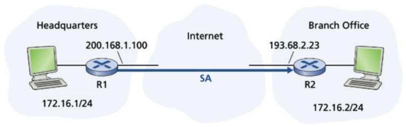

Hình 8.28 Liên kết bảo mật (SA) từ R1 tới R2

Giờ hãy nhìn “vào bên trong” một SA. Để thảo luận hữu hình và cụ thể, hãy làm điều này trong bối cảnh một SA từ router R1 tới router R2 trong Hình 8.28. (Bạn có thể nghĩ Router R1 là router gateway của trụ sở chính và Router R2 là router gateway của văn phòng chi nhánh trong Hình 8.27.) Router R1 sẽ duy trì thông tin trạng thái về SA này, bao gồm:

• Một định danh 32-bit cho SA, gọi là Security Parameter Index (SPI)

• Giao diện gốc của SA (trong trường hợp này là 200.168.1.100) và giao diện đích của SA (trong trường hợp này là 193.68.2.23)

• Loại mã hóa được dùng (ví dụ, 3DES với CBC)

• Khóa mã hóa

• Loại kiểm tra toàn vẹn (ví dụ, HMAC với MD5)

• Khóa xác thực

Bất cứ khi nào router R1 cần xây dựng một IPsec datagram để chuyển tiếp qua SA này, nó truy cập thông tin trạng thái này để xác định cách xác thực và mã hóa datagram. Tương tự, router R2 sẽ duy trì cùng thông tin trạng thái cho SA này và sẽ dùng thông tin này để xác thực và giải mã mọi IPsec datagram tới từ SA.

Một thực thể IPsec (router hoặc host) thường duy trì thông tin trạng thái cho nhiều SA. Ví dụ, trong ví dụ VPN ở Hình 8.27 với n nhân viên bán hàng, router gateway của trụ sở chính duy trì thông tin trạng thái cho ( 2 + 2n) SA. Một thực thể IPsec lưu thông tin trạng thái cho mọi SA của nó trong Security Association Database (SAD), là một cấu trúc dữ liệu trong kernel OS của thực thể.

### 8.7.4 IPsec datagram (The IPsec Datagram)

Sau khi đã mô tả SA, giờ chúng ta có thể mô tả IPsec datagram thực tế. IPsec có hai dạng packet khác nhau, một cho cái so-called chế độ tunnel (tunnel mode) và một cho cái so-called chế độ transport (transport mode). Chế độ tunnel, phù hợp hơn cho VPN, được triển khai rộng rãi hơn chế độ transport. Để de-mystify IPsec thêm nữa và tránh phần lớn sự phức tạp của nó, từ đây chúng ta tập trung hoàn toàn vào chế độ tunnel. Một khi đã nắm vững chế độ tunnel, bạn sẽ có thể dễ dàng tự tìm hiểu chế độ transport.

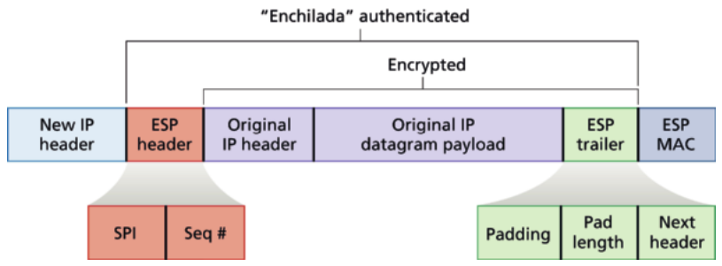

Hình 8.29 Định dạng IPsec datagram

Định dạng packet của IPsec datagram được minh họa trong Hình 8.29. Có thể bạn nghĩ định dạng packet thật nhàm chán và nhạt nhẽo, nhưng chúng ta sẽ sớm thấy IPsec datagram thực ra trông và có vị như một món ăn Tex-Mex phổ biến! Hãy khảo sát các trường IPsec trong bối cảnh Hình 8.28. Giả sử router R1 nhận một IPv4 datagram thông thường từ host 172.16.1.17 (trong mạng trụ sở chính) hướng tới host 172.16.2.48 (trong mạng branch-office). Router R1 dùng công thức sau để chuyển “IPv4 datagram gốc” này thành một IPsec datagram:

• Nối vào phía sau IPv4 datagram gốc (vốn bao gồm các trường header gốc!) một trường “ESP trailer”

• Mã hóa kết quả bằng thuật toán và khóa được SA chỉ định

• Nối vào phía trước khối đã mã hóa này một trường gọi là “ESP header”; gói thu được được gọi là “enchilada”

• Tạo một MAC xác thực trên toàn bộ enchilada bằng thuật toán và khóa được chỉ định trong SA

• Nối MAC vào phía sau enchilada tạo thành payload

• Cuối cùng, tạo một header IP hoàn toàn mới với mọi trường header IPv4 kinh điển (cộng lại thường dài 20 byte), được nối vào trước payload

Lưu ý rằng IPsec datagram thu được là một IPv4 datagram thực thụ, với các trường header IPv4 truyền thống theo sau bởi một payload. Nhưng trong trường hợp này, payload chứa một ESP header, IP datagram gốc, một ESP trailer, và một trường xác thực ESP (với datagram gốc và ESP trailer được mã hóa). IP datagram gốc có 172.16.1.17 là địa chỉ IP nguồn và 172.16.2.48 là địa chỉ IP đích. Vì IPsec datagram bao gồm IP datagram gốc, các địa chỉ này được đưa vào (và được mã hóa) như một phần payload của packet IPsec. Nhưng còn các địa chỉ IP nguồn và đích trong header IP mới, tức là, trong header left-most (ngoài cùng bên trái) của IPsec datagram thì sao? Như bạn có thể đoán, chúng được đặt là các giao diện router nguồn và đích ở hai đầu của tunnel, cụ thể là 200.168.1.100 và 193.68.2.23. Ngoài ra, số giao thức trong trường header IPv4 mới này không được đặt là số của TCP, UDP, hay SMTP, mà thay vào đó là 50, cho biết đây là một IPsec datagram dùng giao thức ESP.

Sau khi R1 gửi IPsec datagram vào Internet công cộng, nó sẽ đi qua nhiều router trước khi tới R2. Mỗi router này sẽ xử lý datagram như thể nó là một datagram thông thường—chúng hoàn toàn không biết rằng datagram đang mang dữ liệu IPsec-encrypted. Đối với các router Internet công cộng này, vì địa chỉ IP đích trong header ngoài là R2, đích cuối cùng của datagram là R2.

Sau khi đi qua một ví dụ về cách một IPsec datagram được xây dựng, giờ hãy xem kỹ hơn các nguyên liệu trong enchilada. Chúng ta thấy trong Hình 8.29 rằng ESP trailer gồm ba trường: padding; pad length; và next header. Nhớ lại rằng mật mã khối đòi hỏi thông điệp cần mã hóa phải là bội số nguyên của độ dài khối. Padding (gồm các byte vô nghĩa) được dùng để khi thêm vào datagram gốc (cùng với các trường pad length và next header), “thông điệp” thu được là một số nguyên khối. Trường pad-length cho thực thể nhận biết bao nhiêu padding đã được chèn (và do đó cần được gỡ bỏ). Next header xác định loại (ví dụ, UDP) của dữ liệu chứa trong trường payload-data. Dữ liệu payload (thường là IP datagram gốc) và ESP trailer được nối lại rồi được mã hóa.

Được nối vào phía trước khối đã mã hóa này là ESP header, được gửi dạng rõ và gồm hai trường: SPI và trường số thứ tự. SPI cho thực thể nhận biết SA mà datagram thuộc về; thực thể nhận sau đó có thể tra SAD của nó bằng SPI để xác định các thuật toán và khóa xác thực/giải mã thích hợp. Trường số thứ tự được dùng để chống lại tấn công phát lại.

Thực thể gửi cũng nối thêm một MAC xác thực. Như đã nêu trước đó, thực thể gửi tính một MAC trên toàn bộ enchilada (gồm ESP header, IP datagram gốc, và ESP trailer—với datagram và trailer được mã hóa). Nhớ lại rằng để tính một MAC, bên gửi nối một khóa MAC bí mật vào enchilada rồi tính một giá trị băm fixed-length của kết quả.

Khi R2 nhận IPsec datagram, R2 quan sát thấy địa chỉ IP đích của datagram là chính R2. Do đó R2 xử lý datagram. Vì trường protocol (trong header IP left-most) là 50, R2 thấy rằng nó nên áp dụng xử lý IPsec ESP cho datagram. Thứ nhất, nhìn vào enchilada, R2 dùng SPI để xác định datagram thuộc SA nào. Thứ hai, nó tính MAC của enchilada và kiểm chứng rằng MAC nhất quán với giá trị trong trường ESP MAC. Nếu đúng, nó biết rằng enchilada đến từ R1 và không bị can thiệp. Thứ ba, nó kiểm tra trường sequence-number để kiểm chứng rằng datagram là mới (và không phải datagram bị phát lại). Thứ tư, nó giải mã khối đã mã hóa bằng thuật toán giải mã và khóa gắn với SA. Thứ năm, nó gỡ bỏ padding và trích IP datagram thuần túy, gốc. Và cuối cùng, thứ sáu, nó chuyển tiếp datagram gốc vào mạng văn phòng chi nhánh về phía đích cuối cùng của nó. Phù, thật là một công thức phức tạp, phải không? Chà, chưa ai từng nói rằng chuẩn bị và gỡ một chiếc enchilada là dễ!

Thực ra còn một điểm tinh tế quan trọng khác cần được giải quyết. Nó xoay quanh câu hỏi sau: Khi R1 nhận một datagram (không được bảo mật) từ một host trong mạng trụ sở chính, và datagram đó hướng tới một địa chỉ IP đích nào đó bên ngoài trụ sở chính, làm thế nào R1 biết nó có nên được chuyển thành một IPsec datagram hay không? Và nếu nó cần được IPsec xử lý, làm thế nào R1 biết SA nào (trong nhiều SA trong SAD của nó) nên được dùng để xây dựng IPsec datagram? Vấn đề được giải quyết như sau. Cùng với SAD, thực thể IPsec cũng duy trì một cấu trúc dữ liệu khác gọi là Security Policy Database (SPD). SPD cho biết những loại datagram nào (theo hàm của địa chỉ IP nguồn, địa chỉ IP đích, và loại giao thức) cần được IPsec xử lý; và với những datagram cần được IPsec xử lý, SA nào nên được dùng. Theo một nghĩa nào đó, thông tin trong SPD cho biết “làm gì” với một datagram đến; thông tin trong SAD cho biết “làm thế nào”.

#### Tóm tắt các dịch vụ IPsec (Summary of IPsec Services)

Vậy chính xác IPsec cung cấp những dịch vụ gì? Hãy khảo sát các dịch vụ này từ góc nhìn của một kẻ tấn công, chẳng hạn Trudy, là một woman-in-the-middle, ngồi ở đâu đó trên đường giữa R1 và R2 trong Hình 8.28. Giả định xuyên suốt thảo luận này rằng Trudy không biết các khóa xác thực và mã hóa mà SA dùng. Trudy có thể và không thể làm gì? Thứ nhất, Trudy không thể thấy datagram gốc. Thực tế, không chỉ dữ liệu trong datagram gốc bị che giấu khỏi Trudy, mà cả số giao thức, địa chỉ IP nguồn, và địa chỉ IP đích. Với các datagram gửi qua SA, Trudy chỉ biết rằng datagram xuất phát từ 200.168.1.100 và hướng tới 193.68.2.23. Cô ấy không biết nó đang mang dữ liệu TCP, UDP, hay ICMP; cô ấy không biết nó đang mang HTTP, SMTP, hay loại dữ liệu ứng dụng nào khác. Do đó tính bí mật này đi xa hơn TLS rất nhiều. Thứ hai, giả sử Trudy cố can thiệp vào một datagram trong SA bằng cách lật một số bit của nó. Khi datagram bị can thiệp này tới R2, nó sẽ không qua được kiểm tra toàn vẹn (dùng MAC), một lần nữa chặn đứng những nỗ lực hiểm độc của Trudy. Thứ ba, giả sử Trudy cố mạo danh R1, tạo một IPsec datagram với nguồn 200.168.1.100 và đích 193.68.2.23. Tấn công của Trudy sẽ vô ích, vì datagram này lại sẽ không qua được kiểm tra toàn vẹn tại R2. Cuối cùng, vì IPsec bao gồm số thứ tự, Trudy sẽ không thể tạo một tấn công phát lại thành công. Tóm lại, như đã khẳng định ở đầu mục này, IPsec cung cấp—giữa bất kỳ cặp thiết bị nào xử lý packet qua tầng mạng—tính bí mật, xác thực nguồn, toàn vẹn dữ liệu, và ngăn chặn replay-attack.

### 8.7.5 IKE: Quản lý khóa trong IPsec (IKE: Key Management in IPsec)

Khi một VPN có một số ít đầu mút (ví dụ, chỉ hai router như trong Hình 8.28), quản trị viên mạng có thể nhập thủ công thông tin SA (các thuật toán và khóa mã hóa/xác thực, và các SPI) vào SAD của các đầu mút. “Nhập khóa thủ công” như vậy rõ ràng không thực tế cho một VPN lớn, có thể gồm hàng trăm hoặc thậm chí hàng nghìn router và host IPsec. Các triển khai lớn, phân tán về địa lý đòi hỏi một cơ chế tự động để tạo SA. IPsec làm điều này bằng giao thức Internet Key Exchange (IKE), được đặc tả trong RFC 5996.

IKE có một số điểm tương đồng với bắt tay trong TLS (xem Mục 8.6). Mỗi thực thể IPsec có một chứng chỉ, bao gồm khóa công khai của thực thể. Giống như TLS, giao thức IKE cho hai thực thể trao đổi chứng chỉ, thương lượng các thuật toán xác thực và mã hóa, và trao đổi an toàn vật liệu khóa để tạo khóa phiên trong các SA IPsec. Khác với TLS, IKE dùng hai giai đoạn để thực hiện các nhiệm vụ này.

Hãy tìm hiểu hai giai đoạn này trong bối cảnh hai router, R1 và R2, trong Hình 8.28. Giai đoạn thứ nhất gồm hai lần trao đổi cặp thông điệp giữa R1 và R2:

• Trong lần trao đổi thông điệp đầu tiên, hai bên dùng Diffie-Hellman (xem Bài tập về nhà) để tạo một IKE SA bi-directional giữa các router. Để khiến tất cả chúng ta bối rối, IKE SA bi-directional này hoàn toàn khác với các SA IPsec đã bàn trong các Mục 8.7.3 và 8.7.4. IKE SA cung cấp một kênh đã xác thực và mã hóa giữa hai router. Trong lần trao đổi message-pair đầu tiên này, các khóa được thiết lập cho mã hóa và xác thực cho IKE SA. Cũng được thiết lập là một master secret sẽ được dùng để tính các khóa SA IPSec sau đó trong giai đoạn 2. Quan sát rằng trong bước đầu tiên này, khóa công khai và khóa riêng RSA không được dùng. Cụ thể, cả R1 và R2 đều không tiết lộ danh tính của mình bằng cách ký một thông điệp bằng khóa riêng.

• Trong lần trao đổi thông điệp thứ hai, cả hai bên tiết lộ danh tính của mình với nhau bằng cách ký các thông điệp. Tuy nhiên, danh tính không bị tiết lộ cho một kẻ nghe lén thụ động, vì các thông điệp được gửi qua kênh IKE SA được bảo mật. Cũng trong giai đoạn này, hai bên thương lượng các thuật toán mã hóa và xác thực IPsec sẽ được các SA IPsec dùng.

Trong giai đoạn 2 của IKE, hai bên tạo một SA theo mỗi hướng. Ở cuối giai đoạn 2, các khóa phiên mã hóa và xác thực được thiết lập ở cả hai bên cho hai SA. Hai bên sau đó có thể dùng các SA để gửi datagram được bảo mật, như mô tả trong các Mục 8.7.3 và 8.7.4. Động lực chính của việc có hai giai đoạn trong IKE là chi phí tính toán—vì giai đoạn thứ hai không liên quan tới mật mã public-key nào, IKE có thể tạo một số lượng lớn SA giữa hai thực thể IPsec với chi phí tính toán tương đối thấp.

## 8.8 Bảo mật LAN không dây và mạng di động 4G/5G (Securing Wireless LANs and 4G/5G Cellular Networks)

Bảo mật là một mối quan tâm đặc biệt quan trọng trong mạng không dây, nơi kẻ tấn công có thể nghe lén frame chỉ bằng cách đặt một thiết bị thu ở bất cứ đâu trong phạm vi truyền của bên gửi. Điều này đúng ở cả LAN không dây 802.11 lẫn mạng di động 4G/5G. Trong cả hai môi trường, chúng ta sẽ thấy việc sử dụng rộng rãi các kỹ thuật bảo mật cơ bản mà chúng ta đã học trước đó trong chương này, bao gồm việc dùng nonce để xác thực, băm mật mã cho toàn vẹn thông điệp, suy dẫn khóa đối xứng dùng chung để mã hóa dữ liệu user-session, và việc dùng rộng rãi chuẩn mã hóa AES. Chúng ta cũng sẽ thấy, như trong môi trường Internet có dây, các giao thức bảo mật không dây đã liên tục tiến hóa, khi các nhà nghiên cứu và hacker phát hiện điểm yếu và lỗ hổng trong các giao thức bảo mật hiện có.

Trong mục này, chúng ta trình bày một giới thiệu ngắn gọn về bảo mật không dây trong cả môi trường 802.11(WiFi) và 4G/5G. Để có trình bày in-depth hơn, xem cuốn sách bảo mật 802.11 rất dễ đọc [Wright 2015], phần trình bày xuất sắc về bảo mật WiFi và 4G/5G trong [Sauter 2021], và trong khảo sát [Zou 2016].

### 8.8.1 Xác thực và thỏa thuận khóa trong LAN không dây 802.11 (Authentication and Key Agreement in 802.11 Wireless LANs)

Hãy bắt đầu thảo luận về bảo mật 802.11 bằng cách xác định hai (trong nhiều [Zou 2016]) mối quan tâm bảo mật then chốt mà chúng ta muốn một mạng 802.11 xử lý:

• Xác thực hai chiều (Mutual authentication). Trước khi một thiết bị di động được phép gắn đầy đủ vào một điểm truy cập và gửi datagram tới các host ở xa, mạng thường muốn trước hết xác thực thiết bị—để kiểm chứng danh tính của thiết bị di động đang gắn vào mạng, và để kiểm tra quyền truy cập của thiết bị đó. Tương tự, thiết bị di động sẽ muốn xác thực mạng mà nó đang gắn vào—để chắc chắn rằng mạng nó đang gia nhập thực sự là mạng mà nó muốn gắn vào. Xác thực two-way này được gọi là xác thực hai chiều (mutual authentication).

• Mã hóa (Encryption). Vì frame 802.11 sẽ được trao đổi qua một kênh không dây có thể bị những kẻ ne’er do-wells (bất lương) tiềm năng nghe lén và thao túng, việc mã hóa các frame link-level mang dữ liệu user-level được trao đổi giữa thiết bị di động và AP sẽ là quan trọng. Mã hóa khóa đối xứng được dùng trong thực tế, vì mã hóa và giải mã phải được thực hiện ở tốc độ cao. Thiết bị di động và AP sẽ cần suy dẫn các khóa mã hóa và giải mã đối xứng sẽ được dùng.

Cách thực hiện xác thực WiFi phụ thuộc vào môi trường mạng. Trong môi trường “cá nhân (personal)” (ví dụ, nhà riêng, quán cà phê, hoặc văn phòng nhỏ), một thiết bị client muốn gia nhập mạng WiFi xác thực trực tiếp với AP. Trong môi trường “doanh nghiệp (enterprise)”, thiết bị xác thực với một server xác thực tập trung thường cung cấp quyền truy cập vào các mạng LAN/WLAN của doanh nghiệp cũng như các tài nguyên và dịch vụ doanh nghiệp khác. Trong môi trường doanh nghiệp, AP đơn giản đóng vai pass-through (chuyển tiếp) giữa thiết bị client và server xác thực. Giờ hãy xem xét xác thực WiFi trong mỗi môi trường này.

#### Xác thực trong môi trường WiFi cá nhân: WPA3-Personal (Authentication in the WiFi Personal Setting: WPA3-Personal)

Hình 8.30 minh họa tương tác giữa một thiết bị đến và AP sẽ xác thực thiết bị. Phát beacon và liên kết WLAN, mà chúng ta đã đề cập trước đó trong Mục 7.3.4, cũng được minh họa trong Hình 8.30 để đưa ra bức tranh đầy đủ về các bước một thiết bị client thực hiện khi gia nhập mạng WiFi. Chuẩn kỹ thuật cho xác thực trong môi trường WiFi cá nhân được gọi là Wi-Fi Protected Access 3—Personal (WPA3-Personal). WPA3 [WiFi Alliance 2019, WiFi Alliance 2024] là một chương trình chứng nhận bảo mật do WiFi Alliance phát triển. Từ năm 2018, các thiết bị WiFi muốn có danh hiệu “WiFi certified” của WiFi Alliance phải triển khai WPA3.

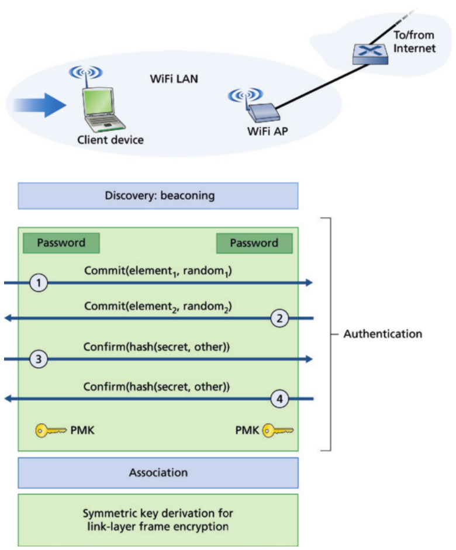

Hình 8.30 Bảo mật WPA3- Personal

WPA3-Personal dùng xác thực password-based giữa AP và thiết bị client muốn gia nhập mạng WiFi. Như có lẽ bạn đã trải nghiệm, cùng một mật khẩu được mọi thiết bị gắn vào mạng WiFi dùng. Và, có thể bạn đã thấy một mật khẩu như vậy được dán trên tường quán cà phê cho mọi người cùng thấy— nghĩa là một mạng như vậy chỉ được bảo vệ trước những kẻ ne’re-do-wells không biết mật khẩu! Giao thức xác thực cụ thể được dùng trong WPA-3 được gọi là Simultaneous Authentication of Equals (SAE) [WiFi Alliance 2024; Kumar 2024].

Xác thực WPA3-Personal bắt đầu sau khi thiết bị client nhận thông điệp beacon của AP, chứa một trường cho client biết WPA3-Personal được hỗ trợ. Giao thức xác thực SAE, minh họa trong Hình 8.30, dùng giao thức Dragonfly Key Exchange four-step [RFC 7664]:

1. Client commit. Client dùng mật khẩu (một “bí mật dùng chung (shared secret)” theo thuật ngữ SAE) để tạo một giá trị mới, element<sub>1</sub> an toàn về mật mã ở chỗ không thể suy ra mật khẩu từ giá trị của element<sub>1</sub>. Client cũng tạo một giá trị ngẫu nhiên đóng vai nonce. Client gửi các giá trị này, và các giá trị khác, tới AP trong một thông điệp SAE commit.

2. AP commit. AP nhận thông điệp commit của client. Biết bí mật dùng chung, AP có thể xác định rằng client đã tạo element<sub>1</sub> cũng biết bí mật dùng chung. Tới giờ vẫn ổn! AP sau đó tạo element<sub>2</sub> và một giá trị ngẫu nhiên đóng vai nonce và gửi các giá trị này, và các giá trị khác, tới client trong một thông điệp SAE commit.

3. Client confirm. Thiết bị client có thể tương tự xác định rằng AP đã gửi element<sub>2</sub> cũng biết bí mật dùng chung. Để tránh tấn công phát lại, client gửi một giá trị băm của bí mật dùng chung và các giá trị đã trao đổi trong các bước SAE trước (đặc biệt là nonce) tới AP trong một thông điệp SAE confirm.

4. AP confirm. AP kiểm tra giá trị băm nhận được để chắc chắn các giá trị đúng đã được client băm cùng nhau. Sau đó nó gửi giá trị băm của mình về bí mật dùng chung và các giá trị đã trao đổi trong các bước SAE trước tới client.

Sau giao thức SAE four-step này, thiết bị client và AP đã xác thực lẫn nhau, tức là, họ đã xác lập rằng bên kia biết bí mật dùng chung dù bản thân bí mật dùng chung chưa được truyền qua mạng. Sau đó họ tạo một khóa chủ theo cặp (pairwise master key - PMK) dựa trên bí mật dùng chung và các giá trị ngẫu nhiên đã trao đổi trong giao thức SAE. Vì mỗi client gia nhập mạng sẽ tạo các giá trị ngẫu nhiên khác nhau trong giao thức SAE, mỗi client sẽ tạo ra một PMK khác nhau. Cũng lưu ý rằng mỗi lần một thiết bị client gia nhập mạng, nó sẽ tạo một PMK mới; vì lý do này, PMK đôi khi được gọi là khóa “động”. Sau giai đoạn Association Request/Response (đã bàn trước đó trong Mục 7.3.4), PMK sẽ được dùng trong một lần bắt tay thứ hai giữa thiết bị và AP để tạo các khóa cho mã hóa link-layer các frame trao đổi trên kênh WiFi. Quá trình này được mô tả trong [IEEE 802.11 2020].

#### Xác thực trong môi trường WiFi doanh nghiệp: 802.1x và WPA3-Enterprise (Authentication in the WiFi Enterprise Setting: 802.1x and WPA3-Enterprise)

Hình 8.31 minh họa tương tác giữa một thiết bị client đến và server xác thực sẽ xác thực thiết bị. Chuẩn IEEE 802.1X [IEEE 802.1x 2010] định nghĩa quá trình xác thực khi một thiết bị xác thực qua server xác thực của doanh nghiệp. Trong khung 802.1X, Extensible Authentication Protocol (EAP) được dùng để cung cấp xác thực. Chứng nhận Wi-Fi Protected 3—Enterprise (WPA3-Enterprise) đơn giản áp dụng chuẩn IEEE 802.1x. Như từ “extensible (mở rộng được)” gợi ý, EAP hỗ trợ nhiều “phương pháp” xác thực khác nhau, và chuẩn IEEE 802.1X không chỉ định dùng phương pháp EAP nào trong số này. Có hơn 40 phương pháp EAP được chuẩn hóa khác nhau. Tuy nhiên, một phương pháp quen thuộc trong môi trường học thuật được gọi là EAP-Tunneled Transport Layer Security (EAP-TTLS) [RFC 5281], được minh họa trong Hình 8.31.

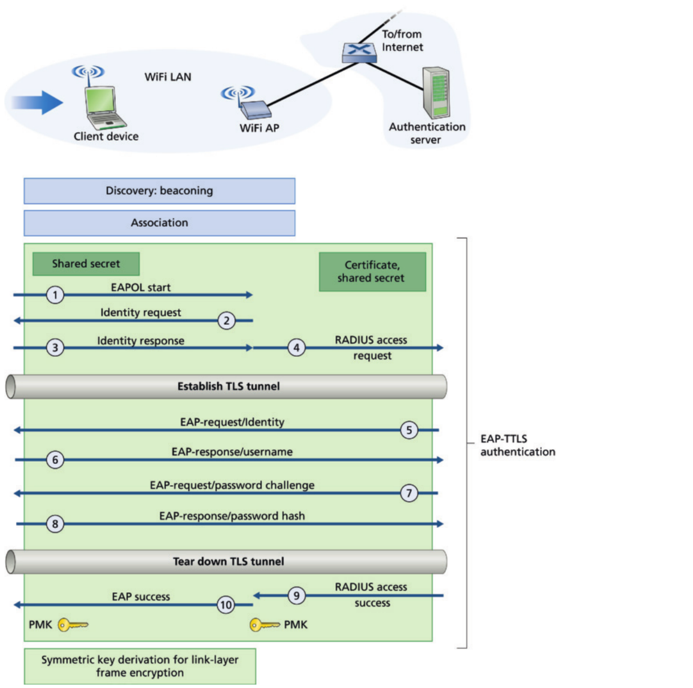

Hình 8.31 Bảo mật WPA3-Enterprise / 802.1x dùng EAP-TTLS

Trước khi mô tả các bước trong EAP-TTLS, hãy xem bức tranh lớn. Sau quá trình phát beacon và liên kết WLAN ban đầu (xem Mục 7.3.4) giữa thiết bị client đến và AP, bản thân việc xác thực xảy ra giữa client và server xác thực, với AP chỉ đóng vai thiết bị pass-through. EAP-TTLS dựa nhiều vào việc dùng một đường hầm TLS (mà chúng ta đã học trong Mục 8.6) được tạo giữa client và server xác thực để bảo mật các bước EAP-TTLS inner-most (trong cùng). Sau các bước này, đường hầm TLS được gỡ bỏ, và PMK được dùng trong một lần bắt tay thứ hai giữa thiết bị client và AP để tạo các khóa cho mã hóa link-layer các frame trao đổi trên kênh WiFi, như trong WPA3-Personal. Giờ hãy xét chi tiết hơn các bước EAP-TTLS trong Hình 8.31:

• Ở các bước 1–3, thiết bị client cho AP biết rằng nó muốn xác thực và gia nhập mạng dùng EAP. Nếu AP được cấu hình cho phép điều này, nó phản hồi client, và yêu cầu (và nhận) một danh tính giữ chỗ; client sẽ chỉ tiết lộ danh tính thật của mình bên trong đường hầm TLS đã mã hóa bảo mật việc trao đổi thông điệp EAP-TTLS với server xác thực.

• Ở bước 4, AP chuyển yêu cầu gia nhập mạng WiFi của client tới server xác thực dùng giao thức RADIUS, được bàn dưới đây.

• Nhớ lại rằng do kết quả của việc thiết lập đường hầm TLS, client đã xác thực server qua chứng chỉ public-key của server, và client và server đã thống nhất một bí mật dùng chung. Tuy nhiên, client chưa được xác thực với server; việc xác thực này được thực hiện ở các bước 5–8. Ở đây, server xác thực yêu cầu và nhận danh tính thật của thiết bị client, và bí mật dùng chung của client. Một khi danh tính và mật khẩu của client đã được kiểm chứng, server gỡ bỏ đường hầm TLS, thông báo cho AP rằng client đã được xác thực, và cung cấp một PMK cho AP để AP và client (cũng sẽ suy dẫn cùng PMK) có thể thiết lập các khóa mã hóa cho kênh WiFi.

#### Các giao thức thông điệp bảo mật 802.11 (802.11 Security Messaging Protocols)

Hình 8.32 cho thấy các giao thức dùng để triển khai khung bảo mật 802.11 đã bàn ở trên. Extensible Authentication Protocol (EAP) [RFC 3748] định nghĩa các định dạng thông điệp end-to-end được dùng trong một chế độ tương tác request/response đơn giản giữa thiết bị di động và server xác thực. Như minh họa trong Hình 8.32, các thông điệp EAP được đóng gói dùng EAPoL (EAP over LAN) và được gửi qua liên kết không dây 802.11. Các thông điệp EAP này sau đó được gỡ đóng gói tại điểm truy cập, rồi được re-encapsulated (đóng gói lại) dùng giao thức RADIUS để truyền qua UDP/IP tới server xác thực. Mặc dù server và giao thức RADIUS [RFC 2865] không bắt buộc, chúng là các thành phần chuẩn trên thực tế. Giao thức DIAMETER được chuẩn hóa gần đây [RFC 3588] được dự kiến cuối cùng sẽ thay thế RADIUS trong tương lai.

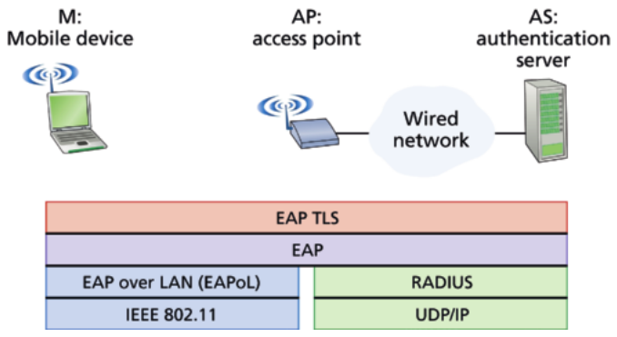

Hình 8.32 EAP là một giao thức end-to-end.

Các thông điệp EAP được đóng gói dùng EAPoL qua liên kết không dây giữa thiết bị di động và điểm truy cập, và dùng RADIUS qua UDP/IP giữa điểm truy cập và server xác thực

### 8.8.2 Xác thực và thỏa thuận khóa trong mạng di động 5G (Authentication and Key Agreement in 5G Cellular Networks)

Trong mục này, chúng ta mô tả các cơ chế xác thực hai chiều và key-generation trong mạng 5G. Nhiều cách tiếp cận chúng ta sẽ gặp ở đây song song với những gì chúng ta vừa học trong mạng 802.11, với ngoại lệ đáng chú ý là trong mạng di động, thiết bị di động có thể gắn vào mạng nhà của nó (tức là, mạng nhà mạng di động mà nó đăng ký thuê bao), hoặc có thể đang roaming trên một mạng khách. Trong trường hợp sau, mạng khách và mạng nhà sẽ cần tương tác khi xác thực thiết bị di động và tạo khóa mã hóa. Trước khi tiếp tục, có thể bạn muốn re-familiarize (làm quen lại) với kiến trúc mạng 5G bằng cách re-reading (đọc lại) các Mục 7.3.3 và 7.5. Mục tiêu của xác thực hai chiều và tạo khóa trong môi trường 5G giống như trong môi trường 802.11. Để mã hóa nội dung các frame được truyền qua kênh không dây, thiết bị di động và trạm gốc sẽ cần suy dẫn một khóa mã hóa đối xứng dùng chung. Ngoài ra, mạng mà thiết bị di động đang gắn vào sẽ cần xác thực danh tính của thiết bị và kiểm tra quyền truy cập của nó. Tương tự, thiết bị di động cũng muốn xác thực mạng mà nó đang gắn vào. Trong khi nhu cầu của mạng xác thực một thiết bị di động có thể hiển nhiên, nhu cầu xác thực theo chiều ngược lại có thể không rõ ràng như vậy. Tuy nhiên, có những trường hợp được ghi nhận về những kẻ ne’er-do-wells vận hành các trạm gốc di động giả mạo dụ các thiết bị di động không nghi ngờ gắn vào mạng giả mạo, khiến thiết bị phải chịu một số tấn công [Li 2017]. Vì vậy, như trong trường hợp WLAN 802.11, một thiết bị di động nên hết sức thận trọng khi gắn vào một mạng di động! Hình 8.33 (phỏng theo các Hình 6.1.2-1 và 6.1.3.1-1 trong [3GPP TS 33.501]) cho thấy bối cảnh và thủ tục cho xác thực 5G, xảy ra khi một thiết bị người dùng đến muốn gia nhập mạng 5G. Trước khi tiếp tục, có thể bạn muốn re-read (đọc lại) nội dung trong Mục 7.4.3 về định danh người dùng và đăng ký 5G, và đặc biệt là xem lại Hình 7.42. Sau khi đã học về xác thực WPA3-Enterprise, chúng ta có thể ngay lập tức nhận thấy một số điểm tương đồng về cấu trúc giữa xác thực 5G và WPA3-Enterprise:

• Xác thực xảy ra giữa một thiết bị và một server xác thực. Trạm gốc 5G và 5G Core trong mạng khách chủ yếu đóng vai pass-throughs, giống như cách AP và mạng giữa thiết bị và server xác thực Wi-Fi đóng vai pass-through.

• Giao thức EAP được dùng trong cả hai môi trường để mang thông điệp xác thực giữa thiết bị và server xác thực. Một giao thức EAP được dùng trong 5G là EAP-AKA' (Extensible Authentication Protocol—Authentication and Key Agreement Prime), được dùng trong Hình 8.33.

• Xác thực 5G và WiFi đều dùng một bí mật đã được pre-shared (chia sẻ trước) giữa thiết bị và server xác thực. Trong 5G, bí mật dùng chung đó được chứa trên thẻ SIM của thiết bị và trên server xác thực trong mạng nhà (không phải mạng khách) của thiết bị.

• TLS được dùng để vận chuyển an toàn các thông điệp xác thực trong cả WPA3- Enterprise và 5G EAP-AKA’. Tất nhiên, một khác biệt giữa Wi-Fi và 5G là không có khái niệm mạng nhà trong Wi-Fi. Đây là một khác biệt cực kỳ quan trọng. Lưu ý rằng quyết định xác thực 5G được đưa ra bởi Authentication Server (AUSF) trong mạng nhà của thiết bị, không phải trong mạng khách. Đó là vì hai nơi duy nhất lưu danh tính và thông tin mật mã của thiết bị là trên thẻ SIM của thiết bị và trong mạng nhà. Đây là một thay đổi đáng kể so với xác thực 4G, nơi mạng khách đóng vai trò quan trọng hơn. Thay đổi này phản ánh niềm tin rằng chỉ mạng nhà mới nên được tin cậy để sử dụng, lưu trữ, và quản lý tường minh các thông tin nhạy cảm như khóa bí mật dùng chung của thiết bị.

  Giờ hãy xét chi tiết hơn các bước trong xác thực 5G:

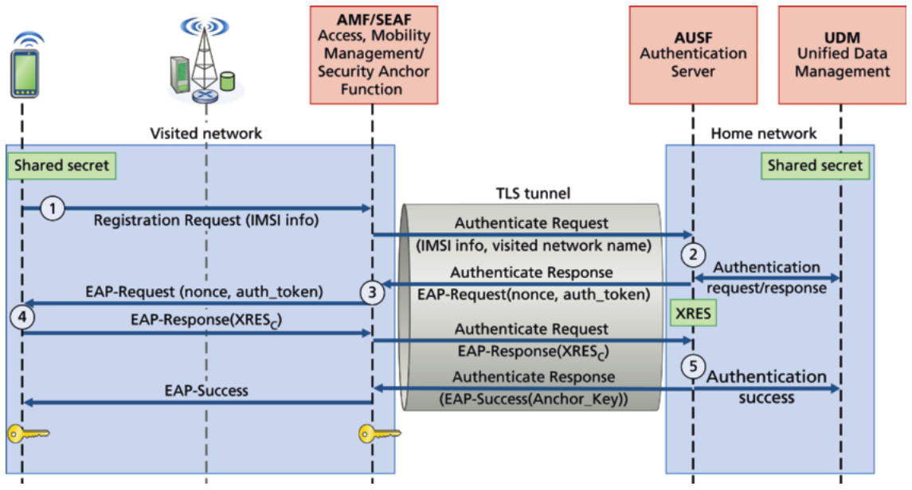

Hình 8.33 Xác thực 5G với EAP-AKA’

1. Ở bước 1, thiết bị gửi một thông điệp Registration Request tới Access and Mobility Management Function (AMF) trong 5G Core của mạng mà nó muốn gia nhập. Thiết bị đưa vào International Mobile Subscriber Identity (IMSI) của nó, xác định mạng nhà của thiết bị, cũng như danh tính của nó trong mạng đó. Do đó Security Anchor Function (SEAF), một thành phần logic của AMF trong 5G Core, có đủ thông tin để định vị chức năng server xác thực (AUSF) trong 5G Core của mạng nhà của thiết bị, mạng này (khi thiết bị đang roaming) sẽ khác với mạng đang được gia nhập. SEAF trước hết thiết lập một đường hầm TLS (xem Mục 8.6) để mọi thông điệp giữa SEAF và Authentication Server tự chúng được xác thực và mã hóa.

2. Ở bước 2, AUSF liên lạc với Unified Data Management function (UDM) trong mạng nhà của thiết bị. Chúng ta đã học trong Chương 7 rằng UDM chứa IMSI, khóa mã hóa, và quyền dịch vụ cho các thuê bao của mạng nhà. UDM tạo bốn mẩu thông tin quan trọng, lưu trong một vector xác thực (authentication vector - AV), mà nó trả về cho AUSF:

• Một giá trị nonce ngẫu nhiên.

• Một token xác thực, là một giá trị do UDM tính sẽ được thiết bị dùng để kiểm chứng rằng thông tin xác thực đang nhận thực sự đến từ Authentication Server nhà của thiết bị và nó là hiện hành (tức là, không bị phát lại). Giá trị token bao gồm một số thứ tự và một khóa suy dẫn từ khóa bí mật của thiết bị (tiện thay chỉ thiết bị và Authentication Server của nó biết). Token được UDM ký bằng khóa bí mật của thiết bị.

• XRES là “phản hồi kỳ vọng (expected response)”—giá trị mà Authentication Server biết thiết bị sẽ tính để phản hồi giá trị nonce ngẫu nhiên mà thiết bị sẽ nhận. XRES được UDM tạo dùng nonce và khóa bí mật dùng chung của thiết bị. Vì thiết bị và Authentication Server của nó đều biết khóa bí mật dùng chung và giá trị nonce (và có lẽ là hai thực thể duy nhất trên thế giới biết thông tin đó!), chúng sẽ tính ra cùng giá trị XRES. Giá trị XRES này sẽ được dùng ở bước 5 dưới đây.

• Một khóa suy dẫn từ quá trình xác thực sẽ được mạng khách và UE dùng sau đó để suy dẫn các khóa bổ sung cần thiết, ví dụ, để mã hóa giao tiếp của chúng.

3. Ở bước 3, Authentication Server trong mạng nhà sau đó gửi giá trị nonce ngẫu nhiên và token xác thực tới SEAF trong mạng khách, SEAF sau đó chuyển tiếp trong suốt hai mẩu thông tin này tới thiết bị client.

4. Thiết bị nhận nonce và token xác thực. Với nonce và bí mật dùng chung trên SIM, thiết bị xác định rằng token xác thực thực sự do Authentication Server trong mạng nhà của nó tạo ra, và không phải bản phát lại. Thiết bị sau đó tự tính giá trị phản hồi kỳ vọng, theo cùng thủ tục UDM đã dùng ở bước 2. Hy vọng rằng, giá trị do thiết bị client tính, XRES<sub>C</sub>, sẽ khớp với giá trị XRES mà UDM đã tính trước đó và giờ được lưu trong Authentication Server. Thiết bị gửi XRES<sub>C</sub>, trong một thông điệp EAP tới SEAF, SEAF chuyển tiếp thông tin này tới Authentication Server. Giờ là khoảnh khắc quyết định—quyết định xác thực!

5. Authentication Server so sánh giá trị XRES<sub>C</sub> nhận được với giá trị XRES đã tính trước đó. Nếu hai giá trị khớp nhau, Authentication Server xác thực thiết bị client và thông báo cho mạng khách và UDM nhà rằng thiết bị đã được xác thực.

Authentication Server cũng tạo và gửi một khóa neo (anchor key) đối xứng tới mạng khách. Khóa one-time-use (dùng một lần) này được tính dùng bí mật dùng chung giữa thiết bị và Authentication Server. Do đó, thiết bị cũng sẽ có thể tự tính cùng giá trị khóa neo. Khóa neo sẽ được thiết bị, trạm gốc, và các chức năng 5G Core trong mạng khách dùng để tính các khóa khác cần thiết (ví dụ, cho mã hóa) trong phiên của thiết bị. Do đó khóa neo tương tự theo nhiều cách với pairwise master key trong xác thực Wi-Fi.

Thảo luận ở trên của chúng ta tập trung vào các bước chính trong xác thực thiết bị 5G. Có các tham số bổ sung và các bước giao thức có điều kiện không được minh họa ở trên; xem đặc tả 3GPP [3GPP TS 33.501] và [RFC 5448] để biết chi tiết. Ngoài xác thực cơ bản, mạng khách cũng sẽ cần biết các dịch vụ (ví dụ, gọi thoại, giới hạn băng thông hoặc data-usage, chính sách chất lượng dịch vụ) mà thiết bị khách có thể dùng. Xem [3GPP TS 29.512 2022].

Trong mục này, chúng ta mới chỉ tổng quan ngắn gọn về xác thực hai chiều và thỏa thuận khóa trong mạng 5G. Như chúng ta đã thấy, chúng dùng rộng rãi các kỹ thuật bảo mật mà chúng ta đã học trước đó trong chương này. Các tài liệu tham khảo nêu ở trên và [Cable Labs 2019] cung cấp chi tiết in-depth hơn về các chủ đề này.

## 8.9 Bảo mật vận hành: firewall và hệ thống phát hiện xâm nhập (Operational Security: Firewalls and Intrusion Detection Systems)

Chúng ta đã thấy xuyên suốt chương này rằng Internet không phải là một nơi rất an toàn— kẻ xấu ở ngoài kia, gây ra đủ loại tàn phá. Với bản chất thù địch của Internet, giờ hãy xét mạng của một tổ chức và quản trị viên mạng quản trị nó. Từ góc nhìn của quản trị viên mạng, thế giới chia khá gọn thành hai phe—người tốt (thuộc mạng của tổ chức, và nên có thể truy cập tài nguyên bên trong mạng của tổ chức một cách tương đối không bị ràng buộc) và kẻ xấu (mọi người khác, có quyền truy cập tài nguyên mạng phải được xem xét kỹ lưỡng). Trong nhiều tổ chức, từ lâu đài thời trung cổ tới các tòa nhà văn phòng công ty hiện đại, có một điểm vào/ra duy nhất nơi cả người tốt và kẻ xấu vào và rời tổ chức đều được security-checked (kiểm tra an ninh). Trong một lâu đài, việc này được làm tại cổng ở một đầu cầu kéo; trong một tòa nhà công ty, việc này được làm tại quầy an ninh. Trong một mạng máy tính, khi traffic vào/ra một mạng được security-checked, ghi log, loại bỏ, hoặc chuyển tiếp, việc đó được thực hiện bởi các thiết bị vận hành gọi là firewall, hệ thống phát hiện xâm nhập (intrusion detection system - IDS), và hệ thống ngăn chặn xâm nhập (intrusion prevention system - IPS).

### 8.9.1 Tường lửa (Firewalls)

Một firewall là sự kết hợp của phần cứng và phần mềm cô lập mạng nội bộ của một tổ chức khỏi Internet rộng lớn, cho phép một số packet đi qua và chặn những packet khác. Firewall cho phép quản trị viên mạng kiểm soát truy cập giữa thế giới bên ngoài và tài nguyên bên trong mạng được quản trị bằng cách quản lý luồng traffic tới và từ các tài nguyên này. Một firewall có ba mục tiêu:

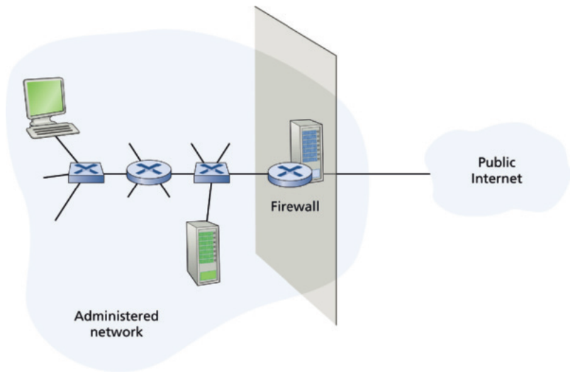

Hình 8.34 Vị trí firewall giữa mạng được quản trị và thế giới bên ngoài

• Mọi traffic từ ngoài vào trong, và ngược lại, đều đi qua firewall. Hình 8.34 cho thấy một firewall, nằm ngay tại ranh giới giữa mạng được quản trị và phần còn lại của Internet. Mặc dù các tổ chức lớn có thể dùng nhiều cấp firewall hoặc firewall phân tán [Skoudis 2006], việc đặt firewall tại một điểm truy cập duy nhất vào mạng, như minh họa trong Hình 8.34, giúp dễ quản lý và thực thi một chính sách security-access hơn.

• Chỉ traffic được phép, như được định nghĩa bởi chính sách bảo mật cục bộ, mới được phép đi qua. Với mọi traffic vào và ra mạng của tổ chức đều đi qua firewall, firewall có thể giới hạn truy cập chỉ cho traffic được phép.

• Bản thân firewall miễn nhiễm với xâm nhập. Bản thân firewall là một thiết bị được nối vào mạng. Nếu không được thiết kế hoặc lắp đặt đúng cách, nó có thể bị xâm phạm, khi đó nó chỉ mang lại cảm giác an toàn giả tạo (còn tệ hơn là không có firewall!).

Palo Alto Networks, Cisco và Check Point là ba trong số các nhà cung cấp firewall hàng đầu hiện nay. Hơn nữa, như đã bàn trong các Chương 4 và 5, firewall giờ thường được triển khai trong router và được điều khiển từ xa dùng SDN. Firewall có thể được phân loại thành ba nhóm: bộ lọc packet truyền thống, bộ lọc có trạng thái (stateful filter), và gateway ứng dụng. Chúng ta sẽ lần lượt đề cập từng loại trong các tiểu mục sau.

#### Bộ lọc packet truyền thống (Traditional Packet Filters)

Như minh họa trong Hình 8.34, một tổ chức thường có một router gateway nối mạng nội bộ của nó tới ISP (và do đó tới Internet công cộng rộng lớn hơn). Mọi traffic rời và vào mạng nội bộ đều đi qua router này, và chính tại router này việc lọc packet diễn ra. Một bộ lọc packet kiểm tra từng datagram riêng rẽ, xác định datagram nên được cho phép đi qua hay nên bị loại bỏ dựa trên các quy tắc administrator-specific (do quản trị viên đặt). Các quyết định lọc thường dựa trên:

• Địa chỉ IP nguồn hoặc đích

• Loại giao thức trong trường IP datagram: TCP, UDP, ICMP, OSPF, v.v.

• Port nguồn và đích TCP hoặc UDP

• Các bit cờ TCP: SYN, ACK, v.v.

• Loại thông điệp ICMP

• Các quy tắc khác nhau cho datagram rời và vào mạng

• Các quy tắc khác nhau cho các giao diện router khác nhau

Quản trị viên mạng cấu hình firewall dựa trên chính sách của tổ chức. Chính sách có thể xét đến năng suất người dùng và việc sử dụng băng thông cũng như các mối quan tâm bảo mật của tổ chức. Bảng 8.5 liệt kê một số chính sách khả dĩ mà một tổ chức có thể có, và cách chúng được xử lý bằng một bộ lọc packet. Ví dụ, nếu tổ chức không muốn bất kỳ kết nối TCP đến nào ngoại trừ các kết nối tới Web server công khai của nó, nó có thể chặn mọi segment TCP SYN đến ngoại trừ các segment TCP SYN có port đích 80 và địa chỉ IP đích tương ứng với Web server. Nếu tổ chức không muốn người dùng của mình độc chiếm băng thông truy cập bằng các ứng dụng radio Internet, nó có thể chặn mọi traffic UDP not-critical (không quan trọng) (vì radio Internet thường được gửi qua UDP). Nếu tổ chức không muốn mạng nội bộ của mình bị người ngoài lập bản đồ (traceroute), nó có thể chặn mọi thông điệp ICMP TTL expired rời mạng của tổ chức.

Một chính sách lọc có thể dựa trên sự kết hợp của địa chỉ và số port. Ví dụ, một router lọc có thể chuyển tiếp mọi datagram Telnet (những datagram có số port 23) ngoại trừ những datagram đi tới và đến từ một danh sách địa chỉ IP cụ thể. Chính sách này cho phép kết nối Telnet tới và từ các host trong danh sách được phép. Không may, việc dựa chính sách vào địa chỉ bên ngoài không bảo vệ được trước các datagram có địa chỉ nguồn bị giả mạo.

| Chính sách (Policy) | Thiết lập firewall (Firewall Setting) |
|---|---|
| Không truy cập Web bên ngoài. | Loại bỏ mọi packet đi ra tới bất kỳ địa chỉ IP nào,<br>port 80. |
| Không có kết nối TCP đến, ngoại trừ các kết nối<br>chỉ tới Web server công khai của tổ chức. | Loại bỏ mọi packet TCP SYN đến tới bất kỳ<br>IP nào ngoại trừ 130.207.244.203, port 80. |
| Ngăn Web-radios ăn hết<br>băng thông khả dụng. | Loại bỏ mọi packet UDP đến—ngoại trừ<br>packet DNS. |
| Ngăn mạng của bạn bị dùng cho một<br>tấn công DoS smurf. | Loại bỏ mọi packet ICMP ping đi tới một<br>địa chỉ “broadcast” (eg 130.207.255.255). |
| Ngăn mạng của bạn bị traceroute. | Loại bỏ mọi traffic ICMP TTL expired đi ra. |

Bảng 8.5 Các chính sách và quy tắc lọc tương ứng cho mạng 130.207/16 của một tổ chức với Web server tại 130.207.244.203

| hành động (action) | địa chỉ nguồn (source address) | địa chỉ đích (dest address) | giao thức (protocol) | port nguồn (source port) | port đích (dest port) | bit cờ (flag bit) |
|---|---|---|---|---|---|---|
| allow | 222.22/16 | outside of 222.22/16 | TCP | >1023 | 80 | any |
| allow | outside of 222.22/16 | 222.22/16 | TCP | 80 | >1023 | ACK |
| allow | 222.22/16 | outside of 222.22/16 | UDP | >1023 | 53 | — |
| allow | outside of 222.22/16 | 222.22/16 | UDP | 53 | >1023 | — |
| deny | all | all | all | all | all | all |

Bảng 8.6 Một danh sách kiểm soát truy cập cho một giao diện router

Việc lọc cũng có thể dựa trên việc bit TCP ACK có được đặt hay không. Mẹo này khá hữu ích nếu một tổ chức muốn cho client nội bộ kết nối tới server bên ngoài nhưng muốn ngăn client bên ngoài kết nối tới server nội bộ. Nhớ lại từ Mục 3.5 rằng segment đầu tiên trong mọi kết nối TCP có bit ACK đặt bằng 0, trong khi mọi segment khác trong kết nối có bit ACK đặt bằng 1. Do đó, nếu một tổ chức muốn ngăn client bên ngoài khởi tạo kết nối tới server nội bộ, nó đơn giản lọc mọi segment đến có bit ACK đặt bằng 0. Chính sách này diệt mọi kết nối TCP xuất phát từ bên ngoài, nhưng cho phép các kết nối xuất phát từ bên trong.

Các quy tắc firewall được triển khai trong router bằng các danh sách kiểm soát truy cập (access control list), với mỗi giao diện router có danh sách riêng. Một ví dụ về danh sách kiểm soát truy cập cho một tổ chức 222.22/16 được minh họa trong Bảng 8.6. Danh sách kiểm soát truy cập này dành cho một giao diện nối router với các ISP bên ngoài của tổ chức. Các quy tắc được áp dụng cho mỗi datagram đi qua giao diện từ trên xuống dưới. Hai quy tắc đầu cùng nhau cho phép người dùng nội bộ lướt Web: Quy tắc đầu tiên cho phép bất kỳ packet TCP nào có port đích 80 rời mạng của tổ chức; quy tắc thứ hai cho phép bất kỳ packet TCP nào có port nguồn 80 và bit ACK được đặt đi vào mạng của tổ chức. Lưu ý rằng nếu một nguồn bên ngoài cố thiết lập một kết nối TCP với một host nội bộ, kết nối sẽ bị chặn, ngay cả khi port nguồn hoặc đích là 80. Hai quy tắc tiếp theo cùng nhau cho phép các packet DNS vào và rời mạng của tổ chức. Tóm lại, danh sách kiểm soát truy cập khá hạn chế này chặn mọi traffic ngoại trừ traffic Web được khởi tạo từ bên trong tổ chức và traffic DNS. [SEI Best Practices 2017] bàn về các thực hành tốt nhất cho bảo vệ biên mạng tại firewall.

Độc giả có trí nhớ tốt có thể nhớ lại rằng chúng ta đã gặp các danh sách kiểm soát truy cập tương tự Bảng 8.6 khi học chuyển tiếp tổng quát trong Mục 4.4.3 của Chương 4. Thật vậy, ở đó chúng ta đã đưa ra một ví dụ về cách các quy tắc chuyển tiếp tổng quát có thể được dùng để xây dựng một firewall packet-filtering.

#### Bộ lọc packet có trạng thái (Stateful Packet Filters)

Trong một bộ lọc packet truyền thống, quyết định lọc được đưa ra trên từng packet riêng rẽ. Bộ lọc có trạng thái thực sự theo dõi các kết nối TCP, và dùng hiểu biết này để đưa ra quyết định lọc.

Để hiểu bộ lọc có trạng thái, hãy xem xét lại danh sách kiểm soát truy cập trong Bảng 8.6. Mặc dù khá hạn chế, danh sách kiểm soát truy cập trong Bảng 8.6 vẫn cho phép bất kỳ packet nào đến từ bên ngoài với ACK = 1 và port nguồn 80 đi qua bộ lọc. Các packet như vậy có thể bị kẻ tấn công dùng trong các nỗ lực làm sập hệ thống nội bộ bằng các packet dị dạng, thực hiện tấn công denial-of-service, hoặc lập bản đồ mạng nội bộ. Giải pháp ngây thơ là chặn cả các packet TCP ACK, nhưng cách tiếp cận như vậy sẽ ngăn người dùng nội bộ của tổ chức lướt Web.

| địa chỉ nguồn (source address) | địa chỉ đích (dest address) | port nguồn (source port) | port đích (dest port) |
|---|---|---|---|
| 222.22.1.7 | 37.96.87.123 | 12699 | 80 |
| 222.22.93.2 | 199.1.205.23 | 37654 | 80 |
| 222.22.65.143 | 203.77.240.43 | 48712 | 80 |

Bảng 8.7 Bảng kết nối cho bộ lọc có trạng thái

Bộ lọc có trạng thái giải quyết vấn đề này bằng cách theo dõi mọi kết nối TCP đang diễn ra trong một bảng kết nối. Điều này khả thi vì firewall có thể quan sát sự bắt đầu của một kết nối mới bằng cách quan sát bắt tay three-way (SYN, SYNACK, và ACK); và nó có thể quan sát sự kết thúc của một kết nối khi thấy một packet FIN cho kết nối. Firewall cũng có thể (một cách thận trọng) giả định rằng kết nối đã kết thúc khi nó không thấy hoạt động nào trên kết nối trong, chẳng hạn, 60 giây. Một bảng kết nối ví dụ cho một firewall được minh họa trong Bảng 8.7. Bảng kết nối này cho thấy hiện có ba kết nối TCP đang diễn ra, tất cả đều được khởi tạo từ bên trong tổ chức. Ngoài ra, bộ lọc có trạng thái bao gồm một cột mới, “check connection,” trong danh sách kiểm soát truy cập của nó, như minh họa trong Bảng 8.8. Lưu ý rằng Bảng 8.8 giống hệt danh sách kiểm soát truy cập trong Bảng 8.6, ngoại trừ giờ nó cho biết kết nối nên được kiểm tra cho hai trong các quy tắc.

Hãy đi qua một số ví dụ để thấy bảng kết nối và danh sách kiểm soát truy cập mở rộng hoạt động hand-in-hand (song hành) thế nào. Giả sử một kẻ tấn công cố gửi một packet dị dạng vào mạng của tổ chức bằng cách gửi một datagram với port nguồn TCP 80 và với cờ ACK được đặt. Giả sử thêm rằng packet này có số port nguồn 12543 và địa chỉ IP nguồn 150.23.23.155. Khi packet này tới firewall, firewall kiểm tra danh sách kiểm soát truy cập trong Bảng 8.7, cho biết bảng kết nối cũng phải được kiểm tra trước khi cho phép packet này vào mạng của tổ chức. Firewall cẩn thận kiểm tra bảng kết nối, thấy rằng packet này không thuộc một kết nối TCP đang diễn ra nào, và từ chối packet. Ví dụ thứ hai, giả sử một người dùng nội bộ muốn lướt một trang Web bên ngoài. Vì người dùng này trước hết gửi một segment TCP SYN, kết nối TCP của người dùng được ghi lại trong bảng kết nối. Khi Web server gửi lại các packet (với bit ACK nhất thiết được đặt), firewall kiểm tra bảng và thấy một kết nối tương ứng đang diễn ra. Do đó firewall sẽ cho các packet này đi qua, nhờ vậy không can thiệp vào hoạt động lướt Web của người dùng nội bộ.

| hành động (action) | địa chỉ nguồn (source address) | địa chỉ đích (dest address) | giao thức (protocol) | port nguồn (source port) | port đích (dest port) | bit cờ (flag bit) | kiểm tra kết nối (check<br>conxion) |
|---|---|---|---|---|---|---|---|
| allow | 222.22/16 | outside of 222.22/16 | TCP | >1023 | 80 | any |  |
| allow | outside of 222.22/16 | 222.22/16 | TCP | 80 | >1023 | ACK | X |
| allow | 222.22/16 | outside of 222.22/16 | UDP | >1023 | 53 | — |  |
| allow | outside of 222.22/16 | 222.22/16 | UDP | 53 | >1023 | — | X |
| deny | all | all | all | all | all | all |  |

Bảng 8.8 Danh sách kiểm soát truy cập cho bộ lọc có trạng thái

#### Gateway ứng dụng (Application Gateway)

Trong các ví dụ ở trên, chúng ta đã thấy việc lọc packet-level cho phép một tổ chức thực hiện lọc coarse-grain (thô) dựa trên nội dung của header IP và TCP/UDP, bao gồm địa chỉ IP, số port, và bit xác nhận. Nhưng nếu một tổ chức muốn cung cấp, chẳng hạn, một dịch vụ SSH cho một tập người dùng nội bộ hạn chế (chứ không phải địa chỉ IP) thì sao? Và nếu tổ chức muốn những người dùng có đặc quyền như vậy tự xác thực trước khi được phép tạo phiên SSH ra thế giới bên ngoài thì sao? Những nhiệm vụ như vậy vượt quá khả năng của bộ lọc truyền thống và bộ lọc có trạng thái. Thật vậy, thông tin về danh tính của người dùng nội bộ là dữ liệu application-layer và không được đưa vào header IP/TCP/UDP.

Để có bảo mật finer-level (mịn hơn), firewall phải kết hợp bộ lọc packet với gateway ứng dụng. Gateway ứng dụng nhìn vượt ra ngoài header IP/TCP/UDP và đưa ra quyết định chính sách dựa trên dữ liệu ứng dụng. Một gateway ứng dụng là một server application-specific mà mọi dữ liệu ứng dụng (vào và ra) phải đi qua. Nhiều gateway ứng dụng có thể chạy trên cùng một host, nhưng mỗi gateway là một server riêng biệt với các tiến trình riêng.

Để hiểu phần nào về gateway ứng dụng, hãy thiết kế một firewall chỉ cho phép một tập người dùng nội bộ hạn chế SSH ra ngoài và ngăn mọi client bên ngoài SSH vào trong. Một chính sách như vậy có thể được thực hiện bằng cách triển khai sự kết hợp của một bộ lọc packet (trong router) và một gateway ứng dụng SSH, như minh họa trong Hình 8.35. Bộ lọc của router được cấu hình để chặn mọi kết nối SSH ngoại trừ những kết nối xuất phát từ địa chỉ IP của gateway ứng dụng. Cấu hình bộ lọc như vậy buộc mọi kết nối SSH đi ra phải đi qua gateway ứng dụng. Giờ hãy xét một người dùng nội bộ muốn SSH ra thế giới bên ngoài. Người dùng trước hết phải thiết lập một phiên Telnet với gateway ứng dụng. Một ứng dụng chạy trong gateway, lắng nghe các phiên SSH đến, nhắc người dùng nhập user ID và mật khẩu. Khi người dùng cung cấp thông tin này, gateway ứng dụng kiểm tra xem người dùng có quyền SSH ra thế giới bên ngoài không. Nếu không, kết nối SSH từ người dùng nội bộ tới gateway bị gateway chấm dứt. Nếu người dùng có quyền, thì gateway (1) nhắc người dùng nhập tên host của host bên ngoài mà người dùng muốn kết nối, (2) thiết lập một phiên SSH giữa gateway và host bên ngoài, và (3) chuyển tiếp tới host bên ngoài mọi dữ liệu đến từ người dùng, và chuyển tiếp tới người dùng mọi dữ liệu đến từ host bên ngoài. Do đó, gateway ứng dụng SSH không chỉ thực hiện cấp quyền người dùng mà còn đóng vai một SSH server và một SSH client, chuyển tiếp thông tin giữa người dùng và SSH server ở xa. Lưu ý rằng bộ lọc sẽ cho phép bước 2 vì gateway khởi tạo kết nối SSH ra thế giới bên ngoài.

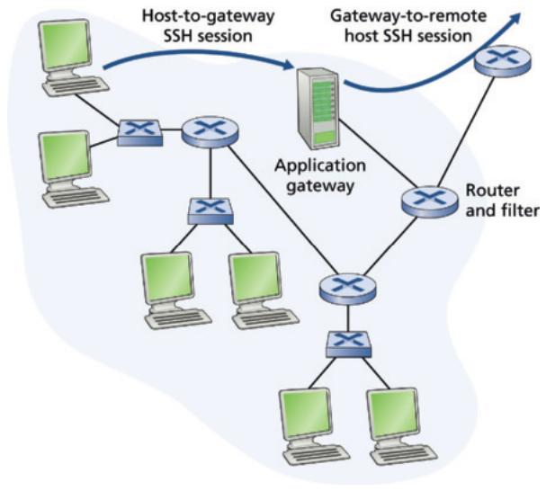

Hình 8.35 Firewall gồm một gateway ứng dụng và một bộ lọc

> Lịch sử tình huống (Case History)
>
> Ẩn danh và quyền riêng tư (Anonymity and Privacy)
>
> Giả sử bạn muốn truy cập một trang Web gây tranh cãi (ví dụ, một trang của nhà hoạt động chính trị) và bạn (1) không muốn tiết lộ địa chỉ IP của mình cho trang Web,
>
> (2) không muốn ISP cục bộ của bạn (có thể là ISP ở nhà hoặc văn phòng) biết bạn đang truy cập trang đó, và (3) không muốn ISP cục bộ của bạn thấy dữ liệu bạn đang trao đổi với trang đó. Nếu bạn dùng cách tiếp cận truyền thống là kết nối trực tiếp tới trang Web mà không có mã hóa nào, bạn thất bại ở cả ba điểm.
>
> Ngay cả khi bạn dùng TLS, bạn vẫn thất bại ở hai điểm đầu: Địa chỉ IP nguồn của bạn được trình ra cho trang Web trong mọi datagram bạn gửi; và địa chỉ đích của mọi packet bạn gửi có thể dễ dàng bị ISP cục bộ nghe lén. Để có quyền riêng tư và ẩn danh, thay vào đó bạn có thể dùng sự kết hợp của một proxy server tin cậy và TLS, như minh họa trong Hình 8.36. Với cách tiếp cận này, trước hết bạn tạo một kết nối TLS tới proxy tin cậy. Sau đó bạn gửi, vào kết nối TLS này, một HTTP request cho một trang tại trang Web mong muốn. Khi proxy nhận HTTP request TLS-encrypted, nó giải mã request và chuyển tiếp HTTP request dạng cleartext tới trang Web. Trang Web sau đó phản hồi proxy, proxy lại chuyển tiếp phản hồi tới bạn qua TLS. Vì trang Web chỉ thấy địa chỉ IP của proxy, chứ không phải địa chỉ client của bạn, bạn thực sự có được truy cập ẩn danh tới trang Web. Và vì mọi traffic giữa bạn và proxy được mã hóa, ISP cục bộ của bạn không thể xâm phạm quyền riêng tư của bạn bằng cách ghi log trang bạn đã truy cập hoặc ghi lại dữ liệu bạn đang trao đổi.
>
> Nhiều công ty ngày nay (như proxify.com) cung cấp các dịch vụ proxy như vậy. Tất nhiên, trong giải pháp này, proxy của bạn biết mọi thứ: Nó biết địa chỉ IP của bạn và địa chỉ IP của trang bạn đang lướt; và nó có thể thấy mọi

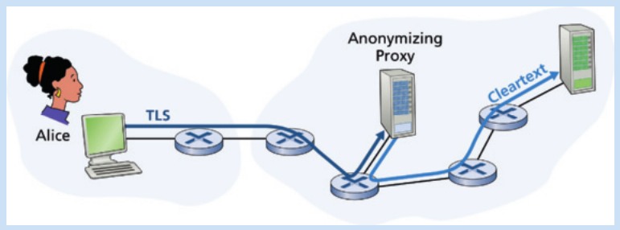

> Hình 8.36 Cung cấp ẩn danh và quyền riêng tư bằng một proxy
>
> traffic dạng cleartext trao đổi giữa bạn và trang Web. Do đó, một giải pháp như vậy chỉ tốt bằng mức đáng tin cậy của proxy. Một cách tiếp cận mạnh mẽ hơn, được dịch vụ ẩn danh và quyền riêng tư TOR áp dụng, là định tuyến traffic của bạn qua một chuỗi các proxy server non-colluding (không thông đồng) [TOR 2020]. Cụ thể, TOR cho phép các cá nhân độc lập đóng góp proxy vào nhóm proxy của nó. Khi một người dùng kết nối tới một server dùng TOR, TOR chọn ngẫu nhiên (từ nhóm proxy của nó) một chuỗi ba proxy và định tuyến mọi traffic giữa client và server qua chuỗi đó. Bằng cách này, giả sử các proxy không thông đồng, không ai biết rằng giao tiếp đã diễn ra giữa địa chỉ IP của bạn và trang Web đích. Hơn nữa, mặc dù cleartext được gửi giữa proxy cuối cùng và server, proxy cuối cùng không biết địa chỉ IP nào đang gửi và nhận cleartext.

Gateway ứng dụng không phải không có nhược điểm. Thứ nhất, cần một gateway ứng dụng khác nhau cho mỗi ứng dụng. Thứ hai, có một cái giá về performance phải trả, vì mọi dữ liệu sẽ được chuyển tiếp qua gateway. Điều này trở thành một mối lo ngại đặc biệt khi nhiều người dùng hoặc ứng dụng đang dùng cùng một máy gateway. Cuối cùng, phần mềm client phải biết cách liên lạc với gateway khi người dùng đưa ra một yêu cầu, và phải biết cách cho gateway ứng dụng biết server bên ngoài nào cần kết nối.

### 8.9.2 Hệ thống phát hiện xâm nhập (Intrusion Detection Systems)

Chúng ta vừa thấy rằng một bộ lọc packet (truyền thống và có trạng thái) kiểm tra các trường header IP, TCP, UDP, và ICMP khi quyết định packet nào được cho đi qua firewall. Tuy nhiên, để phát hiện nhiều loại tấn công, chúng ta cần thực hiện kiểm tra sâu packet (deep packet inspection), tức là, nhìn vượt ra ngoài các trường header và vào dữ liệu ứng dụng thực tế mà các packet mang. Như chúng ta đã thấy trong Mục 8.9.1, gateway ứng dụng thường thực hiện kiểm tra sâu packet. Nhưng một gateway ứng dụng chỉ làm điều này cho một ứng dụng cụ thể.

Rõ ràng, có một chỗ đứng cho một thiết bị khác nữa—một thiết bị không chỉ kiểm tra header của mọi packet đi qua nó (giống bộ lọc packet), mà còn thực hiện kiểm tra sâu packet (khác với bộ lọc packet). Khi một thiết bị như vậy quan sát thấy một packet đáng ngờ, hoặc một chuỗi packet đáng ngờ, nó có thể ngăn các packet đó vào mạng của tổ chức. Hoặc, vì hoạt động chỉ được coi là đáng ngờ, thiết bị có thể cho các packet đi qua, nhưng gửi cảnh báo tới quản trị viên mạng, người sau đó có thể xem xét kỹ hơn traffic và thực hiện hành động thích hợp. Một thiết bị tạo cảnh báo khi quan sát thấy traffic có thể độc hại được gọi là hệ thống phát hiện xâm nhập (intrusion detection system - IDS). Một thiết bị lọc bỏ traffic đáng ngờ được gọi là hệ thống ngăn chặn xâm nhập (intrusion prevention system - IPS). Trong mục này chúng ta học cả hai hệ thống—IDS và IPS—cùng nhau, vì khía cạnh kỹ thuật thú vị nhất của các hệ thống này là cách chúng phát hiện traffic đáng ngờ (chứ không phải chúng gửi cảnh báo hay loại bỏ packet). Từ đây chúng ta sẽ gọi chung hệ thống IDS và hệ thống IPS là hệ thống IDS.

Một IDS có thể được dùng để phát hiện nhiều loại tấn công, bao gồm lập bản đồ mạng (xuất phát, ví dụ, từ nmap), quét port, quét chồng TCP, tấn công DoS bandwidth-flooding, sâu và virus, tấn công lỗ hổng OS, và tấn công lỗ hổng ứng dụng. (Xem Mục 1.6 để có khảo sát về các tấn công mạng.) Ngày nay, hàng nghìn tổ chức dùng hệ thống IDS. Nhiều hệ thống được triển khai này là độc quyền, được bán bởi Palo Alto Networks, Check Point, và các nhà cung cấp thiết bị bảo mật và router/switch khác. Nhưng nhiều hệ thống IDS được triển khai là các hệ thống public-domain (phạm vi công cộng), như hệ thống IDS Snort cực kỳ phổ biến (mà chúng ta sẽ bàn ngay sau đây).

Một tổ chức có thể triển khai một hoặc nhiều cảm biến IDS trong mạng của mình. Hình 8.37 cho thấy một tổ chức có ba cảm biến IDS. Khi nhiều cảm biến được triển khai, chúng thường phối hợp, gửi thông tin về hoạt động traffic đáng ngờ tới một bộ xử lý IDS trung tâm, bộ xử lý này thu thập

Một tổ chức triển khai một bộ lọc, một gateway ứng dụng, và các cảm biến IDS và tích hợp thông tin và gửi cảnh báo tới quản trị viên mạng khi thấy thích hợp. Trong Hình 8.37, tổ chức đã chia mạng của mình thành hai vùng: một vùng high-security, được bảo vệ bởi một bộ lọc packet và một gateway ứng dụng và được giám sát bởi các cảm biến IDS; và một vùng lower-security—gọi là vùng phi quân sự (demilitarized zone - DMZ)—chỉ được bảo vệ bởi bộ lọc packet, nhưng cũng được giám sát bởi các cảm biến IDS. Lưu ý rằng DMZ bao gồm các server của tổ chức cần giao tiếp với thế giới bên ngoài, như Web server công khai và DNS server có thẩm quyền của nó.

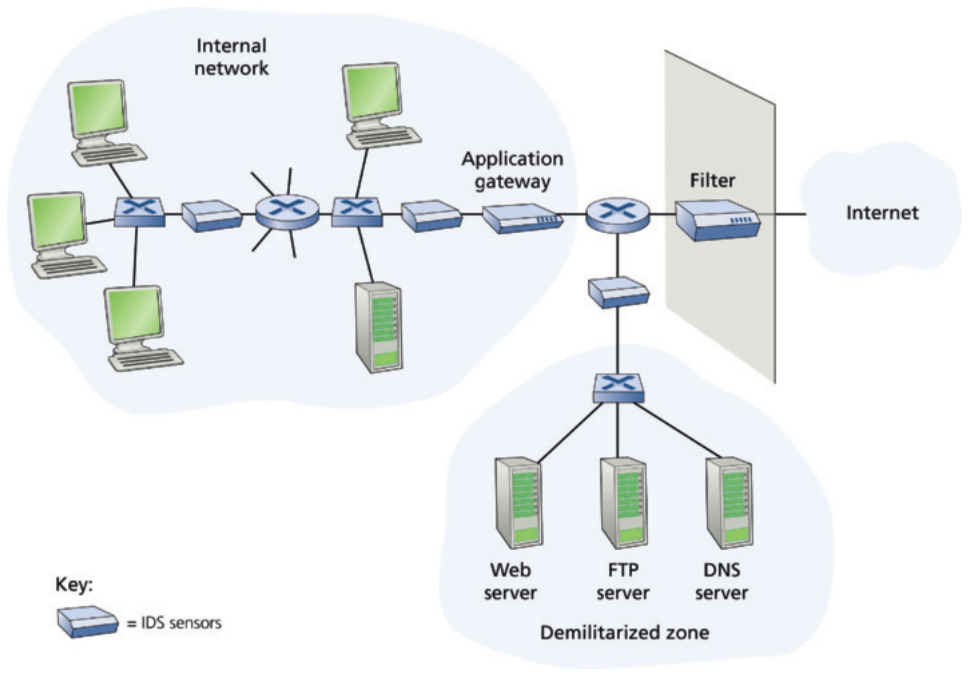

Hình 8.37 (các cảm biến)

Có thể ở giai đoạn này bạn đang thắc mắc, tại sao lại nhiều cảm biến IDS? Tại sao không chỉ đặt một cảm biến IDS ngay sau bộ lọc packet (hoặc thậm chí tích hợp với bộ lọc packet) trong Hình 8.37? Chúng ta sẽ sớm thấy rằng một IDS không chỉ cần thực hiện kiểm tra sâu packet, mà còn phải so sánh mỗi packet đi qua với hàng chục nghìn “chữ ký (signature)”; đây có thể là một lượng xử lý đáng kể, đặc biệt nếu tổ chức nhận hàng Gigabit/giây traffic từ Internet. Bằng cách đặt các cảm biến IDS xa hơn về phía downstream, mỗi cảm biến chỉ thấy một phần traffic của tổ chức, và có thể theo kịp dễ dàng hơn. Tuy nhiên, các hệ thống IDS và IPS high-performance hiện đã có, và nhiều tổ chức thực sự có thể xoay xở chỉ với một cảm biến đặt gần router truy cập của mình.

Hệ thống IDS được phân loại rộng thành hệ thống signature-based (dựa trên chữ ký) hoặc hệ thống anomaly- based (dựa trên bất thường). Một IDS signature-based duy trì một cơ sở dữ liệu rộng lớn các chữ ký tấn công. Mỗi chữ ký là một tập quy tắc liên quan tới một hoạt động xâm nhập. Một chữ ký có thể đơn giản là một danh sách đặc điểm về một packet duy nhất (ví dụ, số port nguồn và đích, loại giao thức, và một chuỗi bit cụ thể trong payload của packet) hoặc có thể liên quan tới một chuỗi packet. Các chữ ký thường được tạo bởi các kỹ sư bảo mật mạng lành nghề nghiên cứu các tấn công đã biết. Quản trị viên mạng của một tổ chức có thể tùy chỉnh chữ ký hoặc thêm chữ ký của riêng mình vào cơ sở dữ liệu.

Về mặt vận hành, một IDS signature-based nghe lén mọi packet đi qua nó, so sánh mỗi packet nghe được với các chữ ký trong cơ sở dữ liệu. Nếu một packet (hoặc chuỗi packet) khớp một chữ ký trong cơ sở dữ liệu, IDS tạo một cảnh báo. Cảnh báo có thể được gửi tới quản trị viên mạng trong một thông điệp e-mail, có thể được gửi tới hệ thống quản lý mạng, hoặc có thể đơn giản được ghi log để kiểm tra sau.

Các hệ thống IDS signature-based, mặc dù được triển khai rộng rãi, có một số hạn chế. Quan trọng nhất, chúng đòi hỏi hiểu biết trước về tấn công để tạo một chữ ký chính xác. Nói cách khác, một IDS signature-based hoàn toàn mù trước các tấn công mới chưa được ghi nhận. Một nhược điểm khác là ngay cả khi một chữ ký được khớp, đó có thể không phải là kết quả của một tấn công, nên một cảnh báo giả được tạo ra. Cuối cùng, vì mọi packet phải được so sánh với một tập chữ ký rộng lớn, IDS có thể bị quá tải xử lý và thực sự không phát hiện được nhiều packet độc hại.

Một IDS anomaly-based tạo một hồ sơ traffic khi nó quan sát traffic trong hoạt động bình thường. Sau đó nó tìm các luồng packet bất thường về mặt thống kê, ví dụ, tỉ lệ packet ICMP cao bất thường hoặc sự gia tăng đột ngột theo hàm mũ của quét port và quét ping. Điều tuyệt vời của các hệ thống IDS anomaly-based là chúng không dựa vào hiểu biết trước về các tấn công hiện có—tức là, chúng có thể phát hiện các tấn công mới, chưa được ghi nhận. Mặt khác, phân biệt giữa traffic bình thường và traffic bất thường về thống kê là một bài toán cực kỳ khó. Cho tới nay, hầu hết các triển khai IDS chủ yếu là signature-based, mặc dù một số có bao gồm một vài tính năng anomaly-based.

#### Snort

Snort là một IDS public-domain, mã nguồn mở với hàng trăm nghìn triển khai hiện có [Snort 2012; Koziol 2003]. Nó có thể chạy trên các nền tảng Linux, UNIX, và Windows. Nó dùng giao diện nghe lén chung libpcap, cũng được Wireshark và nhiều packet sniffer khác dùng. Nó có thể dễ dàng xử lý 100 Mbps traffic; với các cài đặt có tốc độ traffic Gigabit/giây, có thể cần nhiều cảm biến Snort.

Để hiểu phần nào về Snort, hãy xem một ví dụ về chữ ký Snort:

```
alert icmp $EXTERNAL_NET any -> $HOME_NET any
(msg:”ICMP PING NMAP”; dsize: 0; itype: 8;)
```

Chữ ký này được khớp bởi bất kỳ packet ICMP nào đi vào mạng của tổ chức ($HOME_NET) từ bên ngoài ($EXTERNAL_NET), có type 8 (ICMP ping), và có payload rỗng (dsize = 0 ) . Vì nmap (xem Mục 1.6) tạo các packet ping với các đặc điểm cụ thể này, chữ ký này được thiết kế để phát hiện các đợt quét ping của nmap. Khi một packet khớp chữ ký này, Snort tạo một cảnh báo bao gồm thông điệp “ICMP PING NMAP”.

Có lẽ điều ấn tượng nhất về Snort là cộng đồng rộng lớn các người dùng và chuyên gia bảo mật duy trì cơ sở dữ liệu chữ ký của nó. Thông thường, trong vòng vài giờ sau một tấn công mới, cộng đồng Snort viết và phát hành một chữ ký tấn công, sau đó được hàng trăm nghìn triển khai Snort phân bố khắp thế giới tải về. Hơn nữa, dùng cú pháp chữ ký Snort, quản trị viên mạng có thể điều chỉnh chữ ký cho phù hợp nhu cầu của tổ chức mình bằng cách sửa đổi chữ ký hiện có hoặc tạo chữ ký hoàn toàn mới.

## 8.10 Tóm tắt (Summary)

Trong chương này, chúng ta đã khảo sát các cơ chế khác nhau mà đôi tình nhân bí mật của chúng ta, Bob và Alice, có thể dùng để giao tiếp an toàn. Chúng ta đã thấy Bob và Alice quan tâm tới tính bí mật (để chỉ họ có thể hiểu nội dung của một thông điệp được truyền), xác thực end-point (để họ chắc chắn đang nói chuyện với nhau), và toàn vẹn thông điệp (để họ chắc chắn thông điệp của mình không bị thay đổi trên đường truyền). Tất nhiên, nhu cầu giao tiếp an toàn không chỉ giới hạn ở những đôi tình nhân bí mật. Thật vậy, chúng ta đã thấy trong các Mục 8.5 đến 8.8 rằng bảo mật có thể được dùng ở nhiều tầng khác nhau trong một kiến trúc mạng để bảo vệ trước những kẻ xấu có trong tay một kho vũ khí lớn các tấn công khả dĩ.

Phần đầu của chương này đã trình bày các nguyên lý khác nhau làm nền tảng cho giao tiếp an toàn. Trong Mục 8.2, chúng ta đã đề cập các kỹ thuật mật mã để mã hóa và giải mã dữ liệu, bao gồm mật mã khóa đối xứng và mật mã khóa công khai. DES và RSA đã được khảo sát như các nghiên cứu tình huống cụ thể của hai lớp kỹ thuật mật mã chính này đang được dùng trong các mạng ngày nay.

Trong Mục 8.3, chúng ta đã khảo sát hai cách tiếp cận để cung cấp toàn vẹn thông điệp: mã xác thực thông điệp (MAC) và chữ ký số. Hai cách tiếp cận có một số điểm tương đồng. Cả hai đều dùng hàm băm mật mã và cả hai kỹ thuật đều cho phép chúng ta kiểm chứng nguồn của thông điệp cũng như toàn vẹn của bản thân thông điệp. Một khác biệt quan trọng là MAC không dựa vào mã hóa trong khi chữ ký số đòi hỏi một hạ tầng khóa công khai. Cả hai kỹ thuật đều được dùng rộng rãi trong thực tế, như chúng ta đã thấy trong các Mục 8.5 đến 8.8. Hơn nữa, chữ ký số được dùng để tạo chứng chỉ số, vốn quan trọng cho việc kiểm chứng tính hợp lệ của khóa công khai. Trong Mục 8.4, chúng ta đã khảo sát xác thực đầu mút và giới thiệu nonce để chống lại tấn công phát lại.

Trong các Mục 8.5 đến 8.8 chúng ta đã khảo sát một số giao thức mạng bảo mật được dùng rộng rãi trong thực tế. Chúng ta đã thấy mật mã khóa đối xứng là cốt lõi của PGP, TLS, IPsec, và bảo mật không dây. Chúng ta đã thấy mật mã khóa công khai là then chốt cho cả PGP và TLS. Chúng ta đã thấy PGP dùng chữ ký số cho toàn vẹn thông điệp, trong khi TLS và IPsec dùng MAC. Chúng ta cũng đã khám phá bảo mật trong mạng không dây, bao gồm mạng WiFi và mạng di động 4G/5G. Giờ đã hiểu các nguyên lý cơ bản của mật mã học, và đã học cách các nguyên lý này thực sự được dùng, bạn đã có thể thiết kế các giao thức mạng an toàn của riêng mình!

Được trang bị các kỹ thuật đã đề cập trong các Mục 8.2 đến 8.8, Bob và Alice có thể giao tiếp an toàn. Nhưng tính bí mật chỉ là một phần nhỏ của bức tranh bảo mật mạng. Như chúng ta đã học trong Mục 8.9, trọng tâm trong bảo mật mạng ngày càng hướng tới việc bảo vệ hạ tầng mạng trước một cuộc tấn công dồn dập tiềm năng của kẻ xấu. Do đó, trong phần sau của chương này, chúng ta đã đề cập firewall và hệ thống IDS kiểm tra các packet vào và rời mạng của một tổ chức.

### Bài tập về nhà và câu hỏi (Homework Problems and Questions)

#### Câu hỏi ôn tập Chương 8 (Chapter 8 Review Problems)

##### Mục 8.1

R1. Khác biệt giữa tính bí mật thông điệp và toàn vẹn thông điệp là gì? Bạn có thể có tính bí mật mà không có toàn vẹn không? Bạn có thể có toàn vẹn mà không có tính bí mật không? Hãy giải thích câu trả lời.

R2. Các thực thể Internet (router, switch, DNS server, Web server, end system của người dùng, v.v.) thường cần giao tiếp an toàn. Hãy đưa ra ba ví dụ cụ thể về cặp thực thể Internet có thể muốn giao tiếp an toàn.

##### Mục 8.2

R3. Từ góc nhìn dịch vụ, một khác biệt quan trọng giữa hệ thống symmetric-key và hệ thống public-key là gì?

R4. Giả sử một kẻ xâm nhập có một thông điệp đã mã hóa cũng như phiên bản đã giải mã của thông điệp đó. Kẻ xâm nhập có thể tiến hành tấn công ciphertext-only, tấn công known-plaintext, hay tấn công chosen-plaintext?

R5. Hãy xét một mật mã khối 8-bit. Mật mã này có bao nhiêu khối đầu vào khả dĩ? Có bao nhiêu ánh xạ khả dĩ? Nếu chúng ta xem mỗi ánh xạ như một khóa, thì mật mã này có bao nhiêu khóa khả dĩ?

R6. Giả sử N người muốn giao tiếp với mỗi người trong N − 1 người khác dùng mã hóa khóa đối xứng. Mọi giao tiếp giữa bất kỳ hai người nào, i và j, đều hiển thị với mọi người khác trong nhóm N người này, và không người nào khác trong nhóm này có thể giải mã giao tiếp của họ. Cần bao nhiêu khóa trong toàn bộ hệ thống? Giờ giả sử mã hóa khóa công khai được dùng. Cần bao nhiêu khóa trong trường hợp này?

R7. Giả sử n = 10,000, a = 10,023 , và b = 10, 004. Hãy dùng một đồng nhất thức của số học modulo để tính nhẩm ( a • b) mod n.

R8. Giả sử bạn muốn mã hóa thông điệp 10101111 bằng cách mã hóa số thập phân tương ứng với thông điệp. Số thập phân đó là gì?

##### Mục 8.3–8.4

R9. Theo cách nào một giá trị băm cung cấp kiểm tra toàn vẹn thông điệp tốt hơn một checksum (như Internet checksum)?

R10. Bạn có thể “giải mã” giá trị băm của một thông điệp để có thông điệp gốc không? Hãy giải thích câu trả lời.

R11. Hãy xét một biến thể của thuật toán MAC (Hình 8.9) trong đó bên gửi gửi ( m, H (m) + s), trong đó H (m) + s là phép nối của H (m) và s. Biến thể này có lỗ hổng không? Tại sao có hoặc tại sao không?

R12. Một tài liệu đã ký là kiểm chứng được và không thể giả mạo có nghĩa là gì?

R13. Theo cách nào giá trị băm thông điệp được mã hóa public-key cung cấp chữ ký số tốt hơn thông điệp được mã hóa public-key?

R14. Giả sử certifier.com tạo một chứng chỉ cho foo.com. Thông thường, toàn bộ chứng chỉ sẽ được mã hóa bằng khóa công khai của certifier.com. Đúng hay sai?

R15. Giả sử Alice có một thông điệp sẵn sàng gửi cho bất kỳ ai yêu cầu. Hàng nghìn người muốn có thông điệp của Alice, nhưng mỗi người muốn chắc chắn về tính toàn vẹn của thông điệp. Trong bối cảnh này, bạn nghĩ sơ đồ toàn vẹn MAC-based hay digital-signature-based phù hợp hơn? Tại sao?

R16. Mục đích của nonce trong một giao thức xác thực end-point là gì?

R17. Nói rằng nonce là một giá trị once-in-a-lifetime có nghĩa là gì? Trong đời của ai?

R18. Sơ đồ toàn vẹn thông điệp dựa trên HMAC có dễ bị tấn công phát lại không? Nếu có, làm thế nào một nonce có thể được đưa vào sơ đồ để loại bỏ điểm yếu này?

##### Mục 8.5–8.8

R19. Giả sử Bob nhận một thông điệp PGP từ Alice. Làm thế nào Bob biết chắc rằng Alice đã tạo thông điệp (chứ không phải, chẳng hạn, Trudy)? PGP có dùng MAC cho toàn vẹn thông điệp không?

R20. Trong bản ghi TLS, có một trường cho số thứ tự TLS. Đúng hay sai?

R21. Mục đích của các nonce ngẫu nhiên trong bắt tay TLS là gì?

R22. Giả sử một phiên TLS dùng một mật mã khối với CBC. Đúng hay sai: Server gửi IV tới client dạng rõ.

R23. Giả sử Bob khởi tạo một kết nối TCP tới Trudy, kẻ đang giả làm Alice. Trong quá trình bắt tay, Trudy gửi cho Bob chứng chỉ của Alice. Ở bước nào của thuật toán bắt tay TLS Bob sẽ phát hiện ra mình không đang giao tiếp với Alice?

R24. Hãy xét việc gửi một luồng packet từ Host A tới Host B dùng IPsec. Thông thường, một SA mới sẽ được thiết lập cho mỗi packet gửi trong luồng. Đúng hay sai?

R25. Giả sử TCP đang chạy trên IPsec giữa trụ sở chính và văn phòng chi nhánh trong Hình 8.28. Nếu TCP truyền lại cùng một packet, thì hai packet tương ứng do R1 gửi sẽ có cùng số thứ tự trong ESP header. Đúng hay sai?

R26. Một IKE SA và một IPsec SA là cùng một thứ. Đúng hay sai?

R27. Hãy xét WEP cho 802.11. Giả sử dữ liệu là 10101100 và keystream là 1111000. Bản mã thu được là gì?

##### Mục 8.9

R28. Bộ lọc packet có trạng thái duy trì hai cấu trúc dữ liệu. Hãy nêu tên chúng và mô tả ngắn gọn chúng làm gì.

R29. Hãy xét một bộ lọc packet truyền thống (phi trạng thái). Bộ lọc packet này có thể lọc packet dựa trên

### Bài tập (Problems)

các bit cờ TCP cũng như các trường header khác. Đúng hay sai?

R30. Trong một bộ lọc packet truyền thống, mỗi giao diện có thể có danh sách kiểm soát truy cập riêng. Đúng hay sai?

R31. Tại sao một gateway ứng dụng phải làm việc cùng với một bộ lọc router mới hiệu quả?

R32. Các IDS và IPS signature-based kiểm tra vào trong payload của các segment TCP và UDP. Đúng hay sai?

P1. Dùng mật mã đơn bảng trong Hình 8.3, hãy mã hóa thông điệp “This is an easy problem.” Hãy giải mã thông điệp “rmij’u uamu xyj.”

P2. Hãy chỉ ra rằng tấn công known-plaintext của Trudy, trong đó cô ấy biết các cặp dịch (bản mã, bản rõ) cho bảy chữ cái, làm giảm số phép thay thế khả dĩ cần kiểm tra trong ví dụ ở Mục 8.2.1 khoảng 10<sup>9</sup> lần.

P3. Hãy xét hệ thống đa bảng minh họa trong Hình 8.4. Một tấn công chosen-plaintext có thể lấy được mã hóa bản rõ của thông điệp “The quick brown fox jumps over the lazy dog.” có đủ để giải mã mọi thông điệp không? Tại sao có hoặc tại sao không?

P4. Hãy xét mật mã khối trong Hình 8.5. Giả sử mỗi mật mã khối T<sub>i</sub> đơn giản đảo ngược thứ tự của tám bit đầu vào (để, ví dụ, 11110000 trở thành 00001111). Giả sử thêm rằng bộ xáo trộn 64-bit không sửa đổi bit nào (để giá trị đầu ra của bit thứ m bằng giá trị đầu vào của bit thứ m). (a) Với n = 3 và đầu vào 64-bit gốc bằng 10100000 lặp lại tám lần, giá trị đầu ra là gì? (b) Lặp lại phần (a) nhưng giờ đổi bit cuối cùng của đầu vào 64-bit gốc từ 0 thành 1. (c) Lặp lại các phần (a) và (b) nhưng giờ giả sử bộ xáo trộn 64-bit đảo ngược thứ tự của 64 bit.

P5. Hãy xét mật mã khối trong Hình 8.5. Với một “khóa” cho trước Alice và Bob sẽ cần giữ tám bảng, mỗi bảng 8 bit nhân 8 bit. Để Alice (hoặc Bob) lưu cả tám bảng, cần bao nhiêu bit bộ nhớ? Con số này so với số bit cần cho một mật mã khối 64-bit full-table thế nào?

P6. Hãy xét mật mã khối 3-bit trong Bảng 8.1. Giả sử bản rõ là

100100100. (a) Ban đầu giả sử CBC không được dùng. Bản mã thu được là gì? (b) Giả sử Trudy nghe lén bản mã. Giả sử cô ấy biết một mật mã khối 3-bit không có CBC đang được dùng (nhưng không biết mật mã cụ thể), cô ấy có thể suy đoán gì? (c) Giờ giả sử CBC được dùng với IV = 111. Bản mã thu được là gì?

P7. (a) Dùng RSA, chọn p = 3 và q = 11, và mã hóa từ “dog” bằng cách mã hóa từng chữ cái riêng. Áp dụng thuật toán giải mã cho phiên bản đã mã hóa để khôi phục thông điệp bản rõ gốc. (b) Lặp lại phần (a) nhưng giờ mã hóa “dog” như một thông điệp m duy nhất.

P8. Hãy xét RSA với p = 5 và q = 11.

a. n và z là gì?

b. Cho e bằng 3. Tại sao đây là một lựa chọn chấp nhận được cho e?

c. Tìm d sao cho de = 1 (mod z) và d < 160.

d. Mã hóa thông điệp m = 8 dùng khóa (n, e) . Gọi c là bản mã tương ứng. Hãy trình bày mọi bước. Gợi ý: Để đơn giản hóa phép tính, dùng tính chất:

[ ( a mod n) • (b mod n)] mod n = ( a • b) mod n

P9. Trong bài này, chúng ta khám phá thuật toán mã hóa public-key Diffie-Hellman (DH), mà chúng ta đã học trong Mục 8.2.2

a. Với p = 11 và g = 2, giả sử Alice và Bob lần lượt chọn khóa riêng S<sub>A</sub> = 5 và S<sub>B</sub> = 12. Hãy tính các khóa công khai T<sub>A</sub> và T<sub>B</sub> của Alice và Bob. Hãy trình bày mọi bước.

b. Tiếp theo phần (a), giờ hãy tính S là khóa đối xứng dùng chung. Hãy trình bày mọi bước.

c. Hãy đưa ra một sơ đồ thời gian cho thấy Diffie-Hellman có thể bị tấn công bởi một man-in-the-middle như thế nào. Sơ đồ thời gian nên có ba đường dọc, một cho Alice, một cho Bob, và một cho kẻ tấn công Trudy.

P10. Giả sử Alice muốn giao tiếp với Bob bằng mật mã khóa đối xứng dùng một khóa phiên K<sub>S</sub>. Trong Mục 8.2, chúng ta đã học cách mật mã public-key có thể được dùng để phân phối khóa phiên từ Alice tới Bob. Trong bài này, chúng ta khám phá cách khóa phiên có thể được phân phối—không dùng mật mã khóa công khai—bằng một trung tâm phân phối khóa (key distribution center - KDC). KDC là một server chia sẻ một khóa đối xứng bí mật duy nhất với mỗi người dùng đã đăng ký. Với Alice và Bob, ký hiệu các khóa này là K<sub>A−KDC</sub> và K<sub>B−KDC</sub>. Hãy thiết kế một sơ đồ dùng KDC để phân phối K<sub>S</sub> tới Alice và Bob. Sơ đồ của bạn nên dùng ba thông điệp để phân phối khóa phiên: một thông điệp từ Alice tới KDC; một thông điệp từ KDC tới Alice; và cuối cùng một thông điệp từ Alice tới Bob. Thông điệp đầu tiên là K<sub>A−KDC</sub>(A, B). Dùng ký hiệu, K<sub>A−KDC</sub>, K<sub>B−KDC</sub>, S, A, và B hãy trả lời các câu hỏi sau.

a. Thông điệp thứ hai là gì?

b. Thông điệp thứ ba là gì?

P11. Hãy tính một thông điệp thứ ba, khác với hai thông điệp trong Hình 8.8, có cùng checksum với các thông điệp trong Hình 8.8.

P12. Giả sử Alice và Bob chia sẻ hai khóa bí mật: một khóa xác thực S<sub>1</sub> và một khóa mã hóa đối xứng S<sub>2</sub>. Hãy mở rộng Hình 8.9 để cung cấp cả toàn vẹn và tính bí mật.

P13. Trong giao thức phân phối file P2P BitTorrent (xem Chương 2), seed chia file thành các khối, và các peer phân phối lại các khối cho nhau. Không có bảo vệ nào, một kẻ tấn công có thể dễ dàng tàn phá một torrent bằng cách giả làm một peer tốt bụng và gửi các khối giả tới một tập nhỏ peer trong torrent. Những peer không nghi ngờ này sau đó phân phối lại các khối giả tới các peer khác, các peer này lại phân phối lại các khối giả tới nhiều peer hơn nữa. Do đó, điều then chốt là BitTorrent có một cơ chế cho phép một peer kiểm chứng toàn vẹn của một khối, để nó không phân phối lại các khối giả. Giả sử khi một peer gia nhập một torrent, ban đầu nó lấy một file .torrent từ một nguồn hoàn toàn đáng tin cậy. Hãy mô tả một sơ đồ đơn giản cho phép các peer kiểm chứng toàn vẹn của các khối.

P14. Giao thức định tuyến OSPF dùng MAC thay vì chữ ký số để cung cấp toàn vẹn thông điệp. Bạn nghĩ tại sao MAC được chọn thay vì chữ ký số?

P15. Hãy xét giao thức xác thực của chúng ta trong Hình 8.18 trong đó Alice xác thực bản thân với Bob, mà chúng ta đã thấy hoạt động tốt (tức là, chúng ta không tìm thấy lỗ hổng nào trong nó). Giờ giả sử trong khi Alice đang xác thực bản thân với Bob, Bob phải xác thực bản thân với Alice. Hãy đưa ra một kịch bản trong đó Trudy, giả làm Alice, giờ có thể xác thực bản thân với Bob như Alice. (Gợi ý: Hãy xét rằng chuỗi thao tác của giao thức, một do Trudy khởi tạo và một do Bob khởi tạo, có thể được đan xen tùy ý. Đặc biệt chú ý tới việc cả Bob và Alice đều sẽ dùng một nonce, và nếu không cẩn thận, cùng một nonce có thể bị dùng một cách ác ý.)

P16. Một câu hỏi tự nhiên là liệu chúng ta có thể dùng nonce và mật mã khóa công khai để giải quyết bài toán xác thực end-point trong Mục 8.4 hay không. Hãy xét giao thức tự nhiên sau: (1) Alice gửi thông điệp “I am Alice” tới Bob. (2) Bob chọn một nonce, R, và gửi nó tới Alice.

(3) Alice dùng khóa riêng của mình để mã hóa nonce và gửi giá trị thu được tới Bob. (4) Bob áp dụng khóa công khai của Alice cho thông điệp nhận được. Do đó, Bob tính ra R và xác thực Alice.

a. Hãy vẽ sơ đồ giao thức này, dùng ký hiệu cho khóa công khai và khóa riêng được dùng trong giáo trình.

b. Giả sử chứng chỉ không được dùng. Hãy mô tả cách Trudy có thể trở thành một “woman-in-the-middle” bằng cách chặn bắt thông điệp của Alice rồi giả làm Alice với Bob.

P17. Hình 8.21 cho thấy các thao tác mà Alice phải thực hiện với PGP để cung cấp tính bí mật, xác thực, và toàn vẹn. Hãy vẽ sơ đồ các thao tác tương ứng mà Bob phải thực hiện trên gói nhận được từ Alice.

P18. Giả sử Alice muốn gửi một e-mail tới Bob. Bob có một cặp khóa public-private (K<sup>+</sup><sub>B</sub>, K<sup>−</sup><sub>B</sub>), và Alice có chứng chỉ của Bob. Nhưng Alice không có cặp khóa công khai, riêng. Alice và Bob (và cả thế giới) dùng chung cùng hàm băm H (•).

a. Trong tình huống này, có thể thiết kế một sơ đồ để Bob có thể kiểm chứng rằng Alice đã tạo thông điệp không? Nếu có, hãy chỉ ra cách làm bằng một sơ đồ khối cho Alice và Bob.

b. Có thể thiết kế một sơ đồ cung cấp tính bí mật cho việc gửi thông điệp từ Alice tới Bob không? Nếu có, hãy chỉ ra cách làm bằng một sơ đồ khối cho Alice và Bob.

P19. Hãy xét đầu ra Wireshark dưới đây cho một phần của một phiên SSL.

a. Packet Wireshark 112 được gửi bởi client hay server?

b. Địa chỉ IP và số port của server là gì?

c. Giả sử không có mất mát và không truyền lại, số thứ tự của TCP segment tiếp theo do client gửi sẽ là bao nhiêu?

d. Packet Wireshark 112 chứa bao nhiêu bản ghi SSL?

e. Packet 112 chứa một Master Secret hay một Encrypted Master Secret hay không cái nào?

f. Giả sử trường handshake type là 1 byte và mỗi trường length là 3 byte, giá trị của byte đầu tiên và byte cuối cùng của Master Secret (hoặc Encrypted Master Secret) là gì?

g. Thông điệp bắt tay đã mã hóa của client tính tới bao nhiêu bản ghi SSL?

h. Thông điệp bắt tay đã mã hóa của server tính tới bao nhiêu bản ghi SSL?

P20. Trong Mục 8.6.1, đã chỉ ra rằng không có số thứ tự, Trudy (một woman-in-the middle) có thể tàn phá một phiên TLS bằng cách hoán đổi các TCP segment. Trudy có thể làm điều tương tự bằng cách xóa một TCP segment không? Cô ấy cần làm gì để tấn công xóa thành công? Nó sẽ có tác động gì?

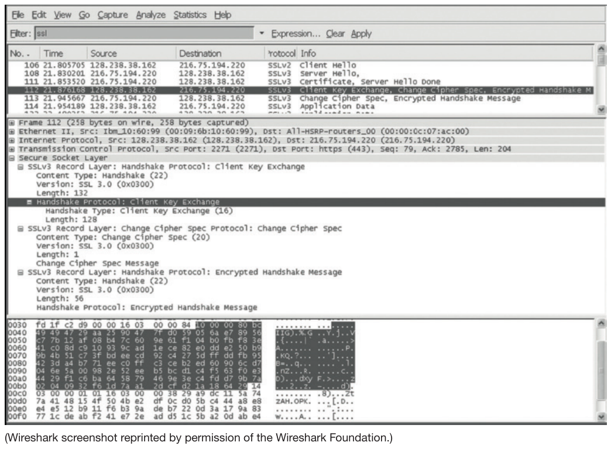

P21. Giả sử Alice và Bob đang giao tiếp qua một phiên TLS. Giả sử một kẻ tấn công, không có bất kỳ khóa dùng chung nào, chèn một TCP segment giả vào một luồng packet với checksum TCP và số thứ tự đúng (và địa chỉ IP và số port đúng). TLS ở phía nhận có chấp nhận packet giả và chuyển payload lên ứng dụng nhận không? Tại sao có hoặc tại sao không?

P22. Các câu hỏi đúng/sai sau liên quan tới Hình 8.28.

a. Khi một host trong 172.16.1/24 gửi một datagram tới một server Amazon.com, router R1 sẽ mã hóa datagram bằng IPsec.

b. Khi một host trong 172.16.1/24 gửi một datagram tới một host trong 172.16.2/24, router R1 sẽ thay đổi địa chỉ nguồn và đích của IP datagram.

c. Giả sử một host trong 172.16.1/24 khởi tạo một kết nối TCP tới một Web server trong 172.16.2/24. Như một phần của kết nối này, mọi datagram do R1 gửi sẽ có số giao thức 50 trong trường header IPv4 left-most.

d. Hãy xét việc gửi một TCP segment từ một host trong 172.16.1/24 tới một host trong 172.16.2/24. Giả sử xác nhận cho segment này bị mất, nên TCP gửi lại segment. Vì IPsec dùng số thứ tự, R1 sẽ không gửi lại TCP segment.

P23. Hãy xét ví dụ trong Hình 8.28. Giả sử Trudy là một woman-in-the-middle, có thể chèn datagram vào luồng datagram đi từ R1 tới R2. Như một phần của một tấn công phát lại, Trudy gửi một bản sao trùng lặp của một trong các datagram gửi từ R1 tới R2. R2 có giải mã datagram trùng lặp và chuyển tiếp nó vào mạng branch-office không? Nếu không, hãy mô tả chi tiết cách R2 phát hiện datagram trùng lặp.

P24. Hãy đưa ra một bảng lọc và một bảng kết nối cho một firewall có trạng thái hạn chế nhất có thể nhưng thực hiện được những điều sau:

a. Cho phép mọi người dùng nội bộ thiết lập phiên Telnet với host bên ngoài.

b. Cho phép người dùng bên ngoài lướt trang Web của công ty tại 222.22.0.12.

c. Nhưng ngoài ra chặn mọi traffic vào và ra.

Mạng nội bộ là 222.22/16. Trong lời giải của bạn, giả sử bảng kết nối hiện đang cache ba kết nối, tất cả từ trong ra ngoài. Bạn sẽ cần tự đặt địa chỉ IP và số port thích hợp.

P25. Giả sử Alice muốn truy cập trang Web activist.com dùng một dịch vụ TOR-like. Dịch vụ này dùng hai proxy server non-colluding, Proxy1 và Proxy2. Alice trước hết lấy các chứng chỉ (mỗi chứng chỉ chứa một khóa công khai) cho Proxy1 và Proxy2 từ một server trung tâm nào đó. Ký hiệu K<sub>1</sub><sup>+</sup>( ), K<sup>+</sup><sub>2</sub>(), K<sub>1</sub><sup>−</sup>( ), và K<sup>−</sup><sub>2</sub>() cho mã hóa/giải mã bằng khóa RSA công khai và riêng.

a. Dùng một sơ đồ thời gian, hãy đưa ra một giao thức (càng đơn giản càng tốt) cho phép Alice thiết lập một khóa phiên dùng chung S<sub>1</sub> với Proxy1. Ký hiệu S<sub>1</sub>(m) cho mã hóa/giải mã dữ liệu m bằng khóa dùng chung S<sub>1</sub>.

b. Dùng một sơ đồ thời gian, hãy đưa ra một giao thức (càng đơn giản càng tốt) cho phép Alice thiết lập một khóa phiên dùng chung S<sub>2</sub> với Proxy2 mà không tiết lộ địa chỉ IP của mình cho Proxy2.

c. Giờ giả sử các khóa dùng chung S<sub>1</sub> và S<sub>2</sub> đã được thiết lập. Dùng một sơ đồ thời gian, hãy đưa ra một giao thức (càng đơn giản càng tốt và không dùng mật mã public-key) cho phép Alice yêu cầu một trang html từ activist.com mà không tiết lộ địa chỉ IP của mình cho Proxy2 và không tiết lộ cho Proxy1 trang nào cô ấy đang truy cập. Sơ đồ của bạn nên kết thúc với một HTTP request tới activist.com.

### Bài thực hành Wireshark: TLS (Wireshark Lab: TLS)

Trong bài lab này (có trên trang Web của cuốn sách), chúng ta khảo sát giao thức Transport Layer Security (TLS). Nhớ lại từ Mục 8.6 rằng TLS được dùng để bảo mật một kết nối TCP, và nó được dùng rộng rãi trong thực tế cho các giao dịch Internet an toàn. Trong bài lab này, chúng ta sẽ tập trung vào các bản ghi TLS gửi qua kết nối TCP. Chúng ta sẽ cố gắng phân định và phân loại từng bản ghi, với mục tiêu hiểu lý do và cách thức của từng bản ghi.

Chúng ta khảo sát các loại bản ghi TLS khác nhau cũng như các trường trong các thông điệp TLS. Chúng ta làm điều đó bằng cách phân tích một trace các bản ghi TLS gửi giữa host của bạn và một server e-commerce.

#### Bài thực hành IPsec (IPsec Lab)

Trong bài lab này (có trên trang Web của cuốn sách), chúng ta sẽ khám phá cách tạo SA IPsec giữa các máy linux. Bạn có thể làm phần đầu của bài lab với hai máy linux thông thường, mỗi máy có một adapter Ethernet. Nhưng cho phần thứ hai của bài lab, bạn sẽ cần bốn máy linux, hai trong số đó có hai adapter Ethernet. Trong nửa sau của bài lab, bạn sẽ tạo SA IPsec dùng giao thức ESP ở chế độ tunnel. Bạn sẽ làm điều này bằng cách trước hết tạo SA thủ công, rồi để IKE tạo SA.

### PHỎNG VẤN VỚI... (AN INTERVIEW WITH...)


### Lorrie Faith Cranor

Lorrie Faith Cranor là giáo sư tại Software and Societal Systems Department (S3D<sub>)</sub> và tại Engineering and Public Policy Department (EPP) ở Carnegie Mellon University, nơi bà điều hành CyLab Security and Privacy Institute. Nghiên cứu của bà tập trung vào “quyền riêng tư và bảo mật dễ dùng (usable privacy and security)”, và đã bao gồm các nghiên cứu về các vấn đề khả dụng liên quan tới chính sách mật khẩu, hệ thống kiểm soát truy cập, thông báo quyền riêng tư, nhãn quyền riêng tư của ứng dụng di động, và hơn nữa. Bà đã sáng lập Symposium On Usable Privacy and Security (SOUPS) năm 2005 và co-founded (đồng sáng lập) Conference on Privacy Engineering Practice and Respect (PEPR) năm 2019. Năm 2016, bà giữ chức Chief Technologist tại U.S. Federal Trade Commission. Bà cũng là một co-founder (đồng sáng lập) của Wombat Security Technologies, Inc., một công ty đào tạo nhận thức bảo mật. Bà là Fellow của ACM, IEEE, và AAAS. Bà cũng được bầu vào ACM CHI Academy và nhận giải 2018 ACM CHI Social Impact Award, giải 2018 International Association of Privacy Professionals Privacy Leadership Award, và (cùng các đồng nghiệp) giải 2018 IEEE Cybersecurity Award for Practice. Trước đây bà là nhà nghiên cứu tại AT&T Labs-Research và giảng dạy tại Stern School of Business của New York University. Bà có bằng tiến sĩ ngành Kỹ thuật và Chính sách từ Washington University ở St. Louis.

#### Điều gì đã truyền cảm hứng cho bà bắt đầu nghiên cứu về quyền riêng tư và bảo mật dễ dùng?

Một trong những dự án đầu tiên tôi tham gia tại AT&T Labs-Research nhằm phát triển một ngôn ngữ computer-readable (máy đọc được) chuẩn cho chính sách quyền riêng tư của website gọi là Platform for Privacy Preferences (P3P). Tôi làm chủ tịch nhóm làm việc P3P tại World Wide Web Consortium (W3C), và chúng tôi đã mất hơn 5 năm hoàn thiện chi tiết. Càng làm việc với P3P, tôi càng nhận ra rằng nó sẽ chỉ hữu ích nếu các trình duyệt Web đọc siêu dữ liệu P3P làm điều gì đó hữu ích cho người dùng. Các nhà cung cấp trình duyệt lớn không cam kết xây dựng giao thức P3P đầy đủ, nên tôi đã dẫn dắt một dự án xây dựng một plugin trình duyệt P3P gọi là Privacy Bird tại AT&T. Tôi đã tìm các bài báo nghiên cứu về xây dựng công cụ quyền riêng tư hoặc bảo mật dễ dùng và không tìm thấy nhiều. Khi dự án sắp kết thúc, tôi gặp các nhà nghiên cứu khác quan tâm tới lĩnh vực bảo mật dễ dùng còn non trẻ tại một hội thảo. Khoảng thời gian đó, tôi quyết định tìm việc trong giới học thuật. Trong bài nói xin việc, tôi mô tả công trình của mình về P3P và Privacy Bird và kế hoạch nghiên cứu thêm về quyền riêng tư và bảo mật dễ dùng. CMU đã tuyển tôi, và tôi bắt đầu một phòng lab về quyền riêng tư và bảo mật dễ dùng tại CMU rồi hội nghị SOUPS.

#### Bà đã làm việc trong chính phủ và quan tâm tới chính sách cũng như công nghệ. Điều đó đã diễn ra thế nào? Những mối quan tâm đó tiến hóa dần, hay chúng luôn ở đó?

Tôi có ba bằng từ Engineering and Public Policy Department (nay đã không còn) tại Washington University (WashU) ở St. Louis. Tôi đã làm một đánh giá công nghệ về điện thoại video hồi những năm 1990 rồi làm luận văn thạc sĩ về báo điện tử. Luận án tiến sĩ của tôi là về bầu cử điện tử. Điều thực sự củng cố mối quan tâm của tôi với các vấn đề chính sách công nghệ là khi tôi tham dự Computers, Freedom, and Privacy Conference năm 1993. Đó là một trải nghiệm eye-opening (mở mang tầm mắt) khi nghe về các vấn đề chính sách Internet mới nổi thời đó và gặp những người ở tuyến đầu các cuộc tranh luận chính sách Internet, bao gồm hội đồng quản trị của Electronic Frontier Foundation mới thành lập. Tôi trở lại WashU và hỏi người hướng dẫn của mình, Ron Cytron, tại sao chúng tôi không có khóa học nào tôi có thể học để tìm hiểu thêm về các vấn đề chính sách Internet. Ông gợi ý tôi có thể dạy một khóa, và đó hóa ra là một trải nghiệm học tập tuyệt vời cho tôi. Tất nhiên, tôi đã phải quay lại CFP 94 và CFP 95. Tôi đi mỗi năm sau đó trong một thời gian và tới CFP 2000 thì tôi là chủ tịch hội nghị, và năm 2007 tôi gia nhập hội đồng quản trị EFF.

Khi ở AT&T vào cuối những năm 1990, tôi tham gia sâu vào một vài vấn đề chính sách công nghệ. AT&T đang hỗ trợ các nỗ lực bảo vệ trẻ em trực tuyến mà không xâm phạm quyền của người lớn. Nhóm quan hệ chính phủ của AT&T đề nghị tôi trình bày một nghiên cứu về các công cụ an toàn trực tuyến cho trẻ em tại một sự kiện mà Phó Tổng thống Al Gore phát biểu chính. Sau đó tôi làm nhân chứng chuyên gia trong vài vụ kiện thách thức tính hợp hiến của các luật tiểu bang về “có hại cho trẻ vị thành niên” và Federal Child Online Protection Act. Tôi cũng đang làm việc về P3P, thứ mà U.S. Federal Trade Commission và các ủy viên bảo vệ dữ liệu từ khắp thế giới đang theo dõi sát sao. May mắn thay, có các giáo sư luật tham gia dự án P3P đã dạy tôi về luật quyền riêng tư quốc tế và cho tôi một khóa cấp tốc về ngoại giao quốc tế trước khi tôi phải trình bày dự án với các cơ quan quản lý. Nhân viên FTC thường xuyên gọi cho tôi vì, dù tôi làm việc cho một công ty lớn, tôi không phải người vận động hành lang, và họ cũng hiểu được các giải thích của tôi về cách công nghệ hoạt động. Họ tiếp tục gọi cho tôi sau khi tôi gia nhập đội ngũ giảng viên CMU, và cuối cùng, Chủ tịch FTC Edith Ramirez đề nghị tôi dành một năm tại FTC làm Chief Technologist. Từ đó, tôi đã đưa sinh viên của mình tham gia các dự án chính sách công nghệ. Tôi đặc biệt tự hào về công việc của chúng tôi trong việc thiết kế và kiểm thử biểu tượng California Opt-Out, giờ xuất hiện rộng rãi ở chân trang các website thương mại để chỉ nơi mọi người có thể tìm thấy các tùy chọn quyền riêng tư.
