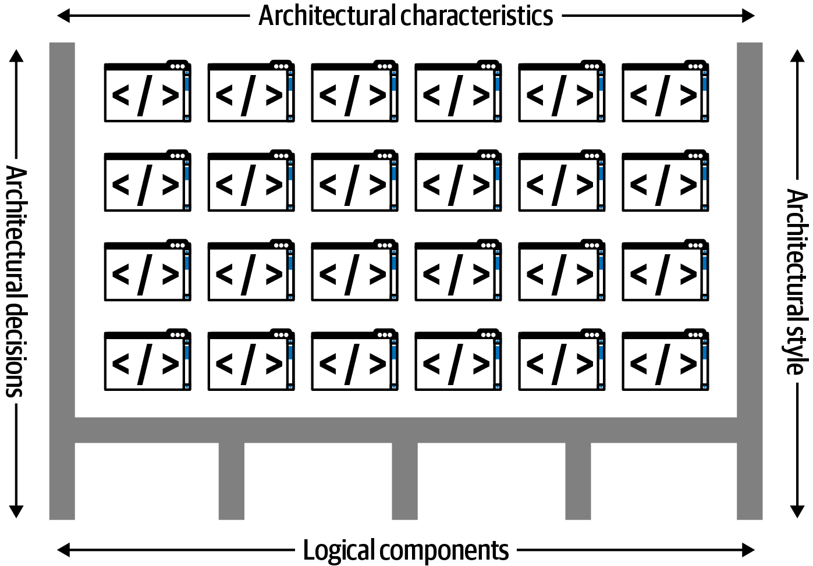
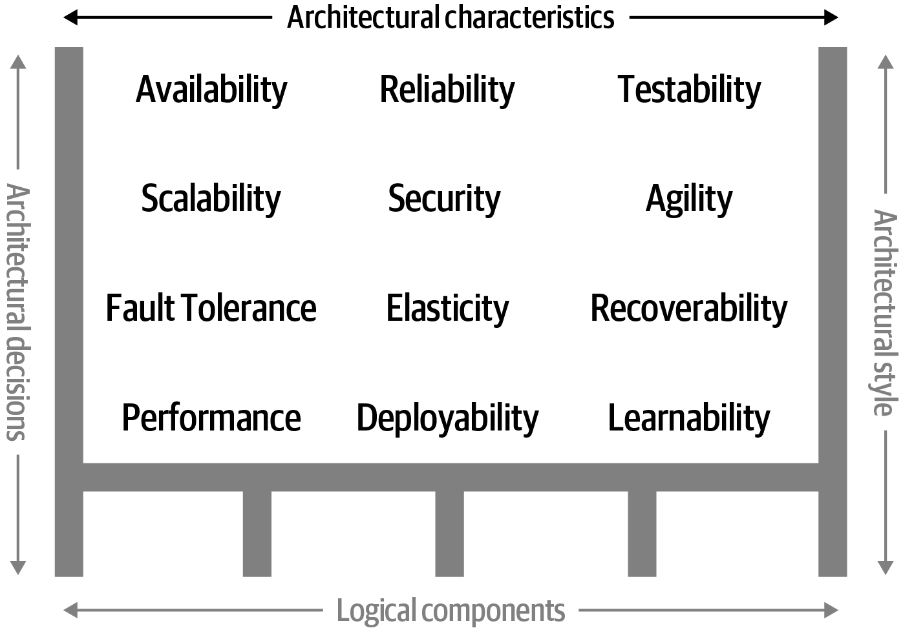
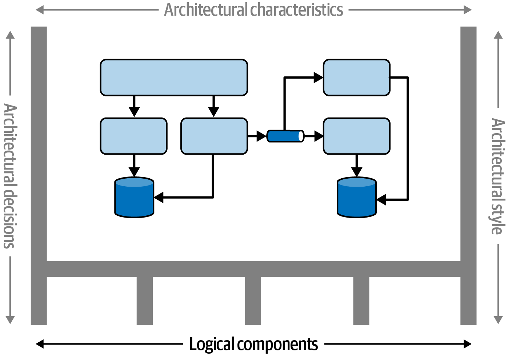
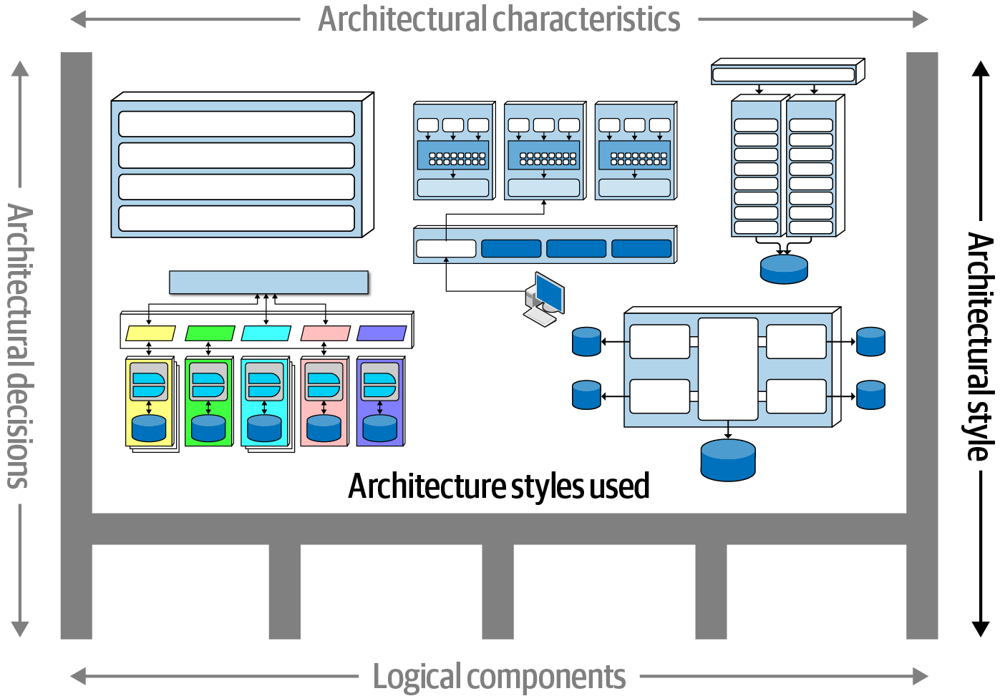
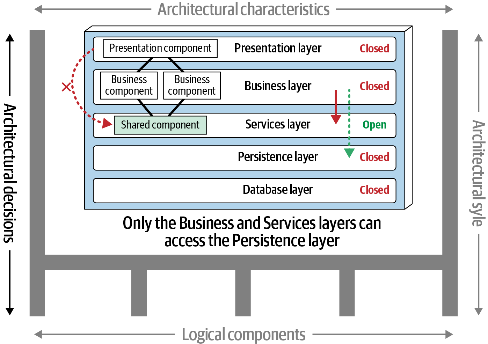

# Chương 1. Giới thiệu (Introduction)

Vậy là bạn quan tâm đến software architecture. Có lẽ bạn là một developer muốn tiến lên bước tiếp theo trong sự nghiệp, hay có lẽ bạn là một project manager muốn hiểu điều gì xảy ra khi các software architecture hoạt động. Bạn cũng có thể là một “kiến trúc sư tình cờ” (accidental architect): một người đưa ra các architecture decision (được định nghĩa bên dưới) nhưng chưa có chức danh “software architect"…cho đến giờ.

Tại sao lại đi sâu vào lĩnh vực software architecture? Có lẽ bạn đã có kinh nghiệm với rất nhiều dự án và muốn hiểu sâu hơn cách các phần lớn hơn của hệ thống khớp với nhau, cùng với vô số trade-offs. Nếu vậy, software architecture là một bước sự nghiệp tiếp theo hiển nhiên.

Cuốn sách này được thiết kế cho tất cả các bạn. Nó cung cấp một cái nhìn tổng quan về công việc cực kỳ nhiều mặt của một “software architect.”

Kiến trúc sư phần mềm phải hiểu và phân tích sâu các hệ thống phần mềm, với toàn bộ độ phức tạp của chúng, và phải đưa ra các quyết định trade-off quan trọng, đôi khi với thông tin không đầy đủ. Nhiều developer phần mềm lo lắng rằng generative AI có thể dần thay thế họ đang cân nhắc chuyển sang software architecture, một vai trò khó thay thế hơn nhiều. Kiến trúc sư phần mềm đưa ra chính xác những loại quyết định mà AI không thể, đánh giá trade-offs trong những ngữ cảnh phức tạp, luôn thay đổi.

Architecture, giống như phần lớn nghệ thuật, chỉ có thể được hiểu trong ngữ cảnh. Kiến trúc sư dựa các quyết định của họ trên thực tế của môi trường. Ví dụ, một trong những mục tiêu chính của software architecture late-20th-century là dùng hạ tầng và tài nguyên dùng chung một cách hiệu quả nhất có thể, vì hệ điều hành, application server, database server, v.v. đều là thương mại và rất đắt.

Năm 2002, việc cố xây dựng một architecture như microservices sẽ đắt đến mức không thể tưởng tượng nổi. Hãy tưởng tượng bước vào một data center năm 2002 và nói với trưởng bộ phận vận hành, “Này, tôi có một ý tưởng tuyệt vời về một architecture style mang tính cách mạng, trong đó mỗi service chạy trên máy móc cô lập riêng với database chuyên dụng riêng. Tôi sẽ cần 50 license Windows, 30 license application-server khác, và ít nhất 50 license database server.” Chúng ta chỉ có thể xây dựng những architecture như vậy ngày nay nhờ sự ra đời của open source và các thực hành kỹ thuật được cập nhật của cuộc cách mạng DevOps. Mọi architecture đều là sản phẩm của ngữ cảnh của nó—hãy ghi nhớ điều đó khi đọc cuốn sách này.

## Định nghĩa software architecture

Vậy software architecture là gì? [Hình 1-1](#fig-introduction-defining) minh họa cách chúng tôi thích nghĩ về software architecture. Định nghĩa này có bốn chiều. Software architecture của một hệ thống gồm một *architecture style* làm điểm khởi đầu, kết hợp với các *architecture characteristics* mà nó phải hỗ trợ, các *logical component* để hiện thực hành vi của nó, và cuối cùng là các *architecture decision* biện minh cho tất cả. Cấu trúc của hệ thống được biểu thị bằng các đường đen đậm đỡ architecture. Chúng ta sẽ đi nhanh qua các chiều này theo thứ tự mà kiến trúc sư phân tích chúng, và các chương tiếp theo sẽ cung cấp thêm chi tiết.

*Hình 1-1. Architecture gồm cấu trúc của hệ thống, kết hợp với architecture characteristics (“-ilities”), logical component, architecture style và các quyết định*

*Architecture characteristics* (xem [Hình 1-2](#fig-introduction-characteristics)) định nghĩa các *khả năng* của một hệ thống (thường được viết tắt là “-ilities”) và các tiêu chí cho sự thành công của nó: nói ngắn gọn, hệ thống nên *làm* gì. Architecture characteristics quan trọng đến mức chúng tôi đã dành nhiều chương trong cuốn sách này để hiểu và định nghĩa chúng.

*Hình 1-2. “Architecture characteristics” chỉ các “-ilities” mà hệ thống phải hỗ trợ*

Trong khi architectural characteristics định nghĩa các khả năng của hệ thống, *logical component* định nghĩa *hành vi* của nó. Thiết kế logical component là một trong những hoạt động cấu trúc then chốt của kiến trúc sư. Trong [Hình 1-3](#fosa_2e_update_0104), các logical component tạo thành các domain, entity và workflow của ứng dụng.

*Hình 1-3. Logical component cấu trúc hành vi của hệ thống*

Một khi kiến trúc sư đã phân tích các architectural characteristics và logical component mà hệ thống cần (cả hai được mô tả chi tiết sau), họ biết đủ để chọn một architecture style phù hợp làm điểm khởi đầu cho việc hiện thực giải pháp của mình [Hình 1-4](#fosa_2e_update_0105).

*Hình 1-4. Việc chọn một architectural style bao gồm tìm con đường hiện thực dễ nhất cho một tập yêu cầu cho trước*

Chiều thứ tư định nghĩa software architecture là *architecture decision*, vốn định nghĩa các quy tắc về cách một hệ thống nên được xây dựng. Ví dụ, một kiến trúc sư có thể đưa ra quyết định rằng chỉ các layer Business và Services trong một layered architecture mới có thể truy cập database (xem [Hình 1-5](#fig-introduction-decisions)), hạn chế layer Presentation thực hiện các lời gọi database trực tiếp. Architecture decision tạo thành các ràng buộc của hệ thống và chỉ dẫn các nhóm phát triển về những gì được phép và không được phép.

*Hình 1-5. Architecture decision là các quy tắc để xây dựng hệ thống*

Chúng tôi thảo luận architecture decision và cách ghi lại chúng một cách súc tích trong [Chương 21](ch21_architectural_decisions.vi.md#ch-architectural-decisions).

## Các định luật của software architecture

Khi hai tác giả chúng tôi bắt tay viết ấn bản đầu tiên của cuốn sách này, chúng tôi có một mục tiêu đầy tham vọng: chúng tôi hy vọng tìm ra những điều có vẻ đúng một cách phổ quát về software architecture và hệ thống hóa chúng thành các “định luật” của software architecture. Trong khi viết, chúng tôi luôn để mắt tìm những điều có thể nắm bắt; chúng tôi đã hy vọng tìm được có lẽ 10 hay 15 định luật. Chúng tôi ngạc nhiên vì cuối cùng chỉ xác định được hai định luật trong ấn bản đầu tiên, và phát hiện thêm một định luật nữa khi viết ấn bản thứ hai. Đúng với ý định ban đầu, ba định luật này có vẻ khá phổ quát và định hình nhiều góc nhìn quan trọng cho các kiến trúc sư phần mềm đang làm việc.

Chúng tôi học được Định luật thứ nhất của software architecture bằng cách liên tục vấp phải nó, và chúng tôi nghĩ nó chạm tới cốt lõi của lý do tại sao những sự thật phổ quát này có vẻ khó nắm bắt đến vậy:

> Mọi thứ trong software architecture đều là một trade-off.
>
> —Định luật thứ nhất của software architecture

Không có gì tồn tại trên một phổ đẹp đẽ, gọn gàng. Mọi quyết định mà một kiến trúc sư phần mềm đưa ra đều phải tính đến một số lượng lớn biến số nhận các giá trị khác nhau tùy theo hoàn cảnh. Trade-offs là bản chất của các quyết định software architecture.

> Nếu bạn nghĩ mình đã phát hiện ra thứ gì đó *không phải* là trade-off, nhiều khả năng là bạn chỉ chưa *nhận ra* trade-off đó…mà thôi.
>
> —Hệ quả 1

> Bạn không thể chỉ làm trade-off analysis một lần là xong.
>
> —Hệ quả 2

Các nhóm thích tiêu chuẩn, và sẽ thật tuyệt nếu kiến trúc sư có thể chỉ làm One Big Trade-off Jamboree (một đại hội đánh đổi lớn) để quyết định các mặc định về architecture style nào sẽ dùng, các phần của architecture nên giao tiếp thế nào, quản lý chức năng dùng chung ra sao, và vô số quyết định hóc búa khác. Nhưng chúng ta không thể, vì mọi tình huống đều đòi hỏi chúng ta re-evaluate tất cả những trade-offs đó. (Chúng tôi đã thấy các nhóm cố làm điều này—ví dụ, cố mặc định chỉ dùng choreography trong các workflow phân tán, để rồi phát hiện ra nó đôi khi hoạt động và đôi khi là một thảm họa ngoạn mục. Xem [“Choreography and Orchestration”](ch18_microservices_architecture.vi.md#sec-ms-coordination) để biết thảo luận của chúng tôi.)

Architecture rộng hơn chỉ là sự kết hợp các phần tử cấu trúc, đó là lý do tại sao định nghĩa theo chiều của chúng tôi bao gồm các nguyên tắc, characteristics, v.v. Điều này được phản ánh trong Định luật thứ hai của software architecture:

> *Tại sao* quan trọng hơn *như thế nào*.
>
> —Định luật thứ hai của software architecture

Là một kiến trúc sư có kinh nghiệm, nếu ai đó cho tôi xem một architecture tôi chưa từng thấy, tôi có thể hiểu nó hoạt động *như thế nào*, nhưng tôi có thể gặp khó khăn với việc *tại sao* kiến trúc sư hay nhóm trước đã đưa ra một số quyết định nhất định. Kiến trúc sư đưa ra quyết định trong những ngữ cảnh cực kỳ cụ thể, khiến các quyết định bao trùm và chung chung trở nên khó khăn. *Tại sao* một kiến trúc sư đưa ra một quyết định cụ thể bao gồm các trade-offs mà họ đã xem xét, bổ sung vào ngữ cảnh của việc tại sao chọn quyết định này mà không phải quyết định khác. Hóa ra một trong những đặc điểm định nghĩa của các quyết định software architecture là chúng hiếm khi mang tính nhị phân. Điều này đưa chúng ta đến Định luật thứ ba của software architecture:

> Hầu hết các architecture decision không mang tính nhị phân mà tồn tại trên một phổ giữa các thái cực.
>
> —Định luật thứ ba của software architecture

Trong suốt cuốn sách, chúng tôi nhấn mạnh *tại sao* kiến trúc sư đưa ra một số quyết định nhất định cùng với các trade-offs. Chúng tôi cũng nhấn mạnh các kỹ thuật tốt để ghi lại các quyết định quan trọng trong [Chương 21](ch21_architectural_decisions.vi.md#ch-architectural-decisions).

Độc giả sẽ nhận ra các định luật này hoạt động trong suốt cuốn sách, và chúng tôi khuyên nên ghi nhớ chúng khi đánh giá các quyết định software architecture. Chúng tôi quay lại các định luật này trong [Chương 27](ch27_the_laws_of_software_architecture_revisited.vi.md#ch-laws-revisited) với một số ví dụ bổ sung.

Với một định nghĩa làm việc về software architecture đã có, hãy chuyển sang bản thân vai trò này. 

## Những kỳ vọng đối với một kiến trúc sư

Vai trò của một kiến trúc sư phần mềm có thể trải dài từ việc làm một lập trình viên chuyên gia đến việc định nghĩa định hướng kỹ thuật chiến lược của cả một công ty. Điều này khiến việc cố định nghĩa nó là một việc làm vô ích, nhưng điều chúng tôi có thể nói với bạn dễ hơn là những gì được *kỳ vọng* ở một kiến trúc sư phần mềm. Chúng tôi đã xác định tám kỳ vọng cốt lõi đối với bất kỳ kiến trúc sư phần mềm nào, bất kể vai trò, chức danh hay mô tả công việc của họ:

- Đưa ra các architecture decision
- Liên tục phân tích architecture
- Cập nhật các xu hướng mới nhất
- Bảo đảm tuân thủ các quyết định
- Hiểu các công nghệ, framework, nền tảng và môi trường đa dạng
- Biết business domain
- Dẫn dắt một nhóm và có kỹ năng giao tiếp giữa người với người
- Hiểu và xoay xở với chính trị tổ chức

Thành công với tư cách kiến trúc sư phần mềm phụ thuộc vào việc hiểu và đáp ứng từng kỳ vọng này. Phần này lần lượt xem xét cả tám kỳ vọng.

### Đưa ra các architecture decision

*Một kiến trúc sư được kỳ vọng định nghĩa các architecture decision và nguyên tắc thiết kế dùng để định hướng các quyết định công nghệ trong nhóm, trong phòng ban hay trên toàn doanh nghiệp.*

*Định hướng* (guide) là từ khóa trong kỳ vọng đầu tiên này: kiến trúc sư nên *định hướng* các lựa chọn công nghệ thay vì *chỉ định* chúng. Ví dụ, quyết định dùng React.js cho phát triển frontend là một quyết định kỹ thuật chứ không phải một architecture decision. Thay vì đưa ra quyết định này, kiến trúc sư nên hướng dẫn các nhóm phát triển dùng một framework reactive-based cho phát triển web frontend, định hướng họ chọn Angular, Elm, React.js, Vue hay bất kỳ web framework reactive-based nào khác. Điều then chốt là hỏi xem architecture decision sẽ *định hướng* các nhóm đưa ra lựa chọn kỹ thuật đúng hay sẽ lựa chọn thay cho họ. Dù vậy, có những dịp kiến trúc sư cần đưa ra các quyết định công nghệ cụ thể để bảo toàn một architectural characteristic nhất định, như scalability, performance hay availability. Kiến trúc sư thường gặp khó khăn trong việc tìm ra sự cân bằng này, nên [Chương 21](ch21_architectural_decisions.vi.md#ch-architectural-decisions) hoàn toàn là về architecture decision.

### Liên tục phân tích architecture

*Một kiến trúc sư được kỳ vọng liên tục phân tích architecture và môi trường công nghệ hiện tại và đề xuất các giải pháp cải tiến.*

*Architecture vitality* (sức sống của architecture) đánh giá mức độ khả thi *ngày nay* của một architecture đã được định nghĩa từ ba năm trước hay hơn, khi xét đến những thay đổi cả trong kinh doanh lẫn công nghệ. Theo kinh nghiệm của chúng tôi, không đủ kiến trúc sư tập trung năng lượng vào việc liên tục phân tích các architecture hiện có. Kết quả là, hầu hết các architecture trải qua các yếu tố suy thoái cấu trúc, xảy ra khi developer thực hiện các thay đổi code hay thiết kế ảnh hưởng đến các architectural characteristics cần thiết, như performance, availability và scalability.

Các khía cạnh khác thường bị quên của kỳ vọng này là các môi trường kiểm thử và phát hành. Khả năng sửa đổi code nhanh chóng là một dạng agility với lợi ích hiển nhiên, nhưng nếu mất hàng tuần để kiểm thử các thay đổi và hàng tháng để phát hành, architecture tổng thể không thể đạt được agility.

Kiến trúc sư phải phân tích một cách tổng thể các thay đổi trong công nghệ và problem domain để xác định tính vững chắc liên tục của architecture. Loại cân nhắc này là thứ giữ cho các ứng dụng còn phù hợp, dù nó hiếm khi xuất hiện trong các tin tuyển dụng.

### Cập nhật các xu hướng mới nhất

*Một kiến trúc sư được kỳ vọng cập nhật các xu hướng công nghệ và ngành mới nhất.*

Developer phải cập nhật các công nghệ mới nhất, cũng như những công nghệ họ dùng hằng ngày, để duy trì sự phù hợp (và để giữ được việc làm!). Việc cập nhật các xu hướng kỹ thuật và ngành mới nhất còn quan trọng hơn đối với kiến trúc sư. Các quyết định của kiến trúc sư có xu hướng long-lasting và khó thay đổi. Hiểu các xu hướng giúp kiến trúc sư đưa ra các quyết định sẽ vẫn còn phù hợp trong tương lai. Ví dụ, kiến trúc sư trong những năm gần đây đã cần học về lưu trữ và deployment cloud-based, và khi chúng tôi viết ấn bản thứ hai này, generative AI đang có tác động khổng lồ lên nhiều phần của hệ sinh thái phát triển.

Theo dõi các xu hướng và cập nhật chúng là khó, đặc biệt đối với một kiến trúc sư phần mềm. Trong [Chương 2](ch02_architectural_thinking.vi.md#ch-architectural-thinking), chúng tôi thảo luận một số kỹ thuật và tài nguyên để làm điều này.

### Bảo đảm tuân thủ các quyết định

*Một kiến trúc sư được kỳ vọng bảo đảm sự tuân thủ các architecture decision và nguyên tắc thiết kế.*

Bảo đảm tuân thủ có nghĩa là liên tục xác minh rằng các nhóm phát triển đang tuân theo các quyết định và nguyên tắc thiết kế mà kiến trúc sư đã định nghĩa, ghi lại thành tài liệu và truyền đạt.

Hãy tưởng tượng rằng bạn, với tư cách kiến trúc sư, đưa ra quyết định hạn chế truy cập database trong một layered architecture chỉ cho các layer Business và Services (không phải layer Presentation). Điều này (như bạn sẽ thấy trong [Chương 10](ch10_layered_architecture_style.vi.md#ch-style-layered)) có nghĩa là layer Presentation phải đi qua mọi layer của architecture để thực hiện ngay cả lời gọi database đơn giản nhất. Tuy nhiên, một developer user interface (UI) không đồng ý với quyết định này và cho layer Presentation truy cập trực tiếp database vì lý do performance. Bạn đã đưa ra architecture decision đó vì một lý do cụ thể: để các thay đổi đối với database không ảnh hưởng đến layer Presentation. Nếu bạn không bảo đảm sự tuân thủ các architecture decision của mình, những vi phạm như thế này có thể xảy ra. Kết quả có thể là architecture không cung cấp được các characteristics cần thiết, và ứng dụng hay hệ thống không hoạt động như kỳ vọng. Trong [Chương 6](ch06_measuring_and_governing_architecture_characteristics.vi.md#ch06-measuring), chúng tôi nói về việc đo lường sự tuân thủ bằng các fitness function tự động và các công cụ khác.

### Hiểu các công nghệ đa dạng

*Một kiến trúc sư được kỳ vọng tiếp xúc với nhiều công nghệ, framework, nền tảng và môi trường đa dạng.*

Không phải kiến trúc sư nào cũng được kỳ vọng là chuyên gia về mọi framework, nền tảng và ngôn ngữ, nhưng họ ít nhất nên quen thuộc với nhiều công nghệ khác nhau. Hầu hết các môi trường ngày nay là không đồng nhất, nên tối thiểu, kiến trúc sư nên biết cách kết nối với nhiều hệ thống và dịch vụ, bất kể ngôn ngữ, nền tảng hay công nghệ của chúng.

Một trong những cách tốt nhất để đáp ứng kỳ vọng này là vươn ra ngoài vùng an toàn của bạn, tích cực tìm kiếm cơ hội để có kinh nghiệm với nhiều ngôn ngữ, nền tảng và công nghệ. Kiến trúc sư nên tập trung vào *bề rộng* kỹ thuật thay vì chiều sâu kỹ thuật. Bề rộng kỹ thuật bao gồm những thứ bạn biết nhưng không ở mức chi tiết, kết hợp với những thứ bạn biết rất nhiều. Ví dụ, đối với một kiến trúc sư, việc quen thuộc với ưu nhược điểm của 10 sản phẩm caching khác nhau có giá trị hơn nhiều so với việc là chuyên gia chỉ về một trong số đó.

### Biết business domain

*Một kiến trúc sư được kỳ vọng có một mức chuyên môn business-domain nhất định.*

Các kiến trúc sư phần mềm hiệu quả hiểu vấn đề kinh doanh, mục tiêu và yêu cầu mà architecture dự định giải quyết, gọi chung là *business domain* của một problem space. Rất khó thiết kế một architecture hiệu quả nếu bạn không hiểu các yêu cầu của doanh nghiệp. Hãy tưởng tượng làm kiến trúc sư tại một ngân hàng lớn mà không hiểu các thuật ngữ tài chính phổ biến như *average directional index*, *aleatory contracts*, *rates rally*, hay thậm chí *nonpriority debt*. Bạn sẽ không thể giao tiếp với các stakeholder và người dùng nghiệp vụ và sẽ nhanh chóng mất uy tín.

Những kiến trúc sư thành công nhất mà chúng tôi biết có kiến thức kỹ thuật hands-on rộng *và* kiến thức vững về một domain cụ thể. Họ có thể giao tiếp với các lãnh đạo cấp C-level và người dùng nghiệp vụ bằng ngôn ngữ mà các stakeholder này biết và hiểu, tạo ra sự tin tưởng rằng họ biết mình đang làm gì và có năng lực tạo ra một architecture hiệu quả và đúng đắn.

### Có kỹ năng giao tiếp giữa người với người

*Một kiến trúc sư được kỳ vọng có kỹ năng giao tiếp giữa người với người xuất sắc, bao gồm làm việc nhóm, điều phối và lãnh đạo.*

Là những người làm công nghệ, developer và kiến trúc sư có xu hướng thích giải quyết các vấn đề kỹ thuật, không phải các vấn đề con người, nên kỹ năng lãnh đạo và giao tiếp xuất sắc là một kỳ vọng khó khăn. Tuy nhiên, như [Gerald Weinberg](https://oreil.ly/wyDB8) nổi tiếng với câu nói, “Bất kể họ nói gì với bạn, đó luôn là vấn đề con người.” Sự định hướng mà kiến trúc sư cung cấp không chỉ mang tính kỹ thuật—nó bao gồm việc dẫn dắt các nhóm phát triển qua quá trình hiện thực architecture. Kỹ năng lãnh đạo chiếm *ít nhất một nửa* những gì cần để trở thành một kiến trúc sư phần mềm hiệu quả, bất kể vai trò hay chức danh.

Ngành công nghiệp tràn ngập các kiến trúc sư phần mềm, tất cả cạnh tranh cho một số lượng vị trí có hạn. Những người có kỹ năng lãnh đạo và giao tiếp mạnh nổi bật giữa đám đông. Ngược lại, chúng tôi đã biết nhiều kiến trúc sư phần mềm là những nhà công nghệ xuất sắc nhưng gặp khó khăn trong việc dẫn dắt nhóm, huấn luyện và cố vấn developer, hay truyền đạt ý tưởng và các architecture decision và nguyên tắc. Không cần phải nói, những kiến trúc sư đó gặp khó khăn trong việc giữ việc làm.

### Hiểu và xoay xở với chính trị

*Một kiến trúc sư được kỳ vọng hiểu bầu không khí chính trị của doanh nghiệp và có khả năng xoay xở với chính trị của nó.*

Có thể có vẻ lạ khi nói về chính trị văn phòng trong một cuốn sách về software architecture, nhưng kỹ năng đàm phán là then chốt đối với vai trò này. Để minh họa, hãy xem xét hai kịch bản.

Trong kịch bản thứ nhất, một developer quyết định tận dụng một design pattern cụ thể để giảm độ phức tạp của một đoạn code rối rắm cụ thể. Đó là một quyết định tốt, và developer không cần xin phê duyệt cho nó. Các khía cạnh lập trình như cấu trúc code, thiết kế class, lựa chọn design-pattern và đôi khi thậm chí cả lựa chọn ngôn ngữ đều là một phần của nghệ thuật lập trình.

Trong kịch bản thứ hai, kiến trúc sư chịu trách nhiệm về một hệ thống customer relationship management (CRM) lớn đang gặp khó khăn trong việc kiểm soát truy cập database từ các hệ thống khác, bảo vệ một số dữ liệu khách hàng nhất định, và thực hiện thay đổi database schema. Tất cả những vấn đề này bắt nguồn từ việc có quá nhiều hệ thống khác dùng database CRM. Do đó, kiến trúc sư quyết định tạo các *application silo*, trong đó database của mỗi ứng dụng chỉ có thể được truy cập từ ứng dụng sở hữu database đó. Quyết định này sẽ cho kiến trúc sư kiểm soát tốt hơn đối với dữ liệu khách hàng, bảo mật và các thay đổi.

Tuy nhiên, không giống quyết định của developer trong kịch bản thứ nhất, kiến trúc sư có thể kỳ vọng gần như mọi người trong công ty sẽ thách thức quyết định của họ (có lẽ ngoại trừ nhóm ứng dụng CRM). Các ứng dụng khác cần dữ liệu CRM, và nếu không thể truy cập database trực tiếp nữa, chúng phải yêu cầu dữ liệu từ hệ thống CRM qua các lời gọi truy cập từ xa. Product owner, project manager và các stakeholder nghiệp vụ có thể phản đối việc tăng chi phí hay công sức của họ, trong khi developer có thể cảm thấy cách tiếp cận của họ tốt hơn. *Gần như mọi quyết định mà kiến trúc sư đưa ra sẽ bị thách thức*.

Bất kể sự phản đối là gì, kiến trúc sư phải xoay xở với chính trị tổ chức và áp dụng kỹ năng đàm phán để được phê duyệt hầu hết các quyết định. Điều này có thể rất bực bội; hầu hết các kiến trúc sư phần mềm bắt đầu là developer và đã quen với việc đưa ra quyết định mà không cần phê duyệt hay thậm chí review. Là kiến trúc sư, giờ cuối cùng họ cũng có thể đưa ra những quyết định rộng và quan trọng, nhưng họ phải biện minh và đấu tranh cho gần như từng quyết định. Kỹ năng đàm phán, giống như kỹ năng lãnh đạo, cần thiết đến mức chúng tôi đã dành cả một chương cho chúng ([Chương 25](ch25_negotiation_and_leadership_skills.vi.md#ch-negotiation-skills)).

## Lộ trình

Cuốn sách này gồm ba phần:

**[Phần I](part1_foundations.vi.md#part1-foundations): Nền tảng**

Phần I định nghĩa các thành phần then chốt của software architecture, tập trung vào hai yếu tố then chốt của cấu trúc architecture: architectural characteristics và logical component. Phân tích từng thứ đòi hỏi các kỹ thuật khác nhau, mà chúng tôi trình bày sâu. Đầu ra của các hoạt động này cung cấp cho kiến trúc sư phần mềm đủ thông tin để chọn một architectural style phù hợp, tạo khung đỡ cho triết lý chung của việc hiện thực.

**[Phần II](part2_architecture_styles.vi.md#part2-styles): Các architecture style**

Phần II cung cấp một danh mục các *architectural style*, các topology được đặt tên của software architecture. Chúng tôi cho thấy các khác biệt về cấu trúc và giao tiếp trong mỗi style, và cung cấp cơ sở để so sánh trên một phổ rộng, bao gồm data topology, nhóm và architecture vật lý.

**[Phần III](part3_techniques_and_soft_skills.vi.md#part3-techniques-softskills): Kỹ thuật và soft skill**

Phần I và II tập trung vào các khía cạnh kỹ thuật của công việc, nhưng một phần lớn vai trò của kiến trúc sư phần mềm liên quan đến cái mà theo truyền thống được gọi là *soft skill*: các kỹ năng liên quan đến người khác thay vì công nghệ. Trớ trêu thay, soft skill thường là thứ khó nhất đối với các kiến trúc sư đang lên để có được, vì các con đường chính dẫn đến vai trò kiến trúc sư phần mềm thường đòi hỏi tài năng kỹ thuật nhiều hơn tài năng giao tiếp. Tuy nhiên, một khi đã vào việc, kiến trúc sư phát hiện ra rằng những kỹ năng này cực kỳ quan trọng. Vì vậy, Phần III của cuốn sách đề cập một số soft skill then chốt để giúp bạn thành công trong vai trò này.
