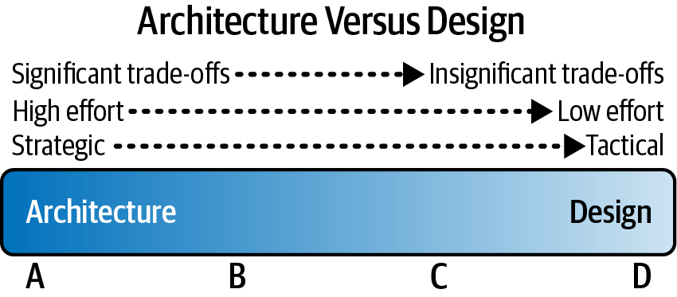
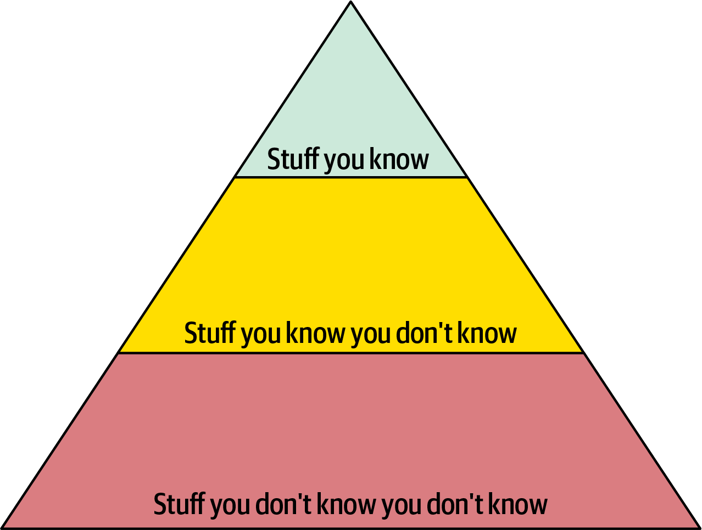
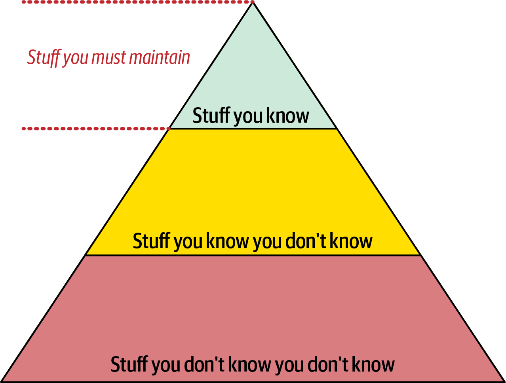
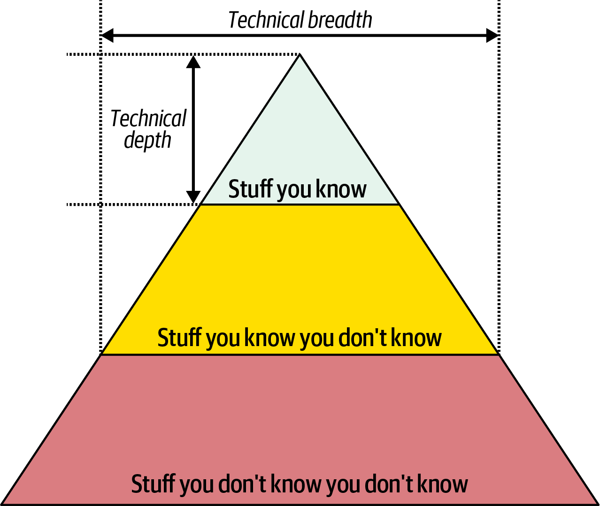
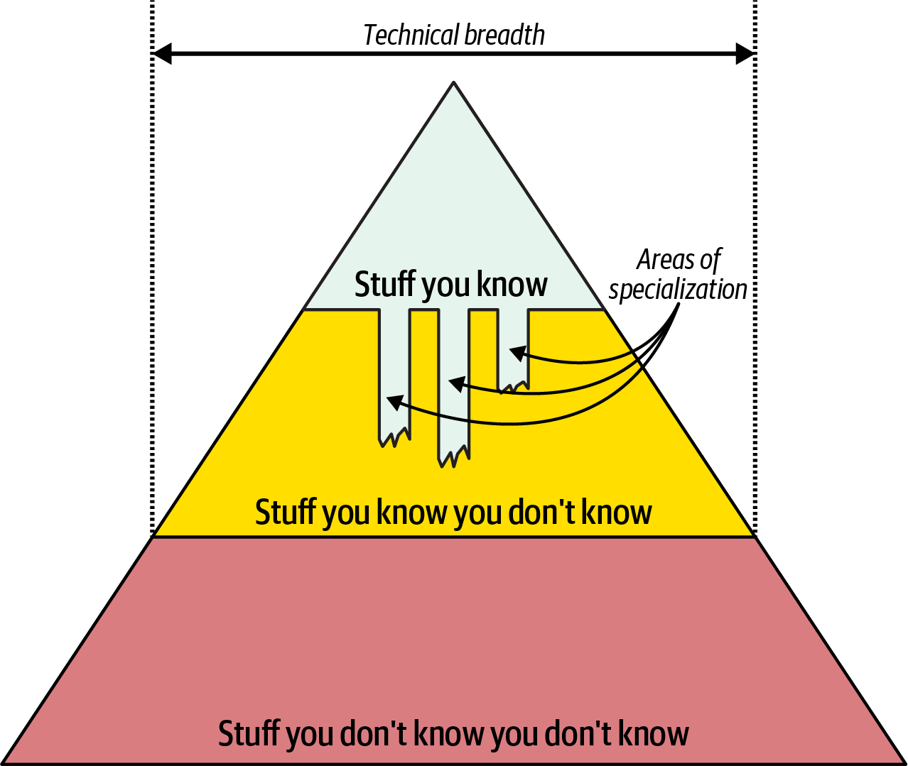
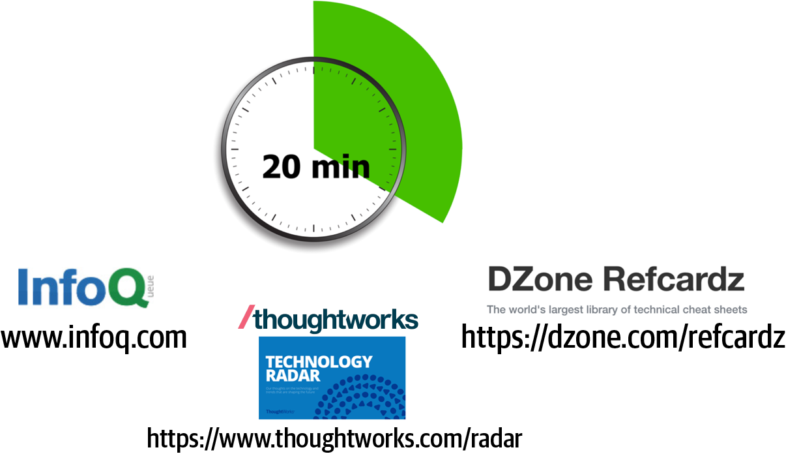
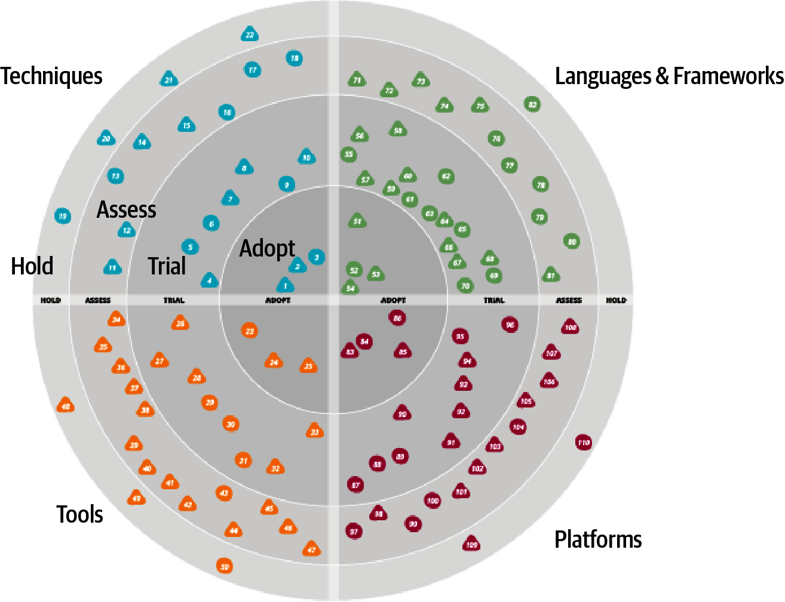
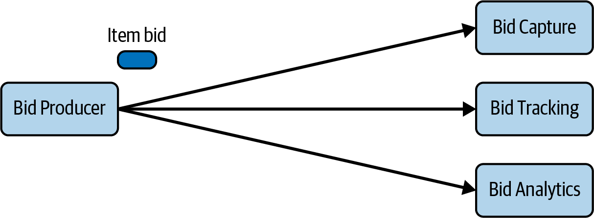
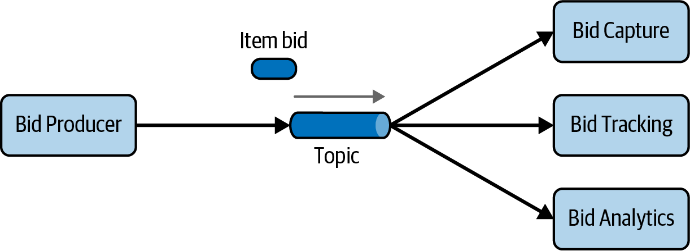
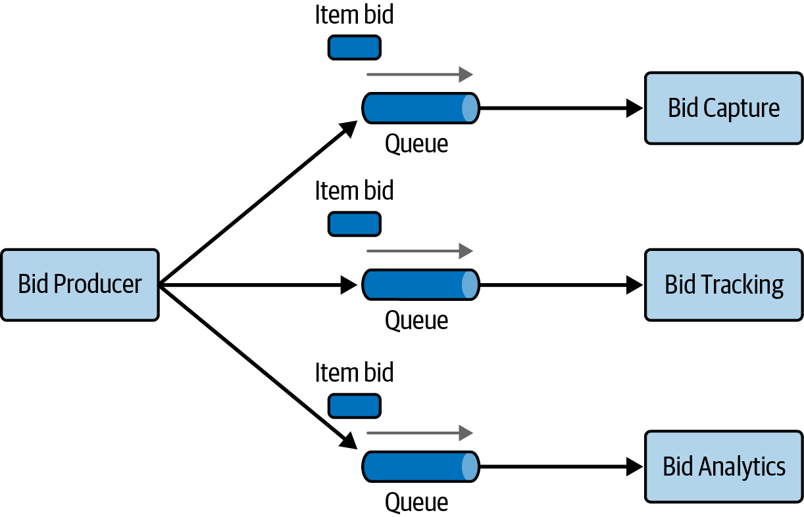

# Chương 2. Tư duy kiến trúc (Architectural Thinking)

Tư duy kiến trúc là nhìn sự vật bằng con mắt của một kiến trúc sư—nói cách khác, từ góc nhìn kiến trúc. Hiểu một thay đổi cụ thể có thể ảnh hưởng thế nào đến scalability tổng thể, chú ý đến cách các phần khác nhau của một hệ thống tương tác với nhau, và biết những thư viện và framework third-party nào là phù hợp nhất cho một tình huống cụ thể đều là những ví dụ về tư duy theo kiểu kiến trúc.

Để có thể suy nghĩ như một kiến trúc sư, trước hết cần hiểu software architecture là gì và sự khác biệt giữa architecture và thiết kế. Tiếp đó, cần có bề rộng kiến thức lớn để thấy được những giải pháp và khả năng mà người khác không thấy; hiểu tầm quan trọng của các business driver và cách chúng được chuyển thành các mối quan tâm kiến trúc; và hiểu, phân tích, dung hòa các trade-offs giữa những giải pháp và công nghệ khác nhau.

Trong chương này, chúng tôi khám phá các khía cạnh đó của việc suy nghĩ như một kiến trúc sư.

## Architecture so với thiết kế (Architecture Versus Design)

Hãy dành một chút thời gian hình dung ngôi nhà mơ ước của bạn. Nó có bao nhiêu tầng? Mái bằng hay mái dốc? Đó là một ngôi nhà kiểu ranch single-story rộng trải dài hay một ngôi nhà hiện đại nhiều tầng? Nó có bao nhiêu phòng ngủ? Tất cả những điều này định nghĩa *cấu trúc* tổng thể của ngôi nhà—nói cách khác, architecture của nó. Bây giờ hãy dành một chút thời gian hình dung bên trong ngôi nhà. Sàn trải thảm hay lát gỗ cứng? Tường màu gì? Có đèn cây đứng sàn hay đèn treo từ trần? Tất cả những điều này liên quan đến *thiết kế* của ngôi nhà.

Tương tự, software architecture ít liên quan đến vẻ bề ngoài của một hệ thống mà nhiều hơn về cấu trúc của nó, trong khi thiết kế thì nhiều hơn về vẻ bề ngoài của hệ thống và ít hơn về cấu trúc. Ví dụ, lựa chọn dùng microservices định nghĩa cấu trúc và hình dạng của hệ thống (architecture của nó), trong khi giao diện và cảm nhận (look and feel) của màn hình giao diện người dùng (UI) định nghĩa thiết kế của hệ thống.

Nhưng còn những quyết định như có nên tách một service thành các phần nhỏ hơn hay chọn một UI framework thì sao? Đáng tiếc là hầu hết các quyết định kiểu này đều nằm đâu đó trên một *dải phổ* (spectrum) giữa architecture và thiết kế, khiến việc xác định điều gì nên được coi là architecture trở nên khó khăn.

Vận dụng các tiêu chí sau có thể giúp xác định một điều gì đó thiên về architecture hay thiên về thiết kế:

- Nó mang tính chiến lược hay mang tính chiến thuật hơn?
- Cần bao nhiêu công sức để thay đổi hoặc xây dựng nó?
- Các trade-offs quan trọng đến mức nào?

Các yếu tố này được thể hiện trong [Hình 2-1](#fig-spectrum), minh họa dải phổ giữa architecture và thiết kế để giúp xác định một quyết định nằm ở đâu và ai nên chịu trách nhiệm cho nó.

*Hình 2-1. Dải phổ giữa architecture và thiết kế*

### Quyết định chiến lược so với chiến thuật (Strategic Versus Tactical Decisions)

Một quyết định càng mang tính chiến lược thì càng mang tính kiến trúc. Ngược lại, một quyết định càng mang tính chiến thuật thì càng có khả năng là về thiết kế. Các quyết định *chiến lược* (strategic) nhìn chung mang tính long-term (dài hạn), trong khi các quyết định *chiến thuật* (tactical) nhìn chung mang tính short-term (ngắn hạn) và thường độc lập với các hành động hay quyết định khác.

Một cách tốt để xác định một quyết định mang tính chiến lược hay chiến thuật hơn là xem xét các câu hỏi sau:

**Quyết định đó đòi hỏi bao nhiêu suy nghĩ và lập kế hoạch?**

Một quyết định mất vài phút nhiều khả năng mang tính chiến thuật và do đó thiên về thiết kế, trong khi một quyết định đòi hỏi nhiều tuần lập kế hoạch nhiều khả năng mang tính chiến lược hơn và do đó thiên về architecture.

**Có bao nhiêu người tham gia vào quyết định?**

Một quyết định được đưa ra một mình hoặc cùng một đồng nghiệp nhiều khả năng mang tính chiến thuật hơn và nằm ở phía thiết kế của dải phổ, trong khi một quyết định đòi hỏi nhiều cuộc họp với nhiều stakeholder khác nhau nhiều khả năng mang tính chiến lược hơn và nằm ở phía kiến trúc của dải phổ.

**Quyết định đó là một tầm nhìn long-term hay một hành động short-term?**

Một quyết định có khả năng sớm thay đổi thường mang bản chất chiến thuật và sẽ thiên về thiết kế, trong khi một quyết định tồn tại rất lâu thường mang tính chiến lược hơn và thiên về architecture.

Dù những câu hỏi này hơi chủ quan, chúng vẫn giúp xác định một điều gì đó mang tính chiến lược hay chiến thuật, và do đó thiên về architecture hay thiết kế.

### Mức độ công sức (Level of Effort)

Trong bài báo nổi tiếng [“Who Needs an Architect?”](https://oreil.ly/MKCvQ), kiến trúc sư phần mềm Martin Fowler viết rằng architecture là “những thứ khó thay đổi.” Nhìn chung, một thứ càng khó thay đổi thì càng cần nhiều công sức, đặt quyết định hay hoạt động đó về phía kiến trúc của dải phổ. Ngược lại, một thứ chỉ cần công sức tối thiểu để triển khai hoặc thay đổi thì nằm nhiều hơn về phía thiết kế của dải phổ.

Ví dụ, chuyển từ một layered architecture dạng monolith sang microservices sẽ đòi hỏi công sức đáng kể, nên nó thiên về architecture hơn. Sắp xếp lại các trường trên một màn hình chỉ cần công sức tối thiểu, và do đó thiên về thiết kế hơn.

### Tầm quan trọng của các đánh đổi (The Significance of Trade-Offs)

Phân tích các trade-offs của một quyết định cụ thể có thể giúp rất nhiều trong việc xác định nó thiên về architecture hay thiết kế. Các trade-offs càng quan trọng thì quyết định càng có xu hướng mang tính kiến trúc. Ví dụ, lựa chọn dùng architecture style microservices mang lại scalability, agility, elasticity và fault tolerance tốt hơn. Tuy nhiên, architecture này rất phức tạp, rất tốn kém, có tính nhất quán dữ liệu kém, và không đạt performance tốt do coupling giữa các service. Đây là những trade-offs khá quan trọng. Chúng ta có thể kết luận rằng quyết định này nằm về phía kiến trúc của dải phổ nhiều hơn là thiết kế.

Ngay cả các quyết định thiết kế cũng có trade-offs. Ví dụ, tách một file class mang lại khả năng bảo trì và khả năng đọc tốt hơn—với cái giá là phải quản lý nhiều class hơn. Những trade-offs này không quá quan trọng (đặc biệt khi so với trade-offs của microservices), nên quyết định này nằm nhiều hơn về phía thiết kế của dải phổ.

## Bề rộng kỹ thuật (Technical Breadth)

Không giống các developer, những người phải có một lượng *chiều sâu kỹ thuật* (technical depth) đáng kể để làm công việc của mình, các kiến trúc sư phần mềm phải có một lượng *bề rộng kỹ thuật* (technical breadth) đáng kể để nhìn sự vật từ góc nhìn kiến trúc. Chiều sâu kỹ thuật là có kiến thức sâu về một ngôn ngữ lập trình, nền tảng, framework, sản phẩm cụ thể, v.v., trong khi bề rộng kỹ thuật là biết một chút về rất nhiều thứ.

Để hiểu rõ hơn sự khác biệt này, hãy xem xét kim tự tháp kiến thức trong [Hình 2-2](#fig-introduction-pyramid1). Nó bao gồm toàn bộ kiến thức kỹ thuật trên thế giới, có thể được chia thành ba cấp: *những thứ bạn biết*, *những thứ bạn biết là mình không biết*, và *những thứ bạn không biết là mình không biết*.

*Hình 2-2. Kim tự tháp biểu diễn toàn bộ kiến thức*

*Những thứ bạn biết* bao gồm các công nghệ, framework, ngôn ngữ và công cụ mà những người làm công nghệ dùng hằng ngày để làm công việc của họ (chẳng hạn một lập trình viên Java biết Java). Họ giỏi, hoặc thậm chí là chuyên gia, ở tất cả những thứ đó. Lưu ý rằng cấp kiến thức này (được biểu diễn bằng phần đỉnh của kim tự tháp) là nhỏ nhất và chứa ít thứ nhất. Đó là vì hầu hết những người làm công nghệ phải chọn lọc các lĩnh vực để phát triển chuyên môn—không ai có thể là chuyên gia về mọi thứ.

*Những thứ bạn biết là mình không biết* (phần giữa của kim tự tháp) bao gồm những thứ mà một người làm công nghệ biết một chút hoặc đã nghe nói đến nhưng có ít hoặc không có kinh nghiệm hay chuyên môn. Ví dụ, hầu hết những người làm công nghệ đã *nghe nói* về Clojure và biết đó là một ngôn ngữ lập trình dựa trên Lisp, nhưng không thể viết source code bằng Clojure. Cấp kiến thức này lớn hơn nhiều so với cấp trên cùng. Đó là vì con người có thể làm quen với nhiều thứ hơn nhiều so với số thứ họ có thể phát triển chuyên môn.

*Những thứ bạn không biết là mình không biết* là phần lớn nhất của kim tự tháp kiến thức. Nó bao gồm toàn bộ các công nghệ, công cụ, framework và ngôn ngữ có thể là giải pháp hoàn hảo cho một vấn đề, giá như người làm công nghệ đang cố giải quyết vấn đề đó biết rằng những giải pháp này tồn tại. Mục tiêu trong sự nghiệp của bất kỳ cá nhân nào nên là chuyển các thứ từ *những thứ bạn không biết là mình không biết* sang vùng thứ hai của kim tự tháp, *những thứ bạn biết là mình không biết*—và, khi chuyên môn trở nên cần thiết, chuyển các thứ từ phần giữa của kim tự tháp lên đỉnh: *những thứ bạn biết*.

Ở giai đoạn đầu sự nghiệp của một developer, mở rộng phần đỉnh của kim tự tháp ([Hình 2-3](#fig-introduction-pyramid2)) nghĩa là có được chuyên môn giá trị. Tuy nhiên, *những thứ bạn biết* cũng là những thứ bạn phải *duy trì*—không có gì là tĩnh trong thế giới phần mềm. Nếu một developer trở thành chuyên gia về Ruby on Rails, chuyên môn đó sẽ không bền nếu họ bỏ bê Ruby on Rails trong một hoặc hai năm. Giữ các thứ ở đỉnh kim tự tháp đòi hỏi đầu tư thời gian để duy trì chuyên môn. Phần đỉnh này biểu diễn *chiều sâu kỹ thuật* của cá nhân: những thứ họ biết thật rõ.

*Hình 2-3. Developer phải duy trì chuyên môn để giữ được nó*

Tuy nhiên, bản chất của kiến thức thay đổi khi các developer chuyển sang vai trò kiến trúc sư. Một phần lớn giá trị của một kiến trúc sư là họ có hiểu biết *rộng* về công nghệ và cách dùng nó để giải quyết các vấn đề cụ thể. Ví dụ, với một kiến trúc sư, biết rằng có năm giải pháp cho một vấn đề cụ thể thì tốt hơn là chỉ có chuyên môn đơn lẻ về một giải pháp. Những phần quan trọng nhất của kim tự tháp đối với kiến trúc sư là phần đỉnh *và* phần giữa; phần giữa ăn sâu xuống phần đáy đến đâu thể hiện *bề rộng* kỹ thuật của một kiến trúc sư, như trong [Hình 2-4](#fig-introduction-pyramid3).

*Hình 2-4. Một người biết bao nhiêu về một chủ đề là chiều sâu kỹ thuật, còn một người biết bao nhiêu chủ đề là bề rộng kỹ thuật*

Với một kiến trúc sư, *bề rộng* quan trọng hơn *chiều sâu*. Vì kiến trúc sư phải đưa ra các quyết định khớp năng lực với các ràng buộc kỹ thuật, nên hiểu biết rộng về nhiều loại giải pháp khác nhau là có giá trị. Do đó, với một kiến trúc sư, hướng đi khôn ngoan là hy sinh một phần chuyên môn hard-won (khó khăn mới có được) và dùng thời gian đó để mở rộng danh mục kiến thức của mình, như trong [Hình 2-5](#fig-introduction-pyramid4). Một số lĩnh vực chuyên môn sẽ còn lại, có lẽ là ở những mảng công nghệ đặc biệt thú vị, trong khi những lĩnh vực khác teo dần một cách hữu ích.

*Hình 2-5. Bề rộng tăng lên và chiều sâu thu hẹp lại cho vai trò kiến trúc sư*

Kim tự tháp kiến thức của chúng tôi minh họa vai trò của *kiến trúc sư* và *developer* khác nhau căn bản đến mức nào. Các developer dành cả sự nghiệp để mài giũa chuyên môn. Chuyển sang vai trò kiến trúc sư nghĩa là thay đổi góc nhìn đó, điều mà nhiều người thấy khó khăn. Điều này đến lượt nó dẫn đến hai sự rối loạn chức năng phổ biến: thứ nhất, một kiến trúc sư cố gắng duy trì chuyên môn ở nhiều lĩnh vực khác nhau, không thành công ở lĩnh vực nào và tự vắt kiệt sức mình trong quá trình đó. Thứ hai, nó biểu hiện dưới dạng *chuyên môn lỗi thời* (stale expertise)—cảm giác sai lầm rằng thông tin đã lỗi thời của bạn vẫn còn tiên tiến. Chúng tôi thường thấy điều này ở các công ty lớn, nơi những developer sáng lập công ty đã chuyển sang các vai trò lãnh đạo, nhưng vẫn đưa ra các quyết định công nghệ bằng những tiêu chí cổ lỗ (xem [“Frozen Caveman Antipattern”](#frozen-caveman)).

> 
>
> **Frozen Caveman Antipattern (antipattern người tiền sử đóng băng)**
>
> Một *antipattern* là thứ mà lập trình viên [Andrew Koenig](https://oreil.ly/p9i_Y) định nghĩa là một điều có vẻ là ý hay khi bạn bắt đầu, nhưng lại dẫn bạn vào rắc rối. Một antipattern hành vi thường thấy ngoài thực tế, antipattern Frozen Caveman, mô tả những kiến trúc sư quay về mối lo phi lý ưa thích của mình cho mọi architecture. Ví dụ, một đồng nghiệp của Neal làm việc trên một hệ thống có architecture tập trung. Mỗi lần họ giao bản thiết kế cho các kiến trúc sư phía khách hàng, câu hỏi dai dẳng luôn là: “Nhưng nếu chúng ta mất Ý thì sao?” Vài năm trước đó, một sự cố truyền thông bất thường đã khiến trụ sở chính của khách hàng không thể liên lạc với các cửa hàng của họ ở Ý, gây ra bất tiện lớn. Dù khả năng chuyện này lặp lại là cực kỳ nhỏ, các kiến trúc sư đã trở nên ám ảnh với architecture characteristic đặc biệt này.
>
> Nhìn chung, antipattern này biểu hiện ở những kiến trúc sư từng bị “bỏng” trong quá khứ bởi một quyết định tồi hay một sự cố bất ngờ, khiến họ đặc biệt thận trọng với bất cứ điều gì liên quan. Dù đánh giá rủi ro là quan trọng, nó cũng phải thực tế. Hiểu sự khác biệt giữa rủi ro kỹ thuật thực sự và rủi ro kỹ thuật do cảm nhận là một phần của quá trình học hỏi liên tục. Suy nghĩ như một kiến trúc sư đòi hỏi vượt qua những ý tưởng và trải nghiệm Frozen Caveman này, nhìn thấy các giải pháp khác, và đặt ra những câu hỏi phù hợp hơn.

Kiến trúc sư nên tập trung vào bề rộng kỹ thuật để họ có một ống tên lớn hơn mà rút tên ra. Các developer chuyển sang vai trò kiến trúc sư có thể phải thay đổi cách họ nhìn nhận việc tiếp thu kiến thức. Cân bằng chiều sâu và bề rộng của danh mục kiến thức là điều mà mọi developer nên cân nhắc trong suốt sự nghiệp. Nhưng làm sao một kiến trúc sư có được bề rộng kỹ thuật? Các mục tiếp theo đưa ra một vài kỹ thuật sẽ giúp bạn khám phá “những thứ bạn không biết là mình không biết.”

### Quy tắc hai mươi phút (The 20-Minute Rule)

Như minh họa trong [Hình 2-5](#fig-introduction-pyramid4), bề rộng kỹ thuật quan trọng với kiến trúc sư hơn chiều sâu kỹ thuật. Nhưng làm sao bạn cập nhật được mọi xu hướng và thuật ngữ thời thượng mới nhất trong khi vẫn làm việc full-time, phát triển sự nghiệp, dành thời gian cho bạn bè và chăm lo gia đình?

Một kỹ thuật chúng tôi dùng là *quy tắc hai mươi phút* (20-minute rule). Ý tưởng là dành *ít nhất* 20 phút mỗi ngày để học một điều mới hoặc đào sâu hơn vào một chủ đề cụ thể. [Hình 2-6](#fig-developing-a-career-path-20-min) minh họa một số nơi tốt để dành 20 phút của bạn, như [InfoQ](https://infoq.com), [DZone Refcardz](https://dzone.com/refcardz), và [Thoughtworks Technology Radar](https://thoughtworks.com/radar). Bạn có thể tìm hiểu thêm về những thuật ngữ thời thượng chưa quen bằng cách tra cứu chúng trên internet, nâng kiến thức đó từ “những thứ bạn không biết là mình không biết” lên “những thứ bạn biết là mình không biết.” Bạn thậm chí có thể dùng thời gian đó để đọc một cuốn sách như cuốn này. Điểm mấu chốt là dành ra một ít thời gian trong ngày bận rộn của bạn để tập trung phát triển bề rộng kỹ thuật và qua đó phát triển sự nghiệp của bạn.

*Hình 2-6. Quy tắc hai mươi phút (20-minute rule)*

Nhiều người làm công nghệ, khi mới áp dụng khái niệm này, lên kế hoạch dành 20 phút vào giờ ăn trưa hoặc sau giờ làm; tuy nhiên, theo kinh nghiệm của chúng tôi, những khoảng thời gian này hiếm khi hiệu quả. Rất dễ bắt đầu dùng giờ ăn trưa để làm bù việc thay vì nghỉ ngơi, và buổi tối còn tệ hơn, với các kế hoạch giao lưu, thời gian gia đình, và nhiều thứ khác sau một ngày dài. Thay vào đó, chúng tôi đặc biệt khuyên bạn dành 20 phút ngay đầu buổi sáng—ngay sau khi lấy một tách cà phê hoặc trà và, quan trọng là, *trước khi bạn kiểm tra email*. Một khi bạn kiểm tra email, buổi sáng của bạn coi như kết thúc và ngày làm việc đã bắt đầu. Hãy dành 20 phút khi đầu óc còn minh mẫn và trước khi những thứ gây xao nhãng chiếm lấy.

Tuân theo 20-minute rule sẽ tăng bề rộng kỹ thuật của bạn và giúp bạn phát triển và duy trì kiến thức sẽ biến bạn thành một kiến trúc sư phần mềm hiệu quả.

### Xây dựng một radar cá nhân (Developing a Personal Radar)

Trong phần lớn thập niên ’90 và đầu thập niên ’00, một trong các tác giả là CTO của một công ty đào tạo và tư vấn nhỏ. Khi ông bắt đầu làm ở đó, nền tảng chính là Clipper, một công cụ rapid-application development để xây dựng các ứng dụng DOS trên nền các file dBASE. Cho đến một ngày nó biến mất. Công ty đã nhận thấy sự trỗi dậy của Windows, nhưng thị trường doanh nghiệp vẫn là DOS…cho đến khi đột nhiên không còn nữa. Một đồng nghiệp than thở rằng họ không thể đem khối kiến thức Clipper khổng lồ now-useless (giờ đã vô dụng) của mình đi thay bằng thứ khác. Người đồng nghiệp tự hỏi, có nhóm người nào trong lịch sử đã học rồi vứt bỏ nhiều kiến thức chi tiết đến vậy trong một đời người như các developer phần mềm không? Trải nghiệm đó để lại một ấn tượng lâu dài: *phớt lờ bước tiến của công nghệ thì tự chịu rủi ro*.

Nó cũng dạy chúng tôi một bài học quan trọng về các bong bóng công nghệ. Khi các developer, kiến trúc sư và những người làm công nghệ khác đầu tư sâu vào một công nghệ cụ thể, dồn công sức và suy nghĩ của mình vào đó, chúng ta có xu hướng sống trong một bong bóng memetic. Bên trong bong bóng, vốn cũng đóng vai trò như một buồng vọng (echo chamber), ai cũng biết và quan tâm đến công nghệ đó nhiều như chúng ta. Chúng ta thậm chí có thể không thấy những đánh giá trung thực từ bên ngoài bong bóng, đặc biệt nếu bong bóng ngay từ đầu đã do một nhà cung cấp công nghệ tạo ra. Và khi bong bóng bắt đầu sụp đổ, không có lời cảnh báo nào cho đến khi đã quá muộn.

Điều chúng ta thiếu trong bong bóng của mình là một *technology radar*: một tài liệu sống giúp chúng ta đánh giá rủi ro và lợi ích của các công nghệ hiện có và mới chớm. Khái niệm radar đến từ [Thoughtworks](https://thoughtworks.com), nơi Neal làm director và kiến trúc sư phần mềm. Trong mục này, chúng tôi sẽ mô tả khái niệm này ra đời như thế nào và sau đó chỉ cho bạn cách tạo một radar cá nhân.

#### Thoughtworks Technology Radar

Technology Advisory Board (TAB) là một nhóm các lãnh đạo công nghệ cấp cao trong Thoughtworks hỗ trợ CTO đưa ra các quyết định về định hướng và chiến lược công nghệ cho công ty và các khách hàng của công ty. Để luôn cập nhật, nhóm này bắt đầu xuất bản thứ mà nay là [Technology Radar](https://thoughtworks.com/radar) hai lần mỗi năm.

Điều này có những tác dụng phụ không ngờ. Khi Neal diễn thuyết tại các hội nghị, người tham dự bắt đầu tìm gặp ông để cảm ơn vì đã giúp tạo ra Radar, thường kèm theo rằng công ty của họ đã bắt đầu làm phiên bản riêng. Neal cũng nhận ra rằng đây chính là câu trả lời cho một câu hỏi liên tục được đặt ra tại các buổi tọa đàm của diễn giả hội nghị: “Làm sao các anh theo kịp công nghệ? Làm sao các anh biết nên theo đuổi gì tiếp theo?” Câu trả lời, tất nhiên, là các diễn giả đều có một dạng radar nội bộ nào đó.

##### Các phần (Parts)

Thoughtworks Radar gồm bốn góc phần tư nhằm bao quát phần lớn bức tranh software-development:

**Công cụ (Tools)**

Mọi thứ từ các công cụ phát triển như IDE đến các công cụ tích hợp enterprise-grade

**Ngôn ngữ và framework (Languages and frameworks)**

Ngôn ngữ máy tính, thư viện và framework, thường là open source

**Kỹ thuật (Techniques)**

Bất kỳ thực hành nào hỗ trợ phát triển phần mềm nói chung, bao gồm quy trình, thực hành kỹ thuật và lời khuyên

**Nền tảng (Platforms)**

Các nền tảng công nghệ, bao gồm database, nhà cung cấp cloud và hệ điều hành

##### Các vòng (Rings)

Radar có bốn vòng, được liệt kê ở đây từ ngoài vào trong:

**Hold**

Ý nghĩa ban đầu của vòng Hold là “tạm hoãn lúc này,” để biểu diễn những công nghệ còn quá mới để có thể đánh giá hợp lý—những công nghệ được bàn tán rất nhiều nhưng chưa được kiểm chứng. Vòng Hold đã thay đổi, và giờ biểu thị điều gì đó giống như “đừng bắt đầu bất cứ thứ gì mới với công nghệ này.” Dùng nó trong các dự án hiện có thì không hại gì, nhưng hãy suy nghĩ kỹ trước khi dùng nó cho phát triển mới.

**Assess**

Vòng Assess biểu thị rằng một công nghệ đáng để khám phá (chẳng hạn qua các development spike, dự án nghiên cứu, hoặc các phiên hội nghị) để xem nó sẽ ảnh hưởng đến tổ chức như thế nào. Ví dụ, khi các trình duyệt di động trở nên nổi bật, nhiều công ty lớn đã trải qua giai đoạn này một cách rõ rệt khi xây dựng chiến lược di động.

**Trial**

Vòng Trial dành cho những công nghệ đáng theo đuổi. Nếu một năng lực nằm trong vòng này, điều quan trọng là phải hiểu cách xây dựng nó. Đây là lúc thử nghiệm một dự án low-risk.

**Adopt**

Thoughtworks tin chắc rằng ngành công nghiệp nên áp dụng các mục được liệt kê trong vòng Adopt.

Trong khung nhìn ví dụ của Radar ở [Hình 2-7](#fig-developing-a-career-path-radar), mỗi “blip” (điểm sáng) biểu diễn một công nghệ hoặc kỹ thuật khác nhau. Trong khi Thoughtworks dùng radar để công bố các quan điểm tập thể của mình về thế giới phần mềm, nhiều developer và kiến trúc sư cũng dùng nó như một cách để cấu trúc quy trình đánh giá công nghệ của họ và tổ chức suy nghĩ về việc nên đầu tư thời gian vào đâu. Để dùng cho cá nhân, chúng tôi đề nghị thay đổi ý nghĩa của các góc phần tư thành như sau:

**Hold**

Vòng này có thể bao gồm không chỉ các công nghệ và kỹ thuật cần tránh, mà cả những thói quen bạn đang cố từ bỏ. Ví dụ, nếu bạn là một kiến trúc sư đến từ thế giới .NET, có thể bạn đã quen đọc những tin tức và chuyện bàn tán mới nhất trên các diễn đàn về nội tình của các team. Dù thú vị, đây có thể là một luồng thông tin low-value. Đặt nó vào vòng Hold đóng vai trò như một lời nhắc về những gì bạn muốn tránh.

**Assess**

Dùng vòng Assess cho những công nghệ hứa hẹn mà bạn đã nghe nhiều điều tốt nhưng chưa có thời gian tự mình đánh giá. Vòng này tạo thành một khu vực chuẩn bị cho các nghiên cứu nghiêm túc hơn trong tương lai.

**Trial**

Vòng Trial biểu thị hoạt động nghiên cứu và phát triển tích cực, chẳng hạn thực hiện các thí nghiệm spike trong một code base lớn hơn. Đây là những công nghệ đáng bỏ thời gian để hiểu sâu hơn nhằm có thể đưa chúng vào phân tích trade-off một cách hiệu quả.

**Adopt**

Vòng Adopt cá nhân của bạn biểu diễn những thứ mới mà bạn hào hứng nhất và các best practice để giải quyết những vấn đề cụ thể.

*Hình 2-7. Một Thoughtworks Technology Radar mẫu*

Hầu hết những người làm công nghệ chọn công nghệ một cách ít nhiều tùy hứng, dựa trên thứ gì đang “ngầu” hoặc thứ mà nơi họ làm việc đang dùng—nhưng việc có thái độ laissez-faire (mặc kệ) đối với danh mục công nghệ của mình là nguy hiểm cho sự nghiệp. Tạo một technology radar giúp bạn hệ thống hóa suy nghĩ về công nghệ và cân bằng các tiêu chí quyết định đối lập. (Ví dụ, có thể khó tìm được một công việc mới tập trung vào công nghệ “ngầu hơn”, trong khi một công nghệ đã vững vàng hơn có thể có thị trường việc làm khổng lồ nhưng công việc kém thú vị hơn.)

Hãy đối xử với danh mục công nghệ của bạn như một danh mục tài chính: đa dạng hóa! Chọn một số công nghệ và/hoặc kỹ năng có nhu cầu rộng rãi, và theo dõi nhu cầu đó. Nhưng bạn cũng có thể muốn thử một vài nước đi mạo hiểm về công nghệ, như generative AI hoặc các thiết bị IOT nhúng. Có vô số giai thoại về những developer đã tự giải phóng khỏi kiếp cubicle-dwelling (ngồi ô làm việc) bằng cách làm việc khuya trên các dự án open source rồi trở nên nổi tiếng và cuối cùng được mua lại. Đây là thêm một lý do nữa để tập trung vào bề rộng thay vì chiều sâu.

Xây dựng một radar cá nhân cung cấp một khung giàn tốt để mở rộng danh mục công nghệ của bạn—nhưng rốt cuộc, việc thực hành quan trọng hơn kết quả. Tạo hình ảnh trực quan của radar cho bạn một cái cớ để dành thời gian từ lịch trình bận rộn của mình để suy nghĩ về những điều này, vốn thường là cách duy nhất để thực hiện kiểu suy nghĩ này.

Dù phần quan trọng nhất của việc xây dựng radar cá nhân là những cuộc trò chuyện nó tạo ra, nó cũng tạo ra một số hình ảnh trực quan rất hữu ích. Sau nhiều yêu cầu từ những người làm công nghệ tự xây dựng hình ảnh radar của mình, Thoughtworks đã phát hành một công cụ tên là [Build Your Own Radar](https://oreil.ly/IV7G8). Với đầu vào là một Google spreadsheet, nó tạo ra hình ảnh trực quan thể hiện radar cá nhân của bạn. Chúng tôi khuyến khích mọi người làm công nghệ tận dụng nó.

## Phân tích đánh đổi (Analyzing Trade-Offs)

Suy nghĩ như một kiến trúc sư là thấy được trade-offs trong mọi giải pháp, kỹ thuật hay không, và phân tích những trade-offs đó để xác định giải pháp tốt nhất. Lý do đây là một trong những hoạt động then chốt của một kiến trúc sư (và do đó là một phần của tư duy kiến trúc) được minh họa qua câu nói sau của Mark (một trong các tác giả):

> Architecture là thứ bạn không thể Google hay hỏi một LLM.
>
> —Mark Richards

*Mọi thứ* trong architecture đều là một trade-off, đó là lý do câu trả lời nổi tiếng cho mọi câu hỏi về architecture trong vũ trụ là “Còn tùy.” Dù câu trả lời này có thể gây khó chịu, đáng tiếc là nó đúng. Bạn không thể Google câu trả lời hay hỏi một AI engine hoặc large language model (LLM) rằng REST hay messaging sẽ tốt hơn cho hệ thống của bạn, hoặc microservices có phải là architecture style đúng cho sản phẩm mới của bạn không, vì câu trả lời *thực sự* còn tùy. Nó tùy thuộc vào môi trường deployment, các business driver, văn hóa công ty, ngân sách, khung thời gian, bộ kỹ năng của developer, và hàng chục yếu tố khác. Môi trường, tình huống và vấn đề của mỗi người sẽ khác nhau. Đó là lý do architecture khó đến vậy. Trích lời Neal, tác giả còn lại:

> Không có câu trả lời đúng hay sai trong architecture—chỉ có trade-offs.
>
> —Neal Ford

Ví dụ, xét một hệ thống đấu giá vật phẩm ([Hình 2-8](#fig-architectural-thinking-bidding)) nơi những người đặt giá trực tuyến đặt giá cho các vật phẩm được đem ra đấu giá. Service `Bid Producer` tạo ra một lượt đặt giá từ người đặt giá rồi gửi số tiền đặt giá đó tới các service `Bid Capture`, `Bid Tracking` và `Bid Analytics`.

*Hình 2-8. Ví dụ hệ thống đấu giá về một trade-off—queue hay topic?*

Với hành vi bất đồng bộ trong hệ thống này, kiến trúc sư có thể dùng queue theo kiểu messaging point-to-point, hoặc dùng một topic theo kiểu messaging publish-and-subscribe. Họ nên chọn cái nào? Họ không thể Google câu trả lời. Tư duy kiến trúc đòi hỏi họ phân tích các trade-offs gắn với mỗi phương án và chọn phương án tốt nhất (hoặc ít tệ nhất) trong tình huống cụ thể.

Hai phương án messaging cho hệ thống đấu giá vật phẩm được thể hiện trong [Hình 2-9](#fig-architectural-thinking-topic), minh họa việc dùng topic trong mô hình messaging publish-and-subscribe, và [Hình 2-10](#fig-architectural-thinking-queues), mô tả việc dùng queue trong mô hình messaging point-to-point.

*Hình 2-9. Dùng một topic để giao tiếp giữa các service*

*Hình 2-10. Dùng queue để giao tiếp giữa các service*

Lợi thế rõ ràng (và giải pháp tưởng như hiển nhiên) cho vấn đề này trong [Hình 2-9](#fig-architectural-thinking-topic) là *khả năng mở rộng kiến trúc* (architectural extensibility). Service `Bid Producer` chỉ cần một kết nối duy nhất tới một topic. Hãy so sánh với giải pháp queue trong [Hình 2-10](#fig-architectural-thinking-queues), nơi `Bid Producer` cần kết nối tới ba queue khác nhau. Nếu một service mới tên `Bid History` được thêm vào hệ thống này (để cung cấp cho mỗi người đặt giá lịch sử tất cả các lượt đặt giá của họ), sẽ không cần thay đổi gì đối với các service hay hạ tầng hiện có. Service `Bid History` mới chỉ đơn giản subscribe vào topic vốn đã chứa thông tin đặt giá.

Tuy nhiên, với phương án queue trong [Hình 2-10](#fig-architectural-thinking-queues), service `Bid History` sẽ cần một queue mới, và `Bid Producer` sẽ cần được sửa đổi để thêm một kết nối bổ sung tới queue mới. Điểm mấu chốt ở đây là dùng queue nghĩa là thêm chức năng đặt giá mới đòi hỏi những thay đổi đáng kể đối với các service và hạ tầng, trong khi với cách tiếp cận topic thì không cần thay đổi gì đối với hạ tầng hiện có. Ngoài ra, `Bid Producer` ít coupling hơn trong phương án topic, nơi `Bid Producer` không biết thông tin đặt giá sẽ được dùng như thế nào hay bởi những service nào. Trong phương án queue, `Bid Producer` biết chính xác thông tin đặt giá sẽ được dùng như thế nào (và bởi ai), và do đó coupling chặt hơn với hệ thống.

Đến đây, phân tích trade-off này có vẻ cho thấy rõ cách tiếp cận topic dùng mô hình messaging publish-and-subscribe là lựa chọn hiển nhiên và tốt nhất. Tuy nhiên, trích lời [Rich Hickey](https://oreil.ly/JXhHN), người tạo ra ngôn ngữ lập trình Clojure:

> Lập trình viên biết lợi ích của mọi thứ và trade-offs của chẳng thứ gì. Kiến trúc sư cần hiểu cả hai.
>
> —Rich Hickey

Tư duy theo kiểu kiến trúc nghĩa là không chỉ nhìn vào lợi ích của một giải pháp nhất định, mà còn phân tích các mặt tiêu cực đi kèm, hay trade-offs. Tiếp tục với ví dụ hệ thống đấu giá, một kiến trúc sư phần mềm sẽ phân tích cả mặt tiêu cực lẫn mặt tích cực của giải pháp topic. Trong [Hình 2-9](#fig-architectural-thinking-topic), bạn có thể thấy rằng với một topic, *bất kỳ ai* cũng có thể truy cập dữ liệu đặt giá, điều này dẫn đến một vấn đề tiềm ẩn về truy cập dữ liệu và bảo mật dữ liệu. Tuy nhiên, trong mô hình queue minh họa ở [Hình 2-10](#fig-architectural-thinking-queues), dữ liệu gửi tới queue *chỉ* có thể được truy cập bởi consumer cụ thể nhận message đó. Nếu một service giả mạo nghe lén trên một queue, service tương ứng sẽ không nhận được các lượt đặt giá đó, và một thông báo sẽ lập tức được gửi đi về việc mất dữ liệu (và khả năng vi phạm bảo mật). Nói cách khác, nghe lén một topic thì rất dễ, nhưng nghe lén một queue thì không.

Ngoài vấn đề bảo mật, giải pháp topic trong [Hình 2-9](#fig-architectural-thinking-topic) chỉ hỗ trợ các contract đồng nhất. Tất cả các service nhận dữ liệu đặt giá phải chấp nhận cùng một data contract và cùng một tập dữ liệu đặt giá. Trong phương án queue, mỗi consumer có thể có contract riêng, đặc thù cho dữ liệu nó cần. Ví dụ, giả sử service `Bid History` mới cần giá chào hiện tại cùng với lượt đặt giá, nhưng không service nào khác cần thông tin đó. Trong trường hợp này, contract sẽ cần được sửa đổi, ảnh hưởng đến tất cả các service khác dùng dữ liệu đó. Trong mô hình queue, đây sẽ là một kênh riêng, và do đó là một contract riêng không ảnh hưởng đến bất kỳ service nào khác.

Một nhược điểm khác của mô hình topic là nó không hỗ trợ giám sát số lượng message trong topic, nên nó không thể hỗ trợ các khả năng autoscaling. Tuy nhiên, với phương án queue, mỗi queue có thể được giám sát riêng và có thể áp dụng load balancing theo chương trình cho mỗi consumer đặt giá để mỗi consumer có thể được scale tự động một cách độc lập. Lưu ý rằng trade-off này phụ thuộc vào công nghệ: [Advanced Message Queuing Protocol (AMQP)](https://www.amqp.org) có thể hỗ trợ load balancing theo chương trình và giám sát nhờ sự tách biệt giữa một exchange (nơi producer gửi tới) và một queue (nơi consumer lắng nghe).

Với phân tích trade-off đầy đủ hơn này, phương án nào tốt hơn?

Còn tùy! [Bảng 2-1](#trade-off-table) tóm tắt các trade-offs này.

*Bảng 2-1. Trade-offs đối với topic*

| Ưu điểm của topic | Nhược điểm của topic |
|---|---|
| Khả năng mở rộng kiến trúc | Lo ngại về truy cập dữ liệu và bảo mật dữ liệu |
| Decoupling giữa các service | Không có contract không đồng nhất |
|  | Giám sát và khả năng scale theo chương trình |

Một lần nữa, *mọi thứ* trong software architecture đều có trade-offs: ưu điểm và nhược điểm. Suy nghĩ như một kiến trúc sư nghĩa là phân tích những trade-offs này, rồi đặt ra những câu hỏi như: “Cái nào quan trọng hơn: khả năng mở rộng hay bảo mật?” Lựa chọn của một kiến trúc sư sẽ luôn phụ thuộc vào các business driver, môi trường, và hàng loạt yếu tố khác.

## Hiểu các business driver (Understanding Business Drivers)

Suy nghĩ như một kiến trúc sư cũng có nghĩa là hiểu các business driver cần thiết cho sự thành công của hệ thống và chuyển những yêu cầu đó thành các architecture characteristic như scalability, performance và availability. Đây là một nhiệm vụ đầy thách thức, đòi hỏi kiến trúc sư phải có một ít kiến thức business-domain và các mối quan hệ lành mạnh, cộng tác với các stakeholder kinh doanh chủ chốt. Chúng tôi đã dành bốn chương trong sách cho chủ đề cụ thể này: trong [Chương 4](ch04_architectural_characteristics_defined.vi.md#ch04-architecture-characteristics-defined), chúng tôi định nghĩa các architecture characteristic khác nhau. Trong [Chương 5](ch05_identifying_architectural_characteristics.vi.md#ch-identifying), chúng tôi mô tả các cách xác định và định lượng architecture characteristic. Trong [Chương 6](ch06_measuring_and_governing_architecture_characteristics.vi.md#ch06-measuring), chúng tôi mô tả cách đo lường từng characteristic để bảo đảm các nhu cầu kinh doanh của hệ thống được đáp ứng. Và cuối cùng, trong [Chương 7](ch07_the_scope_of_architectural_characteristics.vi.md#ch-scope) chúng tôi thảo luận về phạm vi của các architectural characteristic và cách chúng liên quan đến coupling.

## Cân bằng giữa architecture và việc trực tiếp viết code (Balancing Architecture and Hands-On Coding)

Một trong những nhiệm vụ khó khăn mà kiến trúc sư phải đối mặt là làm sao cân bằng giữa việc trực tiếp viết code (hands-on coding) và software architecture. Chúng tôi tin chắc rằng mọi kiến trúc sư đều nên viết code và nên duy trì một mức chiều sâu kỹ thuật nhất định (xem [“Technical Breadth”](#sec-technical-breadth)). Dù việc này có vẻ dễ dàng, đôi khi nó lại khá khó thực hiện.

Lời khuyên đầu tiên của chúng tôi cho bất kỳ ai đang cố cân bằng giữa hands-on coding và làm kiến trúc sư phần mềm là tránh *Bottleneck Trap* (bẫy nút cổ chai). Antipattern Bottleneck Trap xảy ra khi một kiến trúc sư nắm quyền sở hữu code nằm trên critical path của một hệ thống (thường là code framework nền tảng hoặc một số phần phức tạp hơn) và trở thành nút cổ chai cho team. Điều này xảy ra vì kiến trúc sư không phải là developer full-time và do đó phải cân bằng công việc phát triển (như viết và test source code) với vai trò kiến trúc sư (vẽ sơ đồ, tham dự họp, và, ừm, tham dự thêm các cuộc họp nữa).

Một cách để tránh Bottleneck Trap là kiến trúc sư giao các phần then chốt của hệ thống cho những người khác trong development team rồi tập trung viết code cho một phần chức năng nghiệp vụ nhỏ (như một service hoặc một màn hình UI) dự kiến làm sau đó một đến ba iteration. Điều này có ba tác dụng tích cực. Thứ nhất, kiến trúc sư có được kinh nghiệm hands-on bằng cách viết production code mà không trở thành nút cổ chai của team. Thứ hai, critical path và code framework được phân phối cho development team (nơi chúng thuộc về), mang lại cho team quyền sở hữu và sự hiểu biết tốt hơn về những phần khó hơn của hệ thống. Thứ ba, và có lẽ quan trọng nhất, kiến trúc sư viết cùng loại source code business-related như development team. Điều này giúp họ đồng cảm tốt hơn với những điểm khó khăn của development team về quy trình, thủ tục và môi trường phát triển (và hy vọng là nỗ lực cải thiện những thứ đó).

Tuy nhiên, giả sử kiến trúc sư không thể phát triển code cùng development team. Làm sao họ vẫn có thể giữ được sự hands-on và duy trì một mức chiều sâu kỹ thuật nào đó? Dưới đây là một số mẹo và kỹ thuật cho những kiến trúc sư muốn tiếp tục đào sâu năng lực kỹ thuật của mình:

**Thường xuyên làm proofs-of-concept**

Thường xuyên làm proofs-of-concept (POC) đòi hỏi kiến trúc sư viết source code; nó cũng giúp kiểm chứng một architecture decision bằng cách tính đến các chi tiết triển khai. Ví dụ, giả sử một kiến trúc sư bị kẹt khi cố chọn giữa hai giải pháp caching. Một cách hiệu quả để giúp đưa ra quyết định này là phát triển một ví dụ chạy được trên mỗi sản phẩm caching và so sánh kết quả. Điều này cho phép kiến trúc sư tận mắt thấy các chi tiết triển khai và lượng công sức cần để phát triển toàn bộ giải pháp. Nó cũng cho phép họ so sánh tốt hơn các architectural characteristic giữa các giải pháp caching khác nhau, như scalability, performance và fault tolerance tổng thể.

Bất cứ khi nào có thể, kiến trúc sư nên viết code production-quality tốt nhất có thể. Chúng tôi khuyến nghị thực hành này vì hai lý do. Thứ nhất, rất thường xuyên, code proof-of-concept “dùng một lần” lại đi vào source code repository và trở thành reference architecture hoặc ví dụ dẫn đường cho những người khác làm theo. Điều cuối cùng mà bất kỳ kiến trúc sư nào muốn là code dùng một lần cẩu thả của mình bị coi là đại diện cho chất lượng công việc thường ngày của họ. Thứ hai, viết code proof-of-concept production-quality nghĩa là được luyện tập viết code chất lượng, well-structured, thay vì liên tục phát triển những thói quen viết code xấu bằng cách tạo ra những POC nhanh và cẩu thả.

**Xử lý technical debt**

Một cách khác để kiến trúc sư giữ được sự hands-on là xử lý một ít technical debt, giải phóng development team để làm các user story chức năng then chốt. Tech debt thường có độ ưu tiên thấp, nên nếu kiến trúc sư không có cơ hội hoàn thành một tác vụ technical debt trong một iteration nhất định, đó cũng không phải tận thế và nhìn chung sẽ không ảnh hưởng đến sự thành công của iteration.

**Sửa bug**

Tương tự, sửa bug trong một iteration là một cách khác để duy trì kỹ năng hands-on coding trong khi giúp đỡ development team. Dù chắc chắn không hào nhoáng, kỹ thuật này cho phép kiến trúc sư nhận ra các vấn đề và điểm yếu trong code base và có thể cả trong architecture.

**Tự động hóa**

Tận dụng tự động hóa bằng cách tạo các công cụ command-line và bộ phân tích đơn giản để giúp development team trong các công việc day-to-day là một cách tuyệt vời khác để duy trì kỹ năng hands-on coding trong khi làm cho development team hiệu quả hơn. Hãy tìm những tác vụ lặp đi lặp lại mà development team thực hiện và tự động hóa chúng. Họ sẽ biết ơn vì sự tự động hóa đó. Một số ví dụ là các bộ kiểm tra source tự động giúp kiểm tra các coding standard cụ thể không có trong các lint test khác, các checklist tự động, và các tác vụ code-refactoring thủ công lặp đi lặp lại.

Tự động hóa dưới dạng phân tích kiến trúc và fitness function để bảo đảm sức sống và sự tuân thủ của architecture là một cách tuyệt vời khác để giữ sự hands-on. Ví dụ, một kiến trúc sư có thể viết code Java bằng [ArchUnit](https://archunit.org) trên nền tảng Java để tự động hóa việc tuân thủ kiến trúc, hoặc viết các [fitness function](https://evolutionaryarchitecture.com) tùy biến để bảo đảm tuân thủ kiến trúc trong khi có được kinh nghiệm hands-on. Chúng tôi nói về những kỹ thuật này trong [Chương 6](ch06_measuring_and_governing_architecture_characteristics.vi.md#ch06-measuring).

**Làm code review**

Kỹ thuật cuối cùng để giữ sự hands-on với vai trò kiến trúc sư là thường xuyên làm code review. Dù kiến trúc sư không thực sự viết code, điều này ít nhất giữ họ *tham gia* vào source code. Những lợi ích khác của code review bao gồm bảo đảm tuân thủ architecture và nhận ra các cơ hội mentoring và coaching trong team.

## Tư duy kiến trúc còn nhiều hơn thế (There’s More to Architectural Thinking)

Chương này hình thành các khía cạnh nền tảng của việc bắt đầu suy nghĩ như một kiến trúc sư. Tuy nhiên, suy nghĩ như một kiến trúc sư còn nhiều hơn những gì được mô tả trong chương này. Suy nghĩ như một kiến trúc sư bao gồm hiểu cấu trúc tổng thể của một hệ thống (chúng tôi đề cập chủ đề đó tiếp theo trong [Chương 3](ch03_modularity.vi.md#ch-modularity)), hiểu các mối quan tâm kinh doanh và chuyển những mối quan tâm đó thành các architectural characteristic (chúng tôi có bốn chương về chủ đề đó), và cuối cùng, nhìn một hệ thống qua các logical component của nó—các khối xây dựng của một hệ thống (chúng tôi thảo luận chủ đề đó trong [Chương 8](ch08_component_based_thinking.vi.md#ch08-component-based-thinking)).
