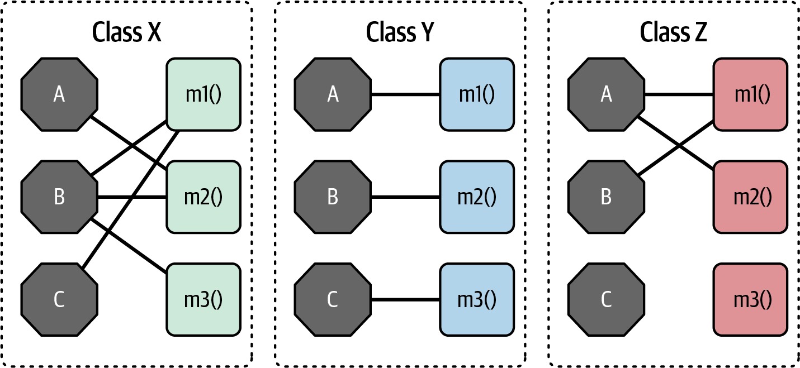
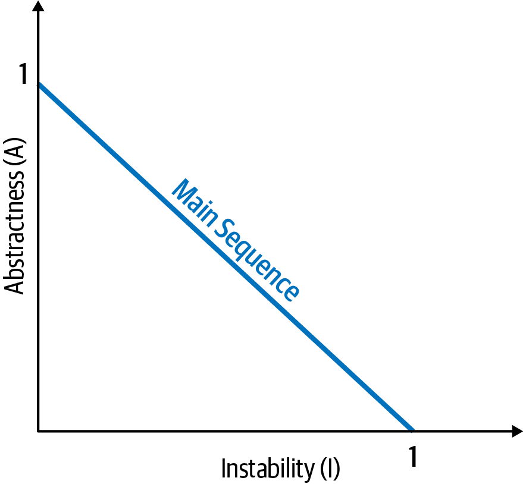
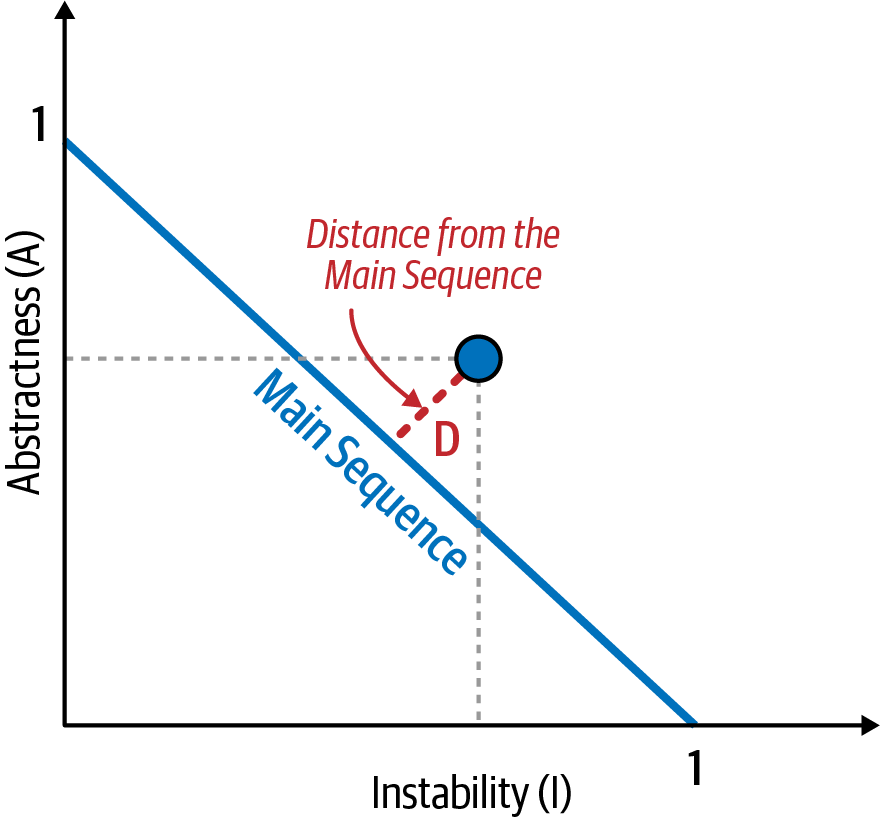
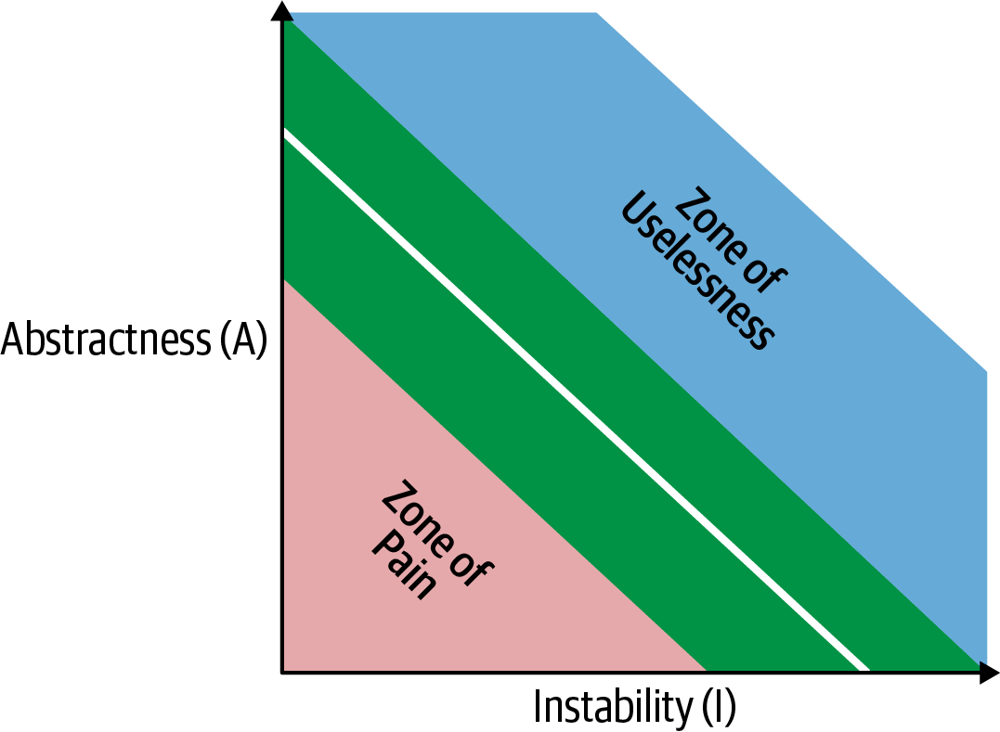
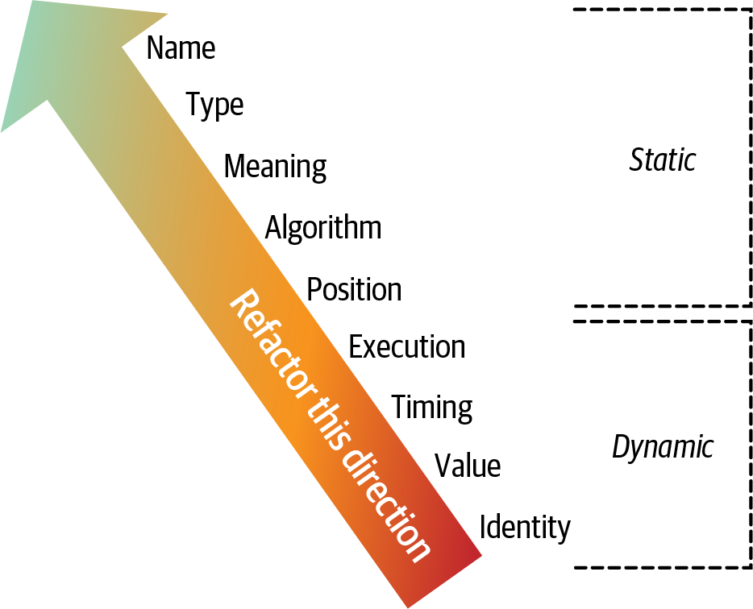

<a id="ch-modularity"></a>

# Chương 3. Modularity (Modularity)

<a id="ix_ch03-modularity-asciidoc0"></a>Các kiến trúc sư và developer đã vật lộn với khái niệm modularity từ khá lâu, như thể hiện rõ trong câu trích dẫn sau từ cuốn *Composite/Structured Design* (Van Nostrand Reinhold, 1978):

> 95% số chữ [viết về software architecture] được dùng để ca ngợi lợi ích của “modularity” và rất ít, nếu có, được nói về cách đạt được nó.
>
> —Glenford J. Myers

Các nền tảng khác nhau cung cấp các cơ chế tái sử dụng code khác nhau, nhưng tất cả đều hỗ trợ một cách nào đó để gom các code liên quan lại với nhau thành các *module*. Dù khái niệm này là phổ quát trong software architecture, nó đã tỏ ra khó định nghĩa. Một lần tìm kiếm qua loa trên internet cho ra hàng chục định nghĩa, không nhất quán (và có cái mâu thuẫn nhau). Đây không phải là vấn đề mới. Tuy nhiên, vì không tồn tại một định nghĩa được công nhận nào, chúng tôi phải nhảy vào cuộc và đưa ra định nghĩa của riêng mình để nhất quán trong suốt cuốn sách.

Hiểu modularity và nhiều hình thái của nó trong nền tảng phát triển được chọn là điều then chốt đối với kiến trúc sư. Nhiều công cụ chúng ta có để phân tích architecture (như metric, fitness function và trực quan hóa) dựa vào modularity và các khái niệm liên quan. *Modularity* là một nguyên lý tổ chức. Nếu một kiến trúc sư thiết kế một hệ thống mà không chú ý đến cách các mảnh kết nối với nhau, hệ thống đó sẽ gặp vô số khó khăn. Dùng một phép so sánh vật lý, các hệ thống phần mềm mô hình hóa các hệ thống phức tạp, vốn có xu hướng tiến tới entropy (hay sự hỗn loạn). Trong một hệ vật lý, phải bổ sung năng lượng để duy trì trật tự. Điều tương tự cũng đúng với các hệ thống phần mềm: kiến trúc sư phải liên tục tiêu tốn năng lượng để bảo đảm sự vững chắc về cấu trúc, điều sẽ không tự nhiên mà có.

<a id="id821"></a>Duy trì modularity tốt là ví dụ điển hình cho định nghĩa của chúng tôi về một architecture characteristic *ngầm định* (implicit): hầu như không có yêu cầu dự án nào yêu cầu tường minh kiến trúc sư bảo đảm sự phân tách và giao tiếp module tốt, nhưng các code base bền vững thực sự cần trật tự và tính nhất quán mà điều này mang lại.

<a id="id285"></a>

## Modularity so với granularity (Modularity Versus Granularity)

<a id="id822"></a><a id="id823"></a>Các developer và kiến trúc sư thường dùng các thuật ngữ *modularity* và *granularity* thay thế cho nhau, nhưng ý nghĩa của chúng rất khác nhau. Modularity là về việc chia hệ thống thành các mảnh nhỏ hơn, chẳng hạn chuyển từ một architecture style monolith (như layered architecture n-tiered truyền thống) sang một architecture style phân tán cao, như microservices. Ngược lại, granularity là về *kích thước* của các mảnh đó—một phần cụ thể của hệ thống (hoặc service) nên lớn đến mức nào. Tuy nhiên, như câu nói sau của một trong các tác giả, chính *granularity* là nơi kiến trúc sư và developer gặp rắc rối:

> Hãy đón nhận modularity, nhưng hãy cẩn trọng với granularity.
>
> —Mark Richards

Granularity khiến các service hoặc component bị coupling với nhau, tạo ra các architecture antipattern phức tạp, hard-to-maintain như *Spaghetti Architecture*, *Distributed Monoliths*, và *Big Ball of Distributed Mud* nổi tiếng. Mẹo để tránh các antipattern kiến trúc này là chú ý đến granularity và mức coupling tổng thể giữa các service và component.

<a id="id23"></a>

## Định nghĩa modularity (Defining Modularity)

<a id="ix_ch03-modularity-asciidoc1"></a>Merriam-Webster định nghĩa một *module* là “mỗi phần trong một tập các bộ phận được chuẩn hóa hoặc các đơn vị độc lập có thể được dùng để xây dựng một cấu trúc phức tạp hơn.” Ngược lại, trong cuốn sách này, chúng tôi dùng *modularity* để mô tả một nhóm logic các code liên quan, có thể là một nhóm class trong một ngôn ngữ object-oriented hoặc một nhóm hàm trong một ngôn ngữ có cấu trúc hoặc hàm. Các developer thường dùng module như một cách để gom các code liên quan lại với nhau. Ví dụ, package `com.mycompany.customer` trong Java nên chứa những thứ liên quan đến khách hàng. Hầu hết các ngôn ngữ cung cấp các cơ chế cho modularity (`package` trong Java, `namespace` trong .NET, v.v.).

Các ngôn ngữ lập trình hiện đại có nhiều cơ chế đóng gói khác nhau, và nhiều developer thấy khó chọn giữa chúng. Ví dụ, trong nhiều ngôn ngữ hiện đại, developer có thể định nghĩa hành vi trong hàm/method, class, hoặc package/namespace, mỗi loại có các quy tắc visibility và scoping khác nhau. Một số ngôn ngữ còn làm phức tạp thêm bằng cách bổ sung các cấu trúc lập trình, như [metaobject protocol](https://oreil.ly/9Zw-J), để cung cấp thêm nhiều cơ chế mở rộng.

<a id="id824"></a>Kiến trúc sư phải nhận thức được cách developer đóng gói mọi thứ, vì việc đóng gói có những hàm ý quan trọng trong architecture. Ví dụ, nếu một số package bị coupling chặt, việc tái sử dụng một trong số chúng cho công việc liên quan trở nên khó khăn hơn.

> **Tái sử dụng theo module trước khi có class (Modular Reuse Before Classes)**
>
> <a id="id826"></a>Những developer được đào tạo từ thời trước khi có các ngôn ngữ object-oriented có thể băn khoăn vì sao lại có nhiều kiểu phân tách khác nhau như vậy. Phần lớn lý do liên quan đến khả năng tương thích ngược—không phải của code, mà là của cách developer suy nghĩ về sự vật.
>
> Vào tháng Ba năm 1968, tạp chí *Communications of the Association for Computing Machinery (ACM)* đăng một bài báo của nhà khoa học máy tính Edsger Dijkstra có tựa đề “Go To Statement Considered Harmful.” Ông chê bai cách dùng phổ biến của câu lệnh `GOTO`, vốn phổ biến trong các ngôn ngữ lập trình thời đó, vì nó cho phép nhảy lung tung phi tuyến tính trong code, khiến việc suy luận và debug trở nên khó khăn.
>
> <a id="id827"></a>Bài báo của Dijkstra đã góp phần mở ra kỷ nguyên của các ngôn ngữ lập trình *có cấu trúc* (structured) vào mid-1970s (giữa thập niên), tiêu biểu là Pascal và C, vốn khuyến khích suy nghĩ sâu hơn về cách các thứ khớp với nhau. Các developer nhanh chóng nhận ra rằng hầu hết các ngôn ngữ lập trình không cung cấp cách tốt nào để gom các thứ giống nhau lại với nhau một cách logic. <a id="id828"></a>Do đó, kỷ nguyên ngắn ngủi của các ngôn ngữ *module* (modular) ra đời vào mid-1980s, như Modula (ngôn ngữ tiếp theo của Niklaus Wirth, người tạo ra Pascal) và Ada. Những ngôn ngữ này đón nhận cấu trúc lập trình *module*, khá giống cách chúng ta nghĩ về package hay namespace ngày nay (nhưng không có class).
>
> <a id="id829"></a>Tuy nhiên, kỷ nguyên lập trình module của mid-1980s rất short-lived (ngắn ngủi) vì các ngôn ngữ object-oriented trở nên phổ biến và cung cấp những cách mới để đóng gói và tái sử dụng code. Dù vậy, các nhà thiết kế ngôn ngữ nhận ra tính hữu dụng của module và giữ lại chúng dưới dạng package và namespace. Nhiều ngôn ngữ vẫn chứa các tính năng tương thích có vẻ kỳ lạ ngày nay nhưng được đưa vào để hỗ trợ các paradigm khác nhau này. Ví dụ, Java hỗ trợ các paradigm module (thông qua package và khởi tạo package-level bằng static initializer), cũng như các paradigm object-oriented và hàm, mỗi loại có quy tắc scoping và những điểm kỳ quặc riêng.

Trong các thảo luận về architecture của cuốn sách này, chúng tôi dùng *modularity* như một thuật ngữ chung để chỉ một nhóm code có liên quan: class, hàm, hoặc bất kỳ cách gom nhóm nào khác. Điều này không hàm ý một sự phân tách vật lý, mà chỉ là phân tách logic. (Sự khác biệt này đôi khi quan trọng.) Ví dụ, gom một số lượng lớn class lại với nhau trong một ứng dụng monolith có thể tiện lợi; tuy nhiên, khi đến lúc tái cấu trúc architecture, coupling được khuyến khích bởi việc phân vùng lỏng lẻo có thể cản trở nỗ lực tách monolith ra. Đó là lý do việc nói về modularity như một khái niệm, tách biệt khỏi sự phân tách vật lý mà một nền tảng cụ thể bắt buộc hoặc hàm ý, là hữu ích.

<a id="id830"></a>Đáng để thảo luận về khái niệm chung của *namespace*, vốn khác với hiện thực kỹ thuật trên nền tảng .NET cũng được gọi là namespace. Các developer thường cần những cái tên chính xác, đầy đủ (fully qualified) cho các tài sản phần mềm khác nhau (component, class, v.v.) để phân biệt chúng với nhau. Ví dụ hiển nhiên nhất mà mọi người dùng hằng ngày là internet, vốn dựa vào các định danh toàn cục, duy nhất gắn với địa chỉ IP.

Hầu hết các ngôn ngữ có một cơ chế modularity nào đó kiêm luôn vai trò namespace để tổ chức những thứ như biến, hàm hoặc method. Đôi khi cấu trúc module được phản ánh về mặt vật lý: ví dụ, cấu trúc package của Java phải phản ánh cấu trúc thư mục của các file class vật lý.

> **Một ngôn ngữ không có xung đột tên: Java 1.0 (A Language with No Name Conflicts)**
>
> <a id="id832"></a><a id="id833"></a><a id="id834"></a>Những nhà thiết kế ban đầu của Java có nhiều kinh nghiệm xử lý các xung đột và va chạm tên, vốn phổ biến trong các nền tảng lập trình thời đó. Java 1.0 dùng một mẹo khéo léo để tránh sự mơ hồ khi hai class có cùng tên—chẳng hạn nếu problem domain bao gồm một *order* trong catalog và một *order* lắp đặt, cả hai đều tên là *order* nhưng với hàm nghĩa (và class) rất khác nhau. Giải pháp của các nhà thiết kế Java là tạo cơ chế namespace `package`, cùng với yêu cầu rằng cấu trúc thư mục vật lý phải khớp với tên package. Vì filesystem không cho phép hai file cùng tên nằm trong cùng một thư mục, điều này đã tận dụng các tính năng vốn có của hệ điều hành để tránh sự mơ hồ và xung đột tên. Do đó, `classpath` ban đầu trong Java chỉ chứa các thư mục.
>
> Tuy nhiên, như các nhà thiết kế ngôn ngữ phát hiện ra, việc bắt mọi dự án phải có một cấu trúc thư mục đầy đủ là cồng kềnh, đặc biệt khi các dự án trở nên lớn hơn. Thêm vào đó, việc xây dựng các tài sản tái sử dụng được rất khó: các framework và thư viện phải được “bung” ra vào cấu trúc thư mục. Trong bản phát hành lớn thứ hai của Java (1.2, nhưng được gọi là Java 2), các nhà thiết kế đã thêm cơ chế `jar`, cho phép một file archive đóng vai trò như một cấu trúc thư mục trên classpath. Trong thập kỷ tiếp theo, các developer Java vật lộn để thiết lập classpath cho thật đúng, như một sự kết hợp của các thư mục và các file JAR. Ý định ban đầu của họ đã bị phá vỡ: giờ đây hai file JAR *có thể* tạo ra các tên xung đột trên một classpath. Đây là lý do các developer Java của thời kỳ đó thường có vô số chuyện “chiến trận” về việc debug class loader.<a id="id835"></a>

<a id="id286"></a>

## Đo lường modularity (Measuring Modularity)

<a id="ix_ch03-modularity-asciidoc2"></a>Vì modularity quan trọng như vậy, kiến trúc sư cần các công cụ giúp họ hiểu nó tốt hơn. May mắn là các nhà nghiên cứu đã tạo ra nhiều metric language-agnostic cho mục đích này. Ở đây chúng tôi sẽ tập trung vào ba khái niệm then chốt: *cohesion*, *coupling* và *connascence*.

<a id="id24"></a>

### Cohesion

<a id="ix_ch03-modularity-asciidoc3"></a>*Cohesion* chỉ mức độ mà các phần của một module nên được chứa trong cùng module đó. Nói cách khác, nó đo các phần liên quan với nhau đến mức nào. Một module cohesive lý tưởng là module mà tất cả các phần được đóng gói cùng nhau; tách chúng thành các mảnh nhỏ hơn sẽ đòi hỏi coupling các phần với nhau thông qua các lời gọi giữa các module để đạt được kết quả hữu ích. Bài học cảnh tỉnh về modularity liên quan đến cohesion được thể hiện qua câu trích dẫn sau từ cuốn sách *Structured Design* (Pearson, 2008):

> Cố chia một module cohesive chỉ dẫn đến coupling tăng lên và khả năng đọc giảm đi.
>
> —Larry Constantine

Các nhà khoa học máy tính đã định nghĩa một dải các mức cohesion, được đo từ tốt nhất đến tệ nhất:

**Functional cohesion (cohesion chức năng)**

Mọi phần của module đều liên quan đến nhau, và module chứa mọi thứ thiết yếu mà nó cần để hoạt động.

**Sequential cohesion (cohesion tuần tự)**

Hai module tương tác: một module xuất ra dữ liệu trở thành đầu vào cho module kia.

**Communicational cohesion (cohesion giao tiếp)**

Hai module tạo thành một chuỗi giao tiếp, trong đó mỗi module xử lý thông tin và/hoặc đóng góp vào một đầu ra nào đó. Ví dụ, một module thêm một bản ghi vào database và module kia tạo một email dựa trên thông tin đó.

**Procedural cohesion (cohesion thủ tục)**

Hai module phải thực thi code theo một thứ tự cụ thể.

**Temporal cohesion (cohesion thời gian)**

Các module liên quan với nhau dựa trên các phụ thuộc về thời điểm. Ví dụ, nhiều hệ thống có một danh sách những thứ tưởng như không liên quan nhưng phải được khởi tạo khi hệ thống khởi động; những tác vụ khác nhau này là *temporally cohesive* (cohesive về thời gian).

**Logical cohesion (cohesion logic)**

Dữ liệu trong các module liên quan với nhau về mặt logic nhưng không về mặt chức năng. Ví dụ, xét một module chuyển đổi thông tin từ văn bản, các đối tượng đã serialize, hoặc các stream sang một định dạng khác. Các thao tác của nó có liên quan với nhau, nhưng các hàm thì khá khác nhau. Một ví dụ phổ biến của loại cohesion này có mặt trong hầu như mọi dự án Java dưới dạng package `StringUtils`, một nhóm các static method thao tác trên `String` nhưng ngoài ra thì không liên quan với nhau.

**Coincidental cohesion (cohesion ngẫu nhiên)**

Các phần tử trong một module không liên quan với nhau ngoài việc nằm trong cùng một file nguồn. Đây là dạng cohesion tiêu cực nhất.

Dù có nhiều biến thể, *cohesion* là một metric kém chính xác hơn *coupling*. Thường thì mức cohesion của một module cụ thể được xác định theo sự cân nhắc của một kiến trúc sư cụ thể. Xét định nghĩa module sau:

**`Customer Maintenance`**

- `add customer`
- `update customer`
- `get customer`
- `notify customer`
- `get customer orders`
- `cancel customer orders`

Hai mục cuối có nên nằm trong module này không? Hay developer nên tạo hai module riêng biệt? Đây là hình dạng của cách đó:

**`Customer Maintenance`**

- `add customer`
- `update customer`
- `get customer`
- `notify customer`

**`Order Maintenance`**

- `get customer orders`
- `cancel customer orders`

Đâu là cấu trúc đúng? Như mọi khi, còn tùy:

- Đây có phải là hai thao tác duy nhất của `Order Maintenance` không? Nếu vậy, có thể hợp lý khi gộp các thao tác đó trở lại vào `Customer Maintenance`.
- `Customer Maintenance` có được kỳ vọng sẽ phát triển lớn hơn nhiều không? Nếu vậy, có lẽ developer nên tìm cơ hội tách hành vi ra thành một module khác (hoặc mới).
- `Order Maintenance` có đòi hỏi nhiều kiến thức về thông tin `Customer` đến mức tách hai module sẽ cần một mức coupling cao để nó hoạt động được không? (Điều này liên quan trở lại câu trích dẫn trước đó của Larry Constantine.)

Những câu hỏi này đại diện cho kiểu phân tích trade-off nằm ở trọng tâm công việc của một kiến trúc sư phần mềm.

Các nhà khoa học máy tính đã phát triển một metric cấu trúc tốt để xác định cohesion—cụ thể là *Lack of Cohesion* (điều này hơi đáng ngạc nhiên, xét đến việc characteristic này chủ quan đến mức nào). <a id="id836"></a>Một bộ metric well-known có tên [Chidamber and Kemerer Object-Oriented Metrics Suite](https://oreil.ly/-1lMh) đo các khía cạnh cụ thể của các hệ thống phần mềm object-oriented. Nó bao gồm nhiều code metric phổ biến, như Cyclomatic Complexity (xem [“Cyclomatic Complexity”](ch06_measuring_and_governing_architecture_characteristics.vi.md#sidebar_cc)) và một số metric coupling quan trọng, được thảo luận trong [“Coupling”](#sec-coupling).

<a id="ix_ch03-modularity-asciidoc4"></a><a id="ix_ch03-modularity-asciidoc5"></a>Chidamber và Kemerer cũng đã phát triển metric Lack of Cohesion in Methods (LCOM), đo cohesion cấu trúc của một module. Phiên bản ban đầu xuất hiện trong [Phương trình 3-1](#eq_lcom).

<a id="eq_lcom"></a>

*Phương trình 3-1. LCOM, phiên bản 1*

$$L C O M = \left\{ \begin{array}{ll} | P | - | Q | , & \text{if} \; | P | > | Q | \\ 0 , & \text{otherwise} \end{array} \right.$$

Trong phương trình này, *P* tăng thêm 1 cho mỗi method không truy cập một trường dùng chung cụ thể; *Q* giảm đi 1 cho các method *có* dùng chung một trường dùng chung cụ thể. Nếu bạn thấy công thức này khó hiểu, chúng tôi thông cảm—và nó đã dần trở nên còn phức tạp hơn nữa. Biến thể thứ hai, được giới thiệu năm 1996 (do đó có tên *LCOM96B*), xuất hiện trong [Phương trình 3-2](#eq-lcom96).

<a id="eq-lcom96"></a>

*Phương trình 3-2. LCOM96B*

$$L C O M 96 b = \frac{1}{a} {\sum}_{j = 1}^{a} \frac{m - μ ( A j )}{m}$$

Chúng tôi sẽ không mất công gỡ rối các biến và toán tử trong [Phương trình 3-2](#eq-lcom96) vì phần giải thích bằng lời sau đây rõ ràng hơn. Về cơ bản, metric LCOM phơi bày coupling ngẫu nhiên (incidental) bên trong các class. Một định nghĩa tốt hơn của LCOM sẽ là “tổng của các tập method không được chia sẻ thông qua việc dùng chung trường.”

Xét một class có các trường private `a` và `b`. Nhiều method chỉ truy cập `a`, và nhiều method khác chỉ truy cập `b`. *Tổng* các tập method không được chia sẻ thông qua việc dùng chung trường (`a` và `b`) là cao; do đó, class này có điểm LCOM cao, cho thấy một sự *thiếu cohesion trong các method* đáng kể.

Xét ba class trong [Hình 3-1](#ch-modularity-LCOM). Ở đây, các trường xuất hiện dưới dạng chữ cái đơn bên trong các hình bát giác, và các method xuất hiện dưới dạng khối. Trong Class X, điểm LCOM thấp, cho thấy cohesion cấu trúc tốt. Tuy nhiên, Class Y thiếu cohesion; mỗi cặp trường/method trong Class Y có thể nằm trong class riêng của nó mà không ảnh hưởng đến hành vi của hệ thống. Class Z cho thấy cohesion hỗn hợp; tổ hợp trường/method cuối cùng có thể được refactor thành class riêng.

<a id="ch-modularity-LCOM"></a>



*Hình 3-1. Metric LCOM, trong đó các trường là hình bát giác, và các method là hình vuông*

Metric LCOM hữu ích cho các kiến trúc sư đang phân tích code base để hỗ trợ việc tái cấu trúc, di chuyển, hoặc hiểu một code base. Các class tiện ích dùng chung là một cơn đau đầu phổ biến khi chuyển đổi architecture. Dùng metric LCOM có thể giúp kiến trúc sư tìm ra các class bị coupling một cách ngẫu nhiên và lẽ ra ngay từ đầu không bao giờ nên là một class duy nhất.

Nhiều software metric có những khiếm khuyết nghiêm trọng, và LCOM cũng không ngoại lệ. Tất cả những gì metric này có thể tìm thấy là sự thiếu cohesion về *cấu trúc*; nó không có cách nào xác định liệu các mảnh cụ thể có khớp với nhau về mặt logic hay không. Điều này phản ánh trở lại Định luật thứ hai của software architecture: *tại sao* quan trọng hơn *như thế nào*<a id="id837"></a><a id="id838"></a>.<a id="id839"></a>

<a id="sec-coupling"></a>

### Coupling

<a id="id840"></a>May mắn là chúng ta có những công cụ tốt hơn để phân tích coupling trong code base. Chúng một phần dựa trên lý thuyết đồ thị: vì các lời gọi và trả về method tạo thành một call graph, nó có thể được phân tích bằng toán học. Cuốn sách *Structured Design: Fundamentals of a Discipline of Computer Program and Systems Design* (Prentice-Hall, 1979) của Edward Yourdon và Larry Constantine, đã định nghĩa nhiều khái niệm cốt lõi, bao gồm các metric *afferent coupling* và *efferent coupling*. <a id="id841"></a>*Afferent* coupling đo số lượng kết nối *đi vào* tới một code artifact (component, class, hàm, v.v.). <a id="id842"></a>*Efferent* coupling đo các kết nối *đi ra* tới các code artifact khác. Có những công cụ cho hầu như mọi nền tảng cho phép kiến trúc sư phân tích các đặc điểm coupling của code.

> **Vì sao các metric coupling có tên giống nhau đến vậy? (Why Such Similar Names for Coupling Metrics?)**
>
> Vì sao hai metric then chốt trong thế giới architecture vốn đại diện cho *các khái niệm đối lập* lại được đặt tên gần như giống hệt nhau, chỉ khác ở những nguyên âm nghe giống nhau nhất? Các thuật ngữ này bắt nguồn từ cuốn sách *Structured Design*. Mượn khái niệm từ toán học, Yourdon và Constantine đã đặt ra các thuật ngữ now-common (nay đã phổ biến) *afferent* và *efferent* coupling. Lẽ ra chúng nên được gọi là coupling *incoming* (đi vào) và *outgoing* (đi ra), nhưng các tác giả nghiêng về tính đối xứng toán học hơn là sự rõ ràng. Các developer đã nghĩ ra vài cách ghi nhớ để hỗ trợ. Chẳng hạn, *a* xuất hiện trước *e* trong bảng chữ cái tiếng Anh, giống như *incoming* xuất hiện trước *outgoing*. Chữ *e* trong *efferent* khớp với chữ cái đầu trong *exit*, giúp ghi nhớ rằng nó đại diện cho các kết nối đi ra.

<a id="sec-abstractness-instability-and-distance-from-the-main-sequence"></a>

### Các metric cốt lõi (Core Metrics)

Dù coupling giữa các component có giá trị thô đối với kiến trúc sư, một số metric dẫn xuất khác cho phép đánh giá sâu hơn. Các metric được thảo luận trong mục này được tạo ra bởi kỹ sư phần mềm [Robert C. Martin](https://oreil.ly/QxmzC), và áp dụng rộng rãi cho hầu hết các ngôn ngữ object-oriented.

<a id="id844"></a><a id="id845"></a>*Abstractness* là tỉ lệ giữa các artifact trừu tượng (abstract class, interface, v.v.) với các artifact cụ thể (hiện thực). Metric Abstractness đo mức độ trừu tượng so với hiện thực của một code base. Ví dụ, ở một đầu của thang đo sẽ là một code base không có sự trừu tượng nào, chỉ có một hàm code khổng lồ duy nhất (như trong một method `main()` duy nhất). Đầu kia của thang đo sẽ là một code base có quá nhiều sự trừu tượng, khiến developer khó hiểu các thứ kết nối với nhau như thế nào. (Ví dụ, developer phải mất một lúc mới hiểu được phải làm gì với một abstract class `AbstractSingletonProxyFactoryBean`, với nhiều tầng trừu tượng và cái tên mơ hồ của nó.)

Công thức của Abstractness xuất hiện trong [Phương trình 3-3](#eq_abstractness).

<a id="eq_abstractness"></a>

*Phương trình 3-3. Abstractness*

$$A = \frac{\sum {m}^{a}}{\sum {m}^{c} + \sum {m}^{a}}$$

Kiến trúc sư tính Abstractness bằng cách tính tỉ lệ giữa tổng các artifact trừu tượng với tổng các artifact cụ thể và trừu tượng. Trong phương trình, ${m}^{a}$ biểu diễn các phần tử *trừu tượng* (interface hoặc abstract class) trong module, và ${m}^{c}$ biểu diễn các phần tử *cụ thể* (các class không trừu tượng). Metric này tìm kiếm cùng các tiêu chí. Cách dễ nhất để hình dung metric này là xét một ứng dụng có 5,000 dòng code, tất cả trong một method `main()`. Tử số Abstractness của nó sẽ là 1, trong khi mẫu số sẽ là 5,000, cho ra điểm Abstractness gần bằng 0. Đó là cách metric này đo tỉ lệ các sự trừu tượng trong code.

<a id="id846"></a><a id="id847"></a>Một metric dẫn xuất khác, *Instability*, được định nghĩa là tỉ lệ giữa efferent coupling với tổng của cả efferent và afferent coupling, như trong [Phương trình 3-4](#eq_instability).

<a id="eq_instability"></a>

*Phương trình 3-4. Instability*

$$I = \frac{{C}^{e}}{{C}^{e} + {C}^{a}}$$

Trong phương trình, ${c}^{e}$ biểu diễn efferent coupling (hay coupling đi ra), và ${c}^{a}$ biểu diễn afferent coupling (hay coupling đi vào).

Metric Instability xác định *tính dễ biến động* (volatility) của một code base. Một code base có mức instability cao sẽ dễ hỏng hơn khi bị thay đổi do coupling cao. Ví dụ, nếu một class gọi quá nhiều class khác để ủy thác công việc, class gọi sẽ rất dễ bị hỏng nếu một hoặc nhiều method được gọi thay đổi.

<a id="id27"></a>

### Khoảng cách tới main sequence (Distance from the Main Sequence)

<a id="ix_ch03-modularity-asciidoc6"></a><a id="ix_ch03-modularity-asciidoc7"></a>Một trong số ít metric tổng thể mà kiến trúc sư có cho cấu trúc kiến trúc là *Distance from the Main Sequence*, một metric dẫn xuất dựa trên Instability và Abstractness, như trong [Phương trình 3-5](#eq_distance).

<a id="eq_distance"></a>

*Phương trình 3-5. Distance from the Main Sequence*

$$D = | A + I - 1 |$$

Trong phương trình, $A$ = Abstractness và $I$ = Instability.

Lưu ý rằng cả Abstractness và Instability đều là các phân số có kết quả luôn nằm giữa 0 và 1 (trừ một số trường hợp cực đoan). Do đó, vẽ đồ thị mối quan hệ này cho ra đồ thị trong [Hình 3-2](#fig_distance).

<a id="fig_distance"></a>



*Hình 3-2. Main sequence định nghĩa mối quan hệ lý tưởng giữa Abstractness và Instability*

Metric *Distance* hình dung một mối quan hệ lý tưởng giữa Abstractness và Instability; các class nằm gần đường lý tưởng hóa này thể hiện sự pha trộn lành mạnh giữa hai mối quan tâm cạnh tranh nhau này. Ví dụ, vẽ đồ thị một class cụ thể cho phép developer tính metric *Distance from the Main Sequence*, như minh họa trong [Hình 3-3](#ch-measuring-normalized).

<a id="ch-measuring-normalized"></a>



*Hình 3-3. Distance from the Main Sequence được chuẩn hóa cho một class cụ thể*

Metric trong [Hình 3-3](#ch-measuring-normalized) vẽ class ứng viên lên đồ thị, rồi đo khoảng cách của nó tới đường lý tưởng hóa. Càng gần đường này, class càng cân bằng. <a id="id848"></a>Các class rơi quá xa vào góc trên bên phải đi vào vùng mà kiến trúc sư gọi là *Zone of Uselessness* (vùng vô dụng): code quá trừu tượng trở nên khó dùng. <a id="id849"></a>Ngược lại, code rơi vào góc dưới bên trái, như minh họa trong [Hình 3-4](#ch-measuring-zones), đi vào *Zone of Pain* (vùng đau khổ): code có quá nhiều hiện thực và không đủ trừu tượng trở nên giòn và khó bảo trì.

<a id="ch-measuring-zones"></a>



*Hình 3-4. Zone of Uselessness và Zone of Pain*

Nhiều nền tảng cung cấp công cụ để tính các thước đo này, hỗ trợ kiến trúc sư khi phân tích code base để làm quen với chúng, chuẩn bị cho một cuộc di chuyển, hoặc đánh giá technical debt.

> **Những giới hạn của metric (The Limitations of Metrics)**
>
> <a id="id851"></a>Dù ngành có một vài metric code-level cung cấp những hiểu biết giá trị, các công cụ của chúng ta cực kỳ thô sơ so với các công cụ phân tích trong những ngành kỹ thuật khác. Ngay cả các metric được dẫn xuất trực tiếp từ cấu trúc code cũng cần được diễn giải. <a id="id852"></a><a id="id853"></a><a id="id854"></a>Ví dụ, Cyclomatic Complexity (xem [“Cyclomatic Complexity”](ch06_measuring_and_governing_architecture_characteristics.vi.md#sidebar_cc)) đo độ phức tạp trong code base, nhưng metric này không thể phân biệt giữa độ phức tạp *thiết yếu* (essential) (code phức tạp vì bản thân vấn đề bên dưới phức tạp) và *độ phức tạp ngẫu nhiên* (accidental complexity) (code phức tạp hơn mức cần thiết). Hầu như mọi metric code-level đều cần được diễn giải, nhưng vẫn hữu ích khi thiết lập các mức nền (baseline) cho các metric then chốt như Cyclomatic Complexity để kiến trúc sư có thể đánh giá code base thể hiện loại nào. Chúng tôi thảo luận việc thiết lập chính những bài test như vậy trong [“Governance and Fitness Functions”](ch06_measuring_and_governing_architecture_characteristics.vi.md#sec-ff).

Cuốn *Structured Design* của Yourdon và Constantine, xuất bản năm 1979, ra đời trước khi các ngôn ngữ object-oriented trở nên phổ biến. Thay vào đó, nó tập trung vào các cấu trúc lập trình có cấu trúc, như hàm (không phải method). Nó cũng định nghĩa các loại coupling khác đã lỗi thời do thiết kế ngôn ngữ lập trình hiện đại. Object-oriented programming đã đưa vào những khái niệm bổ sung chồng lên afferent và efferent coupling, bao gồm một bộ từ vựng tinh tế hơn để mô tả coupling gọi là *connascence*.<a id="id855"></a><a id="id856"></a>

<a id="sec-modularity-connascence"></a>

### Connascence

<a id="ix_ch03-modularity-asciidoc8"></a><a id="ix_ch03-modularity-asciidoc9"></a>Cuốn sách *What Every Programmer Should Know about Object-Oriented Design* (Dorset House, 1996) của Meilir Page-Jones đã tạo ra một *ngôn ngữ* chính xác hơn để mô tả các loại coupling khác nhau trong các ngôn ngữ object-oriented. Connascence không phải là một metric coupling như afferent và efferent coupling—đúng hơn, nó đại diện cho một ngôn ngữ giúp kiến trúc sư mô tả các loại coupling khác nhau chính xác hơn (và hiểu một số hệ quả phổ biến của các loại coupling).

Hai component là *connascent* nếu một thay đổi ở component này đòi hỏi component kia phải được sửa đổi để duy trì tính đúng đắn tổng thể của hệ thống. Page-Jones phân biệt hai loại connascence: *tĩnh* (static) và *động* (dynamic).

#### Static connascence (connascence tĩnh)

<a id="ix_ch03-modularity-asciidoc10"></a><a id="ix_ch03-modularity-asciidoc11"></a>*Static connascence* chỉ coupling ở mức source-code-level (trái với coupling execution-time, được đề cập trong [“Dynamic connascence”](#sec-dyn-con)). Kiến trúc sư xem static connascence là *mức độ* mà một thứ bị coupling thông qua afferent hoặc efferent coupling. Có một số loại static connascence:

**Connascence of Name (connascence về tên)**

Nhiều component phải thống nhất về tên của một thực thể.

Tên method và tham số method là cách phổ biến nhất mà các code base bị coupling và cũng là cách đáng mong muốn nhất, đặc biệt khi xét đến các công cụ refactoring hiện đại khiến việc đổi tên system-wide trở nên tầm thường. Ví dụ, developer không còn đổi tên một method trong một code base đang hoạt động nữa mà thay vào đó *refactor* tên method bằng các công cụ hiện đại, áp dụng thay đổi trên toàn bộ code base.

**Connascence of Type (connascence về kiểu)**

Nhiều component phải thống nhất về kiểu của một thực thể.

Loại connascence này chỉ xu hướng phổ biến trong nhiều ngôn ngữ kiểu tĩnh là giới hạn biến và tham số vào các kiểu cụ thể. Tuy nhiên, khả năng này không chỉ dành riêng cho các ngôn ngữ kiểu tĩnh—một số ngôn ngữ kiểu động cũng cung cấp typing có chọn lọc, đáng chú ý là [Clojure](https://clojure.org) và [Clojure Spec](https://clojure.org/about/spec).

**Connascence of Meaning (connascence về ý nghĩa)**

Nhiều component phải thống nhất về ý nghĩa của các giá trị cụ thể. Nó còn được gọi là *Connascence of Convention*.

Trường hợp hiển nhiên phổ biến nhất của loại connascence này trong code base là các con số hardcode thay vì hằng số. Ví dụ, trong một số ngôn ngữ, việc cân nhắc định nghĩa ở đâu đó `int TRUE = 1; int FALSE = 0` là phổ biến. Hãy tưởng tượng những vấn đề sẽ phát sinh nếu ai đó đảo ngược các giá trị đó.

**Connascence of Position (connascence về vị trí)**

Nhiều component phải thống nhất về thứ tự của các giá trị.

Đây là một vấn đề với các giá trị tham số trong các lời gọi method và hàm, ngay cả trong những ngôn ngữ có kiểu tĩnh. Ví dụ, nếu một developer tạo method `void updateSeat(String name, String seatLocation)` và gọi nó với các giá trị `updateSeat("14D", "Ford, N")`, ngữ nghĩa không đúng, dù các kiểu thì đúng.

**Connascence of Algorithm (connascence về thuật toán)**

Nhiều component phải thống nhất về một thuật toán cụ thể.

Một trường hợp phổ biến của *Connascence of Algorithm* xảy ra khi một developer định nghĩa một thuật toán hashing bảo mật phải chạy và tạo ra kết quả giống hệt nhau ở cả server và client để xác thực người dùng. Hiển nhiên, đây là một mức coupling cao—nếu bất kỳ chi tiết nào của một trong hai thuật toán thay đổi, quá trình bắt tay sẽ không còn hoạt động nữa.<a id="id857"></a><a id="id858"></a>

<a id="sec-dyn-con"></a>

#### Dynamic connascence (connascence động)

<a id="ix_ch03-modularity-asciidoc12"></a><a id="ix_ch03-modularity-asciidoc13"></a>Loại connascence còn lại mà Page-Jones định nghĩa là *dynamic connascence*, phân tích các lời gọi tại runtime. Các loại dynamic connascence bao gồm:

**Connascence of Execution (connascence về thực thi)**

Thứ tự thực thi của nhiều component là quan trọng.

Xét đoạn code này:

```java
email = new Email();
email.setRecipient("foo@example.com");
email.setSender("me@me.com");
email.send();
email.setSubject("whoops");
```

Nó sẽ không hoạt động đúng vì một số thuộc tính phải được thiết lập theo một thứ tự cụ thể.

**Connascence of Timing (connascence về thời điểm)**

Thời điểm thực thi của nhiều component là quan trọng.

Trường hợp phổ biến của loại connascence này là một race condition gây ra bởi hai thread thực thi cùng lúc, ảnh hưởng đến kết quả của thao tác chung.

**Connascence of Values (connascence về giá trị)**

Một số giá trị phụ thuộc vào nhau và phải thay đổi cùng nhau.

Xét trường hợp một developer định nghĩa một hình chữ nhật bằng cách định nghĩa bốn điểm biểu diễn các góc của nó. Để duy trì tính toàn vẹn của cấu trúc dữ liệu, developer không thể tùy tiện thay đổi một trong các điểm mà không xét đến tác động lên các điểm khác để giữ nguyên hình dạng của hình chữ nhật.

Một trường hợp phổ biến và rắc rối hơn liên quan đến transaction, đặc biệt trong các hệ thống phân tán. Trong một hệ thống được thiết kế với các database riêng biệt, khi ai đó cần cập nhật một giá trị duy nhất trên tất cả các database, các giá trị hoặc phải cùng thay đổi tất cả hoặc không thay đổi gì cả.

**Connascence of Identity (connascence về định danh)**

Nhiều component phải tham chiếu tới cùng một thực thể.

Một ví dụ phổ biến của *Connascence of Identity* liên quan đến hai component độc lập phải chia sẻ và cập nhật một cấu trúc dữ liệu chung, như một queue phân tán.<a id="id859"></a><a id="id860"></a>

#### Các thuộc tính của connascence (Connascence properties)

<a id="ix_ch03-modularity-asciidoc14"></a>Connascence là một framework phân tích cho kiến trúc sư và developer, và một số thuộc tính của nó giúp bảo đảm chúng ta dùng nó một cách khôn ngoan. Các thuộc tính connascence này bao gồm:

**Strength (độ mạnh)**

Kiến trúc sư xác định *độ mạnh* (strength) của connascence trong một hệ thống dựa trên mức độ dễ dàng mà một developer có thể refactor coupling của nó. Một số loại connascence rõ ràng đáng mong muốn hơn các loại khác, như trong [Hình 3-5](#ch-modularity-conn-strength). Refactor hướng tới các loại connascence tốt hơn có thể cải thiện các đặc điểm coupling của một code base.

Kiến trúc sư nên ưu tiên static connascence hơn dynamic vì developer có thể xác định nó bằng phân tích source-code đơn giản, và vì các công cụ hiện đại khiến việc cải thiện static connascence trở nên tầm thường. Ví dụ, *Connascence of Meaning* có thể được cải thiện bằng cách refactor sang *Connascence of Name*, tạo một hằng số có tên thay vì một giá trị magic.

<a id="ch-modularity-conn-strength"></a>



*Hình 3-5. *Độ mạnh* của connascence có thể là một chỉ dẫn refactoring tốt*

**Locality (tính cục bộ)**

*Tính cục bộ* (locality) của connascence trong một hệ thống đo các module của nó gần (proximal) nhau đến mức nào trong code base. *Code gần nhau* (proximal code) (code trong cùng module) thường có nhiều dạng connascence hơn và ở mức cao hơn so với code tách biệt hơn (trong các module hoặc code base riêng biệt). Nói cách khác, những dạng connascence vốn biểu thị coupling kém khi các component ở xa nhau lại ổn khi các component ở gần nhau hơn. Ví dụ, nếu hai class trong cùng module có *Connascence of Meaning*, nó ít gây hại cho code base hơn so với khi các class đó ở các module khác nhau.

Các kiến trúc sư phần lớn không nhận thức được tầm quan trọng của nhận xét này khi tác giả lần đầu công bố nó. Theo thuật ngữ hiện đại, ông đang gợi ý rằng kiến trúc sư nên giới hạn phạm vi của các chi tiết hiện thực (coupling cao) hẹp nhất có thể trong thực tế, đây cũng chính là lời khuyên rút ra từ ý tưởng bounded context của domain-driven design (DDD). Nhận xét kiến trúc là như nhau—giới hạn coupling về hiện thực. Meilir-Page đã mô tả một nguyên lý thiết kế tốt được giới thiệu lại đầy đủ hơn thông qua DDD (xem [“Domain-Driven Design’s Bounded Context”](ch07_the_scope_of_architectural_characteristics.vi.md#sidebar-ddd) trong [Chương 7](ch07_the_scope_of_architectural_characteristics.vi.md#ch-scope)).

Nên xem xét độ mạnh và tính cục bộ cùng nhau. Các dạng connascence mạnh hơn trong cùng một module thể hiện ít “code smell” hơn so với cùng loại connascence đó nhưng trải rộng ra.

**Degree (mức độ)**

*Mức độ* (degree) của connascence liên quan đến quy mô tác động của việc thay đổi một class trong một module cụ thể—thay đổi đó tác động đến vài class hay nhiều class? Mức độ connascence thấp hơn đòi hỏi ít thay đổi hơn đối với các class và module khác và do đó ít gây hại cho code base hơn. Nói cách khác, có dynamic connascence cao không phải là điều tồi tệ nếu kiến trúc sư chỉ có vài module. Tuy nhiên, code base có xu hướng phát triển lớn lên, khiến một vấn đề nhỏ trở nên lớn hơn tương ứng về mặt thay đổi.

Trong *What Every Programmer Should Know about Object-Oriented Design*, Page-Jones đưa ra ba hướng dẫn để dùng connascence nhằm cải thiện modularity của hệ thống:

- Giảm thiểu connascence tổng thể bằng cách chia hệ thống thành các phần tử được đóng gói (encapsulated).
- Giảm thiểu mọi connascence còn lại vượt qua các ranh giới đóng gói.
- Tối đa hóa connascence bên trong các ranh giới đóng gói.

Nhà đổi mới software architecture huyền thoại [Jim Weirich](https://oreil.ly/LpE7_), người đã làm phổ biến trở lại khái niệm connascence, đưa ra hai quy tắc tuyệt vời từ bài nói [“Connescence Examined”](https://oreil.ly/q7NxU) của ông tại hội nghị Emerging Technologies for the Enterprise năm 2012:

> Quy tắc về mức độ (Rule of Degree): Chuyển các dạng connascence mạnh thành các dạng connascence yếu hơn.
>
> Quy tắc về tính cục bộ (Rule of Locality): Khi khoảng cách giữa các phần tử phần mềm tăng lên, hãy dùng các dạng connascence yếu hơn.

Kiến trúc sư có lợi khi học về connascence vì cùng lý do mà việc học về design pattern có lợi: connascence cung cấp ngôn ngữ chính xác hơn để mô tả các loại coupling khác nhau. Ví dụ, một kiến trúc sư có thể nói với ai đó, “Chúng ta cần một service và chỉ được có một instance,” hoặc họ có thể nói với ai đó, “Chúng ta cần một Singleton service.” Design pattern Singleton gói gọn một cách gọn gàng bối cảnh và giải pháp cho một vấn đề phổ biến bằng một cái tên đơn giản.

Tương tự, khi thực hiện code review, một kiến trúc sư có thể hướng dẫn một developer, “Đừng thêm một hằng chuỗi magic vào giữa phần khai báo method. Thay vào đó hãy tách nó ra thành một hằng số.” Hoặc họ có thể nói, “Bạn đang có *Connascence of Meaning*; hãy refactor nó sang *Connascence of Name*<a id="id861"></a>.<a id="id862"></a><a id="id863"></a>"<a id="id864"></a>

<a id="id32"></a>

## Từ module đến component (From Modules to Components)

<a id="id865"></a><a id="id866"></a>Chúng tôi dùng thuật ngữ *module* xuyên suốt cuốn sách này như một tên gọi chung cho các gói code liên quan. Tuy nhiên, hầu hết kiến trúc sư gọi module là *component*, những khối xây dựng then chốt của software architecture. Khái niệm *component* này, cùng với việc phân tích tương ứng về sự phân tách logic hay vật lý, đã tồn tại từ những ngày đầu tiên của khoa học máy tính, nhưng developer và kiến trúc sư vẫn vật lộn để đạt được kết quả tốt.<a id="id867"></a>

Chúng tôi sẽ thảo luận việc dẫn xuất component từ các problem domain trong [Chương 8](ch08_component_based_thinking.vi.md#ch08-component-based-thinking), nhưng trước hết chúng tôi phải thảo luận một khía cạnh nền tảng khác của software architecture: các architectural characteristic và phạm vi của chúng.
