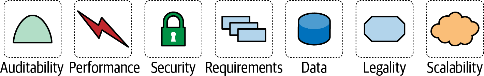
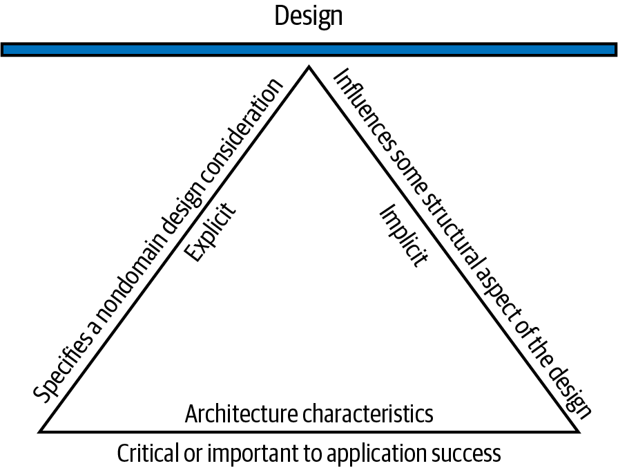

# Chương 4. Định nghĩa các architectural characteristic (Architectural Characteristics Defined)

Bây giờ chúng ta đi sâu vào chi tiết của thiết kế cấu trúc, một trong những vai trò then chốt của kiến trúc sư phần mềm. Việc này chủ yếu gồm hai hoạt động: *phân tích architectural characteristic* (architectural characteristics analysis), được đề cập trong chương này, và *thiết kế logical component* (logical component design), được đề cập trong [Chương 8](ch08_component_based_thinking.vi.md#ch08-component-based-thinking). Kiến trúc sư có thể thực hiện hai hoạt động này theo bất kỳ thứ tự nào (hoặc thậm chí song song), nhưng chúng gặp nhau tại một điểm nối then chốt.

Khi một công ty quyết định giải quyết một vấn đề cụ thể bằng phần mềm, họ thu thập một danh sách yêu cầu cho hệ thống đó (có nhiều kỹ thuật để khơi gợi chúng, như được đề cập trong [Chương 8](ch08_component_based_thinking.vi.md#ch08-component-based-thinking)). Chúng tôi sẽ gọi các yêu cầu này là *problem domain* (hoặc đơn giản là *domain*) xuyên suốt cuốn sách. Bạn đã học trong [Chương 1](ch01_introduction.vi.md#ch01-introduction) rằng *architecture characteristic* là những khía cạnh quan trọng của một hệ thống, độc lập với problem domain và quan trọng đối với sự thành công của hệ thống. Trong chương này, chúng ta sẽ đi sâu hơn vào việc định nghĩa thuật ngữ đó, cũng như các architectural characteristic cụ thể.

Kiến trúc sư thường cộng tác trong việc định nghĩa domain, nhưng cũng phải định nghĩa, khám phá và phân tích bằng cách khác tất cả những thứ mà phần mềm phải làm mà không liên quan trực tiếp đến chức năng domain: *các architectural characteristic*. Vai trò của kiến trúc sư trong việc định nghĩa các architectural characteristic là một phần của điều phân biệt software architecture với việc viết code và thiết kế. Họ cũng phải xem xét nhiều yếu tố khác khi thiết kế một giải pháp phần mềm, như minh họa trong [Hình 4-1](#fig_requirements_and_characteristics).

*Hình 4-1. Một giải pháp phần mềm bao gồm cả yêu cầu domain lẫn các architectural characteristic*

> **Sức sống dai dẳng của thuật ngữ “yêu cầu phi chức năng” (The Longevity of the Term “Non-Functional Requirements”)**
>
> Nhiều tổ chức mô tả các architectural characteristic bằng nhiều thuật ngữ khác nhau, bao gồm *non-functional requirements* (yêu cầu phi chức năng), một thuật ngữ được tạo ra để phân biệt architectural characteristic với *functional requirements* (yêu cầu chức năng). Chúng tôi không thích thuật ngữ đó vì nó self-denigrating (tự hạ thấp mình) và có tác động tiêu cực về mặt ngôn ngữ: làm sao bạn thuyết phục các team chú ý đủ đến một thứ “non-functional”? Một thuật ngữ phổ biến khác là *quality attributes* (thuộc tính chất lượng), cái mà chúng tôi không thích vì nó hàm ý đánh giá chất lượng after-the-fact (sau khi sự việc đã xảy ra) thay vì thiết kế.
>
> Chúng tôi thích thuật ngữ *architectural characteristics* hơn vì nó mô tả các mối quan tâm then chốt đối với sự thành công của architecture, và do đó của toàn bộ hệ thống, mà không hạ thấp tầm quan trọng của các mối quan tâm này. Trong [*Head First Software Architecture* (O’Reilly, 2024)](https://www.oreilly.com/library/view/head-first-software/9781098134341), chúng tôi gọi architectural characteristic là các *năng lực* (capabilities) của hệ thống; ngược lại, domain đại diện cho *hành vi* (behavior) của hệ thống.
>
> Đôi khi các thuật ngữ bị “mắc kẹt,” và *non-functional requirements* có vẻ là một thuật ngữ đặc biệt dai dẳng trong giới kiến trúc sư phần mềm. Nó vẫn phổ biến ở nhiều tổ chức. Thuật ngữ này lần đầu xuất hiện trong tài liệu software engineering vào cuối thập niên 1970s, cùng khoảng thời gian với *function point analysis*, một kỹ thuật ước lượng phân rã các yêu cầu hệ thống thành các “function point” mà mỗi cái đại diện cho một đơn vị công việc nào đó. Về lý thuyết, các team có thể cộng tất cả các function point vào cuối quá trình phân tích và có được một cái nhìn sâu nào đó về dự án. Đáng tiếc là nó tạo ra một lớp vỏ chắc chắn bề ngoài nhưng bị tính chủ quan đeo bám, như nhiều phương pháp ước lượng khác, và không còn được sử dụng nữa.
>
> Tuy nhiên, một nhận thức còn lại với chúng ta từ thời đó là phần lớn công sức để tạo ra một hệ thống là về các *năng lực* của hệ thống đó hơn là các yêu cầu của nó. Họ gọi những công sức đó là *non-function points*, dẫn đến việc thuật ngữ *non-functional requirements* trở nên phổ biến.

## Architectural characteristic và thiết kế hệ thống (Architectural Characteristics and System Design)

Để được coi là một architectural characteristic, một yêu cầu phải đáp ứng ba tiêu chí. Nó phải chỉ định một điều cần cân nhắc trong thiết kế không thuộc domain, ảnh hưởng đến một khía cạnh cấu trúc nào đó của thiết kế, *và* là then chốt hoặc quan trọng đối với sự thành công của ứng dụng. Các phần đan cài nhau trong định nghĩa của chúng tôi được minh họa trong [Hình 4-2](#ch-defined-triangle), gồm ba thành phần này và một vài yếu tố bổ nghĩa.

*Hình 4-2. Các đặc điểm phân biệt của architectural characteristic*

Hãy xem kỹ hơn các thành phần này:

**Một architecture characteristic chỉ định một điều cần cân nhắc trong thiết kế không thuộc domain.**

Thiết kế cấu trúc trong software architecture gồm hai hoạt động của kiến trúc sư: hiểu problem domain và khám phá những loại năng lực mà hệ thống cần hỗ trợ để thành công. Những điều cần cân nhắc trong thiết kế domain bao quát hành vi của hệ thống, còn các architectural characteristic định nghĩa các năng lực. Gộp lại, hai hoạt động này định nghĩa thiết kế cấu trúc.

Trong khi các yêu cầu thiết kế chỉ định ứng dụng nên làm *gì*, các architectural characteristic chỉ định *cách* triển khai các yêu cầu và *tại sao* một số lựa chọn nhất định được đưa ra: tóm lại, đó là các tiêu chí vận hành và thiết kế để dự án thành công.

Ví dụ, các mức performance cụ thể thường là một architectural characteristic quan trọng, nhưng thường không xuất hiện trong tài liệu yêu cầu. Thậm chí còn xác đáng hơn: không tài liệu yêu cầu nào thực sự nói rằng một thiết kế phải “ngăn ngừa technical debt,” nhưng đó là một điều cần cân nhắc phổ biến trong thiết kế. Chúng tôi đề cập sâu sự phân biệt giữa characteristic tường minh và ngầm định này trong [“Extracting Architectural Characteristics from Domain Concerns”](ch05_identifying_architectural_characteristics.vi.md#sec-extract).

**Một architecture characteristic ảnh hưởng đến một khía cạnh cấu trúc nào đó của thiết kế.**

Lý do chính khiến kiến trúc sư cố gắng mô tả các architectural characteristic trong dự án là để gỡ ra những điều quan trọng cần cân nhắc trong thiết kế. Kiến trúc sư có thể triển khai nó thông qua thiết kế không, hay architectural characteristic này đòi hỏi sự cân nhắc đặc biệt về *cấu trúc* để thành công?

Ví dụ, bảo mật là một mối quan tâm trong hầu như mọi dự án, và mọi hệ thống phải áp dụng một số biện pháp phòng ngừa cơ bản trong quá trình thiết kế và viết code. Tuy nhiên, bảo mật được nâng lên thành một architectural characteristic khi kiến trúc sư xác định rằng architecture cần cấu trúc đặc biệt để hỗ trợ nó.

Xét hai architectural characteristic phổ biến: security và scalability. Kiến trúc sư có thể đáp ứng security trong một hệ thống monolith bằng cách giữ vệ sinh code tốt, bao gồm các kỹ thuật well-known như mã hóa, hashing và salting. (Architectural fitness function, cũng thuộc phạm vi này, được thảo luận trong [Chương 6](ch06_measuring_and_governing_architecture_characteristics.vi.md#ch06-measuring).) Ngược lại, trong một architecture phân tán như microservices, kiến trúc sư sẽ xây dựng một service được gia cố hơn với các giao thức truy cập chặt chẽ hơn—một cách tiếp cận về cấu trúc. Do đó, kiến trúc sư có thể đáp ứng security thông qua thiết kế hoặc cấu trúc. Mặt khác, hãy xét scalability: không có thiết kế khéo léo nào cho phép một monolithic architecture scale vượt quá một điểm nhất định. Vượt quá điểm đó, hệ thống phải chuyển sang một architectural style phân tán.

Kiến trúc sư rất chú ý đến các architectural characteristic vận hành (được thảo luận trong [“Operational Architectural Characteristics”](#sec-operational)) vì đó là những characteristic thường đòi hỏi hỗ trợ cấu trúc đặc biệt nhất.

**Một architecture characteristic phải là then chốt hoặc quan trọng đối với sự thành công của ứng dụng.**

Ứng dụng *có thể* hỗ trợ một số lượng khổng lồ các architectural characteristic…nhưng chúng không nên. Mỗi architectural characteristic mà một hệ thống hỗ trợ đều làm tăng độ phức tạp cho thiết kế của nó. Đó là lý do kiến trúc sư nên cố gắng chọn *ít* architectural characteristic nhất có thể thay vì nhiều nhất.

Chúng tôi chia architectural characteristic thành loại ngầm định (implicit) và loại tường minh (explicit). Các characteristic ngầm định hiếm khi xuất hiện trong yêu cầu, nhưng chúng cần thiết để dự án thành công. Availability, reliability và security là nền tảng của hầu như mọi ứng dụng, nhưng chúng hiếm khi được chỉ định trong tài liệu thiết kế. Kiến trúc sư phải dùng kiến thức của mình về problem domain để khám phá các architectural characteristic này trong giai đoạn phân tích. Ví dụ, một công ty giao dịch high-frequency có thể không cần chỉ định latency thấp trong mọi hệ thống vì các kiến trúc sư trong problem domain đó đã biết nó then chốt đến mức nào. Các architectural characteristic tường minh xuất hiện trong tài liệu yêu cầu hoặc các chỉ dẫn cụ thể khác.

Trong [Hình 4-2](#ch-defined-triangle), việc chọn hình tam giác là có chủ ý: mỗi phần tử của định nghĩa hỗ trợ các phần tử khác, và chúng đến lượt mình hỗ trợ thiết kế tổng thể của hệ thống. Điểm tựa được tạo bởi hình tam giác minh họa cách các architectural characteristic này thường tương tác với nhau. Đó là lý do kiến trúc sư dùng thuật ngữ *trade-off* nhiều đến vậy.

## Liệt kê (một phần) các architectural characteristic (Architectural Characteristics (Partially) Listed)

Các architectural characteristic tồn tại trên một dải phổ rộng về độ phức tạp, từ các characteristic code low-level (như modularity) đến các mối quan tâm vận hành tinh vi (như scalability và elasticity). Không có một tiêu chuẩn phổ quát thực sự nào, dù người ta đã cố gắng hệ thống hóa một tiêu chuẩn. Thay vào đó, mỗi tổ chức tự diễn giải các thuật ngữ này. Ngoài ra, vì hệ sinh thái phần mềm thay đổi quá nhanh, các khái niệm, thuật ngữ, thước đo và cách kiểm chứng mới liên tục xuất hiện, mang lại những cơ hội mới để định nghĩa architectural characteristic.

Dù khối lượng và bề rộng tuyệt đối của các architecture characteristic khiến việc định lượng chúng trở nên khó khăn, kiến trúc sư vẫn phân loại chúng. Các mục sau mô tả một vài nhóm lớn như vậy và đưa ra một số ví dụ.

### Các architectural characteristic vận hành (Operational Architectural Characteristics)

Các architectural characteristic vận hành bao quát các năng lực như performance, scalability, elasticity, availability và reliability. [Bảng 4-1](#table_chars_OAC) liệt kê một số architectural characteristic vận hành.

*Bảng 4-1. Các architectural characteristic vận hành phổ biến*

| Thuật ngữ | Định nghĩa |
|---|---|
| Availability | Hệ thống cần sẵn sàng trong bao nhiêu phần thời gian; nếu là 24/7, cần có sẵn các bước để cho phép hệ thống nhanh chóng hoạt động trở lại trong trường hợp có bất kỳ sự cố nào. |
| Continuity | Năng lực khôi phục sau thảm họa (disaster recovery) của hệ thống. |
| Performance | Hệ thống hoạt động tốt đến mức nào; các cách đo lường điều này bao gồm stress testing, phân tích đỉnh tải, phân tích tần suất các chức năng được dùng, và thời gian phản hồi. |
| Recoverability | Các yêu cầu về tính liên tục của hoạt động kinh doanh: trong trường hợp có thảm họa, hệ thống phải trực tuyến trở lại nhanh đến mức nào. Điều này bao gồm các chiến lược backup và các yêu cầu về phần cứng dự phòng. |
| Reliability/safety | Hệ thống có cần fail-safe không, hoặc nó có mission critical theo cách ảnh hưởng đến sinh mạng không. Nếu nó hỏng, công ty có mất những khoản tiền lớn không? Đây thường là một dải phổ hơn là nhị phân. |
| Robustness | Khả năng của hệ thống xử lý lỗi và các điều kiện biên trong khi chạy, ví dụ, nếu kết nối internet hoặc nguồn điện bị hỏng. |
| Scalability | Khả năng của hệ thống hoạt động và vận hành khi số lượng người dùng hoặc request tăng lên. |

Các architectural characteristic vận hành chồng lấn nhiều với các mối quan tâm của vận hành (operations) và DevOps.

### Các architectural characteristic cấu trúc (Structural Architectural Characteristics)

Kiến trúc sư chịu trách nhiệm về cấu trúc code đúng đắn. Trong nhiều trường hợp, kiến trúc sư có trách nhiệm duy nhất hoặc chung đối với chất lượng của code, bao gồm modularity, khả năng đọc, mức độ kiểm soát coupling giữa các component, code dễ đọc, và hàng loạt đánh giá chất lượng nội tại khác. [Bảng 4-2](#table-struct) liệt kê một vài architectural characteristic cấu trúc.

*Bảng 4-2. Các architectural characteristic cấu trúc*

| Thuật ngữ | Định nghĩa |
|---|---|
| Configurability | Người dùng cuối có thể thay đổi các khía cạnh cấu hình của phần mềm thông qua các giao diện dễ dàng đến mức nào. |
| Extensibility | Architecture đáp ứng tốt đến mức nào những thay đổi mở rộng chức năng hiện có của nó. |
| Installability | Cài đặt hệ thống trên mọi nền tảng cần thiết dễ dàng đến mức nào. |
| Leverageability/reuse | Mức độ mà các component chung của hệ thống có thể được tận dụng trên nhiều sản phẩm. |
| Localization | Hỗ trợ nhiều ngôn ngữ trên các màn hình nhập liệu/truy vấn trong các trường dữ liệu. |
| Maintainability | Áp dụng thay đổi và nâng cấp hệ thống dễ dàng đến mức nào. |
| Portability | Khả năng của hệ thống chạy trên nhiều hơn một nền tảng (như Oracle và SAP DB). |
| Upgradeability | Nâng cấp lên phiên bản mới hơn trên server và client dễ dàng và nhanh chóng đến mức nào. |

### Các characteristic về cloud (Cloud Characteristics)

Hệ sinh thái phát triển phần mềm liên tục thay đổi và tiến hóa; ví dụ xuất sắc gần đây nhất là sự xuất hiện của cloud. Khi ấn bản đầu tiên được xuất bản, điện toán cloud-based đã tồn tại nhưng chưa phổ biến. Giờ đây, hầu hết các hệ thống có một mức tương tác nào đó với các hệ thống cloud-based, ít nhất ở một khía cạnh nào đó. Một vài điều cần cân nhắc này xuất hiện trong [Bảng 4-3](#table-cloud).

*Bảng 4-3. Các architectural characteristic của nhà cung cấp cloud*

| Thuật ngữ | Định nghĩa |
|---|---|
| On-demand scalability | Khả năng của nhà cung cấp cloud scale up tài nguyên một cách động dựa trên nhu cầu. |
| On-demand elasticity | Sự linh hoạt của nhà cung cấp cloud khi nhu cầu tài nguyên tăng vọt; tương tự scalability. |
| Zone-based availability | Khả năng của nhà cung cấp cloud tách tài nguyên theo các vùng tính toán (computing zone) để tạo ra các hệ thống có khả năng chống chịu tốt hơn. |
| Region-based privacy and security | Khả năng pháp lý của nhà cung cấp cloud trong việc lưu trữ dữ liệu từ nhiều quốc gia và khu vực khác nhau. Nhiều quốc gia có luật quy định nơi dữ liệu của công dân họ có thể được lưu trữ (và thường hạn chế việc lưu trữ bên ngoài khu vực của họ). |

Trong ấn bản thứ hai của cuốn sách này, chúng tôi đã thêm vào mỗi chương về architectural style một mục mô tả cách style đó đáp ứng và hỗ trợ các điều cần cân nhắc về cloud.

### Các architectural characteristic xuyên suốt (Cross-Cutting Architectural Characteristics)

Trong khi nhiều architectural characteristic thuộc về các nhóm dễ nhận biết, những characteristic khác nằm ngoài các nhóm đó hoặc không thể phân loại, nhưng vẫn tạo thành những ràng buộc và điều cần cân nhắc quan trọng trong thiết kế. [Bảng 4-4](#table-crosscut) mô tả một vài trong số đó.

*Bảng 4-4. Các architectural characteristic cross-cutting*

| Thuật ngữ | Định nghĩa |
|---|---|
| Accessibility | Mọi người dùng có thể truy cập hệ thống dễ dàng đến mức nào, kể cả những người khuyết tật như mù màu hoặc khiếm thính. |
| Archivability | Các ràng buộc của hệ thống xoay quanh việc lưu trữ (archive) hoặc xóa dữ liệu sau một khoảng thời gian xác định. |
| Authentication | Các yêu cầu bảo mật để bảo đảm người dùng đúng là người mà họ nói. |
| Authorization | Các yêu cầu bảo mật để bảo đảm người dùng chỉ có thể truy cập một số chức năng nhất định trong ứng dụng (theo use case, subsystem, trang web, quy tắc nghiệp vụ, mức trường, v.v.). |
| Legal | Các ràng buộc pháp lý mà hệ thống vận hành trong đó, như luật bảo vệ dữ liệu như GDPR hoặc luật financial-records như Sarbanes-Oxley ở Mỹ, hoặc bất kỳ quy định nào về cách ứng dụng được xây dựng hoặc triển khai. Điều này bao gồm các quyền bảo lưu mà công ty yêu cầu. |
| Privacy | Khả năng của hệ thống mã hóa và che giấu các transaction khỏi nhân viên nội bộ của công ty, kể cả DBA và kiến trúc sư mạng. |
| Security | Các quy tắc và ràng buộc về mã hóa trong database hoặc cho giao tiếp mạng giữa các hệ thống nội bộ; xác thực cho truy cập của người dùng từ xa, và các biện pháp bảo mật khác. |
| Supportability | Mức hỗ trợ kỹ thuật mà ứng dụng cần; logging và các tiện ích khác cần thiết đến mức nào để debug lỗi trong hệ thống. |
| Usability/achievability | Mức đào tạo cần thiết để người dùng đạt được mục tiêu của họ với ứng dụng/giải pháp. |

Bất kỳ danh sách architectural characteristic nào cũng tất yếu không đầy đủ; bất kỳ dự án phần mềm nào cũng có thể nghĩ ra các architectural characteristic dựa trên các yếu tố riêng. Nhiều thuật ngữ chúng tôi vừa liệt kê không chính xác và mơ hồ, đôi khi do sắc thái tinh tế hoặc thiếu định nghĩa khách quan. Ví dụ, *interoperability* và *compatibility* có vẻ tương đương, và điều đó sẽ đúng với một số hệ thống. Tuy nhiên, chúng khác nhau vì *interoperability* hàm ý dễ tích hợp với các hệ thống khác, điều này đến lượt nó hàm ý các API được công bố và có tài liệu. Ngược lại, *compatibility* quan tâm nhiều hơn đến các tiêu chuẩn của ngành và domain. Một ví dụ khác là *learnability*: một định nghĩa là “người dùng học cách dùng phần mềm dễ dàng đến mức nào,” và một định nghĩa khác là “mức độ mà hệ thống có thể tự động học về môi trường của nó để trở nên self-configuring hoặc self-optimizing bằng các thuật toán machine learning.”

Nhiều định nghĩa chồng lấn nhau: chẳng hạn *availability* và *reliability*. Nhưng hãy xét giao thức internet IP, nền tảng của TCP. IP là *available* nhưng không *reliable*: các packet có thể đến không theo thứ tự, và bên nhận có thể phải yêu cầu lại các packet bị thiếu.

Không có danh sách tiêu chuẩn đầy đủ nào định nghĩa các nhóm này. International Organization for Standards (ISO) công bố một [danh sách được tổ chức theo năng lực](https://oreil.ly/SKc_Y) chồng lấn với danh sách của chúng tôi ở đây, nhưng chủ yếu thiết lập một danh sách nhóm chưa đầy đủ. Dưới đây là một số định nghĩa của ISO, được diễn đạt lại để cập nhật thuật ngữ và bổ sung các nhóm cho phù hợp với các mối quan tâm hiện đại:

**Performance efficiency (hiệu quả performance)**

Thước đo performance so với lượng tài nguyên được dùng trong các điều kiện đã biết. Điều này bao gồm *time behavior* (hành vi thời gian: thước đo thời gian phản hồi, thời gian xử lý, và/hoặc tốc độ throughput), *resource utilization* (mức sử dụng tài nguyên: lượng và loại tài nguyên được dùng), và *capacity* (dung lượng: mức độ mà các giới hạn tối đa đã thiết lập bị vượt quá).

**Compatibility (tính tương thích)**

Mức độ mà một sản phẩm, hệ thống hoặc component có thể trao đổi thông tin với các sản phẩm, hệ thống hoặc component khác và/hoặc thực hiện các chức năng được yêu cầu trong khi dùng chung cùng một môi trường phần cứng hoặc phần mềm. Nó bao gồm *coexistence* (cùng tồn tại: có thể thực hiện các chức năng được yêu cầu một cách hiệu quả trong khi dùng chung một môi trường và tài nguyên với các sản phẩm khác) và *interoperability* (khả năng tương tác: mức độ mà hai hay nhiều hệ thống có thể trao đổi và sử dụng thông tin).

**Usability (tính khả dụng)**

Người dùng có thể dùng hệ thống một cách hiệu quả, năng suất và hài lòng cho mục đích dự định của nó. Nó bao gồm *appropriateness recognizability* (khả năng nhận biết sự phù hợp: người dùng có thể nhận biết phần mềm có phù hợp với nhu cầu của họ hay không), *learnability* (khả năng học: người dùng có thể học cách dùng phần mềm dễ dàng đến mức nào), *user error protection* (bảo vệ khỏi lỗi người dùng: bảo vệ chống lại việc người dùng mắc lỗi), và *accessibility* (khả năng tiếp cận: làm cho phần mềm khả dụng với những người có phạm vi đặc điểm và năng lực rộng nhất).

**Reliability (độ tin cậy)**

Mức độ mà một hệ thống hoạt động trong các điều kiện xác định trong một khoảng thời gian xác định. Characteristic này bao gồm các nhóm con như *maturity* (độ trưởng thành: phần mềm có đáp ứng các nhu cầu về độ tin cậy trong vận hành bình thường không), *availability* (tính sẵn sàng: phần mềm đang vận hành và truy cập được), *fault tolerance* (khả năng chịu lỗi: phần mềm có hoạt động như dự định bất chấp lỗi phần cứng hoặc phần mềm không), và *recoverability* (khả năng phục hồi: phần mềm có thể phục hồi sau sự cố bằng cách phục hồi mọi dữ liệu bị ảnh hưởng và thiết lập lại trạng thái mong muốn của hệ thống không).

**Security (bảo mật)**

Mức độ mà phần mềm bảo vệ thông tin và dữ liệu để con người hoặc các sản phẩm hay hệ thống khác có mức truy cập dữ liệu phù hợp với loại và mức ủy quyền của họ. Họ characteristic này bao gồm *confidentiality* (tính bí mật: dữ liệu chỉ truy cập được bởi những người được ủy quyền truy cập), *integrity* (tính toàn vẹn: phần mềm ngăn chặn truy cập hoặc sửa đổi trái phép phần mềm hay dữ liệu), *nonrepudiation* (chống chối bỏ: có thể chứng minh các hành động hay sự kiện đã xảy ra không), *accountability* (trách nhiệm giải trình: có thể truy vết các hành động người dùng của một người dùng không), và *authenticity* (tính xác thực: chứng minh danh tính của một người dùng).

**Maintainability (khả năng bảo trì)**

Biểu thị mức độ hiệu quả và năng suất mà developer có thể sửa đổi phần mềm để cải thiện nó, sửa nó, hoặc điều chỉnh nó cho phù hợp với những thay đổi trong môi trường và/hoặc yêu cầu. Characteristic này bao gồm *modularity* (mức độ mà phần mềm được cấu thành từ các component rời rạc), *reusability* (khả năng tái sử dụng: mức độ mà developer có thể dùng một tài sản trong nhiều hơn một hệ thống hoặc trong việc xây dựng các tài sản khác), *analyzability* (khả năng phân tích: developer có thể thu thập các metric cụ thể về phần mềm dễ dàng đến mức nào), *modifiability* (khả năng sửa đổi: mức độ mà developer có thể sửa đổi phần mềm mà không đưa vào lỗi hay làm giảm chất lượng sản phẩm hiện có), và *testability* (khả năng kiểm thử: developer và những người khác có thể test phần mềm dễ dàng đến mức nào).

**Portability (tính di động)**

Mức độ mà developer có thể chuyển một hệ thống, sản phẩm hoặc component từ một môi trường phần cứng, phần mềm, hoặc môi trường vận hành hay sử dụng khác sang một môi trường khác. Characteristic này bao gồm các characteristic con *adaptability* (khả năng thích ứng: developer có thể điều chỉnh phần mềm một cách hiệu quả và năng suất cho các môi trường phần cứng, phần mềm, hoặc môi trường vận hành hay sử dụng khác nhau hoặc đang thay đổi không), *installability* (khả năng cài đặt: phần mềm có thể được cài đặt và/hoặc gỡ cài đặt trong một môi trường xác định không), và *replaceability* (khả năng thay thế: developer có thể thay thế chức năng bằng phần mềm khác dễ dàng đến mức nào).

Mục cuối cùng trong danh sách ISO đề cập các khía cạnh chức năng của phần mềm:

**Functional suitability (sự phù hợp về chức năng)**

Characteristic này biểu thị mức độ mà một sản phẩm hoặc hệ thống cung cấp các chức năng đáp ứng các nhu cầu được nêu và ngầm định khi được dùng trong các điều kiện xác định. Characteristic này gồm các characteristic con sau:

**Functional completeness (tính đầy đủ về chức năng)**

Mức độ mà tập các chức năng bao quát mọi tác vụ và mục tiêu người dùng đã được chỉ định.

**Functional correctness (tính đúng đắn về chức năng)**

Mức độ mà một sản phẩm hoặc hệ thống cung cấp kết quả đúng với độ chính xác cần thiết.

**Functional appropriateness (tính thích đáng về chức năng)**

Mức độ mà các chức năng hỗ trợ việc hoàn thành các tác vụ và mục tiêu đã được chỉ định.

Tuy nhiên, chúng tôi không tin rằng functional suitability thuộc về danh sách này. Nó không mô tả các architectural characteristic mà là các yêu cầu tạo động lực để xây dựng phần mềm. Điều này minh họa cách suy nghĩ về mối quan hệ giữa architectural characteristic và problem domain đã tiến hóa. Chúng tôi đề cập sự tiến hóa này trong [Chương 7](ch07_the_scope_of_architectural_characteristics.vi.md#ch-scope).

> **Muôn vàn sự mơ hồ trong software architecture (The Many Ambiguities in Software Architecture)**
>
> Một nguồn gây bực bội thường trực trong giới kiến trúc sư là sự thiếu định nghĩa rõ ràng cho rất nhiều thứ then chốt, kể cả chính hoạt động software architecture! Sự thiếu vắng một tiêu chuẩn khiến các công ty tự định nghĩa thuật ngữ của riêng mình cho những thứ phổ biến. Điều này thường dẫn đến sự nhầm lẫn industry-wide, vì kiến trúc sư hoặc dùng những thuật ngữ khó hiểu, hoặc tệ hơn, dùng cùng những thuật ngữ cho những ý nghĩa khác nhau hoàn toàn.
>
> Dù rất muốn, chúng tôi không thể áp đặt một danh pháp tiêu chuẩn lên thế giới phát triển phần mềm. Tuy nhiên, để giúp tránh những hiểu lầm terminology-based, domain-driven design khuyên các tổ chức thiết lập và sử dụng một *ubiquitous language* (ngôn ngữ chung) giữa các nhân viên. Chúng tôi tuân theo và khuyến nghị lời khuyên đó.

## Đánh đổi và architecture ít tệ nhất (Trade-Offs and Least Worst Architecture)

Chúng tôi đã nói trước đó rằng kiến trúc sư chỉ nên hỗ trợ những architectural characteristic then chốt hoặc quan trọng đối với sự thành công của hệ thống. Hệ thống chỉ có thể hỗ trợ một vài trong số các architectural characteristic chúng tôi đã liệt kê, vì nhiều lý do. Thứ nhất, việc hỗ trợ một architectural characteristic hiếm khi miễn phí. Mỗi characteristic được hỗ trợ đòi hỏi công sức thiết kế từ kiến trúc sư, công sức từ developer để triển khai và bảo trì nó, và có lẽ cả hỗ trợ về cấu trúc.

Thứ hai, các architectural characteristic có tính hiệp đồng (synergistic) với nhau *và* với problem domain. Dù chúng ta muốn điều ngược lại, mỗi phần tử thiết kế đều tương tác với tất cả các phần tử khác. Ví dụ, thực hiện các bước để cải thiện *security* gần như chắc chắn sẽ tác động tiêu cực đến *performance*: ứng dụng phải thực hiện thêm mã hóa on-the-fly, các tầng gián tiếp (để che giấu bí mật), và các hoạt động khác có thể làm giảm performance. Phi công lái máy bay thường gặp khó khăn khi học lái trực thăng, loại có cần điều khiển cho mỗi tay và mỗi chân. Thay đổi một cần điều khiển tác động đến tất cả các cần còn lại vì chúng có tính hiệp đồng. Lái trực thăng là một bài tập giữ thăng bằng, điều mô tả rất đúng quá trình trade-off khi chọn các architectural characteristic; chúng cũng có tính hiệp đồng tương tự với cả các architectural characteristic khác lẫn thiết kế domain: thay đổi một cái thường kéo theo thay đổi cái khác. Giống như người phi công trực thăng vất vả của chúng ta, kiến trúc sư phải học cách tung hứng các thứ đan cài với nhau.

Thứ ba, như chúng tôi đã thảo luận trước đó, việc thiếu định nghĩa tiêu chuẩn cho các architectural characteristic có nghĩa là các tổ chức phải vật lộn với sự mơ hồ. Dù ngành sẽ không bao giờ có thể tạo ra một danh sách bất biến các architectural characteristic (vì các characteristic mới liên tục xuất hiện), mỗi tổ chức có thể tạo danh sách của riêng mình (hay *ubiquitous language*) với các định nghĩa khách quan.

Cuối cùng, không chỉ số lượng architectural characteristic liên tục tăng lên, mà số lượng *nhóm* cũng đã tăng lên trong thập kỷ qua. Ví dụ, vài thập kỷ trước, kiến trúc sư ít quan tâm đến các mối quan tâm vận hành, vốn được coi là một “hộp đen” riêng biệt. Tuy nhiên, với sự phổ biến ngày càng tăng của các architecture như microservices, kiến trúc sư và bộ phận vận hành phải cộng tác chặt chẽ và thường xuyên hơn. Khi software architecture trở nên phức tạp hơn, nó có xu hướng đan xen với các bộ phận khác của tổ chức.

Do đó, rất hiếm khi kiến trúc sư có thể thiết kế một hệ thống và tối đa hóa từng architectural characteristic. Thường thì các quyết định quy về trade-offs giữa một số mối quan tâm cạnh tranh nhau.

> **Mẹo**
>
> Đừng bao giờ phấn đấu cho architecture *tốt nhất*; hãy nhắm đến architecture *ít tệ nhất*.

Cố hỗ trợ quá nhiều architectural characteristic dẫn đến các giải pháp chung chung cố giải quyết mọi vấn đề kinh doanh. Thiết kế nhanh chóng trở nên cồng kềnh, nên những architecture như vậy hiếm khi hoạt động.

Hãy cố gắng thiết kế architecture lặp (iterative) nhiều nhất có thể. Thay đổi architecture càng dễ, mọi người càng ít phải căng thẳng về việc tìm ra đúng chính xác điều cần làm ngay từ lần thử đầu tiên. Một trong những bài học quan trọng nhất của phát triển phần mềm Agile là giá trị của sự lặp; điều này đúng ở mọi cấp của phát triển phần mềm, kể cả architecture.
