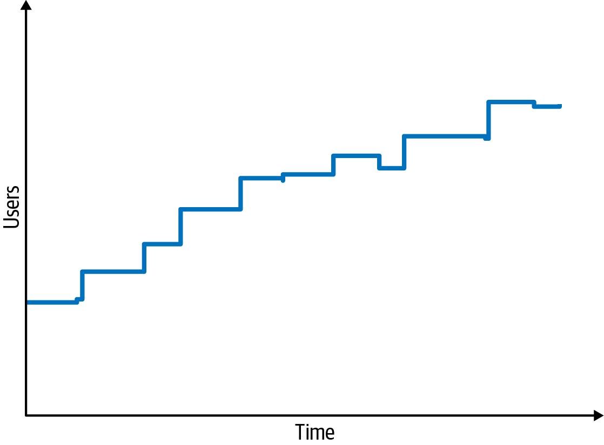
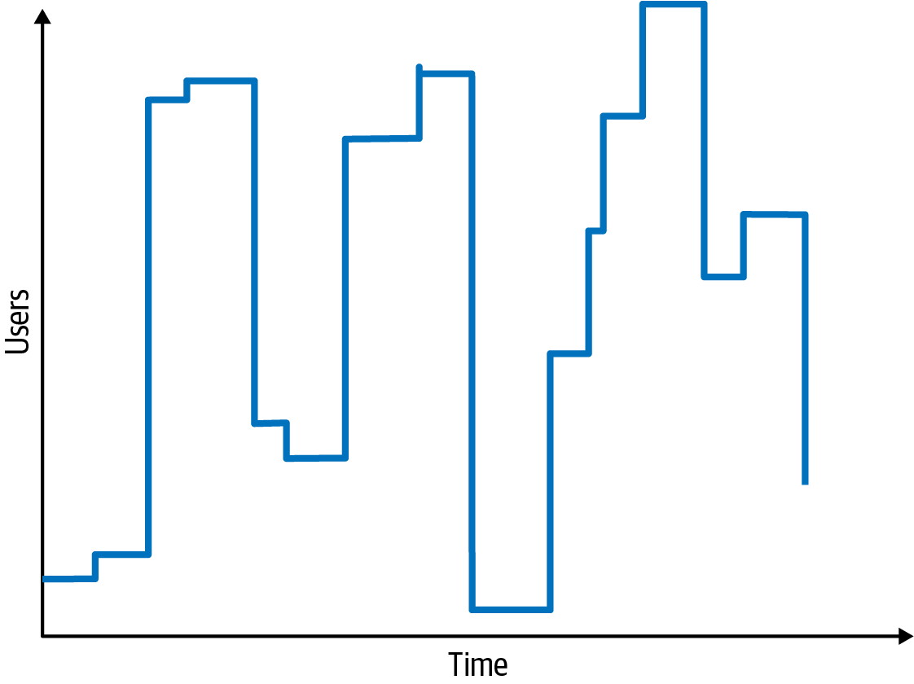
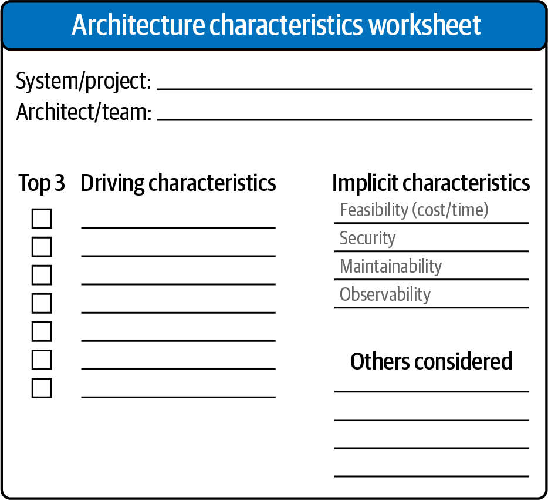

# Chương 5. Xác định các architectural characteristic (Identifying Architectural Characteristics)

Để tạo ra một architecture hoặc xác định tính hợp lệ của một architecture hiện có, kiến trúc sư phải phân tích hai thứ: các architectural characteristic và domain. Như bạn đã học trong [Chương 4](ch04_architectural_characteristics_defined.vi.md#ch04-architecture-characteristics-defined), việc xác định đúng các architectural characteristic (“-ilities”) cho một vấn đề hoặc ứng dụng nhất định không chỉ đòi hỏi hiểu vấn đề domain, mà còn phải cộng tác với các stakeholder để xác định điều gì thực sự quan trọng từ góc nhìn domain.

Có ít nhất ba nơi để khám phá những architectural characteristic mà một dự án cần: các mối quan tâm domain, các yêu cầu dự án, và kiến thức domain ngầm định của bạn. Ngoài các architectural characteristic ngầm định chung chung, như security và modularity, chúng tôi đã lưu ý rằng một số domain cũng bao gồm các architectural characteristic ngầm định. Ví dụ, một kiến trúc sư làm việc trên phần mềm y tế đọc dữ liệu từ thiết bị chẩn đoán hẳn đã hiểu tầm quan trọng của tính toàn vẹn dữ liệu và những hậu quả tiềm tàng của việc mất message. Các kiến trúc sư làm việc trong domain đó đã thấm nhuần tính toàn vẹn dữ liệu, nên nó trở thành điều ngầm định trong mọi giải pháp họ thiết kế.

## Rút ra các architectural characteristic từ các mối quan tâm domain (Extracting Architectural Characteristics from Domain Concerns)

Hầu hết các architectural characteristic đến từ việc lắng nghe các stakeholder domain chủ chốt và cộng tác với họ để xác định điều gì quan trọng từ góc nhìn kinh doanh. Dù điều này có vẻ đơn giản, vấn đề là kiến trúc sư và các stakeholder domain nói những ngôn ngữ khác nhau. Kiến trúc sư nói về scalability, interoperability, fault tolerance, learnability và availability; các stakeholder domain nói về sáp nhập và mua lại, sự hài lòng của người dùng, thời gian đưa ra thị trường (time to market), và lợi thế cạnh tranh. Điều xảy ra là một vấn đề “lạc trong bản dịch” (lost in translation), nơi kiến trúc sư và stakeholder domain không hiểu nhau. Kiến trúc sư không biết làm sao tạo ra một architecture hỗ trợ sự hài lòng của người dùng, còn các stakeholder domain không hiểu vì sao kiến trúc sư lại tập trung nhiều đến vậy vào availability, interoperability, learnability và fault tolerance của ứng dụng.

May mắn là có thể “dịch” từ các mối quan tâm domain sang ngôn ngữ của các architectural characteristic. [Bảng 5-1](#table_ilities) trình bày một số mối quan tâm domain phổ biến hơn và các “-ilities” tương ứng hỗ trợ chúng. Hiểu các mục tiêu domain then chốt cho phép kiến trúc sư dịch các mối quan tâm domain đó sang “-ilities,” vốn sau đó tạo thành nền tảng cho các architecture decision đúng đắn và có thể biện minh được. Ví dụ, mối quan tâm domain về time to market có quan trọng hơn scalability không, hay kiến trúc sư nên tập trung vào fault tolerance, security hoặc performance? Có lẽ hệ thống đòi hỏi kết hợp tất cả các characteristic này.

*Bảng 5-1. Dịch các mối quan tâm domain sang các architectural characteristic*

| Mối quan tâm domain | Các architectural characteristic |
|---|---|
| Sáp nhập và mua lại (Mergers and acquisitions) | Interoperability, scalability, adaptability, extensibility |
| Thời gian đưa ra thị trường (Time to market) | Agility, testability, deployability |
| Sự hài lòng của người dùng (User satisfaction) | Performance, availability, fault tolerance, testability, deployability, agility, security |
| Lợi thế cạnh tranh (Competitive advantage) | Agility, testability, deployability, scalability, availability, fault tolerance |
| Thời gian và ngân sách (Time and budget) | Simplicity, feasibility |

## Các architectural characteristic tổng hợp (Composite Architectural Characteristics)

Khi dịch các mối quan tâm domain sang architectural characteristic, một cạm bẫy phổ biến là đánh đồng sai, chẳng hạn đồng nhất *agility* chỉ với *time to market*. Agility là một ví dụ về architectural characteristic *tổng hợp* (composite): một characteristic không có định nghĩa khách quan đơn lẻ nào mà được cấu thành từ những thứ đo lường được khác. Không có thước đo nào cho agility, nên kiến trúc sư phải hỏi: agility được cấu thành từ những gì? Nó bao gồm những thứ như *deployability*, *modularity* và *testability*, tất cả đều đo lường được.

Một antipattern phổ biến nảy sinh khi kiến trúc sư chỉ tập trung hẹp vào một phần của một characteristic tổng hợp, thường là vì tiện lợi. Điều này giống như quên cho bột mì vào hỗn hợp làm bánh. Ví dụ, một stakeholder domain có thể nói điều gì đó như, “Do các yêu cầu pháp quy, việc chúng ta hoàn thành định giá quỹ end-of-day đúng hạn là tuyệt đối bắt buộc.”

Một kiến trúc sư kém hiệu quả có thể phản ứng bằng cách chỉ tập trung vào performance, vì đó có vẻ là trọng tâm chính của mối quan tâm domain. Tuy nhiên, cách tiếp cận đó sẽ thất bại, vì nhiều lý do:

- Hệ thống nhanh đến đâu cũng chẳng quan trọng nếu nó không sẵn sàng khi cần.
- Khi domain phát triển và có thêm nhiều quỹ được tạo ra, hệ thống phải có khả năng scale để hoàn thành xử lý end-of-day kịp thời.
- Hệ thống không chỉ phải sẵn sàng, nó còn phải đáng tin cậy để không bị crash khi giá quỹ end-of-day đang được tính toán.
- Điều gì xảy ra nếu hệ thống crash khi việc định giá quỹ end-of-day đã hoàn thành 85%? Nó phải có khả năng phục hồi và khởi động lại việc định giá từ chỗ đã dừng.
- Cuối cùng, hệ thống có thể nhanh, nhưng giá quỹ có được tính toán đúng không?

Vì vậy, ngoài performance, kiến trúc sư này phải tập trung ngang bằng vào availability, scalability, reliability, recoverability và auditability.

Nhiều mục tiêu kinh doanh khởi đầu là các architectural characteristic tổng hợp. Phân rã chúng, và đưa ra các định nghĩa khách quan cho các characteristic thu được, là một phần công việc của kiến trúc sư. (Chúng ta sẽ thấy tầm quan trọng của điều này trong [Chương 6](ch06_measuring_and_governing_architecture_characteristics.vi.md#ch06-measuring).)

## Rút ra các architectural characteristic (Extracting Architectural Characteristics)

Hầu hết các architectural characteristic đến từ những phát biểu tường minh trong một dạng tài liệu yêu cầu nào đó. Ví dụ, danh sách các mối quan tâm domain thường bao gồm các con số tường minh về số người dùng và quy mô dự kiến. Những characteristic khác đến từ kiến thức domain vốn có của kiến trúc sư (một trong nhiều lý do mọi kiến trúc sư nên biết domain của mình).

Ví dụ, giả sử bạn là một kiến trúc sư đang thiết kế một ứng dụng xử lý việc đăng ký lớp học cho sinh viên đại học. Để việc tính toán dễ dàng, giả sử trường có 1,000 sinh viên và 10 giờ để đăng ký. Bạn có nên đặt giả định ngầm rằng sinh viên sẽ tự phân bố đều trong 10 giờ đó, và thiết kế hệ thống để xử lý một quy mô ổn định không? Hay, dựa trên hiểu biết của bạn về thói quen và khuynh hướng của sinh viên đại học, bạn nên thiết kế một hệ thống có thể xử lý cả 1,000 sinh viên cố gắng đăng ký trong 10 phút cuối cùng?

Bất kỳ ai hiểu sinh viên điển hình hay trì hoãn đến mức nào đều biết câu trả lời cho câu hỏi này! Những chi tiết như thế này hiếm khi xuất hiện trong tài liệu yêu cầu—nhưng chúng định hướng các quyết định thiết kế.

> **Nguồn gốc của architecture kata (The Origin of Architecture Katas)**
>
> Hơn một thập kỷ trước, Ted Neward, một kiến trúc sư well-known, đã nghĩ ra *architecture kata*, một phương pháp khéo léo cho phép các kiến trúc sư mới vào nghề luyện tập việc rút ra architectural characteristic từ các mô tả domain-targeted. Từ *kata* bắt nguồn từ tiếng Nhật, nơi nó chỉ một bài tập luyện võ thuật cá nhân nhấn mạnh hình thế và kỹ thuật đúng.
>
> > Làm sao chúng ta có được những nhà thiết kế giỏi? Tất nhiên, những nhà thiết kế giỏi thì thiết kế.
> >
> > —Fred Brooks
>
> Các dự án kiến trúc lớn tốn thời gian, và việc kiến trúc sư chỉ thiết kế khoảng nửa tá hệ thống trong sự nghiệp của mình là chuyện thường. Vậy làm sao chúng ta có được những kiến trúc sư giỏi? Chìa khóa là cho những kiến trúc sư đầy khát vọng cơ hội để luyện tập tay nghề. Để cung cấp một chương trình học, Ted đã tạo ra trang architecture kata đầu tiên, mà các tác giả Neal và Mark đã điều chỉnh và cập nhật trên trang web đi kèm cuốn sách này tại [*fundamentalsofsoftwarearchitecture.com*](https://fundamentalsofsoftwarearchitecture.com). Đúng với mục đích ban đầu, architecture kata cung cấp một phòng thí nghiệm hữu ích cho những kiến trúc sư đầy khát vọng.

### Làm việc với kata (Working with Katas)

Tiền đề cơ bản là mỗi bài tập kata đưa ra một vấn đề, được phát biểu bằng thuật ngữ domain, một tập các yêu cầu, và một số bối cảnh bổ sung (những thứ có thể không xuất hiện trong yêu cầu, nhưng có thể ảnh hưởng đến thiết kế). Các nhóm nhỏ làm việc trên một bản thiết kế (gồm phân tích architectural characteristic và sơ đồ) trong một khoảng thời gian định sẵn. Sau đó các nhóm chia sẻ kết quả và bỏ phiếu xem ai đưa ra architecture tốt nhất.

Mỗi kata có các phần được định nghĩa sẵn:

**Mô tả (Description)**

Vấn đề domain tổng thể mà hệ thống đang cố giải quyết.

**Người dùng (Users)**

Số lượng và/hoặc loại người dùng dự kiến của hệ thống.

**Yêu cầu (Requirements)**

Các yêu cầu domain (như kỳ vọng từ người dùng và chuyên gia domain).

**Bối cảnh bổ sung (Additional context)**

Các tác giả đã cập nhật định dạng kata trên trang web đã nhắc đến ở trên với một phần *bối cảnh bổ sung* (additional context) chứa những điều cần cân nhắc quan trọng, khiến các bài tập trở nên thực tế hơn.

Chúng tôi khuyến khích độc giả dùng trang web này để tự làm bài tập kata. Bất kỳ ai cũng có thể tổ chức một buổi brown-bag lunch (vừa ăn trưa vừa học) nơi một nhóm kiến trúc sư đầy khát vọng có thể giải quyết một vấn đề. Một kiến trúc sư giàu kinh nghiệm có thể đánh giá bản thiết kế và phân tích trade-off, thảo luận các trade-offs bị bỏ sót và các thiết kế thay thế, ngay tại chỗ hoặc sau đó. Các bản thiết kế sẽ không công phu vì bài tập bị giới hạn thời gian (timeboxed).

Tiếp theo, chúng ta sẽ dùng một architecture kata để minh họa cách kiến trúc sư rút ra architectural characteristic từ yêu cầu. Chào mừng đến với kata *Silicon Sandwiches*.

## Kata: Silicon Sandwiches

**Mô tả (Description)**

Một chuỗi cửa hàng sandwich toàn quốc muốn cho phép đặt hàng trực tuyến bên cạnh dịch vụ call-in (đặt qua điện thoại) hiện tại.

**Người dùng (Users)**

Hàng nghìn, có lẽ một ngày nào đó, hàng triệu.

**Yêu cầu (Requirements)**

- Cho phép người dùng đặt hàng và, nếu cửa hàng có dịch vụ giao hàng, chọn tự đến lấy hoặc giao hàng.
- Cung cấp cho khách hàng tự đến lấy một thời điểm để lấy đơn hàng và chỉ đường đến cửa hàng (việc này phải tích hợp với một số dịch vụ bản đồ bên ngoài có thông tin giao thông).
- Với dịch vụ giao hàng, điều tài xế mang đơn hàng đến cho người dùng.
- Cung cấp khả năng truy cập trên thiết bị di động.
- Đưa ra các chương trình khuyến mãi và ưu đãi đặc biệt hằng ngày trên toàn quốc.
- Đưa ra các chương trình khuyến mãi và ưu đãi đặc biệt hằng ngày tại địa phương.
- Chấp nhận thanh toán trực tuyến, tại cửa hàng, hoặc khi giao hàng.

**Bối cảnh bổ sung (Additional context)**

- Các cửa hàng sandwich được nhượng quyền, mỗi cửa hàng có một chủ sở hữu khác nhau.
- Công ty mẹ có kế hoạch near-future (trong tương lai gần) để mở rộng ra nước ngoài.
- Mục tiêu của công ty là thuê lao động giá rẻ để tối đa hóa lợi nhuận.

Với kịch bản này, bạn sẽ rút ra các architectural characteristic như thế nào? Mỗi phần của yêu cầu có thể đóng góp vào một hoặc nhiều khía cạnh của architecture (và nhiều phần sẽ không). Kiến trúc sư không thiết kế toàn bộ hệ thống ở đây—vẫn cần công sức đáng kể để viết code giải quyết thiết kế domain (được đề cập trong [Chương 8](ch08_component_based_thinking.vi.md#ch08-component-based-thinking)). Thay vào đó, hãy tìm những thứ ảnh hưởng hoặc tác động đến thiết kế, đặc biệt là về cấu trúc.

Trước tiên, hãy tách các architectural characteristic ứng viên thành các characteristic tường minh và ngầm định.

### Các characteristic tường minh (Explicit Characteristics)

Các architectural characteristic tường minh xuất hiện trong đặc tả yêu cầu như một phần của thiết kế cần thiết. Ví dụ, một website mua sắm có thể mong muốn hỗ trợ một số lượng người dùng đồng thời cụ thể, điều mà các nhà phân tích domain chỉ định trong yêu cầu. Hãy xem xét từng phần của yêu cầu để xem nó có đóng góp vào một architectural characteristic nào không. Nhưng trước hết, hãy xem xét các dự đoán domain-level về các metric dự kiến, như được thể hiện trong phần Users của kata.

Một trong những chi tiết đầu tiên nên thu hút sự chú ý của bạn là số lượng người dùng: hiện tại là hàng nghìn, có lẽ một ngày nào đó, hàng triệu (đây là một cửa hàng sandwich rất tham vọng!). Do đó, *scalability*—khả năng xử lý một số lượng lớn người dùng đồng thời mà không suy giảm performance nghiêm trọng—là một trong những architectural characteristic hàng đầu. Lưu ý rằng phát biểu vấn đề không yêu cầu scalability một cách tường minh, mà thể hiện yêu cầu đó dưới dạng số lượng người dùng dự kiến. Kiến trúc sư thường phải giải mã ngôn ngữ domain thành những thứ tương đương về kỹ thuật.

Có lẽ bạn cũng sẽ cần *elasticity*—khả năng xử lý các đợt bùng nổ request. Hai characteristic này thường bị gộp chung với nhau, nhưng chúng có những ràng buộc khác nhau. Scalability trông giống như đồ thị trong [Hình 5-1](#ch-identifying-scalability).

*Hình 5-1. Scalability là thước đo sự gia tăng người dùng theo thời gian*

Ngược lại, *elasticity* đo các đợt bùng nổ lưu lượng, như trong [Hình 5-2](#ch-identifying-elasticity).

*Hình 5-2. Các hệ thống elastic phải chịu được các đợt bùng nổ người dùng*

Một số hệ thống có scalability nhưng không có elasticity. Ví dụ, số lượng người dùng của một hệ thống đặt phòng khách sạn, nếu không có các đợt giảm giá hay sự kiện đặc biệt, có lẽ thay đổi theo mùa một cách dự đoán được. Ngược lại, hãy xét một hệ thống đặt concert-ticket. Khi vé mới được mở bán, những người hâm mộ cuồng nhiệt sẽ tràn vào trang web, đòi hỏi mức elasticity cao. Thường thì các hệ thống elastic cũng cần *scalability*: khả năng xử lý các đợt bùng nổ và số lượng lớn người dùng đồng thời.

Elasticity không xuất hiện trong các yêu cầu của Silicon Sandwiches, nhưng bạn vẫn nên xác định nó là một điều cần cân nhắc quan trọng. Yêu cầu đôi khi nêu thẳng các architectural characteristic, nhưng những characteristic khác ẩn nấp bên trong problem domain. Lưu lượng của một cửa hàng sandwich có ổn định suốt cả ngày không, hay nó có các đợt bùng nổ quanh giờ ăn? Gần như chắc chắn là vế sau, nên hãy xác định architectural characteristic tiềm năng này.

Tiếp theo, lần lượt xem xét từng yêu cầu kinh doanh này để xem nó có đòi hỏi architectural characteristic nào không:

**Người dùng đặt hàng, và, nếu cửa hàng có dịch vụ giao hàng, chọn tự đến lấy hoặc giao hàng.**

Có vẻ không cần architectural characteristic đặc biệt nào để hỗ trợ yêu cầu này.

**Khách hàng tự đến lấy được cung cấp một thời điểm để lấy sandwich và chỉ đường đến cửa hàng (việc này phải cung cấp tùy chọn tích hợp với các dịch vụ bản đồ bên ngoài có thông tin giao thông).**

Các dịch vụ bản đồ bên ngoài hàm ý các điểm tích hợp, có thể tác động đến các khía cạnh như reliability. Ví dụ, giả sử một developer xây dựng một hệ thống dựa vào một hệ thống third-party. Nếu các lời gọi đó thất bại, nó ảnh hưởng đến reliability của hệ thống gọi. Ngược lại, hãy cảnh giác với việc chỉ định quá mức các architectural characteristic. Điều gì xảy ra nếu dịch vụ giao thông bên ngoài bị sập? Trang Silicon Sandwiches có nên thất bại theo, hay chỉ nên cung cấp hiệu quả kém hơn một chút mà không có thông tin giao thông? Kiến trúc sư nên luôn đề phòng việc đưa sự giòn gãy hay mong manh không cần thiết vào thiết kế.

**Với dịch vụ giao hàng, điều tài xế mang đơn hàng đến cho người dùng.**

Có vẻ không cần architectural characteristic đặc biệt nào để hỗ trợ yêu cầu này.

**Cung cấp khả năng truy cập trên thiết bị di động.**

Yêu cầu này chủ yếu sẽ ảnh hưởng đến thiết kế trải nghiệm người dùng (UX) của ứng dụng, và hướng tới việc xây dựng hoặc một ứng dụng web portable hoặc một vài ứng dụng web native. Với các ràng buộc ngân sách và sự đơn giản của ứng dụng, việc xây dựng nhiều ứng dụng có lẽ là quá mức cần thiết, nên thiết kế hướng tới một ứng dụng web mobile-optimized. Do đó, bạn có thể muốn định nghĩa một số architectural characteristic performance-related cụ thể để tối ưu thời gian tải trang và các characteristic mobile-sensitive khác.

Bạn không nên hành động một mình trong những tình huống như thế này. Hãy cộng tác với các nhà thiết kế UX, các stakeholder domain, và các bên quan tâm khác để thẩm định những quyết định như vậy. Ví dụ, phía kinh doanh có thể yêu cầu một số hành vi chỉ khả thi nếu bạn xây dựng ứng dụng native.

**Đưa ra các chương trình khuyến mãi và ưu đãi đặc biệt hằng ngày trên toàn quốc; đưa ra các chương trình khuyến mãi và ưu đãi đặc biệt hằng ngày tại địa phương.**

Cả hai yêu cầu này đều chỉ định khả năng tùy biến (customizability) cho cả khuyến mãi lẫn ưu đãi đặc biệt. Yêu cầu 1 cũng hàm ý thông tin giao thông được tùy biến dựa trên địa chỉ của người dùng. Dựa trên cả hai yêu cầu này, bạn có thể xem customizability là một architectural characteristic. Ví dụ, architectural style microkernel (được đề cập trong [Chương 13](ch13_microkernel_architecture_style.vi.md#ch-style-microkernel)) hỗ trợ hành vi tùy biến cực kỳ tốt bằng cách định nghĩa một architecture plug-in. Trong trường hợp này, hành vi mặc định nằm trong core, và developer viết các phần tùy biến location-based tùy chọn dưới dạng plug-ins. Tuy nhiên, một thiết kế truyền thống cũng có thể đáp ứng yêu cầu này thông qua các design pattern (như Template Method). Thế khó này phổ biến trong architecture và đòi hỏi kiến trúc sư liên tục cân nhắc trade-offs giữa các phương án cạnh tranh. Chúng tôi thảo luận chi tiết hơn về các trade-offs cụ thể trong [“Design Versus Architecture and Trade-Offs”](#sidebar-design).

**Chấp nhận thanh toán trực tuyến, tại cửa hàng, hoặc khi giao hàng.**

Thanh toán trực tuyến hàm ý nhu cầu về security, nhưng không có gì trong yêu cầu này gợi ý một mức security đặc biệt cao vượt quá mức ngầm định. Kiến trúc sư có thể xử lý security bằng thiết kế hoặc architecture, khiến nó trở thành một mối quan tâm architectural characteristic tối thiểu trong ứng dụng này.

**Các cửa hàng sandwich được nhượng quyền, mỗi cửa hàng có một chủ sở hữu khác nhau.**

Yêu cầu này có thể áp đặt các hạn chế về chi phí lên architecture. Hãy kiểm tra tính khả thi, áp dụng các ràng buộc như chi phí, thời gian và bộ kỹ năng của nhân sự, để xem liệu một architecture đơn giản hoặc một [sacrificial architecture](https://oreil.ly/790O1) (architecture hy sinh) có hợp lý không.

**Công ty mẹ có kế hoạch near-future để mở rộng ra nước ngoài.**

Yêu cầu này hàm ý *quốc tế hóa* (internationalization, thường viết tắt là “i18n”). Có nhiều kỹ thuật thiết kế để xử lý yêu cầu này, vốn không cần cấu trúc đặc biệt để đáp ứng. Tuy nhiên, điều này chắc chắn sẽ định hướng các quyết định UX.

**Mục tiêu của công ty là thuê lao động giá rẻ để tối đa hóa lợi nhuận.**

Yêu cầu này gợi ý rằng usability sẽ quan trọng, nhưng nó cũng liên quan đến thiết kế nhiều hơn là đến architectural characteristic.

Architectural characteristic thứ ba chúng ta có thể rút ra từ các yêu cầu trên là *performance*: không ai muốn mua hàng từ một cửa hàng sandwich có performance kém, đặc biệt vào giờ cao điểm. Tuy nhiên, *performance* là một khái niệm nhiều sắc thái. Bạn nên thiết kế cho *loại* performance nào? (Chúng tôi đề cập các sắc thái khác nhau của performance trong [Chương 6](ch06_measuring_and_governing_architecture_characteristics.vi.md#ch06-measuring).)

Cũng quan trọng là định nghĩa các con số performance kết hợp với các con số scalability. Nói cách khác, hãy thiết lập một mức nền performance không có quy mô cụ thể, và xác định một mức performance chấp nhận được với một số lượng người dùng nhất định. Rất thường xuyên, các architectural characteristic tương tác với nhau, buộc kiến trúc sư phải định nghĩa chúng trong mối quan hệ với nhau.

### Các characteristic ngầm định (Implicit Characteristics)

Nhiều architectural characteristic không được chỉ định trong tài liệu yêu cầu, nhưng chúng tạo nên những khía cạnh quan trọng của thiết kế. Một architectural characteristic ngầm định mà hệ thống có thể muốn hỗ trợ là *availability*: bảo đảm người dùng có thể truy cập trang web. Liên quan chặt chẽ đến availability là *stability*: bảo đảm trang web vẫn hoạt động trong suốt các tương tác. Không ai muốn mua hàng từ một trang web làm rớt kết nối, buộc họ phải đăng nhập lại.

*Security* xuất hiện như một characteristic ngầm định trong mọi hệ thống: không ai muốn tạo ra phần mềm không an toàn. Tuy nhiên, bạn có thể đặt cho nó mức ưu tiên khác nhau tùy thuộc vào việc nó then chốt đến mức nào, điều minh họa bản chất đan cài trong định nghĩa của chúng tôi. Bạn có thể xem security là một architectural characteristic nếu nó ảnh hưởng đến một khía cạnh cấu trúc nào đó của thiết kế và là then chốt hoặc quan trọng đối với ứng dụng.

Với Silicon Sandwiches, bạn có thể giả định rằng việc thanh toán nên được xử lý bởi một bên thứ ba. Do đó, miễn là developer tuân theo vệ sinh security chung (không truyền số thẻ tín dụng dưới dạng văn bản thô, không lưu trữ quá nhiều thông tin, v.v.), thiết kế tốt trong ứng dụng là đủ; bạn không cần bất kỳ thiết kế cấu trúc đặc biệt nào để đáp ứng security. Hãy nhớ, các architectural characteristic có tính *hiệp đồng* (synergistic)—mỗi architectural characteristic tương tác với các characteristic khác. Đó là lý do việc chỉ định quá mức các architectural characteristic là một cạm bẫy phổ biến đến vậy. Chỉ định quá mức cũng gây hại y như chỉ định thiếu các characteristic vì nó làm phức tạp quá mức thiết kế hệ thống.

Architectural characteristic chính cuối cùng mà Silicon Sandwiches cần hỗ trợ, *customizability*, được cấu thành từ một số chi tiết trong yêu cầu. Một số phần của problem domain đưa ra hành vi tùy biến: công thức món ăn, khuyến mãi địa phương, và chỉ đường có thể bị ghi đè tại địa phương. Do đó, architecture nên hỗ trợ hành vi tùy biến. Thông thường, điều này sẽ thuộc về thiết kế ứng dụng. Tuy nhiên, như định nghĩa của chúng tôi chỉ ra, khi một phần của problem domain dựa vào cấu trúc tùy biến để hỗ trợ nó, nó chuyển sang lãnh địa của một architectural characteristic. Tuy vậy, phần tử thiết kế này không then chốt đối với sự thành công của ứng dụng. Hãy nhớ, không có câu trả lời đúng khi chọn các architectural characteristic, chỉ có những câu trả lời sai—hoặc:

> Không có câu trả lời sai trong architecture, chỉ có những câu trả lời đắt giá.
>
> —Một trong những câu nói nổi tiếng của Mark

> 
>
> **Thiết kế so với architecture và đánh đổi (Design Versus Architecture and Trade-Offs)**
>
> Trong kata Silicon Sandwiches, có lẽ bạn sẽ xác định customizability là một phần của hệ thống, nhưng câu hỏi khi đó trở thành: architecture hay thiết kế? Architecture hàm ý một component cấu trúc nào đó, trong khi thiết kế nằm bên trong architecture. Với Silicon Sandwiches, bạn có thể chọn một architecture style như microkernel và xây dựng hỗ trợ cấu trúc cho việc tùy biến. Tuy nhiên, nếu bạn chọn một style khác vì các mối quan tâm cạnh tranh, developer có thể hiện thực việc tùy biến bằng design pattern Template Method, cho phép các class cha định nghĩa các workflow có thể được ghi đè trong các class con. Phương án nào tốt hơn?
>
> Như mọi thứ trong architecture, còn tùy. Thứ nhất, có lý do chính đáng nào để *không* hiện thực một microkernel architecture (như performance và coupling) không? Thứ hai, các architectural characteristic mong muốn khác có khó đạt được hơn trong thiết kế này so với thiết kế kia không? Thứ ba, sẽ tốn bao nhiêu để hỗ trợ tất cả các architectural characteristic trong architecture so với trong thiết kế? Kiểu phân tích trade-off này là một phần quan trọng trong vai trò của kiến trúc sư.
>
> Trên hết, điều then chốt là cộng tác với các developer, project manager, operations team, và những người co-constructors (đồng xây dựng) khác của hệ thống phần mềm. Không architecture decision nào nên được đưa ra một cách tách biệt khỏi team hiện thực (điều dẫn đến architecture antipattern Ivory Tower đáng sợ). Trong trường hợp Silicon Sandwiches, kiến trúc sư, tech lead, developer và các nhà phân tích domain nên cộng tác để quyết định cách tốt nhất để hiện thực customizability.

Bạn không nên quá căng thẳng về việc khám phá chính xác tập architectural characteristic đúng. Developer có thể hiện thực chức năng theo nhiều cách khác nhau. Tuy nhiên, xác định đúng các phần tử cấu trúc quan trọng có thể tạo điều kiện cho một thiết kế đơn giản hơn hoặc thanh lịch hơn. Bạn có thể thiết kế một architecture không đáp ứng customizability về mặt cấu trúc, mà thay vào đó yêu cầu chính thiết kế của ứng dụng hỗ trợ hành vi đó (xem [“Design Versus Architecture and Trade-Offs”](#sidebar-design)). Hãy nhớ: không có thiết kế tốt nhất trong architecture, chỉ có một tập trade-offs ít tệ nhất.

Hãy ưu tiên các architectural characteristic này khi cố tìm ra các tập cần thiết đơn giản nhất. Khi team đã làm lượt đầu tiên xác định các architectural characteristic, một bài tập hữu ích là cố xác định characteristic ít quan trọng nhất. Nếu bạn phải loại bỏ một cái, đó sẽ là cái nào? Nhìn chung, kiến trúc sư có xu hướng loại bỏ các architectural characteristic tường minh hơn, vì nhiều characteristic ngầm định hỗ trợ sự thành công chung. Cách chúng tôi định nghĩa điều gì là then chốt hoặc quan trọng đối với thành công giúp xác định liệu ứng dụng có *thực sự cần* từng architectural characteristic hay không. Cố xác định characteristic ít phù hợp nhất có thể giúp bạn xác định sự cần thiết then chốt.

Trong trường hợp Silicon Sandwiches, architectural characteristic nào chúng ta đã xác định là ít quan trọng nhất? Một lần nữa, không có câu trả lời đúng tuyệt đối nào. Tuy nhiên, trong trường hợp này, giải pháp có thể bỏ customizability hoặc performance. Chúng ta có thể loại customizability khỏi vai trò architectural characteristic và lên kế hoạch hiện thực hành vi đó như một phần của thiết kế ứng dụng. Trong số các architectural characteristic vận hành, performance có lẽ là ít then chốt nhất đối với thành công. Tất nhiên, điều đó không có nghĩa là developer định xây dựng một ứng dụng có performance tồi tệ; nó đơn giản có nghĩa là thiết kế này không ưu tiên performance hơn các characteristic khác, như scalability hoặc availability.

## Giới hạn và ưu tiên các architectural characteristic (Limiting and Prioritizing Architectural Characteristics)

Một mẹo khi cộng tác với các stakeholder domain để định nghĩa các architectural characteristic dẫn dắt: hãy cố gắng hết sức giữ danh sách cuối cùng ngắn nhất có thể. Một antipattern phổ biến là cố thiết kế một *generic architecture* (architecture chung chung): một architecture hỗ trợ *tất cả* các architectural characteristic. Mỗi characteristic mà architecture hỗ trợ lại làm phức tạp thiết kế hệ thống tổng thể, nên hỗ trợ quá nhiều architectural characteristic dẫn đến độ phức tạp ngày càng lớn. Và đó là trước khi kiến trúc sư và developer thậm chí bắt đầu giải quyết problem domain—động lực ban đầu để viết phần mềm. Đừng ám ảnh về số lượng characteristic, nhưng hãy nhớ động lực: giữ cho thiết kế đơn giản.

> **Nghiên cứu tình huống: Vasa (Case Study: The *Vasa*)**
>
> Câu chuyện nguyên bản về việc chỉ định quá mức các architectural characteristic đến mức cuối cùng giết chết một dự án hẳn phải là *Vasa*. Đó là một chiến hạm Thụy Điển được đóng từ năm 1626 đến năm 1628 bởi một vị vua muốn có con tàu lộng lẫy nhất từng được tạo ra. Cho đến thời điểm đó, tàu hoặc là tàu chở quân hoặc là tàu chiến pháo—*Vasa* sẽ là cả hai. Hầu hết các tàu có một tầng boong—*Vasa* có hai! Tất cả các khẩu pháo của nó có kích thước gấp đôi so với các tàu tương tự. Dù có chút lo ngại, các thợ đóng tàu lão luyện không thể nói không với vua Adolphus.
>
> Để ăn mừng việc hoàn thành đóng tàu, *Vasa* ra khơi vào cảng Stockholm và bắn một loạt pháo chào từ một bên mạn. Đáng tiếc, vì con tàu top-heavy (nặng phần trên), nó bị lật úp và chìm xuống đáy. Năm 1961, những người trục vớt đã cứu con tàu lên, và giờ nó nằm trong một bảo tàng ở Stockholm.

Sự cộng tác giữa kiến trúc sư và stakeholder kinh doanh là then chốt trong quá trình phân tích architectural characteristic. Tuy nhiên, nếu kiến trúc sư đưa ra một danh sách dài các architectural characteristic khả dĩ và hỏi các stakeholder kinh doanh họ muốn architecture hỗ trợ những cái nào, câu trả lời lần nào cũng sẽ là gì? *“Tất cả!”*

Do đó, kiến trúc sư cần một kỹ thuật để xác định những architectural characteristic nào dẫn dắt các quyết định cấu trúc và là then chốt đối với thành công. Các tác giả đã phát triển một số kỹ thuật để hỗ trợ nỗ lực này, bao gồm một “worksheet” (bảng tính) architectural characteristic, được minh họa trong [Hình 5-3](#ch05-ac-worksheet) (và có thể tải về tại [*https://developertoarchitect.com/resources.html*](https://developertoarchitect.com/resources.html)).

Worksheet này được dùng trong một phiên tương tác do một kiến trúc sư điều phối, người thu thập ý kiến của các stakeholder về số lượng và chi tiết của các architectural characteristic cần thiết. Ở bên trái, hãy chú ý bảy ô để liệt kê các architectural characteristic mong muốn.

Tại sao là bảy? Tại sao không? Nói nghiêm túc, kiến trúc sư cần giới hạn danh sách ở một con số hợp lý nào đó—sáu hoặc tám cũng được (dù có một chút tâm lý học thú vị đằng sau [con số bảy](https://oreil.ly/QXFBt)). Cột thứ hai bao gồm một số architectural characteristic ngầm định; chúng xuất hiện trong hầu hết các hệ thống, nhưng đôi khi kiến trúc sư ưu tiên chúng thành các mối quan tâm dẫn dắt của ứng dụng đòi hỏi thiết kế và cân nhắc đặc biệt. Trong những trường hợp đó, kiến trúc sư “kéo” các characteristic ngầm định sang cột thứ nhất. Nếu cột thứ nhất đã đầy và một mục tốt hơn xuất hiện để thay thế một mục hiện có, kiến trúc sư chuyển mục đó sang nhóm “Others Considered” (Những cái khác đã xem xét).

*Hình 5-3. Worksheet architectural characteristic*

Bước cuối cùng là cùng nhau chọn ba architectural characteristic highest-priority (ưu tiên cao nhất), theo bất kỳ thứ tự nào (đánh dấu vào ô bên cạnh mỗi cái). Bài tập này cho phép kiến trúc sư rút ra một danh sách rút gọn, có thứ tự ưu tiên, các động lực dẫn dắt mà họ có thể dùng để định hướng các quyết định thiết kế và phân tích trade-off.

Nhiều kiến trúc sư và stakeholder domain muốn ưu tiên việc đi đến một danh sách cuối cùng các architectural characteristic mà ứng dụng hoặc hệ thống phải hỗ trợ. Dù đây chắc chắn là một kết quả đáng mong muốn, trong hầu hết các trường hợp, đó là một việc vô ích không chỉ lãng phí thời gian, mà còn tạo ra nhiều bực bội và bất đồng không cần thiết với các stakeholder chủ chốt. Hiếm khi tất cả stakeholder đồng ý về mức ưu tiên của từng characteristic. Một cách tiếp cận tốt hơn là để các stakeholder domain chọn ba characteristic quan trọng nhất từ danh sách cuối cùng (theo bất kỳ thứ tự nào). Điều này giúp đạt được đồng thuận dễ dàng hơn nhiều và thúc đẩy các cuộc thảo luận về điều gì là quan trọng nhất. Tất cả những điều này giúp kiến trúc sư phân tích trade-offs khi đưa ra các quyết định kiến trúc quan trọng.
