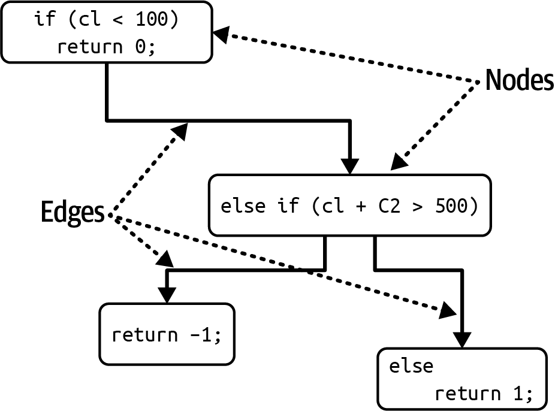
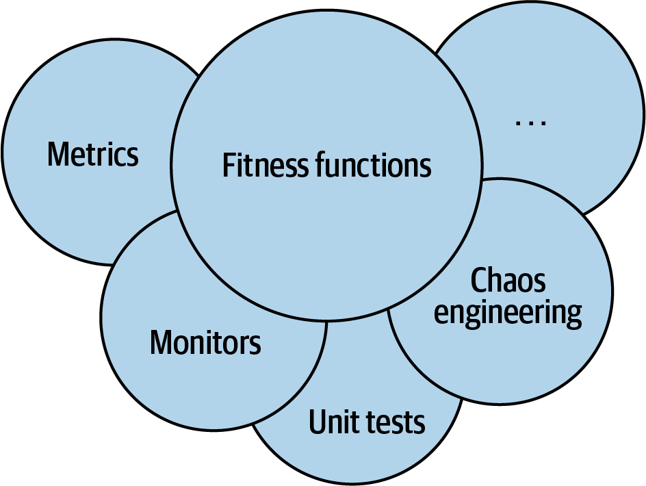
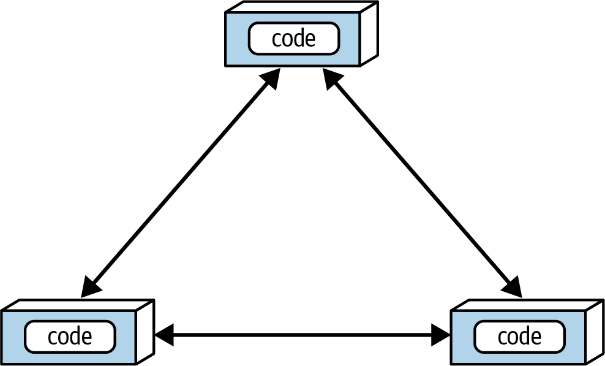
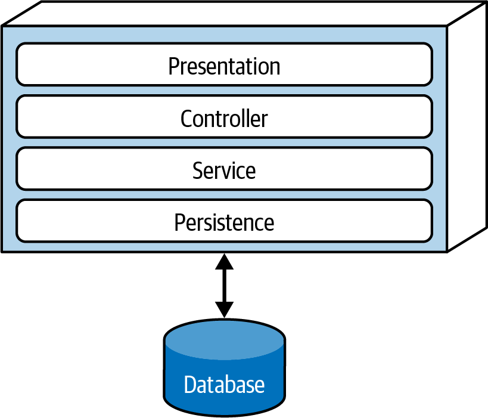

<a id="ch06-measuring"></a>

# Chương 6. Đo lường và quản trị các architecture characteristic (Measuring and Governing Architecture Characteristics)

<a id="ix_ch06-measuring-asciidoc0"></a>Kiến trúc sư phải xử lý một loạt architecture characteristic đa dạng đến mức phi thường trên mọi khía cạnh khác nhau của các dự án phần mềm. Các khía cạnh vận hành như performance, elasticity và scalability trộn lẫn với các mối quan tâm cấu trúc, như modularity và deployability. Kiến trúc sư sẽ có lợi khi hiểu cách đo lường và quản trị các architectural characteristic, thay vì chìm ngập trong các thuật ngữ mơ hồ và định nghĩa chung chung. Chương này tập trung vào việc định nghĩa cụ thể một số architecture characteristic phổ biến hơn và thảo luận cách xây dựng các cơ chế quản trị (governance) cho chúng.

<a id="id683"></a>

## Đo lường các architecture characteristic (Measuring Architecture Characteristics)

Kiến trúc sư vật lộn để định nghĩa các architectural characteristic vì một số lý do:

**Chúng không phải là vật lý**

Nhiều architecture characteristic thường dùng có ý nghĩa mơ hồ. Ví dụ, làm sao một kiến trúc sư thiết kế cho *agility* hay *deployability*? Còn *performance cực nhanh* (wicked fast performance) thì sao? Mọi người trong ngành có những góc nhìn khác nhau rất xa về các thuật ngữ phổ biến—đôi khi do những bối cảnh khác nhau chính đáng, đôi khi là ngẫu nhiên.

**Định nghĩa khác nhau rất xa**

Ngay cả trong cùng một tổ chức, các phòng ban khác nhau có thể bất đồng về định nghĩa của các characteristic then chốt như *performance*. Chừng nào developer, kiến trúc sư, bộ phận vận hành và những người khác chưa thống nhất được một định nghĩa chung, làm sao họ có thể có một cuộc trò chuyện đúng nghĩa?

**Quá tổng hợp**

Nhiều architecture characteristic đáng mong muốn thực ra là tập hợp của các characteristic khác ở quy mô nhỏ hơn, như bạn có thể nhớ từ thảo luận của chúng tôi về các architectural characteristic tổng hợp trong [Chương 5](ch05_identifying_architectural_characteristics.vi.md#ch-identifying). Ví dụ, agility được phân rã thành các characteristic như modularity, deployability và testability.

Phân rã các architectural characteristic tổng hợp thành các phần cấu thành là một phần quan trọng của việc thiết lập các định nghĩa khách quan cho architecture characteristic, điều giải quyết cả ba vấn đề này.

Khi một tổ chức đồng ý rằng mọi người sẽ dùng các định nghĩa chuẩn, cụ thể cho architecture characteristic, họ tạo ra một *ubiquitous language* xoay quanh architecture. Sự chuẩn hóa này cho phép họ tháo gỡ các characteristic tổng hợp để khám phá các đặc điểm *đo lường được một cách khách quan*.

<a id="id45"></a>

### Các thước đo vận hành (Operational Measures)

<a id="ix_ch06-measuring-asciidoc1"></a><a id="ix_ch06-measuring-asciidoc2"></a>Nhiều architecture characteristic có những phép đo trực tiếp hiển nhiên, như performance hay scalability. Nhưng ngay cả những characteristic này cũng có nhiều cách diễn giải đầy sắc thái, tùy thuộc vào mục tiêu của team. Ví dụ, có lẽ team của bạn đo thời gian phản hồi trung bình cho một số request nhất định—một ví dụ tốt về thước đo cho một architecture characteristic vận hành. Nhưng nếu team của bạn chỉ đo giá trị trung bình, điều gì xảy ra nếu một điều kiện biên nào đó khiến 1% số request mất thời gian lâu gấp 10 lần các request khác? Nếu trang web có đủ lưu lượng, những giá trị ngoại lai này thậm chí có thể không hiện ra. Để bắt được các giá trị ngoại lai, bạn có thể muốn đo cả thời gian phản hồi tối đa.

Các team high-level (trình độ cao) không chỉ thiết lập các con số performance cứng; họ dựa định nghĩa của mình trên phân tích thống kê. Ví dụ, giả sử một dịch vụ video streaming muốn giám sát scalability. Thay vì đặt một con số tùy ý làm mục tiêu, các kỹ sư đo quy mô theo thời gian và xây dựng các mô hình thống kê, rồi phát cảnh báo nếu các metric real-time nằm ngoài các mô hình dự đoán. Nếu vậy, sự thất bại có thể có hai nghĩa: mô hình không đúng (điều các team muốn biết) hoặc có gì đó không ổn (điều các team cũng muốn biết).

Các loại characteristic mà team đo lường tiến hóa nhanh chóng cùng với công cụ, mục tiêu, thiết bị và năng lực. Ví dụ, gần đây nhiều team đã tập trung vào performance budget cho các metric như *first contentful paint* và *first CPU idle*, cả hai đều nói lên rất nhiều về các vấn đề performance đối với người dùng trang web trên thiết bị di động. Khi những thứ này và vô số thứ khác thay đổi, các team sẽ tìm ra những thứ mới và những cách mới để đo chúng.<a id="id933"></a><a id="id934"></a>

> **Muôn vàn hương vị của performance (The Many Flavors of Performance)**
>
> <a id="id936"></a><a id="id937"></a>Nhiều architecture characteristic chúng tôi mô tả có nhiều định nghĩa. Performance là một ví dụ tuyệt vời. Nhiều dự án nhìn vào performance chung: ví dụ, các chu kỳ request và response mất bao lâu đối với một ứng dụng web. Tuy nhiên, qua một lượng công việc khổng lồ, các kiến trúc sư và kỹ sư DevOps ở nhiều tổ chức đã thiết lập các performance budget cụ thể cho các phần cụ thể của một ứng dụng. Ví dụ, nhiều tổ chức đã nghiên cứu hành vi người dùng và xác định rằng thời gian tối ưu cho first-page render (dấu hiệu tiến triển nhìn thấy được đầu tiên của một trang web trên trình duyệt hoặc thiết bị di động) là một phần nhỏ của một giây. Hầu hết các ứng dụng rơi vào khoảng double-digit (hai chữ số) đối với metric này. Nhưng với các trang web hiện đại đang cố thu hút càng nhiều người dùng càng tốt, đây là một metric quan trọng cần theo dõi, và các tổ chức đứng sau những trang web như vậy đã xây dựng các thước đo cực kỳ tinh tế.
>
> Một số metric này có thêm các hàm ý đối với thiết kế ứng dụng. Nhiều tổ chức forward-thinking (có tầm nhìn xa) đặt ra *K-weight budget* cho việc tải trang; tức là, họ cho phép một số byte tối đa dành cho thư viện và framework trên một trang cụ thể. Lý do của họ bắt nguồn từ các ràng buộc vật lý: chỉ có một số byte nhất định có thể đi qua mạng tại một thời điểm, đặc biệt đối với thiết bị di động ở các khu vực low-bandwidth.

<a id="ch-measuring-sec-structural"></a>

### Các thước đo cấu trúc (Structural Measures)

<a id="ix_ch06-measuring-asciidoc3"></a>Một số thước đo khách quan không hiển nhiên như performance. Còn các characteristic cấu trúc nội tại, như modularity well-defined, thì sao? Đây là một ví dụ tuyệt vời về một architectural characteristic ngầm định—kiến trúc sư chịu trách nhiệm định nghĩa các component và tương tác, và muốn xây dựng một cấu trúc bền vững cho chất lượng tổng thể cao. Đáng tiếc là hiện chưa có metric toàn diện nào để đánh giá chất lượng của một architecture. Tuy nhiên, có những metric và công cụ phổ biến cho phép kiến trúc sư giải quyết một số khía cạnh then chốt của cấu trúc code, dù chỉ theo những chiều hẹp.

<a id="ix_ch06-measuring-asciidoc4"></a><a id="ix_ch06-measuring-asciidoc5"></a><a id="ix_ch06-measuring-asciidoc6"></a>Một khía cạnh đo lường được của code là độ phức tạp, được định nghĩa bởi metric *Cyclomatic Complexity*.

> <a id="sidebar_cc"></a>
>
> **Cyclomatic Complexity**
>
> <a id="id938"></a>[*Cyclomatic Complexity* (CC)](https://oreil.ly/mAHFZ) là một metric code-level được Thomas McCabe Sr. thiết kế năm 1976 để cung cấp một thước đo khách quan cho độ phức tạp của code ở mức hàm/method, class hoặc ứng dụng. Nó được tính bằng cách áp dụng lý thuyết đồ thị vào code—cụ thể là các *điểm quyết định* (decision point), vốn tạo ra các đường thực thi khác nhau. Ví dụ, nếu một hàm không có câu lệnh quyết định nào (như các câu lệnh `if`), thì `CC = 1`. Nếu hàm có một điều kiện duy nhất, thì `CC = 2` vì có hai đường thực thi khả dĩ.
>
> <a id="id939"></a>Công thức tính CC cho một hàm hoặc method đơn lẻ là $C C = E - N + 2$, trong đó *N* biểu diễn các *node* (dòng code), và *E* biểu diễn các *cạnh* (edge) (các quyết định khả dĩ). Xét đoạn code C-like trong [Ví dụ 6-1](#list_max).
>
> <a id="list_max"></a>
>
> *Ví dụ 6-1. Code mẫu để đánh giá Cyclomatic Complexity*
>
> ```java
> public void decision(int c1, int c2) {
>     if (c1 < 100)
>         return 0;
>     else if (c1 + C2 > 500)
>        return 1;
>     else
>       return -1;
> }
> ```
>
> Cyclomatic Complexity của [Ví dụ 6-1](#list_max) là 3 (3 – 2 + 2), như trong [Hình 6-1](#fig_simplecc).
>
> <a id="fig_simplecc"></a>
>
> 
>
> *Hình 6-1. Đồ thị Cyclomatic Complexity cho hàm quyết định*
>
> Con số 2 xuất hiện trong công thức Cyclomatic Complexity biểu thị một sự đơn giản hóa cho một hàm/method đơn lẻ. Với các lời gọi fan-out tới các method khác (được gọi là *connected component* trong lý thuyết đồ thị), công thức tổng quát hơn là $C C = E - N + 2 P$, trong đó *P* biểu diễn số connected component.

<a id="id940"></a>Kiến trúc sư và developer đều nhất trí rằng code quá phức tạp là một “code smell”—thứ xuất hiện trong code tệ đến mức có một mùi hôi tưởng tượng. Nó gây hại cho hầu như mọi characteristic đáng mong muốn của code base: modularity, testability, deployability, v.v. Nếu các team không để mắt đến độ phức tạp tăng dần, nó sẽ thống trị code base.

Cyclomatic Complexity là một ví dụ tuyệt vời về sự thô sơ của các metric mà kiến trúc sư có trong tay. Dù nó đo độ phức tạp của code, nó không thể xác định độ phức tạp đó là *thiết yếu* (essential) (vì chúng ta đang giải quyết một vấn đề phức tạp) hay *ngẫu nhiên* (accidental) (vì chúng ta đã triển khai một thiết kế tồi). Các metric như CC cực kỳ hữu ích để đánh giá code, dù code đó được viết bởi developer hay generative AI. Generative AI có xu hướng giải quyết vấn đề bằng vũ lực (brute force), thường dẫn đến độ phức tạp ngẫu nhiên.

> **Giá trị tốt cho Cyclomatic Complexity là bao nhiêu? (What’s a Good Value for Cyclomatic Complexity?)**
>
> <a id="id942"></a>Một câu hỏi phổ biến mà các tác giả nhận được khi nói về chủ đề này là: giá trị ngưỡng tốt cho CC là bao nhiêu? Tất nhiên, như mọi câu hỏi trong software architecture, câu trả lời là: còn tùy! Cụ thể, nó tùy thuộc vào độ phức tạp của problem domain. Ví dụ, nếu bạn có một vấn đề phức tạp về mặt thuật toán, giải pháp sẽ cho ra các hàm phức tạp. Một số khía cạnh then chốt của CC mà kiến trúc sư cần giám sát: các hàm phức tạp là do problem domain hay do viết code tồi? Hoặc, code có bị phân vùng kém không? Nói cách khác, một method lớn có thể được tách thành các khối logic nhỏ hơn, phân phối công việc (và độ phức tạp) vào các method well-factored hơn không?
>
> Nhìn chung, các ngưỡng của ngành cho CC gợi ý rằng giá trị dưới 10 là chấp nhận được, trừ khi có các cân nhắc khác như domain phức tạp. Chúng tôi coi ngưỡng đó là rất cao và muốn code nằm dưới năm, cho thấy code cohesive, well-factored. Một công cụ metric trong thế giới Java, [Crap4J](http://www.crap4j.org), cố gắng xác định code của bạn tệ (crappy) đến mức nào bằng cách đánh giá kết hợp CC và code coverage; nếu CC tăng lên trên 50, không mức code coverage nào cứu được code đó khỏi sự tồi tệ. Artifact chuyên nghiệp đáng sợ nhất mà Neal từng gặp là một hàm C duy nhất đóng vai trò trái tim của một gói phần mềm thương mại có CC trên 800! Đó là một hàm duy nhất với hơn 4,000 dòng code, bao gồm việc dùng tràn lan các câu lệnh `GOTO` (để thoát khỏi các vòng lặp lồng nhau sâu đến mức không tưởng).
>
> Các thực hành kỹ thuật như test-driven development (TDD) có tác dụng phụ có lợi là tạo ra các method nhỏ hơn, ít phức tạp hơn trung bình cho một problem domain nhất định. Khi thực hành TDD, developer cố viết một test đơn giản, rồi viết lượng code nhỏ nhất để vượt qua test đó. Sự tập trung vào hành vi rời rạc và ranh giới test tốt này khuyến khích các method well-factored, có cohesion cao, thể hiện CC thấp<a id="id943"></a>.<a id="id944"></a><a id="id945"></a><a id="id946"></a>

<a id="id47"></a>

### Các thước đo quy trình (Process Measures)

<a id="id947"></a>Một số architecture characteristic giao thoa với các quy trình phát triển phần mềm. Ví dụ, agility thường xuất hiện như một đặc điểm đáng mong muốn. Tuy nhiên, nó là một architecture characteristic tổng hợp, được tạo thành từ các đặc điểm như testability và deployability.

Testability đo lường được thông qua các công cụ code-coverage cho hầu như mọi nền tảng, báo cáo phần trăm code mà các test thực thi. Tuy nhiên, như mọi phép kiểm tra phần mềm, chúng không thể thay thế tư duy và ý định. Ví dụ, một code base có thể có 100% code coverage, nhưng dùng các assertion kém không thực sự mang lại sự tin tưởng vào tính đúng đắn của code.

Testability là một characteristic đo lường được một cách khách quan, deployability cũng vậy. Các metric deployability bao gồm phần trăm deployment thành công, deployment mất bao lâu, và các vấn đề/bug phát sinh do deployment. Mỗi team phải đi đến một tập thước đo tốt, nắm bắt được dữ liệu định tính và định lượng hữu ích cho các ưu tiên và mục tiêu của tổ chức và team mình.

Dù agility và các phần liên quan của nó rõ ràng liên quan đến quy trình phát triển phần mềm, quy trình đó có thể ảnh hưởng đến cấu trúc của architecture. Ví dụ, nếu sự dễ dàng deployment và testability là các ưu tiên cao, kiến trúc sư sẽ nhấn mạnh modularity và sự cô lập tốt ở mức architecture—một ví dụ về một architecture characteristic dẫn dắt một quyết định cấu trúc. Hầu như bất cứ thứ gì trong phạm vi một dự án phần mềm đều có thể được nâng lên thành một architecture characteristic nếu nó đáp ứng được ba tiêu chí của chúng tôi, buộc kiến trúc sư phải đưa ra các quyết định quan trọng để tính đến nó.<a id="id948"></a>

<a id="sec-ff"></a>

## Governance và fitness function (Governance and Fitness Functions)

<a id="id949"></a><a id="id950"></a>Khi kiến trúc sư đã thiết lập và ưu tiên các architecture characteristic, làm sao họ bảo đảm rằng developer sẽ tôn trọng những ưu tiên đó và hiện thực thiết kế của họ một cách đúng đắn và an toàn, bất kể áp lực tiến độ? Trong nhiều dự án phần mềm, sự cấp bách chiếm ưu thế, nhưng kiến trúc sư vẫn cần công cụ và kỹ thuật để thực hiện *governance* (quản trị) kiến trúc. Modularity là một ví dụ tuyệt vời về một khía cạnh của architecture quan trọng nhưng không cấp bách.

<a id="id684"></a>

### Quản trị các architecture characteristic (Governing Architecture Characteristics)

*Governance*, bắt nguồn từ từ tiếng Hy Lạp *kubernan* (lái, điều khiển), là một trách nhiệm quan trọng của vai trò kiến trúc sư. Như tên gọi hàm ý, phạm vi của nó bao quát mọi khía cạnh của quy trình phát triển phần mềm mà kiến trúc sư muốn tác động. Ví dụ, bảo đảm chất lượng phần mềm thuộc về architectural governance vì việc bỏ bê nó có thể dẫn đến những vấn đề chất lượng thảm khốc.

May mắn là kiến trúc sư có những giải pháp ngày càng tinh vi cho vấn đề này—một ví dụ tốt về sự tăng trưởng dần dần trong năng lực của hệ sinh thái phát triển phần mềm. Xu hướng tự động hóa do [Extreme Programming](http://www.extremeprogramming.org) khởi xướng đã tạo ra continuous integration (CI). CI dẫn đến tự động hóa sâu hơn trong vận hành, mà nay chúng ta gọi là DevOps, và chuỗi này tiếp tục đến architectural governance. Cuốn sách [*Building Evolutionary Architectures*](https://learning.oreilly.com/library/view/building-evolutionary-architectures/9781492097532) (O’Reilly, 2022) của Neal Ford và cộng sự mô tả một họ các kỹ thuật gọi là *fitness function* được dùng để tự động hóa nhiều khía cạnh của architecture governance. Chúng ta sẽ dành phần còn lại của chương này để xem xét các fitness function.

<a id="id49"></a>

### Fitness Functions

<a id="ix_ch06-measuring-asciidoc7"></a><a id="ix_ch06-measuring-asciidoc8"></a>Từ *evolutionary* trong tựa đề *Building Evolutionary Architectures* xuất phát từ evolutionary computing (tính toán tiến hóa) nhiều hơn là từ sinh học. Một trong các tác giả, Tiến sĩ Rebecca Parsons, đã dành một thời gian trong lĩnh vực evolutionary computing, bao gồm làm việc với các công cụ như thuật toán di truyền. Khi một developer thiết kế một thuật toán di truyền để tạo ra một kết quả có lợi nào đó, họ thường muốn dẫn dắt thuật toán bằng cách cung cấp một thước đo khách quan về chất lượng kết quả của nó. Cơ chế dẫn dắt đó được gọi là *fitness function* (hàm thích nghi): một hàm mục tiêu được dùng để đánh giá đầu ra tiến gần đến mức nào tới việc đạt được mục đích của nó.

Ví dụ, giả sử bạn cần giải [bài toán người bán hàng du lịch](https://oreil.ly/GApjt) (traveling salesperson problem), một bài toán nổi tiếng được dùng làm nền tảng cho machine learning. Cho một người bán hàng, một danh sách các thành phố họ phải ghé thăm, và khoảng cách giữa các thành phố đó, đâu là lộ trình tối ưu nhất—tối thiểu hóa khoảng cách, thời gian và chi phí? Nếu bạn thiết kế một thuật toán di truyền để giải bài toán này, bạn có thể dùng một fitness function để đánh giá độ dài của lộ trình và một fitness function khác để đánh giá tổng chi phí gắn với lộ trình. Một fitness function khác nữa có thể đánh giá thời gian người bán hàng du lịch vắng nhà.

<a id="id951"></a>Các thực hành trong evolutionary architecture mượn khái niệm này để tạo ra một *architectural fitness function*: bất kỳ cơ chế nào cung cấp một đánh giá khách quan về tính toàn vẹn của một architecture characteristic hoặc tổ hợp các architecture characteristic nào đó.

Fitness function không phải là một framework mới nào đó để kiến trúc sư tải về. Thay vào đó, chúng mang lại một góc nhìn mới về nhiều công cụ hiện có. Hãy chú ý cụm từ *bất kỳ cơ chế nào* trong định nghĩa—các kỹ thuật kiểm chứng cho architecture characteristic đa dạng như chính các characteristic. Fitness function chồng lấn nhiều cơ chế kiểm chứng hiện có, tùy thuộc vào cách chúng được dùng: trong chaos engineering hoặc như metric, monitor, hoặc thư viện unit testing (xem [Hình 6-2](#ch-measuring-ffscope)).

<a id="ch-measuring-ffscope"></a>



*Hình 6-2. Các cơ chế của fitness function*

Nhiều công cụ khác nhau có thể được dùng để triển khai fitness function, tùy thuộc vào các architecture characteristic. Hãy xem một vài ví dụ về fitness function kiểm tra các khía cạnh khác nhau của modularity.

#### Phụ thuộc vòng (Cyclic dependencies)

<a id="ix_ch06-measuring-asciidoc9"></a><a id="ix_ch06-measuring-asciidoc10"></a>Modularity là một architecture characteristic ngầm định mà hầu hết kiến trúc sư quan tâm. Vì modularity được duy trì kém gây hại cho cấu trúc của code base, kiến trúc sư thường đặt ưu tiên cao cho việc duy trì modularity tốt. Tuy nhiên, trên nhiều nền tảng, có những lực đang chống lại những ý định tốt đó. Ví dụ, khi viết code trong bất kỳ môi trường phát triển Java hay .NET phổ biến nào, ngay khi một developer tham chiếu tới một class chưa được import, IDE sẽ “hữu ích” hiện ra một hộp thoại hỏi họ có muốn auto-import tham chiếu đó không. Điều này xảy ra thường xuyên đến mức hầu hết lập trình viên phản xạ gạt hộp thoại auto-import đi. Nhưng việc import tùy tiện các class giữa các component có thể là thảm họa cho modularity. Ví dụ, [Hình 6-3](#ch-measuring-cycles) minh họa *Cyclic Dependencies* (phụ thuộc vòng), một antipattern đặc biệt có hại mà kiến trúc sư mong muốn tránh.

Trong [Hình 6-3](#ch-measuring-cycles), mỗi component tham chiếu tới thứ gì đó trong các component khác. Có một mạng lưới như thế này gây hại cho modularity, vì không thể tái sử dụng một component đơn lẻ mà không kéo theo các component khác. Và nếu các component khác đó lại bị coupling với các component khác nữa thì sao? Architecture sẽ ngày càng có xu hướng tiến tới antipattern [Big Ball of Mud](https://oreil.ly/usx7p). Làm sao kiến trúc sư có thể quản trị hành vi này mà không phải liên tục nhìn qua vai developer? Code review có giúp ích, nhưng diễn ra quá muộn trong chu kỳ phát triển để hiệu quả hoàn toàn. Nếu development team import tràn lan trên khắp code base trong một tuần cho đến lúc code review, họ đã gây tổn hại nghiêm trọng cho code base rồi.

<a id="ch-measuring-cycles"></a>



*Hình 6-3. Phụ thuộc vòng giữa các component*

Giải pháp cho vấn đề này là viết một fitness function để canh chừng các vòng, như trong [Ví dụ 6-2](#src_cycle_ff).

<a id="src_cycle_ff"></a>

*Ví dụ 6-2. Fitness function phát hiện vòng giữa các component*

```java
public class CycleTest {
    private JDepend jdepend;

    @BeforeEach
    void init() {
      jdepend = new JDepend();
      jdepend.addDirectory("/path/to/project/persistence/classes");
      jdepend.addDirectory("/path/to/project/web/classes");
      jdepend.addDirectory("/path/to/project/thirdpartyjars");
    }

    @Test
    void testAllPackages() {
      Collection packages = jdepend.analyze();
      assertEquals("Cycles exist", false, jdepend.containsCycles());
    }
}
```

<a id="id952"></a>Code này dùng công cụ metric [JDepend](https://oreil.ly/ozzzk) để kiểm tra các phụ thuộc giữa các package. Công cụ này hiểu cấu trúc của các package Java và làm test thất bại nếu tìm thấy bất kỳ vòng nào. Kiến trúc sư có thể gắn test này vào continuous build của dự án và thôi lo lắng về những developer trigger-happy (bấm bừa) vô tình đưa vào các vòng. Đây là một ví dụ tuyệt vời về một fitness function bảo vệ các thực hành *quan trọng hơn là cấp bách* của phát triển phần mềm: đó là một mối quan tâm quan trọng đối với kiến trúc sư, nhưng có ít tác động đến việc viết code day-to-day.<a id="id953"></a><a id="id954"></a>

#### Fitness function Distance from the Main Sequence (Distance from the Main Sequence fitness function)

<a id="ix_ch06-measuring-asciidoc11"></a><a id="ix_ch06-measuring-asciidoc12"></a>Trong [“Coupling”](ch03_modularity.vi.md#sec-coupling), chúng tôi đã giới thiệu metric khó hiểu hơn là *Distance from the Main Sequence*, cũng có thể được kiểm chứng bằng fitness function, như trong [Ví dụ 6-3](#src_cycle_distance).

<a id="src_cycle_distance"></a>

*Ví dụ 6-3. Fitness function Distance from the Main Sequence*

```java
@Test
void AllPackages() {
    double ideal = 0.0;
    double tolerance = 0.5; // project-dependent
    Collection packages = jdepend.analyze();
    Iterator iter = packages.iterator();
    while (iter.hasNext()) {
      JavaPackage p = (JavaPackage)iter.next();
      assertEquals("Distance exceeded: " + p.getName(),
        ideal, p.distance(), tolerance);
    }
}
```

Code này dùng JDepend để thiết lập một ngưỡng cho các giá trị chấp nhận được, làm test thất bại nếu một class nằm ngoài khoảng đó. (Công cụ ArchUnit, được giới thiệu trong mục tiếp theo, cho phép kiến trúc sư tạo các fitness function tương tự.) Ví dụ về một thước đo khách quan cho một architecture characteristic này minh họa tầm quan trọng của sự cộng tác giữa developer và kiến trúc sư khi thiết kế và triển khai fitness function. Ý định không phải là để một nhóm kiến trúc sư leo lên tháp ngà và phát triển những fitness function khó hiểu mà developer không thể hiểu—mà là triển khai các quy tắc quản trị tự động bảo đảm chất lượng của code base.

> **Mẹo**
>
> Kiến trúc sư phải bảo đảm developer hiểu mục đích của một fitness function trước khi áp đặt nó lên họ.

Sự tinh vi của các công cụ fitness function đã tăng lên trong vài năm qua, đặc biệt khi một số công cụ special-purpose đã xuất hiện. <a id="id955"></a>Một công cụ như vậy là [ArchUnit](https://archunit.org), một framework testing cho Java được lấy cảm hứng từ—và sử dụng—một số phần của hệ sinh thái [JUnit](https://junit.org). ArchUnit cung cấp nhiều quy tắc quản trị được định nghĩa sẵn, được mã hóa thành unit test, và cho phép kiến trúc sư viết các test cụ thể giải quyết modularity. Xét layered architecture được minh họa trong [Hình 6-4](#ch-measuring-layerff).

<a id="ch-measuring-layerff"></a>



*Hình 6-4. Layered architecture*

Khi thiết kế một layered monolith như trong [Hình 6-4](#ch-measuring-layerff), kiến trúc sư định nghĩa các layer vì những lý do chính đáng (chúng tôi mô tả các động lực, trade-offs và những khía cạnh khác này trong [Chương 10](ch10_layered_architecture_style.vi.md#ch-style-layered)). Tuy nhiên, một số developer có thể không hiểu tầm quan trọng của các pattern này, trong khi những người khác có thể theo thái độ “thà xin tha thứ còn hơn xin phép” vì một mối quan tâm cục bộ lấn át nào đó, như performance. Nhưng để họ làm xói mòn các lý do của architecture sẽ gây hại cho sức khỏe long-term của architecture.

ArchUnit cho phép kiến trúc sư giải quyết vấn đề này thông qua một fitness function, như trong [Ví dụ 6-4](#src_archunitff).

<a id="src_archunitff"></a>

*Ví dụ 6-4. Fitness function ArchUnit để quản trị các layer*

```java
layeredArchitecture()
    .layer("Controller").definedBy("..controller..")
    .layer("Service").definedBy("..service..")
    .layer("Persistence").definedBy("..persistence..")

    .whereLayer("Controller").mayNotBeAccessedByAnyLayer()
    .whereLayer("Service").mayOnlyBeAccessedByLayers("Controller")
    .whereLayer("Persistence").mayOnlyBeAccessedByLayers("Service")
```

Trong [Ví dụ 6-4](#src_archunitff), kiến trúc sư định nghĩa mối quan hệ mong muốn giữa các layer và viết một fitness function kiểm chứng để quản trị nó.

Có một công cụ tương tự trong thế giới .NET, [NetArchTest](https://oreil.ly/EMXpv). [Ví dụ 6-5](#src_netarchtest) trình bày một phép kiểm chứng layer bằng C#.

<a id="src_netarchtest"></a>

*Ví dụ 6-5. NetArchTest cho các phụ thuộc giữa layer*

```csharp
// Classes in the presentation should not directly reference repositories
var result = Types.InCurrentDomain()
    .That()
    .ResideInNamespace("NetArchTest.SampleLibrary.Presentation")
    .ShouldNot()
    .HaveDependencyOn("NetArchTest.SampleLibrary.Data")
    .GetResult()
    .IsSuccessful;
```

Thảo luận của chúng tôi về testability làm nổi bật một vấn đề với bất kỳ metric hay phép đo nào: khả năng developer sẽ cố “lách” hệ thống. Một khi họ biết kiến trúc sư đang đo sự tuân thủ như thế nào, họ có thể viết code cho metric thay vì xây dựng đúng thứ cần xây. Ví dụ, một thất bại phổ biến của testability xảy ra khi những developer đi đường tắt viết unit test, nhưng không có assertion nào. “Chạm” vào code mà không kiểm chứng rằng nó hoạt động là gian lận metric code-coverage. Viết code quản trị bằng các công cụ như ArchUnit giúp kiến trúc sư ngăn chặn hành vi này bằng cách bảo đảm mọi unit test đều có ít nhất một assertion. Tất nhiên, những rule-breakers (kẻ phá luật) quyết tâm sẽ luôn tìm ra cách, nhưng những fitness function như thế này ngăn chặn những sơ suất vô tình.

<a id="id956"></a><a id="id957"></a>Một ví dụ khác về fitness function là “Chaos Monkey” của Netflix và [Simian Army](https://oreil.ly/GipHq) đi kèm. Khi Netflix quyết định chuyển hoạt động vận hành của mình lên cloud của Amazon, các kiến trúc sư không còn kiểm soát được việc vận hành, điều khiến họ lo lắng: điều gì sẽ xảy ra nếu một lỗi xuất hiện trong vận hành? Để giải quyết vấn đề này, họ đã khai sinh ra ngành *chaos engineering*. Chaos Monkey về cơ bản đóng vai trò như một fitness function trên production, mô phỏng sự hỗn loạn chung để xem hệ thống có thể chịu đựng tốt đến mức nào. Latency là một vấn đề với một số instance AWS, nên Chaos Monkey sẽ mô phỏng latency cao. (Thực tế, đây là vấn đề lớn đến mức cuối cùng họ đã tạo ra một Latency Monkey chuyên biệt). Điều này dẫn họ đến việc phát triển thêm các công cụ: chẳng hạn, Chaos Kong, công cụ mô phỏng sự cố toàn bộ một datacenter Amazon, đã giúp Netflix tránh được những sự cố ngừng hoạt động như vậy khi chúng xảy ra thật.

Đặc biệt, các “Monkey” (fitness function) *Conformity*, *Security* và *Janitor* là ví dụ điển hình cho cách tiếp cận automated-governance. Conformity Monkey cho phép các kiến trúc sư Netflix định nghĩa các quy tắc quản trị được monkey thực thi trên production. Ví dụ, nếu họ quyết định rằng mỗi service phải phản hồi không lỗi cho mọi request, họ đưa phép kiểm tra đó vào Conformity Monkey. Security Monkey kiểm tra mỗi service để tìm các lỗi bảo mật well-known, như các port không nên hoạt động và các lỗi cấu hình.

Cuối cùng, Janitor Monkey tìm kiếm các instance mà không còn service nào khác định tuyến tới nữa. Netflix có một evolutionary architecture, nên developer thường xuyên chuyển sang các service mới hơn, để lại các service cũ vẫn chạy mà không có bên cộng tác nào. Vì chạy service trên cloud tốn tiền, Janitor Monkey tìm kiếm các service mồ côi và loại bỏ chúng khỏi production.

Chaos engineering mang lại một góc nhìn mới thú vị về architecture: vấn đề không phải là *liệu* một thứ gì đó cuối cùng có hỏng hay không, mà là *khi nào*. Lường trước những sự hỏng hóc đó và test để ngăn chặn chúng khiến hệ thống vững chắc hơn nhiều. Một cuốn sách của một số nhà đổi mới ở Netflix, Casey Rosenthal và Nora Jones, có tên [*Chaos Engineering* (O’Reilly, 2020)](https://www.oreilly.com/library/view/chaos-engineering/9781492043850) làm nổi bật cách tiếp cận này.

<a id="id958"></a>Cuốn sách có ảnh hưởng của Atul Gawande [*The Checklist Manifesto*](https://oreil.ly/XNcV9) (Metropolitan, 2009) mô tả cách những người chuyên nghiệp như phi công hàng không và bác sĩ phẫu thuật dùng checklist. (Đôi khi họ thậm chí còn bị luật pháp bắt buộc phải làm vậy.) Không phải vì những người chuyên nghiệp đó không biết công việc của mình hoặc hay quên. Mà là khi những người chuyên nghiệp làm đi làm lại một công việc rất chi tiết, các chi tiết rất dễ lọt qua họ; một checklist ngắn gọn tạo thành một lời nhắc hiệu quả.

Đây là góc nhìn đúng về fitness function—chúng không phải là một cơ chế quản trị nặng nề, mà là một cơ chế để kiến trúc sư thể hiện và tự động kiểm chứng các nguyên lý kiến trúc quan trọng. Developer biết rằng họ không nên phát hành code không an toàn, nhưng điều đó cạnh tranh với hàng chục hoặc hàng trăm ưu tiên khác. Các công cụ như Security Monkey, và fitness function nói chung, cho phép kiến trúc sư xây dựng các phép kiểm tra quản trị quan trọng vào chính nền móng của architecture<a id="id959"></a><a id="id960"></a>.<a id="id961"></a><a id="id962"></a>
