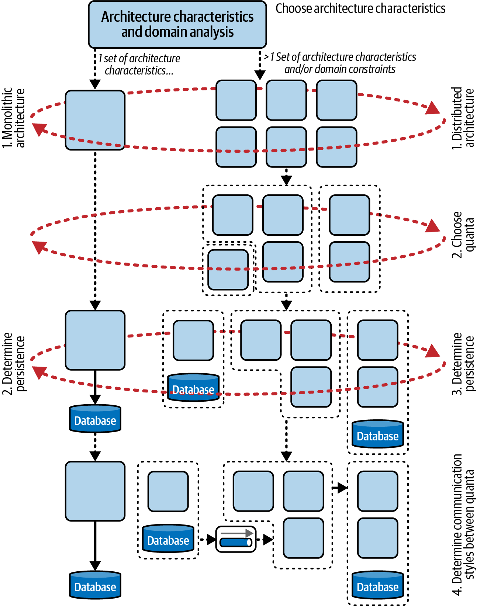
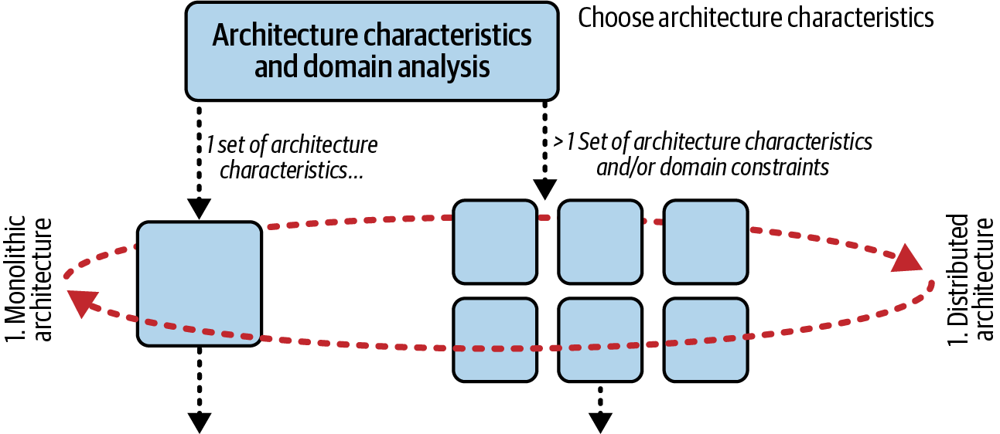
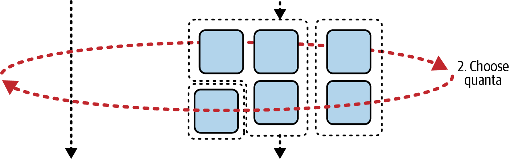
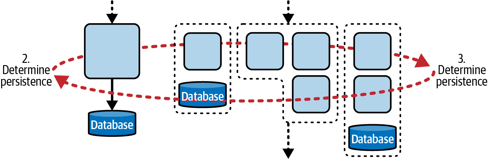
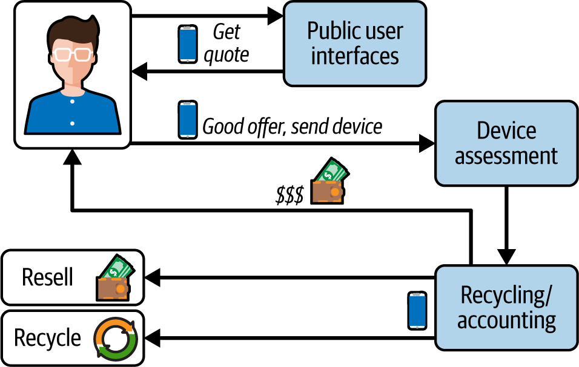
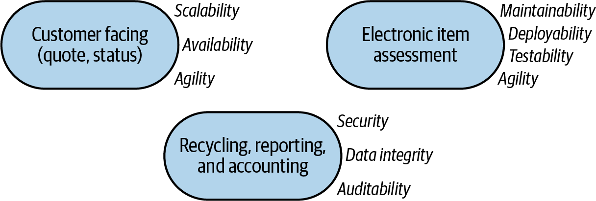
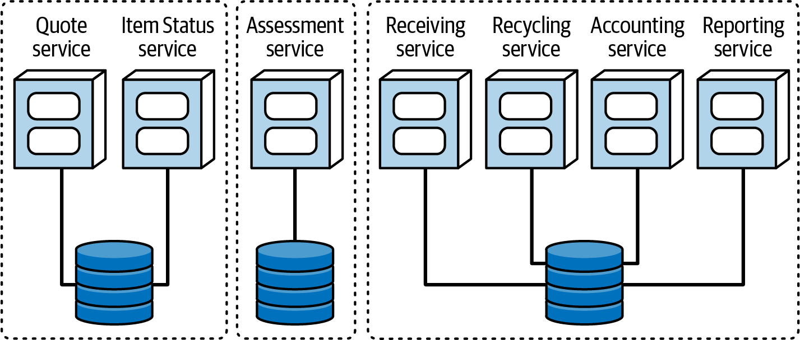

# Chương 7. Phạm vi của các architectural characteristic (The Scope of Architectural Characteristics)

Tư duy của kiến trúc sư phần mềm phải tiến hóa cùng hệ sinh thái của chúng ta, và không ở đâu điều đó rõ ràng hơn trong việc xác định phạm vi của các architectural characteristic. Nhiều framework lỗi thời để xác định architectural characteristic có một khiếm khuyết chết người: giả định một tập architectural characteristic duy nhất cho toàn bộ hệ thống. Dù điều đó đôi khi vẫn đúng, nhiều architecture hiện đại, như microservices, chứa các architectural characteristic khác nhau ở mức service và mức hệ thống.

Phạm vi của các architectural characteristic là một thước đo hữu ích cho kiến trúc sư, đặc biệt trong việc xác định architecture style phù hợp nhất để dùng làm điểm khởi đầu cho việc hiện thực. Khi chúng tôi viết cuốn sách [*Building Evolutionary Architectures*](https://evolutionaryarchitecture.com), chúng tôi cần một kỹ thuật để đo khả năng tiến hóa về cấu trúc (structural evolvability) của các architecture style cụ thể. Không thước đo hiện có nào cung cấp đúng mức chi tiết. Mục [“Structural Measures”](ch06_measuring_and_governing_architecture_characteristics.vi.md#ch-measuring-sec-structural) thảo luận nhiều metric code-level cho phép kiến trúc sư phân tích các khía cạnh cấu trúc của một architecture—nhưng không metric nào trong số đó phản ánh phạm vi. Chúng tiết lộ các chi tiết low-level về code, nhưng không thể đánh giá các component phụ thuộc bên ngoài code base (như database) vốn ảnh hưởng đến nhiều architectural characteristic, đặc biệt là các characteristic vận hành. Dù kiến trúc sư bỏ bao nhiêu công sức vào việc thiết kế một code base có performance tốt hay elastic, nếu database của hệ thống không khớp với các characteristic đó, công sức của họ sẽ không thành công.

Không tìm được một thước đo tốt cho phạm vi, chúng tôi đã tự phát triển một thước đo. Chúng tôi gọi nó là *architecture quantum*.

## Architectural quanta và granularity (Architectural Quanta and Granularity)

Coupling component-level không phải là thứ duy nhất ràng buộc phần mềm lại với nhau. Nhiều khái niệm nghiệp vụ ràng buộc các phần của hệ thống với nhau về mặt ngữ nghĩa, tạo ra *functional cohesion* (cohesion chức năng). Để thiết kế, phân tích và tiến hóa phần mềm thành công, kiến trúc sư và developer phải xem xét mọi điểm coupling có thể bị phá vỡ.

> **Dạng số nhiều của các thuật ngữ kỹ thuật gốc Latin (Plurals for Latin-Derived Technical Terms)**
>
> *Quantum* bắt nguồn từ tiếng Latin, nghĩa là dạng số nhiều kết thúc bằng *a*. Nếu bạn có nhiều hơn một quantum, bạn có *quanta*—giống như từ phổ biến hơn là *data*, cũng bắt nguồn từ tiếng Latin. Kiến trúc sư hiếm khi bàn về một datum đơn lẻ. Hướng dẫn cách dùng của *Chicago Manual of Style* ghi chú: “Dù ban đầu từ này là dạng số nhiều của *datum*, giờ đây nó thường được coi là một danh từ không đếm được và đi với động từ số ít” (18th edition, 2024, tr. 336).

Nhiều kiến trúc sư science-literate (am hiểu khoa học) biết đến khái niệm quantum từ vật lý, nơi nó chỉ lượng nhỏ nhất có thể của một thứ gì đó—thường là năng lượng. Từ *quantum* bắt nguồn từ tiếng Latin, nghĩa là “lớn đến đâu” hoặc “bao nhiêu.” Trong cách dùng thông thường, nó có xu hướng mang nghĩa “thứ nhỏ, không thể phá vỡ,” đó cũng là cách chúng tôi định nghĩa một *architecture quantum*. Một định nghĩa không chính thức phổ biến khác của *architecture quantum* là “phần nhỏ nhất của hệ thống chạy độc lập.” Ví dụ, microservices thường tạo thành các architecture quanta, minh họa cho định nghĩa này: một service có thể chạy độc lập bên trong architecture, bao gồm dữ liệu riêng và các phụ thuộc khác của nó.

Một *architecture quantum* thiết lập phạm vi cho một tập architectural characteristic. Nó có các đặc điểm:

- Deployment độc lập với các phần khác của architecture
- Functional cohesion cao
- Static coupling hiện thực bên ngoài thấp
- Giao tiếp đồng bộ với các quanta khác

Định nghĩa này gồm nhiều phần. Hãy phân tích từng phần:

**Thiết lập phạm vi cho một tập architectural characteristic**

Kiến trúc sư dùng architecture quantum như một ranh giới phân định một tập architectural characteristic, đặc biệt là các characteristic vận hành. Vì nó có thể deploy độc lập và có functional cohesion cao (được thảo luận tiếp theo), architecture quantum cung cấp một thước đo hữu ích cho modularity của architecture.

**Có thể deploy độc lập**

Một architecture quantum bao gồm mọi component cần thiết để hoạt động độc lập với các phần khác của architecture. Ví dụ, nếu một ứng dụng dùng một database, database đó là một phần của quantum, vì hệ thống sẽ không hoạt động nếu thiếu nó. Yêu cầu này có nghĩa là hầu như mọi hệ thống legacy được deploy với một database duy nhất, theo định nghĩa, tạo thành một quantum duy nhất. Tuy nhiên, trong architecture style microservices, mỗi service có database riêng của nó (một phần của triết lý dẫn dắt *bounded context*, được mô tả chi tiết trong [Chương 18](ch18_microservices_architecture.vi.md#ch-style-microservices)). Điều này tạo ra nhiều quanta trong architecture đó, vì mỗi service có phạm vi architectural characteristic riêng.

**Functional cohesion cao**

*Cohesion* trong thiết kế component chỉ mức độ thống nhất về mục đích của code được chứa bên trong. Ví dụ, một component `Customer`, với các thuộc tính và method đều liên quan đến một thực thể *Customer*, thể hiện cohesion cao. Một component `Utility` với một tập hợp ngẫu nhiên các method linh tinh thì không. Functional cohesion cao hàm ý rằng một architecture quantum làm một việc gì đó có mục đích. Sự phân biệt này ít có ý nghĩa trong các ứng dụng monolith truyền thống với một database duy nhất, nơi cohesion về cơ bản là toàn bộ hệ thống. Tuy nhiên, trong các architecture phân tán như event-driven hoặc microservices, kiến trúc sư có xu hướng thiết kế mỗi service khớp với một workflow duy nhất (một *bounded context*, như được mô tả trong [“Domain-Driven Design’s Bounded Context”](#sidebar-ddd)), nên service đó sẽ thể hiện functional cohesion cao.

> 
>
> **Bounded context của DDD (Domain-Driven Design’s Bounded Context)**
>
> Cuốn sách *Domain-Driven Design* (Addison-Wesley Professional, 2003) của Eric Evans đã ảnh hưởng sâu sắc đến tư duy kiến trúc hiện đại. [*Domain-driven design* (DDD)](https://dddcommunity.org) là một kỹ thuật mô hình hóa cho phép kiến trúc sư phân rã các problem domain phức tạp một cách có tổ chức. DDD định nghĩa một *bounded context*, nơi mọi thứ liên quan đến một phần của domain là nhìn thấy được ở bên trong nhưng không trong suốt đối với các bounded context khác.
>
> Trước DDD, kiến trúc sư tìm cách tái sử dụng code một cách tổng thể trên các thực thể chung trong tổ chức. Nhưng họ nhận thấy rằng việc tạo ra các artifact chia sẻ chung gây ra hàng loạt vấn đề, như coupling chặt, phối hợp khó khăn hơn, và độ phức tạp tăng lên. Khái niệm bounded-context thừa nhận rằng mỗi thực thể hoạt động tốt nhất trong một bối cảnh cục bộ. Do đó, thay vì tạo một class `Customer` thống nhất trên toàn bộ tổ chức, mỗi problem domain có thể tạo class `Customer` của riêng mình và dung hòa các khác biệt tại các điểm giao tiếp với các domain khác.

Để làm rõ các phần tiếp theo của định nghĩa, chúng ta cần phân biệt tinh tế hơn về các loại coupling:

**Semantic coupling (coupling ngữ nghĩa)**

*Semantic coupling* mô tả coupling tự nhiên của vấn đề mà kiến trúc sư đang xây dựng giải pháp cho nó. Ví dụ, coupling vốn có của một ứng dụng order-processing bao gồm những thứ như tồn kho, catalog, giỏ hàng, khách hàng và doanh số. Bản chất của vấn đề thúc đẩy việc xây dựng một giải pháp phần mềm định nghĩa coupling này. Kiến trúc sư có ít kỹ thuật ngăn những thay đổi trong domain lan tỏa ra khắp hệ thống: một thay đổi trong domain (và do đó trong ngữ nghĩa) có nghĩa là chúng ta đang thay đổi yêu cầu của hệ thống. Dù kiến trúc sư có thể thích ứng với điều đó, không có architecture pattern thần kỳ nào ngăn việc thay đổi vấn đề cốt lõi ảnh hưởng đến architecture.

**Implementation coupling (coupling hiện thực)**

*Implementation coupling* mô tả cách một kiến trúc sư và team quyết định hiện thực các phụ thuộc cụ thể. Trong một ứng dụng order-processing, team phải xem xét nhiều ràng buộc khi thiết lập ranh giới domain. Ví dụ, tất cả dữ liệu nên nằm trong một database duy nhất, hay một phần nên được tách ra để có scalability hoặc availability tốt hơn? Chúng ta nên xây dựng một monolith hay một architecture phân tán? Câu trả lời cho những câu hỏi này ít ảnh hưởng đến semantic coupling của hệ thống, nhưng ảnh hưởng lớn đến các quyết định kiến trúc.

**Static coupling (coupling tĩnh)**

*Static coupling* chỉ “hệ thống dây nối” của một architecture—cách các service phụ thuộc vào nhau. Hai service là một phần của cùng một architecture quantum nếu cả hai đều phụ thuộc vào cùng một điểm coupling. Ví dụ, giả sử hai microservice, `Catalog` và `Shipping`, cần chia sẻ thông tin địa chỉ, nên cả hai cùng tạo một phụ thuộc tới một component dùng chung. Vì cả hai service đều bị coupling với phụ thuộc đó, chúng là một phần của cùng một architecture quantum.

Đây là một cách dễ dàng để nghĩ về coupling trong software architecture: hai thứ bị coupling nếu thay đổi cái này có thể làm hỏng cái kia. Static coupling định nghĩa các phụ thuộc phạm vi trong một architecture. Ví dụ, nếu một số service dùng cùng một relational database, chúng là một phần của cùng một quantum.

**Dynamic coupling (coupling động)**

*Dynamic coupling* mô tả các lực liên quan khi các architecture quanta phải giao tiếp với nhau. Ví dụ, khi hai service đang chạy, chúng phải giao tiếp để tạo thành các workflow và thực hiện các tác vụ trong hệ thống. Kiến trúc sư phải xem xét các trade-offs khi giao tiếp giữa các service trong một architecture phân tán, điều được thảo luận chi tiết trong [Chương 15](ch15_event_driven_architecture_style.vi.md#ch-style-eda).

Với những định nghĩa này trong tay, chúng ta có thể hoàn thiện định nghĩa *architecture quantum*:

**Static coupling hiện thực bên ngoài thấp**

Mức coupling hiện thực giữa các architecture quanta nên thấp. Characteristic này cũng bắt nguồn từ triết lý DDD về coupling thấp giữa các bounded context. Quanta tạo thành các khối xây dựng vận hành của architecture, nằm ở mức trừu tượng cao hơn component một bậc. Chúng thường trùng với ranh giới service. Mục tiêu này phản ánh sự ưa chuộng chung của kiến trúc sư đối với loose coupling giữa các phần khác nhau của architecture.

Nhìn chung, coupling chặt là đáng mong muốn khi cần cohesion cao, như bên trong một service hoặc subsystem. Chúng tôi gọi một architecture là “giòn” (brittle) khi một thay đổi hiện thực duy nhất có thể gây ra những tác dụng phụ lan tỏa không lường trước làm hỏng nhiều thứ khác (bề ngoài có vẻ không liên quan). Phạm vi coupling của hệ thống càng rộng, loose coupling càng giúp architecture bớt giòn. Ví dụ, một kiến trúc sư có thể đổi tên một trường trong một lời gọi service từ `State` thành `StateCode`, nghĩ rằng nó sẽ chỉ ảnh hưởng đến một bên gọi, rồi mới phát hiện ra nhiều phụ thuộc khác vừa bị hỏng một cách bất ngờ.

> **Mẹo**
>
> Coupling cao hơn được phép với các phạm vi hẹp hơn; phạm vi càng rộng, coupling càng nên lỏng.

## Giao tiếp đồng bộ (Synchronous Communication)

*Giao tiếp* (communication) chỉ dynamic coupling—khi các architecture quanta gọi nhau, điều phổ biến trong các architecture phân tán. Điều này đặc biệt liên quan đến họ các architectural characteristic vận hành được mô tả trong [“Operational Architectural Characteristics”](ch04_architectural_characteristics_defined.vi.md#sec-operational), vì chúng thường quyết định thời điểm và việc blocking quan trọng trong các architecture phân tán.

Ví dụ, xét một microservices architecture với một service `Payment` và một service `Auction`. Khi một phiên đấu giá kết thúc, service `Auction` gửi thông tin thanh toán *một cách đồng bộ* tới service `Payment`. Tuy nhiên, giả sử service `Payment` chỉ có thể xử lý một khoản thanh toán mỗi 500 ms. Điều gì xảy ra khi một số lượng lớn phiên đấu giá kết thúc cùng lúc? Hai service có các architectural characteristic vận hành khác nhau. Lời gọi đầu tiên sẽ hoạt động, nhưng sau đó các lời gọi sẽ bắt đầu thất bại vì service `Payment` không thể xử lý số lượng request—nó không có scalability bằng service `Auction`.

Chúng tôi nhấn mạnh giao tiếp đồng bộ ở đây vì giao tiếp bất đồng bộ có ít tác động tiềm tàng hơn. Ví dụ, nếu service `Auction` gọi service `Payment` một cách bất đồng bộ, dùng một message queue, queue có thể đóng vai trò như một bộ đệm cho phép hai hệ thống hoạt động. Tất nhiên, nếu service `Auction` liên tục gửi nhiều message hơn mức `Payment` có thể xử lý, cuối cùng nó sẽ làm tràn message queue. Tuy nhiên, khi dòng message ập đến theo từng đợt, queue có thể giữ các message đang chờ cho đến khi bên nhận sẵn sàng. Giao tiếp đồng bộ không khoan nhượng trong các architecture phân tán, đặc biệt nếu các phần của architecture có các architectural characteristic khác nhau. [Chương 15](ch15_event_driven_architecture_style.vi.md#ch-style-eda) đề cập kỹ lưỡng các loại giao tiếp trong event-driven architecture.

Khái niệm architecture quantum mang lại một cách mới để suy nghĩ về phạm vi. Trong các hệ thống hiện đại, kiến trúc sư định nghĩa các architectural characteristic ở mức quantum thay vì mức hệ thống. Điều này cung cấp thông tin quan trọng khi phân tích một problem domain mới.

## Tác động của việc xác định phạm vi (The Impact of Scoping)

Kiến trúc sư có thể dùng phạm vi của các architectural characteristic để giúp xác định ranh giới service phù hợp, được minh họa tổng thể trong cây quyết định ở [Hình 7-1](#fosa_2e_new_06-overall-flowchart) và được trình bày chi tiết hơn trong các bước.

*Hình 7-1. Một cây quyết định dùng phạm vi architectural characteristic để giúp xác định architectural style*

### Phạm vi và architectural style (Scoping and Architectural Style)

Xác định ranh giới quantum của problem domain giúp chọn một architectural style: monolithic architecture hay architecture phân tán là phù hợp nhất? Xét phần đầu tiên của sơ đồ quyết định trong [Hình 7-2](#fosa_2e_new_chpart1).

*Hình 7-2. Chọn một architectural style phù hợp dựa trên các architectural characteristic*

Như chúng tôi đã thảo luận trong [Chương 4](ch04_architectural_characteristics_defined.vi.md#ch04-architecture-characteristics-defined), kiến trúc sư phải phân tích các architectural characteristic và domain để xác định architectural style phù hợp nhất. Một phần của phân tích này liên quan đến việc giải pháp có cần nhiều nhóm architectural characteristic hay không. Ở bước một trong [Hình 7-2](#fosa_2e_new_chpart1), kiến trúc sư xác định hệ thống có thể thành công với một tập architectural characteristic duy nhất, hay cần nhiều hơn một nhóm (xem ví dụ trong [“Kata: Going Green”](#sec-gg)).

Nếu kiến trúc sư xác định rằng một tập architectural characteristic duy nhất là đủ, họ có thể chọn một monolithic architecture, giảm số lượng lựa chọn tiếp theo. Nếu họ chọn một architecture phân tán, bước tiếp theo là xác định ranh giới quantum của nó, như trong [Hình 7-3](#fosa_2e_chpart2).

*Hình 7-3. Trong các architecture phân tán, kiến trúc sư phải chọn ranh giới quantum phù hợp*

Chúng tôi đưa ra một số hướng dẫn để xác định granularity trong [Chương 18](ch18_microservices_architecture.vi.md#ch-style-microservices). Bước tiếp theo là chọn một cơ chế lưu trữ (persistence), điều liên quan đến cả hai họ architecture, như trong [Hình 7-4](#fosa_2e_chpart3).

*Hình 7-4. Cả hai architecture style nhìn chung đều cần một dạng persistence nào đó*

Với monolithic architecture, một monolithic database duy nhất nhìn chung là phù hợp. Architecture và database được phát triển và deploy cùng nhau, đồng bộ từng bước. Điều này hoàn tất quy trình—kiến trúc sư có thể chuyển sang chọn monolithic style phù hợp nhất.

Ngược lại, các architecture phân tán có thể dùng một database duy nhất (phổ biến trong event-driven architecture) hoặc phân vùng dữ liệu theo granularity của service (như trong microservices architecture). Còn một bước nữa: xác định loại giao tiếp nào được dùng giữa các quanta, đồng bộ hay bất đồng bộ. (Chúng tôi thảo luận chi tiết câu hỏi này trong [Chương 15](ch15_event_driven_architecture_style.vi.md#ch-style-eda).) Hãy nhớ rằng, trong một số hệ thống, việc chọn giao tiếp đồng bộ có thể thay đổi ranh giới quantum được thiết lập thông qua static coupling; hai loại coupling này thường xuyên tương tác với nhau.

### Kata: Going Green

Hãy thử phân tích một vấn đề bằng cách dùng architecture quantum làm phạm vi cho các architectural characteristic. Vấn đề, có tên *Going Green*, được minh họa trong [Hình 7-5](#fosa_2e_new_GG-overview).

Bạn đang làm việc với Going Green (GG), một doanh nghiệp tái chế và bán lại đồ điện tử cũ, như điện thoại di động. Hệ thống của họ dùng cả các kiosk công cộng và một website, tất cả chạy cùng một hệ thống. Người dùng có thể tải lên số model và tình trạng của thiết bị, và GG sẽ đưa ra giá mua. Nếu người dùng chấp nhận giá, họ có thể gửi thiết bị vào kiosk hoặc, nếu họ dùng website, GG sẽ gửi cho họ một chiếc hộp để gửi thiết bị qua bưu điện. Khi nhận được thiết bị, GG đánh giá nó và gửi tiền cho người dùng. Sau đó GG ước tính giá trị của thiết bị và hoặc tái chế hoặc bán lại nó. Hệ thống của họ cũng tạo ra các báo cáo và các phân tích khác.

*Hình 7-5. Tổng quan yêu cầu cho Going Green*

Khi thực hiện phân tích architectural characteristic, bạn nhận thấy ba cụm riêng biệt hình thành, như trong [Hình 7-6](#fosa_2e_new_ch07-GG-AC).

*Hình 7-6. Phân tích architectural characteristic của GG cho ra ba cụm năng lực*

Các phần public-facing (hướng ra công chúng) của ứng dụng cần *scalability*, *availability* và *agility*; các chức năng back-office cần *security*, *data integrity* và *auditability*; và phần đánh giá cần *maintainability*, *deployability* và *testability* (những thứ tạo nên architectural characteristic tổng hợp *agility*). Tại sao phần đánh giá lại cần một tập architectural characteristic riêng? Đây là một ví dụ tốt về cách các business driver giao thoa với các mối quan tâm kiến trúc. Mô hình kinh doanh của GG dựa vào việc bán lại các thiết bị điện tử đã qua sử dụng highest-value (có giá trị cao nhất), và các model mới liên tục ra mắt. Họ càng cập nhật việc đánh giá thiết bị nhanh, họ càng có được nhiều thiết bị mới hơn (và do đó có giá trị hơn) để bán lại.

Bạn có thể thiết kế một hệ thống đáp ứng tất cả các tiêu chí này không: scalability, availability, security, data integrity, auditability, maintainability, deployability và testability? Có thể…nhưng sẽ rất khó. Các architectural characteristic này thường triệt tiêu lẫn nhau: chẳng hạn, đạt được deployability nhanh khó hơn khi bạn cũng ưu tiên các mối quan tâm back-office như auditability. Và UI đòi hỏi một mức scalability khác xa so với các phần khác của hệ thống.

Thay vì cố làm tất cả, bạn có thể dùng các cụm architectural characteristic làm chỉ dẫn để tách các quanta. Trong [Hình 7-7](#fosa_2e_new_ch07-GG-Arch), các đường chấm minh họa từng architectural quantum. Dùng phạm vi characteristic làm chỉ dẫn cho granularity của service là một bước đầu tốt để xác định tập trade-offs có lợi nhất. (Chúng tôi khám phá chủ đề này sâu hơn trong [Chương 18](ch18_microservices_architecture.vi.md#ch-style-microservices).)

*Hình 7-7. Architecture GG này nắm bắt mỗi tập architectural characteristic như một ranh giới kiến trúc*

## Phạm vi và cloud (Scoping and the Cloud)

Các tài nguyên cloud-based làm bức tranh phức tạp hơn, vì chúng đóng gói rất nhiều architectural characteristic vận hành của một hệ thống. Kiến trúc sư phải xem xét ít nhất hai kịch bản khi dùng tài nguyên cloud-based cho toàn bộ hoặc một phần ứng dụng, tùy thuộc vào mô hình deployment:

**Dùng cloud để host container**

Nhiều development team dùng cloud như một trung tâm vận hành thay thế, chạy (và orchestrate) các container cho server. Trong những tình huống như vậy, kiến trúc sư phải xem xét các architectural characteristic của container và các ràng buộc do công cụ orchestration đưa vào (ví dụ, [Kubernetes](https://kubernetes.io)).

**Dùng tài nguyên cloud-provider làm component của hệ thống**

Một biến thể khác của hệ thống cloud-based ghép các ứng dụng lại với nhau bằng các khối xây dựng của nhà cung cấp cloud, như triggered function, database, v.v. Trong trường hợp này, kiến trúc sư phải xem xét các năng lực mà nhà cung cấp quảng cáo (và hy vọng là duy trì) để có cái nhìn sâu sắc về cách xây dựng các năng lực phù hợp cho bối cảnh cụ thể đó.

Nhiều năng lực mà ngày nay chúng ta biết đến như các thiết lập cấu hình của nhà cung cấp cloud, như elasticity, là thành quả hard-won (khó khăn mới có được) của thế hệ kiến trúc sư trước làm việc trên các hệ thống vật lý. Những mối quan tâm chính của họ đã trở nên dễ dàng hơn—nhưng chúng ta có tập trade-offs hiện đại của riêng mình, như availability của nhà cung cấp và các mối quan tâm về security gia tăng. Các chi tiết của software architecture thay đổi rất nhiều, nhưng công việc phân tích trade-offs vẫn không đổi.
