

# Chương 8. Tư duy dựa trên component (Component-Based Thinking)

Trong [Chương 3](ch03_modularity.vi.md#ch-modularity), chúng tôi đã giới thiệu khái niệm *module* như một tập hợp code có liên quan. Trong chương này, chúng tôi đi sâu hơn nhiều vào khái niệm này, tập trung vào khía cạnh kiến trúc của modularity dưới dạng các *logical component*—các khối xây dựng của một hệ thống.

Xác định và quản lý các logical component là một phần của *tư duy kiến trúc* (xem [Chương 2](ch02_architectural_thinking.vi.md#ch-architectural-thinking)), đến mức chúng tôi gọi hoạt động này là *component-based thinking* (tư duy dựa trên component). Component-based thinking là nhìn cấu trúc của một hệ thống như một tập các logical component, tất cả tương tác với nhau để thực hiện các chức năng nghiệp vụ nhất định. Chính ở mức này (chứ không phải mức class) mà một kiến trúc sư “nhìn thấy” hệ thống.

Trong chương này, chúng tôi định nghĩa các logical component trong software architecture, cách xác định chúng, và cách đạt được một mức granularity phù hợp thông qua việc phân tích thứ được gọi là *cohesion* (chúng tôi sẽ định nghĩa điều đó nghĩa là gì ở phần sau của chương này). Chúng tôi cũng thảo luận về coupling giữa các component và làm thế nào, tại sao lại tạo ra các hệ thống loosely coupled.

## Định nghĩa logical component (Defining Logical Components)

Hãy nghĩ về sơ đồ mặt bằng của một ngôi nhà phương Tây điển hình, như minh họa trong [Hình 8-1](#fig-components-floor-plan). Lưu ý rằng sơ đồ mặt bằng được tạo thành từ nhiều phòng (như nhà bếp, phòng ngủ, phòng tắm, phòng khách, phòng làm việc, v.v.), mỗi phòng phục vụ một mục đích khác nhau. Những căn phòng này đại diện cho các khối xây dựng—các *component*—của ngôi nhà.

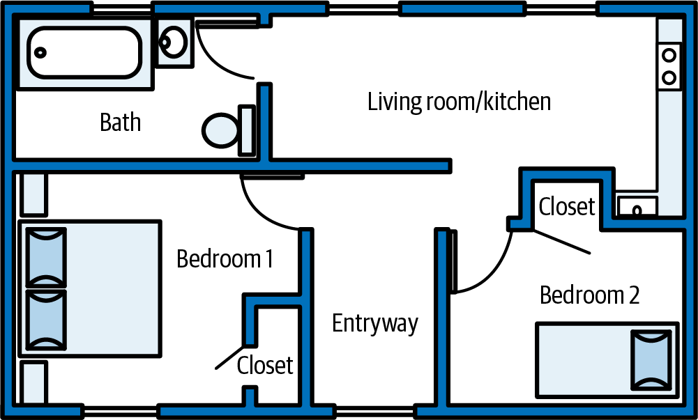

*Hình 8-1. Các phòng khác nhau đại diện cho các component của ngôi nhà*

Tương tự, các chức năng chính mà một hệ thống thực hiện đại diện cho các component của hệ thống đó, như trong [Hình 8-2](#fig-components-system). Giống như các phòng của một ngôi nhà, mỗi component thực hiện một chức năng cụ thể, như quản lý tồn kho, giao đơn hàng, hoặc xử lý thanh toán. Cùng nhau, chúng tạo nên hệ thống. Mỗi component chứa source code triển khai chức năng nghiệp vụ cụ thể đó.

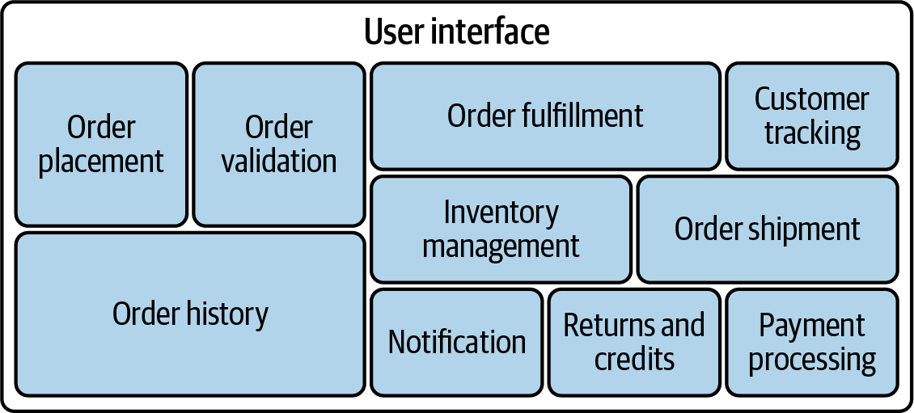

*Hình 8-2. Các chức năng chính khác nhau đại diện cho các component của hệ thống*

Các logical component trong software architecture thường được thể hiện thông qua một namespace hoặc một cấu trúc thư mục chứa source code triển khai chức năng cụ thể đó. Thông thường, các *leaf node* (nút lá) của cấu trúc thư mục hoặc namespace chứa source code đại diện cho các logical component trong architecture, còn các thư mục hoặc nút namespace higher-level đại diện cho các domain và subdomain của hệ thống. Trong cấu trúc thư mục được minh họa ở [Hình 8-3](#fig-components-directory), đường dẫn thư mục *order_entry/ordering/payment* đại diện cho component `Payment Processing`, và đường dẫn *order_entry/processing/fulfillment* đại diện cho component `Order Fulfillment`. Source code bên dưới các thư mục triển khai các logical component này.

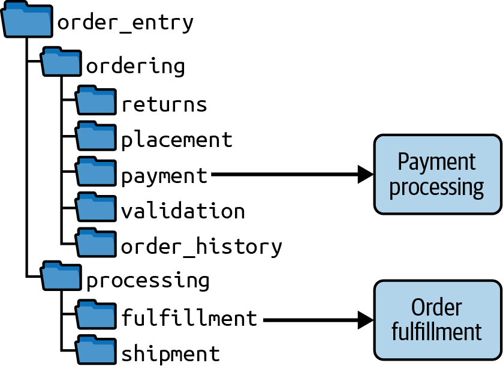

*Hình 8-3. Các leaf node của thư mục đại diện cho các component của hệ thống*

Kiến trúc sư có thể phân tích cấu trúc thư mục hoặc namespace của một hệ thống phần mềm để hiểu cấu trúc bên trong của nó—nói cách khác, *logical architecture* của nó. Chúng tôi mô tả sự khác biệt giữa logical architecture và physical architecture trong mục tiếp theo. 

## Logical architecture so với physical architecture (Logical Versus Physical Architecture)

Một *logical architecture* gồm các logical component (khối xây dựng) của một hệ thống và cách chúng tương tác với nhau. Nó cũng thường thể hiện tương tác của chúng với các *actor* khác nhau (người dùng tương tác với hệ thống), và cũng có thể thể hiện một repository (không phải database) để làm rõ nơi dữ liệu được dùng hoặc được truyền giữa các component. [Hình 8-4](#fig-components-logical) minh họa một ví dụ về logical architecture.

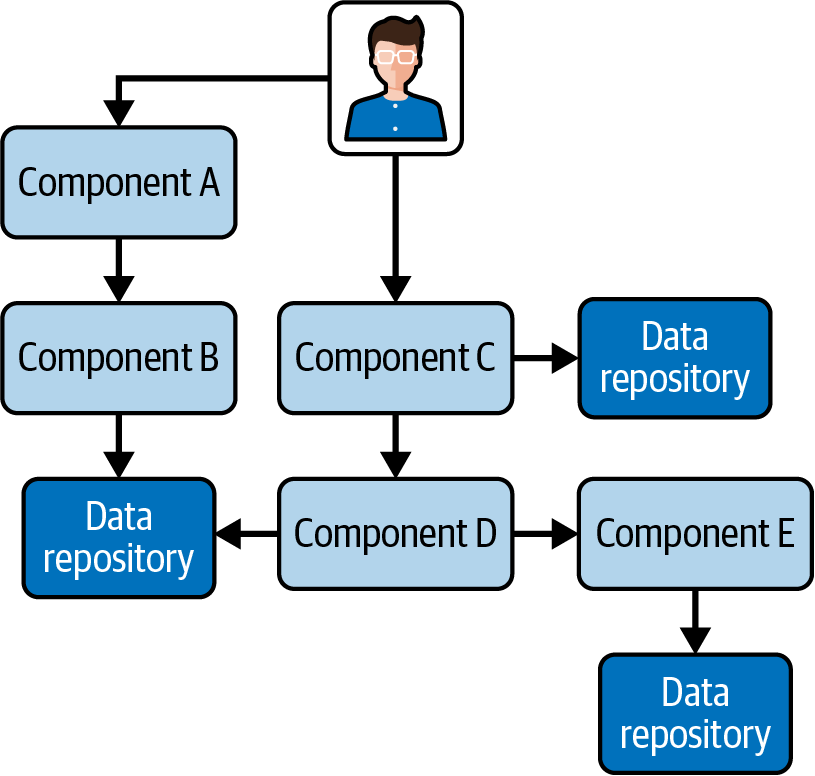

*Hình 8-4. Sơ đồ của một logical architecture*

Một sơ đồ logical architecture thường không thể hiện giao diện người dùng, database, service, hay các artifact vật lý khác. Thay vào đó, nó thể hiện các logical component và cách chúng tương tác, điều này nên khớp với cấu trúc thư mục và namespace tổ chức code.

Ngược lại, một *physical architecture* bao gồm các artifact vật lý như service, giao diện người dùng, database, v.v. [Hình 8-5](#fig-components-physical) là một ví dụ về sơ đồ physical architecture.

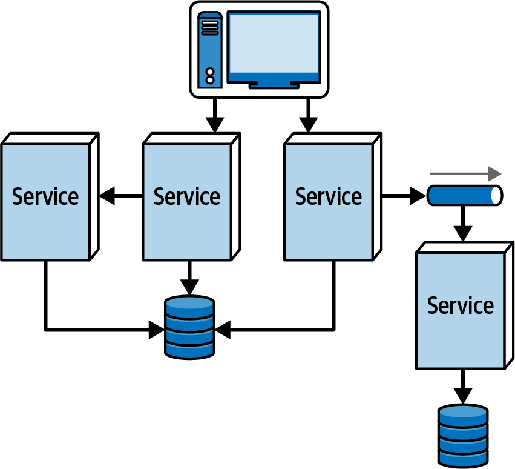

*Hình 8-5. Sơ đồ của một physical architecture*

Physical architecture của hệ thống nên thể hiện sát một (hoặc nhiều) trong số nhiều architectural style được mô tả trong [Phần II](part2_architecture_styles.vi.md#part2-styles) của cuốn sách này: microservices, layered architecture, event-driven architecture, v.v.

Nhiều kiến trúc sư chọn bỏ qua việc tạo logical architecture và bắt đầu trực tiếp với physical architecture. Tuy nhiên, chúng tôi khuyên không nên làm vậy, vì physical architecture không phải lúc nào cũng thể hiện chức năng của hệ thống nằm ở đâu và tất cả khớp với nhau như thế nào. Ví dụ, trong một physical architecture, chức năng payment-processing có thể bị trải ra trên nhiều service, khiến khó thấy nó tương tác thế nào với các phần khác của hệ thống. Hơn nữa, physical architecture không cung cấp cho các development team bất kỳ hướng dẫn nào về cách xây dựng một hệ thống monolith hay phân tán, hoặc cách tổ chức code của nó, dẫn phần lớn đến các architecture phi cấu trúc khó bảo trì, khó test và khó deploy.

Nhìn chung, logical architecture của một hệ thống độc lập với physical architecture của nó. Nói cách khác, khi tạo logical architecture, trọng tâm nằm nhiều hơn ở việc hệ thống làm gì, chức năng đó được phân định như thế nào, và các phần chức năng của hệ thống tương tác ra sao, thay vì ở cấu trúc vật lý của nó. Ví dụ, kiến trúc sư tạo một logical architecture như trong [Hình 8-4](#fig-components-logical) có thể chưa xác định liệu tất cả các component đó sẽ được đưa vào một monolithic architecture (một deployment unit duy nhất) hay sẽ được deploy dưới dạng service (các deployment unit riêng biệt), cũng như chưa nhất thiết quyết định loại architecture style nào sẽ phù hợp nhất.

## Tạo một logical architecture (Creating a Logical Architecture)

Tạo một logical architecture bao gồm việc liên tục xác định và tái cấu trúc các logical component. *Xác định component* (component identification) hiệu quả nhất khi là một quy trình lặp. Nó bao gồm việc tạo ra các component ứng viên, rồi tinh chỉnh chúng qua một vòng phản hồi, như minh họa trong [Hình 8-6](#fig-components-flow).

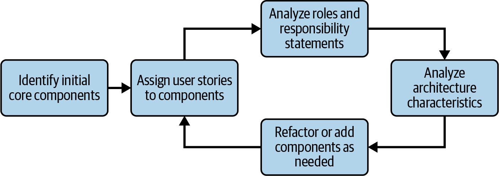

*Hình 8-6. Chu trình xác định và refactor component*

Hoạt động đầu tiên mà một kiến trúc sư làm khi phát triển một logical architecture là xác định các core component ban đầu, rồi gán user story hoặc yêu cầu cho chúng. Sau đó, họ phân tích vai trò và trách nhiệm của component để bảo đảm rằng các user story hoặc yêu cầu được gán cho nó là hợp lý. Tiếp theo, kiến trúc sư xem xét các architectural characteristic mà hệ thống phải hỗ trợ và xác định liệu có cần refactor nào để có thể tách ra hoặc gộp component dựa trên các characteristic đó không. Cuối cùng, kiến trúc sư có thể tùy chọn tinh chỉnh các component dựa trên phân tích này. Quy trình này là một vòng phản hồi về cơ bản không bao giờ dừng.

Workflow trong [Hình 8-6](#fig-components-flow) có thể được dùng cho các hệ thống greenfield (mới) hoặc bất cứ khi nào một tính năng được thêm vào hay thay đổi trong hệ thống. Ví dụ, giả sử bạn cần cho phép một hệ thống order-entry để người dùng nhận hàng tại cửa hàng thay vì được giao về nhà. Điều này sẽ bao gồm việc thêm code lập lịch cũng như thay đổi quy trình đặt hàng hiện có. Thay đổi này có thể đòi hỏi component mới, thay đổi các component hiện có, hoặc cả hai. Khi các component thay đổi, vai trò và trách nhiệm của chúng có thể thay đổi, khiến bạn phải tái cấu trúc code hoặc tạo component mới cho nó.

Chúng tôi mô tả chi tiết từng bước này trong các mục sau.

### Xác định các core component (Identifying Core Components)

Thách thức khi bắt đầu một logical architecture mới (hoặc thực hiện những sửa đổi lớn cho một logical architecture hiện có) là xác định các core component ban đầu nên là gì. Một sai lầm mà nhiều kiến trúc sư phần mềm mắc phải là bỏ quá nhiều công sức cố làm cho các logical component ban đầu hoàn hảo ngay lần đầu. Một cách tiếp cận tốt hơn là đưa ra một “phỏng đoán tốt nhất” về hình dạng của các core component ban đầu, dựa trên các chức năng cốt lõi của hệ thống, và tinh chỉnh chúng qua các bước workflow được nêu trong [Hình 8-6](#fig-components-flow). Nói cách khác, tốt hơn là lặp đi lặp lại trên các logical component khi bạn học thêm về hệ thống, thay vì cố làm mọi thứ hoàn hảo ngay lần đầu, khi bạn biết ít nhất về hệ thống và các yêu cầu cụ thể của nó.

Trong hầu hết các trường hợp, kiến trúc sư không cần biết tất cả (hoặc đôi khi bất kỳ) yêu cầu và đặc tả nào của hệ thống để bắt đầu tạo các logical component. Thông thường, các core component ban đầu dựa trên các hành động chính mà người dùng có thể thực hiện hoặc các workflow xử lý chính của hệ thống.

Chúng tôi thích nghĩ về các core component ban đầu như những chiếc xô rỗng. Chiếc xô không làm gì cả cho đến khi kiến trúc sư bắt đầu “đổ đầy” nó—tức là gán user story hoặc yêu cầu cho component đó. Như minh họa trong [Hình 8-7](#fig-components-empty-bucket), tên component nên đại diện cho vai trò và trách nhiệm được đề xuất của nó. Tuy nhiên, cho đến khi kiến trúc sư gán user story cho nó (bước tiếp theo trong workflow), về cơ bản nó chỉ là một placeholder—một phỏng đoán tốt nhất về một khối xây dựng chức năng.

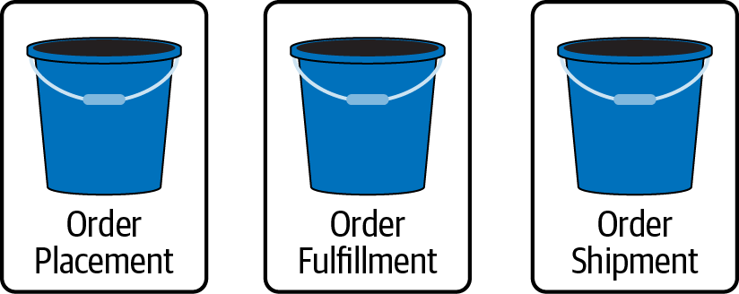

*Hình 8-7. Lúc ban đầu, các component ban đầu giống như những chiếc xô rỗng*

Sau đây là ba cách tiếp cận phổ biến để tạo các core component ban đầu; hai cách đầu tiên (Workflow và Actor/Action) là những cách chúng tôi thấy hữu ích, còn cách thứ ba (Entity Trap) là một antipattern mà chúng tôi cảnh báo.

#### Cách tiếp cận Workflow (The Workflow approach)

Một cách tiếp cận phổ biến mà kiến trúc sư dùng để xác định các core component ban đầu của một logical architecture là cách tiếp cận *Workflow*. Như tên gọi gợi ý, cách tiếp cận này tận dụng các workflow happy-path (không lỗi) chính mà người dùng có thể đi qua trong hệ thống (hoặc workflow request-processing chính của nó). Nếu kiến trúc sư có chút hình dung về luồng chung, họ có thể phát triển các component dựa trên các bước đó.

Ví dụ, giả sử bạn đang xây dựng một hệ thống order-entry mới cho công ty của mình. Bạn chưa biết các yêu cầu và đặc tả cụ thể, nhưng ít nhất bạn biết workflow chung để xử lý một đơn hàng mới. Do đó, bạn có thể gán một component cho mỗi bước trong workflow:

1. Người dùng duyệt catalog sản phẩm → `Item Browser`
2. Người dùng đặt một đơn hàng → `Order Placement`
3. Người dùng thanh toán đơn hàng → `Order Payment`
4. Gửi cho người dùng một email với chi tiết đơn hàng → `Customer Notification`
5. Chuẩn bị đơn hàng → `Order Fulfillment`
6. Giao đơn hàng → `Order Shipment`
7. Gửi email cho khách hàng rằng đơn hàng đã được giao đi → `Customer Notification`
8. Theo dõi lô hàng → `Order Tracking`

Trong cách tiếp cận Workflow, không phải mỗi bước trong workflow chính đều tạo ra một component mới. Trong workflow ở trên, cả bước 4 và 7 đều dùng component `Customer Notification`. Kiến trúc sư mô hình hóa càng nhiều workflow chính hoặc hành trình người dùng của hệ thống càng tốt, xác định các component tương ứng từ những bước đó.

Một lần nữa, đây chỉ là một “phỏng đoán tốt nhất” về hình dạng của logical architecture. Các component này đại diện cho những chiếc xô rỗng và chưa có trách nhiệm nào, nên chúng có khả năng sẽ thay đổi khi tiến hóa (như minh họa trong [Hình 8-6](#fig-components-flow)). Điều này hoàn toàn bình thường và là một phần bản chất lặp của software architecture. Đừng lo lắng về việc cố mô hình hóa mọi workflow trong hệ thống của bạn. Thay vào đó, hãy tập trung vào các workflow chính. Phần còn lại sẽ tiến hóa khi bạn học thêm về hệ thống và bắt đầu thu thập user story và yêu cầu.

#### Cách tiếp cận Actor/Action (The Actor/Action approach)

Một cách khác để kiến trúc sư xác định các core component ban đầu là cách tiếp cận *Actor/Action*. Cách tiếp cận này đặc biệt hữu ích khi một hệ thống có nhiều actor. Với cách tiếp cận này, kiến trúc sư xác định các hành động chính mà một người dùng có thể thực hiện trong hệ thống (như đặt một đơn hàng). Bản thân hệ thống cũng luôn là một actor, thực hiện các chức năng tự động như lập hóa đơn và bổ sung hàng tồn kho.

Trong ví dụ hệ thống order-entry của chúng ta, kiến trúc sư có thể xác định ba actor: *khách hàng* (customer), *người đóng gói đơn hàng* (order packer: người đóng hộp và gửi đi để giao hàng), và *hệ thống* (system). Kiến trúc sư sau đó xác định các hành động chính mà mỗi actor này thực hiện và gán component cho các hành động đó:

**Actor khách hàng (Customer actor)**

- Tìm kiếm sản phẩm → `Item Search`
- Xem chi tiết về một sản phẩm → `Item Details`
- Đặt một đơn hàng → `Order Placement`
- Hủy một đơn hàng → `Order Cancel`
- Đăng ký làm khách hàng mới → `Customer Registration`
- Cập nhật thông tin khách hàng → `Customer Profile`

**Actor người đóng gói đơn hàng (Order packer actor)**

- Chọn kích thước hộp → `Order Fulfillment`
- Đánh dấu đơn hàng sẵn sàng để giao → `Order Fulfillment`
- Giao đơn hàng cho khách hàng → `Order Shipment`

**Actor hệ thống (System actor)**

- Điều chỉnh tồn kho → `Inventory Management`
- Đặt thêm hàng từ nhà cung cấp → `Supplier Ordering`
- Áp dụng thanh toán → `Order Payment`

Giống như với cách tiếp cận Workflow, không phải mọi hành động đều nhất thiết có component riêng. Ví dụ, chọn kích thước hộp cho đơn hàng và đánh dấu nó sẵn sàng để giao đều được thực hiện bởi component `Order Fulfillment`.

Nhìn chung, cách tiếp cận Actor/Action tạo ra nhiều component hơn cách tiếp cận Workflow, tùy thuộc vào số lượng workflow chính mà kiến trúc sư chọn mô hình hóa. Tuy nhiên, trong cả hai cách tiếp cận, kiến trúc sư có thể xác định các core component ban đầu và cách chúng giao tiếp ngay cả trước khi nhận được các yêu cầu hay đặc tả chi tiết. 

#### Entity Trap (bẫy thực thể)

Một kiến trúc sư rất dễ bị cám dỗ bắt đầu xác định component bằng cách tập trung vào các thực thể liên quan đến hệ thống, rồi dẫn xuất component từ các thực thể đó. Ví dụ, trong một hệ thống nhập đơn hàng điển hình, bạn có thể xác định `Customer`, `Item` và `Order` là các thực thể chính trong hệ thống, và tương ứng tạo ra một component `Customer Manager`, một component `Item Manager` và một component `Order Manager`. Chúng tôi đặc biệt khuyên không nên dùng cách tiếp cận này vì những lý do sau.

Thứ nhất, tên của các logical component mơ hồ và không mô tả vai trò của component. Ví dụ, hỏi component `Order Manager` làm gì chỉ bằng cách nhìn vào tên sẽ cho ra câu trả lời vô dụng “nó quản lý đơn hàng,” không cho biết gì về vai trò hay trách nhiệm cụ thể của nó trong hệ thống. So sánh điều đó với một tên component như `Validate Order`, và tầm quan trọng của một tên component tốt, có tính mô tả trở nên rõ ràng. Nếu một tên component có hậu tố như `Manager`, `Supervisor`, `Controller`, `Handler`, `Engine` hoặc `Processor`, đó là một dấu hiệu tốt cho thấy kiến trúc sư có thể đã mắc vào antipattern Entity Trap.

Thứ hai, các component trở thành bãi rác cho các chức năng domain-related. Xét một tên component entity-based như `Order Manager`, như trong [Hình 8-8](#fig-components-entitytrap). Mọi mẩu chức năng đơn hàng đều sẽ đi vào component duy nhất đó: kiểm tra đơn hàng, đặt đơn hàng, lịch sử đơn hàng, thực hiện đơn hàng, giao đơn hàng, theo dõi đơn hàng, v.v. Về cơ bản, nó trở nên giống như những class tiện ích “kitchen sink” (chứa mọi thứ) mà mọi developer đã viết ít nhất một lần trong sự nghiệp, với hàng chục method thực hiện thao tác chuỗi, thao tác dữ liệu, tính toán thời gian, và bất cứ thứ gì khác mà developer có thể nhét vào đó.

Thứ ba, khi các component trở nên quá coarse-grained, chúng làm quá nhiều và mất đi mục đích. Thay vì fine-grained và đơn mục đích (như ví dụ component `Validate Order`), các component có thể trở nên quá lớn. Những component như vậy khó bảo trì, khó test và khó deploy, và do đó không đáng tin cậy lắm.

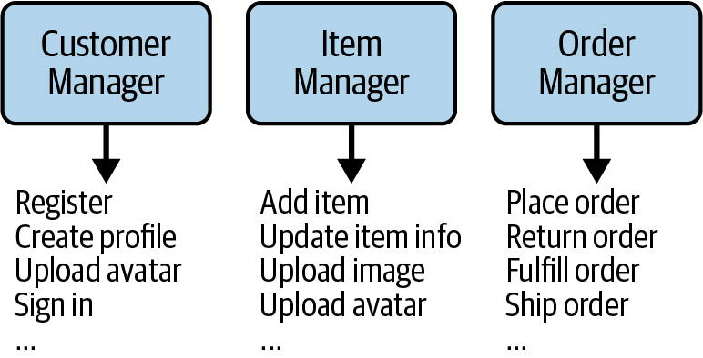

*Hình 8-8. Dùng antipattern Entity Trap tạo ra các component có quá nhiều trách nhiệm*

Nếu một kiến trúc sư đang xây dựng một hệ thống thực sự dựa trên thực thể và chỉ đơn giản thực hiện các thao tác CRUD-based (create, read, update và delete) trên các thực thể đó, thì hệ thống không cần một architecture, mà cần một framework, công cụ CRUD-based, hoặc môi trường no-code/low-code cho phép developer sinh ra phần lớn source code thao tác trên các thực thể đó.

### Gán user story cho component (Assigning User Stories to Components)

Bước tiếp theo trong việc tạo một logical architecture là gán user story hoặc yêu cầu cho các logical component. Đây là một quy trình lặp, vì hầu hết các user story hoặc yêu cầu không được biết đầy đủ ngay từ đầu; chúng tiến hóa khi hệ thống tiến hóa. Bước này nhằm bắt đầu đổ đầy những chiếc xô rỗng đó, mang lại cho các component vai trò và trách nhiệm cụ thể, như minh họa trong [Hình 8-9](#fig-components-filling-buckets).

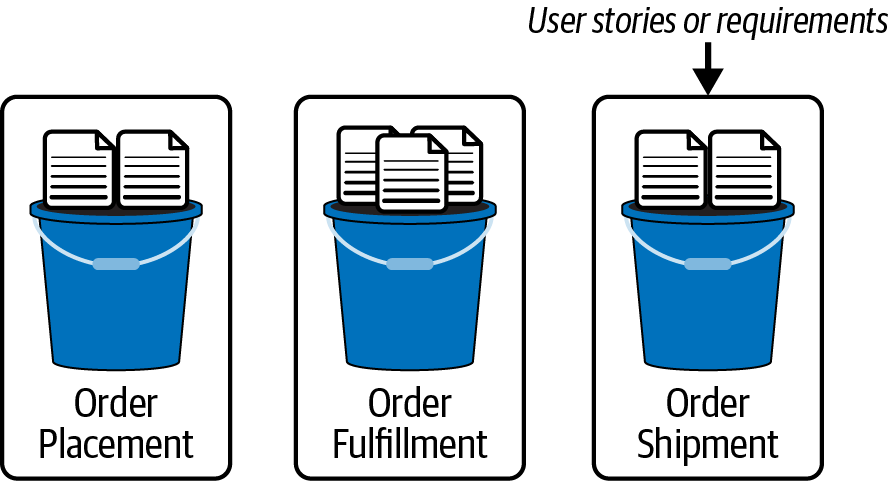

*Hình 8-9. Đổ đầy những chiếc xô rỗng (component) bằng user story hoặc yêu cầu*

Để thấy các logical component tiến hóa như thế nào, hãy xét các user story sau:

**Khách hàng #1**

Là một khách hàng, tôi muốn đơn hàng của mình được kiểm tra để bảo đảm tôi đã nhập mọi thứ đầy đủ và chính xác.

**Người chuẩn bị đơn hàng**

Là người chuẩn bị đơn hàng, tôi muốn biết nên dùng hộp cỡ nào cho đơn hàng, để có thể đóng gói nó theo cách hiệu quả nhất có thể.

**Khách hàng #2**

Là một khách hàng, tôi muốn nhận một email mỗi khi trạng thái đơn hàng thay đổi, để tôi luôn biết tình trạng đơn hàng của mình.

Giả sử kiến trúc sư đã xác định được các logical component sau cho đến lúc này:

- `Order Placement`
- `Order Fulfillment`
- `Order Shipment`
- `Inventory Management`

Hợp lý khi gán user story đầu tiên cho component `Order Placement`, vì đó là component mà người dùng tương tác để đặt đơn hàng:

> Kiểm tra đơn hàng (user story Khách hàng #1) → `Order Placement`

Việc xác định kích thước hộp có lẽ nên được xử lý bởi component `Order Fulfillment`, vì nó chịu trách nhiệm về toàn bộ logic hệ thống cần thiết để chuẩn bị và đóng gói đơn hàng vào hộp:

> Xác định kích thước hộp (user story Người chuẩn bị đơn hàng) → `Order Fulfillment`

Nhưng còn user story thứ ba thì sao? Component nào trong bốn component được liệt kê nên gửi email cho khách hàng khi đơn hàng đã được đặt, sẵn sàng để giao, và đã được giao đi? Câu trả lời có thể là các component `Order Placement`, `Order Fulfillment` và `Order Shipment`. Nhưng hãy nhớ rằng user story được triển khai thông qua source code, vốn cần nằm trong một thư mục hoặc namespace cụ thể. Vì nhân bản code trên ba component không phải là ý hay, kiến trúc sư cần định nghĩa một component mới để xử lý user story này:

> Gửi email cho khách hàng (user story Khách hàng #2) → `Customer Notification` (mới)

Các component `Order Placement`, `Order Fulfillment` và `Order Shipment` cần giao tiếp với component mới để báo cho nó gửi email. Với sự bổ sung này, logical architecture giờ trông như [Hình 8-10](#fig-components-evolve). 

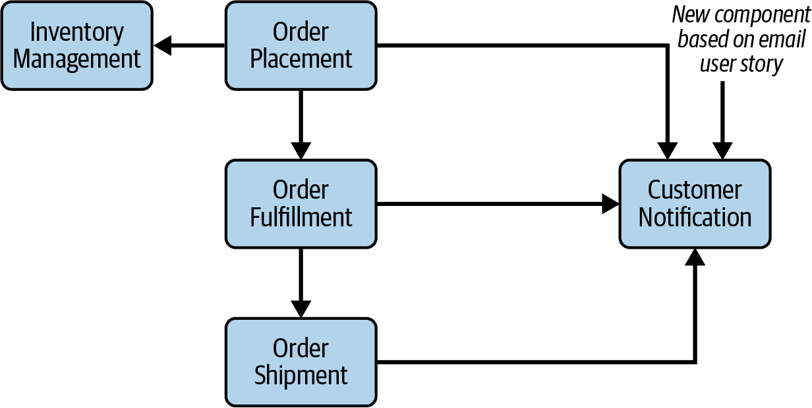

*Hình 8-10. Tiến hóa các component dựa trên các user story mới*

### Phân tích vai trò và trách nhiệm (Analyzing Roles and Responsibilities)

Bước tiếp theo trong việc tinh chỉnh các logical component là phân tích vai trò và trách nhiệm của mỗi component. Đây là cách kiến trúc sư bảo đảm rằng các yêu cầu hoặc user story được gán cho những component đó thuộc về chúng và các component không làm quá nhiều. Điều mà kiến trúc sư quan tâm ở bước này là *cohesion*: các thao tác của một component liên quan với nhau như thế nào và đến mức nào. Theo thời gian, các component có thể trở nên quá lớn, dù các thao tác của chúng đều liên quan với nhau.

Để minh họa bước này hoạt động như thế nào, giả sử kiến trúc sư đã gán các yêu cầu sau cho component `Order Placement`:

- Kiểm tra đơn hàng để bảo đảm mọi trường đã được nhập và đúng.
- Hiển thị giỏ hàng với mô tả, số lượng và giá của các sản phẩm.
- Xác định đúng địa chỉ giao hàng.
- Thu thập thông tin thanh toán.
- Tạo một order ID duy nhất.
- Áp dụng thanh toán cho đơn hàng.
- Điều chỉnh số lượng tồn kho cho các sản phẩm được đặt.
- Gửi email cho khách hàng bản tóm tắt đơn hàng.

Nếu kiến trúc sư viết một phát biểu vai trò và trách nhiệm cho component này, nó sẽ như sau:

> Component này chịu trách nhiệm kiểm tra đơn hàng và hiển thị giỏ hàng hợp lệ, đầy đủ với hình ảnh, mô tả, số lượng và giá của sản phẩm. Component này cũng chịu trách nhiệm xác định đúng địa chỉ giao hàng cho đơn hàng, cũng như thu thập toàn bộ thông tin thanh toán từ khách hàng. Ngoài ra, nó còn chịu trách nhiệm áp dụng thanh toán, điều chỉnh tồn kho, và gửi email cho khách hàng bản tóm tắt đơn hàng.

Dù tất cả các thao tác này đều liên quan đến việc đặt đơn hàng, component `Order Placement` rõ ràng đang gánh quá nhiều trách nhiệm, đặc biệt là việc áp dụng thanh toán, điều chỉnh tồn kho, và gửi email cho khách hàng. Một cách để xem một component có đang gánh quá nhiều trách nhiệm hay không là tìm các cụm từ nối như *và*, *cũng*, *ngoài ra*, hoặc *cũng như* (and, also, in addition, as well as), và việc dùng quá nhiều dấu phẩy.

Nhớ lại từ phần trước của chương rằng một logical component được đại diện bởi một namespace hoặc thư mục trong code repository. Trong trường hợp component `Order Placement`, *toàn bộ* source code đại diện cho component này sẽ nằm trong cùng thư mục hoặc namespace, như *com/app/order/placement* hoặc *com.app.order.placement*. Đây là rất nhiều chức năng—có lẽ quá nhiều code cho một thư mục duy nhất. Do đó, sẽ hợp lý khi tách các file class cho xử lý thanh toán, quản lý tồn kho và giao tiếp email vào các thư mục riêng đại diện cho những chức năng đó. Đó chính xác là ý nghĩa của việc tách các logical component.

Nếu kiến trúc sư chuyển các trách nhiệm áp dụng thanh toán, điều chỉnh tồn kho và gửi email cho khách hàng sang các component riêng, họ có thể giảm trách nhiệm của component `Order Placement` đơn lẻ, khiến nó dễ bảo trì, test và deploy hơn. Các component thu được sẽ trông như thế này:

**`Order Placement`**

- Kiểm tra đơn hàng để bảo đảm mọi trường đã được nhập và đúng.
- Hiển thị giỏ hàng với mô tả, số lượng và giá của các sản phẩm.
- Xác định đúng địa chỉ giao hàng.
- Thu thập thông tin thanh toán.
- Tạo một order ID duy nhất.

**`Payment Processing`**

- Áp dụng thanh toán.

**`Inventory Management`**

- Điều chỉnh số lượng tồn kho cho các sản phẩm được đặt.

**`Customer Notification`**

- Gửi email cho khách hàng bản tóm tắt đơn hàng.

Giờ đây mỗi component có một vai trò và trách nhiệm rõ ràng hơn, khác biệt hơn.

### Phân tích các architectural characteristic (Analyzing Architectural Characteristics)

Bước phân tích cuối cùng là xem xét các architectural characteristic mà hệ thống sẽ cần. Một số architectural characteristic, như scalability, reliability, availability, fault tolerance, elasticity và agility (khả năng phản ứng nhanh với thay đổi), có thể ảnh hưởng đến kích thước của một logical component.

Ví dụ, tách một component lớn (một component có nhiều trách nhiệm) thành các component nhỏ hơn khiến mỗi component dễ bảo trì và test hơn (đó là agility), và mang lại scalability, elasticity và fault tolerance tốt hơn. Một ví dụ tốt khác là khi hai phần của một hệ thống xử lý đầu vào của người dùng: nếu một phần xử lý hàng trăm người dùng đồng thời còn phần kia chỉ cần hỗ trợ vài người dùng một lúc, chúng sẽ cần các architecture characteristic khác nhau. Do đó, trong khi một góc nhìn thuần chức năng về thiết kế component có thể dẫn kiến trúc sư gán một component duy nhất để xử lý tương tác người dùng, việc phân tích các component theo architecture characteristic có thể dẫn đến một sự chia nhỏ.

Vì kiến trúc sư phải biết các architectural characteristic trước khi xây dựng một logical architecture, việc này thường được thực hiện *sau khi* xác định các architectural characteristic nào là quan trọng nhất đối với hệ thống.

### Tái cấu trúc component (Restructuring Components)

Phản hồi là then chốt trong thiết kế phần mềm. Kiến trúc sư phải liên tục lặp lại trên các thiết kế component của mình với sự cộng tác của developer. Thiết kế phần mềm mang lại đủ loại khó khăn bất ngờ. Do đó, một cách tiếp cận lặp cho thiết kế component là then chốt. Thứ nhất, hầu như không thể tính đến tất cả các phát hiện và edge case khác nhau sẽ nảy sinh, bất kỳ cái nào trong số đó cũng có thể thúc đẩy việc thiết kế lại. Thứ hai, khi architecture và developer đi sâu hơn vào việc xây dựng ứng dụng, họ có được hiểu biết tinh tế hơn về nơi các hành vi và vai trò của nó nên nằm.

Kiến trúc sư nên lường trước việc tái cấu trúc component thường xuyên trong suốt vòng đời của một hệ thống hay sản phẩm—không chỉ trong các hệ thống greenfield, mà trong bất kỳ hệ thống nào trải qua bảo trì thường xuyên.

## Coupling giữa các component (Component Coupling)

Khi các component giao tiếp với nhau, hoặc khi một thay đổi ở một component có thể tác động đến các component khác, các component được gọi là bị *coupled* với nhau. Các component của một hệ thống càng coupled, hệ thống càng khó bảo trì và test (xem [Hình 8-11](#fig-components-coupling)). Do đó, điều quan trọng là phải chú ý kỹ đến coupling.

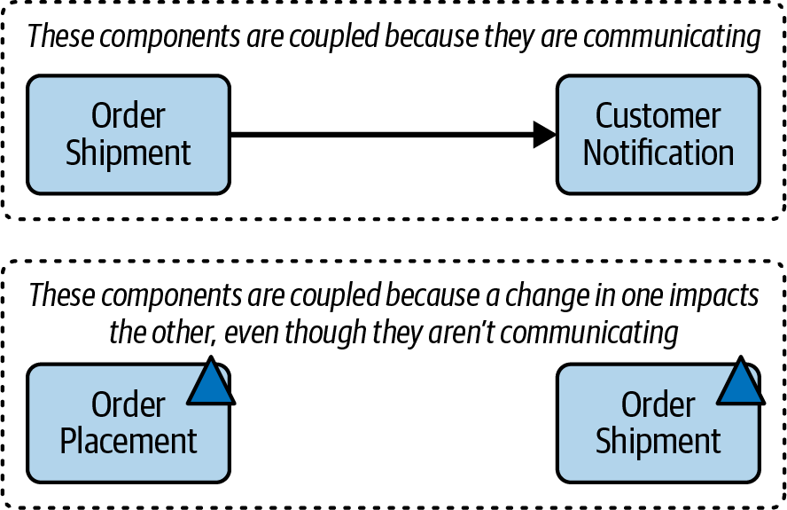

*Hình 8-11. Các component có thể bị coupled ngay cả khi chúng không giao tiếp trực tiếp*

### Coupling tĩnh (Static Coupling)

*Static coupling* xảy ra khi các component giao tiếp đồng bộ với nhau. Kiến trúc sư cần quan tâm đến hai loại coupling: afferent và efferent.

*Afferent coupling* (còn được gọi là coupling *incoming* hoặc *fan-in*) là mức độ mà các component khác phụ thuộc vào một component đích. Chẳng hạn, xét component `Customer Notification` từ ví dụ order-entry của chúng ta trong [Hình 8-12](#fig-components-afferent). Để gửi email cho khách hàng, cả component `Order Placement` và `Order Shipment` đều cần giao tiếp với component `Customer Notification`. Điều này có nghĩa là component `Customer Notification` được gọi là *afferently coupled* với các component `Order Placement` và `Order Shipment` và sẽ có mức afferent coupling là 2 (số phụ thuộc đi vào). Afferent coupling thường được ký hiệu là *CA*.

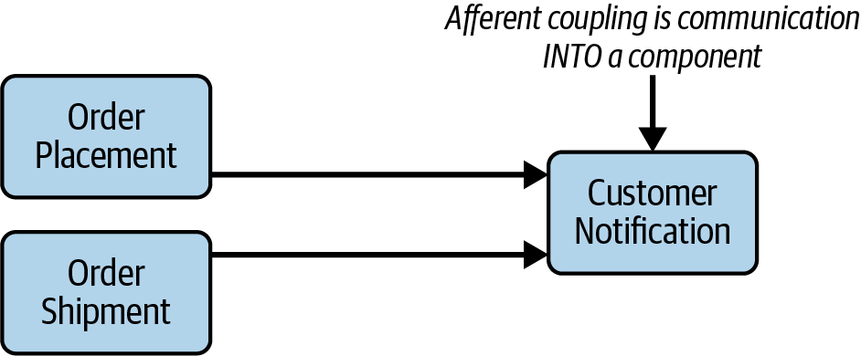

*Hình 8-12. Component `Customer Notification` là afferently coupled với các component khác*

*Efferent coupling* (còn được gọi là coupling *outgoing* hoặc *fan-out*) là mức độ mà một component đích phụ thuộc vào các component khác. Ví dụ, như minh họa trong [Hình 8-13](#fig-components-efferent), component `Order Placement` phụ thuộc vào component `Order Fulfillment` và, như vậy, là efferently coupled với nó và sẽ có mức efferent coupling là 1 (số phụ thuộc đi ra). Efferent coupling thường được ký hiệu là *CE*.

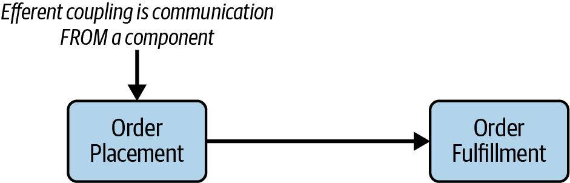

*Hình 8-13. Component `Order Placement` là efferently coupled với component `Order` `Fulfillment`*

### Coupling thời gian (Temporal Coupling)

*Temporal coupling* (coupling thời gian) mô tả các phụ thuộc không tĩnh, thường là những phụ thuộc dựa trên thời điểm hoặc *transaction* (các đơn vị công việc đơn lẻ). Ví dụ, khi hệ thống đang xử lý một đơn hàng, chức năng trong component `Order Placement` phải được gọi trước chức năng trong component `Order Shipment`. Do đó, các component này được gọi là temporally coupled.

Vấn đề với temporal coupling là nó khó phát hiện bằng các công cụ hiện có trên thị trường. Trong hầu hết các trường hợp, loại coupling này thay vào đó được xác định thông qua tài liệu thiết kế hoặc được phát hiện qua các tình trạng lỗi.

### Định luật Demeter (The Law of Demeter)

Hầu hết kiến trúc sư được dặn phải phấn đấu cho loose coupling trong thiết kế hệ thống. Ít coupling hơn giữa các component hoặc service khiến hệ thống dễ bảo trì hơn, dễ test hơn, và ít rủi ro hơn khi deploy. Nó cũng tăng reliability tổng thể của hệ thống, vì các thay đổi tác động đến ít component hơn, tạo ra ít cơ hội gây lỗi hơn.

Một kỹ thuật để tạo các hệ thống loosely coupled được gọi là *Law of Demeter* (Định luật Demeter), còn được biết đến là *Principle of Least Knowledge* (Nguyên lý biết ít nhất). Trong thần thoại Hy Lạp, nữ thần Demeter sản xuất toàn bộ ngũ cốc cho cả thế giới, nhưng bà không biết con người làm gì với nó (nuôi gia súc, làm bánh mì, v.v.). Demeter về thực chất đã được decoupled khỏi phần còn lại của thế giới.

Law of Demeter phát biểu: *một component hoặc service nên có hiểu biết hạn chế về các component hoặc service khác.* Dù điều này nghe có vẻ đơn giản và hiển nhiên, nó không phải vậy. Hãy để chúng tôi cho bạn thấy ý chúng tôi là gì.

Xét các component và giao tiếp tương ứng của chúng được minh họa trong [Hình 8-14](#fig-components-demeter-before). Khi chấp nhận đơn hàng của khách hàng, component `Order Placement` phải bảo component `Inventory Management` giảm tồn kho. Nếu hàng tồn xuống quá thấp, component `Order Placement` phải làm hai việc: bảo component `Supplier Ordering` đặt thêm hàng từ nhà cung cấp, và bảo component `Item Pricing` điều chỉnh giá dựa trên nguồn cung hạn chế hiện có. Cuối cùng, khi tất cả những việc này đã xong, component `Order Placement` bảo component `Email Notification` gửi email cho khách hàng với chi tiết đơn hàng.

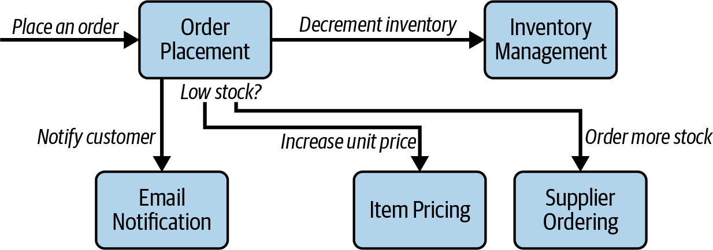

*Hình 8-14. Component `Order Placement` bị coupled cao với phần còn lại của hệ thống vì nó có quá nhiều hiểu biết*

Lưu ý rằng, trong architecture này, component `Order Placement` bị coupled cao với các component khác. Dù nó không có *trách nhiệm* thực hiện các hành động đó, nó có *hiểu biết* rằng các hành động này cần xảy ra—và càng nhiều hiểu biết nghĩa là coupling càng chặt.

Ý tưởng đằng sau Law of Demeter là giới hạn *hiểu biết* của mỗi component về phần còn lại của hệ thống. Trong [Hình 8-14](#fig-components-demeter-before), component `Order Placement` biết rằng tồn kho phải được giảm, có thể cần đặt thêm hàng, giá sản phẩm có thể cần được điều chỉnh, và một email phải được gửi cho khách hàng. (Đó là rất nhiều hiểu biết!) Nhưng nếu hiểu biết đó có thể được phân phối cho các component khác thì sao? Nếu vậy, kiến trúc sư có thể decouple hiệu quả component đó khỏi phần còn lại của hệ thống.

Để thấy Law of Demeter có thể được áp dụng thế nào để giảm coupling giữa các component, hãy tham khảo hệ thống trong [Hình 8-14](#fig-components-demeter-before). Nếu kiến trúc sư thêm một component khác giữa `Order Placement` và `Inventory Management` để trì hoãn *hiểu biết* rằng tồn kho phải được giảm, component `Order Placement` vẫn sẽ có cùng mức efferent coupling (đi ra). Do đó, điểm coupling đó cần được giữ nguyên.

Tuy nhiên, còn hiểu biết rằng, nếu nguồn cung xuống quá thấp, hệ thống phải đặt thêm hàng và điều chỉnh giá sản phẩm thì sao? Cả hai mẩu hiểu biết đó *có thể* được chuyển cho component `Inventory Management`, qua đó giảm mức coupling của component `Order Placement`. [Hình 8-15](#fig-components-demeter-after) minh họa architecture thu được sau khi áp dụng Law of Demeter. Loại bỏ *hiểu biết* rằng một số chức năng nhất định cần xảy ra khiến component `Order Placement` ít coupled hơn với phần còn lại của hệ thống.

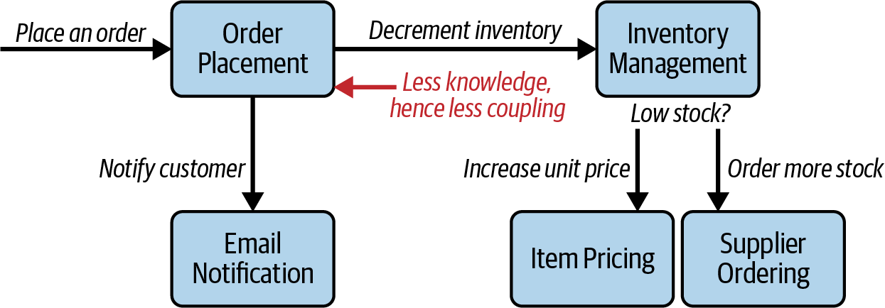

*Hình 8-15. Component `Order Placement` ít coupled hơn với hệ thống khi nó có ít hiểu biết hơn*

Người đọc tinh ý sẽ nhận thấy rằng, trong khi việc áp dụng Law of Demeter đã giảm mức coupling của component `Order Placement`, nó cũng *tăng* mức coupling của component `Inventory Management`. Áp dụng Law of Demeter không nhất thiết giảm mức coupling system-wide; thay vào đó, nó thường phân phối lại coupling đó sang các phần khác nhau của hệ thống.

## Nghiên cứu tình huống: Going, Going, Gone—Khám phá component (Case Study: Going, Going, Gone—Discovering Components)

Nếu một team không có ràng buộc đặc biệt nào và đang tìm kiếm một cách phân rã component general-purpose tốt, cách tiếp cận Actor/Actions hoạt động tốt như một giải pháp chung.

Nếu kiến trúc sư áp dụng cách tiếp cận Actor/Action cho Going, Going, Gone (GGG), họ sẽ thấy rằng hệ thống này có ba vai trò chính: *người đặt giá* (bidder), *người điều khiển đấu giá* (auctioneer), và *hệ thống* (system)—một thành phần thường xuyên tham gia trong kỹ thuật mô hình hóa này cho các hành động nội bộ. Các vai trò tương tác với hệ thống bằng các hành động chính sau:

**`Bidder`**

- Xem video stream trực tiếp.
- Xem bid stream trực tiếp.
- Đặt giá.

**`Auctioneer`**

- Nhập các lượt đặt giá trực tiếp vào hệ thống.
- Nhận các lượt đặt giá trực tuyến.
- Đánh dấu vật phẩm đã bán.

**`System`**

- Bắt đầu phiên đấu giá.
- Thực hiện thanh toán.
- Theo dõi hoạt động của người đặt giá.

Với những hành động này, kiến trúc sư có thể xây dựng một tập component khởi đầu cho GGG rồi lặp lại trên đó. Một giải pháp như vậy xuất hiện trong [Hình 8-16](#ch-component-based-thinking-GGGcomps).

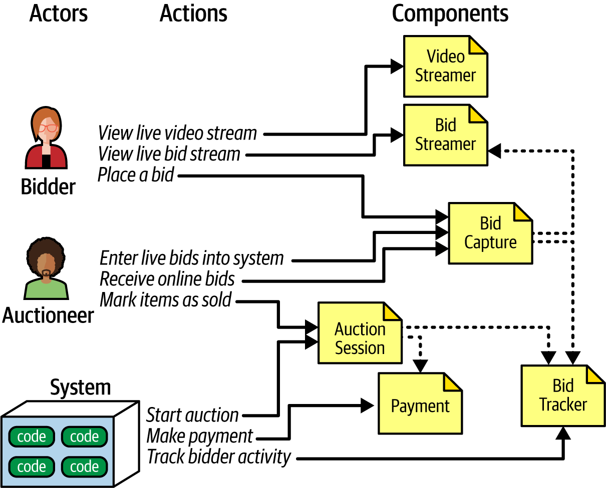

*Hình 8-16. Tập component ban đầu cho Going, Going, Gone*

Trong [Hình 8-16](#ch-component-based-thinking-GGGcomps), mỗi vai trò và hành động ánh xạ tới một component. Các component có thể cần cộng tác để chia sẻ thông tin. Đây là các component chúng tôi đã xác định cho giải pháp này:

**`Video Streamer`**

Stream một phiên đấu giá trực tiếp tới người dùng.

**`Bid Streamer`**

Stream các lượt đặt giá tới người dùng khi chúng xảy ra. Cả `Video Streamer` và `Bid Streamer` đều cung cấp cho người đặt giá một khung nhìn read-only về phiên đấu giá.

**`Bid Capture`**

Component này thu nhận các lượt đặt giá từ người điều khiển đấu giá và người đặt giá.

**`Bid Tracker`**

Theo dõi các lượt đặt giá và đóng vai trò system of record (hệ thống ghi nhận chính thức).

**`Auction Session`**

Bắt đầu một phiên đấu giá. Khi người đặt giá thắng và phiên đấu giá cho vật phẩm đó kết thúc, component này kích hoạt các bước thanh toán và giải quyết, bao gồm thông báo cho người đặt giá về vật phẩm tiếp theo được đưa ra đấu giá.

**`Payment`**

Một bộ xử lý thanh toán third-party cho thanh toán bằng thẻ tín dụng.

Sau vòng xác định component ban đầu (xem [Hình 8-6](#fig-components-flow)), kiến trúc sư phân tích các architecture characteristic đã xác định trước đó để xem có characteristic nào sẽ thay đổi thiết kế của component không. Ví dụ, thiết kế hiện tại có một component `Bid Capture` để thu nhận các lượt đặt giá từ cả người đặt giá và người điều khiển đấu giá. Điều này hợp lý về mặt chức năng: các lượt đặt giá từ bất kỳ ai cũng có thể được thu nhận và xử lý theo cùng một cách. Nhưng việc thu nhận lượt đặt giá đòi hỏi những architecture characteristic đã xác định trước đó nào? Người điều khiển đấu giá không cần cùng mức scalability hay elasticity như người đặt giá, những người có thể lên tới hàng nghìn.

Tương tự, người điều khiển đấu giá có thể cần một số architecture characteristic đã xác định trước đó hơn so với các phần khác của hệ thống—như reliability (bảo đảm kết nối không bị rớt) và availability (bảo đảm hệ thống luôn hoạt động). Ví dụ, trong khi sẽ là điều tồi tệ cho việc kinh doanh nếu một người đặt giá không thể đăng nhập vào trang web hoặc bị rớt kết nối, thì sẽ là thảm họa nếu một trong hai điều đó xảy ra với người điều khiển đấu giá.

Để hỗ trợ các mức nhu cầu khác nhau của người đặt giá và người điều khiển đấu giá đối với cùng các architecture characteristic, kiến trúc sư quyết định tách component `Bid Capture` thành hai component: `Bid Capture` và `Auctioneer Capture`. Thiết kế cập nhật xuất hiện trong [Hình 8-17](#ch-component-based-thinking-GGG-final-comps).

Kiến trúc sư tạo một component mới cho `Auctioneer Capture`. Họ cũng cập nhật các liên kết thông tin từ `Auctioneer Capture` tới cả `Bid Streamer` (để hiển thị cho người đặt giá trực tuyến các lượt đặt giá trực tiếp) và `Bid Tracker` (để quản lý các luồng đặt giá). `Bid Tracker` giờ là component sẽ hợp nhất hai luồng thông tin rất khác nhau: luồng thông tin duy nhất của người điều khiển đấu giá và nhiều luồng từ người đặt giá.

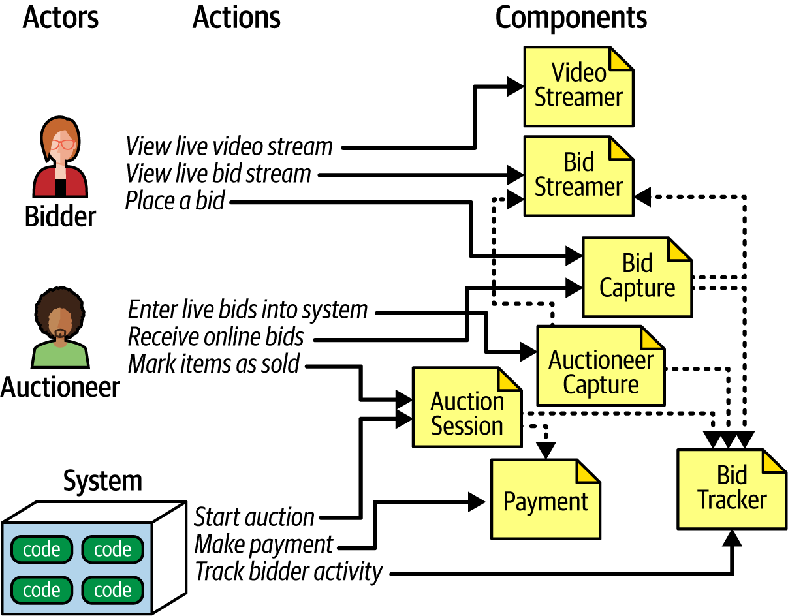

*Hình 8-17. Các component đã chỉnh sửa của nghiên cứu tình huống GGG*

Thiết kế trong [Hình 8-17](#ch-component-based-thinking-GGG-final-comps) khó có thể là thiết kế cuối cùng. Cần khám phá thêm nhiều yêu cầu: người dùng sẽ đăng ký tài khoản mới như thế nào, các chức năng thanh toán sẽ được quản trị ra sao, v.v. Tuy nhiên, thiết kế này cung cấp một điểm khởi đầu tốt để tiếp tục lặp.

Đây là một tập component khả dĩ để giải quyết vấn đề GGG—nhưng nó không nhất thiết là tốt nhất hay duy nhất. Có rất ít hệ thống phần mềm chỉ có thể được triển khai theo một cách duy nhất. Mỗi thiết kế có các tập trade-offs khác nhau. Là một kiến trúc sư, đừng ám ảnh về việc tìm ra “một thiết kế đúng duy nhất,” vì có nhiều thiết kế sẽ đáp ứng được. Hãy cố đánh giá trade-offs giữa các quyết định thiết kế khác nhau một cách khách quan nhất có thể, và chọn thiết kế có tập trade-offs “ít tệ nhất”.
