

# Chương 9. Nền tảng (Foundations)

Chúng tôi biết bạn đang nóng lòng muốn đi vào chi tiết của các architecture style và pattern, nhưng trước hết chúng tôi phải đề cập một số nội dung nền tảng và định nghĩa để thiết lập bối cảnh phù hợp cho các chương sau.

## Style so với pattern (Styles Versus Patterns)

Trước hết chúng ta cần phân biệt giữa *architectural style* và *pattern trong architecture*, hai thứ rất dễ bị nhầm lẫn.

Style của một architecture mô tả một số characteristic khác nhau của architecture đó, bao gồm:

**Topology của component (Component topology)**

Một architectural style định nghĩa cách các component và các phụ thuộc của chúng được tổ chức. Ví dụ, một layered architecture tổ chức các layer component theo năng lực kỹ thuật của chúng, trong khi một modular monolith tổ chức các component của nó xoay quanh các domain (xem thêm về sự khác biệt này trong [“Architecture Partitioning”](#sec_partitioning)).

**Physical architecture**

Thường thì style quyết định loại physical architecture: hoặc monolith hoặc phân tán. Ví dụ, một modular monolith nhìn chung là một monolithic architecture với một database duy nhất, trong khi một event-driven architecture luôn luôn phân tán.

**Deployment**

Granularity của một hệ thống và tần suất deployment của nó thường gắn với architectural style của nó. Các team thường deploy các monolithic architecture như một lần deployment duy nhất cùng với một relational database duy nhất. Ngược lại, các architecture phân tán có agility cao, như microservices, có tích hợp tự động, provisioning tự động, và đôi khi deployment tự động; chúng thường được deploy theo từng phần, với nhịp độ nhanh hơn nhiều.

**Style giao tiếp (Communication style)**

Architectural style cũng quyết định cách các component giao tiếp với nhau. Các monolithic architecture có thể thực hiện các lời gọi method bên trong monolith, trong khi các architecture phân tán giao tiếp qua các giao thức mạng, như REST hoặc message queue.

**Topology dữ liệu (Data topology)**

Giống như topology của component, topology dữ liệu của một hệ thống thường được quyết định bởi architectural style của nó. Các monolithic architecture có xu hướng có một monolithic database, trong khi các architecture phân tán đôi khi tách dữ liệu—tùy thuộc vào triết lý của architecture style.

Đặt tên cho một style cung cấp một cách súc tích để mô tả tập yếu tố phức tạp này. Mỗi cái tên nắm bắt một kho chi tiết đã được hiểu—đó là một trong những mục đích của design pattern. Tuy nhiên, trong khi một pattern nắm bắt một giải pháp gắn với bối cảnh, một style đặc thù hơn cho architecture, mô tả các khía cạnh được liệt kê ở trên. Một architecture style mô tả topology của architecture và các characteristic được giả định và mặc định của nó, cả có lợi lẫn có hại. Chúng tôi đề cập một vài architecture pattern hiện đại phổ biến trong [Chương 20](ch20_architectural_patterns.vi.md#ch-architectural-patterns). Kiến trúc sư nên quen thuộc với một số style nền tảng vốn là các khối xây dựng chung của hệ thống.

> **Các architectural style đến từ đâu? (Where Do Architectural Styles Come From?)**
>
> Trái với quan niệm phổ biến, không có một nhóm kín kiến trúc chính thức nào họp trong tháp ngà để quyết định architectural style mới nào sẽ đến tiếp theo. Thay vào đó, các style mới nổi lên từ các hệ sinh thái liên tục tiến hóa mà kiến trúc sư làm việc trong đó.
>
> Ví dụ, giả sử một kiến trúc sư khéo léo nhận thấy rằng một năng lực mới vừa xuất hiện trong hệ sinh thái giải quyết được một vấn đề dai dẳng cụ thể. Họ quyết định kết hợp nó với một số thứ khác, mới và cũ. Các kiến trúc sư khác thấy giải pháp khéo léo này và sao chép nó. Nó trở nên đủ phổ biến để việc đặt cho nó một cái tên giúp thảo luận dễ dàng hơn.
>
> Architecture style microservices là một ví dụ tuyệt vời về hiện tượng này. Sự trỗi dậy của các năng lực DevOps mới, các hệ điều hành open source đáng tin cậy, và triết lý domain-driven design đã cho phép kiến trúc sư xây dựng hệ thống theo những cách mới để giải quyết các vấn đề như scalability. Cái tên *microservices* ra đời như một phản ứng với các architecture style phổ biến thời đó, vốn có các service lớn và orchestration rộng khắp. Microservices là một cái nhãn, không phải một mô tả. Nó không phải là một mệnh lệnh để các team xây dựng các service nhỏ nhất có thể mà là một cách để gọi tên architecture style này.

## Các pattern nền tảng (Fundamental Patterns)

Một số pattern nền tảng xuất hiện lặp đi lặp lại trong suốt lịch sử software architecture, nhìn chung vì chúng cung cấp một góc nhìn hữu ích về việc tổ chức code, deployment, hoặc các khía cạnh khác của architecture. Ví dụ, khái niệm các layer tách biệt các mối quan tâm khác nhau dựa trên chức năng cũng lâu đời như chính phần mềm. Thế nhưng các layer (trong cả style lẫn pattern) vẫn tiếp tục biểu hiện dưới nhiều hình thức khác nhau, bao gồm các biến thể hiện đại mà chúng tôi thảo luận trong [Chương 10](ch10_layered_architecture_style.vi.md#ch-style-layered).

Than ôi, có một antipattern phổ biến khác bắt nguồn từ sự thiếu vắng architecture: Big Ball of Mud.

### Big Ball of Mud

Kiến trúc sư gọi sự thiếu vắng bất kỳ cấu trúc kiến trúc nào có thể nhận ra là một *Big Ball of Mud* (Quả bóng bùn lớn), được đặt theo tên antipattern mà Brian Foote và Joseph Yoder định nghĩa trong một bài báo năm 1997 được trình bày tại hội nghị Patterns Languages of Programs năm 1997.

> Một *Big Ball of Mud* là một khu rừng spaghetti-code có cấu trúc tùy tiện, lan man, cẩu thả, kiểu duct-tape-and-baling-wire (chắp vá bằng băng dính và dây buộc). Những hệ thống này cho thấy những dấu hiệu không thể nhầm lẫn của sự tăng trưởng không được kiểm soát, và việc sửa chữa vội vàng lặp đi lặp lại. Thông tin được chia sẻ bừa bãi giữa các phần tử xa nhau của hệ thống, thường đến mức gần như toàn bộ thông tin quan trọng trở thành global hoặc bị nhân bản.
>
> Cấu trúc tổng thể của hệ thống có thể chưa bao giờ được định nghĩa rõ ràng.
>
> Nếu đã từng có, nó có thể đã bị xói mòn đến mức không còn nhận ra. Những lập trình viên có chút nhạy cảm về kiến trúc đều tránh xa những vũng lầy này. Chỉ những người không quan tâm đến architecture, và, có lẽ, cảm thấy thoải mái với sức ì của công việc vặt day-to-day là vá các lỗ hổng trên những con đê đang vỡ này, mới hài lòng làm việc trên những hệ thống như vậy.

Ngày nay, *Big Ball of Mud* có thể mô tả một ứng dụng scripting đơn giản không có cấu trúc bên trong thực sự, có các event handler nối thẳng tới các lời gọi database. Nhiều ứng dụng tầm thường bắt đầu như thế này, rồi trở nên cồng kềnh khi chúng phát triển.

Nhìn chung, hãy tránh loại architecture này bằng mọi giá. Sự thiếu cấu trúc của nó khiến thay đổi ngày càng khó khăn. Những architecture như vậy cũng gặp các vấn đề về deployment, testability, scalability và performance. Những hệ thống này càng lớn, nỗi đau gây ra bởi sự thiếu architecture của chúng càng tệ hơn.

Đáng tiếc là antipattern này xảy ra khá thường xuyên trong thế giới thực. Ít kiến trúc sư có ý định tạo ra một mớ hỗn độn, nhưng nhiều dự án lại vô tình làm được điều đó, thường là do thiếu governance đối với chất lượng và cấu trúc code. Ví dụ, Neal từng làm việc trong một dự án khách hàng có cấu trúc như trong [Hình 9-1](#fig-architecture-styles-ball-of-mud).

Khách hàng (tên được giấu vì những lý do hiển nhiên) đã tạo một ứng dụng web Java-based nhanh nhất có thể trong suốt vài năm. Hình ảnh trực quan kỹ thuật trong [Hình 9-1](#fig-architecture-styles-ball-of-mud) thể hiện coupling của nó: mỗi chấm trên chu vi hình tròn đại diện cho một class, và mỗi đường đại diện cho một kết nối giữa các class, với các đường đậm hơn biểu thị các kết nối mạnh hơn. Trong code base này, thay đổi một class theo bất kỳ cách nào cũng khiến khó dự đoán tác động lên các class khác, biến việc thay đổi thành một việc đáng sợ.

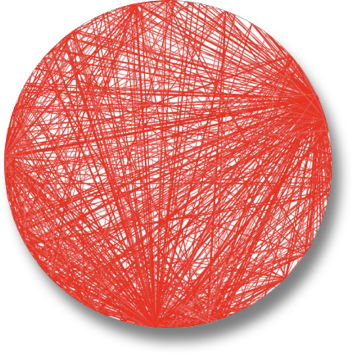

*Hình 9-1. Một Big Ball of Mud architecture được trực quan hóa từ một code base thực. (Được tạo bằng một công cụ now-retired (nay đã ngừng) tên là XRay, một plug-in của Eclipse.)*

Vấn đề với các Big Ball of Mud architecture không chỉ là sự thiếu cấu trúc. Vì mọi thứ đều coupled với mọi thứ khác, các thay đổi có xu hướng gây ra những tác dụng phụ lan tỏa hard-to-predict. Vấn đề này có thể đạt tới điểm tới hạn khi developer dành toàn bộ thời gian để đuổi theo bug và các tác dụng phụ của chúng, thay vì làm các tính năng mới.

### Unitary architecture (Unitary Architecture)

Thuở ban đầu, chỉ có máy tính, và phần mềm chạy trên nó. Cả hai khởi đầu là một thực thể duy nhất, rồi tách ra khi chúng tiến hóa và nhu cầu về các năng lực tinh vi hơn tăng lên. Ví dụ, máy tính mainframe khởi đầu là các hệ thống đơn nhất, rồi dần dần tách dữ liệu thành loại hệ thống riêng. Tương tự, khi máy tính cá nhân (PC) lần đầu được phát triển thương mại, trọng tâm phần lớn là các máy đơn lẻ. Khi việc nối mạng PC trở nên phổ biến, các hệ thống phân tán (như client/server) xuất hiện.

### Client/Server

Rất ít unitary architecture tồn tại bên ngoài các hệ thống nhúng và các môi trường bị ràng buộc cao khác. Nhìn chung, các hệ thống phần mềm có xu hướng thêm chức năng theo thời gian, và việc tách biệt các mối quan tâm trở nên cần thiết để duy trì các architecture characteristic vận hành của chúng, như performance và quy mô.

Nhiều architecture style giải quyết cách tách các phần của hệ thống một cách hiệu quả. Một style nền tảng trong architecture tách chức năng kỹ thuật giữa frontend và backend: đây được gọi là architecture *two-tier* (hai tầng), hay *client/server*. Nó có nhiều biến thể khác nhau, tùy thuộc vào thời kỳ và năng lực tính toán của hệ thống.

#### Desktop và database server (Desktop and database server)

Một PC architecture thời kỳ đầu khuyến khích developer viết các ứng dụng desktop phong phú trên các giao diện người dùng như Windows, tách dữ liệu vào một database server riêng. Architecture này trùng với sự xuất hiện của các database server độc lập có thể kết nối qua các giao thức mạng chuẩn. Điều này cho phép logic trình bày nằm trên desktop, trong khi các hành động tính toán nặng hơn (cả về khối lượng lẫn độ phức tạp) diễn ra trên các database server mạnh mẽ hơn.

#### Trình duyệt và web server (Browser and web server)

Khi phát triển web hiện đại xuất hiện, việc tách architecture thành một trình duyệt web kết nối tới một web server (mà web server, đến lượt nó, kết nối tới một database server) trở nên phổ biến. Sự tách biệt trách nhiệm này tương tự biến thể desktop nhưng với client còn mỏng hơn nữa là trình duyệt, cho phép phân phối rộng hơn cả bên trong lẫn bên ngoài firewall. Dù database tách biệt khỏi web server, nhiều kiến trúc sư vẫn coi đây là một two-tier architecture, vì web server và database server chạy trên một loại máy trong trung tâm vận hành, trong khi UI chạy trên trình duyệt của người dùng.

#### Ứng dụng JavaScript một trang (Single-page JavaScript applications)

Khi khả năng phản hồi của web được cải thiện, các hiện thực JavaScript trong trình duyệt cũng vậy. Một họ các ứng dụng kiểu client/server nổi lên, giống với biến thể desktop ban đầu, nhưng với rich client được viết bằng JavaScript trong trình duyệt, thay vì là một ứng dụng desktop.

Như mục này minh họa, sẽ luôn có các layer để tách các phần khác nhau của architecture, tùy thuộc vào nhu cầu của ứng dụng và năng lực của nền tảng.

#### Ba tầng (Three-tier)

*Three-tier architecture* (kiến trúc ba tầng), vốn mang lại thêm nhiều layer tách biệt hơn nữa, trở nên phổ biến vào cuối thập niên 1990s. Khi các công cụ như application server trở nên nổi bật trong Java và .NET, các công ty bắt đầu xây dựng thêm nhiều layer vào topology của họ. Một hệ thống có thể có một database tier dùng một database server industrial-strength; một application tier được quản lý bởi một application server; và một frontend được viết bằng HTML được sinh ra và, ngày càng nhiều hơn, JavaScript (khi năng lực của nó mở rộng).

Kiến trúc three-tier tương ứng với các giao thức network-level như [Common Object Request Broker Architecture (CORBA)](https://www.corba.org) và [Distributed Component Object Model (DCOM)](https://oreil.ly/1TEqv) để hỗ trợ việc xây dựng các architecture phân tán.

Giống như developer ngày nay không lo lắng về cách các giao thức mạng như TCP/IP hoạt động (vì chúng cứ thế hoạt động), hầu hết kiến trúc sư không phải lo lắng về mức “đường ống” này trong các architecture phân tán. Các năng lực được cung cấp bởi công cụ của thời kỳ đó ngày nay tồn tại hoặc dưới dạng công cụ (như message queue) hoặc dưới dạng architecture pattern (như event-driven architecture, được đề cập trong [Chương 15](ch15_event_driven_architecture_style.vi.md#ch-style-eda)).

> **Kiến trúc ba tầng, thiết kế ngôn ngữ và những hệ quả dài hạn (Three-Tier Architectures, Language Design, and Long-Term Implications)**
>
> Trong thập niên 1990s, khi ngôn ngữ Java được thiết kế, tính toán three-tier đang là cơn sốt. Người ta cho rằng, trong tương lai, mọi hệ thống sẽ có three-tier architecture. Một trong những cơn đau đầu phổ biến với các ngôn ngữ hiện có thời đó, như C++, là việc di chuyển các đối tượng qua mạng một cách nhất quán giữa các hệ thống cồng kềnh đến mức nào. Vì vậy các nhà thiết kế Java quyết định xây dựng năng lực này vào lõi của nó, dùng một cơ chế gọi là *serialization*.
>
> Mọi đối tượng Java đều hiện thực một interface đòi hỏi nó hỗ trợ serialization. Các nhà thiết kế cho rằng vì three-tiered architecture sẽ tồn tại mãi mãi, việc đưa nó vào ngôn ngữ sẽ mang lại sự tiện lợi lớn. Tất nhiên, architectural style đó đã đến rồi đi—nhưng những thứ còn sót lại vẫn xuất hiện trong Java cho đến ngày nay. Dù hầu như không ai còn dùng serialization, các tính năng Java mới vẫn phải hỗ trợ nó để tương thích ngược, khiến các nhà thiết kế ngôn ngữ vô cùng bực bội.
>
> Hiểu được những hệ quả long-term của các quyết định thiết kế luôn là điều nằm ngoài tầm với của chúng ta, trong phần mềm cũng như trong các ngành kỹ thuật khác. Lời khuyên muôn thuở là ưu tiên các thiết kế đơn giản, theo nhiều cách, chính là một chiến lược future-proofing (phòng xa cho tương lai).

## Phân vùng architecture (Architecture Partitioning)

Định luật thứ nhất của software architecture phát biểu rằng mọi thứ trong phần mềm đều là một trade-off, và điều đó bao gồm cả cách kiến trúc sư phân vùng các component trong một architecture. Vì component đại diện cho một cơ chế chứa đựng chung, kiến trúc sư có thể phân vùng chúng theo bất kỳ cách nào họ muốn. Có một số style phổ biến, với các tập trade-offs khác nhau. Một kiểu sắp xếp component cụ thể có tác động lớn bất thường: *top-level partitioning* (phân vùng cấp cao nhất).

Trong hai architecture style được mô tả ở [Hình 9-2](#ch-component-based-thinking-generic-partition), một style sẽ quen thuộc với nhiều người: *layered monolith* (được thảo luận chi tiết trong [Chương 10](ch10_layered_architecture_style.vi.md#ch-style-layered)). Style còn lại, gọi là *modular monolith*, là một architecture style được [Simon Brown](https://simonbrown.je) phổ biến, gồm một deployment unit duy nhất, gắn với một database và được phân vùng xoay quanh các domain thay vì năng lực kỹ thuật (được thảo luận trong [Chương 11](ch11_the_modular_monolith_architecture_style.vi.md#ch-style-modular-mono)). Hai style này đại diện cho hai phương pháp top-level partitioning khác nhau. Lưu ý rằng trong cả hai biến thể, mỗi layer hoặc component top-level có lẽ đều có các component khác được lồng bên trong. Top-level partitioning được kiến trúc sư đặc biệt quan tâm vì nó định nghĩa một architecture style nền tảng và cách phân vùng code.

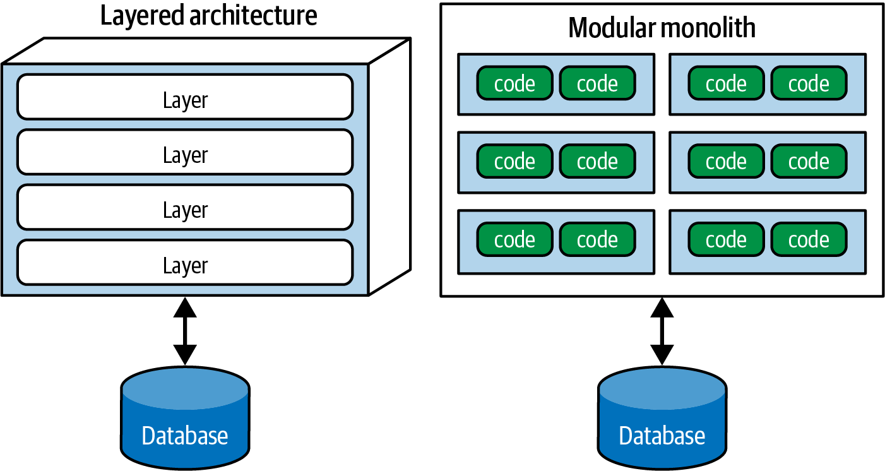

*Hình 9-2. Hai loại top-level partitioning: kỹ thuật (như layered architecture) và domain (như modular monolith)*

Tổ chức architecture dựa trên năng lực kỹ thuật của nó, như style layered monolith làm, đại diện cho *technical top-level partitioning* (phân vùng cấp cao nhất theo kỹ thuật).

Một phiên bản phổ biến của điều này xuất hiện trong [Hình 9-3](#ch-component-based-thinking-partition-specific), nơi kiến trúc sư đã phân vùng chức năng của hệ thống thành các năng lực *kỹ thuật*: trình bày, quy tắc nghiệp vụ, service, persistence, v.v. Cách tổ chức một code base như vậy chắc chắn là hợp lý. Toàn bộ code persistence nằm trong một layer, giúp developer dễ tìm code persistence-related. Dù khái niệm cơ bản của layered architecture có trước nó hàng thập kỷ, design pattern Model-View-Controller (một trong các pattern nền tảng trong [*Head First Design Patterns*](https://www.oreilly.com/library/view/head-first-design/9781492077992) của Eric Freeman và Elisabeth Robson (O’Reilly, 2020)) khớp với architectural pattern này, khiến developer dễ hiểu nó. Do đó, ở nhiều tổ chức, nó là architecture mặc định.

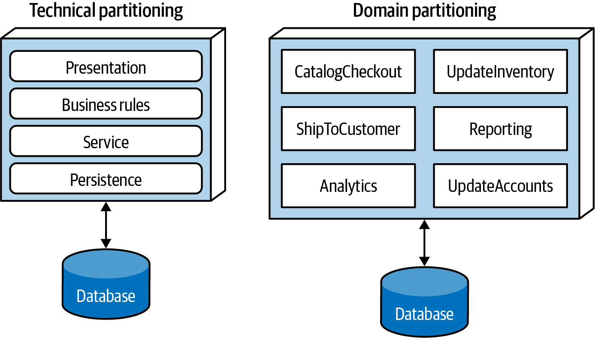

*Hình 9-3. Hai loại top-level partitioning trong architecture*

Một tác dụng phụ thú vị của sự thống trị của layered architecture liên quan đến việc các công ty thường sắp xếp chỗ ngồi trong văn phòng vật lý theo các vai trò dự án khác nhau. Do Định luật Conway (Conway’s Law), khi dùng layered architecture, việc để tất cả backend developer ngồi cùng nhau trong một phòng ban, các DBA ở phòng ban khác, team trình bày ở phòng ban khác nữa, v.v. là có phần hợp lý.

Biến thể kiến trúc còn lại trong [Hình 9-3](#ch-component-based-thinking-partition-specific) là *domain partitioning* (phân vùng theo domain), một kỹ thuật mô hình hóa để phân rã các hệ thống phần mềm phức tạp, tổ chức các component theo domain thay vì năng lực kỹ thuật. Domain partitioning được lấy cảm hứng từ cuốn sách *Domain-Driven Design* của Eric Evans. Trong DDD, kiến trúc sư xác định các domain hoặc workflow, độc lập và decoupled với nhau. Architecture style microservices dựa trên triết lý này.

Một modular monolith architecture được phân vùng xoay quanh các domain hoặc workflow, thay vì năng lực kỹ thuật. Vì các component thường lồng vào nhau, mỗi component trong architecture domain-partitioned ở [Hình 9-3](#ch-component-based-thinking-partition-specific) (ví dụ, `CatalogCheckout`) có thể dùng một thư viện persistence và có một layer riêng cho quy tắc nghiệp vụ, nhưng top-level partitioning vẫn sẽ xoay quanh các domain.

> 
>
> **Định luật Conway (Conway’s Law)**
>
> Vào cuối thập niên 1960s, [Melvin Conway](https://oreil.ly/qo59i) đưa ra một nhận xét mà sau này được biết đến là *Định luật Conway* (Conway’s Law):
>
> > Các tổ chức thiết kế hệ thống…bị ràng buộc phải tạo ra những thiết kế là bản sao của các cấu trúc giao tiếp của chính các tổ chức này.
>
> Diễn đạt lại, định luật này gợi ý rằng khi một nhóm người thiết kế một artifact kỹ thuật nào đó, các cấu trúc trong thiết kế của họ sẽ sao chép cách những người đó giao tiếp. Mọi người ở mọi cấp của tổ chức đều thấy định luật này hoạt động, và đôi khi họ dựa các quyết định vào nó. Ví dụ, trong khi việc các tổ chức phân chia nhân viên dựa trên năng lực kỹ thuật là phổ biến, đây là một sự tách biệt nhân tạo các mối quan tâm chung có thể cản trở sự cộng tác.
>
> Một nhận xét liên quan, do Jonny Leroy của Thoughtworks đặt ra, là [*Inverse Conway Maneuver*](https://oreil.ly/9EYd6) (thao tác Conway đảo ngược), gợi ý tiến hóa cấu trúc của các team và tổ chức cùng nhau để thúc đẩy architecture mong muốn. Điều cần cân nhắc này từ đó đã được biết đến rộng rãi với tên *team topologies*.
>
> Các tổ chức đã bắt đầu nhận ra rằng team topologies có thể có tác động đáng kể đến nhiều khía cạnh quan trọng trong việc kinh doanh của họ, bao gồm software architecture. Trong các chương style-focused sắp tới, chúng tôi thảo luận tác động của mỗi architecture style lên các loại team này.

Một trong những khác biệt nền tảng giữa các architecture pattern là loại top-level partitioning mà mỗi pattern hỗ trợ. Trong các chương style-specific tiếp theo, chúng tôi đề cập sự khác biệt này cho từng pattern riêng lẻ. Top-level partitioning cũng có tác động lớn đến việc kiến trúc sư quyết định ban đầu xác định component theo kỹ thuật hay theo domain.

Kiến trúc sư dùng technical partitioning tổ chức các component của hệ thống theo năng lực kỹ thuật của chúng: trình bày, quy tắc nghiệp vụ, persistence, v.v. Một trong các nguyên lý tổ chức của layered architecture là *separation of technical concerns* (tách biệt các mối quan tâm kỹ thuật), điều tạo ra các mức decoupling hữu ích. Ví dụ, nếu Service layer chỉ kết nối với Persistence layer bên dưới và Business Rules layer bên trên, thì các thay đổi trong persistence sẽ có khả năng chỉ ảnh hưởng đến các layer đó. Sự decoupling này làm giảm khả năng xảy ra các tác dụng phụ lan tỏa lên các component phụ thuộc.

Tổ chức hệ thống bằng technical partitioning chắc chắn là hợp lý, nhưng, như mọi thứ trong software architecture, có một số trade-offs. Sự tách biệt được áp đặt bởi technical partitioning cho phép developer tìm nhanh một số loại code trong code base, vì nó được tổ chức theo năng lực, nhưng hầu hết các hệ thống phần mềm thực tế đòi hỏi các workflow cắt ngang qua các năng lực kỹ thuật.

Trong architecture được phân vùng theo kỹ thuật ở [Hình 9-4](#ch-component-based-thinking-domains), hãy xét workflow nghiệp vụ phổ biến `CatalogCheckout`. Code xử lý `CatalogCheckout` trong architecture được phân vùng theo kỹ thuật xuất hiện ở tất cả các layer. Nói cách khác, domain bị bôi trải ra khắp các layer kỹ thuật.

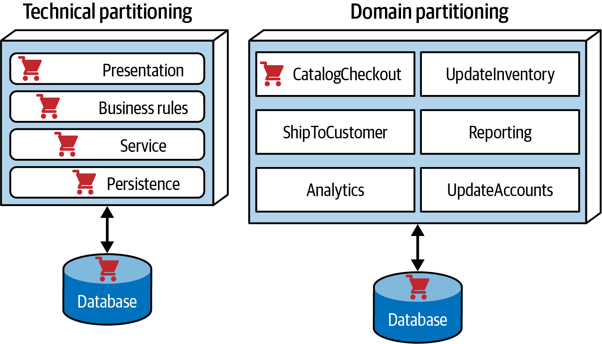

*Hình 9-4. Nơi các domain/workflow xuất hiện trong các architecture được phân vùng theo kỹ thuật và domain-partitioned*

Hãy đối chiếu điều này với architecture domain-partitioned ở [Hình 9-4](#ch-component-based-thinking-domains), trong đó các kiến trúc sư đã xây dựng các component top-level xoay quanh workflow và domain. Mỗi component có thể có các subcomponent, bao gồm các layer, nhưng top-level partitioning tập trung vào các domain, điều phản ánh tốt hơn các loại thay đổi thường xảy ra nhất trong các dự án.

Không style nào trong hai style này đúng hơn style kia. (Xem lại Định luật thứ nhất của software architecture.) Dù vậy, chúng tôi đã quan sát thấy một xu hướng rõ rệt của ngành trong vài năm qua hướng tới domain partitioning cho cả monolithic architecture lẫn architecture phân tán (ví dụ, microservices). Như chúng tôi đã lưu ý, đây là một trong những quyết định đầu tiên mà kiến trúc sư phải đưa ra.

### Kata: Silicon Sandwiches—Phân vùng (Partitioning)

Hãy xét trường hợp của một trong các kata ví dụ của chúng tôi, [“Kata: Silicon Sandwiches”](ch05_identifying_architectural_characteristics.vi.md#ch-identifying-ss). Hãy bắt đầu bằng việc xem xét khả năng thứ nhất trong hai khả năng cho Silicon Sandwiches: domain partitioning, như trong [Hình 9-5](#fosa_0806).

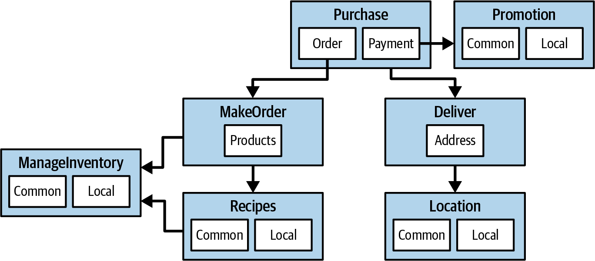

*Hình 9-5. Một thiết kế domain-partitioned cho Silicon Sandwiches*

Trong [Hình 9-5](#fosa_0806), kiến trúc sư đã thiết kế xoay quanh các domain (workflow), tạo ra các component rời rạc cho `Purchase`, `Promotion`, `MakeOrder`, `ManageInventory`, `Recipes`, `Delivery` và `Location`. Bên trong nhiều component này có các subcomponent để xử lý cả các loại tùy biến chung và các biến thể địa phương.

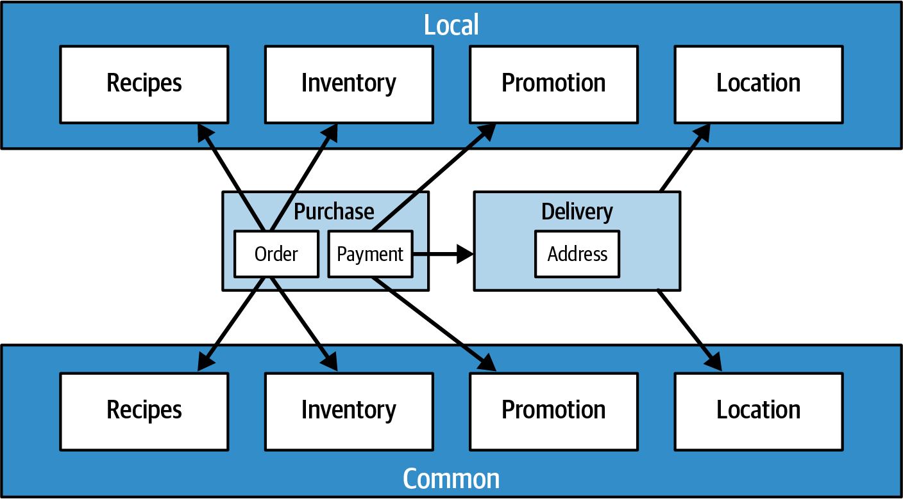

*Hình 9-6. Một thiết kế được phân vùng theo kỹ thuật cho Silicon Sandwiches*

Một thiết kế thay thế cô lập các phần chung và các phần địa phương vào các phân vùng riêng của chúng, như minh họa trong [Hình 9-6](#ch-component-based-thinking-SS-technical). `Common` và `Local` đại diện cho các component top-level, trong khi `Purchase` và `Delivery` vẫn ở lại để xử lý workflow.

Cái nào tốt hơn? Còn tùy! Mỗi kiểu phân vùng mang lại những ưu điểm và nhược điểm khác nhau.

#### Domain partitioning (phân vùng theo domain)

Các architecture domain-partitioned tách các component top-level theo workflow và/hoặc domain.

**Ưu điểm**

- Được mô hình hóa sát hơn với cách doanh nghiệp vận hành thay vì theo một chi tiết hiện thực
- Dễ xây dựng các team cross-functional xoay quanh domain hơn
- Phù hợp hơn với các architecture style modular monolith và microservices
- Luồng message khớp với problem domain
- Dễ di chuyển dữ liệu và component sang một architecture phân tán

**Nhược điểm**

- Code tùy biến xuất hiện ở nhiều nơi

#### Technical partitioning (phân vùng theo kỹ thuật)

Các architecture được phân vùng theo kỹ thuật tách các component top-level dựa trên năng lực kỹ thuật thay vì các workflow rời rạc. Điều này có thể biểu hiện dưới dạng các layer lấy cảm hứng từ sự tách biệt Model-View-Controller hoặc một kiểu technical partitioning tùy biến nào khác. Architecture trong [Hình 9-6](#ch-component-based-thinking-SS-technical) tách các component của nó dựa trên việc tùy biến.

**Ưu điểm**

- Tách biệt rõ ràng code tùy biến.
- Phù hợp hơn với layered architecture pattern.

**Nhược điểm**

- Mức global coupling cao hơn. Các thay đổi đối với component `Common` hoặc `Local` có khả năng sẽ ảnh hưởng đến tất cả các component khác.
- Developer có thể phải nhân bản các khái niệm domain trong cả layer Common và Local.
- Thông thường, coupling cao hơn ở mức dữ liệu. Trong một hệ thống như thế này, các kiến trúc sư ứng dụng và kiến trúc sư dữ liệu có khả năng sẽ cộng tác để tạo ra một database duy nhất, bao gồm cả tùy biến lẫn domain. Điều đó đến lượt nó sẽ gây khó khăn trong việc gỡ rối các quan hệ dữ liệu về sau, nếu cuối cùng các kiến trúc sư muốn di chuyển architecture này sang một hệ thống phân tán. Nhiều yếu tố khác góp phần vào việc chọn một architecture style, như chúng tôi đề cập trong [Phần II](part2_architecture_styles.vi.md#part2-styles).

## Monolithic architecture so với architecture phân tán (Monolithic Versus Distributed Architectures)

Như bạn đã học trong Phần I, các architecture style có thể được phân thành hai loại chính: *monolithic* (một deployment unit duy nhất chứa toàn bộ code) và *distributed* (phân tán: nhiều deployment unit được kết nối qua các giao thức truy cập từ xa). Dù không có cách phân loại nào hoàn hảo, các architecture phân tán đều chia sẻ một tập thách thức và vấn đề chung không có trong các monolithic architecture style, khiến cách phân loại này trở thành một sự phân tách tốt giữa các architecture style khác nhau.

Trong Phần II của cuốn sách này, chúng tôi mô tả chi tiết các architecture style sau:

**Monolithic (monolith)**

- Layered architecture ([Chương 10](ch10_layered_architecture_style.vi.md#ch-style-layered))
- Pipeline architecture ([Chương 12](ch12_pipeline_architecture_style.vi.md#ch-style-pipeline))
- Microkernel architecture ([Chương 13](ch13_microkernel_architecture_style.vi.md#ch-style-microkernel))

**Distributed (phân tán)**

- Service-based architecture ([Chương 14](ch14_service_based_architecture_style.vi.md#ch-style-service-based))
- Event-driven architecture ([Chương 15](ch15_event_driven_architecture_style.vi.md#ch-style-eda))
- Space-based architecture ([Chương 16](ch16_space_based_architecture_style.vi.md#ch-style-space-based))
- Service-oriented architecture ([Chương 17](ch17_orchestration_driven_service_oriented_architecture.vi.md#ch-style-esb-soa))
- Microservices architecture ([Chương 18](ch18_microservices_architecture.vi.md#ch-style-microservices))

Các architecture style phân tán, dù mạnh mẽ hơn nhiều về performance, scalability và availability so với các monolithic architecture style, có những trade-offs đáng kể. Nhóm vấn đề đầu tiên mà mọi architecture phân tán phải đối mặt được mô tả trong [“các ngộ nhận về tính toán phân tán”](https://oreil.ly/fVAEY) (fallacies of distributed computing), lần đầu được liệt kê bởi L. Peter Deutsch và các đồng nghiệp khác từ Sun Microsystems năm 1994. Một *fallacy* (ngộ nhận) là một điều sai mà ai đó tin hoặc cho là đúng. Cả tám ngộ nhận về tính toán phân tán đều áp dụng cho các architecture phân tán ngày nay. Các mục sau mô tả từng ngộ nhận.

### Fallacy #1: Mạng là đáng tin cậy (The Network Is Reliable)

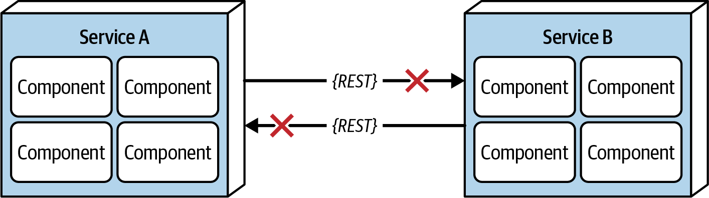

*Hình 9-7. Mạng không đáng tin cậy*

Developer cũng như kiến trúc sư đều cho rằng mạng là đáng tin cậy, nhưng không phải vậy. Dù mạng đã trở nên đáng tin cậy hơn theo thời gian, thực tế là mạng vẫn nhìn chung không đáng tin cậy. Điều này quan trọng đối với mọi architecture style phân tán, vì chúng dựa vào mạng để giao tiếp tới, từ và giữa các service. Như minh họa trong [Hình 9-7](#fig-architecture-styles-fallacy1), `Service B` có thể hoàn toàn khỏe mạnh, nhưng `Service A` không thể kết nối tới nó do một sự cố mạng. Tệ hơn nữa, `Service A` có thể yêu cầu `Service B` xử lý một số dữ liệu, nhưng không nhận được phản hồi do một vấn đề mạng. Đó là lý do những thứ như timeout và circuit breaker tồn tại giữa các service. Một hệ thống càng dựa vào mạng (như các microservices architecture rõ ràng là vậy), nó càng có nhiều khả năng trở nên không đáng tin cậy.

### Fallacy #2: Latency bằng không (Latency Is Zero)

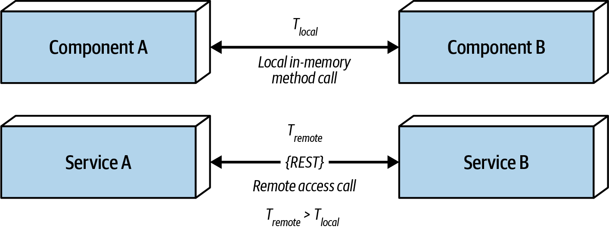

*Hình 9-8. Latency không bằng không*

Như [Hình 9-8](#fig-architecture-styles-fallacy2) cho thấy, khi một lời gọi cục bộ được thực hiện tới một component khác qua một lời gọi method hoặc hàm, thời gian để truy cập component đó (`t_local`) được đo bằng nano giây hoặc micro giây. Tuy nhiên, khi cùng lời gọi đó được thực hiện qua một giao thức truy cập từ xa (như REST, messaging hoặc RPC), thời gian (`t_remote`) được đo bằng mili giây và do đó sẽ luôn lớn hơn `t_local`. Latency, trong bất kỳ architecture phân tán nào, đều không bằng không—nhưng hầu hết kiến trúc sư bỏ qua ngộ nhận này, khăng khăng rằng họ có mạng nhanh. Hãy tự hỏi: bạn có biết latency round-trip trung bình của một lời gọi RESTful trong môi trường production của mình là bao nhiêu không? Là 60 mili giây? Hay 500 mili giây?

Khi cân nhắc dùng bất kỳ architecture phân tán nào, đặc biệt là microservices, kiến trúc sư phải biết latency trung bình này. Đó là cách duy nhất để xác định một architecture phân tán có khả thi hay không, do bản chất fine-grained của các service và lượng giao tiếp giữa chúng.

Ví dụ, giả sử chúng ta giả định latency trung bình 100 ms mỗi request. Nối chuỗi các lời gọi service với nhau để thực hiện một chức năng nghiệp vụ cụ thể làm tăng thêm 1,000 ms cho request! Biết latency trung bình là quan trọng, nhưng biết latency ở phân vị 95th đến 99th còn quan trọng hơn. Trong khi latency trung bình của hệ thống có thể chỉ là 60 ms (điều đó là tốt), phân vị 95th có thể là 400 ms! Thường thì chính latency “đuôi dài” (long tail) này sẽ giết chết performance trong một architecture phân tán. Trong hầu hết các trường hợp, một quản trị viên mạng có thể cung cấp các giá trị latency (xem [“Fallacy #6: There Is Only One Administrator”](#sec-fallacy-6)).

### Fallacy #3: Bandwidth là vô hạn (Bandwidth Is Infinite)

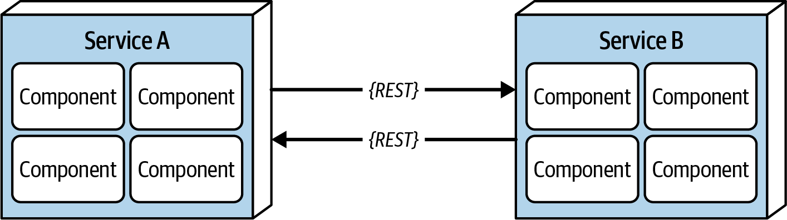

*Hình 9-9. Bandwidth không phải là vô hạn*

Bandwidth thường không phải là mối lo trong các monolithic architecture, vì một khi một request nghiệp vụ đi vào một monolith, cần rất ít hoặc không cần bandwidth để xử lý nó. Tuy nhiên, như trong [Hình 9-9](#fig-architecture-styles-fallacy3), một khi một hệ thống được tách thành các deployment unit (service) nhỏ hơn trong một architecture phân tán, như microservices, việc giao tiếp tới và giữa các service này dùng bandwidth đáng kể. Điều này làm chậm mạng, tác động đến latency (fallacy #2) và reliability (fallacy #1).

Để minh họa tầm quan trọng của ngộ nhận này, hãy xét hai service trong [Hình 9-9](#fig-architecture-styles-fallacy3). Giả sử `Service A` quản lý các mục wish list cho website, và `Service B` quản lý hồ sơ khách hàng. Bất cứ khi nào một request lấy wish list đi vào `Service A`, `Service A` cần tên khách hàng cho contract phản hồi của wish list. Để lấy tên, nó phải thực hiện một lời gọi liên service tới `Service B`. `Service B` trả về 45 thuộc tính, tổng cộng 500 KB, cho `Service A`, vốn chỉ cần tên (200 byte). Điều này nghe có vẻ không đáng kể, nhưng các request lấy các mục wish list xảy ra khoảng 2,000 lần mỗi giây. Điều này có nghĩa là `Service A` gọi `Service B` 2,000 lần mỗi giây. Với 500 KB cho mỗi request, *mỗi* lời gọi liên service chiếm 1 GBps bandwidth!

Dạng coupling này, gọi là *stamp coupling*, tiêu tốn một lượng bandwidth đáng kể trong các architecture phân tán. Nếu `Service B` *chỉ* trả về 200 byte dữ liệu mà `Service A` cần, nó sẽ chỉ dùng tổng cộng 400 Kbps.

Stamp coupling có thể được giải quyết bằng cách:

- Tạo các endpoint RESTful API riêng
- Dùng field selector trong contract
- Dùng [GraphQL](https://graphql.org) để decouple contract
- Dùng contract value-driven với contract consumer-driven
- Dùng các endpoint messaging nội bộ

Bất kể dùng kỹ thuật nào, cách tốt nhất để giải quyết ngộ nhận này trong một architecture phân tán là bảo đảm các service hoặc hệ thống chỉ truyền dữ liệu cần thiết.

### Fallacy #4: Mạng là an toàn (The Network Is Secure)

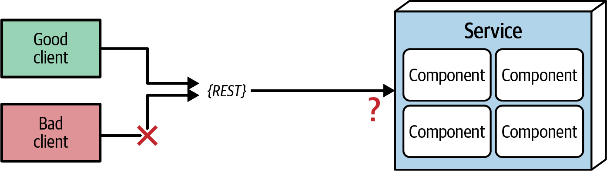

*Hình 9-10. Mạng không an toàn*

Hầu hết kiến trúc sư và developer quá quen với việc dùng mạng riêng ảo (VPN), mạng tin cậy và firewall đến mức họ có xu hướng quên đi ngộ nhận này của tính toán phân tán—nhưng *mạng không an toàn*. Như trong [Hình 9-10](#fig-architecture-styles-fallacy4), từng endpoint tới mỗi deployment unit phân tán đều phải được bảo vệ khỏi các request lạ hoặc xấu. Bề mặt cho các mối đe dọa và tấn công tăng lên nhiều bậc khi chuyển từ một monolithic architecture sang một architecture phân tán, khiến security trở nên thách thức hơn nhiều. Bảo vệ mọi endpoint, kể cả trong giao tiếp liên service, là một lý do khác khiến performance có xu hướng chậm hơn trong các architecture style đồng bộ, phân tán cao, như microservices và service-based architecture.

### Fallacy #5: Topology không bao giờ thay đổi (The Topology Never Changes)

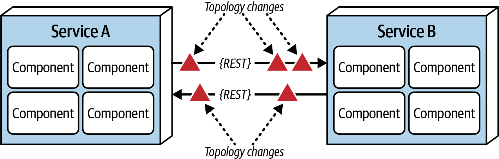

*Hình 9-11. Topology mạng luôn thay đổi*

Fallacy #5, như trong [Hình 9-11](#fig-architecture-styles-fallacy5), đề cập topology mạng tổng thể, bao gồm tất cả router, hub, switch, firewall, mạng và thiết bị của nó. Kiến trúc sư cho rằng topology là cố định và không bao giờ thay đổi. *Tất nhiên là nó thay đổi.* Nó thay đổi liên tục. Tầm quan trọng của ngộ nhận này là gì?

Giả sử bạn đến chỗ làm vào một sáng thứ Hai và mọi người đang chạy loạn lên, vì các service liên tục bị timeout trên production. Bạn làm việc với các team, cuống cuồng cố tìm hiểu vì sao điều này xảy ra. Không có service mới nào được deploy trong cuối tuần. Có thể là gì? Sau vài giờ, bạn phát hiện ra rằng một bản nâng cấp mạng được cho là “nhỏ” lúc hai giờ sáng hôm đó đã làm mất hiệu lực mọi giả định về latency của hệ thống, kích hoạt timeout và circuit breaker.

Kiến trúc sư phải liên lạc thường xuyên với bộ phận vận hành và quản trị viên mạng về những gì đang thay đổi và khi nào để họ có thể điều chỉnh nhằm tránh những bất ngờ như vậy. Điều này có vẻ hiển nhiên và dễ dàng, nhưng thực ra nó chẳng hiển nhiên cũng chẳng dễ dàng. Thực tế, ngộ nhận này dẫn thẳng đến ngộ nhận tiếp theo.

### Fallacy #6: Chỉ có một quản trị viên (There Is Only One Administrator)

*Hình 9-12. Có nhiều quản trị viên mạng, không chỉ một*

Kiến trúc sư luôn rơi vào ngộ nhận này: cho rằng họ chỉ cần cộng tác và giao tiếp với một quản trị viên. Như [Hình 9-12](#fig-architecture-styles-fallacy6) cho thấy, có hàng chục quản trị viên mạng trong một công ty lớn điển hình. Kiến trúc sư nên nói chuyện với ai về latency hay các thay đổi topology? Ngộ nhận này chỉ ra sự phức tạp của architecture phân tán và lượng phối hợp phải diễn ra để mọi thứ hoạt động đúng. Một ứng dụng monolith, với deployment unit duy nhất của nó, không đòi hỏi mức giao tiếp và cộng tác này.

### Fallacy #7: Chi phí vận chuyển bằng không (Transport Cost Is Zero)

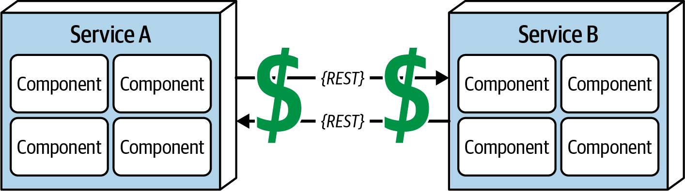

*Hình 9-13. Truy cập từ xa tốn tiền*

Nhiều kiến trúc sư phần mềm nhầm lẫn ngộ nhận này, được thể hiện trong [Hình 9-13](#fig-architecture-styles-fallacy7), với fallacy #2 (latency bằng không). *Chi phí vận chuyển* (transport cost) ở đây không đề cập đến latency, mà đến *chi phí tiền bạc* thực tế của việc thực hiện một “lời gọi RESTful đơn giản.” Kiến trúc sư lầm tưởng rằng hạ tầng cần và đủ đã có sẵn để thực hiện một lời gọi RESTful đơn giản hoặc tách một ứng dụng monolith. *Thường thì không phải vậy.* Các architecture phân tán tốn kém hơn đáng kể so với monolithic architecture, chủ yếu do nhu cầu tăng thêm về phần cứng, server, gateway, firewall, subnet mới, proxy, v.v.

Chúng tôi khuyến khích các kiến trúc sư đang bắt tay vào một architecture phân tán phân tích topology server và mạng hiện tại của họ về mặt dung lượng, bandwidth, latency và các vùng bảo mật, để tránh bị bất ngờ bởi ngộ nhận này.

### Fallacy #8: Mạng là đồng nhất (The Network Is Homogeneous)

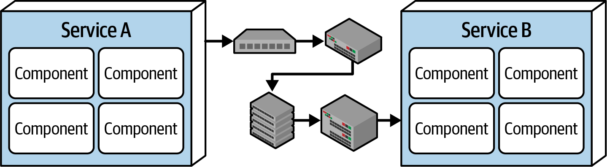

*Hình 9-14. Mạng không đồng nhất*

Hầu hết kiến trúc sư và developer cho rằng một mạng là đồng nhất, như trong [Hình 9-14](#fig-architecture-styles-fallacy8)—tức là nó được tạo thành từ phần cứng mạng của chỉ một nhà cung cấp. Không gì có thể sai sự thật hơn. Hạ tầng của hầu hết các công ty có nhiều nhà cung cấp network-hardware.

Thì sao? Tầm quan trọng của ngộ nhận này là không phải mọi nhà cung cấp phần cứng không đồng nhất đó đều hoạt động tốt với nhau. Phần cứng của Juniper Networks có tích hợp trơn tru với phần cứng của Cisco Systems không? Phần lớn là hoạt động, và các tiêu chuẩn mạng đã tiến hóa qua nhiều năm, khiến đây không còn là vấn đề lớn. Tuy nhiên, không phải mọi tình huống, tải và hoàn cảnh đều đã được test đầy đủ, nên các packet mạng thỉnh thoảng vẫn bị mất. Điều này đến lượt nó ảnh hưởng đến reliability của mạng và các giả định cũng như khẳng định về latency và bandwidth. Nói cách khác, ngộ nhận này gắn trở lại với tất cả các ngộ nhận khác, tạo thành một vòng lặp vô tận của sự bối rối và bực bội khi làm việc với mạng (điều không thể tránh khỏi khi dùng architecture phân tán).

### Các ngộ nhận khác (The Other Fallacies)

Tám ngộ nhận đã liệt kê ở trên tạo thành một tập nhận xét nổi tiếng—mọi kiến trúc sư đều học chúng hoặc từ danh sách của Deutsch hoặc theo cách khó khăn, từng cái một, trong suốt sự nghiệp của mình. Các tác giả cũng đã học được một số bài học đau đớn, near-universal (gần như phổ quát) mà chúng tôi đưa ra như một phần mở rộng cho danh sách nổi tiếng đó.

#### Fallacy #9. Versioning thì dễ (Versioning is easy)

Khi hai service cần giao tiếp, chúng truyền thông tin trong một *contract*, bao gồm thông tin cần thiết cho việc giao tiếp. Thường thì hiện thực bên trong của một service tiến hóa theo thời gian, thay đổi các trường mà service chấp nhận và truyền cho các service khác. Một cách để giải quyết vấn đề này là dùng versioning cho contract—tức là tạo các phiên bản khác nhau cho contract cũ và mới bao gồm các tập thông tin khác nhau. Tuy nhiên, quyết định tưởng như đơn giản này dẫn đến hàng loạt trade-offs:

- Team nên đánh version ở mức từng service riêng lẻ hay cho toàn bộ hệ thống?
- Versioning nên mở rộng đến đâu? Phần nào của architecture sẽ cần hỗ trợ nó?
- Team nên hỗ trợ bao nhiêu phiên bản tại bất kỳ thời điểm nào? (Một số team vô tình thấy mình phải duy trì hàng chục phiên bản khác nhau cho những mục đích khác nhau.)
- Team nên ngừng hỗ trợ (deprecate) các phiên bản cũ hơn ở mức hệ thống hay theo từng service?

Dù versioning là một cách tiếp cận hợp lý để tiến hóa việc giao tiếp giữa các service, nó có hàng loạt trade-offs mà kiến trúc sư nên lường trước.

#### Fallacy #10. Compensating update luôn hoạt động (Compensating updates always work)

*Compensating update* (cập nhật bù trừ) là một architectural pattern trong đó một cơ chế nào đó (như một service `Orchestrator`) bảo đảm rằng một số service liên quan đều cập nhật cùng nhau. Nếu chúng không làm vậy, orchestrator sẽ đảo ngược việc cập nhật. *Compensating update* đến từ orchestrator, nó phát ra một thao tác đảo ngược để đưa trạng thái trở lại như trước đó.

Đây là một pattern phổ biến mà hầu hết kiến trúc sư vô tư cho rằng luôn hoạt động… nhưng không phải vậy. Điều gì xảy ra nếu compensating update thất bại? Khi kiến trúc sư trình bày cách các tương tác phức tạp trong các architecture phân tán như microservices hoạt động, họ cũng phải chỉ ra cách compensating update hoạt động. Do đó, kiến trúc sư thiết kế các workflow transaction trong microservices nên đáp ứng workflow bù trừ “bình thường”, nhưng cũng phải xem xét cách phục hồi nếu *cả* việc cập nhật lẫn compensating update (hoặc một phần của nó) đều thất bại.

#### Fallacy #11. Observability là tùy chọn (cho các architecture phân tán) (Observability is optional (for distributed architectures))

Một architectural characteristic phổ biến mà kiến trúc sư ưu tiên trong các architecture phân tán là *observability*: khả năng quan sát tương tác của mỗi service với các service khác và hệ sinh thái, được ghi nhận thông qua monitor hoặc log. Dù logging hữu ích trong monolithic architecture, nó là *then chốt* trong các architecture phân tán, vốn có nhiều kiểu lỗi giao tiếp khó debug nếu không có log tương tác toàn diện.

## Team topologies và architecture (Team Topologies and Architecture)

Các kiến trúc sư và team đã thực hiện rất nhiều nghiên cứu về sự giao thoa giữa architecture và team topologies, vượt xa những hệ quả của việc phân vùng architecture mà chúng tôi đã thảo luận trước đó. Cuốn sách rất có ảnh hưởng [*Team Topologies*](https://oreil.ly/aPB3u) của Matthew Skelton và Manuel Pais (IT Revolution Press, 2019) định nghĩa một số loại team giao thoa với software architecture:

**Team bám theo luồng giá trị (Stream-aligned teams)**

Theo thuật ngữ team topologies, một *stream* là một luồng công việc có phạm vi gắn với một business domain hoặc năng lực cụ thể. *Stream-aligned team* tập trung hẹp vào một dòng công việc duy nhất, như một sản phẩm, service, hoặc một tập tính năng cụ thể.

Mục tiêu của stream-aligned team là di chuyển nhanh nhất có thể vì họ đang mang lại giá trị rời rạc cho tổ chức. Do đó, các loại team khác được thiết kế để giảm mọi ma sát có thể cản trở các stream-aligned team.

**Enabling team (team hỗ trợ năng lực)**

Một *enabling team* lấp một khoảng trống về năng lực nào đó, cung cấp một nơi cho nghiên cứu, học hỏi cần thiết và các tác vụ khác quan trọng nhưng không cấp bách. Họ cung cấp kiến thức và tài nguyên từ các lĩnh vực chuyên môn để hỗ trợ các stream-aligned team. Các enabling team tốt có tính cộng tác cao và chủ động.

**Team subsystem phức tạp (Complicated-subsystem teams)**

Nhiều hệ thống bao gồm các hệ thống hoặc phần có tính chuyên môn hóa cao đòi hỏi các kỹ năng chuyên môn hóa tương tự. Thành viên của các *complicated-subsystem team* hiểu đầy đủ một subsystem hoặc domain phức tạp và có thể giúp một stream-aligned team áp dụng nó. Mục tiêu của họ là giảm tải nhận thức cho các team khác.

**Platform team (team nền tảng)**

Một *platform team* cung cấp các service nội bộ và khối xây dựng cho các giải pháp. Như được định nghĩa bởi [Evan Botcher](https://oreil.ly/ieO_7), một nền tảng là

> một nền móng gồm các API self-service, công cụ, service, kiến thức và hỗ trợ được sắp xếp thành một sản phẩm nội bộ hấp dẫn. Các team delivery tự chủ có thể sử dụng nền tảng để cung cấp các tính năng sản phẩm với tốc độ cao hơn, với ít phối hợp hơn.

Platform team hỗ trợ các team khác, cố gắng loại bỏ ma sát không cần thiết trong khi cung cấp governance cần thiết đối với các mối quan tâm như chất lượng và security.

## Tiến tới các style cụ thể (On to Specific Styles)

Kiến trúc sư cần hiểu một số architecture style khác nhau trước khi họ có thể thực hiện phân tích trade-off. Mỗi style hỗ trợ một tập architectural characteristic khác nhau—mỗi style có một “điểm ngọt” (sweet spot) mà nó xử lý tốt nhất. Bằng cách học các style khác nhau và triết lý nền tảng của chúng, kiến trúc sư hiểu rõ hơn khi nào mỗi style hoạt động tốt nhất (hoặc dù sao thì cũng ít tệ nhất).
