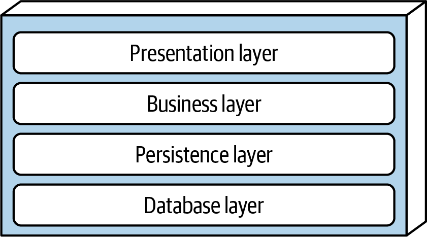
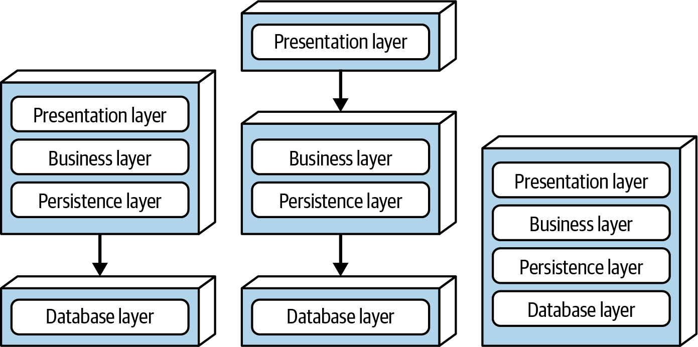
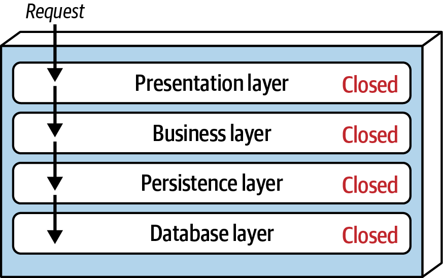
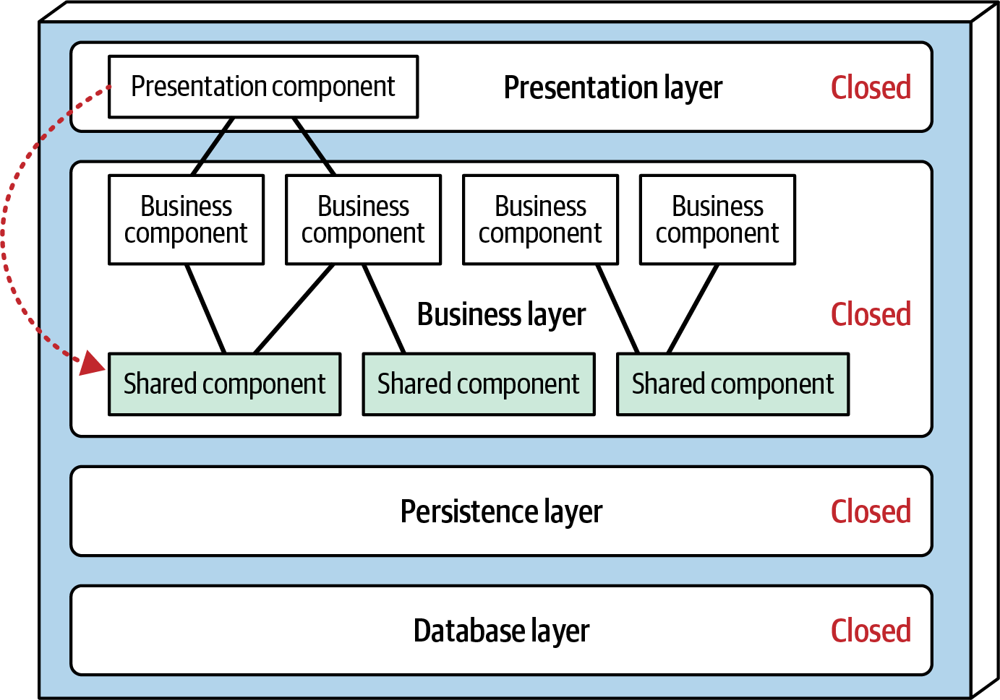
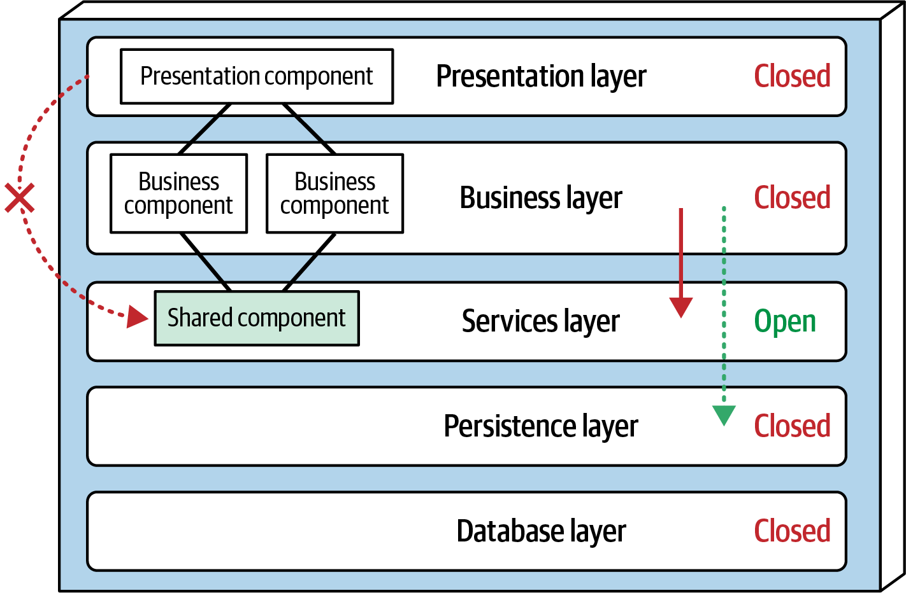
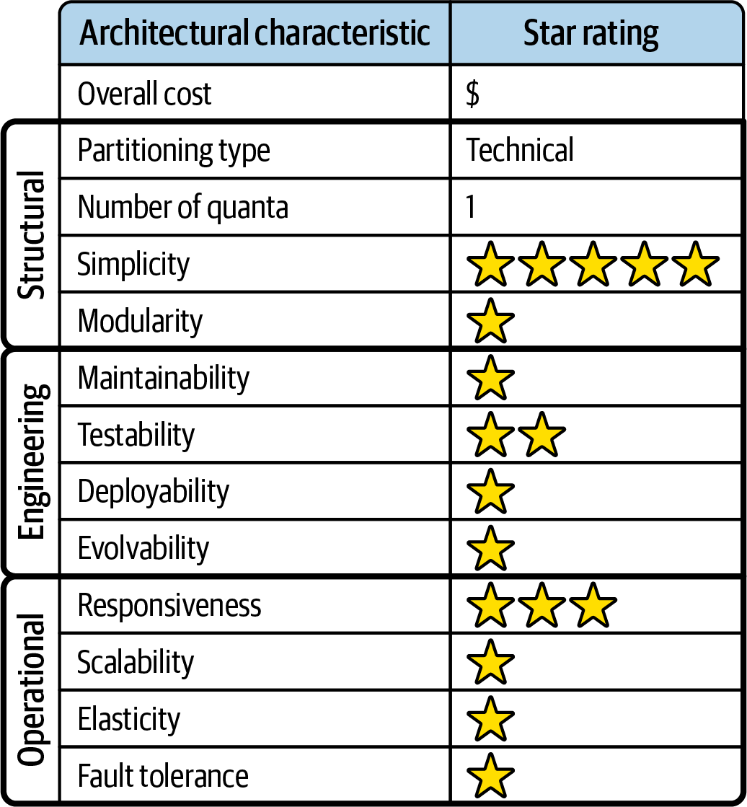

<a id="ch-style-layered"></a>

# Chương 10. Layered architecture style (Layered Architecture Style)

<a id="ix_ch10-style-layered-asciidoc0"></a>Architecture style *layered* (phân tầng), còn được biết đến là *n-tiered*, là một trong những architecture style phổ biến nhất. Nó là tiêu chuẩn de facto cho nhiều ứng dụng legacy nhờ sự đơn giản, quen thuộc và chi phí thấp.

Layered architecture style có thể rơi vào một số architectural antipattern, bao gồm các antipattern [*Architecture by Implication*](https://oreil.ly/QAFGg) và [*Accidental Architecture*](https://oreil.ly/YNBXx). Khi developer hoặc kiến trúc sư “cứ bắt đầu viết code”, không chắc mình đang dùng architecture style nào, rất có khả năng họ đang triển khai layered architecture style.

<a id="id86"></a>

## Topology

<a id="ix_ch10-style-layered-asciidoc1"></a>Các component trong layered architecture style được tổ chức thành các layer logic nằm ngang, như trong [Hình 10-1](#fig-style-layered-std-layers), với mỗi layer thực hiện một vai trò cụ thể trong ứng dụng (như logic trình bày hoặc logic nghiệp vụ). Dù không có hạn chế cụ thể nào về số lượng và loại layer phải tồn tại, hầu hết các layered architecture gồm bốn layer tiêu chuẩn: Presentation, Business, Persistence và Database. Một số architecture gộp các layer Business và Persistence, đặc biệt khi logic persistence (như SQL hoặc HSQL) được nhúng bên trong các component của Business layer. Các ứng dụng nhỏ hơn có thể chỉ có ba layer, trong khi các ứng dụng nghiệp vụ lớn hơn và phức tạp hơn có thể chứa năm layer trở lên.

<a id="fig-style-layered-std-layers"></a>



*Hình 10-1. Các layer logic tiêu chuẩn trong layered architecture style*

[Hình 10-2](#fig-style-layered-variants) minh họa các biến thể topology từ góc nhìn phân tầng vật lý (deployment). Biến thể thứ nhất gộp các layer Presentation, Business và Persistence vào một deployment unit duy nhất, với Database layer thường được thể hiện như một database vật lý bên ngoài riêng biệt (hoặc filesystem). Biến thể thứ hai tách Presentation layer về mặt vật lý thành deployment unit riêng, với các layer Business và Persistence được gộp vào một deployment unit thứ hai. Một lần nữa, với biến thể này, Database layer thường được tách về mặt vật lý thông qua một database hoặc filesystem bên ngoài. Biến thể thứ ba gộp cả bốn layer tiêu chuẩn vào một deployment duy nhất, bao gồm cả Database layer. Biến thể này có thể hữu ích cho các ứng dụng nhỏ hơn có database nhúng bên trong hoặc database in-memory, như các ứng dụng trên thiết bị di động. Nhiều sản phẩm on-premises (on-prem) được xây dựng và giao cho khách hàng bằng biến thể thứ ba này.

<a id="fig-style-layered-variants"></a>



*Hình 10-2. Các biến thể topology vật lý (deployment)*

Mỗi layer có một vai trò và trách nhiệm cụ thể, và tạo thành một lớp trừu tượng xoay quanh công việc cần làm để đáp ứng một request nghiệp vụ cụ thể. Ví dụ, Presentation layer chịu trách nhiệm xử lý toàn bộ logic UI và giao tiếp với trình duyệt, trong khi Business layer chịu trách nhiệm thực thi các quy tắc nghiệp vụ cụ thể gắn với request. Presentation layer không cần biết hay lo lắng về cách lấy dữ liệu khách hàng; nó chỉ cần hiển thị thông tin đó lên màn hình theo một định dạng cụ thể. Tương tự, Business layer không cần quan tâm đến cách định dạng dữ liệu khách hàng để hiển thị lên màn hình hay thậm chí dữ liệu đó đến từ đâu; nó chỉ cần lấy dữ liệu từ Persistence layer, thực hiện logic nghiệp vụ trên đó (như tính toán giá trị hoặc tổng hợp dữ liệu), và chuyển thông tin đó lên Presentation layer.

<a id="id1113"></a>Sự tách biệt các mối quan tâm này trong layered architecture style giúp dễ dàng xây dựng các mô hình vai trò và trách nhiệm hiệu quả. Các component trong một layer cụ thể bị giới hạn về phạm vi, chỉ xử lý logic liên quan đến layer đó. Ví dụ, các component trong Presentation layer chỉ xử lý logic trình bày, trong khi các component nằm trong Business layer chỉ xử lý logic nghiệp vụ. Điều này cho phép developer tận dụng chuyên môn kỹ thuật cụ thể của mình để tập trung vào các khía cạnh kỹ thuật của domain (như logic trình bày hoặc logic persistence). Tuy nhiên, trade-off của lợi ích này là sự thiếu *holistic agility* (agility tổng thể: khả năng của toàn bộ hệ thống phản ứng nhanh với thay đổi).

<a id="id1114"></a>Layered architecture là một architecture *được phân vùng theo kỹ thuật* (technically partitioned) (trái với architecture *domain-partitioned*). Như bạn đã học trong [Chương 9](ch09_foundations.vi.md#ch-architecture-styles), điều này có nghĩa là các component được tách theo vai trò kỹ thuật của chúng trong architecture (như presentation hoặc business) thay vì theo domain (như customer). Kết quả là, bất kỳ business domain cụ thể nào cũng bị trải ra khắp tất cả các layer của architecture. Ví dụ, domain “customer” được chứa trong Presentation layer, Business layer, Rules layer, Services layer và Database layer, khiến việc áp dụng thay đổi cho domain đó trở nên khó khăn. Do đó, một cách tiếp cận DDD không đặc biệt phù hợp với layered architecture style.<a id="id1115"></a>

<a id="id310"></a>

## Đặc thù của style (Style Specifics)

<a id="ix_ch10-style-layered-asciidoc2"></a>Các layer trong architectural style này đóng gói các vùng trách nhiệm kỹ thuật cụ thể, nhưng bản thân các layer có thể thể hiện những characteristic khác.

<a id="id87"></a>

### Các layer cô lập (Layers of Isolation)

<a id="ix_ch10-style-layered-asciidoc3"></a>Mỗi layer có thể là đóng (closed) hoặc mở (open). <a id="id1116"></a>Nếu một layer là *đóng*, thì khi một request đi từ layer trên cùng xuống layer dưới cùng, request không thể bỏ qua layer nào. Nó phải đi qua layer ngay bên dưới để đến layer tiếp theo (xem [Hình 10-3](#fig-style-layered-open-closed)). Ví dụ, trong một architecture mà tất cả các layer đều đóng, một request bắt nguồn từ Presentation layer trước tiên phải đi qua Business layer rồi đến Persistence layer trước khi cuối cùng đến được Database layer.

<a id="fig-style-layered-open-closed"></a>



*Hình 10-3. Các layer đóng trong một layered architecture*

Lưu ý rằng trong [Hình 10-3](#fig-style-layered-open-closed), sẽ nhanh hơn và dễ hơn nhiều nếu Presentation layer truy cập trực tiếp database cho các request truy xuất đơn giản, bỏ qua mọi layer không cần thiết (điều mà vào đầu những năm 2000s từng được biết đến là pattern *Fast-Lane Reader*). <a id="id1117"></a>Để điều này xảy ra, các layer Business và Persistence sẽ phải *mở*, cho phép request bỏ qua các layer khác. Cái nào tốt hơn—layer mở hay layer đóng? Câu trả lời cho câu hỏi này nằm ở một khái niệm then chốt được biết đến là *layers of isolation* (các layer cô lập).

<a id="id1118"></a>Khái niệm *layers of isolation* có nghĩa là những thay đổi được thực hiện ở một layer của architecture nhìn chung không tác động hay ảnh hưởng đến các component ở các layer khác, miễn là các contract giữa các layer đó không thay đổi. Mỗi layer độc lập với các layer khác, có ít hoặc không có hiểu biết về hoạt động bên trong của chúng. Tuy nhiên, để hỗ trợ layers of isolation, các layer tham gia vào luồng chính của một request phải là đóng. Nếu Presentation layer có thể truy cập trực tiếp Persistence layer, thì các thay đổi được thực hiện ở Persistence layer sẽ tác động đến cả Business layer *lẫn* Presentation layer, tạo ra một ứng dụng coupling rất chặt với các phụ thuộc lẫn nhau giữa các component ở các layer. Điều này khiến một layered architecture rất giòn, cũng như khó khăn và tốn kém để thay đổi.

Dùng layers of isolation cũng cho phép bất kỳ layer nào trong architecture được thay thế mà không tác động đến bất kỳ layer nào khác (một lần nữa, giả định các contract well-defined và việc dùng pattern *Business Delegate*).<sup><a id="id1119-marker"></a>[1](#id1119)</sup> Ví dụ, bạn có thể tận dụng layers of isolation để thay UI framework cũ bằng một framework mới hơn, tất cả bên trong Presentation layer.<a id="id1120"></a>

<a id="id88"></a>

### Thêm layer (Adding Layers)

<a id="ix_ch10-style-layered-asciidoc4"></a>Dù các layer đóng hỗ trợ layers of isolation và do đó giúp cô lập thay đổi, có những lúc hợp lý khi một số layer nhất định là mở. Ví dụ, giả sử Business layer của layered architecture có các shared object chứa chức năng chung cho các business component (như các class tiện ích ngày tháng và chuỗi, các class auditing, các class logging, v.v.). Bạn đưa ra một architecture decision hạn chế Presentation layer dùng các shared business object này. Ràng buộc này được minh họa trong [Hình 10-4](#fig-style-layered-shared-components), với đường chấm đi từ một presentation component tới một shared business object trong Business layer. Kịch bản này khó quản trị và kiểm soát vì, *về mặt kiến trúc*, Presentation layer có quyền truy cập Business layer, và do đó có quyền truy cập các shared object trong layer đó.

<a id="fig-style-layered-shared-components"></a>



*Hình 10-4. Các shared object trong Business layer*

Một cách để bắt buộc hạn chế này về mặt kiến trúc là thêm một Services layer mới chứa tất cả các shared business object (xem [Hình 10-5](#fig-style-layered-services-layer)). Thêm layer mới này sẽ hạn chế về mặt kiến trúc việc Presentation layer truy cập các shared business object vì Business layer là đóng. Tuy nhiên, bạn phải đánh dấu Services layer mới là *mở*; nếu không, Business layer sẽ bị buộc phải đi qua Services layer để truy cập Persistence layer. Đánh dấu Services layer là mở cho phép Business layer hoặc truy cập layer đó (như được biểu thị bằng mũi tên liền) hoặc bỏ qua nó và đi đến layer tiếp theo bên dưới (như được biểu thị bằng mũi tên chấm).

<a id="fig-style-layered-services-layer"></a>



*Hình 10-5. Thêm một Services layer mới vào architecture*

Tận dụng khái niệm layer mở và đóng giúp định nghĩa mối quan hệ giữa các layer kiến trúc và các luồng request. Nó cũng cung cấp cho developer thông tin và hướng dẫn cần thiết để hiểu các hạn chế truy cập layer trong architecture. Việc không ghi tài liệu hoặc không truyền đạt đúng đắn layer nào trong architecture là mở và đóng (và tại sao) thường dẫn đến các architecture coupling chặt, giòn, rất khó test, bảo trì và deploy.

<a id="id1121"></a><a id="id1122"></a>Mọi layered architecture đều sẽ có ít nhất một số kịch bản rơi vào antipattern *Architecture Sinkhole* (hố sụt kiến trúc). Antipattern này xảy ra khi các request chỉ đơn giản được chuyển qua từ layer này sang layer khác, không có logic nghiệp vụ nào được thực hiện. Ví dụ, giả sử Presentation layer phản hồi một request đơn giản của người dùng để truy xuất dữ liệu khách hàng cơ bản (như tên và địa chỉ). Presentation layer chuyển request tới Business layer, layer này không làm gì ngoài việc chuyển tiếp request tới Rules layer, layer này đến lượt mình không làm gì ngoài việc chuyển nó tới Persistence layer, layer này sau đó thực hiện một lời gọi SQL đơn giản tới Database layer để truy xuất dữ liệu khách hàng. Dữ liệu sau đó được chuyển ngược lên suốt cả stack mà không có xử lý hay logic bổ sung nào để tổng hợp, tính toán, áp dụng quy tắc, hay biến đổi bất kỳ phần nào của nó. Điều này dẫn đến việc khởi tạo đối tượng và xử lý không cần thiết, làm hao tốn cả bộ nhớ lẫn performance.

Chìa khóa để xác định antipattern này có đang hiện diện hay không là phân tích phần trăm request rơi vào loại này. Quy tắc 80-20 thường là một thực hành tốt nên theo. Ví dụ, sẽ chấp nhận được nếu chỉ 20% request là sinkhole; tuy nhiên, nếu là 80%, đó là một dấu hiệu tốt cho thấy layered architecture không phải là architecture style đúng cho problem domain. Một cách tiếp cận khác để giải quyết antipattern Architecture Sinkhole là làm cho tất cả các layer trong architecture đều mở—tất nhiên, nhận thức rằng trade-off là sự khó khăn gia tăng trong việc quản lý thay đổi<a id="id1123"></a>.<a id="id1124"></a>

<a id="id311"></a>

## Topology dữ liệu (Data Topologies)

<a id="id1125"></a>Theo truyền thống, các layered architecture tạo thành một hệ thống monolith cùng với một monolithic database duy nhất. Persistence layer chung thường được dùng để ánh xạ các phân cấp đối tượng giữa các ngôn ngữ object-oriented được ưa chuộng và lãnh địa set-based của relational database.

<a id="id312"></a>

## Các cân nhắc về cloud (Cloud Considerations)

<a id="id1126"></a><a id="id1127"></a>Vì các layered architecture thường là monolith và được phân vùng thành các layer, các lựa chọn cloud bị giới hạn ở việc deploy một hoặc nhiều layer qua một nhà cung cấp cloud. Technical partitioning vốn có trong architecture này rất phù hợp cho các deployment tách biệt qua cloud. Tuy nhiên, latency giao tiếp giữa các server on-premises và cloud có thể gây ra vấn đề, vì các workflow thường đi qua hầu hết các layer trong architecture này.

<a id="id89"></a>

## Các rủi ro phổ biến (Common Risks)

<a id="id1128"></a>Các layered architecture không hỗ trợ fault tolerance, do deployment dạng monolith và sự thiếu modularity kiến trúc. Nếu một phần nhỏ của một layered architecture gây ra tình trạng out-of-memory, toàn bộ unit ứng dụng sẽ crash. <a id="id1129"></a><a id="id1130"></a>Availability tổng thể cũng bị ảnh hưởng do mean time to recover (MTTR: thời gian trung bình để phục hồi) cao của hầu hết các ứng dụng monolith: thời gian khởi động có thể từ 2 phút đối với các ứng dụng nhỏ hơn, đến 15 phút hoặc hơn đối với hầu hết các ứng dụng lớn.

<a id="id313"></a>

## Quản trị (Governance)

<a id="id1131"></a><a id="id1132"></a>Tin tức là tuyệt vời đối với governance của architecture style này: vì nó quá phổ biến, các kiến trúc sư xây dựng một số công cụ testing cấu trúc nguyên bản đã làm vậy với architecture này trong đầu. Thực tế, fitness function ví dụ trong [Hình 6-4](ch06_measuring_and_governing_architecture_characteristics.vi.md#ch-measuring-layerff) được tạo ra cho layered architecture (xem [Ví dụ 10-1](#src_archunitff2)).

<a id="src_archunitff2"></a>

*Ví dụ 10-1. Fitness function ArchUnit để quản trị các layer*

```java
layeredArchitecture()
    .layer("Controller").definedBy("..controller..")
    .layer("Service").definedBy("..service..")
    .layer("Persistence").definedBy("..persistence..")

    .whereLayer("Controller").mayNotBeAccessedByAnyLayer()
    .whereLayer("Service").mayOnlyBeAccessedByLayers("Controller")
    .whereLayer("Persistence").mayOnlyBeAccessedByLayers("Service")
```

Trong [Ví dụ 10-1](#src_archunitff2), kiến trúc sư định nghĩa các layer trong architecture, đặt các tên tiện lợi như `Controller` cho component được đại diện bởi tên package. (Trong cú pháp ArchUnit, hai dấu chấm (`..`) ở hai bên một tên package biểu thị quyền sở hữu của nó.) Sau đó kiến trúc sư định nghĩa giao tiếp được phép giữa các layer, quản trị các layer mở và đóng của chúng.

Các thư viện fitness function hỗ trợ layered architecture style cực kỳ tốt, cho phép kiến trúc sư tự động hóa việc quản trị các mối quan hệ mà họ thiết kế giữa các layer trong quá trình triển khai.

<a id="id314"></a>

## Các cân nhắc về team topology (Team Topology Considerations)

<a id="id1133"></a><a id="id1134"></a>Không giống một số architectural style được mô tả trong cuốn sách này, layered architecture style nhìn chung độc lập với team topologies và sẽ hoạt động với bất kỳ cấu hình team nào:

**Stream-aligned team**

Vì layered architecture thường nhỏ, self-contained và đại diện cho một hành trình hay luồng duy nhất qua hệ thống, nó hoạt động tốt với các stream-aligned team. Với team topology này, các team nhìn chung sở hữu luồng qua hệ thống qua từng layer từ đầu đến cuối, tạo ra các workflow như một phần của giải pháp của họ.

**Enabling team**

Vì layered architecture có tính module cao và được tách theo các mối quan tâm kỹ thuật, nó kết hợp tốt với enabling team topology. Các chuyên gia và thành viên team cross-cutting có thể làm việc với một hoặc nhiều layer để đưa ra đề xuất và thực hiện thử nghiệm, mà không ảnh hưởng đến phần còn lại của luồng. Ví dụ, team có thể thử nghiệm một thư viện UI mới bằng cách thêm các hành vi mới vào Presentation layer, trong khi cô lập các layer khác khỏi các thay đổi.

**Complicated-subsystem team**

Vì mỗi layer thực hiện một tác vụ rất cụ thể, style này hoạt động tốt với complicated-subsystem team topology. Ví dụ, Persistence layer cung cấp điểm móc hoàn hảo cho một team cần truy cập dữ liệu vận hành cho mục đích phân tích. Nếu được phép truy cập ở Persistence layer, complicated-subsystem team có thể làm việc mà không ảnh hưởng đến bất kỳ layer nào khác mà các stream-aligned team vẫn sở hữu.

**Platform team**

Các platform team làm việc trên một layered architecture có thể tận dụng mức modularity cao của nó bằng cách sử dụng nhiều công cụ có sẵn cho nó.

Thách thức lớn nhất với layered architecture đối với hầu hết các platform team đi theo vấn đề chung với các monolith nói chung: khi chúng phát triển, chúng ngày càng trở nên cồng kềnh. Nếu các team cứ thêm tính năng vào một monolith, dù được phân vùng và quản trị tốt đến đâu, cuối cùng nó sẽ bắt đầu căng thẳng ở một số ràng buộc: kết nối database, bộ nhớ, performance, người dùng đồng thời, hoặc hàng loạt vấn đề sắp xảy ra khác. Giữ cho hệ thống vận hành sẽ đòi hỏi platform team làm những công việc ngày càng khó khăn.

<a id="id315"></a>

## Các characteristic của style (Style Characteristics)

<a id="ix_ch10-style-layered-asciidoc5"></a>Đánh giá one-star (một sao) trong bảng đánh giá characteristic (thể hiện trong [Hình 10-6](#fig-style-layered-ratings)) có nghĩa là architecture characteristic cụ thể không được hỗ trợ tốt trong architecture, trong khi đánh giá five-star (năm sao) có nghĩa là architecture characteristic đó là một trong những đặc điểm mạnh nhất của architecture style. Định nghĩa của mỗi characteristic được xác định trong bảng điểm có thể được tìm thấy trong [Chương 4](ch04_architectural_characteristics_defined.vi.md#ch04-architecture-characteristics-defined).

<a id="fig-style-layered-ratings"></a>



*Hình 10-6. Đánh giá các characteristic của layered architecture*

Chi phí tổng thể và sự đơn giản là những điểm mạnh chính của layered architecture style. Là monolith, các layered architecture không phức tạp như các architecture style phân tán; chúng đơn giản hơn, dễ hiểu hơn, và có chi phí tương đối thấp để xây dựng và bảo trì. Tuy nhiên, hãy thận trọng, vì các đánh giá này giảm nhanh khi layered architecture dạng monolith lớn hơn và do đó phức tạp hơn.

Cả deployability lẫn testability đều không được đánh giá tốt với architecture style này. Deployability thấp vì các lần deployment có rủi ro cao, không thường xuyên, và đòi hỏi nhiều thủ tục và công sức. Ví dụ, để thực hiện một thay đổi three-line (ba dòng) đơn giản trên một file class, toàn bộ deployment unit phải được deploy lại—mở ra khả năng các thay đổi đối với database, cấu hình, hoặc các khía cạnh khác của code lén lọt vào cùng với thay đổi ban đầu. Hơn nữa, thay đổi three-line đơn giản này thường được gộp chung với hàng chục thay đổi khác, mỗi thay đổi lại làm tăng thêm rủi ro và tần suất deployment. Đánh giá testability thấp cũng phản ánh kịch bản này; với một thay đổi three-line đơn giản, hầu hết developer sẽ không dành hàng giờ chạy toàn bộ bộ regression test cho một thay đổi three-line đơn giản (giả sử họ thậm chí có một bộ test như vậy). Chúng tôi cho testability đánh giá two-star (hai sao) (thay vì một sao) vì style này mang lại khả năng mock hoặc stub các component hoặc thậm chí toàn bộ một layer, giúp giảm bớt công sức testing tổng thể.

Các characteristic kỹ thuật của layered architecture style phản ánh động lực đã đề cập ở trên: tất cả đều khởi đầu tốt, nhưng suy giảm khi kích thước của code base tăng lên.

Elasticity và scalability được đánh giá rất thấp (một sao) đối với layered architecture, chủ yếu do deployment dạng monolith và sự thiếu modularity kiến trúc. Dù có thể làm cho một số chức năng nhất định trong một monolith scale nhiều hơn các chức năng khác, nỗ lực này thường đòi hỏi các kỹ thuật thiết kế rất phức tạp mà architecture này không phù hợp, như multithreading, messaging nội bộ, và các thực hành xử lý song song khác. Tuy nhiên, vì architecture quantum của một hệ thống layered luôn là 1 (do UI và database dạng monolith và xử lý backend của nó), các ứng dụng chỉ có thể scale đến một điểm nhất định.

Kiến trúc sư có thể đạt được responsiveness cao trong một layered architecture với thiết kế cẩn thận, và tăng nó hơn nữa thông qua các kỹ thuật như caching và multithreading. Chúng tôi cho style này ba sao tổng thể, vì nó chịu ảnh hưởng của sự thiếu xử lý song song vốn có, cũng như của việc phân tầng đóng và antipattern Architecture Sinkhole.

<a id="id316"></a>

### Khi nào nên dùng (When to Use)

<a id="id1135"></a>Layered architecture style là một lựa chọn tốt cho các ứng dụng hoặc website nhỏ, đơn giản. Nó cũng là một điểm khởi đầu tốt cho các tình huống có ràng buộc ngân sách và thời gian rất chặt. Nhờ sự đơn giản và quen thuộc với developer và kiến trúc sư, đây có lẽ là một trong những style lowest-cost (chi phí thấp nhất), thúc đẩy sự dễ dàng phát triển cho các ứng dụng nhỏ hơn. Layered architecture style cũng là một lựa chọn tốt khi kiến trúc sư vẫn đang xác định liệu các architecture phức tạp hơn có phù hợp hơn không, nhưng phải bắt đầu phát triển.

Khi dùng kỹ thuật này, hãy giữ việc tái sử dụng code ở mức tối thiểu và giữ các phân cấp đối tượng (độ sâu của cây kế thừa) khá nông để duy trì một mức modularity tốt. Điều này sẽ tạo điều kiện cho việc chuyển sang một architecture style khác về sau.

<a id="id90"></a>

### Khi nào không nên dùng (When Not to Use)

<a id="id1136"></a>Như chúng tôi đã chỉ ra, các characteristic như maintainability, agility, testability và deployability bị ảnh hưởng tiêu cực khi các ứng dụng dùng layered architecture style phát triển lớn lên. Vì lý do này, các ứng dụng và hệ thống lớn có thể tốt hơn khi dùng các architecture style khác, có tính module cao hơn.<a id="id1137"></a>

<a id="id91"></a>

## Ví dụ và use case (Examples and Use Cases)

<a id="id1138"></a>Layered architecture là một trong những architecture style phổ biến nhất và xuất hiện trong vô số bối cảnh.

Các nhà thiết kế hệ điều hành (như Linux hoặc Windows) có xu hướng dùng các layer vì cùng những lý do như kiến trúc sư ứng dụng—tách biệt các mối quan tâm. Các layer phổ biến trong hệ điều hành bao gồm:

**Hardware layer (tầng phần cứng)**

Bao gồm phần cứng vật lý như CPU, bộ nhớ và các thiết bị I/O

**Kernel layer (tầng kernel)**

Cung cấp trừu tượng hóa phần cứng, quản lý bộ nhớ và lập lịch tiến trình

**System Call Interface layer (tầng giao diện system call)**

Tương tác với kernel để cung cấp các dịch vụ hệ thống

**User layer (tầng người dùng)**

Bao gồm các ứng dụng và tiện ích mà người dùng tương tác

*Mô hình networking Open Systems Interconnection* (OSI) hình dung cách các mạng nên phân định trách nhiệm. Ví dụ, giao thức nền tảng của internet, TCP/IP, bao gồm các layer sau:

**Physical layer (tầng vật lý)**

Truyền dữ liệu về mặt vật lý

**Data Link layer (tầng liên kết dữ liệu)**

Sử dụng phát hiện lỗi và đồng bộ khung

**Network layer (tầng mạng)**

Xử lý định tuyến (như IP)

**Transport layer (tầng giao vận)**

Bảo đảm truyền dữ liệu đáng tin cậy (như TCP)

**Application layer (tầng ứng dụng)**

Cung cấp các dịch vụ như email (SMTP), truyền file (FTP) và duyệt web (HTTP)

Layered architecture thúc đẩy việc tách biệt các mối quan tâm, cải thiện maintainability, và cho phép phát triển độc lập từng layer, nên bất kỳ architecture nào coi trọng những đặc điểm này đều sẽ có lợi từ nó.

Layered architecture cũng cực kỳ phổ biến đối với các team đang cố đạt được architectural characteristic *feasibility* (tính khả thi): liệu chúng ta có thực sự giao được phạm vi đã nêu trong thời gian được phân bổ với nguồn lực sẵn có không? Ví dụ, nếu một tổ chức được các nhà đầu tư cấp vốn và cần giao một thứ gì đó càng nhanh càng tốt, sự đơn giản của layered architecture thường khiến nó trở thành một lựa chọn tốt, ngay cả khi các phần cần được viết lại về sau để đạt được các năng lực khác.<a id="id1139"></a>

<a id="id1119"></a>

<sup>[1](#id1119-marker)</sup> *Business Delegate* là một pattern được thiết kế để giảm coupling giữa các business service và giao diện người dùng. Các business delegate đóng vai trò như adapter để gọi các business object từ presentation tier.
