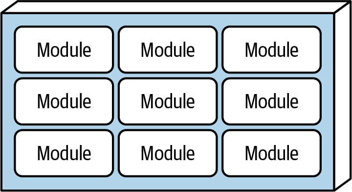
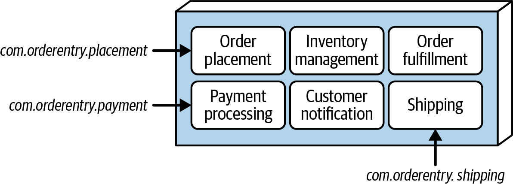
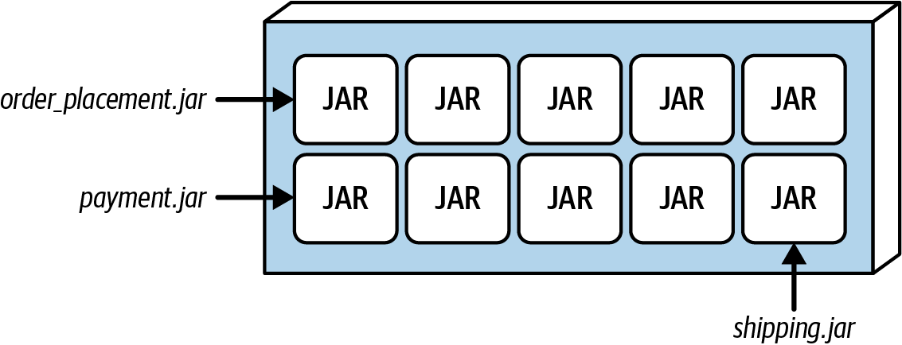
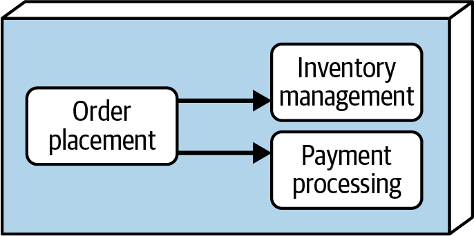
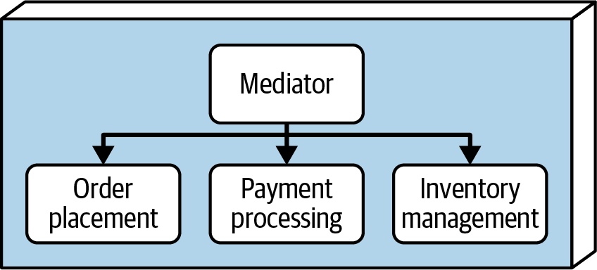
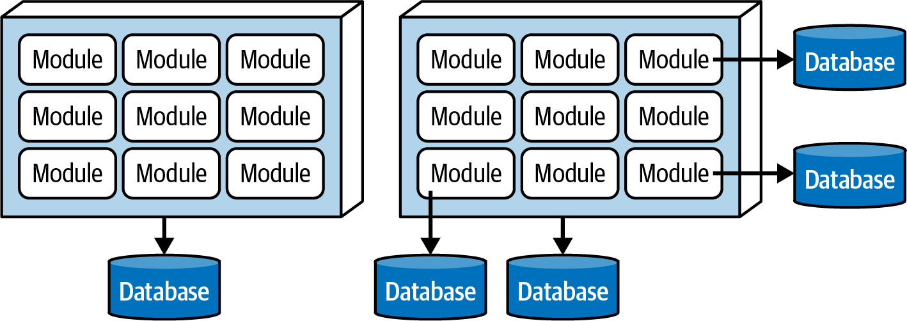
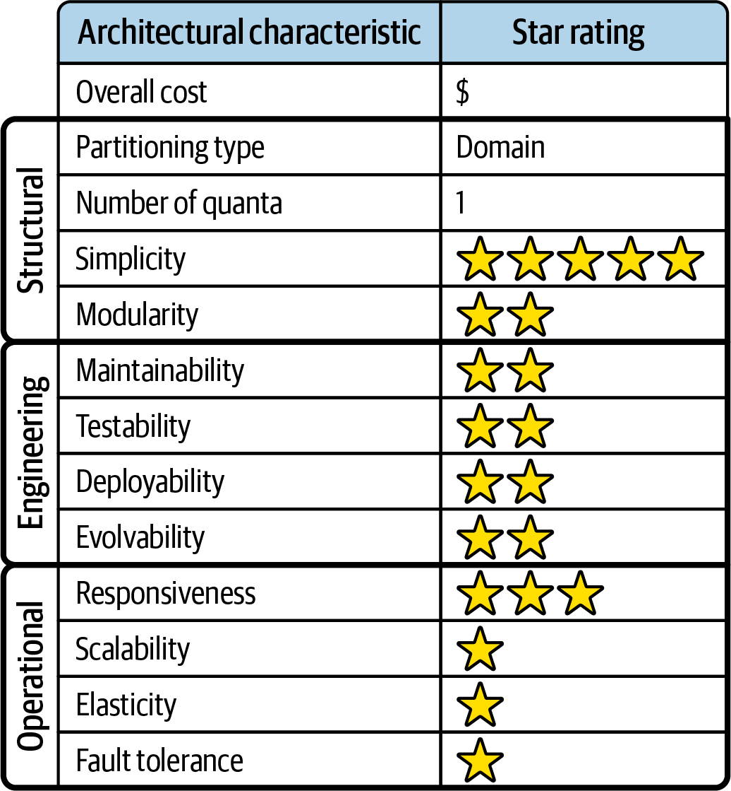
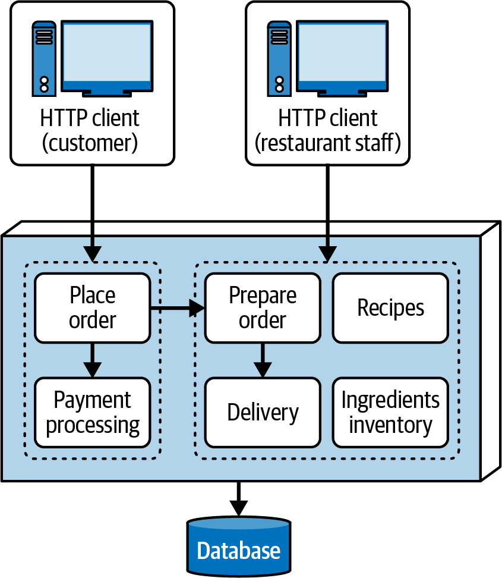

<a id="ch-style-modular-mono"></a>

# Chương 11. Modular monolith architecture style (The Modular Monolith Architecture Style)

<a id="ix_ch11-style-modular-mono-asciidoc0"></a><a id="id1140"></a>Nhờ việc áp dụng rộng rãi [domain-driven design](https://oreil.ly/czIi5) (DDD), cũng như sự chú trọng ngày càng tăng vào domain partitioning, kể từ khi chúng tôi viết ấn bản đầu tiên của cuốn sách này năm 2020, architectural style *modular monolith* đã trở nên phổ biến đến mức chúng tôi quyết định thêm một chương vào ấn bản thứ hai để mô tả (và đánh giá) nó.

<a id="id317"></a>

## Topology

<a id="id1141"></a>Như tên gọi gợi ý, modular monolith architecture style là một architecture *monolith*. Do đó, nó được deploy như một đơn vị phần mềm duy nhất: một file web archive (WAR), một assembly duy nhất trong .NET, một file enterprise archive (EAR) trên nền tảng Java, v.v. <a id="id1142"></a>Vì modular monolith được coi là một architecture *domain-partitioned* (được tổ chức theo business domain thay vì năng lực kỹ thuật), hình dạng đẳng cấu của nó được định nghĩa là *một deployment unit duy nhất với chức năng được gom nhóm theo vùng domain*. [Hình 11-1](#fig-style-mm-topology) minh họa topology điển hình của modular monolith.

Để cảm nhận bản chất tập trung vào domain của modular monolith, hãy xét layered architecture truyền thống (được mô tả trong [Chương 10](ch10_layered_architecture_style.vi.md#ch-style-layered)). Các component của nó được định nghĩa và tổ chức theo năng lực *kỹ thuật*: các layer Presentation, Business, Persistence, v.v. Ví dụ, logic trình bày để duy trì thông tin hồ sơ khách hàng có thể được đại diện bởi một component với namespace *com.app.presentation.customer.profile*. Nút thứ ba trong namespace đại diện cho mối quan tâm *kỹ thuật* của layer (trong trường hợp này là Presentation layer).

<a id="fig-style-mm-topology"></a>



*Hình 11-1. Với modular monolith architecture style, chức năng được gom nhóm theo vùng domain*

Ngược lại, các component của modular monolith chủ yếu được tổ chức theo *domain*. Do đó, trong một modular monolith architecture, cùng component duy trì hồ sơ khách hàng đó sẽ được đại diện bởi namespace *com.app.customer.profile*. Ở đây, nút thứ ba của namespace đề cập một mối quan tâm *domain* thay vì một mối quan tâm kỹ thuật. Tùy thuộc vào độ phức tạp của component, namespace có thể được chia tiếp theo mối quan tâm kỹ thuật *sau* mối quan tâm domain, như *com.app.customer.profile.presentation* hoặc *com.app.customer.profile.business*.

<a id="id93"></a>

## Đặc thù của style (Style Specifics)

<a id="ix_ch11-style-modular-mono-asciidoc1"></a><a id="id1143"></a>Các domain (hoặc subdomain, trong một số trường hợp) được gọi là *module* trong architectural style này. Các module có thể được tổ chức theo một trong hai cách. Architecture đơn giản nhất là *cấu trúc monolith* (monolithic structure), nơi tất cả các module và các logical component tương ứng được chứa trong cùng một code base, được phân định bằng namespace hoặc cấu trúc thư mục chứa chúng. Một lựa chọn phức tạp hơn một chút là *cấu trúc module* (modular structure), nơi mỗi module được đại diện như một artifact độc lập, self-contained (như một file JAR hoặc DLL), và các module được kết hợp thành một đơn vị phần mềm monolith duy nhất trong quá trình deployment.

Như mọi thứ trong software architecture, việc chọn giữa hai lựa chọn cấu trúc này phụ thuộc vào nhiều yếu tố và trade-offs. Các mục sau phác thảo cả hai và thảo luận các trade-offs tương ứng của chúng.

<a id="sec-mm-monolithic-structure"></a>

### Cấu trúc monolith (Monolithic Structure)

<a id="id1144"></a>Trong cấu trúc monolith, tất cả các module đại diện cho hệ thống được chứa trong một repository source-code duy nhất. Toàn bộ code gắn với mỗi module được deploy như một đơn vị duy nhất khi giao hoặc phát hành phần mềm. Lựa chọn cấu trúc này được minh họa trong [Hình 11-2](#fig-style-mm-monolithic-structure). Mỗi module được đại diện bởi một thư mục high-level riêng chứa các component và mọi subdomain tạo nên module đó.

<a id="fig-style-mm-monolithic-structure"></a>



*Hình 11-2. Một ví dụ về lựa chọn cấu trúc monolith*

Các namespace sau minh họa một modular monolith có thể trông như thế nào cho architecture trong [Hình 11-2](#fig-style-mm-monolithic-structure):

```perl
com.orderentry.orderplacement
com.orderentry.inventorymanagement
com.orderentry.paymentprocessing
com.orderentry.notification
com.orderentry.fulfillment
com.orderentry.shipping
```

Đây là lựa chọn đơn giản nhất cho modular monolith: toàn bộ source code của hệ thống nằm ở một nơi và do đó dễ bảo trì, test và deploy hơn. Tuy nhiên, cần có governance chặt chẽ (xem [“Governance”](#sec-mm-governance)) để duy trì ranh giới của mỗi module. Dù lựa chọn cấu trúc này đơn giản, developer có xu hướng tái sử dụng quá nhiều code giữa các module, cũng như cho phép quá nhiều giao tiếp giữa các module (xem [“Module Communication”](#sec-mm-communication)). Những thực hành này có thể biến một modular monolith well-architected thành một Big Ball of Mud phi cấu trúc.

<a id="sec-mm-modular-structure"></a>

### Cấu trúc module (Modular Structure)

<a id="id1145"></a>Với cấu trúc module, các module được đại diện như các artifact self-contained (như các file JAR và DLL), rồi được ghép lại thành một deployment unit duy nhất trong quá trình deployment. [Hình 11-3](#fig-style-mm-modular-structure) minh họa lựa chọn này bằng các file JAR trên nền tảng Java.

<a id="fig-style-mm-modular-structure"></a>



*Hình 11-3. Một ví dụ về lựa chọn cấu trúc module dùng các file JAR*

Ưu điểm của cấu trúc này là mỗi module là self-contained, cho phép các team làm việc trên các module riêng biệt (xem [“Team Topology Considerations”](#sec-mm-team-topologies)), nhiều khi thậm chí trong source code repository chuyên dụng của chính team cho các module đó. Lựa chọn này hoạt động tốt khi các module phần lớn độc lập với các module khác. Nó cũng hoạt động tốt cho các hệ thống lớn hơn, phức tạp hơn, nơi mỗi module đòi hỏi một loại chuyên môn hoặc kiến thức nghiệp vụ khác nhau. Với lựa chọn cấu trúc module, developer ít có xu hướng tái sử dụng code quá mức hoặc để các module giao tiếp với nhau quá nhiều (xem [“Module Communication”](#sec-mm-communication)). Lựa chọn này cũng có xu hướng tạo ra ranh giới sạch hơn giữa các module và sự tách biệt các mối quan tâm tổng thể tốt hơn.

Tuy nhiên, lựa chọn cấu trúc này mất đi hiệu quả khi các module phụ thuộc lẫn nhau cần giao tiếp. Trong trường hợp đó, cách tiếp cận cấu trúc monolith hiệu quả hơn.

<a id="sec-mm-communication"></a>

### Giao tiếp giữa các module (Module Communication)

<a id="ix_ch11-style-modular-mono-asciidoc2"></a><a id="ix_ch11-style-modular-mono-asciidoc3"></a>Giao tiếp giữa các module không bao giờ là điều tốt trong architectural style này, nhưng chúng tôi thừa nhận rằng trong nhiều trường hợp nó là cần thiết. Chẳng hạn, trong architecture ở [Hình 11-2](#fig-style-mm-monolithic-structure), module `OrderPlacement` phải giao tiếp với module `InventoryManagement` để nó điều chỉnh tồn kho cho sản phẩm được đặt và thực hiện mọi xử lý bổ sung (ví dụ, đặt thêm hàng nếu tồn kho quá thấp). Nó cũng phải giao tiếp với module `PaymentProcessing` để áp dụng thanh toán cho một đơn hàng. Có hai lựa chọn chính để giao tiếp giữa các module, được chúng tôi mô tả trong các mục sau.

#### Cách tiếp cận ngang hàng (Peer-to-peer approach)

<a id="id1146"></a>Giải pháp trực tiếp nhất là giao tiếp peer-to-peer đơn giản giữa các module. Với cách tiếp cận này, một file class trong một module khởi tạo một class trong module khác và gọi (các) method cần thiết trong class đó để thực hiện thao tác (xem [Hình 11-4](#fig-style-mm-monolithic-dependency)).

<a id="fig-style-mm-monolithic-dependency"></a>



*Hình 11-4. Giao tiếp peer-to-peer giữa các module*

Một vấn đề với cách tiếp cận monolith là việc developer khởi tạo bất kỳ class nào nằm trong module khác là *quá* tiện. Điều này khiến dễ dàng đi từ một architecture well-structured đến antipattern Big Ball of Mud (xem [Hình 9-1](ch09_foundations.vi.md#fig-architecture-styles-ball-of-mud)).

Tuy nhiên, với cấu trúc module, các class nằm trong module khác có thể nằm trong các artifact bên ngoài riêng biệt (các file JAR hoặc DLL) thay vì một thư mục riêng trong source code repository. Một module giao tiếp với các module khác sẽ không biên dịch được trừ khi nó có các tham chiếu class, điều đó có nghĩa là developer phải tạo một phụ thuộc *compile-time* giữa các module đó. Cách phản ứng thông thường với vấn đề này là tạo một interface class dùng chung giữa các module đó (trong một file JAR hoặc DLL dùng chung riêng) để mỗi module có thể biên dịch độc lập với các module khác. <a id="id1147"></a><a id="id1148"></a>Dù theo cách nào, quá nhiều giao tiếp giữa các module dùng cách tiếp cận cấu trúc module sẽ dẫn đến [antipattern *DLL Hell*](https://oreil.ly/lx7U5) (hoặc, trên nền tảng Java, antipattern *JAR Hell*).

#### Cách tiếp cận mediator (Mediator approach)

<a id="id1149"></a>Cách tiếp cận *mediator* decouple các module bằng cách dùng một mediator component để tạo thành một lớp trừu tượng giữa các module. Mediator đóng vai trò như một orchestrator, chấp nhận request và chuyển chúng tới các module phù hợp. [Hình 11-5](#fig-style-mm-mediator-approach) minh họa cách tiếp cận này.

<a id="fig-style-mm-mediator-approach"></a>



*Hình 11-5. Mediator decouple các module, nên chúng không phải giao tiếp với nhau*

Người đọc tinh ý sẽ nhận thấy rằng, trong khi cách tiếp cận mediator decouple các module, mỗi module thực chất lại bị coupled với mediator. Cách tiếp cận này không loại bỏ *mọi* coupling và phụ thuộc, nhưng nó đơn giản hóa architecture và giữ các module độc lập với nhau. Lưu ý rằng chính *mediator*, chứ không phải các module phụ thuộc, mới cần một loại API hoặc interface nào đó để gọi chức năng trong các module khác<a id="id1150"></a><a id="id1151"></a>.<a id="id1152"></a>

<a id="id318"></a>

## Topology dữ liệu (Data Topologies)

<a id="id1153"></a>Vì modular monolith architecture thường được deploy như một đơn vị phần mềm duy nhất, nó thường dựa vào một topology database monolith. Dùng một database duy nhất giúp giảm giao tiếp giữa các module, vì dữ liệu được chia sẻ. Tuy nhiên, nếu các module độc lập với nhau và thực hiện các chức năng cụ thể, chúng cũng có thể có database riêng chứa dữ liệu theo ngữ cảnh cụ thể, dù bản thân architecture là monolith. [Hình 11-6](#fig-style-mm-database-topology) minh họa hai lựa chọn topology database này.

<a id="fig-style-mm-database-topology"></a>



*Hình 11-6. Dữ liệu có thể là monolith hoặc các module có thể có database riêng*

<a id="id319"></a>

## Các cân nhắc về cloud (Cloud Considerations)

<a id="id1154"></a><a id="id1155"></a>Dù các modular monolithic architecture có thể được deploy trong môi trường cloud (đặc biệt nếu đó là một hệ thống nhỏ), chúng nhìn chung không phù hợp lắm cho deployment trên cloud: bản chất monolith của chúng khiến chúng ít có khả năng tận dụng việc provisioning on-demand mà môi trường cloud cung cấp. Dù vậy, các hệ thống nhỏ hơn được triển khai theo architectural style này vẫn có thể tận dụng nhiều dịch vụ cloud, như lưu trữ file, database và messaging.

<a id="id97"></a>

## Các rủi ro phổ biến (Common Risks)

<a id="id1156"></a>Như với bất kỳ hệ thống monolith nào, rủi ro chính với modular monolith architectural style là nó có thể trở nên quá lớn để có thể bảo trì, test và deploy đúng cách. Bản thân các monolithic architecture không xấu; chính khi chúng trở nên quá lớn thì vấn đề mới bắt đầu xảy ra. “Quá lớn” nghĩa là gì thay đổi tùy hệ thống, nhưng đây là một số dấu hiệu cảnh báo rằng hệ thống có thể đã quá lớn:

- Các thay đổi mất quá nhiều thời gian để thực hiện.
- Khi một vùng của hệ thống bị thay đổi, các vùng khác bị hỏng một cách bất ngờ.
- Các thành viên team cản đường nhau khi áp dụng thay đổi.
- Hệ thống mất quá nhiều thời gian để khởi động.

Một rủi ro khác là quá đà trong việc tái sử dụng code. Tái sử dụng và chia sẻ code là một phần cần thiết của phát triển phần mềm, nhưng trong architecture style này, <a id="id1157"></a>quá nhiều tái sử dụng code làm mờ ranh giới module, dẫn architecture vào vùng nguy hiểm của *unstructured monolith* (monolith phi cấu trúc): một monolithic architecture với code phụ thuộc lẫn nhau cao đến mức không thể gỡ rối được.

Quá nhiều giao tiếp liên module là một rủi ro khác trong architectural style này. Lý tưởng là các module nên độc lập và self-contained. Như chúng tôi đã lưu ý, việc một số module giao tiếp với các module khác là bình thường (và đôi khi cần thiết), đặc biệt trong một workflow phức tạp. Tuy nhiên, nếu có quá nhiều giao tiếp lẫn nhau giữa các module, đó là một dấu hiệu tốt cho thấy các domain có thể đã được định nghĩa kém (ill-defined) ngay từ đầu. Trong những trường hợp như vậy, đáng để suy nghĩ thêm về việc định nghĩa lại các domain để đáp ứng các workflow phức tạp và các phụ thuộc lẫn nhau.

<a id="sec-mm-governance"></a>

## Quản trị (Governance)

<a id="ix_ch11-style-modular-mono-asciidoc4"></a><a id="ix_ch11-style-modular-mono-asciidoc5"></a>Artifact chính trong modular monolith style là một *module*, đại diện cho một domain hoặc subdomain cụ thể và thường được đại diện thông qua cấu trúc thư mục hoặc namespace (hoặc cấu trúc package trên nền tảng Java). Do đó, một trong những dạng governance tự động đầu tiên mà kiến trúc sư có thể áp dụng là định nghĩa và bảo đảm sự tuân thủ với các module được dùng trong architecture.

Để viết các phép kiểm tra governance tự động, kiến trúc sư dùng hàng loạt công cụ, bao gồm [ArchUnit](https://archunit.org) cho nền tảng Java, [ArchUnitNet](https://oreil.ly/-hjOC) và [NetArchTest](https://oreil.ly/4e-2j) cho nền tảng .NET, [PyTestArch](https://oreil.ly/lWKVt) cho Python, và [TSArch](https://oreil.ly/Fk4OG) cho TypeScript và JavaScript. Pseudocode trong [Ví dụ 11-1](#source-mm-defined-modules) bảo đảm rằng toàn bộ source code được thể hiện trong ví dụ architecture ở [Hình 11-2](#fig-style-mm-monolithic-structure) thuộc về một trong các namespace được liệt kê, vốn đại diện cho mỗi module đã định nghĩa trong hệ thống.

<a id="source-mm-defined-modules"></a>

*Ví dụ 11-1. Pseudocode để bảo đảm code tuân theo các module đã định nghĩa của hệ thống*

```perl
# The following namespaces represent the modules in the system
LIST module_list = {
   com.orderentry.orderplacement,
   com.orderentry.inventorymanagement,
   com.orderentry.paymentprocessing,
   com.orderentry.notification,
   com.orderentry.fulfillment,
   com.orderentry.shipping
   }

# Get the list of namespaces in the system
LIST namespace_list = get_all_namespaces(root_directory)

# Make sure all the namespaces start with one of the listed modules
FOREACH namespace IN namespace_list {
   IF NOT namespace.starts_with(module_list) {
      send_alert(namespace)
   }
}
```

Nếu một developer tạo thêm bất kỳ namespace hoặc thư mục high-level nào nằm ngoài các module đã định nghĩa và các namespace (hoặc thư mục) tương ứng của chúng, họ sẽ nhận được một cảnh báo cho biết source code không tuân thủ architecture.

Dạng governance này hoạt động tốt với lựa chọn cấu trúc monolith của architecture style này (xem [“Monolithic Structure”](#sec-mm-monolithic-structure)), nhưng gặp khó khăn với lựa chọn cấu trúc module (xem [“Modular Structure”](#sec-mm-modular-structure)) vì code có thể không được chứa trong cùng một source code repository monolith. Với lựa chọn cấu trúc module, mỗi module phải được test riêng, như trong [Ví dụ 11-2](#source-mm-inventory-module).

<a id="source-mm-inventory-module"></a>

*Ví dụ 11-2. Pseudocode để kiểm chứng module `InventoryManagement`*

```perl
# Get the list of namespaces in the system
LIST namespace_list = get_all_namespaces(root_directory)

# Make sure all the namespaces start with com.orderentry.inventorymanagement
FOREACH namespace IN namespace_list {
   IF NOT namepace.starts_with("com.orderentry.inventorymanagement") {
      send_alert(namespace)
   }
}
```

Một cách khác để quản trị một modular monolith architecture là kiểm soát lượng giao tiếp giữa các module. Định nghĩa thế nào là “quá nhiều” giao tiếp là rất chủ quan và thay đổi tùy hệ thống, nhưng phần lớn, kiến trúc sư nên cố gắng tối thiểu hóa số lượng phụ thuộc lẫn nhau giữa các module. [Ví dụ 11-3](#source-mm-dependency-limit) trình bày pseudocode để bảo đảm tổng số phụ thuộc lẫn nhau tối đa không vượt quá giới hạn năm điểm giao tiếp (hoặc coupling).

<a id="source-mm-dependency-limit"></a>

*Ví dụ 11-3. Pseudocode để giới hạn tổng số phụ thuộc của bất kỳ module nào*

```perl
# Walk the directory structure, gathering modules and the source code files
# contained within those modules
LIST module_list = {
   com.orderentry.orderplacement,
   com.orderentry.inventorymanagement,
   com.orderentry.paymentprocessing,
   com.orderentry.notification,
   com.orderentry.fulfillment,
   com.orderentry.shipping
   }

MAP module_source_file_map
FOREACH module IN module_list {
  LIST source_file_list = get_source_files(module)
  ADD module, source_file_list TO module_source_file_map
}

# Determine how many references exist for each source file and send an alert if
# the system's total dependency count is greater than 5
FOREACH module, source_file_list IN module_source_file_map {
  FOREACH source_file IN source_file_list {
    incoming count = used_by_other_module(source_file, module_source_file_map) {
    outgoing_count = uses_other_module(source_file) {
    total_count = incoming count + outgoing count
  }
  IF total_count > 5 {
    send_alert(module, total_count)
  }
}
```

Một dạng governance tự động cuối cùng là bảo đảm các module độc lập với nhau bằng cách hạn chế một module cụ thể giao tiếp với một module khác. Ví dụ, trong [Hình 11-2](#fig-style-mm-monolithic-structure), module `OrderPlacement` không nên giao tiếp với module `Shipping`. [Ví dụ 11-4](#source-mm-dependency-restriction) trình bày code ArchUnit bằng Java để quản trị phụ thuộc này.<a id="id1158"></a><a id="id1159"></a>

<a id="source-mm-dependency-restriction"></a>

*Ví dụ 11-4. Code ArchUnit để quản trị các hạn chế phụ thuộc giữa các module cụ thể*

```java
public void order_placement_cannot_access_shipping() {
   noClasses().that()
   .resideInAPackage("..com.orderentry.orderplacement..")
   .should().accessClassesThat()
   .resideInAPackage("..com.orderentry.shipping..")
   .check(myClasses);
}
```

<a id="sec-mm-team-topologies"></a>

## Các cân nhắc về team topology (Team Topology Considerations)

<a id="id1160"></a><a id="id1161"></a>Vì modular monolith được coi là một architecture domain-partitioned, nó hoạt động tốt nhất khi các team cũng được sắp xếp theo vùng domain (như các team cross-functional có chuyên môn hóa). Khi một yêu cầu domain-based xuất hiện, một team cross-functional domain-focused có thể cùng làm việc trên tính năng đó, từ logic trình bày cho đến tận database. Ngược lại, các team được tổ chức theo hạng mục kỹ thuật (như team UI, team backend, team database, v.v.) không hoạt động tốt với architectural style này, chủ yếu do domain partitioning của nó. Gán các yêu cầu domain-based cho các team được tổ chức theo kỹ thuật đòi hỏi rất nhiều giao tiếp và cộng tác, điều thường tỏ ra khó khăn.

Dưới đây là một số cân nhắc để gắn các team topology cụ thể được nêu trong [“Team Topologies and Architecture”](ch09_foundations.vi.md#sec-foundations-team-topologies) với modular monolith style:

**Stream-aligned team**

Stream-aligned team nhìn chung sở hữu luồng qua hệ thống từ đầu đến cuối, khớp một cách đẹp đẽ với hình dạng monolith và nhìn chung self-contained của modular monolith.

**Enabling team**

Nhờ mức modularity và sự tách biệt các mối quan tâm cao của style này, các enabling team topology cũng hoạt động tốt. Các chuyên gia và thành viên team cross-cutting có thể đưa ra đề xuất và thực hiện thử nghiệm bằng cách đưa thêm các module vào hệ thống, với tác động tối thiểu đến các module hiện có khác.

**Complicated-subsystem team**

Mỗi module trong một modular monolith architecture nhìn chung thực hiện một vai trò cụ thể dựa trên domain hoặc subdomain của nó (như `PaymentProcessing`). Điều này hoạt động tốt với complicated-subsystem team topology, vì các thành viên team khác nhau có thể tập trung vào xử lý domain hoặc subdomain phức tạp một cách độc lập với các thành viên team (và module) khác.

**Platform team**

Developer có thể tận dụng lợi ích của topology platform-teams bằng cách sử dụng các công cụ, service, API và tác vụ chung, chủ yếu nhờ mức modularity cao có trong architectural style này.

<a id="id321"></a>

## Các characteristic của style (Style Characteristics)

<a id="ix_ch11-style-modular-mono-asciidoc6"></a>Đánh giá one-star (một sao) trong bảng đánh giá characteristic [Hình 11-7](#fig-style-mm-ratings) có nghĩa là architecture characteristic cụ thể không được hỗ trợ tốt trong architecture, trong khi đánh giá five-star (năm sao) có nghĩa là architecture characteristic đó là một trong những đặc điểm mạnh nhất của architecture style. Các characteristic có trong bảng điểm được mô tả và định nghĩa trong [Chương 4](ch04_architectural_characteristics_defined.vi.md#ch04-architecture-characteristics-defined).

Modular monolith architecture style là một architecture *domain-partitioned* vì logic ứng dụng của nó được phân vùng thành các module. Vì nó thường được triển khai dưới dạng một deployment monolith, architectural quantum của nó thường là 1.

Chi phí tổng thể, sự đơn giản và modularity là những điểm mạnh chính của modular monolith architecture style. Vốn mang bản chất monolith, các architecture này không có những độ phức tạp gắn với các architecture style phân tán. Chúng đơn giản hơn và dễ hiểu hơn, và có chi phí tương đối thấp để xây dựng và bảo trì. Modularity kiến trúc đạt được thông qua sự tách biệt các mối quan tâm giữa các module khác nhau, đại diện cho các domain và subdomain.

Deployability và testability, dù chỉ được hai sao, được đánh giá cao hơn một chút ở modular monolith so với layered architecture nhờ mức modularity của nó. Dù vậy, architecture style này vẫn là một monolith: do đó, thủ tục, rủi ro, tần suất deployment và mức độ đầy đủ của testing tác động tiêu cực đến các điểm số này.

Elasticity và scalability của modular monolith architecture được đánh giá rất thấp (một sao), chủ yếu do deployment dạng monolith. Dù có thể làm cho một số chức năng nhất định trong một monolith scale nhiều hơn các chức năng khác, nỗ lực này thường đòi hỏi các kỹ thuật thiết kế rất phức tạp (như multithreading, messaging nội bộ, và các thực hành parallel-processing khác) mà architecture này không phù hợp.

<a id="fig-style-mm-ratings"></a>



*Hình 11-7. Đánh giá sao các architectural characteristic của modular monolith*

Các deployment monolith của modular monolith architecture không hỗ trợ fault tolerance. Nếu một phần nhỏ của architecture gây ra tình trạng out-of-memory, toàn bộ unit ứng dụng sẽ crash. Hơn nữa, như ở hầu hết các ứng dụng monolith, availability tổng thể bị ảnh hưởng bởi mean time to recovery (MTTR) cao, với thời gian khởi động thường được đo bằng phút.

<a id="id400"></a>

### Khi nào nên dùng (When to Use)

<a id="id1162"></a>Nhờ sự đơn giản và chi phí thấp, modular monolith architecture style là một lựa chọn tốt khi phải đối mặt với ràng buộc ngân sách và thời gian chặt chẽ. Nó cũng là một lựa chọn tốt để khởi đầu một hệ thống mới. Nếu định hướng kiến trúc của hệ thống vẫn chưa rõ, thường hiệu quả hơn khi bắt đầu với một modular monolith và về sau chuyển sang một architecture style phân tán phức tạp và tốn kém hơn, như service based (xem [Chương 14](ch14_service_based_architecture_style.vi.md#ch-style-service-based)) hoặc microservices (xem [Chương 18](ch18_microservices_architecture.vi.md#ch-style-microservices)), thay vì nhảy thẳng vào architecture phân tán.

Modular monolith cũng là một lựa chọn tốt cho các team domain-focused, như các team cross-functional có chuyên môn hóa. Điều này cho phép mỗi team tập trung vào một module cụ thể trong architecture từ đầu đến cuối, với sự phối hợp tối thiểu với các team domain khác. Architectural style này cũng rất phù hợp cho các tình huống mà phần lớn thay đổi đối với hệ thống là dựa trên domain (như thêm ngày hết hạn cho các sản phẩm trong wishlist của khách hàng).

Cuối cùng, vì modular monolith là một architecture domain-partitioned, nó rất phù hợp với các team đang áp dụng [DDD](https://oreil.ly/czIi5).

<a id="id99"></a>

### Khi nào không nên dùng (When Not to Use)

<a id="id1163"></a>Lý do chính để không dùng architectural style này là khi các hệ thống hoặc sản phẩm đòi hỏi mức cao của một số characteristic vận hành nhất định, như scalability, elasticity, availability, fault tolerance, responsiveness và performance. Như hầu hết các monolithic architecture, modular monolith ill-suited (không phù hợp) với những mối quan tâm kiến trúc này.

Tránh dùng modular monolith khi phần lớn các thay đổi mang tính kỹ thuật, như liên tục thay thế giao diện người dùng hoặc công nghệ database. Vì architecture này được phân vùng theo domain, những thay đổi như vậy tác động đến mọi module và thường đòi hỏi giao tiếp và phối hợp đáng kể giữa các team domain. Trong những tình huống này, layered architecture style (xem [Chương 10](ch10_layered_architecture_style.vi.md#ch-style-layered)) là một lựa chọn tốt hơn nhiều.<a id="id1164"></a>

<a id="id100"></a>

## Ví dụ và use case (Examples and Use Cases)

<a id="ix_ch11-style-modular-mono-asciidoc7"></a><a id="ix_ch11-style-modular-mono-asciidoc8"></a>EasyMeals là một nhà hàng khu phố delivery-based mới, phục vụ những người đi làm không phải lúc nào cũng có thời gian nấu ăn sau khi về nhà từ một ngày bận rộn. Những khách hàng đói bụng có thể đặt một bữa tối ngon lành trực tuyến và được giao đến tận cửa trong vòng một giờ.

Là một nhà hàng nhỏ, địa phương, họ không có nhu cầu cao về scalability hay responsiveness. Và vì ngân sách hạn chế, họ không muốn chi nhiều tiền cho một hệ thống phần mềm công phu. Hình dạng của vấn đề kinh doanh này khiến modular monolith trở thành một lựa chọn tốt cho EasyMeals.

[Hình 11-8](#fig-style-mm-use-case-example) cho thấy hệ thống quản lý nhà hàng đơn giản của EasyMeals có thể trông như thế nào khi dùng modular monolith architectural style.

<a id="fig-style-mm-use-case-example"></a>



*Hình 11-8. Một hệ thống đặt món và quản lý nhà hàng nhỏ dùng modular monolith style*

Khách hàng truy cập các module `PlaceOrder` và `PaymentProcessing` thông qua một giao diện người dùng chuyên dụng thông qua một UI khác. Các namespace sau đại diện cho mỗi module của hệ thống này:

```perl
com.easymeals.placeorder
com.easymeals.payment
com.easymeals.prepareorder
com.easymeals.delivery
com.easymeals.recipes
com.easymeals.inventory
```

Module `PlaceOrder` cho phép mỗi khách hàng xem thực đơn; chọn món; thêm tên, địa chỉ và thông tin thanh toán của họ; và gửi đơn hàng. Các component của module này có thể được đại diện thông qua các namespace sau, với source code triển khai từng chức năng chính này:

```perl
com.easymeals.placeorder.menu
com.easymeals.placeorder.shoppingcart
com.easymeals.placeorder.customerdata
com.easymeals.placeorder.paymentdata
com.easymeals.placeorder.checkout
```

Ví dụ này minh họa rằng một module trong modular monolith được tạo thành từ một đến nhiều *component* (xem [Chương 8](ch08_component_based_thinking.vi.md#ch08-component-based-thinking)).

Module `PaymentProcessing` chịu trách nhiệm áp dụng thanh toán. EasyMeals chấp nhận thẻ tín dụng, thẻ ghi nợ và PayPal; modularity của architecture này giúp dễ dàng thêm một loại thanh toán bổ sung (như điểm thưởng khách hàng thân thiết). Khách hàng nhập thông tin này trong module `PlaceOrder`, module này chuyển nó tới module `P⁠a⁠y⁠m⁠e⁠n⁠tP⁠r⁠o⁠c⁠e⁠s⁠s⁠i⁠n⁠g`. Các component của module này có thể được đại diện thông qua các namespace sau:

```perl
com.easymeals.payment.creditcard
com.easymeals.payment.debitcard
com.easymeals.payment.paypal
```

Khi đơn hàng đã được thanh toán, module `PlaceOrder` giao tiếp với module `PrepareOrder`, module này hiển thị toàn bộ đơn hàng cho nhân viên bếp. Sau khi nấu xong, nhân viên bếp đánh dấu đơn hàng sẵn sàng để giao và sau đó nó được gửi tới module `Delivery`. Các namespace sau đại diện cho các component trong module `PrepareOrder`:

```perl
com.easymeals.prepareorder.displayorder
com.easymeals.prepareorder.ready
```

Module `Delivery` gán một người giao hàng cho đơn hàng và chỉ ra địa chỉ giao hàng. Nó cho phép người giao hàng đánh dấu đơn hàng đã được giao, kết thúc vòng đời của đơn hàng cụ thể đó, và ghi lại mọi sự cố (như một con chó dữ ở cổng trước hoặc một khách hàng không có nhà). Các namespace sau đại diện cho các component trong module `Delivery`:

```perl
com.easymeals.delivery.assign
com.easymeals.delivery.issues
com.easymeals.delivery.complete
```

Module `Recipes` cho phép đầu bếp và nhân viên quản lý thêm món vào thực đơn và duy trì danh sách nguyên liệu và định lượng cho mỗi món trong thực đơn. Các namespace sau đại diện cho các component trong module `Recipes`:

```perl
com.easymeals.recipes.view
com.easymeals.recipes.maintenance
```

Cuối cùng, module `IngredientsInventory` bảo đảm có đủ nguyên liệu trong kho cho các công thức trong thực đơn. Module này phức tạp hơn các module khác một chút: nó có một component AI tinh vi dự báo khối lượng bán hàng để tự động hóa quy trình mua sắm nguyên liệu cho tuần.

Các namespace sau đại diện cho các component trong module `IngredientsInventory`:

```perl
com.easymeals.inventory.maintenance
com.easymeals.inventory.forecasting
com.easymeals.inventory.ordering
com.easymeals.inventory.suppliers
com.easymeals.inventory.invoices
```

Vậy là xong! Sự đơn giản và mức modularity của modular monolith khiến việc định vị và bảo trì code để sửa bug hoặc thêm tính năng mới tương đối dễ dàng. Điều này minh họa sức mạnh của architectural style đơn giản và thẳng thắn này<a id="id1165"></a><a id="id1166"></a>.<a id="id1167"></a>
